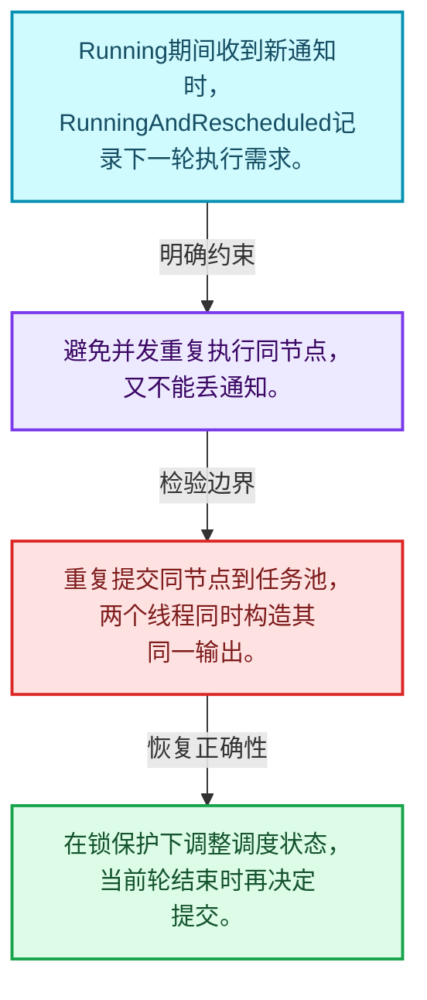
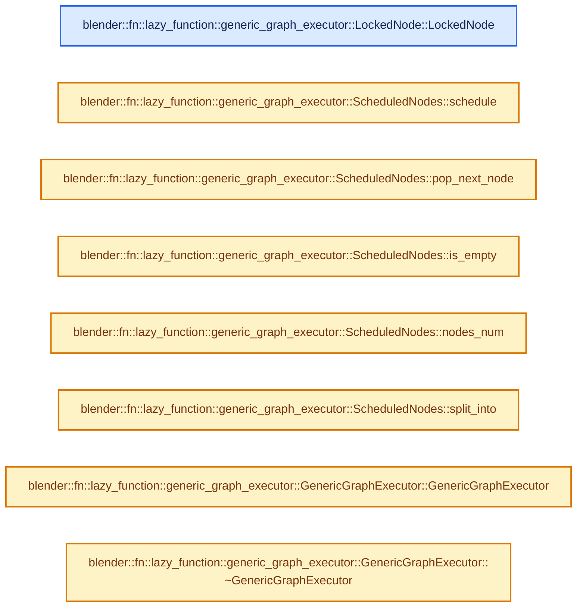
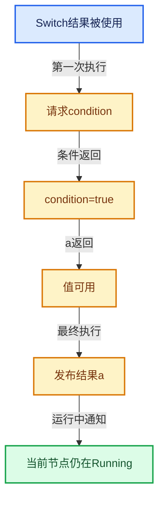

# 09-07 执行器内部状态

[方向导航](README.md) · [总目录](../README.md) · [实现索引](../%E7%AC%A6%E5%8F%B7%E4%BE%9D%E8%B5%96%E4%B8%8E%E5%AE%9E%E7%8E%B0%E7%B4%A2%E5%BC%95.md)

## 从问题到实现

为何节点调度需要RunningAndRescheduled状态？

运行中的节点再次收到通知时不能并发重复执行；标记再次调度让它完成当前轮后继续推进。

**数据模型**

Running期间收到新通知时，RunningAndRescheduled记录下一轮执行需求。

**设计取舍**

避免并发重复执行同节点，又不能丢通知。

**最小反例**

重复提交同节点到任务池，两个线程同时构造其同一输出。

**推导**

在锁保护下调整调度状态，当前轮结束时再决定提交。

## 阅读地图与执行推演








图中的数值推演是本方向的教学模型；实际函数之间的调用边与概念分析边分别标注，不能把概念关系当作运行时调度顺序。

## 完整源码单元与就地讲解

中文讲解直接放在相关代码旁，复杂机制在代码下展开。原文折叠区保留基准行号；不需要在行号表和函数之间来回查找。类布局可分段展示，函数实现不按固定行数切开。

### 类型布局、声明与编译条件 · lazy_function_graph_executor_generic.hh L1—L214

<a id="t-cc4e3052db01"></a>

<a id="t-109b4e06011b"></a>

`InputState`在这里声明的数据成员：

- `void value`
- `ValueUsage usage`
- `bool was_ready_for_execution`

<a id="t-26edd9694a75"></a>

`OutputState`在这里声明的数据成员：

- `ValueUsage usage`
- `ValueUsage usage_for_execution`
- `bool has_been_computed`
- `int potential_target_sockets`
- `void value`

<a id="t-70f533882b46"></a>

`NodeState`在这里声明的数据成员：

- `InputState inputs`
- `OutputState outputs`
- `int missing_required_inputs`
- `Mutex mutex`
- `bool node_has_finished`
- `bool always_used_inputs_requested`
- `bool storage_and_defaults_initialized`
- `bool has_side_effects`
- `bool enabled_multi_threading`
- `NodeScheduleState schedule_state`
- `void storage`

<a id="t-764ea37e2e12"></a>

`LockedNode`在这里声明的数据成员：

- `Node node`
- `NodeState node_state`
- `Vector<const OutputSocket *> delayed_required_outputs`
- `Vector<const OutputSocket *> delayed_unused_outputs`

<!-- annotated:6ee34b1a8d17c9 -->

```cpp
/* SPDX-FileCopyrightText: 2023 Blender Authors
 *
 * SPDX-License-Identifier: GPL-2.0-or-later */

/** \file
 * \ingroup fn
 *
 * This file implements the evaluation of a lazy-function graph. It's main objectives are:
 * - Only compute values that are actually used.
 * - Stay single threaded when nodes are executed quickly.
 * - Allow spreading the work over an arbitrary number of threads efficiently.
 *
 * This executor makes use of `FN_lazy_threading.hh` to enable multi-threading only when it seems
 * beneficial. It operates in two modes: single- and multi-threaded. The use of a task pool and
 * locks is avoided in single-threaded mode. Once multi-threading is enabled the executor starts
 * using both. It is not possible to switch back from multi-threaded to single-threaded mode.
 *
 * The multi-threading design implemented in this executor requires *no* main thread that
 * coordinates everything. Instead, one thread will trigger some initial work and then many threads
 * coordinate themselves in a distributed fashion. In an ideal situation, every thread ends up
 * processing a separate part of the graph which results in less communication overhead. The way
 * TBB schedules tasks helps with that: a thread will next process the task that it added to a task
 * pool just before.
 *
 * Communication between threads is synchronized by using a mutex in every node. When a thread
 * wants to access the state of a node, its mutex has to be locked first (with some documented
 * exceptions). The assumption here is that most nodes are only ever touched by a single thread and
 * therefore the lock contention is reduced the more nodes there are.
 *
 * Similar to how a #LazyFunction can be thought of as a state machine (see `FN_lazy_function.hh`),
 * each node can also be thought of as a state machine. The state of a node contains the evaluation
 * state of its inputs and outputs. Every time a node is executed, it has to advance its state in
 * some way (e.g. it requests a new input or computes a new output).
 *
 * When a node is executed it may send notifications to other nodes which may in turn schedule
 * those nodes. For example, when the current node has computed one of its outputs, then the
 * computed value is forwarded to all linked inputs, changing their node states in the process. If
 * this input was the last missing required input, the node will be scheduled that it is executed
 * next.
 *
 * When all tasks are completed, the executor gives back control to the caller which may later
 * provide new inputs to the graph which in turn leads to new nodes being scheduled and the process
 * starts again.
 */

#pragma once

#include <atomic>

#include "BLI_enumerable_thread_specific.hh"
#include "BLI_function_ref.hh"
#include "BLI_mutex.hh"
#include "BLI_stack.hh"
#include "BLI_task.hh"
#include "BLI_task_c.hh"

#include "FN_lazy_function_graph_executor.hh"
#include "FN_lazy_function_graph_executor_generic.hh"

namespace blender::fn::lazy_function::generic_graph_executor {

enum class NodeScheduleState : uint8_t {
  /**
   * Default state of every node.
   */
  NotScheduled,
  /**
   * The node has been added to the task pool or is otherwise scheduled to be executed in the
   * future.
   */
  Scheduled,
  /**
   * The node is currently running.
   */
  Running,
  /**
   * The node is running and has been rescheduled while running. In this case the node run again.
   * This state exists, because we don't want to add the node to the task pool twice, because then
   * the node might run twice at the same time, which is not allowed. Instead, once the node is
   * done running, it will reschedule itself.
   */
  RunningAndRescheduled,
};

struct InputState {
  /**
   * Value of this input socket. By default, the value is empty. When other nodes are done
   * computing their outputs, the computed values will be forwarded to linked input sockets. The
   * value will then live here until it is found that it is not needed anymore.
   *
   * If #was_ready_for_execution is true, access does not require holding the node lock.
   */
  void *value = nullptr;
  /**
   * How the node intends to use this input. By default, all inputs may be used. Based on which
   * outputs are used, a node can decide that an input will definitely be used or is never used.
   * This allows freeing values early and avoids unnecessary computations.
   */
  ValueUsage usage = ValueUsage::Maybe;
  /**
   * Set to true once #value is set and will stay true afterwards. Access during execution of a
   * node, does not require holding the node lock.
   */
  bool was_ready_for_execution = false;
};

struct OutputState {
  /**
   * Keeps track of how the output value is used. If a connected input becomes used, this output
   * has to become used as well. The output becomes unused when it is used by no input socket
   * anymore and it's not an output of the graph.
   */
  ValueUsage usage = ValueUsage::Maybe;
  /**
   * This is a copy of #usage that is done right before node execution starts. This is done so that
   * the node gets a consistent view of what outputs are used, even when this changes while the
   * node is running (the node might be reevaluated in that case). Access during execution of a
   * node, does not require holding the node lock.
   */
  ValueUsage usage_for_execution = ValueUsage::Maybe;
  /**
   * Is set to true once the output has been computed and then stays true. Access does not require
   * holding the node lock.
   */
  bool has_been_computed = false;
  /**
   * Number of linked sockets that might still use the value of this output.
   */
  int potential_target_sockets = 0;
  /**
   * Holds the output value for a short period of time while the node is initializing it and before
   * it's forwarded to input sockets. Access does not require holding the node lock.
   */
  void *value = nullptr;
};

struct NodeState {
  /**
   * States of the individual input and output sockets. One can index into these arrays without
   * locking. However, to access data inside, a lock is needed unless noted otherwise.
   * Those are not stored as #Span to reduce memory usage. The number of inputs and outputs is
   * stored on the node already.
   */
  InputState *inputs;
  OutputState *outputs;
  /**
   * Counts the number of inputs that still have to be provided to this node, until it should run
   * again. This is used as an optimization so that nodes are not scheduled unnecessarily in many
   * cases.
   */
  int missing_required_inputs = 0;
  /**
   * Needs to be locked when any data in this state is accessed that is not explicitly marked as
   * not needing the lock.
   */
  mutable Mutex mutex;
  /**
   * Is set to true once the node is done with its work, i.e. when all outputs that may be used
   * have been computed.
   */
  bool node_has_finished = false;
  /**
   * Set to true once the always required inputs have been requested.
   * This happens the first time the node is run.
   */
  bool always_used_inputs_requested = false;
  /**
   * Set to true when the storage and defaults have been initialized.
   * This happens the first time the node function is executed.
   */
  bool storage_and_defaults_initialized = false;
  /**
   * Nodes with side effects should always be executed when their required inputs have been
   * computed.
   */
  bool has_side_effects = false;
  /**
   * Whether this node has enabled multi-threading. If this is true, the node is allowed to call
   * methods on #Params from multiple threads.
   */
  bool enabled_multi_threading = false;
  /**
   * A node is always in one specific schedule state. This helps to ensure that the same node does
   * not run twice at the same time accidentally.
   */
  NodeScheduleState schedule_state = NodeScheduleState::NotScheduled;
  /**
   * Custom storage of the node.
   */
  void *storage = nullptr;
};

/**
 * Utility class that wraps a node whose state is locked. Having this is a separate class is useful
 * because it allows methods to communicate that they expect the node to be locked.
 */
struct LockedNode {
  /**
   * This is the node that is currently locked.
   */
  const Node &node;
  NodeState &node_state;

  /**
   * Used to delay notifying (and therefore locking) other nodes until the current node is not
   * locked anymore. This might not be strictly necessary to avoid deadlocks in the current code,
   * but is a good measure to avoid accidentally adding a deadlock later on. By not locking more
   * than one node per thread at a time, deadlocks are avoided.
   *
   * The notifications will be send right after the node is not locked anymore.
   */
  Vector<const OutputSocket *> delayed_required_outputs;
  Vector<const OutputSocket *> delayed_unused_outputs;

```

<details>
<summary>核对原始源码：source/blender/functions/intern/lazy_function_graph_executor_generic.hh · L1—L214</summary>

<!-- original:6ee34b1a8d17c9:source/blender/functions/intern/lazy_function_graph_executor_generic.hh:1:214 -->

```cpp
/* SPDX-FileCopyrightText: 2023 Blender Authors
 *
 * SPDX-License-Identifier: GPL-2.0-or-later */

/** \file
 * \ingroup fn
 *
 * This file implements the evaluation of a lazy-function graph. It's main objectives are:
 * - Only compute values that are actually used.
 * - Stay single threaded when nodes are executed quickly.
 * - Allow spreading the work over an arbitrary number of threads efficiently.
 *
 * This executor makes use of `FN_lazy_threading.hh` to enable multi-threading only when it seems
 * beneficial. It operates in two modes: single- and multi-threaded. The use of a task pool and
 * locks is avoided in single-threaded mode. Once multi-threading is enabled the executor starts
 * using both. It is not possible to switch back from multi-threaded to single-threaded mode.
 *
 * The multi-threading design implemented in this executor requires *no* main thread that
 * coordinates everything. Instead, one thread will trigger some initial work and then many threads
 * coordinate themselves in a distributed fashion. In an ideal situation, every thread ends up
 * processing a separate part of the graph which results in less communication overhead. The way
 * TBB schedules tasks helps with that: a thread will next process the task that it added to a task
 * pool just before.
 *
 * Communication between threads is synchronized by using a mutex in every node. When a thread
 * wants to access the state of a node, its mutex has to be locked first (with some documented
 * exceptions). The assumption here is that most nodes are only ever touched by a single thread and
 * therefore the lock contention is reduced the more nodes there are.
 *
 * Similar to how a #LazyFunction can be thought of as a state machine (see `FN_lazy_function.hh`),
 * each node can also be thought of as a state machine. The state of a node contains the evaluation
 * state of its inputs and outputs. Every time a node is executed, it has to advance its state in
 * some way (e.g. it requests a new input or computes a new output).
 *
 * When a node is executed it may send notifications to other nodes which may in turn schedule
 * those nodes. For example, when the current node has computed one of its outputs, then the
 * computed value is forwarded to all linked inputs, changing their node states in the process. If
 * this input was the last missing required input, the node will be scheduled that it is executed
 * next.
 *
 * When all tasks are completed, the executor gives back control to the caller which may later
 * provide new inputs to the graph which in turn leads to new nodes being scheduled and the process
 * starts again.
 */

#pragma once

#include <atomic>

#include "BLI_enumerable_thread_specific.hh"
#include "BLI_function_ref.hh"
#include "BLI_mutex.hh"
#include "BLI_stack.hh"
#include "BLI_task.hh"
#include "BLI_task_c.hh"

#include "FN_lazy_function_graph_executor.hh"
#include "FN_lazy_function_graph_executor_generic.hh"

namespace blender::fn::lazy_function::generic_graph_executor {

enum class NodeScheduleState : uint8_t {
  /**
   * Default state of every node.
   */
  NotScheduled,
  /**
   * The node has been added to the task pool or is otherwise scheduled to be executed in the
   * future.
   */
  Scheduled,
  /**
   * The node is currently running.
   */
  Running,
  /**
   * The node is running and has been rescheduled while running. In this case the node run again.
   * This state exists, because we don't want to add the node to the task pool twice, because then
   * the node might run twice at the same time, which is not allowed. Instead, once the node is
   * done running, it will reschedule itself.
   */
  RunningAndRescheduled,
};

struct InputState {
  /**
   * Value of this input socket. By default, the value is empty. When other nodes are done
   * computing their outputs, the computed values will be forwarded to linked input sockets. The
   * value will then live here until it is found that it is not needed anymore.
   *
   * If #was_ready_for_execution is true, access does not require holding the node lock.
   */
  void *value = nullptr;
  /**
   * How the node intends to use this input. By default, all inputs may be used. Based on which
   * outputs are used, a node can decide that an input will definitely be used or is never used.
   * This allows freeing values early and avoids unnecessary computations.
   */
  ValueUsage usage = ValueUsage::Maybe;
  /**
   * Set to true once #value is set and will stay true afterwards. Access during execution of a
   * node, does not require holding the node lock.
   */
  bool was_ready_for_execution = false;
};

struct OutputState {
  /**
   * Keeps track of how the output value is used. If a connected input becomes used, this output
   * has to become used as well. The output becomes unused when it is used by no input socket
   * anymore and it's not an output of the graph.
   */
  ValueUsage usage = ValueUsage::Maybe;
  /**
   * This is a copy of #usage that is done right before node execution starts. This is done so that
   * the node gets a consistent view of what outputs are used, even when this changes while the
   * node is running (the node might be reevaluated in that case). Access during execution of a
   * node, does not require holding the node lock.
   */
  ValueUsage usage_for_execution = ValueUsage::Maybe;
  /**
   * Is set to true once the output has been computed and then stays true. Access does not require
   * holding the node lock.
   */
  bool has_been_computed = false;
  /**
   * Number of linked sockets that might still use the value of this output.
   */
  int potential_target_sockets = 0;
  /**
   * Holds the output value for a short period of time while the node is initializing it and before
   * it's forwarded to input sockets. Access does not require holding the node lock.
   */
  void *value = nullptr;
};

struct NodeState {
  /**
   * States of the individual input and output sockets. One can index into these arrays without
   * locking. However, to access data inside, a lock is needed unless noted otherwise.
   * Those are not stored as #Span to reduce memory usage. The number of inputs and outputs is
   * stored on the node already.
   */
  InputState *inputs;
  OutputState *outputs;
  /**
   * Counts the number of inputs that still have to be provided to this node, until it should run
   * again. This is used as an optimization so that nodes are not scheduled unnecessarily in many
   * cases.
   */
  int missing_required_inputs = 0;
  /**
   * Needs to be locked when any data in this state is accessed that is not explicitly marked as
   * not needing the lock.
   */
  mutable Mutex mutex;
  /**
   * Is set to true once the node is done with its work, i.e. when all outputs that may be used
   * have been computed.
   */
  bool node_has_finished = false;
  /**
   * Set to true once the always required inputs have been requested.
   * This happens the first time the node is run.
   */
  bool always_used_inputs_requested = false;
  /**
   * Set to true when the storage and defaults have been initialized.
   * This happens the first time the node function is executed.
   */
  bool storage_and_defaults_initialized = false;
  /**
   * Nodes with side effects should always be executed when their required inputs have been
   * computed.
   */
  bool has_side_effects = false;
  /**
   * Whether this node has enabled multi-threading. If this is true, the node is allowed to call
   * methods on #Params from multiple threads.
   */
  bool enabled_multi_threading = false;
  /**
   * A node is always in one specific schedule state. This helps to ensure that the same node does
   * not run twice at the same time accidentally.
   */
  NodeScheduleState schedule_state = NodeScheduleState::NotScheduled;
  /**
   * Custom storage of the node.
   */
  void *storage = nullptr;
};

/**
 * Utility class that wraps a node whose state is locked. Having this is a separate class is useful
 * because it allows methods to communicate that they expect the node to be locked.
 */
struct LockedNode {
  /**
   * This is the node that is currently locked.
   */
  const Node &node;
  NodeState &node_state;

  /**
   * Used to delay notifying (and therefore locking) other nodes until the current node is not
   * locked anymore. This might not be strictly necessary to avoid deadlocks in the current code,
   * but is a good measure to avoid accidentally adding a deadlock later on. By not locking more
   * than one node per thread at a time, deadlocks are avoided.
   *
   * The notifications will be send right after the node is not locked anymore.
   */
  Vector<const OutputSocket *> delayed_required_outputs;
  Vector<const OutputSocket *> delayed_unused_outputs;

```

</details>

<a id="f-5df0d29ba951cf89"></a>

### `blender::fn::lazy_function::generic_graph_executor::LockedNode::LockedNode`

实现位置：[source/blender/functions/intern/lazy_function_graph_executor_generic.hh](../../../../../source/blender/functions/intern/lazy_function_graph_executor_generic.hh) · L215—L215。

接口参数：

- `const Node &node`
- `NodeState &node_state`

**教学注释版**

<!-- annotated:ea91a16a2f4b6b -->

```cpp
  LockedNode(const Node &node, NodeState &node_state) : node(node), node_state(node_state) {}
```

<details>
<summary>核对原始源码：source/blender/functions/intern/lazy_function_graph_executor_generic.hh · L215—L215</summary>

<!-- original:ea91a16a2f4b6b:source/blender/functions/intern/lazy_function_graph_executor_generic.hh:215:215 -->

```cpp
  LockedNode(const Node &node, NodeState &node_state) : node(node), node_state(node_state) {}
```

</details>

**继续追踪实现**

本实现没有需要继续展开的显式调用；检查返回表达式、对象转换和调用者前置条件。

### 类型布局、声明与编译条件 · lazy_function_graph_executor_generic.hh L216—L231

<a id="t-35a2023885e7"></a>

<a id="t-ddb0beed93d6"></a>

<a id="t-8f3095fcac8c"></a>

`ScheduledNodes`在这里声明的数据成员：

- `Vector<const FunctionNode *> priority_`
- `Vector<const FunctionNode *> normal_`

<!-- annotated:dc60ae3f59fa41 -->

```cpp
};

class GenericGraphExecutor;
class GraphExecutorLFParams;

/**
 * Keeps track of nodes that are currently scheduled on a thread. A node can only be scheduled by
 * one thread at the same time.
 */
struct ScheduledNodes {
 private:
  /** Use two stacks of scheduled nodes for different priorities. */
  Vector<const FunctionNode *> priority_;
  Vector<const FunctionNode *> normal_;

 public:
```

<details>
<summary>核对原始源码：source/blender/functions/intern/lazy_function_graph_executor_generic.hh · L216—L231</summary>

<!-- original:dc60ae3f59fa41:source/blender/functions/intern/lazy_function_graph_executor_generic.hh:216:231 -->

```cpp
};

class GenericGraphExecutor;
class GraphExecutorLFParams;

/**
 * Keeps track of nodes that are currently scheduled on a thread. A node can only be scheduled by
 * one thread at the same time.
 */
struct ScheduledNodes {
 private:
  /** Use two stacks of scheduled nodes for different priorities. */
  Vector<const FunctionNode *> priority_;
  Vector<const FunctionNode *> normal_;

 public:
```

</details>

<a id="f-4f18e955e7e89550"></a>

### `blender::fn::lazy_function::generic_graph_executor::ScheduledNodes::schedule`

实现位置：[source/blender/functions/intern/lazy_function_graph_executor_generic.hh](../../../../../source/blender/functions/intern/lazy_function_graph_executor_generic.hh) · L232—L240。

接口参数：

- `const FunctionNode &node`
- `const bool is_priority`

**教学注释版**

<!-- annotated:7a8e7aa4d03517 -->

```cpp
  void schedule(const FunctionNode &node, const bool is_priority)
  {
    if (is_priority) {
      this->priority_.append(&node);
    }
    else {
      this->normal_.append(&node);
    }
  }
```

<details>
<summary>核对原始源码：source/blender/functions/intern/lazy_function_graph_executor_generic.hh · L232—L240</summary>

<!-- original:7a8e7aa4d03517:source/blender/functions/intern/lazy_function_graph_executor_generic.hh:232:240 -->

```cpp
  void schedule(const FunctionNode &node, const bool is_priority)
  {
    if (is_priority) {
      this->priority_.append(&node);
    }
    else {
      this->normal_.append(&node);
    }
  }
```

</details>

**继续追踪实现**

- `this->priority_.append` → [调用协议](../%E6%A8%A1%E6%9D%BF%E5%AE%8F%E4%B8%8E%E5%8A%A8%E6%80%81%E5%88%86%E6%B4%BE%E5%8D%8F%E8%AE%AE.md)：接收对象类型依赖auto、返回值或模板实例；不按同名猜测目标。调用位置L235。
- `this->normal_.append` → [调用协议](../%E6%A8%A1%E6%9D%BF%E5%AE%8F%E4%B8%8E%E5%8A%A8%E6%80%81%E5%88%86%E6%B4%BE%E5%8D%8F%E8%AE%AE.md)：接收对象类型依赖auto、返回值或模板实例；不按同名猜测目标。调用位置L238。

<!-- annotated:855c4ffa509c06 -->

```cpp

```

<details>
<summary>核对原始源码：source/blender/functions/intern/lazy_function_graph_executor_generic.hh · L241—L241</summary>

<!-- original:855c4ffa509c06:source/blender/functions/intern/lazy_function_graph_executor_generic.hh:241:241 -->

```cpp

```

</details>

<a id="f-c2e45d09c5dc9842"></a>

### `blender::fn::lazy_function::generic_graph_executor::ScheduledNodes::pop_next_node`

实现位置：[source/blender/functions/intern/lazy_function_graph_executor_generic.hh](../../../../../source/blender/functions/intern/lazy_function_graph_executor_generic.hh) · L242—L251。

**教学注释版**

<!-- annotated:eb03603f8cbe40 -->

```cpp
  const FunctionNode *pop_next_node()
  {
    if (!this->priority_.is_empty()) {
      return this->priority_.pop_last();
    }
    if (!this->normal_.is_empty()) {
      return this->normal_.pop_last();
    }
    return nullptr;
  }
```

<details>
<summary>核对原始源码：source/blender/functions/intern/lazy_function_graph_executor_generic.hh · L242—L251</summary>

<!-- original:eb03603f8cbe40:source/blender/functions/intern/lazy_function_graph_executor_generic.hh:242:251 -->

```cpp
  const FunctionNode *pop_next_node()
  {
    if (!this->priority_.is_empty()) {
      return this->priority_.pop_last();
    }
    if (!this->normal_.is_empty()) {
      return this->normal_.pop_last();
    }
    return nullptr;
  }
```

</details>

**结果出口**

- `return this->priority_.pop_last();`
- `return this->normal_.pop_last();`
- `return nullptr;`

**继续追踪实现**

- `this->priority_.is_empty` → [调用协议](../%E6%A8%A1%E6%9D%BF%E5%AE%8F%E4%B8%8E%E5%8A%A8%E6%80%81%E5%88%86%E6%B4%BE%E5%8D%8F%E8%AE%AE.md)：接收对象类型依赖auto、返回值或模板实例；不按同名猜测目标。调用位置L244。
- `this->priority_.pop_last` → [调用协议](../%E6%A8%A1%E6%9D%BF%E5%AE%8F%E4%B8%8E%E5%8A%A8%E6%80%81%E5%88%86%E6%B4%BE%E5%8D%8F%E8%AE%AE.md)：接收对象类型依赖auto、返回值或模板实例；不按同名猜测目标。调用位置L245。
- `this->normal_.is_empty` → [调用协议](../%E6%A8%A1%E6%9D%BF%E5%AE%8F%E4%B8%8E%E5%8A%A8%E6%80%81%E5%88%86%E6%B4%BE%E5%8D%8F%E8%AE%AE.md)：接收对象类型依赖auto、返回值或模板实例；不按同名猜测目标。调用位置L247。
- `this->normal_.pop_last` → [调用协议](../%E6%A8%A1%E6%9D%BF%E5%AE%8F%E4%B8%8E%E5%8A%A8%E6%80%81%E5%88%86%E6%B4%BE%E5%8D%8F%E8%AE%AE.md)：接收对象类型依赖auto、返回值或模板实例；不按同名猜测目标。调用位置L248。

<!-- annotated:54f0fbc94a69e2 -->

```cpp

```

<details>
<summary>核对原始源码：source/blender/functions/intern/lazy_function_graph_executor_generic.hh · L252—L252</summary>

<!-- original:54f0fbc94a69e2:source/blender/functions/intern/lazy_function_graph_executor_generic.hh:252:252 -->

```cpp

```

</details>

<a id="f-a3006763b65a2c8b"></a>

### `blender::fn::lazy_function::generic_graph_executor::ScheduledNodes::is_empty`

实现位置：[source/blender/functions/intern/lazy_function_graph_executor_generic.hh](../../../../../source/blender/functions/intern/lazy_function_graph_executor_generic.hh) · L253—L256。

**教学注释版**

<!-- annotated:7b1ea740a62993 -->

```cpp
  bool is_empty() const
  {
    return this->priority_.is_empty() && this->normal_.is_empty();
  }
```

<details>
<summary>核对原始源码：source/blender/functions/intern/lazy_function_graph_executor_generic.hh · L253—L256</summary>

<!-- original:7b1ea740a62993:source/blender/functions/intern/lazy_function_graph_executor_generic.hh:253:256 -->

```cpp
  bool is_empty() const
  {
    return this->priority_.is_empty() && this->normal_.is_empty();
  }
```

</details>

**结果出口**

- `return this->priority_.is_empty() && this->normal_.is_empty();`

**继续追踪实现**

- `this->priority_.is_empty` → [调用协议](../%E6%A8%A1%E6%9D%BF%E5%AE%8F%E4%B8%8E%E5%8A%A8%E6%80%81%E5%88%86%E6%B4%BE%E5%8D%8F%E8%AE%AE.md)：接收对象类型依赖auto、返回值或模板实例；不按同名猜测目标。调用位置L255。
- `this->normal_.is_empty` → [调用协议](../%E6%A8%A1%E6%9D%BF%E5%AE%8F%E4%B8%8E%E5%8A%A8%E6%80%81%E5%88%86%E6%B4%BE%E5%8D%8F%E8%AE%AE.md)：接收对象类型依赖auto、返回值或模板实例；不按同名猜测目标。调用位置L255。

<!-- annotated:f05b00f03bef6c -->

```cpp

```

<details>
<summary>核对原始源码：source/blender/functions/intern/lazy_function_graph_executor_generic.hh · L257—L257</summary>

<!-- original:f05b00f03bef6c:source/blender/functions/intern/lazy_function_graph_executor_generic.hh:257:257 -->

```cpp

```

</details>

<a id="f-22a36b3cb344a842"></a>

### `blender::fn::lazy_function::generic_graph_executor::ScheduledNodes::nodes_num`

实现位置：[source/blender/functions/intern/lazy_function_graph_executor_generic.hh](../../../../../source/blender/functions/intern/lazy_function_graph_executor_generic.hh) · L258—L261。

**教学注释版**

<!-- annotated:4cd714b40e2444 -->

```cpp
  int64_t nodes_num() const
  {
    // [讲解] priority_.size：用end_减begin_得到活元素数量。
    return priority_.size() + normal_.size();
  }
```

<details>
<summary>核对原始源码：source/blender/functions/intern/lazy_function_graph_executor_generic.hh · L258—L261</summary>

<!-- original:4cd714b40e2444:source/blender/functions/intern/lazy_function_graph_executor_generic.hh:258:261 -->

```cpp
  int64_t nodes_num() const
  {
    return priority_.size() + normal_.size();
  }
```

</details>

**结果出口**

- `return priority_.size() + normal_.size();`

**继续追踪实现**

- `priority_.size` → [blender::Vector::size · L780](../01-%E5%9F%BA%E7%A1%80%E5%AE%B9%E5%99%A8%E4%B8%8E%E7%8E%B0%E4%BB%A3CPP/11-Vector%E6%8F%92%E5%85%A5%E5%88%A0%E9%99%A4%E4%B8%8E%E9%87%8D%E6%8E%92.md#f-714773731767349c)。
- `normal_.size` → [blender::Vector::size · L780](../01-%E5%9F%BA%E7%A1%80%E5%AE%B9%E5%99%A8%E4%B8%8E%E7%8E%B0%E4%BB%A3CPP/11-Vector%E6%8F%92%E5%85%A5%E5%88%A0%E9%99%A4%E4%B8%8E%E9%87%8D%E6%8E%92.md#f-714773731767349c)。

### 类型布局、声明与编译条件 · lazy_function_graph_executor_generic.hh L262—L265

<!-- annotated:48251a9a71ceac -->

```cpp

  /**
   * Split up the scheduled nodes into two groups that can be worked on in parallel.
   */
```

<details>
<summary>核对原始源码：source/blender/functions/intern/lazy_function_graph_executor_generic.hh · L262—L265</summary>

<!-- original:48251a9a71ceac:source/blender/functions/intern/lazy_function_graph_executor_generic.hh:262:265 -->

```cpp

  /**
   * Split up the scheduled nodes into two groups that can be worked on in parallel.
   */
```

</details>

<a id="f-bcd7cfdf27feb514"></a>

### `blender::fn::lazy_function::generic_graph_executor::ScheduledNodes::split_into`

实现位置：[source/blender/functions/intern/lazy_function_graph_executor_generic.hh](../../../../../source/blender/functions/intern/lazy_function_graph_executor_generic.hh) · L266—L275。

接口参数：

- `ScheduledNodes &other`

**教学注释版**

<!-- annotated:715f7a1b0e7163 -->

```cpp
  void split_into(ScheduledNodes &other)
  {
    BLI_assert(this != &other);
    // [讲解] priority_.size：用end_减begin_得到活元素数量。
    const int64_t priority_split = priority_.size() / 2;
    const int64_t normal_split = normal_.size() / 2;
    // [讲解] priority_.as_span：构造对当前有效元素区间的借用视图。
    other.priority_.extend(priority_.as_span().drop_front(priority_split));
    other.normal_.extend(normal_.as_span().drop_front(normal_split));
    // [讲解] priority_.resize：把有效元素数调整为new_size。增长路径构造新元素，缩小路径销毁尾部对象，最后才提交新的end_。
    priority_.resize(priority_split);
    normal_.resize(normal_split);
  }
```

<details>
<summary>核对原始源码：source/blender/functions/intern/lazy_function_graph_executor_generic.hh · L266—L275</summary>

<!-- original:715f7a1b0e7163:source/blender/functions/intern/lazy_function_graph_executor_generic.hh:266:275 -->

```cpp
  void split_into(ScheduledNodes &other)
  {
    BLI_assert(this != &other);
    const int64_t priority_split = priority_.size() / 2;
    const int64_t normal_split = normal_.size() / 2;
    other.priority_.extend(priority_.as_span().drop_front(priority_split));
    other.normal_.extend(normal_.as_span().drop_front(normal_split));
    priority_.resize(priority_split);
    normal_.resize(normal_split);
  }
```

</details>

**继续追踪实现**

- `BLI_assert` → [BLI_assert · L48](../01-%E5%9F%BA%E7%A1%80%E5%AE%B9%E5%99%A8%E4%B8%8E%E7%8E%B0%E4%BB%A3CPP/%E4%BE%9D%E8%B5%96-BLI_assert-cc98e8.md#m-57a88495704d)；[BLI_assert · L63](../01-%E5%9F%BA%E7%A1%80%E5%AE%B9%E5%99%A8%E4%B8%8E%E7%8E%B0%E4%BB%A3CPP/%E4%BE%9D%E8%B5%96-BLI_assert-cc98e8.md#m-d07050020cb5)。宏定义由构建条件选择。
- `priority_.size` → [blender::Vector::size · L780](../01-%E5%9F%BA%E7%A1%80%E5%AE%B9%E5%99%A8%E4%B8%8E%E7%8E%B0%E4%BB%A3CPP/11-Vector%E6%8F%92%E5%85%A5%E5%88%A0%E9%99%A4%E4%B8%8E%E9%87%8D%E6%8E%92.md#f-714773731767349c)。
- `normal_.size` → [blender::Vector::size · L780](../01-%E5%9F%BA%E7%A1%80%E5%AE%B9%E5%99%A8%E4%B8%8E%E7%8E%B0%E4%BB%A3CPP/11-Vector%E6%8F%92%E5%85%A5%E5%88%A0%E9%99%A4%E4%B8%8E%E9%87%8D%E6%8E%92.md#f-714773731767349c)。
- `other.priority_.extend` → [调用协议](../%E6%A8%A1%E6%9D%BF%E5%AE%8F%E4%B8%8E%E5%8A%A8%E6%80%81%E5%88%86%E6%B4%BE%E5%8D%8F%E8%AE%AE.md)：接收对象类型依赖auto、返回值或模板实例；不按同名猜测目标。调用位置L271。
- `priority_.as_span().drop_front` → [调用协议](../%E6%A8%A1%E6%9D%BF%E5%AE%8F%E4%B8%8E%E5%8A%A8%E6%80%81%E5%88%86%E6%B4%BE%E5%8D%8F%E8%AE%AE.md)：接收对象类型依赖auto、返回值或模板实例；不按同名猜测目标。调用位置L271。
- `priority_.as_span` → [blender::Vector::as_span · L390](../01-%E5%9F%BA%E7%A1%80%E5%AE%B9%E5%99%A8%E4%B8%8E%E7%8E%B0%E4%BB%A3CPP/10-Vector%E6%89%A9%E5%AE%B9%E4%B8%8E%E5%A2%9E%E9%95%BF.md#f-e2eed03cefcdd2ff)。
- `other.normal_.extend` → [调用协议](../%E6%A8%A1%E6%9D%BF%E5%AE%8F%E4%B8%8E%E5%8A%A8%E6%80%81%E5%88%86%E6%B4%BE%E5%8D%8F%E8%AE%AE.md)：接收对象类型依赖auto、返回值或模板实例；不按同名猜测目标。调用位置L272。
- `normal_.as_span().drop_front` → [调用协议](../%E6%A8%A1%E6%9D%BF%E5%AE%8F%E4%B8%8E%E5%8A%A8%E6%80%81%E5%88%86%E6%B4%BE%E5%8D%8F%E8%AE%AE.md)：接收对象类型依赖auto、返回值或模板实例；不按同名猜测目标。调用位置L272。
- `normal_.as_span` → [blender::Vector::as_span · L390](../01-%E5%9F%BA%E7%A1%80%E5%AE%B9%E5%99%A8%E4%B8%8E%E7%8E%B0%E4%BB%A3CPP/10-Vector%E6%89%A9%E5%AE%B9%E4%B8%8E%E5%A2%9E%E9%95%BF.md#f-e2eed03cefcdd2ff)。
- `priority_.resize` → [blender::Vector::resize · L418](../01-%E5%9F%BA%E7%A1%80%E5%AE%B9%E5%99%A8%E4%B8%8E%E7%8E%B0%E4%BB%A3CPP/10-Vector%E6%89%A9%E5%AE%B9%E4%B8%8E%E5%A2%9E%E9%95%BF.md#f-059312cabb8abe3a)；[blender::Vector::resize · L439](../01-%E5%9F%BA%E7%A1%80%E5%AE%B9%E5%99%A8%E4%B8%8E%E7%8E%B0%E4%BB%A3CPP/10-Vector%E6%89%A9%E5%AE%B9%E4%B8%8E%E5%A2%9E%E9%95%BF.md#f-ab8f94924ebe2d12)。同名重载需按实参类型选择。
- `normal_.resize` → [blender::Vector::resize · L418](../01-%E5%9F%BA%E7%A1%80%E5%AE%B9%E5%99%A8%E4%B8%8E%E7%8E%B0%E4%BB%A3CPP/10-Vector%E6%89%A9%E5%AE%B9%E4%B8%8E%E5%A2%9E%E9%95%BF.md#f-059312cabb8abe3a)；[blender::Vector::resize · L439](../01-%E5%9F%BA%E7%A1%80%E5%AE%B9%E5%99%A8%E4%B8%8E%E7%8E%B0%E4%BB%A3CPP/10-Vector%E6%89%A9%E5%AE%B9%E4%B8%8E%E5%A2%9E%E9%95%BF.md#f-ab8f94924ebe2d12)。同名重载需按实参类型选择。

### 类型布局、声明与编译条件 · lazy_function_graph_executor_generic.hh L276—L350

<a id="t-0e019be86820"></a>

`CurrentTask`在这里声明的数据成员：

- `Mutex mutex`
- `ScheduledNodes scheduled_nodes`
- `std::atomic<bool> has_scheduled_nodes`

<a id="t-9fbfda3f7d19"></a>

`GenericGraphExecutor`在这里声明的数据成员：

- `GraphExecutor self_`
- `MutableSpan<std::atomic<uint8_t>> loaded_inputs_`
- `MutableSpan<NodeState *> node_states_`
- `Params params_`
- `Context context_`
- `std::atomic<TaskPool *> task_pool_`
- `std::thread::id current_main_thread_`
- `GraphExecutorLogger::LoggingEnabledState logging_enabled_state_`
- `std::unique_ptr<threading::EnumerableThreadSpecific<ThreadLocalStorage>> thread_locals_`
- `LinearAllocator<> main_allocator_`
- `bool is_first_execution_`

<a id="t-1d4804f6db9d"></a>

`ThreadLocalStorage`在这里声明的数据成员：

- `LinearAllocator<> allocator`
- `std::optional<destruct_ptr<LocalUserData>> local_user_data`

<a id="t-6ab125ba4deb"></a>

`LocalData`在这里声明的数据成员：

- `LinearAllocator<> allocator`
- `LocalUserData local_user_data`

<!-- annotated:61967f771c74e1 -->

```cpp
};

struct CurrentTask {
  /**
   * Mutex used to protect #scheduled_nodes when the executor uses multi-threading.
   */
  Mutex mutex;
  /**
   * Nodes that have been scheduled to execute next.
   */
  ScheduledNodes scheduled_nodes;
  /**
   * Makes it cheaper to check if there are any scheduled nodes because it avoids locking the
   * mutex.
   */
  std::atomic<bool> has_scheduled_nodes = false;
};

class GenericGraphExecutor {
 private:
  const GraphExecutor &self_;
  /**
   * Remembers which inputs have been loaded from the caller already, to avoid loading them twice.
   * Atomics are used to make sure that every input is only retrieved once.
   */
  MutableSpan<std::atomic<uint8_t>> loaded_inputs_;
  /**
   * State of every node, indexed by #Node::index_in_graph.
   */
  MutableSpan<NodeState *> node_states_;
  /**
   * Parameters provided by the caller. This is always non-null, while a node is running.
   */
  Params *params_ = nullptr;
  const Context *context_ = nullptr;
  /**
   * Used to distribute work on separate nodes to separate threads.
   * If this is empty, the executor is in single threaded mode.
   */
  std::atomic<TaskPool *> task_pool_ = nullptr;
#ifdef FN_LAZY_FUNCTION_DEBUG_THREADS
  std::thread::id current_main_thread_;
#endif

  GraphExecutorLogger::LoggingEnabledState logging_enabled_state_{false};

  struct ThreadLocalStorage {
    /**
     * A separate linear allocator for every thread. We could potentially reuse some memory, but
     * that doesn't seem worth it yet.
     */
    LinearAllocator<> allocator;
    std::optional<destruct_ptr<LocalUserData>> local_user_data;
  };
  std::unique_ptr<threading::EnumerableThreadSpecific<ThreadLocalStorage>> thread_locals_;
  LinearAllocator<> main_allocator_;
  /**
   * Set to false when the first execution ends.
   */
  bool is_first_execution_ = true;

  friend GraphExecutorLFParams;

  /**
   * Data that is local to the current thread. It is passed around in many places to avoid
   * retrieving it too often which would be more costly. If this evaluator does not use
   * multi-threading, this may use the `main_allocator_` and the local user data passed in by the
   * caller.
   */
  struct LocalData {
    LinearAllocator<> *allocator;
    LocalUserData *local_user_data;
  };

 public:
```

<details>
<summary>核对原始源码：source/blender/functions/intern/lazy_function_graph_executor_generic.hh · L276—L350</summary>

<!-- original:61967f771c74e1:source/blender/functions/intern/lazy_function_graph_executor_generic.hh:276:350 -->

```cpp
};

struct CurrentTask {
  /**
   * Mutex used to protect #scheduled_nodes when the executor uses multi-threading.
   */
  Mutex mutex;
  /**
   * Nodes that have been scheduled to execute next.
   */
  ScheduledNodes scheduled_nodes;
  /**
   * Makes it cheaper to check if there are any scheduled nodes because it avoids locking the
   * mutex.
   */
  std::atomic<bool> has_scheduled_nodes = false;
};

class GenericGraphExecutor {
 private:
  const GraphExecutor &self_;
  /**
   * Remembers which inputs have been loaded from the caller already, to avoid loading them twice.
   * Atomics are used to make sure that every input is only retrieved once.
   */
  MutableSpan<std::atomic<uint8_t>> loaded_inputs_;
  /**
   * State of every node, indexed by #Node::index_in_graph.
   */
  MutableSpan<NodeState *> node_states_;
  /**
   * Parameters provided by the caller. This is always non-null, while a node is running.
   */
  Params *params_ = nullptr;
  const Context *context_ = nullptr;
  /**
   * Used to distribute work on separate nodes to separate threads.
   * If this is empty, the executor is in single threaded mode.
   */
  std::atomic<TaskPool *> task_pool_ = nullptr;
#ifdef FN_LAZY_FUNCTION_DEBUG_THREADS
  std::thread::id current_main_thread_;
#endif

  GraphExecutorLogger::LoggingEnabledState logging_enabled_state_{false};

  struct ThreadLocalStorage {
    /**
     * A separate linear allocator for every thread. We could potentially reuse some memory, but
     * that doesn't seem worth it yet.
     */
    LinearAllocator<> allocator;
    std::optional<destruct_ptr<LocalUserData>> local_user_data;
  };
  std::unique_ptr<threading::EnumerableThreadSpecific<ThreadLocalStorage>> thread_locals_;
  LinearAllocator<> main_allocator_;
  /**
   * Set to false when the first execution ends.
   */
  bool is_first_execution_ = true;

  friend GraphExecutorLFParams;

  /**
   * Data that is local to the current thread. It is passed around in many places to avoid
   * retrieving it too often which would be more costly. If this evaluator does not use
   * multi-threading, this may use the `main_allocator_` and the local user data passed in by the
   * caller.
   */
  struct LocalData {
    LinearAllocator<> *allocator;
    LocalUserData *local_user_data;
  };

 public:
```

</details>

<a id="f-84a2105b9fab4bb0"></a>

### `blender::fn::lazy_function::generic_graph_executor::GenericGraphExecutor::GenericGraphExecutor`

实现位置：[source/blender/functions/intern/lazy_function_graph_executor_generic.hh](../../../../../source/blender/functions/intern/lazy_function_graph_executor_generic.hh) · L351—L355。

接口参数：

- `const GraphExecutor &self`

**教学注释版**

<!-- annotated:0d57dc9dfb18eb -->

```cpp
  GenericGraphExecutor(const GraphExecutor &self) : self_(self)
  {
    /* The indices are necessary, because they are used as keys in #node_states_. */
    BLI_assert(self_.graph_.node_indices_are_valid());
  }
```

<details>
<summary>核对原始源码：source/blender/functions/intern/lazy_function_graph_executor_generic.hh · L351—L355</summary>

<!-- original:0d57dc9dfb18eb:source/blender/functions/intern/lazy_function_graph_executor_generic.hh:351:355 -->

```cpp
  GenericGraphExecutor(const GraphExecutor &self) : self_(self)
  {
    /* The indices are necessary, because they are used as keys in #node_states_. */
    BLI_assert(self_.graph_.node_indices_are_valid());
  }
```

</details>

**继续追踪实现**

- `BLI_assert` → [BLI_assert · L48](../01-%E5%9F%BA%E7%A1%80%E5%AE%B9%E5%99%A8%E4%B8%8E%E7%8E%B0%E4%BB%A3CPP/%E4%BE%9D%E8%B5%96-BLI_assert-cc98e8.md#m-57a88495704d)；[BLI_assert · L63](../01-%E5%9F%BA%E7%A1%80%E5%AE%B9%E5%99%A8%E4%B8%8E%E7%8E%B0%E4%BB%A3CPP/%E4%BE%9D%E8%B5%96-BLI_assert-cc98e8.md#m-d07050020cb5)。宏定义由构建条件选择。
- `self_.graph_.node_indices_are_valid` → [调用协议](../%E6%A8%A1%E6%9D%BF%E5%AE%8F%E4%B8%8E%E5%8A%A8%E6%80%81%E5%88%86%E6%B4%BE%E5%8D%8F%E8%AE%AE.md)：接收对象类型依赖auto、返回值或模板实例；不按同名猜测目标。调用位置L354。

<!-- annotated:0c47b11e8c9a7e -->

```cpp

```

<details>
<summary>核对原始源码：source/blender/functions/intern/lazy_function_graph_executor_generic.hh · L356—L356</summary>

<!-- original:0c47b11e8c9a7e:source/blender/functions/intern/lazy_function_graph_executor_generic.hh:356:356 -->

```cpp

```

</details>

<a id="f-615f9ab9dbcf2ac7"></a>

### `blender::fn::lazy_function::generic_graph_executor::GenericGraphExecutor::~GenericGraphExecutor`

实现位置：[source/blender/functions/intern/lazy_function_graph_executor_generic.hh](../../../../../source/blender/functions/intern/lazy_function_graph_executor_generic.hh) · L357—L369。

**教学注释版**

<!-- annotated:ca22cea5942e92 -->

```cpp
  ~GenericGraphExecutor()
  {
    if (TaskPool *task_pool = task_pool_.load()) {
      BLI_task_pool_free(task_pool);
    }
    // [讲解] node_states_.index_range：查询视图长度或生成对应有效索引区间。
    threading::parallel_for(node_states_.index_range(), 1024, [&](const IndexRange range) {
      for (const int node_index : range) {
        const Node &node = *self_.graph_.nodes()[node_index];
        NodeState &node_state = *node_states_[node_index];
        this->destruct_node_state(node, node_state);
      }
    });
  }
```

<details>
<summary>核对原始源码：source/blender/functions/intern/lazy_function_graph_executor_generic.hh · L357—L369</summary>

<!-- original:ca22cea5942e92:source/blender/functions/intern/lazy_function_graph_executor_generic.hh:357:369 -->

```cpp
  ~GenericGraphExecutor()
  {
    if (TaskPool *task_pool = task_pool_.load()) {
      BLI_task_pool_free(task_pool);
    }
    threading::parallel_for(node_states_.index_range(), 1024, [&](const IndexRange range) {
      for (const int node_index : range) {
        const Node &node = *self_.graph_.nodes()[node_index];
        NodeState &node_state = *node_states_[node_index];
        this->destruct_node_state(node, node_state);
      }
    });
  }
```

</details>

**继续追踪实现**

- `task_pool_.load` → [外部契约](https://eel.is/c++draft/)：这个边界按实际表达式及所属类型核对参数、返回值、寿命与失败行为。这里提供接口入口，不声称已解释该第三方版本的内部实现。
- `BLI_task_pool_free` → [BLI_task_pool_free · L441](../11-Depsgraph%E4%B8%8E%E5%B9%B6%E8%A1%8C%E4%BB%BB%E5%8A%A1%E7%B3%BB%E7%BB%9F/07-%E4%BB%BB%E5%8A%A1%E6%B1%A0%E4%B8%8ETBB%E6%8E%A5%E5%85%A5.md#f-b9af08e8b1362aaa)。
- `threading::parallel_for` → [blender::threading::parallel_for · L68](../11-Depsgraph%E4%B8%8E%E5%B9%B6%E8%A1%8C%E4%BB%BB%E5%8A%A1%E7%B3%BB%E7%BB%9F/07-%E4%BB%BB%E5%8A%A1%E6%B1%A0%E4%B8%8ETBB%E6%8E%A5%E5%85%A5.md#f-838294754c24426c)。
- `node_states_.index_range` → [blender::MutableSpan::index_range · L676](../01-%E5%9F%BA%E7%A1%80%E5%AE%B9%E5%99%A8%E4%B8%8E%E7%8E%B0%E4%BB%A3CPP/06-MutableSpan%E5%8F%AF%E5%86%99%E8%A7%86%E5%9B%BE.md#f-f9a9d59a69ca64b5)。
- `self_.graph_.nodes` → [调用协议](../%E6%A8%A1%E6%9D%BF%E5%AE%8F%E4%B8%8E%E5%8A%A8%E6%80%81%E5%88%86%E6%B4%BE%E5%8D%8F%E8%AE%AE.md)：接收对象类型依赖auto、返回值或模板实例；不按同名猜测目标。调用位置L364。
- `this->destruct_node_state` → [blender::fn::lazy_function::generic_graph_executor::GenericGraphExecutor::destruct_node_state · L503](07-%E6%89%A7%E8%A1%8C%E5%99%A8%E5%86%85%E9%83%A8%E7%8A%B6%E6%80%81.md#f-24d14ab045346510)。

### 类型布局、声明与编译条件 · lazy_function_graph_executor_generic.hh L370—L373

<!-- annotated:3d92a0bb508cbd -->

```cpp

  /**
   * Main entry point to the execution of this graph.
   */
```

<details>
<summary>核对原始源码：source/blender/functions/intern/lazy_function_graph_executor_generic.hh · L370—L373</summary>

<!-- original:3d92a0bb508cbd:source/blender/functions/intern/lazy_function_graph_executor_generic.hh:370:373 -->

```cpp

  /**
   * Main entry point to the execution of this graph.
   */
```

</details>

<a id="f-bc0c8d6e8ccdfe00"></a>

### `blender::fn::lazy_function::generic_graph_executor::GenericGraphExecutor::execute`

实现位置：[source/blender/functions/intern/lazy_function_graph_executor_generic.hh](../../../../../source/blender/functions/intern/lazy_function_graph_executor_generic.hh) · L374—L438。

接口参数：

- `Params &params`
- `const Context &context`

**教学注释版**

<!-- annotated:ba602611e1f88e -->

```cpp
  void execute(Params &params, const Context &context)
  {
    params_ = &params;
    context_ = &context;
#ifdef FN_LAZY_FUNCTION_DEBUG_THREADS
    current_main_thread_ = std::this_thread::get_id();
#endif
    const auto deferred_func = [&]() {
      /* Make sure the pointers are not dangling, even when it shouldn't be accessed by anyone. */
      params_ = nullptr;
      context_ = nullptr;
      is_first_execution_ = false;
#ifdef FN_LAZY_FUNCTION_DEBUG_THREADS
      current_main_thread_ = {};
#endif
    };
    BLI_SCOPED_DEFER(deferred_func);

    const LocalData local_data = this->get_local_data();

    CurrentTask current_task;
    if (is_first_execution_) {
      if (self_.logger_) {
        logging_enabled_state_ = self_.logger_->get_logging_enabled_state(context);
      }

      /* Allocate a single large buffer instead of making many smaller allocations below. */
      char *buffer = static_cast<char *>(
          local_data.allocator->allocate(self_.preprocess_data_.total_size, alignof(void *)));
      this->initialize_node_states(buffer);

      loaded_inputs_ = MutableSpan{reinterpret_cast<std::atomic<uint8_t> *>(
                                       buffer + self_.preprocess_data_.loaded_inputs_array_offset),
                                   self_.graph_inputs_.size()};
      /* Initialize atomics to zero. */
      // [讲解] memset：填充字节，不调用T构造函数，也不保证任意类型的全零表示是合法或期望值。
      memset(static_cast<void *>(loaded_inputs_.data()), 0, loaded_inputs_.size() * sizeof(bool));

      this->set_always_unused_graph_inputs();
      this->set_defaulted_graph_outputs(local_data);

      /* Retrieve and tag side effect nodes. */
      Vector<const FunctionNode *> side_effect_nodes;
      if (self_.side_effect_provider_ != nullptr) {
        side_effect_nodes = self_.side_effect_provider_->get_nodes_with_side_effects(context);
        for (const FunctionNode *node : side_effect_nodes) {
          BLI_assert(self_.graph_.nodes().contains(node));
          const int node_index = node->index_in_graph();
          NodeState &node_state = *node_states_[node_index];
          node_state.has_side_effects = true;
        }
      }

      this->initialize_static_value_usages(side_effect_nodes);
      this->schedule_side_effect_nodes(side_effect_nodes, current_task, local_data);
    }

    this->schedule_for_new_output_usages(current_task, local_data);
    this->forward_newly_provided_inputs(current_task, local_data);

    this->run_task(current_task, local_data);

    if (TaskPool *task_pool = task_pool_.load()) {
      BLI_task_pool_work_and_wait(task_pool);
    }
  }
```

<details>
<summary>核对原始源码：source/blender/functions/intern/lazy_function_graph_executor_generic.hh · L374—L438</summary>

<!-- original:ba602611e1f88e:source/blender/functions/intern/lazy_function_graph_executor_generic.hh:374:438 -->

```cpp
  void execute(Params &params, const Context &context)
  {
    params_ = &params;
    context_ = &context;
#ifdef FN_LAZY_FUNCTION_DEBUG_THREADS
    current_main_thread_ = std::this_thread::get_id();
#endif
    const auto deferred_func = [&]() {
      /* Make sure the pointers are not dangling, even when it shouldn't be accessed by anyone. */
      params_ = nullptr;
      context_ = nullptr;
      is_first_execution_ = false;
#ifdef FN_LAZY_FUNCTION_DEBUG_THREADS
      current_main_thread_ = {};
#endif
    };
    BLI_SCOPED_DEFER(deferred_func);

    const LocalData local_data = this->get_local_data();

    CurrentTask current_task;
    if (is_first_execution_) {
      if (self_.logger_) {
        logging_enabled_state_ = self_.logger_->get_logging_enabled_state(context);
      }

      /* Allocate a single large buffer instead of making many smaller allocations below. */
      char *buffer = static_cast<char *>(
          local_data.allocator->allocate(self_.preprocess_data_.total_size, alignof(void *)));
      this->initialize_node_states(buffer);

      loaded_inputs_ = MutableSpan{reinterpret_cast<std::atomic<uint8_t> *>(
                                       buffer + self_.preprocess_data_.loaded_inputs_array_offset),
                                   self_.graph_inputs_.size()};
      /* Initialize atomics to zero. */
      memset(static_cast<void *>(loaded_inputs_.data()), 0, loaded_inputs_.size() * sizeof(bool));

      this->set_always_unused_graph_inputs();
      this->set_defaulted_graph_outputs(local_data);

      /* Retrieve and tag side effect nodes. */
      Vector<const FunctionNode *> side_effect_nodes;
      if (self_.side_effect_provider_ != nullptr) {
        side_effect_nodes = self_.side_effect_provider_->get_nodes_with_side_effects(context);
        for (const FunctionNode *node : side_effect_nodes) {
          BLI_assert(self_.graph_.nodes().contains(node));
          const int node_index = node->index_in_graph();
          NodeState &node_state = *node_states_[node_index];
          node_state.has_side_effects = true;
        }
      }

      this->initialize_static_value_usages(side_effect_nodes);
      this->schedule_side_effect_nodes(side_effect_nodes, current_task, local_data);
    }

    this->schedule_for_new_output_usages(current_task, local_data);
    this->forward_newly_provided_inputs(current_task, local_data);

    this->run_task(current_task, local_data);

    if (TaskPool *task_pool = task_pool_.load()) {
      BLI_task_pool_work_and_wait(task_pool);
    }
  }
```

</details>

**沿实际写入检查状态**

- `params_ = &params;`
- `context_ = &context;`
- `current_main_thread_ = std::this_thread::get_id();`
- `params_ = nullptr;`
- `context_ = nullptr;`
- `is_first_execution_ = false;`
- `current_main_thread_ = {};`
- `logging_enabled_state_ = self_.logger_->get_logging_enabled_state(context);`
- `loaded_inputs_ = MutableSpan{reinterpret_cast<std::atomic<uint8_t> *>(`
- `side_effect_nodes = self_.side_effect_provider_->get_nodes_with_side_effects(context);`
- `node_state.has_side_effects = true;`

**继续追踪实现**

- `std::this_thread::get_id` → [外部契约](https://eel.is/c++draft/)：这个边界按实际表达式及所属类型核对参数、返回值、寿命与失败行为。这里提供接口入口，不声称已解释该第三方版本的内部实现。
- `BLI_SCOPED_DEFER` → [BLI_SCOPED_DEFER · L367](../03-%E5%86%85%E5%AD%98%E5%88%86%E9%85%8D%E4%B8%8E%E8%BF%90%E8%A1%8C%E6%97%B6%E7%B1%BB%E5%9E%8B/%E4%BE%9D%E8%B5%96-BLI_memory_utils-e249c3.md#m-f6328443021d)。宏定义由构建条件选择。
- `this->get_local_data` → [blender::fn::lazy_function::generic_graph_executor::GenericGraphExecutor::get_local_data · L1336](08-%E8%BE%93%E5%85%A5%E8%AF%B7%E6%B1%82%E4%B8%8E%E8%B0%83%E5%BA%A6.md#f-42d8fb80bb0cac76)。
- `self_.logger_->get_logging_enabled_state` → [调用协议](../%E6%A8%A1%E6%9D%BF%E5%AE%8F%E4%B8%8E%E5%8A%A8%E6%80%81%E5%88%86%E6%B4%BE%E5%8D%8F%E8%AE%AE.md)：接收对象类型依赖auto、返回值或模板实例；不按同名猜测目标。调用位置L397。
- `local_data.allocator->allocate` → [调用协议](../%E6%A8%A1%E6%9D%BF%E5%AE%8F%E4%B8%8E%E5%8A%A8%E6%80%81%E5%88%86%E6%B4%BE%E5%8D%8F%E8%AE%AE.md)：接收对象类型依赖auto、返回值或模板实例；不按同名猜测目标。调用位置L402。
- `this->initialize_node_states` → [blender::fn::lazy_function::generic_graph_executor::GenericGraphExecutor::initialize_node_states · L471](07-%E6%89%A7%E8%A1%8C%E5%99%A8%E5%86%85%E9%83%A8%E7%8A%B6%E6%80%81.md#f-05c2bb552e982083)。
- `self_.graph_inputs_.size` → [调用协议](../%E6%A8%A1%E6%9D%BF%E5%AE%8F%E4%B8%8E%E5%8A%A8%E6%80%81%E5%88%86%E6%B4%BE%E5%8D%8F%E8%AE%AE.md)：接收对象类型依赖auto、返回值或模板实例；不按同名猜测目标。调用位置L407。
- `memset` → [外部契约](https://eel.is/c++draft/cstring.syn)：填充字节，不调用T构造函数，也不保证任意类型的全零表示是合法或期望值。
- `loaded_inputs_.data` → [blender::MutableSpan::data · L545](../01-%E5%9F%BA%E7%A1%80%E5%AE%B9%E5%99%A8%E4%B8%8E%E7%8E%B0%E4%BB%A3CPP/06-MutableSpan%E5%8F%AF%E5%86%99%E8%A7%86%E5%9B%BE.md#f-eb45a6e4d8211efd)；[blender::gpu::shader::parser::MutableSpan::data · L82](../05-%E5%87%A0%E4%BD%95%E5%AD%98%E5%82%A8%E4%B8%8E%E6%8B%93%E6%89%91%E6%98%A0%E5%B0%84/%E4%BE%9D%E8%B5%96-utils-06433d.md#f-ad0a09cec9741c65)。同名重载需按实参类型选择。
- `loaded_inputs_.size` → [blender::MutableSpan::size · L499](../01-%E5%9F%BA%E7%A1%80%E5%AE%B9%E5%99%A8%E4%B8%8E%E7%8E%B0%E4%BB%A3CPP/06-MutableSpan%E5%8F%AF%E5%86%99%E8%A7%86%E5%9B%BE.md#f-1de6a66839c304a8)；[blender::gpu::shader::parser::MutableSpan::size · L87](../05-%E5%87%A0%E4%BD%95%E5%AD%98%E5%82%A8%E4%B8%8E%E6%8B%93%E6%89%91%E6%98%A0%E5%B0%84/%E4%BE%9D%E8%B5%96-utils-06433d.md#f-5e684af6ee7990e9)。同名重载需按实参类型选择。
- `this->set_always_unused_graph_inputs` → [blender::fn::lazy_function::generic_graph_executor::GenericGraphExecutor::set_always_unused_graph_inputs · L569](07-%E6%89%A7%E8%A1%8C%E5%99%A8%E5%86%85%E9%83%A8%E7%8A%B6%E6%80%81.md#f-ce14e3fb5470c75f)。
- `this->set_defaulted_graph_outputs` → [blender::fn::lazy_function::generic_graph_executor::GenericGraphExecutor::set_defaulted_graph_outputs · L547](07-%E6%89%A7%E8%A1%8C%E5%99%A8%E5%86%85%E9%83%A8%E7%8A%B6%E6%80%81.md#f-51546f5fee7bda2e)。
- `self_.side_effect_provider_->get_nodes_with_side_effects` → [调用协议](../%E6%A8%A1%E6%9D%BF%E5%AE%8F%E4%B8%8E%E5%8A%A8%E6%80%81%E5%88%86%E6%B4%BE%E5%8D%8F%E8%AE%AE.md)：接收对象类型依赖auto、返回值或模板实例；不按同名猜测目标。调用位置L417。
- `BLI_assert` → [BLI_assert · L48](../01-%E5%9F%BA%E7%A1%80%E5%AE%B9%E5%99%A8%E4%B8%8E%E7%8E%B0%E4%BB%A3CPP/%E4%BE%9D%E8%B5%96-BLI_assert-cc98e8.md#m-57a88495704d)；[BLI_assert · L63](../01-%E5%9F%BA%E7%A1%80%E5%AE%B9%E5%99%A8%E4%B8%8E%E7%8E%B0%E4%BB%A3CPP/%E4%BE%9D%E8%B5%96-BLI_assert-cc98e8.md#m-d07050020cb5)。宏定义由构建条件选择。
- `self_.graph_.nodes().contains` → [调用协议](../%E6%A8%A1%E6%9D%BF%E5%AE%8F%E4%B8%8E%E5%8A%A8%E6%80%81%E5%88%86%E6%B4%BE%E5%8D%8F%E8%AE%AE.md)：接收对象类型依赖auto、返回值或模板实例；不按同名猜测目标。调用位置L419。
- `self_.graph_.nodes` → [调用协议](../%E6%A8%A1%E6%9D%BF%E5%AE%8F%E4%B8%8E%E5%8A%A8%E6%80%81%E5%88%86%E6%B4%BE%E5%8D%8F%E8%AE%AE.md)：接收对象类型依赖auto、返回值或模板实例；不按同名猜测目标。调用位置L419。
- `node->index_in_graph` → [调用协议](../%E6%A8%A1%E6%9D%BF%E5%AE%8F%E4%B8%8E%E5%8A%A8%E6%80%81%E5%88%86%E6%B4%BE%E5%8D%8F%E8%AE%AE.md)：接收对象类型依赖auto、返回值或模板实例；不按同名猜测目标。调用位置L420。
- `this->initialize_static_value_usages` → [blender::fn::lazy_function::generic_graph_executor::GenericGraphExecutor::initialize_static_value_usages · L589](07-%E6%89%A7%E8%A1%8C%E5%99%A8%E5%86%85%E9%83%A8%E7%8A%B6%E6%80%81.md#f-0b02c65541649611)。
- `this->schedule_side_effect_nodes` → [blender::fn::lazy_function::generic_graph_executor::GenericGraphExecutor::schedule_side_effect_nodes · L662](07-%E6%89%A7%E8%A1%8C%E5%99%A8%E5%86%85%E9%83%A8%E7%8A%B6%E6%80%81.md#f-001e278440b0dee4)。
- `this->schedule_for_new_output_usages` → [blender::fn::lazy_function::generic_graph_executor::GenericGraphExecutor::schedule_for_new_output_usages · L522](07-%E6%89%A7%E8%A1%8C%E5%99%A8%E5%86%85%E9%83%A8%E7%8A%B6%E6%80%81.md#f-f43b4bbc3230e370)。
- `this->forward_newly_provided_inputs` → [blender::fn::lazy_function::generic_graph_executor::GenericGraphExecutor::forward_newly_provided_inputs · L675](07-%E6%89%A7%E8%A1%8C%E5%99%A8%E5%86%85%E9%83%A8%E7%8A%B6%E6%80%81.md#f-616f29b493571eca)。
- `this->run_task` → [blender::fn::lazy_function::generic_graph_executor::GenericGraphExecutor::run_task · L848](08-%E8%BE%93%E5%85%A5%E8%AF%B7%E6%B1%82%E4%B8%8E%E8%B0%83%E5%BA%A6.md#f-69ea4dbbb8db22ad)。
- `task_pool_.load` → [外部契约](https://eel.is/c++draft/)：这个边界按实际表达式及所属类型核对参数、返回值、寿命与失败行为。这里提供接口入口，不声称已解释该第三方版本的内部实现。
- `BLI_task_pool_work_and_wait` → [BLI_task_pool_work_and_wait · L455](../11-Depsgraph%E4%B8%8E%E5%B9%B6%E8%A1%8C%E4%BB%BB%E5%8A%A1%E7%B3%BB%E7%BB%9F/07-%E4%BB%BB%E5%8A%A1%E6%B1%A0%E4%B8%8ETBB%E6%8E%A5%E5%85%A5.md#f-cece9e6aa22a9121)。

<!-- annotated:2e9195b4bc7676 -->

```cpp

```

<details>
<summary>核对原始源码：source/blender/functions/intern/lazy_function_graph_executor_generic.hh · L439—L439</summary>

<!-- original:2e9195b4bc7676:source/blender/functions/intern/lazy_function_graph_executor_generic.hh:439:439 -->

```cpp

```

</details>

<a id="f-659747f7fb0dd121"></a>

### `blender::fn::lazy_function::generic_graph_executor::GenericGraphExecutor::preprocess_graph`

实现位置：[source/blender/functions/intern/lazy_function_graph_executor_generic.hh](../../../../../source/blender/functions/intern/lazy_function_graph_executor_generic.hh) · L440—L468。

接口参数：

- `GraphExecutor &self`

**教学注释版**

<!-- annotated:cf2e236abf967f -->

```cpp
  static void preprocess_graph(GraphExecutor &self)
  {
    PreprocessData &r_data = self.preprocess_data_;

    /* Preprocess buffer offsets. */
    int offset = 0;
    const Span<const Node *> nodes = self.graph_.nodes();
    r_data.node_states_array_offset = offset;
    // [讲解] nodes.size：查询视图长度或生成对应有效索引区间。
    offset += sizeof(NodeState *) * nodes.size();
    r_data.loaded_inputs_array_offset = offset;
    offset += sizeof(std::atomic<uint8_t>) * self.graph_inputs_.size();
    /* Align offset. */
    offset = (offset + sizeof(void *) - 1) & ~(sizeof(void *) - 1);

    r_data.node_states_offsets.reinitialize(self.graph_.nodes().size());
    // [讲解] nodes.index_range：查询视图长度或生成对应有效索引区间。
    for (const int i : nodes.index_range()) {
      const Node &node = *nodes[i];
      r_data.node_states_offsets[i] = offset;
      offset += sizeof(NodeState);
      offset += sizeof(InputState) * node.inputs().size();
      offset += sizeof(OutputState) * node.outputs().size();
      /* Make sure we don't have to worry about alignment. */
      static_assert(sizeof(NodeState) % sizeof(void *) == 0);
      static_assert(sizeof(InputState) % sizeof(void *) == 0);
      static_assert(sizeof(OutputState) % sizeof(void *) == 0);
    }

    r_data.total_size = offset;
  }
```

<details>
<summary>核对原始源码：source/blender/functions/intern/lazy_function_graph_executor_generic.hh · L440—L468</summary>

<!-- original:cf2e236abf967f:source/blender/functions/intern/lazy_function_graph_executor_generic.hh:440:468 -->

```cpp
  static void preprocess_graph(GraphExecutor &self)
  {
    PreprocessData &r_data = self.preprocess_data_;

    /* Preprocess buffer offsets. */
    int offset = 0;
    const Span<const Node *> nodes = self.graph_.nodes();
    r_data.node_states_array_offset = offset;
    offset += sizeof(NodeState *) * nodes.size();
    r_data.loaded_inputs_array_offset = offset;
    offset += sizeof(std::atomic<uint8_t>) * self.graph_inputs_.size();
    /* Align offset. */
    offset = (offset + sizeof(void *) - 1) & ~(sizeof(void *) - 1);

    r_data.node_states_offsets.reinitialize(self.graph_.nodes().size());
    for (const int i : nodes.index_range()) {
      const Node &node = *nodes[i];
      r_data.node_states_offsets[i] = offset;
      offset += sizeof(NodeState);
      offset += sizeof(InputState) * node.inputs().size();
      offset += sizeof(OutputState) * node.outputs().size();
      /* Make sure we don't have to worry about alignment. */
      static_assert(sizeof(NodeState) % sizeof(void *) == 0);
      static_assert(sizeof(InputState) % sizeof(void *) == 0);
      static_assert(sizeof(OutputState) % sizeof(void *) == 0);
    }

    r_data.total_size = offset;
  }
```

</details>

**沿实际写入检查状态**

- `r_data.node_states_array_offset = offset;`
- `offset += sizeof(NodeState *) * nodes.size();`
- `r_data.loaded_inputs_array_offset = offset;`
- `offset += sizeof(std::atomic<uint8_t>) * self.graph_inputs_.size();`
- `offset = (offset + sizeof(void *) - 1) & ~(sizeof(void *) - 1);`
- `r_data.node_states_offsets[i] = offset;`
- `offset += sizeof(NodeState);`
- `offset += sizeof(InputState) * node.inputs().size();`
- `offset += sizeof(OutputState) * node.outputs().size();`
- `r_data.total_size = offset;`

**继续追踪实现**

- `self.graph_.nodes` → [调用协议](../%E6%A8%A1%E6%9D%BF%E5%AE%8F%E4%B8%8E%E5%8A%A8%E6%80%81%E5%88%86%E6%B4%BE%E5%8D%8F%E8%AE%AE.md)：接收对象类型依赖auto、返回值或模板实例；不按同名猜测目标。调用位置L446。
- `nodes.size` → [blender::Span::size · L256](../01-%E5%9F%BA%E7%A1%80%E5%AE%B9%E5%99%A8%E4%B8%8E%E7%8E%B0%E4%BB%A3CPP/05-Span%E5%8F%AA%E8%AF%BB%E8%BF%9E%E7%BB%AD%E8%A7%86%E5%9B%BE.md#f-5f80fa006089c998)。
- `self.graph_inputs_.size` → [调用协议](../%E6%A8%A1%E6%9D%BF%E5%AE%8F%E4%B8%8E%E5%8A%A8%E6%80%81%E5%88%86%E6%B4%BE%E5%8D%8F%E8%AE%AE.md)：接收对象类型依赖auto、返回值或模板实例；不按同名猜测目标。调用位置L450。
- `r_data.node_states_offsets.reinitialize` → [调用协议](../%E6%A8%A1%E6%9D%BF%E5%AE%8F%E4%B8%8E%E5%8A%A8%E6%80%81%E5%88%86%E6%B4%BE%E5%8D%8F%E8%AE%AE.md)：接收对象类型依赖auto、返回值或模板实例；不按同名猜测目标。调用位置L454。
- `self.graph_.nodes().size` → [调用协议](../%E6%A8%A1%E6%9D%BF%E5%AE%8F%E4%B8%8E%E5%8A%A8%E6%80%81%E5%88%86%E6%B4%BE%E5%8D%8F%E8%AE%AE.md)：接收对象类型依赖auto、返回值或模板实例；不按同名猜测目标。调用位置L454。
- `nodes.index_range` → [blender::Span::index_range · L405](../01-%E5%9F%BA%E7%A1%80%E5%AE%B9%E5%99%A8%E4%B8%8E%E7%8E%B0%E4%BB%A3CPP/05-Span%E5%8F%AA%E8%AF%BB%E8%BF%9E%E7%BB%AD%E8%A7%86%E5%9B%BE.md#f-caaa9b06e13e53e0)。
- `node.inputs().size` → [调用协议](../%E6%A8%A1%E6%9D%BF%E5%AE%8F%E4%B8%8E%E5%8A%A8%E6%80%81%E5%88%86%E6%B4%BE%E5%8D%8F%E8%AE%AE.md)：接收对象类型依赖auto、返回值或模板实例；不按同名猜测目标。调用位置L459。
- `node.inputs` → [blender::fn::lazy_function::Node::inputs · L442](05-Graph%E4%B8%8ESocket.md#f-604143d7125a2cb2)；[blender::fn::lazy_function::Node::inputs · L452](05-Graph%E4%B8%8ESocket.md#f-dc767e82586562b4)。同名重载需按实参类型选择。
- `node.outputs().size` → [调用协议](../%E6%A8%A1%E6%9D%BF%E5%AE%8F%E4%B8%8E%E5%8A%A8%E6%80%81%E5%88%86%E6%B4%BE%E5%8D%8F%E8%AE%AE.md)：接收对象类型依赖auto、返回值或模板实例；不按同名猜测目标。调用位置L460。
- `node.outputs` → [blender::fn::lazy_function::Node::outputs · L447](05-Graph%E4%B8%8ESocket.md#f-cee362503c59dfa1)；[blender::fn::lazy_function::Node::outputs · L457](05-Graph%E4%B8%8ESocket.md#f-1c358c925c50075c)。同名重载需按实参类型选择。

### 类型布局、声明与编译条件 · lazy_function_graph_executor_generic.hh L469—L470

<!-- annotated:43765aedab4cee -->

```cpp

 private:
```

<details>
<summary>核对原始源码：source/blender/functions/intern/lazy_function_graph_executor_generic.hh · L469—L470</summary>

<!-- original:43765aedab4cee:source/blender/functions/intern/lazy_function_graph_executor_generic.hh:469:470 -->

```cpp

 private:
```

</details>

<a id="f-05c2bb552e982083"></a>

### `blender::fn::lazy_function::generic_graph_executor::GenericGraphExecutor::initialize_node_states`

实现位置：[source/blender/functions/intern/lazy_function_graph_executor_generic.hh](../../../../../source/blender/functions/intern/lazy_function_graph_executor_generic.hh) · L471—L501。

接口参数：

- `char *buffer`

**教学注释版**

<!-- annotated:9fcdba1c398bdc -->

```cpp
  void initialize_node_states(char *buffer)
  {
    Span<const Node *> nodes = self_.graph_.nodes();
    node_states_ = MutableSpan{
        reinterpret_cast<NodeState **>(buffer + self_.preprocess_data_.node_states_array_offset),
        // [讲解] nodes.size：查询视图长度或生成对应有效索引区间。
        nodes.size()};

    // [讲解] nodes.index_range：查询视图长度或生成对应有效索引区间。
    threading::parallel_for(nodes.index_range(), 1024, [&](const IndexRange range) {
      for (const int i : range) {
        const Node &node = *nodes[i];
        char *memory = buffer + self_.preprocess_data_.node_states_offsets[i];

        /* Initialize node state. */
        NodeState *node_state = reinterpret_cast<NodeState *>(memory);
        memory += sizeof(NodeState);
        new (node_state) NodeState();

        /* Initialize socket states. */
        const int num_inputs = node.inputs().size();
        const int num_outputs = node.outputs().size();
        node_state->inputs = reinterpret_cast<InputState *>(memory);
        memory += sizeof(InputState) * num_inputs;
        node_state->outputs = reinterpret_cast<OutputState *>(memory);

        default_construct_n(node_state->inputs, num_inputs);
        default_construct_n(node_state->outputs, num_outputs);

        node_states_[i] = node_state;
      }
    });
  }
```

<details>
<summary>核对原始源码：source/blender/functions/intern/lazy_function_graph_executor_generic.hh · L471—L501</summary>

<!-- original:9fcdba1c398bdc:source/blender/functions/intern/lazy_function_graph_executor_generic.hh:471:501 -->

```cpp
  void initialize_node_states(char *buffer)
  {
    Span<const Node *> nodes = self_.graph_.nodes();
    node_states_ = MutableSpan{
        reinterpret_cast<NodeState **>(buffer + self_.preprocess_data_.node_states_array_offset),
        nodes.size()};

    threading::parallel_for(nodes.index_range(), 1024, [&](const IndexRange range) {
      for (const int i : range) {
        const Node &node = *nodes[i];
        char *memory = buffer + self_.preprocess_data_.node_states_offsets[i];

        /* Initialize node state. */
        NodeState *node_state = reinterpret_cast<NodeState *>(memory);
        memory += sizeof(NodeState);
        new (node_state) NodeState();

        /* Initialize socket states. */
        const int num_inputs = node.inputs().size();
        const int num_outputs = node.outputs().size();
        node_state->inputs = reinterpret_cast<InputState *>(memory);
        memory += sizeof(InputState) * num_inputs;
        node_state->outputs = reinterpret_cast<OutputState *>(memory);

        default_construct_n(node_state->inputs, num_inputs);
        default_construct_n(node_state->outputs, num_outputs);

        node_states_[i] = node_state;
      }
    });
  }
```

</details>

**沿实际写入检查状态**

- `node_states_ = MutableSpan{`
- `memory += sizeof(NodeState);`
- `node_state->inputs = reinterpret_cast<InputState *>(memory);`
- `memory += sizeof(InputState) * num_inputs;`
- `node_state->outputs = reinterpret_cast<OutputState *>(memory);`
- `node_states_[i] = node_state;`

**继续追踪实现**

- `self_.graph_.nodes` → [调用协议](../%E6%A8%A1%E6%9D%BF%E5%AE%8F%E4%B8%8E%E5%8A%A8%E6%80%81%E5%88%86%E6%B4%BE%E5%8D%8F%E8%AE%AE.md)：接收对象类型依赖auto、返回值或模板实例；不按同名猜测目标。调用位置L473。
- `nodes.size` → [blender::Span::size · L256](../01-%E5%9F%BA%E7%A1%80%E5%AE%B9%E5%99%A8%E4%B8%8E%E7%8E%B0%E4%BB%A3CPP/05-Span%E5%8F%AA%E8%AF%BB%E8%BF%9E%E7%BB%AD%E8%A7%86%E5%9B%BE.md#f-5f80fa006089c998)。
- `threading::parallel_for` → [blender::threading::parallel_for · L68](../11-Depsgraph%E4%B8%8E%E5%B9%B6%E8%A1%8C%E4%BB%BB%E5%8A%A1%E7%B3%BB%E7%BB%9F/07-%E4%BB%BB%E5%8A%A1%E6%B1%A0%E4%B8%8ETBB%E6%8E%A5%E5%85%A5.md#f-838294754c24426c)。
- `nodes.index_range` → [blender::Span::index_range · L405](../01-%E5%9F%BA%E7%A1%80%E5%AE%B9%E5%99%A8%E4%B8%8E%E7%8E%B0%E4%BB%A3CPP/05-Span%E5%8F%AA%E8%AF%BB%E8%BF%9E%E7%BB%AD%E8%A7%86%E5%9B%BE.md#f-caaa9b06e13e53e0)。
- `node.inputs().size` → [调用协议](../%E6%A8%A1%E6%9D%BF%E5%AE%8F%E4%B8%8E%E5%8A%A8%E6%80%81%E5%88%86%E6%B4%BE%E5%8D%8F%E8%AE%AE.md)：接收对象类型依赖auto、返回值或模板实例；不按同名猜测目标。调用位置L489。
- `node.inputs` → [blender::fn::lazy_function::Node::inputs · L442](05-Graph%E4%B8%8ESocket.md#f-604143d7125a2cb2)；[blender::fn::lazy_function::Node::inputs · L452](05-Graph%E4%B8%8ESocket.md#f-dc767e82586562b4)。同名重载需按实参类型选择。
- `node.outputs().size` → [调用协议](../%E6%A8%A1%E6%9D%BF%E5%AE%8F%E4%B8%8E%E5%8A%A8%E6%80%81%E5%88%86%E6%B4%BE%E5%8D%8F%E8%AE%AE.md)：接收对象类型依赖auto、返回值或模板实例；不按同名猜测目标。调用位置L490。
- `node.outputs` → [blender::fn::lazy_function::Node::outputs · L447](05-Graph%E4%B8%8ESocket.md#f-cee362503c59dfa1)；[blender::fn::lazy_function::Node::outputs · L457](05-Graph%E4%B8%8ESocket.md#f-1c358c925c50075c)。同名重载需按实参类型选择。
- `default_construct_n` → [调用协议](../%E6%A8%A1%E6%9D%BF%E5%AE%8F%E4%B8%8E%E5%8A%A8%E6%80%81%E5%88%86%E6%B4%BE%E5%8D%8F%E8%AE%AE.md)：函数指针、局部可调用对象或未展开的宏；必须结合调用者环境。调用位置L495。

<!-- annotated:a41738154e68c0 -->

```cpp

```

<details>
<summary>核对原始源码：source/blender/functions/intern/lazy_function_graph_executor_generic.hh · L502—L502</summary>

<!-- original:a41738154e68c0:source/blender/functions/intern/lazy_function_graph_executor_generic.hh:502:502 -->

```cpp

```

</details>

<a id="f-24d14ab045346510"></a>

### `blender::fn::lazy_function::generic_graph_executor::GenericGraphExecutor::destruct_node_state`

实现位置：[source/blender/functions/intern/lazy_function_graph_executor_generic.hh](../../../../../source/blender/functions/intern/lazy_function_graph_executor_generic.hh) · L503—L517。

接口参数：

- `const Node &node`
- `NodeState &node_state`

**教学注释版**

<!-- annotated:fc969fe30f15a7 -->

```cpp
  void destruct_node_state(const Node &node, NodeState &node_state)
  {
    if (node.is_function()) {
      const LazyFunction &fn = static_cast<const FunctionNode &>(node).function();
      if (node_state.storage != nullptr) {
        // [讲解] fn.destruct_storage：建立或清理一次执行所需状态。
        fn.destruct_storage(node_state.storage);
      }
    }
    for (const int i : node.inputs().index_range()) {
      InputState &input_state = node_state.inputs[i];
      const InputSocket &input_socket = node.input(i);
      this->destruct_input_value_if_exists(input_state, input_socket.type());
    }
    std::destroy_at(&node_state);
  }
```

<details>
<summary>核对原始源码：source/blender/functions/intern/lazy_function_graph_executor_generic.hh · L503—L517</summary>

<!-- original:fc969fe30f15a7:source/blender/functions/intern/lazy_function_graph_executor_generic.hh:503:517 -->

```cpp
  void destruct_node_state(const Node &node, NodeState &node_state)
  {
    if (node.is_function()) {
      const LazyFunction &fn = static_cast<const FunctionNode &>(node).function();
      if (node_state.storage != nullptr) {
        fn.destruct_storage(node_state.storage);
      }
    }
    for (const int i : node.inputs().index_range()) {
      InputState &input_state = node_state.inputs[i];
      const InputSocket &input_socket = node.input(i);
      this->destruct_input_value_if_exists(input_state, input_socket.type());
    }
    std::destroy_at(&node_state);
  }
```

</details>

**继续追踪实现**

- `node.is_function` → [blender::fn::lazy_function::Node::is_function · L432](05-Graph%E4%B8%8ESocket.md#f-50712b849447d57c)。
- `static_cast<const FunctionNode &>(node).function` → [调用协议](../%E6%A8%A1%E6%9D%BF%E5%AE%8F%E4%B8%8E%E5%8A%A8%E6%80%81%E5%88%86%E6%B4%BE%E5%8D%8F%E8%AE%AE.md)：接收对象类型依赖auto、返回值或模板实例；不按同名猜测目标。调用位置L506。
- `fn.destruct_storage` → [blender::fn::lazy_function::LazyFunction::destruct_storage · L33](02-LazyFunction%E6%8E%A5%E5%8F%A3.md#f-5cbebb5d2dfbeff5)。
- `node.inputs().index_range` → [调用协议](../%E6%A8%A1%E6%9D%BF%E5%AE%8F%E4%B8%8E%E5%8A%A8%E6%80%81%E5%88%86%E6%B4%BE%E5%8D%8F%E8%AE%AE.md)：接收对象类型依赖auto、返回值或模板实例；不按同名猜测目标。调用位置L511。
- `node.inputs` → [blender::fn::lazy_function::Node::inputs · L442](05-Graph%E4%B8%8ESocket.md#f-604143d7125a2cb2)；[blender::fn::lazy_function::Node::inputs · L452](05-Graph%E4%B8%8ESocket.md#f-dc767e82586562b4)。同名重载需按实参类型选择。
- `node.input` → [blender::fn::lazy_function::Node::input · L462](05-Graph%E4%B8%8ESocket.md#f-f55de52ad7d47ca2)；[blender::fn::lazy_function::Node::input · L472](05-Graph%E4%B8%8ESocket.md#f-f8695f9c02e31f5f)。同名重载需按实参类型选择。
- `this->destruct_input_value_if_exists` → [blender::fn::lazy_function::generic_graph_executor::GenericGraphExecutor::destruct_input_value_if_exists · L1060](08-%E8%BE%93%E5%85%A5%E8%AF%B7%E6%B1%82%E4%B8%8E%E8%B0%83%E5%BA%A6.md#f-6d51891c2ba9aa52)。
- `input_socket.type` → [调用协议](../%E6%A8%A1%E6%9D%BF%E5%AE%8F%E4%B8%8E%E5%8A%A8%E6%80%81%E5%88%86%E6%B4%BE%E5%8D%8F%E8%AE%AE.md)：由接收对象具体类型或运行时策略提供实现。调用位置L514。
- `std::destroy_at` → [外部契约](https://eel.is/c++draft/)：这个边界按实际表达式及所属类型核对参数、返回值、寿命与失败行为。这里提供接口入口，不声称已解释该第三方版本的内部实现。

### 类型布局、声明与编译条件 · lazy_function_graph_executor_generic.hh L518—L521

<!-- annotated:1390ffc3ec4952 -->

```cpp

  /**
   * When the usage of output values changed, propagate that information backwards.
   */
```

<details>
<summary>核对原始源码：source/blender/functions/intern/lazy_function_graph_executor_generic.hh · L518—L521</summary>

<!-- original:1390ffc3ec4952:source/blender/functions/intern/lazy_function_graph_executor_generic.hh:518:521 -->

```cpp

  /**
   * When the usage of output values changed, propagate that information backwards.
   */
```

</details>

<a id="f-f43b4bbc3230e370"></a>

### `blender::fn::lazy_function::generic_graph_executor::GenericGraphExecutor::schedule_for_new_output_usages`

实现位置：[source/blender/functions/intern/lazy_function_graph_executor_generic.hh](../../../../../source/blender/functions/intern/lazy_function_graph_executor_generic.hh) · L522—L545。

接口参数：

- `CurrentTask &current_task`
- `const LocalData &local_data`

**教学注释版**

<!-- annotated:ab8e8d43eb2ad3 -->

```cpp
  void schedule_for_new_output_usages(CurrentTask &current_task, const LocalData &local_data)
  {
    for (const int graph_output_index : self_.graph_outputs_.index_range()) {
      if (params_->output_was_set(graph_output_index)) {
        continue;
      }
      const ValueUsage output_usage = params_->get_output_usage(graph_output_index);
      if (output_usage == ValueUsage::Maybe) {
        continue;
      }
      const InputSocket &socket = *self_.graph_outputs_[graph_output_index];
      const Node &node = socket.node();
      NodeState &node_state = *node_states_[node.index_in_graph()];
      this->with_locked_node(
          node, node_state, current_task, local_data, [&](LockedNode &locked_node) {
            if (output_usage == ValueUsage::Used) {
              this->set_input_required(locked_node, socket);
            }
            else {
              this->set_input_unused(locked_node, socket);
            }
          });
    }
  }
```

<details>
<summary>核对原始源码：source/blender/functions/intern/lazy_function_graph_executor_generic.hh · L522—L545</summary>

<!-- original:ab8e8d43eb2ad3:source/blender/functions/intern/lazy_function_graph_executor_generic.hh:522:545 -->

```cpp
  void schedule_for_new_output_usages(CurrentTask &current_task, const LocalData &local_data)
  {
    for (const int graph_output_index : self_.graph_outputs_.index_range()) {
      if (params_->output_was_set(graph_output_index)) {
        continue;
      }
      const ValueUsage output_usage = params_->get_output_usage(graph_output_index);
      if (output_usage == ValueUsage::Maybe) {
        continue;
      }
      const InputSocket &socket = *self_.graph_outputs_[graph_output_index];
      const Node &node = socket.node();
      NodeState &node_state = *node_states_[node.index_in_graph()];
      this->with_locked_node(
          node, node_state, current_task, local_data, [&](LockedNode &locked_node) {
            if (output_usage == ValueUsage::Used) {
              this->set_input_required(locked_node, socket);
            }
            else {
              this->set_input_unused(locked_node, socket);
            }
          });
    }
  }
```

</details>

**继续追踪实现**

- `self_.graph_outputs_.index_range` → [调用协议](../%E6%A8%A1%E6%9D%BF%E5%AE%8F%E4%B8%8E%E5%8A%A8%E6%80%81%E5%88%86%E6%B4%BE%E5%8D%8F%E8%AE%AE.md)：接收对象类型依赖auto、返回值或模板实例；不按同名猜测目标。调用位置L524。
- `params_->output_was_set` → [blender::fn::lazy_function::Params::output_was_set · L393](02-LazyFunction%E6%8E%A5%E5%8F%A3.md#f-aecdc506c9bbff3b)。
- `params_->get_output_usage` → [blender::fn::lazy_function::Params::get_output_usage · L399](02-LazyFunction%E6%8E%A5%E5%8F%A3.md#f-bd2d3063532e6360)。
- `socket.node` → [node · L142](../05-%E5%87%A0%E4%BD%95%E5%AD%98%E5%82%A8%E4%B8%8E%E6%8B%93%E6%89%91%E6%98%A0%E5%B0%84/%E4%BE%9D%E8%B5%96-gpu_shader_cxx_attribute-d75f56.md#m-357756b70038)。宏定义由构建条件选择。
- `node.index_in_graph` → [blender::fn::lazy_function::Node::index_in_graph · L437](05-Graph%E4%B8%8ESocket.md#f-b56b38392c619b8a)。
- `this->with_locked_node` → [blender::fn::lazy_function::generic_graph_executor::GenericGraphExecutor::with_locked_node · L807](08-%E8%BE%93%E5%85%A5%E8%AF%B7%E6%B1%82%E4%B8%8E%E8%B0%83%E5%BA%A6.md#f-558a4af963d49ca5)。
- `this->set_input_required` → [blender::fn::lazy_function::generic_graph_executor::GenericGraphExecutor::set_input_required · L1123](08-%E8%BE%93%E5%85%A5%E8%AF%B7%E6%B1%82%E4%B8%8E%E8%B0%83%E5%BA%A6.md#f-3e507d832042f06b)。
- `this->set_input_unused` → [blender::fn::lazy_function::generic_graph_executor::GenericGraphExecutor::set_input_unused · L1086](08-%E8%BE%93%E5%85%A5%E8%AF%B7%E6%B1%82%E4%B8%8E%E8%B0%83%E5%BA%A6.md#f-9775450f6c3b09bc)。

<!-- annotated:160d6013f01ca2 -->

```cpp

```

<details>
<summary>核对原始源码：source/blender/functions/intern/lazy_function_graph_executor_generic.hh · L546—L546</summary>

<!-- original:160d6013f01ca2:source/blender/functions/intern/lazy_function_graph_executor_generic.hh:546:546 -->

```cpp

```

</details>

<a id="f-51546f5fee7bda2e"></a>

### `blender::fn::lazy_function::generic_graph_executor::GenericGraphExecutor::set_defaulted_graph_outputs`

实现位置：[source/blender/functions/intern/lazy_function_graph_executor_generic.hh](../../../../../source/blender/functions/intern/lazy_function_graph_executor_generic.hh) · L547—L567。

接口参数：

- `const LocalData &local_data`

**教学注释版**

<!-- annotated:c19f0f87044563 -->

```cpp
  void set_defaulted_graph_outputs(const LocalData &local_data)
  {
    for (const int graph_output_index : self_.graph_outputs_.index_range()) {
      const InputSocket &socket = *self_.graph_outputs_[graph_output_index];
      if (socket.origin() != nullptr) {
        continue;
      }
      const CPPType &type = socket.type();
      const void *default_value = socket.default_value();
      BLI_assert(default_value != nullptr);

      if (logging_enabled_state_.socket_values) {
        const Context context{context_->storage, context_->user_data, local_data.local_user_data};
        self_.logger_->log_socket_value(socket, {type, default_value}, context);
      }

      void *output_ptr = params_->get_output_data_ptr(graph_output_index);
      type.copy_construct(default_value, output_ptr);
      params_->output_set(graph_output_index);
    }
  }
```

<details>
<summary>核对原始源码：source/blender/functions/intern/lazy_function_graph_executor_generic.hh · L547—L567</summary>

<!-- original:c19f0f87044563:source/blender/functions/intern/lazy_function_graph_executor_generic.hh:547:567 -->

```cpp
  void set_defaulted_graph_outputs(const LocalData &local_data)
  {
    for (const int graph_output_index : self_.graph_outputs_.index_range()) {
      const InputSocket &socket = *self_.graph_outputs_[graph_output_index];
      if (socket.origin() != nullptr) {
        continue;
      }
      const CPPType &type = socket.type();
      const void *default_value = socket.default_value();
      BLI_assert(default_value != nullptr);

      if (logging_enabled_state_.socket_values) {
        const Context context{context_->storage, context_->user_data, local_data.local_user_data};
        self_.logger_->log_socket_value(socket, {type, default_value}, context);
      }

      void *output_ptr = params_->get_output_data_ptr(graph_output_index);
      type.copy_construct(default_value, output_ptr);
      params_->output_set(graph_output_index);
    }
  }
```

</details>

**继续追踪实现**

- `self_.graph_outputs_.index_range` → [调用协议](../%E6%A8%A1%E6%9D%BF%E5%AE%8F%E4%B8%8E%E5%8A%A8%E6%80%81%E5%88%86%E6%B4%BE%E5%8D%8F%E8%AE%AE.md)：接收对象类型依赖auto、返回值或模板实例；不按同名猜测目标。调用位置L549。
- `socket.origin` → [blender::fn::lazy_function::InputSocket::origin · L385](05-Graph%E4%B8%8ESocket.md#f-23e348d006791199)；[blender::fn::lazy_function::InputSocket::origin · L390](05-Graph%E4%B8%8ESocket.md#f-9a661684d09e4c1a)。同名重载需按实参类型选择。
- `socket.type` → [调用协议](../%E6%A8%A1%E6%9D%BF%E5%AE%8F%E4%B8%8E%E5%8A%A8%E6%80%81%E5%88%86%E6%B4%BE%E5%8D%8F%E8%AE%AE.md)：由接收对象具体类型或运行时策略提供实现。调用位置L554。
- `socket.default_value` → [blender::fn::lazy_function::InputSocket::default_value · L395](05-Graph%E4%B8%8ESocket.md#f-6c5dbaf6060edc39)。
- `BLI_assert` → [BLI_assert · L48](../01-%E5%9F%BA%E7%A1%80%E5%AE%B9%E5%99%A8%E4%B8%8E%E7%8E%B0%E4%BB%A3CPP/%E4%BE%9D%E8%B5%96-BLI_assert-cc98e8.md#m-57a88495704d)；[BLI_assert · L63](../01-%E5%9F%BA%E7%A1%80%E5%AE%B9%E5%99%A8%E4%B8%8E%E7%8E%B0%E4%BB%A3CPP/%E4%BE%9D%E8%B5%96-BLI_assert-cc98e8.md#m-d07050020cb5)。宏定义由构建条件选择。
- `self_.logger_->log_socket_value` → [调用协议](../%E6%A8%A1%E6%9D%BF%E5%AE%8F%E4%B8%8E%E5%8A%A8%E6%80%81%E5%88%86%E6%B4%BE%E5%8D%8F%E8%AE%AE.md)：接收对象类型依赖auto、返回值或模板实例；不按同名猜测目标。调用位置L560。
- `params_->get_output_data_ptr` → [blender::fn::lazy_function::Params::get_output_data_ptr · L379](02-LazyFunction%E6%8E%A5%E5%8F%A3.md#f-e994bf059ecf6ba3)。
- `type.copy_construct` → [blender::CPPType::copy_construct · L594](../03-%E5%86%85%E5%AD%98%E5%88%86%E9%85%8D%E4%B8%8E%E8%BF%90%E8%A1%8C%E6%97%B6%E7%B1%BB%E5%9E%8B/09-CPPType%E5%A4%8D%E5%88%B6%E7%A7%BB%E5%8A%A8%E9%87%8D%E5%AE%9A%E4%BD%8D.md#f-cfda413a9784073e)。
- `params_->output_set` → [blender::fn::lazy_function::Params::output_set · L386](02-LazyFunction%E6%8E%A5%E5%8F%A3.md#f-ccb221ae62d438f5)。

<!-- annotated:ea48fe9a594b1f -->

```cpp

```

<details>
<summary>核对原始源码：source/blender/functions/intern/lazy_function_graph_executor_generic.hh · L568—L568</summary>

<!-- original:ea48fe9a594b1f:source/blender/functions/intern/lazy_function_graph_executor_generic.hh:568:568 -->

```cpp

```

</details>

<a id="f-ce14e3fb5470c75f"></a>

### `blender::fn::lazy_function::generic_graph_executor::GenericGraphExecutor::set_always_unused_graph_inputs`

实现位置：[source/blender/functions/intern/lazy_function_graph_executor_generic.hh](../../../../../source/blender/functions/intern/lazy_function_graph_executor_generic.hh) · L569—L580。

**教学注释版**

<!-- annotated:009e0c14a6dfe7 -->

```cpp
  void set_always_unused_graph_inputs()
  {
    for (const int i : self_.graph_inputs_.index_range()) {
      const OutputSocket &socket = *self_.graph_inputs_[i];
      const Node &node = socket.node();
      const NodeState &node_state = *node_states_[node.index_in_graph()];
      const OutputState &output_state = node_state.outputs[socket.index()];
      if (output_state.usage == ValueUsage::Unused) {
        params_->set_input_unused(i);
      }
    }
  }
```

<details>
<summary>核对原始源码：source/blender/functions/intern/lazy_function_graph_executor_generic.hh · L569—L580</summary>

<!-- original:009e0c14a6dfe7:source/blender/functions/intern/lazy_function_graph_executor_generic.hh:569:580 -->

```cpp
  void set_always_unused_graph_inputs()
  {
    for (const int i : self_.graph_inputs_.index_range()) {
      const OutputSocket &socket = *self_.graph_inputs_[i];
      const Node &node = socket.node();
      const NodeState &node_state = *node_states_[node.index_in_graph()];
      const OutputState &output_state = node_state.outputs[socket.index()];
      if (output_state.usage == ValueUsage::Unused) {
        params_->set_input_unused(i);
      }
    }
  }
```

</details>

**继续追踪实现**

- `self_.graph_inputs_.index_range` → [调用协议](../%E6%A8%A1%E6%9D%BF%E5%AE%8F%E4%B8%8E%E5%8A%A8%E6%80%81%E5%88%86%E6%B4%BE%E5%8D%8F%E8%AE%AE.md)：接收对象类型依赖auto、返回值或模板实例；不按同名猜测目标。调用位置L571。
- `socket.node` → [node · L142](../05-%E5%87%A0%E4%BD%95%E5%AD%98%E5%82%A8%E4%B8%8E%E6%8B%93%E6%89%91%E6%98%A0%E5%B0%84/%E4%BE%9D%E8%B5%96-gpu_shader_cxx_attribute-d75f56.md#m-357756b70038)。宏定义由构建条件选择。
- `node.index_in_graph` → [blender::fn::lazy_function::Node::index_in_graph · L437](05-Graph%E4%B8%8ESocket.md#f-b56b38392c619b8a)。
- `socket.index` → [index · L103](../05-%E5%87%A0%E4%BD%95%E5%AD%98%E5%82%A8%E4%B8%8E%E6%8B%93%E6%89%91%E6%98%A0%E5%B0%84/%E4%BE%9D%E8%B5%96-gpu_shader_cxx_attribute-d75f56.md#m-a452734c9407)。宏定义由构建条件选择。
- `params_->set_input_unused` → [blender::fn::lazy_function::Params::set_input_unused · L405](02-LazyFunction%E6%8E%A5%E5%8F%A3.md#f-0a0db77ebf68f7c8)。

### 类型布局、声明与编译条件 · lazy_function_graph_executor_generic.hh L581—L588

<!-- annotated:10f618a7d97067 -->

```cpp

  /**
   * Determines which nodes might be executed and which are unreachable. The set of reachable nodes
   * can dynamically depend on the side effect nodes.
   *
   * Most importantly, this function initializes `InputState.usage` and
   * `OutputState.potential_target_sockets`.
   */
```

<details>
<summary>核对原始源码：source/blender/functions/intern/lazy_function_graph_executor_generic.hh · L581—L588</summary>

<!-- original:10f618a7d97067:source/blender/functions/intern/lazy_function_graph_executor_generic.hh:581:588 -->

```cpp

  /**
   * Determines which nodes might be executed and which are unreachable. The set of reachable nodes
   * can dynamically depend on the side effect nodes.
   *
   * Most importantly, this function initializes `InputState.usage` and
   * `OutputState.potential_target_sockets`.
   */
```

</details>

<a id="f-0b02c65541649611"></a>

### `blender::fn::lazy_function::generic_graph_executor::GenericGraphExecutor::initialize_static_value_usages`

实现位置：[source/blender/functions/intern/lazy_function_graph_executor_generic.hh](../../../../../source/blender/functions/intern/lazy_function_graph_executor_generic.hh) · L589—L660。

接口参数：

- `const Span<const FunctionNode *> side_effect_nodes`

**教学注释版**

<!-- annotated:c1c01e5056783a -->

```cpp
  void initialize_static_value_usages(const Span<const FunctionNode *> side_effect_nodes)
  {
    const Span<const Node *> all_nodes = self_.graph_.nodes();

    /* Used for a search through all nodes that outputs depend on. */
    Stack<const Node *> reachable_nodes_to_check;
    // [讲解] all_nodes.size：查询视图长度或生成对应有效索引区间。
    Array<bool> reachable_node_flags(all_nodes.size(), false);

    /* Graph outputs are always reachable. */
    for (const InputSocket *socket : self_.graph_outputs_) {
      const Node &node = socket->node();
      const int node_index = node.index_in_graph();
      if (!reachable_node_flags[node_index]) {
        reachable_node_flags[node_index] = true;
        reachable_nodes_to_check.push(&node);
      }
    }

    /* Side effect nodes are always reachable. */
    for (const FunctionNode *node : side_effect_nodes) {
      const int node_index = node->index_in_graph();
      reachable_node_flags[node_index] = true;
      reachable_nodes_to_check.push(node);
    }

    /* Tag every node that reachable nodes depend on using depth-first-search. */
    while (!reachable_nodes_to_check.is_empty()) {
      const Node &node = *reachable_nodes_to_check.pop();
      for (const InputSocket *input_socket : node.inputs()) {
        const OutputSocket *origin_socket = input_socket->origin();
        if (origin_socket != nullptr) {
          const Node &origin_node = origin_socket->node();
          const int origin_node_index = origin_node.index_in_graph();
          if (!reachable_node_flags[origin_node_index]) {
            reachable_node_flags[origin_node_index] = true;
            reachable_nodes_to_check.push(&origin_node);
          }
        }
      }
    }

    // [讲解] reachable_node_flags.index_range：查询固定有效长度及其索引范围。
    for (const int node_index : reachable_node_flags.index_range()) {
      const Node &node = *all_nodes[node_index];
      NodeState &node_state = *node_states_[node_index];
      const bool node_is_reachable = reachable_node_flags[node_index];
      if (node_is_reachable) {
        for (const int output_index : node.outputs().index_range()) {
          const OutputSocket &output_socket = node.output(output_index);
          OutputState &output_state = node_state.outputs[output_index];
          int use_count = 0;
          for (const InputSocket *target_socket : output_socket.targets()) {
            const Node &target_node = target_socket->node();
            const bool target_is_reachable = reachable_node_flags[target_node.index_in_graph()];
            /* Only count targets that are reachable. */
            if (target_is_reachable) {
              use_count++;
            }
          }
          output_state.potential_target_sockets = use_count;
          if (use_count == 0) {
            output_state.usage = ValueUsage::Unused;
          }
        }
      }
      else {
        /* Inputs of unreachable nodes are unused. */
        for (const int input_index : node.inputs().index_range()) {
          node_state.inputs[input_index].usage = ValueUsage::Unused;
        }
      }
    }
  }
```

<details>
<summary>核对原始源码：source/blender/functions/intern/lazy_function_graph_executor_generic.hh · L589—L660</summary>

<!-- original:c1c01e5056783a:source/blender/functions/intern/lazy_function_graph_executor_generic.hh:589:660 -->

```cpp
  void initialize_static_value_usages(const Span<const FunctionNode *> side_effect_nodes)
  {
    const Span<const Node *> all_nodes = self_.graph_.nodes();

    /* Used for a search through all nodes that outputs depend on. */
    Stack<const Node *> reachable_nodes_to_check;
    Array<bool> reachable_node_flags(all_nodes.size(), false);

    /* Graph outputs are always reachable. */
    for (const InputSocket *socket : self_.graph_outputs_) {
      const Node &node = socket->node();
      const int node_index = node.index_in_graph();
      if (!reachable_node_flags[node_index]) {
        reachable_node_flags[node_index] = true;
        reachable_nodes_to_check.push(&node);
      }
    }

    /* Side effect nodes are always reachable. */
    for (const FunctionNode *node : side_effect_nodes) {
      const int node_index = node->index_in_graph();
      reachable_node_flags[node_index] = true;
      reachable_nodes_to_check.push(node);
    }

    /* Tag every node that reachable nodes depend on using depth-first-search. */
    while (!reachable_nodes_to_check.is_empty()) {
      const Node &node = *reachable_nodes_to_check.pop();
      for (const InputSocket *input_socket : node.inputs()) {
        const OutputSocket *origin_socket = input_socket->origin();
        if (origin_socket != nullptr) {
          const Node &origin_node = origin_socket->node();
          const int origin_node_index = origin_node.index_in_graph();
          if (!reachable_node_flags[origin_node_index]) {
            reachable_node_flags[origin_node_index] = true;
            reachable_nodes_to_check.push(&origin_node);
          }
        }
      }
    }

    for (const int node_index : reachable_node_flags.index_range()) {
      const Node &node = *all_nodes[node_index];
      NodeState &node_state = *node_states_[node_index];
      const bool node_is_reachable = reachable_node_flags[node_index];
      if (node_is_reachable) {
        for (const int output_index : node.outputs().index_range()) {
          const OutputSocket &output_socket = node.output(output_index);
          OutputState &output_state = node_state.outputs[output_index];
          int use_count = 0;
          for (const InputSocket *target_socket : output_socket.targets()) {
            const Node &target_node = target_socket->node();
            const bool target_is_reachable = reachable_node_flags[target_node.index_in_graph()];
            /* Only count targets that are reachable. */
            if (target_is_reachable) {
              use_count++;
            }
          }
          output_state.potential_target_sockets = use_count;
          if (use_count == 0) {
            output_state.usage = ValueUsage::Unused;
          }
        }
      }
      else {
        /* Inputs of unreachable nodes are unused. */
        for (const int input_index : node.inputs().index_range()) {
          node_state.inputs[input_index].usage = ValueUsage::Unused;
        }
      }
    }
  }
```

</details>

**沿实际写入检查状态**

- `reachable_node_flags[node_index] = true;`
- `reachable_node_flags[origin_node_index] = true;`
- `output_state.potential_target_sockets = use_count;`
- `output_state.usage = ValueUsage::Unused;`
- `node_state.inputs[input_index].usage = ValueUsage::Unused;`

**继续追踪实现**

- `self_.graph_.nodes` → [调用协议](../%E6%A8%A1%E6%9D%BF%E5%AE%8F%E4%B8%8E%E5%8A%A8%E6%80%81%E5%88%86%E6%B4%BE%E5%8D%8F%E8%AE%AE.md)：接收对象类型依赖auto、返回值或模板实例；不按同名猜测目标。调用位置L591。
- `all_nodes.size` → [blender::Span::size · L256](../01-%E5%9F%BA%E7%A1%80%E5%AE%B9%E5%99%A8%E4%B8%8E%E7%8E%B0%E4%BB%A3CPP/05-Span%E5%8F%AA%E8%AF%BB%E8%BF%9E%E7%BB%AD%E8%A7%86%E5%9B%BE.md#f-5f80fa006089c998)。
- `socket->node` → [调用协议](../%E6%A8%A1%E6%9D%BF%E5%AE%8F%E4%B8%8E%E5%8A%A8%E6%80%81%E5%88%86%E6%B4%BE%E5%8D%8F%E8%AE%AE.md)：接收对象类型依赖auto、返回值或模板实例；不按同名猜测目标。调用位置L599。
- `node.index_in_graph` → [blender::fn::lazy_function::Node::index_in_graph · L437](05-Graph%E4%B8%8ESocket.md#f-b56b38392c619b8a)。
- `reachable_nodes_to_check.push` → [blender::Stack::push · L215](../01-%E5%9F%BA%E7%A1%80%E5%AE%B9%E5%99%A8%E4%B8%8E%E7%8E%B0%E4%BB%A3CPP/13-Stack%E4%B8%8E%E6%A0%88%E6%8E%A5%E5%8F%A3.md#f-4e2f52822df4658e)；[blender::Stack::push · L219](../01-%E5%9F%BA%E7%A1%80%E5%AE%B9%E5%99%A8%E4%B8%8E%E7%8E%B0%E4%BB%A3CPP/13-Stack%E4%B8%8E%E6%A0%88%E6%8E%A5%E5%8F%A3.md#f-6eb0d6a78e38b4e8)。同名重载需按实参类型选择。
- `node->index_in_graph` → [blender::fn::lazy_function::Node::index_in_graph · L437](05-Graph%E4%B8%8ESocket.md#f-b56b38392c619b8a)。
- `reachable_nodes_to_check.is_empty` → [blender::Stack::is_empty · L310](../01-%E5%9F%BA%E7%A1%80%E5%AE%B9%E5%99%A8%E4%B8%8E%E7%8E%B0%E4%BB%A3CPP/13-Stack%E4%B8%8E%E6%A0%88%E6%8E%A5%E5%8F%A3.md#f-0dbc636232316093)。
- `reachable_nodes_to_check.pop` → [blender::Stack::pop · L244](../01-%E5%9F%BA%E7%A1%80%E5%AE%B9%E5%99%A8%E4%B8%8E%E7%8E%B0%E4%BB%A3CPP/13-Stack%E4%B8%8E%E6%A0%88%E6%8E%A5%E5%8F%A3.md#f-6ef6c36a2a0aa986)。
- `node.inputs` → [blender::fn::lazy_function::Node::inputs · L442](05-Graph%E4%B8%8ESocket.md#f-604143d7125a2cb2)；[blender::fn::lazy_function::Node::inputs · L452](05-Graph%E4%B8%8ESocket.md#f-dc767e82586562b4)。同名重载需按实参类型选择。
- `input_socket->origin` → [调用协议](../%E6%A8%A1%E6%9D%BF%E5%AE%8F%E4%B8%8E%E5%8A%A8%E6%80%81%E5%88%86%E6%B4%BE%E5%8D%8F%E8%AE%AE.md)：接收对象类型依赖auto、返回值或模板实例；不按同名猜测目标。调用位置L618。
- `origin_socket->node` → [node · L142](../05-%E5%87%A0%E4%BD%95%E5%AD%98%E5%82%A8%E4%B8%8E%E6%8B%93%E6%89%91%E6%98%A0%E5%B0%84/%E4%BE%9D%E8%B5%96-gpu_shader_cxx_attribute-d75f56.md#m-357756b70038)。宏定义由构建条件选择。
- `origin_node.index_in_graph` → [blender::fn::lazy_function::Node::index_in_graph · L437](05-Graph%E4%B8%8ESocket.md#f-b56b38392c619b8a)。
- `reachable_node_flags.index_range` → [blender::Array::index_range · L371](../01-%E5%9F%BA%E7%A1%80%E5%AE%B9%E5%99%A8%E4%B8%8E%E7%8E%B0%E4%BB%A3CPP/08-Array%E5%A4%8D%E5%88%B6%E7%A7%BB%E5%8A%A8%E4%B8%8E%E9%94%80%E6%AF%81.md#f-50a09e14742887a0)。
- `node.outputs().index_range` → [调用协议](../%E6%A8%A1%E6%9D%BF%E5%AE%8F%E4%B8%8E%E5%8A%A8%E6%80%81%E5%88%86%E6%B4%BE%E5%8D%8F%E8%AE%AE.md)：接收对象类型依赖auto、返回值或模板实例；不按同名猜测目标。调用位置L635。
- `node.outputs` → [blender::fn::lazy_function::Node::outputs · L447](05-Graph%E4%B8%8ESocket.md#f-cee362503c59dfa1)；[blender::fn::lazy_function::Node::outputs · L457](05-Graph%E4%B8%8ESocket.md#f-1c358c925c50075c)。同名重载需按实参类型选择。
- `node.output` → [blender::fn::lazy_function::Node::output · L467](05-Graph%E4%B8%8ESocket.md#f-2fecb4e83f57c39c)；[blender::fn::lazy_function::Node::output · L477](05-Graph%E4%B8%8ESocket.md#f-6688afdaa28f1ba7)。同名重载需按实参类型选择。
- `output_socket.targets` → [blender::fn::lazy_function::OutputSocket::targets · L411](05-Graph%E4%B8%8ESocket.md#f-43dff0996f77e0b5)；[blender::fn::lazy_function::OutputSocket::targets · L416](05-Graph%E4%B8%8ESocket.md#f-8a9f2a2113a28c18)。同名重载需按实参类型选择。
- `target_socket->node` → [调用协议](../%E6%A8%A1%E6%9D%BF%E5%AE%8F%E4%B8%8E%E5%8A%A8%E6%80%81%E5%88%86%E6%B4%BE%E5%8D%8F%E8%AE%AE.md)：接收对象类型依赖auto、返回值或模板实例；不按同名猜测目标。调用位置L640。
- `target_node.index_in_graph` → [blender::fn::lazy_function::Node::index_in_graph · L437](05-Graph%E4%B8%8ESocket.md#f-b56b38392c619b8a)。
- `node.inputs().index_range` → [调用协议](../%E6%A8%A1%E6%9D%BF%E5%AE%8F%E4%B8%8E%E5%8A%A8%E6%80%81%E5%88%86%E6%B4%BE%E5%8D%8F%E8%AE%AE.md)：接收对象类型依赖auto、返回值或模板实例；不按同名猜测目标。调用位置L655。

<!-- annotated:a7d459669b95e0 -->

```cpp

```

<details>
<summary>核对原始源码：source/blender/functions/intern/lazy_function_graph_executor_generic.hh · L661—L661</summary>

<!-- original:a7d459669b95e0:source/blender/functions/intern/lazy_function_graph_executor_generic.hh:661:661 -->

```cpp

```

</details>

<a id="f-001e278440b0dee4"></a>

### `blender::fn::lazy_function::generic_graph_executor::GenericGraphExecutor::schedule_side_effect_nodes`

实现位置：[source/blender/functions/intern/lazy_function_graph_executor_generic.hh](../../../../../source/blender/functions/intern/lazy_function_graph_executor_generic.hh) · L662—L673。

接口参数：

- `const Span<const FunctionNode *> side_effect_nodes`
- `CurrentTask &current_task`
- `const LocalData &local_data`

**教学注释版**

<!-- annotated:5dc5cf409e32e7 -->

```cpp
  void schedule_side_effect_nodes(const Span<const FunctionNode *> side_effect_nodes,
                                  CurrentTask &current_task,
                                  const LocalData &local_data)
  {
    for (const FunctionNode *node : side_effect_nodes) {
      NodeState &node_state = *node_states_[node->index_in_graph()];
      this->with_locked_node(
          *node, node_state, current_task, local_data, [&](LockedNode &locked_node) {
            // [讲解] this->schedule_node：协调重复调度与节点正在执行的状态。
            this->schedule_node(locked_node, current_task, false);
          });
    }
  }
```

<details>
<summary>核对原始源码：source/blender/functions/intern/lazy_function_graph_executor_generic.hh · L662—L673</summary>

<!-- original:5dc5cf409e32e7:source/blender/functions/intern/lazy_function_graph_executor_generic.hh:662:673 -->

```cpp
  void schedule_side_effect_nodes(const Span<const FunctionNode *> side_effect_nodes,
                                  CurrentTask &current_task,
                                  const LocalData &local_data)
  {
    for (const FunctionNode *node : side_effect_nodes) {
      NodeState &node_state = *node_states_[node->index_in_graph()];
      this->with_locked_node(
          *node, node_state, current_task, local_data, [&](LockedNode &locked_node) {
            this->schedule_node(locked_node, current_task, false);
          });
    }
  }
```

</details>

**继续追踪实现**

- `node->index_in_graph` → [调用协议](../%E6%A8%A1%E6%9D%BF%E5%AE%8F%E4%B8%8E%E5%8A%A8%E6%80%81%E5%88%86%E6%B4%BE%E5%8D%8F%E8%AE%AE.md)：接收对象类型依赖auto、返回值或模板实例；不按同名猜测目标。调用位置L667。
- `this->with_locked_node` → [blender::fn::lazy_function::generic_graph_executor::GenericGraphExecutor::with_locked_node · L807](08-%E8%BE%93%E5%85%A5%E8%AF%B7%E6%B1%82%E4%B8%8E%E8%B0%83%E5%BA%A6.md#f-558a4af963d49ca5)。
- `this->schedule_node` → [blender::fn::lazy_function::generic_graph_executor::GenericGraphExecutor::schedule_node · L777](08-%E8%BE%93%E5%85%A5%E8%AF%B7%E6%B1%82%E4%B8%8E%E8%B0%83%E5%BA%A6.md#f-21314db865691d6c)。

<!-- annotated:51cdf6f7d20f01 -->

```cpp

```

<details>
<summary>核对原始源码：source/blender/functions/intern/lazy_function_graph_executor_generic.hh · L674—L674</summary>

<!-- original:51cdf6f7d20f01:source/blender/functions/intern/lazy_function_graph_executor_generic.hh:674:674 -->

```cpp

```

</details>

<a id="f-616f29b493571eca"></a>

### `blender::fn::lazy_function::generic_graph_executor::GenericGraphExecutor::forward_newly_provided_inputs`

实现位置：[source/blender/functions/intern/lazy_function_graph_executor_generic.hh](../../../../../source/blender/functions/intern/lazy_function_graph_executor_generic.hh) · L675—L692。

接口参数：

- `CurrentTask &current_task`
- `const LocalData &local_data`

**教学注释版**

<!-- annotated:1970b75c74e0bd -->

```cpp
  void forward_newly_provided_inputs(CurrentTask &current_task, const LocalData &local_data)
  {
    for (const int graph_input_index : self_.graph_inputs_.index_range()) {
      std::atomic<uint8_t> &was_loaded = loaded_inputs_[graph_input_index];
      if (was_loaded.load()) {
        continue;
      }
      void *input_data = params_->try_get_input_data_ptr(graph_input_index);
      if (input_data == nullptr) {
        continue;
      }
      if (was_loaded.fetch_or(1)) {
        /* The value was forwarded before. */
        continue;
      }
      this->forward_newly_provided_input(current_task, local_data, graph_input_index, input_data);
    }
  }
```

<details>
<summary>核对原始源码：source/blender/functions/intern/lazy_function_graph_executor_generic.hh · L675—L692</summary>

<!-- original:1970b75c74e0bd:source/blender/functions/intern/lazy_function_graph_executor_generic.hh:675:692 -->

```cpp
  void forward_newly_provided_inputs(CurrentTask &current_task, const LocalData &local_data)
  {
    for (const int graph_input_index : self_.graph_inputs_.index_range()) {
      std::atomic<uint8_t> &was_loaded = loaded_inputs_[graph_input_index];
      if (was_loaded.load()) {
        continue;
      }
      void *input_data = params_->try_get_input_data_ptr(graph_input_index);
      if (input_data == nullptr) {
        continue;
      }
      if (was_loaded.fetch_or(1)) {
        /* The value was forwarded before. */
        continue;
      }
      this->forward_newly_provided_input(current_task, local_data, graph_input_index, input_data);
    }
  }
```

</details>

**继续追踪实现**

- `self_.graph_inputs_.index_range` → [调用协议](../%E6%A8%A1%E6%9D%BF%E5%AE%8F%E4%B8%8E%E5%8A%A8%E6%80%81%E5%88%86%E6%B4%BE%E5%8D%8F%E8%AE%AE.md)：接收对象类型依赖auto、返回值或模板实例；不按同名猜测目标。调用位置L677。
- `was_loaded.load` → [外部契约](https://eel.is/c++draft/)：这个边界按实际表达式及所属类型核对参数、返回值、寿命与失败行为。这里提供接口入口，不声称已解释该第三方版本的内部实现。
- `params_->try_get_input_data_ptr` → [blender::fn::lazy_function::Params::try_get_input_data_ptr · L366](02-LazyFunction%E6%8E%A5%E5%8F%A3.md#f-9dc147b3722ce6e6)；[blender::fn::lazy_function::Params::try_get_input_data_ptr · L428](02-LazyFunction%E6%8E%A5%E5%8F%A3.md#f-3751fbc263e091cc)。同名重载需按实参类型选择。
- `was_loaded.fetch_or` → [外部契约](https://eel.is/c++draft/)：这个边界按实际表达式及所属类型核对参数、返回值、寿命与失败行为。这里提供接口入口，不声称已解释该第三方版本的内部实现。
- `this->forward_newly_provided_input` → [blender::fn::lazy_function::generic_graph_executor::GenericGraphExecutor::forward_newly_provided_input · L694](07-%E6%89%A7%E8%A1%8C%E5%99%A8%E5%86%85%E9%83%A8%E7%8A%B6%E6%80%81.md#f-97d4e1b4ccf76fdd)。

<!-- annotated:68eeeeecbb4672 -->

```cpp

```

<details>
<summary>核对原始源码：source/blender/functions/intern/lazy_function_graph_executor_generic.hh · L693—L693</summary>

<!-- original:68eeeeecbb4672:source/blender/functions/intern/lazy_function_graph_executor_generic.hh:693:693 -->

```cpp

```

</details>

<a id="f-97d4e1b4ccf76fdd"></a>

### `blender::fn::lazy_function::generic_graph_executor::GenericGraphExecutor::forward_newly_provided_input`

实现位置：[source/blender/functions/intern/lazy_function_graph_executor_generic.hh](../../../../../source/blender/functions/intern/lazy_function_graph_executor_generic.hh) · L694—L704。

接口参数：

- `CurrentTask &current_task`
- `const LocalData &local_data`
- `const int graph_input_index`
- `void *input_data`

**教学注释版**

<!-- annotated:2b52f60e0a7082 -->

```cpp
  void forward_newly_provided_input(CurrentTask &current_task,
                                    const LocalData &local_data,
                                    const int graph_input_index,
                                    void *input_data)
  {
    const OutputSocket &socket = *self_.graph_inputs_[graph_input_index];
    const CPPType &type = socket.type();
    void *buffer = local_data.allocator->allocate(type);
    type.move_construct(input_data, buffer);
    this->forward_value_to_linked_inputs(socket, {type, buffer}, current_task, local_data);
  }
```

<details>
<summary>核对原始源码：source/blender/functions/intern/lazy_function_graph_executor_generic.hh · L694—L704</summary>

<!-- original:2b52f60e0a7082:source/blender/functions/intern/lazy_function_graph_executor_generic.hh:694:704 -->

```cpp
  void forward_newly_provided_input(CurrentTask &current_task,
                                    const LocalData &local_data,
                                    const int graph_input_index,
                                    void *input_data)
  {
    const OutputSocket &socket = *self_.graph_inputs_[graph_input_index];
    const CPPType &type = socket.type();
    void *buffer = local_data.allocator->allocate(type);
    type.move_construct(input_data, buffer);
    this->forward_value_to_linked_inputs(socket, {type, buffer}, current_task, local_data);
  }
```

</details>

**继续追踪实现**

- `socket.type` → [调用协议](../%E6%A8%A1%E6%9D%BF%E5%AE%8F%E4%B8%8E%E5%8A%A8%E6%80%81%E5%88%86%E6%B4%BE%E5%8D%8F%E8%AE%AE.md)：由接收对象具体类型或运行时策略提供实现。调用位置L700。
- `local_data.allocator->allocate` → [调用协议](../%E6%A8%A1%E6%9D%BF%E5%AE%8F%E4%B8%8E%E5%8A%A8%E6%80%81%E5%88%86%E6%B4%BE%E5%8D%8F%E8%AE%AE.md)：接收对象类型依赖auto、返回值或模板实例；不按同名猜测目标。调用位置L701。
- `type.move_construct` → [blender::CPPType::move_construct · L633](../03-%E5%86%85%E5%AD%98%E5%88%86%E9%85%8D%E4%B8%8E%E8%BF%90%E8%A1%8C%E6%97%B6%E7%B1%BB%E5%9E%8B/09-CPPType%E5%A4%8D%E5%88%B6%E7%A7%BB%E5%8A%A8%E9%87%8D%E5%AE%9A%E4%BD%8D.md#f-12275cc6e59e9740)。
- `this->forward_value_to_linked_inputs` → [blender::fn::lazy_function::generic_graph_executor::GenericGraphExecutor::forward_value_to_linked_inputs · L1149](08-%E8%BE%93%E5%85%A5%E8%AF%B7%E6%B1%82%E4%B8%8E%E8%B0%83%E5%BA%A6.md#f-69b83ab5c030a8fe)。

<!-- annotated:5c20fa8ff1a732 -->

```cpp

```

<details>
<summary>核对原始源码：source/blender/functions/intern/lazy_function_graph_executor_generic.hh · L705—L705</summary>

<!-- original:5c20fa8ff1a732:source/blender/functions/intern/lazy_function_graph_executor_generic.hh:705:705 -->

```cpp

```

</details>

<a id="f-96477d1c17e1cde4"></a>

### `blender::fn::lazy_function::generic_graph_executor::GenericGraphExecutor::notify_output_required`

实现位置：[source/blender/functions/intern/lazy_function_graph_executor_generic.hh](../../../../../source/blender/functions/intern/lazy_function_graph_executor_generic.hh) · L706—L744。

接口参数：

- `const OutputSocket &socket`
- `CurrentTask &current_task`
- `const LocalData &local_data`

**教学注释版**

<!-- annotated:256e8298ea9ae5 -->

```cpp
  void notify_output_required(const OutputSocket &socket,
                              CurrentTask &current_task,
                              const LocalData &local_data)
  {
    const Node &node = socket.node();
    const int index_in_node = socket.index();
    NodeState &node_state = *node_states_[node.index_in_graph()];
    OutputState &output_state = node_state.outputs[index_in_node];

    /* The notified output socket might be an input of the entire graph. In this case, notify the
     * caller that the input is required. */
    if (node.is_interface()) {
      const int graph_input_index = self_.graph_input_index_by_socket_index_[socket.index()];
      std::atomic<uint8_t> &was_loaded = loaded_inputs_[graph_input_index];
      if (was_loaded.load()) {
        return;
      }
      void *input_data = params_->try_get_input_data_ptr_or_request(graph_input_index);
      if (input_data == nullptr) {
        return;
      }
      if (was_loaded.fetch_or(1)) {
        /* The value was forwarded already. */
        return;
      }
      this->forward_newly_provided_input(current_task, local_data, graph_input_index, input_data);
      return;
    }

    BLI_assert(node.is_function());
    this->with_locked_node(
        node, node_state, current_task, local_data, [&](LockedNode &locked_node) {
          if (output_state.usage == ValueUsage::Used) {
            return;
          }
          output_state.usage = ValueUsage::Used;
          // [讲解] this->schedule_node：协调重复调度与节点正在执行的状态。
          this->schedule_node(locked_node, current_task, false);
        });
  }
```

<details>
<summary>核对原始源码：source/blender/functions/intern/lazy_function_graph_executor_generic.hh · L706—L744</summary>

<!-- original:256e8298ea9ae5:source/blender/functions/intern/lazy_function_graph_executor_generic.hh:706:744 -->

```cpp
  void notify_output_required(const OutputSocket &socket,
                              CurrentTask &current_task,
                              const LocalData &local_data)
  {
    const Node &node = socket.node();
    const int index_in_node = socket.index();
    NodeState &node_state = *node_states_[node.index_in_graph()];
    OutputState &output_state = node_state.outputs[index_in_node];

    /* The notified output socket might be an input of the entire graph. In this case, notify the
     * caller that the input is required. */
    if (node.is_interface()) {
      const int graph_input_index = self_.graph_input_index_by_socket_index_[socket.index()];
      std::atomic<uint8_t> &was_loaded = loaded_inputs_[graph_input_index];
      if (was_loaded.load()) {
        return;
      }
      void *input_data = params_->try_get_input_data_ptr_or_request(graph_input_index);
      if (input_data == nullptr) {
        return;
      }
      if (was_loaded.fetch_or(1)) {
        /* The value was forwarded already. */
        return;
      }
      this->forward_newly_provided_input(current_task, local_data, graph_input_index, input_data);
      return;
    }

    BLI_assert(node.is_function());
    this->with_locked_node(
        node, node_state, current_task, local_data, [&](LockedNode &locked_node) {
          if (output_state.usage == ValueUsage::Used) {
            return;
          }
          output_state.usage = ValueUsage::Used;
          this->schedule_node(locked_node, current_task, false);
        });
  }
```

</details>

**沿实际写入检查状态**

- `output_state.usage = ValueUsage::Used;`

**继续追踪实现**

- `socket.node` → [node · L142](../05-%E5%87%A0%E4%BD%95%E5%AD%98%E5%82%A8%E4%B8%8E%E6%8B%93%E6%89%91%E6%98%A0%E5%B0%84/%E4%BE%9D%E8%B5%96-gpu_shader_cxx_attribute-d75f56.md#m-357756b70038)。宏定义由构建条件选择。
- `socket.index` → [index · L103](../05-%E5%87%A0%E4%BD%95%E5%AD%98%E5%82%A8%E4%B8%8E%E6%8B%93%E6%89%91%E6%98%A0%E5%B0%84/%E4%BE%9D%E8%B5%96-gpu_shader_cxx_attribute-d75f56.md#m-a452734c9407)。宏定义由构建条件选择。
- `node.index_in_graph` → [blender::fn::lazy_function::Node::index_in_graph · L437](05-Graph%E4%B8%8ESocket.md#f-b56b38392c619b8a)。
- `node.is_interface` → [blender::fn::lazy_function::Node::is_interface · L427](05-Graph%E4%B8%8ESocket.md#f-4076f01e8d26e7ea)。
- `was_loaded.load` → [外部契约](https://eel.is/c++draft/)：这个边界按实际表达式及所属类型核对参数、返回值、寿命与失败行为。这里提供接口入口，不声称已解释该第三方版本的内部实现。
- `params_->try_get_input_data_ptr_or_request` → [blender::fn::lazy_function::Params::try_get_input_data_ptr_or_request · L372](02-LazyFunction%E6%8E%A5%E5%8F%A3.md#f-89de2295f5baa94f)；[blender::fn::lazy_function::Params::try_get_input_data_ptr_or_request · L434](02-LazyFunction%E6%8E%A5%E5%8F%A3.md#f-97ba143c63061e47)。同名重载需按实参类型选择。
- `was_loaded.fetch_or` → [外部契约](https://eel.is/c++draft/)：这个边界按实际表达式及所属类型核对参数、返回值、寿命与失败行为。这里提供接口入口，不声称已解释该第三方版本的内部实现。
- `this->forward_newly_provided_input` → [blender::fn::lazy_function::generic_graph_executor::GenericGraphExecutor::forward_newly_provided_input · L694](07-%E6%89%A7%E8%A1%8C%E5%99%A8%E5%86%85%E9%83%A8%E7%8A%B6%E6%80%81.md#f-97d4e1b4ccf76fdd)。
- `BLI_assert` → [BLI_assert · L48](../01-%E5%9F%BA%E7%A1%80%E5%AE%B9%E5%99%A8%E4%B8%8E%E7%8E%B0%E4%BB%A3CPP/%E4%BE%9D%E8%B5%96-BLI_assert-cc98e8.md#m-57a88495704d)；[BLI_assert · L63](../01-%E5%9F%BA%E7%A1%80%E5%AE%B9%E5%99%A8%E4%B8%8E%E7%8E%B0%E4%BB%A3CPP/%E4%BE%9D%E8%B5%96-BLI_assert-cc98e8.md#m-d07050020cb5)。宏定义由构建条件选择。
- `node.is_function` → [blender::fn::lazy_function::Node::is_function · L432](05-Graph%E4%B8%8ESocket.md#f-50712b849447d57c)。
- `this->with_locked_node` → [blender::fn::lazy_function::generic_graph_executor::GenericGraphExecutor::with_locked_node · L807](08-%E8%BE%93%E5%85%A5%E8%AF%B7%E6%B1%82%E4%B8%8E%E8%B0%83%E5%BA%A6.md#f-558a4af963d49ca5)。
- `this->schedule_node` → [blender::fn::lazy_function::generic_graph_executor::GenericGraphExecutor::schedule_node · L777](08-%E8%BE%93%E5%85%A5%E8%AF%B7%E6%B1%82%E4%B8%8E%E8%B0%83%E5%BA%A6.md#f-21314db865691d6c)。

## 语法与相关类型

### 约束 requires

requires表达式或requires子句限制模板参与重载的条件。它提供编译期可用性检查，不是运行时if，不能指望输入到达程序后再被这一机制验证。

构造满足和不满足约束的两个类型，观察候选被排除而不是在函数内返回错误。

### 只读限定 const

const约束当前访问路径可做的修改。const指针、指向const的指针、const视图对象、const元素是不同位置的限定；其他别名可能仍可修改原对象。

分别写T* const、const T*与const T* const，并画出不可修改的层次。

### 异常边界 try与catch

try定义异常传播的局部边界。失败路径需要销毁已经成功构造的部分并释放相应存储；未构造的对象不能被析构。

在第k次构造失败，列出已经存在的对象集合与待释放缓冲。

### 显式静态转换 static_cast

static_cast表达编译期允许的转换，不会自动验证运行时真实类型、指针寿命或索引边界。由void指针恢复T指针时，调用者仍须保证实际存储中确有合法T对象。

标出转换前后的类型以及正确性依据来自哪里。

### 表示层转换 reinterpret_cast

reinterpret_cast不能自动开始任意对象的生命周期，也不能豁免对齐和别名规则。读这类代码需要追溯原始分配与实际构造操作。

分别检查大小、对齐、生命周期和可访问类型，四项不能互相替代。

### 可选值 optional

optional把不存在与存在的T区分开，T的构造和析构跟随engaged状态变化。访问前应由has_value或条件分支证明存在。

把空Field状态与合法常量零区分，不能用某个普通值代替不存在。

### 原子操作 atomic

原子性保护相应原子对象的访问；发布其他普通数据还要分析内存序。多个原子字段分别安全不等于复合不变量整体原子。

画出写数据、发布ready与读ready、读数据的顺序关系。

### 对齐 alignof

alignof得到类型要求的地址对齐。分配足够字节后仍需把地址对齐到相应边界，内嵌缓冲也一样。

对齐a为2的幂时可推导向上取整，但仍要考虑溢出与边界。

### 对象表示 sizeof

sizeof给出对象表示大小，不是其引用的所有堆内存总量。sizeof视图很小并不说明底层数组很小。

分别统计容器对象、容量字节和元素拥有的间接资源。

### 构造与new表达式

普通new可能分配并构造；placement new在给定地址构造，存储由其他机制提供。失败回滚应区分两类责任。

追踪地址来自哪里、构造何时成功、由谁析构、由谁释放。

### 内部断言 assert

断言表达开发者预期成立的内部契约，发布构建可能关闭。它不能替代对不可信输入的完整错误处理，也不保证后续操作被运行时保护。

对每条断言构造违反条件的输入，区分调用者错误与应向用户报告的错误。

### 受控访问 friend

friend授予指定函数或类访问非公开成员的权限，并不意味着继承，也不自动扩展到友元的派生类。

解释执行器为何需要访问包装器的内部映射，同时检查边界是否仍清楚。

### 独占拥有 unique_ptr

unique_ptr通过移动转移拥有关系，默认删除策略必须与资源来源匹配。get返回借用指针，release交出责任而不销毁。

区分move、get、release和reset后谁负责销毁。

### 类型别名 using

类型别名为已有类型建立名字，不创建运行期对象。它常把模板内部使用的类型统一暴露给泛型调用者。

展开别名直到基础类型，区分类型别名和变量声明。

### 枚举与状态模型 enum

枚举把有限状态命名；enum class避免许多隐式整数转换。状态机正确性还依赖允许的转移，不能只看有哪些枚举项。

列出每个状态的进入条件和离开条件，检查终止状态是否仍可能被调度。

## 实现练习与验证

推演运行期间上游再次通知的调度状态。

参考推理：在锁保护下调整调度状态，当前轮结束时再决定提交。

未选分支不执行；输出不会被非法重复构造；同一节点不同时运行两次；副作用有明确执行依据。

## 历史、跨库比较与证据

与拓扑一次求值、future和数据流调度比较：惰性函数允许执行过程中继续请求输入，同一个计算单元可分多次推进。

[历史提交索引](../%E5%8E%86%E5%8F%B2%E6%8F%90%E4%BA%A4%E4%B8%8E%E8%AE%BE%E8%AE%A1%E6%BC%94%E5%8C%96%E7%B4%A2%E5%BC%95.md) · [源码基准](../%E6%BA%90%E7%A0%81%E7%89%88%E6%9C%AC%E4%B8%8E%E8%A6%86%E7%9B%96%E7%B4%A2%E5%BC%95.md) · [验收报告](../%E9%AA%8C%E6%94%B6%E6%8A%A5%E5%91%8A.md)
