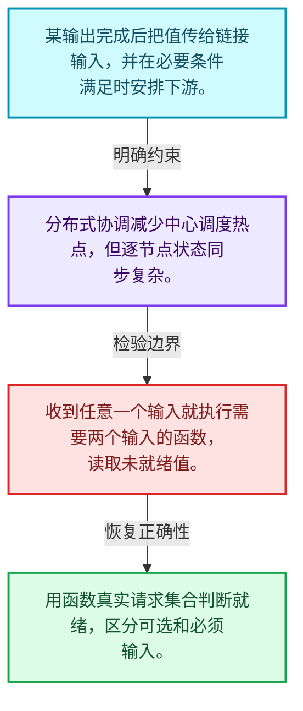
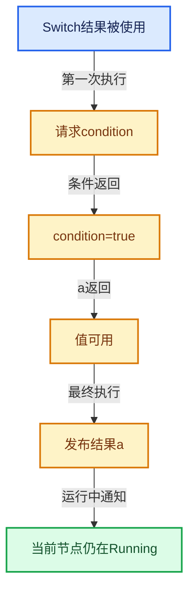

# 09-08 输入请求与调度

[方向导航](README.md) · [总目录](../README.md) · [实现索引](../00-课程指南/02-源码与提交索引/符号依赖与实现索引.md)

## 从问题到实现

值完成后如何唤醒真正需要它的节点？

通知更新输入状态，必要输入齐备才推进执行；锁保护和快照允许条件变化与执行并存。

**数据模型**

某输出完成后把值传给链接输入，并在必要条件满足时安排下游。

**设计取舍**

分布式协调减少中心调度热点，但逐节点状态同步复杂。

**最小反例**

收到任意一个输入就执行需要两个输入的函数，读取未就绪值。

**推导**

用函数真实请求集合判断就绪，区分可选和必须输入。

## 阅读地图与执行推演

```mermaid
flowchart LR
  F0["blender::fn::lazy_function::generic_graph_executor::GenericGraphExecutor::notify_output_unused"]:::input
  F1["blender::fn::lazy_function::generic_graph_executor::GenericGraphExecutor::schedule_node"]:::compute
  F2["blender::fn::lazy_function::generic_graph_executor::GenericGraphExecutor::with_locked_node"]:::compute
  F3["blender::fn::lazy_function::generic_graph_executor::GenericGraphExecutor::send_output_required_notifications"]:::compute
  F4["blender::fn::lazy_function::generic_graph_executor::GenericGraphExecutor::send_output_unused_notifications"]:::compute
  F5["blender::fn::lazy_function::generic_graph_executor::GenericGraphExecutor::run_task"]:::compute
  F6["blender::fn::lazy_function::generic_graph_executor::GenericGraphExecutor::run_node_task"]:::compute
  F7["blender::fn::lazy_function::generic_graph_executor::GenericGraphExecutor::assert_expected_outputs_have_been_computed"]:::compute
  F0 -->|"实现调用"| F2
  F0 -->|"实现调用"| F1
  F2 -->|"实现调用"| F3
  F2 -->|"实现调用"| F4
  F4 -->|"实现调用"| F0
  F5 -->|"实现调用"| F6
  F6 -->|"实现调用"| F2
  F6 -->|"实现调用"| F7
  F6 -->|"实现调用"| F1
  classDef input fill:#DBEAFE,stroke:#2563EB,color:#172554,stroke-width:2px;
  classDef data fill:#CFFAFE,stroke:#0891B2,color:#164E63,stroke-width:2px;
  classDef abstraction fill:#EDE9FE,stroke:#7C3AED,color:#3B0764,stroke-width:2px;
  classDef compute fill:#FEF3C7,stroke:#D97706,color:#78350F,stroke-width:2px;
  classDef result fill:#DCFCE7,stroke:#16A34A,color:#14532D,stroke-width:2px;
  classDef error fill:#FEE2E2,stroke:#DC2626,color:#7F1D1D,stroke-width:2px;
```








图中的数值推演是本方向的教学模型；实际函数之间的调用边与概念分析边分别标注，不能把概念关系当作运行时调度顺序。

## 完整源码单元与就地讲解

中文讲解直接放在相关代码旁，复杂机制在代码下展开。原文折叠区保留基准行号；不需要在行号表和函数之间来回查找。类布局可分段展示，函数实现不按固定行数切开。

<!-- annotated:cc4607a914c714 -->

```cpp

```

<details>
<summary>核对原始源码：source/blender/functions/intern/lazy_function_graph_executor_generic.hh · L745—L745</summary>

<!-- original:cc4607a914c714:source/blender/functions/intern/lazy_function_graph_executor_generic.hh:745:745 -->

```cpp

```

</details>

<a id="f-97fae740613955e1"></a>

### `blender::fn::lazy_function::generic_graph_executor::GenericGraphExecutor::notify_output_unused`

实现位置：[source/blender/functions/intern/lazy_function_graph_executor_generic.hh](../../../../../source/blender/functions/intern/lazy_function_graph_executor_generic.hh) · L746—L775。

接口参数：

- `const OutputSocket &socket`
- `CurrentTask &current_task`
- `const LocalData &local_data`

**教学注释版**

<!-- annotated:930b7a5c4e819a -->

```cpp
  void notify_output_unused(const OutputSocket &socket,
                            CurrentTask &current_task,
                            const LocalData &local_data)
  {
    const Node &node = socket.node();
    const int index_in_node = socket.index();
    NodeState &node_state = *node_states_[node.index_in_graph()];
    OutputState &output_state = node_state.outputs[index_in_node];

    this->with_locked_node(
        node, node_state, current_task, local_data, [&](LockedNode &locked_node) {
          output_state.potential_target_sockets -= 1;
          if (output_state.potential_target_sockets == 0) {
            BLI_assert(output_state.usage != ValueUsage::Unused);
            if (output_state.usage == ValueUsage::Maybe) {
              output_state.usage = ValueUsage::Unused;
              if (node.is_interface()) {
                const int graph_input_index =
                    self_.graph_input_index_by_socket_index_[socket.index()];
                params_->set_input_unused(graph_input_index);
              }
              else {
                /* Schedule as priority node. This allows freeing up memory earlier which results
                 * in better memory reuse and fewer implicit sharing copies. */
                // [讲解] this->schedule_node：协调重复调度与节点正在执行的状态。
                this->schedule_node(locked_node, current_task, true);
              }
            }
          }
        });
  }
```

<details>
<summary>核对原始源码：source/blender/functions/intern/lazy_function_graph_executor_generic.hh · L746—L775</summary>

<!-- original:930b7a5c4e819a:source/blender/functions/intern/lazy_function_graph_executor_generic.hh:746:775 -->

```cpp
  void notify_output_unused(const OutputSocket &socket,
                            CurrentTask &current_task,
                            const LocalData &local_data)
  {
    const Node &node = socket.node();
    const int index_in_node = socket.index();
    NodeState &node_state = *node_states_[node.index_in_graph()];
    OutputState &output_state = node_state.outputs[index_in_node];

    this->with_locked_node(
        node, node_state, current_task, local_data, [&](LockedNode &locked_node) {
          output_state.potential_target_sockets -= 1;
          if (output_state.potential_target_sockets == 0) {
            BLI_assert(output_state.usage != ValueUsage::Unused);
            if (output_state.usage == ValueUsage::Maybe) {
              output_state.usage = ValueUsage::Unused;
              if (node.is_interface()) {
                const int graph_input_index =
                    self_.graph_input_index_by_socket_index_[socket.index()];
                params_->set_input_unused(graph_input_index);
              }
              else {
                /* Schedule as priority node. This allows freeing up memory earlier which results
                 * in better memory reuse and fewer implicit sharing copies. */
                this->schedule_node(locked_node, current_task, true);
              }
            }
          }
        });
  }
```

</details>

**沿实际写入检查状态**

- `output_state.potential_target_sockets -= 1;`
- `output_state.usage = ValueUsage::Unused;`

**继续追踪实现**

- `socket.node` → [node · L142](../90-实现依赖专题/08-其他Blender模块/gpu/shaders/compat/gpu_shader_cxx_attribute.hh.md#m-357756b70038)。宏定义由构建条件选择。
- `socket.index` → [index · L103](../90-实现依赖专题/08-其他Blender模块/gpu/shaders/compat/gpu_shader_cxx_attribute.hh.md#m-a452734c9407)。宏定义由构建条件选择。
- `node.index_in_graph` → [blender::fn::lazy_function::Node::index_in_graph · L437](05-Graph与Socket.md#f-b56b38392c619b8a)。
- `this->with_locked_node` → [blender::fn::lazy_function::generic_graph_executor::GenericGraphExecutor::with_locked_node · L807](08-输入请求与调度.md#f-558a4af963d49ca5)。
- `BLI_assert` → [BLI_assert · L48](../90-实现依赖专题/01-BLI基础库/BLI_assert.hh.md#m-57a88495704d)；[BLI_assert · L63](../90-实现依赖专题/01-BLI基础库/BLI_assert.hh.md#m-d07050020cb5)。宏定义由构建条件选择。
- `node.is_interface` → [blender::fn::lazy_function::Node::is_interface · L427](05-Graph与Socket.md#f-4076f01e8d26e7ea)。
- `params_->set_input_unused` → [blender::fn::lazy_function::Params::set_input_unused · L405](02-LazyFunction接口.md#f-0a0db77ebf68f7c8)。
- `this->schedule_node` → [blender::fn::lazy_function::generic_graph_executor::GenericGraphExecutor::schedule_node · L777](08-输入请求与调度.md#f-21314db865691d6c)。

<!-- annotated:19f15a641cdaf4 -->

```cpp

```

<details>
<summary>核对原始源码：source/blender/functions/intern/lazy_function_graph_executor_generic.hh · L776—L776</summary>

<!-- original:19f15a641cdaf4:source/blender/functions/intern/lazy_function_graph_executor_generic.hh:776:776 -->

```cpp

```

</details>

<a id="f-21314db865691d6c"></a>

### `blender::fn::lazy_function::generic_graph_executor::GenericGraphExecutor::schedule_node`

协调重复调度与节点正在执行的状态。

实现位置：[source/blender/functions/intern/lazy_function_graph_executor_generic.hh](../../../../../source/blender/functions/intern/lazy_function_graph_executor_generic.hh) · L777—L805。

接口参数：

- `LockedNode &locked_node`
- `CurrentTask &current_task`
- `const bool is_priority`

**教学注释版**

<!-- annotated:d8c89cef0100b9 -->

```cpp
  void schedule_node(LockedNode &locked_node, CurrentTask &current_task, const bool is_priority)
  {
    BLI_assert(locked_node.node.is_function());
    switch (locked_node.node_state.schedule_state) {
      case NodeScheduleState::NotScheduled: {
        locked_node.node_state.schedule_state = NodeScheduleState::Scheduled;
        const FunctionNode &node = static_cast<const FunctionNode &>(locked_node.node);
        if (this->use_multi_threading()) {
          std::lock_guard lock{current_task.mutex};
          current_task.scheduled_nodes.schedule(node, is_priority);
        }
        else {
          current_task.scheduled_nodes.schedule(node, is_priority);
        }
        current_task.has_scheduled_nodes.store(true, std::memory_order_relaxed);
        break;
      }
      case NodeScheduleState::Scheduled: {
        break;
      }
      case NodeScheduleState::Running: {
        // [讲解] 当前任务仍在执行，只登记需要再运行；避免相同节点同时运行两次。
        locked_node.node_state.schedule_state = NodeScheduleState::RunningAndRescheduled;
        break;
      }
      case NodeScheduleState::RunningAndRescheduled: {
        break;
      }
    }
  }
```

<details>
<summary>核对原始源码：source/blender/functions/intern/lazy_function_graph_executor_generic.hh · L777—L805</summary>

<!-- original:d8c89cef0100b9:source/blender/functions/intern/lazy_function_graph_executor_generic.hh:777:805 -->

```cpp
  void schedule_node(LockedNode &locked_node, CurrentTask &current_task, const bool is_priority)
  {
    BLI_assert(locked_node.node.is_function());
    switch (locked_node.node_state.schedule_state) {
      case NodeScheduleState::NotScheduled: {
        locked_node.node_state.schedule_state = NodeScheduleState::Scheduled;
        const FunctionNode &node = static_cast<const FunctionNode &>(locked_node.node);
        if (this->use_multi_threading()) {
          std::lock_guard lock{current_task.mutex};
          current_task.scheduled_nodes.schedule(node, is_priority);
        }
        else {
          current_task.scheduled_nodes.schedule(node, is_priority);
        }
        current_task.has_scheduled_nodes.store(true, std::memory_order_relaxed);
        break;
      }
      case NodeScheduleState::Scheduled: {
        break;
      }
      case NodeScheduleState::Running: {
        locked_node.node_state.schedule_state = NodeScheduleState::RunningAndRescheduled;
        break;
      }
      case NodeScheduleState::RunningAndRescheduled: {
        break;
      }
    }
  }
```

</details>

**机制与执行推导**

节点正在运行时再次收到通知，不能立刻让第二个任务并发执行同一节点。RunningAndRescheduled记录当前轮结束后的下一轮需求；丢弃通知也不正确。

**沿实际写入检查状态**

- `locked_node.node_state.schedule_state = NodeScheduleState::Scheduled;`
- `locked_node.node_state.schedule_state = NodeScheduleState::RunningAndRescheduled;`

**继续追踪实现**

- `BLI_assert` → [BLI_assert · L48](../90-实现依赖专题/01-BLI基础库/BLI_assert.hh.md#m-57a88495704d)；[BLI_assert · L63](../90-实现依赖专题/01-BLI基础库/BLI_assert.hh.md#m-d07050020cb5)。宏定义由构建条件选择。
- `locked_node.node.is_function` → [调用协议](../00-课程指南/01-路线与规范/模板宏与动态分派协议.md)：接收对象类型依赖auto、返回值或模板实例；不按同名猜测目标。调用位置L779。
- `this->use_multi_threading` → [blender::fn::lazy_function::generic_graph_executor::GenericGraphExecutor::use_multi_threading · L1249](08-输入请求与调度.md#f-1964954674308a00)。
- `current_task.scheduled_nodes.schedule` → [调用协议](../00-课程指南/01-路线与规范/模板宏与动态分派协议.md)：接收对象类型依赖auto、返回值或模板实例；不按同名猜测目标。调用位置L786。
- `current_task.has_scheduled_nodes.store` → [调用协议](../00-课程指南/01-路线与规范/模板宏与动态分派协议.md)：接收对象类型依赖auto、返回值或模板实例；不按同名猜测目标。调用位置L791。

<!-- annotated:0f67f1ed24fca8 -->

```cpp

```

<details>
<summary>核对原始源码：source/blender/functions/intern/lazy_function_graph_executor_generic.hh · L806—L806</summary>

<!-- original:0f67f1ed24fca8:source/blender/functions/intern/lazy_function_graph_executor_generic.hh:806:806 -->

```cpp

```

</details>

<a id="f-558a4af963d49ca5"></a>

### `blender::fn::lazy_function::generic_graph_executor::GenericGraphExecutor::with_locked_node`

实现位置：[source/blender/functions/intern/lazy_function_graph_executor_generic.hh](../../../../../source/blender/functions/intern/lazy_function_graph_executor_generic.hh) · L807—L828。

接口参数：

- `const Node &node`
- `NodeState &node_state`
- `CurrentTask &current_task`
- `const LocalData &local_data`
- `const FunctionRef<void(LockedNode &)> f`
- `LockedNode &`

**教学注释版**

<!-- annotated:1814bee9d2b1e7 -->

```cpp
  void with_locked_node(const Node &node,
                        NodeState &node_state,
                        CurrentTask &current_task,
                        const LocalData &local_data,
                        const FunctionRef<void(LockedNode &)> f)
  {
    BLI_assert(&node_state == node_states_[node.index_in_graph()]);

    LockedNode locked_node{node, node_state};
    if (this->use_multi_threading()) {
      std::lock_guard lock{node_state.mutex};
      threading::isolate_task([&]() { f(locked_node); });
    }
    else {
      f(locked_node);
    }

    this->send_output_required_notifications(
        locked_node.delayed_required_outputs, current_task, local_data);
    this->send_output_unused_notifications(
        locked_node.delayed_unused_outputs, current_task, local_data);
  }
```

<details>
<summary>核对原始源码：source/blender/functions/intern/lazy_function_graph_executor_generic.hh · L807—L828</summary>

<!-- original:1814bee9d2b1e7:source/blender/functions/intern/lazy_function_graph_executor_generic.hh:807:828 -->

```cpp
  void with_locked_node(const Node &node,
                        NodeState &node_state,
                        CurrentTask &current_task,
                        const LocalData &local_data,
                        const FunctionRef<void(LockedNode &)> f)
  {
    BLI_assert(&node_state == node_states_[node.index_in_graph()]);

    LockedNode locked_node{node, node_state};
    if (this->use_multi_threading()) {
      std::lock_guard lock{node_state.mutex};
      threading::isolate_task([&]() { f(locked_node); });
    }
    else {
      f(locked_node);
    }

    this->send_output_required_notifications(
        locked_node.delayed_required_outputs, current_task, local_data);
    this->send_output_unused_notifications(
        locked_node.delayed_unused_outputs, current_task, local_data);
  }
```

</details>

**继续追踪实现**

- `BLI_assert` → [BLI_assert · L48](../90-实现依赖专题/01-BLI基础库/BLI_assert.hh.md#m-57a88495704d)；[BLI_assert · L63](../90-实现依赖专题/01-BLI基础库/BLI_assert.hh.md#m-d07050020cb5)。宏定义由构建条件选择。
- `node.index_in_graph` → [blender::fn::lazy_function::Node::index_in_graph · L437](05-Graph与Socket.md#f-b56b38392c619b8a)。
- `this->use_multi_threading` → [blender::fn::lazy_function::generic_graph_executor::GenericGraphExecutor::use_multi_threading · L1249](08-输入请求与调度.md#f-1964954674308a00)。
- `threading::isolate_task` → [blender::threading::isolate_task · L224](../11-Depsgraph与并行任务系统/07-任务池与TBB接入.md#f-c13dd3df595aa4f8)。
- `f` → [调用协议](../00-课程指南/01-路线与规范/模板宏与动态分派协议.md)：局部可调用对象，须结合其初始化与捕获环境。调用位置L818。
- `this->send_output_required_notifications` → [blender::fn::lazy_function::generic_graph_executor::GenericGraphExecutor::send_output_required_notifications · L830](08-输入请求与调度.md#f-c7e804282f107c24)。
- `this->send_output_unused_notifications` → [blender::fn::lazy_function::generic_graph_executor::GenericGraphExecutor::send_output_unused_notifications · L839](08-输入请求与调度.md#f-691b6fbc1f4cadf1)。

<!-- annotated:50d5f1503a17d1 -->

```cpp

```

<details>
<summary>核对原始源码：source/blender/functions/intern/lazy_function_graph_executor_generic.hh · L829—L829</summary>

<!-- original:50d5f1503a17d1:source/blender/functions/intern/lazy_function_graph_executor_generic.hh:829:829 -->

```cpp

```

</details>

<a id="f-c7e804282f107c24"></a>

### `blender::fn::lazy_function::generic_graph_executor::GenericGraphExecutor::send_output_required_notifications`

实现位置：[source/blender/functions/intern/lazy_function_graph_executor_generic.hh](../../../../../source/blender/functions/intern/lazy_function_graph_executor_generic.hh) · L830—L837。

接口参数：

- `const Span<const OutputSocket *> sockets`
- `CurrentTask &current_task`
- `const LocalData &local_data`

**教学注释版**

<!-- annotated:453ea664622dc4 -->

```cpp
  void send_output_required_notifications(const Span<const OutputSocket *> sockets,
                                          CurrentTask &current_task,
                                          const LocalData &local_data)
  {
    for (const OutputSocket *socket : sockets) {
      this->notify_output_required(*socket, current_task, local_data);
    }
  }
```

<details>
<summary>核对原始源码：source/blender/functions/intern/lazy_function_graph_executor_generic.hh · L830—L837</summary>

<!-- original:453ea664622dc4:source/blender/functions/intern/lazy_function_graph_executor_generic.hh:830:837 -->

```cpp
  void send_output_required_notifications(const Span<const OutputSocket *> sockets,
                                          CurrentTask &current_task,
                                          const LocalData &local_data)
  {
    for (const OutputSocket *socket : sockets) {
      this->notify_output_required(*socket, current_task, local_data);
    }
  }
```

</details>

**继续追踪实现**

- `this->notify_output_required` → [blender::fn::lazy_function::generic_graph_executor::GenericGraphExecutor::notify_output_required · L706](07-执行器内部状态.md#f-96477d1c17e1cde4)。

<!-- annotated:b89e7de952af31 -->

```cpp

```

<details>
<summary>核对原始源码：source/blender/functions/intern/lazy_function_graph_executor_generic.hh · L838—L838</summary>

<!-- original:b89e7de952af31:source/blender/functions/intern/lazy_function_graph_executor_generic.hh:838:838 -->

```cpp

```

</details>

<a id="f-691b6fbc1f4cadf1"></a>

### `blender::fn::lazy_function::generic_graph_executor::GenericGraphExecutor::send_output_unused_notifications`

实现位置：[source/blender/functions/intern/lazy_function_graph_executor_generic.hh](../../../../../source/blender/functions/intern/lazy_function_graph_executor_generic.hh) · L839—L846。

接口参数：

- `const Span<const OutputSocket *> sockets`
- `CurrentTask &current_task`
- `const LocalData &local_data`

**教学注释版**

<!-- annotated:93983e7c92678b -->

```cpp
  void send_output_unused_notifications(const Span<const OutputSocket *> sockets,
                                        CurrentTask &current_task,
                                        const LocalData &local_data)
  {
    for (const OutputSocket *socket : sockets) {
      this->notify_output_unused(*socket, current_task, local_data);
    }
  }
```

<details>
<summary>核对原始源码：source/blender/functions/intern/lazy_function_graph_executor_generic.hh · L839—L846</summary>

<!-- original:93983e7c92678b:source/blender/functions/intern/lazy_function_graph_executor_generic.hh:839:846 -->

```cpp
  void send_output_unused_notifications(const Span<const OutputSocket *> sockets,
                                        CurrentTask &current_task,
                                        const LocalData &local_data)
  {
    for (const OutputSocket *socket : sockets) {
      this->notify_output_unused(*socket, current_task, local_data);
    }
  }
```

</details>

**继续追踪实现**

- `this->notify_output_unused` → [blender::fn::lazy_function::generic_graph_executor::GenericGraphExecutor::notify_output_unused · L746](08-输入请求与调度.md#f-97fae740613955e1)。

<!-- annotated:39d92ed3859e51 -->

```cpp

```

<details>
<summary>核对原始源码：source/blender/functions/intern/lazy_function_graph_executor_generic.hh · L847—L847</summary>

<!-- original:39d92ed3859e51:source/blender/functions/intern/lazy_function_graph_executor_generic.hh:847:847 -->

```cpp

```

</details>

<a id="f-69ea4dbbb8db22ad"></a>

### `blender::fn::lazy_function::generic_graph_executor::GenericGraphExecutor::run_task`

实现位置：[source/blender/functions/intern/lazy_function_graph_executor_generic.hh](../../../../../source/blender/functions/intern/lazy_function_graph_executor_generic.hh) · L848—L866。

接口参数：

- `CurrentTask &current_task`
- `const LocalData &local_data`

**教学注释版**

<!-- annotated:e918c57b222933 -->

```cpp
  void run_task(CurrentTask &current_task, const LocalData &local_data)
  {
    while (const FunctionNode *node = current_task.scheduled_nodes.pop_next_node()) {
      if (current_task.scheduled_nodes.is_empty()) {
        current_task.has_scheduled_nodes.store(false, std::memory_order_relaxed);
      }
      this->run_node_task(*node, current_task, local_data);

      /* If there are many nodes scheduled at the same time, it's beneficial to let multiple
       * threads work on those. */
      if (current_task.scheduled_nodes.nodes_num() > 128) {
        if (this->try_enable_multi_threading()) {
          // [讲解] std::make_unique<ScheduledNodes>：创建独占拥有的对象，拥有关系可移动，get返回的借用指针不自动延长寿命。
          std::unique_ptr<ScheduledNodes> split_nodes = std::make_unique<ScheduledNodes>();
          current_task.scheduled_nodes.split_into(*split_nodes);
          // [讲解] std::move：把表达式转换成可供移动重载选择的值类别；不保证真的移动，不结束源对象寿命，对const值可能选择复制。
          this->push_to_task_pool(std::move(split_nodes));
        }
      }
    }
  }
```

<details>
<summary>核对原始源码：source/blender/functions/intern/lazy_function_graph_executor_generic.hh · L848—L866</summary>

<!-- original:e918c57b222933:source/blender/functions/intern/lazy_function_graph_executor_generic.hh:848:866 -->

```cpp
  void run_task(CurrentTask &current_task, const LocalData &local_data)
  {
    while (const FunctionNode *node = current_task.scheduled_nodes.pop_next_node()) {
      if (current_task.scheduled_nodes.is_empty()) {
        current_task.has_scheduled_nodes.store(false, std::memory_order_relaxed);
      }
      this->run_node_task(*node, current_task, local_data);

      /* If there are many nodes scheduled at the same time, it's beneficial to let multiple
       * threads work on those. */
      if (current_task.scheduled_nodes.nodes_num() > 128) {
        if (this->try_enable_multi_threading()) {
          std::unique_ptr<ScheduledNodes> split_nodes = std::make_unique<ScheduledNodes>();
          current_task.scheduled_nodes.split_into(*split_nodes);
          this->push_to_task_pool(std::move(split_nodes));
        }
      }
    }
  }
```

</details>

**继续追踪实现**

- `current_task.scheduled_nodes.pop_next_node` → [调用协议](../00-课程指南/01-路线与规范/模板宏与动态分派协议.md)：接收对象类型依赖auto、返回值或模板实例；不按同名猜测目标。调用位置L850。
- `current_task.scheduled_nodes.is_empty` → [调用协议](../00-课程指南/01-路线与规范/模板宏与动态分派协议.md)：接收对象类型依赖auto、返回值或模板实例；不按同名猜测目标。调用位置L851。
- `current_task.has_scheduled_nodes.store` → [调用协议](../00-课程指南/01-路线与规范/模板宏与动态分派协议.md)：接收对象类型依赖auto、返回值或模板实例；不按同名猜测目标。调用位置L852。
- `this->run_node_task` → [blender::fn::lazy_function::generic_graph_executor::GenericGraphExecutor::run_node_task · L868](08-输入请求与调度.md#f-fa205cb497a7e120)。
- `current_task.scheduled_nodes.nodes_num` → [调用协议](../00-课程指南/01-路线与规范/模板宏与动态分派协议.md)：接收对象类型依赖auto、返回值或模板实例；不按同名猜测目标。调用位置L858。
- `this->try_enable_multi_threading` → [blender::fn::lazy_function::generic_graph_executor::GenericGraphExecutor::try_enable_multi_threading · L1254](08-输入请求与调度.md#f-80e324e445ad3d2b)。
- `std::make_unique<ScheduledNodes>` → [外部契约](https://eel.is/c++draft/unique.ptr.create)：创建独占拥有的对象，拥有关系可移动，get返回的借用指针不自动延长寿命。
- `current_task.scheduled_nodes.split_into` → [调用协议](../00-课程指南/01-路线与规范/模板宏与动态分派协议.md)：接收对象类型依赖auto、返回值或模板实例；不按同名猜测目标。调用位置L861。
- `this->push_to_task_pool` → [blender::fn::lazy_function::generic_graph_executor::GenericGraphExecutor::push_to_task_pool · L1315](08-输入请求与调度.md#f-1022ed5807ce59ac)。
- `std::move` → [外部契约](https://eel.is/c++draft/utility.forward)：把表达式转换成可供移动重载选择的值类别；不保证真的移动，不结束源对象寿命，对const值可能选择复制。

<!-- annotated:6ee2c02e422459 -->

```cpp

```

<details>
<summary>核对原始源码：source/blender/functions/intern/lazy_function_graph_executor_generic.hh · L867—L867</summary>

<!-- original:6ee2c02e422459:source/blender/functions/intern/lazy_function_graph_executor_generic.hh:867:867 -->

```cpp

```

</details>

<a id="f-fa205cb497a7e120"></a>

### `blender::fn::lazy_function::generic_graph_executor::GenericGraphExecutor::run_node_task`

实现位置：[source/blender/functions/intern/lazy_function_graph_executor_generic.hh](../../../../../source/blender/functions/intern/lazy_function_graph_executor_generic.hh) · L868—L982。

接口参数：

- `const FunctionNode &node`
- `CurrentTask &current_task`
- `const LocalData &local_data`

**教学注释版**

<!-- annotated:331f5537e48292 -->

```cpp
  void run_node_task(const FunctionNode &node,
                     CurrentTask &current_task,
                     const LocalData &local_data)
  {
    NodeState &node_state = *node_states_[node.index_in_graph()];
    LinearAllocator<> &allocator = *local_data.allocator;
    Context local_context{context_->storage, context_->user_data, local_data.local_user_data};
    const LazyFunction &fn = node.function();

    bool node_needs_execution = false;
    this->with_locked_node(
        node, node_state, current_task, local_data, [&](LockedNode &locked_node) {
          BLI_assert(node_state.schedule_state == NodeScheduleState::Scheduled);
          node_state.schedule_state = NodeScheduleState::Running;

          if (node_state.node_has_finished) {
            return;
          }

          bool required_uncomputed_output_exists = false;
          for (const int output_index : node.outputs().index_range()) {
            OutputState &output_state = node_state.outputs[output_index];
            output_state.usage_for_execution = output_state.usage;
            if (output_state.usage == ValueUsage::Used && !output_state.has_been_computed) {
              required_uncomputed_output_exists = true;
            }
          }
          if (!required_uncomputed_output_exists && !node_state.has_side_effects) {
            return;
          }

          if (!node_state.always_used_inputs_requested) {
            /* Request linked inputs that are always needed. */
            const Span<Input> fn_inputs = fn.inputs();
            // [讲解] fn_inputs.index_range：查询视图长度或生成对应有效索引区间。
            for (const int input_index : fn_inputs.index_range()) {
              const Input &fn_input = fn_inputs[input_index];
              if (fn_input.usage == ValueUsage::Used) {
                const InputSocket &input_socket = node.input(input_index);
                if (input_socket.origin() != nullptr) {
                  this->set_input_required(locked_node, input_socket);
                }
              }
            }

            node_state.always_used_inputs_requested = true;
          }

          for (const int input_index : node.inputs().index_range()) {
            InputState &input_state = node_state.inputs[input_index];
            if (input_state.was_ready_for_execution) {
              continue;
            }
            if (input_state.value != nullptr) {
              input_state.was_ready_for_execution = true;
              continue;
            }
            if (!fn.allow_missing_requested_inputs()) {
              if (input_state.usage == ValueUsage::Used) {
                return;
              }
            }
          }

          node_needs_execution = true;
        });

    if (node_needs_execution) {
      if (!node_state.storage_and_defaults_initialized) {
        /* Initialize storage. */
        // [讲解] fn.init_storage：建立或清理一次执行所需状态。
        node_state.storage = fn.init_storage(allocator);

        /* Load unlinked inputs. */
        for (const int input_index : node.inputs().index_range()) {
          const InputSocket &input_socket = node.input(input_index);
          if (input_socket.origin() != nullptr) {
            continue;
          }
          InputState &input_state = node_state.inputs[input_index];
          const CPPType &type = input_socket.type();
          const void *default_value = input_socket.default_value();
          BLI_assert(default_value != nullptr);
          if (logging_enabled_state_.socket_values) {
            self_.logger_->log_socket_value(input_socket, {type, default_value}, local_context);
          }
          BLI_assert(input_state.value == nullptr);
          input_state.value = allocator.allocate(type);
          type.copy_construct(default_value, input_state.value);
          input_state.was_ready_for_execution = true;
        }

        node_state.storage_and_defaults_initialized = true;
      }

      /* Importantly, the node must not be locked when it is executed. That would result in locks
       * being hold very long in some cases and results in multiple locks being hold by the same
       * thread in the same graph which can lead to deadlocks. */
      this->execute_node(node, node_state, current_task, local_data);
    }

    this->with_locked_node(
        node, node_state, current_task, local_data, [&](LockedNode &locked_node) {
#ifndef NDEBUG
          if (node_needs_execution) {
            this->assert_expected_outputs_have_been_computed(locked_node, local_data);
          }
#endif
          this->finish_node_if_possible(locked_node);
          const bool reschedule_requested = node_state.schedule_state ==
                                            NodeScheduleState::RunningAndRescheduled;
          node_state.schedule_state = NodeScheduleState::NotScheduled;
          if (reschedule_requested && !node_state.node_has_finished) {
            // [讲解] this->schedule_node：协调重复调度与节点正在执行的状态。
            this->schedule_node(locked_node, current_task, false);
          }
        });
  }
```

<details>
<summary>核对原始源码：source/blender/functions/intern/lazy_function_graph_executor_generic.hh · L868—L982</summary>

<!-- original:331f5537e48292:source/blender/functions/intern/lazy_function_graph_executor_generic.hh:868:982 -->

```cpp
  void run_node_task(const FunctionNode &node,
                     CurrentTask &current_task,
                     const LocalData &local_data)
  {
    NodeState &node_state = *node_states_[node.index_in_graph()];
    LinearAllocator<> &allocator = *local_data.allocator;
    Context local_context{context_->storage, context_->user_data, local_data.local_user_data};
    const LazyFunction &fn = node.function();

    bool node_needs_execution = false;
    this->with_locked_node(
        node, node_state, current_task, local_data, [&](LockedNode &locked_node) {
          BLI_assert(node_state.schedule_state == NodeScheduleState::Scheduled);
          node_state.schedule_state = NodeScheduleState::Running;

          if (node_state.node_has_finished) {
            return;
          }

          bool required_uncomputed_output_exists = false;
          for (const int output_index : node.outputs().index_range()) {
            OutputState &output_state = node_state.outputs[output_index];
            output_state.usage_for_execution = output_state.usage;
            if (output_state.usage == ValueUsage::Used && !output_state.has_been_computed) {
              required_uncomputed_output_exists = true;
            }
          }
          if (!required_uncomputed_output_exists && !node_state.has_side_effects) {
            return;
          }

          if (!node_state.always_used_inputs_requested) {
            /* Request linked inputs that are always needed. */
            const Span<Input> fn_inputs = fn.inputs();
            for (const int input_index : fn_inputs.index_range()) {
              const Input &fn_input = fn_inputs[input_index];
              if (fn_input.usage == ValueUsage::Used) {
                const InputSocket &input_socket = node.input(input_index);
                if (input_socket.origin() != nullptr) {
                  this->set_input_required(locked_node, input_socket);
                }
              }
            }

            node_state.always_used_inputs_requested = true;
          }

          for (const int input_index : node.inputs().index_range()) {
            InputState &input_state = node_state.inputs[input_index];
            if (input_state.was_ready_for_execution) {
              continue;
            }
            if (input_state.value != nullptr) {
              input_state.was_ready_for_execution = true;
              continue;
            }
            if (!fn.allow_missing_requested_inputs()) {
              if (input_state.usage == ValueUsage::Used) {
                return;
              }
            }
          }

          node_needs_execution = true;
        });

    if (node_needs_execution) {
      if (!node_state.storage_and_defaults_initialized) {
        /* Initialize storage. */
        node_state.storage = fn.init_storage(allocator);

        /* Load unlinked inputs. */
        for (const int input_index : node.inputs().index_range()) {
          const InputSocket &input_socket = node.input(input_index);
          if (input_socket.origin() != nullptr) {
            continue;
          }
          InputState &input_state = node_state.inputs[input_index];
          const CPPType &type = input_socket.type();
          const void *default_value = input_socket.default_value();
          BLI_assert(default_value != nullptr);
          if (logging_enabled_state_.socket_values) {
            self_.logger_->log_socket_value(input_socket, {type, default_value}, local_context);
          }
          BLI_assert(input_state.value == nullptr);
          input_state.value = allocator.allocate(type);
          type.copy_construct(default_value, input_state.value);
          input_state.was_ready_for_execution = true;
        }

        node_state.storage_and_defaults_initialized = true;
      }

      /* Importantly, the node must not be locked when it is executed. That would result in locks
       * being hold very long in some cases and results in multiple locks being hold by the same
       * thread in the same graph which can lead to deadlocks. */
      this->execute_node(node, node_state, current_task, local_data);
    }

    this->with_locked_node(
        node, node_state, current_task, local_data, [&](LockedNode &locked_node) {
#ifndef NDEBUG
          if (node_needs_execution) {
            this->assert_expected_outputs_have_been_computed(locked_node, local_data);
          }
#endif
          this->finish_node_if_possible(locked_node);
          const bool reschedule_requested = node_state.schedule_state ==
                                            NodeScheduleState::RunningAndRescheduled;
          node_state.schedule_state = NodeScheduleState::NotScheduled;
          if (reschedule_requested && !node_state.node_has_finished) {
            this->schedule_node(locked_node, current_task, false);
          }
        });
  }
```

</details>

**沿实际写入检查状态**

- `node_state.schedule_state = NodeScheduleState::Running;`
- `output_state.usage_for_execution = output_state.usage;`
- `required_uncomputed_output_exists = true;`
- `node_state.always_used_inputs_requested = true;`
- `input_state.was_ready_for_execution = true;`
- `node_needs_execution = true;`
- `node_state.storage = fn.init_storage(allocator);`
- `input_state.value = allocator.allocate(type);`
- `node_state.storage_and_defaults_initialized = true;`
- `node_state.schedule_state = NodeScheduleState::NotScheduled;`

**继续追踪实现**

- `node.index_in_graph` → [调用协议](../00-课程指南/01-路线与规范/模板宏与动态分派协议.md)：由接收对象具体类型或运行时策略提供实现。调用位置L872。
- `node.function` → [blender::fn::lazy_function::FunctionNode::function · L488](05-Graph与Socket.md#f-62523dd4ec1da97b)。
- `this->with_locked_node` → [blender::fn::lazy_function::generic_graph_executor::GenericGraphExecutor::with_locked_node · L807](08-输入请求与调度.md#f-558a4af963d49ca5)。
- `BLI_assert` → [BLI_assert · L48](../90-实现依赖专题/01-BLI基础库/BLI_assert.hh.md#m-57a88495704d)；[BLI_assert · L63](../90-实现依赖专题/01-BLI基础库/BLI_assert.hh.md#m-d07050020cb5)。宏定义由构建条件选择。
- `node.outputs().index_range` → [调用协议](../00-课程指南/01-路线与规范/模板宏与动态分派协议.md)：接收对象类型依赖auto、返回值或模板实例；不按同名猜测目标。调用位置L888。
- `node.outputs` → [调用协议](../00-课程指南/01-路线与规范/模板宏与动态分派协议.md)：由接收对象具体类型或运行时策略提供实现。调用位置L888。
- `fn.inputs` → [blender::fn::lazy_function::LazyFunction::inputs · L331](02-LazyFunction接口.md#f-bdcd40e6f47d0ad9)。
- `fn_inputs.index_range` → [blender::Span::index_range · L405](../01-基础容器与现代CPP/05-Span只读连续视图.md#f-caaa9b06e13e53e0)。
- `node.input` → [调用协议](../00-课程指南/01-路线与规范/模板宏与动态分派协议.md)：由接收对象具体类型或运行时策略提供实现。调用位置L905。
- `input_socket.origin` → [blender::fn::lazy_function::InputSocket::origin · L385](05-Graph与Socket.md#f-23e348d006791199)；[blender::fn::lazy_function::InputSocket::origin · L390](05-Graph与Socket.md#f-9a661684d09e4c1a)。同名重载需按实参类型选择。
- `this->set_input_required` → [blender::fn::lazy_function::generic_graph_executor::GenericGraphExecutor::set_input_required · L1123](08-输入请求与调度.md#f-3e507d832042f06b)。
- `node.inputs().index_range` → [调用协议](../00-课程指南/01-路线与规范/模板宏与动态分派协议.md)：接收对象类型依赖auto、返回值或模板实例；不按同名猜测目标。调用位置L915。
- `node.inputs` → [调用协议](../00-课程指南/01-路线与规范/模板宏与动态分派协议.md)：由接收对象具体类型或运行时策略提供实现。调用位置L915。
- `fn.allow_missing_requested_inputs` → [blender::fn::lazy_function::LazyFunction::allow_missing_requested_inputs · L314](02-LazyFunction接口.md#f-cc624a0aba52e3c3)。
- `fn.init_storage` → [blender::fn::lazy_function::LazyFunction::init_storage · L28](02-LazyFunction接口.md#f-bd7a0cc9756b5fb3)。
- `input_socket.type` → [调用协议](../00-课程指南/01-路线与规范/模板宏与动态分派协议.md)：由接收对象具体类型或运行时策略提供实现。调用位置L946。
- `input_socket.default_value` → [blender::fn::lazy_function::InputSocket::default_value · L395](05-Graph与Socket.md#f-6c5dbaf6060edc39)。
- `self_.logger_->log_socket_value` → [调用协议](../00-课程指南/01-路线与规范/模板宏与动态分派协议.md)：接收对象类型依赖auto、返回值或模板实例；不按同名猜测目标。调用位置L950。
- `allocator.allocate` → [blender::LinearAllocator::allocate · L66](../03-内存分配与运行时类型/02-LinearAllocator布局.md#f-26209c6a21e04bc0)；[blender::LinearAllocator::allocate · L99](../03-内存分配与运行时类型/02-LinearAllocator布局.md#f-b34ac68f2e3d66f1)；[blender::LinearAllocator::allocate · L105](../03-内存分配与运行时类型/02-LinearAllocator布局.md#f-96480f78749ba1c7)。同名重载需按实参类型选择。
- `type.copy_construct` → [blender::CPPType::copy_construct · L594](../03-内存分配与运行时类型/09-CPPType复制移动重定位.md#f-cfda413a9784073e)。
- `this->execute_node` → [blender::fn::lazy_function::generic_graph_executor::GenericGraphExecutor::execute_node · L1463](08-输入请求与调度.md#f-54eaaedb4c74d982)。
- `this->assert_expected_outputs_have_been_computed` → [blender::fn::lazy_function::generic_graph_executor::GenericGraphExecutor::assert_expected_outputs_have_been_computed · L984](08-输入请求与调度.md#f-4e415f80e9875ba4)。
- `this->finish_node_if_possible` → [blender::fn::lazy_function::generic_graph_executor::GenericGraphExecutor::finish_node_if_possible · L1014](08-输入请求与调度.md#f-fdbdecc29e8c16d8)。
- `this->schedule_node` → [blender::fn::lazy_function::generic_graph_executor::GenericGraphExecutor::schedule_node · L777](08-输入请求与调度.md#f-21314db865691d6c)。

<!-- annotated:4239dbdbc7b48c -->

```cpp

```

<details>
<summary>核对原始源码：source/blender/functions/intern/lazy_function_graph_executor_generic.hh · L983—L983</summary>

<!-- original:4239dbdbc7b48c:source/blender/functions/intern/lazy_function_graph_executor_generic.hh:983:983 -->

```cpp

```

</details>

<a id="f-4e415f80e9875ba4"></a>

### `blender::fn::lazy_function::generic_graph_executor::GenericGraphExecutor::assert_expected_outputs_have_been_computed`

实现位置：[source/blender/functions/intern/lazy_function_graph_executor_generic.hh](../../../../../source/blender/functions/intern/lazy_function_graph_executor_generic.hh) · L984—L1012。

接口参数：

- `LockedNode &locked_node`
- `const LocalData &local_data`

**教学注释版**

<!-- annotated:3f425c724ba00a -->

```cpp
  void assert_expected_outputs_have_been_computed(LockedNode &locked_node,
                                                  const LocalData &local_data)
  {
    const FunctionNode &node = static_cast<const FunctionNode &>(locked_node.node);
    const NodeState &node_state = locked_node.node_state;

    if (node_state.missing_required_inputs > 0) {
      return;
    }
    if (node_state.schedule_state == NodeScheduleState::RunningAndRescheduled) {
      return;
    }
    Vector<const OutputSocket *> missing_outputs;
    for (const int i : node.outputs().index_range()) {
      const OutputState &output_state = node_state.outputs[i];
      if (output_state.usage_for_execution == ValueUsage::Used) {
        if (!output_state.has_been_computed) {
          // [讲解] missing_outputs.append：在尾部建立新元素，必要时先扩大存储。
          missing_outputs.append(&node.output(i));
        }
      }
    }
    if (!missing_outputs.is_empty()) {
      if (self_.logger_ != nullptr) {
        const Context context{context_->storage, context_->user_data, local_data.local_user_data};
        self_.logger_->dump_when_outputs_are_missing(node, missing_outputs, context);
      }
      BLI_assert_unreachable();
    }
  }
```

<details>
<summary>核对原始源码：source/blender/functions/intern/lazy_function_graph_executor_generic.hh · L984—L1012</summary>

<!-- original:3f425c724ba00a:source/blender/functions/intern/lazy_function_graph_executor_generic.hh:984:1012 -->

```cpp
  void assert_expected_outputs_have_been_computed(LockedNode &locked_node,
                                                  const LocalData &local_data)
  {
    const FunctionNode &node = static_cast<const FunctionNode &>(locked_node.node);
    const NodeState &node_state = locked_node.node_state;

    if (node_state.missing_required_inputs > 0) {
      return;
    }
    if (node_state.schedule_state == NodeScheduleState::RunningAndRescheduled) {
      return;
    }
    Vector<const OutputSocket *> missing_outputs;
    for (const int i : node.outputs().index_range()) {
      const OutputState &output_state = node_state.outputs[i];
      if (output_state.usage_for_execution == ValueUsage::Used) {
        if (!output_state.has_been_computed) {
          missing_outputs.append(&node.output(i));
        }
      }
    }
    if (!missing_outputs.is_empty()) {
      if (self_.logger_ != nullptr) {
        const Context context{context_->storage, context_->user_data, local_data.local_user_data};
        self_.logger_->dump_when_outputs_are_missing(node, missing_outputs, context);
      }
      BLI_assert_unreachable();
    }
  }
```

</details>

**继续追踪实现**

- `node.outputs().index_range` → [调用协议](../00-课程指南/01-路线与规范/模板宏与动态分派协议.md)：接收对象类型依赖auto、返回值或模板实例；不按同名猜测目标。调用位置L997。
- `node.outputs` → [调用协议](../00-课程指南/01-路线与规范/模板宏与动态分派协议.md)：由接收对象具体类型或运行时策略提供实现。调用位置L997。
- `missing_outputs.append` → [blender::Vector::append · L498](../01-基础容器与现代CPP/11-Vector插入删除与重排.md#f-5bde268a69e443ec)；[blender::Vector::append · L502](../01-基础容器与现代CPP/11-Vector插入删除与重排.md#f-591e0b15e6308532)。同名重载需按实参类型选择。
- `node.output` → [调用协议](../00-课程指南/01-路线与规范/模板宏与动态分派协议.md)：由接收对象具体类型或运行时策略提供实现。调用位置L1001。
- `missing_outputs.is_empty` → [blender::Vector::is_empty · L792](../01-基础容器与现代CPP/11-Vector插入删除与重排.md#f-937bbd9cb80bdcc8)。
- `self_.logger_->dump_when_outputs_are_missing` → [调用协议](../00-课程指南/01-路线与规范/模板宏与动态分派协议.md)：接收对象类型依赖auto、返回值或模板实例；不按同名猜测目标。调用位置L1008。
- `BLI_assert_unreachable` → [BLI_assert_unreachable · L77](../90-实现依赖专题/01-BLI基础库/BLI_assert.hh.md#m-7a2d91a67d8e)。宏定义由构建条件选择。

<!-- annotated:a5dd0962ac25ed -->

```cpp

```

<details>
<summary>核对原始源码：source/blender/functions/intern/lazy_function_graph_executor_generic.hh · L1013—L1013</summary>

<!-- original:a5dd0962ac25ed:source/blender/functions/intern/lazy_function_graph_executor_generic.hh:1013:1013 -->

```cpp

```

</details>

<a id="f-fdbdecc29e8c16d8"></a>

### `blender::fn::lazy_function::generic_graph_executor::GenericGraphExecutor::finish_node_if_possible`

实现位置：[source/blender/functions/intern/lazy_function_graph_executor_generic.hh](../../../../../source/blender/functions/intern/lazy_function_graph_executor_generic.hh) · L1014—L1058。

接口参数：

- `LockedNode &locked_node`

**教学注释版**

<!-- annotated:3366854e52e0d6 -->

```cpp
  void finish_node_if_possible(LockedNode &locked_node)
  {
    const Node &node = locked_node.node;
    NodeState &node_state = locked_node.node_state;

    if (node_state.node_has_finished) {
      /* Was finished already. */
      return;
    }
    /* If there are outputs that may still be used, the node is not done yet. */
    for (const int output_index : node.outputs().index_range()) {
      const OutputState &output_state = node_state.outputs[output_index];
      if (output_state.usage != ValueUsage::Unused && !output_state.has_been_computed) {
        return;
      }
    }
    /* If the node is still waiting for inputs, it is not done yet. */
    for (const int input_index : node.inputs().index_range()) {
      const InputState &input_state = node_state.inputs[input_index];
      if (input_state.usage == ValueUsage::Used && !input_state.was_ready_for_execution) {
        return;
      }
    }

    node_state.node_has_finished = true;

    for (const int input_index : node.inputs().index_range()) {
      const InputSocket &input_socket = node.input(input_index);
      InputState &input_state = node_state.inputs[input_index];
      if (input_state.usage == ValueUsage::Maybe) {
        this->set_input_unused(locked_node, input_socket);
      }
      else if (input_state.usage == ValueUsage::Used) {
        this->destruct_input_value_if_exists(input_state, input_socket.type());
      }
    }

    if (node_state.storage != nullptr) {
      if (node.is_function()) {
        const FunctionNode &fn_node = static_cast<const FunctionNode &>(node);
        fn_node.function().destruct_storage(node_state.storage);
      }
      node_state.storage = nullptr;
    }
  }
```

<details>
<summary>核对原始源码：source/blender/functions/intern/lazy_function_graph_executor_generic.hh · L1014—L1058</summary>

<!-- original:3366854e52e0d6:source/blender/functions/intern/lazy_function_graph_executor_generic.hh:1014:1058 -->

```cpp
  void finish_node_if_possible(LockedNode &locked_node)
  {
    const Node &node = locked_node.node;
    NodeState &node_state = locked_node.node_state;

    if (node_state.node_has_finished) {
      /* Was finished already. */
      return;
    }
    /* If there are outputs that may still be used, the node is not done yet. */
    for (const int output_index : node.outputs().index_range()) {
      const OutputState &output_state = node_state.outputs[output_index];
      if (output_state.usage != ValueUsage::Unused && !output_state.has_been_computed) {
        return;
      }
    }
    /* If the node is still waiting for inputs, it is not done yet. */
    for (const int input_index : node.inputs().index_range()) {
      const InputState &input_state = node_state.inputs[input_index];
      if (input_state.usage == ValueUsage::Used && !input_state.was_ready_for_execution) {
        return;
      }
    }

    node_state.node_has_finished = true;

    for (const int input_index : node.inputs().index_range()) {
      const InputSocket &input_socket = node.input(input_index);
      InputState &input_state = node_state.inputs[input_index];
      if (input_state.usage == ValueUsage::Maybe) {
        this->set_input_unused(locked_node, input_socket);
      }
      else if (input_state.usage == ValueUsage::Used) {
        this->destruct_input_value_if_exists(input_state, input_socket.type());
      }
    }

    if (node_state.storage != nullptr) {
      if (node.is_function()) {
        const FunctionNode &fn_node = static_cast<const FunctionNode &>(node);
        fn_node.function().destruct_storage(node_state.storage);
      }
      node_state.storage = nullptr;
    }
  }
```

</details>

**沿实际写入检查状态**

- `node_state.node_has_finished = true;`
- `node_state.storage = nullptr;`

**继续追踪实现**

- `node.outputs().index_range` → [调用协议](../00-课程指南/01-路线与规范/模板宏与动态分派协议.md)：接收对象类型依赖auto、返回值或模板实例；不按同名猜测目标。调用位置L1024。
- `node.outputs` → [blender::fn::lazy_function::Node::outputs · L447](05-Graph与Socket.md#f-cee362503c59dfa1)；[blender::fn::lazy_function::Node::outputs · L457](05-Graph与Socket.md#f-1c358c925c50075c)。同名重载需按实参类型选择。
- `node.inputs().index_range` → [调用协议](../00-课程指南/01-路线与规范/模板宏与动态分派协议.md)：接收对象类型依赖auto、返回值或模板实例；不按同名猜测目标。调用位置L1031。
- `node.inputs` → [blender::fn::lazy_function::Node::inputs · L442](05-Graph与Socket.md#f-604143d7125a2cb2)；[blender::fn::lazy_function::Node::inputs · L452](05-Graph与Socket.md#f-dc767e82586562b4)。同名重载需按实参类型选择。
- `node.input` → [blender::fn::lazy_function::Node::input · L462](05-Graph与Socket.md#f-f55de52ad7d47ca2)；[blender::fn::lazy_function::Node::input · L472](05-Graph与Socket.md#f-f8695f9c02e31f5f)。同名重载需按实参类型选择。
- `this->set_input_unused` → [blender::fn::lazy_function::generic_graph_executor::GenericGraphExecutor::set_input_unused · L1086](08-输入请求与调度.md#f-9775450f6c3b09bc)。
- `this->destruct_input_value_if_exists` → [blender::fn::lazy_function::generic_graph_executor::GenericGraphExecutor::destruct_input_value_if_exists · L1060](08-输入请求与调度.md#f-6d51891c2ba9aa52)。
- `input_socket.type` → [调用协议](../00-课程指南/01-路线与规范/模板宏与动态分派协议.md)：由接收对象具体类型或运行时策略提供实现。调用位置L1047。
- `node.is_function` → [blender::fn::lazy_function::Node::is_function · L432](05-Graph与Socket.md#f-50712b849447d57c)。
- `fn_node.function().destruct_storage` → [调用协议](../00-课程指南/01-路线与规范/模板宏与动态分派协议.md)：接收对象类型依赖auto、返回值或模板实例；不按同名猜测目标。调用位置L1054。
- `fn_node.function` → [blender::fn::lazy_function::FunctionNode::function · L488](05-Graph与Socket.md#f-62523dd4ec1da97b)。

<!-- annotated:dc5b87109fcc50 -->

```cpp

```

<details>
<summary>核对原始源码：source/blender/functions/intern/lazy_function_graph_executor_generic.hh · L1059—L1059</summary>

<!-- original:dc5b87109fcc50:source/blender/functions/intern/lazy_function_graph_executor_generic.hh:1059:1059 -->

```cpp

```

</details>

<a id="f-6d51891c2ba9aa52"></a>

### `blender::fn::lazy_function::generic_graph_executor::GenericGraphExecutor::destruct_input_value_if_exists`

实现位置：[source/blender/functions/intern/lazy_function_graph_executor_generic.hh](../../../../../source/blender/functions/intern/lazy_function_graph_executor_generic.hh) · L1060—L1066。

接口参数：

- `InputState &input_state`
- `const CPPType &type`

**教学注释版**

<!-- annotated:9f020c48a84355 -->

```cpp
  void destruct_input_value_if_exists(InputState &input_state, const CPPType &type)
  {
    if (input_state.value != nullptr) {
      type.destruct(input_state.value);
      input_state.value = nullptr;
    }
  }
```

<details>
<summary>核对原始源码：source/blender/functions/intern/lazy_function_graph_executor_generic.hh · L1060—L1066</summary>

<!-- original:9f020c48a84355:source/blender/functions/intern/lazy_function_graph_executor_generic.hh:1060:1066 -->

```cpp
  void destruct_input_value_if_exists(InputState &input_state, const CPPType &type)
  {
    if (input_state.value != nullptr) {
      type.destruct(input_state.value);
      input_state.value = nullptr;
    }
  }
```

</details>

**沿实际写入检查状态**

- `input_state.value = nullptr;`

**继续追踪实现**

- `type.destruct` → [blender::CPPType::destruct · L557](../03-内存分配与运行时类型/09-CPPType复制移动重定位.md#f-85f4f006e822b3c7)。

### 类型布局、声明与编译条件 · lazy_function_graph_executor_generic.hh L1067—L1072

<!-- annotated:cb8e562bf45466 -->

```cpp

  void execute_node(const FunctionNode &node,
                    NodeState &node_state,
                    CurrentTask &current_task,
                    const LocalData &local_data);

```

<details>
<summary>核对原始源码：source/blender/functions/intern/lazy_function_graph_executor_generic.hh · L1067—L1072</summary>

<!-- original:cb8e562bf45466:source/blender/functions/intern/lazy_function_graph_executor_generic.hh:1067:1072 -->

```cpp

  void execute_node(const FunctionNode &node,
                    NodeState &node_state,
                    CurrentTask &current_task,
                    const LocalData &local_data);

```

</details>

<a id="f-91c26735e37a5734"></a>

### `blender::fn::lazy_function::generic_graph_executor::GenericGraphExecutor::set_input_unused_during_execution`

实现位置：[source/blender/functions/intern/lazy_function_graph_executor_generic.hh](../../../../../source/blender/functions/intern/lazy_function_graph_executor_generic.hh) · L1073—L1084。

接口参数：

- `const Node &node`
- `NodeState &node_state`
- `const int input_index`
- `CurrentTask &current_task`
- `const LocalData &local_data`

**教学注释版**

<!-- annotated:675646365f4bb7 -->

```cpp
  void set_input_unused_during_execution(const Node &node,
                                         NodeState &node_state,
                                         const int input_index,
                                         CurrentTask &current_task,
                                         const LocalData &local_data)
  {
    const InputSocket &input_socket = node.input(input_index);
    this->with_locked_node(
        node, node_state, current_task, local_data, [&](LockedNode &locked_node) {
          this->set_input_unused(locked_node, input_socket);
        });
  }
```

<details>
<summary>核对原始源码：source/blender/functions/intern/lazy_function_graph_executor_generic.hh · L1073—L1084</summary>

<!-- original:675646365f4bb7:source/blender/functions/intern/lazy_function_graph_executor_generic.hh:1073:1084 -->

```cpp
  void set_input_unused_during_execution(const Node &node,
                                         NodeState &node_state,
                                         const int input_index,
                                         CurrentTask &current_task,
                                         const LocalData &local_data)
  {
    const InputSocket &input_socket = node.input(input_index);
    this->with_locked_node(
        node, node_state, current_task, local_data, [&](LockedNode &locked_node) {
          this->set_input_unused(locked_node, input_socket);
        });
  }
```

</details>

**继续追踪实现**

- `node.input` → [blender::fn::lazy_function::Node::input · L462](05-Graph与Socket.md#f-f55de52ad7d47ca2)；[blender::fn::lazy_function::Node::input · L472](05-Graph与Socket.md#f-f8695f9c02e31f5f)。同名重载需按实参类型选择。
- `this->with_locked_node` → [blender::fn::lazy_function::generic_graph_executor::GenericGraphExecutor::with_locked_node · L807](08-输入请求与调度.md#f-558a4af963d49ca5)。
- `this->set_input_unused` → [blender::fn::lazy_function::generic_graph_executor::GenericGraphExecutor::set_input_unused · L1086](08-输入请求与调度.md#f-9775450f6c3b09bc)。

<!-- annotated:47911e223ad5bd -->

```cpp

```

<details>
<summary>核对原始源码：source/blender/functions/intern/lazy_function_graph_executor_generic.hh · L1085—L1085</summary>

<!-- original:47911e223ad5bd:source/blender/functions/intern/lazy_function_graph_executor_generic.hh:1085:1085 -->

```cpp

```

</details>

<a id="f-9775450f6c3b09bc"></a>

### `blender::fn::lazy_function::generic_graph_executor::GenericGraphExecutor::set_input_unused`

实现位置：[source/blender/functions/intern/lazy_function_graph_executor_generic.hh](../../../../../source/blender/functions/intern/lazy_function_graph_executor_generic.hh) · L1086—L1106。

接口参数：

- `LockedNode &locked_node`
- `const InputSocket &input_socket`

**教学注释版**

<!-- annotated:bc45cb6f8a51ea -->

```cpp
  void set_input_unused(LockedNode &locked_node, const InputSocket &input_socket)
  {
    NodeState &node_state = locked_node.node_state;
    const int input_index = input_socket.index();
    InputState &input_state = node_state.inputs[input_index];

    BLI_assert(input_state.usage != ValueUsage::Used);
    if (input_state.usage == ValueUsage::Unused) {
      return;
    }
    input_state.usage = ValueUsage::Unused;

    this->destruct_input_value_if_exists(input_state, input_socket.type());
    if (input_state.was_ready_for_execution) {
      return;
    }
    const OutputSocket *origin = input_socket.origin();
    if (origin != nullptr) {
      locked_node.delayed_unused_outputs.append(origin);
    }
  }
```

<details>
<summary>核对原始源码：source/blender/functions/intern/lazy_function_graph_executor_generic.hh · L1086—L1106</summary>

<!-- original:bc45cb6f8a51ea:source/blender/functions/intern/lazy_function_graph_executor_generic.hh:1086:1106 -->

```cpp
  void set_input_unused(LockedNode &locked_node, const InputSocket &input_socket)
  {
    NodeState &node_state = locked_node.node_state;
    const int input_index = input_socket.index();
    InputState &input_state = node_state.inputs[input_index];

    BLI_assert(input_state.usage != ValueUsage::Used);
    if (input_state.usage == ValueUsage::Unused) {
      return;
    }
    input_state.usage = ValueUsage::Unused;

    this->destruct_input_value_if_exists(input_state, input_socket.type());
    if (input_state.was_ready_for_execution) {
      return;
    }
    const OutputSocket *origin = input_socket.origin();
    if (origin != nullptr) {
      locked_node.delayed_unused_outputs.append(origin);
    }
  }
```

</details>

**沿实际写入检查状态**

- `input_state.usage = ValueUsage::Unused;`

**继续追踪实现**

- `input_socket.index` → [index · L103](../90-实现依赖专题/08-其他Blender模块/gpu/shaders/compat/gpu_shader_cxx_attribute.hh.md#m-a452734c9407)。宏定义由构建条件选择。
- `BLI_assert` → [BLI_assert · L48](../90-实现依赖专题/01-BLI基础库/BLI_assert.hh.md#m-57a88495704d)；[BLI_assert · L63](../90-实现依赖专题/01-BLI基础库/BLI_assert.hh.md#m-d07050020cb5)。宏定义由构建条件选择。
- `this->destruct_input_value_if_exists` → [blender::fn::lazy_function::generic_graph_executor::GenericGraphExecutor::destruct_input_value_if_exists · L1060](08-输入请求与调度.md#f-6d51891c2ba9aa52)。
- `input_socket.type` → [调用协议](../00-课程指南/01-路线与规范/模板宏与动态分派协议.md)：由接收对象具体类型或运行时策略提供实现。调用位置L1098。
- `input_socket.origin` → [blender::fn::lazy_function::InputSocket::origin · L385](05-Graph与Socket.md#f-23e348d006791199)；[blender::fn::lazy_function::InputSocket::origin · L390](05-Graph与Socket.md#f-9a661684d09e4c1a)。同名重载需按实参类型选择。
- `locked_node.delayed_unused_outputs.append` → [调用协议](../00-课程指南/01-路线与规范/模板宏与动态分派协议.md)：接收对象类型依赖auto、返回值或模板实例；不按同名猜测目标。调用位置L1104。

<!-- annotated:fde9c3ce5db7c4 -->

```cpp

```

<details>
<summary>核对原始源码：source/blender/functions/intern/lazy_function_graph_executor_generic.hh · L1107—L1107</summary>

<!-- original:fde9c3ce5db7c4:source/blender/functions/intern/lazy_function_graph_executor_generic.hh:1107:1107 -->

```cpp

```

</details>

<a id="f-40a1ceb0b8614020"></a>

### `blender::fn::lazy_function::generic_graph_executor::GenericGraphExecutor::set_input_required_during_execution`

实现位置：[source/blender/functions/intern/lazy_function_graph_executor_generic.hh](../../../../../source/blender/functions/intern/lazy_function_graph_executor_generic.hh) · L1108—L1121。

接口参数：

- `const Node &node`
- `NodeState &node_state`
- `const int input_index`
- `CurrentTask &current_task`
- `const LocalData &local_data`

**教学注释版**

<!-- annotated:23452c3b7315e4 -->

```cpp
  void *set_input_required_during_execution(const Node &node,
                                            NodeState &node_state,
                                            const int input_index,
                                            CurrentTask &current_task,
                                            const LocalData &local_data)
  {
    const InputSocket &input_socket = node.input(input_index);
    void *result;
    this->with_locked_node(
        node, node_state, current_task, local_data, [&](LockedNode &locked_node) {
          result = this->set_input_required(locked_node, input_socket);
        });
    return result;
  }
```

<details>
<summary>核对原始源码：source/blender/functions/intern/lazy_function_graph_executor_generic.hh · L1108—L1121</summary>

<!-- original:23452c3b7315e4:source/blender/functions/intern/lazy_function_graph_executor_generic.hh:1108:1121 -->

```cpp
  void *set_input_required_during_execution(const Node &node,
                                            NodeState &node_state,
                                            const int input_index,
                                            CurrentTask &current_task,
                                            const LocalData &local_data)
  {
    const InputSocket &input_socket = node.input(input_index);
    void *result;
    this->with_locked_node(
        node, node_state, current_task, local_data, [&](LockedNode &locked_node) {
          result = this->set_input_required(locked_node, input_socket);
        });
    return result;
  }
```

</details>

**沿实际写入检查状态**

- `result = this->set_input_required(locked_node, input_socket);`

**结果出口**

- `return result;`

**继续追踪实现**

- `node.input` → [blender::fn::lazy_function::Node::input · L462](05-Graph与Socket.md#f-f55de52ad7d47ca2)；[blender::fn::lazy_function::Node::input · L472](05-Graph与Socket.md#f-f8695f9c02e31f5f)。同名重载需按实参类型选择。
- `this->with_locked_node` → [blender::fn::lazy_function::generic_graph_executor::GenericGraphExecutor::with_locked_node · L807](08-输入请求与调度.md#f-558a4af963d49ca5)。
- `this->set_input_required` → [blender::fn::lazy_function::generic_graph_executor::GenericGraphExecutor::set_input_required · L1123](08-输入请求与调度.md#f-3e507d832042f06b)。

<!-- annotated:f2ba2ce72aeaf7 -->

```cpp

```

<details>
<summary>核对原始源码：source/blender/functions/intern/lazy_function_graph_executor_generic.hh · L1122—L1122</summary>

<!-- original:f2ba2ce72aeaf7:source/blender/functions/intern/lazy_function_graph_executor_generic.hh:1122:1122 -->

```cpp

```

</details>

<a id="f-3e507d832042f06b"></a>

### `blender::fn::lazy_function::generic_graph_executor::GenericGraphExecutor::set_input_required`

实现位置：[source/blender/functions/intern/lazy_function_graph_executor_generic.hh](../../../../../source/blender/functions/intern/lazy_function_graph_executor_generic.hh) · L1123—L1147。

接口参数：

- `LockedNode &locked_node`
- `const InputSocket &input_socket`

**教学注释版**

<!-- annotated:3201b5b9203885 -->

```cpp
  void *set_input_required(LockedNode &locked_node, const InputSocket &input_socket)
  {
    BLI_assert(&locked_node.node == &input_socket.node());
    NodeState &node_state = locked_node.node_state;
    const int input_index = input_socket.index();
    InputState &input_state = node_state.inputs[input_index];

    BLI_assert(input_state.usage != ValueUsage::Unused);

    if (input_state.value != nullptr) {
      input_state.was_ready_for_execution = true;
      return input_state.value;
    }
    if (input_state.usage == ValueUsage::Used) {
      return nullptr;
    }
    input_state.usage = ValueUsage::Used;
    node_state.missing_required_inputs += 1;

    const OutputSocket *origin_socket = input_socket.origin();
    /* Unlinked inputs are always loaded in advance. */
    BLI_assert(origin_socket != nullptr);
    locked_node.delayed_required_outputs.append(origin_socket);
    return nullptr;
  }
```

<details>
<summary>核对原始源码：source/blender/functions/intern/lazy_function_graph_executor_generic.hh · L1123—L1147</summary>

<!-- original:3201b5b9203885:source/blender/functions/intern/lazy_function_graph_executor_generic.hh:1123:1147 -->

```cpp
  void *set_input_required(LockedNode &locked_node, const InputSocket &input_socket)
  {
    BLI_assert(&locked_node.node == &input_socket.node());
    NodeState &node_state = locked_node.node_state;
    const int input_index = input_socket.index();
    InputState &input_state = node_state.inputs[input_index];

    BLI_assert(input_state.usage != ValueUsage::Unused);

    if (input_state.value != nullptr) {
      input_state.was_ready_for_execution = true;
      return input_state.value;
    }
    if (input_state.usage == ValueUsage::Used) {
      return nullptr;
    }
    input_state.usage = ValueUsage::Used;
    node_state.missing_required_inputs += 1;

    const OutputSocket *origin_socket = input_socket.origin();
    /* Unlinked inputs are always loaded in advance. */
    BLI_assert(origin_socket != nullptr);
    locked_node.delayed_required_outputs.append(origin_socket);
    return nullptr;
  }
```

</details>

**沿实际写入检查状态**

- `input_state.was_ready_for_execution = true;`
- `input_state.usage = ValueUsage::Used;`
- `node_state.missing_required_inputs += 1;`

**结果出口**

- `return input_state.value;`
- `return nullptr;`

**继续追踪实现**

- `BLI_assert` → [BLI_assert · L48](../90-实现依赖专题/01-BLI基础库/BLI_assert.hh.md#m-57a88495704d)；[BLI_assert · L63](../90-实现依赖专题/01-BLI基础库/BLI_assert.hh.md#m-d07050020cb5)。宏定义由构建条件选择。
- `input_socket.node` → [node · L142](../90-实现依赖专题/08-其他Blender模块/gpu/shaders/compat/gpu_shader_cxx_attribute.hh.md#m-357756b70038)。宏定义由构建条件选择。
- `input_socket.index` → [index · L103](../90-实现依赖专题/08-其他Blender模块/gpu/shaders/compat/gpu_shader_cxx_attribute.hh.md#m-a452734c9407)。宏定义由构建条件选择。
- `input_socket.origin` → [blender::fn::lazy_function::InputSocket::origin · L385](05-Graph与Socket.md#f-23e348d006791199)；[blender::fn::lazy_function::InputSocket::origin · L390](05-Graph与Socket.md#f-9a661684d09e4c1a)。同名重载需按实参类型选择。
- `locked_node.delayed_required_outputs.append` → [调用协议](../00-课程指南/01-路线与规范/模板宏与动态分派协议.md)：接收对象类型依赖auto、返回值或模板实例；不按同名猜测目标。调用位置L1145。

<!-- annotated:015a0766c4b513 -->

```cpp

```

<details>
<summary>核对原始源码：source/blender/functions/intern/lazy_function_graph_executor_generic.hh · L1148—L1148</summary>

<!-- original:015a0766c4b513:source/blender/functions/intern/lazy_function_graph_executor_generic.hh:1148:1148 -->

```cpp

```

</details>

<a id="f-69b83ab5c030a8fe"></a>

### `blender::fn::lazy_function::generic_graph_executor::GenericGraphExecutor::forward_value_to_linked_inputs`

实现位置：[source/blender/functions/intern/lazy_function_graph_executor_generic.hh](../../../../../source/blender/functions/intern/lazy_function_graph_executor_generic.hh) · L1149—L1224。

接口参数：

- `const OutputSocket &from_socket`
- `GMutablePointer value_to_forward`
- `CurrentTask &current_task`
- `const LocalData &local_data`

**教学注释版**

<!-- annotated:6423747c5954df -->

```cpp
  void forward_value_to_linked_inputs(const OutputSocket &from_socket,
                                      GMutablePointer value_to_forward,
                                      CurrentTask &current_task,
                                      const LocalData &local_data)
  {
    BLI_assert(value_to_forward.get() != nullptr);
    const CPPType &type = *value_to_forward.type();
    const Context local_context{
        context_->storage, context_->user_data, local_data.local_user_data};

    if (logging_enabled_state_.socket_values) {
      self_.logger_->log_socket_value(from_socket, value_to_forward, local_context);
    }

    const Span<const InputSocket *> targets = from_socket.targets();
    for (const InputSocket *target_socket : targets) {
      const Node &target_node = target_socket->node();
      NodeState &node_state = *node_states_[target_node.index_in_graph()];
      const int input_index = target_socket->index();
      InputState &input_state = node_state.inputs[input_index];
      // [讲解] targets.last：按视图边界访问元素。
      const bool is_last_target = target_socket == targets.last();
#ifndef NDEBUG
      if (input_state.value != nullptr) {
        if (self_.logger_ != nullptr) {
          self_.logger_->dump_when_input_is_set_twice(*target_socket, from_socket, local_context);
        }
        BLI_assert_unreachable();
      }
#endif
      BLI_assert(!input_state.was_ready_for_execution);
      BLI_assert(target_socket->type() == type);
      BLI_assert(target_socket->origin() == &from_socket);

      if (logging_enabled_state_.socket_values) {
        self_.logger_->log_socket_value(*target_socket, value_to_forward, local_context);
      }
      if (target_node.is_interface()) {
        /* Forward the value to the outside of the graph. */
        const int graph_output_index =
            self_.graph_output_index_by_socket_index_[target_socket->index()];
        if (graph_output_index != -1 &&
            params_->get_output_usage(graph_output_index) != ValueUsage::Unused)
        {
          void *dst_buffer = params_->get_output_data_ptr(graph_output_index);
          if (is_last_target) {
            type.move_construct(value_to_forward.get(), dst_buffer);
          }
          else {
            type.copy_construct(value_to_forward.get(), dst_buffer);
          }
          params_->output_set(graph_output_index);
        }
        continue;
      }
      this->with_locked_node(
          target_node, node_state, current_task, local_data, [&](LockedNode &locked_node) {
            if (input_state.usage == ValueUsage::Unused) {
              return;
            }
            if (is_last_target) {
              /* No need to make a copy if this is the last target. */
              this->forward_value_to_input(
                  locked_node, input_state, value_to_forward, current_task);
              value_to_forward = {};
            }
            else {
              void *buffer = local_data.allocator->allocate(type);
              type.copy_construct(value_to_forward.get(), buffer);
              this->forward_value_to_input(locked_node, input_state, {type, buffer}, current_task);
            }
          });
    }
    if (value_to_forward.get() != nullptr) {
      value_to_forward.destruct();
    }
  }
```

<details>
<summary>核对原始源码：source/blender/functions/intern/lazy_function_graph_executor_generic.hh · L1149—L1224</summary>

<!-- original:6423747c5954df:source/blender/functions/intern/lazy_function_graph_executor_generic.hh:1149:1224 -->

```cpp
  void forward_value_to_linked_inputs(const OutputSocket &from_socket,
                                      GMutablePointer value_to_forward,
                                      CurrentTask &current_task,
                                      const LocalData &local_data)
  {
    BLI_assert(value_to_forward.get() != nullptr);
    const CPPType &type = *value_to_forward.type();
    const Context local_context{
        context_->storage, context_->user_data, local_data.local_user_data};

    if (logging_enabled_state_.socket_values) {
      self_.logger_->log_socket_value(from_socket, value_to_forward, local_context);
    }

    const Span<const InputSocket *> targets = from_socket.targets();
    for (const InputSocket *target_socket : targets) {
      const Node &target_node = target_socket->node();
      NodeState &node_state = *node_states_[target_node.index_in_graph()];
      const int input_index = target_socket->index();
      InputState &input_state = node_state.inputs[input_index];
      const bool is_last_target = target_socket == targets.last();
#ifndef NDEBUG
      if (input_state.value != nullptr) {
        if (self_.logger_ != nullptr) {
          self_.logger_->dump_when_input_is_set_twice(*target_socket, from_socket, local_context);
        }
        BLI_assert_unreachable();
      }
#endif
      BLI_assert(!input_state.was_ready_for_execution);
      BLI_assert(target_socket->type() == type);
      BLI_assert(target_socket->origin() == &from_socket);

      if (logging_enabled_state_.socket_values) {
        self_.logger_->log_socket_value(*target_socket, value_to_forward, local_context);
      }
      if (target_node.is_interface()) {
        /* Forward the value to the outside of the graph. */
        const int graph_output_index =
            self_.graph_output_index_by_socket_index_[target_socket->index()];
        if (graph_output_index != -1 &&
            params_->get_output_usage(graph_output_index) != ValueUsage::Unused)
        {
          void *dst_buffer = params_->get_output_data_ptr(graph_output_index);
          if (is_last_target) {
            type.move_construct(value_to_forward.get(), dst_buffer);
          }
          else {
            type.copy_construct(value_to_forward.get(), dst_buffer);
          }
          params_->output_set(graph_output_index);
        }
        continue;
      }
      this->with_locked_node(
          target_node, node_state, current_task, local_data, [&](LockedNode &locked_node) {
            if (input_state.usage == ValueUsage::Unused) {
              return;
            }
            if (is_last_target) {
              /* No need to make a copy if this is the last target. */
              this->forward_value_to_input(
                  locked_node, input_state, value_to_forward, current_task);
              value_to_forward = {};
            }
            else {
              void *buffer = local_data.allocator->allocate(type);
              type.copy_construct(value_to_forward.get(), buffer);
              this->forward_value_to_input(locked_node, input_state, {type, buffer}, current_task);
            }
          });
    }
    if (value_to_forward.get() != nullptr) {
      value_to_forward.destruct();
    }
  }
```

</details>

**沿实际写入检查状态**

- `value_to_forward = {};`

**继续追踪实现**

- `BLI_assert` → [BLI_assert · L48](../90-实现依赖专题/01-BLI基础库/BLI_assert.hh.md#m-57a88495704d)；[BLI_assert · L63](../90-实现依赖专题/01-BLI基础库/BLI_assert.hh.md#m-d07050020cb5)。宏定义由构建条件选择。
- `value_to_forward.get` → [blender::GMutablePointer::get · L41](../03-内存分配与运行时类型/12-异构值存储实战.md#f-212d33f800c0316e)；[blender::GMutablePointer::get · L56](../03-内存分配与运行时类型/12-异构值存储实战.md#f-f00e2816067f0feb)。同名重载需按实参类型选择。
- `value_to_forward.type` → [blender::GMutablePointer::type · L46](../03-内存分配与运行时类型/12-异构值存储实战.md#f-a083aa9dc4c7b8e1)。
- `self_.logger_->log_socket_value` → [调用协议](../00-课程指南/01-路线与规范/模板宏与动态分派协议.md)：接收对象类型依赖auto、返回值或模板实例；不按同名猜测目标。调用位置L1160。
- `from_socket.targets` → [blender::fn::lazy_function::OutputSocket::targets · L411](05-Graph与Socket.md#f-43dff0996f77e0b5)；[blender::fn::lazy_function::OutputSocket::targets · L416](05-Graph与Socket.md#f-8a9f2a2113a28c18)。同名重载需按实参类型选择。
- `target_socket->node` → [调用协议](../00-课程指南/01-路线与规范/模板宏与动态分派协议.md)：接收对象类型依赖auto、返回值或模板实例；不按同名猜测目标。调用位置L1165。
- `target_node.index_in_graph` → [blender::fn::lazy_function::Node::index_in_graph · L437](05-Graph与Socket.md#f-b56b38392c619b8a)。
- `target_socket->index` → [调用协议](../00-课程指南/01-路线与规范/模板宏与动态分派协议.md)：接收对象类型依赖auto、返回值或模板实例；不按同名猜测目标。调用位置L1167。
- `targets.last` → [blender::Span::last · L329](../01-基础容器与现代CPP/05-Span只读连续视图.md#f-a92146c285596891)。
- `self_.logger_->dump_when_input_is_set_twice` → [调用协议](../00-课程指南/01-路线与规范/模板宏与动态分派协议.md)：接收对象类型依赖auto、返回值或模板实例；不按同名猜测目标。调用位置L1173。
- `BLI_assert_unreachable` → [BLI_assert_unreachable · L77](../90-实现依赖专题/01-BLI基础库/BLI_assert.hh.md#m-7a2d91a67d8e)。宏定义由构建条件选择。
- `target_socket->type` → [调用协议](../00-课程指南/01-路线与规范/模板宏与动态分派协议.md)：接收对象类型依赖auto、返回值或模板实例；不按同名猜测目标。调用位置L1179。
- `target_socket->origin` → [调用协议](../00-课程指南/01-路线与规范/模板宏与动态分派协议.md)：接收对象类型依赖auto、返回值或模板实例；不按同名猜测目标。调用位置L1180。
- `target_node.is_interface` → [blender::fn::lazy_function::Node::is_interface · L427](05-Graph与Socket.md#f-4076f01e8d26e7ea)。
- `params_->get_output_usage` → [blender::fn::lazy_function::Params::get_output_usage · L399](02-LazyFunction接口.md#f-bd2d3063532e6360)。
- `params_->get_output_data_ptr` → [blender::fn::lazy_function::Params::get_output_data_ptr · L379](02-LazyFunction接口.md#f-e994bf059ecf6ba3)。
- `type.move_construct` → [blender::CPPType::move_construct · L633](../03-内存分配与运行时类型/09-CPPType复制移动重定位.md#f-12275cc6e59e9740)。
- `type.copy_construct` → [blender::CPPType::copy_construct · L594](../03-内存分配与运行时类型/09-CPPType复制移动重定位.md#f-cfda413a9784073e)。
- `params_->output_set` → [blender::fn::lazy_function::Params::output_set · L386](02-LazyFunction接口.md#f-ccb221ae62d438f5)。
- `this->with_locked_node` → [blender::fn::lazy_function::generic_graph_executor::GenericGraphExecutor::with_locked_node · L807](08-输入请求与调度.md#f-558a4af963d49ca5)。
- `this->forward_value_to_input` → [blender::fn::lazy_function::generic_graph_executor::GenericGraphExecutor::forward_value_to_input · L1226](08-输入请求与调度.md#f-ca3b7ec7b1185607)。
- `local_data.allocator->allocate` → [调用协议](../00-课程指南/01-路线与规范/模板宏与动态分派协议.md)：接收对象类型依赖auto、返回值或模板实例；不按同名猜测目标。调用位置L1215。
- `value_to_forward.destruct` → [blender::GMutablePointer::destruct · L77](../03-内存分配与运行时类型/12-异构值存储实战.md#f-efdf3a1db12cc0a5)。

<!-- annotated:780a8c5261fff1 -->

```cpp

```

<details>
<summary>核对原始源码：source/blender/functions/intern/lazy_function_graph_executor_generic.hh · L1225—L1225</summary>

<!-- original:780a8c5261fff1:source/blender/functions/intern/lazy_function_graph_executor_generic.hh:1225:1225 -->

```cpp

```

</details>

<a id="f-ca3b7ec7b1185607"></a>

### `blender::fn::lazy_function::generic_graph_executor::GenericGraphExecutor::forward_value_to_input`

实现位置：[source/blender/functions/intern/lazy_function_graph_executor_generic.hh](../../../../../source/blender/functions/intern/lazy_function_graph_executor_generic.hh) · L1226—L1247。

接口参数：

- `LockedNode &locked_node`
- `InputState &input_state`
- `GMutablePointer value`
- `CurrentTask &current_task`

**教学注释版**

<!-- annotated:8c61618b6c3efb -->

```cpp
  void forward_value_to_input(LockedNode &locked_node,
                              InputState &input_state,
                              GMutablePointer value,
                              CurrentTask &current_task)
  {
    NodeState &node_state = locked_node.node_state;

    BLI_assert(input_state.value == nullptr);
    BLI_assert(!input_state.was_ready_for_execution);
    input_state.value = value.get();

    if (input_state.usage == ValueUsage::Used) {
      node_state.missing_required_inputs -= 1;
      if (node_state.missing_required_inputs == 0 ||
          (locked_node.node.is_function() && static_cast<const FunctionNode &>(locked_node.node)
                                                 .function()
                                                 .allow_missing_requested_inputs()))
      {
        // [讲解] this->schedule_node：协调重复调度与节点正在执行的状态。
        this->schedule_node(locked_node, current_task, false);
      }
    }
  }
```

<details>
<summary>核对原始源码：source/blender/functions/intern/lazy_function_graph_executor_generic.hh · L1226—L1247</summary>

<!-- original:8c61618b6c3efb:source/blender/functions/intern/lazy_function_graph_executor_generic.hh:1226:1247 -->

```cpp
  void forward_value_to_input(LockedNode &locked_node,
                              InputState &input_state,
                              GMutablePointer value,
                              CurrentTask &current_task)
  {
    NodeState &node_state = locked_node.node_state;

    BLI_assert(input_state.value == nullptr);
    BLI_assert(!input_state.was_ready_for_execution);
    input_state.value = value.get();

    if (input_state.usage == ValueUsage::Used) {
      node_state.missing_required_inputs -= 1;
      if (node_state.missing_required_inputs == 0 ||
          (locked_node.node.is_function() && static_cast<const FunctionNode &>(locked_node.node)
                                                 .function()
                                                 .allow_missing_requested_inputs()))
      {
        this->schedule_node(locked_node, current_task, false);
      }
    }
  }
```

</details>

**沿实际写入检查状态**

- `input_state.value = value.get();`
- `node_state.missing_required_inputs -= 1;`

**继续追踪实现**

- `BLI_assert` → [BLI_assert · L48](../90-实现依赖专题/01-BLI基础库/BLI_assert.hh.md#m-57a88495704d)；[BLI_assert · L63](../90-实现依赖专题/01-BLI基础库/BLI_assert.hh.md#m-d07050020cb5)。宏定义由构建条件选择。
- `value.get` → [blender::GMutablePointer::get · L41](../03-内存分配与运行时类型/12-异构值存储实战.md#f-212d33f800c0316e)；[blender::GMutablePointer::get · L56](../03-内存分配与运行时类型/12-异构值存储实战.md#f-f00e2816067f0feb)。同名重载需按实参类型选择。
- `locked_node.node.is_function` → [调用协议](../00-课程指南/01-路线与规范/模板宏与动态分派协议.md)：接收对象类型依赖auto、返回值或模板实例；不按同名猜测目标。调用位置L1240。
- `static_cast<const FunctionNode &>(locked_node.node) .function() .allow_missing_requested_inputs` → [调用协议](../00-课程指南/01-路线与规范/模板宏与动态分派协议.md)：接收对象类型依赖auto、返回值或模板实例；不按同名猜测目标。调用位置L1240。
- `static_cast<const FunctionNode &>(locked_node.node) .function` → [调用协议](../00-课程指南/01-路线与规范/模板宏与动态分派协议.md)：接收对象类型依赖auto、返回值或模板实例；不按同名猜测目标。调用位置L1240。
- `this->schedule_node` → [blender::fn::lazy_function::generic_graph_executor::GenericGraphExecutor::schedule_node · L777](08-输入请求与调度.md#f-21314db865691d6c)。

<!-- annotated:ce52fb086f61a8 -->

```cpp

```

<details>
<summary>核对原始源码：source/blender/functions/intern/lazy_function_graph_executor_generic.hh · L1248—L1248</summary>

<!-- original:ce52fb086f61a8:source/blender/functions/intern/lazy_function_graph_executor_generic.hh:1248:1248 -->

```cpp

```

</details>

<a id="f-1964954674308a00"></a>

### `blender::fn::lazy_function::generic_graph_executor::GenericGraphExecutor::use_multi_threading`

实现位置：[source/blender/functions/intern/lazy_function_graph_executor_generic.hh](../../../../../source/blender/functions/intern/lazy_function_graph_executor_generic.hh) · L1249—L1252。

**教学注释版**

<!-- annotated:13211ac66b6ff5 -->

```cpp
  bool use_multi_threading() const
  {
    return task_pool_.load() != nullptr;
  }
```

<details>
<summary>核对原始源码：source/blender/functions/intern/lazy_function_graph_executor_generic.hh · L1249—L1252</summary>

<!-- original:13211ac66b6ff5:source/blender/functions/intern/lazy_function_graph_executor_generic.hh:1249:1252 -->

```cpp
  bool use_multi_threading() const
  {
    return task_pool_.load() != nullptr;
  }
```

</details>

**结果出口**

- `return task_pool_.load() != nullptr;`

**继续追踪实现**

- `task_pool_.load` → [外部契约](https://eel.is/c++draft/)：这个边界按实际表达式及所属类型核对参数、返回值、寿命与失败行为。这里提供接口入口，不声称已解释该第三方版本的内部实现。

<!-- annotated:bdaabcf9004beb -->

```cpp

```

<details>
<summary>核对原始源码：source/blender/functions/intern/lazy_function_graph_executor_generic.hh · L1253—L1253</summary>

<!-- original:bdaabcf9004beb:source/blender/functions/intern/lazy_function_graph_executor_generic.hh:1253:1253 -->

```cpp

```

</details>

<a id="f-80e324e445ad3d2b"></a>

### `blender::fn::lazy_function::generic_graph_executor::GenericGraphExecutor::try_enable_multi_threading`

实现位置：[source/blender/functions/intern/lazy_function_graph_executor_generic.hh](../../../../../source/blender/functions/intern/lazy_function_graph_executor_generic.hh) · L1254—L1283。

**教学注释版**

<!-- annotated:601b0ec672d374 -->

```cpp
  bool try_enable_multi_threading()
  {
#ifndef WITH_TBB
    /* The non-TBB task pool has the property that it immediately executes tasks under some
     * circumstances. This is not supported here because tasks might be scheduled while another
     * node is in the middle of being executed on the same thread. */
    return false;
#endif
    if (this->use_multi_threading()) {
      return true;
    }
#ifdef FN_LAZY_FUNCTION_DEBUG_THREADS
    /* Only the current main thread is allowed to enabled multi-threading, because the executor is
     * still in single-threaded mode. */
    if (current_main_thread_ != std::this_thread::get_id()) {
      BLI_assert_unreachable();
    }
#endif
    /* Check of the caller supports multi-threading. */
    if (!params_->try_enable_multi_threading()) {
      return false;
    }
    /* Avoid using multiple threads when only one thread can be used anyway. */
    if (BLI_system_thread_count() <= 1) {
      return false;
    }
    this->ensure_thread_locals();
    task_pool_.store(BLI_task_pool_create(this, TASK_PRIORITY_HIGH));
    return true;
  }
```

<details>
<summary>核对原始源码：source/blender/functions/intern/lazy_function_graph_executor_generic.hh · L1254—L1283</summary>

<!-- original:601b0ec672d374:source/blender/functions/intern/lazy_function_graph_executor_generic.hh:1254:1283 -->

```cpp
  bool try_enable_multi_threading()
  {
#ifndef WITH_TBB
    /* The non-TBB task pool has the property that it immediately executes tasks under some
     * circumstances. This is not supported here because tasks might be scheduled while another
     * node is in the middle of being executed on the same thread. */
    return false;
#endif
    if (this->use_multi_threading()) {
      return true;
    }
#ifdef FN_LAZY_FUNCTION_DEBUG_THREADS
    /* Only the current main thread is allowed to enabled multi-threading, because the executor is
     * still in single-threaded mode. */
    if (current_main_thread_ != std::this_thread::get_id()) {
      BLI_assert_unreachable();
    }
#endif
    /* Check of the caller supports multi-threading. */
    if (!params_->try_enable_multi_threading()) {
      return false;
    }
    /* Avoid using multiple threads when only one thread can be used anyway. */
    if (BLI_system_thread_count() <= 1) {
      return false;
    }
    this->ensure_thread_locals();
    task_pool_.store(BLI_task_pool_create(this, TASK_PRIORITY_HIGH));
    return true;
  }
```

</details>

**结果出口**

- `return false;`
- `return true;`

**继续追踪实现**

- `this->use_multi_threading` → [blender::fn::lazy_function::generic_graph_executor::GenericGraphExecutor::use_multi_threading · L1249](08-输入请求与调度.md#f-1964954674308a00)。
- `std::this_thread::get_id` → [外部契约](https://eel.is/c++draft/)：这个边界按实际表达式及所属类型核对参数、返回值、寿命与失败行为。这里提供接口入口，不声称已解释该第三方版本的内部实现。
- `BLI_assert_unreachable` → [BLI_assert_unreachable · L77](../90-实现依赖专题/01-BLI基础库/BLI_assert.hh.md#m-7a2d91a67d8e)。宏定义由构建条件选择。
- `params_->try_enable_multi_threading` → [blender::fn::lazy_function::Params::try_enable_multi_threading · L449](02-LazyFunction接口.md#f-1ceea5517dd77439)。
- `BLI_system_thread_count` → [BLI_system_thread_count · L258](../90-实现依赖专题/01-BLI基础库/intern/threads.cc.md#f-12aff71a24fecec4)。
- `this->ensure_thread_locals` → [blender::fn::lazy_function::generic_graph_executor::GenericGraphExecutor::ensure_thread_locals · L1285](08-输入请求与调度.md#f-1c6ecd05ec731544)。
- `task_pool_.store` → [外部契约](https://eel.is/c++draft/)：这个边界按实际表达式及所属类型核对参数、返回值、寿命与失败行为。这里提供接口入口，不声称已解释该第三方版本的内部实现。
- `BLI_task_pool_create` → [BLI_task_pool_create · L404](../11-Depsgraph与并行任务系统/07-任务池与TBB接入.md#f-1bbb9c0703fd163c)。

<!-- annotated:6032cba05fe32e -->

```cpp

```

<details>
<summary>核对原始源码：source/blender/functions/intern/lazy_function_graph_executor_generic.hh · L1284—L1284</summary>

<!-- original:6032cba05fe32e:source/blender/functions/intern/lazy_function_graph_executor_generic.hh:1284:1284 -->

```cpp

```

</details>

<a id="f-1c6ecd05ec731544"></a>

### `blender::fn::lazy_function::generic_graph_executor::GenericGraphExecutor::ensure_thread_locals`

实现位置：[source/blender/functions/intern/lazy_function_graph_executor_generic.hh](../../../../../source/blender/functions/intern/lazy_function_graph_executor_generic.hh) · L1285—L1295。

**教学注释版**

<!-- annotated:7df548f2225c3d -->

```cpp
  void ensure_thread_locals()
  {
#ifdef FN_LAZY_FUNCTION_DEBUG_THREADS
    if (current_main_thread_ != std::this_thread::get_id()) {
      BLI_assert_unreachable();
    }
#endif
    if (!thread_locals_) {
      // [讲解] std::make_unique<threading::EnumerableThreadSpecific<ThreadLocalStorage>>：创建独占拥有的对象，拥有关系可移动，get返回的借用指针不自动延长寿命。
      thread_locals_ = std::make_unique<threading::EnumerableThreadSpecific<ThreadLocalStorage>>();
    }
  }
```

<details>
<summary>核对原始源码：source/blender/functions/intern/lazy_function_graph_executor_generic.hh · L1285—L1295</summary>

<!-- original:7df548f2225c3d:source/blender/functions/intern/lazy_function_graph_executor_generic.hh:1285:1295 -->

```cpp
  void ensure_thread_locals()
  {
#ifdef FN_LAZY_FUNCTION_DEBUG_THREADS
    if (current_main_thread_ != std::this_thread::get_id()) {
      BLI_assert_unreachable();
    }
#endif
    if (!thread_locals_) {
      thread_locals_ = std::make_unique<threading::EnumerableThreadSpecific<ThreadLocalStorage>>();
    }
  }
```

</details>

**沿实际写入检查状态**

- `thread_locals_ = std::make_unique<threading::EnumerableThreadSpecific<ThreadLocalStorage>>();`

**继续追踪实现**

- `std::this_thread::get_id` → [外部契约](https://eel.is/c++draft/)：这个边界按实际表达式及所属类型核对参数、返回值、寿命与失败行为。这里提供接口入口，不声称已解释该第三方版本的内部实现。
- `BLI_assert_unreachable` → [BLI_assert_unreachable · L77](../90-实现依赖专题/01-BLI基础库/BLI_assert.hh.md#m-7a2d91a67d8e)。宏定义由构建条件选择。
- `std::make_unique<threading::EnumerableThreadSpecific<ThreadLocalStorage>>` → [外部契约](https://eel.is/c++draft/unique.ptr.create)：创建独占拥有的对象，拥有关系可移动，get返回的借用指针不自动延长寿命。

### 类型布局、声明与编译条件 · lazy_function_graph_executor_generic.hh L1296—L1299

<!-- annotated:38f64ab6f35905 -->

```cpp

  /**
   * Allow other threads to steal all the nodes that are currently scheduled on this thread.
   */
```

<details>
<summary>核对原始源码：source/blender/functions/intern/lazy_function_graph_executor_generic.hh · L1296—L1299</summary>

<!-- original:38f64ab6f35905:source/blender/functions/intern/lazy_function_graph_executor_generic.hh:1296:1299 -->

```cpp

  /**
   * Allow other threads to steal all the nodes that are currently scheduled on this thread.
   */
```

</details>

<a id="f-b5f8cda9f00cd4c0"></a>

### `blender::fn::lazy_function::generic_graph_executor::GenericGraphExecutor::push_all_scheduled_nodes_to_task_pool`

实现位置：[source/blender/functions/intern/lazy_function_graph_executor_generic.hh](../../../../../source/blender/functions/intern/lazy_function_graph_executor_generic.hh) · L1300—L1313。

接口参数：

- `CurrentTask &current_task`

**教学注释版**

<!-- annotated:460ca57e1d2357 -->

```cpp
  void push_all_scheduled_nodes_to_task_pool(CurrentTask &current_task)
  {
    BLI_assert(this->use_multi_threading());
    // [讲解] std::make_unique<ScheduledNodes>：创建独占拥有的对象，拥有关系可移动，get返回的借用指针不自动延长寿命。
    std::unique_ptr<ScheduledNodes> scheduled_nodes = std::make_unique<ScheduledNodes>();
    {
      std::lock_guard lock{current_task.mutex};
      if (current_task.scheduled_nodes.is_empty()) {
        return;
      }
      // [讲解] std::move：把表达式转换成可供移动重载选择的值类别；不保证真的移动，不结束源对象寿命，对const值可能选择复制。
      *scheduled_nodes = std::move(current_task.scheduled_nodes);
      current_task.has_scheduled_nodes.store(false, std::memory_order_relaxed);
    }
    this->push_to_task_pool(std::move(scheduled_nodes));
  }
```

<details>
<summary>核对原始源码：source/blender/functions/intern/lazy_function_graph_executor_generic.hh · L1300—L1313</summary>

<!-- original:460ca57e1d2357:source/blender/functions/intern/lazy_function_graph_executor_generic.hh:1300:1313 -->

```cpp
  void push_all_scheduled_nodes_to_task_pool(CurrentTask &current_task)
  {
    BLI_assert(this->use_multi_threading());
    std::unique_ptr<ScheduledNodes> scheduled_nodes = std::make_unique<ScheduledNodes>();
    {
      std::lock_guard lock{current_task.mutex};
      if (current_task.scheduled_nodes.is_empty()) {
        return;
      }
      *scheduled_nodes = std::move(current_task.scheduled_nodes);
      current_task.has_scheduled_nodes.store(false, std::memory_order_relaxed);
    }
    this->push_to_task_pool(std::move(scheduled_nodes));
  }
```

</details>

**继续追踪实现**

- `BLI_assert` → [BLI_assert · L48](../90-实现依赖专题/01-BLI基础库/BLI_assert.hh.md#m-57a88495704d)；[BLI_assert · L63](../90-实现依赖专题/01-BLI基础库/BLI_assert.hh.md#m-d07050020cb5)。宏定义由构建条件选择。
- `this->use_multi_threading` → [blender::fn::lazy_function::generic_graph_executor::GenericGraphExecutor::use_multi_threading · L1249](08-输入请求与调度.md#f-1964954674308a00)。
- `std::make_unique<ScheduledNodes>` → [外部契约](https://eel.is/c++draft/unique.ptr.create)：创建独占拥有的对象，拥有关系可移动，get返回的借用指针不自动延长寿命。
- `current_task.scheduled_nodes.is_empty` → [调用协议](../00-课程指南/01-路线与规范/模板宏与动态分派协议.md)：接收对象类型依赖auto、返回值或模板实例；不按同名猜测目标。调用位置L1306。
- `std::move` → [外部契约](https://eel.is/c++draft/utility.forward)：把表达式转换成可供移动重载选择的值类别；不保证真的移动，不结束源对象寿命，对const值可能选择复制。
- `current_task.has_scheduled_nodes.store` → [调用协议](../00-课程指南/01-路线与规范/模板宏与动态分派协议.md)：接收对象类型依赖auto、返回值或模板实例；不按同名猜测目标。调用位置L1310。
- `this->push_to_task_pool` → [blender::fn::lazy_function::generic_graph_executor::GenericGraphExecutor::push_to_task_pool · L1315](08-输入请求与调度.md#f-1022ed5807ce59ac)。

<!-- annotated:fa187a8664e514 -->

```cpp

```

<details>
<summary>核对原始源码：source/blender/functions/intern/lazy_function_graph_executor_generic.hh · L1314—L1314</summary>

<!-- original:fa187a8664e514:source/blender/functions/intern/lazy_function_graph_executor_generic.hh:1314:1314 -->

```cpp

```

</details>

<a id="f-1022ed5807ce59ac"></a>

### `blender::fn::lazy_function::generic_graph_executor::GenericGraphExecutor::push_to_task_pool`

实现位置：[source/blender/functions/intern/lazy_function_graph_executor_generic.hh](../../../../../source/blender/functions/intern/lazy_function_graph_executor_generic.hh) · L1315—L1334。

接口参数：

- `std::unique_ptr<ScheduledNodes> scheduled_nodes`

**教学注释版**

<!-- annotated:aaf18dda3be283 -->

```cpp
  void push_to_task_pool(std::unique_ptr<ScheduledNodes> scheduled_nodes)
  {
    /* All nodes are pushed as a single task in the pool. This avoids unnecessary threading
     * overhead when the nodes are fast to compute. */
    BLI_task_pool_push(
        task_pool_.load(),
        [](TaskPool *pool, void *data) {
          GenericGraphExecutor &executor = *static_cast<GenericGraphExecutor *>(
              BLI_task_pool_user_data(pool));
          ScheduledNodes &scheduled_nodes = *static_cast<ScheduledNodes *>(data);
          CurrentTask new_current_task;
          // [讲解] std::move：把表达式转换成可供移动重载选择的值类别；不保证真的移动，不结束源对象寿命，对const值可能选择复制。
          new_current_task.scheduled_nodes = std::move(scheduled_nodes);
          new_current_task.has_scheduled_nodes.store(true, std::memory_order_relaxed);
          const LocalData local_data = executor.get_local_data();
          executor.run_task(new_current_task, local_data);
        },
        scheduled_nodes.release(),
        true,
        [](TaskPool * /*pool*/, void *data) { delete static_cast<ScheduledNodes *>(data); });
  }
```

<details>
<summary>核对原始源码：source/blender/functions/intern/lazy_function_graph_executor_generic.hh · L1315—L1334</summary>

<!-- original:aaf18dda3be283:source/blender/functions/intern/lazy_function_graph_executor_generic.hh:1315:1334 -->

```cpp
  void push_to_task_pool(std::unique_ptr<ScheduledNodes> scheduled_nodes)
  {
    /* All nodes are pushed as a single task in the pool. This avoids unnecessary threading
     * overhead when the nodes are fast to compute. */
    BLI_task_pool_push(
        task_pool_.load(),
        [](TaskPool *pool, void *data) {
          GenericGraphExecutor &executor = *static_cast<GenericGraphExecutor *>(
              BLI_task_pool_user_data(pool));
          ScheduledNodes &scheduled_nodes = *static_cast<ScheduledNodes *>(data);
          CurrentTask new_current_task;
          new_current_task.scheduled_nodes = std::move(scheduled_nodes);
          new_current_task.has_scheduled_nodes.store(true, std::memory_order_relaxed);
          const LocalData local_data = executor.get_local_data();
          executor.run_task(new_current_task, local_data);
        },
        scheduled_nodes.release(),
        true,
        [](TaskPool * /*pool*/, void *data) { delete static_cast<ScheduledNodes *>(data); });
  }
```

</details>

**沿实际写入检查状态**

- `new_current_task.scheduled_nodes = std::move(scheduled_nodes);`

**继续追踪实现**

- `BLI_task_pool_push` → [BLI_task_pool_push · L446](../11-Depsgraph与并行任务系统/07-任务池与TBB接入.md#f-16c248b3ea6653d2)。
- `task_pool_.load` → [外部契约](https://eel.is/c++draft/)：这个边界按实际表达式及所属类型核对参数、返回值、寿命与失败行为。这里提供接口入口，不声称已解释该第三方版本的内部实现。
- `BLI_task_pool_user_data` → [BLI_task_pool_user_data · L460](../11-Depsgraph与并行任务系统/07-任务池与TBB接入.md#f-f4e86036a25f60c7)。
- `std::move` → [外部契约](https://eel.is/c++draft/utility.forward)：把表达式转换成可供移动重载选择的值类别；不保证真的移动，不结束源对象寿命，对const值可能选择复制。
- `new_current_task.has_scheduled_nodes.store` → [调用协议](../00-课程指南/01-路线与规范/模板宏与动态分派协议.md)：接收对象类型依赖auto、返回值或模板实例；不按同名猜测目标。调用位置L1327。
- `executor.get_local_data` → [blender::fn::lazy_function::generic_graph_executor::GenericGraphExecutor::get_local_data · L1336](08-输入请求与调度.md#f-42d8fb80bb0cac76)。
- `executor.run_task` → [blender::fn::lazy_function::generic_graph_executor::GenericGraphExecutor::run_task · L848](08-输入请求与调度.md#f-69ea4dbbb8db22ad)。
- `scheduled_nodes.release` → [外部契约](https://eel.is/c++draft/)：这个边界按实际表达式及所属类型核对参数、返回值、寿命与失败行为。这里提供接口入口，不声称已解释该第三方版本的内部实现。

<!-- annotated:c9ee4b6900162d -->

```cpp

```

<details>
<summary>核对原始源码：source/blender/functions/intern/lazy_function_graph_executor_generic.hh · L1335—L1335</summary>

<!-- original:c9ee4b6900162d:source/blender/functions/intern/lazy_function_graph_executor_generic.hh:1335:1335 -->

```cpp

```

</details>

<a id="f-42d8fb80bb0cac76"></a>

### `blender::fn::lazy_function::generic_graph_executor::GenericGraphExecutor::get_local_data`

实现位置：[source/blender/functions/intern/lazy_function_graph_executor_generic.hh](../../../../../source/blender/functions/intern/lazy_function_graph_executor_generic.hh) · L1336—L1346。

**教学注释版**

<!-- annotated:755aa7886078d1 -->

```cpp
  LocalData get_local_data()
  {
    if (!this->use_multi_threading()) {
      return {&main_allocator_, context_->local_user_data};
    }
    ThreadLocalStorage &local_storage = thread_locals_->local();
    if (!local_storage.local_user_data.has_value()) {
      local_storage.local_user_data = context_->user_data->get_local(local_storage.allocator);
    }
    return {&local_storage.allocator, local_storage.local_user_data->get()};
  }
```

<details>
<summary>核对原始源码：source/blender/functions/intern/lazy_function_graph_executor_generic.hh · L1336—L1346</summary>

<!-- original:755aa7886078d1:source/blender/functions/intern/lazy_function_graph_executor_generic.hh:1336:1346 -->

```cpp
  LocalData get_local_data()
  {
    if (!this->use_multi_threading()) {
      return {&main_allocator_, context_->local_user_data};
    }
    ThreadLocalStorage &local_storage = thread_locals_->local();
    if (!local_storage.local_user_data.has_value()) {
      local_storage.local_user_data = context_->user_data->get_local(local_storage.allocator);
    }
    return {&local_storage.allocator, local_storage.local_user_data->get()};
  }
```

</details>

**沿实际写入检查状态**

- `local_storage.local_user_data = context_->user_data->get_local(local_storage.allocator);`

**结果出口**

- `return {&main_allocator_, context_->local_user_data};`
- `return {&local_storage.allocator, local_storage.local_user_data->get()};`

**继续追踪实现**

- `this->use_multi_threading` → [blender::fn::lazy_function::generic_graph_executor::GenericGraphExecutor::use_multi_threading · L1249](08-输入请求与调度.md#f-1964954674308a00)。
- `thread_locals_->local` → [外部契约](https://eel.is/c++draft/)：这个边界按实际表达式及所属类型核对参数、返回值、寿命与失败行为。这里提供接口入口，不声称已解释该第三方版本的内部实现。
- `local_storage.local_user_data.has_value` → [调用协议](../00-课程指南/01-路线与规范/模板宏与动态分派协议.md)：接收对象类型依赖auto、返回值或模板实例；不按同名猜测目标。调用位置L1342。
- `context_->user_data->get_local` → [调用协议](../00-课程指南/01-路线与规范/模板宏与动态分派协议.md)：接收对象类型依赖auto、返回值或模板实例；不按同名猜测目标。调用位置L1343。
- `local_storage.local_user_data->get` → [调用协议](../00-课程指南/01-路线与规范/模板宏与动态分派协议.md)：接收对象类型依赖auto、返回值或模板实例；不按同名猜测目标。调用位置L1345。

### 类型布局、声明与编译条件 · lazy_function_graph_executor_generic.hh L1347—L1358

<a id="t-de00aac1b525"></a>

`GraphExecutorLFParams`在这里声明的数据成员：

- `GenericGraphExecutor executor_`
- `Node node_`
- `NodeState node_state_`
- `CurrentTask current_task_`
- `GenericGraphExecutor::LocalData caller_local_data_`

<!-- annotated:9889701e4ecba4 -->

```cpp
};

class GraphExecutorLFParams final : public Params {
 private:
  GenericGraphExecutor &executor_;
  const Node &node_;
  NodeState &node_state_;
  CurrentTask &current_task_;
  /** Local data of the thread that calls the lazy-function. */
  const GenericGraphExecutor::LocalData &caller_local_data_;

 public:
```

<details>
<summary>核对原始源码：source/blender/functions/intern/lazy_function_graph_executor_generic.hh · L1347—L1358</summary>

<!-- original:9889701e4ecba4:source/blender/functions/intern/lazy_function_graph_executor_generic.hh:1347:1358 -->

```cpp
};

class GraphExecutorLFParams final : public Params {
 private:
  GenericGraphExecutor &executor_;
  const Node &node_;
  NodeState &node_state_;
  CurrentTask &current_task_;
  /** Local data of the thread that calls the lazy-function. */
  const GenericGraphExecutor::LocalData &caller_local_data_;

 public:
```

</details>

<a id="f-32d16b2684ffd7e2"></a>

### `blender::fn::lazy_function::generic_graph_executor::GraphExecutorLFParams::GraphExecutorLFParams`

实现位置：[source/blender/functions/intern/lazy_function_graph_executor_generic.hh](../../../../../source/blender/functions/intern/lazy_function_graph_executor_generic.hh) · L1359—L1372。

接口参数：

- `const LazyFunction &fn`
- `GenericGraphExecutor &executor`
- `const Node &node`
- `NodeState &node_state`
- `CurrentTask &current_task`
- `const GenericGraphExecutor::LocalData &local_data`

**教学注释版**

<!-- annotated:fa642469ff1b26 -->

```cpp
  GraphExecutorLFParams(const LazyFunction &fn,
                        GenericGraphExecutor &executor,
                        const Node &node,
                        NodeState &node_state,
                        CurrentTask &current_task,
                        const GenericGraphExecutor::LocalData &local_data)
      : Params(fn, node_state.enabled_multi_threading),
        executor_(executor),
        node_(node),
        node_state_(node_state),
        current_task_(current_task),
        caller_local_data_(local_data)
  {
  }
```

<details>
<summary>核对原始源码：source/blender/functions/intern/lazy_function_graph_executor_generic.hh · L1359—L1372</summary>

<!-- original:fa642469ff1b26:source/blender/functions/intern/lazy_function_graph_executor_generic.hh:1359:1372 -->

```cpp
  GraphExecutorLFParams(const LazyFunction &fn,
                        GenericGraphExecutor &executor,
                        const Node &node,
                        NodeState &node_state,
                        CurrentTask &current_task,
                        const GenericGraphExecutor::LocalData &local_data)
      : Params(fn, node_state.enabled_multi_threading),
        executor_(executor),
        node_(node),
        node_state_(node_state),
        current_task_(current_task),
        caller_local_data_(local_data)
  {
  }
```

</details>

**继续追踪实现**

本实现没有需要继续展开的显式调用；检查返回表达式、对象转换和调用者前置条件。

### 类型布局、声明与编译条件 · lazy_function_graph_executor_generic.hh L1373—L1374

<!-- annotated:634714fe4e9b60 -->

```cpp

 private:
```

<details>
<summary>核对原始源码：source/blender/functions/intern/lazy_function_graph_executor_generic.hh · L1373—L1374</summary>

<!-- original:634714fe4e9b60:source/blender/functions/intern/lazy_function_graph_executor_generic.hh:1373:1374 -->

```cpp

 private:
```

</details>

<a id="f-b57f3fab49b0b960"></a>

### `blender::fn::lazy_function::generic_graph_executor::GraphExecutorLFParams::get_local_data`

实现位置：[source/blender/functions/intern/lazy_function_graph_executor_generic.hh](../../../../../source/blender/functions/intern/lazy_function_graph_executor_generic.hh) · L1375—L1383。

**教学注释版**

<!-- annotated:34d667fae74abc -->

```cpp
  GenericGraphExecutor::LocalData get_local_data()
  {
    if (!node_state_.enabled_multi_threading) {
      /* Can use the data from the thread-local data from the calling thread. */
      return caller_local_data_;
    }
    /* Need to retrieve the thread-local data for the current thread. */
    return executor_.get_local_data();
  }
```

<details>
<summary>核对原始源码：source/blender/functions/intern/lazy_function_graph_executor_generic.hh · L1375—L1383</summary>

<!-- original:34d667fae74abc:source/blender/functions/intern/lazy_function_graph_executor_generic.hh:1375:1383 -->

```cpp
  GenericGraphExecutor::LocalData get_local_data()
  {
    if (!node_state_.enabled_multi_threading) {
      /* Can use the data from the thread-local data from the calling thread. */
      return caller_local_data_;
    }
    /* Need to retrieve the thread-local data for the current thread. */
    return executor_.get_local_data();
  }
```

</details>

**结果出口**

- `return caller_local_data_;`
- `return executor_.get_local_data();`

**继续追踪实现**

- `executor_.get_local_data` → [blender::fn::lazy_function::generic_graph_executor::GenericGraphExecutor::get_local_data · L1336](08-输入请求与调度.md#f-42d8fb80bb0cac76)。

<!-- annotated:2b46319c8add91 -->

```cpp

```

<details>
<summary>核对原始源码：source/blender/functions/intern/lazy_function_graph_executor_generic.hh · L1384—L1384</summary>

<!-- original:2b46319c8add91:source/blender/functions/intern/lazy_function_graph_executor_generic.hh:1384:1384 -->

```cpp

```

</details>

<a id="f-eac2911a7f6c5f05"></a>

### `blender::fn::lazy_function::generic_graph_executor::GraphExecutorLFParams::try_get_input_data_ptr_impl`

实现位置：[source/blender/functions/intern/lazy_function_graph_executor_generic.hh](../../../../../source/blender/functions/intern/lazy_function_graph_executor_generic.hh) · L1385—L1392。

接口参数：

- `const int index`

**教学注释版**

<!-- annotated:6b60712433aa60 -->

```cpp
  void *try_get_input_data_ptr_impl(const int index) const override
  {
    const InputState &input_state = node_state_.inputs[index];
    if (input_state.was_ready_for_execution) {
      return input_state.value;
    }
    return nullptr;
  }
```

<details>
<summary>核对原始源码：source/blender/functions/intern/lazy_function_graph_executor_generic.hh · L1385—L1392</summary>

<!-- original:6b60712433aa60:source/blender/functions/intern/lazy_function_graph_executor_generic.hh:1385:1392 -->

```cpp
  void *try_get_input_data_ptr_impl(const int index) const override
  {
    const InputState &input_state = node_state_.inputs[index];
    if (input_state.was_ready_for_execution) {
      return input_state.value;
    }
    return nullptr;
  }
```

</details>

**结果出口**

- `return input_state.value;`
- `return nullptr;`

**继续追踪实现**

本实现没有需要继续展开的显式调用；检查返回表达式、对象转换和调用者前置条件。

<!-- annotated:651e8ffd38530d -->

```cpp

```

<details>
<summary>核对原始源码：source/blender/functions/intern/lazy_function_graph_executor_generic.hh · L1393—L1393</summary>

<!-- original:651e8ffd38530d:source/blender/functions/intern/lazy_function_graph_executor_generic.hh:1393:1393 -->

```cpp

```

</details>

<a id="f-88fd8d65546b4770"></a>

### `blender::fn::lazy_function::generic_graph_executor::GraphExecutorLFParams::try_get_input_data_ptr_or_request_impl`

实现位置：[source/blender/functions/intern/lazy_function_graph_executor_generic.hh](../../../../../source/blender/functions/intern/lazy_function_graph_executor_generic.hh) · L1394—L1402。

接口参数：

- `const int index`

**教学注释版**

<!-- annotated:8b731f104d578f -->

```cpp
  void *try_get_input_data_ptr_or_request_impl(const int index) override
  {
    const InputState &input_state = node_state_.inputs[index];
    if (input_state.was_ready_for_execution) {
      return input_state.value;
    }
    return executor_.set_input_required_during_execution(
        node_, node_state_, index, current_task_, this->get_local_data());
  }
```

<details>
<summary>核对原始源码：source/blender/functions/intern/lazy_function_graph_executor_generic.hh · L1394—L1402</summary>

<!-- original:8b731f104d578f:source/blender/functions/intern/lazy_function_graph_executor_generic.hh:1394:1402 -->

```cpp
  void *try_get_input_data_ptr_or_request_impl(const int index) override
  {
    const InputState &input_state = node_state_.inputs[index];
    if (input_state.was_ready_for_execution) {
      return input_state.value;
    }
    return executor_.set_input_required_during_execution(
        node_, node_state_, index, current_task_, this->get_local_data());
  }
```

</details>

**结果出口**

- `return input_state.value;`
- `return executor_.set_input_required_during_execution(`

**继续追踪实现**

- `executor_.set_input_required_during_execution` → [blender::fn::lazy_function::generic_graph_executor::GenericGraphExecutor::set_input_required_during_execution · L1108](08-输入请求与调度.md#f-40a1ceb0b8614020)。
- `this->get_local_data` → [blender::fn::lazy_function::generic_graph_executor::GraphExecutorLFParams::get_local_data · L1375](08-输入请求与调度.md#f-b57f3fab49b0b960)。

<!-- annotated:4dee8bc6c05284 -->

```cpp

```

<details>
<summary>核对原始源码：source/blender/functions/intern/lazy_function_graph_executor_generic.hh · L1403—L1403</summary>

<!-- original:4dee8bc6c05284:source/blender/functions/intern/lazy_function_graph_executor_generic.hh:1403:1403 -->

```cpp

```

</details>

<a id="f-2ffb8bcd55da4b14"></a>

### `blender::fn::lazy_function::generic_graph_executor::GraphExecutorLFParams::get_output_data_ptr_impl`

实现位置：[source/blender/functions/intern/lazy_function_graph_executor_generic.hh](../../../../../source/blender/functions/intern/lazy_function_graph_executor_generic.hh) · L1404—L1414。

接口参数：

- `const int index`

**教学注释版**

<!-- annotated:a029e965c7829b -->

```cpp
  void *get_output_data_ptr_impl(const int index) override
  {
    OutputState &output_state = node_state_.outputs[index];
    BLI_assert(!output_state.has_been_computed);
    if (output_state.value == nullptr) {
      LinearAllocator<> &allocator = *this->get_local_data().allocator;
      const CPPType &type = node_.output(index).type();
      output_state.value = allocator.allocate(type);
    }
    return output_state.value;
  }
```

<details>
<summary>核对原始源码：source/blender/functions/intern/lazy_function_graph_executor_generic.hh · L1404—L1414</summary>

<!-- original:a029e965c7829b:source/blender/functions/intern/lazy_function_graph_executor_generic.hh:1404:1414 -->

```cpp
  void *get_output_data_ptr_impl(const int index) override
  {
    OutputState &output_state = node_state_.outputs[index];
    BLI_assert(!output_state.has_been_computed);
    if (output_state.value == nullptr) {
      LinearAllocator<> &allocator = *this->get_local_data().allocator;
      const CPPType &type = node_.output(index).type();
      output_state.value = allocator.allocate(type);
    }
    return output_state.value;
  }
```

</details>

**沿实际写入检查状态**

- `output_state.value = allocator.allocate(type);`

**结果出口**

- `return output_state.value;`

**继续追踪实现**

- `BLI_assert` → [BLI_assert · L48](../90-实现依赖专题/01-BLI基础库/BLI_assert.hh.md#m-57a88495704d)；[BLI_assert · L63](../90-实现依赖专题/01-BLI基础库/BLI_assert.hh.md#m-d07050020cb5)。宏定义由构建条件选择。
- `this->get_local_data` → [blender::fn::lazy_function::generic_graph_executor::GraphExecutorLFParams::get_local_data · L1375](08-输入请求与调度.md#f-b57f3fab49b0b960)。
- `node_.output(index).type` → [调用协议](../00-课程指南/01-路线与规范/模板宏与动态分派协议.md)：接收对象类型依赖auto、返回值或模板实例；不按同名猜测目标。调用位置L1410。
- `node_.output` → [blender::fn::lazy_function::Node::output · L467](05-Graph与Socket.md#f-2fecb4e83f57c39c)；[blender::fn::lazy_function::Node::output · L477](05-Graph与Socket.md#f-6688afdaa28f1ba7)。同名重载需按实参类型选择。
- `allocator.allocate` → [blender::LinearAllocator::allocate · L66](../03-内存分配与运行时类型/02-LinearAllocator布局.md#f-26209c6a21e04bc0)；[blender::LinearAllocator::allocate · L99](../03-内存分配与运行时类型/02-LinearAllocator布局.md#f-b34ac68f2e3d66f1)；[blender::LinearAllocator::allocate · L105](../03-内存分配与运行时类型/02-LinearAllocator布局.md#f-96480f78749ba1c7)。同名重载需按实参类型选择。

<!-- annotated:858391be34e3e7 -->

```cpp

```

<details>
<summary>核对原始源码：source/blender/functions/intern/lazy_function_graph_executor_generic.hh · L1415—L1415</summary>

<!-- original:858391be34e3e7:source/blender/functions/intern/lazy_function_graph_executor_generic.hh:1415:1415 -->

```cpp

```

</details>

<a id="f-5996c8988225bf5e"></a>

### `blender::fn::lazy_function::generic_graph_executor::GraphExecutorLFParams::output_set_impl`

实现位置：[source/blender/functions/intern/lazy_function_graph_executor_generic.hh](../../../../../source/blender/functions/intern/lazy_function_graph_executor_generic.hh) · L1416—L1428。

接口参数：

- `const int index`

**教学注释版**

<!-- annotated:9e4e94085c10d4 -->

```cpp
  void output_set_impl(const int index) override
  {
    OutputState &output_state = node_state_.outputs[index];
    BLI_assert(!output_state.has_been_computed);
    BLI_assert(output_state.value != nullptr);
    const OutputSocket &output_socket = node_.output(index);
    executor_.forward_value_to_linked_inputs(output_socket,
                                             {output_socket.type(), output_state.value},
                                             current_task_,
                                             this->get_local_data());
    output_state.value = nullptr;
    output_state.has_been_computed = true;
  }
```

<details>
<summary>核对原始源码：source/blender/functions/intern/lazy_function_graph_executor_generic.hh · L1416—L1428</summary>

<!-- original:9e4e94085c10d4:source/blender/functions/intern/lazy_function_graph_executor_generic.hh:1416:1428 -->

```cpp
  void output_set_impl(const int index) override
  {
    OutputState &output_state = node_state_.outputs[index];
    BLI_assert(!output_state.has_been_computed);
    BLI_assert(output_state.value != nullptr);
    const OutputSocket &output_socket = node_.output(index);
    executor_.forward_value_to_linked_inputs(output_socket,
                                             {output_socket.type(), output_state.value},
                                             current_task_,
                                             this->get_local_data());
    output_state.value = nullptr;
    output_state.has_been_computed = true;
  }
```

</details>

**沿实际写入检查状态**

- `output_state.value = nullptr;`
- `output_state.has_been_computed = true;`

**继续追踪实现**

- `BLI_assert` → [BLI_assert · L48](../90-实现依赖专题/01-BLI基础库/BLI_assert.hh.md#m-57a88495704d)；[BLI_assert · L63](../90-实现依赖专题/01-BLI基础库/BLI_assert.hh.md#m-d07050020cb5)。宏定义由构建条件选择。
- `node_.output` → [blender::fn::lazy_function::Node::output · L467](05-Graph与Socket.md#f-2fecb4e83f57c39c)；[blender::fn::lazy_function::Node::output · L477](05-Graph与Socket.md#f-6688afdaa28f1ba7)。同名重载需按实参类型选择。
- `executor_.forward_value_to_linked_inputs` → [blender::fn::lazy_function::generic_graph_executor::GenericGraphExecutor::forward_value_to_linked_inputs · L1149](08-输入请求与调度.md#f-69b83ab5c030a8fe)。
- `output_socket.type` → [调用协议](../00-课程指南/01-路线与规范/模板宏与动态分派协议.md)：由接收对象具体类型或运行时策略提供实现。调用位置L1423。
- `this->get_local_data` → [blender::fn::lazy_function::generic_graph_executor::GraphExecutorLFParams::get_local_data · L1375](08-输入请求与调度.md#f-b57f3fab49b0b960)。

<!-- annotated:da5fae8ba976fb -->

```cpp

```

<details>
<summary>核对原始源码：source/blender/functions/intern/lazy_function_graph_executor_generic.hh · L1429—L1429</summary>

<!-- original:da5fae8ba976fb:source/blender/functions/intern/lazy_function_graph_executor_generic.hh:1429:1429 -->

```cpp

```

</details>

<a id="f-020cda554c97e6d6"></a>

### `blender::fn::lazy_function::generic_graph_executor::GraphExecutorLFParams::output_was_set_impl`

实现位置：[source/blender/functions/intern/lazy_function_graph_executor_generic.hh](../../../../../source/blender/functions/intern/lazy_function_graph_executor_generic.hh) · L1430—L1434。

接口参数：

- `const int index`

**教学注释版**

<!-- annotated:8bd88a54ac4018 -->

```cpp
  bool output_was_set_impl(const int index) const override
  {
    const OutputState &output_state = node_state_.outputs[index];
    return output_state.has_been_computed;
  }
```

<details>
<summary>核对原始源码：source/blender/functions/intern/lazy_function_graph_executor_generic.hh · L1430—L1434</summary>

<!-- original:8bd88a54ac4018:source/blender/functions/intern/lazy_function_graph_executor_generic.hh:1430:1434 -->

```cpp
  bool output_was_set_impl(const int index) const override
  {
    const OutputState &output_state = node_state_.outputs[index];
    return output_state.has_been_computed;
  }
```

</details>

**结果出口**

- `return output_state.has_been_computed;`

**继续追踪实现**

本实现没有需要继续展开的显式调用；检查返回表达式、对象转换和调用者前置条件。

<!-- annotated:0d19c8649324b7 -->

```cpp

```

<details>
<summary>核对原始源码：source/blender/functions/intern/lazy_function_graph_executor_generic.hh · L1435—L1435</summary>

<!-- original:0d19c8649324b7:source/blender/functions/intern/lazy_function_graph_executor_generic.hh:1435:1435 -->

```cpp

```

</details>

<a id="f-6b60927d0da20189"></a>

### `blender::fn::lazy_function::generic_graph_executor::GraphExecutorLFParams::get_output_usage_impl`

实现位置：[source/blender/functions/intern/lazy_function_graph_executor_generic.hh](../../../../../source/blender/functions/intern/lazy_function_graph_executor_generic.hh) · L1436—L1440。

接口参数：

- `const int index`

**教学注释版**

<!-- annotated:6458e0b2484af4 -->

```cpp
  ValueUsage get_output_usage_impl(const int index) const override
  {
    const OutputState &output_state = node_state_.outputs[index];
    return output_state.usage_for_execution;
  }
```

<details>
<summary>核对原始源码：source/blender/functions/intern/lazy_function_graph_executor_generic.hh · L1436—L1440</summary>

<!-- original:6458e0b2484af4:source/blender/functions/intern/lazy_function_graph_executor_generic.hh:1436:1440 -->

```cpp
  ValueUsage get_output_usage_impl(const int index) const override
  {
    const OutputState &output_state = node_state_.outputs[index];
    return output_state.usage_for_execution;
  }
```

</details>

**结果出口**

- `return output_state.usage_for_execution;`

**继续追踪实现**

本实现没有需要继续展开的显式调用；检查返回表达式、对象转换和调用者前置条件。

<!-- annotated:13ae8250fc7679 -->

```cpp

```

<details>
<summary>核对原始源码：source/blender/functions/intern/lazy_function_graph_executor_generic.hh · L1441—L1441</summary>

<!-- original:13ae8250fc7679:source/blender/functions/intern/lazy_function_graph_executor_generic.hh:1441:1441 -->

```cpp

```

</details>

<a id="f-18a90dd0677ab1be"></a>

### `blender::fn::lazy_function::generic_graph_executor::GraphExecutorLFParams::set_input_unused_impl`

实现位置：[source/blender/functions/intern/lazy_function_graph_executor_generic.hh](../../../../../source/blender/functions/intern/lazy_function_graph_executor_generic.hh) · L1442—L1446。

接口参数：

- `const int index`

**教学注释版**

<!-- annotated:9e28e088bee195 -->

```cpp
  void set_input_unused_impl(const int index) override
  {
    executor_.set_input_unused_during_execution(
        node_, node_state_, index, current_task_, this->get_local_data());
  }
```

<details>
<summary>核对原始源码：source/blender/functions/intern/lazy_function_graph_executor_generic.hh · L1442—L1446</summary>

<!-- original:9e28e088bee195:source/blender/functions/intern/lazy_function_graph_executor_generic.hh:1442:1446 -->

```cpp
  void set_input_unused_impl(const int index) override
  {
    executor_.set_input_unused_during_execution(
        node_, node_state_, index, current_task_, this->get_local_data());
  }
```

</details>

**继续追踪实现**

- `executor_.set_input_unused_during_execution` → [blender::fn::lazy_function::generic_graph_executor::GenericGraphExecutor::set_input_unused_during_execution · L1073](08-输入请求与调度.md#f-91c26735e37a5734)。
- `this->get_local_data` → [blender::fn::lazy_function::generic_graph_executor::GraphExecutorLFParams::get_local_data · L1375](08-输入请求与调度.md#f-b57f3fab49b0b960)。

<!-- annotated:85a7560582870c -->

```cpp

```

<details>
<summary>核对原始源码：source/blender/functions/intern/lazy_function_graph_executor_generic.hh · L1447—L1447</summary>

<!-- original:85a7560582870c:source/blender/functions/intern/lazy_function_graph_executor_generic.hh:1447:1447 -->

```cpp

```

</details>

<a id="f-cb2861b5d844a418"></a>

### `blender::fn::lazy_function::generic_graph_executor::GraphExecutorLFParams::try_enable_multi_threading_impl`

实现位置：[source/blender/functions/intern/lazy_function_graph_executor_generic.hh](../../../../../source/blender/functions/intern/lazy_function_graph_executor_generic.hh) · L1448—L1455。

**教学注释版**

<!-- annotated:90101e0aed9ae4 -->

```cpp
  bool try_enable_multi_threading_impl() override
  {
    const bool success = executor_.try_enable_multi_threading();
    if (success) {
      node_state_.enabled_multi_threading = true;
    }
    return success;
  }
```

<details>
<summary>核对原始源码：source/blender/functions/intern/lazy_function_graph_executor_generic.hh · L1448—L1455</summary>

<!-- original:90101e0aed9ae4:source/blender/functions/intern/lazy_function_graph_executor_generic.hh:1448:1455 -->

```cpp
  bool try_enable_multi_threading_impl() override
  {
    const bool success = executor_.try_enable_multi_threading();
    if (success) {
      node_state_.enabled_multi_threading = true;
    }
    return success;
  }
```

</details>

**沿实际写入检查状态**

- `node_state_.enabled_multi_threading = true;`

**结果出口**

- `return success;`

**继续追踪实现**

- `executor_.try_enable_multi_threading` → [blender::fn::lazy_function::generic_graph_executor::GenericGraphExecutor::try_enable_multi_threading · L1254](08-输入请求与调度.md#f-80e324e445ad3d2b)。

### 类型布局、声明与编译条件 · lazy_function_graph_executor_generic.hh L1456—L1462

<!-- annotated:9f3b3bda9f8f67 -->

```cpp
};

/**
 * Actually execute the node.
 *
 * Making this `inline` results in a simpler back-trace in release builds.
 */
```

<details>
<summary>核对原始源码：source/blender/functions/intern/lazy_function_graph_executor_generic.hh · L1456—L1462</summary>

<!-- original:9f3b3bda9f8f67:source/blender/functions/intern/lazy_function_graph_executor_generic.hh:1456:1462 -->

```cpp
};

/**
 * Actually execute the node.
 *
 * Making this `inline` results in a simpler back-trace in release builds.
 */
```

</details>

<a id="f-54eaaedb4c74d982"></a>

### `blender::fn::lazy_function::generic_graph_executor::GenericGraphExecutor::execute_node`

实现位置：[source/blender/functions/intern/lazy_function_graph_executor_generic.hh](../../../../../source/blender/functions/intern/lazy_function_graph_executor_generic.hh) · L1463—L1501。

接口参数：

- `const FunctionNode &node`
- `NodeState &node_state`
- `CurrentTask &current_task`
- `const LocalData &local_data`

**教学注释版**

<!-- annotated:e4a6720fa2607a -->

```cpp
inline void GenericGraphExecutor::execute_node(const FunctionNode &node,
                                               NodeState &node_state,
                                               CurrentTask &current_task,
                                               const LocalData &local_data)
{
  const LazyFunction &fn = node.function();
  GraphExecutorLFParams node_params{fn, *this, node, node_state, current_task, local_data};

  Context fn_context(node_state.storage, context_->user_data, local_data.local_user_data);

  if (logging_enabled_state_.before_node_execute) {
    self_.logger_->log_before_node_execute(node, node_params, fn_context);
  }

  /* This is run when the execution of the node calls `lazy_threading::send_hint` to indicate that
   * the execution will take a while. In this case, other tasks waiting on this thread should be
   * allowed to be picked up by another thread. */
  auto blocking_hint_fn = [&]() {
    if (!current_task.has_scheduled_nodes.load()) {
      return;
    }
    if (!this->try_enable_multi_threading()) {
      return;
    }
    this->push_all_scheduled_nodes_to_task_pool(current_task);
  };

  lazy_threading::HintReceiver blocking_hint_receiver{blocking_hint_fn};
  if (self_.node_execute_wrapper_) {
    self_.node_execute_wrapper_->execute_node(node, node_params, fn_context);
  }
  else {
    // [讲解] fn.execute：按已有输入和所需输出推进执行。
    fn.execute(node_params, fn_context);
  }

  if (logging_enabled_state_.after_node_execute) {
    self_.logger_->log_after_node_execute(node, node_params, fn_context);
  }
}
```

<details>
<summary>核对原始源码：source/blender/functions/intern/lazy_function_graph_executor_generic.hh · L1463—L1501</summary>

<!-- original:e4a6720fa2607a:source/blender/functions/intern/lazy_function_graph_executor_generic.hh:1463:1501 -->

```cpp
inline void GenericGraphExecutor::execute_node(const FunctionNode &node,
                                               NodeState &node_state,
                                               CurrentTask &current_task,
                                               const LocalData &local_data)
{
  const LazyFunction &fn = node.function();
  GraphExecutorLFParams node_params{fn, *this, node, node_state, current_task, local_data};

  Context fn_context(node_state.storage, context_->user_data, local_data.local_user_data);

  if (logging_enabled_state_.before_node_execute) {
    self_.logger_->log_before_node_execute(node, node_params, fn_context);
  }

  /* This is run when the execution of the node calls `lazy_threading::send_hint` to indicate that
   * the execution will take a while. In this case, other tasks waiting on this thread should be
   * allowed to be picked up by another thread. */
  auto blocking_hint_fn = [&]() {
    if (!current_task.has_scheduled_nodes.load()) {
      return;
    }
    if (!this->try_enable_multi_threading()) {
      return;
    }
    this->push_all_scheduled_nodes_to_task_pool(current_task);
  };

  lazy_threading::HintReceiver blocking_hint_receiver{blocking_hint_fn};
  if (self_.node_execute_wrapper_) {
    self_.node_execute_wrapper_->execute_node(node, node_params, fn_context);
  }
  else {
    fn.execute(node_params, fn_context);
  }

  if (logging_enabled_state_.after_node_execute) {
    self_.logger_->log_after_node_execute(node, node_params, fn_context);
  }
}
```

</details>

**继续追踪实现**

- `node.function` → [blender::fn::lazy_function::FunctionNode::function · L488](05-Graph与Socket.md#f-62523dd4ec1da97b)。
- `self_.logger_->log_before_node_execute` → [调用协议](../00-课程指南/01-路线与规范/模板宏与动态分派协议.md)：接收对象类型依赖auto、返回值或模板实例；不按同名猜测目标。调用位置L1474。
- `current_task.has_scheduled_nodes.load` → [调用协议](../00-课程指南/01-路线与规范/模板宏与动态分派协议.md)：接收对象类型依赖auto、返回值或模板实例；不按同名猜测目标。调用位置L1481。
- `this->try_enable_multi_threading` → [blender::fn::lazy_function::generic_graph_executor::GenericGraphExecutor::try_enable_multi_threading · L1254](08-输入请求与调度.md#f-80e324e445ad3d2b)。
- `this->push_all_scheduled_nodes_to_task_pool` → [blender::fn::lazy_function::generic_graph_executor::GenericGraphExecutor::push_all_scheduled_nodes_to_task_pool · L1300](08-输入请求与调度.md#f-b5f8cda9f00cd4c0)。
- `self_.node_execute_wrapper_->execute_node` → [调用协议](../00-课程指南/01-路线与规范/模板宏与动态分派协议.md)：接收对象类型依赖auto、返回值或模板实例；不按同名猜测目标。调用位置L1492。
- `fn.execute` → [blender::fn::lazy_function::LazyFunction::execute · L341](02-LazyFunction接口.md#f-1d443709054d33d8)。
- `self_.logger_->log_after_node_execute` → [调用协议](../00-课程指南/01-路线与规范/模板宏与动态分派协议.md)：接收对象类型依赖auto、返回值或模板实例；不按同名猜测目标。调用位置L1499。

### 类型布局、声明与编译条件 · lazy_function_graph_executor_generic.hh L1502—L1503

<!-- annotated:996cae459d3a5b -->

```cpp

}  // namespace blender::fn::lazy_function::generic_graph_executor
```

<details>
<summary>核对原始源码：source/blender/functions/intern/lazy_function_graph_executor_generic.hh · L1502—L1503</summary>

<!-- original:996cae459d3a5b:source/blender/functions/intern/lazy_function_graph_executor_generic.hh:1502:1503 -->

```cpp

}  // namespace blender::fn::lazy_function::generic_graph_executor
```

</details>

## 语法与相关类型

### 只读限定 const

const约束当前访问路径可做的修改。const指针、指向const的指针、const视图对象、const元素是不同位置的限定；其他别名可能仍可修改原对象。

分别写T* const、const T*与const T* const，并画出不可修改的层次。

### 移动转换 std::move

std::move把表达式转换为可供移动重载选择的值类别，实际资源转移发生在被选中的构造或赋值中。对const对象move可能仍调用复制，对视图move也不会获得底层数据所有权。

记录移动构造调用次数，不用变量名或std::move的出现次数替代测量。

### 异常边界 try与catch

try定义异常传播的局部边界。失败路径需要销毁已经成功构造的部分并释放相应存储；未构造的对象不能被析构。

在第k次构造失败，列出已经存在的对象集合与待释放缓冲。

### 显式静态转换 static_cast

static_cast表达编译期允许的转换，不会自动验证运行时真实类型、指针寿命或索引边界。由void指针恢复T指针时，调用者仍须保证实际存储中确有合法T对象。

标出转换前后的类型以及正确性依据来自哪里。

### 覆写检查 override

override要求函数确实覆盖基类虚函数，可捕获参数类型和const限定不匹配。它不改变基类规定的生命周期或线程约束。

故意改变一个参数或const，观察编译器如何拒绝误写的新函数。

### 内部断言 assert

断言表达开发者预期成立的内部契约，发布构建可能关闭。它不能替代对不可信输入的完整错误处理，也不保证后续操作被运行时保护。

对每条断言构造违反条件的输入，区分调用者错误与应向用户报告的错误。

### 独占拥有 unique_ptr

unique_ptr通过移动转移拥有关系，默认删除策略必须与资源来源匹配。get返回借用指针，release交出责任而不销毁。

区分move、get、release和reset后谁负责销毁。

### 类型别名 using

类型别名为已有类型建立名字，不创建运行期对象。它常把模板内部使用的类型统一暴露给泛型调用者。

展开别名直到基础类型，区分类型别名和变量声明。

## 实现练习与验证

跟踪两个上游先后完成时下游被调度的次数。

参考推理：用函数真实请求集合判断就绪，区分可选和必须输入。

未选分支不执行；输出不会被非法重复构造；同一节点不同时运行两次；副作用有明确执行依据。

## 历史、跨库比较与证据

与拓扑一次求值、future和数据流调度比较：惰性函数允许执行过程中继续请求输入，同一个计算单元可分多次推进。

[历史提交索引](../00-课程指南/02-源码与提交索引/历史提交与设计演化索引.md) · [源码基准](../00-课程指南/02-源码与提交索引/源码版本与覆盖索引.md) · [验收报告](../00-课程指南/03-验收报告/验收报告.md)
