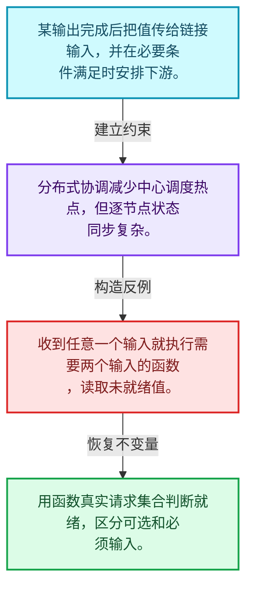
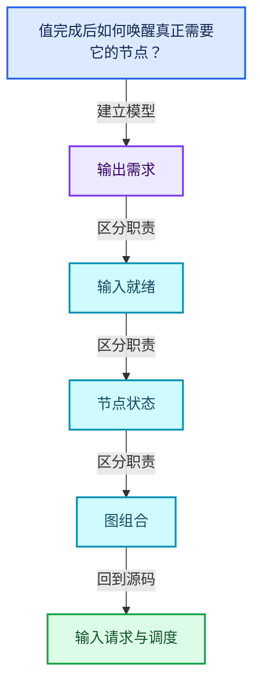
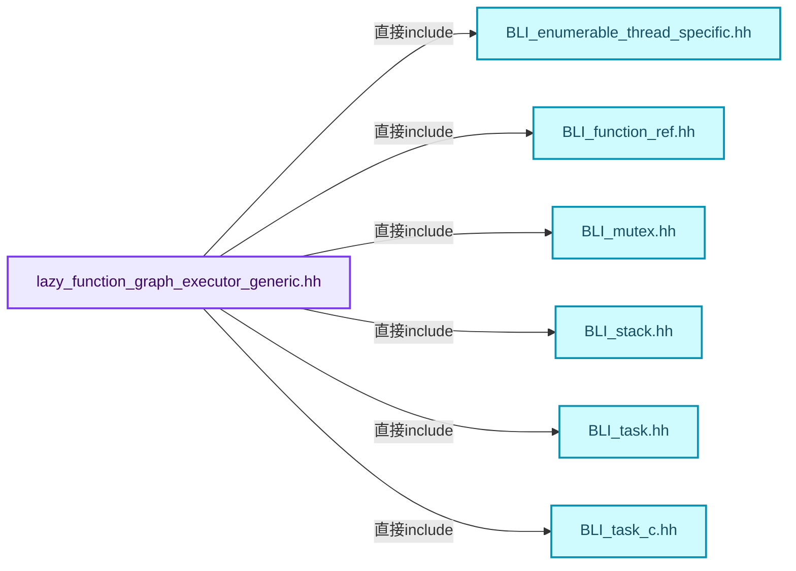
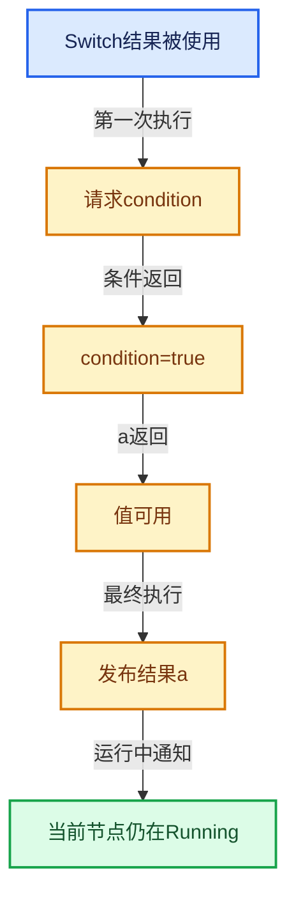

# 09-08 输入请求与调度

[方向导航](README.md) · [总目录](../README.md) · [覆盖索引](../%E6%BA%90%E7%A0%81%E7%89%88%E6%9C%AC%E4%B8%8E%E8%A6%86%E7%9B%96%E7%B4%A2%E5%BC%95.md)

> 阅读顺序：问题与数据模型 → 语法与类型 → 源码逐行 → 调用线索 → 历史与取舍 → 推演和练习。

- 基准 HEAD：`cbda6b96c26c0dee3c3b5cbb93960c4ac06a6b30`。
- 记录日期：2026-10-14。
- 教学示例状态：正文中的推演不是本机性能实测；已运行练习见验收报告。

## 一、从问题到设计

值完成后如何唤醒真正需要它的节点？

通知更新输入状态，必要输入齐备才推进执行；锁保护和快照允许条件变化与执行并存。

本篇把语法、数据语义和系统取舍连接起来。需求与就绪是不同维度；状态只在有证据时推进，不能把未确定当作无需求。

### 本篇独立模型与设计推理

某输出完成后把值传给链接输入，并在必要条件满足时安排下游。

设计取舍：分布式协调减少中心调度热点，但逐节点状态同步复杂。

最小反例：收到任意一个输入就执行需要两个输入的函数，读取未就绪值。

推导与处理：用函数真实请求集合判断就绪，区分可选和必须输入。



### 源码范围与相邻篇章

| 文件 | 本篇逐行范围 | 基准SHA-256 |
|---|---|---|
| [source/blender/functions/intern/lazy_function_graph_executor_generic.hh](../../../../../source/blender/functions/intern/lazy_function_graph_executor_generic.hh) | L745—L1503 | `b7743d14be8b678673777b7efb57162bf1356935c7bd6508f26c43b8759b4798` |

同一主讲文件可能分多篇覆盖；超出本篇范围的符号通过覆盖索引定位。空行与纯注释保留在源码摘录中，逐行表解释有效语句与语法边界；许可证头统一保留。

前篇：[执行器内部状态](07-%E6%89%A7%E8%A1%8C%E5%99%A8%E5%86%85%E9%83%A8%E7%8A%B6%E6%80%81.md).

后篇：[几何节点图构建器](09-%E5%87%A0%E4%BD%95%E8%8A%82%E7%82%B9%E5%9B%BE%E6%9E%84%E5%BB%BA%E5%99%A8.md).

## 二、类型、数据与阅读地图



这是概念依赖图，边表示阅读关系，不声称是运行时调用顺序。

### 直接编译依赖



箭头只表示头文件包含关系；完整调用线索见后面的符号定位表。

## 三、关键词、语法与类型角色

### 只读限定 const

const约束当前访问路径可做的修改。const指针、指向const的指针、const视图对象、const元素是不同位置的限定；其他别名可能仍可修改原对象。

具体检查：分别写T* const、const T*与const T* const，并画出不可修改的层次。

### 移动转换 std::move

std::move把表达式转换为可供移动重载选择的值类别，实际资源转移发生在被选中的构造或赋值中。对const对象move可能仍调用复制，对视图move也不会获得底层数据所有权。

具体检查：记录移动构造调用次数，不用变量名或std::move的出现次数替代测量。

### 异常边界 try与catch

try定义异常传播的局部边界。失败路径需要销毁已经成功构造的部分并释放相应存储；未构造的对象不能被析构。

具体检查：在第k次构造失败，列出已经存在的对象集合与待释放缓冲。

### 显式静态转换 static_cast

static_cast表达编译期允许的转换，不会自动验证运行时真实类型、指针寿命或索引边界。由void指针恢复T指针时，调用者仍须保证实际存储中确有合法T对象。

具体检查：标出转换前后的类型以及正确性依据来自哪里。

### 覆写检查 override

override要求函数确实覆盖基类虚函数，可捕获参数类型和const限定不匹配。它不改变基类规定的生命周期或线程约束。

具体检查：故意改变一个参数或const，观察编译器如何拒绝误写的新函数。

### 内部断言 assert

断言表达开发者预期成立的内部契约，发布构建可能关闭。它不能替代对不可信输入的完整错误处理，也不保证后续操作被运行时保护。

具体检查：对每条断言构造违反条件的输入，区分调用者错误与应向用户报告的错误。

### 独占拥有 unique_ptr

unique_ptr通过移动转移拥有关系，默认删除策略必须与资源来源匹配。get返回借用指针，release交出责任而不销毁。

具体检查：区分move、get、release和reset后谁负责销毁。

### 类型别名 using

类型别名为已有类型建立名字，不创建运行期对象。它常把模板内部使用的类型统一暴露给泛型调用者。

具体检查：展开别名直到基础类型，区分类型别名和变量声明。

## 四、真实源码与逐行讲解

源码块保持原行内容，原始行号由小节标题及逐行表给出。表中的调用定位是静态阅读辅助；重载、模板实例化、宏展开和虚调用需结合完整声明，不能仅凭词法出现证明动态调用。

### lazy_function_graph_executor_generic.hh：L745—L805

<!-- source:source/blender/functions/intern/lazy_function_graph_executor_generic.hh:745:805 -->

```cpp

  void notify_output_unused(const OutputSocket &socket,
                            CurrentTask &current_task,
                            const LocalData &local_data)
  {
    const Node &node = socket.node();
    const int index_in_node = socket.index();
    NodeState &node_state = *node_states_[node.index_in_graph()];
    OutputState &output_state = node_state.outputs[index_in_node];

    this->with_locked_node(
        node, node_state, current_task, local_data, [&](LockedNode &locked_node) {
          output_state.potential_target_sockets -= 1;
          if (output_state.potential_target_sockets == 0) {
            BLI_assert(output_state.usage != ValueUsage::Unused);
            if (output_state.usage == ValueUsage::Maybe) {
              output_state.usage = ValueUsage::Unused;
              if (node.is_interface()) {
                const int graph_input_index =
                    self_.graph_input_index_by_socket_index_[socket.index()];
                params_->set_input_unused(graph_input_index);
              }
              else {
                /* Schedule as priority node. This allows freeing up memory earlier which results
                 * in better memory reuse and fewer implicit sharing copies. */
                this->schedule_node(locked_node, current_task, true);
              }
            }
          }
        });
  }

  void schedule_node(LockedNode &locked_node, CurrentTask &current_task, const bool is_priority)
  {
    BLI_assert(locked_node.node.is_function());
    switch (locked_node.node_state.schedule_state) {
      case NodeScheduleState::NotScheduled: {
        locked_node.node_state.schedule_state = NodeScheduleState::Scheduled;
        const FunctionNode &node = static_cast<const FunctionNode &>(locked_node.node);
        if (this->use_multi_threading()) {
          std::lock_guard lock{current_task.mutex};
          current_task.scheduled_nodes.schedule(node, is_priority);
        }
        else {
          current_task.scheduled_nodes.schedule(node, is_priority);
        }
        current_task.has_scheduled_nodes.store(true, std::memory_order_relaxed);
        break;
      }
      case NodeScheduleState::Scheduled: {
        break;
      }
      case NodeScheduleState::Running: {
        locked_node.node_state.schedule_state = NodeScheduleState::RunningAndRescheduled;
        break;
      }
      case NodeScheduleState::RunningAndRescheduled: {
        break;
      }
    }
  }
```

本段语义重点：

- `schedule_state`：节点是否待运行、正在运行或需要再次运行的调度状态。
- `usage`：值使用需求，Maybe、Used与Unused各有不同含义。
- `mutex`：保护相关缓存或节点状态的同步对象，保护范围以调用点为准。

| 原始行 | 语义、约束与检查 |
|---|---|
| L746 | 出现调用或函数声明 `notify_output_unused`，对应表达式为 `void notify_output_unused(const OutputSocket &socket,`。参数求值、返回类型与重载需结合前后完整语句；静态文本引用不能证明动态目标。 |
| L747 | 本行是连续声明或表达式的一部分：`CurrentTask &current_task,`。与本段前后行合读；逗号、括号和限定符决定它属于参数、初始化列表还是实际计算。 |
| L748 | 本行是连续声明或表达式的一部分：`const LocalData &local_data)`。与本段前后行合读；逗号、括号和限定符决定它属于参数、初始化列表还是实际计算。 |
| L749 | 连接上一行的声明或控制结构与其语句块；后续行在这个作用域中执行或声明。 |
| L750 | 把右侧 `socket.node()` 用于初始化或更新左侧 `const Node &node`。声明初始化与已有对象赋值应按上下文区分；有资源的类型会调用相应特殊成员。 |
| L751 | 把右侧 `socket.index()` 用于初始化或更新左侧 `const int index_in_node`。声明初始化与已有对象赋值应按上下文区分；有资源的类型会调用相应特殊成员。 |
| L752 | 把右侧 `*node_states_[node.index_in_graph()]` 用于初始化或更新左侧 `NodeState &node_state`。声明初始化与已有对象赋值应按上下文区分；有资源的类型会调用相应特殊成员。 |
| L753 | 把右侧 `node_state.outputs[index_in_node]` 用于初始化或更新左侧 `OutputState &output_state`。声明初始化与已有对象赋值应按上下文区分；有资源的类型会调用相应特殊成员。 |
| L755 | 出现调用或函数声明 `with_locked_node`，对应表达式为 `this->with_locked_node(`。参数求值、返回类型与重载需结合前后完整语句；静态文本引用不能证明动态目标。 |
| L756 | 本行是连续声明或表达式的一部分：`node, node_state, current_task, local_data, [&](LockedNode &locked_node) {`。与本段前后行合读；逗号、括号和限定符决定它属于参数、初始化列表还是实际计算。 |
| L757 | 复合更新 `output_state.potential_target_sockets -= 1`：读取左侧现有值，与右侧按`-=`对应操作组合后写回。检查数值边界、位掩码或共享状态保护；它不是新对象的构造。 |
| L758 | 判断 `output_state.potential_target_sockets == 0`，成立时进入本分支，否则继续后续路径。 |
| L759 | 断言约束 `BLI_assert(output_state.usage != ValueUsage::Unused);`。条件是后续访问的内部前置条件；发布构建可能不执行，不能把断言当作输入修复。 |
| L760 | 判断 `output_state.usage == ValueUsage::Maybe`，成立时进入本分支，否则继续后续路径。此处处理需求状态；不要把未知需求直接当作不需要。 |
| L761 | 建立或更新 `usage`：值使用需求，Maybe、Used与Unused各有不同含义。本行的具体值关系为 `output_state.usage = ValueUsage::Unused`；对照更新前后相应范围或状态是否一致。 |
| L762 | 判断 `node.is_interface()`，成立时进入本分支，否则继续后续路径。 |
| L763 | 把右侧 `` 用于初始化或更新左侧 `const int graph_input_index`。声明初始化与已有对象赋值应按上下文区分；有资源的类型会调用相应特殊成员。 |
| L764 | 出现调用或函数声明 `index`，对应表达式为 `self_.graph_input_index_by_socket_index_[socket.index()];`。参数求值、返回类型与重载需结合前后完整语句；静态文本引用不能证明动态目标。 |
| L765 | 出现调用或函数声明 `set_input_unused`，对应表达式为 `params_->set_input_unused(graph_input_index);`。参数求值、返回类型与重载需结合前后完整语句；静态文本引用不能证明动态目标。 |
| L766 | 结束当前语法单元。局部自动对象在离开其作用域时按规则销毁；这不等于所有被引用的外部数据也被释放。 |
| L767 | 处理前一条件不成立的互补路径。比较两条路径最后是否恢复同一不变量，以及是否产生不同的资源责任。 |
| L770 | 出现调用或函数声明 `schedule_node`，对应表达式为 `this->schedule_node(locked_node, current_task, true);`。参数求值、返回类型与重载需结合前后完整语句；静态文本引用不能证明动态目标。 |
| L771 | 结束当前语法单元。局部自动对象在离开其作用域时按规则销毁；这不等于所有被引用的外部数据也被释放。 |
| L772 | 结束当前语法单元。局部自动对象在离开其作用域时按规则销毁；这不等于所有被引用的外部数据也被释放。 |
| L773 | 结束当前语法单元。局部自动对象在离开其作用域时按规则销毁；这不等于所有被引用的外部数据也被释放。 |
| L774 | 结束当前语法单元。局部自动对象在离开其作用域时按规则销毁；这不等于所有被引用的外部数据也被释放。 |
| L775 | 结束当前语法单元。局部自动对象在离开其作用域时按规则销毁；这不等于所有被引用的外部数据也被释放。 |
| L777 | 出现调用或函数声明 `schedule_node`，对应表达式为 `void schedule_node(LockedNode &locked_node, CurrentTask &current_task, const bool is_priority)`。参数求值、返回类型与重载需结合前后完整语句；静态文本引用不能证明动态目标。 |
| L778 | 连接上一行的声明或控制结构与其语句块；后续行在这个作用域中执行或声明。 |
| L779 | 断言约束 `BLI_assert(locked_node.node.is_function());`。条件是后续访问的内部前置条件；发布构建可能不执行，不能把断言当作输入修复。 |
| L780 | 按 switch (locked_node.node_state.schedule_state) 选择状态处理路径；每个case的break、return或贯穿行为决定下一步。 |
| L781 | 进入枚举或判别值对应分支 case NodeScheduleState::NotScheduled: {；结合状态定义和后续更新判断允许的转移。 |
| L782 | 建立或更新 `schedule_state`：节点是否待运行、正在运行或需要再次运行的调度状态。本行的具体值关系为 `locked_node.node_state.schedule_state = NodeScheduleState::Scheduled`；对照更新前后相应范围或状态是否一致。 |
| L783 | 把右侧 `static_cast<const FunctionNode &>(locked_node.node)` 用于初始化或更新左侧 `const FunctionNode &node`。声明初始化与已有对象赋值应按上下文区分；有资源的类型会调用相应特殊成员。 |
| L784 | 判断 `this->use_multi_threading()`，成立时进入本分支，否则继续后续路径。 |
| L785 | 本行涉及 `mutex`：保护相关缓存或节点状态的同步对象，保护范围以调用点为准。按此语义解读 `std::lock_guard lock{current_task.mutex}`，不要把地址、数量或状态混用。 |
| L786 | 出现调用或函数声明 `schedule`，对应表达式为 `current_task.scheduled_nodes.schedule(node, is_priority);`。参数求值、返回类型与重载需结合前后完整语句；静态文本引用不能证明动态目标。 |
| L787 | 结束当前语法单元。局部自动对象在离开其作用域时按规则销毁；这不等于所有被引用的外部数据也被释放。 |
| L788 | 处理前一条件不成立的互补路径。比较两条路径最后是否恢复同一不变量，以及是否产生不同的资源责任。 |
| L789 | 出现调用或函数声明 `schedule`，对应表达式为 `current_task.scheduled_nodes.schedule(node, is_priority);`。参数求值、返回类型与重载需结合前后完整语句；静态文本引用不能证明动态目标。 |
| L790 | 结束当前语法单元。局部自动对象在离开其作用域时按规则销毁；这不等于所有被引用的外部数据也被释放。 |
| L791 | 出现调用或函数声明 `store`，对应表达式为 `current_task.has_scheduled_nodes.store(true, std::memory_order_relaxed);`。参数求值、返回类型与重载需结合前后完整语句；静态文本引用不能证明动态目标。 |
| L792 | 离开最近的循环或switch；不是离开整个函数，后续清理和提交代码可能仍会执行。 |
| L793 | 结束当前语法单元。局部自动对象在离开其作用域时按规则销毁；这不等于所有被引用的外部数据也被释放。 |
| L794 | 进入枚举或判别值对应分支 case NodeScheduleState::Scheduled: {；结合状态定义和后续更新判断允许的转移。 |
| L795 | 离开最近的循环或switch；不是离开整个函数，后续清理和提交代码可能仍会执行。 |
| L796 | 结束当前语法单元。局部自动对象在离开其作用域时按规则销毁；这不等于所有被引用的外部数据也被释放。 |
| L797 | 进入枚举或判别值对应分支 case NodeScheduleState::Running: {；结合状态定义和后续更新判断允许的转移。 |
| L798 | 建立或更新 `schedule_state`：节点是否待运行、正在运行或需要再次运行的调度状态。本行的具体值关系为 `locked_node.node_state.schedule_state = NodeScheduleState::RunningAndRescheduled`；对照更新前后相应范围或状态是否一致。 |
| L799 | 离开最近的循环或switch；不是离开整个函数，后续清理和提交代码可能仍会执行。 |
| L800 | 结束当前语法单元。局部自动对象在离开其作用域时按规则销毁；这不等于所有被引用的外部数据也被释放。 |
| L801 | 进入枚举或判别值对应分支 case NodeScheduleState::RunningAndRescheduled: {；结合状态定义和后续更新判断允许的转移。 |
| L802 | 离开最近的循环或switch；不是离开整个函数，后续清理和提交代码可能仍会执行。 |
| L803 | 结束当前语法单元。局部自动对象在离开其作用域时按规则销毁；这不等于所有被引用的外部数据也被释放。 |
| L804 | 结束当前语法单元。局部自动对象在离开其作用域时按规则销毁；这不等于所有被引用的外部数据也被释放。 |
| L805 | 结束当前语法单元。局部自动对象在离开其作用域时按规则销毁；这不等于所有被引用的外部数据也被释放。 |

### lazy_function_graph_executor_generic.hh：L806—L846

<!-- source:source/blender/functions/intern/lazy_function_graph_executor_generic.hh:806:846 -->

```cpp

  void with_locked_node(const Node &node,
                        NodeState &node_state,
                        CurrentTask &current_task,
                        const LocalData &local_data,
                        const FunctionRef<void(LockedNode &)> f)
  {
    BLI_assert(&node_state == node_states_[node.index_in_graph()]);

    LockedNode locked_node{node, node_state};
    if (this->use_multi_threading()) {
      std::lock_guard lock{node_state.mutex};
      threading::isolate_task([&]() { f(locked_node); });
    }
    else {
      f(locked_node);
    }

    this->send_output_required_notifications(
        locked_node.delayed_required_outputs, current_task, local_data);
    this->send_output_unused_notifications(
        locked_node.delayed_unused_outputs, current_task, local_data);
  }

  void send_output_required_notifications(const Span<const OutputSocket *> sockets,
                                          CurrentTask &current_task,
                                          const LocalData &local_data)
  {
    for (const OutputSocket *socket : sockets) {
      this->notify_output_required(*socket, current_task, local_data);
    }
  }

  void send_output_unused_notifications(const Span<const OutputSocket *> sockets,
                                        CurrentTask &current_task,
                                        const LocalData &local_data)
  {
    for (const OutputSocket *socket : sockets) {
      this->notify_output_unused(*socket, current_task, local_data);
    }
  }
```

本段语义重点：

- `mutex`：保护相关缓存或节点状态的同步对象，保护范围以调用点为准。

| 原始行 | 语义、约束与检查 |
|---|---|
| L807 | 出现调用或函数声明 `with_locked_node`，对应表达式为 `void with_locked_node(const Node &node,`。参数求值、返回类型与重载需结合前后完整语句；静态文本引用不能证明动态目标。 |
| L808 | 本行是连续声明或表达式的一部分：`NodeState &node_state,`。与本段前后行合读；逗号、括号和限定符决定它属于参数、初始化列表还是实际计算。 |
| L809 | 本行是连续声明或表达式的一部分：`CurrentTask &current_task,`。与本段前后行合读；逗号、括号和限定符决定它属于参数、初始化列表还是实际计算。 |
| L810 | 本行是连续声明或表达式的一部分：`const LocalData &local_data,`。与本段前后行合读；逗号、括号和限定符决定它属于参数、初始化列表还是实际计算。 |
| L811 | 出现调用或函数声明 `void`，对应表达式为 `const FunctionRef<void(LockedNode &)> f)`。参数求值、返回类型与重载需结合前后完整语句；静态文本引用不能证明动态目标。 |
| L812 | 连接上一行的声明或控制结构与其语句块；后续行在这个作用域中执行或声明。 |
| L813 | 断言约束 `BLI_assert(&node_state == node_states_[node.index_in_graph()]);`。条件是后续访问的内部前置条件；发布构建可能不执行，不能把断言当作输入修复。 |
| L815 | 声明成员、局部对象或完成语句 `LockedNode locked_node{node, node_state}`。若为指针或引用，它本身不说明拥有；若为值对象，其构造析构由所在作用域或外层对象管理。 |
| L816 | 判断 `this->use_multi_threading()`，成立时进入本分支，否则继续后续路径。 |
| L817 | 本行涉及 `mutex`：保护相关缓存或节点状态的同步对象，保护范围以调用点为准。按此语义解读 `std::lock_guard lock{node_state.mutex}`，不要把地址、数量或状态混用。 |
| L818 | 出现调用或函数声明 `threading::isolate_task`，对应表达式为 `threading::isolate_task([&]() { f(locked_node); });`。参数求值、返回类型与重载需结合前后完整语句；静态文本引用不能证明动态目标。 |
| L819 | 结束当前语法单元。局部自动对象在离开其作用域时按规则销毁；这不等于所有被引用的外部数据也被释放。 |
| L820 | 处理前一条件不成立的互补路径。比较两条路径最后是否恢复同一不变量，以及是否产生不同的资源责任。 |
| L821 | 出现调用或函数声明 `f`，对应表达式为 `f(locked_node);`。参数求值、返回类型与重载需结合前后完整语句；静态文本引用不能证明动态目标。 |
| L822 | 结束当前语法单元。局部自动对象在离开其作用域时按规则销毁；这不等于所有被引用的外部数据也被释放。 |
| L824 | 出现调用或函数声明 `send_output_required_notifications`，对应表达式为 `this->send_output_required_notifications(`。参数求值、返回类型与重载需结合前后完整语句；静态文本引用不能证明动态目标。 |
| L825 | 声明成员、局部对象或完成语句 `locked_node.delayed_required_outputs, current_task, local_data)`。若为指针或引用，它本身不说明拥有；若为值对象，其构造析构由所在作用域或外层对象管理。 |
| L826 | 出现调用或函数声明 `send_output_unused_notifications`，对应表达式为 `this->send_output_unused_notifications(`。参数求值、返回类型与重载需结合前后完整语句；静态文本引用不能证明动态目标。 |
| L827 | 声明成员、局部对象或完成语句 `locked_node.delayed_unused_outputs, current_task, local_data)`。若为指针或引用，它本身不说明拥有；若为值对象，其构造析构由所在作用域或外层对象管理。 |
| L828 | 结束当前语法单元。局部自动对象在离开其作用域时按规则销毁；这不等于所有被引用的外部数据也被释放。 |
| L830 | 出现调用或函数声明 `send_output_required_notifications`，对应表达式为 `void send_output_required_notifications(const Span<const OutputSocket *> sockets,`。参数求值、返回类型与重载需结合前后完整语句；静态文本引用不能证明动态目标。 |
| L831 | 本行是连续声明或表达式的一部分：`CurrentTask &current_task,`。与本段前后行合读；逗号、括号和限定符决定它属于参数、初始化列表还是实际计算。 |
| L832 | 本行是连续声明或表达式的一部分：`const LocalData &local_data)`。与本段前后行合读；逗号、括号和限定符决定它属于参数、初始化列表还是实际计算。 |
| L833 | 连接上一行的声明或控制结构与其语句块；后续行在这个作用域中执行或声明。 |
| L834 | 按 `for (const OutputSocket *socket : sockets)` 指定的范围或条件重复执行。对照循环变量与真实元素编号；循环内调用成本乘以实际迭代次数。 |
| L835 | 出现调用或函数声明 `notify_output_required`，对应表达式为 `this->notify_output_required(*socket, current_task, local_data);`。参数求值、返回类型与重载需结合前后完整语句；静态文本引用不能证明动态目标。 |
| L836 | 结束当前语法单元。局部自动对象在离开其作用域时按规则销毁；这不等于所有被引用的外部数据也被释放。 |
| L837 | 结束当前语法单元。局部自动对象在离开其作用域时按规则销毁；这不等于所有被引用的外部数据也被释放。 |
| L839 | 出现调用或函数声明 `send_output_unused_notifications`，对应表达式为 `void send_output_unused_notifications(const Span<const OutputSocket *> sockets,`。参数求值、返回类型与重载需结合前后完整语句；静态文本引用不能证明动态目标。 |
| L840 | 本行是连续声明或表达式的一部分：`CurrentTask &current_task,`。与本段前后行合读；逗号、括号和限定符决定它属于参数、初始化列表还是实际计算。 |
| L841 | 本行是连续声明或表达式的一部分：`const LocalData &local_data)`。与本段前后行合读；逗号、括号和限定符决定它属于参数、初始化列表还是实际计算。 |
| L842 | 连接上一行的声明或控制结构与其语句块；后续行在这个作用域中执行或声明。 |
| L843 | 按 `for (const OutputSocket *socket : sockets)` 指定的范围或条件重复执行。对照循环变量与真实元素编号；循环内调用成本乘以实际迭代次数。 |
| L844 | 出现调用或函数声明 `notify_output_unused`，对应表达式为 `this->notify_output_unused(*socket, current_task, local_data);`。参数求值、返回类型与重载需结合前后完整语句；静态文本引用不能证明动态目标。 |
| L845 | 结束当前语法单元。局部自动对象在离开其作用域时按规则销毁；这不等于所有被引用的外部数据也被释放。 |
| L846 | 结束当前语法单元。局部自动对象在离开其作用域时按规则销毁；这不等于所有被引用的外部数据也被释放。 |

### lazy_function_graph_executor_generic.hh：L847—L982

<!-- source:source/blender/functions/intern/lazy_function_graph_executor_generic.hh:847:982 -->

```cpp

  void run_task(CurrentTask &current_task, const LocalData &local_data)
  {
    while (const FunctionNode *node = current_task.scheduled_nodes.pop_next_node()) {
      if (current_task.scheduled_nodes.is_empty()) {
        current_task.has_scheduled_nodes.store(false, std::memory_order_relaxed);
      }
      this->run_node_task(*node, current_task, local_data);

      /* If there are many nodes scheduled at the same time, it's beneficial to let multiple
       * threads work on those. */
      if (current_task.scheduled_nodes.nodes_num() > 128) {
        if (this->try_enable_multi_threading()) {
          std::unique_ptr<ScheduledNodes> split_nodes = std::make_unique<ScheduledNodes>();
          current_task.scheduled_nodes.split_into(*split_nodes);
          this->push_to_task_pool(std::move(split_nodes));
        }
      }
    }
  }

  void run_node_task(const FunctionNode &node,
                     CurrentTask &current_task,
                     const LocalData &local_data)
  {
    NodeState &node_state = *node_states_[node.index_in_graph()];
    LinearAllocator<> &allocator = *local_data.allocator;
    Context local_context{context_->storage, context_->user_data, local_data.local_user_data};
    const LazyFunction &fn = node.function();

    bool node_needs_execution = false;
    this->with_locked_node(
        node, node_state, current_task, local_data, [&](LockedNode &locked_node) {
          BLI_assert(node_state.schedule_state == NodeScheduleState::Scheduled);
          node_state.schedule_state = NodeScheduleState::Running;

          if (node_state.node_has_finished) {
            return;
          }

          bool required_uncomputed_output_exists = false;
          for (const int output_index : node.outputs().index_range()) {
            OutputState &output_state = node_state.outputs[output_index];
            output_state.usage_for_execution = output_state.usage;
            if (output_state.usage == ValueUsage::Used && !output_state.has_been_computed) {
              required_uncomputed_output_exists = true;
            }
          }
          if (!required_uncomputed_output_exists && !node_state.has_side_effects) {
            return;
          }

          if (!node_state.always_used_inputs_requested) {
            /* Request linked inputs that are always needed. */
            const Span<Input> fn_inputs = fn.inputs();
            for (const int input_index : fn_inputs.index_range()) {
              const Input &fn_input = fn_inputs[input_index];
              if (fn_input.usage == ValueUsage::Used) {
                const InputSocket &input_socket = node.input(input_index);
                if (input_socket.origin() != nullptr) {
                  this->set_input_required(locked_node, input_socket);
                }
              }
            }

            node_state.always_used_inputs_requested = true;
          }

          for (const int input_index : node.inputs().index_range()) {
            InputState &input_state = node_state.inputs[input_index];
            if (input_state.was_ready_for_execution) {
              continue;
            }
            if (input_state.value != nullptr) {
              input_state.was_ready_for_execution = true;
              continue;
            }
            if (!fn.allow_missing_requested_inputs()) {
              if (input_state.usage == ValueUsage::Used) {
                return;
              }
            }
          }

          node_needs_execution = true;
        });

    if (node_needs_execution) {
      if (!node_state.storage_and_defaults_initialized) {
        /* Initialize storage. */
        node_state.storage = fn.init_storage(allocator);

        /* Load unlinked inputs. */
        for (const int input_index : node.inputs().index_range()) {
          const InputSocket &input_socket = node.input(input_index);
          if (input_socket.origin() != nullptr) {
            continue;
          }
          InputState &input_state = node_state.inputs[input_index];
          const CPPType &type = input_socket.type();
          const void *default_value = input_socket.default_value();
          BLI_assert(default_value != nullptr);
          if (logging_enabled_state_.socket_values) {
            self_.logger_->log_socket_value(input_socket, {type, default_value}, local_context);
          }
          BLI_assert(input_state.value == nullptr);
          input_state.value = allocator.allocate(type);
          type.copy_construct(default_value, input_state.value);
          input_state.was_ready_for_execution = true;
        }

        node_state.storage_and_defaults_initialized = true;
      }

      /* Importantly, the node must not be locked when it is executed. That would result in locks
       * being hold very long in some cases and results in multiple locks being hold by the same
       * thread in the same graph which can lead to deadlocks. */
      this->execute_node(node, node_state, current_task, local_data);
    }

    this->with_locked_node(
        node, node_state, current_task, local_data, [&](LockedNode &locked_node) {
#ifndef NDEBUG
          if (node_needs_execution) {
            this->assert_expected_outputs_have_been_computed(locked_node, local_data);
          }
#endif
          this->finish_node_if_possible(locked_node);
          const bool reschedule_requested = node_state.schedule_state ==
                                            NodeScheduleState::RunningAndRescheduled;
          node_state.schedule_state = NodeScheduleState::NotScheduled;
          if (reschedule_requested && !node_state.node_has_finished) {
            this->schedule_node(locked_node, current_task, false);
          }
        });
  }
```

本段语义重点：

- `context_`：求值环境字段；FieldEvaluator以引用借用，其他类须按实际成员类型确认拥有关系。
- `logger_`：可选日志策略对象，通常为借用关系。
- `schedule_state`：节点是否待运行、正在运行或需要再次运行的调度状态。
- `was_ready_for_execution`：输入是否已准备好并进入执行可读阶段的标记。
- `has_been_computed`：输出是否已经产生的单调完成标记。

| 原始行 | 语义、约束与检查 |
|---|---|
| L848 | 出现调用或函数声明 `run_task`，对应表达式为 `void run_task(CurrentTask &current_task, const LocalData &local_data)`。参数求值、返回类型与重载需结合前后完整语句；静态文本引用不能证明动态目标。 |
| L849 | 连接上一行的声明或控制结构与其语句块；后续行在这个作用域中执行或声明。 |
| L850 | 按 `while (const FunctionNode *node = current_task.scheduled_nodes.pop_next_node())` 指定的范围或条件重复执行。对照循环变量与真实元素编号；循环内调用成本乘以实际迭代次数。 |
| L851 | 判断 `current_task.scheduled_nodes.is_empty()`，成立时进入本分支，否则继续后续路径。 |
| L852 | 出现调用或函数声明 `store`，对应表达式为 `current_task.has_scheduled_nodes.store(false, std::memory_order_relaxed);`。参数求值、返回类型与重载需结合前后完整语句；静态文本引用不能证明动态目标。 |
| L853 | 结束当前语法单元。局部自动对象在离开其作用域时按规则销毁；这不等于所有被引用的外部数据也被释放。 |
| L854 | 出现调用或函数声明 `run_node_task`，对应表达式为 `this->run_node_task(*node, current_task, local_data);`。参数求值、返回类型与重载需结合前后完整语句；静态文本引用不能证明动态目标。 |
| L858 | 判断 `current_task.scheduled_nodes.nodes_num() > 128`，成立时进入本分支，否则继续后续路径。 |
| L859 | 判断 `this->try_enable_multi_threading()`，成立时进入本分支，否则继续后续路径。 |
| L860 | 把右侧 `std::make_unique<ScheduledNodes>()` 用于初始化或更新左侧 `std::unique_ptr<ScheduledNodes> split_nodes`。声明初始化与已有对象赋值应按上下文区分；有资源的类型会调用相应特殊成员。 |
| L861 | 出现调用或函数声明 `split_into`，对应表达式为 `current_task.scheduled_nodes.split_into(*split_nodes);`。参数求值、返回类型与重载需结合前后完整语句；静态文本引用不能证明动态目标。 |
| L862 | 出现调用或函数声明 `push_to_task_pool`，对应表达式为 `this->push_to_task_pool(std::move(split_nodes));`。参数求值、返回类型与重载需结合前后完整语句；静态文本引用不能证明动态目标。 |
| L863 | 结束当前语法单元。局部自动对象在离开其作用域时按规则销毁；这不等于所有被引用的外部数据也被释放。 |
| L864 | 结束当前语法单元。局部自动对象在离开其作用域时按规则销毁；这不等于所有被引用的外部数据也被释放。 |
| L865 | 结束当前语法单元。局部自动对象在离开其作用域时按规则销毁；这不等于所有被引用的外部数据也被释放。 |
| L866 | 结束当前语法单元。局部自动对象在离开其作用域时按规则销毁；这不等于所有被引用的外部数据也被释放。 |
| L868 | 出现调用或函数声明 `run_node_task`，对应表达式为 `void run_node_task(const FunctionNode &node,`。参数求值、返回类型与重载需结合前后完整语句；静态文本引用不能证明动态目标。 |
| L869 | 本行是连续声明或表达式的一部分：`CurrentTask &current_task,`。与本段前后行合读；逗号、括号和限定符决定它属于参数、初始化列表还是实际计算。 |
| L870 | 本行是连续声明或表达式的一部分：`const LocalData &local_data)`。与本段前后行合读；逗号、括号和限定符决定它属于参数、初始化列表还是实际计算。 |
| L871 | 连接上一行的声明或控制结构与其语句块；后续行在这个作用域中执行或声明。 |
| L872 | 把右侧 `*node_states_[node.index_in_graph()]` 用于初始化或更新左侧 `NodeState &node_state`。声明初始化与已有对象赋值应按上下文区分；有资源的类型会调用相应特殊成员。 |
| L873 | 把右侧 `*local_data.allocator` 用于初始化或更新左侧 `LinearAllocator<> &allocator`。声明初始化与已有对象赋值应按上下文区分；有资源的类型会调用相应特殊成员。 |
| L874 | 本行涉及 `context_`：求值环境字段；FieldEvaluator以引用借用，其他类须按实际成员类型确认拥有关系。按此语义解读 `Context local_context{context_->storage, context_->user_data, local_data.local_user_data}`，不要把地址、数量或状态混用。 |
| L875 | 把右侧 `node.function()` 用于初始化或更新左侧 `const LazyFunction &fn`。声明初始化与已有对象赋值应按上下文区分；有资源的类型会调用相应特殊成员。 |
| L877 | 把右侧 `false` 用于初始化或更新左侧 `bool node_needs_execution`。声明初始化与已有对象赋值应按上下文区分；有资源的类型会调用相应特殊成员。 |
| L878 | 出现调用或函数声明 `with_locked_node`，对应表达式为 `this->with_locked_node(`。参数求值、返回类型与重载需结合前后完整语句；静态文本引用不能证明动态目标。 |
| L879 | 本行是连续声明或表达式的一部分：`node, node_state, current_task, local_data, [&](LockedNode &locked_node) {`。与本段前后行合读；逗号、括号和限定符决定它属于参数、初始化列表还是实际计算。 |
| L880 | 断言约束 `BLI_assert(node_state.schedule_state == NodeScheduleState::Scheduled);`。条件是后续访问的内部前置条件；发布构建可能不执行，不能把断言当作输入修复。 |
| L881 | 建立或更新 `schedule_state`：节点是否待运行、正在运行或需要再次运行的调度状态。本行的具体值关系为 `node_state.schedule_state = NodeScheduleState::Running`；对照更新前后相应范围或状态是否一致。 |
| L883 | 判断 `node_state.node_has_finished`，成立时进入本分支，否则继续后续路径。 |
| L884 | 结束当前函数，本路径不再执行后续语句；局部对象按作用域规则清理。 |
| L885 | 结束当前语法单元。局部自动对象在离开其作用域时按规则销毁；这不等于所有被引用的外部数据也被释放。 |
| L887 | 把右侧 `false` 用于初始化或更新左侧 `bool required_uncomputed_output_exists`。声明初始化与已有对象赋值应按上下文区分；有资源的类型会调用相应特殊成员。 |
| L888 | 按 `for (const int output_index : node.outputs().index_range())` 指定的范围或条件重复执行。对照循环变量与真实元素编号；循环内调用成本乘以实际迭代次数。 |
| L889 | 把右侧 `node_state.outputs[output_index]` 用于初始化或更新左侧 `OutputState &output_state`。声明初始化与已有对象赋值应按上下文区分；有资源的类型会调用相应特殊成员。 |
| L890 | 建立或更新 `usage_for_execution`：执行开始时取得的需求快照，与正在变化的需求区分。本行的具体值关系为 `output_state.usage_for_execution = output_state.usage`；对照更新前后相应范围或状态是否一致。 |
| L891 | 判断 `output_state.usage == ValueUsage::Used && !output_state.has_been_computed`，成立时进入本分支，否则继续后续路径。此处处理需求状态；不要把未知需求直接当作不需要。 |
| L892 | 把右侧 `true` 用于初始化或更新左侧 `required_uncomputed_output_exists`。声明初始化与已有对象赋值应按上下文区分；有资源的类型会调用相应特殊成员。 |
| L893 | 结束当前语法单元。局部自动对象在离开其作用域时按规则销毁；这不等于所有被引用的外部数据也被释放。 |
| L894 | 结束当前语法单元。局部自动对象在离开其作用域时按规则销毁；这不等于所有被引用的外部数据也被释放。 |
| L895 | 判断 `!required_uncomputed_output_exists && !node_state.has_side_effects`，成立时进入本分支，否则继续后续路径。 |
| L896 | 结束当前函数，本路径不再执行后续语句；局部对象按作用域规则清理。 |
| L897 | 结束当前语法单元。局部自动对象在离开其作用域时按规则销毁；这不等于所有被引用的外部数据也被释放。 |
| L899 | 判断 `!node_state.always_used_inputs_requested`，成立时进入本分支，否则继续后续路径。 |
| L901 | 把右侧 `fn.inputs()` 用于初始化或更新左侧 `const Span<Input> fn_inputs`。声明初始化与已有对象赋值应按上下文区分；有资源的类型会调用相应特殊成员。 |
| L902 | 按 `for (const int input_index : fn_inputs.index_range())` 指定的范围或条件重复执行。对照循环变量与真实元素编号；循环内调用成本乘以实际迭代次数。 |
| L903 | 把右侧 `fn_inputs[input_index]` 用于初始化或更新左侧 `const Input &fn_input`。声明初始化与已有对象赋值应按上下文区分；有资源的类型会调用相应特殊成员。 |
| L904 | 判断 `fn_input.usage == ValueUsage::Used`，成立时进入本分支，否则继续后续路径。此处处理需求状态；不要把未知需求直接当作不需要。 |
| L905 | 把右侧 `node.input(input_index)` 用于初始化或更新左侧 `const InputSocket &input_socket`。声明初始化与已有对象赋值应按上下文区分；有资源的类型会调用相应特殊成员。 |
| L906 | 判断 `input_socket.origin() != nullptr`，成立时进入本分支，否则继续后续路径。这里区分空地址与可用地址，但非空本身仍不能证明对象存活。 |
| L907 | 出现调用或函数声明 `set_input_required`，对应表达式为 `this->set_input_required(locked_node, input_socket);`。参数求值、返回类型与重载需结合前后完整语句；静态文本引用不能证明动态目标。 |
| L908 | 结束当前语法单元。局部自动对象在离开其作用域时按规则销毁；这不等于所有被引用的外部数据也被释放。 |
| L909 | 结束当前语法单元。局部自动对象在离开其作用域时按规则销毁；这不等于所有被引用的外部数据也被释放。 |
| L910 | 结束当前语法单元。局部自动对象在离开其作用域时按规则销毁；这不等于所有被引用的外部数据也被释放。 |
| L912 | 把右侧 `true` 用于初始化或更新左侧 `node_state.always_used_inputs_requested`。声明初始化与已有对象赋值应按上下文区分；有资源的类型会调用相应特殊成员。 |
| L913 | 结束当前语法单元。局部自动对象在离开其作用域时按规则销毁；这不等于所有被引用的外部数据也被释放。 |
| L915 | 按 `for (const int input_index : node.inputs().index_range())` 指定的范围或条件重复执行。对照循环变量与真实元素编号；循环内调用成本乘以实际迭代次数。 |
| L916 | 把右侧 `node_state.inputs[input_index]` 用于初始化或更新左侧 `InputState &input_state`。声明初始化与已有对象赋值应按上下文区分；有资源的类型会调用相应特殊成员。 |
| L917 | 判断 `input_state.was_ready_for_execution`，成立时进入本分支，否则继续后续路径。 |
| L918 | 结束本轮循环并进入下一轮；核对本轮已经取得的资源是否由作用域或显式代码清理。 |
| L919 | 结束当前语法单元。局部自动对象在离开其作用域时按规则销毁；这不等于所有被引用的外部数据也被释放。 |
| L920 | 判断 `input_state.value != nullptr`，成立时进入本分支，否则继续后续路径。这里区分空地址与可用地址，但非空本身仍不能证明对象存活。 |
| L921 | 建立或更新 `was_ready_for_execution`：输入是否已准备好并进入执行可读阶段的标记。本行的具体值关系为 `input_state.was_ready_for_execution = true`；对照更新前后相应范围或状态是否一致。 |
| L922 | 结束本轮循环并进入下一轮；核对本轮已经取得的资源是否由作用域或显式代码清理。 |
| L923 | 结束当前语法单元。局部自动对象在离开其作用域时按规则销毁；这不等于所有被引用的外部数据也被释放。 |
| L924 | 判断 `!fn.allow_missing_requested_inputs()`，成立时进入本分支，否则继续后续路径。 |
| L925 | 判断 `input_state.usage == ValueUsage::Used`，成立时进入本分支，否则继续后续路径。此处处理需求状态；不要把未知需求直接当作不需要。 |
| L926 | 结束当前函数，本路径不再执行后续语句；局部对象按作用域规则清理。 |
| L927 | 结束当前语法单元。局部自动对象在离开其作用域时按规则销毁；这不等于所有被引用的外部数据也被释放。 |
| L928 | 结束当前语法单元。局部自动对象在离开其作用域时按规则销毁；这不等于所有被引用的外部数据也被释放。 |
| L929 | 结束当前语法单元。局部自动对象在离开其作用域时按规则销毁；这不等于所有被引用的外部数据也被释放。 |
| L931 | 把右侧 `true` 用于初始化或更新左侧 `node_needs_execution`。声明初始化与已有对象赋值应按上下文区分；有资源的类型会调用相应特殊成员。 |
| L932 | 结束当前语法单元。局部自动对象在离开其作用域时按规则销毁；这不等于所有被引用的外部数据也被释放。 |
| L934 | 判断 `node_needs_execution`，成立时进入本分支，否则继续后续路径。 |
| L935 | 判断 `!node_state.storage_and_defaults_initialized`，成立时进入本分支，否则继续后续路径。 |
| L937 | 把右侧 `fn.init_storage(allocator)` 用于初始化或更新左侧 `node_state.storage`。声明初始化与已有对象赋值应按上下文区分；有资源的类型会调用相应特殊成员。 |
| L940 | 按 `for (const int input_index : node.inputs().index_range())` 指定的范围或条件重复执行。对照循环变量与真实元素编号；循环内调用成本乘以实际迭代次数。 |
| L941 | 把右侧 `node.input(input_index)` 用于初始化或更新左侧 `const InputSocket &input_socket`。声明初始化与已有对象赋值应按上下文区分；有资源的类型会调用相应特殊成员。 |
| L942 | 判断 `input_socket.origin() != nullptr`，成立时进入本分支，否则继续后续路径。这里区分空地址与可用地址，但非空本身仍不能证明对象存活。 |
| L943 | 结束本轮循环并进入下一轮；核对本轮已经取得的资源是否由作用域或显式代码清理。 |
| L944 | 结束当前语法单元。局部自动对象在离开其作用域时按规则销毁；这不等于所有被引用的外部数据也被释放。 |
| L945 | 把右侧 `node_state.inputs[input_index]` 用于初始化或更新左侧 `InputState &input_state`。声明初始化与已有对象赋值应按上下文区分；有资源的类型会调用相应特殊成员。 |
| L946 | 把右侧 `input_socket.type()` 用于初始化或更新左侧 `const CPPType &type`。声明初始化与已有对象赋值应按上下文区分；有资源的类型会调用相应特殊成员。 |
| L947 | 把右侧 `input_socket.default_value()` 用于初始化或更新左侧 `const void *default_value`。声明初始化与已有对象赋值应按上下文区分；有资源的类型会调用相应特殊成员。 |
| L948 | 断言约束 `BLI_assert(default_value != nullptr);`。条件是后续访问的内部前置条件；发布构建可能不执行，不能把断言当作输入修复。 |
| L949 | 判断 `logging_enabled_state_.socket_values`，成立时进入本分支，否则继续后续路径。 |
| L950 | 本行涉及 `logger_`：可选日志策略对象，通常为借用关系。按此语义解读 `self_.logger_->log_socket_value(input_socket, {type, default_value}, local_context)`，不要把地址、数量或状态混用。 |
| L951 | 结束当前语法单元。局部自动对象在离开其作用域时按规则销毁；这不等于所有被引用的外部数据也被释放。 |
| L952 | 断言约束 `BLI_assert(input_state.value == nullptr);`。条件是后续访问的内部前置条件；发布构建可能不执行，不能把断言当作输入修复。 |
| L953 | 把右侧 `allocator.allocate(type)` 用于初始化或更新左侧 `input_state.value`。声明初始化与已有对象赋值应按上下文区分；有资源的类型会调用相应特殊成员。 |
| L954 | 出现调用或函数声明 `copy_construct`，对应表达式为 `type.copy_construct(default_value, input_state.value);`。参数求值、返回类型与重载需结合前后完整语句；静态文本引用不能证明动态目标。 |
| L955 | 建立或更新 `was_ready_for_execution`：输入是否已准备好并进入执行可读阶段的标记。本行的具体值关系为 `input_state.was_ready_for_execution = true`；对照更新前后相应范围或状态是否一致。 |
| L956 | 结束当前语法单元。局部自动对象在离开其作用域时按规则销毁；这不等于所有被引用的外部数据也被释放。 |
| L958 | 把右侧 `true` 用于初始化或更新左侧 `node_state.storage_and_defaults_initialized`。声明初始化与已有对象赋值应按上下文区分；有资源的类型会调用相应特殊成员。 |
| L959 | 结束当前语法单元。局部自动对象在离开其作用域时按规则销毁；这不等于所有被引用的外部数据也被释放。 |
| L964 | 出现调用或函数声明 `execute_node`，对应表达式为 `this->execute_node(node, node_state, current_task, local_data);`。参数求值、返回类型与重载需结合前后完整语句；静态文本引用不能证明动态目标。 |
| L965 | 结束当前语法单元。局部自动对象在离开其作用域时按规则销毁；这不等于所有被引用的外部数据也被释放。 |
| L967 | 出现调用或函数声明 `with_locked_node`，对应表达式为 `this->with_locked_node(`。参数求值、返回类型与重载需结合前后完整语句；静态文本引用不能证明动态目标。 |
| L968 | 本行是连续声明或表达式的一部分：`node, node_state, current_task, local_data, [&](LockedNode &locked_node) {`。与本段前后行合读；逗号、括号和限定符决定它属于参数、初始化列表还是实际计算。 |
| L969 | 预处理阶段处理 #ifndef NDEBUG。它决定哪些代码进入编译，不是运行时分支；阅读行为时必须结合实际构建宏。 |
| L970 | 判断 `node_needs_execution`，成立时进入本分支，否则继续后续路径。 |
| L971 | 出现调用或函数声明 `assert_expected_outputs_have_been_computed`，对应表达式为 `this->assert_expected_outputs_have_been_computed(locked_node, local_data);`。参数求值、返回类型与重载需结合前后完整语句；静态文本引用不能证明动态目标。 |
| L972 | 结束当前语法单元。局部自动对象在离开其作用域时按规则销毁；这不等于所有被引用的外部数据也被释放。 |
| L973 | 预处理阶段处理 #endif。它决定哪些代码进入编译，不是运行时分支；阅读行为时必须结合实际构建宏。 |
| L974 | 出现调用或函数声明 `finish_node_if_possible`，对应表达式为 `this->finish_node_if_possible(locked_node);`。参数求值、返回类型与重载需结合前后完整语句；静态文本引用不能证明动态目标。 |
| L975 | 建立或更新 `schedule_state`：节点是否待运行、正在运行或需要再次运行的调度状态。本行的具体值关系为 `const bool reschedule_requested = node_state.schedule_state ==`；对照更新前后相应范围或状态是否一致。 |
| L976 | 声明成员、局部对象或完成语句 `NodeScheduleState::RunningAndRescheduled`。若为指针或引用，它本身不说明拥有；若为值对象，其构造析构由所在作用域或外层对象管理。 |
| L977 | 建立或更新 `schedule_state`：节点是否待运行、正在运行或需要再次运行的调度状态。本行的具体值关系为 `node_state.schedule_state = NodeScheduleState::NotScheduled`；对照更新前后相应范围或状态是否一致。 |
| L978 | 判断 `reschedule_requested && !node_state.node_has_finished`，成立时进入本分支，否则继续后续路径。 |
| L979 | 出现调用或函数声明 `schedule_node`，对应表达式为 `this->schedule_node(locked_node, current_task, false);`。参数求值、返回类型与重载需结合前后完整语句；静态文本引用不能证明动态目标。 |
| L980 | 结束当前语法单元。局部自动对象在离开其作用域时按规则销毁；这不等于所有被引用的外部数据也被释放。 |
| L981 | 结束当前语法单元。局部自动对象在离开其作用域时按规则销毁；这不等于所有被引用的外部数据也被释放。 |
| L982 | 结束当前语法单元。局部自动对象在离开其作用域时按规则销毁；这不等于所有被引用的外部数据也被释放。 |

### lazy_function_graph_executor_generic.hh：L983—L1012

<!-- source:source/blender/functions/intern/lazy_function_graph_executor_generic.hh:983:1012 -->

```cpp

  void assert_expected_outputs_have_been_computed(LockedNode &locked_node,
                                                  const LocalData &local_data)
  {
    const FunctionNode &node = static_cast<const FunctionNode &>(locked_node.node);
    const NodeState &node_state = locked_node.node_state;

    if (node_state.missing_required_inputs > 0) {
      return;
    }
    if (node_state.schedule_state == NodeScheduleState::RunningAndRescheduled) {
      return;
    }
    Vector<const OutputSocket *> missing_outputs;
    for (const int i : node.outputs().index_range()) {
      const OutputState &output_state = node_state.outputs[i];
      if (output_state.usage_for_execution == ValueUsage::Used) {
        if (!output_state.has_been_computed) {
          missing_outputs.append(&node.output(i));
        }
      }
    }
    if (!missing_outputs.is_empty()) {
      if (self_.logger_ != nullptr) {
        const Context context{context_->storage, context_->user_data, local_data.local_user_data};
        self_.logger_->dump_when_outputs_are_missing(node, missing_outputs, context);
      }
      BLI_assert_unreachable();
    }
  }
```

本段语义重点：

- `context_`：求值环境字段；FieldEvaluator以引用借用，其他类须按实际成员类型确认拥有关系。
- `logger_`：可选日志策略对象，通常为借用关系。
- `schedule_state`：节点是否待运行、正在运行或需要再次运行的调度状态。
- `has_been_computed`：输出是否已经产生的单调完成标记。
- `usage_for_execution`：执行开始时取得的需求快照，与正在变化的需求区分。

| 原始行 | 语义、约束与检查 |
|---|---|
| L984 | 出现调用或函数声明 `assert_expected_outputs_have_been_computed`，对应表达式为 `void assert_expected_outputs_have_been_computed(LockedNode &locked_node,`。参数求值、返回类型与重载需结合前后完整语句；静态文本引用不能证明动态目标。 |
| L985 | 本行是连续声明或表达式的一部分：`const LocalData &local_data)`。与本段前后行合读；逗号、括号和限定符决定它属于参数、初始化列表还是实际计算。 |
| L986 | 连接上一行的声明或控制结构与其语句块；后续行在这个作用域中执行或声明。 |
| L987 | 把右侧 `static_cast<const FunctionNode &>(locked_node.node)` 用于初始化或更新左侧 `const FunctionNode &node`。声明初始化与已有对象赋值应按上下文区分；有资源的类型会调用相应特殊成员。 |
| L988 | 把右侧 `locked_node.node_state` 用于初始化或更新左侧 `const NodeState &node_state`。声明初始化与已有对象赋值应按上下文区分；有资源的类型会调用相应特殊成员。 |
| L990 | 判断 `node_state.missing_required_inputs > 0`，成立时进入本分支，否则继续后续路径。 |
| L991 | 结束当前函数，本路径不再执行后续语句；局部对象按作用域规则清理。 |
| L992 | 结束当前语法单元。局部自动对象在离开其作用域时按规则销毁；这不等于所有被引用的外部数据也被释放。 |
| L993 | 判断 `node_state.schedule_state == NodeScheduleState::RunningAndRescheduled`，成立时进入本分支，否则继续后续路径。 |
| L994 | 结束当前函数，本路径不再执行后续语句；局部对象按作用域规则清理。 |
| L995 | 结束当前语法单元。局部自动对象在离开其作用域时按规则销毁；这不等于所有被引用的外部数据也被释放。 |
| L996 | 声明成员、局部对象或完成语句 `Vector<const OutputSocket *> missing_outputs`。若为指针或引用，它本身不说明拥有；若为值对象，其构造析构由所在作用域或外层对象管理。 |
| L997 | 按 `for (const int i : node.outputs().index_range())` 指定的范围或条件重复执行。对照循环变量与真实元素编号；循环内调用成本乘以实际迭代次数。 |
| L998 | 把右侧 `node_state.outputs[i]` 用于初始化或更新左侧 `const OutputState &output_state`。声明初始化与已有对象赋值应按上下文区分；有资源的类型会调用相应特殊成员。 |
| L999 | 判断 `output_state.usage_for_execution == ValueUsage::Used`，成立时进入本分支，否则继续后续路径。此处处理需求状态；不要把未知需求直接当作不需要。 |
| L1000 | 判断 `!output_state.has_been_computed`，成立时进入本分支，否则继续后续路径。 |
| L1001 | 出现调用或函数声明 `append`，对应表达式为 `missing_outputs.append(&node.output(i));`。参数求值、返回类型与重载需结合前后完整语句；静态文本引用不能证明动态目标。 |
| L1002 | 结束当前语法单元。局部自动对象在离开其作用域时按规则销毁；这不等于所有被引用的外部数据也被释放。 |
| L1003 | 结束当前语法单元。局部自动对象在离开其作用域时按规则销毁；这不等于所有被引用的外部数据也被释放。 |
| L1004 | 结束当前语法单元。局部自动对象在离开其作用域时按规则销毁；这不等于所有被引用的外部数据也被释放。 |
| L1005 | 判断 `!missing_outputs.is_empty()`，成立时进入本分支，否则继续后续路径。 |
| L1006 | 判断 `self_.logger_ != nullptr`，成立时进入本分支，否则继续后续路径。这里区分空地址与可用地址，但非空本身仍不能证明对象存活。 |
| L1007 | 本行涉及 `context_`：求值环境字段；FieldEvaluator以引用借用，其他类须按实际成员类型确认拥有关系。按此语义解读 `const Context context{context_->storage, context_->user_data, local_data.local_user_data}`，不要把地址、数量或状态混用。 |
| L1008 | 本行涉及 `logger_`：可选日志策略对象，通常为借用关系。按此语义解读 `self_.logger_->dump_when_outputs_are_missing(node, missing_outputs, context)`，不要把地址、数量或状态混用。 |
| L1009 | 结束当前语法单元。局部自动对象在离开其作用域时按规则销毁；这不等于所有被引用的外部数据也被释放。 |
| L1010 | 断言约束 `BLI_assert_unreachable();`。条件是后续访问的内部前置条件；发布构建可能不执行，不能把断言当作输入修复。 |
| L1011 | 结束当前语法单元。局部自动对象在离开其作用域时按规则销毁；这不等于所有被引用的外部数据也被释放。 |
| L1012 | 结束当前语法单元。局部自动对象在离开其作用域时按规则销毁；这不等于所有被引用的外部数据也被释放。 |

### lazy_function_graph_executor_generic.hh：L1013—L1058

<!-- source:source/blender/functions/intern/lazy_function_graph_executor_generic.hh:1013:1058 -->

```cpp

  void finish_node_if_possible(LockedNode &locked_node)
  {
    const Node &node = locked_node.node;
    NodeState &node_state = locked_node.node_state;

    if (node_state.node_has_finished) {
      /* Was finished already. */
      return;
    }
    /* If there are outputs that may still be used, the node is not done yet. */
    for (const int output_index : node.outputs().index_range()) {
      const OutputState &output_state = node_state.outputs[output_index];
      if (output_state.usage != ValueUsage::Unused && !output_state.has_been_computed) {
        return;
      }
    }
    /* If the node is still waiting for inputs, it is not done yet. */
    for (const int input_index : node.inputs().index_range()) {
      const InputState &input_state = node_state.inputs[input_index];
      if (input_state.usage == ValueUsage::Used && !input_state.was_ready_for_execution) {
        return;
      }
    }

    node_state.node_has_finished = true;

    for (const int input_index : node.inputs().index_range()) {
      const InputSocket &input_socket = node.input(input_index);
      InputState &input_state = node_state.inputs[input_index];
      if (input_state.usage == ValueUsage::Maybe) {
        this->set_input_unused(locked_node, input_socket);
      }
      else if (input_state.usage == ValueUsage::Used) {
        this->destruct_input_value_if_exists(input_state, input_socket.type());
      }
    }

    if (node_state.storage != nullptr) {
      if (node.is_function()) {
        const FunctionNode &fn_node = static_cast<const FunctionNode &>(node);
        fn_node.function().destruct_storage(node_state.storage);
      }
      node_state.storage = nullptr;
    }
  }
```

本段语义重点：

- `was_ready_for_execution`：输入是否已准备好并进入执行可读阶段的标记。
- `has_been_computed`：输出是否已经产生的单调完成标记。
- `usage`：值使用需求，Maybe、Used与Unused各有不同含义。

| 原始行 | 语义、约束与检查 |
|---|---|
| L1014 | 出现调用或函数声明 `finish_node_if_possible`，对应表达式为 `void finish_node_if_possible(LockedNode &locked_node)`。参数求值、返回类型与重载需结合前后完整语句；静态文本引用不能证明动态目标。 |
| L1015 | 连接上一行的声明或控制结构与其语句块；后续行在这个作用域中执行或声明。 |
| L1016 | 把右侧 `locked_node.node` 用于初始化或更新左侧 `const Node &node`。声明初始化与已有对象赋值应按上下文区分；有资源的类型会调用相应特殊成员。 |
| L1017 | 把右侧 `locked_node.node_state` 用于初始化或更新左侧 `NodeState &node_state`。声明初始化与已有对象赋值应按上下文区分；有资源的类型会调用相应特殊成员。 |
| L1019 | 判断 `node_state.node_has_finished`，成立时进入本分支，否则继续后续路径。 |
| L1021 | 结束当前函数，本路径不再执行后续语句；局部对象按作用域规则清理。 |
| L1022 | 结束当前语法单元。局部自动对象在离开其作用域时按规则销毁；这不等于所有被引用的外部数据也被释放。 |
| L1024 | 按 `for (const int output_index : node.outputs().index_range())` 指定的范围或条件重复执行。对照循环变量与真实元素编号；循环内调用成本乘以实际迭代次数。 |
| L1025 | 把右侧 `node_state.outputs[output_index]` 用于初始化或更新左侧 `const OutputState &output_state`。声明初始化与已有对象赋值应按上下文区分；有资源的类型会调用相应特殊成员。 |
| L1026 | 判断 `output_state.usage != ValueUsage::Unused && !output_state.has_been_computed`，成立时进入本分支，否则继续后续路径。此处处理需求状态；不要把未知需求直接当作不需要。 |
| L1027 | 结束当前函数，本路径不再执行后续语句；局部对象按作用域规则清理。 |
| L1028 | 结束当前语法单元。局部自动对象在离开其作用域时按规则销毁；这不等于所有被引用的外部数据也被释放。 |
| L1029 | 结束当前语法单元。局部自动对象在离开其作用域时按规则销毁；这不等于所有被引用的外部数据也被释放。 |
| L1031 | 按 `for (const int input_index : node.inputs().index_range())` 指定的范围或条件重复执行。对照循环变量与真实元素编号；循环内调用成本乘以实际迭代次数。 |
| L1032 | 把右侧 `node_state.inputs[input_index]` 用于初始化或更新左侧 `const InputState &input_state`。声明初始化与已有对象赋值应按上下文区分；有资源的类型会调用相应特殊成员。 |
| L1033 | 判断 `input_state.usage == ValueUsage::Used && !input_state.was_ready_for_execution`，成立时进入本分支，否则继续后续路径。此处处理需求状态；不要把未知需求直接当作不需要。 |
| L1034 | 结束当前函数，本路径不再执行后续语句；局部对象按作用域规则清理。 |
| L1035 | 结束当前语法单元。局部自动对象在离开其作用域时按规则销毁；这不等于所有被引用的外部数据也被释放。 |
| L1036 | 结束当前语法单元。局部自动对象在离开其作用域时按规则销毁；这不等于所有被引用的外部数据也被释放。 |
| L1038 | 把右侧 `true` 用于初始化或更新左侧 `node_state.node_has_finished`。声明初始化与已有对象赋值应按上下文区分；有资源的类型会调用相应特殊成员。 |
| L1040 | 按 `for (const int input_index : node.inputs().index_range())` 指定的范围或条件重复执行。对照循环变量与真实元素编号；循环内调用成本乘以实际迭代次数。 |
| L1041 | 把右侧 `node.input(input_index)` 用于初始化或更新左侧 `const InputSocket &input_socket`。声明初始化与已有对象赋值应按上下文区分；有资源的类型会调用相应特殊成员。 |
| L1042 | 把右侧 `node_state.inputs[input_index]` 用于初始化或更新左侧 `InputState &input_state`。声明初始化与已有对象赋值应按上下文区分；有资源的类型会调用相应特殊成员。 |
| L1043 | 判断 `input_state.usage == ValueUsage::Maybe`，成立时进入本分支，否则继续后续路径。此处处理需求状态；不要把未知需求直接当作不需要。 |
| L1044 | 出现调用或函数声明 `set_input_unused`，对应表达式为 `this->set_input_unused(locked_node, input_socket);`。参数求值、返回类型与重载需结合前后完整语句；静态文本引用不能证明动态目标。 |
| L1045 | 结束当前语法单元。局部自动对象在离开其作用域时按规则销毁；这不等于所有被引用的外部数据也被释放。 |
| L1046 | 判断 `input_state.usage == ValueUsage::Used`，成立时进入本分支，否则继续后续路径。此处处理需求状态；不要把未知需求直接当作不需要。 |
| L1047 | 出现调用或函数声明 `destruct_input_value_if_exists`，对应表达式为 `this->destruct_input_value_if_exists(input_state, input_socket.type());`。参数求值、返回类型与重载需结合前后完整语句；静态文本引用不能证明动态目标。 |
| L1048 | 结束当前语法单元。局部自动对象在离开其作用域时按规则销毁；这不等于所有被引用的外部数据也被释放。 |
| L1049 | 结束当前语法单元。局部自动对象在离开其作用域时按规则销毁；这不等于所有被引用的外部数据也被释放。 |
| L1051 | 判断 `node_state.storage != nullptr`，成立时进入本分支，否则继续后续路径。这里区分空地址与可用地址，但非空本身仍不能证明对象存活。 |
| L1052 | 判断 `node.is_function()`，成立时进入本分支，否则继续后续路径。 |
| L1053 | 把右侧 `static_cast<const FunctionNode &>(node)` 用于初始化或更新左侧 `const FunctionNode &fn_node`。声明初始化与已有对象赋值应按上下文区分；有资源的类型会调用相应特殊成员。 |
| L1054 | 出现调用或函数声明 `function`，对应表达式为 `fn_node.function().destruct_storage(node_state.storage);`。参数求值、返回类型与重载需结合前后完整语句；静态文本引用不能证明动态目标。 |
| L1055 | 结束当前语法单元。局部自动对象在离开其作用域时按规则销毁；这不等于所有被引用的外部数据也被释放。 |
| L1056 | 把右侧 `nullptr` 用于初始化或更新左侧 `node_state.storage`。声明初始化与已有对象赋值应按上下文区分；有资源的类型会调用相应特殊成员。 |
| L1057 | 结束当前语法单元。局部自动对象在离开其作用域时按规则销毁；这不等于所有被引用的外部数据也被释放。 |
| L1058 | 结束当前语法单元。局部自动对象在离开其作用域时按规则销毁；这不等于所有被引用的外部数据也被释放。 |

### lazy_function_graph_executor_generic.hh：L1059—L1106

<!-- source:source/blender/functions/intern/lazy_function_graph_executor_generic.hh:1059:1106 -->

```cpp

  void destruct_input_value_if_exists(InputState &input_state, const CPPType &type)
  {
    if (input_state.value != nullptr) {
      type.destruct(input_state.value);
      input_state.value = nullptr;
    }
  }

  void execute_node(const FunctionNode &node,
                    NodeState &node_state,
                    CurrentTask &current_task,
                    const LocalData &local_data);

  void set_input_unused_during_execution(const Node &node,
                                         NodeState &node_state,
                                         const int input_index,
                                         CurrentTask &current_task,
                                         const LocalData &local_data)
  {
    const InputSocket &input_socket = node.input(input_index);
    this->with_locked_node(
        node, node_state, current_task, local_data, [&](LockedNode &locked_node) {
          this->set_input_unused(locked_node, input_socket);
        });
  }

  void set_input_unused(LockedNode &locked_node, const InputSocket &input_socket)
  {
    NodeState &node_state = locked_node.node_state;
    const int input_index = input_socket.index();
    InputState &input_state = node_state.inputs[input_index];

    BLI_assert(input_state.usage != ValueUsage::Used);
    if (input_state.usage == ValueUsage::Unused) {
      return;
    }
    input_state.usage = ValueUsage::Unused;

    this->destruct_input_value_if_exists(input_state, input_socket.type());
    if (input_state.was_ready_for_execution) {
      return;
    }
    const OutputSocket *origin = input_socket.origin();
    if (origin != nullptr) {
      locked_node.delayed_unused_outputs.append(origin);
    }
  }
```

本段语义重点：

- `was_ready_for_execution`：输入是否已准备好并进入执行可读阶段的标记。
- `usage`：值使用需求，Maybe、Used与Unused各有不同含义。

| 原始行 | 语义、约束与检查 |
|---|---|
| L1060 | 出现调用或函数声明 `destruct_input_value_if_exists`，对应表达式为 `void destruct_input_value_if_exists(InputState &input_state, const CPPType &type)`。参数求值、返回类型与重载需结合前后完整语句；静态文本引用不能证明动态目标。 |
| L1061 | 连接上一行的声明或控制结构与其语句块；后续行在这个作用域中执行或声明。 |
| L1062 | 判断 `input_state.value != nullptr`，成立时进入本分支，否则继续后续路径。这里区分空地址与可用地址，但非空本身仍不能证明对象存活。 |
| L1063 | 出现调用或函数声明 `destruct`，对应表达式为 `type.destruct(input_state.value);`。参数求值、返回类型与重载需结合前后完整语句；静态文本引用不能证明动态目标。 |
| L1064 | 把右侧 `nullptr` 用于初始化或更新左侧 `input_state.value`。声明初始化与已有对象赋值应按上下文区分；有资源的类型会调用相应特殊成员。 |
| L1065 | 结束当前语法单元。局部自动对象在离开其作用域时按规则销毁；这不等于所有被引用的外部数据也被释放。 |
| L1066 | 结束当前语法单元。局部自动对象在离开其作用域时按规则销毁；这不等于所有被引用的外部数据也被释放。 |
| L1068 | 出现调用或函数声明 `execute_node`，对应表达式为 `void execute_node(const FunctionNode &node,`。参数求值、返回类型与重载需结合前后完整语句；静态文本引用不能证明动态目标。 |
| L1069 | 本行是连续声明或表达式的一部分：`NodeState &node_state,`。与本段前后行合读；逗号、括号和限定符决定它属于参数、初始化列表还是实际计算。 |
| L1070 | 本行是连续声明或表达式的一部分：`CurrentTask &current_task,`。与本段前后行合读；逗号、括号和限定符决定它属于参数、初始化列表还是实际计算。 |
| L1071 | 声明成员、局部对象或完成语句 `const LocalData &local_data)`。若为指针或引用，它本身不说明拥有；若为值对象，其构造析构由所在作用域或外层对象管理。 |
| L1073 | 出现调用或函数声明 `set_input_unused_during_execution`，对应表达式为 `void set_input_unused_during_execution(const Node &node,`。参数求值、返回类型与重载需结合前后完整语句；静态文本引用不能证明动态目标。 |
| L1074 | 本行是连续声明或表达式的一部分：`NodeState &node_state,`。与本段前后行合读；逗号、括号和限定符决定它属于参数、初始化列表还是实际计算。 |
| L1075 | 本行是连续声明或表达式的一部分：`const int input_index,`。与本段前后行合读；逗号、括号和限定符决定它属于参数、初始化列表还是实际计算。 |
| L1076 | 本行是连续声明或表达式的一部分：`CurrentTask &current_task,`。与本段前后行合读；逗号、括号和限定符决定它属于参数、初始化列表还是实际计算。 |
| L1077 | 本行是连续声明或表达式的一部分：`const LocalData &local_data)`。与本段前后行合读；逗号、括号和限定符决定它属于参数、初始化列表还是实际计算。 |
| L1078 | 连接上一行的声明或控制结构与其语句块；后续行在这个作用域中执行或声明。 |
| L1079 | 把右侧 `node.input(input_index)` 用于初始化或更新左侧 `const InputSocket &input_socket`。声明初始化与已有对象赋值应按上下文区分；有资源的类型会调用相应特殊成员。 |
| L1080 | 出现调用或函数声明 `with_locked_node`，对应表达式为 `this->with_locked_node(`。参数求值、返回类型与重载需结合前后完整语句；静态文本引用不能证明动态目标。 |
| L1081 | 本行是连续声明或表达式的一部分：`node, node_state, current_task, local_data, [&](LockedNode &locked_node) {`。与本段前后行合读；逗号、括号和限定符决定它属于参数、初始化列表还是实际计算。 |
| L1082 | 出现调用或函数声明 `set_input_unused`，对应表达式为 `this->set_input_unused(locked_node, input_socket);`。参数求值、返回类型与重载需结合前后完整语句；静态文本引用不能证明动态目标。 |
| L1083 | 结束当前语法单元。局部自动对象在离开其作用域时按规则销毁；这不等于所有被引用的外部数据也被释放。 |
| L1084 | 结束当前语法单元。局部自动对象在离开其作用域时按规则销毁；这不等于所有被引用的外部数据也被释放。 |
| L1086 | 出现调用或函数声明 `set_input_unused`，对应表达式为 `void set_input_unused(LockedNode &locked_node, const InputSocket &input_socket)`。参数求值、返回类型与重载需结合前后完整语句；静态文本引用不能证明动态目标。 |
| L1087 | 连接上一行的声明或控制结构与其语句块；后续行在这个作用域中执行或声明。 |
| L1088 | 把右侧 `locked_node.node_state` 用于初始化或更新左侧 `NodeState &node_state`。声明初始化与已有对象赋值应按上下文区分；有资源的类型会调用相应特殊成员。 |
| L1089 | 把右侧 `input_socket.index()` 用于初始化或更新左侧 `const int input_index`。声明初始化与已有对象赋值应按上下文区分；有资源的类型会调用相应特殊成员。 |
| L1090 | 把右侧 `node_state.inputs[input_index]` 用于初始化或更新左侧 `InputState &input_state`。声明初始化与已有对象赋值应按上下文区分；有资源的类型会调用相应特殊成员。 |
| L1092 | 断言约束 `BLI_assert(input_state.usage != ValueUsage::Used);`。条件是后续访问的内部前置条件；发布构建可能不执行，不能把断言当作输入修复。 |
| L1093 | 判断 `input_state.usage == ValueUsage::Unused`，成立时进入本分支，否则继续后续路径。此处处理需求状态；不要把未知需求直接当作不需要。 |
| L1094 | 结束当前函数，本路径不再执行后续语句；局部对象按作用域规则清理。 |
| L1095 | 结束当前语法单元。局部自动对象在离开其作用域时按规则销毁；这不等于所有被引用的外部数据也被释放。 |
| L1096 | 建立或更新 `usage`：值使用需求，Maybe、Used与Unused各有不同含义。本行的具体值关系为 `input_state.usage = ValueUsage::Unused`；对照更新前后相应范围或状态是否一致。 |
| L1098 | 出现调用或函数声明 `destruct_input_value_if_exists`，对应表达式为 `this->destruct_input_value_if_exists(input_state, input_socket.type());`。参数求值、返回类型与重载需结合前后完整语句；静态文本引用不能证明动态目标。 |
| L1099 | 判断 `input_state.was_ready_for_execution`，成立时进入本分支，否则继续后续路径。 |
| L1100 | 结束当前函数，本路径不再执行后续语句；局部对象按作用域规则清理。 |
| L1101 | 结束当前语法单元。局部自动对象在离开其作用域时按规则销毁；这不等于所有被引用的外部数据也被释放。 |
| L1102 | 把右侧 `input_socket.origin()` 用于初始化或更新左侧 `const OutputSocket *origin`。声明初始化与已有对象赋值应按上下文区分；有资源的类型会调用相应特殊成员。 |
| L1103 | 判断 `origin != nullptr`，成立时进入本分支，否则继续后续路径。这里区分空地址与可用地址，但非空本身仍不能证明对象存活。 |
| L1104 | 出现调用或函数声明 `append`，对应表达式为 `locked_node.delayed_unused_outputs.append(origin);`。参数求值、返回类型与重载需结合前后完整语句；静态文本引用不能证明动态目标。 |
| L1105 | 结束当前语法单元。局部自动对象在离开其作用域时按规则销毁；这不等于所有被引用的外部数据也被释放。 |
| L1106 | 结束当前语法单元。局部自动对象在离开其作用域时按规则销毁；这不等于所有被引用的外部数据也被释放。 |

### lazy_function_graph_executor_generic.hh：L1107—L1147

<!-- source:source/blender/functions/intern/lazy_function_graph_executor_generic.hh:1107:1147 -->

```cpp

  void *set_input_required_during_execution(const Node &node,
                                            NodeState &node_state,
                                            const int input_index,
                                            CurrentTask &current_task,
                                            const LocalData &local_data)
  {
    const InputSocket &input_socket = node.input(input_index);
    void *result;
    this->with_locked_node(
        node, node_state, current_task, local_data, [&](LockedNode &locked_node) {
          result = this->set_input_required(locked_node, input_socket);
        });
    return result;
  }

  void *set_input_required(LockedNode &locked_node, const InputSocket &input_socket)
  {
    BLI_assert(&locked_node.node == &input_socket.node());
    NodeState &node_state = locked_node.node_state;
    const int input_index = input_socket.index();
    InputState &input_state = node_state.inputs[input_index];

    BLI_assert(input_state.usage != ValueUsage::Unused);

    if (input_state.value != nullptr) {
      input_state.was_ready_for_execution = true;
      return input_state.value;
    }
    if (input_state.usage == ValueUsage::Used) {
      return nullptr;
    }
    input_state.usage = ValueUsage::Used;
    node_state.missing_required_inputs += 1;

    const OutputSocket *origin_socket = input_socket.origin();
    /* Unlinked inputs are always loaded in advance. */
    BLI_assert(origin_socket != nullptr);
    locked_node.delayed_required_outputs.append(origin_socket);
    return nullptr;
  }
```

本段语义重点：

- `was_ready_for_execution`：输入是否已准备好并进入执行可读阶段的标记。
- `usage`：值使用需求，Maybe、Used与Unused各有不同含义。

| 原始行 | 语义、约束与检查 |
|---|---|
| L1108 | 出现调用或函数声明 `set_input_required_during_execution`，对应表达式为 `void *set_input_required_during_execution(const Node &node,`。参数求值、返回类型与重载需结合前后完整语句；静态文本引用不能证明动态目标。 |
| L1109 | 本行是连续声明或表达式的一部分：`NodeState &node_state,`。与本段前后行合读；逗号、括号和限定符决定它属于参数、初始化列表还是实际计算。 |
| L1110 | 本行是连续声明或表达式的一部分：`const int input_index,`。与本段前后行合读；逗号、括号和限定符决定它属于参数、初始化列表还是实际计算。 |
| L1111 | 本行是连续声明或表达式的一部分：`CurrentTask &current_task,`。与本段前后行合读；逗号、括号和限定符决定它属于参数、初始化列表还是实际计算。 |
| L1112 | 本行是连续声明或表达式的一部分：`const LocalData &local_data)`。与本段前后行合读；逗号、括号和限定符决定它属于参数、初始化列表还是实际计算。 |
| L1113 | 连接上一行的声明或控制结构与其语句块；后续行在这个作用域中执行或声明。 |
| L1114 | 把右侧 `node.input(input_index)` 用于初始化或更新左侧 `const InputSocket &input_socket`。声明初始化与已有对象赋值应按上下文区分；有资源的类型会调用相应特殊成员。 |
| L1115 | 声明成员、局部对象或完成语句 `void *result`。若为指针或引用，它本身不说明拥有；若为值对象，其构造析构由所在作用域或外层对象管理。 |
| L1116 | 出现调用或函数声明 `with_locked_node`，对应表达式为 `this->with_locked_node(`。参数求值、返回类型与重载需结合前后完整语句；静态文本引用不能证明动态目标。 |
| L1117 | 本行是连续声明或表达式的一部分：`node, node_state, current_task, local_data, [&](LockedNode &locked_node) {`。与本段前后行合读；逗号、括号和限定符决定它属于参数、初始化列表还是实际计算。 |
| L1118 | 把右侧 `this->set_input_required(locked_node, input_socket)` 用于初始化或更新左侧 `result`。声明初始化与已有对象赋值应按上下文区分；有资源的类型会调用相应特殊成员。 |
| L1119 | 结束当前语法单元。局部自动对象在离开其作用域时按规则销毁；这不等于所有被引用的外部数据也被释放。 |
| L1120 | 返回表达式 `result`。 |
| L1121 | 结束当前语法单元。局部自动对象在离开其作用域时按规则销毁；这不等于所有被引用的外部数据也被释放。 |
| L1123 | 出现调用或函数声明 `set_input_required`，对应表达式为 `void *set_input_required(LockedNode &locked_node, const InputSocket &input_socket)`。参数求值、返回类型与重载需结合前后完整语句；静态文本引用不能证明动态目标。 |
| L1124 | 连接上一行的声明或控制结构与其语句块；后续行在这个作用域中执行或声明。 |
| L1125 | 断言约束 `BLI_assert(&locked_node.node == &input_socket.node());`。条件是后续访问的内部前置条件；发布构建可能不执行，不能把断言当作输入修复。 |
| L1126 | 把右侧 `locked_node.node_state` 用于初始化或更新左侧 `NodeState &node_state`。声明初始化与已有对象赋值应按上下文区分；有资源的类型会调用相应特殊成员。 |
| L1127 | 把右侧 `input_socket.index()` 用于初始化或更新左侧 `const int input_index`。声明初始化与已有对象赋值应按上下文区分；有资源的类型会调用相应特殊成员。 |
| L1128 | 把右侧 `node_state.inputs[input_index]` 用于初始化或更新左侧 `InputState &input_state`。声明初始化与已有对象赋值应按上下文区分；有资源的类型会调用相应特殊成员。 |
| L1130 | 断言约束 `BLI_assert(input_state.usage != ValueUsage::Unused);`。条件是后续访问的内部前置条件；发布构建可能不执行，不能把断言当作输入修复。 |
| L1132 | 判断 `input_state.value != nullptr`，成立时进入本分支，否则继续后续路径。这里区分空地址与可用地址，但非空本身仍不能证明对象存活。 |
| L1133 | 建立或更新 `was_ready_for_execution`：输入是否已准备好并进入执行可读阶段的标记。本行的具体值关系为 `input_state.was_ready_for_execution = true`；对照更新前后相应范围或状态是否一致。 |
| L1134 | 返回表达式 `input_state.value`。 |
| L1135 | 结束当前语法单元。局部自动对象在离开其作用域时按规则销毁；这不等于所有被引用的外部数据也被释放。 |
| L1136 | 判断 `input_state.usage == ValueUsage::Used`，成立时进入本分支，否则继续后续路径。此处处理需求状态；不要把未知需求直接当作不需要。 |
| L1137 | 返回表达式 `nullptr`。 |
| L1138 | 结束当前语法单元。局部自动对象在离开其作用域时按规则销毁；这不等于所有被引用的外部数据也被释放。 |
| L1139 | 建立或更新 `usage`：值使用需求，Maybe、Used与Unused各有不同含义。本行的具体值关系为 `input_state.usage = ValueUsage::Used`；对照更新前后相应范围或状态是否一致。 |
| L1140 | 复合更新 `node_state.missing_required_inputs += 1`：读取左侧现有值，与右侧按`+=`对应操作组合后写回。检查数值边界、位掩码或共享状态保护；它不是新对象的构造。 |
| L1142 | 把右侧 `input_socket.origin()` 用于初始化或更新左侧 `const OutputSocket *origin_socket`。声明初始化与已有对象赋值应按上下文区分；有资源的类型会调用相应特殊成员。 |
| L1144 | 断言约束 `BLI_assert(origin_socket != nullptr);`。条件是后续访问的内部前置条件；发布构建可能不执行，不能把断言当作输入修复。 |
| L1145 | 出现调用或函数声明 `append`，对应表达式为 `locked_node.delayed_required_outputs.append(origin_socket);`。参数求值、返回类型与重载需结合前后完整语句；静态文本引用不能证明动态目标。 |
| L1146 | 返回表达式 `nullptr`。 |
| L1147 | 结束当前语法单元。局部自动对象在离开其作用域时按规则销毁；这不等于所有被引用的外部数据也被释放。 |

### lazy_function_graph_executor_generic.hh：L1148—L1224

<!-- source:source/blender/functions/intern/lazy_function_graph_executor_generic.hh:1148:1224 -->

```cpp

  void forward_value_to_linked_inputs(const OutputSocket &from_socket,
                                      GMutablePointer value_to_forward,
                                      CurrentTask &current_task,
                                      const LocalData &local_data)
  {
    BLI_assert(value_to_forward.get() != nullptr);
    const CPPType &type = *value_to_forward.type();
    const Context local_context{
        context_->storage, context_->user_data, local_data.local_user_data};

    if (logging_enabled_state_.socket_values) {
      self_.logger_->log_socket_value(from_socket, value_to_forward, local_context);
    }

    const Span<const InputSocket *> targets = from_socket.targets();
    for (const InputSocket *target_socket : targets) {
      const Node &target_node = target_socket->node();
      NodeState &node_state = *node_states_[target_node.index_in_graph()];
      const int input_index = target_socket->index();
      InputState &input_state = node_state.inputs[input_index];
      const bool is_last_target = target_socket == targets.last();
#ifndef NDEBUG
      if (input_state.value != nullptr) {
        if (self_.logger_ != nullptr) {
          self_.logger_->dump_when_input_is_set_twice(*target_socket, from_socket, local_context);
        }
        BLI_assert_unreachable();
      }
#endif
      BLI_assert(!input_state.was_ready_for_execution);
      BLI_assert(target_socket->type() == type);
      BLI_assert(target_socket->origin() == &from_socket);

      if (logging_enabled_state_.socket_values) {
        self_.logger_->log_socket_value(*target_socket, value_to_forward, local_context);
      }
      if (target_node.is_interface()) {
        /* Forward the value to the outside of the graph. */
        const int graph_output_index =
            self_.graph_output_index_by_socket_index_[target_socket->index()];
        if (graph_output_index != -1 &&
            params_->get_output_usage(graph_output_index) != ValueUsage::Unused)
        {
          void *dst_buffer = params_->get_output_data_ptr(graph_output_index);
          if (is_last_target) {
            type.move_construct(value_to_forward.get(), dst_buffer);
          }
          else {
            type.copy_construct(value_to_forward.get(), dst_buffer);
          }
          params_->output_set(graph_output_index);
        }
        continue;
      }
      this->with_locked_node(
          target_node, node_state, current_task, local_data, [&](LockedNode &locked_node) {
            if (input_state.usage == ValueUsage::Unused) {
              return;
            }
            if (is_last_target) {
              /* No need to make a copy if this is the last target. */
              this->forward_value_to_input(
                  locked_node, input_state, value_to_forward, current_task);
              value_to_forward = {};
            }
            else {
              void *buffer = local_data.allocator->allocate(type);
              type.copy_construct(value_to_forward.get(), buffer);
              this->forward_value_to_input(locked_node, input_state, {type, buffer}, current_task);
            }
          });
    }
    if (value_to_forward.get() != nullptr) {
      value_to_forward.destruct();
    }
  }
```

本段语义重点：

- `get_output_usage`：读取输出需求，依据它决定是否请求额外输入。
- `context_`：求值环境字段；FieldEvaluator以引用借用，其他类须按实际成员类型确认拥有关系。
- `logger_`：可选日志策略对象，通常为借用关系。
- `was_ready_for_execution`：输入是否已准备好并进入执行可读阶段的标记。
- `usage`：值使用需求，Maybe、Used与Unused各有不同含义。

| 原始行 | 语义、约束与检查 |
|---|---|
| L1149 | 出现调用或函数声明 `forward_value_to_linked_inputs`，对应表达式为 `void forward_value_to_linked_inputs(const OutputSocket &from_socket,`。参数求值、返回类型与重载需结合前后完整语句；静态文本引用不能证明动态目标。 |
| L1150 | 本行是连续声明或表达式的一部分：`GMutablePointer value_to_forward,`。与本段前后行合读；逗号、括号和限定符决定它属于参数、初始化列表还是实际计算。 |
| L1151 | 本行是连续声明或表达式的一部分：`CurrentTask &current_task,`。与本段前后行合读；逗号、括号和限定符决定它属于参数、初始化列表还是实际计算。 |
| L1152 | 本行是连续声明或表达式的一部分：`const LocalData &local_data)`。与本段前后行合读；逗号、括号和限定符决定它属于参数、初始化列表还是实际计算。 |
| L1153 | 连接上一行的声明或控制结构与其语句块；后续行在这个作用域中执行或声明。 |
| L1154 | 断言约束 `BLI_assert(value_to_forward.get() != nullptr);`。条件是后续访问的内部前置条件；发布构建可能不执行，不能把断言当作输入修复。 |
| L1155 | 把右侧 `*value_to_forward.type()` 用于初始化或更新左侧 `const CPPType &type`。声明初始化与已有对象赋值应按上下文区分；有资源的类型会调用相应特殊成员。 |
| L1156 | 本行是连续声明或表达式的一部分：`const Context local_context{`。与本段前后行合读；逗号、括号和限定符决定它属于参数、初始化列表还是实际计算。 |
| L1157 | 本行涉及 `context_`：求值环境字段；FieldEvaluator以引用借用，其他类须按实际成员类型确认拥有关系。按此语义解读 `context_->storage, context_->user_data, local_data.local_user_data}`，不要把地址、数量或状态混用。 |
| L1159 | 判断 `logging_enabled_state_.socket_values`，成立时进入本分支，否则继续后续路径。 |
| L1160 | 本行涉及 `logger_`：可选日志策略对象，通常为借用关系。按此语义解读 `self_.logger_->log_socket_value(from_socket, value_to_forward, local_context)`，不要把地址、数量或状态混用。 |
| L1161 | 结束当前语法单元。局部自动对象在离开其作用域时按规则销毁；这不等于所有被引用的外部数据也被释放。 |
| L1163 | 把右侧 `from_socket.targets()` 用于初始化或更新左侧 `const Span<const InputSocket *> targets`。声明初始化与已有对象赋值应按上下文区分；有资源的类型会调用相应特殊成员。 |
| L1164 | 按 `for (const InputSocket *target_socket : targets)` 指定的范围或条件重复执行。对照循环变量与真实元素编号；循环内调用成本乘以实际迭代次数。 |
| L1165 | 把右侧 `target_socket->node()` 用于初始化或更新左侧 `const Node &target_node`。声明初始化与已有对象赋值应按上下文区分；有资源的类型会调用相应特殊成员。 |
| L1166 | 把右侧 `*node_states_[target_node.index_in_graph()]` 用于初始化或更新左侧 `NodeState &node_state`。声明初始化与已有对象赋值应按上下文区分；有资源的类型会调用相应特殊成员。 |
| L1167 | 把右侧 `target_socket->index()` 用于初始化或更新左侧 `const int input_index`。声明初始化与已有对象赋值应按上下文区分；有资源的类型会调用相应特殊成员。 |
| L1168 | 把右侧 `node_state.inputs[input_index]` 用于初始化或更新左侧 `InputState &input_state`。声明初始化与已有对象赋值应按上下文区分；有资源的类型会调用相应特殊成员。 |
| L1169 | 把右侧 `target_socket == targets.last()` 用于初始化或更新左侧 `const bool is_last_target`。声明初始化与已有对象赋值应按上下文区分；有资源的类型会调用相应特殊成员。 |
| L1170 | 预处理阶段处理 #ifndef NDEBUG。它决定哪些代码进入编译，不是运行时分支；阅读行为时必须结合实际构建宏。 |
| L1171 | 判断 `input_state.value != nullptr`，成立时进入本分支，否则继续后续路径。这里区分空地址与可用地址，但非空本身仍不能证明对象存活。 |
| L1172 | 判断 `self_.logger_ != nullptr`，成立时进入本分支，否则继续后续路径。这里区分空地址与可用地址，但非空本身仍不能证明对象存活。 |
| L1173 | 本行涉及 `logger_`：可选日志策略对象，通常为借用关系。按此语义解读 `self_.logger_->dump_when_input_is_set_twice(*target_socket, from_socket, local_context)`，不要把地址、数量或状态混用。 |
| L1174 | 结束当前语法单元。局部自动对象在离开其作用域时按规则销毁；这不等于所有被引用的外部数据也被释放。 |
| L1175 | 断言约束 `BLI_assert_unreachable();`。条件是后续访问的内部前置条件；发布构建可能不执行，不能把断言当作输入修复。 |
| L1176 | 结束当前语法单元。局部自动对象在离开其作用域时按规则销毁；这不等于所有被引用的外部数据也被释放。 |
| L1177 | 预处理阶段处理 #endif。它决定哪些代码进入编译，不是运行时分支；阅读行为时必须结合实际构建宏。 |
| L1178 | 断言约束 `BLI_assert(!input_state.was_ready_for_execution);`。条件是后续访问的内部前置条件；发布构建可能不执行，不能把断言当作输入修复。 |
| L1179 | 断言约束 `BLI_assert(target_socket->type() == type);`。条件是后续访问的内部前置条件；发布构建可能不执行，不能把断言当作输入修复。 |
| L1180 | 断言约束 `BLI_assert(target_socket->origin() == &from_socket);`。条件是后续访问的内部前置条件；发布构建可能不执行，不能把断言当作输入修复。 |
| L1182 | 判断 `logging_enabled_state_.socket_values`，成立时进入本分支，否则继续后续路径。 |
| L1183 | 本行涉及 `logger_`：可选日志策略对象，通常为借用关系。按此语义解读 `self_.logger_->log_socket_value(*target_socket, value_to_forward, local_context)`，不要把地址、数量或状态混用。 |
| L1184 | 结束当前语法单元。局部自动对象在离开其作用域时按规则销毁；这不等于所有被引用的外部数据也被释放。 |
| L1185 | 判断 `target_node.is_interface()`，成立时进入本分支，否则继续后续路径。 |
| L1187 | 把右侧 `` 用于初始化或更新左侧 `const int graph_output_index`。声明初始化与已有对象赋值应按上下文区分；有资源的类型会调用相应特殊成员。 |
| L1188 | 出现调用或函数声明 `index`，对应表达式为 `self_.graph_output_index_by_socket_index_[target_socket->index()];`。参数求值、返回类型与重载需结合前后完整语句；静态文本引用不能证明动态目标。 |
| L1189 | 判断 `graph_output_index != -1 &&`，成立时进入本分支，否则继续后续路径。 |
| L1190 | 本行使用 `get_output_usage`：读取输出需求，依据它决定是否请求额外输入。 |
| L1191 | 连接上一行的声明或控制结构与其语句块；后续行在这个作用域中执行或声明。 |
| L1192 | 把右侧 `params_->get_output_data_ptr(graph_output_index)` 用于初始化或更新左侧 `void *dst_buffer`。声明初始化与已有对象赋值应按上下文区分；有资源的类型会调用相应特殊成员。 |
| L1193 | 判断 `is_last_target`，成立时进入本分支，否则继续后续路径。 |
| L1194 | 出现调用或函数声明 `move_construct`，对应表达式为 `type.move_construct(value_to_forward.get(), dst_buffer);`。参数求值、返回类型与重载需结合前后完整语句；静态文本引用不能证明动态目标。 |
| L1195 | 结束当前语法单元。局部自动对象在离开其作用域时按规则销毁；这不等于所有被引用的外部数据也被释放。 |
| L1196 | 处理前一条件不成立的互补路径。比较两条路径最后是否恢复同一不变量，以及是否产生不同的资源责任。 |
| L1197 | 出现调用或函数声明 `copy_construct`，对应表达式为 `type.copy_construct(value_to_forward.get(), dst_buffer);`。参数求值、返回类型与重载需结合前后完整语句；静态文本引用不能证明动态目标。 |
| L1198 | 结束当前语法单元。局部自动对象在离开其作用域时按规则销毁；这不等于所有被引用的外部数据也被释放。 |
| L1199 | 出现调用或函数声明 `output_set`，对应表达式为 `params_->output_set(graph_output_index);`。参数求值、返回类型与重载需结合前后完整语句；静态文本引用不能证明动态目标。 |
| L1200 | 结束当前语法单元。局部自动对象在离开其作用域时按规则销毁；这不等于所有被引用的外部数据也被释放。 |
| L1201 | 结束本轮循环并进入下一轮；核对本轮已经取得的资源是否由作用域或显式代码清理。 |
| L1202 | 结束当前语法单元。局部自动对象在离开其作用域时按规则销毁；这不等于所有被引用的外部数据也被释放。 |
| L1203 | 出现调用或函数声明 `with_locked_node`，对应表达式为 `this->with_locked_node(`。参数求值、返回类型与重载需结合前后完整语句；静态文本引用不能证明动态目标。 |
| L1204 | 本行是连续声明或表达式的一部分：`target_node, node_state, current_task, local_data, [&](LockedNode &locked_node) {`。与本段前后行合读；逗号、括号和限定符决定它属于参数、初始化列表还是实际计算。 |
| L1205 | 判断 `input_state.usage == ValueUsage::Unused`，成立时进入本分支，否则继续后续路径。此处处理需求状态；不要把未知需求直接当作不需要。 |
| L1206 | 结束当前函数，本路径不再执行后续语句；局部对象按作用域规则清理。 |
| L1207 | 结束当前语法单元。局部自动对象在离开其作用域时按规则销毁；这不等于所有被引用的外部数据也被释放。 |
| L1208 | 判断 `is_last_target`，成立时进入本分支，否则继续后续路径。 |
| L1210 | 出现调用或函数声明 `forward_value_to_input`，对应表达式为 `this->forward_value_to_input(`。参数求值、返回类型与重载需结合前后完整语句；静态文本引用不能证明动态目标。 |
| L1211 | 声明成员、局部对象或完成语句 `locked_node, input_state, value_to_forward, current_task)`。若为指针或引用，它本身不说明拥有；若为值对象，其构造析构由所在作用域或外层对象管理。 |
| L1212 | 把右侧 `{}` 用于初始化或更新左侧 `value_to_forward`。声明初始化与已有对象赋值应按上下文区分；有资源的类型会调用相应特殊成员。 |
| L1213 | 结束当前语法单元。局部自动对象在离开其作用域时按规则销毁；这不等于所有被引用的外部数据也被释放。 |
| L1214 | 处理前一条件不成立的互补路径。比较两条路径最后是否恢复同一不变量，以及是否产生不同的资源责任。 |
| L1215 | 把右侧 `local_data.allocator->allocate(type)` 用于初始化或更新左侧 `void *buffer`。声明初始化与已有对象赋值应按上下文区分；有资源的类型会调用相应特殊成员。 |
| L1216 | 出现调用或函数声明 `copy_construct`，对应表达式为 `type.copy_construct(value_to_forward.get(), buffer);`。参数求值、返回类型与重载需结合前后完整语句；静态文本引用不能证明动态目标。 |
| L1217 | 出现调用或函数声明 `forward_value_to_input`，对应表达式为 `this->forward_value_to_input(locked_node, input_state, {type, buffer}, current_task);`。参数求值、返回类型与重载需结合前后完整语句；静态文本引用不能证明动态目标。 |
| L1218 | 结束当前语法单元。局部自动对象在离开其作用域时按规则销毁；这不等于所有被引用的外部数据也被释放。 |
| L1219 | 结束当前语法单元。局部自动对象在离开其作用域时按规则销毁；这不等于所有被引用的外部数据也被释放。 |
| L1220 | 结束当前语法单元。局部自动对象在离开其作用域时按规则销毁；这不等于所有被引用的外部数据也被释放。 |
| L1221 | 判断 `value_to_forward.get() != nullptr`，成立时进入本分支，否则继续后续路径。这里区分空地址与可用地址，但非空本身仍不能证明对象存活。 |
| L1222 | 出现调用或函数声明 `destruct`，对应表达式为 `value_to_forward.destruct();`。参数求值、返回类型与重载需结合前后完整语句；静态文本引用不能证明动态目标。 |
| L1223 | 结束当前语法单元。局部自动对象在离开其作用域时按规则销毁；这不等于所有被引用的外部数据也被释放。 |
| L1224 | 结束当前语法单元。局部自动对象在离开其作用域时按规则销毁；这不等于所有被引用的外部数据也被释放。 |

### lazy_function_graph_executor_generic.hh：L1225—L1283

<!-- source:source/blender/functions/intern/lazy_function_graph_executor_generic.hh:1225:1283 -->

```cpp

  void forward_value_to_input(LockedNode &locked_node,
                              InputState &input_state,
                              GMutablePointer value,
                              CurrentTask &current_task)
  {
    NodeState &node_state = locked_node.node_state;

    BLI_assert(input_state.value == nullptr);
    BLI_assert(!input_state.was_ready_for_execution);
    input_state.value = value.get();

    if (input_state.usage == ValueUsage::Used) {
      node_state.missing_required_inputs -= 1;
      if (node_state.missing_required_inputs == 0 ||
          (locked_node.node.is_function() && static_cast<const FunctionNode &>(locked_node.node)
                                                 .function()
                                                 .allow_missing_requested_inputs()))
      {
        this->schedule_node(locked_node, current_task, false);
      }
    }
  }

  bool use_multi_threading() const
  {
    return task_pool_.load() != nullptr;
  }

  bool try_enable_multi_threading()
  {
#ifndef WITH_TBB
    /* The non-TBB task pool has the property that it immediately executes tasks under some
     * circumstances. This is not supported here because tasks might be scheduled while another
     * node is in the middle of being executed on the same thread. */
    return false;
#endif
    if (this->use_multi_threading()) {
      return true;
    }
#ifdef FN_LAZY_FUNCTION_DEBUG_THREADS
    /* Only the current main thread is allowed to enabled multi-threading, because the executor is
     * still in single-threaded mode. */
    if (current_main_thread_ != std::this_thread::get_id()) {
      BLI_assert_unreachable();
    }
#endif
    /* Check of the caller supports multi-threading. */
    if (!params_->try_enable_multi_threading()) {
      return false;
    }
    /* Avoid using multiple threads when only one thread can be used anyway. */
    if (BLI_system_thread_count() <= 1) {
      return false;
    }
    this->ensure_thread_locals();
    task_pool_.store(BLI_task_pool_create(this, TASK_PRIORITY_HIGH));
    return true;
  }
```

本段语义重点：

- `was_ready_for_execution`：输入是否已准备好并进入执行可读阶段的标记。
- `usage`：值使用需求，Maybe、Used与Unused各有不同含义。

| 原始行 | 语义、约束与检查 |
|---|---|
| L1226 | 出现调用或函数声明 `forward_value_to_input`，对应表达式为 `void forward_value_to_input(LockedNode &locked_node,`。参数求值、返回类型与重载需结合前后完整语句；静态文本引用不能证明动态目标。 |
| L1227 | 本行是连续声明或表达式的一部分：`InputState &input_state,`。与本段前后行合读；逗号、括号和限定符决定它属于参数、初始化列表还是实际计算。 |
| L1228 | 本行是连续声明或表达式的一部分：`GMutablePointer value,`。与本段前后行合读；逗号、括号和限定符决定它属于参数、初始化列表还是实际计算。 |
| L1229 | 本行是连续声明或表达式的一部分：`CurrentTask &current_task)`。与本段前后行合读；逗号、括号和限定符决定它属于参数、初始化列表还是实际计算。 |
| L1230 | 连接上一行的声明或控制结构与其语句块；后续行在这个作用域中执行或声明。 |
| L1231 | 把右侧 `locked_node.node_state` 用于初始化或更新左侧 `NodeState &node_state`。声明初始化与已有对象赋值应按上下文区分；有资源的类型会调用相应特殊成员。 |
| L1233 | 断言约束 `BLI_assert(input_state.value == nullptr);`。条件是后续访问的内部前置条件；发布构建可能不执行，不能把断言当作输入修复。 |
| L1234 | 断言约束 `BLI_assert(!input_state.was_ready_for_execution);`。条件是后续访问的内部前置条件；发布构建可能不执行，不能把断言当作输入修复。 |
| L1235 | 把右侧 `value.get()` 用于初始化或更新左侧 `input_state.value`。声明初始化与已有对象赋值应按上下文区分；有资源的类型会调用相应特殊成员。 |
| L1237 | 判断 `input_state.usage == ValueUsage::Used`，成立时进入本分支，否则继续后续路径。此处处理需求状态；不要把未知需求直接当作不需要。 |
| L1238 | 复合更新 `node_state.missing_required_inputs -= 1`：读取左侧现有值，与右侧按`-=`对应操作组合后写回。检查数值边界、位掩码或共享状态保护；它不是新对象的构造。 |
| L1239 | 判断 `node_state.missing_required_inputs == 0 &#124;&#124;`，成立时进入本分支，否则继续后续路径。 |
| L1240 | 出现调用或函数声明 `is_function`，对应表达式为 `(locked_node.node.is_function() && static_cast<const FunctionNode &>(locked_node.node)`。参数求值、返回类型与重载需结合前后完整语句；静态文本引用不能证明动态目标。 |
| L1241 | 出现调用或函数声明 `function`，对应表达式为 `.function()`。参数求值、返回类型与重载需结合前后完整语句；静态文本引用不能证明动态目标。 |
| L1242 | 出现调用或函数声明 `allow_missing_requested_inputs`，对应表达式为 `.allow_missing_requested_inputs()))`。参数求值、返回类型与重载需结合前后完整语句；静态文本引用不能证明动态目标。 |
| L1243 | 连接上一行的声明或控制结构与其语句块；后续行在这个作用域中执行或声明。 |
| L1244 | 出现调用或函数声明 `schedule_node`，对应表达式为 `this->schedule_node(locked_node, current_task, false);`。参数求值、返回类型与重载需结合前后完整语句；静态文本引用不能证明动态目标。 |
| L1245 | 结束当前语法单元。局部自动对象在离开其作用域时按规则销毁；这不等于所有被引用的外部数据也被释放。 |
| L1246 | 结束当前语法单元。局部自动对象在离开其作用域时按规则销毁；这不等于所有被引用的外部数据也被释放。 |
| L1247 | 结束当前语法单元。局部自动对象在离开其作用域时按规则销毁；这不等于所有被引用的外部数据也被释放。 |
| L1249 | 出现调用或函数声明 `use_multi_threading`，对应表达式为 `bool use_multi_threading() const`。参数求值、返回类型与重载需结合前后完整语句；静态文本引用不能证明动态目标。 |
| L1250 | 连接上一行的声明或控制结构与其语句块；后续行在这个作用域中执行或声明。 |
| L1251 | 返回表达式 `task_pool_.load() != nullptr`。 |
| L1252 | 结束当前语法单元。局部自动对象在离开其作用域时按规则销毁；这不等于所有被引用的外部数据也被释放。 |
| L1254 | 出现调用或函数声明 `try_enable_multi_threading`，对应表达式为 `bool try_enable_multi_threading()`。参数求值、返回类型与重载需结合前后完整语句；静态文本引用不能证明动态目标。 |
| L1255 | 连接上一行的声明或控制结构与其语句块；后续行在这个作用域中执行或声明。 |
| L1256 | 预处理阶段处理 #ifndef WITH_TBB。它决定哪些代码进入编译，不是运行时分支；阅读行为时必须结合实际构建宏。 |
| L1260 | 返回表达式 `false`。这是本路径的布尔结果，具体成功、存在或状态含义由函数接口规定。 |
| L1261 | 预处理阶段处理 #endif。它决定哪些代码进入编译，不是运行时分支；阅读行为时必须结合实际构建宏。 |
| L1262 | 判断 `this->use_multi_threading()`，成立时进入本分支，否则继续后续路径。 |
| L1263 | 返回表达式 `true`。这是本路径的布尔结果，具体成功、存在或状态含义由函数接口规定。 |
| L1264 | 结束当前语法单元。局部自动对象在离开其作用域时按规则销毁；这不等于所有被引用的外部数据也被释放。 |
| L1265 | 预处理阶段处理 #ifdef FN_LAZY_FUNCTION_DEBUG_THREADS。它决定哪些代码进入编译，不是运行时分支；阅读行为时必须结合实际构建宏。 |
| L1268 | 判断 `current_main_thread_ != std::this_thread::get_id()`，成立时进入本分支，否则继续后续路径。 |
| L1269 | 断言约束 `BLI_assert_unreachable();`。条件是后续访问的内部前置条件；发布构建可能不执行，不能把断言当作输入修复。 |
| L1270 | 结束当前语法单元。局部自动对象在离开其作用域时按规则销毁；这不等于所有被引用的外部数据也被释放。 |
| L1271 | 预处理阶段处理 #endif。它决定哪些代码进入编译，不是运行时分支；阅读行为时必须结合实际构建宏。 |
| L1273 | 判断 `!params_->try_enable_multi_threading()`，成立时进入本分支，否则继续后续路径。 |
| L1274 | 返回表达式 `false`。这是本路径的布尔结果，具体成功、存在或状态含义由函数接口规定。 |
| L1275 | 结束当前语法单元。局部自动对象在离开其作用域时按规则销毁；这不等于所有被引用的外部数据也被释放。 |
| L1277 | 判断 `BLI_system_thread_count() <= 1`，成立时进入本分支，否则继续后续路径。 |
| L1278 | 返回表达式 `false`。这是本路径的布尔结果，具体成功、存在或状态含义由函数接口规定。 |
| L1279 | 结束当前语法单元。局部自动对象在离开其作用域时按规则销毁；这不等于所有被引用的外部数据也被释放。 |
| L1280 | 出现调用或函数声明 `ensure_thread_locals`，对应表达式为 `this->ensure_thread_locals();`。参数求值、返回类型与重载需结合前后完整语句；静态文本引用不能证明动态目标。 |
| L1281 | 出现调用或函数声明 `store`，对应表达式为 `task_pool_.store(BLI_task_pool_create(this, TASK_PRIORITY_HIGH));`。参数求值、返回类型与重载需结合前后完整语句；静态文本引用不能证明动态目标。 |
| L1282 | 返回表达式 `true`。这是本路径的布尔结果，具体成功、存在或状态含义由函数接口规定。 |
| L1283 | 结束当前语法单元。局部自动对象在离开其作用域时按规则销毁；这不等于所有被引用的外部数据也被释放。 |

### lazy_function_graph_executor_generic.hh：L1284—L1334

<!-- source:source/blender/functions/intern/lazy_function_graph_executor_generic.hh:1284:1334 -->

```cpp

  void ensure_thread_locals()
  {
#ifdef FN_LAZY_FUNCTION_DEBUG_THREADS
    if (current_main_thread_ != std::this_thread::get_id()) {
      BLI_assert_unreachable();
    }
#endif
    if (!thread_locals_) {
      thread_locals_ = std::make_unique<threading::EnumerableThreadSpecific<ThreadLocalStorage>>();
    }
  }

  /**
   * Allow other threads to steal all the nodes that are currently scheduled on this thread.
   */
  void push_all_scheduled_nodes_to_task_pool(CurrentTask &current_task)
  {
    BLI_assert(this->use_multi_threading());
    std::unique_ptr<ScheduledNodes> scheduled_nodes = std::make_unique<ScheduledNodes>();
    {
      std::lock_guard lock{current_task.mutex};
      if (current_task.scheduled_nodes.is_empty()) {
        return;
      }
      *scheduled_nodes = std::move(current_task.scheduled_nodes);
      current_task.has_scheduled_nodes.store(false, std::memory_order_relaxed);
    }
    this->push_to_task_pool(std::move(scheduled_nodes));
  }

  void push_to_task_pool(std::unique_ptr<ScheduledNodes> scheduled_nodes)
  {
    /* All nodes are pushed as a single task in the pool. This avoids unnecessary threading
     * overhead when the nodes are fast to compute. */
    BLI_task_pool_push(
        task_pool_.load(),
        [](TaskPool *pool, void *data) {
          GenericGraphExecutor &executor = *static_cast<GenericGraphExecutor *>(
              BLI_task_pool_user_data(pool));
          ScheduledNodes &scheduled_nodes = *static_cast<ScheduledNodes *>(data);
          CurrentTask new_current_task;
          new_current_task.scheduled_nodes = std::move(scheduled_nodes);
          new_current_task.has_scheduled_nodes.store(true, std::memory_order_relaxed);
          const LocalData local_data = executor.get_local_data();
          executor.run_task(new_current_task, local_data);
        },
        scheduled_nodes.release(),
        true,
        [](TaskPool * /*pool*/, void *data) { delete static_cast<ScheduledNodes *>(data); });
  }
```

本段语义重点：

- `mutex`：保护相关缓存或节点状态的同步对象，保护范围以调用点为准。

| 原始行 | 语义、约束与检查 |
|---|---|
| L1285 | 出现调用或函数声明 `ensure_thread_locals`，对应表达式为 `void ensure_thread_locals()`。参数求值、返回类型与重载需结合前后完整语句；静态文本引用不能证明动态目标。 |
| L1286 | 连接上一行的声明或控制结构与其语句块；后续行在这个作用域中执行或声明。 |
| L1287 | 预处理阶段处理 #ifdef FN_LAZY_FUNCTION_DEBUG_THREADS。它决定哪些代码进入编译，不是运行时分支；阅读行为时必须结合实际构建宏。 |
| L1288 | 判断 `current_main_thread_ != std::this_thread::get_id()`，成立时进入本分支，否则继续后续路径。 |
| L1289 | 断言约束 `BLI_assert_unreachable();`。条件是后续访问的内部前置条件；发布构建可能不执行，不能把断言当作输入修复。 |
| L1290 | 结束当前语法单元。局部自动对象在离开其作用域时按规则销毁；这不等于所有被引用的外部数据也被释放。 |
| L1291 | 预处理阶段处理 #endif。它决定哪些代码进入编译，不是运行时分支；阅读行为时必须结合实际构建宏。 |
| L1292 | 判断 `!thread_locals_`，成立时进入本分支，否则继续后续路径。 |
| L1293 | 把右侧 `std::make_unique<threading::EnumerableThreadSpecific<ThreadLocalStorage>>()` 用于初始化或更新左侧 `thread_locals_`。声明初始化与已有对象赋值应按上下文区分；有资源的类型会调用相应特殊成员。 |
| L1294 | 结束当前语法单元。局部自动对象在离开其作用域时按规则销毁；这不等于所有被引用的外部数据也被释放。 |
| L1295 | 结束当前语法单元。局部自动对象在离开其作用域时按规则销毁；这不等于所有被引用的外部数据也被释放。 |
| L1300 | 出现调用或函数声明 `push_all_scheduled_nodes_to_task_pool`，对应表达式为 `void push_all_scheduled_nodes_to_task_pool(CurrentTask &current_task)`。参数求值、返回类型与重载需结合前后完整语句；静态文本引用不能证明动态目标。 |
| L1301 | 连接上一行的声明或控制结构与其语句块；后续行在这个作用域中执行或声明。 |
| L1302 | 断言约束 `BLI_assert(this->use_multi_threading());`。条件是后续访问的内部前置条件；发布构建可能不执行，不能把断言当作输入修复。 |
| L1303 | 把右侧 `std::make_unique<ScheduledNodes>()` 用于初始化或更新左侧 `std::unique_ptr<ScheduledNodes> scheduled_nodes`。声明初始化与已有对象赋值应按上下文区分；有资源的类型会调用相应特殊成员。 |
| L1304 | 连接上一行的声明或控制结构与其语句块；后续行在这个作用域中执行或声明。 |
| L1305 | 本行涉及 `mutex`：保护相关缓存或节点状态的同步对象，保护范围以调用点为准。按此语义解读 `std::lock_guard lock{current_task.mutex}`，不要把地址、数量或状态混用。 |
| L1306 | 判断 `current_task.scheduled_nodes.is_empty()`，成立时进入本分支，否则继续后续路径。 |
| L1307 | 结束当前函数，本路径不再执行后续语句；局部对象按作用域规则清理。 |
| L1308 | 结束当前语法单元。局部自动对象在离开其作用域时按规则销毁；这不等于所有被引用的外部数据也被释放。 |
| L1309 | 把右侧 `std::move(current_task.scheduled_nodes)` 用于初始化或更新左侧 `*scheduled_nodes`。声明初始化与已有对象赋值应按上下文区分；有资源的类型会调用相应特殊成员。 |
| L1310 | 出现调用或函数声明 `store`，对应表达式为 `current_task.has_scheduled_nodes.store(false, std::memory_order_relaxed);`。参数求值、返回类型与重载需结合前后完整语句；静态文本引用不能证明动态目标。 |
| L1311 | 结束当前语法单元。局部自动对象在离开其作用域时按规则销毁；这不等于所有被引用的外部数据也被释放。 |
| L1312 | 出现调用或函数声明 `push_to_task_pool`，对应表达式为 `this->push_to_task_pool(std::move(scheduled_nodes));`。参数求值、返回类型与重载需结合前后完整语句；静态文本引用不能证明动态目标。 |
| L1313 | 结束当前语法单元。局部自动对象在离开其作用域时按规则销毁；这不等于所有被引用的外部数据也被释放。 |
| L1315 | 出现调用或函数声明 `push_to_task_pool`，对应表达式为 `void push_to_task_pool(std::unique_ptr<ScheduledNodes> scheduled_nodes)`。参数求值、返回类型与重载需结合前后完整语句；静态文本引用不能证明动态目标。 |
| L1316 | 连接上一行的声明或控制结构与其语句块；后续行在这个作用域中执行或声明。 |
| L1319 | 出现调用或函数声明 `BLI_task_pool_push`，对应表达式为 `BLI_task_pool_push(`。参数求值、返回类型与重载需结合前后完整语句；静态文本引用不能证明动态目标。 |
| L1320 | 出现调用或函数声明 `load`，对应表达式为 `task_pool_.load(),`。参数求值、返回类型与重载需结合前后完整语句；静态文本引用不能证明动态目标。 |
| L1321 | 本行是连续声明或表达式的一部分：`[](TaskPool *pool, void *data) {`。与本段前后行合读；逗号、括号和限定符决定它属于参数、初始化列表还是实际计算。 |
| L1322 | 把右侧 `*static_cast<GenericGraphExecutor *>(` 用于初始化或更新左侧 `GenericGraphExecutor &executor`。声明初始化与已有对象赋值应按上下文区分；有资源的类型会调用相应特殊成员。 |
| L1323 | 出现调用或函数声明 `BLI_task_pool_user_data`，对应表达式为 `BLI_task_pool_user_data(pool));`。参数求值、返回类型与重载需结合前后完整语句；静态文本引用不能证明动态目标。 |
| L1324 | 把右侧 `*static_cast<ScheduledNodes *>(data)` 用于初始化或更新左侧 `ScheduledNodes &scheduled_nodes`。声明初始化与已有对象赋值应按上下文区分；有资源的类型会调用相应特殊成员。 |
| L1325 | 声明成员、局部对象或完成语句 `CurrentTask new_current_task`。若为指针或引用，它本身不说明拥有；若为值对象，其构造析构由所在作用域或外层对象管理。 |
| L1326 | 把右侧 `std::move(scheduled_nodes)` 用于初始化或更新左侧 `new_current_task.scheduled_nodes`。声明初始化与已有对象赋值应按上下文区分；有资源的类型会调用相应特殊成员。 |
| L1327 | 出现调用或函数声明 `store`，对应表达式为 `new_current_task.has_scheduled_nodes.store(true, std::memory_order_relaxed);`。参数求值、返回类型与重载需结合前后完整语句；静态文本引用不能证明动态目标。 |
| L1328 | 把右侧 `executor.get_local_data()` 用于初始化或更新左侧 `const LocalData local_data`。声明初始化与已有对象赋值应按上下文区分；有资源的类型会调用相应特殊成员。 |
| L1329 | 出现调用或函数声明 `run_task`，对应表达式为 `executor.run_task(new_current_task, local_data);`。参数求值、返回类型与重载需结合前后完整语句；静态文本引用不能证明动态目标。 |
| L1330 | 结束当前语法单元。局部自动对象在离开其作用域时按规则销毁；这不等于所有被引用的外部数据也被释放。 |
| L1331 | 出现调用或函数声明 `release`，对应表达式为 `scheduled_nodes.release(),`。参数求值、返回类型与重载需结合前后完整语句；静态文本引用不能证明动态目标。 |
| L1332 | 本行是连续声明或表达式的一部分：`true,`。与本段前后行合读；逗号、括号和限定符决定它属于参数、初始化列表还是实际计算。 |
| L1333 | 出现调用或函数声明 `static_cast`，对应表达式为 `[](TaskPool * , void *data) { delete static_cast<ScheduledNodes *>(data); });`。参数求值、返回类型与重载需结合前后完整语句；静态文本引用不能证明动态目标。 |
| L1334 | 结束当前语法单元。局部自动对象在离开其作用域时按规则销毁；这不等于所有被引用的外部数据也被释放。 |

### lazy_function_graph_executor_generic.hh：L1335—L1383

<!-- source:source/blender/functions/intern/lazy_function_graph_executor_generic.hh:1335:1383 -->

```cpp

  LocalData get_local_data()
  {
    if (!this->use_multi_threading()) {
      return {&main_allocator_, context_->local_user_data};
    }
    ThreadLocalStorage &local_storage = thread_locals_->local();
    if (!local_storage.local_user_data.has_value()) {
      local_storage.local_user_data = context_->user_data->get_local(local_storage.allocator);
    }
    return {&local_storage.allocator, local_storage.local_user_data->get()};
  }
};

class GraphExecutorLFParams final : public Params {
 private:
  GenericGraphExecutor &executor_;
  const Node &node_;
  NodeState &node_state_;
  CurrentTask &current_task_;
  /** Local data of the thread that calls the lazy-function. */
  const GenericGraphExecutor::LocalData &caller_local_data_;

 public:
  GraphExecutorLFParams(const LazyFunction &fn,
                        GenericGraphExecutor &executor,
                        const Node &node,
                        NodeState &node_state,
                        CurrentTask &current_task,
                        const GenericGraphExecutor::LocalData &local_data)
      : Params(fn, node_state.enabled_multi_threading),
        executor_(executor),
        node_(node),
        node_state_(node_state),
        current_task_(current_task),
        caller_local_data_(local_data)
  {
  }

 private:
  GenericGraphExecutor::LocalData get_local_data()
  {
    if (!node_state_.enabled_multi_threading) {
      /* Can use the data from the thread-local data from the calling thread. */
      return caller_local_data_;
    }
    /* Need to retrieve the thread-local data for the current thread. */
    return executor_.get_local_data();
  }
```

本段语义重点：

- `context_`：求值环境字段；FieldEvaluator以引用借用，其他类须按实际成员类型确认拥有关系。

| 原始行 | 语义、约束与检查 |
|---|---|
| L1336 | 出现调用或函数声明 `get_local_data`，对应表达式为 `LocalData get_local_data()`。参数求值、返回类型与重载需结合前后完整语句；静态文本引用不能证明动态目标。 |
| L1337 | 连接上一行的声明或控制结构与其语句块；后续行在这个作用域中执行或声明。 |
| L1338 | 判断 `!this->use_multi_threading()`，成立时进入本分支，否则继续后续路径。 |
| L1339 | 返回表达式 `{&main_allocator_, context_->local_user_data}`。 |
| L1340 | 结束当前语法单元。局部自动对象在离开其作用域时按规则销毁；这不等于所有被引用的外部数据也被释放。 |
| L1341 | 把右侧 `thread_locals_->local()` 用于初始化或更新左侧 `ThreadLocalStorage &local_storage`。声明初始化与已有对象赋值应按上下文区分；有资源的类型会调用相应特殊成员。 |
| L1342 | 判断 `!local_storage.local_user_data.has_value()`，成立时进入本分支，否则继续后续路径。 |
| L1343 | 建立或更新 `context_`：求值环境字段；FieldEvaluator以引用借用，其他类须按实际成员类型确认拥有关系。本行的具体值关系为 `local_storage.local_user_data = context_->user_data->get_local(local_storage.allocator)`；对照更新前后相应范围或状态是否一致。 |
| L1344 | 结束当前语法单元。局部自动对象在离开其作用域时按规则销毁；这不等于所有被引用的外部数据也被释放。 |
| L1345 | 返回表达式 `{&local_storage.allocator, local_storage.local_user_data->get()}`。 |
| L1346 | 结束当前语法单元。局部自动对象在离开其作用域时按规则销毁；这不等于所有被引用的外部数据也被释放。 |
| L1347 | 结束当前语法单元。局部自动对象在离开其作用域时按规则销毁；这不等于所有被引用的外部数据也被释放。 |
| L1349 | 声明或定义类型 `class GraphExecutorLFParams final : public Params`。结合继承、访问权限和成员布局确认接口与拥有关系；前向声明本身没有完整对象布局。 |
| L1350 | 切换成员访问权限为 private；它是编译期接口边界，不是线程同步或内存保护。 |
| L1351 | 声明成员、局部对象或完成语句 `GenericGraphExecutor &executor_`。若为指针或引用，它本身不说明拥有；若为值对象，其构造析构由所在作用域或外层对象管理。 |
| L1352 | 声明成员、局部对象或完成语句 `const Node &node_`。若为指针或引用，它本身不说明拥有；若为值对象，其构造析构由所在作用域或外层对象管理。 |
| L1353 | 声明成员、局部对象或完成语句 `NodeState &node_state_`。若为指针或引用，它本身不说明拥有；若为值对象，其构造析构由所在作用域或外层对象管理。 |
| L1354 | 声明成员、局部对象或完成语句 `CurrentTask &current_task_`。若为指针或引用，它本身不说明拥有；若为值对象，其构造析构由所在作用域或外层对象管理。 |
| L1356 | 声明成员、局部对象或完成语句 `const GenericGraphExecutor::LocalData &caller_local_data_`。若为指针或引用，它本身不说明拥有；若为值对象，其构造析构由所在作用域或外层对象管理。 |
| L1358 | 切换成员访问权限为 public；它是编译期接口边界，不是线程同步或内存保护。 |
| L1359 | 出现调用或函数声明 `GraphExecutorLFParams`，对应表达式为 `GraphExecutorLFParams(const LazyFunction &fn,`。参数求值、返回类型与重载需结合前后完整语句；静态文本引用不能证明动态目标。 |
| L1360 | 本行是连续声明或表达式的一部分：`GenericGraphExecutor &executor,`。与本段前后行合读；逗号、括号和限定符决定它属于参数、初始化列表还是实际计算。 |
| L1361 | 本行是连续声明或表达式的一部分：`const Node &node,`。与本段前后行合读；逗号、括号和限定符决定它属于参数、初始化列表还是实际计算。 |
| L1362 | 本行是连续声明或表达式的一部分：`NodeState &node_state,`。与本段前后行合读；逗号、括号和限定符决定它属于参数、初始化列表还是实际计算。 |
| L1363 | 本行是连续声明或表达式的一部分：`CurrentTask &current_task,`。与本段前后行合读；逗号、括号和限定符决定它属于参数、初始化列表还是实际计算。 |
| L1364 | 本行是连续声明或表达式的一部分：`const GenericGraphExecutor::LocalData &local_data)`。与本段前后行合读；逗号、括号和限定符决定它属于参数、初始化列表还是实际计算。 |
| L1365 | 出现调用或函数声明 `Params`，对应表达式为 `: Params(fn, node_state.enabled_multi_threading),`。参数求值、返回类型与重载需结合前后完整语句；静态文本引用不能证明动态目标。 |
| L1366 | 出现调用或函数声明 `executor_`，对应表达式为 `executor_(executor),`。参数求值、返回类型与重载需结合前后完整语句；静态文本引用不能证明动态目标。 |
| L1367 | 出现调用或函数声明 `node_`，对应表达式为 `node_(node),`。参数求值、返回类型与重载需结合前后完整语句；静态文本引用不能证明动态目标。 |
| L1368 | 出现调用或函数声明 `node_state_`，对应表达式为 `node_state_(node_state),`。参数求值、返回类型与重载需结合前后完整语句；静态文本引用不能证明动态目标。 |
| L1369 | 出现调用或函数声明 `current_task_`，对应表达式为 `current_task_(current_task),`。参数求值、返回类型与重载需结合前后完整语句；静态文本引用不能证明动态目标。 |
| L1370 | 出现调用或函数声明 `caller_local_data_`，对应表达式为 `caller_local_data_(local_data)`。参数求值、返回类型与重载需结合前后完整语句；静态文本引用不能证明动态目标。 |
| L1371 | 连接上一行的声明或控制结构与其语句块；后续行在这个作用域中执行或声明。 |
| L1372 | 结束当前语法单元。局部自动对象在离开其作用域时按规则销毁；这不等于所有被引用的外部数据也被释放。 |
| L1374 | 切换成员访问权限为 private；它是编译期接口边界，不是线程同步或内存保护。 |
| L1375 | 出现调用或函数声明 `get_local_data`，对应表达式为 `GenericGraphExecutor::LocalData get_local_data()`。参数求值、返回类型与重载需结合前后完整语句；静态文本引用不能证明动态目标。 |
| L1376 | 连接上一行的声明或控制结构与其语句块；后续行在这个作用域中执行或声明。 |
| L1377 | 判断 `!node_state_.enabled_multi_threading`，成立时进入本分支，否则继续后续路径。 |
| L1379 | 返回表达式 `caller_local_data_`。 |
| L1380 | 结束当前语法单元。局部自动对象在离开其作用域时按规则销毁；这不等于所有被引用的外部数据也被释放。 |
| L1382 | 返回表达式 `executor_.get_local_data()`。 |
| L1383 | 结束当前语法单元。局部自动对象在离开其作用域时按规则销毁；这不等于所有被引用的外部数据也被释放。 |

### lazy_function_graph_executor_generic.hh：L1384—L1428

<!-- source:source/blender/functions/intern/lazy_function_graph_executor_generic.hh:1384:1428 -->

```cpp

  void *try_get_input_data_ptr_impl(const int index) const override
  {
    const InputState &input_state = node_state_.inputs[index];
    if (input_state.was_ready_for_execution) {
      return input_state.value;
    }
    return nullptr;
  }

  void *try_get_input_data_ptr_or_request_impl(const int index) override
  {
    const InputState &input_state = node_state_.inputs[index];
    if (input_state.was_ready_for_execution) {
      return input_state.value;
    }
    return executor_.set_input_required_during_execution(
        node_, node_state_, index, current_task_, this->get_local_data());
  }

  void *get_output_data_ptr_impl(const int index) override
  {
    OutputState &output_state = node_state_.outputs[index];
    BLI_assert(!output_state.has_been_computed);
    if (output_state.value == nullptr) {
      LinearAllocator<> &allocator = *this->get_local_data().allocator;
      const CPPType &type = node_.output(index).type();
      output_state.value = allocator.allocate(type);
    }
    return output_state.value;
  }

  void output_set_impl(const int index) override
  {
    OutputState &output_state = node_state_.outputs[index];
    BLI_assert(!output_state.has_been_computed);
    BLI_assert(output_state.value != nullptr);
    const OutputSocket &output_socket = node_.output(index);
    executor_.forward_value_to_linked_inputs(output_socket,
                                             {output_socket.type(), output_state.value},
                                             current_task_,
                                             this->get_local_data());
    output_state.value = nullptr;
    output_state.has_been_computed = true;
  }
```

本段语义重点：

- `try_get_input`：尝试读取已可用输入；未就绪与合法空值应使用接口约定区分。
- `was_ready_for_execution`：输入是否已准备好并进入执行可读阶段的标记。
- `has_been_computed`：输出是否已经产生的单调完成标记。

| 原始行 | 语义、约束与检查 |
|---|---|
| L1385 | 出现调用或函数声明 `try_get_input_data_ptr_impl`，对应表达式为 `void *try_get_input_data_ptr_impl(const int index) const override`。参数求值、返回类型与重载需结合前后完整语句；静态文本引用不能证明动态目标。 |
| L1386 | 连接上一行的声明或控制结构与其语句块；后续行在这个作用域中执行或声明。 |
| L1387 | 把右侧 `node_state_.inputs[index]` 用于初始化或更新左侧 `const InputState &input_state`。声明初始化与已有对象赋值应按上下文区分；有资源的类型会调用相应特殊成员。 |
| L1388 | 判断 `input_state.was_ready_for_execution`，成立时进入本分支，否则继续后续路径。 |
| L1389 | 返回表达式 `input_state.value`。 |
| L1390 | 结束当前语法单元。局部自动对象在离开其作用域时按规则销毁；这不等于所有被引用的外部数据也被释放。 |
| L1391 | 返回表达式 `nullptr`。 |
| L1392 | 结束当前语法单元。局部自动对象在离开其作用域时按规则销毁；这不等于所有被引用的外部数据也被释放。 |
| L1394 | 出现调用或函数声明 `try_get_input_data_ptr_or_request_impl`，对应表达式为 `void *try_get_input_data_ptr_or_request_impl(const int index) override`。参数求值、返回类型与重载需结合前后完整语句；静态文本引用不能证明动态目标。 |
| L1395 | 连接上一行的声明或控制结构与其语句块；后续行在这个作用域中执行或声明。 |
| L1396 | 把右侧 `node_state_.inputs[index]` 用于初始化或更新左侧 `const InputState &input_state`。声明初始化与已有对象赋值应按上下文区分；有资源的类型会调用相应特殊成员。 |
| L1397 | 判断 `input_state.was_ready_for_execution`，成立时进入本分支，否则继续后续路径。 |
| L1398 | 返回表达式 `input_state.value`。 |
| L1399 | 结束当前语法单元。局部自动对象在离开其作用域时按规则销毁；这不等于所有被引用的外部数据也被释放。 |
| L1400 | 返回表达式 `executor_.set_input_required_during_execution(`。 |
| L1401 | 出现调用或函数声明 `get_local_data`，对应表达式为 `node_, node_state_, index, current_task_, this->get_local_data());`。参数求值、返回类型与重载需结合前后完整语句；静态文本引用不能证明动态目标。 |
| L1402 | 结束当前语法单元。局部自动对象在离开其作用域时按规则销毁；这不等于所有被引用的外部数据也被释放。 |
| L1404 | 出现调用或函数声明 `get_output_data_ptr_impl`，对应表达式为 `void *get_output_data_ptr_impl(const int index) override`。参数求值、返回类型与重载需结合前后完整语句；静态文本引用不能证明动态目标。 |
| L1405 | 连接上一行的声明或控制结构与其语句块；后续行在这个作用域中执行或声明。 |
| L1406 | 把右侧 `node_state_.outputs[index]` 用于初始化或更新左侧 `OutputState &output_state`。声明初始化与已有对象赋值应按上下文区分；有资源的类型会调用相应特殊成员。 |
| L1407 | 断言约束 `BLI_assert(!output_state.has_been_computed);`。条件是后续访问的内部前置条件；发布构建可能不执行，不能把断言当作输入修复。 |
| L1408 | 判断 `output_state.value == nullptr`，成立时进入本分支，否则继续后续路径。这里区分空地址与可用地址，但非空本身仍不能证明对象存活。 |
| L1409 | 把右侧 `*this->get_local_data().allocator` 用于初始化或更新左侧 `LinearAllocator<> &allocator`。声明初始化与已有对象赋值应按上下文区分；有资源的类型会调用相应特殊成员。 |
| L1410 | 把右侧 `node_.output(index).type()` 用于初始化或更新左侧 `const CPPType &type`。声明初始化与已有对象赋值应按上下文区分；有资源的类型会调用相应特殊成员。 |
| L1411 | 把右侧 `allocator.allocate(type)` 用于初始化或更新左侧 `output_state.value`。声明初始化与已有对象赋值应按上下文区分；有资源的类型会调用相应特殊成员。 |
| L1412 | 结束当前语法单元。局部自动对象在离开其作用域时按规则销毁；这不等于所有被引用的外部数据也被释放。 |
| L1413 | 返回表达式 `output_state.value`。 |
| L1414 | 结束当前语法单元。局部自动对象在离开其作用域时按规则销毁；这不等于所有被引用的外部数据也被释放。 |
| L1416 | 出现调用或函数声明 `output_set_impl`，对应表达式为 `void output_set_impl(const int index) override`。参数求值、返回类型与重载需结合前后完整语句；静态文本引用不能证明动态目标。 |
| L1417 | 连接上一行的声明或控制结构与其语句块；后续行在这个作用域中执行或声明。 |
| L1418 | 把右侧 `node_state_.outputs[index]` 用于初始化或更新左侧 `OutputState &output_state`。声明初始化与已有对象赋值应按上下文区分；有资源的类型会调用相应特殊成员。 |
| L1419 | 断言约束 `BLI_assert(!output_state.has_been_computed);`。条件是后续访问的内部前置条件；发布构建可能不执行，不能把断言当作输入修复。 |
| L1420 | 断言约束 `BLI_assert(output_state.value != nullptr);`。条件是后续访问的内部前置条件；发布构建可能不执行，不能把断言当作输入修复。 |
| L1421 | 把右侧 `node_.output(index)` 用于初始化或更新左侧 `const OutputSocket &output_socket`。声明初始化与已有对象赋值应按上下文区分；有资源的类型会调用相应特殊成员。 |
| L1422 | 出现调用或函数声明 `forward_value_to_linked_inputs`，对应表达式为 `executor_.forward_value_to_linked_inputs(output_socket,`。参数求值、返回类型与重载需结合前后完整语句；静态文本引用不能证明动态目标。 |
| L1423 | 出现调用或函数声明 `type`，对应表达式为 `{output_socket.type(), output_state.value},`。参数求值、返回类型与重载需结合前后完整语句；静态文本引用不能证明动态目标。 |
| L1424 | 本行是连续声明或表达式的一部分：`current_task_,`。与本段前后行合读；逗号、括号和限定符决定它属于参数、初始化列表还是实际计算。 |
| L1425 | 出现调用或函数声明 `get_local_data`，对应表达式为 `this->get_local_data());`。参数求值、返回类型与重载需结合前后完整语句；静态文本引用不能证明动态目标。 |
| L1426 | 把右侧 `nullptr` 用于初始化或更新左侧 `output_state.value`。声明初始化与已有对象赋值应按上下文区分；有资源的类型会调用相应特殊成员。 |
| L1427 | 建立或更新 `has_been_computed`：输出是否已经产生的单调完成标记。本行的具体值关系为 `output_state.has_been_computed = true`；对照更新前后相应范围或状态是否一致。 |
| L1428 | 结束当前语法单元。局部自动对象在离开其作用域时按规则销毁；这不等于所有被引用的外部数据也被释放。 |

### lazy_function_graph_executor_generic.hh：L1429—L1456

<!-- source:source/blender/functions/intern/lazy_function_graph_executor_generic.hh:1429:1456 -->

```cpp

  bool output_was_set_impl(const int index) const override
  {
    const OutputState &output_state = node_state_.outputs[index];
    return output_state.has_been_computed;
  }

  ValueUsage get_output_usage_impl(const int index) const override
  {
    const OutputState &output_state = node_state_.outputs[index];
    return output_state.usage_for_execution;
  }

  void set_input_unused_impl(const int index) override
  {
    executor_.set_input_unused_during_execution(
        node_, node_state_, index, current_task_, this->get_local_data());
  }

  bool try_enable_multi_threading_impl() override
  {
    const bool success = executor_.try_enable_multi_threading();
    if (success) {
      node_state_.enabled_multi_threading = true;
    }
    return success;
  }
};
```

本段语义重点：

- `get_output_usage`：读取输出需求，依据它决定是否请求额外输入。
- `has_been_computed`：输出是否已经产生的单调完成标记。
- `usage_for_execution`：执行开始时取得的需求快照，与正在变化的需求区分。

| 原始行 | 语义、约束与检查 |
|---|---|
| L1430 | 出现调用或函数声明 `output_was_set_impl`，对应表达式为 `bool output_was_set_impl(const int index) const override`。参数求值、返回类型与重载需结合前后完整语句；静态文本引用不能证明动态目标。 |
| L1431 | 连接上一行的声明或控制结构与其语句块；后续行在这个作用域中执行或声明。 |
| L1432 | 把右侧 `node_state_.outputs[index]` 用于初始化或更新左侧 `const OutputState &output_state`。声明初始化与已有对象赋值应按上下文区分；有资源的类型会调用相应特殊成员。 |
| L1433 | 返回表达式 `output_state.has_been_computed`。结合函数声明检查返回值是否借用原存储，借用值不会自动延长其寿命。 |
| L1434 | 结束当前语法单元。局部自动对象在离开其作用域时按规则销毁；这不等于所有被引用的外部数据也被释放。 |
| L1436 | 出现调用或函数声明 `get_output_usage_impl`，对应表达式为 `ValueUsage get_output_usage_impl(const int index) const override`。参数求值、返回类型与重载需结合前后完整语句；静态文本引用不能证明动态目标。 |
| L1437 | 连接上一行的声明或控制结构与其语句块；后续行在这个作用域中执行或声明。 |
| L1438 | 把右侧 `node_state_.outputs[index]` 用于初始化或更新左侧 `const OutputState &output_state`。声明初始化与已有对象赋值应按上下文区分；有资源的类型会调用相应特殊成员。 |
| L1439 | 返回表达式 `output_state.usage_for_execution`。结合函数声明检查返回值是否借用原存储，借用值不会自动延长其寿命。 |
| L1440 | 结束当前语法单元。局部自动对象在离开其作用域时按规则销毁；这不等于所有被引用的外部数据也被释放。 |
| L1442 | 出现调用或函数声明 `set_input_unused_impl`，对应表达式为 `void set_input_unused_impl(const int index) override`。参数求值、返回类型与重载需结合前后完整语句；静态文本引用不能证明动态目标。 |
| L1443 | 连接上一行的声明或控制结构与其语句块；后续行在这个作用域中执行或声明。 |
| L1444 | 出现调用或函数声明 `set_input_unused_during_execution`，对应表达式为 `executor_.set_input_unused_during_execution(`。参数求值、返回类型与重载需结合前后完整语句；静态文本引用不能证明动态目标。 |
| L1445 | 出现调用或函数声明 `get_local_data`，对应表达式为 `node_, node_state_, index, current_task_, this->get_local_data());`。参数求值、返回类型与重载需结合前后完整语句；静态文本引用不能证明动态目标。 |
| L1446 | 结束当前语法单元。局部自动对象在离开其作用域时按规则销毁；这不等于所有被引用的外部数据也被释放。 |
| L1448 | 出现调用或函数声明 `try_enable_multi_threading_impl`，对应表达式为 `bool try_enable_multi_threading_impl() override`。参数求值、返回类型与重载需结合前后完整语句；静态文本引用不能证明动态目标。 |
| L1449 | 连接上一行的声明或控制结构与其语句块；后续行在这个作用域中执行或声明。 |
| L1450 | 把右侧 `executor_.try_enable_multi_threading()` 用于初始化或更新左侧 `const bool success`。声明初始化与已有对象赋值应按上下文区分；有资源的类型会调用相应特殊成员。 |
| L1451 | 判断 `success`，成立时进入本分支，否则继续后续路径。 |
| L1452 | 把右侧 `true` 用于初始化或更新左侧 `node_state_.enabled_multi_threading`。声明初始化与已有对象赋值应按上下文区分；有资源的类型会调用相应特殊成员。 |
| L1453 | 结束当前语法单元。局部自动对象在离开其作用域时按规则销毁；这不等于所有被引用的外部数据也被释放。 |
| L1454 | 返回表达式 `success`。 |
| L1455 | 结束当前语法单元。局部自动对象在离开其作用域时按规则销毁；这不等于所有被引用的外部数据也被释放。 |
| L1456 | 结束当前语法单元。局部自动对象在离开其作用域时按规则销毁；这不等于所有被引用的外部数据也被释放。 |

### lazy_function_graph_executor_generic.hh：L1457—L1503

<!-- source:source/blender/functions/intern/lazy_function_graph_executor_generic.hh:1457:1503 -->

```cpp

/**
 * Actually execute the node.
 *
 * Making this `inline` results in a simpler back-trace in release builds.
 */
inline void GenericGraphExecutor::execute_node(const FunctionNode &node,
                                               NodeState &node_state,
                                               CurrentTask &current_task,
                                               const LocalData &local_data)
{
  const LazyFunction &fn = node.function();
  GraphExecutorLFParams node_params{fn, *this, node, node_state, current_task, local_data};

  Context fn_context(node_state.storage, context_->user_data, local_data.local_user_data);

  if (logging_enabled_state_.before_node_execute) {
    self_.logger_->log_before_node_execute(node, node_params, fn_context);
  }

  /* This is run when the execution of the node calls `lazy_threading::send_hint` to indicate that
   * the execution will take a while. In this case, other tasks waiting on this thread should be
   * allowed to be picked up by another thread. */
  auto blocking_hint_fn = [&]() {
    if (!current_task.has_scheduled_nodes.load()) {
      return;
    }
    if (!this->try_enable_multi_threading()) {
      return;
    }
    this->push_all_scheduled_nodes_to_task_pool(current_task);
  };

  lazy_threading::HintReceiver blocking_hint_receiver{blocking_hint_fn};
  if (self_.node_execute_wrapper_) {
    self_.node_execute_wrapper_->execute_node(node, node_params, fn_context);
  }
  else {
    fn.execute(node_params, fn_context);
  }

  if (logging_enabled_state_.after_node_execute) {
    self_.logger_->log_after_node_execute(node, node_params, fn_context);
  }
}

}  // namespace blender::fn::lazy_function::generic_graph_executor
```

本段语义重点：

- `context_`：求值环境字段；FieldEvaluator以引用借用，其他类须按实际成员类型确认拥有关系。
- `logger_`：可选日志策略对象，通常为借用关系。
- `node_execute_wrapper_`：执行包装策略，可调整上下文但仍须调用真实节点逻辑。

| 原始行 | 语义、约束与检查 |
|---|---|
| L1463 | 出现调用或函数声明 `GenericGraphExecutor::execute_node`，对应表达式为 `inline void GenericGraphExecutor::execute_node(const FunctionNode &node,`。参数求值、返回类型与重载需结合前后完整语句；静态文本引用不能证明动态目标。 |
| L1464 | 本行是连续声明或表达式的一部分：`NodeState &node_state,`。与本段前后行合读；逗号、括号和限定符决定它属于参数、初始化列表还是实际计算。 |
| L1465 | 本行是连续声明或表达式的一部分：`CurrentTask &current_task,`。与本段前后行合读；逗号、括号和限定符决定它属于参数、初始化列表还是实际计算。 |
| L1466 | 本行是连续声明或表达式的一部分：`const LocalData &local_data)`。与本段前后行合读；逗号、括号和限定符决定它属于参数、初始化列表还是实际计算。 |
| L1467 | 连接上一行的声明或控制结构与其语句块；后续行在这个作用域中执行或声明。 |
| L1468 | 把右侧 `node.function()` 用于初始化或更新左侧 `const LazyFunction &fn`。声明初始化与已有对象赋值应按上下文区分；有资源的类型会调用相应特殊成员。 |
| L1469 | 声明成员、局部对象或完成语句 `GraphExecutorLFParams node_params{fn, *this, node, node_state, current_task, local_data}`。若为指针或引用，它本身不说明拥有；若为值对象，其构造析构由所在作用域或外层对象管理。 |
| L1471 | 本行涉及 `context_`：求值环境字段；FieldEvaluator以引用借用，其他类须按实际成员类型确认拥有关系。按此语义解读 `Context fn_context(node_state.storage, context_->user_data, local_data.local_user_data)`，不要把地址、数量或状态混用。 |
| L1473 | 判断 `logging_enabled_state_.before_node_execute`，成立时进入本分支，否则继续后续路径。 |
| L1474 | 本行涉及 `logger_`：可选日志策略对象，通常为借用关系。按此语义解读 `self_.logger_->log_before_node_execute(node, node_params, fn_context)`，不要把地址、数量或状态混用。 |
| L1475 | 结束当前语法单元。局部自动对象在离开其作用域时按规则销毁；这不等于所有被引用的外部数据也被释放。 |
| L1480 | 把右侧 `[&]() {` 用于初始化或更新左侧 `auto blocking_hint_fn`。声明初始化与已有对象赋值应按上下文区分；有资源的类型会调用相应特殊成员。 |
| L1481 | 判断 `!current_task.has_scheduled_nodes.load()`，成立时进入本分支，否则继续后续路径。 |
| L1482 | 结束当前函数，本路径不再执行后续语句；局部对象按作用域规则清理。 |
| L1483 | 结束当前语法单元。局部自动对象在离开其作用域时按规则销毁；这不等于所有被引用的外部数据也被释放。 |
| L1484 | 判断 `!this->try_enable_multi_threading()`，成立时进入本分支，否则继续后续路径。 |
| L1485 | 结束当前函数，本路径不再执行后续语句；局部对象按作用域规则清理。 |
| L1486 | 结束当前语法单元。局部自动对象在离开其作用域时按规则销毁；这不等于所有被引用的外部数据也被释放。 |
| L1487 | 出现调用或函数声明 `push_all_scheduled_nodes_to_task_pool`，对应表达式为 `this->push_all_scheduled_nodes_to_task_pool(current_task);`。参数求值、返回类型与重载需结合前后完整语句；静态文本引用不能证明动态目标。 |
| L1488 | 结束当前语法单元。局部自动对象在离开其作用域时按规则销毁；这不等于所有被引用的外部数据也被释放。 |
| L1490 | 声明成员、局部对象或完成语句 `lazy_threading::HintReceiver blocking_hint_receiver{blocking_hint_fn}`。若为指针或引用，它本身不说明拥有；若为值对象，其构造析构由所在作用域或外层对象管理。 |
| L1491 | 判断 `self_.node_execute_wrapper_`，成立时进入本分支，否则继续后续路径。 |
| L1492 | 本行涉及 `node_execute_wrapper_`：执行包装策略，可调整上下文但仍须调用真实节点逻辑。按此语义解读 `self_.node_execute_wrapper_->execute_node(node, node_params, fn_context)`，不要把地址、数量或状态混用。 |
| L1493 | 结束当前语法单元。局部自动对象在离开其作用域时按规则销毁；这不等于所有被引用的外部数据也被释放。 |
| L1494 | 处理前一条件不成立的互补路径。比较两条路径最后是否恢复同一不变量，以及是否产生不同的资源责任。 |
| L1495 | 出现调用或函数声明 `execute`，对应表达式为 `fn.execute(node_params, fn_context);`。参数求值、返回类型与重载需结合前后完整语句；静态文本引用不能证明动态目标。 |
| L1496 | 结束当前语法单元。局部自动对象在离开其作用域时按规则销毁；这不等于所有被引用的外部数据也被释放。 |
| L1498 | 判断 `logging_enabled_state_.after_node_execute`，成立时进入本分支，否则继续后续路径。 |
| L1499 | 本行涉及 `logger_`：可选日志策略对象，通常为借用关系。按此语义解读 `self_.logger_->log_after_node_execute(node, node_params, fn_context)`，不要把地址、数量或状态混用。 |
| L1500 | 结束当前语法单元。局部自动对象在离开其作用域时按规则销毁；这不等于所有被引用的外部数据也被释放。 |
| L1501 | 结束当前语法单元。局部自动对象在离开其作用域时按规则销毁；这不等于所有被引用的外部数据也被释放。 |
| L1503 | 结束当前语法单元。局部自动对象在离开其作用域时按规则销毁；这不等于所有被引用的外部数据也被释放。 |

## 五、接口定位、调用线索与生命周期

### 本篇声明与实现入口

| 源码位置 | 实际声明片段 |
|---|---|
| [lazy_function_graph_executor_generic.hh:L746](../../../../../source/blender/functions/intern/lazy_function_graph_executor_generic.hh#L746) | `void notify_output_unused(const OutputSocket &socket,` |
| [lazy_function_graph_executor_generic.hh:L777](../../../../../source/blender/functions/intern/lazy_function_graph_executor_generic.hh#L777) | `void schedule_node(LockedNode &locked_node, CurrentTask &current_task, const bool is_priority)` |
| [lazy_function_graph_executor_generic.hh:L807](../../../../../source/blender/functions/intern/lazy_function_graph_executor_generic.hh#L807) | `void with_locked_node(const Node &node,` |
| [lazy_function_graph_executor_generic.hh:L830](../../../../../source/blender/functions/intern/lazy_function_graph_executor_generic.hh#L830) | `void send_output_required_notifications(const Span<const OutputSocket *> sockets,` |
| [lazy_function_graph_executor_generic.hh:L839](../../../../../source/blender/functions/intern/lazy_function_graph_executor_generic.hh#L839) | `void send_output_unused_notifications(const Span<const OutputSocket *> sockets,` |
| [lazy_function_graph_executor_generic.hh:L848](../../../../../source/blender/functions/intern/lazy_function_graph_executor_generic.hh#L848) | `void run_task(CurrentTask &current_task, const LocalData &local_data)` |
| [lazy_function_graph_executor_generic.hh:L868](../../../../../source/blender/functions/intern/lazy_function_graph_executor_generic.hh#L868) | `void run_node_task(const FunctionNode &node,` |
| [lazy_function_graph_executor_generic.hh:L984](../../../../../source/blender/functions/intern/lazy_function_graph_executor_generic.hh#L984) | `void assert_expected_outputs_have_been_computed(LockedNode &locked_node,` |
| [lazy_function_graph_executor_generic.hh:L1014](../../../../../source/blender/functions/intern/lazy_function_graph_executor_generic.hh#L1014) | `void finish_node_if_possible(LockedNode &locked_node)` |
| [lazy_function_graph_executor_generic.hh:L1046](../../../../../source/blender/functions/intern/lazy_function_graph_executor_generic.hh#L1046) | `else if (input_state.usage == ValueUsage::Used)` |
| [lazy_function_graph_executor_generic.hh:L1060](../../../../../source/blender/functions/intern/lazy_function_graph_executor_generic.hh#L1060) | `void destruct_input_value_if_exists(InputState &input_state, const CPPType &type)` |
| [lazy_function_graph_executor_generic.hh:L1068](../../../../../source/blender/functions/intern/lazy_function_graph_executor_generic.hh#L1068) | `void execute_node(const FunctionNode &node,` |
| [lazy_function_graph_executor_generic.hh:L1073](../../../../../source/blender/functions/intern/lazy_function_graph_executor_generic.hh#L1073) | `void set_input_unused_during_execution(const Node &node,` |
| [lazy_function_graph_executor_generic.hh:L1086](../../../../../source/blender/functions/intern/lazy_function_graph_executor_generic.hh#L1086) | `void set_input_unused(LockedNode &locked_node, const InputSocket &input_socket)` |
| [lazy_function_graph_executor_generic.hh:L1108](../../../../../source/blender/functions/intern/lazy_function_graph_executor_generic.hh#L1108) | `void *set_input_required_during_execution(const Node &node,` |
| [lazy_function_graph_executor_generic.hh:L1123](../../../../../source/blender/functions/intern/lazy_function_graph_executor_generic.hh#L1123) | `void *set_input_required(LockedNode &locked_node, const InputSocket &input_socket)` |
| [lazy_function_graph_executor_generic.hh:L1149](../../../../../source/blender/functions/intern/lazy_function_graph_executor_generic.hh#L1149) | `void forward_value_to_linked_inputs(const OutputSocket &from_socket,` |
| [lazy_function_graph_executor_generic.hh:L1226](../../../../../source/blender/functions/intern/lazy_function_graph_executor_generic.hh#L1226) | `void forward_value_to_input(LockedNode &locked_node,` |
| [lazy_function_graph_executor_generic.hh:L1249](../../../../../source/blender/functions/intern/lazy_function_graph_executor_generic.hh#L1249) | `bool use_multi_threading() const` |
| [lazy_function_graph_executor_generic.hh:L1254](../../../../../source/blender/functions/intern/lazy_function_graph_executor_generic.hh#L1254) | `bool try_enable_multi_threading()` |
| [lazy_function_graph_executor_generic.hh:L1285](../../../../../source/blender/functions/intern/lazy_function_graph_executor_generic.hh#L1285) | `void ensure_thread_locals()` |
| [lazy_function_graph_executor_generic.hh:L1300](../../../../../source/blender/functions/intern/lazy_function_graph_executor_generic.hh#L1300) | `void push_all_scheduled_nodes_to_task_pool(CurrentTask &current_task)` |
| [lazy_function_graph_executor_generic.hh:L1315](../../../../../source/blender/functions/intern/lazy_function_graph_executor_generic.hh#L1315) | `void push_to_task_pool(std::unique_ptr<ScheduledNodes> scheduled_nodes)` |
| [lazy_function_graph_executor_generic.hh:L1319](../../../../../source/blender/functions/intern/lazy_function_graph_executor_generic.hh#L1319) | `BLI_task_pool_push(` |
| [lazy_function_graph_executor_generic.hh:L1323](../../../../../source/blender/functions/intern/lazy_function_graph_executor_generic.hh#L1323) | `BLI_task_pool_user_data(pool));` |
| [lazy_function_graph_executor_generic.hh:L1336](../../../../../source/blender/functions/intern/lazy_function_graph_executor_generic.hh#L1336) | `LocalData get_local_data()` |
| [lazy_function_graph_executor_generic.hh:L1349](../../../../../source/blender/functions/intern/lazy_function_graph_executor_generic.hh#L1349) | `class GraphExecutorLFParams final : public Params` |
| [lazy_function_graph_executor_generic.hh:L1359](../../../../../source/blender/functions/intern/lazy_function_graph_executor_generic.hh#L1359) | `GraphExecutorLFParams(const LazyFunction &fn,` |
| [lazy_function_graph_executor_generic.hh:L1365](../../../../../source/blender/functions/intern/lazy_function_graph_executor_generic.hh#L1365) | `: Params(fn, node_state.enabled_multi_threading),` |
| [lazy_function_graph_executor_generic.hh:L1375](../../../../../source/blender/functions/intern/lazy_function_graph_executor_generic.hh#L1375) | `GenericGraphExecutor::LocalData get_local_data()` |
| [lazy_function_graph_executor_generic.hh:L1385](../../../../../source/blender/functions/intern/lazy_function_graph_executor_generic.hh#L1385) | `void *try_get_input_data_ptr_impl(const int index) const override` |
| [lazy_function_graph_executor_generic.hh:L1394](../../../../../source/blender/functions/intern/lazy_function_graph_executor_generic.hh#L1394) | `void *try_get_input_data_ptr_or_request_impl(const int index) override` |
| [lazy_function_graph_executor_generic.hh:L1404](../../../../../source/blender/functions/intern/lazy_function_graph_executor_generic.hh#L1404) | `void *get_output_data_ptr_impl(const int index) override` |
| [lazy_function_graph_executor_generic.hh:L1416](../../../../../source/blender/functions/intern/lazy_function_graph_executor_generic.hh#L1416) | `void output_set_impl(const int index) override` |
| [lazy_function_graph_executor_generic.hh:L1430](../../../../../source/blender/functions/intern/lazy_function_graph_executor_generic.hh#L1430) | `bool output_was_set_impl(const int index) const override` |
| [lazy_function_graph_executor_generic.hh:L1436](../../../../../source/blender/functions/intern/lazy_function_graph_executor_generic.hh#L1436) | `ValueUsage get_output_usage_impl(const int index) const override` |
| [lazy_function_graph_executor_generic.hh:L1442](../../../../../source/blender/functions/intern/lazy_function_graph_executor_generic.hh#L1442) | `void set_input_unused_impl(const int index) override` |
| [lazy_function_graph_executor_generic.hh:L1448](../../../../../source/blender/functions/intern/lazy_function_graph_executor_generic.hh#L1448) | `bool try_enable_multi_threading_impl() override` |
| [lazy_function_graph_executor_generic.hh:L1463](../../../../../source/blender/functions/intern/lazy_function_graph_executor_generic.hh#L1463) | `inline void GenericGraphExecutor::execute_node(const FunctionNode &node,` |
| [lazy_function_graph_executor_generic.hh:L1471](../../../../../source/blender/functions/intern/lazy_function_graph_executor_generic.hh#L1471) | `Context fn_context(node_state.storage, context_->user_data, local_data.local_user_data);` |

### 同名符号出现位置

以下表提供跨文件阅读入口，包含声明、调用或测试使用；没有经过完整C++名称解析，不把它命名为已证明的运行时调用图。

| 符号 | 位置 | 文本证据 |
|---|---|---|
| `schedule_node` | [deg_eval.cc:L276](../../../../../source/blender/depsgraph/intern/eval/deg_eval.cc#L276) | `void schedule_node(DepsgraphEvalState *state,` |
| `schedule_node` | [deg_eval.cc:L328](../../../../../source/blender/depsgraph/intern/eval/deg_eval.cc#L328) | `schedule_node(state, node, false, schedule_fn);` |
| `schedule_node` | [deg_eval.cc:L343](../../../../../source/blender/depsgraph/intern/eval/deg_eval.cc#L343) | `schedule_node(state, child, (rel->flag & RELATION_FLAG_CYCLIC) == 0, schedule_fn);` |
| `execute_node` | [FN_lazy_function_graph_executor.hh:L86](../../../../../source/blender/functions/FN_lazy_function_graph_executor.hh#L86) | `virtual void execute_node(const FunctionNode &node,` |
| `set_input_unused` | [FN_lazy_function.hh:L164](../../../../../source/blender/functions/FN_lazy_function.hh#L164) | `void set_input_unused(int index);` |
| `set_input_unused` | [FN_lazy_function.hh:L405](../../../../../source/blender/functions/FN_lazy_function.hh#L405) | `inline void Params::set_input_unused(const int index)` |
| `set_input_unused` | [lazy_function_execute.cc:L127](../../../../../source/blender/functions/intern/lazy_function_execute.cc#L127) | `base_params_.set_input_unused(input_map_[index]);` |
| `try_enable_multi_threading` | [FN_lazy_function.hh:L179](../../../../../source/blender/functions/FN_lazy_function.hh#L179) | `bool try_enable_multi_threading();` |
| `try_enable_multi_threading` | [FN_lazy_function.hh:L449](../../../../../source/blender/functions/FN_lazy_function.hh#L449) | `inline bool Params::try_enable_multi_threading()` |
| `try_enable_multi_threading` | [lazy_function_execute.cc:L135](../../../../../source/blender/functions/intern/lazy_function_execute.cc#L135) | `if (base_params_.try_enable_multi_threading()) {` |
| `BLI_task_pool_push` | [task_pool.cc:L446](../../../../../source/blender/blenlib/intern/task_pool.cc#L446) | `void BLI_task_pool_push(TaskPool *pool,` |
| `BLI_task_pool_push` | [deg_eval.cc:L122](../../../../../source/blender/depsgraph/intern/eval/deg_eval.cc#L122) | `BLI_task_pool_push(pool, deg_task_run_func, node, false, nullptr);` |
| `BLI_task_pool_push` | [deg_eval.cc:L359](../../../../../source/blender/depsgraph/intern/eval/deg_eval.cc#L359) | `BLI_task_pool_push(task_pool, deg_task_run_func, node, false, nullptr);` |
| `BLI_task_pool_user_data` | [task_pool.cc:L460](../../../../../source/blender/blenlib/intern/task_pool.cc#L460) | `void *BLI_task_pool_user_data(TaskPool *pool)` |
| `BLI_task_pool_user_data` | [deg_eval.cc:L113](../../../../../source/blender/depsgraph/intern/eval/deg_eval.cc#L113) | `void *userdata_v = BLI_task_pool_user_data(pool);` |
| `Params` | [FN_lazy_function.hh:L120](../../../../../source/blender/functions/FN_lazy_function.hh#L120) | `Params(const LazyFunction &fn, bool allow_multi_threading_initially);` |
| `Params` | [FN_lazy_function.hh:L355](../../../../../source/blender/functions/FN_lazy_function.hh#L355) | `inline Params::Params(const LazyFunction &fn,` |
| `Params` | [FN_multi_function_params.hh:L90](../../../../../source/blender/functions/FN_multi_function_params.hh#L90) | `Params(ParamsBuilder &builder) : builder_(&builder) {}` |
| `try_get_input_data_ptr_impl` | [FN_lazy_function.hh:L189](../../../../../source/blender/functions/FN_lazy_function.hh#L189) | `virtual void *try_get_input_data_ptr_impl(int index) const = 0;` |
| `try_get_input_data_ptr_impl` | [FN_lazy_function.hh:L369](../../../../../source/blender/functions/FN_lazy_function.hh#L369) | `return this->try_get_input_data_ptr_impl(index);` |
| `try_get_input_data_ptr_impl` | [FN_lazy_function_execute.hh:L39](../../../../../source/blender/functions/FN_lazy_function_execute.hh#L39) | `void *try_get_input_data_ptr_impl(const int index) const override;` |
| `try_get_input_data_ptr_or_request_impl` | [FN_lazy_function.hh:L190](../../../../../source/blender/functions/FN_lazy_function.hh#L190) | `virtual void *try_get_input_data_ptr_or_request_impl(int index) = 0;` |
| `try_get_input_data_ptr_or_request_impl` | [FN_lazy_function.hh:L376](../../../../../source/blender/functions/FN_lazy_function.hh#L376) | `return this->try_get_input_data_ptr_or_request_impl(index);` |
| `try_get_input_data_ptr_or_request_impl` | [FN_lazy_function_execute.hh:L40](../../../../../source/blender/functions/FN_lazy_function_execute.hh#L40) | `void *try_get_input_data_ptr_or_request_impl(const int index) override;` |
| `get_output_data_ptr_impl` | [FN_lazy_function.hh:L191](../../../../../source/blender/functions/FN_lazy_function.hh#L191) | `virtual void *get_output_data_ptr_impl(int index) = 0;` |
| `get_output_data_ptr_impl` | [FN_lazy_function.hh:L383](../../../../../source/blender/functions/FN_lazy_function.hh#L383) | `return this->get_output_data_ptr_impl(index);` |
| `get_output_data_ptr_impl` | [FN_lazy_function_execute.hh:L41](../../../../../source/blender/functions/FN_lazy_function_execute.hh#L41) | `void *get_output_data_ptr_impl(const int index) override;` |
| `output_set_impl` | [FN_lazy_function.hh:L192](../../../../../source/blender/functions/FN_lazy_function.hh#L192) | `virtual void output_set_impl(int index) = 0;` |
| `output_set_impl` | [FN_lazy_function.hh:L390](../../../../../source/blender/functions/FN_lazy_function.hh#L390) | `this->output_set_impl(index);` |
| `output_set_impl` | [FN_lazy_function_execute.hh:L42](../../../../../source/blender/functions/FN_lazy_function_execute.hh#L42) | `void output_set_impl(const int index) override;` |

### 生命周期推理图


这是审查生命周期的通用模型。具体类是否拥有数据由本篇成员、构造、析构和调用者一起证明；任何箭头都不自动代表shared_ptr。

## 六、把代码放进具体数据中推演

本方向的共同数值模型如下。本篇的专门检查是：跟踪两个上游先后完成时下游被调度的次数。

| 步骤 | 数据或状态 | 为什么需要这一步 |
|---|---|---|
| 请求输出 | Switch结果被使用 | 尚不知道取哪个数据分支 |
| 第一次执行 | 请求condition | 缺失输入时交回控制 |
| 条件返回 | condition=true | 只请求a |
| a返回 | 值可用 | b仍不需要执行 |
| 最终执行 | 发布结果a | 标记输出已计算 |
| 运行中通知 | 当前节点仍在Running | 转成需要再次调度而非并发重复执行 |



图是教学推演模型；精确分支与状态更新以本篇摘录及调用契约为准。

### 本篇独立练习与参考思路

跟踪两个上游先后完成时下游被调度的次数。

参考思路：通知更新输入状态，必要输入齐备才推进执行；锁保护和快照允许条件变化与执行并存。

将输入、预期结果和资源责任分成三张清单。先用最直接的实现给出可核对的答案，再替换成对应源码使用的表示；比较结果不变的条件，而不是只比较接口名字。

验收依据：未选分支不执行；输出不会被非法重复构造；同一节点不同时运行两次；副作用有明确执行依据。

## 七、复杂度、设计取舍与其他基础库

与拓扑一次求值、future和数据流调度比较：惰性函数允许执行过程中继续请求输入，同一个计算单元可分多次推进。

本篇的具体取舍：通知更新输入状态，必要输入齐备才推进执行；锁保护和快照允许条件变化与执行并存。

| 观察维度 | 从源码取得证据的方法 | 本篇要避免的误判 |
|---|---|---|
| 时间 | 对循环次数、分派次数和重建频率分别计数 | 看到单次常数操作就断定整个操作序列是常数成本 |
| 内存 | 区分对象本体、容量存储、间接资源和共享控制块 | 用sizeof代替总内存 |
| 安全 | 沿构造、失败回滚、销毁与失效逐路径检查 | 把断言或非空指针当作完整安全证明 |
| 并发 | 逐字段确认锁、发布顺序和借用寿命 | 把引用计数线程安全等同数据读写线程安全 |

相关一手资料：

- [C++公开工作草案](https://eel.is/c++draft/)：持续更新的工作草案；语言与标准库语义以相应章节为准。
- [oneTBB官方文档](https://uxlfoundation.github.io/oneTBB/)：在线入口；实现细节以实际依赖版本为准。

资料用于核对契约和进一步阅读；这里没有声称外部库与Blender实现相同，也没有把上游性能数字当作本机实测。

## 八、历史提交与设计演化

### 2026-03-12 · Jacques Lucke

[Refactor: Functions: extract graph executor implementation into separate file](https://projects.blender.org/blender/blender/commit/74ce7d338cff0f6cae4190883ef3799c44c182ee)

完整哈希：`74ce7d338cff0f6cae4190883ef3799c44c182ee`。提交标题与作者日期来自本地Git对象。

提交说明原文（历史证据，不能直接作为当前API说明）：

```text
Refactor: Functions: extract graph executor implementation into separate file

This extracts the core implementation of the lazy function graph executor into a
separate file. This is done in preparation for investigating alternative graph
executors which can be more optimal under certain circumstances at the cost of
e.g. not evaluating nodes in parallel.

Pull Request: https://projects.blender.org/blender/blender/pulls/155537
```

阅读任务：先根据说明复述旧问题，提出一个自己的修复方案，再对照diff。结合本篇重点“值完成后如何唤醒真正需要它的节点？”判断方案改变的是表示、接口、生命周期还是调度。

## 九、反例、测试入口与掌握标准

需要实际构造的反例：

- 空输入或没有结果需求：确认接口允许的空状态与不允许访问的操作。
- 边界位置和退化结构：把长度为1、末尾位置、重复值或深链代入真实分支。
- 生命周期结束或修改之后：检查保存的指针、引用、结果视图是否仍有效。
- 与本篇核心不变量相冲突的输入：跟踪两个上游先后完成时下游被调度的次数。

### 可运行的教学参考程序

[reference_exercises.cc](../_tools/reference_exercises.cc)包含独立于Blender的C++20参考检查：视图、简化SmallVector、异常回滚、哈希碰撞与删除、偏移数组、拓扑映射、共享缓存、表达式、惰性分支、闭包和暴力最近邻。

参考程序有意省略生产实现的完整能力。例如SmallVector禁止复制移动容器，不支持只能移动的元素，并禁止append参数别名到自身元素；TinyMap固定8槽，不提供增长。程序通过不能替代Blender实现测试。实际运行结果、编译器与命令见验收报告。

掌握标准：离开源码解释“值完成后如何唤醒真正需要它的节点？”；独立完成上述练习；能指出一个会破坏输出需求相关约束的最小反例，并用具体代码行说明检查或修复应放在哪里。
