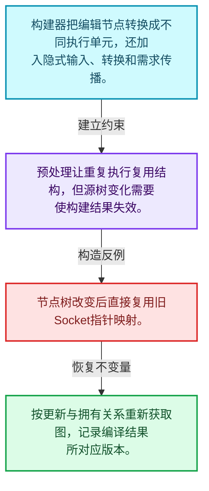
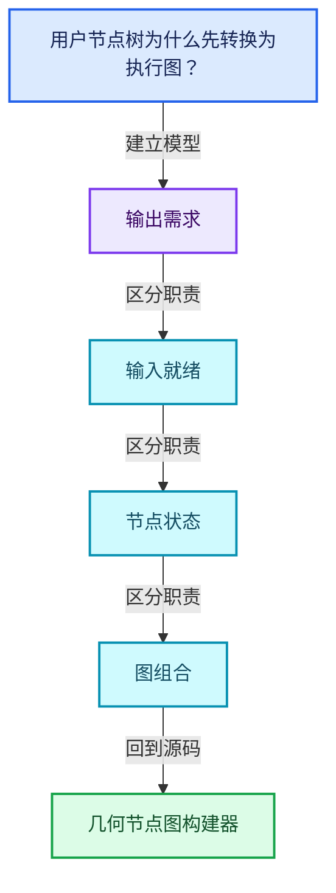
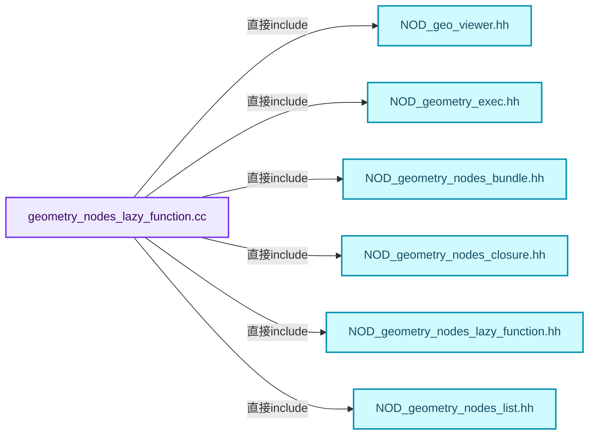
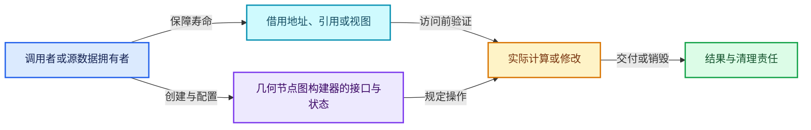
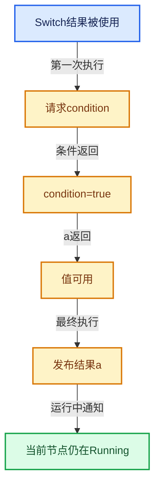

# 09-09 几何节点图构建器

[方向导航](README.md) · [总目录](../README.md) · [覆盖索引](../%E6%BA%90%E7%A0%81%E7%89%88%E6%9C%AC%E4%B8%8E%E8%A6%86%E7%9B%96%E7%B4%A2%E5%BC%95.md)

> 阅读顺序：问题与数据模型 → 语法与类型 → 源码逐行 → 调用线索 → 历史与取舍 → 推演和练习。

- 基准 HEAD：`cbda6b96c26c0dee3c3b5cbb93960c4ac06a6b30`。
- 记录日期：2026-10-14。
- 教学示例状态：正文中的推演不是本机性能实测；已运行练习见验收报告。

## 一、从问题到设计

用户节点树为什么先转换为执行图？

编辑模型与执行模型需求不同，构建器加入隐式转换、需求信息及特殊节点适配。

本篇把语法、数据语义和系统取舍连接起来。需求与就绪是不同维度；状态只在有证据时推进，不能把未确定当作无需求。

### 本篇独立模型与设计推理

构建器把编辑节点转换成不同执行单元，还加入隐式输入、转换和需求传播。

设计取舍：预处理让重复执行复用结构，但源树变化需要使构建结果失效。

最小反例：节点树改变后直接复用旧Socket指针映射。

推导与处理：按更新与拥有关系重新获取图，记录编译结果所对应版本。



### 源码范围与相邻篇章

| 文件 | 本篇逐行范围 | 基准SHA-256 |
|---|---|---|
| [source/blender/nodes/intern/geometry_nodes_lazy_function.cc](../../../../../source/blender/nodes/intern/geometry_nodes_lazy_function.cc) | L1—L1472 | `28f744e665608be8d326853f759fed4c20816eaf2f8e64b605bc8a2a6594c746` |

同一主讲文件可能分多篇覆盖；超出本篇范围的符号通过覆盖索引定位。空行与纯注释保留在源码摘录中，逐行表解释有效语句与语法边界；许可证头统一保留。

前篇：[输入请求与调度](08-%E8%BE%93%E5%85%A5%E8%AF%B7%E6%B1%82%E4%B8%8E%E8%B0%83%E5%BA%A6.md).

后篇：[普通节点与函数适配](10-%E6%99%AE%E9%80%9A%E8%8A%82%E7%82%B9%E4%B8%8E%E5%87%BD%E6%95%B0%E9%80%82%E9%85%8D.md).

## 二、类型、数据与阅读地图



这是概念依赖图，边表示阅读关系，不声称是运行时调用顺序。

### 直接编译依赖



箭头只表示头文件包含关系；完整调用线索见后面的符号定位表。

## 三、关键词、语法与类型角色

### 模板 template

模板把类型或常量作为生成实现的参数。读声明时先列出类型参数、非类型参数和默认值，再看使用者实际实例化了什么。模板声明本身不意味着每种T都支持其全部成员。

具体检查：把T替换为int、string、只能移动的类型，分别检查每个被调用操作是否成立。

### 依赖名称 typename

typename既可引入类型模板参数，也可告诉编译器某个依赖名称是类型。它不创建运行时对象；解析期确认语法类别与实例化期检查具体类型是不同阶段。

具体检查：区分typename T::value_type和T::size()，前者标记类型，后者是表达式。

### 约束 requires

requires表达式或requires子句限制模板参与重载的条件。它提供编译期可用性检查，不是运行时if，不能指望输入到达程序后再被这一机制验证。

具体检查：构造满足和不满足约束的两个类型，观察候选被排除而不是在函数内返回错误。

### 只读限定 const

const约束当前访问路径可做的修改。const指针、指向const的指针、const视图对象、const元素是不同位置的限定；其他别名可能仍可修改原对象。

具体检查：分别写T* const、const T*与const T* const，并画出不可修改的层次。

### 移动转换 std::move

std::move把表达式转换为可供移动重载选择的值类别，实际资源转移发生在被选中的构造或赋值中。对const对象move可能仍调用复制，对视图move也不会获得底层数据所有权。

具体检查：记录移动构造调用次数，不用变量名或std::move的出现次数替代测量。

### 异常边界 try与catch

try定义异常传播的局部边界。失败路径需要销毁已经成功构造的部分并释放相应存储；未构造的对象不能被析构。

具体检查：在第k次构造失败，列出已经存在的对象集合与待释放缓冲。

### 显式静态转换 static_cast

static_cast表达编译期允许的转换，不会自动验证运行时真实类型、指针寿命或索引边界。由void指针恢复T指针时，调用者仍须保证实际存储中确有合法T对象。

具体检查：标出转换前后的类型以及正确性依据来自哪里。

### 限定转换 const_cast

const_cast可以改变访问路径的限定，但不能让本来就是const的对象合法可写。常用于复用只读实现时，仍需检查底层对象是否实际可变。

具体检查：对非const对象的const引用与真正const对象分别分析修改是否合法。

### 覆写检查 override

override要求函数确实覆盖基类虚函数，可捕获参数类型和const限定不匹配。它不改变基类规定的生命周期或线程约束。

具体检查：故意改变一个参数或const，观察编译器如何拒绝误写的新函数。

### 可选值 optional

optional把不存在与存在的T区分开，T的构造和析构跟随engaged状态变化。访问前应由has_value或条件分支证明存在。

具体检查：把空Field状态与合法常量零区分，不能用某个普通值代替不存在。

### 构造与new表达式

普通new可能分配并构造；placement new在给定地址构造，存储由其他机制提供。失败回滚应区分两类责任。

具体检查：追踪地址来自哪里、构造何时成功、由谁析构、由谁释放。

### 内部断言 assert

断言表达开发者预期成立的内部契约，发布构建可能关闭。它不能替代对不可信输入的完整错误处理，也不保证后续操作被运行时保护。

具体检查：对每条断言构造违反条件的输入，区分调用者错误与应向用户报告的错误。

### 共享拥有 shared_ptr

shared_ptr让控制块跟踪共享寿命，不自动使被指向对象的读写线程安全；循环拥有可能阻止销毁。

具体检查：画出强引用环并考虑是否应改变所有权方向或引入弱引用。

### 类型别名 using

类型别名为已有类型建立名字，不创建运行期对象。它常把模板内部使用的类型统一暴露给泛型调用者。

具体检查：展开别名直到基础类型，区分类型别名和变量声明。

### 拥有型可调用包装 function

std::function保存可调用目标并提供统一调用接口，复制能力与目标要求有关；FunctionRef仅借用，二者不能无条件互换。

具体检查：比较同步回调与长期保存任务对拥有关系的不同要求。

## 四、真实源码与逐行讲解

源码块保持原行内容，原始行号由小节标题及逐行表给出。表中的调用定位是静态阅读辅助；重载、模板实例化、宏展开和虚调用需结合完整声明，不能仅凭词法出现证明动态调用。

### geometry_nodes_lazy_function.cc：L1—L48

<!-- source:source/blender/nodes/intern/geometry_nodes_lazy_function.cc:1:48 -->

```cpp
/* SPDX-FileCopyrightText: 2023 Blender Authors
 *
 * SPDX-License-Identifier: GPL-2.0-or-later */

/** \file
 * \ingroup nodes
 *
 * This file mainly converts a #bNodeTree into a lazy-function graph, that can then be evaluated to
 * execute geometry nodes. This generally works by creating a lazy-function for every node, which
 * is then put into the lazy-function graph. Then the nodes in the new graph are linked based on
 * links in the original #bNodeTree. Some additional nodes are inserted for things like type
 * conversions and multi-input sockets.
 *
 * If the #bNodeTree contains zones, those are turned into separate lazy-functions first.
 * Essentially, a separate lazy-function graph is created for every zone that is than called by the
 * parent zone or by the root graph.
 *
 * Currently, lazy-functions are even created for nodes that don't strictly require it, like
 * reroutes or muted nodes. In the future we could avoid that at the cost of additional code
 * complexity. So far, this does not seem to be a performance issue.
 */

#include "NOD_geo_viewer.hh"
#include "NOD_geometry_exec.hh"
#include "NOD_geometry_nodes_bundle.hh"
#include "NOD_geometry_nodes_closure.hh"
#include "NOD_geometry_nodes_lazy_function.hh"
#include "NOD_geometry_nodes_list.hh"
#include "NOD_multi_function.hh"
#include "NOD_node_declaration.hh"
#include "NOD_shader_nodes_multi_function.hh"

#include "BLI_array_utils.hh"
#include "BLI_bit_group_vector.hh"
#include "BLI_bit_span_ops.hh"
#include "BLI_lazy_threading.hh"
#include "BLI_map.hh"
#include "BLI_stack.hh"

#include "DNA_ID.h"

#include "BKE_anonymous_attribute_make.hh"
#include "BKE_compute_contexts.hh"
#include "BKE_geometry_nodes_gizmos_transforms.hh"
#include "BKE_geometry_set.hh"
#include "BKE_grease_pencil.hh"
#include "BKE_lib_id.hh"
#include "BKE_library.hh"
```

| 原始行 | 语义、约束与检查 |
|---|---|
| L23 | 引入编译依赖 "NOD_geo_viewer.hh"；这是声明可见性关系，不表示运行时一定调用该文件的所有接口。 |
| L24 | 引入编译依赖 "NOD_geometry_exec.hh"；这是声明可见性关系，不表示运行时一定调用该文件的所有接口。 |
| L25 | 引入编译依赖 "NOD_geometry_nodes_bundle.hh"；这是声明可见性关系，不表示运行时一定调用该文件的所有接口。 |
| L26 | 引入编译依赖 "NOD_geometry_nodes_closure.hh"；这是声明可见性关系，不表示运行时一定调用该文件的所有接口。 |
| L27 | 引入编译依赖 "NOD_geometry_nodes_lazy_function.hh"；这是声明可见性关系，不表示运行时一定调用该文件的所有接口。 |
| L28 | 引入编译依赖 "NOD_geometry_nodes_list.hh"；这是声明可见性关系，不表示运行时一定调用该文件的所有接口。 |
| L29 | 引入编译依赖 "NOD_multi_function.hh"；这是声明可见性关系，不表示运行时一定调用该文件的所有接口。 |
| L30 | 引入编译依赖 "NOD_node_declaration.hh"；这是声明可见性关系，不表示运行时一定调用该文件的所有接口。 |
| L31 | 引入编译依赖 "NOD_shader_nodes_multi_function.hh"；这是声明可见性关系，不表示运行时一定调用该文件的所有接口。 |
| L33 | 引入编译依赖 "BLI_array_utils.hh"；这是声明可见性关系，不表示运行时一定调用该文件的所有接口。 |
| L34 | 引入编译依赖 "BLI_bit_group_vector.hh"；这是声明可见性关系，不表示运行时一定调用该文件的所有接口。 |
| L35 | 引入编译依赖 "BLI_bit_span_ops.hh"；这是声明可见性关系，不表示运行时一定调用该文件的所有接口。 |
| L36 | 引入编译依赖 "BLI_lazy_threading.hh"；这是声明可见性关系，不表示运行时一定调用该文件的所有接口。 |
| L37 | 引入编译依赖 "BLI_map.hh"；这是声明可见性关系，不表示运行时一定调用该文件的所有接口。 |
| L38 | 引入编译依赖 "BLI_stack.hh"；这是声明可见性关系，不表示运行时一定调用该文件的所有接口。 |
| L40 | 引入编译依赖 "DNA_ID.h"；这是声明可见性关系，不表示运行时一定调用该文件的所有接口。 |
| L42 | 引入编译依赖 "BKE_anonymous_attribute_make.hh"；这是声明可见性关系，不表示运行时一定调用该文件的所有接口。 |
| L43 | 引入编译依赖 "BKE_compute_contexts.hh"；这是声明可见性关系，不表示运行时一定调用该文件的所有接口。 |
| L44 | 引入编译依赖 "BKE_geometry_nodes_gizmos_transforms.hh"；这是声明可见性关系，不表示运行时一定调用该文件的所有接口。 |
| L45 | 引入编译依赖 "BKE_geometry_set.hh"；这是声明可见性关系，不表示运行时一定调用该文件的所有接口。 |
| L46 | 引入编译依赖 "BKE_grease_pencil.hh"；这是声明可见性关系，不表示运行时一定调用该文件的所有接口。 |
| L47 | 引入编译依赖 "BKE_lib_id.hh"；这是声明可见性关系，不表示运行时一定调用该文件的所有接口。 |
| L48 | 引入编译依赖 "BKE_library.hh"；这是声明可见性关系，不表示运行时一定调用该文件的所有接口。 |

### geometry_nodes_lazy_function.cc：L49—L80

<!-- source:source/blender/nodes/intern/geometry_nodes_lazy_function.cc:49:80 -->

```cpp
#include "BKE_node_legacy_types.hh"
#include "BKE_node_runtime.hh"
#include "BKE_node_socket_value.hh"
#include "BKE_node_socket_value_iter.hh"
#include "BKE_node_tree_reference_lifetimes.hh"
#include "BKE_node_tree_zones.hh"
#include "BKE_scene.hh"
#include "BKE_type_conversions.hh"

#include "ED_node.hh"

#include "FN_lazy_function_graph_executor.hh"

#include "DEG_depsgraph_query.hh"

#include "GEO_foreach_geometry.hh"

#include "list_function_eval.hh"
#include "volume_grid_function_eval.hh"

#include <fmt/format.h>
#include <iostream>
#include <sstream>

namespace blender::nodes {

using bke::bNodeTreeZone;
using bke::bNodeTreeZones;
using bke::SocketValueVariant;
using bke::node_tree_reference_lifetimes::ReferenceLifetimesInfo;
using bke::node_tree_reference_lifetimes::ReferenceSetInfo;
using bke::node_tree_reference_lifetimes::ReferenceSetType;
```

| 原始行 | 语义、约束与检查 |
|---|---|
| L49 | 引入编译依赖 "BKE_node_legacy_types.hh"；这是声明可见性关系，不表示运行时一定调用该文件的所有接口。 |
| L50 | 引入编译依赖 "BKE_node_runtime.hh"；这是声明可见性关系，不表示运行时一定调用该文件的所有接口。 |
| L51 | 引入编译依赖 "BKE_node_socket_value.hh"；这是声明可见性关系，不表示运行时一定调用该文件的所有接口。 |
| L52 | 引入编译依赖 "BKE_node_socket_value_iter.hh"；这是声明可见性关系，不表示运行时一定调用该文件的所有接口。 |
| L53 | 引入编译依赖 "BKE_node_tree_reference_lifetimes.hh"；这是声明可见性关系，不表示运行时一定调用该文件的所有接口。 |
| L54 | 引入编译依赖 "BKE_node_tree_zones.hh"；这是声明可见性关系，不表示运行时一定调用该文件的所有接口。 |
| L55 | 引入编译依赖 "BKE_scene.hh"；这是声明可见性关系，不表示运行时一定调用该文件的所有接口。 |
| L56 | 引入编译依赖 "BKE_type_conversions.hh"；这是声明可见性关系，不表示运行时一定调用该文件的所有接口。 |
| L58 | 引入编译依赖 "ED_node.hh"；这是声明可见性关系，不表示运行时一定调用该文件的所有接口。 |
| L60 | 引入编译依赖 "FN_lazy_function_graph_executor.hh"；这是声明可见性关系，不表示运行时一定调用该文件的所有接口。 |
| L62 | 引入编译依赖 "DEG_depsgraph_query.hh"；这是声明可见性关系，不表示运行时一定调用该文件的所有接口。 |
| L64 | 引入编译依赖 "GEO_foreach_geometry.hh"；这是声明可见性关系，不表示运行时一定调用该文件的所有接口。 |
| L66 | 引入编译依赖 "list_function_eval.hh"；这是声明可见性关系，不表示运行时一定调用该文件的所有接口。 |
| L67 | 引入编译依赖 "volume_grid_function_eval.hh"；这是声明可见性关系，不表示运行时一定调用该文件的所有接口。 |
| L69 | 引入编译依赖 <fmt/format.h>；这是声明可见性关系，不表示运行时一定调用该文件的所有接口。 |
| L70 | 引入编译依赖 <iostream>；这是声明可见性关系，不表示运行时一定调用该文件的所有接口。 |
| L71 | 引入编译依赖 <sstream>；这是声明可见性关系，不表示运行时一定调用该文件的所有接口。 |
| L73 | 把后续声明放入 blender::nodes 命名空间，影响名称查找和符号归属，不创建运行时对象。 |
| L75 | 定义类型别名 `using bke::bNodeTreeZone`，为模板接口或内部实现统一命名；本行不分配该类型对象。 |
| L76 | 定义类型别名 `using bke::bNodeTreeZones`，为模板接口或内部实现统一命名；本行不分配该类型对象。 |
| L77 | 定义类型别名 `using bke::SocketValueVariant`，为模板接口或内部实现统一命名；本行不分配该类型对象。 |
| L78 | 定义类型别名 `using bke::node_tree_reference_lifetimes::ReferenceLifetimesInfo`，为模板接口或内部实现统一命名；本行不分配该类型对象。 |
| L79 | 定义类型别名 `using bke::node_tree_reference_lifetimes::ReferenceSetInfo`，为模板接口或内部实现统一命名；本行不分配该类型对象。 |
| L80 | 定义类型别名 `using bke::node_tree_reference_lifetimes::ReferenceSetType`，为模板接口或内部实现统一命名；本行不分配该类型对象。 |

### geometry_nodes_lazy_function.cc：L81—L128

<!-- source:source/blender/nodes/intern/geometry_nodes_lazy_function.cc:81:128 -->

```cpp

/**
 * Checks which sockets of the node are available and creates corresponding inputs/outputs on the
 * lazy-function.
 */
static void lazy_function_interface_from_node(const bNode &node,
                                              Vector<lf::Input> &r_inputs,
                                              Vector<lf::Output> &r_outputs,
                                              MutableSpan<int> r_lf_index_by_bsocket)
{
  const bool is_muted = node.is_muted();
  const lf::ValueUsage input_usage = lf::ValueUsage::Used;
  for (const bNodeSocket *socket : node.input_sockets()) {
    if (!socket->is_available()) {
      continue;
    }
    if (!socket->typeinfo->geometry_nodes_default_value) {
      continue;
    }
    const CPPType *type;
    if (socket->is_multi_input() && !is_muted) {
      type = &CPPType::get<GeoNodesMultiInput<SocketValueVariant>>();
    }
    else {
      type = &CPPType::get<SocketValueVariant>();
    }
    r_lf_index_by_bsocket[socket->index_in_tree()] = r_inputs.append_and_get_index_as(
        socket->name, *type, input_usage);
  }
  for (const bNodeSocket *socket : node.output_sockets()) {
    if (!socket->is_available()) {
      continue;
    }
    if (!socket->typeinfo->geometry_nodes_default_value) {
      continue;
    }
    r_lf_index_by_bsocket[socket->index_in_tree()] = r_outputs.append_and_get_index_as(
        socket->name, CPPType::get<SocketValueVariant>());
  }
}

/**
 * Used for most normal geometry nodes like Subdivision Surface and Set Position.
 */
class LazyFunctionForGeometryNode : public LazyFunction {
 private:
  const bNode &node_;
  const GeometryNodesLazyFunctionGraphInfo &own_lf_graph_info_;
```

本段语义重点：

- 分支证据 `!socket->is_available())`：分别推演条件成立与不成立，核对相同出口处的状态。
- 分支证据 `!socket->typeinfo->geometry_nodes_default_value)`：分别推演条件成立与不成立，核对相同出口处的状态。

| 原始行 | 语义、约束与检查 |
|---|---|
| L86 | 出现调用或函数声明 `lazy_function_interface_from_node`，对应表达式为 `static void lazy_function_interface_from_node(const bNode &node,`。参数求值、返回类型与重载需结合前后完整语句；静态文本引用不能证明动态目标。 |
| L87 | 本行是连续声明或表达式的一部分：`Vector<lf::Input> &r_inputs,`。与本段前后行合读；逗号、括号和限定符决定它属于参数、初始化列表还是实际计算。 |
| L88 | 本行是连续声明或表达式的一部分：`Vector<lf::Output> &r_outputs,`。与本段前后行合读；逗号、括号和限定符决定它属于参数、初始化列表还是实际计算。 |
| L89 | 本行是连续声明或表达式的一部分：`MutableSpan<int> r_lf_index_by_bsocket)`。与本段前后行合读；逗号、括号和限定符决定它属于参数、初始化列表还是实际计算。 |
| L90 | 连接上一行的声明或控制结构与其语句块；后续行在这个作用域中执行或声明。 |
| L91 | 把右侧 `node.is_muted()` 用于初始化或更新左侧 `const bool is_muted`。声明初始化与已有对象赋值应按上下文区分；有资源的类型会调用相应特殊成员。 |
| L92 | 把右侧 `lf::ValueUsage::Used` 用于初始化或更新左侧 `const lf::ValueUsage input_usage`。声明初始化与已有对象赋值应按上下文区分；有资源的类型会调用相应特殊成员。 |
| L93 | 按 `for (const bNodeSocket *socket : node.input_sockets())` 指定的范围或条件重复执行。对照循环变量与真实元素编号；循环内调用成本乘以实际迭代次数。 |
| L94 | 判断 `!socket->is_available()`，成立时进入本分支，否则继续后续路径。 |
| L95 | 结束本轮循环并进入下一轮；核对本轮已经取得的资源是否由作用域或显式代码清理。 |
| L96 | 结束当前语法单元。局部自动对象在离开其作用域时按规则销毁；这不等于所有被引用的外部数据也被释放。 |
| L97 | 判断 `!socket->typeinfo->geometry_nodes_default_value`，成立时进入本分支，否则继续后续路径。 |
| L98 | 结束本轮循环并进入下一轮；核对本轮已经取得的资源是否由作用域或显式代码清理。 |
| L99 | 结束当前语法单元。局部自动对象在离开其作用域时按规则销毁；这不等于所有被引用的外部数据也被释放。 |
| L100 | 声明成员、局部对象或完成语句 `const CPPType *type`。若为指针或引用，它本身不说明拥有；若为值对象，其构造析构由所在作用域或外层对象管理。 |
| L101 | 判断 `socket->is_multi_input() && !is_muted`，成立时进入本分支，否则继续后续路径。 |
| L102 | 把右侧 `&CPPType::get<GeoNodesMultiInput<SocketValueVariant>>()` 用于初始化或更新左侧 `type`。声明初始化与已有对象赋值应按上下文区分；有资源的类型会调用相应特殊成员。 |
| L103 | 结束当前语法单元。局部自动对象在离开其作用域时按规则销毁；这不等于所有被引用的外部数据也被释放。 |
| L104 | 处理前一条件不成立的互补路径。比较两条路径最后是否恢复同一不变量，以及是否产生不同的资源责任。 |
| L105 | 把右侧 `&CPPType::get<SocketValueVariant>()` 用于初始化或更新左侧 `type`。声明初始化与已有对象赋值应按上下文区分；有资源的类型会调用相应特殊成员。 |
| L106 | 结束当前语法单元。局部自动对象在离开其作用域时按规则销毁；这不等于所有被引用的外部数据也被释放。 |
| L107 | 把右侧 `r_inputs.append_and_get_index_as(` 用于初始化或更新左侧 `r_lf_index_by_bsocket[socket->index_in_tree()]`。声明初始化与已有对象赋值应按上下文区分；有资源的类型会调用相应特殊成员。 |
| L108 | 声明成员、局部对象或完成语句 `socket->name, *type, input_usage)`。若为指针或引用，它本身不说明拥有；若为值对象，其构造析构由所在作用域或外层对象管理。 |
| L109 | 结束当前语法单元。局部自动对象在离开其作用域时按规则销毁；这不等于所有被引用的外部数据也被释放。 |
| L110 | 按 `for (const bNodeSocket *socket : node.output_sockets())` 指定的范围或条件重复执行。对照循环变量与真实元素编号；循环内调用成本乘以实际迭代次数。 |
| L111 | 判断 `!socket->is_available()`，成立时进入本分支，否则继续后续路径。 |
| L112 | 结束本轮循环并进入下一轮；核对本轮已经取得的资源是否由作用域或显式代码清理。 |
| L113 | 结束当前语法单元。局部自动对象在离开其作用域时按规则销毁；这不等于所有被引用的外部数据也被释放。 |
| L114 | 判断 `!socket->typeinfo->geometry_nodes_default_value`，成立时进入本分支，否则继续后续路径。 |
| L115 | 结束本轮循环并进入下一轮；核对本轮已经取得的资源是否由作用域或显式代码清理。 |
| L116 | 结束当前语法单元。局部自动对象在离开其作用域时按规则销毁；这不等于所有被引用的外部数据也被释放。 |
| L117 | 把右侧 `r_outputs.append_and_get_index_as(` 用于初始化或更新左侧 `r_lf_index_by_bsocket[socket->index_in_tree()]`。声明初始化与已有对象赋值应按上下文区分；有资源的类型会调用相应特殊成员。 |
| L118 | 出现调用或函数声明 `CPPType::get`，对应表达式为 `socket->name, CPPType::get<SocketValueVariant>());`。参数求值、返回类型与重载需结合前后完整语句；静态文本引用不能证明动态目标。 |
| L119 | 结束当前语法单元。局部自动对象在离开其作用域时按规则销毁；这不等于所有被引用的外部数据也被释放。 |
| L120 | 结束当前语法单元。局部自动对象在离开其作用域时按规则销毁；这不等于所有被引用的外部数据也被释放。 |
| L125 | 声明或定义类型 `class LazyFunctionForGeometryNode : public LazyFunction`。结合继承、访问权限和成员布局确认接口与拥有关系；前向声明本身没有完整对象布局。 |
| L126 | 切换成员访问权限为 private；它是编译期接口边界，不是线程同步或内存保护。 |
| L127 | 声明成员、局部对象或完成语句 `const bNode &node_`。若为指针或引用，它本身不说明拥有；若为值对象，其构造析构由所在作用域或外层对象管理。 |
| L128 | 声明成员、局部对象或完成语句 `const GeometryNodesLazyFunctionGraphInfo &own_lf_graph_info_`。若为指针或引用，它本身不说明拥有；若为值对象，其构造析构由所在作用域或外层对象管理。 |

### geometry_nodes_lazy_function.cc：L129—L185

<!-- source:source/blender/nodes/intern/geometry_nodes_lazy_function.cc:129:185 -->

```cpp
  /**
   * A bool for every output bsocket. If true, the socket just outputs a field containing an
   * anonymous attribute id. If only such outputs are requested by other nodes, the node itself
   * does not have to execute.
   */
  Vector<bool> is_attribute_output_bsocket_;

 public:
  LazyFunctionForGeometryNode(const bNode &node,
                              GeometryNodesLazyFunctionGraphInfo &own_lf_graph_info)
      : node_(node),
        own_lf_graph_info_(own_lf_graph_info),
        is_attribute_output_bsocket_(node.output_sockets().size(), false)
  {
    BLI_assert(node.typeinfo->geometry_node_execute != nullptr);
    debug_name_ = node.name;
    lazy_function_interface_from_node(
        node, inputs_, outputs_, own_lf_graph_info.mapping.lf_index_by_bsocket);

    const NodeDeclaration &node_decl = *node.declaration();
    const rl::RelationsInNode *relations = node_decl.reference_lifetime_relations();
    if (relations == nullptr) {
      return;
    }
    bool has_anonymous_attribute_output = false;
    for (const int output_i : node_decl.outputs.index_range()) {
      const SocketDeclaration *socket_decl = node_decl.outputs[output_i];
      if (socket_decl->is_anonymous_attribute_output) {
        const bNodeSocket &output = node.output_socket(output_i);
        has_anonymous_attribute_output = true;
        is_attribute_output_bsocket_[output_i] = true;
        const int lf_index = inputs_.append_and_get_index_as("Output Used", CPPType::get<bool>());
        own_lf_graph_info.mapping
            .lf_input_index_for_output_bsocket_usage[output.index_in_all_outputs()] = lf_index;
      }
    }
    if (has_anonymous_attribute_output) {
      /* Inputs are only used when an output is used that is not just outputting an anonymous
       * attribute field. */
      for (lf::Input &input : inputs_) {
        input.usage = lf::ValueUsage::Maybe;
      }
    }

    Vector<const bNodeSocket *> handled_data_outputs;
    for (const rl::DataPropagation &relation : relations->data_propagations) {
      const bNodeSocket &output_bsocket = node.output_socket(relation.to_output);
      if (output_bsocket.is_available() && !handled_data_outputs.contains(&output_bsocket)) {
        handled_data_outputs.append(&output_bsocket);
        const int lf_index = inputs_.append_and_get_index_as(
            "Propagate to Output", CPPType::get<GeometryNodesReferenceSet>());
        own_lf_graph_info.mapping
            .lf_input_index_for_reference_set_for_output[output_bsocket.index_in_all_outputs()] =
            lf_index;
      }
    }
  }
```

本段语义重点：

- `usage`：值使用需求，Maybe、Used与Unused各有不同含义。

| 原始行 | 语义、约束与检查 |
|---|---|
| L134 | 声明成员、局部对象或完成语句 `Vector<bool> is_attribute_output_bsocket_`。若为指针或引用，它本身不说明拥有；若为值对象，其构造析构由所在作用域或外层对象管理。 |
| L136 | 切换成员访问权限为 public；它是编译期接口边界，不是线程同步或内存保护。 |
| L137 | 出现调用或函数声明 `LazyFunctionForGeometryNode`，对应表达式为 `LazyFunctionForGeometryNode(const bNode &node,`。参数求值、返回类型与重载需结合前后完整语句；静态文本引用不能证明动态目标。 |
| L138 | 本行是连续声明或表达式的一部分：`GeometryNodesLazyFunctionGraphInfo &own_lf_graph_info)`。与本段前后行合读；逗号、括号和限定符决定它属于参数、初始化列表还是实际计算。 |
| L139 | 出现调用或函数声明 `node_`，对应表达式为 `: node_(node),`。参数求值、返回类型与重载需结合前后完整语句；静态文本引用不能证明动态目标。 |
| L140 | 出现调用或函数声明 `own_lf_graph_info_`，对应表达式为 `own_lf_graph_info_(own_lf_graph_info),`。参数求值、返回类型与重载需结合前后完整语句；静态文本引用不能证明动态目标。 |
| L141 | 出现调用或函数声明 `is_attribute_output_bsocket_`，对应表达式为 `is_attribute_output_bsocket_(node.output_sockets().size(), false)`。参数求值、返回类型与重载需结合前后完整语句；静态文本引用不能证明动态目标。 |
| L142 | 连接上一行的声明或控制结构与其语句块；后续行在这个作用域中执行或声明。 |
| L143 | 断言约束 `BLI_assert(node.typeinfo->geometry_node_execute != nullptr);`。条件是后续访问的内部前置条件；发布构建可能不执行，不能把断言当作输入修复。 |
| L144 | 把右侧 `node.name` 用于初始化或更新左侧 `debug_name_`。声明初始化与已有对象赋值应按上下文区分；有资源的类型会调用相应特殊成员。 |
| L145 | 出现调用或函数声明 `lazy_function_interface_from_node`，对应表达式为 `lazy_function_interface_from_node(`。参数求值、返回类型与重载需结合前后完整语句；静态文本引用不能证明动态目标。 |
| L146 | 声明成员、局部对象或完成语句 `node, inputs_, outputs_, own_lf_graph_info.mapping.lf_index_by_bsocket)`。若为指针或引用，它本身不说明拥有；若为值对象，其构造析构由所在作用域或外层对象管理。 |
| L148 | 把右侧 `*node.declaration()` 用于初始化或更新左侧 `const NodeDeclaration &node_decl`。声明初始化与已有对象赋值应按上下文区分；有资源的类型会调用相应特殊成员。 |
| L149 | 把右侧 `node_decl.reference_lifetime_relations()` 用于初始化或更新左侧 `const rl::RelationsInNode *relations`。声明初始化与已有对象赋值应按上下文区分；有资源的类型会调用相应特殊成员。 |
| L150 | 判断 `relations == nullptr`，成立时进入本分支，否则继续后续路径。这里区分空地址与可用地址，但非空本身仍不能证明对象存活。 |
| L151 | 结束当前函数，本路径不再执行后续语句；局部对象按作用域规则清理。 |
| L152 | 结束当前语法单元。局部自动对象在离开其作用域时按规则销毁；这不等于所有被引用的外部数据也被释放。 |
| L153 | 把右侧 `false` 用于初始化或更新左侧 `bool has_anonymous_attribute_output`。声明初始化与已有对象赋值应按上下文区分；有资源的类型会调用相应特殊成员。 |
| L154 | 按 `for (const int output_i : node_decl.outputs.index_range())` 指定的范围或条件重复执行。对照循环变量与真实元素编号；循环内调用成本乘以实际迭代次数。 |
| L155 | 把右侧 `node_decl.outputs[output_i]` 用于初始化或更新左侧 `const SocketDeclaration *socket_decl`。声明初始化与已有对象赋值应按上下文区分；有资源的类型会调用相应特殊成员。 |
| L156 | 判断 `socket_decl->is_anonymous_attribute_output`，成立时进入本分支，否则继续后续路径。 |
| L157 | 把右侧 `node.output_socket(output_i)` 用于初始化或更新左侧 `const bNodeSocket &output`。声明初始化与已有对象赋值应按上下文区分；有资源的类型会调用相应特殊成员。 |
| L158 | 把右侧 `true` 用于初始化或更新左侧 `has_anonymous_attribute_output`。声明初始化与已有对象赋值应按上下文区分；有资源的类型会调用相应特殊成员。 |
| L159 | 把右侧 `true` 用于初始化或更新左侧 `is_attribute_output_bsocket_[output_i]`。声明初始化与已有对象赋值应按上下文区分；有资源的类型会调用相应特殊成员。 |
| L160 | 把右侧 `inputs_.append_and_get_index_as("Output Used", CPPType::get<bool>())` 用于初始化或更新左侧 `const int lf_index`。声明初始化与已有对象赋值应按上下文区分；有资源的类型会调用相应特殊成员。 |
| L161 | 本行是连续声明或表达式的一部分：`own_lf_graph_info.mapping`。与本段前后行合读；逗号、括号和限定符决定它属于参数、初始化列表还是实际计算。 |
| L162 | 把右侧 `lf_index` 用于初始化或更新左侧 `.lf_input_index_for_output_bsocket_usage[output.index_in_all_outputs()]`。声明初始化与已有对象赋值应按上下文区分；有资源的类型会调用相应特殊成员。 |
| L163 | 结束当前语法单元。局部自动对象在离开其作用域时按规则销毁；这不等于所有被引用的外部数据也被释放。 |
| L164 | 结束当前语法单元。局部自动对象在离开其作用域时按规则销毁；这不等于所有被引用的外部数据也被释放。 |
| L165 | 判断 `has_anonymous_attribute_output`，成立时进入本分支，否则继续后续路径。 |
| L168 | 按 `for (lf::Input &input : inputs_)` 指定的范围或条件重复执行。对照循环变量与真实元素编号；循环内调用成本乘以实际迭代次数。 |
| L169 | 建立或更新 `usage`：值使用需求，Maybe、Used与Unused各有不同含义。本行的具体值关系为 `input.usage = lf::ValueUsage::Maybe`；对照更新前后相应范围或状态是否一致。 |
| L170 | 结束当前语法单元。局部自动对象在离开其作用域时按规则销毁；这不等于所有被引用的外部数据也被释放。 |
| L171 | 结束当前语法单元。局部自动对象在离开其作用域时按规则销毁；这不等于所有被引用的外部数据也被释放。 |
| L173 | 声明成员、局部对象或完成语句 `Vector<const bNodeSocket *> handled_data_outputs`。若为指针或引用，它本身不说明拥有；若为值对象，其构造析构由所在作用域或外层对象管理。 |
| L174 | 按 `for (const rl::DataPropagation &relation : relations->data_propagations)` 指定的范围或条件重复执行。对照循环变量与真实元素编号；循环内调用成本乘以实际迭代次数。 |
| L175 | 把右侧 `node.output_socket(relation.to_output)` 用于初始化或更新左侧 `const bNodeSocket &output_bsocket`。声明初始化与已有对象赋值应按上下文区分；有资源的类型会调用相应特殊成员。 |
| L176 | 判断 `output_bsocket.is_available() && !handled_data_outputs.contains(&output_bsocket)`，成立时进入本分支，否则继续后续路径。 |
| L177 | 出现调用或函数声明 `append`，对应表达式为 `handled_data_outputs.append(&output_bsocket);`。参数求值、返回类型与重载需结合前后完整语句；静态文本引用不能证明动态目标。 |
| L178 | 把右侧 `inputs_.append_and_get_index_as(` 用于初始化或更新左侧 `const int lf_index`。声明初始化与已有对象赋值应按上下文区分；有资源的类型会调用相应特殊成员。 |
| L179 | 出现调用或函数声明 `CPPType::get`，对应表达式为 `"Propagate to Output", CPPType::get<GeometryNodesReferenceSet>());`。参数求值、返回类型与重载需结合前后完整语句；静态文本引用不能证明动态目标。 |
| L180 | 本行是连续声明或表达式的一部分：`own_lf_graph_info.mapping`。与本段前后行合读；逗号、括号和限定符决定它属于参数、初始化列表还是实际计算。 |
| L181 | 把右侧 `` 用于初始化或更新左侧 `.lf_input_index_for_reference_set_for_output[output_bsocket.index_in_all_outputs()]`。声明初始化与已有对象赋值应按上下文区分；有资源的类型会调用相应特殊成员。 |
| L182 | 声明成员、局部对象或完成语句 `lf_index`。若为指针或引用，它本身不说明拥有；若为值对象，其构造析构由所在作用域或外层对象管理。 |
| L183 | 结束当前语法单元。局部自动对象在离开其作用域时按规则销毁；这不等于所有被引用的外部数据也被释放。 |
| L184 | 结束当前语法单元。局部自动对象在离开其作用域时按规则销毁；这不等于所有被引用的外部数据也被释放。 |
| L185 | 结束当前语法单元。局部自动对象在离开其作用域时按规则销毁；这不等于所有被引用的外部数据也被释放。 |

### geometry_nodes_lazy_function.cc：L186—L249

<!-- source:source/blender/nodes/intern/geometry_nodes_lazy_function.cc:186:249 -->

```cpp

  void execute_impl(lf::Params &params, const lf::Context &context) const override
  {
    const ScopedNodeTimer node_timer{context, node_};

    GeoNodesUserData *user_data = dynamic_cast<GeoNodesUserData *>(context.user_data);
    BLI_assert(user_data != nullptr);

    bool used_non_attribute_output_exists = false;
    for (const int output_bsocket_index : node_.output_sockets().index_range()) {
      const bNodeSocket &output_bsocket = node_.output_socket(output_bsocket_index);
      const int lf_index =
          own_lf_graph_info_.mapping.lf_index_by_bsocket[output_bsocket.index_in_tree()];
      if (lf_index == -1) {
        continue;
      }
      const lf::ValueUsage output_usage = params.get_output_usage(lf_index);
      if (output_usage == lf::ValueUsage::Unused) {
        continue;
      }
      if (is_attribute_output_bsocket_[output_bsocket_index]) {
        if (params.output_was_set(lf_index)) {
          continue;
        }
        this->output_anonymous_attribute_field(params, *user_data, lf_index, output_bsocket);
      }
      else {
        if (output_usage == lf::ValueUsage::Used) {
          used_non_attribute_output_exists = true;
        }
      }
    }

    if (!used_non_attribute_output_exists) {
      /* Only attribute outputs are used currently, no need to evaluate the full node and its
       * inputs. */
      return;
    }

    bool missing_input = false;
    for (const int lf_index : inputs_.index_range()) {
      if (params.try_get_input_data_ptr_or_request(lf_index) == nullptr) {
        missing_input = true;
      }
    }
    if (missing_input) {
      /* Wait until all inputs are available. */
      return;
    }

    auto get_anonymous_attribute_name = [&](const int i) {
      return this->anonymous_attribute_name_for_output(*user_data, i);
    };

    GeoNodeExecParams geo_params{
        node_,
        params,
        context,
        own_lf_graph_info_.mapping.lf_input_index_for_output_bsocket_usage,
        own_lf_graph_info_.mapping.lf_input_index_for_reference_set_for_output,
        get_anonymous_attribute_name};

    node_.typeinfo->geometry_node_execute(geo_params);
  }
```

本段语义重点：

- `try_get_input`：尝试读取已可用输入；未就绪与合法空值应使用接口约定区分。
- `get_output_usage`：读取输出需求，依据它决定是否请求额外输入。

| 原始行 | 语义、约束与检查 |
|---|---|
| L187 | 出现调用或函数声明 `execute_impl`，对应表达式为 `void execute_impl(lf::Params &params, const lf::Context &context) const override`。参数求值、返回类型与重载需结合前后完整语句；静态文本引用不能证明动态目标。 |
| L188 | 连接上一行的声明或控制结构与其语句块；后续行在这个作用域中执行或声明。 |
| L189 | 声明成员、局部对象或完成语句 `const ScopedNodeTimer node_timer{context, node_}`。若为指针或引用，它本身不说明拥有；若为值对象，其构造析构由所在作用域或外层对象管理。 |
| L191 | 把右侧 `dynamic_cast<GeoNodesUserData *>(context.user_data)` 用于初始化或更新左侧 `GeoNodesUserData *user_data`。声明初始化与已有对象赋值应按上下文区分；有资源的类型会调用相应特殊成员。 |
| L192 | 断言约束 `BLI_assert(user_data != nullptr);`。条件是后续访问的内部前置条件；发布构建可能不执行，不能把断言当作输入修复。 |
| L194 | 把右侧 `false` 用于初始化或更新左侧 `bool used_non_attribute_output_exists`。声明初始化与已有对象赋值应按上下文区分；有资源的类型会调用相应特殊成员。 |
| L195 | 按 `for (const int output_bsocket_index : node_.output_sockets().index_range())` 指定的范围或条件重复执行。对照循环变量与真实元素编号；循环内调用成本乘以实际迭代次数。 |
| L196 | 把右侧 `node_.output_socket(output_bsocket_index)` 用于初始化或更新左侧 `const bNodeSocket &output_bsocket`。声明初始化与已有对象赋值应按上下文区分；有资源的类型会调用相应特殊成员。 |
| L197 | 把右侧 `` 用于初始化或更新左侧 `const int lf_index`。声明初始化与已有对象赋值应按上下文区分；有资源的类型会调用相应特殊成员。 |
| L198 | 出现调用或函数声明 `index_in_tree`，对应表达式为 `own_lf_graph_info_.mapping.lf_index_by_bsocket[output_bsocket.index_in_tree()];`。参数求值、返回类型与重载需结合前后完整语句；静态文本引用不能证明动态目标。 |
| L199 | 判断 `lf_index == -1`，成立时进入本分支，否则继续后续路径。 |
| L200 | 结束本轮循环并进入下一轮；核对本轮已经取得的资源是否由作用域或显式代码清理。 |
| L201 | 结束当前语法单元。局部自动对象在离开其作用域时按规则销毁；这不等于所有被引用的外部数据也被释放。 |
| L202 | 本行使用 `get_output_usage`：读取输出需求，依据它决定是否请求额外输入。 |
| L203 | 判断 `output_usage == lf::ValueUsage::Unused`，成立时进入本分支，否则继续后续路径。此处处理需求状态；不要把未知需求直接当作不需要。 |
| L204 | 结束本轮循环并进入下一轮；核对本轮已经取得的资源是否由作用域或显式代码清理。 |
| L205 | 结束当前语法单元。局部自动对象在离开其作用域时按规则销毁；这不等于所有被引用的外部数据也被释放。 |
| L206 | 判断 `is_attribute_output_bsocket_[output_bsocket_index]`，成立时进入本分支，否则继续后续路径。 |
| L207 | 判断 `params.output_was_set(lf_index)`，成立时进入本分支，否则继续后续路径。 |
| L208 | 结束本轮循环并进入下一轮；核对本轮已经取得的资源是否由作用域或显式代码清理。 |
| L209 | 结束当前语法单元。局部自动对象在离开其作用域时按规则销毁；这不等于所有被引用的外部数据也被释放。 |
| L210 | 出现调用或函数声明 `output_anonymous_attribute_field`，对应表达式为 `this->output_anonymous_attribute_field(params, *user_data, lf_index, output_bsocket);`。参数求值、返回类型与重载需结合前后完整语句；静态文本引用不能证明动态目标。 |
| L211 | 结束当前语法单元。局部自动对象在离开其作用域时按规则销毁；这不等于所有被引用的外部数据也被释放。 |
| L212 | 处理前一条件不成立的互补路径。比较两条路径最后是否恢复同一不变量，以及是否产生不同的资源责任。 |
| L213 | 判断 `output_usage == lf::ValueUsage::Used`，成立时进入本分支，否则继续后续路径。此处处理需求状态；不要把未知需求直接当作不需要。 |
| L214 | 把右侧 `true` 用于初始化或更新左侧 `used_non_attribute_output_exists`。声明初始化与已有对象赋值应按上下文区分；有资源的类型会调用相应特殊成员。 |
| L215 | 结束当前语法单元。局部自动对象在离开其作用域时按规则销毁；这不等于所有被引用的外部数据也被释放。 |
| L216 | 结束当前语法单元。局部自动对象在离开其作用域时按规则销毁；这不等于所有被引用的外部数据也被释放。 |
| L217 | 结束当前语法单元。局部自动对象在离开其作用域时按规则销毁；这不等于所有被引用的外部数据也被释放。 |
| L219 | 判断 `!used_non_attribute_output_exists`，成立时进入本分支，否则继续后续路径。 |
| L222 | 结束当前函数，本路径不再执行后续语句；局部对象按作用域规则清理。 |
| L223 | 结束当前语法单元。局部自动对象在离开其作用域时按规则销毁；这不等于所有被引用的外部数据也被释放。 |
| L225 | 把右侧 `false` 用于初始化或更新左侧 `bool missing_input`。声明初始化与已有对象赋值应按上下文区分；有资源的类型会调用相应特殊成员。 |
| L226 | 按 `for (const int lf_index : inputs_.index_range())` 指定的范围或条件重复执行。对照循环变量与真实元素编号；循环内调用成本乘以实际迭代次数。 |
| L227 | 判断 `params.try_get_input_data_ptr_or_request(lf_index) == nullptr`，成立时进入本分支，否则继续后续路径。这里区分空地址与可用地址，但非空本身仍不能证明对象存活。 |
| L228 | 把右侧 `true` 用于初始化或更新左侧 `missing_input`。声明初始化与已有对象赋值应按上下文区分；有资源的类型会调用相应特殊成员。 |
| L229 | 结束当前语法单元。局部自动对象在离开其作用域时按规则销毁；这不等于所有被引用的外部数据也被释放。 |
| L230 | 结束当前语法单元。局部自动对象在离开其作用域时按规则销毁；这不等于所有被引用的外部数据也被释放。 |
| L231 | 判断 `missing_input`，成立时进入本分支，否则继续后续路径。 |
| L233 | 结束当前函数，本路径不再执行后续语句；局部对象按作用域规则清理。 |
| L234 | 结束当前语法单元。局部自动对象在离开其作用域时按规则销毁；这不等于所有被引用的外部数据也被释放。 |
| L236 | 把右侧 `[&](const int i) {` 用于初始化或更新左侧 `auto get_anonymous_attribute_name`。声明初始化与已有对象赋值应按上下文区分；有资源的类型会调用相应特殊成员。 |
| L237 | 返回表达式 `this->anonymous_attribute_name_for_output(*user_data, i)`。结合函数声明检查返回值是否借用原存储，借用值不会自动延长其寿命。 |
| L238 | 结束当前语法单元。局部自动对象在离开其作用域时按规则销毁；这不等于所有被引用的外部数据也被释放。 |
| L240 | 本行是连续声明或表达式的一部分：`GeoNodeExecParams geo_params{`。与本段前后行合读；逗号、括号和限定符决定它属于参数、初始化列表还是实际计算。 |
| L241 | 本行是连续声明或表达式的一部分：`node_,`。与本段前后行合读；逗号、括号和限定符决定它属于参数、初始化列表还是实际计算。 |
| L242 | 本行是连续声明或表达式的一部分：`params,`。与本段前后行合读；逗号、括号和限定符决定它属于参数、初始化列表还是实际计算。 |
| L243 | 本行是连续声明或表达式的一部分：`context,`。与本段前后行合读；逗号、括号和限定符决定它属于参数、初始化列表还是实际计算。 |
| L244 | 本行是连续声明或表达式的一部分：`own_lf_graph_info_.mapping.lf_input_index_for_output_bsocket_usage,`。与本段前后行合读；逗号、括号和限定符决定它属于参数、初始化列表还是实际计算。 |
| L245 | 本行是连续声明或表达式的一部分：`own_lf_graph_info_.mapping.lf_input_index_for_reference_set_for_output,`。与本段前后行合读；逗号、括号和限定符决定它属于参数、初始化列表还是实际计算。 |
| L246 | 声明成员、局部对象或完成语句 `get_anonymous_attribute_name}`。若为指针或引用，它本身不说明拥有；若为值对象，其构造析构由所在作用域或外层对象管理。 |
| L248 | 出现调用或函数声明 `geometry_node_execute`，对应表达式为 `node_.typeinfo->geometry_node_execute(geo_params);`。参数求值、返回类型与重载需结合前后完整语句；静态文本引用不能证明动态目标。 |
| L249 | 结束当前语法单元。局部自动对象在离开其作用域时按规则销毁；这不等于所有被引用的外部数据也被释放。 |

### geometry_nodes_lazy_function.cc：L250—L295

<!-- source:source/blender/nodes/intern/geometry_nodes_lazy_function.cc:250:295 -->

```cpp

  std::string input_name(const int index) const override
  {
    for (const bNodeSocket *bsocket : node_.output_sockets()) {
      {
        const int lf_index =
            own_lf_graph_info_.mapping
                .lf_input_index_for_output_bsocket_usage[bsocket->index_in_all_outputs()];
        if (index == lf_index) {
          return StringRef("Use Output '") + bsocket->name + "'";
        }
      }
      {
        const int lf_index =
            own_lf_graph_info_.mapping
                .lf_input_index_for_reference_set_for_output[bsocket->index_in_all_outputs()];
        if (index == lf_index) {
          return StringRef("Propagate to '") + bsocket->name + "'";
        }
      }
    }
    return inputs_[index].debug_name;
  }

  std::string output_name(const int index) const override
  {
    return outputs_[index].debug_name;
  }

  void output_anonymous_attribute_field(lf::Params &params,
                                        const GeoNodesUserData &user_data,
                                        const int lf_index,
                                        const bNodeSocket &socket) const
  {
    std::string attribute_name = this->anonymous_attribute_name_for_output(user_data,
                                                                           socket.index());
    std::string socket_inspection_name = make_anonymous_attribute_socket_inspection_string(socket);

    void *r_value = params.get_output_data_ptr(lf_index);
    SocketValueVariant::construct_in(
        r_value,
        GField::from_input<AttributeFieldInput>(std::move(attribute_name),
                                                *socket.typeinfo->base_cpp_type,
                                                std::move(socket_inspection_name)));
    params.output_set(lf_index);
  }
```

本段语义重点：

- 分支证据 `index == lf_index)`：分别推演条件成立与不成立，核对相同出口处的状态。
- 分支证据 `index == lf_index)`：分别推演条件成立与不成立，核对相同出口处的状态。

| 原始行 | 语义、约束与检查 |
|---|---|
| L251 | 出现调用或函数声明 `input_name`，对应表达式为 `std::string input_name(const int index) const override`。参数求值、返回类型与重载需结合前后完整语句；静态文本引用不能证明动态目标。 |
| L252 | 连接上一行的声明或控制结构与其语句块；后续行在这个作用域中执行或声明。 |
| L253 | 按 `for (const bNodeSocket *bsocket : node_.output_sockets())` 指定的范围或条件重复执行。对照循环变量与真实元素编号；循环内调用成本乘以实际迭代次数。 |
| L254 | 连接上一行的声明或控制结构与其语句块；后续行在这个作用域中执行或声明。 |
| L255 | 把右侧 `` 用于初始化或更新左侧 `const int lf_index`。声明初始化与已有对象赋值应按上下文区分；有资源的类型会调用相应特殊成员。 |
| L256 | 本行是连续声明或表达式的一部分：`own_lf_graph_info_.mapping`。与本段前后行合读；逗号、括号和限定符决定它属于参数、初始化列表还是实际计算。 |
| L257 | 出现调用或函数声明 `index_in_all_outputs`，对应表达式为 `.lf_input_index_for_output_bsocket_usage[bsocket->index_in_all_outputs()];`。参数求值、返回类型与重载需结合前后完整语句；静态文本引用不能证明动态目标。 |
| L258 | 判断 `index == lf_index`，成立时进入本分支，否则继续后续路径。 |
| L259 | 返回表达式 `StringRef("Use Output '") + bsocket->name + "'"`。 |
| L260 | 结束当前语法单元。局部自动对象在离开其作用域时按规则销毁；这不等于所有被引用的外部数据也被释放。 |
| L261 | 结束当前语法单元。局部自动对象在离开其作用域时按规则销毁；这不等于所有被引用的外部数据也被释放。 |
| L262 | 连接上一行的声明或控制结构与其语句块；后续行在这个作用域中执行或声明。 |
| L263 | 把右侧 `` 用于初始化或更新左侧 `const int lf_index`。声明初始化与已有对象赋值应按上下文区分；有资源的类型会调用相应特殊成员。 |
| L264 | 本行是连续声明或表达式的一部分：`own_lf_graph_info_.mapping`。与本段前后行合读；逗号、括号和限定符决定它属于参数、初始化列表还是实际计算。 |
| L265 | 出现调用或函数声明 `index_in_all_outputs`，对应表达式为 `.lf_input_index_for_reference_set_for_output[bsocket->index_in_all_outputs()];`。参数求值、返回类型与重载需结合前后完整语句；静态文本引用不能证明动态目标。 |
| L266 | 判断 `index == lf_index`，成立时进入本分支，否则继续后续路径。 |
| L267 | 返回表达式 `StringRef("Propagate to '") + bsocket->name + "'"`。 |
| L268 | 结束当前语法单元。局部自动对象在离开其作用域时按规则销毁；这不等于所有被引用的外部数据也被释放。 |
| L269 | 结束当前语法单元。局部自动对象在离开其作用域时按规则销毁；这不等于所有被引用的外部数据也被释放。 |
| L270 | 结束当前语法单元。局部自动对象在离开其作用域时按规则销毁；这不等于所有被引用的外部数据也被释放。 |
| L271 | 返回表达式 `inputs_[index].debug_name`。 |
| L272 | 结束当前语法单元。局部自动对象在离开其作用域时按规则销毁；这不等于所有被引用的外部数据也被释放。 |
| L274 | 出现调用或函数声明 `output_name`，对应表达式为 `std::string output_name(const int index) const override`。参数求值、返回类型与重载需结合前后完整语句；静态文本引用不能证明动态目标。 |
| L275 | 连接上一行的声明或控制结构与其语句块；后续行在这个作用域中执行或声明。 |
| L276 | 返回表达式 `outputs_[index].debug_name`。 |
| L277 | 结束当前语法单元。局部自动对象在离开其作用域时按规则销毁；这不等于所有被引用的外部数据也被释放。 |
| L279 | 出现调用或函数声明 `output_anonymous_attribute_field`，对应表达式为 `void output_anonymous_attribute_field(lf::Params &params,`。参数求值、返回类型与重载需结合前后完整语句；静态文本引用不能证明动态目标。 |
| L280 | 本行是连续声明或表达式的一部分：`const GeoNodesUserData &user_data,`。与本段前后行合读；逗号、括号和限定符决定它属于参数、初始化列表还是实际计算。 |
| L281 | 本行是连续声明或表达式的一部分：`const int lf_index,`。与本段前后行合读；逗号、括号和限定符决定它属于参数、初始化列表还是实际计算。 |
| L282 | 本行是连续声明或表达式的一部分：`const bNodeSocket &socket) const`。与本段前后行合读；逗号、括号和限定符决定它属于参数、初始化列表还是实际计算。 |
| L283 | 连接上一行的声明或控制结构与其语句块；后续行在这个作用域中执行或声明。 |
| L284 | 把右侧 `this->anonymous_attribute_name_for_output(user_data,` 用于初始化或更新左侧 `std::string attribute_name`。声明初始化与已有对象赋值应按上下文区分；有资源的类型会调用相应特殊成员。 |
| L285 | 出现调用或函数声明 `index`，对应表达式为 `socket.index());`。参数求值、返回类型与重载需结合前后完整语句；静态文本引用不能证明动态目标。 |
| L286 | 把右侧 `make_anonymous_attribute_socket_inspection_string(socket)` 用于初始化或更新左侧 `std::string socket_inspection_name`。声明初始化与已有对象赋值应按上下文区分；有资源的类型会调用相应特殊成员。 |
| L288 | 把右侧 `params.get_output_data_ptr(lf_index)` 用于初始化或更新左侧 `void *r_value`。声明初始化与已有对象赋值应按上下文区分；有资源的类型会调用相应特殊成员。 |
| L289 | 出现调用或函数声明 `SocketValueVariant::construct_in`，对应表达式为 `SocketValueVariant::construct_in(`。参数求值、返回类型与重载需结合前后完整语句；静态文本引用不能证明动态目标。 |
| L290 | 本行是连续声明或表达式的一部分：`r_value,`。与本段前后行合读；逗号、括号和限定符决定它属于参数、初始化列表还是实际计算。 |
| L291 | 出现调用或函数声明 `GField::from_input`，对应表达式为 `GField::from_input<AttributeFieldInput>(std::move(attribute_name),`。参数求值、返回类型与重载需结合前后完整语句；静态文本引用不能证明动态目标。 |
| L292 | 本行是连续声明或表达式的一部分：`*socket.typeinfo->base_cpp_type,`。与本段前后行合读；逗号、括号和限定符决定它属于参数、初始化列表还是实际计算。 |
| L293 | 出现调用或函数声明 `std::move`，对应表达式为 `std::move(socket_inspection_name)));`。参数求值、返回类型与重载需结合前后完整语句；静态文本引用不能证明动态目标。 |
| L294 | 出现调用或函数声明 `output_set`，对应表达式为 `params.output_set(lf_index);`。参数求值、返回类型与重载需结合前后完整语句；静态文本引用不能证明动态目标。 |
| L295 | 结束当前语法单元。局部自动对象在离开其作用域时按规则销毁；这不等于所有被引用的外部数据也被释放。 |

### geometry_nodes_lazy_function.cc：L296—L340

<!-- source:source/blender/nodes/intern/geometry_nodes_lazy_function.cc:296:340 -->

```cpp

  std::string anonymous_attribute_name_for_output(const GeoNodesUserData &user_data,
                                                  const int output_index) const
  {
    return bke::hash_to_anonymous_attribute_name(user_data.call_data->self_object()->id.name,
                                                 user_data.compute_context->hash(),
                                                 node_.identifier,
                                                 node_.output_socket(output_index).identifier);
  }
};

/**
 * Used to gather all inputs of a multi-input socket. A separate node is necessary because
 * multi-inputs are not supported in lazy-function graphs.
 */
class LazyFunctionForMultiInput : public LazyFunction {
 public:
  Vector<const bNodeLink *> links;

  LazyFunctionForMultiInput(const bNodeSocket &socket)
  {
    debug_name_ = "Multi Input";
    BLI_assert(socket.is_multi_input());
    for (const bNodeLink *link : socket.directly_linked_links()) {
      if (link->is_muted() || !link->fromsock->is_available() ||
          link->fromnode->is_dangling_reroute())
      {
        continue;
      }
      inputs_.append({"Input", CPPType::get<SocketValueVariant>()});
      this->links.append(link);
    }
    outputs_.append({"Output", CPPType::get<GeoNodesMultiInput<SocketValueVariant>>()});
  }

  void execute_impl(lf::Params &params, const lf::Context & /*context*/) const override
  {
    void *output_ptr = params.get_output_data_ptr(0);
    auto &values = *new (output_ptr) GeoNodesMultiInput<SocketValueVariant>();
    for (const int i : inputs_.index_range()) {
      values.values.append(params.extract_input<SocketValueVariant>(i));
    }
    params.output_set(0);
  }
};
```

本段语义重点：

- `extract_input`：提取输入值，可能转移其资源；重复读取的合法性取决于接口契约。

| 原始行 | 语义、约束与检查 |
|---|---|
| L297 | 出现调用或函数声明 `anonymous_attribute_name_for_output`，对应表达式为 `std::string anonymous_attribute_name_for_output(const GeoNodesUserData &user_data,`。参数求值、返回类型与重载需结合前后完整语句；静态文本引用不能证明动态目标。 |
| L298 | 本行是连续声明或表达式的一部分：`const int output_index) const`。与本段前后行合读；逗号、括号和限定符决定它属于参数、初始化列表还是实际计算。 |
| L299 | 连接上一行的声明或控制结构与其语句块；后续行在这个作用域中执行或声明。 |
| L300 | 返回表达式 `bke::hash_to_anonymous_attribute_name(user_data.call_data->self_object()->id.name,`。 |
| L301 | 出现调用或函数声明 `hash`，对应表达式为 `user_data.compute_context->hash(),`。参数求值、返回类型与重载需结合前后完整语句；静态文本引用不能证明动态目标。 |
| L302 | 本行是连续声明或表达式的一部分：`node_.identifier,`。与本段前后行合读；逗号、括号和限定符决定它属于参数、初始化列表还是实际计算。 |
| L303 | 出现调用或函数声明 `output_socket`，对应表达式为 `node_.output_socket(output_index).identifier);`。参数求值、返回类型与重载需结合前后完整语句；静态文本引用不能证明动态目标。 |
| L304 | 结束当前语法单元。局部自动对象在离开其作用域时按规则销毁；这不等于所有被引用的外部数据也被释放。 |
| L305 | 结束当前语法单元。局部自动对象在离开其作用域时按规则销毁；这不等于所有被引用的外部数据也被释放。 |
| L311 | 声明或定义类型 `class LazyFunctionForMultiInput : public LazyFunction`。结合继承、访问权限和成员布局确认接口与拥有关系；前向声明本身没有完整对象布局。 |
| L312 | 切换成员访问权限为 public；它是编译期接口边界，不是线程同步或内存保护。 |
| L313 | 声明成员、局部对象或完成语句 `Vector<const bNodeLink *> links`。若为指针或引用，它本身不说明拥有；若为值对象，其构造析构由所在作用域或外层对象管理。 |
| L315 | 出现调用或函数声明 `LazyFunctionForMultiInput`，对应表达式为 `LazyFunctionForMultiInput(const bNodeSocket &socket)`。参数求值、返回类型与重载需结合前后完整语句；静态文本引用不能证明动态目标。 |
| L316 | 连接上一行的声明或控制结构与其语句块；后续行在这个作用域中执行或声明。 |
| L317 | 把右侧 `"Multi Input"` 用于初始化或更新左侧 `debug_name_`。声明初始化与已有对象赋值应按上下文区分；有资源的类型会调用相应特殊成员。 |
| L318 | 断言约束 `BLI_assert(socket.is_multi_input());`。条件是后续访问的内部前置条件；发布构建可能不执行，不能把断言当作输入修复。 |
| L319 | 按 `for (const bNodeLink *link : socket.directly_linked_links())` 指定的范围或条件重复执行。对照循环变量与真实元素编号；循环内调用成本乘以实际迭代次数。 |
| L320 | 判断 `link->is_muted() &#124;&#124; !link->fromsock->is_available(`，成立时进入本分支，否则继续后续路径。 |
| L321 | 出现调用或函数声明 `is_dangling_reroute`，对应表达式为 `link->fromnode->is_dangling_reroute())`。参数求值、返回类型与重载需结合前后完整语句；静态文本引用不能证明动态目标。 |
| L322 | 连接上一行的声明或控制结构与其语句块；后续行在这个作用域中执行或声明。 |
| L323 | 结束本轮循环并进入下一轮；核对本轮已经取得的资源是否由作用域或显式代码清理。 |
| L324 | 结束当前语法单元。局部自动对象在离开其作用域时按规则销毁；这不等于所有被引用的外部数据也被释放。 |
| L325 | 出现调用或函数声明 `append`，对应表达式为 `inputs_.append({"Input", CPPType::get<SocketValueVariant>()});`。参数求值、返回类型与重载需结合前后完整语句；静态文本引用不能证明动态目标。 |
| L326 | 出现调用或函数声明 `append`，对应表达式为 `this->links.append(link);`。参数求值、返回类型与重载需结合前后完整语句；静态文本引用不能证明动态目标。 |
| L327 | 结束当前语法单元。局部自动对象在离开其作用域时按规则销毁；这不等于所有被引用的外部数据也被释放。 |
| L328 | 出现调用或函数声明 `append`，对应表达式为 `outputs_.append({"Output", CPPType::get<GeoNodesMultiInput<SocketValueVariant>>()});`。参数求值、返回类型与重载需结合前后完整语句；静态文本引用不能证明动态目标。 |
| L329 | 结束当前语法单元。局部自动对象在离开其作用域时按规则销毁；这不等于所有被引用的外部数据也被释放。 |
| L331 | 出现调用或函数声明 `execute_impl`，对应表达式为 `void execute_impl(lf::Params &params, const lf::Context & ) const override`。参数求值、返回类型与重载需结合前后完整语句；静态文本引用不能证明动态目标。 |
| L332 | 连接上一行的声明或控制结构与其语句块；后续行在这个作用域中执行或声明。 |
| L333 | 把右侧 `params.get_output_data_ptr(0)` 用于初始化或更新左侧 `void *output_ptr`。声明初始化与已有对象赋值应按上下文区分；有资源的类型会调用相应特殊成员。 |
| L334 | 把右侧 `*new (output_ptr) GeoNodesMultiInput<SocketValueVariant>()` 用于初始化或更新左侧 `auto &values`。声明初始化与已有对象赋值应按上下文区分；有资源的类型会调用相应特殊成员。 |
| L335 | 按 `for (const int i : inputs_.index_range())` 指定的范围或条件重复执行。对照循环变量与真实元素编号；循环内调用成本乘以实际迭代次数。 |
| L336 | 本行使用 `extract_input`：提取输入值，可能转移其资源；重复读取的合法性取决于接口契约。 |
| L337 | 结束当前语法单元。局部自动对象在离开其作用域时按规则销毁；这不等于所有被引用的外部数据也被释放。 |
| L338 | 出现调用或函数声明 `output_set`，对应表达式为 `params.output_set(0);`。参数求值、返回类型与重载需结合前后完整语句；静态文本引用不能证明动态目标。 |
| L339 | 结束当前语法单元。局部自动对象在离开其作用域时按规则销毁；这不等于所有被引用的外部数据也被释放。 |
| L340 | 结束当前语法单元。局部自动对象在离开其作用域时按规则销毁；这不等于所有被引用的外部数据也被释放。 |

### geometry_nodes_lazy_function.cc：L341—L387

<!-- source:source/blender/nodes/intern/geometry_nodes_lazy_function.cc:341:387 -->

```cpp

/**
 * Simple lazy-function that just forwards the input.
 */
class LazyFunctionForRerouteNode : public LazyFunction {
 public:
  LazyFunctionForRerouteNode()
  {
    debug_name_ = "Reroute";
    inputs_.append({"Input", CPPType::get<SocketValueVariant>()});
    outputs_.append({"Output", CPPType::get<SocketValueVariant>()});
  }

  void execute_impl(lf::Params &params, const lf::Context & /*context*/) const override
  {
    void *input_value = params.try_get_input_data_ptr(0);
    void *output_value = params.get_output_data_ptr(0);
    BLI_assert(input_value != nullptr);
    BLI_assert(output_value != nullptr);
    const CPPType &type = *inputs_[0].type;
    type.move_construct(input_value, output_value);
    params.output_set(0);
  }
};

/**
 * Lazy functions for nodes whose type cannot be found. An undefined function just outputs default
 * values. It's useful to have so other parts of the conversion don't have to care about undefined
 * nodes.
 */
class LazyFunctionForUndefinedNode : public LazyFunction {
  const bNode &node_;

 public:
  LazyFunctionForUndefinedNode(const bNode &node, MutableSpan<int> r_lf_index_by_bsocket)
      : node_(node)
  {
    debug_name_ = "Undefined";
    Vector<lf::Input> dummy_inputs;
    lazy_function_interface_from_node(node, dummy_inputs, outputs_, r_lf_index_by_bsocket);
  }

  void execute_impl(lf::Params &params, const lf::Context & /*context*/) const override
  {
    set_default_remaining_node_outputs(params, node_);
  }
};
```

本段语义重点：

- `try_get_input`：尝试读取已可用输入；未就绪与合法空值应使用接口约定区分。

| 原始行 | 语义、约束与检查 |
|---|---|
| L345 | 声明或定义类型 `class LazyFunctionForRerouteNode : public LazyFunction`。结合继承、访问权限和成员布局确认接口与拥有关系；前向声明本身没有完整对象布局。 |
| L346 | 切换成员访问权限为 public；它是编译期接口边界，不是线程同步或内存保护。 |
| L347 | 出现调用或函数声明 `LazyFunctionForRerouteNode`，对应表达式为 `LazyFunctionForRerouteNode()`。参数求值、返回类型与重载需结合前后完整语句；静态文本引用不能证明动态目标。 |
| L348 | 连接上一行的声明或控制结构与其语句块；后续行在这个作用域中执行或声明。 |
| L349 | 把右侧 `"Reroute"` 用于初始化或更新左侧 `debug_name_`。声明初始化与已有对象赋值应按上下文区分；有资源的类型会调用相应特殊成员。 |
| L350 | 出现调用或函数声明 `append`，对应表达式为 `inputs_.append({"Input", CPPType::get<SocketValueVariant>()});`。参数求值、返回类型与重载需结合前后完整语句；静态文本引用不能证明动态目标。 |
| L351 | 出现调用或函数声明 `append`，对应表达式为 `outputs_.append({"Output", CPPType::get<SocketValueVariant>()});`。参数求值、返回类型与重载需结合前后完整语句；静态文本引用不能证明动态目标。 |
| L352 | 结束当前语法单元。局部自动对象在离开其作用域时按规则销毁；这不等于所有被引用的外部数据也被释放。 |
| L354 | 出现调用或函数声明 `execute_impl`，对应表达式为 `void execute_impl(lf::Params &params, const lf::Context & ) const override`。参数求值、返回类型与重载需结合前后完整语句；静态文本引用不能证明动态目标。 |
| L355 | 连接上一行的声明或控制结构与其语句块；后续行在这个作用域中执行或声明。 |
| L356 | 把右侧 `params.try_get_input_data_ptr(0)` 用于初始化或更新左侧 `void *input_value`。声明初始化与已有对象赋值应按上下文区分；有资源的类型会调用相应特殊成员。 |
| L357 | 把右侧 `params.get_output_data_ptr(0)` 用于初始化或更新左侧 `void *output_value`。声明初始化与已有对象赋值应按上下文区分；有资源的类型会调用相应特殊成员。 |
| L358 | 断言约束 `BLI_assert(input_value != nullptr);`。条件是后续访问的内部前置条件；发布构建可能不执行，不能把断言当作输入修复。 |
| L359 | 断言约束 `BLI_assert(output_value != nullptr);`。条件是后续访问的内部前置条件；发布构建可能不执行，不能把断言当作输入修复。 |
| L360 | 把右侧 `*inputs_[0].type` 用于初始化或更新左侧 `const CPPType &type`。声明初始化与已有对象赋值应按上下文区分；有资源的类型会调用相应特殊成员。 |
| L361 | 出现调用或函数声明 `move_construct`，对应表达式为 `type.move_construct(input_value, output_value);`。参数求值、返回类型与重载需结合前后完整语句；静态文本引用不能证明动态目标。 |
| L362 | 出现调用或函数声明 `output_set`，对应表达式为 `params.output_set(0);`。参数求值、返回类型与重载需结合前后完整语句；静态文本引用不能证明动态目标。 |
| L363 | 结束当前语法单元。局部自动对象在离开其作用域时按规则销毁；这不等于所有被引用的外部数据也被释放。 |
| L364 | 结束当前语法单元。局部自动对象在离开其作用域时按规则销毁；这不等于所有被引用的外部数据也被释放。 |
| L371 | 声明或定义类型 `class LazyFunctionForUndefinedNode : public LazyFunction`。结合继承、访问权限和成员布局确认接口与拥有关系；前向声明本身没有完整对象布局。 |
| L372 | 声明成员、局部对象或完成语句 `const bNode &node_`。若为指针或引用，它本身不说明拥有；若为值对象，其构造析构由所在作用域或外层对象管理。 |
| L374 | 切换成员访问权限为 public；它是编译期接口边界，不是线程同步或内存保护。 |
| L375 | 出现调用或函数声明 `LazyFunctionForUndefinedNode`，对应表达式为 `LazyFunctionForUndefinedNode(const bNode &node, MutableSpan<int> r_lf_index_by_bsocket)`。参数求值、返回类型与重载需结合前后完整语句；静态文本引用不能证明动态目标。 |
| L376 | 出现调用或函数声明 `node_`，对应表达式为 `: node_(node)`。参数求值、返回类型与重载需结合前后完整语句；静态文本引用不能证明动态目标。 |
| L377 | 连接上一行的声明或控制结构与其语句块；后续行在这个作用域中执行或声明。 |
| L378 | 把右侧 `"Undefined"` 用于初始化或更新左侧 `debug_name_`。声明初始化与已有对象赋值应按上下文区分；有资源的类型会调用相应特殊成员。 |
| L379 | 声明成员、局部对象或完成语句 `Vector<lf::Input> dummy_inputs`。若为指针或引用，它本身不说明拥有；若为值对象，其构造析构由所在作用域或外层对象管理。 |
| L380 | 出现调用或函数声明 `lazy_function_interface_from_node`，对应表达式为 `lazy_function_interface_from_node(node, dummy_inputs, outputs_, r_lf_index_by_bsocket);`。参数求值、返回类型与重载需结合前后完整语句；静态文本引用不能证明动态目标。 |
| L381 | 结束当前语法单元。局部自动对象在离开其作用域时按规则销毁；这不等于所有被引用的外部数据也被释放。 |
| L383 | 出现调用或函数声明 `execute_impl`，对应表达式为 `void execute_impl(lf::Params &params, const lf::Context & ) const override`。参数求值、返回类型与重载需结合前后完整语句；静态文本引用不能证明动态目标。 |
| L384 | 连接上一行的声明或控制结构与其语句块；后续行在这个作用域中执行或声明。 |
| L385 | 出现调用或函数声明 `set_default_remaining_node_outputs`，对应表达式为 `set_default_remaining_node_outputs(params, node_);`。参数求值、返回类型与重载需结合前后完整语句；静态文本引用不能证明动态目标。 |
| L386 | 结束当前语法单元。局部自动对象在离开其作用域时按规则销毁；这不等于所有被引用的外部数据也被释放。 |
| L387 | 结束当前语法单元。局部自动对象在离开其作用域时按规则销毁；这不等于所有被引用的外部数据也被释放。 |

### geometry_nodes_lazy_function.cc：L388—L430

<!-- source:source/blender/nodes/intern/geometry_nodes_lazy_function.cc:388:430 -->

```cpp

void construct_socket_default_value(const bke::bNodeSocketType &stype, void *r_value)
{
  BLI_assert(stype.geometry_nodes_default_value);
  new (r_value) SocketValueVariant(*stype.geometry_nodes_default_value);
}

void set_default_value_for_output_socket(lf::Params &params,
                                         const int lf_index,
                                         const bNodeSocket &bsocket)
{
  void *output_value = params.get_output_data_ptr(lf_index);
  construct_socket_default_value(*bsocket.typeinfo, output_value);
  params.output_set(lf_index);
}

void set_default_remaining_node_outputs(lf::Params &params, const bNode &node)
{
  const bNodeTree &ntree = node.owner_tree();
  const Span<int> lf_index_by_bsocket =
      ntree.runtime->self_geometry_nodes_lazy_function_graph_info->mapping.lf_index_by_bsocket;
  for (const bNodeSocket *bsocket : node.output_sockets()) {
    const int lf_index = lf_index_by_bsocket[bsocket->index_in_tree()];
    if (lf_index == -1) {
      continue;
    }
    if (params.output_was_set(lf_index)) {
      continue;
    }
    set_default_value_for_output_socket(params, lf_index, *bsocket);
  }
}

std::string make_anonymous_attribute_socket_inspection_string(const bNodeSocket &socket)
{
  return make_anonymous_attribute_socket_inspection_string(socket.owner_node().label_or_name(),
                                                           socket.name);
}
std::string make_anonymous_attribute_socket_inspection_string(StringRef node_name,
                                                              StringRef socket_name)
{
  return fmt::format(fmt::runtime(TIP_("\"{}\" from {}")), socket_name, node_name);
}
```

本段语义重点：

- 分支证据 `lf_index == -1)`：分别推演条件成立与不成立，核对相同出口处的状态。
- 分支证据 `params.output_was_set(lf_index))`：分别推演条件成立与不成立，核对相同出口处的状态。

| 原始行 | 语义、约束与检查 |
|---|---|
| L389 | 出现调用或函数声明 `construct_socket_default_value`，对应表达式为 `void construct_socket_default_value(const bke::bNodeSocketType &stype, void *r_value)`。参数求值、返回类型与重载需结合前后完整语句；静态文本引用不能证明动态目标。 |
| L390 | 连接上一行的声明或控制结构与其语句块；后续行在这个作用域中执行或声明。 |
| L391 | 断言约束 `BLI_assert(stype.geometry_nodes_default_value);`。条件是后续访问的内部前置条件；发布构建可能不执行，不能把断言当作输入修复。 |
| L392 | 出现调用或函数声明 `new`，对应表达式为 `new (r_value) SocketValueVariant(*stype.geometry_nodes_default_value);`。参数求值、返回类型与重载需结合前后完整语句；静态文本引用不能证明动态目标。 |
| L393 | 结束当前语法单元。局部自动对象在离开其作用域时按规则销毁；这不等于所有被引用的外部数据也被释放。 |
| L395 | 出现调用或函数声明 `set_default_value_for_output_socket`，对应表达式为 `void set_default_value_for_output_socket(lf::Params &params,`。参数求值、返回类型与重载需结合前后完整语句；静态文本引用不能证明动态目标。 |
| L396 | 本行是连续声明或表达式的一部分：`const int lf_index,`。与本段前后行合读；逗号、括号和限定符决定它属于参数、初始化列表还是实际计算。 |
| L397 | 本行是连续声明或表达式的一部分：`const bNodeSocket &bsocket)`。与本段前后行合读；逗号、括号和限定符决定它属于参数、初始化列表还是实际计算。 |
| L398 | 连接上一行的声明或控制结构与其语句块；后续行在这个作用域中执行或声明。 |
| L399 | 把右侧 `params.get_output_data_ptr(lf_index)` 用于初始化或更新左侧 `void *output_value`。声明初始化与已有对象赋值应按上下文区分；有资源的类型会调用相应特殊成员。 |
| L400 | 出现调用或函数声明 `construct_socket_default_value`，对应表达式为 `construct_socket_default_value(*bsocket.typeinfo, output_value);`。参数求值、返回类型与重载需结合前后完整语句；静态文本引用不能证明动态目标。 |
| L401 | 出现调用或函数声明 `output_set`，对应表达式为 `params.output_set(lf_index);`。参数求值、返回类型与重载需结合前后完整语句；静态文本引用不能证明动态目标。 |
| L402 | 结束当前语法单元。局部自动对象在离开其作用域时按规则销毁；这不等于所有被引用的外部数据也被释放。 |
| L404 | 出现调用或函数声明 `set_default_remaining_node_outputs`，对应表达式为 `void set_default_remaining_node_outputs(lf::Params &params, const bNode &node)`。参数求值、返回类型与重载需结合前后完整语句；静态文本引用不能证明动态目标。 |
| L405 | 连接上一行的声明或控制结构与其语句块；后续行在这个作用域中执行或声明。 |
| L406 | 把右侧 `node.owner_tree()` 用于初始化或更新左侧 `const bNodeTree &ntree`。声明初始化与已有对象赋值应按上下文区分；有资源的类型会调用相应特殊成员。 |
| L407 | 把右侧 `` 用于初始化或更新左侧 `const Span<int> lf_index_by_bsocket`。声明初始化与已有对象赋值应按上下文区分；有资源的类型会调用相应特殊成员。 |
| L408 | 声明成员、局部对象或完成语句 `ntree.runtime->self_geometry_nodes_lazy_function_graph_info->mapping.lf_index_by_bsocket`。若为指针或引用，它本身不说明拥有；若为值对象，其构造析构由所在作用域或外层对象管理。 |
| L409 | 按 `for (const bNodeSocket *bsocket : node.output_sockets())` 指定的范围或条件重复执行。对照循环变量与真实元素编号；循环内调用成本乘以实际迭代次数。 |
| L410 | 把右侧 `lf_index_by_bsocket[bsocket->index_in_tree()]` 用于初始化或更新左侧 `const int lf_index`。声明初始化与已有对象赋值应按上下文区分；有资源的类型会调用相应特殊成员。 |
| L411 | 判断 `lf_index == -1`，成立时进入本分支，否则继续后续路径。 |
| L412 | 结束本轮循环并进入下一轮；核对本轮已经取得的资源是否由作用域或显式代码清理。 |
| L413 | 结束当前语法单元。局部自动对象在离开其作用域时按规则销毁；这不等于所有被引用的外部数据也被释放。 |
| L414 | 判断 `params.output_was_set(lf_index)`，成立时进入本分支，否则继续后续路径。 |
| L415 | 结束本轮循环并进入下一轮；核对本轮已经取得的资源是否由作用域或显式代码清理。 |
| L416 | 结束当前语法单元。局部自动对象在离开其作用域时按规则销毁；这不等于所有被引用的外部数据也被释放。 |
| L417 | 出现调用或函数声明 `set_default_value_for_output_socket`，对应表达式为 `set_default_value_for_output_socket(params, lf_index, *bsocket);`。参数求值、返回类型与重载需结合前后完整语句；静态文本引用不能证明动态目标。 |
| L418 | 结束当前语法单元。局部自动对象在离开其作用域时按规则销毁；这不等于所有被引用的外部数据也被释放。 |
| L419 | 结束当前语法单元。局部自动对象在离开其作用域时按规则销毁；这不等于所有被引用的外部数据也被释放。 |
| L421 | 出现调用或函数声明 `make_anonymous_attribute_socket_inspection_string`，对应表达式为 `std::string make_anonymous_attribute_socket_inspection_string(const bNodeSocket &socket)`。参数求值、返回类型与重载需结合前后完整语句；静态文本引用不能证明动态目标。 |
| L422 | 连接上一行的声明或控制结构与其语句块；后续行在这个作用域中执行或声明。 |
| L423 | 返回表达式 `make_anonymous_attribute_socket_inspection_string(socket.owner_node().label_or_name(),`。 |
| L424 | 声明成员、局部对象或完成语句 `socket.name)`。若为指针或引用，它本身不说明拥有；若为值对象，其构造析构由所在作用域或外层对象管理。 |
| L425 | 结束当前语法单元。局部自动对象在离开其作用域时按规则销毁；这不等于所有被引用的外部数据也被释放。 |
| L426 | 出现调用或函数声明 `make_anonymous_attribute_socket_inspection_string`，对应表达式为 `std::string make_anonymous_attribute_socket_inspection_string(StringRef node_name,`。参数求值、返回类型与重载需结合前后完整语句；静态文本引用不能证明动态目标。 |
| L427 | 本行是连续声明或表达式的一部分：`StringRef socket_name)`。与本段前后行合读；逗号、括号和限定符决定它属于参数、初始化列表还是实际计算。 |
| L428 | 连接上一行的声明或控制结构与其语句块；后续行在这个作用域中执行或声明。 |
| L429 | 返回表达式 `fmt::format(fmt::runtime(TIP_("\"{}\" from {}")), socket_name, node_name)`。 |
| L430 | 结束当前语法单元。局部自动对象在离开其作用域时按规则销毁；这不等于所有被引用的外部数据也被释放。 |

### geometry_nodes_lazy_function.cc：L431—L464

<!-- source:source/blender/nodes/intern/geometry_nodes_lazy_function.cc:431:464 -->

```cpp

static void execute_multi_function_on_value_variant__single(
    const MultiFunction &fn,
    const Span<SocketValueVariant *> input_values,
    const Span<SocketValueVariant *> output_values,
    GeoNodesUserData *user_data)
{
  /* In this case, the multi-function is evaluated directly. */
  const IndexMask mask(1);
  mf::ParamsBuilder params{fn, &mask};
  mf::ContextBuilder context;
  context.user_data(user_data);

  for (const int i : input_values.index_range()) {
    SocketValueVariant &input_variant = *input_values[i];
    const mf::ParamType param_type = fn.param_type(params.next_param_index());
    const CPPType &cpp_type = param_type.data_type().single_type();
    const void *value = input_variant.ensure_type(cpp_type);
    params.add_readonly_single_input(GPointer{cpp_type, value});
  }
  for (const int i : output_values.index_range()) {
    if (output_values[i] == nullptr) {
      params.add_ignored_single_output("");
      continue;
    }
    SocketValueVariant &output_variant = *output_values[i];
    const mf::ParamType param_type = fn.param_type(params.next_param_index());
    const CPPType &cpp_type = param_type.data_type().single_type();
    void *value = output_variant.allocate_single(cpp_type);
    params.add_uninitialized_single_output(GMutableSpan{cpp_type, value, 1});
  }
  fn.prepare_for_execution();
  fn.call(mask, params, context);
}
```

本段语义重点：

- 分支证据 `output_values[i] == nullptr)`：分别推演条件成立与不成立，核对相同出口处的状态。

| 原始行 | 语义、约束与检查 |
|---|---|
| L432 | 出现调用或函数声明 `execute_multi_function_on_value_variant__single`，对应表达式为 `static void execute_multi_function_on_value_variant__single(`。参数求值、返回类型与重载需结合前后完整语句；静态文本引用不能证明动态目标。 |
| L433 | 本行是连续声明或表达式的一部分：`const MultiFunction &fn,`。与本段前后行合读；逗号、括号和限定符决定它属于参数、初始化列表还是实际计算。 |
| L434 | 本行是连续声明或表达式的一部分：`const Span<SocketValueVariant *> input_values,`。与本段前后行合读；逗号、括号和限定符决定它属于参数、初始化列表还是实际计算。 |
| L435 | 本行是连续声明或表达式的一部分：`const Span<SocketValueVariant *> output_values,`。与本段前后行合读；逗号、括号和限定符决定它属于参数、初始化列表还是实际计算。 |
| L436 | 本行是连续声明或表达式的一部分：`GeoNodesUserData *user_data)`。与本段前后行合读；逗号、括号和限定符决定它属于参数、初始化列表还是实际计算。 |
| L437 | 连接上一行的声明或控制结构与其语句块；后续行在这个作用域中执行或声明。 |
| L439 | 声明接口 `const IndexMask mask(1)`，本行没有对应函数体；返回类型、参数限定和const/noexcept共同组成调用契约，实际行为需继续定位实现。 |
| L440 | 声明成员、局部对象或完成语句 `mf::ParamsBuilder params{fn, &mask}`。若为指针或引用，它本身不说明拥有；若为值对象，其构造析构由所在作用域或外层对象管理。 |
| L441 | 声明成员、局部对象或完成语句 `mf::ContextBuilder context`。若为指针或引用，它本身不说明拥有；若为值对象，其构造析构由所在作用域或外层对象管理。 |
| L442 | 出现调用或函数声明 `user_data`，对应表达式为 `context.user_data(user_data);`。参数求值、返回类型与重载需结合前后完整语句；静态文本引用不能证明动态目标。 |
| L444 | 按 `for (const int i : input_values.index_range())` 指定的范围或条件重复执行。对照循环变量与真实元素编号；循环内调用成本乘以实际迭代次数。 |
| L445 | 把右侧 `*input_values[i]` 用于初始化或更新左侧 `SocketValueVariant &input_variant`。声明初始化与已有对象赋值应按上下文区分；有资源的类型会调用相应特殊成员。 |
| L446 | 把右侧 `fn.param_type(params.next_param_index())` 用于初始化或更新左侧 `const mf::ParamType param_type`。声明初始化与已有对象赋值应按上下文区分；有资源的类型会调用相应特殊成员。 |
| L447 | 把右侧 `param_type.data_type().single_type()` 用于初始化或更新左侧 `const CPPType &cpp_type`。声明初始化与已有对象赋值应按上下文区分；有资源的类型会调用相应特殊成员。 |
| L448 | 把右侧 `input_variant.ensure_type(cpp_type)` 用于初始化或更新左侧 `const void *value`。声明初始化与已有对象赋值应按上下文区分；有资源的类型会调用相应特殊成员。 |
| L449 | 出现调用或函数声明 `add_readonly_single_input`，对应表达式为 `params.add_readonly_single_input(GPointer{cpp_type, value});`。参数求值、返回类型与重载需结合前后完整语句；静态文本引用不能证明动态目标。 |
| L450 | 结束当前语法单元。局部自动对象在离开其作用域时按规则销毁；这不等于所有被引用的外部数据也被释放。 |
| L451 | 按 `for (const int i : output_values.index_range())` 指定的范围或条件重复执行。对照循环变量与真实元素编号；循环内调用成本乘以实际迭代次数。 |
| L452 | 判断 `output_values[i] == nullptr`，成立时进入本分支，否则继续后续路径。这里区分空地址与可用地址，但非空本身仍不能证明对象存活。 |
| L453 | 出现调用或函数声明 `add_ignored_single_output`，对应表达式为 `params.add_ignored_single_output("");`。参数求值、返回类型与重载需结合前后完整语句；静态文本引用不能证明动态目标。 |
| L454 | 结束本轮循环并进入下一轮；核对本轮已经取得的资源是否由作用域或显式代码清理。 |
| L455 | 结束当前语法单元。局部自动对象在离开其作用域时按规则销毁；这不等于所有被引用的外部数据也被释放。 |
| L456 | 把右侧 `*output_values[i]` 用于初始化或更新左侧 `SocketValueVariant &output_variant`。声明初始化与已有对象赋值应按上下文区分；有资源的类型会调用相应特殊成员。 |
| L457 | 把右侧 `fn.param_type(params.next_param_index())` 用于初始化或更新左侧 `const mf::ParamType param_type`。声明初始化与已有对象赋值应按上下文区分；有资源的类型会调用相应特殊成员。 |
| L458 | 把右侧 `param_type.data_type().single_type()` 用于初始化或更新左侧 `const CPPType &cpp_type`。声明初始化与已有对象赋值应按上下文区分；有资源的类型会调用相应特殊成员。 |
| L459 | 把右侧 `output_variant.allocate_single(cpp_type)` 用于初始化或更新左侧 `void *value`。声明初始化与已有对象赋值应按上下文区分；有资源的类型会调用相应特殊成员。 |
| L460 | 出现调用或函数声明 `add_uninitialized_single_output`，对应表达式为 `params.add_uninitialized_single_output(GMutableSpan{cpp_type, value, 1});`。参数求值、返回类型与重载需结合前后完整语句；静态文本引用不能证明动态目标。 |
| L461 | 结束当前语法单元。局部自动对象在离开其作用域时按规则销毁；这不等于所有被引用的外部数据也被释放。 |
| L462 | 出现调用或函数声明 `prepare_for_execution`，对应表达式为 `fn.prepare_for_execution();`。参数求值、返回类型与重载需结合前后完整语句；静态文本引用不能证明动态目标。 |
| L463 | 出现调用或函数声明 `call`，对应表达式为 `fn.call(mask, params, context);`。参数求值、返回类型与重载需结合前后完整语句；静态文本引用不能证明动态目标。 |
| L464 | 结束当前语法单元。局部自动对象在离开其作用域时按规则销毁；这不等于所有被引用的外部数据也被释放。 |

### geometry_nodes_lazy_function.cc：L465—L494

<!-- source:source/blender/nodes/intern/geometry_nodes_lazy_function.cc:465:494 -->

```cpp

static void execute_multi_function_on_value_variant__field(
    const MultiFunction &fn,
    const std::shared_ptr<MultiFunction> &owned_fn,
    const Span<SocketValueVariant *> input_values,
    const Span<SocketValueVariant *> output_values)
{
  /* Convert all inputs into fields, so that they can be used as input in the new field. */
  Vector<GField> input_fields;
  for (const int i : input_values.index_range()) {
    input_fields.append(input_values[i]->extract<GField>());
  }

  /* Construct the new field node. */
  ImplicitSharingPtr<fn::FieldOperation> operation;
  if (owned_fn) {
    operation = fn::FieldOperation::from(owned_fn, std::move(input_fields));
  }
  else {
    operation = fn::FieldOperation::from(fn, std::move(input_fields));
  }

  /* Store the new fields in the output. */
  for (const int i : output_values.index_range()) {
    if (output_values[i] == nullptr) {
      continue;
    }
    *output_values[i] = bke::SocketValueVariant::from(GField{operation, i});
  }
}
```

本段语义重点：

- 分支证据 `owned_fn)`：分别推演条件成立与不成立，核对相同出口处的状态。
- 分支证据 `output_values[i] == nullptr)`：分别推演条件成立与不成立，核对相同出口处的状态。

| 原始行 | 语义、约束与检查 |
|---|---|
| L466 | 出现调用或函数声明 `execute_multi_function_on_value_variant__field`，对应表达式为 `static void execute_multi_function_on_value_variant__field(`。参数求值、返回类型与重载需结合前后完整语句；静态文本引用不能证明动态目标。 |
| L467 | 本行是连续声明或表达式的一部分：`const MultiFunction &fn,`。与本段前后行合读；逗号、括号和限定符决定它属于参数、初始化列表还是实际计算。 |
| L468 | 本行是连续声明或表达式的一部分：`const std::shared_ptr<MultiFunction> &owned_fn,`。与本段前后行合读；逗号、括号和限定符决定它属于参数、初始化列表还是实际计算。 |
| L469 | 本行是连续声明或表达式的一部分：`const Span<SocketValueVariant *> input_values,`。与本段前后行合读；逗号、括号和限定符决定它属于参数、初始化列表还是实际计算。 |
| L470 | 本行是连续声明或表达式的一部分：`const Span<SocketValueVariant *> output_values)`。与本段前后行合读；逗号、括号和限定符决定它属于参数、初始化列表还是实际计算。 |
| L471 | 连接上一行的声明或控制结构与其语句块；后续行在这个作用域中执行或声明。 |
| L473 | 声明成员、局部对象或完成语句 `Vector<GField> input_fields`。若为指针或引用，它本身不说明拥有；若为值对象，其构造析构由所在作用域或外层对象管理。 |
| L474 | 按 `for (const int i : input_values.index_range())` 指定的范围或条件重复执行。对照循环变量与真实元素编号；循环内调用成本乘以实际迭代次数。 |
| L475 | 出现调用或函数声明 `append`，对应表达式为 `input_fields.append(input_values[i]->extract<GField>());`。参数求值、返回类型与重载需结合前后完整语句；静态文本引用不能证明动态目标。 |
| L476 | 结束当前语法单元。局部自动对象在离开其作用域时按规则销毁；这不等于所有被引用的外部数据也被释放。 |
| L479 | 声明成员、局部对象或完成语句 `ImplicitSharingPtr<fn::FieldOperation> operation`。若为指针或引用，它本身不说明拥有；若为值对象，其构造析构由所在作用域或外层对象管理。 |
| L480 | 判断 `owned_fn`，成立时进入本分支，否则继续后续路径。 |
| L481 | 把右侧 `fn::FieldOperation::from(owned_fn, std::move(input_fields))` 用于初始化或更新左侧 `operation`。声明初始化与已有对象赋值应按上下文区分；有资源的类型会调用相应特殊成员。 |
| L482 | 结束当前语法单元。局部自动对象在离开其作用域时按规则销毁；这不等于所有被引用的外部数据也被释放。 |
| L483 | 处理前一条件不成立的互补路径。比较两条路径最后是否恢复同一不变量，以及是否产生不同的资源责任。 |
| L484 | 把右侧 `fn::FieldOperation::from(fn, std::move(input_fields))` 用于初始化或更新左侧 `operation`。声明初始化与已有对象赋值应按上下文区分；有资源的类型会调用相应特殊成员。 |
| L485 | 结束当前语法单元。局部自动对象在离开其作用域时按规则销毁；这不等于所有被引用的外部数据也被释放。 |
| L488 | 按 `for (const int i : output_values.index_range())` 指定的范围或条件重复执行。对照循环变量与真实元素编号；循环内调用成本乘以实际迭代次数。 |
| L489 | 判断 `output_values[i] == nullptr`，成立时进入本分支，否则继续后续路径。这里区分空地址与可用地址，但非空本身仍不能证明对象存活。 |
| L490 | 结束本轮循环并进入下一轮；核对本轮已经取得的资源是否由作用域或显式代码清理。 |
| L491 | 结束当前语法单元。局部自动对象在离开其作用域时按规则销毁；这不等于所有被引用的外部数据也被释放。 |
| L492 | 把右侧 `bke::SocketValueVariant::from(GField{operation, i})` 用于初始化或更新左侧 `*output_values[i]`。声明初始化与已有对象赋值应按上下文区分；有资源的类型会调用相应特殊成员。 |
| L493 | 结束当前语法单元。局部自动对象在离开其作用域时按规则销毁；这不等于所有被引用的外部数据也被释放。 |
| L494 | 结束当前语法单元。局部自动对象在离开其作用域时按规则销毁；这不等于所有被引用的外部数据也被释放。 |

### geometry_nodes_lazy_function.cc：L495—L539

<!-- source:source/blender/nodes/intern/geometry_nodes_lazy_function.cc:495:539 -->

```cpp

/**
 * Executes a multi-function. If all inputs are single values, the results will also be single
 * values. If any input is a field, the outputs will also be fields.
 */
[[nodiscard]] bool execute_multi_function_on_value_variant(
    const MultiFunction &fn,
    const std::shared_ptr<MultiFunction> &owned_fn,
    const Span<SocketValueVariant *> input_values,
    const Span<SocketValueVariant *> output_values,
    GeoNodesUserData *user_data,
    std::string &r_error_message)
{
  /* Check input types which determine how the function is evaluated. */
  bool any_input_is_field = false;
  bool any_input_is_volume_grid = false;
  bool any_input_is_list = false;
  for (const int i : input_values.index_range()) {
    const SocketValueVariant &value = *input_values[i];
    if (value.is_context_dependent_field()) {
      any_input_is_field = true;
    }
    else if (value.is_volume_grid()) {
      any_input_is_volume_grid = true;
    }
    else if (value.is_list()) {
      any_input_is_list = true;
    }
  }

  if (any_input_is_volume_grid) {
    return execute_multi_function_on_value_variant__volume_grid(
        fn, input_values, output_values, r_error_message);
  }
  if (any_input_is_list) {
    return execute_multi_function_on_value_variant__list(
        fn, owned_fn, input_values, output_values, user_data, r_error_message);
  }
  if (any_input_is_field) {
    execute_multi_function_on_value_variant__field(fn, owned_fn, input_values, output_values);
    return true;
  }
  execute_multi_function_on_value_variant__single(fn, input_values, output_values, user_data);
  return true;
}
```

本段语义重点：

- 分支证据 `value.is_context_dependent_field())`：分别推演条件成立与不成立，核对相同出口处的状态。
- 分支证据 `value.is_volume_grid())`：分别推演条件成立与不成立，核对相同出口处的状态。

| 原始行 | 语义、约束与检查 |
|---|---|
| L500 | 出现调用或函数声明 `execute_multi_function_on_value_variant`，对应表达式为 `[[nodiscard]] bool execute_multi_function_on_value_variant(`。参数求值、返回类型与重载需结合前后完整语句；静态文本引用不能证明动态目标。 |
| L501 | 本行是连续声明或表达式的一部分：`const MultiFunction &fn,`。与本段前后行合读；逗号、括号和限定符决定它属于参数、初始化列表还是实际计算。 |
| L502 | 本行是连续声明或表达式的一部分：`const std::shared_ptr<MultiFunction> &owned_fn,`。与本段前后行合读；逗号、括号和限定符决定它属于参数、初始化列表还是实际计算。 |
| L503 | 本行是连续声明或表达式的一部分：`const Span<SocketValueVariant *> input_values,`。与本段前后行合读；逗号、括号和限定符决定它属于参数、初始化列表还是实际计算。 |
| L504 | 本行是连续声明或表达式的一部分：`const Span<SocketValueVariant *> output_values,`。与本段前后行合读；逗号、括号和限定符决定它属于参数、初始化列表还是实际计算。 |
| L505 | 本行是连续声明或表达式的一部分：`GeoNodesUserData *user_data,`。与本段前后行合读；逗号、括号和限定符决定它属于参数、初始化列表还是实际计算。 |
| L506 | 本行是连续声明或表达式的一部分：`std::string &r_error_message)`。与本段前后行合读；逗号、括号和限定符决定它属于参数、初始化列表还是实际计算。 |
| L507 | 连接上一行的声明或控制结构与其语句块；后续行在这个作用域中执行或声明。 |
| L509 | 把右侧 `false` 用于初始化或更新左侧 `bool any_input_is_field`。声明初始化与已有对象赋值应按上下文区分；有资源的类型会调用相应特殊成员。 |
| L510 | 把右侧 `false` 用于初始化或更新左侧 `bool any_input_is_volume_grid`。声明初始化与已有对象赋值应按上下文区分；有资源的类型会调用相应特殊成员。 |
| L511 | 把右侧 `false` 用于初始化或更新左侧 `bool any_input_is_list`。声明初始化与已有对象赋值应按上下文区分；有资源的类型会调用相应特殊成员。 |
| L512 | 按 `for (const int i : input_values.index_range())` 指定的范围或条件重复执行。对照循环变量与真实元素编号；循环内调用成本乘以实际迭代次数。 |
| L513 | 把右侧 `*input_values[i]` 用于初始化或更新左侧 `const SocketValueVariant &value`。声明初始化与已有对象赋值应按上下文区分；有资源的类型会调用相应特殊成员。 |
| L514 | 判断 `value.is_context_dependent_field()`，成立时进入本分支，否则继续后续路径。 |
| L515 | 把右侧 `true` 用于初始化或更新左侧 `any_input_is_field`。声明初始化与已有对象赋值应按上下文区分；有资源的类型会调用相应特殊成员。 |
| L516 | 结束当前语法单元。局部自动对象在离开其作用域时按规则销毁；这不等于所有被引用的外部数据也被释放。 |
| L517 | 判断 `value.is_volume_grid()`，成立时进入本分支，否则继续后续路径。 |
| L518 | 把右侧 `true` 用于初始化或更新左侧 `any_input_is_volume_grid`。声明初始化与已有对象赋值应按上下文区分；有资源的类型会调用相应特殊成员。 |
| L519 | 结束当前语法单元。局部自动对象在离开其作用域时按规则销毁；这不等于所有被引用的外部数据也被释放。 |
| L520 | 判断 `value.is_list()`，成立时进入本分支，否则继续后续路径。 |
| L521 | 把右侧 `true` 用于初始化或更新左侧 `any_input_is_list`。声明初始化与已有对象赋值应按上下文区分；有资源的类型会调用相应特殊成员。 |
| L522 | 结束当前语法单元。局部自动对象在离开其作用域时按规则销毁；这不等于所有被引用的外部数据也被释放。 |
| L523 | 结束当前语法单元。局部自动对象在离开其作用域时按规则销毁；这不等于所有被引用的外部数据也被释放。 |
| L525 | 判断 `any_input_is_volume_grid`，成立时进入本分支，否则继续后续路径。 |
| L526 | 返回表达式 `execute_multi_function_on_value_variant__volume_grid(`。 |
| L527 | 声明成员、局部对象或完成语句 `fn, input_values, output_values, r_error_message)`。若为指针或引用，它本身不说明拥有；若为值对象，其构造析构由所在作用域或外层对象管理。 |
| L528 | 结束当前语法单元。局部自动对象在离开其作用域时按规则销毁；这不等于所有被引用的外部数据也被释放。 |
| L529 | 判断 `any_input_is_list`，成立时进入本分支，否则继续后续路径。 |
| L530 | 返回表达式 `execute_multi_function_on_value_variant__list(`。 |
| L531 | 声明成员、局部对象或完成语句 `fn, owned_fn, input_values, output_values, user_data, r_error_message)`。若为指针或引用，它本身不说明拥有；若为值对象，其构造析构由所在作用域或外层对象管理。 |
| L532 | 结束当前语法单元。局部自动对象在离开其作用域时按规则销毁；这不等于所有被引用的外部数据也被释放。 |
| L533 | 判断 `any_input_is_field`，成立时进入本分支，否则继续后续路径。 |
| L534 | 出现调用或函数声明 `execute_multi_function_on_value_variant__field`，对应表达式为 `execute_multi_function_on_value_variant__field(fn, owned_fn, input_values, output_values);`。参数求值、返回类型与重载需结合前后完整语句；静态文本引用不能证明动态目标。 |
| L535 | 返回表达式 `true`。这是本路径的布尔结果，具体成功、存在或状态含义由函数接口规定。 |
| L536 | 结束当前语法单元。局部自动对象在离开其作用域时按规则销毁；这不等于所有被引用的外部数据也被释放。 |
| L537 | 出现调用或函数声明 `execute_multi_function_on_value_variant__single`，对应表达式为 `execute_multi_function_on_value_variant__single(fn, input_values, output_values, user_data);`。参数求值、返回类型与重载需结合前后完整语句；静态文本引用不能证明动态目标。 |
| L538 | 返回表达式 `true`。这是本路径的布尔结果，具体成功、存在或状态含义由函数接口规定。 |
| L539 | 结束当前语法单元。局部自动对象在离开其作用域时按规则销毁；这不等于所有被引用的外部数据也被释放。 |

### geometry_nodes_lazy_function.cc：L540—L583

<!-- source:source/blender/nodes/intern/geometry_nodes_lazy_function.cc:540:583 -->

```cpp

std::optional<SocketValueVariant> implicitly_convert_socket_value(
    const bke::bNodeSocketType &from_type,
    const SocketValueVariant &from_value,
    const bke::bNodeSocketType &to_type)
{
  if (from_type.type == to_type.type) {
    return from_value;
  }
  const bke::DataTypeConversions &conversions = bke::get_implicit_type_conversions();
  const CPPType *from_cpp_type = from_type.base_cpp_type;
  const CPPType *to_cpp_type = to_type.base_cpp_type;
  if (!from_cpp_type || !to_cpp_type) {
    return std::nullopt;
  }
  if (conversions.is_convertible(*from_cpp_type, *to_cpp_type)) {
    const MultiFunction &multi_fn = *conversions.get_conversion_multi_function(
        mf::DataType::ForSingle(*from_cpp_type), mf::DataType::ForSingle(*to_cpp_type));
    SocketValueVariant input_variant = from_value;
    SocketValueVariant output_variant;
    std::string error_message;
    if (!execute_multi_function_on_value_variant(
            multi_fn, {&input_variant}, {&output_variant}, nullptr, error_message))
    {
      return std::nullopt;
    }
    return output_variant;
  }
  return std::nullopt;
}

class LazyFunctionForImplicitConversion : public LazyFunction {
 private:
  const MultiFunction &fn_;
  const bke::bNodeSocketType &dst_type_;

 public:
  LazyFunctionForImplicitConversion(const MultiFunction &fn, const bke::bNodeSocketType &dst_type)
      : fn_(fn), dst_type_(dst_type)
  {
    debug_name_ = "Convert";
    inputs_.append_as("From", CPPType::get<SocketValueVariant>());
    outputs_.append_as("To", CPPType::get<SocketValueVariant>());
  }
```

本段语义重点：

- 分支证据 `from_type.type == to_type.type)`：分别推演条件成立与不成立，核对相同出口处的状态。
- 分支证据 `!from_cpp_type &#124;&#124; !to_cpp_type)`：分别推演条件成立与不成立，核对相同出口处的状态。

| 原始行 | 语义、约束与检查 |
|---|---|
| L541 | 出现调用或函数声明 `implicitly_convert_socket_value`，对应表达式为 `std::optional<SocketValueVariant> implicitly_convert_socket_value(`。参数求值、返回类型与重载需结合前后完整语句；静态文本引用不能证明动态目标。 |
| L542 | 本行是连续声明或表达式的一部分：`const bke::bNodeSocketType &from_type,`。与本段前后行合读；逗号、括号和限定符决定它属于参数、初始化列表还是实际计算。 |
| L543 | 本行是连续声明或表达式的一部分：`const SocketValueVariant &from_value,`。与本段前后行合读；逗号、括号和限定符决定它属于参数、初始化列表还是实际计算。 |
| L544 | 本行是连续声明或表达式的一部分：`const bke::bNodeSocketType &to_type)`。与本段前后行合读；逗号、括号和限定符决定它属于参数、初始化列表还是实际计算。 |
| L545 | 连接上一行的声明或控制结构与其语句块；后续行在这个作用域中执行或声明。 |
| L546 | 判断 `from_type.type == to_type.type`，成立时进入本分支，否则继续后续路径。 |
| L547 | 返回表达式 `from_value`。 |
| L548 | 结束当前语法单元。局部自动对象在离开其作用域时按规则销毁；这不等于所有被引用的外部数据也被释放。 |
| L549 | 把右侧 `bke::get_implicit_type_conversions()` 用于初始化或更新左侧 `const bke::DataTypeConversions &conversions`。声明初始化与已有对象赋值应按上下文区分；有资源的类型会调用相应特殊成员。 |
| L550 | 把右侧 `from_type.base_cpp_type` 用于初始化或更新左侧 `const CPPType *from_cpp_type`。声明初始化与已有对象赋值应按上下文区分；有资源的类型会调用相应特殊成员。 |
| L551 | 把右侧 `to_type.base_cpp_type` 用于初始化或更新左侧 `const CPPType *to_cpp_type`。声明初始化与已有对象赋值应按上下文区分；有资源的类型会调用相应特殊成员。 |
| L552 | 判断 `!from_cpp_type &#124;&#124; !to_cpp_type`，成立时进入本分支，否则继续后续路径。 |
| L553 | 返回表达式 `std::nullopt`。 |
| L554 | 结束当前语法单元。局部自动对象在离开其作用域时按规则销毁；这不等于所有被引用的外部数据也被释放。 |
| L555 | 判断 `conversions.is_convertible(*from_cpp_type, *to_cpp_type)`，成立时进入本分支，否则继续后续路径。 |
| L556 | 把右侧 `*conversions.get_conversion_multi_function(` 用于初始化或更新左侧 `const MultiFunction &multi_fn`。声明初始化与已有对象赋值应按上下文区分；有资源的类型会调用相应特殊成员。 |
| L557 | 出现调用或函数声明 `mf::DataType::ForSingle`，对应表达式为 `mf::DataType::ForSingle(*from_cpp_type), mf::DataType::ForSingle(*to_cpp_type));`。参数求值、返回类型与重载需结合前后完整语句；静态文本引用不能证明动态目标。 |
| L558 | 把右侧 `from_value` 用于初始化或更新左侧 `SocketValueVariant input_variant`。声明初始化与已有对象赋值应按上下文区分；有资源的类型会调用相应特殊成员。 |
| L559 | 声明成员、局部对象或完成语句 `SocketValueVariant output_variant`。若为指针或引用，它本身不说明拥有；若为值对象，其构造析构由所在作用域或外层对象管理。 |
| L560 | 声明成员、局部对象或完成语句 `std::string error_message`。若为指针或引用，它本身不说明拥有；若为值对象，其构造析构由所在作用域或外层对象管理。 |
| L561 | 判断 `!execute_multi_function_on_value_variant(`，成立时进入本分支，否则继续后续路径。 |
| L562 | 本行是连续声明或表达式的一部分：`multi_fn, {&input_variant}, {&output_variant}, nullptr, error_message))`。与本段前后行合读；逗号、括号和限定符决定它属于参数、初始化列表还是实际计算。 |
| L563 | 连接上一行的声明或控制结构与其语句块；后续行在这个作用域中执行或声明。 |
| L564 | 返回表达式 `std::nullopt`。 |
| L565 | 结束当前语法单元。局部自动对象在离开其作用域时按规则销毁；这不等于所有被引用的外部数据也被释放。 |
| L566 | 返回表达式 `output_variant`。 |
| L567 | 结束当前语法单元。局部自动对象在离开其作用域时按规则销毁；这不等于所有被引用的外部数据也被释放。 |
| L568 | 返回表达式 `std::nullopt`。 |
| L569 | 结束当前语法单元。局部自动对象在离开其作用域时按规则销毁；这不等于所有被引用的外部数据也被释放。 |
| L571 | 声明或定义类型 `class LazyFunctionForImplicitConversion : public LazyFunction`。结合继承、访问权限和成员布局确认接口与拥有关系；前向声明本身没有完整对象布局。 |
| L572 | 切换成员访问权限为 private；它是编译期接口边界，不是线程同步或内存保护。 |
| L573 | 声明成员、局部对象或完成语句 `const MultiFunction &fn_`。若为指针或引用，它本身不说明拥有；若为值对象，其构造析构由所在作用域或外层对象管理。 |
| L574 | 声明成员、局部对象或完成语句 `const bke::bNodeSocketType &dst_type_`。若为指针或引用，它本身不说明拥有；若为值对象，其构造析构由所在作用域或外层对象管理。 |
| L576 | 切换成员访问权限为 public；它是编译期接口边界，不是线程同步或内存保护。 |
| L577 | 出现调用或函数声明 `LazyFunctionForImplicitConversion`，对应表达式为 `LazyFunctionForImplicitConversion(const MultiFunction &fn, const bke::bNodeSocketType &dst_type)`。参数求值、返回类型与重载需结合前后完整语句；静态文本引用不能证明动态目标。 |
| L578 | 出现调用或函数声明 `fn_`，对应表达式为 `: fn_(fn), dst_type_(dst_type)`。参数求值、返回类型与重载需结合前后完整语句；静态文本引用不能证明动态目标。 |
| L579 | 连接上一行的声明或控制结构与其语句块；后续行在这个作用域中执行或声明。 |
| L580 | 把右侧 `"Convert"` 用于初始化或更新左侧 `debug_name_`。声明初始化与已有对象赋值应按上下文区分；有资源的类型会调用相应特殊成员。 |
| L581 | 出现调用或函数声明 `append_as`，对应表达式为 `inputs_.append_as("From", CPPType::get<SocketValueVariant>());`。参数求值、返回类型与重载需结合前后完整语句；静态文本引用不能证明动态目标。 |
| L582 | 出现调用或函数声明 `append_as`，对应表达式为 `outputs_.append_as("To", CPPType::get<SocketValueVariant>());`。参数求值、返回类型与重载需结合前后完整语句；静态文本引用不能证明动态目标。 |
| L583 | 结束当前语法单元。局部自动对象在离开其作用域时按规则销毁；这不等于所有被引用的外部数据也被释放。 |

### geometry_nodes_lazy_function.cc：L584—L631

<!-- source:source/blender/nodes/intern/geometry_nodes_lazy_function.cc:584:631 -->

```cpp

  void execute_impl(lf::Params &params, const lf::Context & /*context*/) const override
  {
    SocketValueVariant *from_value = params.try_get_input_data_ptr<SocketValueVariant>(0);
    SocketValueVariant *to_value = new (params.get_output_data_ptr(0)) SocketValueVariant();
    BLI_assert(from_value != nullptr);
    BLI_assert(to_value != nullptr);
    std::string error_message;
    if (!execute_multi_function_on_value_variant(
            fn_, {from_value}, {to_value}, nullptr, error_message))
    {
      std::destroy_at(to_value);
      construct_socket_default_value(dst_type_, to_value);
    }
    params.output_set(0);
  }
};

const LazyFunction *build_implicit_conversion_lazy_function(const bke::bNodeSocketType &from_type,
                                                            const bke::bNodeSocketType &to_type,
                                                            ResourceScope &scope)
{
  if (!from_type.geometry_nodes_default_value || !to_type.geometry_nodes_default_value) {
    return nullptr;
  }
  if (from_type.type == to_type.type) {
    return &scope.construct<LazyFunctionForRerouteNode>();
  }
  const bke::DataTypeConversions &conversions = bke::get_implicit_type_conversions();
  const CPPType &from_base_type = *from_type.base_cpp_type;
  const CPPType &to_base_type = *to_type.base_cpp_type;
  if (conversions.is_convertible(from_base_type, to_base_type)) {
    const MultiFunction &multi_fn = *conversions.get_conversion_multi_function(
        mf::DataType::ForSingle(from_base_type), mf::DataType::ForSingle(to_base_type));
    return &scope.construct<LazyFunctionForImplicitConversion>(multi_fn, to_type);
  }
  return nullptr;
}

/**
 * Behavior of muted nodes:
 * - Some inputs are forwarded to outputs without changes.
 * - Some inputs are converted to a different type which becomes the output.
 * - Some outputs are value initialized because they don't have a corresponding input.
 */
class LazyFunctionForMutedNode : public LazyFunction {
 private:
  const bNode &node_;
```

本段语义重点：

- `try_get_input`：尝试读取已可用输入；未就绪与合法空值应使用接口约定区分。

| 原始行 | 语义、约束与检查 |
|---|---|
| L585 | 出现调用或函数声明 `execute_impl`，对应表达式为 `void execute_impl(lf::Params &params, const lf::Context & ) const override`。参数求值、返回类型与重载需结合前后完整语句；静态文本引用不能证明动态目标。 |
| L586 | 连接上一行的声明或控制结构与其语句块；后续行在这个作用域中执行或声明。 |
| L587 | 把右侧 `params.try_get_input_data_ptr<SocketValueVariant>(0)` 用于初始化或更新左侧 `SocketValueVariant *from_value`。声明初始化与已有对象赋值应按上下文区分；有资源的类型会调用相应特殊成员。 |
| L588 | 把右侧 `new (params.get_output_data_ptr(0)) SocketValueVariant()` 用于初始化或更新左侧 `SocketValueVariant *to_value`。声明初始化与已有对象赋值应按上下文区分；有资源的类型会调用相应特殊成员。 |
| L589 | 断言约束 `BLI_assert(from_value != nullptr);`。条件是后续访问的内部前置条件；发布构建可能不执行，不能把断言当作输入修复。 |
| L590 | 断言约束 `BLI_assert(to_value != nullptr);`。条件是后续访问的内部前置条件；发布构建可能不执行，不能把断言当作输入修复。 |
| L591 | 声明成员、局部对象或完成语句 `std::string error_message`。若为指针或引用，它本身不说明拥有；若为值对象，其构造析构由所在作用域或外层对象管理。 |
| L592 | 判断 `!execute_multi_function_on_value_variant(`，成立时进入本分支，否则继续后续路径。 |
| L593 | 本行是连续声明或表达式的一部分：`fn_, {from_value}, {to_value}, nullptr, error_message))`。与本段前后行合读；逗号、括号和限定符决定它属于参数、初始化列表还是实际计算。 |
| L594 | 连接上一行的声明或控制结构与其语句块；后续行在这个作用域中执行或声明。 |
| L595 | 出现调用或函数声明 `std::destroy_at`，对应表达式为 `std::destroy_at(to_value);`。参数求值、返回类型与重载需结合前后完整语句；静态文本引用不能证明动态目标。 |
| L596 | 出现调用或函数声明 `construct_socket_default_value`，对应表达式为 `construct_socket_default_value(dst_type_, to_value);`。参数求值、返回类型与重载需结合前后完整语句；静态文本引用不能证明动态目标。 |
| L597 | 结束当前语法单元。局部自动对象在离开其作用域时按规则销毁；这不等于所有被引用的外部数据也被释放。 |
| L598 | 出现调用或函数声明 `output_set`，对应表达式为 `params.output_set(0);`。参数求值、返回类型与重载需结合前后完整语句；静态文本引用不能证明动态目标。 |
| L599 | 结束当前语法单元。局部自动对象在离开其作用域时按规则销毁；这不等于所有被引用的外部数据也被释放。 |
| L600 | 结束当前语法单元。局部自动对象在离开其作用域时按规则销毁；这不等于所有被引用的外部数据也被释放。 |
| L602 | 出现调用或函数声明 `build_implicit_conversion_lazy_function`，对应表达式为 `const LazyFunction *build_implicit_conversion_lazy_function(const bke::bNodeSocketType &from_type,`。参数求值、返回类型与重载需结合前后完整语句；静态文本引用不能证明动态目标。 |
| L603 | 本行是连续声明或表达式的一部分：`const bke::bNodeSocketType &to_type,`。与本段前后行合读；逗号、括号和限定符决定它属于参数、初始化列表还是实际计算。 |
| L604 | 本行是连续声明或表达式的一部分：`ResourceScope &scope)`。与本段前后行合读；逗号、括号和限定符决定它属于参数、初始化列表还是实际计算。 |
| L605 | 连接上一行的声明或控制结构与其语句块；后续行在这个作用域中执行或声明。 |
| L606 | 判断 `!from_type.geometry_nodes_default_value &#124;&#124; !to_type.geometry_nodes_default_value`，成立时进入本分支，否则继续后续路径。 |
| L607 | 返回表达式 `nullptr`。 |
| L608 | 结束当前语法单元。局部自动对象在离开其作用域时按规则销毁；这不等于所有被引用的外部数据也被释放。 |
| L609 | 判断 `from_type.type == to_type.type`，成立时进入本分支，否则继续后续路径。 |
| L610 | 返回表达式 `&scope.construct<LazyFunctionForRerouteNode>()`。 |
| L611 | 结束当前语法单元。局部自动对象在离开其作用域时按规则销毁；这不等于所有被引用的外部数据也被释放。 |
| L612 | 把右侧 `bke::get_implicit_type_conversions()` 用于初始化或更新左侧 `const bke::DataTypeConversions &conversions`。声明初始化与已有对象赋值应按上下文区分；有资源的类型会调用相应特殊成员。 |
| L613 | 把右侧 `*from_type.base_cpp_type` 用于初始化或更新左侧 `const CPPType &from_base_type`。声明初始化与已有对象赋值应按上下文区分；有资源的类型会调用相应特殊成员。 |
| L614 | 把右侧 `*to_type.base_cpp_type` 用于初始化或更新左侧 `const CPPType &to_base_type`。声明初始化与已有对象赋值应按上下文区分；有资源的类型会调用相应特殊成员。 |
| L615 | 判断 `conversions.is_convertible(from_base_type, to_base_type)`，成立时进入本分支，否则继续后续路径。 |
| L616 | 把右侧 `*conversions.get_conversion_multi_function(` 用于初始化或更新左侧 `const MultiFunction &multi_fn`。声明初始化与已有对象赋值应按上下文区分；有资源的类型会调用相应特殊成员。 |
| L617 | 出现调用或函数声明 `mf::DataType::ForSingle`，对应表达式为 `mf::DataType::ForSingle(from_base_type), mf::DataType::ForSingle(to_base_type));`。参数求值、返回类型与重载需结合前后完整语句；静态文本引用不能证明动态目标。 |
| L618 | 返回表达式 `&scope.construct<LazyFunctionForImplicitConversion>(multi_fn, to_type)`。 |
| L619 | 结束当前语法单元。局部自动对象在离开其作用域时按规则销毁；这不等于所有被引用的外部数据也被释放。 |
| L620 | 返回表达式 `nullptr`。 |
| L621 | 结束当前语法单元。局部自动对象在离开其作用域时按规则销毁；这不等于所有被引用的外部数据也被释放。 |
| L629 | 声明或定义类型 `class LazyFunctionForMutedNode : public LazyFunction`。结合继承、访问权限和成员布局确认接口与拥有关系；前向声明本身没有完整对象布局。 |
| L630 | 切换成员访问权限为 private；它是编译期接口边界，不是线程同步或内存保护。 |
| L631 | 声明成员、局部对象或完成语句 `const bNode &node_`。若为指针或引用，它本身不说明拥有；若为值对象，其构造析构由所在作用域或外层对象管理。 |

### geometry_nodes_lazy_function.cc：L632—L695

<!-- source:source/blender/nodes/intern/geometry_nodes_lazy_function.cc:632:695 -->

```cpp
  Span<int> lf_index_by_bsocket_;
  Array<const bNodeSocket *> input_by_output_index_;

 public:
  LazyFunctionForMutedNode(const bNode &node, MutableSpan<int> r_lf_index_by_bsocket)
      : node_(node), lf_index_by_bsocket_(r_lf_index_by_bsocket)
  {
    debug_name_ = "Muted";
    lazy_function_interface_from_node(node, inputs_, outputs_, r_lf_index_by_bsocket);
    for (lf::Input &fn_input : inputs_) {
      fn_input.usage = lf::ValueUsage::Maybe;
    }

    for (lf::Input &fn_input : inputs_) {
      fn_input.usage = lf::ValueUsage::Unused;
    }

    input_by_output_index_.reinitialize(node.output_sockets().size());
    input_by_output_index_.fill(nullptr);
    for (const bNodeInternalLink &internal_link : node.internal_links()) {
      const int input_i = r_lf_index_by_bsocket[internal_link.in->index_in_tree()];
      const int output_i = r_lf_index_by_bsocket[internal_link.out->index_in_tree()];
      if (ELEM(-1, input_i, output_i)) {
        continue;
      }
      input_by_output_index_[internal_link.out->index()] = internal_link.in;
      inputs_[input_i].usage = lf::ValueUsage::Maybe;
    }
  }

  void execute_impl(lf::Params &params, const lf::Context & /*context*/) const override
  {
    for (const bNodeSocket *output_bsocket : node_.output_sockets()) {
      const int lf_output_index = lf_index_by_bsocket_[output_bsocket->index_in_tree()];
      if (lf_output_index == -1) {
        continue;
      }
      if (params.output_was_set(lf_output_index)) {
        continue;
      }
      if (params.get_output_usage(lf_output_index) != lf::ValueUsage::Used) {
        continue;
      }
      const bNodeSocket *input_bsocket = input_by_output_index_[output_bsocket->index()];
      if (input_bsocket == nullptr) {
        set_default_value_for_output_socket(params, lf_output_index, *output_bsocket);
        continue;
      }
      const int lf_input_index = lf_index_by_bsocket_[input_bsocket->index_in_tree()];
      const SocketValueVariant *input_value =
          params.try_get_input_data_ptr_or_request<SocketValueVariant>(lf_input_index);
      if (!input_value) {
        /* Wait for value to be available. */
        continue;
      }
      if (std::optional<SocketValueVariant> converted_value = implicitly_convert_socket_value(
              *input_bsocket->typeinfo, *input_value, *output_bsocket->typeinfo))
      {
        params.set_output(lf_output_index, std::move(*converted_value));
        continue;
      }
      set_default_value_for_output_socket(params, lf_output_index, *output_bsocket);
    }
  }
```

本段语义重点：

- `set_output`：向输出位置发布值；输出是否已构造、是否已经设置由调用约定限制。
- `try_get_input`：尝试读取已可用输入；未就绪与合法空值应使用接口约定区分。
- `get_output_usage`：读取输出需求，依据它决定是否请求额外输入。
- `usage`：值使用需求，Maybe、Used与Unused各有不同含义。

| 原始行 | 语义、约束与检查 |
|---|---|
| L632 | 声明成员、局部对象或完成语句 `Span<int> lf_index_by_bsocket_`。若为指针或引用，它本身不说明拥有；若为值对象，其构造析构由所在作用域或外层对象管理。 |
| L633 | 声明成员、局部对象或完成语句 `Array<const bNodeSocket *> input_by_output_index_`。若为指针或引用，它本身不说明拥有；若为值对象，其构造析构由所在作用域或外层对象管理。 |
| L635 | 切换成员访问权限为 public；它是编译期接口边界，不是线程同步或内存保护。 |
| L636 | 出现调用或函数声明 `LazyFunctionForMutedNode`，对应表达式为 `LazyFunctionForMutedNode(const bNode &node, MutableSpan<int> r_lf_index_by_bsocket)`。参数求值、返回类型与重载需结合前后完整语句；静态文本引用不能证明动态目标。 |
| L637 | 出现调用或函数声明 `node_`，对应表达式为 `: node_(node), lf_index_by_bsocket_(r_lf_index_by_bsocket)`。参数求值、返回类型与重载需结合前后完整语句；静态文本引用不能证明动态目标。 |
| L638 | 连接上一行的声明或控制结构与其语句块；后续行在这个作用域中执行或声明。 |
| L639 | 把右侧 `"Muted"` 用于初始化或更新左侧 `debug_name_`。声明初始化与已有对象赋值应按上下文区分；有资源的类型会调用相应特殊成员。 |
| L640 | 出现调用或函数声明 `lazy_function_interface_from_node`，对应表达式为 `lazy_function_interface_from_node(node, inputs_, outputs_, r_lf_index_by_bsocket);`。参数求值、返回类型与重载需结合前后完整语句；静态文本引用不能证明动态目标。 |
| L641 | 按 `for (lf::Input &fn_input : inputs_)` 指定的范围或条件重复执行。对照循环变量与真实元素编号；循环内调用成本乘以实际迭代次数。 |
| L642 | 建立或更新 `usage`：值使用需求，Maybe、Used与Unused各有不同含义。本行的具体值关系为 `fn_input.usage = lf::ValueUsage::Maybe`；对照更新前后相应范围或状态是否一致。 |
| L643 | 结束当前语法单元。局部自动对象在离开其作用域时按规则销毁；这不等于所有被引用的外部数据也被释放。 |
| L645 | 按 `for (lf::Input &fn_input : inputs_)` 指定的范围或条件重复执行。对照循环变量与真实元素编号；循环内调用成本乘以实际迭代次数。 |
| L646 | 建立或更新 `usage`：值使用需求，Maybe、Used与Unused各有不同含义。本行的具体值关系为 `fn_input.usage = lf::ValueUsage::Unused`；对照更新前后相应范围或状态是否一致。 |
| L647 | 结束当前语法单元。局部自动对象在离开其作用域时按规则销毁；这不等于所有被引用的外部数据也被释放。 |
| L649 | 出现调用或函数声明 `reinitialize`，对应表达式为 `input_by_output_index_.reinitialize(node.output_sockets().size());`。参数求值、返回类型与重载需结合前后完整语句；静态文本引用不能证明动态目标。 |
| L650 | 出现调用或函数声明 `fill`，对应表达式为 `input_by_output_index_.fill(nullptr);`。参数求值、返回类型与重载需结合前后完整语句；静态文本引用不能证明动态目标。 |
| L651 | 按 `for (const bNodeInternalLink &internal_link : node.internal_links())` 指定的范围或条件重复执行。对照循环变量与真实元素编号；循环内调用成本乘以实际迭代次数。 |
| L652 | 把右侧 `r_lf_index_by_bsocket[internal_link.in->index_in_tree()]` 用于初始化或更新左侧 `const int input_i`。声明初始化与已有对象赋值应按上下文区分；有资源的类型会调用相应特殊成员。 |
| L653 | 把右侧 `r_lf_index_by_bsocket[internal_link.out->index_in_tree()]` 用于初始化或更新左侧 `const int output_i`。声明初始化与已有对象赋值应按上下文区分；有资源的类型会调用相应特殊成员。 |
| L654 | 判断 `ELEM(-1, input_i, output_i)`，成立时进入本分支，否则继续后续路径。 |
| L655 | 结束本轮循环并进入下一轮；核对本轮已经取得的资源是否由作用域或显式代码清理。 |
| L656 | 结束当前语法单元。局部自动对象在离开其作用域时按规则销毁；这不等于所有被引用的外部数据也被释放。 |
| L657 | 把右侧 `internal_link.in` 用于初始化或更新左侧 `input_by_output_index_[internal_link.out->index()]`。声明初始化与已有对象赋值应按上下文区分；有资源的类型会调用相应特殊成员。 |
| L658 | 建立或更新 `usage`：值使用需求，Maybe、Used与Unused各有不同含义。本行的具体值关系为 `inputs_[input_i].usage = lf::ValueUsage::Maybe`；对照更新前后相应范围或状态是否一致。 |
| L659 | 结束当前语法单元。局部自动对象在离开其作用域时按规则销毁；这不等于所有被引用的外部数据也被释放。 |
| L660 | 结束当前语法单元。局部自动对象在离开其作用域时按规则销毁；这不等于所有被引用的外部数据也被释放。 |
| L662 | 出现调用或函数声明 `execute_impl`，对应表达式为 `void execute_impl(lf::Params &params, const lf::Context & ) const override`。参数求值、返回类型与重载需结合前后完整语句；静态文本引用不能证明动态目标。 |
| L663 | 连接上一行的声明或控制结构与其语句块；后续行在这个作用域中执行或声明。 |
| L664 | 按 `for (const bNodeSocket *output_bsocket : node_.output_sockets())` 指定的范围或条件重复执行。对照循环变量与真实元素编号；循环内调用成本乘以实际迭代次数。 |
| L665 | 把右侧 `lf_index_by_bsocket_[output_bsocket->index_in_tree()]` 用于初始化或更新左侧 `const int lf_output_index`。声明初始化与已有对象赋值应按上下文区分；有资源的类型会调用相应特殊成员。 |
| L666 | 判断 `lf_output_index == -1`，成立时进入本分支，否则继续后续路径。 |
| L667 | 结束本轮循环并进入下一轮；核对本轮已经取得的资源是否由作用域或显式代码清理。 |
| L668 | 结束当前语法单元。局部自动对象在离开其作用域时按规则销毁；这不等于所有被引用的外部数据也被释放。 |
| L669 | 判断 `params.output_was_set(lf_output_index)`，成立时进入本分支，否则继续后续路径。 |
| L670 | 结束本轮循环并进入下一轮；核对本轮已经取得的资源是否由作用域或显式代码清理。 |
| L671 | 结束当前语法单元。局部自动对象在离开其作用域时按规则销毁；这不等于所有被引用的外部数据也被释放。 |
| L672 | 本行使用 `get_output_usage`：读取输出需求，依据它决定是否请求额外输入。 |
| L673 | 结束本轮循环并进入下一轮；核对本轮已经取得的资源是否由作用域或显式代码清理。 |
| L674 | 结束当前语法单元。局部自动对象在离开其作用域时按规则销毁；这不等于所有被引用的外部数据也被释放。 |
| L675 | 把右侧 `input_by_output_index_[output_bsocket->index()]` 用于初始化或更新左侧 `const bNodeSocket *input_bsocket`。声明初始化与已有对象赋值应按上下文区分；有资源的类型会调用相应特殊成员。 |
| L676 | 判断 `input_bsocket == nullptr`，成立时进入本分支，否则继续后续路径。这里区分空地址与可用地址，但非空本身仍不能证明对象存活。 |
| L677 | 出现调用或函数声明 `set_default_value_for_output_socket`，对应表达式为 `set_default_value_for_output_socket(params, lf_output_index, *output_bsocket);`。参数求值、返回类型与重载需结合前后完整语句；静态文本引用不能证明动态目标。 |
| L678 | 结束本轮循环并进入下一轮；核对本轮已经取得的资源是否由作用域或显式代码清理。 |
| L679 | 结束当前语法单元。局部自动对象在离开其作用域时按规则销毁；这不等于所有被引用的外部数据也被释放。 |
| L680 | 把右侧 `lf_index_by_bsocket_[input_bsocket->index_in_tree()]` 用于初始化或更新左侧 `const int lf_input_index`。声明初始化与已有对象赋值应按上下文区分；有资源的类型会调用相应特殊成员。 |
| L681 | 把右侧 `` 用于初始化或更新左侧 `const SocketValueVariant *input_value`。声明初始化与已有对象赋值应按上下文区分；有资源的类型会调用相应特殊成员。 |
| L682 | 出现调用或函数声明 `try_get_input_data_ptr_or_request`，对应表达式为 `params.try_get_input_data_ptr_or_request<SocketValueVariant>(lf_input_index);`。参数求值、返回类型与重载需结合前后完整语句；静态文本引用不能证明动态目标。 |
| L683 | 判断 `!input_value`，成立时进入本分支，否则继续后续路径。 |
| L685 | 结束本轮循环并进入下一轮；核对本轮已经取得的资源是否由作用域或显式代码清理。 |
| L686 | 结束当前语法单元。局部自动对象在离开其作用域时按规则销毁；这不等于所有被引用的外部数据也被释放。 |
| L687 | 判断 `std::optional<SocketValueVariant> converted_value = implicitly_convert_socket_value(`，成立时进入本分支，否则继续后续路径。 |
| L688 | 本行是连续声明或表达式的一部分：`*input_bsocket->typeinfo, *input_value, *output_bsocket->typeinfo))`。与本段前后行合读；逗号、括号和限定符决定它属于参数、初始化列表还是实际计算。 |
| L689 | 连接上一行的声明或控制结构与其语句块；后续行在这个作用域中执行或声明。 |
| L690 | 本行使用 `set_output`：向输出位置发布值；输出是否已构造、是否已经设置由调用约定限制。 |
| L691 | 结束本轮循环并进入下一轮；核对本轮已经取得的资源是否由作用域或显式代码清理。 |
| L692 | 结束当前语法单元。局部自动对象在离开其作用域时按规则销毁；这不等于所有被引用的外部数据也被释放。 |
| L693 | 出现调用或函数声明 `set_default_value_for_output_socket`，对应表达式为 `set_default_value_for_output_socket(params, lf_output_index, *output_bsocket);`。参数求值、返回类型与重载需结合前后完整语句；静态文本引用不能证明动态目标。 |
| L694 | 结束当前语法单元。局部自动对象在离开其作用域时按规则销毁；这不等于所有被引用的外部数据也被释放。 |
| L695 | 结束当前语法单元。局部自动对象在离开其作用域时按规则销毁；这不等于所有被引用的外部数据也被释放。 |

### geometry_nodes_lazy_function.cc：L696—L768

<!-- source:source/blender/nodes/intern/geometry_nodes_lazy_function.cc:696:768 -->

```cpp
};

/**
 * This lazy-function wraps nodes that are implemented as multi-function (mostly math nodes).
 */
class LazyFunctionForMultiFunctionNode : public LazyFunction {
 private:
  const bNode &node_;
  const NodeMultiFunctions::Item fn_item_;

 public:
  LazyFunctionForMultiFunctionNode(const bNode &node,
                                   NodeMultiFunctions::Item fn_item,
                                   MutableSpan<int> r_lf_index_by_bsocket)
      : node_(node), fn_item_(std::move(fn_item))
  {
    BLI_assert(fn_item_.fn != nullptr);
    debug_name_ = node.name;
    lazy_function_interface_from_node(node, inputs_, outputs_, r_lf_index_by_bsocket);
  }

  void execute_impl(lf::Params &params, const lf::Context &context) const override
  {
    auto &user_data = *static_cast<GeoNodesUserData *>(context.user_data);

    Vector<SocketValueVariant *> input_values(inputs_.size());
    Vector<SocketValueVariant *> output_values(outputs_.size());
    for (const int i : inputs_.index_range()) {
      input_values[i] = params.try_get_input_data_ptr<SocketValueVariant>(i);
    }
    for (const int i : outputs_.index_range()) {
      if (params.get_output_usage(i) != lf::ValueUsage::Unused) {
        output_values[i] = new (params.get_output_data_ptr(i)) SocketValueVariant();
      }
      else {
        output_values[i] = nullptr;
      }
    }

    bke::NodeComputeContext eval_compute_context{
        user_data.compute_context, node_.identifier, &node_.owner_tree()};
    GeoNodesUserData eval_user_data = user_data;
    eval_user_data.compute_context = &eval_compute_context;

    std::string error_message;
    if (!execute_multi_function_on_value_variant(*fn_item_.fn,
                                                 fn_item_.owned_fn,
                                                 input_values,
                                                 output_values,
                                                 &eval_user_data,
                                                 error_message))
    {
      set_default_remaining_node_outputs(params, node_);
      if (!error_message.empty()) {
        const auto &user_data = *static_cast<GeoNodesUserData *>(context.user_data);
        const auto &local_user_data = *static_cast<GeoNodesLocalUserData *>(
            context.local_user_data);
        if (eval_log::NodeTreeLogger *tree_logger = local_user_data.try_get_tree_logger(user_data))
        {
          tree_logger->node_warnings.append(
              *tree_logger->allocator,
              {node_.identifier, {NodeWarningType::Error, error_message}});
        }
      }
      return;
    }

    for (const int i : outputs_.index_range()) {
      if (params.get_output_usage(i) != lf::ValueUsage::Unused) {
        params.output_set(i);
      }
    }
  }
```

本段语义重点：

- `try_get_input`：尝试读取已可用输入；未就绪与合法空值应使用接口约定区分。
- `get_output_usage`：读取输出需求，依据它决定是否请求额外输入。

| 原始行 | 语义、约束与检查 |
|---|---|
| L696 | 结束当前语法单元。局部自动对象在离开其作用域时按规则销毁；这不等于所有被引用的外部数据也被释放。 |
| L701 | 声明或定义类型 `class LazyFunctionForMultiFunctionNode : public LazyFunction`。结合继承、访问权限和成员布局确认接口与拥有关系；前向声明本身没有完整对象布局。 |
| L702 | 切换成员访问权限为 private；它是编译期接口边界，不是线程同步或内存保护。 |
| L703 | 声明成员、局部对象或完成语句 `const bNode &node_`。若为指针或引用，它本身不说明拥有；若为值对象，其构造析构由所在作用域或外层对象管理。 |
| L704 | 声明成员、局部对象或完成语句 `const NodeMultiFunctions::Item fn_item_`。若为指针或引用，它本身不说明拥有；若为值对象，其构造析构由所在作用域或外层对象管理。 |
| L706 | 切换成员访问权限为 public；它是编译期接口边界，不是线程同步或内存保护。 |
| L707 | 出现调用或函数声明 `LazyFunctionForMultiFunctionNode`，对应表达式为 `LazyFunctionForMultiFunctionNode(const bNode &node,`。参数求值、返回类型与重载需结合前后完整语句；静态文本引用不能证明动态目标。 |
| L708 | 本行是连续声明或表达式的一部分：`NodeMultiFunctions::Item fn_item,`。与本段前后行合读；逗号、括号和限定符决定它属于参数、初始化列表还是实际计算。 |
| L709 | 本行是连续声明或表达式的一部分：`MutableSpan<int> r_lf_index_by_bsocket)`。与本段前后行合读；逗号、括号和限定符决定它属于参数、初始化列表还是实际计算。 |
| L710 | 出现调用或函数声明 `node_`，对应表达式为 `: node_(node), fn_item_(std::move(fn_item))`。参数求值、返回类型与重载需结合前后完整语句；静态文本引用不能证明动态目标。 |
| L711 | 连接上一行的声明或控制结构与其语句块；后续行在这个作用域中执行或声明。 |
| L712 | 断言约束 `BLI_assert(fn_item_.fn != nullptr);`。条件是后续访问的内部前置条件；发布构建可能不执行，不能把断言当作输入修复。 |
| L713 | 把右侧 `node.name` 用于初始化或更新左侧 `debug_name_`。声明初始化与已有对象赋值应按上下文区分；有资源的类型会调用相应特殊成员。 |
| L714 | 出现调用或函数声明 `lazy_function_interface_from_node`，对应表达式为 `lazy_function_interface_from_node(node, inputs_, outputs_, r_lf_index_by_bsocket);`。参数求值、返回类型与重载需结合前后完整语句；静态文本引用不能证明动态目标。 |
| L715 | 结束当前语法单元。局部自动对象在离开其作用域时按规则销毁；这不等于所有被引用的外部数据也被释放。 |
| L717 | 出现调用或函数声明 `execute_impl`，对应表达式为 `void execute_impl(lf::Params &params, const lf::Context &context) const override`。参数求值、返回类型与重载需结合前后完整语句；静态文本引用不能证明动态目标。 |
| L718 | 连接上一行的声明或控制结构与其语句块；后续行在这个作用域中执行或声明。 |
| L719 | 把右侧 `*static_cast<GeoNodesUserData *>(context.user_data)` 用于初始化或更新左侧 `auto &user_data`。声明初始化与已有对象赋值应按上下文区分；有资源的类型会调用相应特殊成员。 |
| L721 | 出现调用或函数声明 `input_values`，对应表达式为 `Vector<SocketValueVariant *> input_values(inputs_.size());`。参数求值、返回类型与重载需结合前后完整语句；静态文本引用不能证明动态目标。 |
| L722 | 出现调用或函数声明 `output_values`，对应表达式为 `Vector<SocketValueVariant *> output_values(outputs_.size());`。参数求值、返回类型与重载需结合前后完整语句；静态文本引用不能证明动态目标。 |
| L723 | 按 `for (const int i : inputs_.index_range())` 指定的范围或条件重复执行。对照循环变量与真实元素编号；循环内调用成本乘以实际迭代次数。 |
| L724 | 把右侧 `params.try_get_input_data_ptr<SocketValueVariant>(i)` 用于初始化或更新左侧 `input_values[i]`。声明初始化与已有对象赋值应按上下文区分；有资源的类型会调用相应特殊成员。 |
| L725 | 结束当前语法单元。局部自动对象在离开其作用域时按规则销毁；这不等于所有被引用的外部数据也被释放。 |
| L726 | 按 `for (const int i : outputs_.index_range())` 指定的范围或条件重复执行。对照循环变量与真实元素编号；循环内调用成本乘以实际迭代次数。 |
| L727 | 本行使用 `get_output_usage`：读取输出需求，依据它决定是否请求额外输入。 |
| L728 | 把右侧 `new (params.get_output_data_ptr(i)) SocketValueVariant()` 用于初始化或更新左侧 `output_values[i]`。声明初始化与已有对象赋值应按上下文区分；有资源的类型会调用相应特殊成员。 |
| L729 | 结束当前语法单元。局部自动对象在离开其作用域时按规则销毁；这不等于所有被引用的外部数据也被释放。 |
| L730 | 处理前一条件不成立的互补路径。比较两条路径最后是否恢复同一不变量，以及是否产生不同的资源责任。 |
| L731 | 把右侧 `nullptr` 用于初始化或更新左侧 `output_values[i]`。声明初始化与已有对象赋值应按上下文区分；有资源的类型会调用相应特殊成员。 |
| L732 | 结束当前语法单元。局部自动对象在离开其作用域时按规则销毁；这不等于所有被引用的外部数据也被释放。 |
| L733 | 结束当前语法单元。局部自动对象在离开其作用域时按规则销毁；这不等于所有被引用的外部数据也被释放。 |
| L735 | 本行是连续声明或表达式的一部分：`bke::NodeComputeContext eval_compute_context{`。与本段前后行合读；逗号、括号和限定符决定它属于参数、初始化列表还是实际计算。 |
| L736 | 出现调用或函数声明 `owner_tree`，对应表达式为 `user_data.compute_context, node_.identifier, &node_.owner_tree()};`。参数求值、返回类型与重载需结合前后完整语句；静态文本引用不能证明动态目标。 |
| L737 | 把右侧 `user_data` 用于初始化或更新左侧 `GeoNodesUserData eval_user_data`。声明初始化与已有对象赋值应按上下文区分；有资源的类型会调用相应特殊成员。 |
| L738 | 把右侧 `&eval_compute_context` 用于初始化或更新左侧 `eval_user_data.compute_context`。声明初始化与已有对象赋值应按上下文区分；有资源的类型会调用相应特殊成员。 |
| L740 | 声明成员、局部对象或完成语句 `std::string error_message`。若为指针或引用，它本身不说明拥有；若为值对象，其构造析构由所在作用域或外层对象管理。 |
| L741 | 判断 `!execute_multi_function_on_value_variant(*fn_item_.fn,`，成立时进入本分支，否则继续后续路径。 |
| L742 | 本行是连续声明或表达式的一部分：`fn_item_.owned_fn,`。与本段前后行合读；逗号、括号和限定符决定它属于参数、初始化列表还是实际计算。 |
| L743 | 本行是连续声明或表达式的一部分：`input_values,`。与本段前后行合读；逗号、括号和限定符决定它属于参数、初始化列表还是实际计算。 |
| L744 | 本行是连续声明或表达式的一部分：`output_values,`。与本段前后行合读；逗号、括号和限定符决定它属于参数、初始化列表还是实际计算。 |
| L745 | 本行是连续声明或表达式的一部分：`&eval_user_data,`。与本段前后行合读；逗号、括号和限定符决定它属于参数、初始化列表还是实际计算。 |
| L746 | 本行是连续声明或表达式的一部分：`error_message))`。与本段前后行合读；逗号、括号和限定符决定它属于参数、初始化列表还是实际计算。 |
| L747 | 连接上一行的声明或控制结构与其语句块；后续行在这个作用域中执行或声明。 |
| L748 | 出现调用或函数声明 `set_default_remaining_node_outputs`，对应表达式为 `set_default_remaining_node_outputs(params, node_);`。参数求值、返回类型与重载需结合前后完整语句；静态文本引用不能证明动态目标。 |
| L749 | 判断 `!error_message.empty()`，成立时进入本分支，否则继续后续路径。 |
| L750 | 把右侧 `*static_cast<GeoNodesUserData *>(context.user_data)` 用于初始化或更新左侧 `const auto &user_data`。声明初始化与已有对象赋值应按上下文区分；有资源的类型会调用相应特殊成员。 |
| L751 | 把右侧 `*static_cast<GeoNodesLocalUserData *>(` 用于初始化或更新左侧 `const auto &local_user_data`。声明初始化与已有对象赋值应按上下文区分；有资源的类型会调用相应特殊成员。 |
| L752 | 声明成员、局部对象或完成语句 `context.local_user_data)`。若为指针或引用，它本身不说明拥有；若为值对象，其构造析构由所在作用域或外层对象管理。 |
| L753 | 判断 `eval_log::NodeTreeLogger *tree_logger = local_user_data.try_get_tree_logger(user_data)`，成立时进入本分支，否则继续后续路径。 |
| L754 | 连接上一行的声明或控制结构与其语句块；后续行在这个作用域中执行或声明。 |
| L755 | 出现调用或函数声明 `append`，对应表达式为 `tree_logger->node_warnings.append(`。参数求值、返回类型与重载需结合前后完整语句；静态文本引用不能证明动态目标。 |
| L756 | 本行是连续声明或表达式的一部分：`*tree_logger->allocator,`。与本段前后行合读；逗号、括号和限定符决定它属于参数、初始化列表还是实际计算。 |
| L757 | 声明成员、局部对象或完成语句 `{node_.identifier, {NodeWarningType::Error, error_message}})`。若为指针或引用，它本身不说明拥有；若为值对象，其构造析构由所在作用域或外层对象管理。 |
| L758 | 结束当前语法单元。局部自动对象在离开其作用域时按规则销毁；这不等于所有被引用的外部数据也被释放。 |
| L759 | 结束当前语法单元。局部自动对象在离开其作用域时按规则销毁；这不等于所有被引用的外部数据也被释放。 |
| L760 | 结束当前函数，本路径不再执行后续语句；局部对象按作用域规则清理。 |
| L761 | 结束当前语法单元。局部自动对象在离开其作用域时按规则销毁；这不等于所有被引用的外部数据也被释放。 |
| L763 | 按 `for (const int i : outputs_.index_range())` 指定的范围或条件重复执行。对照循环变量与真实元素编号；循环内调用成本乘以实际迭代次数。 |
| L764 | 本行使用 `get_output_usage`：读取输出需求，依据它决定是否请求额外输入。 |
| L765 | 出现调用或函数声明 `output_set`，对应表达式为 `params.output_set(i);`。参数求值、返回类型与重载需结合前后完整语句；静态文本引用不能证明动态目标。 |
| L766 | 结束当前语法单元。局部自动对象在离开其作用域时按规则销毁；这不等于所有被引用的外部数据也被释放。 |
| L767 | 结束当前语法单元。局部自动对象在离开其作用域时按规则销毁；这不等于所有被引用的外部数据也被释放。 |
| L768 | 结束当前语法单元。局部自动对象在离开其作用域时按规则销毁；这不等于所有被引用的外部数据也被释放。 |

### geometry_nodes_lazy_function.cc：L769—L825

<!-- source:source/blender/nodes/intern/geometry_nodes_lazy_function.cc:769:825 -->

```cpp
};

/**
 * Some sockets have non-trivial implicit inputs (e.g. the Position input of the Set Position
 * node). Those are implemented as a separate node that outputs the value.
 */
class LazyFunctionForImplicitInput : public LazyFunction {
 private:
  /**
   * The function that generates the implicit input. The passed in memory is uninitialized.
   */
  std::function<void(void *)> init_fn_;

 public:
  LazyFunctionForImplicitInput(const CPPType &type, std::function<void(void *)> init_fn)
      : init_fn_(std::move(init_fn))
  {
    debug_name_ = "Input";
    outputs_.append({"Output", type});
  }

  void execute_impl(lf::Params &params, const lf::Context & /*context*/) const override
  {
    void *value = params.get_output_data_ptr(0);
    init_fn_(value);
    params.output_set(0);
  }
};

template<typename T>
  requires std::is_integral_v<T> || std::is_floating_point_v<T>
class LazyFunctionForImplicitSceneFrame : public LazyFunction {
 public:
  LazyFunctionForImplicitSceneFrame()
  {
    debug_name_ = "Scene Time";
    outputs_.append({"Scene Time", CPPType::get<SocketValueVariant>()});
  }

  void execute_impl(lf::Params &params, const lf::Context &context) const override
  {
    const GeoNodesUserData &user_data = *static_cast<const GeoNodesUserData *>(context.user_data);
    const Depsgraph *depsgraph = nullptr;
    if (user_data.call_data->modifier_data) {
      depsgraph = user_data.call_data->modifier_data->depsgraph;
    }
    else if (user_data.call_data->operator_data) {
      depsgraph = user_data.call_data->operator_data->depsgraphs->active;
    }
    if (!depsgraph) {
      params.set_output(0, SocketValueVariant(T(0)));
      return;
    }
    const Scene *scene = DEG_get_input_scene(depsgraph);
    const float scene_ctime = BKE_scene_ctime_get(scene);
    params.set_output(0, SocketValueVariant(T(scene_ctime)));
  }
```

本段语义重点：

- `set_output`：向输出位置发布值；输出是否已构造、是否已经设置由调用约定限制。

| 原始行 | 语义、约束与检查 |
|---|---|
| L769 | 结束当前语法单元。局部自动对象在离开其作用域时按规则销毁；这不等于所有被引用的外部数据也被释放。 |
| L775 | 声明或定义类型 `class LazyFunctionForImplicitInput : public LazyFunction`。结合继承、访问权限和成员布局确认接口与拥有关系；前向声明本身没有完整对象布局。 |
| L776 | 切换成员访问权限为 private；它是编译期接口边界，不是线程同步或内存保护。 |
| L780 | 出现调用或函数声明 `void`，对应表达式为 `std::function<void(void *)> init_fn_;`。参数求值、返回类型与重载需结合前后完整语句；静态文本引用不能证明动态目标。 |
| L782 | 切换成员访问权限为 public；它是编译期接口边界，不是线程同步或内存保护。 |
| L783 | 出现调用或函数声明 `LazyFunctionForImplicitInput`，对应表达式为 `LazyFunctionForImplicitInput(const CPPType &type, std::function<void(void *)> init_fn)`。参数求值、返回类型与重载需结合前后完整语句；静态文本引用不能证明动态目标。 |
| L784 | 出现调用或函数声明 `init_fn_`，对应表达式为 `: init_fn_(std::move(init_fn))`。参数求值、返回类型与重载需结合前后完整语句；静态文本引用不能证明动态目标。 |
| L785 | 连接上一行的声明或控制结构与其语句块；后续行在这个作用域中执行或声明。 |
| L786 | 把右侧 `"Input"` 用于初始化或更新左侧 `debug_name_`。声明初始化与已有对象赋值应按上下文区分；有资源的类型会调用相应特殊成员。 |
| L787 | 出现调用或函数声明 `append`，对应表达式为 `outputs_.append({"Output", type});`。参数求值、返回类型与重载需结合前后完整语句；静态文本引用不能证明动态目标。 |
| L788 | 结束当前语法单元。局部自动对象在离开其作用域时按规则销毁；这不等于所有被引用的外部数据也被释放。 |
| L790 | 出现调用或函数声明 `execute_impl`，对应表达式为 `void execute_impl(lf::Params &params, const lf::Context & ) const override`。参数求值、返回类型与重载需结合前后完整语句；静态文本引用不能证明动态目标。 |
| L791 | 连接上一行的声明或控制结构与其语句块；后续行在这个作用域中执行或声明。 |
| L792 | 把右侧 `params.get_output_data_ptr(0)` 用于初始化或更新左侧 `void *value`。声明初始化与已有对象赋值应按上下文区分；有资源的类型会调用相应特殊成员。 |
| L793 | 出现调用或函数声明 `init_fn_`，对应表达式为 `init_fn_(value);`。参数求值、返回类型与重载需结合前后完整语句；静态文本引用不能证明动态目标。 |
| L794 | 出现调用或函数声明 `output_set`，对应表达式为 `params.output_set(0);`。参数求值、返回类型与重载需结合前后完整语句；静态文本引用不能证明动态目标。 |
| L795 | 结束当前语法单元。局部自动对象在离开其作用域时按规则销毁；这不等于所有被引用的外部数据也被释放。 |
| L796 | 结束当前语法单元。局部自动对象在离开其作用域时按规则销毁；这不等于所有被引用的外部数据也被释放。 |
| L798 | 声明模板参数 `template<typename T>`。类型参数决定生成操作的类型，非类型参数可决定内嵌容量或编译期分支。 |
| L799 | 约束模板可用性：`requires std::is_integral_v<T> &#124;&#124; std::is_floating_point_v<T>`。条件在编译期检查，不替代运行期的地址、长度和类型一致性验证。 |
| L800 | 声明或定义类型 `class LazyFunctionForImplicitSceneFrame : public LazyFunction`。结合继承、访问权限和成员布局确认接口与拥有关系；前向声明本身没有完整对象布局。 |
| L801 | 切换成员访问权限为 public；它是编译期接口边界，不是线程同步或内存保护。 |
| L802 | 出现调用或函数声明 `LazyFunctionForImplicitSceneFrame`，对应表达式为 `LazyFunctionForImplicitSceneFrame()`。参数求值、返回类型与重载需结合前后完整语句；静态文本引用不能证明动态目标。 |
| L803 | 连接上一行的声明或控制结构与其语句块；后续行在这个作用域中执行或声明。 |
| L804 | 把右侧 `"Scene Time"` 用于初始化或更新左侧 `debug_name_`。声明初始化与已有对象赋值应按上下文区分；有资源的类型会调用相应特殊成员。 |
| L805 | 出现调用或函数声明 `append`，对应表达式为 `outputs_.append({"Scene Time", CPPType::get<SocketValueVariant>()});`。参数求值、返回类型与重载需结合前后完整语句；静态文本引用不能证明动态目标。 |
| L806 | 结束当前语法单元。局部自动对象在离开其作用域时按规则销毁；这不等于所有被引用的外部数据也被释放。 |
| L808 | 出现调用或函数声明 `execute_impl`，对应表达式为 `void execute_impl(lf::Params &params, const lf::Context &context) const override`。参数求值、返回类型与重载需结合前后完整语句；静态文本引用不能证明动态目标。 |
| L809 | 连接上一行的声明或控制结构与其语句块；后续行在这个作用域中执行或声明。 |
| L810 | 把右侧 `*static_cast<const GeoNodesUserData *>(context.user_data)` 用于初始化或更新左侧 `const GeoNodesUserData &user_data`。声明初始化与已有对象赋值应按上下文区分；有资源的类型会调用相应特殊成员。 |
| L811 | 把右侧 `nullptr` 用于初始化或更新左侧 `const Depsgraph *depsgraph`。声明初始化与已有对象赋值应按上下文区分；有资源的类型会调用相应特殊成员。 |
| L812 | 判断 `user_data.call_data->modifier_data`，成立时进入本分支，否则继续后续路径。 |
| L813 | 把右侧 `user_data.call_data->modifier_data->depsgraph` 用于初始化或更新左侧 `depsgraph`。声明初始化与已有对象赋值应按上下文区分；有资源的类型会调用相应特殊成员。 |
| L814 | 结束当前语法单元。局部自动对象在离开其作用域时按规则销毁；这不等于所有被引用的外部数据也被释放。 |
| L815 | 判断 `user_data.call_data->operator_data`，成立时进入本分支，否则继续后续路径。 |
| L816 | 把右侧 `user_data.call_data->operator_data->depsgraphs->active` 用于初始化或更新左侧 `depsgraph`。声明初始化与已有对象赋值应按上下文区分；有资源的类型会调用相应特殊成员。 |
| L817 | 结束当前语法单元。局部自动对象在离开其作用域时按规则销毁；这不等于所有被引用的外部数据也被释放。 |
| L818 | 判断 `!depsgraph`，成立时进入本分支，否则继续后续路径。 |
| L819 | 本行使用 `set_output`：向输出位置发布值；输出是否已构造、是否已经设置由调用约定限制。 |
| L820 | 结束当前函数，本路径不再执行后续语句；局部对象按作用域规则清理。 |
| L821 | 结束当前语法单元。局部自动对象在离开其作用域时按规则销毁；这不等于所有被引用的外部数据也被释放。 |
| L822 | 把右侧 `DEG_get_input_scene(depsgraph)` 用于初始化或更新左侧 `const Scene *scene`。声明初始化与已有对象赋值应按上下文区分；有资源的类型会调用相应特殊成员。 |
| L823 | 把右侧 `BKE_scene_ctime_get(scene)` 用于初始化或更新左侧 `const float scene_ctime`。声明初始化与已有对象赋值应按上下文区分；有资源的类型会调用相应特殊成员。 |
| L824 | 本行使用 `set_output`：向输出位置发布值；输出是否已构造、是否已经设置由调用约定限制。 |
| L825 | 结束当前语法单元。局部自动对象在离开其作用域时按规则销毁；这不等于所有被引用的外部数据也被释放。 |

### geometry_nodes_lazy_function.cc：L826—L885

<!-- source:source/blender/nodes/intern/geometry_nodes_lazy_function.cc:826:885 -->

```cpp
};

class LazyFunctionForImplicitSelfObject : public LazyFunction {
 public:
  LazyFunctionForImplicitSelfObject()
  {
    debug_name_ = "Self Object";
    outputs_.append({"Self Object", CPPType::get<SocketValueVariant>()});
  }

  void execute_impl(lf::Params &params, const lf::Context &context) const override
  {
    const GeoNodesUserData &user_data = *static_cast<const GeoNodesUserData *>(context.user_data);
    const Object *self_object = user_data.call_data->self_object();
    params.set_output(0, SocketValueVariant::from(const_cast<Object *>(self_object)));
  }
};

/**
 * The viewer node does not have outputs. Instead it is executed because the executor knows that it
 * has side effects. The side effect is that the inputs to the viewer are logged.
 */
class LazyFunctionForViewerNode : public LazyFunction {
 private:
  const bNode &bnode_;
  Span<int> lf_index_by_bsocket_;

 public:
  LazyFunctionForViewerNode(const bNode &bnode, MutableSpan<int> r_lf_index_by_bsocket)
      : bnode_(bnode), lf_index_by_bsocket_(r_lf_index_by_bsocket)
  {
    debug_name_ = "Viewer";
    lazy_function_interface_from_node(bnode, inputs_, outputs_, r_lf_index_by_bsocket);
  }

  void execute_impl(lf::Params &params, const lf::Context &context) const override
  {
    const auto &user_data = *static_cast<GeoNodesUserData *>(context.user_data);
    const auto &local_user_data = *static_cast<GeoNodesLocalUserData *>(context.local_user_data);
    eval_log::NodeTreeLogger *tree_logger = local_user_data.try_get_tree_logger(user_data);
    if (tree_logger == nullptr) {
      return;
    }

    LinearAllocator<> &allocator = *tree_logger->allocator;

    const NodeGeometryViewer &storage = *static_cast<const NodeGeometryViewer *>(bnode_.storage);

    Vector<bke::SocketValueVariant *> values(storage.items_num, nullptr);

    for (const int i : IndexRange(storage.items_num)) {
      const bNodeSocket &bsocket = bnode_.input_socket(i);
      const int param_index = lf_index_by_bsocket_[bsocket.index_in_tree()];
      values[i] = params.try_get_input_data_ptr<bke::SocketValueVariant>(param_index);
    }

    auto log = allocator.construct<eval_log::ViewerNodeLog>();
    geo_viewer_node_log(bnode_, values, *log);
    tree_logger->viewer_node_logs.append(allocator, {bnode_.identifier, std::move(log)});
  }
```

本段语义重点：

- `set_output`：向输出位置发布值；输出是否已构造、是否已经设置由调用约定限制。
- `try_get_input`：尝试读取已可用输入；未就绪与合法空值应使用接口约定区分。

| 原始行 | 语义、约束与检查 |
|---|---|
| L826 | 结束当前语法单元。局部自动对象在离开其作用域时按规则销毁；这不等于所有被引用的外部数据也被释放。 |
| L828 | 声明或定义类型 `class LazyFunctionForImplicitSelfObject : public LazyFunction`。结合继承、访问权限和成员布局确认接口与拥有关系；前向声明本身没有完整对象布局。 |
| L829 | 切换成员访问权限为 public；它是编译期接口边界，不是线程同步或内存保护。 |
| L830 | 出现调用或函数声明 `LazyFunctionForImplicitSelfObject`，对应表达式为 `LazyFunctionForImplicitSelfObject()`。参数求值、返回类型与重载需结合前后完整语句；静态文本引用不能证明动态目标。 |
| L831 | 连接上一行的声明或控制结构与其语句块；后续行在这个作用域中执行或声明。 |
| L832 | 把右侧 `"Self Object"` 用于初始化或更新左侧 `debug_name_`。声明初始化与已有对象赋值应按上下文区分；有资源的类型会调用相应特殊成员。 |
| L833 | 出现调用或函数声明 `append`，对应表达式为 `outputs_.append({"Self Object", CPPType::get<SocketValueVariant>()});`。参数求值、返回类型与重载需结合前后完整语句；静态文本引用不能证明动态目标。 |
| L834 | 结束当前语法单元。局部自动对象在离开其作用域时按规则销毁；这不等于所有被引用的外部数据也被释放。 |
| L836 | 出现调用或函数声明 `execute_impl`，对应表达式为 `void execute_impl(lf::Params &params, const lf::Context &context) const override`。参数求值、返回类型与重载需结合前后完整语句；静态文本引用不能证明动态目标。 |
| L837 | 连接上一行的声明或控制结构与其语句块；后续行在这个作用域中执行或声明。 |
| L838 | 把右侧 `*static_cast<const GeoNodesUserData *>(context.user_data)` 用于初始化或更新左侧 `const GeoNodesUserData &user_data`。声明初始化与已有对象赋值应按上下文区分；有资源的类型会调用相应特殊成员。 |
| L839 | 把右侧 `user_data.call_data->self_object()` 用于初始化或更新左侧 `const Object *self_object`。声明初始化与已有对象赋值应按上下文区分；有资源的类型会调用相应特殊成员。 |
| L840 | 本行使用 `set_output`：向输出位置发布值；输出是否已构造、是否已经设置由调用约定限制。 |
| L841 | 结束当前语法单元。局部自动对象在离开其作用域时按规则销毁；这不等于所有被引用的外部数据也被释放。 |
| L842 | 结束当前语法单元。局部自动对象在离开其作用域时按规则销毁；这不等于所有被引用的外部数据也被释放。 |
| L848 | 声明或定义类型 `class LazyFunctionForViewerNode : public LazyFunction`。结合继承、访问权限和成员布局确认接口与拥有关系；前向声明本身没有完整对象布局。 |
| L849 | 切换成员访问权限为 private；它是编译期接口边界，不是线程同步或内存保护。 |
| L850 | 声明成员、局部对象或完成语句 `const bNode &bnode_`。若为指针或引用，它本身不说明拥有；若为值对象，其构造析构由所在作用域或外层对象管理。 |
| L851 | 声明成员、局部对象或完成语句 `Span<int> lf_index_by_bsocket_`。若为指针或引用，它本身不说明拥有；若为值对象，其构造析构由所在作用域或外层对象管理。 |
| L853 | 切换成员访问权限为 public；它是编译期接口边界，不是线程同步或内存保护。 |
| L854 | 出现调用或函数声明 `LazyFunctionForViewerNode`，对应表达式为 `LazyFunctionForViewerNode(const bNode &bnode, MutableSpan<int> r_lf_index_by_bsocket)`。参数求值、返回类型与重载需结合前后完整语句；静态文本引用不能证明动态目标。 |
| L855 | 出现调用或函数声明 `bnode_`，对应表达式为 `: bnode_(bnode), lf_index_by_bsocket_(r_lf_index_by_bsocket)`。参数求值、返回类型与重载需结合前后完整语句；静态文本引用不能证明动态目标。 |
| L856 | 连接上一行的声明或控制结构与其语句块；后续行在这个作用域中执行或声明。 |
| L857 | 把右侧 `"Viewer"` 用于初始化或更新左侧 `debug_name_`。声明初始化与已有对象赋值应按上下文区分；有资源的类型会调用相应特殊成员。 |
| L858 | 出现调用或函数声明 `lazy_function_interface_from_node`，对应表达式为 `lazy_function_interface_from_node(bnode, inputs_, outputs_, r_lf_index_by_bsocket);`。参数求值、返回类型与重载需结合前后完整语句；静态文本引用不能证明动态目标。 |
| L859 | 结束当前语法单元。局部自动对象在离开其作用域时按规则销毁；这不等于所有被引用的外部数据也被释放。 |
| L861 | 出现调用或函数声明 `execute_impl`，对应表达式为 `void execute_impl(lf::Params &params, const lf::Context &context) const override`。参数求值、返回类型与重载需结合前后完整语句；静态文本引用不能证明动态目标。 |
| L862 | 连接上一行的声明或控制结构与其语句块；后续行在这个作用域中执行或声明。 |
| L863 | 把右侧 `*static_cast<GeoNodesUserData *>(context.user_data)` 用于初始化或更新左侧 `const auto &user_data`。声明初始化与已有对象赋值应按上下文区分；有资源的类型会调用相应特殊成员。 |
| L864 | 把右侧 `*static_cast<GeoNodesLocalUserData *>(context.local_user_data)` 用于初始化或更新左侧 `const auto &local_user_data`。声明初始化与已有对象赋值应按上下文区分；有资源的类型会调用相应特殊成员。 |
| L865 | 把右侧 `local_user_data.try_get_tree_logger(user_data)` 用于初始化或更新左侧 `eval_log::NodeTreeLogger *tree_logger`。声明初始化与已有对象赋值应按上下文区分；有资源的类型会调用相应特殊成员。 |
| L866 | 判断 `tree_logger == nullptr`，成立时进入本分支，否则继续后续路径。这里区分空地址与可用地址，但非空本身仍不能证明对象存活。 |
| L867 | 结束当前函数，本路径不再执行后续语句；局部对象按作用域规则清理。 |
| L868 | 结束当前语法单元。局部自动对象在离开其作用域时按规则销毁；这不等于所有被引用的外部数据也被释放。 |
| L870 | 把右侧 `*tree_logger->allocator` 用于初始化或更新左侧 `LinearAllocator<> &allocator`。声明初始化与已有对象赋值应按上下文区分；有资源的类型会调用相应特殊成员。 |
| L872 | 把右侧 `*static_cast<const NodeGeometryViewer *>(bnode_.storage)` 用于初始化或更新左侧 `const NodeGeometryViewer &storage`。声明初始化与已有对象赋值应按上下文区分；有资源的类型会调用相应特殊成员。 |
| L874 | 出现调用或函数声明 `values`，对应表达式为 `Vector<bke::SocketValueVariant *> values(storage.items_num, nullptr);`。参数求值、返回类型与重载需结合前后完整语句；静态文本引用不能证明动态目标。 |
| L876 | 按 `for (const int i : IndexRange(storage.items_num))` 指定的范围或条件重复执行。对照循环变量与真实元素编号；循环内调用成本乘以实际迭代次数。 |
| L877 | 把右侧 `bnode_.input_socket(i)` 用于初始化或更新左侧 `const bNodeSocket &bsocket`。声明初始化与已有对象赋值应按上下文区分；有资源的类型会调用相应特殊成员。 |
| L878 | 把右侧 `lf_index_by_bsocket_[bsocket.index_in_tree()]` 用于初始化或更新左侧 `const int param_index`。声明初始化与已有对象赋值应按上下文区分；有资源的类型会调用相应特殊成员。 |
| L879 | 把右侧 `params.try_get_input_data_ptr<bke::SocketValueVariant>(param_index)` 用于初始化或更新左侧 `values[i]`。声明初始化与已有对象赋值应按上下文区分；有资源的类型会调用相应特殊成员。 |
| L880 | 结束当前语法单元。局部自动对象在离开其作用域时按规则销毁；这不等于所有被引用的外部数据也被释放。 |
| L882 | 把右侧 `allocator.construct<eval_log::ViewerNodeLog>()` 用于初始化或更新左侧 `auto log`。声明初始化与已有对象赋值应按上下文区分；有资源的类型会调用相应特殊成员。 |
| L883 | 出现调用或函数声明 `geo_viewer_node_log`，对应表达式为 `geo_viewer_node_log(bnode_, values, *log);`。参数求值、返回类型与重载需结合前后完整语句；静态文本引用不能证明动态目标。 |
| L884 | 出现调用或函数声明 `append`，对应表达式为 `tree_logger->viewer_node_logs.append(allocator, {bnode_.identifier, std::move(log)});`。参数求值、返回类型与重载需结合前后完整语句；静态文本引用不能证明动态目标。 |
| L885 | 结束当前语法单元。局部自动对象在离开其作用域时按规则销毁；这不等于所有被引用的外部数据也被释放。 |

### geometry_nodes_lazy_function.cc：L886—L931

<!-- source:source/blender/nodes/intern/geometry_nodes_lazy_function.cc:886:931 -->

```cpp
};

/**
 * Outputs true when a specific viewer node is used in the current context and false otherwise.
 */
class LazyFunctionForViewerInputUsage : public LazyFunction {
 private:
  const lf::FunctionNode &lf_viewer_node_;

 public:
  LazyFunctionForViewerInputUsage(const lf::FunctionNode &lf_viewer_node)
      : lf_viewer_node_(lf_viewer_node)
  {
    debug_name_ = "Viewer Input Usage";
    outputs_.append_as("Viewer is Used", CPPType::get<bool>());
  }

  void execute_impl(lf::Params &params, const lf::Context &context) const override
  {
    GeoNodesUserData *user_data = dynamic_cast<GeoNodesUserData *>(context.user_data);
    BLI_assert(user_data != nullptr);
    if (!user_data->call_data->side_effect_nodes) {
      params.set_output<bool>(0, false);
      return;
    }
    const ComputeContextHash &context_hash = user_data->compute_context->hash();
    const Span<const lf::FunctionNode *> nodes_with_side_effects =
        user_data->call_data->side_effect_nodes->nodes_by_context.lookup(context_hash);

    const bool viewer_is_used = nodes_with_side_effects.contains(&lf_viewer_node_);
    params.set_output(0, viewer_is_used);
  }
};

/** Checks if the geometry nodes caller requested this gizmo to be evaluated. */
static bool gizmo_is_used(const GeoNodesUserData &user_data, const lf::FunctionNode &lf_gizmo_node)
{
  if (!user_data.call_data->side_effect_nodes) {
    return false;
  }
  const Span<const lf::FunctionNode *> nodes_with_side_effects =
      user_data.call_data->side_effect_nodes->nodes_by_context.lookup(
          user_data.compute_context->hash());
  const bool is_used = nodes_with_side_effects.contains(&lf_gizmo_node);
  return is_used;
}
```

本段语义重点：

- `set_output`：向输出位置发布值；输出是否已构造、是否已经设置由调用约定限制。

| 原始行 | 语义、约束与检查 |
|---|---|
| L886 | 结束当前语法单元。局部自动对象在离开其作用域时按规则销毁；这不等于所有被引用的外部数据也被释放。 |
| L891 | 声明或定义类型 `class LazyFunctionForViewerInputUsage : public LazyFunction`。结合继承、访问权限和成员布局确认接口与拥有关系；前向声明本身没有完整对象布局。 |
| L892 | 切换成员访问权限为 private；它是编译期接口边界，不是线程同步或内存保护。 |
| L893 | 声明成员、局部对象或完成语句 `const lf::FunctionNode &lf_viewer_node_`。若为指针或引用，它本身不说明拥有；若为值对象，其构造析构由所在作用域或外层对象管理。 |
| L895 | 切换成员访问权限为 public；它是编译期接口边界，不是线程同步或内存保护。 |
| L896 | 出现调用或函数声明 `LazyFunctionForViewerInputUsage`，对应表达式为 `LazyFunctionForViewerInputUsage(const lf::FunctionNode &lf_viewer_node)`。参数求值、返回类型与重载需结合前后完整语句；静态文本引用不能证明动态目标。 |
| L897 | 出现调用或函数声明 `lf_viewer_node_`，对应表达式为 `: lf_viewer_node_(lf_viewer_node)`。参数求值、返回类型与重载需结合前后完整语句；静态文本引用不能证明动态目标。 |
| L898 | 连接上一行的声明或控制结构与其语句块；后续行在这个作用域中执行或声明。 |
| L899 | 把右侧 `"Viewer Input Usage"` 用于初始化或更新左侧 `debug_name_`。声明初始化与已有对象赋值应按上下文区分；有资源的类型会调用相应特殊成员。 |
| L900 | 出现调用或函数声明 `append_as`，对应表达式为 `outputs_.append_as("Viewer is Used", CPPType::get<bool>());`。参数求值、返回类型与重载需结合前后完整语句；静态文本引用不能证明动态目标。 |
| L901 | 结束当前语法单元。局部自动对象在离开其作用域时按规则销毁；这不等于所有被引用的外部数据也被释放。 |
| L903 | 出现调用或函数声明 `execute_impl`，对应表达式为 `void execute_impl(lf::Params &params, const lf::Context &context) const override`。参数求值、返回类型与重载需结合前后完整语句；静态文本引用不能证明动态目标。 |
| L904 | 连接上一行的声明或控制结构与其语句块；后续行在这个作用域中执行或声明。 |
| L905 | 把右侧 `dynamic_cast<GeoNodesUserData *>(context.user_data)` 用于初始化或更新左侧 `GeoNodesUserData *user_data`。声明初始化与已有对象赋值应按上下文区分；有资源的类型会调用相应特殊成员。 |
| L906 | 断言约束 `BLI_assert(user_data != nullptr);`。条件是后续访问的内部前置条件；发布构建可能不执行，不能把断言当作输入修复。 |
| L907 | 判断 `!user_data->call_data->side_effect_nodes`，成立时进入本分支，否则继续后续路径。 |
| L908 | 本行使用 `set_output`：向输出位置发布值；输出是否已构造、是否已经设置由调用约定限制。 |
| L909 | 结束当前函数，本路径不再执行后续语句；局部对象按作用域规则清理。 |
| L910 | 结束当前语法单元。局部自动对象在离开其作用域时按规则销毁；这不等于所有被引用的外部数据也被释放。 |
| L911 | 把右侧 `user_data->compute_context->hash()` 用于初始化或更新左侧 `const ComputeContextHash &context_hash`。声明初始化与已有对象赋值应按上下文区分；有资源的类型会调用相应特殊成员。 |
| L912 | 把右侧 `` 用于初始化或更新左侧 `const Span<const lf::FunctionNode *> nodes_with_side_effects`。声明初始化与已有对象赋值应按上下文区分；有资源的类型会调用相应特殊成员。 |
| L913 | 出现调用或函数声明 `lookup`，对应表达式为 `user_data->call_data->side_effect_nodes->nodes_by_context.lookup(context_hash);`。参数求值、返回类型与重载需结合前后完整语句；静态文本引用不能证明动态目标。 |
| L915 | 把右侧 `nodes_with_side_effects.contains(&lf_viewer_node_)` 用于初始化或更新左侧 `const bool viewer_is_used`。声明初始化与已有对象赋值应按上下文区分；有资源的类型会调用相应特殊成员。 |
| L916 | 本行使用 `set_output`：向输出位置发布值；输出是否已构造、是否已经设置由调用约定限制。 |
| L917 | 结束当前语法单元。局部自动对象在离开其作用域时按规则销毁；这不等于所有被引用的外部数据也被释放。 |
| L918 | 结束当前语法单元。局部自动对象在离开其作用域时按规则销毁；这不等于所有被引用的外部数据也被释放。 |
| L921 | 出现调用或函数声明 `gizmo_is_used`，对应表达式为 `static bool gizmo_is_used(const GeoNodesUserData &user_data, const lf::FunctionNode &lf_gizmo_node)`。参数求值、返回类型与重载需结合前后完整语句；静态文本引用不能证明动态目标。 |
| L922 | 连接上一行的声明或控制结构与其语句块；后续行在这个作用域中执行或声明。 |
| L923 | 判断 `!user_data.call_data->side_effect_nodes`，成立时进入本分支，否则继续后续路径。 |
| L924 | 返回表达式 `false`。这是本路径的布尔结果，具体成功、存在或状态含义由函数接口规定。 |
| L925 | 结束当前语法单元。局部自动对象在离开其作用域时按规则销毁；这不等于所有被引用的外部数据也被释放。 |
| L926 | 把右侧 `` 用于初始化或更新左侧 `const Span<const lf::FunctionNode *> nodes_with_side_effects`。声明初始化与已有对象赋值应按上下文区分；有资源的类型会调用相应特殊成员。 |
| L927 | 出现调用或函数声明 `lookup`，对应表达式为 `user_data.call_data->side_effect_nodes->nodes_by_context.lookup(`。参数求值、返回类型与重载需结合前后完整语句；静态文本引用不能证明动态目标。 |
| L928 | 出现调用或函数声明 `hash`，对应表达式为 `user_data.compute_context->hash());`。参数求值、返回类型与重载需结合前后完整语句；静态文本引用不能证明动态目标。 |
| L929 | 把右侧 `nodes_with_side_effects.contains(&lf_gizmo_node)` 用于初始化或更新左侧 `const bool is_used`。声明初始化与已有对象赋值应按上下文区分；有资源的类型会调用相应特殊成员。 |
| L930 | 返回表达式 `is_used`。结合函数声明检查返回值是否借用原存储，借用值不会自动延长其寿命。 |
| L931 | 结束当前语法单元。局部自动对象在离开其作用域时按规则销毁；这不等于所有被引用的外部数据也被释放。 |

### geometry_nodes_lazy_function.cc：L932—L970

<!-- source:source/blender/nodes/intern/geometry_nodes_lazy_function.cc:932:970 -->

```cpp

/**
 * A lazy-function that is used for gizmo nodes. All inputs are only required if the node is a side
 * effect node. They are evaluated because their value has to be logged. The transform output
 * should only contain the transform if it is a side effect node as well.
 */
class LazyFunctionForGizmoNode : public LazyFunction {
 private:
  const bNode &bnode_;

 public:
  const lf::FunctionNode *self_node = nullptr;
  Vector<const bNodeLink *> gizmo_links;

  LazyFunctionForGizmoNode(const bNode &bnode, MutableSpan<int> r_lf_index_by_bsocket)
      : bnode_(bnode)
  {
    debug_name_ = bnode.name;
    const bNodeSocket &gizmo_socket = bnode.input_socket(0);
    /* Create inputs for every input of the multi-input socket to make sure that they can be
     * logged. */
    for (const bNodeLink *link : gizmo_socket.directly_linked_links()) {
      if (!link->is_used()) {
        continue;
      }
      if (link->fromnode->is_dangling_reroute()) {
        continue;
      }
      inputs_.append_and_get_index_as(
          gizmo_socket.identifier, CPPType::get<SocketValueVariant>(), lf::ValueUsage::Maybe);
      gizmo_links.append(link);
    }
    for (const bNodeSocket *socket : bnode.input_sockets().drop_front(1)) {
      r_lf_index_by_bsocket[socket->index_in_tree()] = inputs_.append_and_get_index_as(
          socket->identifier, CPPType::get<SocketValueVariant>(), lf::ValueUsage::Maybe);
    }
    r_lf_index_by_bsocket[bnode.output_socket(0).index_in_tree()] =
        outputs_.append_and_get_index_as("Transform", CPPType::get<SocketValueVariant>());
  }
```

本段语义重点：

- 分支证据 `!link->is_used())`：分别推演条件成立与不成立，核对相同出口处的状态。
- 分支证据 `link->fromnode->is_dangling_reroute())`：分别推演条件成立与不成立，核对相同出口处的状态。

| 原始行 | 语义、约束与检查 |
|---|---|
| L938 | 声明或定义类型 `class LazyFunctionForGizmoNode : public LazyFunction`。结合继承、访问权限和成员布局确认接口与拥有关系；前向声明本身没有完整对象布局。 |
| L939 | 切换成员访问权限为 private；它是编译期接口边界，不是线程同步或内存保护。 |
| L940 | 声明成员、局部对象或完成语句 `const bNode &bnode_`。若为指针或引用，它本身不说明拥有；若为值对象，其构造析构由所在作用域或外层对象管理。 |
| L942 | 切换成员访问权限为 public；它是编译期接口边界，不是线程同步或内存保护。 |
| L943 | 把右侧 `nullptr` 用于初始化或更新左侧 `const lf::FunctionNode *self_node`。声明初始化与已有对象赋值应按上下文区分；有资源的类型会调用相应特殊成员。 |
| L944 | 声明成员、局部对象或完成语句 `Vector<const bNodeLink *> gizmo_links`。若为指针或引用，它本身不说明拥有；若为值对象，其构造析构由所在作用域或外层对象管理。 |
| L946 | 出现调用或函数声明 `LazyFunctionForGizmoNode`，对应表达式为 `LazyFunctionForGizmoNode(const bNode &bnode, MutableSpan<int> r_lf_index_by_bsocket)`。参数求值、返回类型与重载需结合前后完整语句；静态文本引用不能证明动态目标。 |
| L947 | 出现调用或函数声明 `bnode_`，对应表达式为 `: bnode_(bnode)`。参数求值、返回类型与重载需结合前后完整语句；静态文本引用不能证明动态目标。 |
| L948 | 连接上一行的声明或控制结构与其语句块；后续行在这个作用域中执行或声明。 |
| L949 | 把右侧 `bnode.name` 用于初始化或更新左侧 `debug_name_`。声明初始化与已有对象赋值应按上下文区分；有资源的类型会调用相应特殊成员。 |
| L950 | 把右侧 `bnode.input_socket(0)` 用于初始化或更新左侧 `const bNodeSocket &gizmo_socket`。声明初始化与已有对象赋值应按上下文区分；有资源的类型会调用相应特殊成员。 |
| L953 | 按 `for (const bNodeLink *link : gizmo_socket.directly_linked_links())` 指定的范围或条件重复执行。对照循环变量与真实元素编号；循环内调用成本乘以实际迭代次数。 |
| L954 | 判断 `!link->is_used()`，成立时进入本分支，否则继续后续路径。 |
| L955 | 结束本轮循环并进入下一轮；核对本轮已经取得的资源是否由作用域或显式代码清理。 |
| L956 | 结束当前语法单元。局部自动对象在离开其作用域时按规则销毁；这不等于所有被引用的外部数据也被释放。 |
| L957 | 判断 `link->fromnode->is_dangling_reroute()`，成立时进入本分支，否则继续后续路径。 |
| L958 | 结束本轮循环并进入下一轮；核对本轮已经取得的资源是否由作用域或显式代码清理。 |
| L959 | 结束当前语法单元。局部自动对象在离开其作用域时按规则销毁；这不等于所有被引用的外部数据也被释放。 |
| L960 | 出现调用或函数声明 `append_and_get_index_as`，对应表达式为 `inputs_.append_and_get_index_as(`。参数求值、返回类型与重载需结合前后完整语句；静态文本引用不能证明动态目标。 |
| L961 | 出现调用或函数声明 `CPPType::get`，对应表达式为 `gizmo_socket.identifier, CPPType::get<SocketValueVariant>(), lf::ValueUsage::Maybe);`。参数求值、返回类型与重载需结合前后完整语句；静态文本引用不能证明动态目标。 |
| L962 | 出现调用或函数声明 `append`，对应表达式为 `gizmo_links.append(link);`。参数求值、返回类型与重载需结合前后完整语句；静态文本引用不能证明动态目标。 |
| L963 | 结束当前语法单元。局部自动对象在离开其作用域时按规则销毁；这不等于所有被引用的外部数据也被释放。 |
| L964 | 按 `for (const bNodeSocket *socket : bnode.input_sockets().drop_front(1))` 指定的范围或条件重复执行。对照循环变量与真实元素编号；循环内调用成本乘以实际迭代次数。 |
| L965 | 把右侧 `inputs_.append_and_get_index_as(` 用于初始化或更新左侧 `r_lf_index_by_bsocket[socket->index_in_tree()]`。声明初始化与已有对象赋值应按上下文区分；有资源的类型会调用相应特殊成员。 |
| L966 | 出现调用或函数声明 `CPPType::get`，对应表达式为 `socket->identifier, CPPType::get<SocketValueVariant>(), lf::ValueUsage::Maybe);`。参数求值、返回类型与重载需结合前后完整语句；静态文本引用不能证明动态目标。 |
| L967 | 结束当前语法单元。局部自动对象在离开其作用域时按规则销毁；这不等于所有被引用的外部数据也被释放。 |
| L968 | 把右侧 `` 用于初始化或更新左侧 `r_lf_index_by_bsocket[bnode.output_socket(0).index_in_tree()]`。声明初始化与已有对象赋值应按上下文区分；有资源的类型会调用相应特殊成员。 |
| L969 | 出现调用或函数声明 `append_and_get_index_as`，对应表达式为 `outputs_.append_and_get_index_as("Transform", CPPType::get<SocketValueVariant>());`。参数求值、返回类型与重载需结合前后完整语句；静态文本引用不能证明动态目标。 |
| L970 | 结束当前语法单元。局部自动对象在离开其作用域时按规则销毁；这不等于所有被引用的外部数据也被释放。 |

### geometry_nodes_lazy_function.cc：L971—L1018

<!-- source:source/blender/nodes/intern/geometry_nodes_lazy_function.cc:971:1018 -->

```cpp

  void execute_impl(lf::Params &params, const lf::Context &context) const override
  {
    const auto &user_data = *static_cast<GeoNodesUserData *>(context.user_data);
    if (!gizmo_is_used(user_data, *this->self_node)) {
      set_default_remaining_node_outputs(params, bnode_);
      return;
    }
    if (!params.output_was_set(0)) {
      GeometrySet geometry;
      GeometryComponentEditData &edit_data =
          geometry.get_component_for_write<GeometryComponentEditData>();
      edit_data.gizmo_edit_hints_ = std::make_unique<bke::GizmoEditHints>();
      edit_data.gizmo_edit_hints_->gizmo_transforms.add(
          {user_data.compute_context->hash(), bnode_.identifier}, float4x4::identity());
      params.set_output(0, SocketValueVariant::from(std::move(geometry)));
    }

    /* Request all inputs so that their values can be logged. */
    for (const int i : inputs_.index_range()) {
      params.try_get_input_data_ptr_or_request(i);
    }

    const auto &local_user_data = *static_cast<GeoNodesLocalUserData *>(context.local_user_data);
    if (eval_log::NodeTreeLogger *tree_logger = local_user_data.try_get_tree_logger(user_data)) {
      tree_logger->evaluated_gizmo_nodes.append(*tree_logger->allocator, {bnode_.identifier});
    }
  }
};

class LazyFunctionForGizmoInputsUsage : public LazyFunction {
 private:
  const lf::FunctionNode *lf_gizmo_node_ = nullptr;

 public:
  LazyFunctionForGizmoInputsUsage(const bNode &gizmo_node, const lf::FunctionNode &lf_gizmo_node)
      : lf_gizmo_node_(&lf_gizmo_node)
  {
    debug_name_ = gizmo_node.name;
    outputs_.append_as("Need Inputs", CPPType::get<bool>());
  }

  void execute_impl(lf::Params &params, const lf::Context &context) const override
  {
    const auto &user_data = *static_cast<GeoNodesUserData *>(context.user_data);
    const bool is_used = gizmo_is_used(user_data, *lf_gizmo_node_);
    params.set_output(0, is_used);
  }
```

本段语义重点：

- `set_output`：向输出位置发布值；输出是否已构造、是否已经设置由调用约定限制。
- `try_get_input`：尝试读取已可用输入；未就绪与合法空值应使用接口约定区分。

| 原始行 | 语义、约束与检查 |
|---|---|
| L972 | 出现调用或函数声明 `execute_impl`，对应表达式为 `void execute_impl(lf::Params &params, const lf::Context &context) const override`。参数求值、返回类型与重载需结合前后完整语句；静态文本引用不能证明动态目标。 |
| L973 | 连接上一行的声明或控制结构与其语句块；后续行在这个作用域中执行或声明。 |
| L974 | 把右侧 `*static_cast<GeoNodesUserData *>(context.user_data)` 用于初始化或更新左侧 `const auto &user_data`。声明初始化与已有对象赋值应按上下文区分；有资源的类型会调用相应特殊成员。 |
| L975 | 判断 `!gizmo_is_used(user_data, *this->self_node)`，成立时进入本分支，否则继续后续路径。 |
| L976 | 出现调用或函数声明 `set_default_remaining_node_outputs`，对应表达式为 `set_default_remaining_node_outputs(params, bnode_);`。参数求值、返回类型与重载需结合前后完整语句；静态文本引用不能证明动态目标。 |
| L977 | 结束当前函数，本路径不再执行后续语句；局部对象按作用域规则清理。 |
| L978 | 结束当前语法单元。局部自动对象在离开其作用域时按规则销毁；这不等于所有被引用的外部数据也被释放。 |
| L979 | 判断 `!params.output_was_set(0)`，成立时进入本分支，否则继续后续路径。 |
| L980 | 声明成员、局部对象或完成语句 `GeometrySet geometry`。若为指针或引用，它本身不说明拥有；若为值对象，其构造析构由所在作用域或外层对象管理。 |
| L981 | 把右侧 `` 用于初始化或更新左侧 `GeometryComponentEditData &edit_data`。声明初始化与已有对象赋值应按上下文区分；有资源的类型会调用相应特殊成员。 |
| L982 | 出现调用或函数声明 `get_component_for_write`，对应表达式为 `geometry.get_component_for_write<GeometryComponentEditData>();`。参数求值、返回类型与重载需结合前后完整语句；静态文本引用不能证明动态目标。 |
| L983 | 把右侧 `std::make_unique<bke::GizmoEditHints>()` 用于初始化或更新左侧 `edit_data.gizmo_edit_hints_`。声明初始化与已有对象赋值应按上下文区分；有资源的类型会调用相应特殊成员。 |
| L984 | 出现调用或函数声明 `add`，对应表达式为 `edit_data.gizmo_edit_hints_->gizmo_transforms.add(`。参数求值、返回类型与重载需结合前后完整语句；静态文本引用不能证明动态目标。 |
| L985 | 出现调用或函数声明 `hash`，对应表达式为 `{user_data.compute_context->hash(), bnode_.identifier}, float4x4::identity());`。参数求值、返回类型与重载需结合前后完整语句；静态文本引用不能证明动态目标。 |
| L986 | 本行使用 `set_output`：向输出位置发布值；输出是否已构造、是否已经设置由调用约定限制。 |
| L987 | 结束当前语法单元。局部自动对象在离开其作用域时按规则销毁；这不等于所有被引用的外部数据也被释放。 |
| L990 | 按 `for (const int i : inputs_.index_range())` 指定的范围或条件重复执行。对照循环变量与真实元素编号；循环内调用成本乘以实际迭代次数。 |
| L991 | 出现调用或函数声明 `try_get_input_data_ptr_or_request`，对应表达式为 `params.try_get_input_data_ptr_or_request(i);`。参数求值、返回类型与重载需结合前后完整语句；静态文本引用不能证明动态目标。 |
| L992 | 结束当前语法单元。局部自动对象在离开其作用域时按规则销毁；这不等于所有被引用的外部数据也被释放。 |
| L994 | 把右侧 `*static_cast<GeoNodesLocalUserData *>(context.local_user_data)` 用于初始化或更新左侧 `const auto &local_user_data`。声明初始化与已有对象赋值应按上下文区分；有资源的类型会调用相应特殊成员。 |
| L995 | 判断 `eval_log::NodeTreeLogger *tree_logger = local_user_data.try_get_tree_logger(user_data)`，成立时进入本分支，否则继续后续路径。 |
| L996 | 出现调用或函数声明 `append`，对应表达式为 `tree_logger->evaluated_gizmo_nodes.append(*tree_logger->allocator, {bnode_.identifier});`。参数求值、返回类型与重载需结合前后完整语句；静态文本引用不能证明动态目标。 |
| L997 | 结束当前语法单元。局部自动对象在离开其作用域时按规则销毁；这不等于所有被引用的外部数据也被释放。 |
| L998 | 结束当前语法单元。局部自动对象在离开其作用域时按规则销毁；这不等于所有被引用的外部数据也被释放。 |
| L999 | 结束当前语法单元。局部自动对象在离开其作用域时按规则销毁；这不等于所有被引用的外部数据也被释放。 |
| L1001 | 声明或定义类型 `class LazyFunctionForGizmoInputsUsage : public LazyFunction`。结合继承、访问权限和成员布局确认接口与拥有关系；前向声明本身没有完整对象布局。 |
| L1002 | 切换成员访问权限为 private；它是编译期接口边界，不是线程同步或内存保护。 |
| L1003 | 把右侧 `nullptr` 用于初始化或更新左侧 `const lf::FunctionNode *lf_gizmo_node_`。声明初始化与已有对象赋值应按上下文区分；有资源的类型会调用相应特殊成员。 |
| L1005 | 切换成员访问权限为 public；它是编译期接口边界，不是线程同步或内存保护。 |
| L1006 | 出现调用或函数声明 `LazyFunctionForGizmoInputsUsage`，对应表达式为 `LazyFunctionForGizmoInputsUsage(const bNode &gizmo_node, const lf::FunctionNode &lf_gizmo_node)`。参数求值、返回类型与重载需结合前后完整语句；静态文本引用不能证明动态目标。 |
| L1007 | 出现调用或函数声明 `lf_gizmo_node_`，对应表达式为 `: lf_gizmo_node_(&lf_gizmo_node)`。参数求值、返回类型与重载需结合前后完整语句；静态文本引用不能证明动态目标。 |
| L1008 | 连接上一行的声明或控制结构与其语句块；后续行在这个作用域中执行或声明。 |
| L1009 | 把右侧 `gizmo_node.name` 用于初始化或更新左侧 `debug_name_`。声明初始化与已有对象赋值应按上下文区分；有资源的类型会调用相应特殊成员。 |
| L1010 | 出现调用或函数声明 `append_as`，对应表达式为 `outputs_.append_as("Need Inputs", CPPType::get<bool>());`。参数求值、返回类型与重载需结合前后完整语句；静态文本引用不能证明动态目标。 |
| L1011 | 结束当前语法单元。局部自动对象在离开其作用域时按规则销毁；这不等于所有被引用的外部数据也被释放。 |
| L1013 | 出现调用或函数声明 `execute_impl`，对应表达式为 `void execute_impl(lf::Params &params, const lf::Context &context) const override`。参数求值、返回类型与重载需结合前后完整语句；静态文本引用不能证明动态目标。 |
| L1014 | 连接上一行的声明或控制结构与其语句块；后续行在这个作用域中执行或声明。 |
| L1015 | 把右侧 `*static_cast<GeoNodesUserData *>(context.user_data)` 用于初始化或更新左侧 `const auto &user_data`。声明初始化与已有对象赋值应按上下文区分；有资源的类型会调用相应特殊成员。 |
| L1016 | 把右侧 `gizmo_is_used(user_data, *lf_gizmo_node_)` 用于初始化或更新左侧 `const bool is_used`。声明初始化与已有对象赋值应按上下文区分；有资源的类型会调用相应特殊成员。 |
| L1017 | 本行使用 `set_output`：向输出位置发布值；输出是否已构造、是否已经设置由调用约定限制。 |
| L1018 | 结束当前语法单元。局部自动对象在离开其作用域时按规则销毁；这不等于所有被引用的外部数据也被释放。 |

### geometry_nodes_lazy_function.cc：L1019—L1069

<!-- source:source/blender/nodes/intern/geometry_nodes_lazy_function.cc:1019:1069 -->

```cpp
};

class LazyFunctionForSimulationInputsUsage : public LazyFunction {
 private:
  const bNode *output_bnode_;

 public:
  LazyFunctionForSimulationInputsUsage(const bNode &output_bnode) : output_bnode_(&output_bnode)
  {
    debug_name_ = "Simulation Inputs Usage";
    outputs_.append_as("Need Input Inputs", CPPType::get<bool>());
    outputs_.append_as("Need Output Inputs", CPPType::get<bool>());
  }

  void execute_impl(lf::Params &params, const lf::Context &context) const override
  {
    const GeoNodesUserData &user_data = *static_cast<GeoNodesUserData *>(context.user_data);
    const GeoNodesCallData &call_data = *user_data.call_data;
    if (!call_data.simulation_params) {
      this->set_default_outputs(params);
      return;
    }
    const std::optional<FoundNestedNodeID> found_id = find_nested_node_id(
        user_data, output_bnode_->identifier);
    if (!found_id) {
      this->set_default_outputs(params);
      return;
    }
    if (found_id->is_in_loop) {
      this->set_default_outputs(params);
      return;
    }
    SimulationZoneBehavior *zone_behavior = call_data.simulation_params->get(found_id->id);
    if (!zone_behavior) {
      this->set_default_outputs(params);
      return;
    }

    bool solve_contains_side_effect = false;
    if (call_data.side_effect_nodes) {
      const Span<const lf::FunctionNode *> side_effect_nodes =
          call_data.side_effect_nodes->nodes_by_context.lookup(user_data.compute_context->hash());
      solve_contains_side_effect = !side_effect_nodes.is_empty();
    }

    params.set_output(0, std::holds_alternative<sim_input::PassThrough>(zone_behavior->input));
    params.set_output(
        1,
        solve_contains_side_effect ||
            std::holds_alternative<sim_output::StoreNewState>(zone_behavior->output));
  }
```

本段语义重点：

- `set_output`：向输出位置发布值；输出是否已构造、是否已经设置由调用约定限制。

| 原始行 | 语义、约束与检查 |
|---|---|
| L1019 | 结束当前语法单元。局部自动对象在离开其作用域时按规则销毁；这不等于所有被引用的外部数据也被释放。 |
| L1021 | 声明或定义类型 `class LazyFunctionForSimulationInputsUsage : public LazyFunction`。结合继承、访问权限和成员布局确认接口与拥有关系；前向声明本身没有完整对象布局。 |
| L1022 | 切换成员访问权限为 private；它是编译期接口边界，不是线程同步或内存保护。 |
| L1023 | 声明成员、局部对象或完成语句 `const bNode *output_bnode_`。若为指针或引用，它本身不说明拥有；若为值对象，其构造析构由所在作用域或外层对象管理。 |
| L1025 | 切换成员访问权限为 public；它是编译期接口边界，不是线程同步或内存保护。 |
| L1026 | 出现调用或函数声明 `LazyFunctionForSimulationInputsUsage`，对应表达式为 `LazyFunctionForSimulationInputsUsage(const bNode &output_bnode) : output_bnode_(&output_bnode)`。参数求值、返回类型与重载需结合前后完整语句；静态文本引用不能证明动态目标。 |
| L1027 | 连接上一行的声明或控制结构与其语句块；后续行在这个作用域中执行或声明。 |
| L1028 | 把右侧 `"Simulation Inputs Usage"` 用于初始化或更新左侧 `debug_name_`。声明初始化与已有对象赋值应按上下文区分；有资源的类型会调用相应特殊成员。 |
| L1029 | 出现调用或函数声明 `append_as`，对应表达式为 `outputs_.append_as("Need Input Inputs", CPPType::get<bool>());`。参数求值、返回类型与重载需结合前后完整语句；静态文本引用不能证明动态目标。 |
| L1030 | 出现调用或函数声明 `append_as`，对应表达式为 `outputs_.append_as("Need Output Inputs", CPPType::get<bool>());`。参数求值、返回类型与重载需结合前后完整语句；静态文本引用不能证明动态目标。 |
| L1031 | 结束当前语法单元。局部自动对象在离开其作用域时按规则销毁；这不等于所有被引用的外部数据也被释放。 |
| L1033 | 出现调用或函数声明 `execute_impl`，对应表达式为 `void execute_impl(lf::Params &params, const lf::Context &context) const override`。参数求值、返回类型与重载需结合前后完整语句；静态文本引用不能证明动态目标。 |
| L1034 | 连接上一行的声明或控制结构与其语句块；后续行在这个作用域中执行或声明。 |
| L1035 | 把右侧 `*static_cast<GeoNodesUserData *>(context.user_data)` 用于初始化或更新左侧 `const GeoNodesUserData &user_data`。声明初始化与已有对象赋值应按上下文区分；有资源的类型会调用相应特殊成员。 |
| L1036 | 把右侧 `*user_data.call_data` 用于初始化或更新左侧 `const GeoNodesCallData &call_data`。声明初始化与已有对象赋值应按上下文区分；有资源的类型会调用相应特殊成员。 |
| L1037 | 判断 `!call_data.simulation_params`，成立时进入本分支，否则继续后续路径。 |
| L1038 | 出现调用或函数声明 `set_default_outputs`，对应表达式为 `this->set_default_outputs(params);`。参数求值、返回类型与重载需结合前后完整语句；静态文本引用不能证明动态目标。 |
| L1039 | 结束当前函数，本路径不再执行后续语句；局部对象按作用域规则清理。 |
| L1040 | 结束当前语法单元。局部自动对象在离开其作用域时按规则销毁；这不等于所有被引用的外部数据也被释放。 |
| L1041 | 把右侧 `find_nested_node_id(` 用于初始化或更新左侧 `const std::optional<FoundNestedNodeID> found_id`。声明初始化与已有对象赋值应按上下文区分；有资源的类型会调用相应特殊成员。 |
| L1042 | 声明成员、局部对象或完成语句 `user_data, output_bnode_->identifier)`。若为指针或引用，它本身不说明拥有；若为值对象，其构造析构由所在作用域或外层对象管理。 |
| L1043 | 判断 `!found_id`，成立时进入本分支，否则继续后续路径。 |
| L1044 | 出现调用或函数声明 `set_default_outputs`，对应表达式为 `this->set_default_outputs(params);`。参数求值、返回类型与重载需结合前后完整语句；静态文本引用不能证明动态目标。 |
| L1045 | 结束当前函数，本路径不再执行后续语句；局部对象按作用域规则清理。 |
| L1046 | 结束当前语法单元。局部自动对象在离开其作用域时按规则销毁；这不等于所有被引用的外部数据也被释放。 |
| L1047 | 判断 `found_id->is_in_loop`，成立时进入本分支，否则继续后续路径。 |
| L1048 | 出现调用或函数声明 `set_default_outputs`，对应表达式为 `this->set_default_outputs(params);`。参数求值、返回类型与重载需结合前后完整语句；静态文本引用不能证明动态目标。 |
| L1049 | 结束当前函数，本路径不再执行后续语句；局部对象按作用域规则清理。 |
| L1050 | 结束当前语法单元。局部自动对象在离开其作用域时按规则销毁；这不等于所有被引用的外部数据也被释放。 |
| L1051 | 把右侧 `call_data.simulation_params->get(found_id->id)` 用于初始化或更新左侧 `SimulationZoneBehavior *zone_behavior`。声明初始化与已有对象赋值应按上下文区分；有资源的类型会调用相应特殊成员。 |
| L1052 | 判断 `!zone_behavior`，成立时进入本分支，否则继续后续路径。 |
| L1053 | 出现调用或函数声明 `set_default_outputs`，对应表达式为 `this->set_default_outputs(params);`。参数求值、返回类型与重载需结合前后完整语句；静态文本引用不能证明动态目标。 |
| L1054 | 结束当前函数，本路径不再执行后续语句；局部对象按作用域规则清理。 |
| L1055 | 结束当前语法单元。局部自动对象在离开其作用域时按规则销毁；这不等于所有被引用的外部数据也被释放。 |
| L1057 | 把右侧 `false` 用于初始化或更新左侧 `bool solve_contains_side_effect`。声明初始化与已有对象赋值应按上下文区分；有资源的类型会调用相应特殊成员。 |
| L1058 | 判断 `call_data.side_effect_nodes`，成立时进入本分支，否则继续后续路径。 |
| L1059 | 把右侧 `` 用于初始化或更新左侧 `const Span<const lf::FunctionNode *> side_effect_nodes`。声明初始化与已有对象赋值应按上下文区分；有资源的类型会调用相应特殊成员。 |
| L1060 | 出现调用或函数声明 `lookup`，对应表达式为 `call_data.side_effect_nodes->nodes_by_context.lookup(user_data.compute_context->hash());`。参数求值、返回类型与重载需结合前后完整语句；静态文本引用不能证明动态目标。 |
| L1061 | 把右侧 `!side_effect_nodes.is_empty()` 用于初始化或更新左侧 `solve_contains_side_effect`。声明初始化与已有对象赋值应按上下文区分；有资源的类型会调用相应特殊成员。 |
| L1062 | 结束当前语法单元。局部自动对象在离开其作用域时按规则销毁；这不等于所有被引用的外部数据也被释放。 |
| L1064 | 本行使用 `set_output`：向输出位置发布值；输出是否已构造、是否已经设置由调用约定限制。 |
| L1065 | 本行使用 `set_output`：向输出位置发布值；输出是否已构造、是否已经设置由调用约定限制。 |
| L1066 | 本行是连续声明或表达式的一部分：`1,`。与本段前后行合读；逗号、括号和限定符决定它属于参数、初始化列表还是实际计算。 |
| L1067 | 本行是连续声明或表达式的一部分：`solve_contains_side_effect &#124;&#124;`。与本段前后行合读；逗号、括号和限定符决定它属于参数、初始化列表还是实际计算。 |
| L1068 | 出现调用或函数声明 `std::holds_alternative`，对应表达式为 `std::holds_alternative<sim_output::StoreNewState>(zone_behavior->output));`。参数求值、返回类型与重载需结合前后完整语句；静态文本引用不能证明动态目标。 |
| L1069 | 结束当前语法单元。局部自动对象在离开其作用域时按规则销毁；这不等于所有被引用的外部数据也被释放。 |

### geometry_nodes_lazy_function.cc：L1070—L1119

<!-- source:source/blender/nodes/intern/geometry_nodes_lazy_function.cc:1070:1119 -->

```cpp

  void set_default_outputs(lf::Params &params) const
  {
    params.set_output(0, false);
    params.set_output(1, false);
  }
};

class LazyFunctionForBakeInputsUsage : public LazyFunction {
 private:
  const bNode *bnode_;

 public:
  LazyFunctionForBakeInputsUsage(const bNode &bnode) : bnode_(&bnode)
  {
    debug_name_ = "Bake Inputs Usage";
    outputs_.append_as("Used", CPPType::get<bool>());
  }

  void execute_impl(lf::Params &params, const lf::Context &context) const override
  {
    const GeoNodesUserData &user_data = *static_cast<GeoNodesUserData *>(context.user_data);
    if (!user_data.call_data->bake_params) {
      this->set_default_outputs(params);
      return;
    }
    const std::optional<FoundNestedNodeID> found_id = find_nested_node_id(user_data,
                                                                          bnode_->identifier);
    if (!found_id) {
      this->set_default_outputs(params);
      return;
    }
    if (found_id->is_in_loop || found_id->is_in_simulation) {
      this->set_default_outputs(params);
      return;
    }
    BakeNodeBehavior *behavior = user_data.call_data->bake_params->get(found_id->id);
    if (!behavior) {
      this->set_default_outputs(params);
      return;
    }
    const bool need_inputs = std::holds_alternative<sim_output::PassThrough>(behavior->behavior) ||
                             std::holds_alternative<sim_output::StoreNewState>(behavior->behavior);
    params.set_output(0, need_inputs);
  }

  void set_default_outputs(lf::Params &params) const
  {
    params.set_output(0, false);
  }
```

本段语义重点：

- `set_output`：向输出位置发布值；输出是否已构造、是否已经设置由调用约定限制。

| 原始行 | 语义、约束与检查 |
|---|---|
| L1071 | 出现调用或函数声明 `set_default_outputs`，对应表达式为 `void set_default_outputs(lf::Params &params) const`。参数求值、返回类型与重载需结合前后完整语句；静态文本引用不能证明动态目标。 |
| L1072 | 连接上一行的声明或控制结构与其语句块；后续行在这个作用域中执行或声明。 |
| L1073 | 本行使用 `set_output`：向输出位置发布值；输出是否已构造、是否已经设置由调用约定限制。 |
| L1074 | 本行使用 `set_output`：向输出位置发布值；输出是否已构造、是否已经设置由调用约定限制。 |
| L1075 | 结束当前语法单元。局部自动对象在离开其作用域时按规则销毁；这不等于所有被引用的外部数据也被释放。 |
| L1076 | 结束当前语法单元。局部自动对象在离开其作用域时按规则销毁；这不等于所有被引用的外部数据也被释放。 |
| L1078 | 声明或定义类型 `class LazyFunctionForBakeInputsUsage : public LazyFunction`。结合继承、访问权限和成员布局确认接口与拥有关系；前向声明本身没有完整对象布局。 |
| L1079 | 切换成员访问权限为 private；它是编译期接口边界，不是线程同步或内存保护。 |
| L1080 | 声明成员、局部对象或完成语句 `const bNode *bnode_`。若为指针或引用，它本身不说明拥有；若为值对象，其构造析构由所在作用域或外层对象管理。 |
| L1082 | 切换成员访问权限为 public；它是编译期接口边界，不是线程同步或内存保护。 |
| L1083 | 出现调用或函数声明 `LazyFunctionForBakeInputsUsage`，对应表达式为 `LazyFunctionForBakeInputsUsage(const bNode &bnode) : bnode_(&bnode)`。参数求值、返回类型与重载需结合前后完整语句；静态文本引用不能证明动态目标。 |
| L1084 | 连接上一行的声明或控制结构与其语句块；后续行在这个作用域中执行或声明。 |
| L1085 | 把右侧 `"Bake Inputs Usage"` 用于初始化或更新左侧 `debug_name_`。声明初始化与已有对象赋值应按上下文区分；有资源的类型会调用相应特殊成员。 |
| L1086 | 出现调用或函数声明 `append_as`，对应表达式为 `outputs_.append_as("Used", CPPType::get<bool>());`。参数求值、返回类型与重载需结合前后完整语句；静态文本引用不能证明动态目标。 |
| L1087 | 结束当前语法单元。局部自动对象在离开其作用域时按规则销毁；这不等于所有被引用的外部数据也被释放。 |
| L1089 | 出现调用或函数声明 `execute_impl`，对应表达式为 `void execute_impl(lf::Params &params, const lf::Context &context) const override`。参数求值、返回类型与重载需结合前后完整语句；静态文本引用不能证明动态目标。 |
| L1090 | 连接上一行的声明或控制结构与其语句块；后续行在这个作用域中执行或声明。 |
| L1091 | 把右侧 `*static_cast<GeoNodesUserData *>(context.user_data)` 用于初始化或更新左侧 `const GeoNodesUserData &user_data`。声明初始化与已有对象赋值应按上下文区分；有资源的类型会调用相应特殊成员。 |
| L1092 | 判断 `!user_data.call_data->bake_params`，成立时进入本分支，否则继续后续路径。 |
| L1093 | 出现调用或函数声明 `set_default_outputs`，对应表达式为 `this->set_default_outputs(params);`。参数求值、返回类型与重载需结合前后完整语句；静态文本引用不能证明动态目标。 |
| L1094 | 结束当前函数，本路径不再执行后续语句；局部对象按作用域规则清理。 |
| L1095 | 结束当前语法单元。局部自动对象在离开其作用域时按规则销毁；这不等于所有被引用的外部数据也被释放。 |
| L1096 | 把右侧 `find_nested_node_id(user_data,` 用于初始化或更新左侧 `const std::optional<FoundNestedNodeID> found_id`。声明初始化与已有对象赋值应按上下文区分；有资源的类型会调用相应特殊成员。 |
| L1097 | 声明成员、局部对象或完成语句 `bnode_->identifier)`。若为指针或引用，它本身不说明拥有；若为值对象，其构造析构由所在作用域或外层对象管理。 |
| L1098 | 判断 `!found_id`，成立时进入本分支，否则继续后续路径。 |
| L1099 | 出现调用或函数声明 `set_default_outputs`，对应表达式为 `this->set_default_outputs(params);`。参数求值、返回类型与重载需结合前后完整语句；静态文本引用不能证明动态目标。 |
| L1100 | 结束当前函数，本路径不再执行后续语句；局部对象按作用域规则清理。 |
| L1101 | 结束当前语法单元。局部自动对象在离开其作用域时按规则销毁；这不等于所有被引用的外部数据也被释放。 |
| L1102 | 判断 `found_id->is_in_loop &#124;&#124; found_id->is_in_simulation`，成立时进入本分支，否则继续后续路径。 |
| L1103 | 出现调用或函数声明 `set_default_outputs`，对应表达式为 `this->set_default_outputs(params);`。参数求值、返回类型与重载需结合前后完整语句；静态文本引用不能证明动态目标。 |
| L1104 | 结束当前函数，本路径不再执行后续语句；局部对象按作用域规则清理。 |
| L1105 | 结束当前语法单元。局部自动对象在离开其作用域时按规则销毁；这不等于所有被引用的外部数据也被释放。 |
| L1106 | 把右侧 `user_data.call_data->bake_params->get(found_id->id)` 用于初始化或更新左侧 `BakeNodeBehavior *behavior`。声明初始化与已有对象赋值应按上下文区分；有资源的类型会调用相应特殊成员。 |
| L1107 | 判断 `!behavior`，成立时进入本分支，否则继续后续路径。 |
| L1108 | 出现调用或函数声明 `set_default_outputs`，对应表达式为 `this->set_default_outputs(params);`。参数求值、返回类型与重载需结合前后完整语句；静态文本引用不能证明动态目标。 |
| L1109 | 结束当前函数，本路径不再执行后续语句；局部对象按作用域规则清理。 |
| L1110 | 结束当前语法单元。局部自动对象在离开其作用域时按规则销毁；这不等于所有被引用的外部数据也被释放。 |
| L1111 | 把右侧 `std::holds_alternative<sim_output::PassThrough>(behavior->behavior) &#124;&#124;` 用于初始化或更新左侧 `const bool need_inputs`。声明初始化与已有对象赋值应按上下文区分；有资源的类型会调用相应特殊成员。 |
| L1112 | 出现调用或函数声明 `std::holds_alternative`，对应表达式为 `std::holds_alternative<sim_output::StoreNewState>(behavior->behavior);`。参数求值、返回类型与重载需结合前后完整语句；静态文本引用不能证明动态目标。 |
| L1113 | 本行使用 `set_output`：向输出位置发布值；输出是否已构造、是否已经设置由调用约定限制。 |
| L1114 | 结束当前语法单元。局部自动对象在离开其作用域时按规则销毁；这不等于所有被引用的外部数据也被释放。 |
| L1116 | 出现调用或函数声明 `set_default_outputs`，对应表达式为 `void set_default_outputs(lf::Params &params) const`。参数求值、返回类型与重载需结合前后完整语句；静态文本引用不能证明动态目标。 |
| L1117 | 连接上一行的声明或控制结构与其语句块；后续行在这个作用域中执行或声明。 |
| L1118 | 本行使用 `set_output`：向输出位置发布值；输出是否已构造、是否已经设置由调用约定限制。 |
| L1119 | 结束当前语法单元。局部自动对象在离开其作用域时按规则销毁；这不等于所有被引用的外部数据也被释放。 |

### geometry_nodes_lazy_function.cc：L1120—L1183

<!-- source:source/blender/nodes/intern/geometry_nodes_lazy_function.cc:1120:1183 -->

```cpp
};

bool should_log_verbose_in_context(const GeoNodesUserData &user_data,
                                   const ComputeContextHash hash)
{
  if (const Set<ComputeContextHash> *contexts = user_data.call_data->verbose_log_contexts) {
    return contexts->contains(hash);
  }
  if (user_data.call_data->operator_data) {
    return false;
  }
  return true;
}

/**
 * This lazy-function wraps a group node. Internally it just executes the lazy-function graph of
 * the referenced group.
 */
class LazyFunctionForGroupNode : public LazyFunction {
 private:
  const bNode &group_node_;
  const GeometryNodesGroupFunction &group_lazy_function_;
  bool has_many_nodes_ = false;

  struct Storage {
    void *group_storage = nullptr;
  };

 public:
  LazyFunctionForGroupNode(const bNode &group_node,
                           const GeometryNodesLazyFunctionGraphInfo &group_lf_graph_info,
                           GeometryNodesLazyFunctionGraphInfo &own_lf_graph_info)
      : group_node_(group_node), group_lazy_function_(group_lf_graph_info.function)
  {
    debug_name_ = group_node.name;
    allow_missing_requested_inputs_ = true;

    /* This wrapper has the same interface as the actual underlying node group. */
    inputs_ = group_lf_graph_info.function.function->inputs();
    outputs_ = group_lf_graph_info.function.function->outputs();

    has_many_nodes_ = group_lf_graph_info.num_inline_nodes_approximate > 1000;

    /* Add a boolean input for every output bsocket that indicates whether that socket is used. */
    for (const int i : group_node.output_sockets().index_range()) {
      own_lf_graph_info.mapping.lf_input_index_for_output_bsocket_usage
          [group_node.output_socket(i).index_in_all_outputs()] =
          group_lf_graph_info.function.inputs.output_usages[i];
    }

    /* Add an reference set input for every output geometry socket that can propagate data
     * from inputs. */
    for (const int i : group_lf_graph_info.function.inputs.references_to_propagate.geometry_outputs
                           .index_range())
    {
      const int lf_index = group_lf_graph_info.function.inputs.references_to_propagate.range[i];
      const int output_index =
          group_lf_graph_info.function.inputs.references_to_propagate.geometry_outputs[i];
      const bNodeSocket &output_bsocket = group_node_.output_socket(output_index);
      own_lf_graph_info.mapping
          .lf_input_index_for_reference_set_for_output[output_bsocket.index_in_all_outputs()] =
          lf_index;
    }
  }
```

本段语义重点：

- 分支证据 `const Set<ComputeContextHash> *contexts = user_data.call_data->verbose_log_contexts)`：分别推演条件成立与不成立，核对相同出口处的状态。
- 分支证据 `user_data.call_data->operator_data)`：分别推演条件成立与不成立，核对相同出口处的状态。

| 原始行 | 语义、约束与检查 |
|---|---|
| L1120 | 结束当前语法单元。局部自动对象在离开其作用域时按规则销毁；这不等于所有被引用的外部数据也被释放。 |
| L1122 | 出现调用或函数声明 `should_log_verbose_in_context`，对应表达式为 `bool should_log_verbose_in_context(const GeoNodesUserData &user_data,`。参数求值、返回类型与重载需结合前后完整语句；静态文本引用不能证明动态目标。 |
| L1123 | 本行是连续声明或表达式的一部分：`const ComputeContextHash hash)`。与本段前后行合读；逗号、括号和限定符决定它属于参数、初始化列表还是实际计算。 |
| L1124 | 连接上一行的声明或控制结构与其语句块；后续行在这个作用域中执行或声明。 |
| L1125 | 判断 `const Set<ComputeContextHash> *contexts = user_data.call_data->verbose_log_contexts`，成立时进入本分支，否则继续后续路径。 |
| L1126 | 返回表达式 `contexts->contains(hash)`。结合函数声明检查返回值是否借用原存储，借用值不会自动延长其寿命。 |
| L1127 | 结束当前语法单元。局部自动对象在离开其作用域时按规则销毁；这不等于所有被引用的外部数据也被释放。 |
| L1128 | 判断 `user_data.call_data->operator_data`，成立时进入本分支，否则继续后续路径。 |
| L1129 | 返回表达式 `false`。这是本路径的布尔结果，具体成功、存在或状态含义由函数接口规定。 |
| L1130 | 结束当前语法单元。局部自动对象在离开其作用域时按规则销毁；这不等于所有被引用的外部数据也被释放。 |
| L1131 | 返回表达式 `true`。这是本路径的布尔结果，具体成功、存在或状态含义由函数接口规定。 |
| L1132 | 结束当前语法单元。局部自动对象在离开其作用域时按规则销毁；这不等于所有被引用的外部数据也被释放。 |
| L1138 | 声明或定义类型 `class LazyFunctionForGroupNode : public LazyFunction`。结合继承、访问权限和成员布局确认接口与拥有关系；前向声明本身没有完整对象布局。 |
| L1139 | 切换成员访问权限为 private；它是编译期接口边界，不是线程同步或内存保护。 |
| L1140 | 声明成员、局部对象或完成语句 `const bNode &group_node_`。若为指针或引用，它本身不说明拥有；若为值对象，其构造析构由所在作用域或外层对象管理。 |
| L1141 | 声明成员、局部对象或完成语句 `const GeometryNodesGroupFunction &group_lazy_function_`。若为指针或引用，它本身不说明拥有；若为值对象，其构造析构由所在作用域或外层对象管理。 |
| L1142 | 把右侧 `false` 用于初始化或更新左侧 `bool has_many_nodes_`。声明初始化与已有对象赋值应按上下文区分；有资源的类型会调用相应特殊成员。 |
| L1144 | 声明或定义类型 `struct Storage`。结合继承、访问权限和成员布局确认接口与拥有关系；前向声明本身没有完整对象布局。 |
| L1145 | 把右侧 `nullptr` 用于初始化或更新左侧 `void *group_storage`。声明初始化与已有对象赋值应按上下文区分；有资源的类型会调用相应特殊成员。 |
| L1146 | 结束当前语法单元。局部自动对象在离开其作用域时按规则销毁；这不等于所有被引用的外部数据也被释放。 |
| L1148 | 切换成员访问权限为 public；它是编译期接口边界，不是线程同步或内存保护。 |
| L1149 | 出现调用或函数声明 `LazyFunctionForGroupNode`，对应表达式为 `LazyFunctionForGroupNode(const bNode &group_node,`。参数求值、返回类型与重载需结合前后完整语句；静态文本引用不能证明动态目标。 |
| L1150 | 本行是连续声明或表达式的一部分：`const GeometryNodesLazyFunctionGraphInfo &group_lf_graph_info,`。与本段前后行合读；逗号、括号和限定符决定它属于参数、初始化列表还是实际计算。 |
| L1151 | 本行是连续声明或表达式的一部分：`GeometryNodesLazyFunctionGraphInfo &own_lf_graph_info)`。与本段前后行合读；逗号、括号和限定符决定它属于参数、初始化列表还是实际计算。 |
| L1152 | 出现调用或函数声明 `group_node_`，对应表达式为 `: group_node_(group_node), group_lazy_function_(group_lf_graph_info.function)`。参数求值、返回类型与重载需结合前后完整语句；静态文本引用不能证明动态目标。 |
| L1153 | 连接上一行的声明或控制结构与其语句块；后续行在这个作用域中执行或声明。 |
| L1154 | 把右侧 `group_node.name` 用于初始化或更新左侧 `debug_name_`。声明初始化与已有对象赋值应按上下文区分；有资源的类型会调用相应特殊成员。 |
| L1155 | 把右侧 `true` 用于初始化或更新左侧 `allow_missing_requested_inputs_`。声明初始化与已有对象赋值应按上下文区分；有资源的类型会调用相应特殊成员。 |
| L1158 | 把右侧 `group_lf_graph_info.function.function->inputs()` 用于初始化或更新左侧 `inputs_`。声明初始化与已有对象赋值应按上下文区分；有资源的类型会调用相应特殊成员。 |
| L1159 | 把右侧 `group_lf_graph_info.function.function->outputs()` 用于初始化或更新左侧 `outputs_`。声明初始化与已有对象赋值应按上下文区分；有资源的类型会调用相应特殊成员。 |
| L1161 | 把右侧 `group_lf_graph_info.num_inline_nodes_approximate > 1000` 用于初始化或更新左侧 `has_many_nodes_`。声明初始化与已有对象赋值应按上下文区分；有资源的类型会调用相应特殊成员。 |
| L1164 | 按 `for (const int i : group_node.output_sockets().index_range())` 指定的范围或条件重复执行。对照循环变量与真实元素编号；循环内调用成本乘以实际迭代次数。 |
| L1165 | 本行是连续声明或表达式的一部分：`own_lf_graph_info.mapping.lf_input_index_for_output_bsocket_usage`。与本段前后行合读；逗号、括号和限定符决定它属于参数、初始化列表还是实际计算。 |
| L1166 | 把右侧 `` 用于初始化或更新左侧 `[group_node.output_socket(i).index_in_all_outputs()]`。声明初始化与已有对象赋值应按上下文区分；有资源的类型会调用相应特殊成员。 |
| L1167 | 声明成员、局部对象或完成语句 `group_lf_graph_info.function.inputs.output_usages[i]`。若为指针或引用，它本身不说明拥有；若为值对象，其构造析构由所在作用域或外层对象管理。 |
| L1168 | 结束当前语法单元。局部自动对象在离开其作用域时按规则销毁；这不等于所有被引用的外部数据也被释放。 |
| L1172 | 按 `for (const int i : group_lf_graph_info.function.inputs.references_to_propagate.geometry_outputs` 指定的范围或条件重复执行。对照循环变量与真实元素编号；循环内调用成本乘以实际迭代次数。 |
| L1173 | 出现调用或函数声明 `index_range`，对应表达式为 `.index_range())`。参数求值、返回类型与重载需结合前后完整语句；静态文本引用不能证明动态目标。 |
| L1174 | 连接上一行的声明或控制结构与其语句块；后续行在这个作用域中执行或声明。 |
| L1175 | 把右侧 `group_lf_graph_info.function.inputs.references_to_propagate.range[i]` 用于初始化或更新左侧 `const int lf_index`。声明初始化与已有对象赋值应按上下文区分；有资源的类型会调用相应特殊成员。 |
| L1176 | 把右侧 `` 用于初始化或更新左侧 `const int output_index`。声明初始化与已有对象赋值应按上下文区分；有资源的类型会调用相应特殊成员。 |
| L1177 | 声明成员、局部对象或完成语句 `group_lf_graph_info.function.inputs.references_to_propagate.geometry_outputs[i]`。若为指针或引用，它本身不说明拥有；若为值对象，其构造析构由所在作用域或外层对象管理。 |
| L1178 | 把右侧 `group_node_.output_socket(output_index)` 用于初始化或更新左侧 `const bNodeSocket &output_bsocket`。声明初始化与已有对象赋值应按上下文区分；有资源的类型会调用相应特殊成员。 |
| L1179 | 本行是连续声明或表达式的一部分：`own_lf_graph_info.mapping`。与本段前后行合读；逗号、括号和限定符决定它属于参数、初始化列表还是实际计算。 |
| L1180 | 把右侧 `` 用于初始化或更新左侧 `.lf_input_index_for_reference_set_for_output[output_bsocket.index_in_all_outputs()]`。声明初始化与已有对象赋值应按上下文区分；有资源的类型会调用相应特殊成员。 |
| L1181 | 声明成员、局部对象或完成语句 `lf_index`。若为指针或引用，它本身不说明拥有；若为值对象，其构造析构由所在作用域或外层对象管理。 |
| L1182 | 结束当前语法单元。局部自动对象在离开其作用域时按规则销毁；这不等于所有被引用的外部数据也被释放。 |
| L1183 | 结束当前语法单元。局部自动对象在离开其作用域时按规则销毁；这不等于所有被引用的外部数据也被释放。 |

### geometry_nodes_lazy_function.cc：L1184—L1231

<!-- source:source/blender/nodes/intern/geometry_nodes_lazy_function.cc:1184:1231 -->

```cpp

  void execute_impl(lf::Params &params, const lf::Context &context) const override
  {
    const ScopedNodeTimer node_timer{context, group_node_};
    GeoNodesUserData *user_data = dynamic_cast<GeoNodesUserData *>(context.user_data);
    BLI_assert(user_data != nullptr);
    auto &local_user_data = *static_cast<GeoNodesLocalUserData *>(context.local_user_data);

    if (user_data->is_stack_limit_reached()) {
      if (eval_log::NodeTreeLogger *tree_logger = local_user_data.try_get_tree_logger(*user_data))
      {
        tree_logger->node_warnings.append(
            *tree_logger->allocator,
            {group_node_.identifier,
             {NodeWarningType::Error, TIP_("Stack limit reached. Group node is ignored.")}});
      }
      for (const int i : group_lazy_function_.outputs.main.index_range()) {
        const bNodeSocket &socket = group_node_.output_socket(i);
        set_default_value_for_output_socket(params, group_lazy_function_.outputs.main[i], socket);
      }
      for (const int lf_output_i : group_lazy_function_.outputs.input_usages) {
        params.set_output(lf_output_i, false);
      }
      return;
    }
    if (has_many_nodes_) {
      /* If the called node group has many nodes, it's likely that executing it takes a while even
       * if every individual node is very small. */
      lazy_threading::send_hint();
    }

    Storage *storage = static_cast<Storage *>(context.storage);

    /* The compute context changes when entering a node group. */
    bke::GroupNodeComputeContext compute_context{
        user_data->compute_context, group_node_.identifier, &group_node_.owner_tree()};

    GeoNodesUserData group_user_data = *user_data;
    group_user_data.compute_context = &compute_context;
    group_user_data.verbose_log = should_log_verbose_in_context(*user_data,
                                                                compute_context.hash());

    GeoNodesLocalUserData group_local_user_data{group_user_data};
    lf::Context group_context{storage->group_storage, &group_user_data, &group_local_user_data};

    ScopedComputeContextTimer timer(group_context);
    group_lazy_function_.function->execute(params, group_context);
  }
```

本段语义重点：

- `set_output`：向输出位置发布值；输出是否已构造、是否已经设置由调用约定限制。

| 原始行 | 语义、约束与检查 |
|---|---|
| L1185 | 出现调用或函数声明 `execute_impl`，对应表达式为 `void execute_impl(lf::Params &params, const lf::Context &context) const override`。参数求值、返回类型与重载需结合前后完整语句；静态文本引用不能证明动态目标。 |
| L1186 | 连接上一行的声明或控制结构与其语句块；后续行在这个作用域中执行或声明。 |
| L1187 | 声明成员、局部对象或完成语句 `const ScopedNodeTimer node_timer{context, group_node_}`。若为指针或引用，它本身不说明拥有；若为值对象，其构造析构由所在作用域或外层对象管理。 |
| L1188 | 把右侧 `dynamic_cast<GeoNodesUserData *>(context.user_data)` 用于初始化或更新左侧 `GeoNodesUserData *user_data`。声明初始化与已有对象赋值应按上下文区分；有资源的类型会调用相应特殊成员。 |
| L1189 | 断言约束 `BLI_assert(user_data != nullptr);`。条件是后续访问的内部前置条件；发布构建可能不执行，不能把断言当作输入修复。 |
| L1190 | 把右侧 `*static_cast<GeoNodesLocalUserData *>(context.local_user_data)` 用于初始化或更新左侧 `auto &local_user_data`。声明初始化与已有对象赋值应按上下文区分；有资源的类型会调用相应特殊成员。 |
| L1192 | 判断 `user_data->is_stack_limit_reached()`，成立时进入本分支，否则继续后续路径。 |
| L1193 | 判断 `eval_log::NodeTreeLogger *tree_logger = local_user_data.try_get_tree_logger(*user_data)`，成立时进入本分支，否则继续后续路径。 |
| L1194 | 连接上一行的声明或控制结构与其语句块；后续行在这个作用域中执行或声明。 |
| L1195 | 出现调用或函数声明 `append`，对应表达式为 `tree_logger->node_warnings.append(`。参数求值、返回类型与重载需结合前后完整语句；静态文本引用不能证明动态目标。 |
| L1196 | 本行是连续声明或表达式的一部分：`*tree_logger->allocator,`。与本段前后行合读；逗号、括号和限定符决定它属于参数、初始化列表还是实际计算。 |
| L1197 | 本行是连续声明或表达式的一部分：`{group_node_.identifier,`。与本段前后行合读；逗号、括号和限定符决定它属于参数、初始化列表还是实际计算。 |
| L1198 | 出现调用或函数声明 `TIP_`，对应表达式为 `{NodeWarningType::Error, TIP_("Stack limit reached. Group node is ignored.")}});`。参数求值、返回类型与重载需结合前后完整语句；静态文本引用不能证明动态目标。 |
| L1199 | 结束当前语法单元。局部自动对象在离开其作用域时按规则销毁；这不等于所有被引用的外部数据也被释放。 |
| L1200 | 按 `for (const int i : group_lazy_function_.outputs.main.index_range())` 指定的范围或条件重复执行。对照循环变量与真实元素编号；循环内调用成本乘以实际迭代次数。 |
| L1201 | 把右侧 `group_node_.output_socket(i)` 用于初始化或更新左侧 `const bNodeSocket &socket`。声明初始化与已有对象赋值应按上下文区分；有资源的类型会调用相应特殊成员。 |
| L1202 | 出现调用或函数声明 `set_default_value_for_output_socket`，对应表达式为 `set_default_value_for_output_socket(params, group_lazy_function_.outputs.main[i], socket);`。参数求值、返回类型与重载需结合前后完整语句；静态文本引用不能证明动态目标。 |
| L1203 | 结束当前语法单元。局部自动对象在离开其作用域时按规则销毁；这不等于所有被引用的外部数据也被释放。 |
| L1204 | 按 `for (const int lf_output_i : group_lazy_function_.outputs.input_usages)` 指定的范围或条件重复执行。对照循环变量与真实元素编号；循环内调用成本乘以实际迭代次数。 |
| L1205 | 本行使用 `set_output`：向输出位置发布值；输出是否已构造、是否已经设置由调用约定限制。 |
| L1206 | 结束当前语法单元。局部自动对象在离开其作用域时按规则销毁；这不等于所有被引用的外部数据也被释放。 |
| L1207 | 结束当前函数，本路径不再执行后续语句；局部对象按作用域规则清理。 |
| L1208 | 结束当前语法单元。局部自动对象在离开其作用域时按规则销毁；这不等于所有被引用的外部数据也被释放。 |
| L1209 | 判断 `has_many_nodes_`，成立时进入本分支，否则继续后续路径。 |
| L1212 | 出现调用或函数声明 `lazy_threading::send_hint`，对应表达式为 `lazy_threading::send_hint();`。参数求值、返回类型与重载需结合前后完整语句；静态文本引用不能证明动态目标。 |
| L1213 | 结束当前语法单元。局部自动对象在离开其作用域时按规则销毁；这不等于所有被引用的外部数据也被释放。 |
| L1215 | 把右侧 `static_cast<Storage *>(context.storage)` 用于初始化或更新左侧 `Storage *storage`。声明初始化与已有对象赋值应按上下文区分；有资源的类型会调用相应特殊成员。 |
| L1218 | 本行是连续声明或表达式的一部分：`bke::GroupNodeComputeContext compute_context{`。与本段前后行合读；逗号、括号和限定符决定它属于参数、初始化列表还是实际计算。 |
| L1219 | 出现调用或函数声明 `owner_tree`，对应表达式为 `user_data->compute_context, group_node_.identifier, &group_node_.owner_tree()};`。参数求值、返回类型与重载需结合前后完整语句；静态文本引用不能证明动态目标。 |
| L1221 | 把右侧 `*user_data` 用于初始化或更新左侧 `GeoNodesUserData group_user_data`。声明初始化与已有对象赋值应按上下文区分；有资源的类型会调用相应特殊成员。 |
| L1222 | 把右侧 `&compute_context` 用于初始化或更新左侧 `group_user_data.compute_context`。声明初始化与已有对象赋值应按上下文区分；有资源的类型会调用相应特殊成员。 |
| L1223 | 把右侧 `should_log_verbose_in_context(*user_data,` 用于初始化或更新左侧 `group_user_data.verbose_log`。声明初始化与已有对象赋值应按上下文区分；有资源的类型会调用相应特殊成员。 |
| L1224 | 出现调用或函数声明 `hash`，对应表达式为 `compute_context.hash());`。参数求值、返回类型与重载需结合前后完整语句；静态文本引用不能证明动态目标。 |
| L1226 | 声明成员、局部对象或完成语句 `GeoNodesLocalUserData group_local_user_data{group_user_data}`。若为指针或引用，它本身不说明拥有；若为值对象，其构造析构由所在作用域或外层对象管理。 |
| L1227 | 声明成员、局部对象或完成语句 `lf::Context group_context{storage->group_storage, &group_user_data, &group_local_user_data}`。若为指针或引用，它本身不说明拥有；若为值对象，其构造析构由所在作用域或外层对象管理。 |
| L1229 | 出现调用或函数声明 `timer`，对应表达式为 `ScopedComputeContextTimer timer(group_context);`。参数求值、返回类型与重载需结合前后完整语句；静态文本引用不能证明动态目标。 |
| L1230 | 出现调用或函数声明 `execute`，对应表达式为 `group_lazy_function_.function->execute(params, group_context);`。参数求值、返回类型与重载需结合前后完整语句；静态文本引用不能证明动态目标。 |
| L1231 | 结束当前语法单元。局部自动对象在离开其作用域时按规则销毁；这不等于所有被引用的外部数据也被释放。 |

### geometry_nodes_lazy_function.cc：L1232—L1271

<!-- source:source/blender/nodes/intern/geometry_nodes_lazy_function.cc:1232:1271 -->

```cpp

  void *init_storage(LinearAllocator<> &allocator) const override
  {
    Storage *s = allocator.construct<Storage>().release();
    s->group_storage = group_lazy_function_.function->init_storage(allocator);
    return s;
  }

  void destruct_storage(void *storage) const override
  {
    Storage *s = static_cast<Storage *>(storage);
    group_lazy_function_.function->destruct_storage(s->group_storage);
    std::destroy_at(s);
  }

  std::string name() const override
  {
    return fmt::format(
        fmt::runtime(TIP_("Group '{}' ({})")), group_node_.id->name + 2, group_node_.name);
  }

  std::string input_name(const int i) const override
  {
    return group_lazy_function_.function->input_name(i);
  }

  std::string output_name(const int i) const override
  {
    return group_lazy_function_.function->output_name(i);
  }
};

LazyFunctionForLogicalOr::LazyFunctionForLogicalOr(const int inputs_num)
{
  debug_name_ = "Logical Or";
  for ([[maybe_unused]] const int i : IndexRange(inputs_num)) {
    inputs_.append_as("Input", CPPType::get<bool>(), lf::ValueUsage::Maybe);
  }
  outputs_.append_as("Output", CPPType::get<bool>());
}
```

| 原始行 | 语义、约束与检查 |
|---|---|
| L1233 | 出现调用或函数声明 `init_storage`，对应表达式为 `void *init_storage(LinearAllocator<> &allocator) const override`。参数求值、返回类型与重载需结合前后完整语句；静态文本引用不能证明动态目标。 |
| L1234 | 连接上一行的声明或控制结构与其语句块；后续行在这个作用域中执行或声明。 |
| L1235 | 把右侧 `allocator.construct<Storage>().release()` 用于初始化或更新左侧 `Storage *s`。声明初始化与已有对象赋值应按上下文区分；有资源的类型会调用相应特殊成员。 |
| L1236 | 把右侧 `group_lazy_function_.function->init_storage(allocator)` 用于初始化或更新左侧 `s->group_storage`。声明初始化与已有对象赋值应按上下文区分；有资源的类型会调用相应特殊成员。 |
| L1237 | 返回表达式 `s`。 |
| L1238 | 结束当前语法单元。局部自动对象在离开其作用域时按规则销毁；这不等于所有被引用的外部数据也被释放。 |
| L1240 | 出现调用或函数声明 `destruct_storage`，对应表达式为 `void destruct_storage(void *storage) const override`。参数求值、返回类型与重载需结合前后完整语句；静态文本引用不能证明动态目标。 |
| L1241 | 连接上一行的声明或控制结构与其语句块；后续行在这个作用域中执行或声明。 |
| L1242 | 把右侧 `static_cast<Storage *>(storage)` 用于初始化或更新左侧 `Storage *s`。声明初始化与已有对象赋值应按上下文区分；有资源的类型会调用相应特殊成员。 |
| L1243 | 出现调用或函数声明 `destruct_storage`，对应表达式为 `group_lazy_function_.function->destruct_storage(s->group_storage);`。参数求值、返回类型与重载需结合前后完整语句；静态文本引用不能证明动态目标。 |
| L1244 | 出现调用或函数声明 `std::destroy_at`，对应表达式为 `std::destroy_at(s);`。参数求值、返回类型与重载需结合前后完整语句；静态文本引用不能证明动态目标。 |
| L1245 | 结束当前语法单元。局部自动对象在离开其作用域时按规则销毁；这不等于所有被引用的外部数据也被释放。 |
| L1247 | 出现调用或函数声明 `name`，对应表达式为 `std::string name() const override`。参数求值、返回类型与重载需结合前后完整语句；静态文本引用不能证明动态目标。 |
| L1248 | 连接上一行的声明或控制结构与其语句块；后续行在这个作用域中执行或声明。 |
| L1249 | 返回表达式 `fmt::format(`。 |
| L1250 | 出现调用或函数声明 `fmt::runtime`，对应表达式为 `fmt::runtime(TIP_("Group '{}' ({})")), group_node_.id->name + 2, group_node_.name);`。参数求值、返回类型与重载需结合前后完整语句；静态文本引用不能证明动态目标。 |
| L1251 | 结束当前语法单元。局部自动对象在离开其作用域时按规则销毁；这不等于所有被引用的外部数据也被释放。 |
| L1253 | 出现调用或函数声明 `input_name`，对应表达式为 `std::string input_name(const int i) const override`。参数求值、返回类型与重载需结合前后完整语句；静态文本引用不能证明动态目标。 |
| L1254 | 连接上一行的声明或控制结构与其语句块；后续行在这个作用域中执行或声明。 |
| L1255 | 返回表达式 `group_lazy_function_.function->input_name(i)`。 |
| L1256 | 结束当前语法单元。局部自动对象在离开其作用域时按规则销毁；这不等于所有被引用的外部数据也被释放。 |
| L1258 | 出现调用或函数声明 `output_name`，对应表达式为 `std::string output_name(const int i) const override`。参数求值、返回类型与重载需结合前后完整语句；静态文本引用不能证明动态目标。 |
| L1259 | 连接上一行的声明或控制结构与其语句块；后续行在这个作用域中执行或声明。 |
| L1260 | 返回表达式 `group_lazy_function_.function->output_name(i)`。 |
| L1261 | 结束当前语法单元。局部自动对象在离开其作用域时按规则销毁；这不等于所有被引用的外部数据也被释放。 |
| L1262 | 结束当前语法单元。局部自动对象在离开其作用域时按规则销毁；这不等于所有被引用的外部数据也被释放。 |
| L1264 | 出现调用或函数声明 `LazyFunctionForLogicalOr::LazyFunctionForLogicalOr`，对应表达式为 `LazyFunctionForLogicalOr::LazyFunctionForLogicalOr(const int inputs_num)`。参数求值、返回类型与重载需结合前后完整语句；静态文本引用不能证明动态目标。 |
| L1265 | 连接上一行的声明或控制结构与其语句块；后续行在这个作用域中执行或声明。 |
| L1266 | 把右侧 `"Logical Or"` 用于初始化或更新左侧 `debug_name_`。声明初始化与已有对象赋值应按上下文区分；有资源的类型会调用相应特殊成员。 |
| L1267 | 按 `for ([[maybe_unused]] const int i : IndexRange(inputs_num))` 指定的范围或条件重复执行。对照循环变量与真实元素编号；循环内调用成本乘以实际迭代次数。 |
| L1268 | 出现调用或函数声明 `append_as`，对应表达式为 `inputs_.append_as("Input", CPPType::get<bool>(), lf::ValueUsage::Maybe);`。参数求值、返回类型与重载需结合前后完整语句；静态文本引用不能证明动态目标。 |
| L1269 | 结束当前语法单元。局部自动对象在离开其作用域时按规则销毁；这不等于所有被引用的外部数据也被释放。 |
| L1270 | 出现调用或函数声明 `append_as`，对应表达式为 `outputs_.append_as("Output", CPPType::get<bool>());`。参数求值、返回类型与重载需结合前后完整语句；静态文本引用不能证明动态目标。 |
| L1271 | 结束当前语法单元。局部自动对象在离开其作用域时按规则销毁；这不等于所有被引用的外部数据也被释放。 |

### geometry_nodes_lazy_function.cc：L1272—L1317

<!-- source:source/blender/nodes/intern/geometry_nodes_lazy_function.cc:1272:1317 -->

```cpp

void LazyFunctionForLogicalOr::execute_impl(lf::Params &params,
                                            const lf::Context & /*context*/) const
{
  Vector<int, 16> unavailable_inputs;
  /* First check all inputs for available values without requesting more inputs. If any of the
   * available inputs is true already, the others don't have to be requested anymore. */
  for (const int i : inputs_.index_range()) {
    if (const bool *value = params.try_get_input_data_ptr<bool>(i)) {
      if (*value) {
        params.set_output(0, true);
        return;
      }
    }
    else {
      unavailable_inputs.append(i);
    }
  }
  if (unavailable_inputs.is_empty()) {
    params.set_output(0, false);
    return;
  }
  /* Request the next unavailable input. Note that a value might be available now even if it was
   * not available before, because it might have been computed in the mean-time. */
  for (const int i : unavailable_inputs) {
    if (const bool *value = params.try_get_input_data_ptr_or_request<bool>(i)) {
      if (*value) {
        params.set_output(0, true);
        return;
      }
    }
    else {
      /* The input has been requested and it's not available yet, so wait until it is ready. */
      return;
    }
  }
  /* All inputs were available now and all of them were false, so the final output is false. */
  params.set_output(0, false);
}

/**
 * Outputs booleans that indicate which inputs of a switch node are used. Note that it's possible
 * that both inputs are used when the condition is a field.
 */
class LazyFunctionForSwitchSocketUsage : public lf::LazyFunction {
 public:
```

本段语义重点：

- `set_output`：向输出位置发布值；输出是否已构造、是否已经设置由调用约定限制。
- `try_get_input`：尝试读取已可用输入；未就绪与合法空值应使用接口约定区分。

| 原始行 | 语义、约束与检查 |
|---|---|
| L1273 | 出现调用或函数声明 `LazyFunctionForLogicalOr::execute_impl`，对应表达式为 `void LazyFunctionForLogicalOr::execute_impl(lf::Params &params,`。参数求值、返回类型与重载需结合前后完整语句；静态文本引用不能证明动态目标。 |
| L1274 | 本行是连续声明或表达式的一部分：`const lf::Context & ) const`。与本段前后行合读；逗号、括号和限定符决定它属于参数、初始化列表还是实际计算。 |
| L1275 | 连接上一行的声明或控制结构与其语句块；后续行在这个作用域中执行或声明。 |
| L1276 | 声明成员、局部对象或完成语句 `Vector<int, 16> unavailable_inputs`。若为指针或引用，它本身不说明拥有；若为值对象，其构造析构由所在作用域或外层对象管理。 |
| L1279 | 按 `for (const int i : inputs_.index_range())` 指定的范围或条件重复执行。对照循环变量与真实元素编号；循环内调用成本乘以实际迭代次数。 |
| L1280 | 判断 `const bool *value = params.try_get_input_data_ptr<bool>(i)`，成立时进入本分支，否则继续后续路径。 |
| L1281 | 判断 `*value`，成立时进入本分支，否则继续后续路径。 |
| L1282 | 本行使用 `set_output`：向输出位置发布值；输出是否已构造、是否已经设置由调用约定限制。 |
| L1283 | 结束当前函数，本路径不再执行后续语句；局部对象按作用域规则清理。 |
| L1284 | 结束当前语法单元。局部自动对象在离开其作用域时按规则销毁；这不等于所有被引用的外部数据也被释放。 |
| L1285 | 结束当前语法单元。局部自动对象在离开其作用域时按规则销毁；这不等于所有被引用的外部数据也被释放。 |
| L1286 | 处理前一条件不成立的互补路径。比较两条路径最后是否恢复同一不变量，以及是否产生不同的资源责任。 |
| L1287 | 出现调用或函数声明 `append`，对应表达式为 `unavailable_inputs.append(i);`。参数求值、返回类型与重载需结合前后完整语句；静态文本引用不能证明动态目标。 |
| L1288 | 结束当前语法单元。局部自动对象在离开其作用域时按规则销毁；这不等于所有被引用的外部数据也被释放。 |
| L1289 | 结束当前语法单元。局部自动对象在离开其作用域时按规则销毁；这不等于所有被引用的外部数据也被释放。 |
| L1290 | 判断 `unavailable_inputs.is_empty()`，成立时进入本分支，否则继续后续路径。 |
| L1291 | 本行使用 `set_output`：向输出位置发布值；输出是否已构造、是否已经设置由调用约定限制。 |
| L1292 | 结束当前函数，本路径不再执行后续语句；局部对象按作用域规则清理。 |
| L1293 | 结束当前语法单元。局部自动对象在离开其作用域时按规则销毁；这不等于所有被引用的外部数据也被释放。 |
| L1296 | 按 `for (const int i : unavailable_inputs)` 指定的范围或条件重复执行。对照循环变量与真实元素编号；循环内调用成本乘以实际迭代次数。 |
| L1297 | 判断 `const bool *value = params.try_get_input_data_ptr_or_request<bool>(i)`，成立时进入本分支，否则继续后续路径。 |
| L1298 | 判断 `*value`，成立时进入本分支，否则继续后续路径。 |
| L1299 | 本行使用 `set_output`：向输出位置发布值；输出是否已构造、是否已经设置由调用约定限制。 |
| L1300 | 结束当前函数，本路径不再执行后续语句；局部对象按作用域规则清理。 |
| L1301 | 结束当前语法单元。局部自动对象在离开其作用域时按规则销毁；这不等于所有被引用的外部数据也被释放。 |
| L1302 | 结束当前语法单元。局部自动对象在离开其作用域时按规则销毁；这不等于所有被引用的外部数据也被释放。 |
| L1303 | 处理前一条件不成立的互补路径。比较两条路径最后是否恢复同一不变量，以及是否产生不同的资源责任。 |
| L1305 | 结束当前函数，本路径不再执行后续语句；局部对象按作用域规则清理。 |
| L1306 | 结束当前语法单元。局部自动对象在离开其作用域时按规则销毁；这不等于所有被引用的外部数据也被释放。 |
| L1307 | 结束当前语法单元。局部自动对象在离开其作用域时按规则销毁；这不等于所有被引用的外部数据也被释放。 |
| L1309 | 本行使用 `set_output`：向输出位置发布值；输出是否已构造、是否已经设置由调用约定限制。 |
| L1310 | 结束当前语法单元。局部自动对象在离开其作用域时按规则销毁；这不等于所有被引用的外部数据也被释放。 |
| L1316 | 声明或定义类型 `class LazyFunctionForSwitchSocketUsage : public lf::LazyFunction`。结合继承、访问权限和成员布局确认接口与拥有关系；前向声明本身没有完整对象布局。 |
| L1317 | 切换成员访问权限为 public；它是编译期接口边界，不是线程同步或内存保护。 |

### geometry_nodes_lazy_function.cc：L1318—L1368

<!-- source:source/blender/nodes/intern/geometry_nodes_lazy_function.cc:1318:1368 -->

```cpp
  LazyFunctionForSwitchSocketUsage()
  {
    debug_name_ = "Switch Socket Usage";
    inputs_.append_as("Condition", CPPType::get<SocketValueVariant>());
    outputs_.append_as("False", CPPType::get<bool>());
    outputs_.append_as("True", CPPType::get<bool>());
  }

  void execute_impl(lf::Params &params, const lf::Context & /*context*/) const override
  {
    const SocketValueVariant &condition_variant = params.get_input<SocketValueVariant>(0);
    if (condition_variant.is_context_dependent_field()) {
      params.set_output(0, true);
      params.set_output(1, true);
    }
    else {
      const bool value = condition_variant.copy_as<bool>();
      params.set_output(0, !value);
      params.set_output(1, value);
    }
  }
};

class LazyFunctionForEnableOutputSocketUsage : public lf::LazyFunction {
 public:
  LazyFunctionForEnableOutputSocketUsage()
  {
    debug_name_ = "Enable Output Socket Usage";
    inputs_.append_as("Enable", CPPType::get<SocketValueVariant>());
    outputs_.append_as("Usage", CPPType::get<bool>());
  }

  void execute_impl(lf::Params &params, const lf::Context & /*context*/) const override
  {
    const SocketValueVariant &keep_variant = params.get_input<SocketValueVariant>(0);
    if (keep_variant.is_single()) {
      if (keep_variant.copy_as<bool>() == true) {
        params.set_output(0, true);
        return;
      }
    }
    params.set_output(0, false);
  }
};

/**
 * Outputs booleans that indicate which inputs of a switch node are used. Note that it's possible
 * that all inputs are used when the index input is a field.
 */
class LazyFunctionForIndexSwitchSocketUsage : public lf::LazyFunction {
 public:
```

本段语义重点：

- `set_output`：向输出位置发布值；输出是否已构造、是否已经设置由调用约定限制。

| 原始行 | 语义、约束与检查 |
|---|---|
| L1318 | 出现调用或函数声明 `LazyFunctionForSwitchSocketUsage`，对应表达式为 `LazyFunctionForSwitchSocketUsage()`。参数求值、返回类型与重载需结合前后完整语句；静态文本引用不能证明动态目标。 |
| L1319 | 连接上一行的声明或控制结构与其语句块；后续行在这个作用域中执行或声明。 |
| L1320 | 把右侧 `"Switch Socket Usage"` 用于初始化或更新左侧 `debug_name_`。声明初始化与已有对象赋值应按上下文区分；有资源的类型会调用相应特殊成员。 |
| L1321 | 出现调用或函数声明 `append_as`，对应表达式为 `inputs_.append_as("Condition", CPPType::get<SocketValueVariant>());`。参数求值、返回类型与重载需结合前后完整语句；静态文本引用不能证明动态目标。 |
| L1322 | 出现调用或函数声明 `append_as`，对应表达式为 `outputs_.append_as("False", CPPType::get<bool>());`。参数求值、返回类型与重载需结合前后完整语句；静态文本引用不能证明动态目标。 |
| L1323 | 出现调用或函数声明 `append_as`，对应表达式为 `outputs_.append_as("True", CPPType::get<bool>());`。参数求值、返回类型与重载需结合前后完整语句；静态文本引用不能证明动态目标。 |
| L1324 | 结束当前语法单元。局部自动对象在离开其作用域时按规则销毁；这不等于所有被引用的外部数据也被释放。 |
| L1326 | 出现调用或函数声明 `execute_impl`，对应表达式为 `void execute_impl(lf::Params &params, const lf::Context & ) const override`。参数求值、返回类型与重载需结合前后完整语句；静态文本引用不能证明动态目标。 |
| L1327 | 连接上一行的声明或控制结构与其语句块；后续行在这个作用域中执行或声明。 |
| L1328 | 把右侧 `params.get_input<SocketValueVariant>(0)` 用于初始化或更新左侧 `const SocketValueVariant &condition_variant`。声明初始化与已有对象赋值应按上下文区分；有资源的类型会调用相应特殊成员。 |
| L1329 | 判断 `condition_variant.is_context_dependent_field()`，成立时进入本分支，否则继续后续路径。 |
| L1330 | 本行使用 `set_output`：向输出位置发布值；输出是否已构造、是否已经设置由调用约定限制。 |
| L1331 | 本行使用 `set_output`：向输出位置发布值；输出是否已构造、是否已经设置由调用约定限制。 |
| L1332 | 结束当前语法单元。局部自动对象在离开其作用域时按规则销毁；这不等于所有被引用的外部数据也被释放。 |
| L1333 | 处理前一条件不成立的互补路径。比较两条路径最后是否恢复同一不变量，以及是否产生不同的资源责任。 |
| L1334 | 把右侧 `condition_variant.copy_as<bool>()` 用于初始化或更新左侧 `const bool value`。声明初始化与已有对象赋值应按上下文区分；有资源的类型会调用相应特殊成员。 |
| L1335 | 本行使用 `set_output`：向输出位置发布值；输出是否已构造、是否已经设置由调用约定限制。 |
| L1336 | 本行使用 `set_output`：向输出位置发布值；输出是否已构造、是否已经设置由调用约定限制。 |
| L1337 | 结束当前语法单元。局部自动对象在离开其作用域时按规则销毁；这不等于所有被引用的外部数据也被释放。 |
| L1338 | 结束当前语法单元。局部自动对象在离开其作用域时按规则销毁；这不等于所有被引用的外部数据也被释放。 |
| L1339 | 结束当前语法单元。局部自动对象在离开其作用域时按规则销毁；这不等于所有被引用的外部数据也被释放。 |
| L1341 | 声明或定义类型 `class LazyFunctionForEnableOutputSocketUsage : public lf::LazyFunction`。结合继承、访问权限和成员布局确认接口与拥有关系；前向声明本身没有完整对象布局。 |
| L1342 | 切换成员访问权限为 public；它是编译期接口边界，不是线程同步或内存保护。 |
| L1343 | 出现调用或函数声明 `LazyFunctionForEnableOutputSocketUsage`，对应表达式为 `LazyFunctionForEnableOutputSocketUsage()`。参数求值、返回类型与重载需结合前后完整语句；静态文本引用不能证明动态目标。 |
| L1344 | 连接上一行的声明或控制结构与其语句块；后续行在这个作用域中执行或声明。 |
| L1345 | 把右侧 `"Enable Output Socket Usage"` 用于初始化或更新左侧 `debug_name_`。声明初始化与已有对象赋值应按上下文区分；有资源的类型会调用相应特殊成员。 |
| L1346 | 出现调用或函数声明 `append_as`，对应表达式为 `inputs_.append_as("Enable", CPPType::get<SocketValueVariant>());`。参数求值、返回类型与重载需结合前后完整语句；静态文本引用不能证明动态目标。 |
| L1347 | 出现调用或函数声明 `append_as`，对应表达式为 `outputs_.append_as("Usage", CPPType::get<bool>());`。参数求值、返回类型与重载需结合前后完整语句；静态文本引用不能证明动态目标。 |
| L1348 | 结束当前语法单元。局部自动对象在离开其作用域时按规则销毁；这不等于所有被引用的外部数据也被释放。 |
| L1350 | 出现调用或函数声明 `execute_impl`，对应表达式为 `void execute_impl(lf::Params &params, const lf::Context & ) const override`。参数求值、返回类型与重载需结合前后完整语句；静态文本引用不能证明动态目标。 |
| L1351 | 连接上一行的声明或控制结构与其语句块；后续行在这个作用域中执行或声明。 |
| L1352 | 把右侧 `params.get_input<SocketValueVariant>(0)` 用于初始化或更新左侧 `const SocketValueVariant &keep_variant`。声明初始化与已有对象赋值应按上下文区分；有资源的类型会调用相应特殊成员。 |
| L1353 | 判断 `keep_variant.is_single()`，成立时进入本分支，否则继续后续路径。单值表示可以避免逐元素读取，仍须保留逻辑长度。 |
| L1354 | 判断 `keep_variant.copy_as<bool>() == true`，成立时进入本分支，否则继续后续路径。 |
| L1355 | 本行使用 `set_output`：向输出位置发布值；输出是否已构造、是否已经设置由调用约定限制。 |
| L1356 | 结束当前函数，本路径不再执行后续语句；局部对象按作用域规则清理。 |
| L1357 | 结束当前语法单元。局部自动对象在离开其作用域时按规则销毁；这不等于所有被引用的外部数据也被释放。 |
| L1358 | 结束当前语法单元。局部自动对象在离开其作用域时按规则销毁；这不等于所有被引用的外部数据也被释放。 |
| L1359 | 本行使用 `set_output`：向输出位置发布值；输出是否已构造、是否已经设置由调用约定限制。 |
| L1360 | 结束当前语法单元。局部自动对象在离开其作用域时按规则销毁；这不等于所有被引用的外部数据也被释放。 |
| L1361 | 结束当前语法单元。局部自动对象在离开其作用域时按规则销毁；这不等于所有被引用的外部数据也被释放。 |
| L1367 | 声明或定义类型 `class LazyFunctionForIndexSwitchSocketUsage : public lf::LazyFunction`。结合继承、访问权限和成员布局确认接口与拥有关系；前向声明本身没有完整对象布局。 |
| L1368 | 切换成员访问权限为 public；它是编译期接口边界，不是线程同步或内存保护。 |

### geometry_nodes_lazy_function.cc：L1369—L1407

<!-- source:source/blender/nodes/intern/geometry_nodes_lazy_function.cc:1369:1407 -->

```cpp
  LazyFunctionForIndexSwitchSocketUsage(const bNode &bnode)
  {
    debug_name_ = "Index Switch Socket Usage";
    inputs_.append_as("Index", CPPType::get<SocketValueVariant>());
    for (const bNodeSocket *socket : bnode.input_sockets().drop_front(1)) {
      outputs_.append_as(socket->identifier, CPPType::get<bool>());
    }
  }

  void execute_impl(lf::Params &params, const lf::Context & /*context*/) const override
  {
    const SocketValueVariant &index_variant = params.get_input<SocketValueVariant>(0);
    if (index_variant.is_context_dependent_field()) {
      for (const int i : outputs_.index_range()) {
        params.set_output(i, true);
      }
    }
    else {
      const int value = index_variant.copy_as<int>();
      for (const int i : outputs_.index_range()) {
        params.set_output(i, i == value);
      }
    }
  }
};

/**
 * Takes a socket value as input and extracts the set of anonymous attribute names that it
 * references.
 */
class LazyFunctionForExtractingReferenceSet : public lf::LazyFunction {
 public:
  LazyFunctionForExtractingReferenceSet()
  {
    debug_name_ = "Extract References";
    inputs_.append_as("Use", CPPType::get<bool>());
    inputs_.append_as("Value", CPPType::get<SocketValueVariant>(), lf::ValueUsage::Maybe);
    outputs_.append_as("References", CPPType::get<GeometryNodesReferenceSet>());
  }
```

本段语义重点：

- `set_output`：向输出位置发布值；输出是否已构造、是否已经设置由调用约定限制。

| 原始行 | 语义、约束与检查 |
|---|---|
| L1369 | 出现调用或函数声明 `LazyFunctionForIndexSwitchSocketUsage`，对应表达式为 `LazyFunctionForIndexSwitchSocketUsage(const bNode &bnode)`。参数求值、返回类型与重载需结合前后完整语句；静态文本引用不能证明动态目标。 |
| L1370 | 连接上一行的声明或控制结构与其语句块；后续行在这个作用域中执行或声明。 |
| L1371 | 把右侧 `"Index Switch Socket Usage"` 用于初始化或更新左侧 `debug_name_`。声明初始化与已有对象赋值应按上下文区分；有资源的类型会调用相应特殊成员。 |
| L1372 | 出现调用或函数声明 `append_as`，对应表达式为 `inputs_.append_as("Index", CPPType::get<SocketValueVariant>());`。参数求值、返回类型与重载需结合前后完整语句；静态文本引用不能证明动态目标。 |
| L1373 | 按 `for (const bNodeSocket *socket : bnode.input_sockets().drop_front(1))` 指定的范围或条件重复执行。对照循环变量与真实元素编号；循环内调用成本乘以实际迭代次数。 |
| L1374 | 出现调用或函数声明 `append_as`，对应表达式为 `outputs_.append_as(socket->identifier, CPPType::get<bool>());`。参数求值、返回类型与重载需结合前后完整语句；静态文本引用不能证明动态目标。 |
| L1375 | 结束当前语法单元。局部自动对象在离开其作用域时按规则销毁；这不等于所有被引用的外部数据也被释放。 |
| L1376 | 结束当前语法单元。局部自动对象在离开其作用域时按规则销毁；这不等于所有被引用的外部数据也被释放。 |
| L1378 | 出现调用或函数声明 `execute_impl`，对应表达式为 `void execute_impl(lf::Params &params, const lf::Context & ) const override`。参数求值、返回类型与重载需结合前后完整语句；静态文本引用不能证明动态目标。 |
| L1379 | 连接上一行的声明或控制结构与其语句块；后续行在这个作用域中执行或声明。 |
| L1380 | 把右侧 `params.get_input<SocketValueVariant>(0)` 用于初始化或更新左侧 `const SocketValueVariant &index_variant`。声明初始化与已有对象赋值应按上下文区分；有资源的类型会调用相应特殊成员。 |
| L1381 | 判断 `index_variant.is_context_dependent_field()`，成立时进入本分支，否则继续后续路径。 |
| L1382 | 按 `for (const int i : outputs_.index_range())` 指定的范围或条件重复执行。对照循环变量与真实元素编号；循环内调用成本乘以实际迭代次数。 |
| L1383 | 本行使用 `set_output`：向输出位置发布值；输出是否已构造、是否已经设置由调用约定限制。 |
| L1384 | 结束当前语法单元。局部自动对象在离开其作用域时按规则销毁；这不等于所有被引用的外部数据也被释放。 |
| L1385 | 结束当前语法单元。局部自动对象在离开其作用域时按规则销毁；这不等于所有被引用的外部数据也被释放。 |
| L1386 | 处理前一条件不成立的互补路径。比较两条路径最后是否恢复同一不变量，以及是否产生不同的资源责任。 |
| L1387 | 把右侧 `index_variant.copy_as<int>()` 用于初始化或更新左侧 `const int value`。声明初始化与已有对象赋值应按上下文区分；有资源的类型会调用相应特殊成员。 |
| L1388 | 按 `for (const int i : outputs_.index_range())` 指定的范围或条件重复执行。对照循环变量与真实元素编号；循环内调用成本乘以实际迭代次数。 |
| L1389 | 本行使用 `set_output`：向输出位置发布值；输出是否已构造、是否已经设置由调用约定限制。 |
| L1390 | 结束当前语法单元。局部自动对象在离开其作用域时按规则销毁；这不等于所有被引用的外部数据也被释放。 |
| L1391 | 结束当前语法单元。局部自动对象在离开其作用域时按规则销毁；这不等于所有被引用的外部数据也被释放。 |
| L1392 | 结束当前语法单元。局部自动对象在离开其作用域时按规则销毁；这不等于所有被引用的外部数据也被释放。 |
| L1393 | 结束当前语法单元。局部自动对象在离开其作用域时按规则销毁；这不等于所有被引用的外部数据也被释放。 |
| L1399 | 声明或定义类型 `class LazyFunctionForExtractingReferenceSet : public lf::LazyFunction`。结合继承、访问权限和成员布局确认接口与拥有关系；前向声明本身没有完整对象布局。 |
| L1400 | 切换成员访问权限为 public；它是编译期接口边界，不是线程同步或内存保护。 |
| L1401 | 出现调用或函数声明 `LazyFunctionForExtractingReferenceSet`，对应表达式为 `LazyFunctionForExtractingReferenceSet()`。参数求值、返回类型与重载需结合前后完整语句；静态文本引用不能证明动态目标。 |
| L1402 | 连接上一行的声明或控制结构与其语句块；后续行在这个作用域中执行或声明。 |
| L1403 | 把右侧 `"Extract References"` 用于初始化或更新左侧 `debug_name_`。声明初始化与已有对象赋值应按上下文区分；有资源的类型会调用相应特殊成员。 |
| L1404 | 出现调用或函数声明 `append_as`，对应表达式为 `inputs_.append_as("Use", CPPType::get<bool>());`。参数求值、返回类型与重载需结合前后完整语句；静态文本引用不能证明动态目标。 |
| L1405 | 出现调用或函数声明 `append_as`，对应表达式为 `inputs_.append_as("Value", CPPType::get<SocketValueVariant>(), lf::ValueUsage::Maybe);`。参数求值、返回类型与重载需结合前后完整语句；静态文本引用不能证明动态目标。 |
| L1406 | 出现调用或函数声明 `append_as`，对应表达式为 `outputs_.append_as("References", CPPType::get<GeometryNodesReferenceSet>());`。参数求值、返回类型与重载需结合前后完整语句；静态文本引用不能证明动态目标。 |
| L1407 | 结束当前语法单元。局部自动对象在离开其作用域时按规则销毁；这不等于所有被引用的外部数据也被释放。 |

### geometry_nodes_lazy_function.cc：L1408—L1472

<!-- source:source/blender/nodes/intern/geometry_nodes_lazy_function.cc:1408:1472 -->

```cpp

  void execute_impl(lf::Params &params, const lf::Context & /*context*/) const override
  {
    const bool use = params.get_input<bool>(0);
    if (!use) {
      params.set_output<GeometryNodesReferenceSet>(0, {});
      return;
    }
    const SocketValueVariant *value_variant =
        params.try_get_input_data_ptr_or_request<SocketValueVariant>(1);
    if (value_variant == nullptr) {
      /* Wait until the field is computed. */
      return;
    }

    using namespace bke::socket_value_visitor;
    GeometryNodesReferenceSet references;
    auto scan_field = [&](const GField &field) {
      this->gather_references_from_field(field, references);
      return VisitParams::continue_check(true);
    };
    VisitParams visit_params;
    visit_params.check_non_editable = true;
    visit_params.ignore_non_geometry_instances = true;
    visit_params.check_GField = scan_field;
    check_recursive(*value_variant, visit_params);

    params.set_output(0, std::move(references));
  }

  void gather_references_from_field(const GField &field,
                                    GeometryNodesReferenceSet &r_references) const
  {
    Stack<fn::GFieldRef> fields_to_check;
    fields_to_check.push(field);
    while (!fields_to_check.is_empty()) {
      const fn::GFieldRef &field_to_check = fields_to_check.pop();
      const fn::FieldInputsPtr &field_inputs = field_to_check.field_inputs();
      if (field_inputs) {
        for (const fn::FieldInput &field_input : field_inputs->inputs) {
          field_input.foreach_recursive_field(
              [&](const GField &recursive_field) { fields_to_check.push(recursive_field); });
          if (const auto *attr_field_input = dynamic_cast<const AttributeFieldInput *>(
                  &field_input))
          {
            const StringRef name = attr_field_input->attribute_name();
            if (bke::attribute_name_is_anonymous(name)) {
              if (!r_references.names) {
                r_references.names = std::make_shared<Set<std::string>>();
              }
              r_references.names->add_as(name);
            }
          }
        }
      }
    }
  }
};

/**
 * Conditionally joins multiple attribute sets. Each input attribute set can be disabled with a
 * corresponding boolean input.
 */
class LazyFunctionForJoinReferenceSets : public lf::LazyFunction {
  const int amount_;
```

本段语义重点：

- `set_output`：向输出位置发布值；输出是否已构造、是否已经设置由调用约定限制。
- `try_get_input`：尝试读取已可用输入；未就绪与合法空值应使用接口约定区分。

| 原始行 | 语义、约束与检查 |
|---|---|
| L1409 | 出现调用或函数声明 `execute_impl`，对应表达式为 `void execute_impl(lf::Params &params, const lf::Context & ) const override`。参数求值、返回类型与重载需结合前后完整语句；静态文本引用不能证明动态目标。 |
| L1410 | 连接上一行的声明或控制结构与其语句块；后续行在这个作用域中执行或声明。 |
| L1411 | 把右侧 `params.get_input<bool>(0)` 用于初始化或更新左侧 `const bool use`。声明初始化与已有对象赋值应按上下文区分；有资源的类型会调用相应特殊成员。 |
| L1412 | 判断 `!use`，成立时进入本分支，否则继续后续路径。 |
| L1413 | 本行使用 `set_output`：向输出位置发布值；输出是否已构造、是否已经设置由调用约定限制。 |
| L1414 | 结束当前函数，本路径不再执行后续语句；局部对象按作用域规则清理。 |
| L1415 | 结束当前语法单元。局部自动对象在离开其作用域时按规则销毁；这不等于所有被引用的外部数据也被释放。 |
| L1416 | 把右侧 `` 用于初始化或更新左侧 `const SocketValueVariant *value_variant`。声明初始化与已有对象赋值应按上下文区分；有资源的类型会调用相应特殊成员。 |
| L1417 | 出现调用或函数声明 `try_get_input_data_ptr_or_request`，对应表达式为 `params.try_get_input_data_ptr_or_request<SocketValueVariant>(1);`。参数求值、返回类型与重载需结合前后完整语句；静态文本引用不能证明动态目标。 |
| L1418 | 判断 `value_variant == nullptr`，成立时进入本分支，否则继续后续路径。这里区分空地址与可用地址，但非空本身仍不能证明对象存活。 |
| L1420 | 结束当前函数，本路径不再执行后续语句；局部对象按作用域规则清理。 |
| L1421 | 结束当前语法单元。局部自动对象在离开其作用域时按规则销毁；这不等于所有被引用的外部数据也被释放。 |
| L1423 | 定义类型别名 `using namespace bke::socket_value_visitor`，为模板接口或内部实现统一命名；本行不分配该类型对象。 |
| L1424 | 声明成员、局部对象或完成语句 `GeometryNodesReferenceSet references`。若为指针或引用，它本身不说明拥有；若为值对象，其构造析构由所在作用域或外层对象管理。 |
| L1425 | 把右侧 `[&](const GField &field) {` 用于初始化或更新左侧 `auto scan_field`。声明初始化与已有对象赋值应按上下文区分；有资源的类型会调用相应特殊成员。 |
| L1426 | 出现调用或函数声明 `gather_references_from_field`，对应表达式为 `this->gather_references_from_field(field, references);`。参数求值、返回类型与重载需结合前后完整语句；静态文本引用不能证明动态目标。 |
| L1427 | 返回表达式 `VisitParams::continue_check(true)`。 |
| L1428 | 结束当前语法单元。局部自动对象在离开其作用域时按规则销毁；这不等于所有被引用的外部数据也被释放。 |
| L1429 | 声明成员、局部对象或完成语句 `VisitParams visit_params`。若为指针或引用，它本身不说明拥有；若为值对象，其构造析构由所在作用域或外层对象管理。 |
| L1430 | 把右侧 `true` 用于初始化或更新左侧 `visit_params.check_non_editable`。声明初始化与已有对象赋值应按上下文区分；有资源的类型会调用相应特殊成员。 |
| L1431 | 把右侧 `true` 用于初始化或更新左侧 `visit_params.ignore_non_geometry_instances`。声明初始化与已有对象赋值应按上下文区分；有资源的类型会调用相应特殊成员。 |
| L1432 | 把右侧 `scan_field` 用于初始化或更新左侧 `visit_params.check_GField`。声明初始化与已有对象赋值应按上下文区分；有资源的类型会调用相应特殊成员。 |
| L1433 | 出现调用或函数声明 `check_recursive`，对应表达式为 `check_recursive(*value_variant, visit_params);`。参数求值、返回类型与重载需结合前后完整语句；静态文本引用不能证明动态目标。 |
| L1435 | 本行使用 `set_output`：向输出位置发布值；输出是否已构造、是否已经设置由调用约定限制。 |
| L1436 | 结束当前语法单元。局部自动对象在离开其作用域时按规则销毁；这不等于所有被引用的外部数据也被释放。 |
| L1438 | 出现调用或函数声明 `gather_references_from_field`，对应表达式为 `void gather_references_from_field(const GField &field,`。参数求值、返回类型与重载需结合前后完整语句；静态文本引用不能证明动态目标。 |
| L1439 | 本行是连续声明或表达式的一部分：`GeometryNodesReferenceSet &r_references) const`。与本段前后行合读；逗号、括号和限定符决定它属于参数、初始化列表还是实际计算。 |
| L1440 | 连接上一行的声明或控制结构与其语句块；后续行在这个作用域中执行或声明。 |
| L1441 | 声明成员、局部对象或完成语句 `Stack<fn::GFieldRef> fields_to_check`。若为指针或引用，它本身不说明拥有；若为值对象，其构造析构由所在作用域或外层对象管理。 |
| L1442 | 出现调用或函数声明 `push`，对应表达式为 `fields_to_check.push(field);`。参数求值、返回类型与重载需结合前后完整语句；静态文本引用不能证明动态目标。 |
| L1443 | 按 `while (!fields_to_check.is_empty())` 指定的范围或条件重复执行。对照循环变量与真实元素编号；循环内调用成本乘以实际迭代次数。 |
| L1444 | 把右侧 `fields_to_check.pop()` 用于初始化或更新左侧 `const fn::GFieldRef &field_to_check`。声明初始化与已有对象赋值应按上下文区分；有资源的类型会调用相应特殊成员。 |
| L1445 | 把右侧 `field_to_check.field_inputs()` 用于初始化或更新左侧 `const fn::FieldInputsPtr &field_inputs`。声明初始化与已有对象赋值应按上下文区分；有资源的类型会调用相应特殊成员。 |
| L1446 | 判断 `field_inputs`，成立时进入本分支，否则继续后续路径。 |
| L1447 | 按 `for (const fn::FieldInput &field_input : field_inputs->inputs)` 指定的范围或条件重复执行。对照循环变量与真实元素编号；循环内调用成本乘以实际迭代次数。 |
| L1448 | 出现调用或函数声明 `foreach_recursive_field`，对应表达式为 `field_input.foreach_recursive_field(`。参数求值、返回类型与重载需结合前后完整语句；静态文本引用不能证明动态目标。 |
| L1449 | 出现调用或函数声明 `push`，对应表达式为 `[&](const GField &recursive_field) { fields_to_check.push(recursive_field); });`。参数求值、返回类型与重载需结合前后完整语句；静态文本引用不能证明动态目标。 |
| L1450 | 判断 `const auto *attr_field_input = dynamic_cast<const AttributeFieldInput *>(`，成立时进入本分支，否则继续后续路径。 |
| L1451 | 本行是连续声明或表达式的一部分：`&field_input))`。与本段前后行合读；逗号、括号和限定符决定它属于参数、初始化列表还是实际计算。 |
| L1452 | 连接上一行的声明或控制结构与其语句块；后续行在这个作用域中执行或声明。 |
| L1453 | 把右侧 `attr_field_input->attribute_name()` 用于初始化或更新左侧 `const StringRef name`。声明初始化与已有对象赋值应按上下文区分；有资源的类型会调用相应特殊成员。 |
| L1454 | 判断 `bke::attribute_name_is_anonymous(name)`，成立时进入本分支，否则继续后续路径。 |
| L1455 | 判断 `!r_references.names`，成立时进入本分支，否则继续后续路径。 |
| L1456 | 把右侧 `std::make_shared<Set<std::string>>()` 用于初始化或更新左侧 `r_references.names`。声明初始化与已有对象赋值应按上下文区分；有资源的类型会调用相应特殊成员。 |
| L1457 | 结束当前语法单元。局部自动对象在离开其作用域时按规则销毁；这不等于所有被引用的外部数据也被释放。 |
| L1458 | 出现调用或函数声明 `add_as`，对应表达式为 `r_references.names->add_as(name);`。参数求值、返回类型与重载需结合前后完整语句；静态文本引用不能证明动态目标。 |
| L1459 | 结束当前语法单元。局部自动对象在离开其作用域时按规则销毁；这不等于所有被引用的外部数据也被释放。 |
| L1460 | 结束当前语法单元。局部自动对象在离开其作用域时按规则销毁；这不等于所有被引用的外部数据也被释放。 |
| L1461 | 结束当前语法单元。局部自动对象在离开其作用域时按规则销毁；这不等于所有被引用的外部数据也被释放。 |
| L1462 | 结束当前语法单元。局部自动对象在离开其作用域时按规则销毁；这不等于所有被引用的外部数据也被释放。 |
| L1463 | 结束当前语法单元。局部自动对象在离开其作用域时按规则销毁；这不等于所有被引用的外部数据也被释放。 |
| L1464 | 结束当前语法单元。局部自动对象在离开其作用域时按规则销毁；这不等于所有被引用的外部数据也被释放。 |
| L1465 | 结束当前语法单元。局部自动对象在离开其作用域时按规则销毁；这不等于所有被引用的外部数据也被释放。 |
| L1471 | 声明或定义类型 `class LazyFunctionForJoinReferenceSets : public lf::LazyFunction`。结合继承、访问权限和成员布局确认接口与拥有关系；前向声明本身没有完整对象布局。 |
| L1472 | 声明成员、局部对象或完成语句 `const int amount_`。若为指针或引用，它本身不说明拥有；若为值对象，其构造析构由所在作用域或外层对象管理。 |

## 五、接口定位、调用线索与生命周期

### 本篇声明与实现入口

| 源码位置 | 实际声明片段 |
|---|---|
| [geometry_nodes_lazy_function.cc:L86](../../../../../source/blender/nodes/intern/geometry_nodes_lazy_function.cc#L86) | `static void lazy_function_interface_from_node(const bNode &node,` |
| [geometry_nodes_lazy_function.cc:L125](../../../../../source/blender/nodes/intern/geometry_nodes_lazy_function.cc#L125) | `class LazyFunctionForGeometryNode : public LazyFunction` |
| [geometry_nodes_lazy_function.cc:L137](../../../../../source/blender/nodes/intern/geometry_nodes_lazy_function.cc#L137) | `LazyFunctionForGeometryNode(const bNode &node,` |
| [geometry_nodes_lazy_function.cc:L139](../../../../../source/blender/nodes/intern/geometry_nodes_lazy_function.cc#L139) | `: node_(node),` |
| [geometry_nodes_lazy_function.cc:L187](../../../../../source/blender/nodes/intern/geometry_nodes_lazy_function.cc#L187) | `void execute_impl(lf::Params &params, const lf::Context &context) const override` |
| [geometry_nodes_lazy_function.cc:L251](../../../../../source/blender/nodes/intern/geometry_nodes_lazy_function.cc#L251) | `std::string input_name(const int index) const override` |
| [geometry_nodes_lazy_function.cc:L274](../../../../../source/blender/nodes/intern/geometry_nodes_lazy_function.cc#L274) | `std::string output_name(const int index) const override` |
| [geometry_nodes_lazy_function.cc:L279](../../../../../source/blender/nodes/intern/geometry_nodes_lazy_function.cc#L279) | `void output_anonymous_attribute_field(lf::Params &params,` |
| [geometry_nodes_lazy_function.cc:L297](../../../../../source/blender/nodes/intern/geometry_nodes_lazy_function.cc#L297) | `std::string anonymous_attribute_name_for_output(const GeoNodesUserData &user_data,` |
| [geometry_nodes_lazy_function.cc:L311](../../../../../source/blender/nodes/intern/geometry_nodes_lazy_function.cc#L311) | `class LazyFunctionForMultiInput : public LazyFunction` |
| [geometry_nodes_lazy_function.cc:L315](../../../../../source/blender/nodes/intern/geometry_nodes_lazy_function.cc#L315) | `LazyFunctionForMultiInput(const bNodeSocket &socket)` |
| [geometry_nodes_lazy_function.cc:L331](../../../../../source/blender/nodes/intern/geometry_nodes_lazy_function.cc#L331) | `void execute_impl(lf::Params &params, const lf::Context & /*context*/) const override` |
| [geometry_nodes_lazy_function.cc:L345](../../../../../source/blender/nodes/intern/geometry_nodes_lazy_function.cc#L345) | `class LazyFunctionForRerouteNode : public LazyFunction` |
| [geometry_nodes_lazy_function.cc:L347](../../../../../source/blender/nodes/intern/geometry_nodes_lazy_function.cc#L347) | `LazyFunctionForRerouteNode()` |
| [geometry_nodes_lazy_function.cc:L354](../../../../../source/blender/nodes/intern/geometry_nodes_lazy_function.cc#L354) | `void execute_impl(lf::Params &params, const lf::Context & /*context*/) const override` |
| [geometry_nodes_lazy_function.cc:L371](../../../../../source/blender/nodes/intern/geometry_nodes_lazy_function.cc#L371) | `class LazyFunctionForUndefinedNode : public LazyFunction` |
| [geometry_nodes_lazy_function.cc:L375](../../../../../source/blender/nodes/intern/geometry_nodes_lazy_function.cc#L375) | `LazyFunctionForUndefinedNode(const bNode &node, MutableSpan<int> r_lf_index_by_bsocket)` |
| [geometry_nodes_lazy_function.cc:L376](../../../../../source/blender/nodes/intern/geometry_nodes_lazy_function.cc#L376) | `: node_(node)` |
| [geometry_nodes_lazy_function.cc:L383](../../../../../source/blender/nodes/intern/geometry_nodes_lazy_function.cc#L383) | `void execute_impl(lf::Params &params, const lf::Context & /*context*/) const override` |
| [geometry_nodes_lazy_function.cc:L389](../../../../../source/blender/nodes/intern/geometry_nodes_lazy_function.cc#L389) | `void construct_socket_default_value(const bke::bNodeSocketType &stype, void *r_value)` |
| [geometry_nodes_lazy_function.cc:L395](../../../../../source/blender/nodes/intern/geometry_nodes_lazy_function.cc#L395) | `void set_default_value_for_output_socket(lf::Params &params,` |
| [geometry_nodes_lazy_function.cc:L404](../../../../../source/blender/nodes/intern/geometry_nodes_lazy_function.cc#L404) | `void set_default_remaining_node_outputs(lf::Params &params, const bNode &node)` |
| [geometry_nodes_lazy_function.cc:L421](../../../../../source/blender/nodes/intern/geometry_nodes_lazy_function.cc#L421) | `std::string make_anonymous_attribute_socket_inspection_string(const bNodeSocket &socket)` |
| [geometry_nodes_lazy_function.cc:L426](../../../../../source/blender/nodes/intern/geometry_nodes_lazy_function.cc#L426) | `std::string make_anonymous_attribute_socket_inspection_string(StringRef node_name,` |
| [geometry_nodes_lazy_function.cc:L432](../../../../../source/blender/nodes/intern/geometry_nodes_lazy_function.cc#L432) | `static void execute_multi_function_on_value_variant__single(` |
| [geometry_nodes_lazy_function.cc:L439](../../../../../source/blender/nodes/intern/geometry_nodes_lazy_function.cc#L439) | `const IndexMask mask(1);` |
| [geometry_nodes_lazy_function.cc:L466](../../../../../source/blender/nodes/intern/geometry_nodes_lazy_function.cc#L466) | `static void execute_multi_function_on_value_variant__field(` |
| [geometry_nodes_lazy_function.cc:L517](../../../../../source/blender/nodes/intern/geometry_nodes_lazy_function.cc#L517) | `else if (value.is_volume_grid())` |
| [geometry_nodes_lazy_function.cc:L520](../../../../../source/blender/nodes/intern/geometry_nodes_lazy_function.cc#L520) | `else if (value.is_list())` |
| [geometry_nodes_lazy_function.cc:L541](../../../../../source/blender/nodes/intern/geometry_nodes_lazy_function.cc#L541) | `std::optional<SocketValueVariant> implicitly_convert_socket_value(` |
| [geometry_nodes_lazy_function.cc:L571](../../../../../source/blender/nodes/intern/geometry_nodes_lazy_function.cc#L571) | `class LazyFunctionForImplicitConversion : public LazyFunction` |
| [geometry_nodes_lazy_function.cc:L577](../../../../../source/blender/nodes/intern/geometry_nodes_lazy_function.cc#L577) | `LazyFunctionForImplicitConversion(const MultiFunction &fn, const bke::bNodeSocketType &dst_type)` |
| [geometry_nodes_lazy_function.cc:L578](../../../../../source/blender/nodes/intern/geometry_nodes_lazy_function.cc#L578) | `: fn_(fn), dst_type_(dst_type)` |
| [geometry_nodes_lazy_function.cc:L585](../../../../../source/blender/nodes/intern/geometry_nodes_lazy_function.cc#L585) | `void execute_impl(lf::Params &params, const lf::Context & /*context*/) const override` |
| [geometry_nodes_lazy_function.cc:L602](../../../../../source/blender/nodes/intern/geometry_nodes_lazy_function.cc#L602) | `const LazyFunction *build_implicit_conversion_lazy_function(const bke::bNodeSocketType &from_type,` |
| [geometry_nodes_lazy_function.cc:L629](../../../../../source/blender/nodes/intern/geometry_nodes_lazy_function.cc#L629) | `class LazyFunctionForMutedNode : public LazyFunction` |
| [geometry_nodes_lazy_function.cc:L636](../../../../../source/blender/nodes/intern/geometry_nodes_lazy_function.cc#L636) | `LazyFunctionForMutedNode(const bNode &node, MutableSpan<int> r_lf_index_by_bsocket)` |
| [geometry_nodes_lazy_function.cc:L637](../../../../../source/blender/nodes/intern/geometry_nodes_lazy_function.cc#L637) | `: node_(node), lf_index_by_bsocket_(r_lf_index_by_bsocket)` |
| [geometry_nodes_lazy_function.cc:L662](../../../../../source/blender/nodes/intern/geometry_nodes_lazy_function.cc#L662) | `void execute_impl(lf::Params &params, const lf::Context & /*context*/) const override` |
| [geometry_nodes_lazy_function.cc:L701](../../../../../source/blender/nodes/intern/geometry_nodes_lazy_function.cc#L701) | `class LazyFunctionForMultiFunctionNode : public LazyFunction` |
| [geometry_nodes_lazy_function.cc:L707](../../../../../source/blender/nodes/intern/geometry_nodes_lazy_function.cc#L707) | `LazyFunctionForMultiFunctionNode(const bNode &node,` |
| [geometry_nodes_lazy_function.cc:L710](../../../../../source/blender/nodes/intern/geometry_nodes_lazy_function.cc#L710) | `: node_(node), fn_item_(std::move(fn_item))` |
| [geometry_nodes_lazy_function.cc:L717](../../../../../source/blender/nodes/intern/geometry_nodes_lazy_function.cc#L717) | `void execute_impl(lf::Params &params, const lf::Context &context) const override` |
| [geometry_nodes_lazy_function.cc:L721](../../../../../source/blender/nodes/intern/geometry_nodes_lazy_function.cc#L721) | `Vector<SocketValueVariant *> input_values(inputs_.size());` |
| [geometry_nodes_lazy_function.cc:L722](../../../../../source/blender/nodes/intern/geometry_nodes_lazy_function.cc#L722) | `Vector<SocketValueVariant *> output_values(outputs_.size());` |
| [geometry_nodes_lazy_function.cc:L775](../../../../../source/blender/nodes/intern/geometry_nodes_lazy_function.cc#L775) | `class LazyFunctionForImplicitInput : public LazyFunction` |
| [geometry_nodes_lazy_function.cc:L783](../../../../../source/blender/nodes/intern/geometry_nodes_lazy_function.cc#L783) | `LazyFunctionForImplicitInput(const CPPType &type, std::function<void(void *)> init_fn)` |
| [geometry_nodes_lazy_function.cc:L784](../../../../../source/blender/nodes/intern/geometry_nodes_lazy_function.cc#L784) | `: init_fn_(std::move(init_fn))` |
| [geometry_nodes_lazy_function.cc:L790](../../../../../source/blender/nodes/intern/geometry_nodes_lazy_function.cc#L790) | `void execute_impl(lf::Params &params, const lf::Context & /*context*/) const override` |
| [geometry_nodes_lazy_function.cc:L800](../../../../../source/blender/nodes/intern/geometry_nodes_lazy_function.cc#L800) | `class LazyFunctionForImplicitSceneFrame : public LazyFunction` |
| [geometry_nodes_lazy_function.cc:L802](../../../../../source/blender/nodes/intern/geometry_nodes_lazy_function.cc#L802) | `LazyFunctionForImplicitSceneFrame()` |
| [geometry_nodes_lazy_function.cc:L808](../../../../../source/blender/nodes/intern/geometry_nodes_lazy_function.cc#L808) | `void execute_impl(lf::Params &params, const lf::Context &context) const override` |
| [geometry_nodes_lazy_function.cc:L815](../../../../../source/blender/nodes/intern/geometry_nodes_lazy_function.cc#L815) | `else if (user_data.call_data->operator_data)` |
| [geometry_nodes_lazy_function.cc:L828](../../../../../source/blender/nodes/intern/geometry_nodes_lazy_function.cc#L828) | `class LazyFunctionForImplicitSelfObject : public LazyFunction` |
| [geometry_nodes_lazy_function.cc:L830](../../../../../source/blender/nodes/intern/geometry_nodes_lazy_function.cc#L830) | `LazyFunctionForImplicitSelfObject()` |
| [geometry_nodes_lazy_function.cc:L836](../../../../../source/blender/nodes/intern/geometry_nodes_lazy_function.cc#L836) | `void execute_impl(lf::Params &params, const lf::Context &context) const override` |
| [geometry_nodes_lazy_function.cc:L848](../../../../../source/blender/nodes/intern/geometry_nodes_lazy_function.cc#L848) | `class LazyFunctionForViewerNode : public LazyFunction` |
| [geometry_nodes_lazy_function.cc:L854](../../../../../source/blender/nodes/intern/geometry_nodes_lazy_function.cc#L854) | `LazyFunctionForViewerNode(const bNode &bnode, MutableSpan<int> r_lf_index_by_bsocket)` |
| [geometry_nodes_lazy_function.cc:L855](../../../../../source/blender/nodes/intern/geometry_nodes_lazy_function.cc#L855) | `: bnode_(bnode), lf_index_by_bsocket_(r_lf_index_by_bsocket)` |
| [geometry_nodes_lazy_function.cc:L861](../../../../../source/blender/nodes/intern/geometry_nodes_lazy_function.cc#L861) | `void execute_impl(lf::Params &params, const lf::Context &context) const override` |
| [geometry_nodes_lazy_function.cc:L874](../../../../../source/blender/nodes/intern/geometry_nodes_lazy_function.cc#L874) | `Vector<bke::SocketValueVariant *> values(storage.items_num, nullptr);` |
| [geometry_nodes_lazy_function.cc:L891](../../../../../source/blender/nodes/intern/geometry_nodes_lazy_function.cc#L891) | `class LazyFunctionForViewerInputUsage : public LazyFunction` |
| [geometry_nodes_lazy_function.cc:L896](../../../../../source/blender/nodes/intern/geometry_nodes_lazy_function.cc#L896) | `LazyFunctionForViewerInputUsage(const lf::FunctionNode &lf_viewer_node)` |
| [geometry_nodes_lazy_function.cc:L897](../../../../../source/blender/nodes/intern/geometry_nodes_lazy_function.cc#L897) | `: lf_viewer_node_(lf_viewer_node)` |
| [geometry_nodes_lazy_function.cc:L903](../../../../../source/blender/nodes/intern/geometry_nodes_lazy_function.cc#L903) | `void execute_impl(lf::Params &params, const lf::Context &context) const override` |
| [geometry_nodes_lazy_function.cc:L921](../../../../../source/blender/nodes/intern/geometry_nodes_lazy_function.cc#L921) | `static bool gizmo_is_used(const GeoNodesUserData &user_data, const lf::FunctionNode &lf_gizmo_node)` |
| [geometry_nodes_lazy_function.cc:L938](../../../../../source/blender/nodes/intern/geometry_nodes_lazy_function.cc#L938) | `class LazyFunctionForGizmoNode : public LazyFunction` |
| [geometry_nodes_lazy_function.cc:L946](../../../../../source/blender/nodes/intern/geometry_nodes_lazy_function.cc#L946) | `LazyFunctionForGizmoNode(const bNode &bnode, MutableSpan<int> r_lf_index_by_bsocket)` |
| [geometry_nodes_lazy_function.cc:L947](../../../../../source/blender/nodes/intern/geometry_nodes_lazy_function.cc#L947) | `: bnode_(bnode)` |
| [geometry_nodes_lazy_function.cc:L972](../../../../../source/blender/nodes/intern/geometry_nodes_lazy_function.cc#L972) | `void execute_impl(lf::Params &params, const lf::Context &context) const override` |
| [geometry_nodes_lazy_function.cc:L1001](../../../../../source/blender/nodes/intern/geometry_nodes_lazy_function.cc#L1001) | `class LazyFunctionForGizmoInputsUsage : public LazyFunction` |
| [geometry_nodes_lazy_function.cc:L1006](../../../../../source/blender/nodes/intern/geometry_nodes_lazy_function.cc#L1006) | `LazyFunctionForGizmoInputsUsage(const bNode &gizmo_node, const lf::FunctionNode &lf_gizmo_node)` |
| [geometry_nodes_lazy_function.cc:L1007](../../../../../source/blender/nodes/intern/geometry_nodes_lazy_function.cc#L1007) | `: lf_gizmo_node_(&lf_gizmo_node)` |
| [geometry_nodes_lazy_function.cc:L1013](../../../../../source/blender/nodes/intern/geometry_nodes_lazy_function.cc#L1013) | `void execute_impl(lf::Params &params, const lf::Context &context) const override` |
| [geometry_nodes_lazy_function.cc:L1021](../../../../../source/blender/nodes/intern/geometry_nodes_lazy_function.cc#L1021) | `class LazyFunctionForSimulationInputsUsage : public LazyFunction` |
| [geometry_nodes_lazy_function.cc:L1026](../../../../../source/blender/nodes/intern/geometry_nodes_lazy_function.cc#L1026) | `LazyFunctionForSimulationInputsUsage(const bNode &output_bnode) : output_bnode_(&output_bnode)` |
| [geometry_nodes_lazy_function.cc:L1033](../../../../../source/blender/nodes/intern/geometry_nodes_lazy_function.cc#L1033) | `void execute_impl(lf::Params &params, const lf::Context &context) const override` |
| [geometry_nodes_lazy_function.cc:L1071](../../../../../source/blender/nodes/intern/geometry_nodes_lazy_function.cc#L1071) | `void set_default_outputs(lf::Params &params) const` |
| [geometry_nodes_lazy_function.cc:L1078](../../../../../source/blender/nodes/intern/geometry_nodes_lazy_function.cc#L1078) | `class LazyFunctionForBakeInputsUsage : public LazyFunction` |
| [geometry_nodes_lazy_function.cc:L1083](../../../../../source/blender/nodes/intern/geometry_nodes_lazy_function.cc#L1083) | `LazyFunctionForBakeInputsUsage(const bNode &bnode) : bnode_(&bnode)` |
| [geometry_nodes_lazy_function.cc:L1089](../../../../../source/blender/nodes/intern/geometry_nodes_lazy_function.cc#L1089) | `void execute_impl(lf::Params &params, const lf::Context &context) const override` |
| [geometry_nodes_lazy_function.cc:L1116](../../../../../source/blender/nodes/intern/geometry_nodes_lazy_function.cc#L1116) | `void set_default_outputs(lf::Params &params) const` |
| [geometry_nodes_lazy_function.cc:L1122](../../../../../source/blender/nodes/intern/geometry_nodes_lazy_function.cc#L1122) | `bool should_log_verbose_in_context(const GeoNodesUserData &user_data,` |
| [geometry_nodes_lazy_function.cc:L1138](../../../../../source/blender/nodes/intern/geometry_nodes_lazy_function.cc#L1138) | `class LazyFunctionForGroupNode : public LazyFunction` |
| [geometry_nodes_lazy_function.cc:L1144](../../../../../source/blender/nodes/intern/geometry_nodes_lazy_function.cc#L1144) | `struct Storage` |
| [geometry_nodes_lazy_function.cc:L1149](../../../../../source/blender/nodes/intern/geometry_nodes_lazy_function.cc#L1149) | `LazyFunctionForGroupNode(const bNode &group_node,` |
| [geometry_nodes_lazy_function.cc:L1152](../../../../../source/blender/nodes/intern/geometry_nodes_lazy_function.cc#L1152) | `: group_node_(group_node), group_lazy_function_(group_lf_graph_info.function)` |
| [geometry_nodes_lazy_function.cc:L1185](../../../../../source/blender/nodes/intern/geometry_nodes_lazy_function.cc#L1185) | `void execute_impl(lf::Params &params, const lf::Context &context) const override` |
| [geometry_nodes_lazy_function.cc:L1229](../../../../../source/blender/nodes/intern/geometry_nodes_lazy_function.cc#L1229) | `ScopedComputeContextTimer timer(group_context);` |
| [geometry_nodes_lazy_function.cc:L1233](../../../../../source/blender/nodes/intern/geometry_nodes_lazy_function.cc#L1233) | `void *init_storage(LinearAllocator<> &allocator) const override` |
| [geometry_nodes_lazy_function.cc:L1240](../../../../../source/blender/nodes/intern/geometry_nodes_lazy_function.cc#L1240) | `void destruct_storage(void *storage) const override` |
| [geometry_nodes_lazy_function.cc:L1247](../../../../../source/blender/nodes/intern/geometry_nodes_lazy_function.cc#L1247) | `std::string name() const override` |
| [geometry_nodes_lazy_function.cc:L1253](../../../../../source/blender/nodes/intern/geometry_nodes_lazy_function.cc#L1253) | `std::string input_name(const int i) const override` |
| [geometry_nodes_lazy_function.cc:L1258](../../../../../source/blender/nodes/intern/geometry_nodes_lazy_function.cc#L1258) | `std::string output_name(const int i) const override` |
| [geometry_nodes_lazy_function.cc:L1273](../../../../../source/blender/nodes/intern/geometry_nodes_lazy_function.cc#L1273) | `void LazyFunctionForLogicalOr::execute_impl(lf::Params &params,` |
| [geometry_nodes_lazy_function.cc:L1316](../../../../../source/blender/nodes/intern/geometry_nodes_lazy_function.cc#L1316) | `class LazyFunctionForSwitchSocketUsage : public lf::LazyFunction` |
| [geometry_nodes_lazy_function.cc:L1318](../../../../../source/blender/nodes/intern/geometry_nodes_lazy_function.cc#L1318) | `LazyFunctionForSwitchSocketUsage()` |
| [geometry_nodes_lazy_function.cc:L1326](../../../../../source/blender/nodes/intern/geometry_nodes_lazy_function.cc#L1326) | `void execute_impl(lf::Params &params, const lf::Context & /*context*/) const override` |
| [geometry_nodes_lazy_function.cc:L1341](../../../../../source/blender/nodes/intern/geometry_nodes_lazy_function.cc#L1341) | `class LazyFunctionForEnableOutputSocketUsage : public lf::LazyFunction` |
| [geometry_nodes_lazy_function.cc:L1343](../../../../../source/blender/nodes/intern/geometry_nodes_lazy_function.cc#L1343) | `LazyFunctionForEnableOutputSocketUsage()` |
| [geometry_nodes_lazy_function.cc:L1350](../../../../../source/blender/nodes/intern/geometry_nodes_lazy_function.cc#L1350) | `void execute_impl(lf::Params &params, const lf::Context & /*context*/) const override` |
| [geometry_nodes_lazy_function.cc:L1367](../../../../../source/blender/nodes/intern/geometry_nodes_lazy_function.cc#L1367) | `class LazyFunctionForIndexSwitchSocketUsage : public lf::LazyFunction` |
| [geometry_nodes_lazy_function.cc:L1369](../../../../../source/blender/nodes/intern/geometry_nodes_lazy_function.cc#L1369) | `LazyFunctionForIndexSwitchSocketUsage(const bNode &bnode)` |
| [geometry_nodes_lazy_function.cc:L1378](../../../../../source/blender/nodes/intern/geometry_nodes_lazy_function.cc#L1378) | `void execute_impl(lf::Params &params, const lf::Context & /*context*/) const override` |
| [geometry_nodes_lazy_function.cc:L1399](../../../../../source/blender/nodes/intern/geometry_nodes_lazy_function.cc#L1399) | `class LazyFunctionForExtractingReferenceSet : public lf::LazyFunction` |
| [geometry_nodes_lazy_function.cc:L1401](../../../../../source/blender/nodes/intern/geometry_nodes_lazy_function.cc#L1401) | `LazyFunctionForExtractingReferenceSet()` |
| [geometry_nodes_lazy_function.cc:L1409](../../../../../source/blender/nodes/intern/geometry_nodes_lazy_function.cc#L1409) | `void execute_impl(lf::Params &params, const lf::Context & /*context*/) const override` |
| [geometry_nodes_lazy_function.cc:L1438](../../../../../source/blender/nodes/intern/geometry_nodes_lazy_function.cc#L1438) | `void gather_references_from_field(const GField &field,` |
| [geometry_nodes_lazy_function.cc:L1471](../../../../../source/blender/nodes/intern/geometry_nodes_lazy_function.cc#L1471) | `class LazyFunctionForJoinReferenceSets : public lf::LazyFunction` |

### 同名符号出现位置

以下表提供跨文件阅读入口，包含声明、调用或测试使用；没有经过完整C++名称解析，不把它命名为已证明的运行时调用图。

| 符号 | 位置 | 文本证据 |
|---|---|---|
| `node_` | [lazy_function_graph_executor_generic.hh:L1367](../../../../../source/blender/functions/intern/lazy_function_graph_executor_generic.hh#L1367) | `node_(node),` |
| `node_` | [NOD_geometry_nodes_lazy_function.hh:L557](../../../../../source/blender/nodes/NOD_geometry_nodes_lazy_function.hh#L557) | `ScopedNodeTimer(const lf::Context &context, const bNode &node) : context_(context), node_(node)` |
| `node_` | [node_geo_menu_switch.cc:L322](../../../../../source/blender/nodes/geometry/nodes/node_geo_menu_switch.cc#L322) | `: node_(node), enum_def_(node_storage(node).enum_definition)` |
| `execute_impl` | [FN_lazy_function.hh:L324](../../../../../source/blender/functions/FN_lazy_function.hh#L324) | `virtual void execute_impl(Params &params, const Context &context) const = 0;` |
| `execute_impl` | [FN_lazy_function.hh:L346](../../../../../source/blender/functions/FN_lazy_function.hh#L346) | `this->execute_impl(params, context);` |
| `execute_impl` | [FN_lazy_function_graph_executor.hh:L152](../../../../../source/blender/functions/FN_lazy_function_graph_executor.hh#L152) | `void execute_impl(Params &params, const Context &context) const override;` |
| `input_name` | [FN_lazy_function.hh:L266](../../../../../source/blender/functions/FN_lazy_function.hh#L266) | `virtual std::string input_name(int index) const;` |
| `input_name` | [FN_lazy_function_graph_executor.hh:L148](../../../../../source/blender/functions/FN_lazy_function_graph_executor.hh#L148) | `std::string input_name(int index) const override;` |
| `input_name` | [lazy_function.cc:L18](../../../../../source/blender/functions/intern/lazy_function.cc#L18) | `std::string LazyFunction::input_name(int index) const` |
| `output_name` | [FN_lazy_function.hh:L267](../../../../../source/blender/functions/FN_lazy_function.hh#L267) | `virtual std::string output_name(int index) const;` |
| `output_name` | [FN_lazy_function_graph_executor.hh:L149](../../../../../source/blender/functions/FN_lazy_function_graph_executor.hh#L149) | `std::string output_name(int index) const override;` |
| `output_name` | [lazy_function.cc:L23](../../../../../source/blender/functions/intern/lazy_function.cc#L23) | `std::string LazyFunction::output_name(int index) const` |
| `construct_socket_default_value` | [NOD_geometry_nodes_lazy_function.hh:L496](../../../../../source/blender/nodes/NOD_geometry_nodes_lazy_function.hh#L496) | `void construct_socket_default_value(const bke::bNodeSocketType &stype, void *r_value);` |
| `construct_socket_default_value` | [geometry_nodes_closure_zone.cc:L873](../../../../../source/blender/nodes/intern/geometry_nodes_closure_zone.cc#L873) | `construct_socket_default_value(*item.type, item.value);` |
| `set_default_value_for_output_socket` | [NOD_geometry_nodes_lazy_function.hh:L493](../../../../../source/blender/nodes/NOD_geometry_nodes_lazy_function.hh#L493) | `void set_default_value_for_output_socket(lf::Params &params,` |
| `set_default_value_for_output_socket` | [node_geo_menu_switch.cc:L381](../../../../../source/blender/nodes/geometry/nodes/node_geo_menu_switch.cc#L381) | `set_default_value_for_output_socket(params, 0, node_.output_socket(0));` |
| `set_default_value_for_output_socket` | [geometry_nodes_closure_zone.cc:L430](../../../../../source/blender/nodes/intern/geometry_nodes_closure_zone.cc#L430) | `set_default_value_for_output_socket(params, indices_.outputs.main[index], *bsocket);` |
| `set_default_remaining_node_outputs` | [NOD_geometry_nodes_lazy_function.hh:L492](../../../../../source/blender/nodes/NOD_geometry_nodes_lazy_function.hh#L492) | `void set_default_remaining_node_outputs(lf::Params &params, const bNode &node);` |
| `make_anonymous_attribute_socket_inspection_string` | [NOD_geometry_nodes_lazy_function.hh:L498](../../../../../source/blender/nodes/NOD_geometry_nodes_lazy_function.hh#L498) | `std::string make_anonymous_attribute_socket_inspection_string(const bNodeSocket &socket);` |
| `make_anonymous_attribute_socket_inspection_string` | [NOD_geometry_nodes_lazy_function.hh:L499](../../../../../source/blender/nodes/NOD_geometry_nodes_lazy_function.hh#L499) | `std::string make_anonymous_attribute_socket_inspection_string(StringRef node_name,` |
| `mask` | [field_evaluation.cc:L439](../../../../../source/blender/functions/intern/field_evaluation.cc#L439) | `const IndexMask mask(1);` |
| `mask` | [multi_function_procedure_executor.cc:L1086](../../../../../source/blender/functions/intern/multi_function_procedure_executor.cc#L1086) | `const IndexMask &mask() const` |
| `mask` | [multi_function_procedure_executor.cc:L1097](../../../../../source/blender/functions/intern/multi_function_procedure_executor.cc#L1097) | `const IndexMask &mask() const` |
| `implicitly_convert_socket_value` | [geometry_nodes_closure_zone.cc:L795](../../../../../source/blender/nodes/intern/geometry_nodes_closure_zone.cc#L795) | `if (std::optional<bke::SocketValueVariant> value = implicitly_convert_socket_value(` |
| `implicitly_convert_socket_value` | [geometry_nodes_closure_zone.cc:L860](../../../../../source/blender/nodes/intern/geometry_nodes_closure_zone.cc#L860) | `if (std::optional<bke::SocketValueVariant> value = implicitly_convert_socket_value(` |
| `fn_` | [BKE_attribute.hh:L513](../../../../../source/blender/blenkernel/BKE_attribute.hh#L513) | `: owner_(const_cast<void *>(owner)), fn_(&fn)` |
| `fn_` | [BKE_attribute_filters.hh:L27](../../../../../source/blender/blenkernel/BKE_attribute_filters.hh#L27) | `constexpr AttributeFilterFromFunc(Fn fn) : fn_(std::move(fn)) {}` |
| `fn_` | [BKE_attribute_filters.hh:L31](../../../../../source/blender/blenkernel/BKE_attribute_filters.hh#L31) | `return fn_(name);` |
| `build_implicit_conversion_lazy_function` | [geometry_nodes_closure_zone.cc:L580](../../../../../source/blender/nodes/intern/geometry_nodes_closure_zone.cc#L580) | `if (const LazyFunction *conversion_fn = build_implicit_conversion_lazy_function(` |
| `build_implicit_conversion_lazy_function` | [geometry_nodes_closure_zone.cc:L616](../../../../../source/blender/nodes/intern/geometry_nodes_closure_zone.cc#L616) | `if (const LazyFunction *conversion_fn = build_implicit_conversion_lazy_function(` |
| `build_implicit_conversion_lazy_function` | [geometry_nodes_closure_zone.cc:L731](../../../../../source/blender/nodes/intern/geometry_nodes_closure_zone.cc#L731) | `if (const LazyFunction *conversion_fn = build_implicit_conversion_lazy_function(` |

### 生命周期推理图



这是审查生命周期的通用模型。具体类是否拥有数据由本篇成员、构造、析构和调用者一起证明；任何箭头都不自动代表shared_ptr。

## 六、把代码放进具体数据中推演

本方向的共同数值模型如下。本篇的专门检查是：对小节点树列出额外生成的执行节点与连接。

| 步骤 | 数据或状态 | 为什么需要这一步 |
|---|---|---|
| 请求输出 | Switch结果被使用 | 尚不知道取哪个数据分支 |
| 第一次执行 | 请求condition | 缺失输入时交回控制 |
| 条件返回 | condition=true | 只请求a |
| a返回 | 值可用 | b仍不需要执行 |
| 最终执行 | 发布结果a | 标记输出已计算 |
| 运行中通知 | 当前节点仍在Running | 转成需要再次调度而非并发重复执行 |



图是教学推演模型；精确分支与状态更新以本篇摘录及调用契约为准。

### 本篇独立练习与参考思路

对小节点树列出额外生成的执行节点与连接。

参考思路：编辑模型与执行模型需求不同，构建器加入隐式转换、需求信息及特殊节点适配。

将输入、预期结果和资源责任分成三张清单。先用最直接的实现给出可核对的答案，再替换成对应源码使用的表示；比较结果不变的条件，而不是只比较接口名字。

验收依据：未选分支不执行；输出不会被非法重复构造；同一节点不同时运行两次；副作用有明确执行依据。

## 七、复杂度、设计取舍与其他基础库

与拓扑一次求值、future和数据流调度比较：惰性函数允许执行过程中继续请求输入，同一个计算单元可分多次推进。

本篇的具体取舍：编辑模型与执行模型需求不同，构建器加入隐式转换、需求信息及特殊节点适配。

| 观察维度 | 从源码取得证据的方法 | 本篇要避免的误判 |
|---|---|---|
| 时间 | 对循环次数、分派次数和重建频率分别计数 | 看到单次常数操作就断定整个操作序列是常数成本 |
| 内存 | 区分对象本体、容量存储、间接资源和共享控制块 | 用sizeof代替总内存 |
| 安全 | 沿构造、失败回滚、销毁与失效逐路径检查 | 把断言或非空指针当作完整安全证明 |
| 并发 | 逐字段确认锁、发布顺序和借用寿命 | 把引用计数线程安全等同数据读写线程安全 |

相关一手资料：

- [C++公开工作草案](https://eel.is/c++draft/)：持续更新的工作草案；语言与标准库语义以相应章节为准。
- [oneTBB官方文档](https://uxlfoundation.github.io/oneTBB/)：在线入口；实现细节以实际依赖版本为准。

资料用于核对契约和进一步阅读；这里没有声称外部库与Blender实现相同，也没有把上游性能数字当作本机实测。

## 八、历史提交与设计演化

### 2022-09-13 · Jacques Lucke

[Geometry Nodes: new evaluation system](https://projects.blender.org/blender/blender/commit/4130f1e674f83fc3d53979d3061469af34e1f873)

完整哈希：`4130f1e674f83fc3d53979d3061469af34e1f873`。提交标题与作者日期来自本地Git对象。

提交说明原文（历史证据，不能直接作为当前API说明）：

```text
Geometry Nodes: new evaluation system

This refactors the geometry nodes evaluation system. No changes for the
user are expected. At a high level the goals are:
* Support using geometry nodes outside of the geometry nodes modifier.
* Support using the evaluator infrastructure for other purposes like field evaluation.
* Support more nodes, especially when many of them are disabled behind switch nodes.
* Support doing preprocessing on node groups.

For more details see T98492.

There are fairly detailed comments in the code, but here is a high level overview
for how it works now:
* There is a new "lazy-function" system. It is similar in spirit to the multi-function
  system but with different goals. Instead of optimizing throughput for highly
  parallelizable work, this system is designed to compute only the data that is actually
  necessary. What data is necessary can be determined dynamically during evaluation.
  Many lazy-functions can be composed in a graph to form a new lazy-function, which can
  again be used in a graph etc.
* Each geometry node group is converted into a lazy-function graph prior to evaluation.
  To evaluate geometry nodes, one then just has to evaluate that graph. Node groups are
  no longer inlined into their parents.

Next steps for the evaluation system is to reduce the use of threads in some situations
to avoid overhead. Many small node groups don't benefit from multi-threading at all.
This is much easier to do now because not everything has to be inlined in one huge
node tree anymore.

Differential Revision: https://developer.blender.org/D15914
```

阅读任务：先根据说明复述旧问题，提出一个自己的修复方案，再对照diff。结合本篇重点“用户节点树为什么先转换为执行图？”判断方案改变的是表示、接口、生命周期还是调度。

### 2023-03-14 · Jacques Lucke

[Geometry Nodes: use lazy-function directly for switch node](https://projects.blender.org/blender/blender/commit/258678916ff90379b998ddf150f9f8a3fb360eaf)

完整哈希：`258678916ff90379b998ddf150f9f8a3fb360eaf`。提交标题与作者日期来自本地Git对象。

提交说明原文（历史证据，不能直接作为当前API说明）：

```text
Geometry Nodes: use lazy-function directly for switch node

This changes the Switch node so that it is implemented directly as a lazy-function,
instead of as a normal geometry node which uses `GeoNodeExecParams`. This improves
the design of the layered execution api, where different nodes can be implemented
at a proper different abstraction level. The simplest kinds of nodes are implemented
as multi-function, then there is `GeoNodeExecParams` and more specialized nodes are
implemented as lazy-function. The switch node is special in the sense that it currently
needs extra behavior in the lazy-function graph generation anyway.

`GeoNodeExecParams` can be simplified as well, because the Switch node was the only
one that used the `lazy_` methods.

We could consider adding back lazy-input functionality to normal geometry nodes
as it becomes necessary. Ideally, that could be integrated with the node declaration.

Pull Request: https://projects.blender.org/blender/blender/pulls/105696
```

阅读任务：先根据说明复述旧问题，提出一个自己的修复方案，再对照diff。结合本篇重点“用户节点树为什么先转换为执行图？”判断方案改变的是表示、接口、生命周期还是调度。

### 2026-06-02 · Jacques Lucke

[Fix: Geometry Nodes: unnecessary evaluation with specific usage of Menu Switch node](https://projects.blender.org/blender/blender/commit/0f87eef0ea914687fe31e6813df21aebd1dae8ac)

完整哈希：`0f87eef0ea914687fe31e6813df21aebd1dae8ac`。提交标题与作者日期来自本地Git对象。

提交说明原文（历史证据，不能直接作为当前API说明）：

```text
Fix: Geometry Nodes: unnecessary evaluation with specific usage of Menu Switch node

This fixes an issue where some nodes are evaluated even though their output is
not needed.

The issue is caused by a cyclic dependency when determining of which sockets the
referenced anonymous attributes should be gathered. Breaking the cyclic
dependency in `fix_link_cycles` has the fallback of assuming that the value is
used.

The fix is to split the Menu Switch node evaluation into two lazy-functions. One
that only computes the output value, and one that outputs all the booleans for
the individual cases. This works because the output booleans only depend on the
first input and not all the value inputs.

A regression test has been added that fails (by crash or timeout) when this
change is broken somehow.

Pull Request: https://projects.blender.org/blender/blender/pulls/159482
```

阅读任务：先根据说明复述旧问题，提出一个自己的修复方案，再对照diff。结合本篇重点“用户节点树为什么先转换为执行图？”判断方案改变的是表示、接口、生命周期还是调度。

## 九、反例、测试入口与掌握标准

需要实际构造的反例：

- 空输入或没有结果需求：确认接口允许的空状态与不允许访问的操作。
- 边界位置和退化结构：把长度为1、末尾位置、重复值或深链代入真实分支。
- 生命周期结束或修改之后：检查保存的指针、引用、结果视图是否仍有效。
- 与本篇核心不变量相冲突的输入：对小节点树列出额外生成的执行节点与连接。

### 可运行的教学参考程序

[reference_exercises.cc](../_tools/reference_exercises.cc)包含独立于Blender的C++20参考检查：视图、简化SmallVector、异常回滚、哈希碰撞与删除、偏移数组、拓扑映射、共享缓存、表达式、惰性分支、闭包和暴力最近邻。

参考程序有意省略生产实现的完整能力。例如SmallVector禁止复制移动容器，不支持只能移动的元素，并禁止append参数别名到自身元素；TinyMap固定8槽，不提供增长。程序通过不能替代Blender实现测试。实际运行结果、编译器与命令见验收报告。

掌握标准：离开源码解释“用户节点树为什么先转换为执行图？”；独立完成上述练习；能指出一个会破坏输出需求相关约束的最小反例，并用具体代码行说明检查或修复应放在哪里。
