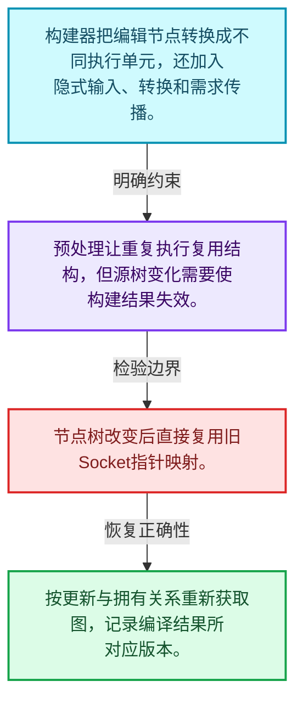
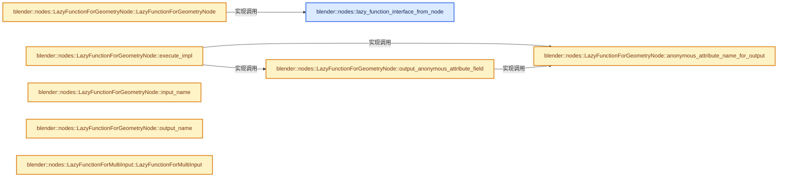
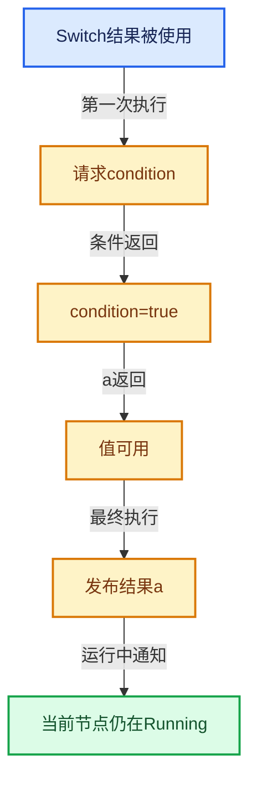

# 09-09 几何节点图构建器

[方向导航](README.md) · [总目录](../README.md) · [实现索引](../%E7%AC%A6%E5%8F%B7%E4%BE%9D%E8%B5%96%E4%B8%8E%E5%AE%9E%E7%8E%B0%E7%B4%A2%E5%BC%95.md)

## 从问题到实现

用户节点树为什么先转换为执行图？

编辑模型与执行模型需求不同，构建器加入隐式转换、需求信息及特殊节点适配。

**数据模型**

构建器把编辑节点转换成不同执行单元，还加入隐式输入、转换和需求传播。

**设计取舍**

预处理让重复执行复用结构，但源树变化需要使构建结果失效。

**最小反例**

节点树改变后直接复用旧Socket指针映射。

**推导**

按更新与拥有关系重新获取图，记录编译结果所对应版本。

## 阅读地图与执行推演








图中的数值推演是本方向的教学模型；实际函数之间的调用边与概念分析边分别标注，不能把概念关系当作运行时调度顺序。

## 完整源码单元与就地讲解

中文讲解直接放在相关代码旁，复杂机制在代码下展开。原文折叠区保留基准行号；不需要在行号表和函数之间来回查找。类布局可分段展示，函数实现不按固定行数切开。

### 类型布局、声明与编译条件 · geometry_nodes_lazy_function.cc L1—L85

<!-- annotated:8a499f79bbfb81 -->

```cpp
/* SPDX-FileCopyrightText: 2023 Blender Authors
 *
 * SPDX-License-Identifier: GPL-2.0-or-later */

/** \file
 * \ingroup nodes
 *
 * This file mainly converts a #bNodeTree into a lazy-function graph, that can then be evaluated to
 * execute geometry nodes. This generally works by creating a lazy-function for every node, which
 * is then put into the lazy-function graph. Then the nodes in the new graph are linked based on
 * links in the original #bNodeTree. Some additional nodes are inserted for things like type
 * conversions and multi-input sockets.
 *
 * If the #bNodeTree contains zones, those are turned into separate lazy-functions first.
 * Essentially, a separate lazy-function graph is created for every zone that is than called by the
 * parent zone or by the root graph.
 *
 * Currently, lazy-functions are even created for nodes that don't strictly require it, like
 * reroutes or muted nodes. In the future we could avoid that at the cost of additional code
 * complexity. So far, this does not seem to be a performance issue.
 */

#include "NOD_geo_viewer.hh"
#include "NOD_geometry_exec.hh"
#include "NOD_geometry_nodes_bundle.hh"
#include "NOD_geometry_nodes_closure.hh"
#include "NOD_geometry_nodes_lazy_function.hh"
#include "NOD_geometry_nodes_list.hh"
#include "NOD_multi_function.hh"
#include "NOD_node_declaration.hh"
#include "NOD_shader_nodes_multi_function.hh"

#include "BLI_array_utils.hh"
#include "BLI_bit_group_vector.hh"
#include "BLI_bit_span_ops.hh"
#include "BLI_lazy_threading.hh"
#include "BLI_map.hh"
#include "BLI_stack.hh"

#include "DNA_ID.h"

#include "BKE_anonymous_attribute_make.hh"
#include "BKE_compute_contexts.hh"
#include "BKE_geometry_nodes_gizmos_transforms.hh"
#include "BKE_geometry_set.hh"
#include "BKE_grease_pencil.hh"
#include "BKE_lib_id.hh"
#include "BKE_library.hh"
#include "BKE_node_legacy_types.hh"
#include "BKE_node_runtime.hh"
#include "BKE_node_socket_value.hh"
#include "BKE_node_socket_value_iter.hh"
#include "BKE_node_tree_reference_lifetimes.hh"
#include "BKE_node_tree_zones.hh"
#include "BKE_scene.hh"
#include "BKE_type_conversions.hh"

#include "ED_node.hh"

#include "FN_lazy_function_graph_executor.hh"

#include "DEG_depsgraph_query.hh"

#include "GEO_foreach_geometry.hh"

#include "list_function_eval.hh"
#include "volume_grid_function_eval.hh"

#include <fmt/format.h>
#include <iostream>
#include <sstream>

namespace blender::nodes {

using bke::bNodeTreeZone;
using bke::bNodeTreeZones;
using bke::SocketValueVariant;
using bke::node_tree_reference_lifetimes::ReferenceLifetimesInfo;
using bke::node_tree_reference_lifetimes::ReferenceSetInfo;
using bke::node_tree_reference_lifetimes::ReferenceSetType;

/**
 * Checks which sockets of the node are available and creates corresponding inputs/outputs on the
 * lazy-function.
 */
```

<details>
<summary>核对原始源码：source/blender/nodes/intern/geometry_nodes_lazy_function.cc · L1—L85</summary>

<!-- original:8a499f79bbfb81:source/blender/nodes/intern/geometry_nodes_lazy_function.cc:1:85 -->

```cpp
/* SPDX-FileCopyrightText: 2023 Blender Authors
 *
 * SPDX-License-Identifier: GPL-2.0-or-later */

/** \file
 * \ingroup nodes
 *
 * This file mainly converts a #bNodeTree into a lazy-function graph, that can then be evaluated to
 * execute geometry nodes. This generally works by creating a lazy-function for every node, which
 * is then put into the lazy-function graph. Then the nodes in the new graph are linked based on
 * links in the original #bNodeTree. Some additional nodes are inserted for things like type
 * conversions and multi-input sockets.
 *
 * If the #bNodeTree contains zones, those are turned into separate lazy-functions first.
 * Essentially, a separate lazy-function graph is created for every zone that is than called by the
 * parent zone or by the root graph.
 *
 * Currently, lazy-functions are even created for nodes that don't strictly require it, like
 * reroutes or muted nodes. In the future we could avoid that at the cost of additional code
 * complexity. So far, this does not seem to be a performance issue.
 */

#include "NOD_geo_viewer.hh"
#include "NOD_geometry_exec.hh"
#include "NOD_geometry_nodes_bundle.hh"
#include "NOD_geometry_nodes_closure.hh"
#include "NOD_geometry_nodes_lazy_function.hh"
#include "NOD_geometry_nodes_list.hh"
#include "NOD_multi_function.hh"
#include "NOD_node_declaration.hh"
#include "NOD_shader_nodes_multi_function.hh"

#include "BLI_array_utils.hh"
#include "BLI_bit_group_vector.hh"
#include "BLI_bit_span_ops.hh"
#include "BLI_lazy_threading.hh"
#include "BLI_map.hh"
#include "BLI_stack.hh"

#include "DNA_ID.h"

#include "BKE_anonymous_attribute_make.hh"
#include "BKE_compute_contexts.hh"
#include "BKE_geometry_nodes_gizmos_transforms.hh"
#include "BKE_geometry_set.hh"
#include "BKE_grease_pencil.hh"
#include "BKE_lib_id.hh"
#include "BKE_library.hh"
#include "BKE_node_legacy_types.hh"
#include "BKE_node_runtime.hh"
#include "BKE_node_socket_value.hh"
#include "BKE_node_socket_value_iter.hh"
#include "BKE_node_tree_reference_lifetimes.hh"
#include "BKE_node_tree_zones.hh"
#include "BKE_scene.hh"
#include "BKE_type_conversions.hh"

#include "ED_node.hh"

#include "FN_lazy_function_graph_executor.hh"

#include "DEG_depsgraph_query.hh"

#include "GEO_foreach_geometry.hh"

#include "list_function_eval.hh"
#include "volume_grid_function_eval.hh"

#include <fmt/format.h>
#include <iostream>
#include <sstream>

namespace blender::nodes {

using bke::bNodeTreeZone;
using bke::bNodeTreeZones;
using bke::SocketValueVariant;
using bke::node_tree_reference_lifetimes::ReferenceLifetimesInfo;
using bke::node_tree_reference_lifetimes::ReferenceSetInfo;
using bke::node_tree_reference_lifetimes::ReferenceSetType;

/**
 * Checks which sockets of the node are available and creates corresponding inputs/outputs on the
 * lazy-function.
 */
```

</details>

<a id="f-2cd02d3b61dae993"></a>

### `blender::nodes::lazy_function_interface_from_node`

实现位置：[source/blender/nodes/intern/geometry_nodes_lazy_function.cc](../../../../../source/blender/nodes/intern/geometry_nodes_lazy_function.cc) · L86—L120。

接口参数：

- `const bNode &node`
- `Vector<lf::Input> &r_inputs`
- `Vector<lf::Output> &r_outputs`
- `MutableSpan<int> r_lf_index_by_bsocket`

**教学注释版**

<!-- annotated:b0da18c399207b -->

```cpp
static void lazy_function_interface_from_node(const bNode &node,
                                              Vector<lf::Input> &r_inputs,
                                              Vector<lf::Output> &r_outputs,
                                              MutableSpan<int> r_lf_index_by_bsocket)
{
  const bool is_muted = node.is_muted();
  const lf::ValueUsage input_usage = lf::ValueUsage::Used;
  for (const bNodeSocket *socket : node.input_sockets()) {
    if (!socket->is_available()) {
      continue;
    }
    if (!socket->typeinfo->geometry_nodes_default_value) {
      continue;
    }
    const CPPType *type;
    if (socket->is_multi_input() && !is_muted) {
      type = &CPPType::get<GeoNodesMultiInput<SocketValueVariant>>();
    }
    else {
      type = &CPPType::get<SocketValueVariant>();
    }
    r_lf_index_by_bsocket[socket->index_in_tree()] = r_inputs.append_and_get_index_as(
        socket->name, *type, input_usage);
  }
  for (const bNodeSocket *socket : node.output_sockets()) {
    if (!socket->is_available()) {
      continue;
    }
    if (!socket->typeinfo->geometry_nodes_default_value) {
      continue;
    }
    r_lf_index_by_bsocket[socket->index_in_tree()] = r_outputs.append_and_get_index_as(
        socket->name, CPPType::get<SocketValueVariant>());
  }
}
```

<details>
<summary>核对原始源码：source/blender/nodes/intern/geometry_nodes_lazy_function.cc · L86—L120</summary>

<!-- original:b0da18c399207b:source/blender/nodes/intern/geometry_nodes_lazy_function.cc:86:120 -->

```cpp
static void lazy_function_interface_from_node(const bNode &node,
                                              Vector<lf::Input> &r_inputs,
                                              Vector<lf::Output> &r_outputs,
                                              MutableSpan<int> r_lf_index_by_bsocket)
{
  const bool is_muted = node.is_muted();
  const lf::ValueUsage input_usage = lf::ValueUsage::Used;
  for (const bNodeSocket *socket : node.input_sockets()) {
    if (!socket->is_available()) {
      continue;
    }
    if (!socket->typeinfo->geometry_nodes_default_value) {
      continue;
    }
    const CPPType *type;
    if (socket->is_multi_input() && !is_muted) {
      type = &CPPType::get<GeoNodesMultiInput<SocketValueVariant>>();
    }
    else {
      type = &CPPType::get<SocketValueVariant>();
    }
    r_lf_index_by_bsocket[socket->index_in_tree()] = r_inputs.append_and_get_index_as(
        socket->name, *type, input_usage);
  }
  for (const bNodeSocket *socket : node.output_sockets()) {
    if (!socket->is_available()) {
      continue;
    }
    if (!socket->typeinfo->geometry_nodes_default_value) {
      continue;
    }
    r_lf_index_by_bsocket[socket->index_in_tree()] = r_outputs.append_and_get_index_as(
        socket->name, CPPType::get<SocketValueVariant>());
  }
}
```

</details>

**沿实际写入检查状态**

- `type = &CPPType::get<GeoNodesMultiInput<SocketValueVariant>>();`
- `type = &CPPType::get<SocketValueVariant>();`

**继续追踪实现**

- `node.is_muted` → [blender::bNode::is_muted · L886](../05-%E5%87%A0%E4%BD%95%E5%AD%98%E5%82%A8%E4%B8%8E%E6%8B%93%E6%89%91%E6%98%A0%E5%B0%84/%E4%BE%9D%E8%B5%96-BKE_node_runtime-ee561b.md#f-4d91efc4cc87d00d)。
- `node.input_sockets` → [blender::bNode::input_sockets · L754](../05-%E5%87%A0%E4%BD%95%E5%AD%98%E5%82%A8%E4%B8%8E%E6%8B%93%E6%89%91%E6%98%A0%E5%B0%84/%E4%BE%9D%E8%B5%96-BKE_node_runtime-ee561b.md#f-82cd385c5c18b40d)；[blender::bNode::input_sockets · L766](../05-%E5%87%A0%E4%BD%95%E5%AD%98%E5%82%A8%E4%B8%8E%E6%8B%93%E6%89%91%E6%98%A0%E5%B0%84/%E4%BE%9D%E8%B5%96-BKE_node_runtime-ee561b.md#f-65ad84a029887502)。同名重载需按实参类型选择。
- `socket->is_available` → [调用协议](../%E6%A8%A1%E6%9D%BF%E5%AE%8F%E4%B8%8E%E5%8A%A8%E6%80%81%E5%88%86%E6%B4%BE%E5%8D%8F%E8%AE%AE.md)：接收对象类型依赖auto、返回值或模板实例；不按同名猜测目标。调用位置L94。
- `socket->is_multi_input` → [调用协议](../%E6%A8%A1%E6%9D%BF%E5%AE%8F%E4%B8%8E%E5%8A%A8%E6%80%81%E5%88%86%E6%B4%BE%E5%8D%8F%E8%AE%AE.md)：接收对象类型依赖auto、返回值或模板实例；不按同名猜测目标。调用位置L101。
- `CPPType::get<GeoNodesMultiInput<SocketValueVariant>>` → [blender::nodes::GListPtr::get · L342](%E4%BE%9D%E8%B5%96-NOD_geometry_nodes_list-56053f.md#f-8a6c0143f9bab586)；[blender::nodes::List<T> &ListPtr<T>::get · L395](%E4%BE%9D%E8%B5%96-NOD_geometry_nodes_list-56053f.md#f-c5594b84b334a369)。同名重载需按实参类型选择。
- `CPPType::get<SocketValueVariant>` → [blender::CPPType::get · L481](../03-%E5%86%85%E5%AD%98%E5%88%86%E9%85%8D%E4%B8%8E%E8%BF%90%E8%A1%8C%E6%97%B6%E7%B1%BB%E5%9E%8B/08-CPPType%E6%9E%84%E9%80%A0%E4%B8%8E%E6%9E%90%E6%9E%84.md#f-0cc10a3783d6abdb)。
- `socket->index_in_tree` → [调用协议](../%E6%A8%A1%E6%9D%BF%E5%AE%8F%E4%B8%8E%E5%8A%A8%E6%80%81%E5%88%86%E6%B4%BE%E5%8D%8F%E8%AE%AE.md)：接收对象类型依赖auto、返回值或模板实例；不按同名猜测目标。调用位置L107。
- `r_inputs.append_and_get_index_as` → [blender::Vector::append_and_get_index_as · L525](../01-%E5%9F%BA%E7%A1%80%E5%AE%B9%E5%99%A8%E4%B8%8E%E7%8E%B0%E4%BB%A3CPP/11-Vector%E6%8F%92%E5%85%A5%E5%88%A0%E9%99%A4%E4%B8%8E%E9%87%8D%E6%8E%92.md#f-c450f8d287116a44)。
- `node.output_sockets` → [blender::bNode::output_sockets · L760](../05-%E5%87%A0%E4%BD%95%E5%AD%98%E5%82%A8%E4%B8%8E%E6%8B%93%E6%89%91%E6%98%A0%E5%B0%84/%E4%BE%9D%E8%B5%96-BKE_node_runtime-ee561b.md#f-40ec6d6aed2ab6fb)；[blender::bNode::output_sockets · L772](../05-%E5%87%A0%E4%BD%95%E5%AD%98%E5%82%A8%E4%B8%8E%E6%8B%93%E6%89%91%E6%98%A0%E5%B0%84/%E4%BE%9D%E8%B5%96-BKE_node_runtime-ee561b.md#f-ddbd8f42409bdcd1)。同名重载需按实参类型选择。
- `r_outputs.append_and_get_index_as` → [blender::Vector::append_and_get_index_as · L525](../01-%E5%9F%BA%E7%A1%80%E5%AE%B9%E5%99%A8%E4%B8%8E%E7%8E%B0%E4%BB%A3CPP/11-Vector%E6%8F%92%E5%85%A5%E5%88%A0%E9%99%A4%E4%B8%8E%E9%87%8D%E6%8E%92.md#f-c450f8d287116a44)。

### 类型布局、声明与编译条件 · geometry_nodes_lazy_function.cc L121—L136

<a id="t-63a0119f26be"></a>

`LazyFunctionForGeometryNode`在这里声明的数据成员：

- `bNode node_`
- `GeometryNodesLazyFunctionGraphInfo own_lf_graph_info_`
- `Vector<bool> is_attribute_output_bsocket_`

<!-- annotated:a2808e1d1e7f06 -->

```cpp

/**
 * Used for most normal geometry nodes like Subdivision Surface and Set Position.
 */
class LazyFunctionForGeometryNode : public LazyFunction {
 private:
  const bNode &node_;
  const GeometryNodesLazyFunctionGraphInfo &own_lf_graph_info_;
  /**
   * A bool for every output bsocket. If true, the socket just outputs a field containing an
   * anonymous attribute id. If only such outputs are requested by other nodes, the node itself
   * does not have to execute.
   */
  Vector<bool> is_attribute_output_bsocket_;

 public:
```

<details>
<summary>核对原始源码：source/blender/nodes/intern/geometry_nodes_lazy_function.cc · L121—L136</summary>

<!-- original:a2808e1d1e7f06:source/blender/nodes/intern/geometry_nodes_lazy_function.cc:121:136 -->

```cpp

/**
 * Used for most normal geometry nodes like Subdivision Surface and Set Position.
 */
class LazyFunctionForGeometryNode : public LazyFunction {
 private:
  const bNode &node_;
  const GeometryNodesLazyFunctionGraphInfo &own_lf_graph_info_;
  /**
   * A bool for every output bsocket. If true, the socket just outputs a field containing an
   * anonymous attribute id. If only such outputs are requested by other nodes, the node itself
   * does not have to execute.
   */
  Vector<bool> is_attribute_output_bsocket_;

 public:
```

</details>

<a id="f-ea022a28ce6967df"></a>

### `blender::nodes::LazyFunctionForGeometryNode::LazyFunctionForGeometryNode`

实现位置：[source/blender/nodes/intern/geometry_nodes_lazy_function.cc](../../../../../source/blender/nodes/intern/geometry_nodes_lazy_function.cc) · L137—L185。

接口参数：

- `const bNode &node`
- `GeometryNodesLazyFunctionGraphInfo &own_lf_graph_info`

**教学注释版**

<!-- annotated:8f4eafc664f2af -->

```cpp
  LazyFunctionForGeometryNode(const bNode &node,
                              GeometryNodesLazyFunctionGraphInfo &own_lf_graph_info)
      : node_(node),
        own_lf_graph_info_(own_lf_graph_info),
        is_attribute_output_bsocket_(node.output_sockets().size(), false)
  {
    BLI_assert(node.typeinfo->geometry_node_execute != nullptr);
    debug_name_ = node.name;
    lazy_function_interface_from_node(
        node, inputs_, outputs_, own_lf_graph_info.mapping.lf_index_by_bsocket);

    const NodeDeclaration &node_decl = *node.declaration();
    const rl::RelationsInNode *relations = node_decl.reference_lifetime_relations();
    if (relations == nullptr) {
      return;
    }
    bool has_anonymous_attribute_output = false;
    for (const int output_i : node_decl.outputs.index_range()) {
      const SocketDeclaration *socket_decl = node_decl.outputs[output_i];
      if (socket_decl->is_anonymous_attribute_output) {
        const bNodeSocket &output = node.output_socket(output_i);
        has_anonymous_attribute_output = true;
        is_attribute_output_bsocket_[output_i] = true;
        const int lf_index = inputs_.append_and_get_index_as("Output Used", CPPType::get<bool>());
        own_lf_graph_info.mapping
            .lf_input_index_for_output_bsocket_usage[output.index_in_all_outputs()] = lf_index;
      }
    }
    if (has_anonymous_attribute_output) {
      /* Inputs are only used when an output is used that is not just outputting an anonymous
       * attribute field. */
      for (lf::Input &input : inputs_) {
        input.usage = lf::ValueUsage::Maybe;
      }
    }

    Vector<const bNodeSocket *> handled_data_outputs;
    for (const rl::DataPropagation &relation : relations->data_propagations) {
      const bNodeSocket &output_bsocket = node.output_socket(relation.to_output);
      // [讲解] handled_data_outputs.contains：在有效元素中按相等关系查找。
      if (output_bsocket.is_available() && !handled_data_outputs.contains(&output_bsocket)) {
        // [讲解] handled_data_outputs.append：在尾部建立新元素，必要时先扩大存储。
        handled_data_outputs.append(&output_bsocket);
        const int lf_index = inputs_.append_and_get_index_as(
            "Propagate to Output", CPPType::get<GeometryNodesReferenceSet>());
        own_lf_graph_info.mapping
            .lf_input_index_for_reference_set_for_output[output_bsocket.index_in_all_outputs()] =
            lf_index;
      }
    }
  }
```

<details>
<summary>核对原始源码：source/blender/nodes/intern/geometry_nodes_lazy_function.cc · L137—L185</summary>

<!-- original:8f4eafc664f2af:source/blender/nodes/intern/geometry_nodes_lazy_function.cc:137:185 -->

```cpp
  LazyFunctionForGeometryNode(const bNode &node,
                              GeometryNodesLazyFunctionGraphInfo &own_lf_graph_info)
      : node_(node),
        own_lf_graph_info_(own_lf_graph_info),
        is_attribute_output_bsocket_(node.output_sockets().size(), false)
  {
    BLI_assert(node.typeinfo->geometry_node_execute != nullptr);
    debug_name_ = node.name;
    lazy_function_interface_from_node(
        node, inputs_, outputs_, own_lf_graph_info.mapping.lf_index_by_bsocket);

    const NodeDeclaration &node_decl = *node.declaration();
    const rl::RelationsInNode *relations = node_decl.reference_lifetime_relations();
    if (relations == nullptr) {
      return;
    }
    bool has_anonymous_attribute_output = false;
    for (const int output_i : node_decl.outputs.index_range()) {
      const SocketDeclaration *socket_decl = node_decl.outputs[output_i];
      if (socket_decl->is_anonymous_attribute_output) {
        const bNodeSocket &output = node.output_socket(output_i);
        has_anonymous_attribute_output = true;
        is_attribute_output_bsocket_[output_i] = true;
        const int lf_index = inputs_.append_and_get_index_as("Output Used", CPPType::get<bool>());
        own_lf_graph_info.mapping
            .lf_input_index_for_output_bsocket_usage[output.index_in_all_outputs()] = lf_index;
      }
    }
    if (has_anonymous_attribute_output) {
      /* Inputs are only used when an output is used that is not just outputting an anonymous
       * attribute field. */
      for (lf::Input &input : inputs_) {
        input.usage = lf::ValueUsage::Maybe;
      }
    }

    Vector<const bNodeSocket *> handled_data_outputs;
    for (const rl::DataPropagation &relation : relations->data_propagations) {
      const bNodeSocket &output_bsocket = node.output_socket(relation.to_output);
      if (output_bsocket.is_available() && !handled_data_outputs.contains(&output_bsocket)) {
        handled_data_outputs.append(&output_bsocket);
        const int lf_index = inputs_.append_and_get_index_as(
            "Propagate to Output", CPPType::get<GeometryNodesReferenceSet>());
        own_lf_graph_info.mapping
            .lf_input_index_for_reference_set_for_output[output_bsocket.index_in_all_outputs()] =
            lf_index;
      }
    }
  }
```

</details>

**沿实际写入检查状态**

- `debug_name_ = node.name;`
- `has_anonymous_attribute_output = true;`
- `is_attribute_output_bsocket_[output_i] = true;`
- `input.usage = lf::ValueUsage::Maybe;`

**继续追踪实现**

- `BLI_assert` → [BLI_assert · L48](../01-%E5%9F%BA%E7%A1%80%E5%AE%B9%E5%99%A8%E4%B8%8E%E7%8E%B0%E4%BB%A3CPP/%E4%BE%9D%E8%B5%96-BLI_assert-cc98e8.md#m-57a88495704d)；[BLI_assert · L63](../01-%E5%9F%BA%E7%A1%80%E5%AE%B9%E5%99%A8%E4%B8%8E%E7%8E%B0%E4%BB%A3CPP/%E4%BE%9D%E8%B5%96-BLI_assert-cc98e8.md#m-d07050020cb5)。宏定义由构建条件选择。
- `lazy_function_interface_from_node` → [blender::nodes::lazy_function_interface_from_node · L86](09-%E5%87%A0%E4%BD%95%E8%8A%82%E7%82%B9%E5%9B%BE%E6%9E%84%E5%BB%BA%E5%99%A8.md#f-2cd02d3b61dae993)。
- `node.declaration` → [blender::bNode::declaration · L954](../05-%E5%87%A0%E4%BD%95%E5%AD%98%E5%82%A8%E4%B8%8E%E6%8B%93%E6%89%91%E6%98%A0%E5%B0%84/%E4%BE%9D%E8%B5%96-BKE_node_runtime-ee561b.md#f-f092d18c09c116e8)。
- `node_decl.reference_lifetime_relations` → [blender::nodes::NodeDeclaration::reference_lifetime_relations · L647](%E4%BE%9D%E8%B5%96-NOD_node_declaration-9b193f.md#f-bddefb65b2297e2f)。
- `node_decl.outputs.index_range` → [调用协议](../%E6%A8%A1%E6%9D%BF%E5%AE%8F%E4%B8%8E%E5%8A%A8%E6%80%81%E5%88%86%E6%B4%BE%E5%8D%8F%E8%AE%AE.md)：接收对象类型依赖auto、返回值或模板实例；不按同名猜测目标。调用位置L154。
- `node.output_socket` → [blender::bNode::output_socket · L824](../05-%E5%87%A0%E4%BD%95%E5%AD%98%E5%82%A8%E4%B8%8E%E6%8B%93%E6%89%91%E6%98%A0%E5%B0%84/%E4%BE%9D%E8%B5%96-BKE_node_runtime-ee561b.md#f-9e46f3a437215eb5)；[blender::bNode::output_socket · L836](../05-%E5%87%A0%E4%BD%95%E5%AD%98%E5%82%A8%E4%B8%8E%E6%8B%93%E6%89%91%E6%98%A0%E5%B0%84/%E4%BE%9D%E8%B5%96-BKE_node_runtime-ee561b.md#f-39021ff32ee7c409)。同名重载需按实参类型选择。
- `inputs_.append_and_get_index_as` → [调用协议](../%E6%A8%A1%E6%9D%BF%E5%AE%8F%E4%B8%8E%E5%8A%A8%E6%80%81%E5%88%86%E6%B4%BE%E5%8D%8F%E8%AE%AE.md)：接收对象类型依赖auto、返回值或模板实例；不按同名猜测目标。调用位置L160。
- `CPPType::get<bool>` → [blender::CPPType::get · L481](../03-%E5%86%85%E5%AD%98%E5%88%86%E9%85%8D%E4%B8%8E%E8%BF%90%E8%A1%8C%E6%97%B6%E7%B1%BB%E5%9E%8B/08-CPPType%E6%9E%84%E9%80%A0%E4%B8%8E%E6%9E%90%E6%9E%84.md#f-0cc10a3783d6abdb)。
- `output.index_in_all_outputs` → [blender::bNodeSocket::index_in_all_outputs · L1015](../05-%E5%87%A0%E4%BD%95%E5%AD%98%E5%82%A8%E4%B8%8E%E6%8B%93%E6%89%91%E6%98%A0%E5%B0%84/%E4%BE%9D%E8%B5%96-BKE_node_runtime-ee561b.md#f-260bb13a30ff322f)。
- `output_bsocket.is_available` → [blender::bNodeSocket::is_available · L1041](../05-%E5%87%A0%E4%BD%95%E5%AD%98%E5%82%A8%E4%B8%8E%E6%8B%93%E6%89%91%E6%98%A0%E5%B0%84/%E4%BE%9D%E8%B5%96-BKE_node_runtime-ee561b.md#f-24ff02531a14ce08)。
- `handled_data_outputs.contains` → [blender::Vector::contains · L938](../01-%E5%9F%BA%E7%A1%80%E5%AE%B9%E5%99%A8%E4%B8%8E%E7%8E%B0%E4%BB%A3CPP/12-Vector%E5%BC%82%E5%B8%B8%E5%AE%89%E5%85%A8%E4%B8%8E%E8%BE%B9%E7%95%8C.md#f-11ad8adb697ee04a)。
- `handled_data_outputs.append` → [blender::Vector::append · L498](../01-%E5%9F%BA%E7%A1%80%E5%AE%B9%E5%99%A8%E4%B8%8E%E7%8E%B0%E4%BB%A3CPP/11-Vector%E6%8F%92%E5%85%A5%E5%88%A0%E9%99%A4%E4%B8%8E%E9%87%8D%E6%8E%92.md#f-5bde268a69e443ec)；[blender::Vector::append · L502](../01-%E5%9F%BA%E7%A1%80%E5%AE%B9%E5%99%A8%E4%B8%8E%E7%8E%B0%E4%BB%A3CPP/11-Vector%E6%8F%92%E5%85%A5%E5%88%A0%E9%99%A4%E4%B8%8E%E9%87%8D%E6%8E%92.md#f-591e0b15e6308532)。同名重载需按实参类型选择。
- `CPPType::get<GeometryNodesReferenceSet>` → [blender::CPPType::get · L481](../03-%E5%86%85%E5%AD%98%E5%88%86%E9%85%8D%E4%B8%8E%E8%BF%90%E8%A1%8C%E6%97%B6%E7%B1%BB%E5%9E%8B/08-CPPType%E6%9E%84%E9%80%A0%E4%B8%8E%E6%9E%90%E6%9E%84.md#f-0cc10a3783d6abdb)。
- `output_bsocket.index_in_all_outputs` → [blender::bNodeSocket::index_in_all_outputs · L1015](../05-%E5%87%A0%E4%BD%95%E5%AD%98%E5%82%A8%E4%B8%8E%E6%8B%93%E6%89%91%E6%98%A0%E5%B0%84/%E4%BE%9D%E8%B5%96-BKE_node_runtime-ee561b.md#f-260bb13a30ff322f)。

<!-- annotated:d18026c189e1fc -->

```cpp

```

<details>
<summary>核对原始源码：source/blender/nodes/intern/geometry_nodes_lazy_function.cc · L186—L186</summary>

<!-- original:d18026c189e1fc:source/blender/nodes/intern/geometry_nodes_lazy_function.cc:186:186 -->

```cpp

```

</details>

<a id="f-0749b0b0f9abb432"></a>

### `blender::nodes::LazyFunctionForGeometryNode::execute_impl`

实现位置：[source/blender/nodes/intern/geometry_nodes_lazy_function.cc](../../../../../source/blender/nodes/intern/geometry_nodes_lazy_function.cc) · L187—L249。

接口参数：

- `lf::Params &params`
- `const lf::Context &context`

**教学注释版**

<!-- annotated:c3a1d2d8b9fd85 -->

```cpp
  void execute_impl(lf::Params &params, const lf::Context &context) const override
  {
    const ScopedNodeTimer node_timer{context, node_};

    GeoNodesUserData *user_data = dynamic_cast<GeoNodesUserData *>(context.user_data);
    BLI_assert(user_data != nullptr);

    bool used_non_attribute_output_exists = false;
    for (const int output_bsocket_index : node_.output_sockets().index_range()) {
      const bNodeSocket &output_bsocket = node_.output_socket(output_bsocket_index);
      const int lf_index =
          own_lf_graph_info_.mapping.lf_index_by_bsocket[output_bsocket.index_in_tree()];
      if (lf_index == -1) {
        continue;
      }
      const lf::ValueUsage output_usage = params.get_output_usage(lf_index);
      if (output_usage == lf::ValueUsage::Unused) {
        continue;
      }
      if (is_attribute_output_bsocket_[output_bsocket_index]) {
        if (params.output_was_set(lf_index)) {
          continue;
        }
        this->output_anonymous_attribute_field(params, *user_data, lf_index, output_bsocket);
      }
      else {
        if (output_usage == lf::ValueUsage::Used) {
          used_non_attribute_output_exists = true;
        }
      }
    }

    if (!used_non_attribute_output_exists) {
      /* Only attribute outputs are used currently, no need to evaluate the full node and its
       * inputs. */
      return;
    }

    bool missing_input = false;
    for (const int lf_index : inputs_.index_range()) {
      if (params.try_get_input_data_ptr_or_request(lf_index) == nullptr) {
        missing_input = true;
      }
    }
    if (missing_input) {
      /* Wait until all inputs are available. */
      return;
    }

    auto get_anonymous_attribute_name = [&](const int i) {
      return this->anonymous_attribute_name_for_output(*user_data, i);
    };

    GeoNodeExecParams geo_params{
        node_,
        params,
        context,
        own_lf_graph_info_.mapping.lf_input_index_for_output_bsocket_usage,
        own_lf_graph_info_.mapping.lf_input_index_for_reference_set_for_output,
        get_anonymous_attribute_name};

    node_.typeinfo->geometry_node_execute(geo_params);
  }
```

<details>
<summary>核对原始源码：source/blender/nodes/intern/geometry_nodes_lazy_function.cc · L187—L249</summary>

<!-- original:c3a1d2d8b9fd85:source/blender/nodes/intern/geometry_nodes_lazy_function.cc:187:249 -->

```cpp
  void execute_impl(lf::Params &params, const lf::Context &context) const override
  {
    const ScopedNodeTimer node_timer{context, node_};

    GeoNodesUserData *user_data = dynamic_cast<GeoNodesUserData *>(context.user_data);
    BLI_assert(user_data != nullptr);

    bool used_non_attribute_output_exists = false;
    for (const int output_bsocket_index : node_.output_sockets().index_range()) {
      const bNodeSocket &output_bsocket = node_.output_socket(output_bsocket_index);
      const int lf_index =
          own_lf_graph_info_.mapping.lf_index_by_bsocket[output_bsocket.index_in_tree()];
      if (lf_index == -1) {
        continue;
      }
      const lf::ValueUsage output_usage = params.get_output_usage(lf_index);
      if (output_usage == lf::ValueUsage::Unused) {
        continue;
      }
      if (is_attribute_output_bsocket_[output_bsocket_index]) {
        if (params.output_was_set(lf_index)) {
          continue;
        }
        this->output_anonymous_attribute_field(params, *user_data, lf_index, output_bsocket);
      }
      else {
        if (output_usage == lf::ValueUsage::Used) {
          used_non_attribute_output_exists = true;
        }
      }
    }

    if (!used_non_attribute_output_exists) {
      /* Only attribute outputs are used currently, no need to evaluate the full node and its
       * inputs. */
      return;
    }

    bool missing_input = false;
    for (const int lf_index : inputs_.index_range()) {
      if (params.try_get_input_data_ptr_or_request(lf_index) == nullptr) {
        missing_input = true;
      }
    }
    if (missing_input) {
      /* Wait until all inputs are available. */
      return;
    }

    auto get_anonymous_attribute_name = [&](const int i) {
      return this->anonymous_attribute_name_for_output(*user_data, i);
    };

    GeoNodeExecParams geo_params{
        node_,
        params,
        context,
        own_lf_graph_info_.mapping.lf_input_index_for_output_bsocket_usage,
        own_lf_graph_info_.mapping.lf_input_index_for_reference_set_for_output,
        get_anonymous_attribute_name};

    node_.typeinfo->geometry_node_execute(geo_params);
  }
```

</details>

**沿实际写入检查状态**

- `used_non_attribute_output_exists = true;`
- `missing_input = true;`

**结果出口**

- `return this->anonymous_attribute_name_for_output(*user_data, i);`

**继续追踪实现**

- `BLI_assert` → [BLI_assert · L48](../01-%E5%9F%BA%E7%A1%80%E5%AE%B9%E5%99%A8%E4%B8%8E%E7%8E%B0%E4%BB%A3CPP/%E4%BE%9D%E8%B5%96-BLI_assert-cc98e8.md#m-57a88495704d)；[BLI_assert · L63](../01-%E5%9F%BA%E7%A1%80%E5%AE%B9%E5%99%A8%E4%B8%8E%E7%8E%B0%E4%BB%A3CPP/%E4%BE%9D%E8%B5%96-BLI_assert-cc98e8.md#m-d07050020cb5)。宏定义由构建条件选择。
- `node_.output_sockets().index_range` → [调用协议](../%E6%A8%A1%E6%9D%BF%E5%AE%8F%E4%B8%8E%E5%8A%A8%E6%80%81%E5%88%86%E6%B4%BE%E5%8D%8F%E8%AE%AE.md)：接收对象类型依赖auto、返回值或模板实例；不按同名猜测目标。调用位置L195。
- `node_.output_sockets` → [blender::bNode::output_sockets · L760](../05-%E5%87%A0%E4%BD%95%E5%AD%98%E5%82%A8%E4%B8%8E%E6%8B%93%E6%89%91%E6%98%A0%E5%B0%84/%E4%BE%9D%E8%B5%96-BKE_node_runtime-ee561b.md#f-40ec6d6aed2ab6fb)；[blender::bNode::output_sockets · L772](../05-%E5%87%A0%E4%BD%95%E5%AD%98%E5%82%A8%E4%B8%8E%E6%8B%93%E6%89%91%E6%98%A0%E5%B0%84/%E4%BE%9D%E8%B5%96-BKE_node_runtime-ee561b.md#f-ddbd8f42409bdcd1)。同名重载需按实参类型选择。
- `node_.output_socket` → [blender::bNode::output_socket · L824](../05-%E5%87%A0%E4%BD%95%E5%AD%98%E5%82%A8%E4%B8%8E%E6%8B%93%E6%89%91%E6%98%A0%E5%B0%84/%E4%BE%9D%E8%B5%96-BKE_node_runtime-ee561b.md#f-9e46f3a437215eb5)；[blender::bNode::output_socket · L836](../05-%E5%87%A0%E4%BD%95%E5%AD%98%E5%82%A8%E4%B8%8E%E6%8B%93%E6%89%91%E6%98%A0%E5%B0%84/%E4%BE%9D%E8%B5%96-BKE_node_runtime-ee561b.md#f-39021ff32ee7c409)。同名重载需按实参类型选择。
- `output_bsocket.index_in_tree` → [blender::bNodeSocket::index_in_tree · L1002](../05-%E5%87%A0%E4%BD%95%E5%AD%98%E5%82%A8%E4%B8%8E%E6%8B%93%E6%89%91%E6%98%A0%E5%B0%84/%E4%BE%9D%E8%B5%96-BKE_node_runtime-ee561b.md#f-84ec49d8e3ae0cdb)。
- `params.get_output_usage` → [blender::fn::lazy_function::Params::get_output_usage · L399](02-LazyFunction%E6%8E%A5%E5%8F%A3.md#f-bd2d3063532e6360)。
- `params.output_was_set` → [blender::fn::lazy_function::Params::output_was_set · L393](02-LazyFunction%E6%8E%A5%E5%8F%A3.md#f-aecdc506c9bbff3b)。
- `this->output_anonymous_attribute_field` → [blender::nodes::LazyFunctionForGeometryNode::output_anonymous_attribute_field · L279](09-%E5%87%A0%E4%BD%95%E8%8A%82%E7%82%B9%E5%9B%BE%E6%9E%84%E5%BB%BA%E5%99%A8.md#f-3e07bf3e457a3d7d)。
- `inputs_.index_range` → [调用协议](../%E6%A8%A1%E6%9D%BF%E5%AE%8F%E4%B8%8E%E5%8A%A8%E6%80%81%E5%88%86%E6%B4%BE%E5%8D%8F%E8%AE%AE.md)：接收对象类型依赖auto、返回值或模板实例；不按同名猜测目标。调用位置L226。
- `params.try_get_input_data_ptr_or_request` → [blender::fn::lazy_function::Params::try_get_input_data_ptr_or_request · L372](02-LazyFunction%E6%8E%A5%E5%8F%A3.md#f-89de2295f5baa94f)；[blender::fn::lazy_function::Params::try_get_input_data_ptr_or_request · L434](02-LazyFunction%E6%8E%A5%E5%8F%A3.md#f-97ba143c63061e47)。同名重载需按实参类型选择。
- `this->anonymous_attribute_name_for_output` → [blender::nodes::LazyFunctionForGeometryNode::anonymous_attribute_name_for_output · L297](09-%E5%87%A0%E4%BD%95%E8%8A%82%E7%82%B9%E5%9B%BE%E6%9E%84%E5%BB%BA%E5%99%A8.md#f-c263eec240aee887)。
- `node_.typeinfo->geometry_node_execute` → [调用协议](../%E6%A8%A1%E6%9D%BF%E5%AE%8F%E4%B8%8E%E5%8A%A8%E6%80%81%E5%88%86%E6%B4%BE%E5%8D%8F%E8%AE%AE.md)：接收对象类型依赖auto、返回值或模板实例；不按同名猜测目标。调用位置L248。

<!-- annotated:ede20e2c703762 -->

```cpp

```

<details>
<summary>核对原始源码：source/blender/nodes/intern/geometry_nodes_lazy_function.cc · L250—L250</summary>

<!-- original:ede20e2c703762:source/blender/nodes/intern/geometry_nodes_lazy_function.cc:250:250 -->

```cpp

```

</details>

<a id="f-c8faaba92ccf581b"></a>

### `blender::nodes::LazyFunctionForGeometryNode::input_name`

实现位置：[source/blender/nodes/intern/geometry_nodes_lazy_function.cc](../../../../../source/blender/nodes/intern/geometry_nodes_lazy_function.cc) · L251—L272。

接口参数：

- `const int index`

**教学注释版**

<!-- annotated:f4bf42b14859cc -->

```cpp
  std::string input_name(const int index) const override
  {
    for (const bNodeSocket *bsocket : node_.output_sockets()) {
      {
        const int lf_index =
            own_lf_graph_info_.mapping
                .lf_input_index_for_output_bsocket_usage[bsocket->index_in_all_outputs()];
        if (index == lf_index) {
          return StringRef("Use Output '") + bsocket->name + "'";
        }
      }
      {
        const int lf_index =
            own_lf_graph_info_.mapping
                .lf_input_index_for_reference_set_for_output[bsocket->index_in_all_outputs()];
        if (index == lf_index) {
          return StringRef("Propagate to '") + bsocket->name + "'";
        }
      }
    }
    return inputs_[index].debug_name;
  }
```

<details>
<summary>核对原始源码：source/blender/nodes/intern/geometry_nodes_lazy_function.cc · L251—L272</summary>

<!-- original:f4bf42b14859cc:source/blender/nodes/intern/geometry_nodes_lazy_function.cc:251:272 -->

```cpp
  std::string input_name(const int index) const override
  {
    for (const bNodeSocket *bsocket : node_.output_sockets()) {
      {
        const int lf_index =
            own_lf_graph_info_.mapping
                .lf_input_index_for_output_bsocket_usage[bsocket->index_in_all_outputs()];
        if (index == lf_index) {
          return StringRef("Use Output '") + bsocket->name + "'";
        }
      }
      {
        const int lf_index =
            own_lf_graph_info_.mapping
                .lf_input_index_for_reference_set_for_output[bsocket->index_in_all_outputs()];
        if (index == lf_index) {
          return StringRef("Propagate to '") + bsocket->name + "'";
        }
      }
    }
    return inputs_[index].debug_name;
  }
```

</details>

**结果出口**

- `return StringRef("Use Output '") + bsocket->name + "'";`
- `return StringRef("Propagate to '") + bsocket->name + "'";`
- `return inputs_[index].debug_name;`

**继续追踪实现**

- `node_.output_sockets` → [blender::bNode::output_sockets · L760](../05-%E5%87%A0%E4%BD%95%E5%AD%98%E5%82%A8%E4%B8%8E%E6%8B%93%E6%89%91%E6%98%A0%E5%B0%84/%E4%BE%9D%E8%B5%96-BKE_node_runtime-ee561b.md#f-40ec6d6aed2ab6fb)；[blender::bNode::output_sockets · L772](../05-%E5%87%A0%E4%BD%95%E5%AD%98%E5%82%A8%E4%B8%8E%E6%8B%93%E6%89%91%E6%98%A0%E5%B0%84/%E4%BE%9D%E8%B5%96-BKE_node_runtime-ee561b.md#f-ddbd8f42409bdcd1)。同名重载需按实参类型选择。
- `bsocket->index_in_all_outputs` → [调用协议](../%E6%A8%A1%E6%9D%BF%E5%AE%8F%E4%B8%8E%E5%8A%A8%E6%80%81%E5%88%86%E6%B4%BE%E5%8D%8F%E8%AE%AE.md)：接收对象类型依赖auto、返回值或模板实例；不按同名猜测目标。调用位置L257。
- `StringRef` → [blender::StringRef::StringRef · L555](../01-%E5%9F%BA%E7%A1%80%E5%AE%B9%E5%99%A8%E4%B8%8E%E7%8E%B0%E4%BB%A3CPP/15-StringRef%E5%AD%97%E7%AC%A6%E4%B8%B2%E8%A7%86%E5%9B%BE.md#f-f6aca324a36faa7e)；[blender::StringRef::StringRef · L560](../01-%E5%9F%BA%E7%A1%80%E5%AE%B9%E5%99%A8%E4%B8%8E%E7%8E%B0%E4%BB%A3CPP/15-StringRef%E5%AD%97%E7%AC%A6%E4%B8%B2%E8%A7%86%E5%9B%BE.md#f-ab9714781ca51bac)；[blender::StringRef::StringRef · L565](../01-%E5%9F%BA%E7%A1%80%E5%AE%B9%E5%99%A8%E4%B8%8E%E7%8E%B0%E4%BB%A3CPP/15-StringRef%E5%AD%97%E7%AC%A6%E4%B8%B2%E8%A7%86%E5%9B%BE.md#f-95f0b483bbdd7739)；[blender::StringRef::StringRef · L570](../01-%E5%9F%BA%E7%A1%80%E5%AE%B9%E5%99%A8%E4%B8%8E%E7%8E%B0%E4%BB%A3CPP/15-StringRef%E5%AD%97%E7%AC%A6%E4%B8%B2%E8%A7%86%E5%9B%BE.md#f-808d05699cb33334)；[blender::StringRef::StringRef · L631](../01-%E5%9F%BA%E7%A1%80%E5%AE%B9%E5%99%A8%E4%B8%8E%E7%8E%B0%E4%BB%A3CPP/15-StringRef%E5%AD%97%E7%AC%A6%E4%B8%B2%E8%A7%86%E5%9B%BE.md#f-37788e5f3fa3b736)；[blender::StringRef::StringRef · L641](../01-%E5%9F%BA%E7%A1%80%E5%AE%B9%E5%99%A8%E4%B8%8E%E7%8E%B0%E4%BB%A3CPP/15-StringRef%E5%AD%97%E7%AC%A6%E4%B8%B2%E8%A7%86%E5%9B%BE.md#f-11abd0510fb6b926)；[blender::StringRef::StringRef · L646](../01-%E5%9F%BA%E7%A1%80%E5%AE%B9%E5%99%A8%E4%B8%8E%E7%8E%B0%E4%BB%A3CPP/15-StringRef%E5%AD%97%E7%AC%A6%E4%B8%B2%E8%A7%86%E5%9B%BE.md#f-8437dbd8a582eefd)；[blender::StringRef::StringRef · L651](../01-%E5%9F%BA%E7%A1%80%E5%AE%B9%E5%99%A8%E4%B8%8E%E7%8E%B0%E4%BB%A3CPP/15-StringRef%E5%AD%97%E7%AC%A6%E4%B8%B2%E8%A7%86%E5%9B%BE.md#f-70bcb338de0db978)。同名重载需按实参类型选择。

<!-- annotated:800d32d9091cca -->

```cpp

```

<details>
<summary>核对原始源码：source/blender/nodes/intern/geometry_nodes_lazy_function.cc · L273—L273</summary>

<!-- original:800d32d9091cca:source/blender/nodes/intern/geometry_nodes_lazy_function.cc:273:273 -->

```cpp

```

</details>

<a id="f-a69aae6e90815aa6"></a>

### `blender::nodes::LazyFunctionForGeometryNode::output_name`

实现位置：[source/blender/nodes/intern/geometry_nodes_lazy_function.cc](../../../../../source/blender/nodes/intern/geometry_nodes_lazy_function.cc) · L274—L277。

接口参数：

- `const int index`

**教学注释版**

<!-- annotated:1b9210747739f5 -->

```cpp
  std::string output_name(const int index) const override
  {
    return outputs_[index].debug_name;
  }
```

<details>
<summary>核对原始源码：source/blender/nodes/intern/geometry_nodes_lazy_function.cc · L274—L277</summary>

<!-- original:1b9210747739f5:source/blender/nodes/intern/geometry_nodes_lazy_function.cc:274:277 -->

```cpp
  std::string output_name(const int index) const override
  {
    return outputs_[index].debug_name;
  }
```

</details>

**结果出口**

- `return outputs_[index].debug_name;`

**继续追踪实现**

本实现没有需要继续展开的显式调用；检查返回表达式、对象转换和调用者前置条件。

<!-- annotated:fc9798fa1a616c -->

```cpp

```

<details>
<summary>核对原始源码：source/blender/nodes/intern/geometry_nodes_lazy_function.cc · L278—L278</summary>

<!-- original:fc9798fa1a616c:source/blender/nodes/intern/geometry_nodes_lazy_function.cc:278:278 -->

```cpp

```

</details>

<a id="f-3e07bf3e457a3d7d"></a>

### `blender::nodes::LazyFunctionForGeometryNode::output_anonymous_attribute_field`

实现位置：[source/blender/nodes/intern/geometry_nodes_lazy_function.cc](../../../../../source/blender/nodes/intern/geometry_nodes_lazy_function.cc) · L279—L295。

接口参数：

- `lf::Params &params`
- `const GeoNodesUserData &user_data`
- `const int lf_index`
- `const bNodeSocket &socket`

**教学注释版**

<!-- annotated:fbda833319ef4a -->

```cpp
  void output_anonymous_attribute_field(lf::Params &params,
                                        const GeoNodesUserData &user_data,
                                        const int lf_index,
                                        const bNodeSocket &socket) const
  {
    std::string attribute_name = this->anonymous_attribute_name_for_output(user_data,
                                                                           socket.index());
    std::string socket_inspection_name = make_anonymous_attribute_socket_inspection_string(socket);

    void *r_value = params.get_output_data_ptr(lf_index);
    SocketValueVariant::construct_in(
        r_value,
        // [讲解] std::move：把表达式转换成可供移动重载选择的值类别；不保证真的移动，不结束源对象寿命，对const值可能选择复制。
        GField::from_input<AttributeFieldInput>(std::move(attribute_name),
                                                *socket.typeinfo->base_cpp_type,
                                                std::move(socket_inspection_name)));
    params.output_set(lf_index);
  }
```

<details>
<summary>核对原始源码：source/blender/nodes/intern/geometry_nodes_lazy_function.cc · L279—L295</summary>

<!-- original:fbda833319ef4a:source/blender/nodes/intern/geometry_nodes_lazy_function.cc:279:295 -->

```cpp
  void output_anonymous_attribute_field(lf::Params &params,
                                        const GeoNodesUserData &user_data,
                                        const int lf_index,
                                        const bNodeSocket &socket) const
  {
    std::string attribute_name = this->anonymous_attribute_name_for_output(user_data,
                                                                           socket.index());
    std::string socket_inspection_name = make_anonymous_attribute_socket_inspection_string(socket);

    void *r_value = params.get_output_data_ptr(lf_index);
    SocketValueVariant::construct_in(
        r_value,
        GField::from_input<AttributeFieldInput>(std::move(attribute_name),
                                                *socket.typeinfo->base_cpp_type,
                                                std::move(socket_inspection_name)));
    params.output_set(lf_index);
  }
```

</details>

**继续追踪实现**

- `this->anonymous_attribute_name_for_output` → [blender::nodes::LazyFunctionForGeometryNode::anonymous_attribute_name_for_output · L297](09-%E5%87%A0%E4%BD%95%E8%8A%82%E7%82%B9%E5%9B%BE%E6%9E%84%E5%BB%BA%E5%99%A8.md#f-c263eec240aee887)。
- `socket.index` → [blender::bNodeSocket::index · L996](../05-%E5%87%A0%E4%BD%95%E5%AD%98%E5%82%A8%E4%B8%8E%E6%8B%93%E6%89%91%E6%98%A0%E5%B0%84/%E4%BE%9D%E8%B5%96-BKE_node_runtime-ee561b.md#f-9ca591f4923e916a)。
- `make_anonymous_attribute_socket_inspection_string` → [blender::nodes::make_anonymous_attribute_socket_inspection_string · L421](09-%E5%87%A0%E4%BD%95%E8%8A%82%E7%82%B9%E5%9B%BE%E6%9E%84%E5%BB%BA%E5%99%A8.md#f-3fca7e5f17a78baf)；[blender::nodes::make_anonymous_attribute_socket_inspection_string · L426](09-%E5%87%A0%E4%BD%95%E8%8A%82%E7%82%B9%E5%9B%BE%E6%9E%84%E5%BB%BA%E5%99%A8.md#f-afd6caac8c6dd9ed)。同名重载需按实参类型选择。
- `params.get_output_data_ptr` → [blender::fn::lazy_function::Params::get_output_data_ptr · L379](02-LazyFunction%E6%8E%A5%E5%8F%A3.md#f-e994bf059ecf6ba3)。
- `SocketValueVariant::construct_in` → [blender::bke::SocketValueVariant::construct_in · L212](../05-%E5%87%A0%E4%BD%95%E5%AD%98%E5%82%A8%E4%B8%8E%E6%8B%93%E6%89%91%E6%98%A0%E5%B0%84/%E4%BE%9D%E8%B5%96-BKE_node_socket_value-24f0e5.md#f-4e603749d71cc64b)。
- `GField::from_input<AttributeFieldInput>` → [blender::fn::GField::from_input · L482](../08-Field%E8%A1%A8%E8%BE%BE%E5%BC%8F%E4%B8%8E%E6%B1%82%E5%80%BC/05-FieldOperation%E8%BF%90%E7%AE%97%E8%8A%82%E7%82%B9.md#f-53eedc63fedfa749)。
- `std::move` → [外部契约](https://eel.is/c++draft/utility.forward)：把表达式转换成可供移动重载选择的值类别；不保证真的移动，不结束源对象寿命，对const值可能选择复制。
- `params.output_set` → [blender::fn::lazy_function::Params::output_set · L386](02-LazyFunction%E6%8E%A5%E5%8F%A3.md#f-ccb221ae62d438f5)。

<!-- annotated:b16be28b2a3d3b -->

```cpp

```

<details>
<summary>核对原始源码：source/blender/nodes/intern/geometry_nodes_lazy_function.cc · L296—L296</summary>

<!-- original:b16be28b2a3d3b:source/blender/nodes/intern/geometry_nodes_lazy_function.cc:296:296 -->

```cpp

```

</details>

<a id="f-c263eec240aee887"></a>

### `blender::nodes::LazyFunctionForGeometryNode::anonymous_attribute_name_for_output`

实现位置：[source/blender/nodes/intern/geometry_nodes_lazy_function.cc](../../../../../source/blender/nodes/intern/geometry_nodes_lazy_function.cc) · L297—L304。

接口参数：

- `const GeoNodesUserData &user_data`
- `const int output_index`

**教学注释版**

<!-- annotated:fd7cfb30cf1476 -->

```cpp
  std::string anonymous_attribute_name_for_output(const GeoNodesUserData &user_data,
                                                  const int output_index) const
  {
    return bke::hash_to_anonymous_attribute_name(user_data.call_data->self_object()->id.name,
                                                 user_data.compute_context->hash(),
                                                 node_.identifier,
                                                 node_.output_socket(output_index).identifier);
  }
```

<details>
<summary>核对原始源码：source/blender/nodes/intern/geometry_nodes_lazy_function.cc · L297—L304</summary>

<!-- original:fd7cfb30cf1476:source/blender/nodes/intern/geometry_nodes_lazy_function.cc:297:304 -->

```cpp
  std::string anonymous_attribute_name_for_output(const GeoNodesUserData &user_data,
                                                  const int output_index) const
  {
    return bke::hash_to_anonymous_attribute_name(user_data.call_data->self_object()->id.name,
                                                 user_data.compute_context->hash(),
                                                 node_.identifier,
                                                 node_.output_socket(output_index).identifier);
  }
```

</details>

**结果出口**

- `return bke::hash_to_anonymous_attribute_name(user_data.call_data->self_object()->id.name,`

**继续追踪实现**

- `bke::hash_to_anonymous_attribute_name` → [blender::bke::hash_to_anonymous_attribute_name · L15](../10-%E5%BC%95%E7%94%A8%E7%94%9F%E5%91%BD%E5%91%A8%E6%9C%9F%E4%B8%8EClosure/%E4%BE%9D%E8%B5%96-BKE_anonymous_attribute_make-27a67d.md#f-910915a31ea3d8a6)。
- `user_data.call_data->self_object` → [调用协议](../%E6%A8%A1%E6%9D%BF%E5%AE%8F%E4%B8%8E%E5%8A%A8%E6%80%81%E5%88%86%E6%B4%BE%E5%8D%8F%E8%AE%AE.md)：接收对象类型依赖auto、返回值或模板实例；不按同名猜测目标。调用位置L300。
- `user_data.compute_context->hash` → [调用协议](../%E6%A8%A1%E6%9D%BF%E5%AE%8F%E4%B8%8E%E5%8A%A8%E6%80%81%E5%88%86%E6%B4%BE%E5%8D%8F%E8%AE%AE.md)：接收对象类型依赖auto、返回值或模板实例；不按同名猜测目标。调用位置L301。
- `node_.output_socket` → [blender::bNode::output_socket · L824](../05-%E5%87%A0%E4%BD%95%E5%AD%98%E5%82%A8%E4%B8%8E%E6%8B%93%E6%89%91%E6%98%A0%E5%B0%84/%E4%BE%9D%E8%B5%96-BKE_node_runtime-ee561b.md#f-9e46f3a437215eb5)；[blender::bNode::output_socket · L836](../05-%E5%87%A0%E4%BD%95%E5%AD%98%E5%82%A8%E4%B8%8E%E6%8B%93%E6%89%91%E6%98%A0%E5%B0%84/%E4%BE%9D%E8%B5%96-BKE_node_runtime-ee561b.md#f-39021ff32ee7c409)。同名重载需按实参类型选择。

### 类型布局、声明与编译条件 · geometry_nodes_lazy_function.cc L305—L314

<a id="t-fc9bf76cdd1b"></a>

`LazyFunctionForMultiInput`在这里声明的数据成员：

- `Vector<const bNodeLink *> links`

<!-- annotated:a74272070dae99 -->

```cpp
};

/**
 * Used to gather all inputs of a multi-input socket. A separate node is necessary because
 * multi-inputs are not supported in lazy-function graphs.
 */
class LazyFunctionForMultiInput : public LazyFunction {
 public:
  Vector<const bNodeLink *> links;

```

<details>
<summary>核对原始源码：source/blender/nodes/intern/geometry_nodes_lazy_function.cc · L305—L314</summary>

<!-- original:a74272070dae99:source/blender/nodes/intern/geometry_nodes_lazy_function.cc:305:314 -->

```cpp
};

/**
 * Used to gather all inputs of a multi-input socket. A separate node is necessary because
 * multi-inputs are not supported in lazy-function graphs.
 */
class LazyFunctionForMultiInput : public LazyFunction {
 public:
  Vector<const bNodeLink *> links;

```

</details>

<a id="f-6fff315a365ec6c8"></a>

### `blender::nodes::LazyFunctionForMultiInput::LazyFunctionForMultiInput`

实现位置：[source/blender/nodes/intern/geometry_nodes_lazy_function.cc](../../../../../source/blender/nodes/intern/geometry_nodes_lazy_function.cc) · L315—L329。

接口参数：

- `const bNodeSocket &socket`

**教学注释版**

<!-- annotated:91d4c314ce0391 -->

```cpp
  LazyFunctionForMultiInput(const bNodeSocket &socket)
  {
    debug_name_ = "Multi Input";
    BLI_assert(socket.is_multi_input());
    for (const bNodeLink *link : socket.directly_linked_links()) {
      if (link->is_muted() || !link->fromsock->is_available() ||
          link->fromnode->is_dangling_reroute())
      {
        continue;
      }
      inputs_.append({"Input", CPPType::get<SocketValueVariant>()});
      this->links.append(link);
    }
    outputs_.append({"Output", CPPType::get<GeoNodesMultiInput<SocketValueVariant>>()});
  }
```

<details>
<summary>核对原始源码：source/blender/nodes/intern/geometry_nodes_lazy_function.cc · L315—L329</summary>

<!-- original:91d4c314ce0391:source/blender/nodes/intern/geometry_nodes_lazy_function.cc:315:329 -->

```cpp
  LazyFunctionForMultiInput(const bNodeSocket &socket)
  {
    debug_name_ = "Multi Input";
    BLI_assert(socket.is_multi_input());
    for (const bNodeLink *link : socket.directly_linked_links()) {
      if (link->is_muted() || !link->fromsock->is_available() ||
          link->fromnode->is_dangling_reroute())
      {
        continue;
      }
      inputs_.append({"Input", CPPType::get<SocketValueVariant>()});
      this->links.append(link);
    }
    outputs_.append({"Output", CPPType::get<GeoNodesMultiInput<SocketValueVariant>>()});
  }
```

</details>

**沿实际写入检查状态**

- `debug_name_ = "Multi Input";`

**继续追踪实现**

- `BLI_assert` → [BLI_assert · L48](../01-%E5%9F%BA%E7%A1%80%E5%AE%B9%E5%99%A8%E4%B8%8E%E7%8E%B0%E4%BB%A3CPP/%E4%BE%9D%E8%B5%96-BLI_assert-cc98e8.md#m-57a88495704d)；[BLI_assert · L63](../01-%E5%9F%BA%E7%A1%80%E5%AE%B9%E5%99%A8%E4%B8%8E%E7%8E%B0%E4%BB%A3CPP/%E4%BE%9D%E8%B5%96-BLI_assert-cc98e8.md#m-d07050020cb5)。宏定义由构建条件选择。
- `socket.is_multi_input` → [blender::bNodeSocket::is_multi_input · L1154](../05-%E5%87%A0%E4%BD%95%E5%AD%98%E5%82%A8%E4%B8%8E%E6%8B%93%E6%89%91%E6%98%A0%E5%B0%84/%E4%BE%9D%E8%B5%96-BKE_node_runtime-ee561b.md#f-202e0c9cb21ab442)。
- `socket.directly_linked_links` → [blender::bNodeSocket::directly_linked_links · L1093](../05-%E5%87%A0%E4%BD%95%E5%AD%98%E5%82%A8%E4%B8%8E%E6%8B%93%E6%89%91%E6%98%A0%E5%B0%84/%E4%BE%9D%E8%B5%96-BKE_node_runtime-ee561b.md#f-d4c09496836a84b5)；[blender::bNodeSocket::directly_linked_links · L1099](../05-%E5%87%A0%E4%BD%95%E5%AD%98%E5%82%A8%E4%B8%8E%E6%8B%93%E6%89%91%E6%98%A0%E5%B0%84/%E4%BE%9D%E8%B5%96-BKE_node_runtime-ee561b.md#f-d56c6693569c33fe)。同名重载需按实参类型选择。
- `link->is_muted` → [调用协议](../%E6%A8%A1%E6%9D%BF%E5%AE%8F%E4%B8%8E%E5%8A%A8%E6%80%81%E5%88%86%E6%B4%BE%E5%8D%8F%E8%AE%AE.md)：接收对象类型依赖auto、返回值或模板实例；不按同名猜测目标。调用位置L320。
- `link->fromsock->is_available` → [调用协议](../%E6%A8%A1%E6%9D%BF%E5%AE%8F%E4%B8%8E%E5%8A%A8%E6%80%81%E5%88%86%E6%B4%BE%E5%8D%8F%E8%AE%AE.md)：接收对象类型依赖auto、返回值或模板实例；不按同名猜测目标。调用位置L320。
- `link->fromnode->is_dangling_reroute` → [调用协议](../%E6%A8%A1%E6%9D%BF%E5%AE%8F%E4%B8%8E%E5%8A%A8%E6%80%81%E5%88%86%E6%B4%BE%E5%8D%8F%E8%AE%AE.md)：接收对象类型依赖auto、返回值或模板实例；不按同名猜测目标。调用位置L321。
- `inputs_.append` → [调用协议](../%E6%A8%A1%E6%9D%BF%E5%AE%8F%E4%B8%8E%E5%8A%A8%E6%80%81%E5%88%86%E6%B4%BE%E5%8D%8F%E8%AE%AE.md)：接收对象类型依赖auto、返回值或模板实例；不按同名猜测目标。调用位置L325。
- `CPPType::get<SocketValueVariant>` → [blender::CPPType::get · L481](../03-%E5%86%85%E5%AD%98%E5%88%86%E9%85%8D%E4%B8%8E%E8%BF%90%E8%A1%8C%E6%97%B6%E7%B1%BB%E5%9E%8B/08-CPPType%E6%9E%84%E9%80%A0%E4%B8%8E%E6%9E%90%E6%9E%84.md#f-0cc10a3783d6abdb)。
- `this->links.append` → [调用协议](../%E6%A8%A1%E6%9D%BF%E5%AE%8F%E4%B8%8E%E5%8A%A8%E6%80%81%E5%88%86%E6%B4%BE%E5%8D%8F%E8%AE%AE.md)：接收对象类型依赖auto、返回值或模板实例；不按同名猜测目标。调用位置L326。
- `outputs_.append` → [调用协议](../%E6%A8%A1%E6%9D%BF%E5%AE%8F%E4%B8%8E%E5%8A%A8%E6%80%81%E5%88%86%E6%B4%BE%E5%8D%8F%E8%AE%AE.md)：接收对象类型依赖auto、返回值或模板实例；不按同名猜测目标。调用位置L328。
- `CPPType::get<GeoNodesMultiInput<SocketValueVariant>>` → [调用协议](../%E6%A8%A1%E6%9D%BF%E5%AE%8F%E4%B8%8E%E5%8A%A8%E6%80%81%E5%88%86%E6%B4%BE%E5%8D%8F%E8%AE%AE.md)：函数指针、局部可调用对象或未展开的宏；必须结合调用者环境。调用位置L328。

<!-- annotated:6b9ed25a7ada24 -->

```cpp

```

<details>
<summary>核对原始源码：source/blender/nodes/intern/geometry_nodes_lazy_function.cc · L330—L330</summary>

<!-- original:6b9ed25a7ada24:source/blender/nodes/intern/geometry_nodes_lazy_function.cc:330:330 -->

```cpp

```

</details>

<a id="f-8b90f257259fe9e4"></a>

### `blender::nodes::LazyFunctionForMultiInput::execute_impl`

实现位置：[source/blender/nodes/intern/geometry_nodes_lazy_function.cc](../../../../../source/blender/nodes/intern/geometry_nodes_lazy_function.cc) · L331—L339。

接口参数：

- `lf::Params &params`
- `const lf::Context &`

**教学注释版**

<!-- annotated:d9ffa6ecb5d25b -->

```cpp
  void execute_impl(lf::Params &params, const lf::Context & /*context*/) const override
  {
    void *output_ptr = params.get_output_data_ptr(0);
    auto &values = *new (output_ptr) GeoNodesMultiInput<SocketValueVariant>();
    for (const int i : inputs_.index_range()) {
      values.values.append(params.extract_input<SocketValueVariant>(i));
    }
    params.output_set(0);
  }
```

<details>
<summary>核对原始源码：source/blender/nodes/intern/geometry_nodes_lazy_function.cc · L331—L339</summary>

<!-- original:d9ffa6ecb5d25b:source/blender/nodes/intern/geometry_nodes_lazy_function.cc:331:339 -->

```cpp
  void execute_impl(lf::Params &params, const lf::Context & /*context*/) const override
  {
    void *output_ptr = params.get_output_data_ptr(0);
    auto &values = *new (output_ptr) GeoNodesMultiInput<SocketValueVariant>();
    for (const int i : inputs_.index_range()) {
      values.values.append(params.extract_input<SocketValueVariant>(i));
    }
    params.output_set(0);
  }
```

</details>

**继续追踪实现**

- `params.get_output_data_ptr` → [blender::fn::lazy_function::Params::get_output_data_ptr · L379](02-LazyFunction%E6%8E%A5%E5%8F%A3.md#f-e994bf059ecf6ba3)。
- `inputs_.index_range` → [调用协议](../%E6%A8%A1%E6%9D%BF%E5%AE%8F%E4%B8%8E%E5%8A%A8%E6%80%81%E5%88%86%E6%B4%BE%E5%8D%8F%E8%AE%AE.md)：接收对象类型依赖auto、返回值或模板实例；不按同名猜测目标。调用位置L335。
- `values.values.append` → [调用协议](../%E6%A8%A1%E6%9D%BF%E5%AE%8F%E4%B8%8E%E5%8A%A8%E6%80%81%E5%88%86%E6%B4%BE%E5%8D%8F%E8%AE%AE.md)：接收对象类型依赖auto、返回值或模板实例；不按同名猜测目标。调用位置L336。
- `params.extract_input<SocketValueVariant>` → [blender::fn::lazy_function::Params::extract_input · L412](02-LazyFunction%E6%8E%A5%E5%8F%A3.md#f-037bdbe54ffc8fdd)。
- `params.output_set` → [blender::fn::lazy_function::Params::output_set · L386](02-LazyFunction%E6%8E%A5%E5%8F%A3.md#f-ccb221ae62d438f5)。

### 类型布局、声明与编译条件 · geometry_nodes_lazy_function.cc L340—L346

<a id="t-5704488c30b0"></a>

<!-- annotated:d9cbc3d5d14dad -->

```cpp
};

/**
 * Simple lazy-function that just forwards the input.
 */
class LazyFunctionForRerouteNode : public LazyFunction {
 public:
```

<details>
<summary>核对原始源码：source/blender/nodes/intern/geometry_nodes_lazy_function.cc · L340—L346</summary>

<!-- original:d9cbc3d5d14dad:source/blender/nodes/intern/geometry_nodes_lazy_function.cc:340:346 -->

```cpp
};

/**
 * Simple lazy-function that just forwards the input.
 */
class LazyFunctionForRerouteNode : public LazyFunction {
 public:
```

</details>

<a id="f-f3b69367c91def38"></a>

### `blender::nodes::LazyFunctionForRerouteNode::LazyFunctionForRerouteNode`

实现位置：[source/blender/nodes/intern/geometry_nodes_lazy_function.cc](../../../../../source/blender/nodes/intern/geometry_nodes_lazy_function.cc) · L347—L352。

**教学注释版**

<!-- annotated:8891cd0a97b7fe -->

```cpp
  LazyFunctionForRerouteNode()
  {
    debug_name_ = "Reroute";
    inputs_.append({"Input", CPPType::get<SocketValueVariant>()});
    outputs_.append({"Output", CPPType::get<SocketValueVariant>()});
  }
```

<details>
<summary>核对原始源码：source/blender/nodes/intern/geometry_nodes_lazy_function.cc · L347—L352</summary>

<!-- original:8891cd0a97b7fe:source/blender/nodes/intern/geometry_nodes_lazy_function.cc:347:352 -->

```cpp
  LazyFunctionForRerouteNode()
  {
    debug_name_ = "Reroute";
    inputs_.append({"Input", CPPType::get<SocketValueVariant>()});
    outputs_.append({"Output", CPPType::get<SocketValueVariant>()});
  }
```

</details>

**沿实际写入检查状态**

- `debug_name_ = "Reroute";`

**继续追踪实现**

- `inputs_.append` → [调用协议](../%E6%A8%A1%E6%9D%BF%E5%AE%8F%E4%B8%8E%E5%8A%A8%E6%80%81%E5%88%86%E6%B4%BE%E5%8D%8F%E8%AE%AE.md)：接收对象类型依赖auto、返回值或模板实例；不按同名猜测目标。调用位置L350。
- `CPPType::get<SocketValueVariant>` → [blender::CPPType::get · L481](../03-%E5%86%85%E5%AD%98%E5%88%86%E9%85%8D%E4%B8%8E%E8%BF%90%E8%A1%8C%E6%97%B6%E7%B1%BB%E5%9E%8B/08-CPPType%E6%9E%84%E9%80%A0%E4%B8%8E%E6%9E%90%E6%9E%84.md#f-0cc10a3783d6abdb)。
- `outputs_.append` → [调用协议](../%E6%A8%A1%E6%9D%BF%E5%AE%8F%E4%B8%8E%E5%8A%A8%E6%80%81%E5%88%86%E6%B4%BE%E5%8D%8F%E8%AE%AE.md)：接收对象类型依赖auto、返回值或模板实例；不按同名猜测目标。调用位置L351。

<!-- annotated:c98130b462fbee -->

```cpp

```

<details>
<summary>核对原始源码：source/blender/nodes/intern/geometry_nodes_lazy_function.cc · L353—L353</summary>

<!-- original:c98130b462fbee:source/blender/nodes/intern/geometry_nodes_lazy_function.cc:353:353 -->

```cpp

```

</details>

<a id="f-1e18b5d34eb27bc6"></a>

### `blender::nodes::LazyFunctionForRerouteNode::execute_impl`

实现位置：[source/blender/nodes/intern/geometry_nodes_lazy_function.cc](../../../../../source/blender/nodes/intern/geometry_nodes_lazy_function.cc) · L354—L363。

接口参数：

- `lf::Params &params`
- `const lf::Context &`

**教学注释版**

<!-- annotated:5d972c0294978d -->

```cpp
  void execute_impl(lf::Params &params, const lf::Context & /*context*/) const override
  {
    void *input_value = params.try_get_input_data_ptr(0);
    void *output_value = params.get_output_data_ptr(0);
    BLI_assert(input_value != nullptr);
    BLI_assert(output_value != nullptr);
    const CPPType &type = *inputs_[0].type;
    type.move_construct(input_value, output_value);
    params.output_set(0);
  }
```

<details>
<summary>核对原始源码：source/blender/nodes/intern/geometry_nodes_lazy_function.cc · L354—L363</summary>

<!-- original:5d972c0294978d:source/blender/nodes/intern/geometry_nodes_lazy_function.cc:354:363 -->

```cpp
  void execute_impl(lf::Params &params, const lf::Context & /*context*/) const override
  {
    void *input_value = params.try_get_input_data_ptr(0);
    void *output_value = params.get_output_data_ptr(0);
    BLI_assert(input_value != nullptr);
    BLI_assert(output_value != nullptr);
    const CPPType &type = *inputs_[0].type;
    type.move_construct(input_value, output_value);
    params.output_set(0);
  }
```

</details>

**继续追踪实现**

- `params.try_get_input_data_ptr` → [blender::fn::lazy_function::Params::try_get_input_data_ptr · L366](02-LazyFunction%E6%8E%A5%E5%8F%A3.md#f-9dc147b3722ce6e6)；[blender::fn::lazy_function::Params::try_get_input_data_ptr · L428](02-LazyFunction%E6%8E%A5%E5%8F%A3.md#f-3751fbc263e091cc)。同名重载需按实参类型选择。
- `params.get_output_data_ptr` → [blender::fn::lazy_function::Params::get_output_data_ptr · L379](02-LazyFunction%E6%8E%A5%E5%8F%A3.md#f-e994bf059ecf6ba3)。
- `BLI_assert` → [BLI_assert · L48](../01-%E5%9F%BA%E7%A1%80%E5%AE%B9%E5%99%A8%E4%B8%8E%E7%8E%B0%E4%BB%A3CPP/%E4%BE%9D%E8%B5%96-BLI_assert-cc98e8.md#m-57a88495704d)；[BLI_assert · L63](../01-%E5%9F%BA%E7%A1%80%E5%AE%B9%E5%99%A8%E4%B8%8E%E7%8E%B0%E4%BB%A3CPP/%E4%BE%9D%E8%B5%96-BLI_assert-cc98e8.md#m-d07050020cb5)。宏定义由构建条件选择。
- `type.move_construct` → [blender::CPPType::move_construct · L633](../03-%E5%86%85%E5%AD%98%E5%88%86%E9%85%8D%E4%B8%8E%E8%BF%90%E8%A1%8C%E6%97%B6%E7%B1%BB%E5%9E%8B/09-CPPType%E5%A4%8D%E5%88%B6%E7%A7%BB%E5%8A%A8%E9%87%8D%E5%AE%9A%E4%BD%8D.md#f-12275cc6e59e9740)。
- `params.output_set` → [blender::fn::lazy_function::Params::output_set · L386](02-LazyFunction%E6%8E%A5%E5%8F%A3.md#f-ccb221ae62d438f5)。

### 类型布局、声明与编译条件 · geometry_nodes_lazy_function.cc L364—L374

<a id="t-9c4442616889"></a>

`LazyFunctionForUndefinedNode`在这里声明的数据成员：

- `bNode node_`

<!-- annotated:4868a26c8bd31b -->

```cpp
};

/**
 * Lazy functions for nodes whose type cannot be found. An undefined function just outputs default
 * values. It's useful to have so other parts of the conversion don't have to care about undefined
 * nodes.
 */
class LazyFunctionForUndefinedNode : public LazyFunction {
  const bNode &node_;

 public:
```

<details>
<summary>核对原始源码：source/blender/nodes/intern/geometry_nodes_lazy_function.cc · L364—L374</summary>

<!-- original:4868a26c8bd31b:source/blender/nodes/intern/geometry_nodes_lazy_function.cc:364:374 -->

```cpp
};

/**
 * Lazy functions for nodes whose type cannot be found. An undefined function just outputs default
 * values. It's useful to have so other parts of the conversion don't have to care about undefined
 * nodes.
 */
class LazyFunctionForUndefinedNode : public LazyFunction {
  const bNode &node_;

 public:
```

</details>

<a id="f-90e6a503e7f76419"></a>

### `blender::nodes::LazyFunctionForUndefinedNode::LazyFunctionForUndefinedNode`

实现位置：[source/blender/nodes/intern/geometry_nodes_lazy_function.cc](../../../../../source/blender/nodes/intern/geometry_nodes_lazy_function.cc) · L375—L381。

接口参数：

- `const bNode &node`
- `MutableSpan<int> r_lf_index_by_bsocket`

**教学注释版**

<!-- annotated:22983d030c3cd1 -->

```cpp
  LazyFunctionForUndefinedNode(const bNode &node, MutableSpan<int> r_lf_index_by_bsocket)
      : node_(node)
  {
    debug_name_ = "Undefined";
    Vector<lf::Input> dummy_inputs;
    lazy_function_interface_from_node(node, dummy_inputs, outputs_, r_lf_index_by_bsocket);
  }
```

<details>
<summary>核对原始源码：source/blender/nodes/intern/geometry_nodes_lazy_function.cc · L375—L381</summary>

<!-- original:22983d030c3cd1:source/blender/nodes/intern/geometry_nodes_lazy_function.cc:375:381 -->

```cpp
  LazyFunctionForUndefinedNode(const bNode &node, MutableSpan<int> r_lf_index_by_bsocket)
      : node_(node)
  {
    debug_name_ = "Undefined";
    Vector<lf::Input> dummy_inputs;
    lazy_function_interface_from_node(node, dummy_inputs, outputs_, r_lf_index_by_bsocket);
  }
```

</details>

**沿实际写入检查状态**

- `debug_name_ = "Undefined";`

**继续追踪实现**

- `lazy_function_interface_from_node` → [blender::nodes::lazy_function_interface_from_node · L86](09-%E5%87%A0%E4%BD%95%E8%8A%82%E7%82%B9%E5%9B%BE%E6%9E%84%E5%BB%BA%E5%99%A8.md#f-2cd02d3b61dae993)。

<!-- annotated:e09c1221f0ae3d -->

```cpp

```

<details>
<summary>核对原始源码：source/blender/nodes/intern/geometry_nodes_lazy_function.cc · L382—L382</summary>

<!-- original:e09c1221f0ae3d:source/blender/nodes/intern/geometry_nodes_lazy_function.cc:382:382 -->

```cpp

```

</details>

<a id="f-7457cc87d0c40ffc"></a>

### `blender::nodes::LazyFunctionForUndefinedNode::execute_impl`

实现位置：[source/blender/nodes/intern/geometry_nodes_lazy_function.cc](../../../../../source/blender/nodes/intern/geometry_nodes_lazy_function.cc) · L383—L386。

接口参数：

- `lf::Params &params`
- `const lf::Context &`

**教学注释版**

<!-- annotated:8c0ae89e6b812f -->

```cpp
  void execute_impl(lf::Params &params, const lf::Context & /*context*/) const override
  {
    set_default_remaining_node_outputs(params, node_);
  }
```

<details>
<summary>核对原始源码：source/blender/nodes/intern/geometry_nodes_lazy_function.cc · L383—L386</summary>

<!-- original:8c0ae89e6b812f:source/blender/nodes/intern/geometry_nodes_lazy_function.cc:383:386 -->

```cpp
  void execute_impl(lf::Params &params, const lf::Context & /*context*/) const override
  {
    set_default_remaining_node_outputs(params, node_);
  }
```

</details>

**继续追踪实现**

- `set_default_remaining_node_outputs` → [blender::nodes::set_default_remaining_node_outputs · L404](09-%E5%87%A0%E4%BD%95%E8%8A%82%E7%82%B9%E5%9B%BE%E6%9E%84%E5%BB%BA%E5%99%A8.md#f-548a714675fa63b4)。

### 类型布局、声明与编译条件 · geometry_nodes_lazy_function.cc L387—L388

<!-- annotated:1b4110586f0722 -->

```cpp
};

```

<details>
<summary>核对原始源码：source/blender/nodes/intern/geometry_nodes_lazy_function.cc · L387—L388</summary>

<!-- original:1b4110586f0722:source/blender/nodes/intern/geometry_nodes_lazy_function.cc:387:388 -->

```cpp
};

```

</details>

<a id="f-a59784ddc99b0d2c"></a>

### `blender::nodes::construct_socket_default_value`

实现位置：[source/blender/nodes/intern/geometry_nodes_lazy_function.cc](../../../../../source/blender/nodes/intern/geometry_nodes_lazy_function.cc) · L389—L393。

接口参数：

- `const bke::bNodeSocketType &stype`
- `void *r_value`

**教学注释版**

<!-- annotated:b847895104df19 -->

```cpp
void construct_socket_default_value(const bke::bNodeSocketType &stype, void *r_value)
{
  BLI_assert(stype.geometry_nodes_default_value);
  new (r_value) SocketValueVariant(*stype.geometry_nodes_default_value);
}
```

<details>
<summary>核对原始源码：source/blender/nodes/intern/geometry_nodes_lazy_function.cc · L389—L393</summary>

<!-- original:b847895104df19:source/blender/nodes/intern/geometry_nodes_lazy_function.cc:389:393 -->

```cpp
void construct_socket_default_value(const bke::bNodeSocketType &stype, void *r_value)
{
  BLI_assert(stype.geometry_nodes_default_value);
  new (r_value) SocketValueVariant(*stype.geometry_nodes_default_value);
}
```

</details>

**继续追踪实现**

- `BLI_assert` → [BLI_assert · L48](../01-%E5%9F%BA%E7%A1%80%E5%AE%B9%E5%99%A8%E4%B8%8E%E7%8E%B0%E4%BB%A3CPP/%E4%BE%9D%E8%B5%96-BLI_assert-cc98e8.md#m-57a88495704d)；[BLI_assert · L63](../01-%E5%9F%BA%E7%A1%80%E5%AE%B9%E5%99%A8%E4%B8%8E%E7%8E%B0%E4%BB%A3CPP/%E4%BE%9D%E8%B5%96-BLI_assert-cc98e8.md#m-d07050020cb5)。宏定义由构建条件选择。

<!-- annotated:17f4cb87e397fb -->

```cpp

```

<details>
<summary>核对原始源码：source/blender/nodes/intern/geometry_nodes_lazy_function.cc · L394—L394</summary>

<!-- original:17f4cb87e397fb:source/blender/nodes/intern/geometry_nodes_lazy_function.cc:394:394 -->

```cpp

```

</details>

<a id="f-11b53ecad0665b10"></a>

### `blender::nodes::set_default_value_for_output_socket`

实现位置：[source/blender/nodes/intern/geometry_nodes_lazy_function.cc](../../../../../source/blender/nodes/intern/geometry_nodes_lazy_function.cc) · L395—L402。

接口参数：

- `lf::Params &params`
- `const int lf_index`
- `const bNodeSocket &bsocket`

**教学注释版**

<!-- annotated:d6ac3c83e86845 -->

```cpp
void set_default_value_for_output_socket(lf::Params &params,
                                         const int lf_index,
                                         const bNodeSocket &bsocket)
{
  void *output_value = params.get_output_data_ptr(lf_index);
  construct_socket_default_value(*bsocket.typeinfo, output_value);
  params.output_set(lf_index);
}
```

<details>
<summary>核对原始源码：source/blender/nodes/intern/geometry_nodes_lazy_function.cc · L395—L402</summary>

<!-- original:d6ac3c83e86845:source/blender/nodes/intern/geometry_nodes_lazy_function.cc:395:402 -->

```cpp
void set_default_value_for_output_socket(lf::Params &params,
                                         const int lf_index,
                                         const bNodeSocket &bsocket)
{
  void *output_value = params.get_output_data_ptr(lf_index);
  construct_socket_default_value(*bsocket.typeinfo, output_value);
  params.output_set(lf_index);
}
```

</details>

**继续追踪实现**

- `params.get_output_data_ptr` → [blender::fn::lazy_function::Params::get_output_data_ptr · L379](02-LazyFunction%E6%8E%A5%E5%8F%A3.md#f-e994bf059ecf6ba3)。
- `construct_socket_default_value` → [blender::nodes::construct_socket_default_value · L389](09-%E5%87%A0%E4%BD%95%E8%8A%82%E7%82%B9%E5%9B%BE%E6%9E%84%E5%BB%BA%E5%99%A8.md#f-a59784ddc99b0d2c)。
- `params.output_set` → [blender::fn::lazy_function::Params::output_set · L386](02-LazyFunction%E6%8E%A5%E5%8F%A3.md#f-ccb221ae62d438f5)。

<!-- annotated:65441d40b1c322 -->

```cpp

```

<details>
<summary>核对原始源码：source/blender/nodes/intern/geometry_nodes_lazy_function.cc · L403—L403</summary>

<!-- original:65441d40b1c322:source/blender/nodes/intern/geometry_nodes_lazy_function.cc:403:403 -->

```cpp

```

</details>

<a id="f-548a714675fa63b4"></a>

### `blender::nodes::set_default_remaining_node_outputs`

实现位置：[source/blender/nodes/intern/geometry_nodes_lazy_function.cc](../../../../../source/blender/nodes/intern/geometry_nodes_lazy_function.cc) · L404—L419。

接口参数：

- `lf::Params &params`
- `const bNode &node`

**教学注释版**

<!-- annotated:7c191cd35a9f41 -->

```cpp
void set_default_remaining_node_outputs(lf::Params &params, const bNode &node)
{
  const bNodeTree &ntree = node.owner_tree();
  const Span<int> lf_index_by_bsocket =
      ntree.runtime->self_geometry_nodes_lazy_function_graph_info->mapping.lf_index_by_bsocket;
  for (const bNodeSocket *bsocket : node.output_sockets()) {
    const int lf_index = lf_index_by_bsocket[bsocket->index_in_tree()];
    if (lf_index == -1) {
      continue;
    }
    if (params.output_was_set(lf_index)) {
      continue;
    }
    set_default_value_for_output_socket(params, lf_index, *bsocket);
  }
}
```

<details>
<summary>核对原始源码：source/blender/nodes/intern/geometry_nodes_lazy_function.cc · L404—L419</summary>

<!-- original:7c191cd35a9f41:source/blender/nodes/intern/geometry_nodes_lazy_function.cc:404:419 -->

```cpp
void set_default_remaining_node_outputs(lf::Params &params, const bNode &node)
{
  const bNodeTree &ntree = node.owner_tree();
  const Span<int> lf_index_by_bsocket =
      ntree.runtime->self_geometry_nodes_lazy_function_graph_info->mapping.lf_index_by_bsocket;
  for (const bNodeSocket *bsocket : node.output_sockets()) {
    const int lf_index = lf_index_by_bsocket[bsocket->index_in_tree()];
    if (lf_index == -1) {
      continue;
    }
    if (params.output_was_set(lf_index)) {
      continue;
    }
    set_default_value_for_output_socket(params, lf_index, *bsocket);
  }
}
```

</details>

**继续追踪实现**

- `node.owner_tree` → [blender::bNode::owner_tree · L866](../05-%E5%87%A0%E4%BD%95%E5%AD%98%E5%82%A8%E4%B8%8E%E6%8B%93%E6%89%91%E6%98%A0%E5%B0%84/%E4%BE%9D%E8%B5%96-BKE_node_runtime-ee561b.md#f-7e471005a1325135)；[blender::bNode::owner_tree · L872](../05-%E5%87%A0%E4%BD%95%E5%AD%98%E5%82%A8%E4%B8%8E%E6%8B%93%E6%89%91%E6%98%A0%E5%B0%84/%E4%BE%9D%E8%B5%96-BKE_node_runtime-ee561b.md#f-641a1000c92d9a52)。同名重载需按实参类型选择。
- `node.output_sockets` → [blender::bNode::output_sockets · L760](../05-%E5%87%A0%E4%BD%95%E5%AD%98%E5%82%A8%E4%B8%8E%E6%8B%93%E6%89%91%E6%98%A0%E5%B0%84/%E4%BE%9D%E8%B5%96-BKE_node_runtime-ee561b.md#f-40ec6d6aed2ab6fb)；[blender::bNode::output_sockets · L772](../05-%E5%87%A0%E4%BD%95%E5%AD%98%E5%82%A8%E4%B8%8E%E6%8B%93%E6%89%91%E6%98%A0%E5%B0%84/%E4%BE%9D%E8%B5%96-BKE_node_runtime-ee561b.md#f-ddbd8f42409bdcd1)。同名重载需按实参类型选择。
- `bsocket->index_in_tree` → [调用协议](../%E6%A8%A1%E6%9D%BF%E5%AE%8F%E4%B8%8E%E5%8A%A8%E6%80%81%E5%88%86%E6%B4%BE%E5%8D%8F%E8%AE%AE.md)：接收对象类型依赖auto、返回值或模板实例；不按同名猜测目标。调用位置L410。
- `params.output_was_set` → [blender::fn::lazy_function::Params::output_was_set · L393](02-LazyFunction%E6%8E%A5%E5%8F%A3.md#f-aecdc506c9bbff3b)。
- `set_default_value_for_output_socket` → [blender::nodes::set_default_value_for_output_socket · L395](09-%E5%87%A0%E4%BD%95%E8%8A%82%E7%82%B9%E5%9B%BE%E6%9E%84%E5%BB%BA%E5%99%A8.md#f-11b53ecad0665b10)。

<!-- annotated:dc71c49b604a2d -->

```cpp

```

<details>
<summary>核对原始源码：source/blender/nodes/intern/geometry_nodes_lazy_function.cc · L420—L420</summary>

<!-- original:dc71c49b604a2d:source/blender/nodes/intern/geometry_nodes_lazy_function.cc:420:420 -->

```cpp

```

</details>

<a id="f-3fca7e5f17a78baf"></a>

### `blender::nodes::make_anonymous_attribute_socket_inspection_string`

实现位置：[source/blender/nodes/intern/geometry_nodes_lazy_function.cc](../../../../../source/blender/nodes/intern/geometry_nodes_lazy_function.cc) · L421—L425。

接口参数：

- `const bNodeSocket &socket`

**教学注释版**

<!-- annotated:6a1564edd7169c -->

```cpp
std::string make_anonymous_attribute_socket_inspection_string(const bNodeSocket &socket)
{
  return make_anonymous_attribute_socket_inspection_string(socket.owner_node().label_or_name(),
                                                           socket.name);
}
```

<details>
<summary>核对原始源码：source/blender/nodes/intern/geometry_nodes_lazy_function.cc · L421—L425</summary>

<!-- original:6a1564edd7169c:source/blender/nodes/intern/geometry_nodes_lazy_function.cc:421:425 -->

```cpp
std::string make_anonymous_attribute_socket_inspection_string(const bNodeSocket &socket)
{
  return make_anonymous_attribute_socket_inspection_string(socket.owner_node().label_or_name(),
                                                           socket.name);
}
```

</details>

**结果出口**

- `return make_anonymous_attribute_socket_inspection_string(socket.owner_node().label_or_name(),`

**继续追踪实现**

- `make_anonymous_attribute_socket_inspection_string` → [blender::nodes::make_anonymous_attribute_socket_inspection_string · L421](09-%E5%87%A0%E4%BD%95%E8%8A%82%E7%82%B9%E5%9B%BE%E6%9E%84%E5%BB%BA%E5%99%A8.md#f-3fca7e5f17a78baf)；[blender::nodes::make_anonymous_attribute_socket_inspection_string · L426](09-%E5%87%A0%E4%BD%95%E8%8A%82%E7%82%B9%E5%9B%BE%E6%9E%84%E5%BB%BA%E5%99%A8.md#f-afd6caac8c6dd9ed)。同名重载需按实参类型选择。
- `socket.owner_node().label_or_name` → [调用协议](../%E6%A8%A1%E6%9D%BF%E5%AE%8F%E4%B8%8E%E5%8A%A8%E6%80%81%E5%88%86%E6%B4%BE%E5%8D%8F%E8%AE%AE.md)：接收对象类型依赖auto、返回值或模板实例；不按同名猜测目标。调用位置L423。
- `socket.owner_node` → [blender::bNodeSocket::owner_node · L1069](../05-%E5%87%A0%E4%BD%95%E5%AD%98%E5%82%A8%E4%B8%8E%E6%8B%93%E6%89%91%E6%98%A0%E5%B0%84/%E4%BE%9D%E8%B5%96-BKE_node_runtime-ee561b.md#f-e92f9934c26a08ec)；[blender::bNodeSocket::owner_node · L1159](../05-%E5%87%A0%E4%BD%95%E5%AD%98%E5%82%A8%E4%B8%8E%E6%8B%93%E6%89%91%E6%98%A0%E5%B0%84/%E4%BE%9D%E8%B5%96-BKE_node_runtime-ee561b.md#f-88477f32cb5dce90)。同名重载需按实参类型选择。

<a id="f-afd6caac8c6dd9ed"></a>

### `blender::nodes::make_anonymous_attribute_socket_inspection_string`

实现位置：[source/blender/nodes/intern/geometry_nodes_lazy_function.cc](../../../../../source/blender/nodes/intern/geometry_nodes_lazy_function.cc) · L426—L430。

接口参数：

- `StringRef node_name`
- `StringRef socket_name`

**教学注释版**

<!-- annotated:e8f256b08396ae -->

```cpp
std::string make_anonymous_attribute_socket_inspection_string(StringRef node_name,
                                                              StringRef socket_name)
{
  return fmt::format(fmt::runtime(TIP_("\"{}\" from {}")), socket_name, node_name);
}
```

<details>
<summary>核对原始源码：source/blender/nodes/intern/geometry_nodes_lazy_function.cc · L426—L430</summary>

<!-- original:e8f256b08396ae:source/blender/nodes/intern/geometry_nodes_lazy_function.cc:426:430 -->

```cpp
std::string make_anonymous_attribute_socket_inspection_string(StringRef node_name,
                                                              StringRef socket_name)
{
  return fmt::format(fmt::runtime(TIP_("\"{}\" from {}")), socket_name, node_name);
}
```

</details>

**结果出口**

- `return fmt::format(fmt::runtime(TIP_("\"{}\" from {}")), socket_name, node_name);`

**继续追踪实现**

- `fmt::format` → [外部契约](https://fmt.dev/latest/api/)：按fmt接口的格式字符串与参数类型契约使用，格式化不改变被格式化对象的拥有关系。
- `fmt::runtime` → [外部契约](https://fmt.dev/latest/api/)：按fmt接口的格式字符串与参数类型契约使用，格式化不改变被格式化对象的拥有关系。
- `TIP_` → [TIP_ · L50](../05-%E5%87%A0%E4%BD%95%E5%AD%98%E5%82%A8%E4%B8%8E%E6%8B%93%E6%89%91%E6%98%A0%E5%B0%84/%E4%BE%9D%E8%B5%96-BLT_translation-c89e58.md#m-42b98cfb3af1)。宏定义由构建条件选择。

<!-- annotated:75f18b876eaf81 -->

```cpp

```

<details>
<summary>核对原始源码：source/blender/nodes/intern/geometry_nodes_lazy_function.cc · L431—L431</summary>

<!-- original:75f18b876eaf81:source/blender/nodes/intern/geometry_nodes_lazy_function.cc:431:431 -->

```cpp

```

</details>

<a id="f-04cff8b4b1ad9384"></a>

### `blender::nodes::execute_multi_function_on_value_variant__single`

实现位置：[source/blender/nodes/intern/geometry_nodes_lazy_function.cc](../../../../../source/blender/nodes/intern/geometry_nodes_lazy_function.cc) · L432—L464。

接口参数：

- `const MultiFunction &fn`
- `const Span<SocketValueVariant *> input_values`
- `const Span<SocketValueVariant *> output_values`
- `GeoNodesUserData *user_data`

**教学注释版**

<!-- annotated:d6342a7a729122 -->

```cpp
static void execute_multi_function_on_value_variant__single(
    const MultiFunction &fn,
    const Span<SocketValueVariant *> input_values,
    const Span<SocketValueVariant *> output_values,
    GeoNodesUserData *user_data)
{
  /* In this case, the multi-function is evaluated directly. */
  const IndexMask mask(1);
  mf::ParamsBuilder params{fn, &mask};
  mf::ContextBuilder context;
  context.user_data(user_data);

  // [讲解] input_values.index_range：查询视图长度或生成对应有效索引区间。
  for (const int i : input_values.index_range()) {
    SocketValueVariant &input_variant = *input_values[i];
    const mf::ParamType param_type = fn.param_type(params.next_param_index());
    const CPPType &cpp_type = param_type.data_type().single_type();
    const void *value = input_variant.ensure_type(cpp_type);
    params.add_readonly_single_input(GPointer{cpp_type, value});
  }
  for (const int i : output_values.index_range()) {
    if (output_values[i] == nullptr) {
      params.add_ignored_single_output("");
      continue;
    }
    SocketValueVariant &output_variant = *output_values[i];
    const mf::ParamType param_type = fn.param_type(params.next_param_index());
    const CPPType &cpp_type = param_type.data_type().single_type();
    void *value = output_variant.allocate_single(cpp_type);
    params.add_uninitialized_single_output(GMutableSpan{cpp_type, value, 1});
  }
  fn.prepare_for_execution();
  fn.call(mask, params, context);
}
```

<details>
<summary>核对原始源码：source/blender/nodes/intern/geometry_nodes_lazy_function.cc · L432—L464</summary>

<!-- original:d6342a7a729122:source/blender/nodes/intern/geometry_nodes_lazy_function.cc:432:464 -->

```cpp
static void execute_multi_function_on_value_variant__single(
    const MultiFunction &fn,
    const Span<SocketValueVariant *> input_values,
    const Span<SocketValueVariant *> output_values,
    GeoNodesUserData *user_data)
{
  /* In this case, the multi-function is evaluated directly. */
  const IndexMask mask(1);
  mf::ParamsBuilder params{fn, &mask};
  mf::ContextBuilder context;
  context.user_data(user_data);

  for (const int i : input_values.index_range()) {
    SocketValueVariant &input_variant = *input_values[i];
    const mf::ParamType param_type = fn.param_type(params.next_param_index());
    const CPPType &cpp_type = param_type.data_type().single_type();
    const void *value = input_variant.ensure_type(cpp_type);
    params.add_readonly_single_input(GPointer{cpp_type, value});
  }
  for (const int i : output_values.index_range()) {
    if (output_values[i] == nullptr) {
      params.add_ignored_single_output("");
      continue;
    }
    SocketValueVariant &output_variant = *output_values[i];
    const mf::ParamType param_type = fn.param_type(params.next_param_index());
    const CPPType &cpp_type = param_type.data_type().single_type();
    void *value = output_variant.allocate_single(cpp_type);
    params.add_uninitialized_single_output(GMutableSpan{cpp_type, value, 1});
  }
  fn.prepare_for_execution();
  fn.call(mask, params, context);
}
```

</details>

**继续追踪实现**

- `context.user_data` → [blender::fn::multi_function::ContextBuilder::user_data · L47](../07-MultiFunction%E4%B8%8E%E6%89%B9%E9%87%8F%E6%89%A7%E8%A1%8C/05-Context%E4%B8%8E%E4%B8%B4%E6%97%B6%E8%B5%84%E6%BA%90.md#f-7723407b01c60bdb)。
- `input_values.index_range` → [blender::Span::index_range · L405](../01-%E5%9F%BA%E7%A1%80%E5%AE%B9%E5%99%A8%E4%B8%8E%E7%8E%B0%E4%BB%A3CPP/05-Span%E5%8F%AA%E8%AF%BB%E8%BF%9E%E7%BB%AD%E8%A7%86%E5%9B%BE.md#f-caaa9b06e13e53e0)。
- `fn.param_type` → [blender::fn::multi_function::MultiFunction::param_type · L72](../07-MultiFunction%E4%B8%8E%E6%89%B9%E9%87%8F%E6%89%A7%E8%A1%8C/01-%E6%89%B9%E9%87%8F%E8%AE%A1%E7%AE%97%E6%A8%A1%E5%9E%8B.md#f-b713a5aeabff53fa)。
- `params.next_param_index` → [blender::fn::multi_function::ParamsBuilder::next_param_index · L269](../07-MultiFunction%E4%B8%8E%E6%89%B9%E9%87%8F%E6%89%A7%E8%A1%8C/04-%E5%8F%82%E6%95%B0%E8%AE%BF%E9%97%AE%E4%B8%8E%E8%BE%93%E5%87%BA%E6%9E%84%E9%80%A0.md#f-0dab30db67991fa9)。
- `param_type.data_type().single_type` → [调用协议](../%E6%A8%A1%E6%9D%BF%E5%AE%8F%E4%B8%8E%E5%8A%A8%E6%80%81%E5%88%86%E6%B4%BE%E5%8D%8F%E8%AE%AE.md)：接收对象类型依赖auto、返回值或模板实例；不按同名猜测目标。调用位置L447。
- `param_type.data_type` → [blender::fn::multi_function::ParamType::data_type · L113](../07-MultiFunction%E4%B8%8E%E6%89%B9%E9%87%8F%E6%89%A7%E8%A1%8C/03-%E5%8F%82%E6%95%B0%E7%B1%BB%E5%9E%8B%E4%B8%8E%E8%A7%92%E8%89%B2.md#f-b29743877463338d)。
- `input_variant.ensure_type` → [blender::bke::SocketValueVariant::ensure_type · L271](../05-%E5%87%A0%E4%BD%95%E5%AD%98%E5%82%A8%E4%B8%8E%E6%8B%93%E6%89%91%E6%98%A0%E5%B0%84/%E4%BE%9D%E8%B5%96-BKE_node_socket_value-24f0e5.md#f-36be485d1fc40c00)；[blender::bke::SocketValueVariant::ensure_type · L279](../05-%E5%87%A0%E4%BD%95%E5%AD%98%E5%82%A8%E4%B8%8E%E6%8B%93%E6%89%91%E6%98%A0%E5%B0%84/%E4%BE%9D%E8%B5%96-BKE_node_socket_value-24f0e5.md#f-417f182997393297)。同名重载需按实参类型选择。
- `params.add_readonly_single_input` → [blender::fn::multi_function::ParamsBuilder::add_readonly_single_input · L156](../07-MultiFunction%E4%B8%8E%E6%89%B9%E9%87%8F%E6%89%A7%E8%A1%8C/04-%E5%8F%82%E6%95%B0%E8%AE%BF%E9%97%AE%E4%B8%8E%E8%BE%93%E5%87%BA%E6%9E%84%E9%80%A0.md#f-5ef65d99e991c3f8)；[blender::fn::multi_function::ParamsBuilder::add_readonly_single_input · L167](../07-MultiFunction%E4%B8%8E%E6%89%B9%E9%87%8F%E6%89%A7%E8%A1%8C/04-%E5%8F%82%E6%95%B0%E8%AE%BF%E9%97%AE%E4%B8%8E%E8%BE%93%E5%87%BA%E6%9E%84%E9%80%A0.md#f-39d85bcf8f1eb606)；[blender::fn::multi_function::ParamsBuilder::add_readonly_single_input · L174](../07-MultiFunction%E4%B8%8E%E6%89%B9%E9%87%8F%E6%89%A7%E8%A1%8C/04-%E5%8F%82%E6%95%B0%E8%AE%BF%E9%97%AE%E4%B8%8E%E8%BE%93%E5%87%BA%E6%9E%84%E9%80%A0.md#f-b4224f26d95311ed)；[blender::fn::multi_function::ParamsBuilder::add_readonly_single_input · L184](../07-MultiFunction%E4%B8%8E%E6%89%B9%E9%87%8F%E6%89%A7%E8%A1%8C/04-%E5%8F%82%E6%95%B0%E8%AE%BF%E9%97%AE%E4%B8%8E%E8%BE%93%E5%87%BA%E6%9E%84%E9%80%A0.md#f-c9ee081fd1fae167)。同名重载需按实参类型选择。
- `output_values.index_range` → [blender::Span::index_range · L405](../01-%E5%9F%BA%E7%A1%80%E5%AE%B9%E5%99%A8%E4%B8%8E%E7%8E%B0%E4%BB%A3CPP/05-Span%E5%8F%AA%E8%AF%BB%E8%BF%9E%E7%BB%AD%E8%A7%86%E5%9B%BE.md#f-caaa9b06e13e53e0)。
- `params.add_ignored_single_output` → [blender::fn::multi_function::ParamsBuilder::add_ignored_single_output · L229](../07-MultiFunction%E4%B8%8E%E6%89%B9%E9%87%8F%E6%89%A7%E8%A1%8C/04-%E5%8F%82%E6%95%B0%E8%AE%BF%E9%97%AE%E4%B8%8E%E8%BE%93%E5%87%BA%E6%9E%84%E9%80%A0.md#f-1c7fc6f769a09e79)。
- `output_variant.allocate_single` → [SocketValueVariant::allocate_single · L496](../05-%E5%87%A0%E4%BD%95%E5%AD%98%E5%82%A8%E4%B8%8E%E6%8B%93%E6%89%91%E6%98%A0%E5%B0%84/%E4%BE%9D%E8%B5%96-node_socket_value-841c72.md#f-937aba1f0ff2c1db)。
- `params.add_uninitialized_single_output` → [blender::fn::multi_function::ParamsBuilder::add_uninitialized_single_output · L215](../07-MultiFunction%E4%B8%8E%E6%89%B9%E9%87%8F%E6%89%A7%E8%A1%8C/04-%E5%8F%82%E6%95%B0%E8%AE%BF%E9%97%AE%E4%B8%8E%E8%BE%93%E5%87%BA%E6%9E%84%E9%80%A0.md#f-1faa1a496d7da36b)；[blender::fn::multi_function::ParamsBuilder::add_uninitialized_single_output · L221](../07-MultiFunction%E4%B8%8E%E6%89%B9%E9%87%8F%E6%89%A7%E8%A1%8C/04-%E5%8F%82%E6%95%B0%E8%AE%BF%E9%97%AE%E4%B8%8E%E8%BE%93%E5%87%BA%E6%9E%84%E9%80%A0.md#f-1466d69a4fff0159)。同名重载需按实参类型选择。
- `fn.prepare_for_execution` → [blender::fn::multi_function::MultiFunction::prepare_for_execution · L126](../07-MultiFunction%E4%B8%8E%E6%89%B9%E9%87%8F%E6%89%A7%E8%A1%8C/01-%E6%89%B9%E9%87%8F%E8%AE%A1%E7%AE%97%E6%A8%A1%E5%9E%8B.md#f-d9cb2a6f3a06d34b)。
- `fn.call` → [blender::nodes::SampleIndexFunction::call · L55](%E4%BE%9D%E8%B5%96-list_function_eval-d4a4cc.md#f-5ccea9fe5283e9cf)。

<!-- annotated:5a67b53e6ec205 -->

```cpp

```

<details>
<summary>核对原始源码：source/blender/nodes/intern/geometry_nodes_lazy_function.cc · L465—L465</summary>

<!-- original:5a67b53e6ec205:source/blender/nodes/intern/geometry_nodes_lazy_function.cc:465:465 -->

```cpp

```

</details>

<a id="f-93bbba2243ea41c6"></a>

### `blender::nodes::execute_multi_function_on_value_variant__field`

实现位置：[source/blender/nodes/intern/geometry_nodes_lazy_function.cc](../../../../../source/blender/nodes/intern/geometry_nodes_lazy_function.cc) · L466—L494。

接口参数：

- `const MultiFunction &fn`
- `const std::shared_ptr<MultiFunction> &owned_fn`
- `const Span<SocketValueVariant *> input_values`
- `const Span<SocketValueVariant *> output_values`

**教学注释版**

<!-- annotated:5c6960cac7c1ef -->

```cpp
static void execute_multi_function_on_value_variant__field(
    const MultiFunction &fn,
    const std::shared_ptr<MultiFunction> &owned_fn,
    const Span<SocketValueVariant *> input_values,
    const Span<SocketValueVariant *> output_values)
{
  /* Convert all inputs into fields, so that they can be used as input in the new field. */
  Vector<GField> input_fields;
  // [讲解] input_values.index_range：查询视图长度或生成对应有效索引区间。
  for (const int i : input_values.index_range()) {
    // [讲解] input_fields.append：在尾部建立新元素，必要时先扩大存储。
    input_fields.append(input_values[i]->extract<GField>());
  }

  /* Construct the new field node. */
  ImplicitSharingPtr<fn::FieldOperation> operation;
  if (owned_fn) {
    // [讲解] fn::FieldOperation::from：建立运算、常量或借用表示。
    operation = fn::FieldOperation::from(owned_fn, std::move(input_fields));
  }
  else {
    // [讲解] std::move：把表达式转换成可供移动重载选择的值类别；不保证真的移动，不结束源对象寿命，对const值可能选择复制。
    operation = fn::FieldOperation::from(fn, std::move(input_fields));
  }

  /* Store the new fields in the output. */
  for (const int i : output_values.index_range()) {
    if (output_values[i] == nullptr) {
      continue;
    }
    *output_values[i] = bke::SocketValueVariant::from(GField{operation, i});
  }
}
```

<details>
<summary>核对原始源码：source/blender/nodes/intern/geometry_nodes_lazy_function.cc · L466—L494</summary>

<!-- original:5c6960cac7c1ef:source/blender/nodes/intern/geometry_nodes_lazy_function.cc:466:494 -->

```cpp
static void execute_multi_function_on_value_variant__field(
    const MultiFunction &fn,
    const std::shared_ptr<MultiFunction> &owned_fn,
    const Span<SocketValueVariant *> input_values,
    const Span<SocketValueVariant *> output_values)
{
  /* Convert all inputs into fields, so that they can be used as input in the new field. */
  Vector<GField> input_fields;
  for (const int i : input_values.index_range()) {
    input_fields.append(input_values[i]->extract<GField>());
  }

  /* Construct the new field node. */
  ImplicitSharingPtr<fn::FieldOperation> operation;
  if (owned_fn) {
    operation = fn::FieldOperation::from(owned_fn, std::move(input_fields));
  }
  else {
    operation = fn::FieldOperation::from(fn, std::move(input_fields));
  }

  /* Store the new fields in the output. */
  for (const int i : output_values.index_range()) {
    if (output_values[i] == nullptr) {
      continue;
    }
    *output_values[i] = bke::SocketValueVariant::from(GField{operation, i});
  }
}
```

</details>

**沿实际写入检查状态**

- `operation = fn::FieldOperation::from(owned_fn, std::move(input_fields));`
- `operation = fn::FieldOperation::from(fn, std::move(input_fields));`

**继续追踪实现**

- `input_values.index_range` → [blender::Span::index_range · L405](../01-%E5%9F%BA%E7%A1%80%E5%AE%B9%E5%99%A8%E4%B8%8E%E7%8E%B0%E4%BB%A3CPP/05-Span%E5%8F%AA%E8%AF%BB%E8%BF%9E%E7%BB%AD%E8%A7%86%E5%9B%BE.md#f-caaa9b06e13e53e0)。
- `input_fields.append` → [blender::Vector::append · L498](../01-%E5%9F%BA%E7%A1%80%E5%AE%B9%E5%99%A8%E4%B8%8E%E7%8E%B0%E4%BB%A3CPP/11-Vector%E6%8F%92%E5%85%A5%E5%88%A0%E9%99%A4%E4%B8%8E%E9%87%8D%E6%8E%92.md#f-5bde268a69e443ec)；[blender::Vector::append · L502](../01-%E5%9F%BA%E7%A1%80%E5%AE%B9%E5%99%A8%E4%B8%8E%E7%8E%B0%E4%BB%A3CPP/11-Vector%E6%8F%92%E5%85%A5%E5%88%A0%E9%99%A4%E4%B8%8E%E9%87%8D%E6%8E%92.md#f-591e0b15e6308532)。同名重载需按实参类型选择。
- `input_values[i]->extract<GField>` → [调用协议](../%E6%A8%A1%E6%9D%BF%E5%AE%8F%E4%B8%8E%E5%8A%A8%E6%80%81%E5%88%86%E6%B4%BE%E5%8D%8F%E8%AE%AE.md)：接收对象类型依赖auto、返回值或模板实例；不按同名猜测目标。调用位置L475。
- `fn::FieldOperation::from` → [blender::fn::FieldOperation::from · L252](../08-Field%E8%A1%A8%E8%BE%BE%E5%BC%8F%E4%B8%8E%E6%B1%82%E5%80%BC/06-FieldContext%E4%B8%8A%E4%B8%8B%E6%96%87.md#f-d78060e8f5e1929f)；[blender::fn::FieldOperation::from · L258](../08-Field%E8%A1%A8%E8%BE%BE%E5%BC%8F%E4%B8%8E%E6%B1%82%E5%80%BC/06-FieldContext%E4%B8%8A%E4%B8%8B%E6%96%87.md#f-60a41b323ee8ceb7)。同名重载需按实参类型选择。
- `std::move` → [外部契约](https://eel.is/c++draft/utility.forward)：把表达式转换成可供移动重载选择的值类别；不保证真的移动，不结束源对象寿命，对const值可能选择复制。
- `output_values.index_range` → [blender::Span::index_range · L405](../01-%E5%9F%BA%E7%A1%80%E5%AE%B9%E5%99%A8%E4%B8%8E%E7%8E%B0%E4%BB%A3CPP/05-Span%E5%8F%AA%E8%AF%BB%E8%BF%9E%E7%BB%AD%E8%A7%86%E5%9B%BE.md#f-caaa9b06e13e53e0)。
- `bke::SocketValueVariant::from` → [blender::bke::SocketValueVariant::from · L220](../05-%E5%87%A0%E4%BD%95%E5%AD%98%E5%82%A8%E4%B8%8E%E6%8B%93%E6%89%91%E6%98%A0%E5%B0%84/%E4%BE%9D%E8%B5%96-BKE_node_socket_value-24f0e5.md#f-fa3c16e83ef6de45)。

### 类型布局、声明与编译条件 · geometry_nodes_lazy_function.cc L495—L499

<!-- annotated:79773b56e9ed30 -->

```cpp

/**
 * Executes a multi-function. If all inputs are single values, the results will also be single
 * values. If any input is a field, the outputs will also be fields.
 */
```

<details>
<summary>核对原始源码：source/blender/nodes/intern/geometry_nodes_lazy_function.cc · L495—L499</summary>

<!-- original:79773b56e9ed30:source/blender/nodes/intern/geometry_nodes_lazy_function.cc:495:499 -->

```cpp

/**
 * Executes a multi-function. If all inputs are single values, the results will also be single
 * values. If any input is a field, the outputs will also be fields.
 */
```

</details>

<a id="f-b3bbb9da34c5cb4c"></a>

### `blender::nodes::execute_multi_function_on_value_variant`

实现位置：[source/blender/nodes/intern/geometry_nodes_lazy_function.cc](../../../../../source/blender/nodes/intern/geometry_nodes_lazy_function.cc) · L500—L539。

接口参数：

- `const MultiFunction &fn`
- `const std::shared_ptr<MultiFunction> &owned_fn`
- `const Span<SocketValueVariant *> input_values`
- `const Span<SocketValueVariant *> output_values`
- `GeoNodesUserData *user_data`
- `std::string &r_error_message`

**教学注释版**

<!-- annotated:d8fbc21c849453 -->

```cpp
[[nodiscard]] bool execute_multi_function_on_value_variant(
    const MultiFunction &fn,
    const std::shared_ptr<MultiFunction> &owned_fn,
    const Span<SocketValueVariant *> input_values,
    const Span<SocketValueVariant *> output_values,
    GeoNodesUserData *user_data,
    std::string &r_error_message)
{
  /* Check input types which determine how the function is evaluated. */
  bool any_input_is_field = false;
  bool any_input_is_volume_grid = false;
  bool any_input_is_list = false;
  // [讲解] input_values.index_range：查询视图长度或生成对应有效索引区间。
  for (const int i : input_values.index_range()) {
    const SocketValueVariant &value = *input_values[i];
    if (value.is_context_dependent_field()) {
      any_input_is_field = true;
    }
    else if (value.is_volume_grid()) {
      any_input_is_volume_grid = true;
    }
    else if (value.is_list()) {
      any_input_is_list = true;
    }
  }

  if (any_input_is_volume_grid) {
    return execute_multi_function_on_value_variant__volume_grid(
        fn, input_values, output_values, r_error_message);
  }
  if (any_input_is_list) {
    return execute_multi_function_on_value_variant__list(
        fn, owned_fn, input_values, output_values, user_data, r_error_message);
  }
  if (any_input_is_field) {
    execute_multi_function_on_value_variant__field(fn, owned_fn, input_values, output_values);
    return true;
  }
  execute_multi_function_on_value_variant__single(fn, input_values, output_values, user_data);
  return true;
}
```

<details>
<summary>核对原始源码：source/blender/nodes/intern/geometry_nodes_lazy_function.cc · L500—L539</summary>

<!-- original:d8fbc21c849453:source/blender/nodes/intern/geometry_nodes_lazy_function.cc:500:539 -->

```cpp
[[nodiscard]] bool execute_multi_function_on_value_variant(
    const MultiFunction &fn,
    const std::shared_ptr<MultiFunction> &owned_fn,
    const Span<SocketValueVariant *> input_values,
    const Span<SocketValueVariant *> output_values,
    GeoNodesUserData *user_data,
    std::string &r_error_message)
{
  /* Check input types which determine how the function is evaluated. */
  bool any_input_is_field = false;
  bool any_input_is_volume_grid = false;
  bool any_input_is_list = false;
  for (const int i : input_values.index_range()) {
    const SocketValueVariant &value = *input_values[i];
    if (value.is_context_dependent_field()) {
      any_input_is_field = true;
    }
    else if (value.is_volume_grid()) {
      any_input_is_volume_grid = true;
    }
    else if (value.is_list()) {
      any_input_is_list = true;
    }
  }

  if (any_input_is_volume_grid) {
    return execute_multi_function_on_value_variant__volume_grid(
        fn, input_values, output_values, r_error_message);
  }
  if (any_input_is_list) {
    return execute_multi_function_on_value_variant__list(
        fn, owned_fn, input_values, output_values, user_data, r_error_message);
  }
  if (any_input_is_field) {
    execute_multi_function_on_value_variant__field(fn, owned_fn, input_values, output_values);
    return true;
  }
  execute_multi_function_on_value_variant__single(fn, input_values, output_values, user_data);
  return true;
}
```

</details>

**沿实际写入检查状态**

- `any_input_is_field = true;`
- `any_input_is_volume_grid = true;`
- `any_input_is_list = true;`

**结果出口**

- `return execute_multi_function_on_value_variant__volume_grid(`
- `return execute_multi_function_on_value_variant__list(`
- `return true;`

**继续追踪实现**

- `input_values.index_range` → [blender::Span::index_range · L405](../01-%E5%9F%BA%E7%A1%80%E5%AE%B9%E5%99%A8%E4%B8%8E%E7%8E%B0%E4%BB%A3CPP/05-Span%E5%8F%AA%E8%AF%BB%E8%BF%9E%E7%BB%AD%E8%A7%86%E5%9B%BE.md#f-caaa9b06e13e53e0)。
- `value.is_context_dependent_field` → [SocketValueVariant::is_context_dependent_field · L534](../05-%E5%87%A0%E4%BD%95%E5%AD%98%E5%82%A8%E4%B8%8E%E6%8B%93%E6%89%91%E6%98%A0%E5%B0%84/%E4%BE%9D%E8%B5%96-node_socket_value-841c72.md#f-55e5e1818d077c80)。
- `value.is_volume_grid` → [SocketValueVariant::is_volume_grid · L525](../05-%E5%87%A0%E4%BD%95%E5%AD%98%E5%82%A8%E4%B8%8E%E6%8B%93%E6%89%91%E6%98%A0%E5%B0%84/%E4%BE%9D%E8%B5%96-node_socket_value-841c72.md#f-e53b8ae8600b40db)。
- `value.is_list` → [SocketValueVariant::is_list · L521](../05-%E5%87%A0%E4%BD%95%E5%AD%98%E5%82%A8%E4%B8%8E%E6%8B%93%E6%89%91%E6%98%A0%E5%B0%84/%E4%BE%9D%E8%B5%96-node_socket_value-841c72.md#f-8ca466804cfc0dfe)。
- `execute_multi_function_on_value_variant__volume_grid` → [blender::nodes::execute_multi_function_on_value_variant__volume_grid · L25](%E4%BE%9D%E8%B5%96-volume_grid_function_eval-0d385c.md#f-6abe69dd207c7004)；[blender::nodes::execute_multi_function_on_value_variant__volume_grid · L81](%E4%BE%9D%E8%B5%96-volume_grid_function_eval-0d385c.md#f-e63ded3fa1414b64)。同名重载需按实参类型选择。
- `execute_multi_function_on_value_variant__list` → [blender::nodes::execute_multi_function_on_value_variant__list · L251](%E4%BE%9D%E8%B5%96-list_function_eval-d4a4cc.md#f-023b413e63f13be9)。
- `execute_multi_function_on_value_variant__field` → [blender::nodes::execute_multi_function_on_value_variant__field · L466](09-%E5%87%A0%E4%BD%95%E8%8A%82%E7%82%B9%E5%9B%BE%E6%9E%84%E5%BB%BA%E5%99%A8.md#f-93bbba2243ea41c6)。
- `execute_multi_function_on_value_variant__single` → [blender::nodes::execute_multi_function_on_value_variant__single · L432](09-%E5%87%A0%E4%BD%95%E8%8A%82%E7%82%B9%E5%9B%BE%E6%9E%84%E5%BB%BA%E5%99%A8.md#f-04cff8b4b1ad9384)。

<!-- annotated:7aa8f3d7376890 -->

```cpp

```

<details>
<summary>核对原始源码：source/blender/nodes/intern/geometry_nodes_lazy_function.cc · L540—L540</summary>

<!-- original:7aa8f3d7376890:source/blender/nodes/intern/geometry_nodes_lazy_function.cc:540:540 -->

```cpp

```

</details>

<a id="f-acd6da1b974cd95d"></a>

### `blender::nodes::implicitly_convert_socket_value`

实现位置：[source/blender/nodes/intern/geometry_nodes_lazy_function.cc](../../../../../source/blender/nodes/intern/geometry_nodes_lazy_function.cc) · L541—L569。

接口参数：

- `const bke::bNodeSocketType &from_type`
- `const SocketValueVariant &from_value`
- `const bke::bNodeSocketType &to_type`

**教学注释版**

<!-- annotated:d397afc7f61369 -->

```cpp
std::optional<SocketValueVariant> implicitly_convert_socket_value(
    const bke::bNodeSocketType &from_type,
    const SocketValueVariant &from_value,
    const bke::bNodeSocketType &to_type)
{
  if (from_type.type == to_type.type) {
    return from_value;
  }
  const bke::DataTypeConversions &conversions = bke::get_implicit_type_conversions();
  const CPPType *from_cpp_type = from_type.base_cpp_type;
  const CPPType *to_cpp_type = to_type.base_cpp_type;
  if (!from_cpp_type || !to_cpp_type) {
    return std::nullopt;
  }
  if (conversions.is_convertible(*from_cpp_type, *to_cpp_type)) {
    const MultiFunction &multi_fn = *conversions.get_conversion_multi_function(
        mf::DataType::ForSingle(*from_cpp_type), mf::DataType::ForSingle(*to_cpp_type));
    SocketValueVariant input_variant = from_value;
    SocketValueVariant output_variant;
    std::string error_message;
    if (!execute_multi_function_on_value_variant(
            multi_fn, {&input_variant}, {&output_variant}, nullptr, error_message))
    {
      return std::nullopt;
    }
    return output_variant;
  }
  return std::nullopt;
}
```

<details>
<summary>核对原始源码：source/blender/nodes/intern/geometry_nodes_lazy_function.cc · L541—L569</summary>

<!-- original:d397afc7f61369:source/blender/nodes/intern/geometry_nodes_lazy_function.cc:541:569 -->

```cpp
std::optional<SocketValueVariant> implicitly_convert_socket_value(
    const bke::bNodeSocketType &from_type,
    const SocketValueVariant &from_value,
    const bke::bNodeSocketType &to_type)
{
  if (from_type.type == to_type.type) {
    return from_value;
  }
  const bke::DataTypeConversions &conversions = bke::get_implicit_type_conversions();
  const CPPType *from_cpp_type = from_type.base_cpp_type;
  const CPPType *to_cpp_type = to_type.base_cpp_type;
  if (!from_cpp_type || !to_cpp_type) {
    return std::nullopt;
  }
  if (conversions.is_convertible(*from_cpp_type, *to_cpp_type)) {
    const MultiFunction &multi_fn = *conversions.get_conversion_multi_function(
        mf::DataType::ForSingle(*from_cpp_type), mf::DataType::ForSingle(*to_cpp_type));
    SocketValueVariant input_variant = from_value;
    SocketValueVariant output_variant;
    std::string error_message;
    if (!execute_multi_function_on_value_variant(
            multi_fn, {&input_variant}, {&output_variant}, nullptr, error_message))
    {
      return std::nullopt;
    }
    return output_variant;
  }
  return std::nullopt;
}
```

</details>

**结果出口**

- `return from_value;`
- `return std::nullopt;`
- `return output_variant;`

**继续追踪实现**

- `bke::get_implicit_type_conversions` → [blender::bke::get_implicit_type_conversions · L792](../05-%E5%87%A0%E4%BD%95%E5%AD%98%E5%82%A8%E4%B8%8E%E6%8B%93%E6%89%91%E6%98%A0%E5%B0%84/%E4%BE%9D%E8%B5%96-type_conversions-3b750b.md#f-d51bbc626389d24e)。
- `conversions.is_convertible` → [blender::bke::DataTypeConversions::is_convertible · L54](../05-%E5%87%A0%E4%BD%95%E5%AD%98%E5%82%A8%E4%B8%8E%E6%8B%93%E6%89%91%E6%98%A0%E5%B0%84/%E4%BE%9D%E8%B5%96-BKE_type_conversions-74e976.md#f-7c23c7ee8ac47fd2)。
- `conversions.get_conversion_multi_function` → [blender::bke::DataTypeConversions::get_conversion_multi_function · L48](../05-%E5%87%A0%E4%BD%95%E5%AD%98%E5%82%A8%E4%B8%8E%E6%8B%93%E6%89%91%E6%98%A0%E5%B0%84/%E4%BE%9D%E8%B5%96-BKE_type_conversions-74e976.md#f-e1caf0bd2be1605a)。
- `mf::DataType::ForSingle` → [blender::fn::multi_function::DataType::ForSingle · L65](../07-MultiFunction%E4%B8%8E%E6%89%B9%E9%87%8F%E6%89%A7%E8%A1%8C/03-%E5%8F%82%E6%95%B0%E7%B1%BB%E5%9E%8B%E4%B8%8E%E8%A7%92%E8%89%B2.md#f-e041e357ea765818)；[blender::fn::multi_function::DataType::ForSingle · L75](../07-MultiFunction%E4%B8%8E%E6%89%B9%E9%87%8F%E6%89%A7%E8%A1%8C/03-%E5%8F%82%E6%95%B0%E7%B1%BB%E5%9E%8B%E4%B8%8E%E8%A7%92%E8%89%B2.md#f-ffb4bc870ea750f6)。同名重载需按实参类型选择。
- `execute_multi_function_on_value_variant` → [blender::nodes::execute_multi_function_on_value_variant · L500](09-%E5%87%A0%E4%BD%95%E8%8A%82%E7%82%B9%E5%9B%BE%E6%9E%84%E5%BB%BA%E5%99%A8.md#f-b3bbb9da34c5cb4c)。

### 类型布局、声明与编译条件 · geometry_nodes_lazy_function.cc L570—L576

<a id="t-4b53716d8eb0"></a>

`LazyFunctionForImplicitConversion`在这里声明的数据成员：

- `MultiFunction fn_`
- `bke::bNodeSocketType dst_type_`

<!-- annotated:7cfb4b7c345423 -->

```cpp

class LazyFunctionForImplicitConversion : public LazyFunction {
 private:
  const MultiFunction &fn_;
  const bke::bNodeSocketType &dst_type_;

 public:
```

<details>
<summary>核对原始源码：source/blender/nodes/intern/geometry_nodes_lazy_function.cc · L570—L576</summary>

<!-- original:7cfb4b7c345423:source/blender/nodes/intern/geometry_nodes_lazy_function.cc:570:576 -->

```cpp

class LazyFunctionForImplicitConversion : public LazyFunction {
 private:
  const MultiFunction &fn_;
  const bke::bNodeSocketType &dst_type_;

 public:
```

</details>

<a id="f-115a92ece930f1a4"></a>

### `blender::nodes::LazyFunctionForImplicitConversion::LazyFunctionForImplicitConversion`

实现位置：[source/blender/nodes/intern/geometry_nodes_lazy_function.cc](../../../../../source/blender/nodes/intern/geometry_nodes_lazy_function.cc) · L577—L583。

接口参数：

- `const MultiFunction &fn`
- `const bke::bNodeSocketType &dst_type`

**教学注释版**

<!-- annotated:0b723a8cc8500a -->

```cpp
  LazyFunctionForImplicitConversion(const MultiFunction &fn, const bke::bNodeSocketType &dst_type)
      : fn_(fn), dst_type_(dst_type)
  {
    debug_name_ = "Convert";
    inputs_.append_as("From", CPPType::get<SocketValueVariant>());
    outputs_.append_as("To", CPPType::get<SocketValueVariant>());
  }
```

<details>
<summary>核对原始源码：source/blender/nodes/intern/geometry_nodes_lazy_function.cc · L577—L583</summary>

<!-- original:0b723a8cc8500a:source/blender/nodes/intern/geometry_nodes_lazy_function.cc:577:583 -->

```cpp
  LazyFunctionForImplicitConversion(const MultiFunction &fn, const bke::bNodeSocketType &dst_type)
      : fn_(fn), dst_type_(dst_type)
  {
    debug_name_ = "Convert";
    inputs_.append_as("From", CPPType::get<SocketValueVariant>());
    outputs_.append_as("To", CPPType::get<SocketValueVariant>());
  }
```

</details>

**沿实际写入检查状态**

- `debug_name_ = "Convert";`

**继续追踪实现**

- `inputs_.append_as` → [调用协议](../%E6%A8%A1%E6%9D%BF%E5%AE%8F%E4%B8%8E%E5%8A%A8%E6%80%81%E5%88%86%E6%B4%BE%E5%8D%8F%E8%AE%AE.md)：接收对象类型依赖auto、返回值或模板实例；不按同名猜测目标。调用位置L581。
- `CPPType::get<SocketValueVariant>` → [blender::CPPType::get · L481](../03-%E5%86%85%E5%AD%98%E5%88%86%E9%85%8D%E4%B8%8E%E8%BF%90%E8%A1%8C%E6%97%B6%E7%B1%BB%E5%9E%8B/08-CPPType%E6%9E%84%E9%80%A0%E4%B8%8E%E6%9E%90%E6%9E%84.md#f-0cc10a3783d6abdb)。
- `outputs_.append_as` → [调用协议](../%E6%A8%A1%E6%9D%BF%E5%AE%8F%E4%B8%8E%E5%8A%A8%E6%80%81%E5%88%86%E6%B4%BE%E5%8D%8F%E8%AE%AE.md)：接收对象类型依赖auto、返回值或模板实例；不按同名猜测目标。调用位置L582。

<!-- annotated:a9efb457f560d2 -->

```cpp

```

<details>
<summary>核对原始源码：source/blender/nodes/intern/geometry_nodes_lazy_function.cc · L584—L584</summary>

<!-- original:a9efb457f560d2:source/blender/nodes/intern/geometry_nodes_lazy_function.cc:584:584 -->

```cpp

```

</details>

<a id="f-5228dd9865699100"></a>

### `blender::nodes::LazyFunctionForImplicitConversion::execute_impl`

实现位置：[source/blender/nodes/intern/geometry_nodes_lazy_function.cc](../../../../../source/blender/nodes/intern/geometry_nodes_lazy_function.cc) · L585—L599。

接口参数：

- `lf::Params &params`
- `const lf::Context &`

**教学注释版**

<!-- annotated:b1bf59bb9124b4 -->

```cpp
  void execute_impl(lf::Params &params, const lf::Context & /*context*/) const override
  {
    SocketValueVariant *from_value = params.try_get_input_data_ptr<SocketValueVariant>(0);
    SocketValueVariant *to_value = new (params.get_output_data_ptr(0)) SocketValueVariant();
    BLI_assert(from_value != nullptr);
    BLI_assert(to_value != nullptr);
    std::string error_message;
    if (!execute_multi_function_on_value_variant(
            fn_, {from_value}, {to_value}, nullptr, error_message))
    {
      std::destroy_at(to_value);
      construct_socket_default_value(dst_type_, to_value);
    }
    params.output_set(0);
  }
```

<details>
<summary>核对原始源码：source/blender/nodes/intern/geometry_nodes_lazy_function.cc · L585—L599</summary>

<!-- original:b1bf59bb9124b4:source/blender/nodes/intern/geometry_nodes_lazy_function.cc:585:599 -->

```cpp
  void execute_impl(lf::Params &params, const lf::Context & /*context*/) const override
  {
    SocketValueVariant *from_value = params.try_get_input_data_ptr<SocketValueVariant>(0);
    SocketValueVariant *to_value = new (params.get_output_data_ptr(0)) SocketValueVariant();
    BLI_assert(from_value != nullptr);
    BLI_assert(to_value != nullptr);
    std::string error_message;
    if (!execute_multi_function_on_value_variant(
            fn_, {from_value}, {to_value}, nullptr, error_message))
    {
      std::destroy_at(to_value);
      construct_socket_default_value(dst_type_, to_value);
    }
    params.output_set(0);
  }
```

</details>

**继续追踪实现**

- `params.try_get_input_data_ptr<SocketValueVariant>` → [blender::fn::lazy_function::Params::try_get_input_data_ptr · L366](02-LazyFunction%E6%8E%A5%E5%8F%A3.md#f-9dc147b3722ce6e6)；[blender::fn::lazy_function::Params::try_get_input_data_ptr · L428](02-LazyFunction%E6%8E%A5%E5%8F%A3.md#f-3751fbc263e091cc)。同名重载需按实参类型选择。
- `params.get_output_data_ptr` → [blender::fn::lazy_function::Params::get_output_data_ptr · L379](02-LazyFunction%E6%8E%A5%E5%8F%A3.md#f-e994bf059ecf6ba3)。
- `BLI_assert` → [BLI_assert · L48](../01-%E5%9F%BA%E7%A1%80%E5%AE%B9%E5%99%A8%E4%B8%8E%E7%8E%B0%E4%BB%A3CPP/%E4%BE%9D%E8%B5%96-BLI_assert-cc98e8.md#m-57a88495704d)；[BLI_assert · L63](../01-%E5%9F%BA%E7%A1%80%E5%AE%B9%E5%99%A8%E4%B8%8E%E7%8E%B0%E4%BB%A3CPP/%E4%BE%9D%E8%B5%96-BLI_assert-cc98e8.md#m-d07050020cb5)。宏定义由构建条件选择。
- `execute_multi_function_on_value_variant` → [blender::nodes::execute_multi_function_on_value_variant · L500](09-%E5%87%A0%E4%BD%95%E8%8A%82%E7%82%B9%E5%9B%BE%E6%9E%84%E5%BB%BA%E5%99%A8.md#f-b3bbb9da34c5cb4c)。
- `std::destroy_at` → [外部契约](https://eel.is/c++draft/)：这个边界按实际表达式及所属类型核对参数、返回值、寿命与失败行为。这里提供接口入口，不声称已解释该第三方版本的内部实现。
- `construct_socket_default_value` → [blender::nodes::construct_socket_default_value · L389](09-%E5%87%A0%E4%BD%95%E8%8A%82%E7%82%B9%E5%9B%BE%E6%9E%84%E5%BB%BA%E5%99%A8.md#f-a59784ddc99b0d2c)。
- `params.output_set` → [blender::fn::lazy_function::Params::output_set · L386](02-LazyFunction%E6%8E%A5%E5%8F%A3.md#f-ccb221ae62d438f5)。

### 类型布局、声明与编译条件 · geometry_nodes_lazy_function.cc L600—L601

<!-- annotated:92b69a7203e5c5 -->

```cpp
};

```

<details>
<summary>核对原始源码：source/blender/nodes/intern/geometry_nodes_lazy_function.cc · L600—L601</summary>

<!-- original:92b69a7203e5c5:source/blender/nodes/intern/geometry_nodes_lazy_function.cc:600:601 -->

```cpp
};

```

</details>

<a id="f-ad350b59f3110f9f"></a>

### `blender::nodes::build_implicit_conversion_lazy_function`

实现位置：[source/blender/nodes/intern/geometry_nodes_lazy_function.cc](../../../../../source/blender/nodes/intern/geometry_nodes_lazy_function.cc) · L602—L621。

接口参数：

- `const bke::bNodeSocketType &from_type`
- `const bke::bNodeSocketType &to_type`
- `ResourceScope &scope`

**教学注释版**

<!-- annotated:0a69adef8061f1 -->

```cpp
const LazyFunction *build_implicit_conversion_lazy_function(const bke::bNodeSocketType &from_type,
                                                            const bke::bNodeSocketType &to_type,
                                                            ResourceScope &scope)
{
  if (!from_type.geometry_nodes_default_value || !to_type.geometry_nodes_default_value) {
    return nullptr;
  }
  if (from_type.type == to_type.type) {
    return &scope.construct<LazyFunctionForRerouteNode>();
  }
  const bke::DataTypeConversions &conversions = bke::get_implicit_type_conversions();
  const CPPType &from_base_type = *from_type.base_cpp_type;
  const CPPType &to_base_type = *to_type.base_cpp_type;
  if (conversions.is_convertible(from_base_type, to_base_type)) {
    const MultiFunction &multi_fn = *conversions.get_conversion_multi_function(
        mf::DataType::ForSingle(from_base_type), mf::DataType::ForSingle(to_base_type));
    return &scope.construct<LazyFunctionForImplicitConversion>(multi_fn, to_type);
  }
  return nullptr;
}
```

<details>
<summary>核对原始源码：source/blender/nodes/intern/geometry_nodes_lazy_function.cc · L602—L621</summary>

<!-- original:0a69adef8061f1:source/blender/nodes/intern/geometry_nodes_lazy_function.cc:602:621 -->

```cpp
const LazyFunction *build_implicit_conversion_lazy_function(const bke::bNodeSocketType &from_type,
                                                            const bke::bNodeSocketType &to_type,
                                                            ResourceScope &scope)
{
  if (!from_type.geometry_nodes_default_value || !to_type.geometry_nodes_default_value) {
    return nullptr;
  }
  if (from_type.type == to_type.type) {
    return &scope.construct<LazyFunctionForRerouteNode>();
  }
  const bke::DataTypeConversions &conversions = bke::get_implicit_type_conversions();
  const CPPType &from_base_type = *from_type.base_cpp_type;
  const CPPType &to_base_type = *to_type.base_cpp_type;
  if (conversions.is_convertible(from_base_type, to_base_type)) {
    const MultiFunction &multi_fn = *conversions.get_conversion_multi_function(
        mf::DataType::ForSingle(from_base_type), mf::DataType::ForSingle(to_base_type));
    return &scope.construct<LazyFunctionForImplicitConversion>(multi_fn, to_type);
  }
  return nullptr;
}
```

</details>

**结果出口**

- `return nullptr;`
- `return &scope.construct<LazyFunctionForRerouteNode>();`
- `return &scope.construct<LazyFunctionForImplicitConversion>(multi_fn, to_type);`

**继续追踪实现**

- `scope.construct<LazyFunctionForRerouteNode>` → [blender::ResourceScope::construct · L219](../03-%E5%86%85%E5%AD%98%E5%88%86%E9%85%8D%E4%B8%8E%E8%BF%90%E8%A1%8C%E6%97%B6%E7%B1%BB%E5%9E%8B/05-ResourceScope%E9%94%80%E6%AF%81%E8%B4%A3%E4%BB%BB.md#f-5b24624bb64539d5)。
- `bke::get_implicit_type_conversions` → [blender::bke::get_implicit_type_conversions · L792](../05-%E5%87%A0%E4%BD%95%E5%AD%98%E5%82%A8%E4%B8%8E%E6%8B%93%E6%89%91%E6%98%A0%E5%B0%84/%E4%BE%9D%E8%B5%96-type_conversions-3b750b.md#f-d51bbc626389d24e)。
- `conversions.is_convertible` → [blender::bke::DataTypeConversions::is_convertible · L54](../05-%E5%87%A0%E4%BD%95%E5%AD%98%E5%82%A8%E4%B8%8E%E6%8B%93%E6%89%91%E6%98%A0%E5%B0%84/%E4%BE%9D%E8%B5%96-BKE_type_conversions-74e976.md#f-7c23c7ee8ac47fd2)。
- `conversions.get_conversion_multi_function` → [blender::bke::DataTypeConversions::get_conversion_multi_function · L48](../05-%E5%87%A0%E4%BD%95%E5%AD%98%E5%82%A8%E4%B8%8E%E6%8B%93%E6%89%91%E6%98%A0%E5%B0%84/%E4%BE%9D%E8%B5%96-BKE_type_conversions-74e976.md#f-e1caf0bd2be1605a)。
- `mf::DataType::ForSingle` → [blender::fn::multi_function::DataType::ForSingle · L65](../07-MultiFunction%E4%B8%8E%E6%89%B9%E9%87%8F%E6%89%A7%E8%A1%8C/03-%E5%8F%82%E6%95%B0%E7%B1%BB%E5%9E%8B%E4%B8%8E%E8%A7%92%E8%89%B2.md#f-e041e357ea765818)；[blender::fn::multi_function::DataType::ForSingle · L75](../07-MultiFunction%E4%B8%8E%E6%89%B9%E9%87%8F%E6%89%A7%E8%A1%8C/03-%E5%8F%82%E6%95%B0%E7%B1%BB%E5%9E%8B%E4%B8%8E%E8%A7%92%E8%89%B2.md#f-ffb4bc870ea750f6)。同名重载需按实参类型选择。
- `scope.construct<LazyFunctionForImplicitConversion>` → [blender::ResourceScope::construct · L219](../03-%E5%86%85%E5%AD%98%E5%88%86%E9%85%8D%E4%B8%8E%E8%BF%90%E8%A1%8C%E6%97%B6%E7%B1%BB%E5%9E%8B/05-ResourceScope%E9%94%80%E6%AF%81%E8%B4%A3%E4%BB%BB.md#f-5b24624bb64539d5)。

### 类型布局、声明与编译条件 · geometry_nodes_lazy_function.cc L622—L635

<a id="t-50e4b75043f4"></a>

`LazyFunctionForMutedNode`在这里声明的数据成员：

- `bNode node_`
- `Span<int> lf_index_by_bsocket_`
- `Array<const bNodeSocket *> input_by_output_index_`

<!-- annotated:4519329d140fb1 -->

```cpp

/**
 * Behavior of muted nodes:
 * - Some inputs are forwarded to outputs without changes.
 * - Some inputs are converted to a different type which becomes the output.
 * - Some outputs are value initialized because they don't have a corresponding input.
 */
class LazyFunctionForMutedNode : public LazyFunction {
 private:
  const bNode &node_;
  Span<int> lf_index_by_bsocket_;
  Array<const bNodeSocket *> input_by_output_index_;

 public:
```

<details>
<summary>核对原始源码：source/blender/nodes/intern/geometry_nodes_lazy_function.cc · L622—L635</summary>

<!-- original:4519329d140fb1:source/blender/nodes/intern/geometry_nodes_lazy_function.cc:622:635 -->

```cpp

/**
 * Behavior of muted nodes:
 * - Some inputs are forwarded to outputs without changes.
 * - Some inputs are converted to a different type which becomes the output.
 * - Some outputs are value initialized because they don't have a corresponding input.
 */
class LazyFunctionForMutedNode : public LazyFunction {
 private:
  const bNode &node_;
  Span<int> lf_index_by_bsocket_;
  Array<const bNodeSocket *> input_by_output_index_;

 public:
```

</details>

<a id="f-7420709cc0263dc3"></a>

### `blender::nodes::LazyFunctionForMutedNode::LazyFunctionForMutedNode`

实现位置：[source/blender/nodes/intern/geometry_nodes_lazy_function.cc](../../../../../source/blender/nodes/intern/geometry_nodes_lazy_function.cc) · L636—L660。

接口参数：

- `const bNode &node`
- `MutableSpan<int> r_lf_index_by_bsocket`

**教学注释版**

<!-- annotated:7dd57a5e03ce92 -->

```cpp
  LazyFunctionForMutedNode(const bNode &node, MutableSpan<int> r_lf_index_by_bsocket)
      : node_(node), lf_index_by_bsocket_(r_lf_index_by_bsocket)
  {
    debug_name_ = "Muted";
    lazy_function_interface_from_node(node, inputs_, outputs_, r_lf_index_by_bsocket);
    for (lf::Input &fn_input : inputs_) {
      fn_input.usage = lf::ValueUsage::Maybe;
    }

    for (lf::Input &fn_input : inputs_) {
      fn_input.usage = lf::ValueUsage::Unused;
    }

    // [讲解] input_by_output_index_.reinitialize：以新长度重建数组。
    input_by_output_index_.reinitialize(node.output_sockets().size());
    // [讲解] input_by_output_index_.fill：对现有元素赋同一个值。
    input_by_output_index_.fill(nullptr);
    for (const bNodeInternalLink &internal_link : node.internal_links()) {
      const int input_i = r_lf_index_by_bsocket[internal_link.in->index_in_tree()];
      const int output_i = r_lf_index_by_bsocket[internal_link.out->index_in_tree()];
      if (ELEM(-1, input_i, output_i)) {
        continue;
      }
      input_by_output_index_[internal_link.out->index()] = internal_link.in;
      inputs_[input_i].usage = lf::ValueUsage::Maybe;
    }
  }
```

<details>
<summary>核对原始源码：source/blender/nodes/intern/geometry_nodes_lazy_function.cc · L636—L660</summary>

<!-- original:7dd57a5e03ce92:source/blender/nodes/intern/geometry_nodes_lazy_function.cc:636:660 -->

```cpp
  LazyFunctionForMutedNode(const bNode &node, MutableSpan<int> r_lf_index_by_bsocket)
      : node_(node), lf_index_by_bsocket_(r_lf_index_by_bsocket)
  {
    debug_name_ = "Muted";
    lazy_function_interface_from_node(node, inputs_, outputs_, r_lf_index_by_bsocket);
    for (lf::Input &fn_input : inputs_) {
      fn_input.usage = lf::ValueUsage::Maybe;
    }

    for (lf::Input &fn_input : inputs_) {
      fn_input.usage = lf::ValueUsage::Unused;
    }

    input_by_output_index_.reinitialize(node.output_sockets().size());
    input_by_output_index_.fill(nullptr);
    for (const bNodeInternalLink &internal_link : node.internal_links()) {
      const int input_i = r_lf_index_by_bsocket[internal_link.in->index_in_tree()];
      const int output_i = r_lf_index_by_bsocket[internal_link.out->index_in_tree()];
      if (ELEM(-1, input_i, output_i)) {
        continue;
      }
      input_by_output_index_[internal_link.out->index()] = internal_link.in;
      inputs_[input_i].usage = lf::ValueUsage::Maybe;
    }
  }
```

</details>

**沿实际写入检查状态**

- `debug_name_ = "Muted";`
- `fn_input.usage = lf::ValueUsage::Maybe;`
- `fn_input.usage = lf::ValueUsage::Unused;`
- `inputs_[input_i].usage = lf::ValueUsage::Maybe;`

**继续追踪实现**

- `lazy_function_interface_from_node` → [blender::nodes::lazy_function_interface_from_node · L86](09-%E5%87%A0%E4%BD%95%E8%8A%82%E7%82%B9%E5%9B%BE%E6%9E%84%E5%BB%BA%E5%99%A8.md#f-2cd02d3b61dae993)。
- `input_by_output_index_.reinitialize` → [blender::Array::reinitialize · L430](../01-%E5%9F%BA%E7%A1%80%E5%AE%B9%E5%99%A8%E4%B8%8E%E7%8E%B0%E4%BB%A3CPP/08-Array%E5%A4%8D%E5%88%B6%E7%A7%BB%E5%8A%A8%E4%B8%8E%E9%94%80%E6%AF%81.md#f-3414f619e246b688)。
- `node.output_sockets().size` → [调用协议](../%E6%A8%A1%E6%9D%BF%E5%AE%8F%E4%B8%8E%E5%8A%A8%E6%80%81%E5%88%86%E6%B4%BE%E5%8D%8F%E8%AE%AE.md)：接收对象类型依赖auto、返回值或模板实例；不按同名猜测目标。调用位置L649。
- `node.output_sockets` → [blender::bNode::output_sockets · L760](../05-%E5%87%A0%E4%BD%95%E5%AD%98%E5%82%A8%E4%B8%8E%E6%8B%93%E6%89%91%E6%98%A0%E5%B0%84/%E4%BE%9D%E8%B5%96-BKE_node_runtime-ee561b.md#f-40ec6d6aed2ab6fb)；[blender::bNode::output_sockets · L772](../05-%E5%87%A0%E4%BD%95%E5%AD%98%E5%82%A8%E4%B8%8E%E6%8B%93%E6%89%91%E6%98%A0%E5%B0%84/%E4%BE%9D%E8%B5%96-BKE_node_runtime-ee561b.md#f-ddbd8f42409bdcd1)。同名重载需按实参类型选择。
- `input_by_output_index_.fill` → [blender::Array::fill · L283](../01-%E5%9F%BA%E7%A1%80%E5%AE%B9%E5%99%A8%E4%B8%8E%E7%8E%B0%E4%BB%A3CPP/08-Array%E5%A4%8D%E5%88%B6%E7%A7%BB%E5%8A%A8%E4%B8%8E%E9%94%80%E6%AF%81.md#f-7c4a16a0c445ca41)。
- `node.internal_links` → [blender::bNode::internal_links · L936](../05-%E5%87%A0%E4%BD%95%E5%AD%98%E5%82%A8%E4%B8%8E%E6%8B%93%E6%89%91%E6%98%A0%E5%B0%84/%E4%BE%9D%E8%B5%96-BKE_node_runtime-ee561b.md#f-333e5379d38629d0)。
- `internal_link.in->index_in_tree` → [调用协议](../%E6%A8%A1%E6%9D%BF%E5%AE%8F%E4%B8%8E%E5%8A%A8%E6%80%81%E5%88%86%E6%B4%BE%E5%8D%8F%E8%AE%AE.md)：接收对象类型依赖auto、返回值或模板实例；不按同名猜测目标。调用位置L652。
- `internal_link.out->index_in_tree` → [调用协议](../%E6%A8%A1%E6%9D%BF%E5%AE%8F%E4%B8%8E%E5%8A%A8%E6%80%81%E5%88%86%E6%B4%BE%E5%8D%8F%E8%AE%AE.md)：接收对象类型依赖auto、返回值或模板实例；不按同名猜测目标。调用位置L653。
- `ELEM` → [ELEM · L88](../05-%E5%87%A0%E4%BD%95%E5%AD%98%E5%82%A8%E4%B8%8E%E6%8B%93%E6%89%91%E6%98%A0%E5%B0%84/%E4%BE%9D%E8%B5%96-GHOST_utildefines-34b996.md#m-d28724a15928)；[ELEM · L135](../01-%E5%9F%BA%E7%A1%80%E5%AE%B9%E5%99%A8%E4%B8%8E%E7%8E%B0%E4%BB%A3CPP/%E4%BE%9D%E8%B5%96-BLI_utildefines-293a0a.md#m-d6572de7cae0)。宏定义由构建条件选择。
- `internal_link.out->index` → [调用协议](../%E6%A8%A1%E6%9D%BF%E5%AE%8F%E4%B8%8E%E5%8A%A8%E6%80%81%E5%88%86%E6%B4%BE%E5%8D%8F%E8%AE%AE.md)：接收对象类型依赖auto、返回值或模板实例；不按同名猜测目标。调用位置L657。

<!-- annotated:17e7117dcf2672 -->

```cpp

```

<details>
<summary>核对原始源码：source/blender/nodes/intern/geometry_nodes_lazy_function.cc · L661—L661</summary>

<!-- original:17e7117dcf2672:source/blender/nodes/intern/geometry_nodes_lazy_function.cc:661:661 -->

```cpp

```

</details>

<a id="f-ad2bc62f8683c8ae"></a>

### `blender::nodes::LazyFunctionForMutedNode::execute_impl`

实现位置：[source/blender/nodes/intern/geometry_nodes_lazy_function.cc](../../../../../source/blender/nodes/intern/geometry_nodes_lazy_function.cc) · L662—L695。

接口参数：

- `lf::Params &params`
- `const lf::Context &`

**教学注释版**

<!-- annotated:e64749f6b7b997 -->

```cpp
  void execute_impl(lf::Params &params, const lf::Context & /*context*/) const override
  {
    for (const bNodeSocket *output_bsocket : node_.output_sockets()) {
      const int lf_output_index = lf_index_by_bsocket_[output_bsocket->index_in_tree()];
      if (lf_output_index == -1) {
        continue;
      }
      if (params.output_was_set(lf_output_index)) {
        continue;
      }
      if (params.get_output_usage(lf_output_index) != lf::ValueUsage::Used) {
        continue;
      }
      const bNodeSocket *input_bsocket = input_by_output_index_[output_bsocket->index()];
      if (input_bsocket == nullptr) {
        set_default_value_for_output_socket(params, lf_output_index, *output_bsocket);
        continue;
      }
      const int lf_input_index = lf_index_by_bsocket_[input_bsocket->index_in_tree()];
      const SocketValueVariant *input_value =
          params.try_get_input_data_ptr_or_request<SocketValueVariant>(lf_input_index);
      if (!input_value) {
        /* Wait for value to be available. */
        continue;
      }
      if (std::optional<SocketValueVariant> converted_value = implicitly_convert_socket_value(
              *input_bsocket->typeinfo, *input_value, *output_bsocket->typeinfo))
      {
        // [讲解] std::move：把表达式转换成可供移动重载选择的值类别；不保证真的移动，不结束源对象寿命，对const值可能选择复制。
        params.set_output(lf_output_index, std::move(*converted_value));
        continue;
      }
      set_default_value_for_output_socket(params, lf_output_index, *output_bsocket);
    }
  }
```

<details>
<summary>核对原始源码：source/blender/nodes/intern/geometry_nodes_lazy_function.cc · L662—L695</summary>

<!-- original:e64749f6b7b997:source/blender/nodes/intern/geometry_nodes_lazy_function.cc:662:695 -->

```cpp
  void execute_impl(lf::Params &params, const lf::Context & /*context*/) const override
  {
    for (const bNodeSocket *output_bsocket : node_.output_sockets()) {
      const int lf_output_index = lf_index_by_bsocket_[output_bsocket->index_in_tree()];
      if (lf_output_index == -1) {
        continue;
      }
      if (params.output_was_set(lf_output_index)) {
        continue;
      }
      if (params.get_output_usage(lf_output_index) != lf::ValueUsage::Used) {
        continue;
      }
      const bNodeSocket *input_bsocket = input_by_output_index_[output_bsocket->index()];
      if (input_bsocket == nullptr) {
        set_default_value_for_output_socket(params, lf_output_index, *output_bsocket);
        continue;
      }
      const int lf_input_index = lf_index_by_bsocket_[input_bsocket->index_in_tree()];
      const SocketValueVariant *input_value =
          params.try_get_input_data_ptr_or_request<SocketValueVariant>(lf_input_index);
      if (!input_value) {
        /* Wait for value to be available. */
        continue;
      }
      if (std::optional<SocketValueVariant> converted_value = implicitly_convert_socket_value(
              *input_bsocket->typeinfo, *input_value, *output_bsocket->typeinfo))
      {
        params.set_output(lf_output_index, std::move(*converted_value));
        continue;
      }
      set_default_value_for_output_socket(params, lf_output_index, *output_bsocket);
    }
  }
```

</details>

**继续追踪实现**

- `node_.output_sockets` → [blender::bNode::output_sockets · L760](../05-%E5%87%A0%E4%BD%95%E5%AD%98%E5%82%A8%E4%B8%8E%E6%8B%93%E6%89%91%E6%98%A0%E5%B0%84/%E4%BE%9D%E8%B5%96-BKE_node_runtime-ee561b.md#f-40ec6d6aed2ab6fb)；[blender::bNode::output_sockets · L772](../05-%E5%87%A0%E4%BD%95%E5%AD%98%E5%82%A8%E4%B8%8E%E6%8B%93%E6%89%91%E6%98%A0%E5%B0%84/%E4%BE%9D%E8%B5%96-BKE_node_runtime-ee561b.md#f-ddbd8f42409bdcd1)。同名重载需按实参类型选择。
- `output_bsocket->index_in_tree` → [调用协议](../%E6%A8%A1%E6%9D%BF%E5%AE%8F%E4%B8%8E%E5%8A%A8%E6%80%81%E5%88%86%E6%B4%BE%E5%8D%8F%E8%AE%AE.md)：接收对象类型依赖auto、返回值或模板实例；不按同名猜测目标。调用位置L665。
- `params.output_was_set` → [blender::fn::lazy_function::Params::output_was_set · L393](02-LazyFunction%E6%8E%A5%E5%8F%A3.md#f-aecdc506c9bbff3b)。
- `params.get_output_usage` → [blender::fn::lazy_function::Params::get_output_usage · L399](02-LazyFunction%E6%8E%A5%E5%8F%A3.md#f-bd2d3063532e6360)。
- `output_bsocket->index` → [调用协议](../%E6%A8%A1%E6%9D%BF%E5%AE%8F%E4%B8%8E%E5%8A%A8%E6%80%81%E5%88%86%E6%B4%BE%E5%8D%8F%E8%AE%AE.md)：接收对象类型依赖auto、返回值或模板实例；不按同名猜测目标。调用位置L675。
- `set_default_value_for_output_socket` → [blender::nodes::set_default_value_for_output_socket · L395](09-%E5%87%A0%E4%BD%95%E8%8A%82%E7%82%B9%E5%9B%BE%E6%9E%84%E5%BB%BA%E5%99%A8.md#f-11b53ecad0665b10)。
- `input_bsocket->index_in_tree` → [blender::bNodeSocket::index_in_tree · L1002](../05-%E5%87%A0%E4%BD%95%E5%AD%98%E5%82%A8%E4%B8%8E%E6%8B%93%E6%89%91%E6%98%A0%E5%B0%84/%E4%BE%9D%E8%B5%96-BKE_node_runtime-ee561b.md#f-84ec49d8e3ae0cdb)。
- `params.try_get_input_data_ptr_or_request<SocketValueVariant>` → [blender::fn::lazy_function::Params::try_get_input_data_ptr_or_request · L372](02-LazyFunction%E6%8E%A5%E5%8F%A3.md#f-89de2295f5baa94f)；[blender::fn::lazy_function::Params::try_get_input_data_ptr_or_request · L434](02-LazyFunction%E6%8E%A5%E5%8F%A3.md#f-97ba143c63061e47)。同名重载需按实参类型选择。
- `implicitly_convert_socket_value` → [blender::nodes::implicitly_convert_socket_value · L541](09-%E5%87%A0%E4%BD%95%E8%8A%82%E7%82%B9%E5%9B%BE%E6%9E%84%E5%BB%BA%E5%99%A8.md#f-acd6da1b974cd95d)。
- `params.set_output` → [blender::fn::lazy_function::Params::set_output · L440](02-LazyFunction%E6%8E%A5%E5%8F%A3.md#f-993589d688de575d)。
- `std::move` → [外部契约](https://eel.is/c++draft/utility.forward)：把表达式转换成可供移动重载选择的值类别；不保证真的移动，不结束源对象寿命，对const值可能选择复制。

### 类型布局、声明与编译条件 · geometry_nodes_lazy_function.cc L696—L706

<a id="t-31364a653ad7"></a>

`LazyFunctionForMultiFunctionNode`在这里声明的数据成员：

- `bNode node_`
- `NodeMultiFunctions::Item fn_item_`

<!-- annotated:4e63cf8f3bf858 -->

```cpp
};

/**
 * This lazy-function wraps nodes that are implemented as multi-function (mostly math nodes).
 */
class LazyFunctionForMultiFunctionNode : public LazyFunction {
 private:
  const bNode &node_;
  const NodeMultiFunctions::Item fn_item_;

 public:
```

<details>
<summary>核对原始源码：source/blender/nodes/intern/geometry_nodes_lazy_function.cc · L696—L706</summary>

<!-- original:4e63cf8f3bf858:source/blender/nodes/intern/geometry_nodes_lazy_function.cc:696:706 -->

```cpp
};

/**
 * This lazy-function wraps nodes that are implemented as multi-function (mostly math nodes).
 */
class LazyFunctionForMultiFunctionNode : public LazyFunction {
 private:
  const bNode &node_;
  const NodeMultiFunctions::Item fn_item_;

 public:
```

</details>

<a id="f-d1d472f91d46db89"></a>

### `blender::nodes::LazyFunctionForMultiFunctionNode::LazyFunctionForMultiFunctionNode`

实现位置：[source/blender/nodes/intern/geometry_nodes_lazy_function.cc](../../../../../source/blender/nodes/intern/geometry_nodes_lazy_function.cc) · L707—L715。

接口参数：

- `const bNode &node`
- `NodeMultiFunctions::Item fn_item`
- `MutableSpan<int> r_lf_index_by_bsocket`

**教学注释版**

<!-- annotated:83886955f30cd8 -->

```cpp
  LazyFunctionForMultiFunctionNode(const bNode &node,
                                   NodeMultiFunctions::Item fn_item,
                                   MutableSpan<int> r_lf_index_by_bsocket)
      : node_(node), fn_item_(std::move(fn_item))
  {
    BLI_assert(fn_item_.fn != nullptr);
    debug_name_ = node.name;
    lazy_function_interface_from_node(node, inputs_, outputs_, r_lf_index_by_bsocket);
  }
```

<details>
<summary>核对原始源码：source/blender/nodes/intern/geometry_nodes_lazy_function.cc · L707—L715</summary>

<!-- original:83886955f30cd8:source/blender/nodes/intern/geometry_nodes_lazy_function.cc:707:715 -->

```cpp
  LazyFunctionForMultiFunctionNode(const bNode &node,
                                   NodeMultiFunctions::Item fn_item,
                                   MutableSpan<int> r_lf_index_by_bsocket)
      : node_(node), fn_item_(std::move(fn_item))
  {
    BLI_assert(fn_item_.fn != nullptr);
    debug_name_ = node.name;
    lazy_function_interface_from_node(node, inputs_, outputs_, r_lf_index_by_bsocket);
  }
```

</details>

**沿实际写入检查状态**

- `debug_name_ = node.name;`

**继续追踪实现**

- `BLI_assert` → [BLI_assert · L48](../01-%E5%9F%BA%E7%A1%80%E5%AE%B9%E5%99%A8%E4%B8%8E%E7%8E%B0%E4%BB%A3CPP/%E4%BE%9D%E8%B5%96-BLI_assert-cc98e8.md#m-57a88495704d)；[BLI_assert · L63](../01-%E5%9F%BA%E7%A1%80%E5%AE%B9%E5%99%A8%E4%B8%8E%E7%8E%B0%E4%BB%A3CPP/%E4%BE%9D%E8%B5%96-BLI_assert-cc98e8.md#m-d07050020cb5)。宏定义由构建条件选择。
- `lazy_function_interface_from_node` → [blender::nodes::lazy_function_interface_from_node · L86](09-%E5%87%A0%E4%BD%95%E8%8A%82%E7%82%B9%E5%9B%BE%E6%9E%84%E5%BB%BA%E5%99%A8.md#f-2cd02d3b61dae993)。

<!-- annotated:a87625deae3eb0 -->

```cpp

```

<details>
<summary>核对原始源码：source/blender/nodes/intern/geometry_nodes_lazy_function.cc · L716—L716</summary>

<!-- original:a87625deae3eb0:source/blender/nodes/intern/geometry_nodes_lazy_function.cc:716:716 -->

```cpp

```

</details>

<a id="f-b97628229a5e5bb0"></a>

### `blender::nodes::LazyFunctionForMultiFunctionNode::execute_impl`

实现位置：[source/blender/nodes/intern/geometry_nodes_lazy_function.cc](../../../../../source/blender/nodes/intern/geometry_nodes_lazy_function.cc) · L717—L768。

接口参数：

- `lf::Params &params`
- `const lf::Context &context`

**教学注释版**

<!-- annotated:0ac49789181318 -->

```cpp
  void execute_impl(lf::Params &params, const lf::Context &context) const override
  {
    auto &user_data = *static_cast<GeoNodesUserData *>(context.user_data);

    Vector<SocketValueVariant *> input_values(inputs_.size());
    Vector<SocketValueVariant *> output_values(outputs_.size());
    for (const int i : inputs_.index_range()) {
      input_values[i] = params.try_get_input_data_ptr<SocketValueVariant>(i);
    }
    for (const int i : outputs_.index_range()) {
      if (params.get_output_usage(i) != lf::ValueUsage::Unused) {
        output_values[i] = new (params.get_output_data_ptr(i)) SocketValueVariant();
      }
      else {
        output_values[i] = nullptr;
      }
    }

    bke::NodeComputeContext eval_compute_context{
        user_data.compute_context, node_.identifier, &node_.owner_tree()};
    GeoNodesUserData eval_user_data = user_data;
    eval_user_data.compute_context = &eval_compute_context;

    std::string error_message;
    if (!execute_multi_function_on_value_variant(*fn_item_.fn,
                                                 fn_item_.owned_fn,
                                                 input_values,
                                                 output_values,
                                                 &eval_user_data,
                                                 error_message))
    {
      set_default_remaining_node_outputs(params, node_);
      if (!error_message.empty()) {
        const auto &user_data = *static_cast<GeoNodesUserData *>(context.user_data);
        const auto &local_user_data = *static_cast<GeoNodesLocalUserData *>(
            context.local_user_data);
        if (eval_log::NodeTreeLogger *tree_logger = local_user_data.try_get_tree_logger(user_data))
        {
          tree_logger->node_warnings.append(
              *tree_logger->allocator,
              {node_.identifier, {NodeWarningType::Error, error_message}});
        }
      }
      return;
    }

    for (const int i : outputs_.index_range()) {
      if (params.get_output_usage(i) != lf::ValueUsage::Unused) {
        params.output_set(i);
      }
    }
  }
```

<details>
<summary>核对原始源码：source/blender/nodes/intern/geometry_nodes_lazy_function.cc · L717—L768</summary>

<!-- original:0ac49789181318:source/blender/nodes/intern/geometry_nodes_lazy_function.cc:717:768 -->

```cpp
  void execute_impl(lf::Params &params, const lf::Context &context) const override
  {
    auto &user_data = *static_cast<GeoNodesUserData *>(context.user_data);

    Vector<SocketValueVariant *> input_values(inputs_.size());
    Vector<SocketValueVariant *> output_values(outputs_.size());
    for (const int i : inputs_.index_range()) {
      input_values[i] = params.try_get_input_data_ptr<SocketValueVariant>(i);
    }
    for (const int i : outputs_.index_range()) {
      if (params.get_output_usage(i) != lf::ValueUsage::Unused) {
        output_values[i] = new (params.get_output_data_ptr(i)) SocketValueVariant();
      }
      else {
        output_values[i] = nullptr;
      }
    }

    bke::NodeComputeContext eval_compute_context{
        user_data.compute_context, node_.identifier, &node_.owner_tree()};
    GeoNodesUserData eval_user_data = user_data;
    eval_user_data.compute_context = &eval_compute_context;

    std::string error_message;
    if (!execute_multi_function_on_value_variant(*fn_item_.fn,
                                                 fn_item_.owned_fn,
                                                 input_values,
                                                 output_values,
                                                 &eval_user_data,
                                                 error_message))
    {
      set_default_remaining_node_outputs(params, node_);
      if (!error_message.empty()) {
        const auto &user_data = *static_cast<GeoNodesUserData *>(context.user_data);
        const auto &local_user_data = *static_cast<GeoNodesLocalUserData *>(
            context.local_user_data);
        if (eval_log::NodeTreeLogger *tree_logger = local_user_data.try_get_tree_logger(user_data))
        {
          tree_logger->node_warnings.append(
              *tree_logger->allocator,
              {node_.identifier, {NodeWarningType::Error, error_message}});
        }
      }
      return;
    }

    for (const int i : outputs_.index_range()) {
      if (params.get_output_usage(i) != lf::ValueUsage::Unused) {
        params.output_set(i);
      }
    }
  }
```

</details>

**沿实际写入检查状态**

- `input_values[i] = params.try_get_input_data_ptr<SocketValueVariant>(i);`
- `output_values[i] = new (params.get_output_data_ptr(i)) SocketValueVariant();`
- `output_values[i] = nullptr;`
- `eval_user_data.compute_context = &eval_compute_context;`

**继续追踪实现**

- `inputs_.size` → [调用协议](../%E6%A8%A1%E6%9D%BF%E5%AE%8F%E4%B8%8E%E5%8A%A8%E6%80%81%E5%88%86%E6%B4%BE%E5%8D%8F%E8%AE%AE.md)：接收对象类型依赖auto、返回值或模板实例；不按同名猜测目标。调用位置L721。
- `outputs_.size` → [调用协议](../%E6%A8%A1%E6%9D%BF%E5%AE%8F%E4%B8%8E%E5%8A%A8%E6%80%81%E5%88%86%E6%B4%BE%E5%8D%8F%E8%AE%AE.md)：接收对象类型依赖auto、返回值或模板实例；不按同名猜测目标。调用位置L722。
- `inputs_.index_range` → [调用协议](../%E6%A8%A1%E6%9D%BF%E5%AE%8F%E4%B8%8E%E5%8A%A8%E6%80%81%E5%88%86%E6%B4%BE%E5%8D%8F%E8%AE%AE.md)：接收对象类型依赖auto、返回值或模板实例；不按同名猜测目标。调用位置L723。
- `params.try_get_input_data_ptr<SocketValueVariant>` → [blender::fn::lazy_function::Params::try_get_input_data_ptr · L366](02-LazyFunction%E6%8E%A5%E5%8F%A3.md#f-9dc147b3722ce6e6)；[blender::fn::lazy_function::Params::try_get_input_data_ptr · L428](02-LazyFunction%E6%8E%A5%E5%8F%A3.md#f-3751fbc263e091cc)。同名重载需按实参类型选择。
- `outputs_.index_range` → [调用协议](../%E6%A8%A1%E6%9D%BF%E5%AE%8F%E4%B8%8E%E5%8A%A8%E6%80%81%E5%88%86%E6%B4%BE%E5%8D%8F%E8%AE%AE.md)：接收对象类型依赖auto、返回值或模板实例；不按同名猜测目标。调用位置L726。
- `params.get_output_usage` → [blender::fn::lazy_function::Params::get_output_usage · L399](02-LazyFunction%E6%8E%A5%E5%8F%A3.md#f-bd2d3063532e6360)。
- `params.get_output_data_ptr` → [blender::fn::lazy_function::Params::get_output_data_ptr · L379](02-LazyFunction%E6%8E%A5%E5%8F%A3.md#f-e994bf059ecf6ba3)。
- `node_.owner_tree` → [blender::bNode::owner_tree · L866](../05-%E5%87%A0%E4%BD%95%E5%AD%98%E5%82%A8%E4%B8%8E%E6%8B%93%E6%89%91%E6%98%A0%E5%B0%84/%E4%BE%9D%E8%B5%96-BKE_node_runtime-ee561b.md#f-7e471005a1325135)；[blender::bNode::owner_tree · L872](../05-%E5%87%A0%E4%BD%95%E5%AD%98%E5%82%A8%E4%B8%8E%E6%8B%93%E6%89%91%E6%98%A0%E5%B0%84/%E4%BE%9D%E8%B5%96-BKE_node_runtime-ee561b.md#f-641a1000c92d9a52)。同名重载需按实参类型选择。
- `execute_multi_function_on_value_variant` → [blender::nodes::execute_multi_function_on_value_variant · L500](09-%E5%87%A0%E4%BD%95%E8%8A%82%E7%82%B9%E5%9B%BE%E6%9E%84%E5%BB%BA%E5%99%A8.md#f-b3bbb9da34c5cb4c)。
- `set_default_remaining_node_outputs` → [blender::nodes::set_default_remaining_node_outputs · L404](09-%E5%87%A0%E4%BD%95%E8%8A%82%E7%82%B9%E5%9B%BE%E6%9E%84%E5%BB%BA%E5%99%A8.md#f-548a714675fa63b4)。
- `error_message.empty` → [外部契约](https://eel.is/c++draft/)：这个边界按实际表达式及所属类型核对参数、返回值、寿命与失败行为。这里提供接口入口，不声称已解释该第三方版本的内部实现。
- `local_user_data.try_get_tree_logger` → [调用协议](../%E6%A8%A1%E6%9D%BF%E5%AE%8F%E4%B8%8E%E5%8A%A8%E6%80%81%E5%88%86%E6%B4%BE%E5%8D%8F%E8%AE%AE.md)：接收对象类型依赖auto、返回值或模板实例；不按同名猜测目标。调用位置L753。
- `tree_logger->node_warnings.append` → [调用协议](../%E6%A8%A1%E6%9D%BF%E5%AE%8F%E4%B8%8E%E5%8A%A8%E6%80%81%E5%88%86%E6%B4%BE%E5%8D%8F%E8%AE%AE.md)：接收对象类型依赖auto、返回值或模板实例；不按同名猜测目标。调用位置L755。
- `params.output_set` → [blender::fn::lazy_function::Params::output_set · L386](02-LazyFunction%E6%8E%A5%E5%8F%A3.md#f-ccb221ae62d438f5)。

### 类型布局、声明与编译条件 · geometry_nodes_lazy_function.cc L769—L782

<a id="t-d80f4ea72b99"></a>

`LazyFunctionForImplicitInput`在这里声明的数据成员：

- `std::function<void(void *)> init_fn_`

<!-- annotated:45baa763d9ae84 -->

```cpp
};

/**
 * Some sockets have non-trivial implicit inputs (e.g. the Position input of the Set Position
 * node). Those are implemented as a separate node that outputs the value.
 */
class LazyFunctionForImplicitInput : public LazyFunction {
 private:
  /**
   * The function that generates the implicit input. The passed in memory is uninitialized.
   */
  std::function<void(void *)> init_fn_;

 public:
```

<details>
<summary>核对原始源码：source/blender/nodes/intern/geometry_nodes_lazy_function.cc · L769—L782</summary>

<!-- original:45baa763d9ae84:source/blender/nodes/intern/geometry_nodes_lazy_function.cc:769:782 -->

```cpp
};

/**
 * Some sockets have non-trivial implicit inputs (e.g. the Position input of the Set Position
 * node). Those are implemented as a separate node that outputs the value.
 */
class LazyFunctionForImplicitInput : public LazyFunction {
 private:
  /**
   * The function that generates the implicit input. The passed in memory is uninitialized.
   */
  std::function<void(void *)> init_fn_;

 public:
```

</details>

<a id="f-0b163558e21751f3"></a>

### `blender::nodes::LazyFunctionForImplicitInput::LazyFunctionForImplicitInput`

实现位置：[source/blender/nodes/intern/geometry_nodes_lazy_function.cc](../../../../../source/blender/nodes/intern/geometry_nodes_lazy_function.cc) · L783—L788。

接口参数：

- `const CPPType &type`
- `std::function<void(void *)> init_fn`
- `void *`

**教学注释版**

<!-- annotated:f754e57c51dc5b -->

```cpp
  LazyFunctionForImplicitInput(const CPPType &type, std::function<void(void *)> init_fn)
      : init_fn_(std::move(init_fn))
  {
    debug_name_ = "Input";
    outputs_.append({"Output", type});
  }
```

<details>
<summary>核对原始源码：source/blender/nodes/intern/geometry_nodes_lazy_function.cc · L783—L788</summary>

<!-- original:f754e57c51dc5b:source/blender/nodes/intern/geometry_nodes_lazy_function.cc:783:788 -->

```cpp
  LazyFunctionForImplicitInput(const CPPType &type, std::function<void(void *)> init_fn)
      : init_fn_(std::move(init_fn))
  {
    debug_name_ = "Input";
    outputs_.append({"Output", type});
  }
```

</details>

**沿实际写入检查状态**

- `debug_name_ = "Input";`

**继续追踪实现**

- `outputs_.append` → [调用协议](../%E6%A8%A1%E6%9D%BF%E5%AE%8F%E4%B8%8E%E5%8A%A8%E6%80%81%E5%88%86%E6%B4%BE%E5%8D%8F%E8%AE%AE.md)：接收对象类型依赖auto、返回值或模板实例；不按同名猜测目标。调用位置L787。

<!-- annotated:f55292c142a55d -->

```cpp

```

<details>
<summary>核对原始源码：source/blender/nodes/intern/geometry_nodes_lazy_function.cc · L789—L789</summary>

<!-- original:f55292c142a55d:source/blender/nodes/intern/geometry_nodes_lazy_function.cc:789:789 -->

```cpp

```

</details>

<a id="f-572cdac9d65cedb4"></a>

### `blender::nodes::LazyFunctionForImplicitInput::execute_impl`

实现位置：[source/blender/nodes/intern/geometry_nodes_lazy_function.cc](../../../../../source/blender/nodes/intern/geometry_nodes_lazy_function.cc) · L790—L795。

接口参数：

- `lf::Params &params`
- `const lf::Context &`

**教学注释版**

<!-- annotated:753be5075cc9a1 -->

```cpp
  void execute_impl(lf::Params &params, const lf::Context & /*context*/) const override
  {
    void *value = params.get_output_data_ptr(0);
    init_fn_(value);
    params.output_set(0);
  }
```

<details>
<summary>核对原始源码：source/blender/nodes/intern/geometry_nodes_lazy_function.cc · L790—L795</summary>

<!-- original:753be5075cc9a1:source/blender/nodes/intern/geometry_nodes_lazy_function.cc:790:795 -->

```cpp
  void execute_impl(lf::Params &params, const lf::Context & /*context*/) const override
  {
    void *value = params.get_output_data_ptr(0);
    init_fn_(value);
    params.output_set(0);
  }
```

</details>

**继续追踪实现**

- `params.get_output_data_ptr` → [blender::fn::lazy_function::Params::get_output_data_ptr · L379](02-LazyFunction%E6%8E%A5%E5%8F%A3.md#f-e994bf059ecf6ba3)。
- `init_fn_` → [调用协议](../%E6%A8%A1%E6%9D%BF%E5%AE%8F%E4%B8%8E%E5%8A%A8%E6%80%81%E5%88%86%E6%B4%BE%E5%8D%8F%E8%AE%AE.md)：函数指针、局部可调用对象或未展开的宏；必须结合调用者环境。调用位置L793。
- `params.output_set` → [blender::fn::lazy_function::Params::output_set · L386](02-LazyFunction%E6%8E%A5%E5%8F%A3.md#f-ccb221ae62d438f5)。

### 类型布局、声明与编译条件 · geometry_nodes_lazy_function.cc L796—L801

<a id="t-3837868ec188"></a>

<!-- annotated:0da0c775b12b45 -->

```cpp
};

template<typename T>
  requires std::is_integral_v<T> || std::is_floating_point_v<T>
class LazyFunctionForImplicitSceneFrame : public LazyFunction {
 public:
```

<details>
<summary>核对原始源码：source/blender/nodes/intern/geometry_nodes_lazy_function.cc · L796—L801</summary>

<!-- original:0da0c775b12b45:source/blender/nodes/intern/geometry_nodes_lazy_function.cc:796:801 -->

```cpp
};

template<typename T>
  requires std::is_integral_v<T> || std::is_floating_point_v<T>
class LazyFunctionForImplicitSceneFrame : public LazyFunction {
 public:
```

</details>

<a id="f-11ff473f84afac9d"></a>

### `blender::nodes::LazyFunctionForImplicitSceneFrame::LazyFunctionForImplicitSceneFrame`

实现位置：[source/blender/nodes/intern/geometry_nodes_lazy_function.cc](../../../../../source/blender/nodes/intern/geometry_nodes_lazy_function.cc) · L802—L806。

**教学注释版**

<!-- annotated:6e08cf1848aa09 -->

```cpp
  LazyFunctionForImplicitSceneFrame()
  {
    debug_name_ = "Scene Time";
    outputs_.append({"Scene Time", CPPType::get<SocketValueVariant>()});
  }
```

<details>
<summary>核对原始源码：source/blender/nodes/intern/geometry_nodes_lazy_function.cc · L802—L806</summary>

<!-- original:6e08cf1848aa09:source/blender/nodes/intern/geometry_nodes_lazy_function.cc:802:806 -->

```cpp
  LazyFunctionForImplicitSceneFrame()
  {
    debug_name_ = "Scene Time";
    outputs_.append({"Scene Time", CPPType::get<SocketValueVariant>()});
  }
```

</details>

**沿实际写入检查状态**

- `debug_name_ = "Scene Time";`

**继续追踪实现**

- `outputs_.append` → [调用协议](../%E6%A8%A1%E6%9D%BF%E5%AE%8F%E4%B8%8E%E5%8A%A8%E6%80%81%E5%88%86%E6%B4%BE%E5%8D%8F%E8%AE%AE.md)：接收对象类型依赖auto、返回值或模板实例；不按同名猜测目标。调用位置L805。
- `CPPType::get<SocketValueVariant>` → [blender::CPPType::get · L481](../03-%E5%86%85%E5%AD%98%E5%88%86%E9%85%8D%E4%B8%8E%E8%BF%90%E8%A1%8C%E6%97%B6%E7%B1%BB%E5%9E%8B/08-CPPType%E6%9E%84%E9%80%A0%E4%B8%8E%E6%9E%90%E6%9E%84.md#f-0cc10a3783d6abdb)。

<!-- annotated:9c43e097190e96 -->

```cpp

```

<details>
<summary>核对原始源码：source/blender/nodes/intern/geometry_nodes_lazy_function.cc · L807—L807</summary>

<!-- original:9c43e097190e96:source/blender/nodes/intern/geometry_nodes_lazy_function.cc:807:807 -->

```cpp

```

</details>

<a id="f-5e27fb7af2a8d1a5"></a>

### `blender::nodes::LazyFunctionForImplicitSceneFrame::execute_impl`

实现位置：[source/blender/nodes/intern/geometry_nodes_lazy_function.cc](../../../../../source/blender/nodes/intern/geometry_nodes_lazy_function.cc) · L808—L825。

接口参数：

- `lf::Params &params`
- `const lf::Context &context`

**教学注释版**

<!-- annotated:d1c6f12e4c0059 -->

```cpp
  void execute_impl(lf::Params &params, const lf::Context &context) const override
  {
    const GeoNodesUserData &user_data = *static_cast<const GeoNodesUserData *>(context.user_data);
    const Depsgraph *depsgraph = nullptr;
    if (user_data.call_data->modifier_data) {
      depsgraph = user_data.call_data->modifier_data->depsgraph;
    }
    else if (user_data.call_data->operator_data) {
      depsgraph = user_data.call_data->operator_data->depsgraphs->active;
    }
    if (!depsgraph) {
      params.set_output(0, SocketValueVariant(T(0)));
      return;
    }
    const Scene *scene = DEG_get_input_scene(depsgraph);
    const float scene_ctime = BKE_scene_ctime_get(scene);
    params.set_output(0, SocketValueVariant(T(scene_ctime)));
  }
```

<details>
<summary>核对原始源码：source/blender/nodes/intern/geometry_nodes_lazy_function.cc · L808—L825</summary>

<!-- original:d1c6f12e4c0059:source/blender/nodes/intern/geometry_nodes_lazy_function.cc:808:825 -->

```cpp
  void execute_impl(lf::Params &params, const lf::Context &context) const override
  {
    const GeoNodesUserData &user_data = *static_cast<const GeoNodesUserData *>(context.user_data);
    const Depsgraph *depsgraph = nullptr;
    if (user_data.call_data->modifier_data) {
      depsgraph = user_data.call_data->modifier_data->depsgraph;
    }
    else if (user_data.call_data->operator_data) {
      depsgraph = user_data.call_data->operator_data->depsgraphs->active;
    }
    if (!depsgraph) {
      params.set_output(0, SocketValueVariant(T(0)));
      return;
    }
    const Scene *scene = DEG_get_input_scene(depsgraph);
    const float scene_ctime = BKE_scene_ctime_get(scene);
    params.set_output(0, SocketValueVariant(T(scene_ctime)));
  }
```

</details>

**沿实际写入检查状态**

- `depsgraph = user_data.call_data->modifier_data->depsgraph;`
- `depsgraph = user_data.call_data->operator_data->depsgraphs->active;`

**继续追踪实现**

- `params.set_output` → [blender::fn::lazy_function::Params::set_output · L440](02-LazyFunction%E6%8E%A5%E5%8F%A3.md#f-993589d688de575d)。
- `SocketValueVariant` → [blender::bke::SocketValueVariant::SocketValueVariant · L100](../05-%E5%87%A0%E4%BD%95%E5%AD%98%E5%82%A8%E4%B8%8E%E6%8B%93%E6%89%91%E6%98%A0%E5%B0%84/%E4%BE%9D%E8%B5%96-BKE_node_socket_value-24f0e5.md#f-a12d4437125f15ca)；[blender::bke::SocketValueVariant::SocketValueVariant · L205](../05-%E5%87%A0%E4%BD%95%E5%AD%98%E5%82%A8%E4%B8%8E%E6%8B%93%E6%89%91%E6%98%A0%E5%B0%84/%E4%BE%9D%E8%B5%96-BKE_node_socket_value-24f0e5.md#f-ec020790ea374ce3)。同名重载需按实参类型选择。
- `T` → [DiagSplit::T · L96](../05-%E5%87%A0%E4%BD%95%E5%AD%98%E5%82%A8%E4%B8%8E%E6%8B%93%E6%89%91%E6%98%A0%E5%B0%84/%E4%BE%9D%E8%B5%96-split-5f5804.md#f-d5d0885c790cc4e4)。
- `DEG_get_input_scene` → [blender::DEG_get_input_scene · L81](../11-Depsgraph%E4%B8%8E%E5%B9%B6%E8%A1%8C%E4%BB%BB%E5%8A%A1%E7%B3%BB%E7%BB%9F/%E4%BE%9D%E8%B5%96-depsgraph_query-e8b1e4.md#f-674b6004195dc1ed)。
- `BKE_scene_ctime_get` → [blender::BKE_scene_ctime_get · L2591](../05-%E5%87%A0%E4%BD%95%E5%AD%98%E5%82%A8%E4%B8%8E%E6%8B%93%E6%89%91%E6%98%A0%E5%B0%84/%E4%BE%9D%E8%B5%96-scene-94f43c.md#f-5e28483f19a62bf5)。

### 类型布局、声明与编译条件 · geometry_nodes_lazy_function.cc L826—L829

<a id="t-25de7b1e9460"></a>

<!-- annotated:21a41a263d692f -->

```cpp
};

class LazyFunctionForImplicitSelfObject : public LazyFunction {
 public:
```

<details>
<summary>核对原始源码：source/blender/nodes/intern/geometry_nodes_lazy_function.cc · L826—L829</summary>

<!-- original:21a41a263d692f:source/blender/nodes/intern/geometry_nodes_lazy_function.cc:826:829 -->

```cpp
};

class LazyFunctionForImplicitSelfObject : public LazyFunction {
 public:
```

</details>

<a id="f-f97f6e0be1027a17"></a>

### `blender::nodes::LazyFunctionForImplicitSelfObject::LazyFunctionForImplicitSelfObject`

实现位置：[source/blender/nodes/intern/geometry_nodes_lazy_function.cc](../../../../../source/blender/nodes/intern/geometry_nodes_lazy_function.cc) · L830—L834。

**教学注释版**

<!-- annotated:344a883eb42c8d -->

```cpp
  LazyFunctionForImplicitSelfObject()
  {
    debug_name_ = "Self Object";
    outputs_.append({"Self Object", CPPType::get<SocketValueVariant>()});
  }
```

<details>
<summary>核对原始源码：source/blender/nodes/intern/geometry_nodes_lazy_function.cc · L830—L834</summary>

<!-- original:344a883eb42c8d:source/blender/nodes/intern/geometry_nodes_lazy_function.cc:830:834 -->

```cpp
  LazyFunctionForImplicitSelfObject()
  {
    debug_name_ = "Self Object";
    outputs_.append({"Self Object", CPPType::get<SocketValueVariant>()});
  }
```

</details>

**沿实际写入检查状态**

- `debug_name_ = "Self Object";`

**继续追踪实现**

- `outputs_.append` → [调用协议](../%E6%A8%A1%E6%9D%BF%E5%AE%8F%E4%B8%8E%E5%8A%A8%E6%80%81%E5%88%86%E6%B4%BE%E5%8D%8F%E8%AE%AE.md)：接收对象类型依赖auto、返回值或模板实例；不按同名猜测目标。调用位置L833。
- `CPPType::get<SocketValueVariant>` → [blender::CPPType::get · L481](../03-%E5%86%85%E5%AD%98%E5%88%86%E9%85%8D%E4%B8%8E%E8%BF%90%E8%A1%8C%E6%97%B6%E7%B1%BB%E5%9E%8B/08-CPPType%E6%9E%84%E9%80%A0%E4%B8%8E%E6%9E%90%E6%9E%84.md#f-0cc10a3783d6abdb)。

<!-- annotated:fd128fb414199a -->

```cpp

```

<details>
<summary>核对原始源码：source/blender/nodes/intern/geometry_nodes_lazy_function.cc · L835—L835</summary>

<!-- original:fd128fb414199a:source/blender/nodes/intern/geometry_nodes_lazy_function.cc:835:835 -->

```cpp

```

</details>

<a id="f-f463aa4fc022b34b"></a>

### `blender::nodes::LazyFunctionForImplicitSelfObject::execute_impl`

实现位置：[source/blender/nodes/intern/geometry_nodes_lazy_function.cc](../../../../../source/blender/nodes/intern/geometry_nodes_lazy_function.cc) · L836—L841。

接口参数：

- `lf::Params &params`
- `const lf::Context &context`

**教学注释版**

<!-- annotated:aab58f35a14070 -->

```cpp
  void execute_impl(lf::Params &params, const lf::Context &context) const override
  {
    const GeoNodesUserData &user_data = *static_cast<const GeoNodesUserData *>(context.user_data);
    const Object *self_object = user_data.call_data->self_object();
    params.set_output(0, SocketValueVariant::from(const_cast<Object *>(self_object)));
  }
```

<details>
<summary>核对原始源码：source/blender/nodes/intern/geometry_nodes_lazy_function.cc · L836—L841</summary>

<!-- original:aab58f35a14070:source/blender/nodes/intern/geometry_nodes_lazy_function.cc:836:841 -->

```cpp
  void execute_impl(lf::Params &params, const lf::Context &context) const override
  {
    const GeoNodesUserData &user_data = *static_cast<const GeoNodesUserData *>(context.user_data);
    const Object *self_object = user_data.call_data->self_object();
    params.set_output(0, SocketValueVariant::from(const_cast<Object *>(self_object)));
  }
```

</details>

**继续追踪实现**

- `user_data.call_data->self_object` → [调用协议](../%E6%A8%A1%E6%9D%BF%E5%AE%8F%E4%B8%8E%E5%8A%A8%E6%80%81%E5%88%86%E6%B4%BE%E5%8D%8F%E8%AE%AE.md)：接收对象类型依赖auto、返回值或模板实例；不按同名猜测目标。调用位置L839。
- `params.set_output` → [blender::fn::lazy_function::Params::set_output · L440](02-LazyFunction%E6%8E%A5%E5%8F%A3.md#f-993589d688de575d)。
- `SocketValueVariant::from` → [blender::bke::SocketValueVariant::from · L220](../05-%E5%87%A0%E4%BD%95%E5%AD%98%E5%82%A8%E4%B8%8E%E6%8B%93%E6%89%91%E6%98%A0%E5%B0%84/%E4%BE%9D%E8%B5%96-BKE_node_socket_value-24f0e5.md#f-fa3c16e83ef6de45)。

### 类型布局、声明与编译条件 · geometry_nodes_lazy_function.cc L842—L853

<a id="t-399a4a9bc92d"></a>

`LazyFunctionForViewerNode`在这里声明的数据成员：

- `bNode bnode_`
- `Span<int> lf_index_by_bsocket_`

<!-- annotated:23756a38b9ae6d -->

```cpp
};

/**
 * The viewer node does not have outputs. Instead it is executed because the executor knows that it
 * has side effects. The side effect is that the inputs to the viewer are logged.
 */
class LazyFunctionForViewerNode : public LazyFunction {
 private:
  const bNode &bnode_;
  Span<int> lf_index_by_bsocket_;

 public:
```

<details>
<summary>核对原始源码：source/blender/nodes/intern/geometry_nodes_lazy_function.cc · L842—L853</summary>

<!-- original:23756a38b9ae6d:source/blender/nodes/intern/geometry_nodes_lazy_function.cc:842:853 -->

```cpp
};

/**
 * The viewer node does not have outputs. Instead it is executed because the executor knows that it
 * has side effects. The side effect is that the inputs to the viewer are logged.
 */
class LazyFunctionForViewerNode : public LazyFunction {
 private:
  const bNode &bnode_;
  Span<int> lf_index_by_bsocket_;

 public:
```

</details>

<a id="f-d48c4e658bc25019"></a>

### `blender::nodes::LazyFunctionForViewerNode::LazyFunctionForViewerNode`

实现位置：[source/blender/nodes/intern/geometry_nodes_lazy_function.cc](../../../../../source/blender/nodes/intern/geometry_nodes_lazy_function.cc) · L854—L859。

接口参数：

- `const bNode &bnode`
- `MutableSpan<int> r_lf_index_by_bsocket`

**教学注释版**

<!-- annotated:f6c1bc523c1e18 -->

```cpp
  LazyFunctionForViewerNode(const bNode &bnode, MutableSpan<int> r_lf_index_by_bsocket)
      : bnode_(bnode), lf_index_by_bsocket_(r_lf_index_by_bsocket)
  {
    debug_name_ = "Viewer";
    lazy_function_interface_from_node(bnode, inputs_, outputs_, r_lf_index_by_bsocket);
  }
```

<details>
<summary>核对原始源码：source/blender/nodes/intern/geometry_nodes_lazy_function.cc · L854—L859</summary>

<!-- original:f6c1bc523c1e18:source/blender/nodes/intern/geometry_nodes_lazy_function.cc:854:859 -->

```cpp
  LazyFunctionForViewerNode(const bNode &bnode, MutableSpan<int> r_lf_index_by_bsocket)
      : bnode_(bnode), lf_index_by_bsocket_(r_lf_index_by_bsocket)
  {
    debug_name_ = "Viewer";
    lazy_function_interface_from_node(bnode, inputs_, outputs_, r_lf_index_by_bsocket);
  }
```

</details>

**沿实际写入检查状态**

- `debug_name_ = "Viewer";`

**继续追踪实现**

- `lazy_function_interface_from_node` → [blender::nodes::lazy_function_interface_from_node · L86](09-%E5%87%A0%E4%BD%95%E8%8A%82%E7%82%B9%E5%9B%BE%E6%9E%84%E5%BB%BA%E5%99%A8.md#f-2cd02d3b61dae993)。

<!-- annotated:7718713f5dbcb2 -->

```cpp

```

<details>
<summary>核对原始源码：source/blender/nodes/intern/geometry_nodes_lazy_function.cc · L860—L860</summary>

<!-- original:7718713f5dbcb2:source/blender/nodes/intern/geometry_nodes_lazy_function.cc:860:860 -->

```cpp

```

</details>

<a id="f-29fb96355aac9c9c"></a>

### `blender::nodes::LazyFunctionForViewerNode::execute_impl`

实现位置：[source/blender/nodes/intern/geometry_nodes_lazy_function.cc](../../../../../source/blender/nodes/intern/geometry_nodes_lazy_function.cc) · L861—L885。

接口参数：

- `lf::Params &params`
- `const lf::Context &context`

**教学注释版**

<!-- annotated:899475da28217e -->

```cpp
  void execute_impl(lf::Params &params, const lf::Context &context) const override
  {
    const auto &user_data = *static_cast<GeoNodesUserData *>(context.user_data);
    const auto &local_user_data = *static_cast<GeoNodesLocalUserData *>(context.local_user_data);
    eval_log::NodeTreeLogger *tree_logger = local_user_data.try_get_tree_logger(user_data);
    if (tree_logger == nullptr) {
      return;
    }

    LinearAllocator<> &allocator = *tree_logger->allocator;

    const NodeGeometryViewer &storage = *static_cast<const NodeGeometryViewer *>(bnode_.storage);

    Vector<bke::SocketValueVariant *> values(storage.items_num, nullptr);

    for (const int i : IndexRange(storage.items_num)) {
      const bNodeSocket &bsocket = bnode_.input_socket(i);
      const int param_index = lf_index_by_bsocket_[bsocket.index_in_tree()];
      values[i] = params.try_get_input_data_ptr<bke::SocketValueVariant>(param_index);
    }

    auto log = allocator.construct<eval_log::ViewerNodeLog>();
    geo_viewer_node_log(bnode_, values, *log);
    // [讲解] std::move：把表达式转换成可供移动重载选择的值类别；不保证真的移动，不结束源对象寿命，对const值可能选择复制。
    tree_logger->viewer_node_logs.append(allocator, {bnode_.identifier, std::move(log)});
  }
```

<details>
<summary>核对原始源码：source/blender/nodes/intern/geometry_nodes_lazy_function.cc · L861—L885</summary>

<!-- original:899475da28217e:source/blender/nodes/intern/geometry_nodes_lazy_function.cc:861:885 -->

```cpp
  void execute_impl(lf::Params &params, const lf::Context &context) const override
  {
    const auto &user_data = *static_cast<GeoNodesUserData *>(context.user_data);
    const auto &local_user_data = *static_cast<GeoNodesLocalUserData *>(context.local_user_data);
    eval_log::NodeTreeLogger *tree_logger = local_user_data.try_get_tree_logger(user_data);
    if (tree_logger == nullptr) {
      return;
    }

    LinearAllocator<> &allocator = *tree_logger->allocator;

    const NodeGeometryViewer &storage = *static_cast<const NodeGeometryViewer *>(bnode_.storage);

    Vector<bke::SocketValueVariant *> values(storage.items_num, nullptr);

    for (const int i : IndexRange(storage.items_num)) {
      const bNodeSocket &bsocket = bnode_.input_socket(i);
      const int param_index = lf_index_by_bsocket_[bsocket.index_in_tree()];
      values[i] = params.try_get_input_data_ptr<bke::SocketValueVariant>(param_index);
    }

    auto log = allocator.construct<eval_log::ViewerNodeLog>();
    geo_viewer_node_log(bnode_, values, *log);
    tree_logger->viewer_node_logs.append(allocator, {bnode_.identifier, std::move(log)});
  }
```

</details>

**沿实际写入检查状态**

- `values[i] = params.try_get_input_data_ptr<bke::SocketValueVariant>(param_index);`

**继续追踪实现**

- `local_user_data.try_get_tree_logger` → [调用协议](../%E6%A8%A1%E6%9D%BF%E5%AE%8F%E4%B8%8E%E5%8A%A8%E6%80%81%E5%88%86%E6%B4%BE%E5%8D%8F%E8%AE%AE.md)：接收对象类型依赖auto、返回值或模板实例；不按同名猜测目标。调用位置L865。
- `IndexRange` → [blender::IndexRange](../01-%E5%9F%BA%E7%A1%80%E5%AE%B9%E5%99%A8%E4%B8%8E%E7%8E%B0%E4%BB%A3CPP/%E4%BE%9D%E8%B5%96-BLI_index_range-7d7cc5.md#t-caa3466d6776)；[blender::gpu::shader::parser::IndexRange](../05-%E5%87%A0%E4%BD%95%E5%AD%98%E5%82%A8%E4%B8%8E%E6%8B%93%E6%89%91%E6%98%A0%E5%B0%84/%E4%BE%9D%E8%B5%96-utils-06433d.md#t-82d2bd4ea71c)；[blender::IndexRange](../05-%E5%87%A0%E4%BD%95%E5%AD%98%E5%82%A8%E4%B8%8E%E6%8B%93%E6%89%91%E6%98%A0%E5%B0%84/%E4%BE%9D%E8%B5%96-DNA_node_types-6708b9.md#t-0448cc889d39)。
- `bnode_.input_socket` → [blender::bNode::input_socket · L818](../05-%E5%87%A0%E4%BD%95%E5%AD%98%E5%82%A8%E4%B8%8E%E6%8B%93%E6%89%91%E6%98%A0%E5%B0%84/%E4%BE%9D%E8%B5%96-BKE_node_runtime-ee561b.md#f-00274c021929d3dc)；[blender::bNode::input_socket · L830](../05-%E5%87%A0%E4%BD%95%E5%AD%98%E5%82%A8%E4%B8%8E%E6%8B%93%E6%89%91%E6%98%A0%E5%B0%84/%E4%BE%9D%E8%B5%96-BKE_node_runtime-ee561b.md#f-e9c8cccac4999eb8)。同名重载需按实参类型选择。
- `bsocket.index_in_tree` → [blender::bNodeSocket::index_in_tree · L1002](../05-%E5%87%A0%E4%BD%95%E5%AD%98%E5%82%A8%E4%B8%8E%E6%8B%93%E6%89%91%E6%98%A0%E5%B0%84/%E4%BE%9D%E8%B5%96-BKE_node_runtime-ee561b.md#f-84ec49d8e3ae0cdb)。
- `params.try_get_input_data_ptr<bke::SocketValueVariant>` → [blender::fn::lazy_function::Params::try_get_input_data_ptr · L366](02-LazyFunction%E6%8E%A5%E5%8F%A3.md#f-9dc147b3722ce6e6)；[blender::fn::lazy_function::Params::try_get_input_data_ptr · L428](02-LazyFunction%E6%8E%A5%E5%8F%A3.md#f-3751fbc263e091cc)。同名重载需按实参类型选择。
- `allocator.construct<eval_log::ViewerNodeLog>` → [blender::LinearAllocator::construct · L135](../03-%E5%86%85%E5%AD%98%E5%88%86%E9%85%8D%E4%B8%8E%E8%BF%90%E8%A1%8C%E6%97%B6%E7%B1%BB%E5%9E%8B/02-LinearAllocator%E5%B8%83%E5%B1%80.md#f-437c16eedf07fa2a)。
- `geo_viewer_node_log` → [blender::nodes::geo_viewer_node_log · L566](%E4%BE%9D%E8%B5%96-node_geo_viewer-f93ed9.md#f-6403d92fd5815ea9)。
- `tree_logger->viewer_node_logs.append` → [调用协议](../%E6%A8%A1%E6%9D%BF%E5%AE%8F%E4%B8%8E%E5%8A%A8%E6%80%81%E5%88%86%E6%B4%BE%E5%8D%8F%E8%AE%AE.md)：接收对象类型依赖auto、返回值或模板实例；不按同名猜测目标。调用位置L884。
- `std::move` → [外部契约](https://eel.is/c++draft/utility.forward)：把表达式转换成可供移动重载选择的值类别；不保证真的移动，不结束源对象寿命，对const值可能选择复制。

### 类型布局、声明与编译条件 · geometry_nodes_lazy_function.cc L886—L895

<a id="t-285f00a371ff"></a>

`LazyFunctionForViewerInputUsage`在这里声明的数据成员：

- `lf::FunctionNode lf_viewer_node_`

<!-- annotated:c8e1edef39cc97 -->

```cpp
};

/**
 * Outputs true when a specific viewer node is used in the current context and false otherwise.
 */
class LazyFunctionForViewerInputUsage : public LazyFunction {
 private:
  const lf::FunctionNode &lf_viewer_node_;

 public:
```

<details>
<summary>核对原始源码：source/blender/nodes/intern/geometry_nodes_lazy_function.cc · L886—L895</summary>

<!-- original:c8e1edef39cc97:source/blender/nodes/intern/geometry_nodes_lazy_function.cc:886:895 -->

```cpp
};

/**
 * Outputs true when a specific viewer node is used in the current context and false otherwise.
 */
class LazyFunctionForViewerInputUsage : public LazyFunction {
 private:
  const lf::FunctionNode &lf_viewer_node_;

 public:
```

</details>

<a id="f-413fb6795db85232"></a>

### `blender::nodes::LazyFunctionForViewerInputUsage::LazyFunctionForViewerInputUsage`

实现位置：[source/blender/nodes/intern/geometry_nodes_lazy_function.cc](../../../../../source/blender/nodes/intern/geometry_nodes_lazy_function.cc) · L896—L901。

接口参数：

- `const lf::FunctionNode &lf_viewer_node`

**教学注释版**

<!-- annotated:a1ee0f3087bab1 -->

```cpp
  LazyFunctionForViewerInputUsage(const lf::FunctionNode &lf_viewer_node)
      : lf_viewer_node_(lf_viewer_node)
  {
    debug_name_ = "Viewer Input Usage";
    outputs_.append_as("Viewer is Used", CPPType::get<bool>());
  }
```

<details>
<summary>核对原始源码：source/blender/nodes/intern/geometry_nodes_lazy_function.cc · L896—L901</summary>

<!-- original:a1ee0f3087bab1:source/blender/nodes/intern/geometry_nodes_lazy_function.cc:896:901 -->

```cpp
  LazyFunctionForViewerInputUsage(const lf::FunctionNode &lf_viewer_node)
      : lf_viewer_node_(lf_viewer_node)
  {
    debug_name_ = "Viewer Input Usage";
    outputs_.append_as("Viewer is Used", CPPType::get<bool>());
  }
```

</details>

**沿实际写入检查状态**

- `debug_name_ = "Viewer Input Usage";`

**继续追踪实现**

- `outputs_.append_as` → [调用协议](../%E6%A8%A1%E6%9D%BF%E5%AE%8F%E4%B8%8E%E5%8A%A8%E6%80%81%E5%88%86%E6%B4%BE%E5%8D%8F%E8%AE%AE.md)：接收对象类型依赖auto、返回值或模板实例；不按同名猜测目标。调用位置L900。
- `CPPType::get<bool>` → [blender::CPPType::get · L481](../03-%E5%86%85%E5%AD%98%E5%88%86%E9%85%8D%E4%B8%8E%E8%BF%90%E8%A1%8C%E6%97%B6%E7%B1%BB%E5%9E%8B/08-CPPType%E6%9E%84%E9%80%A0%E4%B8%8E%E6%9E%90%E6%9E%84.md#f-0cc10a3783d6abdb)。

<!-- annotated:24358b7ba02e06 -->

```cpp

```

<details>
<summary>核对原始源码：source/blender/nodes/intern/geometry_nodes_lazy_function.cc · L902—L902</summary>

<!-- original:24358b7ba02e06:source/blender/nodes/intern/geometry_nodes_lazy_function.cc:902:902 -->

```cpp

```

</details>

<a id="f-5ad691f3f19eeadf"></a>

### `blender::nodes::LazyFunctionForViewerInputUsage::execute_impl`

实现位置：[source/blender/nodes/intern/geometry_nodes_lazy_function.cc](../../../../../source/blender/nodes/intern/geometry_nodes_lazy_function.cc) · L903—L917。

接口参数：

- `lf::Params &params`
- `const lf::Context &context`

**教学注释版**

<!-- annotated:84714ef323fcb3 -->

```cpp
  void execute_impl(lf::Params &params, const lf::Context &context) const override
  {
    GeoNodesUserData *user_data = dynamic_cast<GeoNodesUserData *>(context.user_data);
    BLI_assert(user_data != nullptr);
    if (!user_data->call_data->side_effect_nodes) {
      params.set_output<bool>(0, false);
      return;
    }
    const ComputeContextHash &context_hash = user_data->compute_context->hash();
    const Span<const lf::FunctionNode *> nodes_with_side_effects =
        user_data->call_data->side_effect_nodes->nodes_by_context.lookup(context_hash);

    const bool viewer_is_used = nodes_with_side_effects.contains(&lf_viewer_node_);
    params.set_output(0, viewer_is_used);
  }
```

<details>
<summary>核对原始源码：source/blender/nodes/intern/geometry_nodes_lazy_function.cc · L903—L917</summary>

<!-- original:84714ef323fcb3:source/blender/nodes/intern/geometry_nodes_lazy_function.cc:903:917 -->

```cpp
  void execute_impl(lf::Params &params, const lf::Context &context) const override
  {
    GeoNodesUserData *user_data = dynamic_cast<GeoNodesUserData *>(context.user_data);
    BLI_assert(user_data != nullptr);
    if (!user_data->call_data->side_effect_nodes) {
      params.set_output<bool>(0, false);
      return;
    }
    const ComputeContextHash &context_hash = user_data->compute_context->hash();
    const Span<const lf::FunctionNode *> nodes_with_side_effects =
        user_data->call_data->side_effect_nodes->nodes_by_context.lookup(context_hash);

    const bool viewer_is_used = nodes_with_side_effects.contains(&lf_viewer_node_);
    params.set_output(0, viewer_is_used);
  }
```

</details>

**继续追踪实现**

- `BLI_assert` → [BLI_assert · L48](../01-%E5%9F%BA%E7%A1%80%E5%AE%B9%E5%99%A8%E4%B8%8E%E7%8E%B0%E4%BB%A3CPP/%E4%BE%9D%E8%B5%96-BLI_assert-cc98e8.md#m-57a88495704d)；[BLI_assert · L63](../01-%E5%9F%BA%E7%A1%80%E5%AE%B9%E5%99%A8%E4%B8%8E%E7%8E%B0%E4%BB%A3CPP/%E4%BE%9D%E8%B5%96-BLI_assert-cc98e8.md#m-d07050020cb5)。宏定义由构建条件选择。
- `params.set_output<bool>` → [blender::fn::lazy_function::Params::set_output · L440](02-LazyFunction%E6%8E%A5%E5%8F%A3.md#f-993589d688de575d)。
- `user_data->compute_context->hash` → [调用协议](../%E6%A8%A1%E6%9D%BF%E5%AE%8F%E4%B8%8E%E5%8A%A8%E6%80%81%E5%88%86%E6%B4%BE%E5%8D%8F%E8%AE%AE.md)：接收对象类型依赖auto、返回值或模板实例；不按同名猜测目标。调用位置L911。
- `user_data->call_data->side_effect_nodes->nodes_by_context.lookup` → [调用协议](../%E6%A8%A1%E6%9D%BF%E5%AE%8F%E4%B8%8E%E5%8A%A8%E6%80%81%E5%88%86%E6%B4%BE%E5%8D%8F%E8%AE%AE.md)：接收对象类型依赖auto、返回值或模板实例；不按同名猜测目标。调用位置L913。
- `nodes_with_side_effects.contains` → [blender::Span::contains · L281](../01-%E5%9F%BA%E7%A1%80%E5%AE%B9%E5%99%A8%E4%B8%8E%E7%8E%B0%E4%BB%A3CPP/05-Span%E5%8F%AA%E8%AF%BB%E8%BF%9E%E7%BB%AD%E8%A7%86%E5%9B%BE.md#f-7caee498c984f2c0)。
- `params.set_output` → [blender::fn::lazy_function::Params::set_output · L440](02-LazyFunction%E6%8E%A5%E5%8F%A3.md#f-993589d688de575d)。

### 类型布局、声明与编译条件 · geometry_nodes_lazy_function.cc L918—L920

<!-- annotated:dfe87b9d6f6af8 -->

```cpp
};

/** Checks if the geometry nodes caller requested this gizmo to be evaluated. */
```

<details>
<summary>核对原始源码：source/blender/nodes/intern/geometry_nodes_lazy_function.cc · L918—L920</summary>

<!-- original:dfe87b9d6f6af8:source/blender/nodes/intern/geometry_nodes_lazy_function.cc:918:920 -->

```cpp
};

/** Checks if the geometry nodes caller requested this gizmo to be evaluated. */
```

</details>

<a id="f-f27b782422287583"></a>

### `blender::nodes::gizmo_is_used`

实现位置：[source/blender/nodes/intern/geometry_nodes_lazy_function.cc](../../../../../source/blender/nodes/intern/geometry_nodes_lazy_function.cc) · L921—L931。

接口参数：

- `const GeoNodesUserData &user_data`
- `const lf::FunctionNode &lf_gizmo_node`

**教学注释版**

<!-- annotated:507db80033cda8 -->

```cpp
static bool gizmo_is_used(const GeoNodesUserData &user_data, const lf::FunctionNode &lf_gizmo_node)
{
  if (!user_data.call_data->side_effect_nodes) {
    return false;
  }
  const Span<const lf::FunctionNode *> nodes_with_side_effects =
      user_data.call_data->side_effect_nodes->nodes_by_context.lookup(
          user_data.compute_context->hash());
  const bool is_used = nodes_with_side_effects.contains(&lf_gizmo_node);
  return is_used;
}
```

<details>
<summary>核对原始源码：source/blender/nodes/intern/geometry_nodes_lazy_function.cc · L921—L931</summary>

<!-- original:507db80033cda8:source/blender/nodes/intern/geometry_nodes_lazy_function.cc:921:931 -->

```cpp
static bool gizmo_is_used(const GeoNodesUserData &user_data, const lf::FunctionNode &lf_gizmo_node)
{
  if (!user_data.call_data->side_effect_nodes) {
    return false;
  }
  const Span<const lf::FunctionNode *> nodes_with_side_effects =
      user_data.call_data->side_effect_nodes->nodes_by_context.lookup(
          user_data.compute_context->hash());
  const bool is_used = nodes_with_side_effects.contains(&lf_gizmo_node);
  return is_used;
}
```

</details>

**结果出口**

- `return false;`
- `return is_used;`

**继续追踪实现**

- `user_data.call_data->side_effect_nodes->nodes_by_context.lookup` → [调用协议](../%E6%A8%A1%E6%9D%BF%E5%AE%8F%E4%B8%8E%E5%8A%A8%E6%80%81%E5%88%86%E6%B4%BE%E5%8D%8F%E8%AE%AE.md)：接收对象类型依赖auto、返回值或模板实例；不按同名猜测目标。调用位置L927。
- `user_data.compute_context->hash` → [调用协议](../%E6%A8%A1%E6%9D%BF%E5%AE%8F%E4%B8%8E%E5%8A%A8%E6%80%81%E5%88%86%E6%B4%BE%E5%8D%8F%E8%AE%AE.md)：接收对象类型依赖auto、返回值或模板实例；不按同名猜测目标。调用位置L928。
- `nodes_with_side_effects.contains` → [blender::Span::contains · L281](../01-%E5%9F%BA%E7%A1%80%E5%AE%B9%E5%99%A8%E4%B8%8E%E7%8E%B0%E4%BB%A3CPP/05-Span%E5%8F%AA%E8%AF%BB%E8%BF%9E%E7%BB%AD%E8%A7%86%E5%9B%BE.md#f-7caee498c984f2c0)。

### 类型布局、声明与编译条件 · geometry_nodes_lazy_function.cc L932—L945

<a id="t-38750a1b75c7"></a>

`LazyFunctionForGizmoNode`在这里声明的数据成员：

- `bNode bnode_`
- `lf::FunctionNode self_node`
- `Vector<const bNodeLink *> gizmo_links`

<!-- annotated:f54d3e5dab4704 -->

```cpp

/**
 * A lazy-function that is used for gizmo nodes. All inputs are only required if the node is a side
 * effect node. They are evaluated because their value has to be logged. The transform output
 * should only contain the transform if it is a side effect node as well.
 */
class LazyFunctionForGizmoNode : public LazyFunction {
 private:
  const bNode &bnode_;

 public:
  const lf::FunctionNode *self_node = nullptr;
  Vector<const bNodeLink *> gizmo_links;

```

<details>
<summary>核对原始源码：source/blender/nodes/intern/geometry_nodes_lazy_function.cc · L932—L945</summary>

<!-- original:f54d3e5dab4704:source/blender/nodes/intern/geometry_nodes_lazy_function.cc:932:945 -->

```cpp

/**
 * A lazy-function that is used for gizmo nodes. All inputs are only required if the node is a side
 * effect node. They are evaluated because their value has to be logged. The transform output
 * should only contain the transform if it is a side effect node as well.
 */
class LazyFunctionForGizmoNode : public LazyFunction {
 private:
  const bNode &bnode_;

 public:
  const lf::FunctionNode *self_node = nullptr;
  Vector<const bNodeLink *> gizmo_links;

```

</details>

<a id="f-913e70d85e4a63e7"></a>

### `blender::nodes::LazyFunctionForGizmoNode::LazyFunctionForGizmoNode`

实现位置：[source/blender/nodes/intern/geometry_nodes_lazy_function.cc](../../../../../source/blender/nodes/intern/geometry_nodes_lazy_function.cc) · L946—L970。

接口参数：

- `const bNode &bnode`
- `MutableSpan<int> r_lf_index_by_bsocket`

**教学注释版**

<!-- annotated:aaa708f5188831 -->

```cpp
  LazyFunctionForGizmoNode(const bNode &bnode, MutableSpan<int> r_lf_index_by_bsocket)
      : bnode_(bnode)
  {
    debug_name_ = bnode.name;
    const bNodeSocket &gizmo_socket = bnode.input_socket(0);
    /* Create inputs for every input of the multi-input socket to make sure that they can be
     * logged. */
    for (const bNodeLink *link : gizmo_socket.directly_linked_links()) {
      if (!link->is_used()) {
        continue;
      }
      if (link->fromnode->is_dangling_reroute()) {
        continue;
      }
      inputs_.append_and_get_index_as(
          gizmo_socket.identifier, CPPType::get<SocketValueVariant>(), lf::ValueUsage::Maybe);
      // [讲解] gizmo_links.append：在尾部建立新元素，必要时先扩大存储。
      gizmo_links.append(link);
    }
    for (const bNodeSocket *socket : bnode.input_sockets().drop_front(1)) {
      r_lf_index_by_bsocket[socket->index_in_tree()] = inputs_.append_and_get_index_as(
          socket->identifier, CPPType::get<SocketValueVariant>(), lf::ValueUsage::Maybe);
    }
    r_lf_index_by_bsocket[bnode.output_socket(0).index_in_tree()] =
        outputs_.append_and_get_index_as("Transform", CPPType::get<SocketValueVariant>());
  }
```

<details>
<summary>核对原始源码：source/blender/nodes/intern/geometry_nodes_lazy_function.cc · L946—L970</summary>

<!-- original:aaa708f5188831:source/blender/nodes/intern/geometry_nodes_lazy_function.cc:946:970 -->

```cpp
  LazyFunctionForGizmoNode(const bNode &bnode, MutableSpan<int> r_lf_index_by_bsocket)
      : bnode_(bnode)
  {
    debug_name_ = bnode.name;
    const bNodeSocket &gizmo_socket = bnode.input_socket(0);
    /* Create inputs for every input of the multi-input socket to make sure that they can be
     * logged. */
    for (const bNodeLink *link : gizmo_socket.directly_linked_links()) {
      if (!link->is_used()) {
        continue;
      }
      if (link->fromnode->is_dangling_reroute()) {
        continue;
      }
      inputs_.append_and_get_index_as(
          gizmo_socket.identifier, CPPType::get<SocketValueVariant>(), lf::ValueUsage::Maybe);
      gizmo_links.append(link);
    }
    for (const bNodeSocket *socket : bnode.input_sockets().drop_front(1)) {
      r_lf_index_by_bsocket[socket->index_in_tree()] = inputs_.append_and_get_index_as(
          socket->identifier, CPPType::get<SocketValueVariant>(), lf::ValueUsage::Maybe);
    }
    r_lf_index_by_bsocket[bnode.output_socket(0).index_in_tree()] =
        outputs_.append_and_get_index_as("Transform", CPPType::get<SocketValueVariant>());
  }
```

</details>

**沿实际写入检查状态**

- `debug_name_ = bnode.name;`

**继续追踪实现**

- `bnode.input_socket` → [blender::bNode::input_socket · L818](../05-%E5%87%A0%E4%BD%95%E5%AD%98%E5%82%A8%E4%B8%8E%E6%8B%93%E6%89%91%E6%98%A0%E5%B0%84/%E4%BE%9D%E8%B5%96-BKE_node_runtime-ee561b.md#f-00274c021929d3dc)；[blender::bNode::input_socket · L830](../05-%E5%87%A0%E4%BD%95%E5%AD%98%E5%82%A8%E4%B8%8E%E6%8B%93%E6%89%91%E6%98%A0%E5%B0%84/%E4%BE%9D%E8%B5%96-BKE_node_runtime-ee561b.md#f-e9c8cccac4999eb8)。同名重载需按实参类型选择。
- `gizmo_socket.directly_linked_links` → [blender::bNodeSocket::directly_linked_links · L1093](../05-%E5%87%A0%E4%BD%95%E5%AD%98%E5%82%A8%E4%B8%8E%E6%8B%93%E6%89%91%E6%98%A0%E5%B0%84/%E4%BE%9D%E8%B5%96-BKE_node_runtime-ee561b.md#f-d4c09496836a84b5)；[blender::bNodeSocket::directly_linked_links · L1099](../05-%E5%87%A0%E4%BD%95%E5%AD%98%E5%82%A8%E4%B8%8E%E6%8B%93%E6%89%91%E6%98%A0%E5%B0%84/%E4%BE%9D%E8%B5%96-BKE_node_runtime-ee561b.md#f-d56c6693569c33fe)。同名重载需按实参类型选择。
- `link->is_used` → [调用协议](../%E6%A8%A1%E6%9D%BF%E5%AE%8F%E4%B8%8E%E5%8A%A8%E6%80%81%E5%88%86%E6%B4%BE%E5%8D%8F%E8%AE%AE.md)：接收对象类型依赖auto、返回值或模板实例；不按同名猜测目标。调用位置L954。
- `link->fromnode->is_dangling_reroute` → [调用协议](../%E6%A8%A1%E6%9D%BF%E5%AE%8F%E4%B8%8E%E5%8A%A8%E6%80%81%E5%88%86%E6%B4%BE%E5%8D%8F%E8%AE%AE.md)：接收对象类型依赖auto、返回值或模板实例；不按同名猜测目标。调用位置L957。
- `inputs_.append_and_get_index_as` → [调用协议](../%E6%A8%A1%E6%9D%BF%E5%AE%8F%E4%B8%8E%E5%8A%A8%E6%80%81%E5%88%86%E6%B4%BE%E5%8D%8F%E8%AE%AE.md)：接收对象类型依赖auto、返回值或模板实例；不按同名猜测目标。调用位置L960。
- `CPPType::get<SocketValueVariant>` → [blender::CPPType::get · L481](../03-%E5%86%85%E5%AD%98%E5%88%86%E9%85%8D%E4%B8%8E%E8%BF%90%E8%A1%8C%E6%97%B6%E7%B1%BB%E5%9E%8B/08-CPPType%E6%9E%84%E9%80%A0%E4%B8%8E%E6%9E%90%E6%9E%84.md#f-0cc10a3783d6abdb)。
- `gizmo_links.append` → [blender::Vector::append · L498](../01-%E5%9F%BA%E7%A1%80%E5%AE%B9%E5%99%A8%E4%B8%8E%E7%8E%B0%E4%BB%A3CPP/11-Vector%E6%8F%92%E5%85%A5%E5%88%A0%E9%99%A4%E4%B8%8E%E9%87%8D%E6%8E%92.md#f-5bde268a69e443ec)；[blender::Vector::append · L502](../01-%E5%9F%BA%E7%A1%80%E5%AE%B9%E5%99%A8%E4%B8%8E%E7%8E%B0%E4%BB%A3CPP/11-Vector%E6%8F%92%E5%85%A5%E5%88%A0%E9%99%A4%E4%B8%8E%E9%87%8D%E6%8E%92.md#f-591e0b15e6308532)。同名重载需按实参类型选择。
- `bnode.input_sockets().drop_front` → [调用协议](../%E6%A8%A1%E6%9D%BF%E5%AE%8F%E4%B8%8E%E5%8A%A8%E6%80%81%E5%88%86%E6%B4%BE%E5%8D%8F%E8%AE%AE.md)：接收对象类型依赖auto、返回值或模板实例；不按同名猜测目标。调用位置L964。
- `bnode.input_sockets` → [blender::bNode::input_sockets · L754](../05-%E5%87%A0%E4%BD%95%E5%AD%98%E5%82%A8%E4%B8%8E%E6%8B%93%E6%89%91%E6%98%A0%E5%B0%84/%E4%BE%9D%E8%B5%96-BKE_node_runtime-ee561b.md#f-82cd385c5c18b40d)；[blender::bNode::input_sockets · L766](../05-%E5%87%A0%E4%BD%95%E5%AD%98%E5%82%A8%E4%B8%8E%E6%8B%93%E6%89%91%E6%98%A0%E5%B0%84/%E4%BE%9D%E8%B5%96-BKE_node_runtime-ee561b.md#f-65ad84a029887502)。同名重载需按实参类型选择。
- `socket->index_in_tree` → [调用协议](../%E6%A8%A1%E6%9D%BF%E5%AE%8F%E4%B8%8E%E5%8A%A8%E6%80%81%E5%88%86%E6%B4%BE%E5%8D%8F%E8%AE%AE.md)：接收对象类型依赖auto、返回值或模板实例；不按同名猜测目标。调用位置L965。
- `bnode.output_socket(0).index_in_tree` → [调用协议](../%E6%A8%A1%E6%9D%BF%E5%AE%8F%E4%B8%8E%E5%8A%A8%E6%80%81%E5%88%86%E6%B4%BE%E5%8D%8F%E8%AE%AE.md)：接收对象类型依赖auto、返回值或模板实例；不按同名猜测目标。调用位置L968。
- `bnode.output_socket` → [blender::bNode::output_socket · L824](../05-%E5%87%A0%E4%BD%95%E5%AD%98%E5%82%A8%E4%B8%8E%E6%8B%93%E6%89%91%E6%98%A0%E5%B0%84/%E4%BE%9D%E8%B5%96-BKE_node_runtime-ee561b.md#f-9e46f3a437215eb5)；[blender::bNode::output_socket · L836](../05-%E5%87%A0%E4%BD%95%E5%AD%98%E5%82%A8%E4%B8%8E%E6%8B%93%E6%89%91%E6%98%A0%E5%B0%84/%E4%BE%9D%E8%B5%96-BKE_node_runtime-ee561b.md#f-39021ff32ee7c409)。同名重载需按实参类型选择。
- `outputs_.append_and_get_index_as` → [调用协议](../%E6%A8%A1%E6%9D%BF%E5%AE%8F%E4%B8%8E%E5%8A%A8%E6%80%81%E5%88%86%E6%B4%BE%E5%8D%8F%E8%AE%AE.md)：接收对象类型依赖auto、返回值或模板实例；不按同名猜测目标。调用位置L969。

<!-- annotated:7cf7abc394d2cd -->

```cpp

```

<details>
<summary>核对原始源码：source/blender/nodes/intern/geometry_nodes_lazy_function.cc · L971—L971</summary>

<!-- original:7cf7abc394d2cd:source/blender/nodes/intern/geometry_nodes_lazy_function.cc:971:971 -->

```cpp

```

</details>

<a id="f-61c44f42231c191f"></a>

### `blender::nodes::LazyFunctionForGizmoNode::execute_impl`

实现位置：[source/blender/nodes/intern/geometry_nodes_lazy_function.cc](../../../../../source/blender/nodes/intern/geometry_nodes_lazy_function.cc) · L972—L998。

接口参数：

- `lf::Params &params`
- `const lf::Context &context`

**教学注释版**

<!-- annotated:c87de788b87e42 -->

```cpp
  void execute_impl(lf::Params &params, const lf::Context &context) const override
  {
    const auto &user_data = *static_cast<GeoNodesUserData *>(context.user_data);
    if (!gizmo_is_used(user_data, *this->self_node)) {
      set_default_remaining_node_outputs(params, bnode_);
      return;
    }
    if (!params.output_was_set(0)) {
      GeometrySet geometry;
      GeometryComponentEditData &edit_data =
          geometry.get_component_for_write<GeometryComponentEditData>();
      // [讲解] std::make_unique<bke::GizmoEditHints>：创建独占拥有的对象，拥有关系可移动，get返回的借用指针不自动延长寿命。
      edit_data.gizmo_edit_hints_ = std::make_unique<bke::GizmoEditHints>();
      edit_data.gizmo_edit_hints_->gizmo_transforms.add(
          {user_data.compute_context->hash(), bnode_.identifier}, float4x4::identity());
      // [讲解] std::move：把表达式转换成可供移动重载选择的值类别；不保证真的移动，不结束源对象寿命，对const值可能选择复制。
      params.set_output(0, SocketValueVariant::from(std::move(geometry)));
    }

    /* Request all inputs so that their values can be logged. */
    for (const int i : inputs_.index_range()) {
      params.try_get_input_data_ptr_or_request(i);
    }

    const auto &local_user_data = *static_cast<GeoNodesLocalUserData *>(context.local_user_data);
    if (eval_log::NodeTreeLogger *tree_logger = local_user_data.try_get_tree_logger(user_data)) {
      tree_logger->evaluated_gizmo_nodes.append(*tree_logger->allocator, {bnode_.identifier});
    }
  }
```

<details>
<summary>核对原始源码：source/blender/nodes/intern/geometry_nodes_lazy_function.cc · L972—L998</summary>

<!-- original:c87de788b87e42:source/blender/nodes/intern/geometry_nodes_lazy_function.cc:972:998 -->

```cpp
  void execute_impl(lf::Params &params, const lf::Context &context) const override
  {
    const auto &user_data = *static_cast<GeoNodesUserData *>(context.user_data);
    if (!gizmo_is_used(user_data, *this->self_node)) {
      set_default_remaining_node_outputs(params, bnode_);
      return;
    }
    if (!params.output_was_set(0)) {
      GeometrySet geometry;
      GeometryComponentEditData &edit_data =
          geometry.get_component_for_write<GeometryComponentEditData>();
      edit_data.gizmo_edit_hints_ = std::make_unique<bke::GizmoEditHints>();
      edit_data.gizmo_edit_hints_->gizmo_transforms.add(
          {user_data.compute_context->hash(), bnode_.identifier}, float4x4::identity());
      params.set_output(0, SocketValueVariant::from(std::move(geometry)));
    }

    /* Request all inputs so that their values can be logged. */
    for (const int i : inputs_.index_range()) {
      params.try_get_input_data_ptr_or_request(i);
    }

    const auto &local_user_data = *static_cast<GeoNodesLocalUserData *>(context.local_user_data);
    if (eval_log::NodeTreeLogger *tree_logger = local_user_data.try_get_tree_logger(user_data)) {
      tree_logger->evaluated_gizmo_nodes.append(*tree_logger->allocator, {bnode_.identifier});
    }
  }
```

</details>

**沿实际写入检查状态**

- `edit_data.gizmo_edit_hints_ = std::make_unique<bke::GizmoEditHints>();`

**继续追踪实现**

- `gizmo_is_used` → [blender::nodes::gizmo_is_used · L921](09-%E5%87%A0%E4%BD%95%E8%8A%82%E7%82%B9%E5%9B%BE%E6%9E%84%E5%BB%BA%E5%99%A8.md#f-f27b782422287583)。
- `set_default_remaining_node_outputs` → [blender::nodes::set_default_remaining_node_outputs · L404](09-%E5%87%A0%E4%BD%95%E8%8A%82%E7%82%B9%E5%9B%BE%E6%9E%84%E5%BB%BA%E5%99%A8.md#f-548a714675fa63b4)。
- `params.output_was_set` → [blender::fn::lazy_function::Params::output_was_set · L393](02-LazyFunction%E6%8E%A5%E5%8F%A3.md#f-aecdc506c9bbff3b)。
- `geometry.get_component_for_write<GeometryComponentEditData>` → [blender::bke::GeometrySet::get_component_for_write · L119](../06-%E9%9A%90%E5%BC%8F%E5%85%B1%E4%BA%AB%E4%B8%8E%E7%BC%93%E5%AD%98%E7%B3%BB%E7%BB%9F/05-GeometrySet%E8%AF%BB%E5%86%99%E4%B8%8E%E5%A4%8D%E5%88%B6.md#f-21eccb196f5b9a78)；[blender::bke::GeometrySet::get_component_for_write · L180](../06-%E9%9A%90%E5%BC%8F%E5%85%B1%E4%BA%AB%E4%B8%8E%E7%BC%93%E5%AD%98%E7%B3%BB%E7%BB%9F/04-GeometryComponent%E5%85%B1%E4%BA%AB.md#f-496855aef114a782)。同名重载需按实参类型选择。
- `std::make_unique<bke::GizmoEditHints>` → [外部契约](https://eel.is/c++draft/unique.ptr.create)：创建独占拥有的对象，拥有关系可移动，get返回的借用指针不自动延长寿命。
- `edit_data.gizmo_edit_hints_->gizmo_transforms.add` → [调用协议](../%E6%A8%A1%E6%9D%BF%E5%AE%8F%E4%B8%8E%E5%8A%A8%E6%80%81%E5%88%86%E6%B4%BE%E5%8D%8F%E8%AE%AE.md)：接收对象类型依赖auto、返回值或模板实例；不按同名猜测目标。调用位置L984。
- `user_data.compute_context->hash` → [调用协议](../%E6%A8%A1%E6%9D%BF%E5%AE%8F%E4%B8%8E%E5%8A%A8%E6%80%81%E5%88%86%E6%B4%BE%E5%8D%8F%E8%AE%AE.md)：接收对象类型依赖auto、返回值或模板实例；不按同名猜测目标。调用位置L985。
- `float4x4::identity` → [调用协议](../%E6%A8%A1%E6%9D%BF%E5%AE%8F%E4%B8%8E%E5%8A%A8%E6%80%81%E5%88%86%E6%B4%BE%E5%8D%8F%E8%AE%AE.md)：函数指针、局部可调用对象或未展开的宏；必须结合调用者环境。调用位置L985。
- `params.set_output` → [blender::fn::lazy_function::Params::set_output · L440](02-LazyFunction%E6%8E%A5%E5%8F%A3.md#f-993589d688de575d)。
- `SocketValueVariant::from` → [blender::bke::SocketValueVariant::from · L220](../05-%E5%87%A0%E4%BD%95%E5%AD%98%E5%82%A8%E4%B8%8E%E6%8B%93%E6%89%91%E6%98%A0%E5%B0%84/%E4%BE%9D%E8%B5%96-BKE_node_socket_value-24f0e5.md#f-fa3c16e83ef6de45)。
- `std::move` → [外部契约](https://eel.is/c++draft/utility.forward)：把表达式转换成可供移动重载选择的值类别；不保证真的移动，不结束源对象寿命，对const值可能选择复制。
- `inputs_.index_range` → [调用协议](../%E6%A8%A1%E6%9D%BF%E5%AE%8F%E4%B8%8E%E5%8A%A8%E6%80%81%E5%88%86%E6%B4%BE%E5%8D%8F%E8%AE%AE.md)：接收对象类型依赖auto、返回值或模板实例；不按同名猜测目标。调用位置L990。
- `params.try_get_input_data_ptr_or_request` → [blender::fn::lazy_function::Params::try_get_input_data_ptr_or_request · L372](02-LazyFunction%E6%8E%A5%E5%8F%A3.md#f-89de2295f5baa94f)；[blender::fn::lazy_function::Params::try_get_input_data_ptr_or_request · L434](02-LazyFunction%E6%8E%A5%E5%8F%A3.md#f-97ba143c63061e47)。同名重载需按实参类型选择。
- `local_user_data.try_get_tree_logger` → [调用协议](../%E6%A8%A1%E6%9D%BF%E5%AE%8F%E4%B8%8E%E5%8A%A8%E6%80%81%E5%88%86%E6%B4%BE%E5%8D%8F%E8%AE%AE.md)：接收对象类型依赖auto、返回值或模板实例；不按同名猜测目标。调用位置L995。
- `tree_logger->evaluated_gizmo_nodes.append` → [调用协议](../%E6%A8%A1%E6%9D%BF%E5%AE%8F%E4%B8%8E%E5%8A%A8%E6%80%81%E5%88%86%E6%B4%BE%E5%8D%8F%E8%AE%AE.md)：接收对象类型依赖auto、返回值或模板实例；不按同名猜测目标。调用位置L996。

### 类型布局、声明与编译条件 · geometry_nodes_lazy_function.cc L999—L1005

<a id="t-cedcbfa1a119"></a>

`LazyFunctionForGizmoInputsUsage`在这里声明的数据成员：

- `lf::FunctionNode lf_gizmo_node_`

<!-- annotated:4c30863d63e7a5 -->

```cpp
};

class LazyFunctionForGizmoInputsUsage : public LazyFunction {
 private:
  const lf::FunctionNode *lf_gizmo_node_ = nullptr;

 public:
```

<details>
<summary>核对原始源码：source/blender/nodes/intern/geometry_nodes_lazy_function.cc · L999—L1005</summary>

<!-- original:4c30863d63e7a5:source/blender/nodes/intern/geometry_nodes_lazy_function.cc:999:1005 -->

```cpp
};

class LazyFunctionForGizmoInputsUsage : public LazyFunction {
 private:
  const lf::FunctionNode *lf_gizmo_node_ = nullptr;

 public:
```

</details>

<a id="f-d24793c6dc6505b2"></a>

### `blender::nodes::LazyFunctionForGizmoInputsUsage::LazyFunctionForGizmoInputsUsage`

实现位置：[source/blender/nodes/intern/geometry_nodes_lazy_function.cc](../../../../../source/blender/nodes/intern/geometry_nodes_lazy_function.cc) · L1006—L1011。

接口参数：

- `const bNode &gizmo_node`
- `const lf::FunctionNode &lf_gizmo_node`

**教学注释版**

<!-- annotated:7342d5368f108a -->

```cpp
  LazyFunctionForGizmoInputsUsage(const bNode &gizmo_node, const lf::FunctionNode &lf_gizmo_node)
      : lf_gizmo_node_(&lf_gizmo_node)
  {
    debug_name_ = gizmo_node.name;
    outputs_.append_as("Need Inputs", CPPType::get<bool>());
  }
```

<details>
<summary>核对原始源码：source/blender/nodes/intern/geometry_nodes_lazy_function.cc · L1006—L1011</summary>

<!-- original:7342d5368f108a:source/blender/nodes/intern/geometry_nodes_lazy_function.cc:1006:1011 -->

```cpp
  LazyFunctionForGizmoInputsUsage(const bNode &gizmo_node, const lf::FunctionNode &lf_gizmo_node)
      : lf_gizmo_node_(&lf_gizmo_node)
  {
    debug_name_ = gizmo_node.name;
    outputs_.append_as("Need Inputs", CPPType::get<bool>());
  }
```

</details>

**沿实际写入检查状态**

- `debug_name_ = gizmo_node.name;`

**继续追踪实现**

- `outputs_.append_as` → [调用协议](../%E6%A8%A1%E6%9D%BF%E5%AE%8F%E4%B8%8E%E5%8A%A8%E6%80%81%E5%88%86%E6%B4%BE%E5%8D%8F%E8%AE%AE.md)：接收对象类型依赖auto、返回值或模板实例；不按同名猜测目标。调用位置L1010。
- `CPPType::get<bool>` → [blender::CPPType::get · L481](../03-%E5%86%85%E5%AD%98%E5%88%86%E9%85%8D%E4%B8%8E%E8%BF%90%E8%A1%8C%E6%97%B6%E7%B1%BB%E5%9E%8B/08-CPPType%E6%9E%84%E9%80%A0%E4%B8%8E%E6%9E%90%E6%9E%84.md#f-0cc10a3783d6abdb)。

<!-- annotated:af10588e81904f -->

```cpp

```

<details>
<summary>核对原始源码：source/blender/nodes/intern/geometry_nodes_lazy_function.cc · L1012—L1012</summary>

<!-- original:af10588e81904f:source/blender/nodes/intern/geometry_nodes_lazy_function.cc:1012:1012 -->

```cpp

```

</details>

<a id="f-b9b65d4d2eeb736a"></a>

### `blender::nodes::LazyFunctionForGizmoInputsUsage::execute_impl`

实现位置：[source/blender/nodes/intern/geometry_nodes_lazy_function.cc](../../../../../source/blender/nodes/intern/geometry_nodes_lazy_function.cc) · L1013—L1018。

接口参数：

- `lf::Params &params`
- `const lf::Context &context`

**教学注释版**

<!-- annotated:d555ffc9c9cf62 -->

```cpp
  void execute_impl(lf::Params &params, const lf::Context &context) const override
  {
    const auto &user_data = *static_cast<GeoNodesUserData *>(context.user_data);
    const bool is_used = gizmo_is_used(user_data, *lf_gizmo_node_);
    params.set_output(0, is_used);
  }
```

<details>
<summary>核对原始源码：source/blender/nodes/intern/geometry_nodes_lazy_function.cc · L1013—L1018</summary>

<!-- original:d555ffc9c9cf62:source/blender/nodes/intern/geometry_nodes_lazy_function.cc:1013:1018 -->

```cpp
  void execute_impl(lf::Params &params, const lf::Context &context) const override
  {
    const auto &user_data = *static_cast<GeoNodesUserData *>(context.user_data);
    const bool is_used = gizmo_is_used(user_data, *lf_gizmo_node_);
    params.set_output(0, is_used);
  }
```

</details>

**继续追踪实现**

- `gizmo_is_used` → [blender::nodes::gizmo_is_used · L921](09-%E5%87%A0%E4%BD%95%E8%8A%82%E7%82%B9%E5%9B%BE%E6%9E%84%E5%BB%BA%E5%99%A8.md#f-f27b782422287583)。
- `params.set_output` → [blender::fn::lazy_function::Params::set_output · L440](02-LazyFunction%E6%8E%A5%E5%8F%A3.md#f-993589d688de575d)。

### 类型布局、声明与编译条件 · geometry_nodes_lazy_function.cc L1019—L1025

<a id="t-9b2a24339c43"></a>

`LazyFunctionForSimulationInputsUsage`在这里声明的数据成员：

- `bNode output_bnode_`

<!-- annotated:19f95c62004b04 -->

```cpp
};

class LazyFunctionForSimulationInputsUsage : public LazyFunction {
 private:
  const bNode *output_bnode_;

 public:
```

<details>
<summary>核对原始源码：source/blender/nodes/intern/geometry_nodes_lazy_function.cc · L1019—L1025</summary>

<!-- original:19f95c62004b04:source/blender/nodes/intern/geometry_nodes_lazy_function.cc:1019:1025 -->

```cpp
};

class LazyFunctionForSimulationInputsUsage : public LazyFunction {
 private:
  const bNode *output_bnode_;

 public:
```

</details>

<a id="f-7fdeec865bc7e356"></a>

### `blender::nodes::LazyFunctionForSimulationInputsUsage::LazyFunctionForSimulationInputsUsage`

实现位置：[source/blender/nodes/intern/geometry_nodes_lazy_function.cc](../../../../../source/blender/nodes/intern/geometry_nodes_lazy_function.cc) · L1026—L1031。

接口参数：

- `const bNode &output_bnode`

**教学注释版**

<!-- annotated:a85f9b19f6fe84 -->

```cpp
  LazyFunctionForSimulationInputsUsage(const bNode &output_bnode) : output_bnode_(&output_bnode)
  {
    debug_name_ = "Simulation Inputs Usage";
    outputs_.append_as("Need Input Inputs", CPPType::get<bool>());
    outputs_.append_as("Need Output Inputs", CPPType::get<bool>());
  }
```

<details>
<summary>核对原始源码：source/blender/nodes/intern/geometry_nodes_lazy_function.cc · L1026—L1031</summary>

<!-- original:a85f9b19f6fe84:source/blender/nodes/intern/geometry_nodes_lazy_function.cc:1026:1031 -->

```cpp
  LazyFunctionForSimulationInputsUsage(const bNode &output_bnode) : output_bnode_(&output_bnode)
  {
    debug_name_ = "Simulation Inputs Usage";
    outputs_.append_as("Need Input Inputs", CPPType::get<bool>());
    outputs_.append_as("Need Output Inputs", CPPType::get<bool>());
  }
```

</details>

**沿实际写入检查状态**

- `debug_name_ = "Simulation Inputs Usage";`

**继续追踪实现**

- `outputs_.append_as` → [调用协议](../%E6%A8%A1%E6%9D%BF%E5%AE%8F%E4%B8%8E%E5%8A%A8%E6%80%81%E5%88%86%E6%B4%BE%E5%8D%8F%E8%AE%AE.md)：接收对象类型依赖auto、返回值或模板实例；不按同名猜测目标。调用位置L1029。
- `CPPType::get<bool>` → [blender::CPPType::get · L481](../03-%E5%86%85%E5%AD%98%E5%88%86%E9%85%8D%E4%B8%8E%E8%BF%90%E8%A1%8C%E6%97%B6%E7%B1%BB%E5%9E%8B/08-CPPType%E6%9E%84%E9%80%A0%E4%B8%8E%E6%9E%90%E6%9E%84.md#f-0cc10a3783d6abdb)。

<!-- annotated:5a770f3b33484f -->

```cpp

```

<details>
<summary>核对原始源码：source/blender/nodes/intern/geometry_nodes_lazy_function.cc · L1032—L1032</summary>

<!-- original:5a770f3b33484f:source/blender/nodes/intern/geometry_nodes_lazy_function.cc:1032:1032 -->

```cpp

```

</details>

<a id="f-ff47a5a4b7fb3801"></a>

### `blender::nodes::LazyFunctionForSimulationInputsUsage::execute_impl`

实现位置：[source/blender/nodes/intern/geometry_nodes_lazy_function.cc](../../../../../source/blender/nodes/intern/geometry_nodes_lazy_function.cc) · L1033—L1069。

接口参数：

- `lf::Params &params`
- `const lf::Context &context`

**教学注释版**

<!-- annotated:408c18369eddd6 -->

```cpp
  void execute_impl(lf::Params &params, const lf::Context &context) const override
  {
    const GeoNodesUserData &user_data = *static_cast<GeoNodesUserData *>(context.user_data);
    const GeoNodesCallData &call_data = *user_data.call_data;
    if (!call_data.simulation_params) {
      this->set_default_outputs(params);
      return;
    }
    const std::optional<FoundNestedNodeID> found_id = find_nested_node_id(
        user_data, output_bnode_->identifier);
    if (!found_id) {
      this->set_default_outputs(params);
      return;
    }
    if (found_id->is_in_loop) {
      this->set_default_outputs(params);
      return;
    }
    SimulationZoneBehavior *zone_behavior = call_data.simulation_params->get(found_id->id);
    if (!zone_behavior) {
      this->set_default_outputs(params);
      return;
    }

    bool solve_contains_side_effect = false;
    if (call_data.side_effect_nodes) {
      const Span<const lf::FunctionNode *> side_effect_nodes =
          call_data.side_effect_nodes->nodes_by_context.lookup(user_data.compute_context->hash());
      // [讲解] side_effect_nodes.is_empty：查询视图长度或生成对应有效索引区间。
      solve_contains_side_effect = !side_effect_nodes.is_empty();
    }

    params.set_output(0, std::holds_alternative<sim_input::PassThrough>(zone_behavior->input));
    params.set_output(
        1,
        solve_contains_side_effect ||
            std::holds_alternative<sim_output::StoreNewState>(zone_behavior->output));
  }
```

<details>
<summary>核对原始源码：source/blender/nodes/intern/geometry_nodes_lazy_function.cc · L1033—L1069</summary>

<!-- original:408c18369eddd6:source/blender/nodes/intern/geometry_nodes_lazy_function.cc:1033:1069 -->

```cpp
  void execute_impl(lf::Params &params, const lf::Context &context) const override
  {
    const GeoNodesUserData &user_data = *static_cast<GeoNodesUserData *>(context.user_data);
    const GeoNodesCallData &call_data = *user_data.call_data;
    if (!call_data.simulation_params) {
      this->set_default_outputs(params);
      return;
    }
    const std::optional<FoundNestedNodeID> found_id = find_nested_node_id(
        user_data, output_bnode_->identifier);
    if (!found_id) {
      this->set_default_outputs(params);
      return;
    }
    if (found_id->is_in_loop) {
      this->set_default_outputs(params);
      return;
    }
    SimulationZoneBehavior *zone_behavior = call_data.simulation_params->get(found_id->id);
    if (!zone_behavior) {
      this->set_default_outputs(params);
      return;
    }

    bool solve_contains_side_effect = false;
    if (call_data.side_effect_nodes) {
      const Span<const lf::FunctionNode *> side_effect_nodes =
          call_data.side_effect_nodes->nodes_by_context.lookup(user_data.compute_context->hash());
      solve_contains_side_effect = !side_effect_nodes.is_empty();
    }

    params.set_output(0, std::holds_alternative<sim_input::PassThrough>(zone_behavior->input));
    params.set_output(
        1,
        solve_contains_side_effect ||
            std::holds_alternative<sim_output::StoreNewState>(zone_behavior->output));
  }
```

</details>

**沿实际写入检查状态**

- `solve_contains_side_effect = !side_effect_nodes.is_empty();`

**继续追踪实现**

- `this->set_default_outputs` → [blender::nodes::LazyFunctionForSimulationInputsUsage::set_default_outputs · L1071](09-%E5%87%A0%E4%BD%95%E8%8A%82%E7%82%B9%E5%9B%BE%E6%9E%84%E5%BB%BA%E5%99%A8.md#f-987032f5d704b5fa)。
- `find_nested_node_id` → [blender::nodes::find_nested_node_id · L4358](12-%E5%B5%8C%E5%A5%97%E5%9B%BE%E5%89%AF%E4%BD%9C%E7%94%A8%E6%97%A5%E5%BF%97%E4%B8%8E%E6%B5%8B%E8%AF%95.md#f-47a19aafca77eac7)。
- `call_data.simulation_params->get` → [调用协议](../%E6%A8%A1%E6%9D%BF%E5%AE%8F%E4%B8%8E%E5%8A%A8%E6%80%81%E5%88%86%E6%B4%BE%E5%8D%8F%E8%AE%AE.md)：接收对象类型依赖auto、返回值或模板实例；不按同名猜测目标。调用位置L1051。
- `call_data.side_effect_nodes->nodes_by_context.lookup` → [调用协议](../%E6%A8%A1%E6%9D%BF%E5%AE%8F%E4%B8%8E%E5%8A%A8%E6%80%81%E5%88%86%E6%B4%BE%E5%8D%8F%E8%AE%AE.md)：接收对象类型依赖auto、返回值或模板实例；不按同名猜测目标。调用位置L1060。
- `user_data.compute_context->hash` → [调用协议](../%E6%A8%A1%E6%9D%BF%E5%AE%8F%E4%B8%8E%E5%8A%A8%E6%80%81%E5%88%86%E6%B4%BE%E5%8D%8F%E8%AE%AE.md)：接收对象类型依赖auto、返回值或模板实例；不按同名猜测目标。调用位置L1060。
- `side_effect_nodes.is_empty` → [blender::Span::is_empty · L264](../01-%E5%9F%BA%E7%A1%80%E5%AE%B9%E5%99%A8%E4%B8%8E%E7%8E%B0%E4%BB%A3CPP/05-Span%E5%8F%AA%E8%AF%BB%E8%BF%9E%E7%BB%AD%E8%A7%86%E5%9B%BE.md#f-8cc1d7ba8feb50e6)。
- `params.set_output` → [blender::fn::lazy_function::Params::set_output · L440](02-LazyFunction%E6%8E%A5%E5%8F%A3.md#f-993589d688de575d)。
- `std::holds_alternative<sim_input::PassThrough>` → [外部契约](https://eel.is/c++draft/)：这个边界按实际表达式及所属类型核对参数、返回值、寿命与失败行为。这里提供接口入口，不声称已解释该第三方版本的内部实现。
- `std::holds_alternative<sim_output::StoreNewState>` → [外部契约](https://eel.is/c++draft/)：这个边界按实际表达式及所属类型核对参数、返回值、寿命与失败行为。这里提供接口入口，不声称已解释该第三方版本的内部实现。

<!-- annotated:c945c72447d3f9 -->

```cpp

```

<details>
<summary>核对原始源码：source/blender/nodes/intern/geometry_nodes_lazy_function.cc · L1070—L1070</summary>

<!-- original:c945c72447d3f9:source/blender/nodes/intern/geometry_nodes_lazy_function.cc:1070:1070 -->

```cpp

```

</details>

<a id="f-987032f5d704b5fa"></a>

### `blender::nodes::LazyFunctionForSimulationInputsUsage::set_default_outputs`

实现位置：[source/blender/nodes/intern/geometry_nodes_lazy_function.cc](../../../../../source/blender/nodes/intern/geometry_nodes_lazy_function.cc) · L1071—L1075。

接口参数：

- `lf::Params &params`

**教学注释版**

<!-- annotated:66691aa8d640ac -->

```cpp
  void set_default_outputs(lf::Params &params) const
  {
    params.set_output(0, false);
    params.set_output(1, false);
  }
```

<details>
<summary>核对原始源码：source/blender/nodes/intern/geometry_nodes_lazy_function.cc · L1071—L1075</summary>

<!-- original:66691aa8d640ac:source/blender/nodes/intern/geometry_nodes_lazy_function.cc:1071:1075 -->

```cpp
  void set_default_outputs(lf::Params &params) const
  {
    params.set_output(0, false);
    params.set_output(1, false);
  }
```

</details>

**继续追踪实现**

- `params.set_output` → [blender::fn::lazy_function::Params::set_output · L440](02-LazyFunction%E6%8E%A5%E5%8F%A3.md#f-993589d688de575d)。

### 类型布局、声明与编译条件 · geometry_nodes_lazy_function.cc L1076—L1082

<a id="t-ba20e801571c"></a>

`LazyFunctionForBakeInputsUsage`在这里声明的数据成员：

- `bNode bnode_`

<!-- annotated:abf8172cfa6fc6 -->

```cpp
};

class LazyFunctionForBakeInputsUsage : public LazyFunction {
 private:
  const bNode *bnode_;

 public:
```

<details>
<summary>核对原始源码：source/blender/nodes/intern/geometry_nodes_lazy_function.cc · L1076—L1082</summary>

<!-- original:abf8172cfa6fc6:source/blender/nodes/intern/geometry_nodes_lazy_function.cc:1076:1082 -->

```cpp
};

class LazyFunctionForBakeInputsUsage : public LazyFunction {
 private:
  const bNode *bnode_;

 public:
```

</details>

<a id="f-daa9015e77fbd63c"></a>

### `blender::nodes::LazyFunctionForBakeInputsUsage::LazyFunctionForBakeInputsUsage`

实现位置：[source/blender/nodes/intern/geometry_nodes_lazy_function.cc](../../../../../source/blender/nodes/intern/geometry_nodes_lazy_function.cc) · L1083—L1087。

接口参数：

- `const bNode &bnode`

**教学注释版**

<!-- annotated:2067427924f7d3 -->

```cpp
  LazyFunctionForBakeInputsUsage(const bNode &bnode) : bnode_(&bnode)
  {
    debug_name_ = "Bake Inputs Usage";
    outputs_.append_as("Used", CPPType::get<bool>());
  }
```

<details>
<summary>核对原始源码：source/blender/nodes/intern/geometry_nodes_lazy_function.cc · L1083—L1087</summary>

<!-- original:2067427924f7d3:source/blender/nodes/intern/geometry_nodes_lazy_function.cc:1083:1087 -->

```cpp
  LazyFunctionForBakeInputsUsage(const bNode &bnode) : bnode_(&bnode)
  {
    debug_name_ = "Bake Inputs Usage";
    outputs_.append_as("Used", CPPType::get<bool>());
  }
```

</details>

**沿实际写入检查状态**

- `debug_name_ = "Bake Inputs Usage";`

**继续追踪实现**

- `outputs_.append_as` → [调用协议](../%E6%A8%A1%E6%9D%BF%E5%AE%8F%E4%B8%8E%E5%8A%A8%E6%80%81%E5%88%86%E6%B4%BE%E5%8D%8F%E8%AE%AE.md)：接收对象类型依赖auto、返回值或模板实例；不按同名猜测目标。调用位置L1086。
- `CPPType::get<bool>` → [blender::CPPType::get · L481](../03-%E5%86%85%E5%AD%98%E5%88%86%E9%85%8D%E4%B8%8E%E8%BF%90%E8%A1%8C%E6%97%B6%E7%B1%BB%E5%9E%8B/08-CPPType%E6%9E%84%E9%80%A0%E4%B8%8E%E6%9E%90%E6%9E%84.md#f-0cc10a3783d6abdb)。

<!-- annotated:9e3e4abc4e061b -->

```cpp

```

<details>
<summary>核对原始源码：source/blender/nodes/intern/geometry_nodes_lazy_function.cc · L1088—L1088</summary>

<!-- original:9e3e4abc4e061b:source/blender/nodes/intern/geometry_nodes_lazy_function.cc:1088:1088 -->

```cpp

```

</details>

<a id="f-17f7c7bbcff2dd90"></a>

### `blender::nodes::LazyFunctionForBakeInputsUsage::execute_impl`

实现位置：[source/blender/nodes/intern/geometry_nodes_lazy_function.cc](../../../../../source/blender/nodes/intern/geometry_nodes_lazy_function.cc) · L1089—L1114。

接口参数：

- `lf::Params &params`
- `const lf::Context &context`

**教学注释版**

<!-- annotated:4a8715bcea538f -->

```cpp
  void execute_impl(lf::Params &params, const lf::Context &context) const override
  {
    const GeoNodesUserData &user_data = *static_cast<GeoNodesUserData *>(context.user_data);
    if (!user_data.call_data->bake_params) {
      this->set_default_outputs(params);
      return;
    }
    const std::optional<FoundNestedNodeID> found_id = find_nested_node_id(user_data,
                                                                          bnode_->identifier);
    if (!found_id) {
      this->set_default_outputs(params);
      return;
    }
    if (found_id->is_in_loop || found_id->is_in_simulation) {
      this->set_default_outputs(params);
      return;
    }
    BakeNodeBehavior *behavior = user_data.call_data->bake_params->get(found_id->id);
    if (!behavior) {
      this->set_default_outputs(params);
      return;
    }
    const bool need_inputs = std::holds_alternative<sim_output::PassThrough>(behavior->behavior) ||
                             std::holds_alternative<sim_output::StoreNewState>(behavior->behavior);
    params.set_output(0, need_inputs);
  }
```

<details>
<summary>核对原始源码：source/blender/nodes/intern/geometry_nodes_lazy_function.cc · L1089—L1114</summary>

<!-- original:4a8715bcea538f:source/blender/nodes/intern/geometry_nodes_lazy_function.cc:1089:1114 -->

```cpp
  void execute_impl(lf::Params &params, const lf::Context &context) const override
  {
    const GeoNodesUserData &user_data = *static_cast<GeoNodesUserData *>(context.user_data);
    if (!user_data.call_data->bake_params) {
      this->set_default_outputs(params);
      return;
    }
    const std::optional<FoundNestedNodeID> found_id = find_nested_node_id(user_data,
                                                                          bnode_->identifier);
    if (!found_id) {
      this->set_default_outputs(params);
      return;
    }
    if (found_id->is_in_loop || found_id->is_in_simulation) {
      this->set_default_outputs(params);
      return;
    }
    BakeNodeBehavior *behavior = user_data.call_data->bake_params->get(found_id->id);
    if (!behavior) {
      this->set_default_outputs(params);
      return;
    }
    const bool need_inputs = std::holds_alternative<sim_output::PassThrough>(behavior->behavior) ||
                             std::holds_alternative<sim_output::StoreNewState>(behavior->behavior);
    params.set_output(0, need_inputs);
  }
```

</details>

**继续追踪实现**

- `this->set_default_outputs` → [blender::nodes::LazyFunctionForBakeInputsUsage::set_default_outputs · L1116](09-%E5%87%A0%E4%BD%95%E8%8A%82%E7%82%B9%E5%9B%BE%E6%9E%84%E5%BB%BA%E5%99%A8.md#f-b643d226f0d93812)。
- `find_nested_node_id` → [blender::nodes::find_nested_node_id · L4358](12-%E5%B5%8C%E5%A5%97%E5%9B%BE%E5%89%AF%E4%BD%9C%E7%94%A8%E6%97%A5%E5%BF%97%E4%B8%8E%E6%B5%8B%E8%AF%95.md#f-47a19aafca77eac7)。
- `user_data.call_data->bake_params->get` → [调用协议](../%E6%A8%A1%E6%9D%BF%E5%AE%8F%E4%B8%8E%E5%8A%A8%E6%80%81%E5%88%86%E6%B4%BE%E5%8D%8F%E8%AE%AE.md)：接收对象类型依赖auto、返回值或模板实例；不按同名猜测目标。调用位置L1106。
- `std::holds_alternative<sim_output::PassThrough>` → [外部契约](https://eel.is/c++draft/)：这个边界按实际表达式及所属类型核对参数、返回值、寿命与失败行为。这里提供接口入口，不声称已解释该第三方版本的内部实现。
- `std::holds_alternative<sim_output::StoreNewState>` → [外部契约](https://eel.is/c++draft/)：这个边界按实际表达式及所属类型核对参数、返回值、寿命与失败行为。这里提供接口入口，不声称已解释该第三方版本的内部实现。
- `params.set_output` → [blender::fn::lazy_function::Params::set_output · L440](02-LazyFunction%E6%8E%A5%E5%8F%A3.md#f-993589d688de575d)。

<!-- annotated:a670c7d714968a -->

```cpp

```

<details>
<summary>核对原始源码：source/blender/nodes/intern/geometry_nodes_lazy_function.cc · L1115—L1115</summary>

<!-- original:a670c7d714968a:source/blender/nodes/intern/geometry_nodes_lazy_function.cc:1115:1115 -->

```cpp

```

</details>

<a id="f-b643d226f0d93812"></a>

### `blender::nodes::LazyFunctionForBakeInputsUsage::set_default_outputs`

实现位置：[source/blender/nodes/intern/geometry_nodes_lazy_function.cc](../../../../../source/blender/nodes/intern/geometry_nodes_lazy_function.cc) · L1116—L1119。

接口参数：

- `lf::Params &params`

**教学注释版**

<!-- annotated:1000c84479844a -->

```cpp
  void set_default_outputs(lf::Params &params) const
  {
    params.set_output(0, false);
  }
```

<details>
<summary>核对原始源码：source/blender/nodes/intern/geometry_nodes_lazy_function.cc · L1116—L1119</summary>

<!-- original:1000c84479844a:source/blender/nodes/intern/geometry_nodes_lazy_function.cc:1116:1119 -->

```cpp
  void set_default_outputs(lf::Params &params) const
  {
    params.set_output(0, false);
  }
```

</details>

**继续追踪实现**

- `params.set_output` → [blender::fn::lazy_function::Params::set_output · L440](02-LazyFunction%E6%8E%A5%E5%8F%A3.md#f-993589d688de575d)。

### 类型布局、声明与编译条件 · geometry_nodes_lazy_function.cc L1120—L1121

<!-- annotated:c7a64352d90920 -->

```cpp
};

```

<details>
<summary>核对原始源码：source/blender/nodes/intern/geometry_nodes_lazy_function.cc · L1120—L1121</summary>

<!-- original:c7a64352d90920:source/blender/nodes/intern/geometry_nodes_lazy_function.cc:1120:1121 -->

```cpp
};

```

</details>

<a id="f-836bece1420cf33c"></a>

### `blender::nodes::should_log_verbose_in_context`

实现位置：[source/blender/nodes/intern/geometry_nodes_lazy_function.cc](../../../../../source/blender/nodes/intern/geometry_nodes_lazy_function.cc) · L1122—L1132。

接口参数：

- `const GeoNodesUserData &user_data`
- `const ComputeContextHash hash`

**教学注释版**

<!-- annotated:e75fcbed7c40f6 -->

```cpp
bool should_log_verbose_in_context(const GeoNodesUserData &user_data,
                                   const ComputeContextHash hash)
{
  if (const Set<ComputeContextHash> *contexts = user_data.call_data->verbose_log_contexts) {
    // [讲解] contexts->contains：查询活项数量或键是否存在。
    return contexts->contains(hash);
  }
  if (user_data.call_data->operator_data) {
    return false;
  }
  return true;
}
```

<details>
<summary>核对原始源码：source/blender/nodes/intern/geometry_nodes_lazy_function.cc · L1122—L1132</summary>

<!-- original:e75fcbed7c40f6:source/blender/nodes/intern/geometry_nodes_lazy_function.cc:1122:1132 -->

```cpp
bool should_log_verbose_in_context(const GeoNodesUserData &user_data,
                                   const ComputeContextHash hash)
{
  if (const Set<ComputeContextHash> *contexts = user_data.call_data->verbose_log_contexts) {
    return contexts->contains(hash);
  }
  if (user_data.call_data->operator_data) {
    return false;
  }
  return true;
}
```

</details>

**结果出口**

- `return contexts->contains(hash);`
- `return false;`
- `return true;`

**继续追踪实现**

- `contexts->contains` → [blender::Set::contains · L310](../02-%E5%93%88%E5%B8%8C%E8%A1%A8%E4%B8%8E%E5%85%B3%E8%81%94%E6%95%B0%E6%8D%AE%E7%BB%93%E6%9E%84/08-Set%E4%B8%8E%E9%9B%86%E5%90%88%E8%AF%AD%E4%B9%89.md#f-af7099799494350e)。

### 类型布局、声明与编译条件 · geometry_nodes_lazy_function.cc L1133—L1148

<a id="t-1b111cdd5815"></a>

`LazyFunctionForGroupNode`在这里声明的数据成员：

- `bNode group_node_`
- `GeometryNodesGroupFunction group_lazy_function_`
- `bool has_many_nodes_`

<a id="t-7c9917e24669"></a>

`Storage`在这里声明的数据成员：

- `void group_storage`

<!-- annotated:97aca180ff3efa -->

```cpp

/**
 * This lazy-function wraps a group node. Internally it just executes the lazy-function graph of
 * the referenced group.
 */
class LazyFunctionForGroupNode : public LazyFunction {
 private:
  const bNode &group_node_;
  const GeometryNodesGroupFunction &group_lazy_function_;
  bool has_many_nodes_ = false;

  struct Storage {
    void *group_storage = nullptr;
  };

 public:
```

<details>
<summary>核对原始源码：source/blender/nodes/intern/geometry_nodes_lazy_function.cc · L1133—L1148</summary>

<!-- original:97aca180ff3efa:source/blender/nodes/intern/geometry_nodes_lazy_function.cc:1133:1148 -->

```cpp

/**
 * This lazy-function wraps a group node. Internally it just executes the lazy-function graph of
 * the referenced group.
 */
class LazyFunctionForGroupNode : public LazyFunction {
 private:
  const bNode &group_node_;
  const GeometryNodesGroupFunction &group_lazy_function_;
  bool has_many_nodes_ = false;

  struct Storage {
    void *group_storage = nullptr;
  };

 public:
```

</details>

<a id="f-93b7d0583f39c4ce"></a>

### `blender::nodes::LazyFunctionForGroupNode::LazyFunctionForGroupNode`

实现位置：[source/blender/nodes/intern/geometry_nodes_lazy_function.cc](../../../../../source/blender/nodes/intern/geometry_nodes_lazy_function.cc) · L1149—L1183。

接口参数：

- `const bNode &group_node`
- `const GeometryNodesLazyFunctionGraphInfo &group_lf_graph_info`
- `GeometryNodesLazyFunctionGraphInfo &own_lf_graph_info`

**教学注释版**

<!-- annotated:d73316b58a2aed -->

```cpp
  LazyFunctionForGroupNode(const bNode &group_node,
                           const GeometryNodesLazyFunctionGraphInfo &group_lf_graph_info,
                           GeometryNodesLazyFunctionGraphInfo &own_lf_graph_info)
      : group_node_(group_node), group_lazy_function_(group_lf_graph_info.function)
  {
    debug_name_ = group_node.name;
    allow_missing_requested_inputs_ = true;

    /* This wrapper has the same interface as the actual underlying node group. */
    inputs_ = group_lf_graph_info.function.function->inputs();
    outputs_ = group_lf_graph_info.function.function->outputs();

    has_many_nodes_ = group_lf_graph_info.num_inline_nodes_approximate > 1000;

    /* Add a boolean input for every output bsocket that indicates whether that socket is used. */
    for (const int i : group_node.output_sockets().index_range()) {
      own_lf_graph_info.mapping.lf_input_index_for_output_bsocket_usage
          [group_node.output_socket(i).index_in_all_outputs()] =
          group_lf_graph_info.function.inputs.output_usages[i];
    }

    /* Add an reference set input for every output geometry socket that can propagate data
     * from inputs. */
    for (const int i : group_lf_graph_info.function.inputs.references_to_propagate.geometry_outputs
                           .index_range())
    {
      const int lf_index = group_lf_graph_info.function.inputs.references_to_propagate.range[i];
      const int output_index =
          group_lf_graph_info.function.inputs.references_to_propagate.geometry_outputs[i];
      const bNodeSocket &output_bsocket = group_node_.output_socket(output_index);
      own_lf_graph_info.mapping
          .lf_input_index_for_reference_set_for_output[output_bsocket.index_in_all_outputs()] =
          lf_index;
    }
  }
```

<details>
<summary>核对原始源码：source/blender/nodes/intern/geometry_nodes_lazy_function.cc · L1149—L1183</summary>

<!-- original:d73316b58a2aed:source/blender/nodes/intern/geometry_nodes_lazy_function.cc:1149:1183 -->

```cpp
  LazyFunctionForGroupNode(const bNode &group_node,
                           const GeometryNodesLazyFunctionGraphInfo &group_lf_graph_info,
                           GeometryNodesLazyFunctionGraphInfo &own_lf_graph_info)
      : group_node_(group_node), group_lazy_function_(group_lf_graph_info.function)
  {
    debug_name_ = group_node.name;
    allow_missing_requested_inputs_ = true;

    /* This wrapper has the same interface as the actual underlying node group. */
    inputs_ = group_lf_graph_info.function.function->inputs();
    outputs_ = group_lf_graph_info.function.function->outputs();

    has_many_nodes_ = group_lf_graph_info.num_inline_nodes_approximate > 1000;

    /* Add a boolean input for every output bsocket that indicates whether that socket is used. */
    for (const int i : group_node.output_sockets().index_range()) {
      own_lf_graph_info.mapping.lf_input_index_for_output_bsocket_usage
          [group_node.output_socket(i).index_in_all_outputs()] =
          group_lf_graph_info.function.inputs.output_usages[i];
    }

    /* Add an reference set input for every output geometry socket that can propagate data
     * from inputs. */
    for (const int i : group_lf_graph_info.function.inputs.references_to_propagate.geometry_outputs
                           .index_range())
    {
      const int lf_index = group_lf_graph_info.function.inputs.references_to_propagate.range[i];
      const int output_index =
          group_lf_graph_info.function.inputs.references_to_propagate.geometry_outputs[i];
      const bNodeSocket &output_bsocket = group_node_.output_socket(output_index);
      own_lf_graph_info.mapping
          .lf_input_index_for_reference_set_for_output[output_bsocket.index_in_all_outputs()] =
          lf_index;
    }
  }
```

</details>

**沿实际写入检查状态**

- `debug_name_ = group_node.name;`
- `allow_missing_requested_inputs_ = true;`
- `inputs_ = group_lf_graph_info.function.function->inputs();`
- `outputs_ = group_lf_graph_info.function.function->outputs();`
- `has_many_nodes_ = group_lf_graph_info.num_inline_nodes_approximate > 1000;`

**继续追踪实现**

- `group_lf_graph_info.function.function->inputs` → [调用协议](../%E6%A8%A1%E6%9D%BF%E5%AE%8F%E4%B8%8E%E5%8A%A8%E6%80%81%E5%88%86%E6%B4%BE%E5%8D%8F%E8%AE%AE.md)：接收对象类型依赖auto、返回值或模板实例；不按同名猜测目标。调用位置L1158。
- `group_lf_graph_info.function.function->outputs` → [调用协议](../%E6%A8%A1%E6%9D%BF%E5%AE%8F%E4%B8%8E%E5%8A%A8%E6%80%81%E5%88%86%E6%B4%BE%E5%8D%8F%E8%AE%AE.md)：接收对象类型依赖auto、返回值或模板实例；不按同名猜测目标。调用位置L1159。
- `group_node.output_sockets().index_range` → [调用协议](../%E6%A8%A1%E6%9D%BF%E5%AE%8F%E4%B8%8E%E5%8A%A8%E6%80%81%E5%88%86%E6%B4%BE%E5%8D%8F%E8%AE%AE.md)：接收对象类型依赖auto、返回值或模板实例；不按同名猜测目标。调用位置L1164。
- `group_node.output_sockets` → [blender::bNode::output_sockets · L760](../05-%E5%87%A0%E4%BD%95%E5%AD%98%E5%82%A8%E4%B8%8E%E6%8B%93%E6%89%91%E6%98%A0%E5%B0%84/%E4%BE%9D%E8%B5%96-BKE_node_runtime-ee561b.md#f-40ec6d6aed2ab6fb)；[blender::bNode::output_sockets · L772](../05-%E5%87%A0%E4%BD%95%E5%AD%98%E5%82%A8%E4%B8%8E%E6%8B%93%E6%89%91%E6%98%A0%E5%B0%84/%E4%BE%9D%E8%B5%96-BKE_node_runtime-ee561b.md#f-ddbd8f42409bdcd1)。同名重载需按实参类型选择。
- `group_node.output_socket(i).index_in_all_outputs` → [调用协议](../%E6%A8%A1%E6%9D%BF%E5%AE%8F%E4%B8%8E%E5%8A%A8%E6%80%81%E5%88%86%E6%B4%BE%E5%8D%8F%E8%AE%AE.md)：接收对象类型依赖auto、返回值或模板实例；不按同名猜测目标。调用位置L1166。
- `group_node.output_socket` → [blender::bNode::output_socket · L824](../05-%E5%87%A0%E4%BD%95%E5%AD%98%E5%82%A8%E4%B8%8E%E6%8B%93%E6%89%91%E6%98%A0%E5%B0%84/%E4%BE%9D%E8%B5%96-BKE_node_runtime-ee561b.md#f-9e46f3a437215eb5)；[blender::bNode::output_socket · L836](../05-%E5%87%A0%E4%BD%95%E5%AD%98%E5%82%A8%E4%B8%8E%E6%8B%93%E6%89%91%E6%98%A0%E5%B0%84/%E4%BE%9D%E8%B5%96-BKE_node_runtime-ee561b.md#f-39021ff32ee7c409)。同名重载需按实参类型选择。
- `group_lf_graph_info.function.inputs.references_to_propagate.geometry_outputs .index_range` → [调用协议](../%E6%A8%A1%E6%9D%BF%E5%AE%8F%E4%B8%8E%E5%8A%A8%E6%80%81%E5%88%86%E6%B4%BE%E5%8D%8F%E8%AE%AE.md)：接收对象类型依赖auto、返回值或模板实例；不按同名猜测目标。调用位置L1172。
- `group_node_.output_socket` → [blender::bNode::output_socket · L824](../05-%E5%87%A0%E4%BD%95%E5%AD%98%E5%82%A8%E4%B8%8E%E6%8B%93%E6%89%91%E6%98%A0%E5%B0%84/%E4%BE%9D%E8%B5%96-BKE_node_runtime-ee561b.md#f-9e46f3a437215eb5)；[blender::bNode::output_socket · L836](../05-%E5%87%A0%E4%BD%95%E5%AD%98%E5%82%A8%E4%B8%8E%E6%8B%93%E6%89%91%E6%98%A0%E5%B0%84/%E4%BE%9D%E8%B5%96-BKE_node_runtime-ee561b.md#f-39021ff32ee7c409)。同名重载需按实参类型选择。
- `output_bsocket.index_in_all_outputs` → [blender::bNodeSocket::index_in_all_outputs · L1015](../05-%E5%87%A0%E4%BD%95%E5%AD%98%E5%82%A8%E4%B8%8E%E6%8B%93%E6%89%91%E6%98%A0%E5%B0%84/%E4%BE%9D%E8%B5%96-BKE_node_runtime-ee561b.md#f-260bb13a30ff322f)。

<!-- annotated:9053f6f7c62e5e -->

```cpp

```

<details>
<summary>核对原始源码：source/blender/nodes/intern/geometry_nodes_lazy_function.cc · L1184—L1184</summary>

<!-- original:9053f6f7c62e5e:source/blender/nodes/intern/geometry_nodes_lazy_function.cc:1184:1184 -->

```cpp

```

</details>

<a id="f-5e57486034ba2342"></a>

### `blender::nodes::LazyFunctionForGroupNode::execute_impl`

实现位置：[source/blender/nodes/intern/geometry_nodes_lazy_function.cc](../../../../../source/blender/nodes/intern/geometry_nodes_lazy_function.cc) · L1185—L1231。

接口参数：

- `lf::Params &params`
- `const lf::Context &context`

**教学注释版**

<!-- annotated:d65292dae76c97 -->

```cpp
  void execute_impl(lf::Params &params, const lf::Context &context) const override
  {
    const ScopedNodeTimer node_timer{context, group_node_};
    GeoNodesUserData *user_data = dynamic_cast<GeoNodesUserData *>(context.user_data);
    BLI_assert(user_data != nullptr);
    auto &local_user_data = *static_cast<GeoNodesLocalUserData *>(context.local_user_data);

    if (user_data->is_stack_limit_reached()) {
      if (eval_log::NodeTreeLogger *tree_logger = local_user_data.try_get_tree_logger(*user_data))
      {
        tree_logger->node_warnings.append(
            *tree_logger->allocator,
            {group_node_.identifier,
             {NodeWarningType::Error, TIP_("Stack limit reached. Group node is ignored.")}});
      }
      for (const int i : group_lazy_function_.outputs.main.index_range()) {
        const bNodeSocket &socket = group_node_.output_socket(i);
        set_default_value_for_output_socket(params, group_lazy_function_.outputs.main[i], socket);
      }
      for (const int lf_output_i : group_lazy_function_.outputs.input_usages) {
        params.set_output(lf_output_i, false);
      }
      return;
    }
    if (has_many_nodes_) {
      /* If the called node group has many nodes, it's likely that executing it takes a while even
       * if every individual node is very small. */
      lazy_threading::send_hint();
    }

    Storage *storage = static_cast<Storage *>(context.storage);

    /* The compute context changes when entering a node group. */
    bke::GroupNodeComputeContext compute_context{
        user_data->compute_context, group_node_.identifier, &group_node_.owner_tree()};

    GeoNodesUserData group_user_data = *user_data;
    group_user_data.compute_context = &compute_context;
    group_user_data.verbose_log = should_log_verbose_in_context(*user_data,
                                                                compute_context.hash());

    GeoNodesLocalUserData group_local_user_data{group_user_data};
    lf::Context group_context{storage->group_storage, &group_user_data, &group_local_user_data};

    ScopedComputeContextTimer timer(group_context);
    group_lazy_function_.function->execute(params, group_context);
  }
```

<details>
<summary>核对原始源码：source/blender/nodes/intern/geometry_nodes_lazy_function.cc · L1185—L1231</summary>

<!-- original:d65292dae76c97:source/blender/nodes/intern/geometry_nodes_lazy_function.cc:1185:1231 -->

```cpp
  void execute_impl(lf::Params &params, const lf::Context &context) const override
  {
    const ScopedNodeTimer node_timer{context, group_node_};
    GeoNodesUserData *user_data = dynamic_cast<GeoNodesUserData *>(context.user_data);
    BLI_assert(user_data != nullptr);
    auto &local_user_data = *static_cast<GeoNodesLocalUserData *>(context.local_user_data);

    if (user_data->is_stack_limit_reached()) {
      if (eval_log::NodeTreeLogger *tree_logger = local_user_data.try_get_tree_logger(*user_data))
      {
        tree_logger->node_warnings.append(
            *tree_logger->allocator,
            {group_node_.identifier,
             {NodeWarningType::Error, TIP_("Stack limit reached. Group node is ignored.")}});
      }
      for (const int i : group_lazy_function_.outputs.main.index_range()) {
        const bNodeSocket &socket = group_node_.output_socket(i);
        set_default_value_for_output_socket(params, group_lazy_function_.outputs.main[i], socket);
      }
      for (const int lf_output_i : group_lazy_function_.outputs.input_usages) {
        params.set_output(lf_output_i, false);
      }
      return;
    }
    if (has_many_nodes_) {
      /* If the called node group has many nodes, it's likely that executing it takes a while even
       * if every individual node is very small. */
      lazy_threading::send_hint();
    }

    Storage *storage = static_cast<Storage *>(context.storage);

    /* The compute context changes when entering a node group. */
    bke::GroupNodeComputeContext compute_context{
        user_data->compute_context, group_node_.identifier, &group_node_.owner_tree()};

    GeoNodesUserData group_user_data = *user_data;
    group_user_data.compute_context = &compute_context;
    group_user_data.verbose_log = should_log_verbose_in_context(*user_data,
                                                                compute_context.hash());

    GeoNodesLocalUserData group_local_user_data{group_user_data};
    lf::Context group_context{storage->group_storage, &group_user_data, &group_local_user_data};

    ScopedComputeContextTimer timer(group_context);
    group_lazy_function_.function->execute(params, group_context);
  }
```

</details>

**沿实际写入检查状态**

- `group_user_data.compute_context = &compute_context;`
- `group_user_data.verbose_log = should_log_verbose_in_context(*user_data,`

**继续追踪实现**

- `BLI_assert` → [BLI_assert · L48](../01-%E5%9F%BA%E7%A1%80%E5%AE%B9%E5%99%A8%E4%B8%8E%E7%8E%B0%E4%BB%A3CPP/%E4%BE%9D%E8%B5%96-BLI_assert-cc98e8.md#m-57a88495704d)；[BLI_assert · L63](../01-%E5%9F%BA%E7%A1%80%E5%AE%B9%E5%99%A8%E4%B8%8E%E7%8E%B0%E4%BB%A3CPP/%E4%BE%9D%E8%B5%96-BLI_assert-cc98e8.md#m-d07050020cb5)。宏定义由构建条件选择。
- `user_data->is_stack_limit_reached` → [blender::nodes::GeoNodesUserData::is_stack_limit_reached · L292](../10-%E5%BC%95%E7%94%A8%E7%94%9F%E5%91%BD%E5%91%A8%E6%9C%9F%E4%B8%8EClosure/08-%E6%89%A7%E8%A1%8C%E5%9B%BE%E6%89%80%E6%9C%89%E6%9D%83%E4%B8%8E%E6%BC%94%E5%8C%96.md#f-f8dcea562cd0e5f3)。
- `local_user_data.try_get_tree_logger` → [调用协议](../%E6%A8%A1%E6%9D%BF%E5%AE%8F%E4%B8%8E%E5%8A%A8%E6%80%81%E5%88%86%E6%B4%BE%E5%8D%8F%E8%AE%AE.md)：接收对象类型依赖auto、返回值或模板实例；不按同名猜测目标。调用位置L1193。
- `tree_logger->node_warnings.append` → [调用协议](../%E6%A8%A1%E6%9D%BF%E5%AE%8F%E4%B8%8E%E5%8A%A8%E6%80%81%E5%88%86%E6%B4%BE%E5%8D%8F%E8%AE%AE.md)：接收对象类型依赖auto、返回值或模板实例；不按同名猜测目标。调用位置L1195。
- `TIP_` → [TIP_ · L50](../05-%E5%87%A0%E4%BD%95%E5%AD%98%E5%82%A8%E4%B8%8E%E6%8B%93%E6%89%91%E6%98%A0%E5%B0%84/%E4%BE%9D%E8%B5%96-BLT_translation-c89e58.md#m-42b98cfb3af1)。宏定义由构建条件选择。
- `group_lazy_function_.outputs.main.index_range` → [调用协议](../%E6%A8%A1%E6%9D%BF%E5%AE%8F%E4%B8%8E%E5%8A%A8%E6%80%81%E5%88%86%E6%B4%BE%E5%8D%8F%E8%AE%AE.md)：接收对象类型依赖auto、返回值或模板实例；不按同名猜测目标。调用位置L1200。
- `group_node_.output_socket` → [blender::bNode::output_socket · L824](../05-%E5%87%A0%E4%BD%95%E5%AD%98%E5%82%A8%E4%B8%8E%E6%8B%93%E6%89%91%E6%98%A0%E5%B0%84/%E4%BE%9D%E8%B5%96-BKE_node_runtime-ee561b.md#f-9e46f3a437215eb5)；[blender::bNode::output_socket · L836](../05-%E5%87%A0%E4%BD%95%E5%AD%98%E5%82%A8%E4%B8%8E%E6%8B%93%E6%89%91%E6%98%A0%E5%B0%84/%E4%BE%9D%E8%B5%96-BKE_node_runtime-ee561b.md#f-39021ff32ee7c409)。同名重载需按实参类型选择。
- `set_default_value_for_output_socket` → [blender::nodes::set_default_value_for_output_socket · L395](09-%E5%87%A0%E4%BD%95%E8%8A%82%E7%82%B9%E5%9B%BE%E6%9E%84%E5%BB%BA%E5%99%A8.md#f-11b53ecad0665b10)。
- `params.set_output` → [blender::fn::lazy_function::Params::set_output · L440](02-LazyFunction%E6%8E%A5%E5%8F%A3.md#f-993589d688de575d)。
- `lazy_threading::send_hint` → [blender::lazy_threading::send_hint · L28](../01-%E5%9F%BA%E7%A1%80%E5%AE%B9%E5%99%A8%E4%B8%8E%E7%8E%B0%E4%BB%A3CPP/%E4%BE%9D%E8%B5%96-lazy_threading-faad44.md#f-5f17245e2a06695e)。
- `group_node_.owner_tree` → [blender::bNode::owner_tree · L866](../05-%E5%87%A0%E4%BD%95%E5%AD%98%E5%82%A8%E4%B8%8E%E6%8B%93%E6%89%91%E6%98%A0%E5%B0%84/%E4%BE%9D%E8%B5%96-BKE_node_runtime-ee561b.md#f-7e471005a1325135)；[blender::bNode::owner_tree · L872](../05-%E5%87%A0%E4%BD%95%E5%AD%98%E5%82%A8%E4%B8%8E%E6%8B%93%E6%89%91%E6%98%A0%E5%B0%84/%E4%BE%9D%E8%B5%96-BKE_node_runtime-ee561b.md#f-641a1000c92d9a52)。同名重载需按实参类型选择。
- `should_log_verbose_in_context` → [blender::nodes::should_log_verbose_in_context · L1122](09-%E5%87%A0%E4%BD%95%E8%8A%82%E7%82%B9%E5%9B%BE%E6%9E%84%E5%BB%BA%E5%99%A8.md#f-836bece1420cf33c)。
- `compute_context.hash` → [hash · L30](../01-%E5%9F%BA%E7%A1%80%E5%AE%B9%E5%99%A8%E4%B8%8E%E7%8E%B0%E4%BB%A3CPP/%E4%BE%9D%E8%B5%96-rand-171ca2.md#m-4c1cb45225d4)；[hash · L156](../01-%E5%9F%BA%E7%A1%80%E5%AE%B9%E5%99%A8%E4%B8%8E%E7%8E%B0%E4%BB%A3CPP/%E4%BE%9D%E8%B5%96-noise_c-07a312.md#m-058ce7ddf428)。宏定义由构建条件选择。
- `group_lazy_function_.function->execute` → [调用协议](../%E6%A8%A1%E6%9D%BF%E5%AE%8F%E4%B8%8E%E5%8A%A8%E6%80%81%E5%88%86%E6%B4%BE%E5%8D%8F%E8%AE%AE.md)：接收对象类型依赖auto、返回值或模板实例；不按同名猜测目标。调用位置L1230。

<!-- annotated:340bd2bbdeed44 -->

```cpp

```

<details>
<summary>核对原始源码：source/blender/nodes/intern/geometry_nodes_lazy_function.cc · L1232—L1232</summary>

<!-- original:340bd2bbdeed44:source/blender/nodes/intern/geometry_nodes_lazy_function.cc:1232:1232 -->

```cpp

```

</details>

<a id="f-0cd6cd6654e9f452"></a>

### `blender::nodes::LazyFunctionForGroupNode::init_storage`

实现位置：[source/blender/nodes/intern/geometry_nodes_lazy_function.cc](../../../../../source/blender/nodes/intern/geometry_nodes_lazy_function.cc) · L1233—L1238。

接口参数：

- `LinearAllocator<> &allocator`

**教学注释版**

<!-- annotated:527af7d744dc9c -->

```cpp
  void *init_storage(LinearAllocator<> &allocator) const override
  {
    Storage *s = allocator.construct<Storage>().release();
    s->group_storage = group_lazy_function_.function->init_storage(allocator);
    return s;
  }
```

<details>
<summary>核对原始源码：source/blender/nodes/intern/geometry_nodes_lazy_function.cc · L1233—L1238</summary>

<!-- original:527af7d744dc9c:source/blender/nodes/intern/geometry_nodes_lazy_function.cc:1233:1238 -->

```cpp
  void *init_storage(LinearAllocator<> &allocator) const override
  {
    Storage *s = allocator.construct<Storage>().release();
    s->group_storage = group_lazy_function_.function->init_storage(allocator);
    return s;
  }
```

</details>

**沿实际写入检查状态**

- `s->group_storage = group_lazy_function_.function->init_storage(allocator);`

**结果出口**

- `return s;`

**继续追踪实现**

- `allocator.construct<Storage>().release` → [调用协议](../%E6%A8%A1%E6%9D%BF%E5%AE%8F%E4%B8%8E%E5%8A%A8%E6%80%81%E5%88%86%E6%B4%BE%E5%8D%8F%E8%AE%AE.md)：接收对象类型依赖auto、返回值或模板实例；不按同名猜测目标。调用位置L1235。
- `allocator.construct<Storage>` → [blender::LinearAllocator::construct · L135](../03-%E5%86%85%E5%AD%98%E5%88%86%E9%85%8D%E4%B8%8E%E8%BF%90%E8%A1%8C%E6%97%B6%E7%B1%BB%E5%9E%8B/02-LinearAllocator%E5%B8%83%E5%B1%80.md#f-437c16eedf07fa2a)。
- `group_lazy_function_.function->init_storage` → [调用协议](../%E6%A8%A1%E6%9D%BF%E5%AE%8F%E4%B8%8E%E5%8A%A8%E6%80%81%E5%88%86%E6%B4%BE%E5%8D%8F%E8%AE%AE.md)：接收对象类型依赖auto、返回值或模板实例；不按同名猜测目标。调用位置L1236。

<!-- annotated:0d40e8eeb3283a -->

```cpp

```

<details>
<summary>核对原始源码：source/blender/nodes/intern/geometry_nodes_lazy_function.cc · L1239—L1239</summary>

<!-- original:0d40e8eeb3283a:source/blender/nodes/intern/geometry_nodes_lazy_function.cc:1239:1239 -->

```cpp

```

</details>

<a id="f-75c0292b75f43c54"></a>

### `blender::nodes::LazyFunctionForGroupNode::destruct_storage`

实现位置：[source/blender/nodes/intern/geometry_nodes_lazy_function.cc](../../../../../source/blender/nodes/intern/geometry_nodes_lazy_function.cc) · L1240—L1245。

接口参数：

- `void *storage`

**教学注释版**

<!-- annotated:6f8d35e22b3101 -->

```cpp
  void destruct_storage(void *storage) const override
  {
    Storage *s = static_cast<Storage *>(storage);
    group_lazy_function_.function->destruct_storage(s->group_storage);
    std::destroy_at(s);
  }
```

<details>
<summary>核对原始源码：source/blender/nodes/intern/geometry_nodes_lazy_function.cc · L1240—L1245</summary>

<!-- original:6f8d35e22b3101:source/blender/nodes/intern/geometry_nodes_lazy_function.cc:1240:1245 -->

```cpp
  void destruct_storage(void *storage) const override
  {
    Storage *s = static_cast<Storage *>(storage);
    group_lazy_function_.function->destruct_storage(s->group_storage);
    std::destroy_at(s);
  }
```

</details>

**继续追踪实现**

- `group_lazy_function_.function->destruct_storage` → [调用协议](../%E6%A8%A1%E6%9D%BF%E5%AE%8F%E4%B8%8E%E5%8A%A8%E6%80%81%E5%88%86%E6%B4%BE%E5%8D%8F%E8%AE%AE.md)：接收对象类型依赖auto、返回值或模板实例；不按同名猜测目标。调用位置L1243。
- `std::destroy_at` → [外部契约](https://eel.is/c++draft/)：这个边界按实际表达式及所属类型核对参数、返回值、寿命与失败行为。这里提供接口入口，不声称已解释该第三方版本的内部实现。

<!-- annotated:947ad406b9a3f4 -->

```cpp

```

<details>
<summary>核对原始源码：source/blender/nodes/intern/geometry_nodes_lazy_function.cc · L1246—L1246</summary>

<!-- original:947ad406b9a3f4:source/blender/nodes/intern/geometry_nodes_lazy_function.cc:1246:1246 -->

```cpp

```

</details>

<a id="f-ad340d5f14d925c9"></a>

### `blender::nodes::LazyFunctionForGroupNode::name`

实现位置：[source/blender/nodes/intern/geometry_nodes_lazy_function.cc](../../../../../source/blender/nodes/intern/geometry_nodes_lazy_function.cc) · L1247—L1251。

**教学注释版**

<!-- annotated:12484a0a49d325 -->

```cpp
  std::string name() const override
  {
    return fmt::format(
        fmt::runtime(TIP_("Group '{}' ({})")), group_node_.id->name + 2, group_node_.name);
  }
```

<details>
<summary>核对原始源码：source/blender/nodes/intern/geometry_nodes_lazy_function.cc · L1247—L1251</summary>

<!-- original:12484a0a49d325:source/blender/nodes/intern/geometry_nodes_lazy_function.cc:1247:1251 -->

```cpp
  std::string name() const override
  {
    return fmt::format(
        fmt::runtime(TIP_("Group '{}' ({})")), group_node_.id->name + 2, group_node_.name);
  }
```

</details>

**结果出口**

- `return fmt::format(`

**继续追踪实现**

- `fmt::format` → [外部契约](https://fmt.dev/latest/api/)：按fmt接口的格式字符串与参数类型契约使用，格式化不改变被格式化对象的拥有关系。
- `fmt::runtime` → [外部契约](https://fmt.dev/latest/api/)：按fmt接口的格式字符串与参数类型契约使用，格式化不改变被格式化对象的拥有关系。
- `TIP_` → [TIP_ · L50](../05-%E5%87%A0%E4%BD%95%E5%AD%98%E5%82%A8%E4%B8%8E%E6%8B%93%E6%89%91%E6%98%A0%E5%B0%84/%E4%BE%9D%E8%B5%96-BLT_translation-c89e58.md#m-42b98cfb3af1)。宏定义由构建条件选择。

<!-- annotated:041920675e3304 -->

```cpp

```

<details>
<summary>核对原始源码：source/blender/nodes/intern/geometry_nodes_lazy_function.cc · L1252—L1252</summary>

<!-- original:041920675e3304:source/blender/nodes/intern/geometry_nodes_lazy_function.cc:1252:1252 -->

```cpp

```

</details>

<a id="f-70c839b44f3bb93f"></a>

### `blender::nodes::LazyFunctionForGroupNode::input_name`

实现位置：[source/blender/nodes/intern/geometry_nodes_lazy_function.cc](../../../../../source/blender/nodes/intern/geometry_nodes_lazy_function.cc) · L1253—L1256。

接口参数：

- `const int i`

**教学注释版**

<!-- annotated:ec862fdedd73c7 -->

```cpp
  std::string input_name(const int i) const override
  {
    return group_lazy_function_.function->input_name(i);
  }
```

<details>
<summary>核对原始源码：source/blender/nodes/intern/geometry_nodes_lazy_function.cc · L1253—L1256</summary>

<!-- original:ec862fdedd73c7:source/blender/nodes/intern/geometry_nodes_lazy_function.cc:1253:1256 -->

```cpp
  std::string input_name(const int i) const override
  {
    return group_lazy_function_.function->input_name(i);
  }
```

</details>

**结果出口**

- `return group_lazy_function_.function->input_name(i);`

**继续追踪实现**

- `group_lazy_function_.function->input_name` → [调用协议](../%E6%A8%A1%E6%9D%BF%E5%AE%8F%E4%B8%8E%E5%8A%A8%E6%80%81%E5%88%86%E6%B4%BE%E5%8D%8F%E8%AE%AE.md)：接收对象类型依赖auto、返回值或模板实例；不按同名猜测目标。调用位置L1255。

<!-- annotated:6c4d6ea1e318b3 -->

```cpp

```

<details>
<summary>核对原始源码：source/blender/nodes/intern/geometry_nodes_lazy_function.cc · L1257—L1257</summary>

<!-- original:6c4d6ea1e318b3:source/blender/nodes/intern/geometry_nodes_lazy_function.cc:1257:1257 -->

```cpp

```

</details>

<a id="f-9857fa6bffdd5eb1"></a>

### `blender::nodes::LazyFunctionForGroupNode::output_name`

实现位置：[source/blender/nodes/intern/geometry_nodes_lazy_function.cc](../../../../../source/blender/nodes/intern/geometry_nodes_lazy_function.cc) · L1258—L1261。

接口参数：

- `const int i`

**教学注释版**

<!-- annotated:39f76e5b886d30 -->

```cpp
  std::string output_name(const int i) const override
  {
    return group_lazy_function_.function->output_name(i);
  }
```

<details>
<summary>核对原始源码：source/blender/nodes/intern/geometry_nodes_lazy_function.cc · L1258—L1261</summary>

<!-- original:39f76e5b886d30:source/blender/nodes/intern/geometry_nodes_lazy_function.cc:1258:1261 -->

```cpp
  std::string output_name(const int i) const override
  {
    return group_lazy_function_.function->output_name(i);
  }
```

</details>

**结果出口**

- `return group_lazy_function_.function->output_name(i);`

**继续追踪实现**

- `group_lazy_function_.function->output_name` → [调用协议](../%E6%A8%A1%E6%9D%BF%E5%AE%8F%E4%B8%8E%E5%8A%A8%E6%80%81%E5%88%86%E6%B4%BE%E5%8D%8F%E8%AE%AE.md)：接收对象类型依赖auto、返回值或模板实例；不按同名猜测目标。调用位置L1260。

### 类型布局、声明与编译条件 · geometry_nodes_lazy_function.cc L1262—L1263

<!-- annotated:a7aed12f74e649 -->

```cpp
};

```

<details>
<summary>核对原始源码：source/blender/nodes/intern/geometry_nodes_lazy_function.cc · L1262—L1263</summary>

<!-- original:a7aed12f74e649:source/blender/nodes/intern/geometry_nodes_lazy_function.cc:1262:1263 -->

```cpp
};

```

</details>

<a id="f-79b2d1add00d92b9"></a>

### `blender::nodes::LazyFunctionForLogicalOr::LazyFunctionForLogicalOr`

实现位置：[source/blender/nodes/intern/geometry_nodes_lazy_function.cc](../../../../../source/blender/nodes/intern/geometry_nodes_lazy_function.cc) · L1264—L1271。

接口参数：

- `const int inputs_num`

**教学注释版**

<!-- annotated:0434f7705df954 -->

```cpp
LazyFunctionForLogicalOr::LazyFunctionForLogicalOr(const int inputs_num)
{
  debug_name_ = "Logical Or";
  for ([[maybe_unused]] const int i : IndexRange(inputs_num)) {
    inputs_.append_as("Input", CPPType::get<bool>(), lf::ValueUsage::Maybe);
  }
  outputs_.append_as("Output", CPPType::get<bool>());
}
```

<details>
<summary>核对原始源码：source/blender/nodes/intern/geometry_nodes_lazy_function.cc · L1264—L1271</summary>

<!-- original:0434f7705df954:source/blender/nodes/intern/geometry_nodes_lazy_function.cc:1264:1271 -->

```cpp
LazyFunctionForLogicalOr::LazyFunctionForLogicalOr(const int inputs_num)
{
  debug_name_ = "Logical Or";
  for ([[maybe_unused]] const int i : IndexRange(inputs_num)) {
    inputs_.append_as("Input", CPPType::get<bool>(), lf::ValueUsage::Maybe);
  }
  outputs_.append_as("Output", CPPType::get<bool>());
}
```

</details>

**沿实际写入检查状态**

- `debug_name_ = "Logical Or";`

**继续追踪实现**

- `IndexRange` → [blender::IndexRange](../01-%E5%9F%BA%E7%A1%80%E5%AE%B9%E5%99%A8%E4%B8%8E%E7%8E%B0%E4%BB%A3CPP/%E4%BE%9D%E8%B5%96-BLI_index_range-7d7cc5.md#t-caa3466d6776)；[blender::gpu::shader::parser::IndexRange](../05-%E5%87%A0%E4%BD%95%E5%AD%98%E5%82%A8%E4%B8%8E%E6%8B%93%E6%89%91%E6%98%A0%E5%B0%84/%E4%BE%9D%E8%B5%96-utils-06433d.md#t-82d2bd4ea71c)；[blender::IndexRange](../05-%E5%87%A0%E4%BD%95%E5%AD%98%E5%82%A8%E4%B8%8E%E6%8B%93%E6%89%91%E6%98%A0%E5%B0%84/%E4%BE%9D%E8%B5%96-DNA_node_types-6708b9.md#t-0448cc889d39)。
- `inputs_.append_as` → [调用协议](../%E6%A8%A1%E6%9D%BF%E5%AE%8F%E4%B8%8E%E5%8A%A8%E6%80%81%E5%88%86%E6%B4%BE%E5%8D%8F%E8%AE%AE.md)：接收对象类型依赖auto、返回值或模板实例；不按同名猜测目标。调用位置L1268。
- `CPPType::get<bool>` → [blender::CPPType::get · L481](../03-%E5%86%85%E5%AD%98%E5%88%86%E9%85%8D%E4%B8%8E%E8%BF%90%E8%A1%8C%E6%97%B6%E7%B1%BB%E5%9E%8B/08-CPPType%E6%9E%84%E9%80%A0%E4%B8%8E%E6%9E%90%E6%9E%84.md#f-0cc10a3783d6abdb)。
- `outputs_.append_as` → [调用协议](../%E6%A8%A1%E6%9D%BF%E5%AE%8F%E4%B8%8E%E5%8A%A8%E6%80%81%E5%88%86%E6%B4%BE%E5%8D%8F%E8%AE%AE.md)：接收对象类型依赖auto、返回值或模板实例；不按同名猜测目标。调用位置L1270。

<!-- annotated:179d3252a8b07c -->

```cpp

```

<details>
<summary>核对原始源码：source/blender/nodes/intern/geometry_nodes_lazy_function.cc · L1272—L1272</summary>

<!-- original:179d3252a8b07c:source/blender/nodes/intern/geometry_nodes_lazy_function.cc:1272:1272 -->

```cpp

```

</details>

<a id="f-2eeebc14170fff23"></a>

### `blender::nodes::LazyFunctionForLogicalOr::execute_impl`

实现位置：[source/blender/nodes/intern/geometry_nodes_lazy_function.cc](../../../../../source/blender/nodes/intern/geometry_nodes_lazy_function.cc) · L1273—L1310。

接口参数：

- `lf::Params &params`
- `const lf::Context &`

**教学注释版**

<!-- annotated:cb7b6bc49cf987 -->

```cpp
void LazyFunctionForLogicalOr::execute_impl(lf::Params &params,
                                            const lf::Context & /*context*/) const
{
  Vector<int, 16> unavailable_inputs;
  /* First check all inputs for available values without requesting more inputs. If any of the
   * available inputs is true already, the others don't have to be requested anymore. */
  for (const int i : inputs_.index_range()) {
    if (const bool *value = params.try_get_input_data_ptr<bool>(i)) {
      if (*value) {
        params.set_output(0, true);
        return;
      }
    }
    else {
      // [讲解] unavailable_inputs.append：在尾部建立新元素，必要时先扩大存储。
      unavailable_inputs.append(i);
    }
  }
  if (unavailable_inputs.is_empty()) {
    params.set_output(0, false);
    return;
  }
  /* Request the next unavailable input. Note that a value might be available now even if it was
   * not available before, because it might have been computed in the mean-time. */
  for (const int i : unavailable_inputs) {
    if (const bool *value = params.try_get_input_data_ptr_or_request<bool>(i)) {
      if (*value) {
        params.set_output(0, true);
        return;
      }
    }
    else {
      /* The input has been requested and it's not available yet, so wait until it is ready. */
      return;
    }
  }
  /* All inputs were available now and all of them were false, so the final output is false. */
  params.set_output(0, false);
}
```

<details>
<summary>核对原始源码：source/blender/nodes/intern/geometry_nodes_lazy_function.cc · L1273—L1310</summary>

<!-- original:cb7b6bc49cf987:source/blender/nodes/intern/geometry_nodes_lazy_function.cc:1273:1310 -->

```cpp
void LazyFunctionForLogicalOr::execute_impl(lf::Params &params,
                                            const lf::Context & /*context*/) const
{
  Vector<int, 16> unavailable_inputs;
  /* First check all inputs for available values without requesting more inputs. If any of the
   * available inputs is true already, the others don't have to be requested anymore. */
  for (const int i : inputs_.index_range()) {
    if (const bool *value = params.try_get_input_data_ptr<bool>(i)) {
      if (*value) {
        params.set_output(0, true);
        return;
      }
    }
    else {
      unavailable_inputs.append(i);
    }
  }
  if (unavailable_inputs.is_empty()) {
    params.set_output(0, false);
    return;
  }
  /* Request the next unavailable input. Note that a value might be available now even if it was
   * not available before, because it might have been computed in the mean-time. */
  for (const int i : unavailable_inputs) {
    if (const bool *value = params.try_get_input_data_ptr_or_request<bool>(i)) {
      if (*value) {
        params.set_output(0, true);
        return;
      }
    }
    else {
      /* The input has been requested and it's not available yet, so wait until it is ready. */
      return;
    }
  }
  /* All inputs were available now and all of them were false, so the final output is false. */
  params.set_output(0, false);
}
```

</details>

**继续追踪实现**

- `inputs_.index_range` → [调用协议](../%E6%A8%A1%E6%9D%BF%E5%AE%8F%E4%B8%8E%E5%8A%A8%E6%80%81%E5%88%86%E6%B4%BE%E5%8D%8F%E8%AE%AE.md)：接收对象类型依赖auto、返回值或模板实例；不按同名猜测目标。调用位置L1279。
- `params.try_get_input_data_ptr<bool>` → [blender::fn::lazy_function::Params::try_get_input_data_ptr · L366](02-LazyFunction%E6%8E%A5%E5%8F%A3.md#f-9dc147b3722ce6e6)；[blender::fn::lazy_function::Params::try_get_input_data_ptr · L428](02-LazyFunction%E6%8E%A5%E5%8F%A3.md#f-3751fbc263e091cc)。同名重载需按实参类型选择。
- `params.set_output` → [blender::fn::lazy_function::Params::set_output · L440](02-LazyFunction%E6%8E%A5%E5%8F%A3.md#f-993589d688de575d)。
- `unavailable_inputs.append` → [blender::Vector::append · L498](../01-%E5%9F%BA%E7%A1%80%E5%AE%B9%E5%99%A8%E4%B8%8E%E7%8E%B0%E4%BB%A3CPP/11-Vector%E6%8F%92%E5%85%A5%E5%88%A0%E9%99%A4%E4%B8%8E%E9%87%8D%E6%8E%92.md#f-5bde268a69e443ec)；[blender::Vector::append · L502](../01-%E5%9F%BA%E7%A1%80%E5%AE%B9%E5%99%A8%E4%B8%8E%E7%8E%B0%E4%BB%A3CPP/11-Vector%E6%8F%92%E5%85%A5%E5%88%A0%E9%99%A4%E4%B8%8E%E9%87%8D%E6%8E%92.md#f-591e0b15e6308532)。同名重载需按实参类型选择。
- `unavailable_inputs.is_empty` → [blender::Vector::is_empty · L792](../01-%E5%9F%BA%E7%A1%80%E5%AE%B9%E5%99%A8%E4%B8%8E%E7%8E%B0%E4%BB%A3CPP/11-Vector%E6%8F%92%E5%85%A5%E5%88%A0%E9%99%A4%E4%B8%8E%E9%87%8D%E6%8E%92.md#f-937bbd9cb80bdcc8)。
- `params.try_get_input_data_ptr_or_request<bool>` → [blender::fn::lazy_function::Params::try_get_input_data_ptr_or_request · L372](02-LazyFunction%E6%8E%A5%E5%8F%A3.md#f-89de2295f5baa94f)；[blender::fn::lazy_function::Params::try_get_input_data_ptr_or_request · L434](02-LazyFunction%E6%8E%A5%E5%8F%A3.md#f-97ba143c63061e47)。同名重载需按实参类型选择。

### 类型布局、声明与编译条件 · geometry_nodes_lazy_function.cc L1311—L1317

<a id="t-925a8a3f1128"></a>

<!-- annotated:ef33338aa8554c -->

```cpp

/**
 * Outputs booleans that indicate which inputs of a switch node are used. Note that it's possible
 * that both inputs are used when the condition is a field.
 */
class LazyFunctionForSwitchSocketUsage : public lf::LazyFunction {
 public:
```

<details>
<summary>核对原始源码：source/blender/nodes/intern/geometry_nodes_lazy_function.cc · L1311—L1317</summary>

<!-- original:ef33338aa8554c:source/blender/nodes/intern/geometry_nodes_lazy_function.cc:1311:1317 -->

```cpp

/**
 * Outputs booleans that indicate which inputs of a switch node are used. Note that it's possible
 * that both inputs are used when the condition is a field.
 */
class LazyFunctionForSwitchSocketUsage : public lf::LazyFunction {
 public:
```

</details>

<a id="f-fb6ef127c8ca1ab2"></a>

### `blender::nodes::LazyFunctionForSwitchSocketUsage::LazyFunctionForSwitchSocketUsage`

实现位置：[source/blender/nodes/intern/geometry_nodes_lazy_function.cc](../../../../../source/blender/nodes/intern/geometry_nodes_lazy_function.cc) · L1318—L1324。

**教学注释版**

<!-- annotated:755d9ed037f4c2 -->

```cpp
  LazyFunctionForSwitchSocketUsage()
  {
    debug_name_ = "Switch Socket Usage";
    inputs_.append_as("Condition", CPPType::get<SocketValueVariant>());
    outputs_.append_as("False", CPPType::get<bool>());
    outputs_.append_as("True", CPPType::get<bool>());
  }
```

<details>
<summary>核对原始源码：source/blender/nodes/intern/geometry_nodes_lazy_function.cc · L1318—L1324</summary>

<!-- original:755d9ed037f4c2:source/blender/nodes/intern/geometry_nodes_lazy_function.cc:1318:1324 -->

```cpp
  LazyFunctionForSwitchSocketUsage()
  {
    debug_name_ = "Switch Socket Usage";
    inputs_.append_as("Condition", CPPType::get<SocketValueVariant>());
    outputs_.append_as("False", CPPType::get<bool>());
    outputs_.append_as("True", CPPType::get<bool>());
  }
```

</details>

**沿实际写入检查状态**

- `debug_name_ = "Switch Socket Usage";`

**继续追踪实现**

- `inputs_.append_as` → [调用协议](../%E6%A8%A1%E6%9D%BF%E5%AE%8F%E4%B8%8E%E5%8A%A8%E6%80%81%E5%88%86%E6%B4%BE%E5%8D%8F%E8%AE%AE.md)：接收对象类型依赖auto、返回值或模板实例；不按同名猜测目标。调用位置L1321。
- `CPPType::get<SocketValueVariant>` → [blender::CPPType::get · L481](../03-%E5%86%85%E5%AD%98%E5%88%86%E9%85%8D%E4%B8%8E%E8%BF%90%E8%A1%8C%E6%97%B6%E7%B1%BB%E5%9E%8B/08-CPPType%E6%9E%84%E9%80%A0%E4%B8%8E%E6%9E%90%E6%9E%84.md#f-0cc10a3783d6abdb)。
- `outputs_.append_as` → [调用协议](../%E6%A8%A1%E6%9D%BF%E5%AE%8F%E4%B8%8E%E5%8A%A8%E6%80%81%E5%88%86%E6%B4%BE%E5%8D%8F%E8%AE%AE.md)：接收对象类型依赖auto、返回值或模板实例；不按同名猜测目标。调用位置L1322。
- `CPPType::get<bool>` → [blender::CPPType::get · L481](../03-%E5%86%85%E5%AD%98%E5%88%86%E9%85%8D%E4%B8%8E%E8%BF%90%E8%A1%8C%E6%97%B6%E7%B1%BB%E5%9E%8B/08-CPPType%E6%9E%84%E9%80%A0%E4%B8%8E%E6%9E%90%E6%9E%84.md#f-0cc10a3783d6abdb)。

<!-- annotated:37ba8e9aa93759 -->

```cpp

```

<details>
<summary>核对原始源码：source/blender/nodes/intern/geometry_nodes_lazy_function.cc · L1325—L1325</summary>

<!-- original:37ba8e9aa93759:source/blender/nodes/intern/geometry_nodes_lazy_function.cc:1325:1325 -->

```cpp

```

</details>

<a id="f-56eeafa46687d7bb"></a>

### `blender::nodes::LazyFunctionForSwitchSocketUsage::execute_impl`

实现位置：[source/blender/nodes/intern/geometry_nodes_lazy_function.cc](../../../../../source/blender/nodes/intern/geometry_nodes_lazy_function.cc) · L1326—L1338。

接口参数：

- `lf::Params &params`
- `const lf::Context &`

**教学注释版**

<!-- annotated:9147ee47e426a3 -->

```cpp
  void execute_impl(lf::Params &params, const lf::Context & /*context*/) const override
  {
    const SocketValueVariant &condition_variant = params.get_input<SocketValueVariant>(0);
    if (condition_variant.is_context_dependent_field()) {
      params.set_output(0, true);
      params.set_output(1, true);
    }
    else {
      const bool value = condition_variant.copy_as<bool>();
      params.set_output(0, !value);
      params.set_output(1, value);
    }
  }
```

<details>
<summary>核对原始源码：source/blender/nodes/intern/geometry_nodes_lazy_function.cc · L1326—L1338</summary>

<!-- original:9147ee47e426a3:source/blender/nodes/intern/geometry_nodes_lazy_function.cc:1326:1338 -->

```cpp
  void execute_impl(lf::Params &params, const lf::Context & /*context*/) const override
  {
    const SocketValueVariant &condition_variant = params.get_input<SocketValueVariant>(0);
    if (condition_variant.is_context_dependent_field()) {
      params.set_output(0, true);
      params.set_output(1, true);
    }
    else {
      const bool value = condition_variant.copy_as<bool>();
      params.set_output(0, !value);
      params.set_output(1, value);
    }
  }
```

</details>

**继续追踪实现**

- `params.get_input<SocketValueVariant>` → [blender::fn::lazy_function::Params::get_input · L421](02-LazyFunction%E6%8E%A5%E5%8F%A3.md#f-167a9263f8e9f932)。
- `condition_variant.is_context_dependent_field` → [SocketValueVariant::is_context_dependent_field · L534](../05-%E5%87%A0%E4%BD%95%E5%AD%98%E5%82%A8%E4%B8%8E%E6%8B%93%E6%89%91%E6%98%A0%E5%B0%84/%E4%BE%9D%E8%B5%96-node_socket_value-841c72.md#f-55e5e1818d077c80)。
- `params.set_output` → [blender::fn::lazy_function::Params::set_output · L440](02-LazyFunction%E6%8E%A5%E5%8F%A3.md#f-993589d688de575d)。
- `condition_variant.copy_as<bool>` → [blender::bke::SocketValueVariant::copy_as · L287](../05-%E5%87%A0%E4%BD%95%E5%AD%98%E5%82%A8%E4%B8%8E%E6%8B%93%E6%89%91%E6%98%A0%E5%B0%84/%E4%BE%9D%E8%B5%96-BKE_node_socket_value-24f0e5.md#f-81cc327789815ca1)。

### 类型布局、声明与编译条件 · geometry_nodes_lazy_function.cc L1339—L1342

<a id="t-6d76de302728"></a>

<!-- annotated:b6662c432314f9 -->

```cpp
};

class LazyFunctionForEnableOutputSocketUsage : public lf::LazyFunction {
 public:
```

<details>
<summary>核对原始源码：source/blender/nodes/intern/geometry_nodes_lazy_function.cc · L1339—L1342</summary>

<!-- original:b6662c432314f9:source/blender/nodes/intern/geometry_nodes_lazy_function.cc:1339:1342 -->

```cpp
};

class LazyFunctionForEnableOutputSocketUsage : public lf::LazyFunction {
 public:
```

</details>

<a id="f-5fc3811bc4bbbeaa"></a>

### `blender::nodes::LazyFunctionForEnableOutputSocketUsage::LazyFunctionForEnableOutputSocketUsage`

实现位置：[source/blender/nodes/intern/geometry_nodes_lazy_function.cc](../../../../../source/blender/nodes/intern/geometry_nodes_lazy_function.cc) · L1343—L1348。

**教学注释版**

<!-- annotated:d1a499cb6ad3c2 -->

```cpp
  LazyFunctionForEnableOutputSocketUsage()
  {
    debug_name_ = "Enable Output Socket Usage";
    inputs_.append_as("Enable", CPPType::get<SocketValueVariant>());
    outputs_.append_as("Usage", CPPType::get<bool>());
  }
```

<details>
<summary>核对原始源码：source/blender/nodes/intern/geometry_nodes_lazy_function.cc · L1343—L1348</summary>

<!-- original:d1a499cb6ad3c2:source/blender/nodes/intern/geometry_nodes_lazy_function.cc:1343:1348 -->

```cpp
  LazyFunctionForEnableOutputSocketUsage()
  {
    debug_name_ = "Enable Output Socket Usage";
    inputs_.append_as("Enable", CPPType::get<SocketValueVariant>());
    outputs_.append_as("Usage", CPPType::get<bool>());
  }
```

</details>

**沿实际写入检查状态**

- `debug_name_ = "Enable Output Socket Usage";`

**继续追踪实现**

- `inputs_.append_as` → [调用协议](../%E6%A8%A1%E6%9D%BF%E5%AE%8F%E4%B8%8E%E5%8A%A8%E6%80%81%E5%88%86%E6%B4%BE%E5%8D%8F%E8%AE%AE.md)：接收对象类型依赖auto、返回值或模板实例；不按同名猜测目标。调用位置L1346。
- `CPPType::get<SocketValueVariant>` → [blender::CPPType::get · L481](../03-%E5%86%85%E5%AD%98%E5%88%86%E9%85%8D%E4%B8%8E%E8%BF%90%E8%A1%8C%E6%97%B6%E7%B1%BB%E5%9E%8B/08-CPPType%E6%9E%84%E9%80%A0%E4%B8%8E%E6%9E%90%E6%9E%84.md#f-0cc10a3783d6abdb)。
- `outputs_.append_as` → [调用协议](../%E6%A8%A1%E6%9D%BF%E5%AE%8F%E4%B8%8E%E5%8A%A8%E6%80%81%E5%88%86%E6%B4%BE%E5%8D%8F%E8%AE%AE.md)：接收对象类型依赖auto、返回值或模板实例；不按同名猜测目标。调用位置L1347。
- `CPPType::get<bool>` → [blender::CPPType::get · L481](../03-%E5%86%85%E5%AD%98%E5%88%86%E9%85%8D%E4%B8%8E%E8%BF%90%E8%A1%8C%E6%97%B6%E7%B1%BB%E5%9E%8B/08-CPPType%E6%9E%84%E9%80%A0%E4%B8%8E%E6%9E%90%E6%9E%84.md#f-0cc10a3783d6abdb)。

<!-- annotated:593ff5b708f3f3 -->

```cpp

```

<details>
<summary>核对原始源码：source/blender/nodes/intern/geometry_nodes_lazy_function.cc · L1349—L1349</summary>

<!-- original:593ff5b708f3f3:source/blender/nodes/intern/geometry_nodes_lazy_function.cc:1349:1349 -->

```cpp

```

</details>

<a id="f-7dbcd3fbc4c4cffb"></a>

### `blender::nodes::LazyFunctionForEnableOutputSocketUsage::execute_impl`

实现位置：[source/blender/nodes/intern/geometry_nodes_lazy_function.cc](../../../../../source/blender/nodes/intern/geometry_nodes_lazy_function.cc) · L1350—L1360。

接口参数：

- `lf::Params &params`
- `const lf::Context &`

**教学注释版**

<!-- annotated:cd1d8f79745f01 -->

```cpp
  void execute_impl(lf::Params &params, const lf::Context & /*context*/) const override
  {
    const SocketValueVariant &keep_variant = params.get_input<SocketValueVariant>(0);
    if (keep_variant.is_single()) {
      if (keep_variant.copy_as<bool>() == true) {
        params.set_output(0, true);
        return;
      }
    }
    params.set_output(0, false);
  }
```

<details>
<summary>核对原始源码：source/blender/nodes/intern/geometry_nodes_lazy_function.cc · L1350—L1360</summary>

<!-- original:cd1d8f79745f01:source/blender/nodes/intern/geometry_nodes_lazy_function.cc:1350:1360 -->

```cpp
  void execute_impl(lf::Params &params, const lf::Context & /*context*/) const override
  {
    const SocketValueVariant &keep_variant = params.get_input<SocketValueVariant>(0);
    if (keep_variant.is_single()) {
      if (keep_variant.copy_as<bool>() == true) {
        params.set_output(0, true);
        return;
      }
    }
    params.set_output(0, false);
  }
```

</details>

**继续追踪实现**

- `params.get_input<SocketValueVariant>` → [blender::fn::lazy_function::Params::get_input · L421](02-LazyFunction%E6%8E%A5%E5%8F%A3.md#f-167a9263f8e9f932)。
- `keep_variant.is_single` → [SocketValueVariant::is_single · L501](../05-%E5%87%A0%E4%BD%95%E5%AD%98%E5%82%A8%E4%B8%8E%E6%8B%93%E6%89%91%E6%98%A0%E5%B0%84/%E4%BE%9D%E8%B5%96-node_socket_value-841c72.md#f-305458280511ae60)。
- `keep_variant.copy_as<bool>` → [blender::bke::SocketValueVariant::copy_as · L287](../05-%E5%87%A0%E4%BD%95%E5%AD%98%E5%82%A8%E4%B8%8E%E6%8B%93%E6%89%91%E6%98%A0%E5%B0%84/%E4%BE%9D%E8%B5%96-BKE_node_socket_value-24f0e5.md#f-81cc327789815ca1)。
- `params.set_output` → [blender::fn::lazy_function::Params::set_output · L440](02-LazyFunction%E6%8E%A5%E5%8F%A3.md#f-993589d688de575d)。

### 类型布局、声明与编译条件 · geometry_nodes_lazy_function.cc L1361—L1368

<a id="t-ed7719731152"></a>

<!-- annotated:e0c91ffa9ef1d3 -->

```cpp
};

/**
 * Outputs booleans that indicate which inputs of a switch node are used. Note that it's possible
 * that all inputs are used when the index input is a field.
 */
class LazyFunctionForIndexSwitchSocketUsage : public lf::LazyFunction {
 public:
```

<details>
<summary>核对原始源码：source/blender/nodes/intern/geometry_nodes_lazy_function.cc · L1361—L1368</summary>

<!-- original:e0c91ffa9ef1d3:source/blender/nodes/intern/geometry_nodes_lazy_function.cc:1361:1368 -->

```cpp
};

/**
 * Outputs booleans that indicate which inputs of a switch node are used. Note that it's possible
 * that all inputs are used when the index input is a field.
 */
class LazyFunctionForIndexSwitchSocketUsage : public lf::LazyFunction {
 public:
```

</details>

<a id="f-74ade9b11a8f3d55"></a>

### `blender::nodes::LazyFunctionForIndexSwitchSocketUsage::LazyFunctionForIndexSwitchSocketUsage`

实现位置：[source/blender/nodes/intern/geometry_nodes_lazy_function.cc](../../../../../source/blender/nodes/intern/geometry_nodes_lazy_function.cc) · L1369—L1376。

接口参数：

- `const bNode &bnode`

**教学注释版**

<!-- annotated:c42583890de916 -->

```cpp
  LazyFunctionForIndexSwitchSocketUsage(const bNode &bnode)
  {
    debug_name_ = "Index Switch Socket Usage";
    inputs_.append_as("Index", CPPType::get<SocketValueVariant>());
    for (const bNodeSocket *socket : bnode.input_sockets().drop_front(1)) {
      outputs_.append_as(socket->identifier, CPPType::get<bool>());
    }
  }
```

<details>
<summary>核对原始源码：source/blender/nodes/intern/geometry_nodes_lazy_function.cc · L1369—L1376</summary>

<!-- original:c42583890de916:source/blender/nodes/intern/geometry_nodes_lazy_function.cc:1369:1376 -->

```cpp
  LazyFunctionForIndexSwitchSocketUsage(const bNode &bnode)
  {
    debug_name_ = "Index Switch Socket Usage";
    inputs_.append_as("Index", CPPType::get<SocketValueVariant>());
    for (const bNodeSocket *socket : bnode.input_sockets().drop_front(1)) {
      outputs_.append_as(socket->identifier, CPPType::get<bool>());
    }
  }
```

</details>

**沿实际写入检查状态**

- `debug_name_ = "Index Switch Socket Usage";`

**继续追踪实现**

- `inputs_.append_as` → [调用协议](../%E6%A8%A1%E6%9D%BF%E5%AE%8F%E4%B8%8E%E5%8A%A8%E6%80%81%E5%88%86%E6%B4%BE%E5%8D%8F%E8%AE%AE.md)：接收对象类型依赖auto、返回值或模板实例；不按同名猜测目标。调用位置L1372。
- `CPPType::get<SocketValueVariant>` → [blender::CPPType::get · L481](../03-%E5%86%85%E5%AD%98%E5%88%86%E9%85%8D%E4%B8%8E%E8%BF%90%E8%A1%8C%E6%97%B6%E7%B1%BB%E5%9E%8B/08-CPPType%E6%9E%84%E9%80%A0%E4%B8%8E%E6%9E%90%E6%9E%84.md#f-0cc10a3783d6abdb)。
- `bnode.input_sockets().drop_front` → [调用协议](../%E6%A8%A1%E6%9D%BF%E5%AE%8F%E4%B8%8E%E5%8A%A8%E6%80%81%E5%88%86%E6%B4%BE%E5%8D%8F%E8%AE%AE.md)：接收对象类型依赖auto、返回值或模板实例；不按同名猜测目标。调用位置L1373。
- `bnode.input_sockets` → [blender::bNode::input_sockets · L754](../05-%E5%87%A0%E4%BD%95%E5%AD%98%E5%82%A8%E4%B8%8E%E6%8B%93%E6%89%91%E6%98%A0%E5%B0%84/%E4%BE%9D%E8%B5%96-BKE_node_runtime-ee561b.md#f-82cd385c5c18b40d)；[blender::bNode::input_sockets · L766](../05-%E5%87%A0%E4%BD%95%E5%AD%98%E5%82%A8%E4%B8%8E%E6%8B%93%E6%89%91%E6%98%A0%E5%B0%84/%E4%BE%9D%E8%B5%96-BKE_node_runtime-ee561b.md#f-65ad84a029887502)。同名重载需按实参类型选择。
- `outputs_.append_as` → [调用协议](../%E6%A8%A1%E6%9D%BF%E5%AE%8F%E4%B8%8E%E5%8A%A8%E6%80%81%E5%88%86%E6%B4%BE%E5%8D%8F%E8%AE%AE.md)：接收对象类型依赖auto、返回值或模板实例；不按同名猜测目标。调用位置L1374。
- `CPPType::get<bool>` → [blender::CPPType::get · L481](../03-%E5%86%85%E5%AD%98%E5%88%86%E9%85%8D%E4%B8%8E%E8%BF%90%E8%A1%8C%E6%97%B6%E7%B1%BB%E5%9E%8B/08-CPPType%E6%9E%84%E9%80%A0%E4%B8%8E%E6%9E%90%E6%9E%84.md#f-0cc10a3783d6abdb)。

<!-- annotated:06b85024b9c4de -->

```cpp

```

<details>
<summary>核对原始源码：source/blender/nodes/intern/geometry_nodes_lazy_function.cc · L1377—L1377</summary>

<!-- original:06b85024b9c4de:source/blender/nodes/intern/geometry_nodes_lazy_function.cc:1377:1377 -->

```cpp

```

</details>

<a id="f-b5c17fbe11418d05"></a>

### `blender::nodes::LazyFunctionForIndexSwitchSocketUsage::execute_impl`

实现位置：[source/blender/nodes/intern/geometry_nodes_lazy_function.cc](../../../../../source/blender/nodes/intern/geometry_nodes_lazy_function.cc) · L1378—L1392。

接口参数：

- `lf::Params &params`
- `const lf::Context &`

**教学注释版**

<!-- annotated:f6f1e2c6c24282 -->

```cpp
  void execute_impl(lf::Params &params, const lf::Context & /*context*/) const override
  {
    const SocketValueVariant &index_variant = params.get_input<SocketValueVariant>(0);
    if (index_variant.is_context_dependent_field()) {
      for (const int i : outputs_.index_range()) {
        params.set_output(i, true);
      }
    }
    else {
      const int value = index_variant.copy_as<int>();
      for (const int i : outputs_.index_range()) {
        params.set_output(i, i == value);
      }
    }
  }
```

<details>
<summary>核对原始源码：source/blender/nodes/intern/geometry_nodes_lazy_function.cc · L1378—L1392</summary>

<!-- original:f6f1e2c6c24282:source/blender/nodes/intern/geometry_nodes_lazy_function.cc:1378:1392 -->

```cpp
  void execute_impl(lf::Params &params, const lf::Context & /*context*/) const override
  {
    const SocketValueVariant &index_variant = params.get_input<SocketValueVariant>(0);
    if (index_variant.is_context_dependent_field()) {
      for (const int i : outputs_.index_range()) {
        params.set_output(i, true);
      }
    }
    else {
      const int value = index_variant.copy_as<int>();
      for (const int i : outputs_.index_range()) {
        params.set_output(i, i == value);
      }
    }
  }
```

</details>

**继续追踪实现**

- `params.get_input<SocketValueVariant>` → [blender::fn::lazy_function::Params::get_input · L421](02-LazyFunction%E6%8E%A5%E5%8F%A3.md#f-167a9263f8e9f932)。
- `index_variant.is_context_dependent_field` → [SocketValueVariant::is_context_dependent_field · L534](../05-%E5%87%A0%E4%BD%95%E5%AD%98%E5%82%A8%E4%B8%8E%E6%8B%93%E6%89%91%E6%98%A0%E5%B0%84/%E4%BE%9D%E8%B5%96-node_socket_value-841c72.md#f-55e5e1818d077c80)。
- `outputs_.index_range` → [调用协议](../%E6%A8%A1%E6%9D%BF%E5%AE%8F%E4%B8%8E%E5%8A%A8%E6%80%81%E5%88%86%E6%B4%BE%E5%8D%8F%E8%AE%AE.md)：接收对象类型依赖auto、返回值或模板实例；不按同名猜测目标。调用位置L1382。
- `params.set_output` → [blender::fn::lazy_function::Params::set_output · L440](02-LazyFunction%E6%8E%A5%E5%8F%A3.md#f-993589d688de575d)。
- `index_variant.copy_as<int>` → [blender::bke::SocketValueVariant::copy_as · L287](../05-%E5%87%A0%E4%BD%95%E5%AD%98%E5%82%A8%E4%B8%8E%E6%8B%93%E6%89%91%E6%98%A0%E5%B0%84/%E4%BE%9D%E8%B5%96-BKE_node_socket_value-24f0e5.md#f-81cc327789815ca1)。

### 类型布局、声明与编译条件 · geometry_nodes_lazy_function.cc L1393—L1400

<a id="t-d882544b9720"></a>

<!-- annotated:71251e6694420f -->

```cpp
};

/**
 * Takes a socket value as input and extracts the set of anonymous attribute names that it
 * references.
 */
class LazyFunctionForExtractingReferenceSet : public lf::LazyFunction {
 public:
```

<details>
<summary>核对原始源码：source/blender/nodes/intern/geometry_nodes_lazy_function.cc · L1393—L1400</summary>

<!-- original:71251e6694420f:source/blender/nodes/intern/geometry_nodes_lazy_function.cc:1393:1400 -->

```cpp
};

/**
 * Takes a socket value as input and extracts the set of anonymous attribute names that it
 * references.
 */
class LazyFunctionForExtractingReferenceSet : public lf::LazyFunction {
 public:
```

</details>

<a id="f-e8f626fcac1728bc"></a>

### `blender::nodes::LazyFunctionForExtractingReferenceSet::LazyFunctionForExtractingReferenceSet`

实现位置：[source/blender/nodes/intern/geometry_nodes_lazy_function.cc](../../../../../source/blender/nodes/intern/geometry_nodes_lazy_function.cc) · L1401—L1407。

**教学注释版**

<!-- annotated:196ff1e405b091 -->

```cpp
  LazyFunctionForExtractingReferenceSet()
  {
    debug_name_ = "Extract References";
    inputs_.append_as("Use", CPPType::get<bool>());
    inputs_.append_as("Value", CPPType::get<SocketValueVariant>(), lf::ValueUsage::Maybe);
    outputs_.append_as("References", CPPType::get<GeometryNodesReferenceSet>());
  }
```

<details>
<summary>核对原始源码：source/blender/nodes/intern/geometry_nodes_lazy_function.cc · L1401—L1407</summary>

<!-- original:196ff1e405b091:source/blender/nodes/intern/geometry_nodes_lazy_function.cc:1401:1407 -->

```cpp
  LazyFunctionForExtractingReferenceSet()
  {
    debug_name_ = "Extract References";
    inputs_.append_as("Use", CPPType::get<bool>());
    inputs_.append_as("Value", CPPType::get<SocketValueVariant>(), lf::ValueUsage::Maybe);
    outputs_.append_as("References", CPPType::get<GeometryNodesReferenceSet>());
  }
```

</details>

**沿实际写入检查状态**

- `debug_name_ = "Extract References";`

**继续追踪实现**

- `inputs_.append_as` → [调用协议](../%E6%A8%A1%E6%9D%BF%E5%AE%8F%E4%B8%8E%E5%8A%A8%E6%80%81%E5%88%86%E6%B4%BE%E5%8D%8F%E8%AE%AE.md)：接收对象类型依赖auto、返回值或模板实例；不按同名猜测目标。调用位置L1404。
- `CPPType::get<bool>` → [blender::CPPType::get · L481](../03-%E5%86%85%E5%AD%98%E5%88%86%E9%85%8D%E4%B8%8E%E8%BF%90%E8%A1%8C%E6%97%B6%E7%B1%BB%E5%9E%8B/08-CPPType%E6%9E%84%E9%80%A0%E4%B8%8E%E6%9E%90%E6%9E%84.md#f-0cc10a3783d6abdb)。
- `CPPType::get<SocketValueVariant>` → [blender::CPPType::get · L481](../03-%E5%86%85%E5%AD%98%E5%88%86%E9%85%8D%E4%B8%8E%E8%BF%90%E8%A1%8C%E6%97%B6%E7%B1%BB%E5%9E%8B/08-CPPType%E6%9E%84%E9%80%A0%E4%B8%8E%E6%9E%90%E6%9E%84.md#f-0cc10a3783d6abdb)。
- `outputs_.append_as` → [调用协议](../%E6%A8%A1%E6%9D%BF%E5%AE%8F%E4%B8%8E%E5%8A%A8%E6%80%81%E5%88%86%E6%B4%BE%E5%8D%8F%E8%AE%AE.md)：接收对象类型依赖auto、返回值或模板实例；不按同名猜测目标。调用位置L1406。
- `CPPType::get<GeometryNodesReferenceSet>` → [blender::CPPType::get · L481](../03-%E5%86%85%E5%AD%98%E5%88%86%E9%85%8D%E4%B8%8E%E8%BF%90%E8%A1%8C%E6%97%B6%E7%B1%BB%E5%9E%8B/08-CPPType%E6%9E%84%E9%80%A0%E4%B8%8E%E6%9E%90%E6%9E%84.md#f-0cc10a3783d6abdb)。

<!-- annotated:89784fc8c37054 -->

```cpp

```

<details>
<summary>核对原始源码：source/blender/nodes/intern/geometry_nodes_lazy_function.cc · L1408—L1408</summary>

<!-- original:89784fc8c37054:source/blender/nodes/intern/geometry_nodes_lazy_function.cc:1408:1408 -->

```cpp

```

</details>

<a id="f-35b6bff59f057f9c"></a>

### `blender::nodes::LazyFunctionForExtractingReferenceSet::execute_impl`

实现位置：[source/blender/nodes/intern/geometry_nodes_lazy_function.cc](../../../../../source/blender/nodes/intern/geometry_nodes_lazy_function.cc) · L1409—L1436。

接口参数：

- `lf::Params &params`
- `const lf::Context &`

**教学注释版**

<!-- annotated:7c29b3421bba79 -->

```cpp
  void execute_impl(lf::Params &params, const lf::Context & /*context*/) const override
  {
    const bool use = params.get_input<bool>(0);
    if (!use) {
      params.set_output<GeometryNodesReferenceSet>(0, {});
      return;
    }
    const SocketValueVariant *value_variant =
        params.try_get_input_data_ptr_or_request<SocketValueVariant>(1);
    if (value_variant == nullptr) {
      /* Wait until the field is computed. */
      return;
    }

    using namespace bke::socket_value_visitor;
    GeometryNodesReferenceSet references;
    auto scan_field = [&](const GField &field) {
      this->gather_references_from_field(field, references);
      return VisitParams::continue_check(true);
    };
    VisitParams visit_params;
    visit_params.check_non_editable = true;
    visit_params.ignore_non_geometry_instances = true;
    visit_params.check_GField = scan_field;
    check_recursive(*value_variant, visit_params);

    // [讲解] std::move：把表达式转换成可供移动重载选择的值类别；不保证真的移动，不结束源对象寿命，对const值可能选择复制。
    params.set_output(0, std::move(references));
  }
```

<details>
<summary>核对原始源码：source/blender/nodes/intern/geometry_nodes_lazy_function.cc · L1409—L1436</summary>

<!-- original:7c29b3421bba79:source/blender/nodes/intern/geometry_nodes_lazy_function.cc:1409:1436 -->

```cpp
  void execute_impl(lf::Params &params, const lf::Context & /*context*/) const override
  {
    const bool use = params.get_input<bool>(0);
    if (!use) {
      params.set_output<GeometryNodesReferenceSet>(0, {});
      return;
    }
    const SocketValueVariant *value_variant =
        params.try_get_input_data_ptr_or_request<SocketValueVariant>(1);
    if (value_variant == nullptr) {
      /* Wait until the field is computed. */
      return;
    }

    using namespace bke::socket_value_visitor;
    GeometryNodesReferenceSet references;
    auto scan_field = [&](const GField &field) {
      this->gather_references_from_field(field, references);
      return VisitParams::continue_check(true);
    };
    VisitParams visit_params;
    visit_params.check_non_editable = true;
    visit_params.ignore_non_geometry_instances = true;
    visit_params.check_GField = scan_field;
    check_recursive(*value_variant, visit_params);

    params.set_output(0, std::move(references));
  }
```

</details>

**沿实际写入检查状态**

- `visit_params.check_non_editable = true;`
- `visit_params.ignore_non_geometry_instances = true;`
- `visit_params.check_GField = scan_field;`

**结果出口**

- `return VisitParams::continue_check(true);`

**继续追踪实现**

- `params.get_input<bool>` → [blender::fn::lazy_function::Params::get_input · L421](02-LazyFunction%E6%8E%A5%E5%8F%A3.md#f-167a9263f8e9f932)。
- `params.set_output<GeometryNodesReferenceSet>` → [blender::fn::lazy_function::Params::set_output · L440](02-LazyFunction%E6%8E%A5%E5%8F%A3.md#f-993589d688de575d)。
- `params.try_get_input_data_ptr_or_request<SocketValueVariant>` → [blender::fn::lazy_function::Params::try_get_input_data_ptr_or_request · L372](02-LazyFunction%E6%8E%A5%E5%8F%A3.md#f-89de2295f5baa94f)；[blender::fn::lazy_function::Params::try_get_input_data_ptr_or_request · L434](02-LazyFunction%E6%8E%A5%E5%8F%A3.md#f-97ba143c63061e47)。同名重载需按实参类型选择。
- `this->gather_references_from_field` → [blender::nodes::LazyFunctionForExtractingReferenceSet::gather_references_from_field · L1438](09-%E5%87%A0%E4%BD%95%E8%8A%82%E7%82%B9%E5%9B%BE%E6%9E%84%E5%BB%BA%E5%99%A8.md#f-9a15db80fbc64a8a)。
- `VisitParams::continue_check` → [blender::bke::socket_value_visitor::VisitParams::continue_check · L41](../05-%E5%87%A0%E4%BD%95%E5%AD%98%E5%82%A8%E4%B8%8E%E6%8B%93%E6%89%91%E6%98%A0%E5%B0%84/%E4%BE%9D%E8%B5%96-BKE_node_socket_value_iter-ce0ec3.md#f-8daf3672f19e5c38)。
- `check_recursive` → [blender::bke::socket_value_visitor::check_recursive · L433](../05-%E5%87%A0%E4%BD%95%E5%AD%98%E5%82%A8%E4%B8%8E%E6%8B%93%E6%89%91%E6%98%A0%E5%B0%84/%E4%BE%9D%E8%B5%96-node_socket_value_iter-8963c5.md#f-bc8c0dbcd177b608)；[blender::bke::socket_value_visitor::check_recursive · L439](../05-%E5%87%A0%E4%BD%95%E5%AD%98%E5%82%A8%E4%B8%8E%E6%8B%93%E6%89%91%E6%98%A0%E5%B0%84/%E4%BE%9D%E8%B5%96-node_socket_value_iter-8963c5.md#f-8a27f94c2acb5181)。同名重载需按实参类型选择。
- `params.set_output` → [blender::fn::lazy_function::Params::set_output · L440](02-LazyFunction%E6%8E%A5%E5%8F%A3.md#f-993589d688de575d)。
- `std::move` → [外部契约](https://eel.is/c++draft/utility.forward)：把表达式转换成可供移动重载选择的值类别；不保证真的移动，不结束源对象寿命，对const值可能选择复制。

<!-- annotated:e87ea2f8d56c62 -->

```cpp

```

<details>
<summary>核对原始源码：source/blender/nodes/intern/geometry_nodes_lazy_function.cc · L1437—L1437</summary>

<!-- original:e87ea2f8d56c62:source/blender/nodes/intern/geometry_nodes_lazy_function.cc:1437:1437 -->

```cpp

```

</details>

<a id="f-9a15db80fbc64a8a"></a>

### `blender::nodes::LazyFunctionForExtractingReferenceSet::gather_references_from_field`

实现位置：[source/blender/nodes/intern/geometry_nodes_lazy_function.cc](../../../../../source/blender/nodes/intern/geometry_nodes_lazy_function.cc) · L1438—L1464。

接口参数：

- `const GField &field`
- `GeometryNodesReferenceSet &r_references`

**教学注释版**

<!-- annotated:d9c6fbbdb785b2 -->

```cpp
  void gather_references_from_field(const GField &field,
                                    GeometryNodesReferenceSet &r_references) const
  {
    Stack<fn::GFieldRef> fields_to_check;
    fields_to_check.push(field);
    while (!fields_to_check.is_empty()) {
      const fn::GFieldRef &field_to_check = fields_to_check.pop();
      const fn::FieldInputsPtr &field_inputs = field_to_check.field_inputs();
      if (field_inputs) {
        for (const fn::FieldInput &field_input : field_inputs->inputs) {
          field_input.foreach_recursive_field(
              [&](const GField &recursive_field) { fields_to_check.push(recursive_field); });
          if (const auto *attr_field_input = dynamic_cast<const AttributeFieldInput *>(
                  &field_input))
          {
            const StringRef name = attr_field_input->attribute_name();
            if (bke::attribute_name_is_anonymous(name)) {
              if (!r_references.names) {
                // [讲解] std::make_shared<Set<std::string>>：构造由共享控制块管理的对象；共享寿命不自动使被指对象读写线程安全，强引用环需单独处理。
                r_references.names = std::make_shared<Set<std::string>>();
              }
              r_references.names->add_as(name);
            }
          }
        }
      }
    }
  }
```

<details>
<summary>核对原始源码：source/blender/nodes/intern/geometry_nodes_lazy_function.cc · L1438—L1464</summary>

<!-- original:d9c6fbbdb785b2:source/blender/nodes/intern/geometry_nodes_lazy_function.cc:1438:1464 -->

```cpp
  void gather_references_from_field(const GField &field,
                                    GeometryNodesReferenceSet &r_references) const
  {
    Stack<fn::GFieldRef> fields_to_check;
    fields_to_check.push(field);
    while (!fields_to_check.is_empty()) {
      const fn::GFieldRef &field_to_check = fields_to_check.pop();
      const fn::FieldInputsPtr &field_inputs = field_to_check.field_inputs();
      if (field_inputs) {
        for (const fn::FieldInput &field_input : field_inputs->inputs) {
          field_input.foreach_recursive_field(
              [&](const GField &recursive_field) { fields_to_check.push(recursive_field); });
          if (const auto *attr_field_input = dynamic_cast<const AttributeFieldInput *>(
                  &field_input))
          {
            const StringRef name = attr_field_input->attribute_name();
            if (bke::attribute_name_is_anonymous(name)) {
              if (!r_references.names) {
                r_references.names = std::make_shared<Set<std::string>>();
              }
              r_references.names->add_as(name);
            }
          }
        }
      }
    }
  }
```

</details>

**沿实际写入检查状态**

- `r_references.names = std::make_shared<Set<std::string>>();`

**继续追踪实现**

- `fields_to_check.push` → [blender::Stack::push · L215](../01-%E5%9F%BA%E7%A1%80%E5%AE%B9%E5%99%A8%E4%B8%8E%E7%8E%B0%E4%BB%A3CPP/13-Stack%E4%B8%8E%E6%A0%88%E6%8E%A5%E5%8F%A3.md#f-4e2f52822df4658e)；[blender::Stack::push · L219](../01-%E5%9F%BA%E7%A1%80%E5%AE%B9%E5%99%A8%E4%B8%8E%E7%8E%B0%E4%BB%A3CPP/13-Stack%E4%B8%8E%E6%A0%88%E6%8E%A5%E5%8F%A3.md#f-6eb0d6a78e38b4e8)。同名重载需按实参类型选择。
- `fields_to_check.is_empty` → [blender::Stack::is_empty · L310](../01-%E5%9F%BA%E7%A1%80%E5%AE%B9%E5%99%A8%E4%B8%8E%E7%8E%B0%E4%BB%A3CPP/13-Stack%E4%B8%8E%E6%A0%88%E6%8E%A5%E5%8F%A3.md#f-0dbc636232316093)。
- `fields_to_check.pop` → [blender::Stack::pop · L244](../01-%E5%9F%BA%E7%A1%80%E5%AE%B9%E5%99%A8%E4%B8%8E%E7%8E%B0%E4%BB%A3CPP/13-Stack%E4%B8%8E%E6%A0%88%E6%8E%A5%E5%8F%A3.md#f-6ef6c36a2a0aa986)。
- `field_to_check.field_inputs` → [blender::fn::GFieldRef::field_inputs · L398](../08-Field%E8%A1%A8%E8%BE%BE%E5%BC%8F%E4%B8%8E%E6%B1%82%E5%80%BC/12-Field%E9%87%8D%E6%9E%84%E4%B8%8E%E6%B7%B1%E9%93%BE%E9%94%80%E6%AF%81.md#f-c3fc23bad9cfc7fe)。
- `field_input.foreach_recursive_field` → [调用协议](../%E6%A8%A1%E6%9D%BF%E5%AE%8F%E4%B8%8E%E5%8A%A8%E6%80%81%E5%88%86%E6%B4%BE%E5%8D%8F%E8%AE%AE.md)：接收对象类型依赖auto、返回值或模板实例；不按同名猜测目标。调用位置L1448。
- `attr_field_input->attribute_name` → [调用协议](../%E6%A8%A1%E6%9D%BF%E5%AE%8F%E4%B8%8E%E5%8A%A8%E6%80%81%E5%88%86%E6%B4%BE%E5%8D%8F%E8%AE%AE.md)：接收对象类型依赖auto、返回值或模板实例；不按同名猜测目标。调用位置L1453。
- `bke::attribute_name_is_anonymous` → [blender::bke::attribute_name_is_anonymous · L24](../10-%E5%BC%95%E7%94%A8%E7%94%9F%E5%91%BD%E5%91%A8%E6%9C%9F%E4%B8%8EClosure/01-%E5%8C%BF%E5%90%8D%E5%B1%9E%E6%80%A7%E4%B8%8E%E5%BC%95%E7%94%A8%E9%97%AE%E9%A2%98.md#f-ce0c92720483f1bc)。
- `std::make_shared<Set<std::string>>` → [外部契约](https://eel.is/c++draft/util.smartptr.shared.create)：构造由共享控制块管理的对象；共享寿命不自动使被指对象读写线程安全，强引用环需单独处理。
- `r_references.names->add_as` → [调用协议](../%E6%A8%A1%E6%9D%BF%E5%AE%8F%E4%B8%8E%E5%8A%A8%E6%80%81%E5%88%86%E6%B4%BE%E5%8D%8F%E8%AE%AE.md)：接收对象类型依赖auto、返回值或模板实例；不按同名猜测目标。调用位置L1458。

### 类型布局、声明与编译条件 · geometry_nodes_lazy_function.cc L1465—L1474

<a id="t-da2c5dee7dea"></a>

`LazyFunctionForJoinReferenceSets`在这里声明的数据成员：

- `int amount_`

<!-- annotated:b1d5672a323067 -->

```cpp
};

/**
 * Conditionally joins multiple attribute sets. Each input attribute set can be disabled with a
 * corresponding boolean input.
 */
class LazyFunctionForJoinReferenceSets : public lf::LazyFunction {
  const int amount_;

 public:
```

<details>
<summary>核对原始源码：source/blender/nodes/intern/geometry_nodes_lazy_function.cc · L1465—L1474</summary>

<!-- original:b1d5672a323067:source/blender/nodes/intern/geometry_nodes_lazy_function.cc:1465:1474 -->

```cpp
};

/**
 * Conditionally joins multiple attribute sets. Each input attribute set can be disabled with a
 * corresponding boolean input.
 */
class LazyFunctionForJoinReferenceSets : public lf::LazyFunction {
  const int amount_;

 public:
```

</details>

## 语法与相关类型

### 模板 template

模板把类型或常量作为生成实现的参数。读声明时先列出类型参数、非类型参数和默认值，再看使用者实际实例化了什么。模板声明本身不意味着每种T都支持其全部成员。

把T替换为int、string、只能移动的类型，分别检查每个被调用操作是否成立。

### 依赖名称 typename

typename既可引入类型模板参数，也可告诉编译器某个依赖名称是类型。它不创建运行时对象；解析期确认语法类别与实例化期检查具体类型是不同阶段。

区分typename T::value_type和T::size()，前者标记类型，后者是表达式。

### 约束 requires

requires表达式或requires子句限制模板参与重载的条件。它提供编译期可用性检查，不是运行时if，不能指望输入到达程序后再被这一机制验证。

构造满足和不满足约束的两个类型，观察候选被排除而不是在函数内返回错误。

### 只读限定 const

const约束当前访问路径可做的修改。const指针、指向const的指针、const视图对象、const元素是不同位置的限定；其他别名可能仍可修改原对象。

分别写T* const、const T*与const T* const，并画出不可修改的层次。

### 移动转换 std::move

std::move把表达式转换为可供移动重载选择的值类别，实际资源转移发生在被选中的构造或赋值中。对const对象move可能仍调用复制，对视图move也不会获得底层数据所有权。

记录移动构造调用次数，不用变量名或std::move的出现次数替代测量。

### 异常边界 try与catch

try定义异常传播的局部边界。失败路径需要销毁已经成功构造的部分并释放相应存储；未构造的对象不能被析构。

在第k次构造失败，列出已经存在的对象集合与待释放缓冲。

### 显式静态转换 static_cast

static_cast表达编译期允许的转换，不会自动验证运行时真实类型、指针寿命或索引边界。由void指针恢复T指针时，调用者仍须保证实际存储中确有合法T对象。

标出转换前后的类型以及正确性依据来自哪里。

### 限定转换 const_cast

const_cast可以改变访问路径的限定，但不能让本来就是const的对象合法可写。常用于复用只读实现时，仍需检查底层对象是否实际可变。

对非const对象的const引用与真正const对象分别分析修改是否合法。

### 覆写检查 override

override要求函数确实覆盖基类虚函数，可捕获参数类型和const限定不匹配。它不改变基类规定的生命周期或线程约束。

故意改变一个参数或const，观察编译器如何拒绝误写的新函数。

### 可选值 optional

optional把不存在与存在的T区分开，T的构造和析构跟随engaged状态变化。访问前应由has_value或条件分支证明存在。

把空Field状态与合法常量零区分，不能用某个普通值代替不存在。

### 构造与new表达式

普通new可能分配并构造；placement new在给定地址构造，存储由其他机制提供。失败回滚应区分两类责任。

追踪地址来自哪里、构造何时成功、由谁析构、由谁释放。

### 内部断言 assert

断言表达开发者预期成立的内部契约，发布构建可能关闭。它不能替代对不可信输入的完整错误处理，也不保证后续操作被运行时保护。

对每条断言构造违反条件的输入，区分调用者错误与应向用户报告的错误。

### 共享拥有 shared_ptr

shared_ptr让控制块跟踪共享寿命，不自动使被指向对象的读写线程安全；循环拥有可能阻止销毁。

画出强引用环并考虑是否应改变所有权方向或引入弱引用。

### 类型别名 using

类型别名为已有类型建立名字，不创建运行期对象。它常把模板内部使用的类型统一暴露给泛型调用者。

展开别名直到基础类型，区分类型别名和变量声明。

### 拥有型可调用包装 function

std::function保存可调用目标并提供统一调用接口，复制能力与目标要求有关；FunctionRef仅借用，二者不能无条件互换。

比较同步回调与长期保存任务对拥有关系的不同要求。

## 实现练习与验证

对小节点树列出额外生成的执行节点与连接。

参考推理：按更新与拥有关系重新获取图，记录编译结果所对应版本。

未选分支不执行；输出不会被非法重复构造；同一节点不同时运行两次；副作用有明确执行依据。

## 历史、跨库比较与证据

与拓扑一次求值、future和数据流调度比较：惰性函数允许执行过程中继续请求输入，同一个计算单元可分多次推进。

[历史提交索引](../%E5%8E%86%E5%8F%B2%E6%8F%90%E4%BA%A4%E4%B8%8E%E8%AE%BE%E8%AE%A1%E6%BC%94%E5%8C%96%E7%B4%A2%E5%BC%95.md) · [源码基准](../%E6%BA%90%E7%A0%81%E7%89%88%E6%9C%AC%E4%B8%8E%E8%A6%86%E7%9B%96%E7%B4%A2%E5%BC%95.md) · [验收报告](../%E9%AA%8C%E6%94%B6%E6%8A%A5%E5%91%8A.md)
