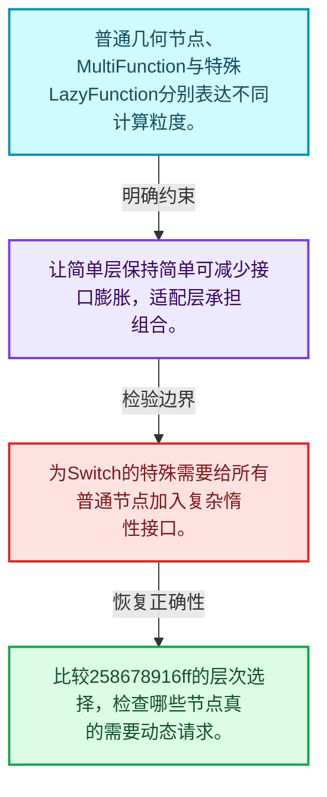
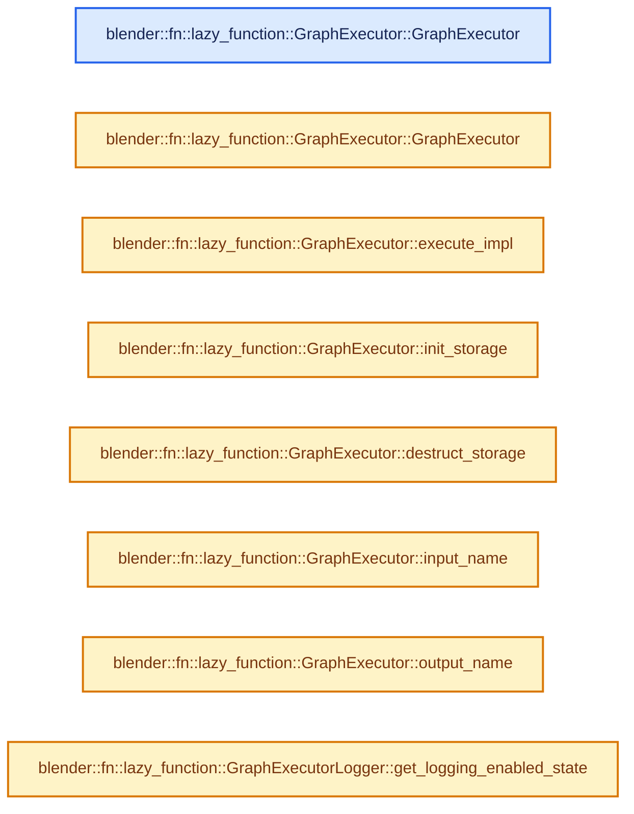
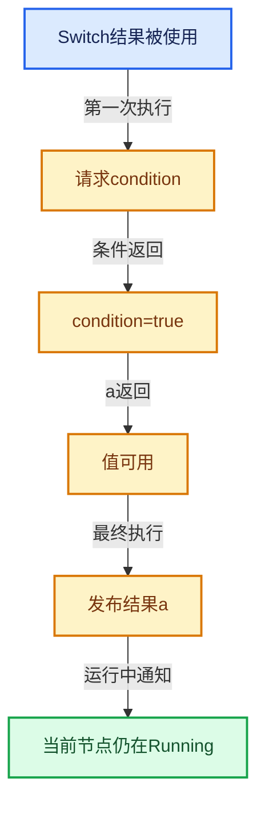

# 09-10 普通节点与函数适配

[方向导航](README.md) · [总目录](../README.md) · [实现索引](../%E7%AC%A6%E5%8F%B7%E4%BE%9D%E8%B5%96%E4%B8%8E%E5%AE%9E%E7%8E%B0%E7%B4%A2%E5%BC%95.md)

## 从问题到实现

为什么不同节点处于不同执行抽象层？

批量函数、普通几何节点和特殊惰性节点具有不同需求，通过适配共同接入执行图。

**数据模型**

普通几何节点、MultiFunction与特殊LazyFunction分别表达不同计算粒度。

**设计取舍**

让简单层保持简单可减少接口膨胀，适配层承担组合。

**最小反例**

为Switch的特殊需要给所有普通节点加入复杂惰性接口。

**推导**

比较258678916ff的层次选择，检查哪些节点真的需要动态请求。

## 阅读地图与执行推演








图中的数值推演是本方向的教学模型；实际函数之间的调用边与概念分析边分别标注，不能把概念关系当作运行时调度顺序。

## 完整源码单元与就地讲解

中文讲解直接放在相关代码旁，复杂机制在代码下展开。原文折叠区保留基准行号；不需要在行号表和函数之间来回查找。类布局可分段展示，函数实现不按固定行数切开。

### 类型布局、声明与编译条件 · lazy_function_graph_executor.cc L1—L18

<!-- annotated:4fad3363ae67b0 -->

```cpp
/* SPDX-FileCopyrightText: 2023 Blender Authors
 *
 * SPDX-License-Identifier: GPL-2.0-or-later */

/** \file
 * \ingroup fn
 */

#include "FN_lazy_function_graph_executor.hh"

/* The entire executor is included here. Otherwise an additional indirection using forward
 * declarations of #GenericGraphExecutor would be needed. However, there isn't really a point in
 * having that because it's tightly coupled to #GraphExecutor anyway. It's only defined in a
 * separate file for code organization purposes. */
#include "lazy_function_graph_executor_generic.hh"

namespace blender::fn::lazy_function {

```

<details>
<summary>核对原始源码：source/blender/functions/intern/lazy_function_graph_executor.cc · L1—L18</summary>

<!-- original:4fad3363ae67b0:source/blender/functions/intern/lazy_function_graph_executor.cc:1:18 -->

```cpp
/* SPDX-FileCopyrightText: 2023 Blender Authors
 *
 * SPDX-License-Identifier: GPL-2.0-or-later */

/** \file
 * \ingroup fn
 */

#include "FN_lazy_function_graph_executor.hh"

/* The entire executor is included here. Otherwise an additional indirection using forward
 * declarations of #GenericGraphExecutor would be needed. However, there isn't really a point in
 * having that because it's tightly coupled to #GraphExecutor anyway. It's only defined in a
 * separate file for code organization purposes. */
#include "lazy_function_graph_executor_generic.hh"

namespace blender::fn::lazy_function {

```

</details>

<a id="f-0be25d17bc9dd959"></a>

### `blender::fn::lazy_function::GraphExecutor::GraphExecutor`

实现位置：[source/blender/functions/intern/lazy_function_graph_executor.cc](../../../../../source/blender/functions/intern/lazy_function_graph_executor.cc) · L19—L30。

接口参数：

- `const Graph &graph`
- `const Logger *logger`
- `const SideEffectProvider *side_effect_provider`
- `const NodeExecuteWrapper *node_execute_wrapper`

**教学注释版**

<!-- annotated:bcf84be7f8984c -->

```cpp
GraphExecutor::GraphExecutor(const Graph &graph,
                             const Logger *logger,
                             const SideEffectProvider *side_effect_provider,
                             const NodeExecuteWrapper *node_execute_wrapper)
    : GraphExecutor(graph,
                    Vector<const GraphInputSocket *>(graph.graph_inputs()),
                    Vector<const GraphOutputSocket *>(graph.graph_outputs()),
                    logger,
                    side_effect_provider,
                    node_execute_wrapper)
{
}
```

<details>
<summary>核对原始源码：source/blender/functions/intern/lazy_function_graph_executor.cc · L19—L30</summary>

<!-- original:bcf84be7f8984c:source/blender/functions/intern/lazy_function_graph_executor.cc:19:30 -->

```cpp
GraphExecutor::GraphExecutor(const Graph &graph,
                             const Logger *logger,
                             const SideEffectProvider *side_effect_provider,
                             const NodeExecuteWrapper *node_execute_wrapper)
    : GraphExecutor(graph,
                    Vector<const GraphInputSocket *>(graph.graph_inputs()),
                    Vector<const GraphOutputSocket *>(graph.graph_outputs()),
                    logger,
                    side_effect_provider,
                    node_execute_wrapper)
{
}
```

</details>

**继续追踪实现**

本实现没有需要继续展开的显式调用；检查返回表达式、对象转换和调用者前置条件。

<!-- annotated:05b74f5ee59646 -->

```cpp

```

<details>
<summary>核对原始源码：source/blender/functions/intern/lazy_function_graph_executor.cc · L31—L31</summary>

<!-- original:05b74f5ee59646:source/blender/functions/intern/lazy_function_graph_executor.cc:31:31 -->

```cpp

```

</details>

<a id="f-505048fd3bdb2b1a"></a>

### `blender::fn::lazy_function::GraphExecutor::GraphExecutor`

实现位置：[source/blender/functions/intern/lazy_function_graph_executor.cc](../../../../../source/blender/functions/intern/lazy_function_graph_executor.cc) · L32—L66。

接口参数：

- `const Graph &graph`
- `Vector<const GraphInputSocket *> graph_inputs`
- `Vector<const GraphOutputSocket *> graph_outputs`
- `const Logger *logger`
- `const SideEffectProvider *side_effect_provider`
- `const NodeExecuteWrapper *node_execute_wrapper`

**教学注释版**

<!-- annotated:72234404d82803 -->

```cpp
GraphExecutor::GraphExecutor(const Graph &graph,
                             Vector<const GraphInputSocket *> graph_inputs,
                             Vector<const GraphOutputSocket *> graph_outputs,
                             const Logger *logger,
                             const SideEffectProvider *side_effect_provider,
                             const NodeExecuteWrapper *node_execute_wrapper)
    : graph_(graph),
      graph_inputs_(std::move(graph_inputs)),
      graph_outputs_(std::move(graph_outputs)),
      graph_input_index_by_socket_index_(graph.graph_inputs().size(), -1),
      graph_output_index_by_socket_index_(graph.graph_outputs().size(), -1),
      logger_(logger),
      side_effect_provider_(side_effect_provider),
      node_execute_wrapper_(node_execute_wrapper)
{
  debug_name_ = graph.name().c_str();

  /* The graph executor can handle partial execution when there are still missing inputs. */
  allow_missing_requested_inputs_ = true;

  for (const int i : graph_inputs_.index_range()) {
    const OutputSocket &socket = *graph_inputs_[i];
    BLI_assert(socket.node().is_interface());
    inputs_.append({"In", socket.type(), ValueUsage::Maybe});
    graph_input_index_by_socket_index_[socket.index()] = i;
  }
  for (const int i : graph_outputs_.index_range()) {
    const InputSocket &socket = *graph_outputs_[i];
    BLI_assert(socket.node().is_interface());
    outputs_.append({"Out", socket.type()});
    graph_output_index_by_socket_index_[socket.index()] = i;
  }

  GenericExecutor::preprocess_graph(*this);
}
```

<details>
<summary>核对原始源码：source/blender/functions/intern/lazy_function_graph_executor.cc · L32—L66</summary>

<!-- original:72234404d82803:source/blender/functions/intern/lazy_function_graph_executor.cc:32:66 -->

```cpp
GraphExecutor::GraphExecutor(const Graph &graph,
                             Vector<const GraphInputSocket *> graph_inputs,
                             Vector<const GraphOutputSocket *> graph_outputs,
                             const Logger *logger,
                             const SideEffectProvider *side_effect_provider,
                             const NodeExecuteWrapper *node_execute_wrapper)
    : graph_(graph),
      graph_inputs_(std::move(graph_inputs)),
      graph_outputs_(std::move(graph_outputs)),
      graph_input_index_by_socket_index_(graph.graph_inputs().size(), -1),
      graph_output_index_by_socket_index_(graph.graph_outputs().size(), -1),
      logger_(logger),
      side_effect_provider_(side_effect_provider),
      node_execute_wrapper_(node_execute_wrapper)
{
  debug_name_ = graph.name().c_str();

  /* The graph executor can handle partial execution when there are still missing inputs. */
  allow_missing_requested_inputs_ = true;

  for (const int i : graph_inputs_.index_range()) {
    const OutputSocket &socket = *graph_inputs_[i];
    BLI_assert(socket.node().is_interface());
    inputs_.append({"In", socket.type(), ValueUsage::Maybe});
    graph_input_index_by_socket_index_[socket.index()] = i;
  }
  for (const int i : graph_outputs_.index_range()) {
    const InputSocket &socket = *graph_outputs_[i];
    BLI_assert(socket.node().is_interface());
    outputs_.append({"Out", socket.type()});
    graph_output_index_by_socket_index_[socket.index()] = i;
  }

  GenericExecutor::preprocess_graph(*this);
}
```

</details>

**沿实际写入检查状态**

- `debug_name_ = graph.name().c_str();`
- `allow_missing_requested_inputs_ = true;`

**继续追踪实现**

- `graph.name().c_str` → [调用协议](../%E6%A8%A1%E6%9D%BF%E5%AE%8F%E4%B8%8E%E5%8A%A8%E6%80%81%E5%88%86%E6%B4%BE%E5%8D%8F%E8%AE%AE.md)：接收对象类型依赖auto、返回值或模板实例；不按同名猜测目标。调用位置L47。
- `graph.name` → [blender::fn::lazy_function::Graph::name · L500](05-Graph%E4%B8%8ESocket.md#f-112b3e570400e7d8)。
- `graph_inputs_.index_range` → [调用协议](../%E6%A8%A1%E6%9D%BF%E5%AE%8F%E4%B8%8E%E5%8A%A8%E6%80%81%E5%88%86%E6%B4%BE%E5%8D%8F%E8%AE%AE.md)：接收对象类型依赖auto、返回值或模板实例；不按同名猜测目标。调用位置L52。
- `BLI_assert` → [BLI_assert · L48](../01-%E5%9F%BA%E7%A1%80%E5%AE%B9%E5%99%A8%E4%B8%8E%E7%8E%B0%E4%BB%A3CPP/%E4%BE%9D%E8%B5%96-BLI_assert-cc98e8.md#m-57a88495704d)；[BLI_assert · L63](../01-%E5%9F%BA%E7%A1%80%E5%AE%B9%E5%99%A8%E4%B8%8E%E7%8E%B0%E4%BB%A3CPP/%E4%BE%9D%E8%B5%96-BLI_assert-cc98e8.md#m-d07050020cb5)。宏定义由构建条件选择。
- `socket.node().is_interface` → [调用协议](../%E6%A8%A1%E6%9D%BF%E5%AE%8F%E4%B8%8E%E5%8A%A8%E6%80%81%E5%88%86%E6%B4%BE%E5%8D%8F%E8%AE%AE.md)：接收对象类型依赖auto、返回值或模板实例；不按同名猜测目标。调用位置L54。
- `socket.node` → [blender::fn::lazy_function::Socket::node · L364](05-Graph%E4%B8%8ESocket.md#f-4ab53625f9fdc45c)；[blender::fn::lazy_function::Socket::node · L369](05-Graph%E4%B8%8ESocket.md#f-543435ebbbc41876)。同名重载需按实参类型选择。
- `inputs_.append` → [调用协议](../%E6%A8%A1%E6%9D%BF%E5%AE%8F%E4%B8%8E%E5%8A%A8%E6%80%81%E5%88%86%E6%B4%BE%E5%8D%8F%E8%AE%AE.md)：接收对象类型依赖auto、返回值或模板实例；不按同名猜测目标。调用位置L55。
- `socket.type` → [blender::fn::lazy_function::Socket::type · L374](05-Graph%E4%B8%8ESocket.md#f-cc2b98ba800ba7ff)。
- `socket.index` → [blender::fn::lazy_function::Socket::index · L330](05-Graph%E4%B8%8ESocket.md#f-314b126d3d271869)。
- `graph_outputs_.index_range` → [调用协议](../%E6%A8%A1%E6%9D%BF%E5%AE%8F%E4%B8%8E%E5%8A%A8%E6%80%81%E5%88%86%E6%B4%BE%E5%8D%8F%E8%AE%AE.md)：接收对象类型依赖auto、返回值或模板实例；不按同名猜测目标。调用位置L58。
- `outputs_.append` → [调用协议](../%E6%A8%A1%E6%9D%BF%E5%AE%8F%E4%B8%8E%E5%8A%A8%E6%80%81%E5%88%86%E6%B4%BE%E5%8D%8F%E8%AE%AE.md)：接收对象类型依赖auto、返回值或模板实例；不按同名猜测目标。调用位置L61。
- `GenericExecutor::preprocess_graph` → [blender::fn::lazy_function::generic_graph_executor::GenericGraphExecutor::preprocess_graph · L440](07-%E6%89%A7%E8%A1%8C%E5%99%A8%E5%86%85%E9%83%A8%E7%8A%B6%E6%80%81.md#f-659747f7fb0dd121)。

<!-- annotated:af17b45a75c232 -->

```cpp

```

<details>
<summary>核对原始源码：source/blender/functions/intern/lazy_function_graph_executor.cc · L67—L67</summary>

<!-- original:af17b45a75c232:source/blender/functions/intern/lazy_function_graph_executor.cc:67:67 -->

```cpp

```

</details>

<a id="f-161c82696993ca52"></a>

### `blender::fn::lazy_function::GraphExecutor::execute_impl`

按已有输入和所需输出推进执行。

实现位置：[source/blender/functions/intern/lazy_function_graph_executor.cc](../../../../../source/blender/functions/intern/lazy_function_graph_executor.cc) · L68—L72。

接口参数：

- `Params &params`
- `const Context &context`

**教学注释版**

<!-- annotated:43b6bd0a5beb18 -->

```cpp
void GraphExecutor::execute_impl(Params &params, const Context &context) const
{
  GenericExecutor &executor = *static_cast<GenericExecutor *>(context.storage);
  // [讲解] executor.execute：按已有输入和所需输出推进执行。
  executor.execute(params, context);
}
```

<details>
<summary>核对原始源码：source/blender/functions/intern/lazy_function_graph_executor.cc · L68—L72</summary>

<!-- original:43b6bd0a5beb18:source/blender/functions/intern/lazy_function_graph_executor.cc:68:72 -->

```cpp
void GraphExecutor::execute_impl(Params &params, const Context &context) const
{
  GenericExecutor &executor = *static_cast<GenericExecutor *>(context.storage);
  executor.execute(params, context);
}
```

</details>

**接口与不变量**

一次执行可能只提出输入请求；不保证立即产生所有输出，也不应无条件重置跨轮状态。

**继续追踪实现**

- `executor.execute` → [blender::fn::lazy_function::LazyFunction::execute · L341](02-LazyFunction%E6%8E%A5%E5%8F%A3.md#f-1d443709054d33d8)。

<!-- annotated:769e336b26218e -->

```cpp

```

<details>
<summary>核对原始源码：source/blender/functions/intern/lazy_function_graph_executor.cc · L73—L73</summary>

<!-- original:769e336b26218e:source/blender/functions/intern/lazy_function_graph_executor.cc:73:73 -->

```cpp

```

</details>

<a id="f-bd0edaf8169fc7b6"></a>

### `blender::fn::lazy_function::GraphExecutor::init_storage`

建立或清理一次执行所需状态。

实现位置：[source/blender/functions/intern/lazy_function_graph_executor.cc](../../../../../source/blender/functions/intern/lazy_function_graph_executor.cc) · L74—L78。

接口参数：

- `LinearAllocator<> &allocator`

**教学注释版**

<!-- annotated:d1dde5faa8a759 -->

```cpp
void *GraphExecutor::init_storage(LinearAllocator<> &allocator) const
{
  GenericExecutor &executor = *allocator.construct<GenericExecutor>(*this).release();
  return &executor;
}
```

<details>
<summary>核对原始源码：source/blender/functions/intern/lazy_function_graph_executor.cc · L74—L78</summary>

<!-- original:d1dde5faa8a759:source/blender/functions/intern/lazy_function_graph_executor.cc:74:78 -->

```cpp
void *GraphExecutor::init_storage(LinearAllocator<> &allocator) const
{
  GenericExecutor &executor = *allocator.construct<GenericExecutor>(*this).release();
  return &executor;
}
```

</details>

**接口与不变量**

图级预处理可复用，但不同执行实例的完成状态和输入值不能混用。

**结果出口**

- `return &executor;`

**继续追踪实现**

- `allocator.construct<GenericExecutor>(*this).release` → [调用协议](../%E6%A8%A1%E6%9D%BF%E5%AE%8F%E4%B8%8E%E5%8A%A8%E6%80%81%E5%88%86%E6%B4%BE%E5%8D%8F%E8%AE%AE.md)：接收对象类型依赖auto、返回值或模板实例；不按同名猜测目标。调用位置L76。
- `allocator.construct<GenericExecutor>` → [blender::LinearAllocator::construct · L135](../03-%E5%86%85%E5%AD%98%E5%88%86%E9%85%8D%E4%B8%8E%E8%BF%90%E8%A1%8C%E6%97%B6%E7%B1%BB%E5%9E%8B/02-LinearAllocator%E5%B8%83%E5%B1%80.md#f-437c16eedf07fa2a)。

<!-- annotated:2127c950b12103 -->

```cpp

```

<details>
<summary>核对原始源码：source/blender/functions/intern/lazy_function_graph_executor.cc · L79—L79</summary>

<!-- original:2127c950b12103:source/blender/functions/intern/lazy_function_graph_executor.cc:79:79 -->

```cpp

```

</details>

<a id="f-ffbb96fbb28dece6"></a>

### `blender::fn::lazy_function::GraphExecutor::destruct_storage`

建立或清理一次执行所需状态。

实现位置：[source/blender/functions/intern/lazy_function_graph_executor.cc](../../../../../source/blender/functions/intern/lazy_function_graph_executor.cc) · L80—L83。

接口参数：

- `void *storage`

**教学注释版**

<!-- annotated:b849487226bc7b -->

```cpp
void GraphExecutor::destruct_storage(void *storage) const
{
  std::destroy_at(static_cast<GenericExecutor *>(storage));
}
```

<details>
<summary>核对原始源码：source/blender/functions/intern/lazy_function_graph_executor.cc · L80—L83</summary>

<!-- original:b849487226bc7b:source/blender/functions/intern/lazy_function_graph_executor.cc:80:83 -->

```cpp
void GraphExecutor::destruct_storage(void *storage) const
{
  std::destroy_at(static_cast<GenericExecutor *>(storage));
}
```

</details>

**接口与不变量**

图级预处理可复用，但不同执行实例的完成状态和输入值不能混用。

**继续追踪实现**

- `std::destroy_at` → [外部契约](https://eel.is/c++draft/)：这个边界按实际表达式及所属类型核对参数、返回值、寿命与失败行为。这里提供接口入口，不声称已解释该第三方版本的内部实现。

<!-- annotated:caa180eb88b64c -->

```cpp

```

<details>
<summary>核对原始源码：source/blender/functions/intern/lazy_function_graph_executor.cc · L84—L84</summary>

<!-- original:caa180eb88b64c:source/blender/functions/intern/lazy_function_graph_executor.cc:84:84 -->

```cpp

```

</details>

<a id="f-4f612310c77ac993"></a>

### `blender::fn::lazy_function::GraphExecutor::input_name`

实现位置：[source/blender/functions/intern/lazy_function_graph_executor.cc](../../../../../source/blender/functions/intern/lazy_function_graph_executor.cc) · L85—L89。

接口参数：

- `const int index`

**教学注释版**

<!-- annotated:adc77dd2594740 -->

```cpp
std::string GraphExecutor::input_name(const int index) const
{
  const lf::OutputSocket &socket = *graph_inputs_[index];
  return socket.name();
}
```

<details>
<summary>核对原始源码：source/blender/functions/intern/lazy_function_graph_executor.cc · L85—L89</summary>

<!-- original:adc77dd2594740:source/blender/functions/intern/lazy_function_graph_executor.cc:85:89 -->

```cpp
std::string GraphExecutor::input_name(const int index) const
{
  const lf::OutputSocket &socket = *graph_inputs_[index];
  return socket.name();
}
```

</details>

**结果出口**

- `return socket.name();`

**继续追踪实现**

- `socket.name` → [blender::fn::lazy_function::Socket::name · L150](05-Graph%E4%B8%8ESocket.md#f-a01e7f5d2dcb5ce1)；[blender::fn::lazy_function::Node::name · L172](05-Graph%E4%B8%8ESocket.md#f-73dc394ac56a5b7a)；[blender::fn::lazy_function::LazyFunction::name · L13](02-LazyFunction%E6%8E%A5%E5%8F%A3.md#f-85edcdbb1b7dc03e)。同名重载需按实参类型选择。

<!-- annotated:884e1ef629daa4 -->

```cpp

```

<details>
<summary>核对原始源码：source/blender/functions/intern/lazy_function_graph_executor.cc · L90—L90</summary>

<!-- original:884e1ef629daa4:source/blender/functions/intern/lazy_function_graph_executor.cc:90:90 -->

```cpp

```

</details>

<a id="f-916c8628a5533eab"></a>

### `blender::fn::lazy_function::GraphExecutor::output_name`

实现位置：[source/blender/functions/intern/lazy_function_graph_executor.cc](../../../../../source/blender/functions/intern/lazy_function_graph_executor.cc) · L91—L95。

接口参数：

- `const int index`

**教学注释版**

<!-- annotated:c6edd36843dc1a -->

```cpp
std::string GraphExecutor::output_name(const int index) const
{
  const lf::InputSocket &socket = *graph_outputs_[index];
  return socket.name();
}
```

<details>
<summary>核对原始源码：source/blender/functions/intern/lazy_function_graph_executor.cc · L91—L95</summary>

<!-- original:c6edd36843dc1a:source/blender/functions/intern/lazy_function_graph_executor.cc:91:95 -->

```cpp
std::string GraphExecutor::output_name(const int index) const
{
  const lf::InputSocket &socket = *graph_outputs_[index];
  return socket.name();
}
```

</details>

**结果出口**

- `return socket.name();`

**继续追踪实现**

- `socket.name` → [blender::fn::lazy_function::Socket::name · L150](05-Graph%E4%B8%8ESocket.md#f-a01e7f5d2dcb5ce1)；[blender::fn::lazy_function::Node::name · L172](05-Graph%E4%B8%8ESocket.md#f-73dc394ac56a5b7a)；[blender::fn::lazy_function::LazyFunction::name · L13](02-LazyFunction%E6%8E%A5%E5%8F%A3.md#f-85edcdbb1b7dc03e)。同名重载需按实参类型选择。

<!-- annotated:9586f0e1f32084 -->

```cpp

```

<details>
<summary>核对原始源码：source/blender/functions/intern/lazy_function_graph_executor.cc · L96—L96</summary>

<!-- original:9586f0e1f32084:source/blender/functions/intern/lazy_function_graph_executor.cc:96:96 -->

```cpp

```

</details>

<a id="f-d3fafc98891f595e"></a>

### `blender::fn::lazy_function::GraphExecutorLogger::get_logging_enabled_state`

实现位置：[source/blender/functions/intern/lazy_function_graph_executor.cc](../../../../../source/blender/functions/intern/lazy_function_graph_executor.cc) · L97—L101。

接口参数：

- `const Context &`

**教学注释版**

<!-- annotated:0b1bc3100833b8 -->

```cpp
GraphExecutorLogger::LoggingEnabledState GraphExecutorLogger::get_logging_enabled_state(
    const Context & /*context*/) const
{
  return LoggingEnabledState{true};
}
```

<details>
<summary>核对原始源码：source/blender/functions/intern/lazy_function_graph_executor.cc · L97—L101</summary>

<!-- original:0b1bc3100833b8:source/blender/functions/intern/lazy_function_graph_executor.cc:97:101 -->

```cpp
GraphExecutorLogger::LoggingEnabledState GraphExecutorLogger::get_logging_enabled_state(
    const Context & /*context*/) const
{
  return LoggingEnabledState{true};
}
```

</details>

**结果出口**

- `return LoggingEnabledState{true};`

**继续追踪实现**

本实现没有需要继续展开的显式调用；检查返回表达式、对象转换和调用者前置条件。

<!-- annotated:bb9f6d55b132fe -->

```cpp

```

<details>
<summary>核对原始源码：source/blender/functions/intern/lazy_function_graph_executor.cc · L102—L102</summary>

<!-- original:bb9f6d55b132fe:source/blender/functions/intern/lazy_function_graph_executor.cc:102:102 -->

```cpp

```

</details>

<a id="f-bd370e5046d5710c"></a>

### `blender::fn::lazy_function::GraphExecutorLogger::log_socket_value`

实现位置：[source/blender/functions/intern/lazy_function_graph_executor.cc](../../../../../source/blender/functions/intern/lazy_function_graph_executor.cc) · L103—L108。

接口参数：

- `const Socket &socket`
- `const GPointer value`
- `const Context &context`

**教学注释版**

<!-- annotated:34512eeb552e99 -->

```cpp
void GraphExecutorLogger::log_socket_value(const Socket &socket,
                                           const GPointer value,
                                           const Context &context) const
{
  UNUSED_VARS(socket, value, context);
}
```

<details>
<summary>核对原始源码：source/blender/functions/intern/lazy_function_graph_executor.cc · L103—L108</summary>

<!-- original:34512eeb552e99:source/blender/functions/intern/lazy_function_graph_executor.cc:103:108 -->

```cpp
void GraphExecutorLogger::log_socket_value(const Socket &socket,
                                           const GPointer value,
                                           const Context &context) const
{
  UNUSED_VARS(socket, value, context);
}
```

</details>

**继续追踪实现**

- `UNUSED_VARS` → [UNUSED_VARS · L522](../01-%E5%9F%BA%E7%A1%80%E5%AE%B9%E5%99%A8%E4%B8%8E%E7%8E%B0%E4%BB%A3CPP/%E4%BE%9D%E8%B5%96-BLI_utildefines-293a0a.md#m-013582537634)；[UNUSED_VARS · L41](../05-%E5%87%A0%E4%BD%95%E5%AD%98%E5%82%A8%E4%B8%8E%E6%8B%93%E6%89%91%E6%98%A0%E5%B0%84/%E4%BE%9D%E8%B5%96-GPU_shader_shared_utils-0adda3.md#m-05d9d7a33da0)；[UNUSED_VARS · L62](../05-%E5%87%A0%E4%BD%95%E5%AD%98%E5%82%A8%E4%B8%8E%E6%8B%93%E6%89%91%E6%98%A0%E5%B0%84/%E4%BE%9D%E8%B5%96-GPU_shader_shared_utils-0adda3.md#m-e12c683a4aca)。宏定义由构建条件选择。

<!-- annotated:09125f4dd17213 -->

```cpp

```

<details>
<summary>核对原始源码：source/blender/functions/intern/lazy_function_graph_executor.cc · L109—L109</summary>

<!-- original:09125f4dd17213:source/blender/functions/intern/lazy_function_graph_executor.cc:109:109 -->

```cpp

```

</details>

<a id="f-bd880431fe231d17"></a>

### `blender::fn::lazy_function::GraphExecutorLogger::log_before_node_execute`

实现位置：[source/blender/functions/intern/lazy_function_graph_executor.cc](../../../../../source/blender/functions/intern/lazy_function_graph_executor.cc) · L110—L115。

接口参数：

- `const FunctionNode &node`
- `const Params &params`
- `const Context &context`

**教学注释版**

<!-- annotated:7c673f557a24ef -->

```cpp
void GraphExecutorLogger::log_before_node_execute(const FunctionNode &node,
                                                  const Params &params,
                                                  const Context &context) const
{
  UNUSED_VARS(node, params, context);
}
```

<details>
<summary>核对原始源码：source/blender/functions/intern/lazy_function_graph_executor.cc · L110—L115</summary>

<!-- original:7c673f557a24ef:source/blender/functions/intern/lazy_function_graph_executor.cc:110:115 -->

```cpp
void GraphExecutorLogger::log_before_node_execute(const FunctionNode &node,
                                                  const Params &params,
                                                  const Context &context) const
{
  UNUSED_VARS(node, params, context);
}
```

</details>

**继续追踪实现**

- `UNUSED_VARS` → [UNUSED_VARS · L522](../01-%E5%9F%BA%E7%A1%80%E5%AE%B9%E5%99%A8%E4%B8%8E%E7%8E%B0%E4%BB%A3CPP/%E4%BE%9D%E8%B5%96-BLI_utildefines-293a0a.md#m-013582537634)；[UNUSED_VARS · L41](../05-%E5%87%A0%E4%BD%95%E5%AD%98%E5%82%A8%E4%B8%8E%E6%8B%93%E6%89%91%E6%98%A0%E5%B0%84/%E4%BE%9D%E8%B5%96-GPU_shader_shared_utils-0adda3.md#m-05d9d7a33da0)；[UNUSED_VARS · L62](../05-%E5%87%A0%E4%BD%95%E5%AD%98%E5%82%A8%E4%B8%8E%E6%8B%93%E6%89%91%E6%98%A0%E5%B0%84/%E4%BE%9D%E8%B5%96-GPU_shader_shared_utils-0adda3.md#m-e12c683a4aca)。宏定义由构建条件选择。

<!-- annotated:b5c9173a053923 -->

```cpp

```

<details>
<summary>核对原始源码：source/blender/functions/intern/lazy_function_graph_executor.cc · L116—L116</summary>

<!-- original:b5c9173a053923:source/blender/functions/intern/lazy_function_graph_executor.cc:116:116 -->

```cpp

```

</details>

<a id="f-f69ef76a7deeb0c5"></a>

### `blender::fn::lazy_function::GraphExecutorLogger::log_after_node_execute`

实现位置：[source/blender/functions/intern/lazy_function_graph_executor.cc](../../../../../source/blender/functions/intern/lazy_function_graph_executor.cc) · L117—L122。

接口参数：

- `const FunctionNode &node`
- `const Params &params`
- `const Context &context`

**教学注释版**

<!-- annotated:6e0278ee5a3169 -->

```cpp
void GraphExecutorLogger::log_after_node_execute(const FunctionNode &node,
                                                 const Params &params,
                                                 const Context &context) const
{
  UNUSED_VARS(node, params, context);
}
```

<details>
<summary>核对原始源码：source/blender/functions/intern/lazy_function_graph_executor.cc · L117—L122</summary>

<!-- original:6e0278ee5a3169:source/blender/functions/intern/lazy_function_graph_executor.cc:117:122 -->

```cpp
void GraphExecutorLogger::log_after_node_execute(const FunctionNode &node,
                                                 const Params &params,
                                                 const Context &context) const
{
  UNUSED_VARS(node, params, context);
}
```

</details>

**继续追踪实现**

- `UNUSED_VARS` → [UNUSED_VARS · L522](../01-%E5%9F%BA%E7%A1%80%E5%AE%B9%E5%99%A8%E4%B8%8E%E7%8E%B0%E4%BB%A3CPP/%E4%BE%9D%E8%B5%96-BLI_utildefines-293a0a.md#m-013582537634)；[UNUSED_VARS · L41](../05-%E5%87%A0%E4%BD%95%E5%AD%98%E5%82%A8%E4%B8%8E%E6%8B%93%E6%89%91%E6%98%A0%E5%B0%84/%E4%BE%9D%E8%B5%96-GPU_shader_shared_utils-0adda3.md#m-05d9d7a33da0)；[UNUSED_VARS · L62](../05-%E5%87%A0%E4%BD%95%E5%AD%98%E5%82%A8%E4%B8%8E%E6%8B%93%E6%89%91%E6%98%A0%E5%B0%84/%E4%BE%9D%E8%B5%96-GPU_shader_shared_utils-0adda3.md#m-e12c683a4aca)。宏定义由构建条件选择。

<!-- annotated:f84d87d6d1e80c -->

```cpp

```

<details>
<summary>核对原始源码：source/blender/functions/intern/lazy_function_graph_executor.cc · L123—L123</summary>

<!-- original:f84d87d6d1e80c:source/blender/functions/intern/lazy_function_graph_executor.cc:123:123 -->

```cpp

```

</details>

<a id="f-946b01522a79d087"></a>

### `blender::fn::lazy_function::GraphExecutorSideEffectProvider::get_nodes_with_side_effects`

实现位置：[source/blender/functions/intern/lazy_function_graph_executor.cc](../../../../../source/blender/functions/intern/lazy_function_graph_executor.cc) · L124—L129。

接口参数：

- `const Context &context`

**教学注释版**

<!-- annotated:08e27b19e87778 -->

```cpp
Vector<const FunctionNode *> GraphExecutorSideEffectProvider::get_nodes_with_side_effects(
    const Context &context) const
{
  UNUSED_VARS(context);
  return {};
}
```

<details>
<summary>核对原始源码：source/blender/functions/intern/lazy_function_graph_executor.cc · L124—L129</summary>

<!-- original:08e27b19e87778:source/blender/functions/intern/lazy_function_graph_executor.cc:124:129 -->

```cpp
Vector<const FunctionNode *> GraphExecutorSideEffectProvider::get_nodes_with_side_effects(
    const Context &context) const
{
  UNUSED_VARS(context);
  return {};
}
```

</details>

**结果出口**

- `return {};`

**继续追踪实现**

- `UNUSED_VARS` → [UNUSED_VARS · L522](../01-%E5%9F%BA%E7%A1%80%E5%AE%B9%E5%99%A8%E4%B8%8E%E7%8E%B0%E4%BB%A3CPP/%E4%BE%9D%E8%B5%96-BLI_utildefines-293a0a.md#m-013582537634)；[UNUSED_VARS · L41](../05-%E5%87%A0%E4%BD%95%E5%AD%98%E5%82%A8%E4%B8%8E%E6%8B%93%E6%89%91%E6%98%A0%E5%B0%84/%E4%BE%9D%E8%B5%96-GPU_shader_shared_utils-0adda3.md#m-05d9d7a33da0)；[UNUSED_VARS · L62](../05-%E5%87%A0%E4%BD%95%E5%AD%98%E5%82%A8%E4%B8%8E%E6%8B%93%E6%89%91%E6%98%A0%E5%B0%84/%E4%BE%9D%E8%B5%96-GPU_shader_shared_utils-0adda3.md#m-e12c683a4aca)。宏定义由构建条件选择。

<!-- annotated:df42e82588d3c6 -->

```cpp

```

<details>
<summary>核对原始源码：source/blender/functions/intern/lazy_function_graph_executor.cc · L130—L130</summary>

<!-- original:df42e82588d3c6:source/blender/functions/intern/lazy_function_graph_executor.cc:130:130 -->

```cpp

```

</details>

<a id="f-c76bed722cc7e432"></a>

### `blender::fn::lazy_function::GraphExecutorLogger::dump_when_outputs_are_missing`

实现位置：[source/blender/functions/intern/lazy_function_graph_executor.cc](../../../../../source/blender/functions/intern/lazy_function_graph_executor.cc) · L131—L136。

接口参数：

- `const FunctionNode &node`
- `Span<const OutputSocket *> missing_sockets`
- `const Context &context`

**教学注释版**

<!-- annotated:187aa7d0fa1366 -->

```cpp
void GraphExecutorLogger::dump_when_outputs_are_missing(const FunctionNode &node,
                                                        Span<const OutputSocket *> missing_sockets,
                                                        const Context &context) const
{
  UNUSED_VARS(node, missing_sockets, context);
}
```

<details>
<summary>核对原始源码：source/blender/functions/intern/lazy_function_graph_executor.cc · L131—L136</summary>

<!-- original:187aa7d0fa1366:source/blender/functions/intern/lazy_function_graph_executor.cc:131:136 -->

```cpp
void GraphExecutorLogger::dump_when_outputs_are_missing(const FunctionNode &node,
                                                        Span<const OutputSocket *> missing_sockets,
                                                        const Context &context) const
{
  UNUSED_VARS(node, missing_sockets, context);
}
```

</details>

**继续追踪实现**

- `UNUSED_VARS` → [UNUSED_VARS · L522](../01-%E5%9F%BA%E7%A1%80%E5%AE%B9%E5%99%A8%E4%B8%8E%E7%8E%B0%E4%BB%A3CPP/%E4%BE%9D%E8%B5%96-BLI_utildefines-293a0a.md#m-013582537634)；[UNUSED_VARS · L41](../05-%E5%87%A0%E4%BD%95%E5%AD%98%E5%82%A8%E4%B8%8E%E6%8B%93%E6%89%91%E6%98%A0%E5%B0%84/%E4%BE%9D%E8%B5%96-GPU_shader_shared_utils-0adda3.md#m-05d9d7a33da0)；[UNUSED_VARS · L62](../05-%E5%87%A0%E4%BD%95%E5%AD%98%E5%82%A8%E4%B8%8E%E6%8B%93%E6%89%91%E6%98%A0%E5%B0%84/%E4%BE%9D%E8%B5%96-GPU_shader_shared_utils-0adda3.md#m-e12c683a4aca)。宏定义由构建条件选择。

<!-- annotated:bb67e43959586a -->

```cpp

```

<details>
<summary>核对原始源码：source/blender/functions/intern/lazy_function_graph_executor.cc · L137—L137</summary>

<!-- original:bb67e43959586a:source/blender/functions/intern/lazy_function_graph_executor.cc:137:137 -->

```cpp

```

</details>

<a id="f-29eeda47d1783ba5"></a>

### `blender::fn::lazy_function::GraphExecutorLogger::dump_when_input_is_set_twice`

实现位置：[source/blender/functions/intern/lazy_function_graph_executor.cc](../../../../../source/blender/functions/intern/lazy_function_graph_executor.cc) · L138—L143。

接口参数：

- `const InputSocket &target_socket`
- `const OutputSocket &from_socket`
- `const Context &context`

**教学注释版**

<!-- annotated:8dd65f7aa9945c -->

```cpp
void GraphExecutorLogger::dump_when_input_is_set_twice(const InputSocket &target_socket,
                                                       const OutputSocket &from_socket,
                                                       const Context &context) const
{
  UNUSED_VARS(target_socket, from_socket, context);
}
```

<details>
<summary>核对原始源码：source/blender/functions/intern/lazy_function_graph_executor.cc · L138—L143</summary>

<!-- original:8dd65f7aa9945c:source/blender/functions/intern/lazy_function_graph_executor.cc:138:143 -->

```cpp
void GraphExecutorLogger::dump_when_input_is_set_twice(const InputSocket &target_socket,
                                                       const OutputSocket &from_socket,
                                                       const Context &context) const
{
  UNUSED_VARS(target_socket, from_socket, context);
}
```

</details>

**继续追踪实现**

- `UNUSED_VARS` → [UNUSED_VARS · L522](../01-%E5%9F%BA%E7%A1%80%E5%AE%B9%E5%99%A8%E4%B8%8E%E7%8E%B0%E4%BB%A3CPP/%E4%BE%9D%E8%B5%96-BLI_utildefines-293a0a.md#m-013582537634)；[UNUSED_VARS · L41](../05-%E5%87%A0%E4%BD%95%E5%AD%98%E5%82%A8%E4%B8%8E%E6%8B%93%E6%89%91%E6%98%A0%E5%B0%84/%E4%BE%9D%E8%B5%96-GPU_shader_shared_utils-0adda3.md#m-05d9d7a33da0)；[UNUSED_VARS · L62](../05-%E5%87%A0%E4%BD%95%E5%AD%98%E5%82%A8%E4%B8%8E%E6%8B%93%E6%89%91%E6%98%A0%E5%B0%84/%E4%BE%9D%E8%B5%96-GPU_shader_shared_utils-0adda3.md#m-e12c683a4aca)。宏定义由构建条件选择。

### 类型布局、声明与编译条件 · lazy_function_graph_executor.cc L144—L145

<!-- annotated:731d0f7778c443 -->

```cpp

}  // namespace blender::fn::lazy_function
```

<details>
<summary>核对原始源码：source/blender/functions/intern/lazy_function_graph_executor.cc · L144—L145</summary>

<!-- original:731d0f7778c443:source/blender/functions/intern/lazy_function_graph_executor.cc:144:145 -->

```cpp

}  // namespace blender::fn::lazy_function
```

</details>

<a id="f-d82db7fc0d392d0f"></a>

### `blender::nodes::LazyFunctionForJoinReferenceSets::LazyFunctionForJoinReferenceSets`

实现位置：[source/blender/nodes/intern/geometry_nodes_lazy_function.cc](../../../../../source/blender/nodes/intern/geometry_nodes_lazy_function.cc) · L1475—L1484。

接口参数：

- `const int amount`

**教学注释版**

<!-- annotated:5f1667fbcbb651 -->

```cpp
  LazyFunctionForJoinReferenceSets(const int amount) : amount_(amount)
  {
    debug_name_ = "Join Reference Sets";
    for ([[maybe_unused]] const int i : IndexRange(amount)) {
      inputs_.append_as("Use", CPPType::get<bool>());
      inputs_.append_as(
          "Reference Set", CPPType::get<GeometryNodesReferenceSet>(), lf::ValueUsage::Maybe);
    }
    outputs_.append_as("Reference Set", CPPType::get<GeometryNodesReferenceSet>());
  }
```

<details>
<summary>核对原始源码：source/blender/nodes/intern/geometry_nodes_lazy_function.cc · L1475—L1484</summary>

<!-- original:5f1667fbcbb651:source/blender/nodes/intern/geometry_nodes_lazy_function.cc:1475:1484 -->

```cpp
  LazyFunctionForJoinReferenceSets(const int amount) : amount_(amount)
  {
    debug_name_ = "Join Reference Sets";
    for ([[maybe_unused]] const int i : IndexRange(amount)) {
      inputs_.append_as("Use", CPPType::get<bool>());
      inputs_.append_as(
          "Reference Set", CPPType::get<GeometryNodesReferenceSet>(), lf::ValueUsage::Maybe);
    }
    outputs_.append_as("Reference Set", CPPType::get<GeometryNodesReferenceSet>());
  }
```

</details>

**沿实际写入检查状态**

- `debug_name_ = "Join Reference Sets";`

**继续追踪实现**

- `IndexRange` → [blender::IndexRange](../01-%E5%9F%BA%E7%A1%80%E5%AE%B9%E5%99%A8%E4%B8%8E%E7%8E%B0%E4%BB%A3CPP/%E4%BE%9D%E8%B5%96-BLI_index_range-7d7cc5.md#t-caa3466d6776)；[blender::gpu::shader::parser::IndexRange](../05-%E5%87%A0%E4%BD%95%E5%AD%98%E5%82%A8%E4%B8%8E%E6%8B%93%E6%89%91%E6%98%A0%E5%B0%84/%E4%BE%9D%E8%B5%96-utils-06433d.md#t-82d2bd4ea71c)；[blender::IndexRange](../05-%E5%87%A0%E4%BD%95%E5%AD%98%E5%82%A8%E4%B8%8E%E6%8B%93%E6%89%91%E6%98%A0%E5%B0%84/%E4%BE%9D%E8%B5%96-DNA_node_types-6708b9.md#t-0448cc889d39)。
- `inputs_.append_as` → [调用协议](../%E6%A8%A1%E6%9D%BF%E5%AE%8F%E4%B8%8E%E5%8A%A8%E6%80%81%E5%88%86%E6%B4%BE%E5%8D%8F%E8%AE%AE.md)：接收对象类型依赖auto、返回值或模板实例；不按同名猜测目标。调用位置L1479。
- `CPPType::get<bool>` → [blender::CPPType::get · L481](../03-%E5%86%85%E5%AD%98%E5%88%86%E9%85%8D%E4%B8%8E%E8%BF%90%E8%A1%8C%E6%97%B6%E7%B1%BB%E5%9E%8B/08-CPPType%E6%9E%84%E9%80%A0%E4%B8%8E%E6%9E%90%E6%9E%84.md#f-0cc10a3783d6abdb)。
- `CPPType::get<GeometryNodesReferenceSet>` → [blender::CPPType::get · L481](../03-%E5%86%85%E5%AD%98%E5%88%86%E9%85%8D%E4%B8%8E%E8%BF%90%E8%A1%8C%E6%97%B6%E7%B1%BB%E5%9E%8B/08-CPPType%E6%9E%84%E9%80%A0%E4%B8%8E%E6%9E%90%E6%9E%84.md#f-0cc10a3783d6abdb)。
- `outputs_.append_as` → [调用协议](../%E6%A8%A1%E6%9D%BF%E5%AE%8F%E4%B8%8E%E5%8A%A8%E6%80%81%E5%88%86%E6%B4%BE%E5%8D%8F%E8%AE%AE.md)：接收对象类型依赖auto、返回值或模板实例；不按同名猜测目标。调用位置L1483。

<!-- annotated:4e98a3a6ab53fe -->

```cpp

```

<details>
<summary>核对原始源码：source/blender/nodes/intern/geometry_nodes_lazy_function.cc · L1485—L1485</summary>

<!-- original:4e98a3a6ab53fe:source/blender/nodes/intern/geometry_nodes_lazy_function.cc:1485:1485 -->

```cpp

```

</details>

<a id="f-73064fa23f9d9b11"></a>

### `blender::nodes::LazyFunctionForJoinReferenceSets::execute_impl`

实现位置：[source/blender/nodes/intern/geometry_nodes_lazy_function.cc](../../../../../source/blender/nodes/intern/geometry_nodes_lazy_function.cc) · L1486—L1524。

接口参数：

- `lf::Params &params`
- `const lf::Context &`

**教学注释版**

<!-- annotated:a540a6316472e7 -->

```cpp
  void execute_impl(lf::Params &params, const lf::Context & /*context*/) const override
  {
    Vector<GeometryNodesReferenceSet *> sets;
    bool set_is_missing = false;
    for (const int i : IndexRange(amount_)) {
      if (params.get_input<bool>(this->get_use_input(i))) {
        if (GeometryNodesReferenceSet *set =
                params.try_get_input_data_ptr_or_request<GeometryNodesReferenceSet>(
                    this->get_reference_set_input(i)))
        {
          // [讲解] sets.append：在尾部建立新元素，必要时先扩大存储。
          sets.append(set);
        }
        else {
          set_is_missing = true;
        }
      }
    }
    if (set_is_missing) {
      return;
    }
    GeometryNodesReferenceSet joined_set;
    if (sets.is_empty()) {
      /* Nothing to do. */
    }
    // [讲解] sets.size：用end_减begin_得到活元素数量。
    else if (sets.size() == 1) {
      // [讲解] std::move：把表达式转换成可供移动重载选择的值类别；不保证真的移动，不结束源对象寿命，对const值可能选择复制。
      joined_set.names = std::move(sets[0]->names);
    }
    else {
      // [讲解] std::make_shared<Set<std::string>>：构造由共享控制块管理的对象；共享寿命不自动使被指对象读写线程安全，强引用环需单独处理。
      joined_set.names = std::make_shared<Set<std::string>>();
      for (const GeometryNodesReferenceSet *set : sets) {
        if (set->names) {
          for (const std::string &name : *set->names) {
            joined_set.names->add(name);
          }
        }
      }
    }
    params.set_output(0, std::move(joined_set));
  }
```

<details>
<summary>核对原始源码：source/blender/nodes/intern/geometry_nodes_lazy_function.cc · L1486—L1524</summary>

<!-- original:a540a6316472e7:source/blender/nodes/intern/geometry_nodes_lazy_function.cc:1486:1524 -->

```cpp
  void execute_impl(lf::Params &params, const lf::Context & /*context*/) const override
  {
    Vector<GeometryNodesReferenceSet *> sets;
    bool set_is_missing = false;
    for (const int i : IndexRange(amount_)) {
      if (params.get_input<bool>(this->get_use_input(i))) {
        if (GeometryNodesReferenceSet *set =
                params.try_get_input_data_ptr_or_request<GeometryNodesReferenceSet>(
                    this->get_reference_set_input(i)))
        {
          sets.append(set);
        }
        else {
          set_is_missing = true;
        }
      }
    }
    if (set_is_missing) {
      return;
    }
    GeometryNodesReferenceSet joined_set;
    if (sets.is_empty()) {
      /* Nothing to do. */
    }
    else if (sets.size() == 1) {
      joined_set.names = std::move(sets[0]->names);
    }
    else {
      joined_set.names = std::make_shared<Set<std::string>>();
      for (const GeometryNodesReferenceSet *set : sets) {
        if (set->names) {
          for (const std::string &name : *set->names) {
            joined_set.names->add(name);
          }
        }
      }
    }
    params.set_output(0, std::move(joined_set));
  }
```

</details>

**沿实际写入检查状态**

- `set_is_missing = true;`
- `joined_set.names = std::move(sets[0]->names);`
- `joined_set.names = std::make_shared<Set<std::string>>();`

**继续追踪实现**

- `IndexRange` → [blender::IndexRange](../01-%E5%9F%BA%E7%A1%80%E5%AE%B9%E5%99%A8%E4%B8%8E%E7%8E%B0%E4%BB%A3CPP/%E4%BE%9D%E8%B5%96-BLI_index_range-7d7cc5.md#t-caa3466d6776)；[blender::gpu::shader::parser::IndexRange](../05-%E5%87%A0%E4%BD%95%E5%AD%98%E5%82%A8%E4%B8%8E%E6%8B%93%E6%89%91%E6%98%A0%E5%B0%84/%E4%BE%9D%E8%B5%96-utils-06433d.md#t-82d2bd4ea71c)；[blender::IndexRange](../05-%E5%87%A0%E4%BD%95%E5%AD%98%E5%82%A8%E4%B8%8E%E6%8B%93%E6%89%91%E6%98%A0%E5%B0%84/%E4%BE%9D%E8%B5%96-DNA_node_types-6708b9.md#t-0448cc889d39)。
- `params.get_input<bool>` → [blender::fn::lazy_function::Params::get_input · L421](02-LazyFunction%E6%8E%A5%E5%8F%A3.md#f-167a9263f8e9f932)。
- `this->get_use_input` → [blender::nodes::LazyFunctionForJoinReferenceSets::get_use_input · L1526](10-%E6%99%AE%E9%80%9A%E8%8A%82%E7%82%B9%E4%B8%8E%E5%87%BD%E6%95%B0%E9%80%82%E9%85%8D.md#f-f8e68ba7f522de06)。
- `params.try_get_input_data_ptr_or_request<GeometryNodesReferenceSet>` → [blender::fn::lazy_function::Params::try_get_input_data_ptr_or_request · L372](02-LazyFunction%E6%8E%A5%E5%8F%A3.md#f-89de2295f5baa94f)；[blender::fn::lazy_function::Params::try_get_input_data_ptr_or_request · L434](02-LazyFunction%E6%8E%A5%E5%8F%A3.md#f-97ba143c63061e47)。同名重载需按实参类型选择。
- `this->get_reference_set_input` → [blender::nodes::LazyFunctionForJoinReferenceSets::get_reference_set_input · L1531](10-%E6%99%AE%E9%80%9A%E8%8A%82%E7%82%B9%E4%B8%8E%E5%87%BD%E6%95%B0%E9%80%82%E9%85%8D.md#f-666d430897fcedcb)。
- `sets.append` → [blender::Vector::append · L498](../01-%E5%9F%BA%E7%A1%80%E5%AE%B9%E5%99%A8%E4%B8%8E%E7%8E%B0%E4%BB%A3CPP/11-Vector%E6%8F%92%E5%85%A5%E5%88%A0%E9%99%A4%E4%B8%8E%E9%87%8D%E6%8E%92.md#f-5bde268a69e443ec)；[blender::Vector::append · L502](../01-%E5%9F%BA%E7%A1%80%E5%AE%B9%E5%99%A8%E4%B8%8E%E7%8E%B0%E4%BB%A3CPP/11-Vector%E6%8F%92%E5%85%A5%E5%88%A0%E9%99%A4%E4%B8%8E%E9%87%8D%E6%8E%92.md#f-591e0b15e6308532)。同名重载需按实参类型选择。
- `sets.is_empty` → [blender::Vector::is_empty · L792](../01-%E5%9F%BA%E7%A1%80%E5%AE%B9%E5%99%A8%E4%B8%8E%E7%8E%B0%E4%BB%A3CPP/11-Vector%E6%8F%92%E5%85%A5%E5%88%A0%E9%99%A4%E4%B8%8E%E9%87%8D%E6%8E%92.md#f-937bbd9cb80bdcc8)。
- `sets.size` → [blender::Vector::size · L780](../01-%E5%9F%BA%E7%A1%80%E5%AE%B9%E5%99%A8%E4%B8%8E%E7%8E%B0%E4%BB%A3CPP/11-Vector%E6%8F%92%E5%85%A5%E5%88%A0%E9%99%A4%E4%B8%8E%E9%87%8D%E6%8E%92.md#f-714773731767349c)。
- `std::move` → [外部契约](https://eel.is/c++draft/utility.forward)：把表达式转换成可供移动重载选择的值类别；不保证真的移动，不结束源对象寿命，对const值可能选择复制。
- `std::make_shared<Set<std::string>>` → [外部契约](https://eel.is/c++draft/util.smartptr.shared.create)：构造由共享控制块管理的对象；共享寿命不自动使被指对象读写线程安全，强引用环需单独处理。
- `joined_set.names->add` → [调用协议](../%E6%A8%A1%E6%9D%BF%E5%AE%8F%E4%B8%8E%E5%8A%A8%E6%80%81%E5%88%86%E6%B4%BE%E5%8D%8F%E8%AE%AE.md)：接收对象类型依赖auto、返回值或模板实例；不按同名猜测目标。调用位置L1518。
- `params.set_output` → [blender::fn::lazy_function::Params::set_output · L440](02-LazyFunction%E6%8E%A5%E5%8F%A3.md#f-993589d688de575d)。

<!-- annotated:d0cb207df418ff -->

```cpp

```

<details>
<summary>核对原始源码：source/blender/nodes/intern/geometry_nodes_lazy_function.cc · L1525—L1525</summary>

<!-- original:d0cb207df418ff:source/blender/nodes/intern/geometry_nodes_lazy_function.cc:1525:1525 -->

```cpp

```

</details>

<a id="f-f8e68ba7f522de06"></a>

### `blender::nodes::LazyFunctionForJoinReferenceSets::get_use_input`

实现位置：[source/blender/nodes/intern/geometry_nodes_lazy_function.cc](../../../../../source/blender/nodes/intern/geometry_nodes_lazy_function.cc) · L1526—L1529。

接口参数：

- `const int i`

**教学注释版**

<!-- annotated:121638711a2dbd -->

```cpp
  int get_use_input(const int i) const
  {
    return 2 * i;
  }
```

<details>
<summary>核对原始源码：source/blender/nodes/intern/geometry_nodes_lazy_function.cc · L1526—L1529</summary>

<!-- original:121638711a2dbd:source/blender/nodes/intern/geometry_nodes_lazy_function.cc:1526:1529 -->

```cpp
  int get_use_input(const int i) const
  {
    return 2 * i;
  }
```

</details>

**结果出口**

- `return 2 * i;`

**继续追踪实现**

本实现没有需要继续展开的显式调用；检查返回表达式、对象转换和调用者前置条件。

<!-- annotated:35743bb9f671e4 -->

```cpp

```

<details>
<summary>核对原始源码：source/blender/nodes/intern/geometry_nodes_lazy_function.cc · L1530—L1530</summary>

<!-- original:35743bb9f671e4:source/blender/nodes/intern/geometry_nodes_lazy_function.cc:1530:1530 -->

```cpp

```

</details>

<a id="f-666d430897fcedcb"></a>

### `blender::nodes::LazyFunctionForJoinReferenceSets::get_reference_set_input`

实现位置：[source/blender/nodes/intern/geometry_nodes_lazy_function.cc](../../../../../source/blender/nodes/intern/geometry_nodes_lazy_function.cc) · L1531—L1534。

接口参数：

- `const int i`

**教学注释版**

<!-- annotated:049645a5389a19 -->

```cpp
  int get_reference_set_input(const int i) const
  {
    return 2 * i + 1;
  }
```

<details>
<summary>核对原始源码：source/blender/nodes/intern/geometry_nodes_lazy_function.cc · L1531—L1534</summary>

<!-- original:049645a5389a19:source/blender/nodes/intern/geometry_nodes_lazy_function.cc:1531:1534 -->

```cpp
  int get_reference_set_input(const int i) const
  {
    return 2 * i + 1;
  }
```

</details>

**结果出口**

- `return 2 * i + 1;`

**继续追踪实现**

本实现没有需要继续展开的显式调用；检查返回表达式、对象转换和调用者前置条件。

### 类型布局、声明与编译条件 · geometry_nodes_lazy_function.cc L1535—L1538

<!-- annotated:e7c53a2a1c0d06 -->

```cpp

  /**
   * Cache for functions small amounts to avoid to avoid building them many times.
   */
```

<details>
<summary>核对原始源码：source/blender/nodes/intern/geometry_nodes_lazy_function.cc · L1535—L1538</summary>

<!-- original:e7c53a2a1c0d06:source/blender/nodes/intern/geometry_nodes_lazy_function.cc:1535:1538 -->

```cpp

  /**
   * Cache for functions small amounts to avoid to avoid building them many times.
   */
```

</details>

<a id="f-24e144fd91823f86"></a>

### `blender::nodes::LazyFunctionForJoinReferenceSets::get_cached`

实现位置：[source/blender/nodes/intern/geometry_nodes_lazy_function.cc](../../../../../source/blender/nodes/intern/geometry_nodes_lazy_function.cc) · L1539—L1549。

接口参数：

- `const int amount`
- `ResourceScope &scope`

**教学注释版**

<!-- annotated:8104e780cf7a2f -->

```cpp
  static const LazyFunctionForJoinReferenceSets &get_cached(const int amount, ResourceScope &scope)
  {
    constexpr int cache_amount = 16;
    static std::array<LazyFunctionForJoinReferenceSets, cache_amount> cached_functions = get_cache(
        std::make_index_sequence<cache_amount>{});
    if (amount < cached_functions.size()) {
      return cached_functions[amount];
    }

    return scope.construct<LazyFunctionForJoinReferenceSets>(amount);
  }
```

<details>
<summary>核对原始源码：source/blender/nodes/intern/geometry_nodes_lazy_function.cc · L1539—L1549</summary>

<!-- original:8104e780cf7a2f:source/blender/nodes/intern/geometry_nodes_lazy_function.cc:1539:1549 -->

```cpp
  static const LazyFunctionForJoinReferenceSets &get_cached(const int amount, ResourceScope &scope)
  {
    constexpr int cache_amount = 16;
    static std::array<LazyFunctionForJoinReferenceSets, cache_amount> cached_functions = get_cache(
        std::make_index_sequence<cache_amount>{});
    if (amount < cached_functions.size()) {
      return cached_functions[amount];
    }

    return scope.construct<LazyFunctionForJoinReferenceSets>(amount);
  }
```

</details>

**结果出口**

- `return cached_functions[amount];`
- `return scope.construct<LazyFunctionForJoinReferenceSets>(amount);`

**继续追踪实现**

- `get_cache` → [blender::nodes::LazyFunctionForJoinReferenceSets::get_cache · L1552](10-%E6%99%AE%E9%80%9A%E8%8A%82%E7%82%B9%E4%B8%8E%E5%87%BD%E6%95%B0%E9%80%82%E9%85%8D.md#f-678a730f7d727d57)。
- `cached_functions.size` → [外部契约](https://eel.is/c++draft/)：这个边界按实际表达式及所属类型核对参数、返回值、寿命与失败行为。这里提供接口入口，不声称已解释该第三方版本的内部实现。
- `scope.construct<LazyFunctionForJoinReferenceSets>` → [blender::ResourceScope::construct · L219](../03-%E5%86%85%E5%AD%98%E5%88%86%E9%85%8D%E4%B8%8E%E8%BF%90%E8%A1%8C%E6%97%B6%E7%B1%BB%E5%9E%8B/05-ResourceScope%E9%94%80%E6%AF%81%E8%B4%A3%E4%BB%BB.md#f-5b24624bb64539d5)。

### 类型布局、声明与编译条件 · geometry_nodes_lazy_function.cc L1550—L1551

<!-- annotated:1bd28cf821a6a8 -->

```cpp

 private:
```

<details>
<summary>核对原始源码：source/blender/nodes/intern/geometry_nodes_lazy_function.cc · L1550—L1551</summary>

<!-- original:1bd28cf821a6a8:source/blender/nodes/intern/geometry_nodes_lazy_function.cc:1550:1551 -->

```cpp

 private:
```

</details>

<a id="f-678a730f7d727d57"></a>

### `blender::nodes::LazyFunctionForJoinReferenceSets::get_cache`

实现位置：[source/blender/nodes/intern/geometry_nodes_lazy_function.cc](../../../../../source/blender/nodes/intern/geometry_nodes_lazy_function.cc) · L1552—L1557。

接口参数：

- `std::index_sequence<I...>`

**教学注释版**

<!-- annotated:0c308f967ef0c9 -->

```cpp
  template<size_t... I>
  static std::array<LazyFunctionForJoinReferenceSets, sizeof...(I)> get_cache(
      std::index_sequence<I...> /*indices*/)
  {
    return {LazyFunctionForJoinReferenceSets(I)...};
  }
```

<details>
<summary>核对原始源码：source/blender/nodes/intern/geometry_nodes_lazy_function.cc · L1552—L1557</summary>

<!-- original:0c308f967ef0c9:source/blender/nodes/intern/geometry_nodes_lazy_function.cc:1552:1557 -->

```cpp
  template<size_t... I>
  static std::array<LazyFunctionForJoinReferenceSets, sizeof...(I)> get_cache(
      std::index_sequence<I...> /*indices*/)
  {
    return {LazyFunctionForJoinReferenceSets(I)...};
  }
```

</details>

**结果出口**

- `return {LazyFunctionForJoinReferenceSets(I)...};`

**继续追踪实现**

- `LazyFunctionForJoinReferenceSets` → [blender::nodes::LazyFunctionForJoinReferenceSets::LazyFunctionForJoinReferenceSets · L1475](10-%E6%99%AE%E9%80%9A%E8%8A%82%E7%82%B9%E4%B8%8E%E5%87%BD%E6%95%B0%E9%80%82%E9%85%8D.md#f-d82db7fc0d392d0f)。

### 类型布局、声明与编译条件 · geometry_nodes_lazy_function.cc L1558—L1565

<a id="t-434a76e14dda"></a>

`LazyFunctionForSimulationZone`在这里声明的数据成员：

- `bNode sim_output_bnode_`
- `LazyFunction fn_`

<!-- annotated:79ad26daa5ebbd -->

```cpp
};

class LazyFunctionForSimulationZone : public LazyFunction {
 private:
  const bNode &sim_output_bnode_;
  const LazyFunction &fn_;

 public:
```

<details>
<summary>核对原始源码：source/blender/nodes/intern/geometry_nodes_lazy_function.cc · L1558—L1565</summary>

<!-- original:79ad26daa5ebbd:source/blender/nodes/intern/geometry_nodes_lazy_function.cc:1558:1565 -->

```cpp
};

class LazyFunctionForSimulationZone : public LazyFunction {
 private:
  const bNode &sim_output_bnode_;
  const LazyFunction &fn_;

 public:
```

</details>

<a id="f-3eff3c87f02cb8d7"></a>

### `blender::nodes::LazyFunctionForSimulationZone::LazyFunctionForSimulationZone`

实现位置：[source/blender/nodes/intern/geometry_nodes_lazy_function.cc](../../../../../source/blender/nodes/intern/geometry_nodes_lazy_function.cc) · L1566—L1572。

接口参数：

- `const bNode &sim_output_bnode`
- `const LazyFunction &fn`

**教学注释版**

<!-- annotated:d28f3bb90bb2ad -->

```cpp
  LazyFunctionForSimulationZone(const bNode &sim_output_bnode, const LazyFunction &fn)
      : sim_output_bnode_(sim_output_bnode), fn_(fn)
  {
    debug_name_ = "Simulation Zone";
    inputs_ = fn.inputs();
    outputs_ = fn.outputs();
  }
```

<details>
<summary>核对原始源码：source/blender/nodes/intern/geometry_nodes_lazy_function.cc · L1566—L1572</summary>

<!-- original:d28f3bb90bb2ad:source/blender/nodes/intern/geometry_nodes_lazy_function.cc:1566:1572 -->

```cpp
  LazyFunctionForSimulationZone(const bNode &sim_output_bnode, const LazyFunction &fn)
      : sim_output_bnode_(sim_output_bnode), fn_(fn)
  {
    debug_name_ = "Simulation Zone";
    inputs_ = fn.inputs();
    outputs_ = fn.outputs();
  }
```

</details>

**沿实际写入检查状态**

- `debug_name_ = "Simulation Zone";`
- `inputs_ = fn.inputs();`
- `outputs_ = fn.outputs();`

**继续追踪实现**

- `fn.inputs` → [blender::fn::lazy_function::LazyFunction::inputs · L331](02-LazyFunction%E6%8E%A5%E5%8F%A3.md#f-bdcd40e6f47d0ad9)。
- `fn.outputs` → [blender::fn::lazy_function::LazyFunction::outputs · L336](02-LazyFunction%E6%8E%A5%E5%8F%A3.md#f-8131802149321817)。

<!-- annotated:7591808b91a735 -->

```cpp

```

<details>
<summary>核对原始源码：source/blender/nodes/intern/geometry_nodes_lazy_function.cc · L1573—L1573</summary>

<!-- original:7591808b91a735:source/blender/nodes/intern/geometry_nodes_lazy_function.cc:1573:1573 -->

```cpp

```

</details>

<a id="f-7c8bef0b7330fa7e"></a>

### `blender::nodes::LazyFunctionForSimulationZone::execute_impl`

实现位置：[source/blender/nodes/intern/geometry_nodes_lazy_function.cc](../../../../../source/blender/nodes/intern/geometry_nodes_lazy_function.cc) · L1574—L1589。

接口参数：

- `lf::Params &params`
- `const lf::Context &context`

**教学注释版**

<!-- annotated:fc674c792adc7a -->

```cpp
  void execute_impl(lf::Params &params, const lf::Context &context) const override
  {
    ScopedNodeTimer node_timer{context, sim_output_bnode_};
    GeoNodesUserData &user_data = *static_cast<GeoNodesUserData *>(context.user_data);

    bke::SimulationZoneComputeContext compute_context{user_data.compute_context,
                                                      sim_output_bnode_};

    GeoNodesUserData zone_user_data = user_data;
    zone_user_data.compute_context = &compute_context;
    zone_user_data.verbose_log = should_log_verbose_in_context(user_data, compute_context.hash());

    GeoNodesLocalUserData zone_local_user_data{zone_user_data};
    lf::Context zone_context{context.storage, &zone_user_data, &zone_local_user_data};
    // [讲解] fn_.execute：按已有输入和所需输出推进执行。
    fn_.execute(params, zone_context);
  }
```

<details>
<summary>核对原始源码：source/blender/nodes/intern/geometry_nodes_lazy_function.cc · L1574—L1589</summary>

<!-- original:fc674c792adc7a:source/blender/nodes/intern/geometry_nodes_lazy_function.cc:1574:1589 -->

```cpp
  void execute_impl(lf::Params &params, const lf::Context &context) const override
  {
    ScopedNodeTimer node_timer{context, sim_output_bnode_};
    GeoNodesUserData &user_data = *static_cast<GeoNodesUserData *>(context.user_data);

    bke::SimulationZoneComputeContext compute_context{user_data.compute_context,
                                                      sim_output_bnode_};

    GeoNodesUserData zone_user_data = user_data;
    zone_user_data.compute_context = &compute_context;
    zone_user_data.verbose_log = should_log_verbose_in_context(user_data, compute_context.hash());

    GeoNodesLocalUserData zone_local_user_data{zone_user_data};
    lf::Context zone_context{context.storage, &zone_user_data, &zone_local_user_data};
    fn_.execute(params, zone_context);
  }
```

</details>

**沿实际写入检查状态**

- `zone_user_data.compute_context = &compute_context;`
- `zone_user_data.verbose_log = should_log_verbose_in_context(user_data, compute_context.hash());`

**继续追踪实现**

- `should_log_verbose_in_context` → [blender::nodes::should_log_verbose_in_context · L1122](09-%E5%87%A0%E4%BD%95%E8%8A%82%E7%82%B9%E5%9B%BE%E6%9E%84%E5%BB%BA%E5%99%A8.md#f-836bece1420cf33c)。
- `compute_context.hash` → [hash · L30](../01-%E5%9F%BA%E7%A1%80%E5%AE%B9%E5%99%A8%E4%B8%8E%E7%8E%B0%E4%BB%A3CPP/%E4%BE%9D%E8%B5%96-rand-171ca2.md#m-4c1cb45225d4)；[hash · L156](../01-%E5%9F%BA%E7%A1%80%E5%AE%B9%E5%99%A8%E4%B8%8E%E7%8E%B0%E4%BB%A3CPP/%E4%BE%9D%E8%B5%96-noise_c-07a312.md#m-058ce7ddf428)。宏定义由构建条件选择。
- `fn_.execute` → [blender::fn::lazy_function::LazyFunction::execute · L341](02-LazyFunction%E6%8E%A5%E5%8F%A3.md#f-1d443709054d33d8)。

<!-- annotated:c80960e0ae3000 -->

```cpp

```

<details>
<summary>核对原始源码：source/blender/nodes/intern/geometry_nodes_lazy_function.cc · L1590—L1590</summary>

<!-- original:c80960e0ae3000:source/blender/nodes/intern/geometry_nodes_lazy_function.cc:1590:1590 -->

```cpp

```

</details>

<a id="f-2aa76d43eb36403f"></a>

### `blender::nodes::LazyFunctionForSimulationZone::init_storage`

实现位置：[source/blender/nodes/intern/geometry_nodes_lazy_function.cc](../../../../../source/blender/nodes/intern/geometry_nodes_lazy_function.cc) · L1591—L1594。

接口参数：

- `LinearAllocator<> &allocator`

**教学注释版**

<!-- annotated:190ddd85be3a98 -->

```cpp
  void *init_storage(LinearAllocator<> &allocator) const override
  {
    // [讲解] fn_.init_storage：建立或清理一次执行所需状态。
    return fn_.init_storage(allocator);
  }
```

<details>
<summary>核对原始源码：source/blender/nodes/intern/geometry_nodes_lazy_function.cc · L1591—L1594</summary>

<!-- original:190ddd85be3a98:source/blender/nodes/intern/geometry_nodes_lazy_function.cc:1591:1594 -->

```cpp
  void *init_storage(LinearAllocator<> &allocator) const override
  {
    return fn_.init_storage(allocator);
  }
```

</details>

**结果出口**

- `return fn_.init_storage(allocator);`

**继续追踪实现**

- `fn_.init_storage` → [blender::fn::lazy_function::LazyFunction::init_storage · L28](02-LazyFunction%E6%8E%A5%E5%8F%A3.md#f-bd7a0cc9756b5fb3)。

<!-- annotated:8994c747a14544 -->

```cpp

```

<details>
<summary>核对原始源码：source/blender/nodes/intern/geometry_nodes_lazy_function.cc · L1595—L1595</summary>

<!-- original:8994c747a14544:source/blender/nodes/intern/geometry_nodes_lazy_function.cc:1595:1595 -->

```cpp

```

</details>

<a id="f-bc20aea31a8c9c5b"></a>

### `blender::nodes::LazyFunctionForSimulationZone::destruct_storage`

实现位置：[source/blender/nodes/intern/geometry_nodes_lazy_function.cc](../../../../../source/blender/nodes/intern/geometry_nodes_lazy_function.cc) · L1596—L1599。

接口参数：

- `void *storage`

**教学注释版**

<!-- annotated:09e94ae3ea1b86 -->

```cpp
  void destruct_storage(void *storage) const override
  {
    // [讲解] fn_.destruct_storage：建立或清理一次执行所需状态。
    fn_.destruct_storage(storage);
  }
```

<details>
<summary>核对原始源码：source/blender/nodes/intern/geometry_nodes_lazy_function.cc · L1596—L1599</summary>

<!-- original:09e94ae3ea1b86:source/blender/nodes/intern/geometry_nodes_lazy_function.cc:1596:1599 -->

```cpp
  void destruct_storage(void *storage) const override
  {
    fn_.destruct_storage(storage);
  }
```

</details>

**继续追踪实现**

- `fn_.destruct_storage` → [blender::fn::lazy_function::LazyFunction::destruct_storage · L33](02-LazyFunction%E6%8E%A5%E5%8F%A3.md#f-5cbebb5d2dfbeff5)。

<!-- annotated:313ebf9201ba90 -->

```cpp

```

<details>
<summary>核对原始源码：source/blender/nodes/intern/geometry_nodes_lazy_function.cc · L1600—L1600</summary>

<!-- original:313ebf9201ba90:source/blender/nodes/intern/geometry_nodes_lazy_function.cc:1600:1600 -->

```cpp

```

</details>

<a id="f-152efaa0d8d4f997"></a>

### `blender::nodes::LazyFunctionForSimulationZone::input_name`

实现位置：[source/blender/nodes/intern/geometry_nodes_lazy_function.cc](../../../../../source/blender/nodes/intern/geometry_nodes_lazy_function.cc) · L1601—L1604。

接口参数：

- `const int i`

**教学注释版**

<!-- annotated:6593c9cf29968e -->

```cpp
  std::string input_name(const int i) const override
  {
    return fn_.input_name(i);
  }
```

<details>
<summary>核对原始源码：source/blender/nodes/intern/geometry_nodes_lazy_function.cc · L1601—L1604</summary>

<!-- original:6593c9cf29968e:source/blender/nodes/intern/geometry_nodes_lazy_function.cc:1601:1604 -->

```cpp
  std::string input_name(const int i) const override
  {
    return fn_.input_name(i);
  }
```

</details>

**结果出口**

- `return fn_.input_name(i);`

**继续追踪实现**

- `fn_.input_name` → [blender::fn::lazy_function::LazyFunction::input_name · L18](02-LazyFunction%E6%8E%A5%E5%8F%A3.md#f-2ba456440c2ad06b)。

<!-- annotated:5a6e7045711d0e -->

```cpp

```

<details>
<summary>核对原始源码：source/blender/nodes/intern/geometry_nodes_lazy_function.cc · L1605—L1605</summary>

<!-- original:5a6e7045711d0e:source/blender/nodes/intern/geometry_nodes_lazy_function.cc:1605:1605 -->

```cpp

```

</details>

<a id="f-6c2135d643ffb6a5"></a>

### `blender::nodes::LazyFunctionForSimulationZone::output_name`

实现位置：[source/blender/nodes/intern/geometry_nodes_lazy_function.cc](../../../../../source/blender/nodes/intern/geometry_nodes_lazy_function.cc) · L1606—L1609。

接口参数：

- `const int i`

**教学注释版**

<!-- annotated:e085a48f17f86d -->

```cpp
  std::string output_name(const int i) const override
  {
    return fn_.output_name(i);
  }
```

<details>
<summary>核对原始源码：source/blender/nodes/intern/geometry_nodes_lazy_function.cc · L1606—L1609</summary>

<!-- original:e085a48f17f86d:source/blender/nodes/intern/geometry_nodes_lazy_function.cc:1606:1609 -->

```cpp
  std::string output_name(const int i) const override
  {
    return fn_.output_name(i);
  }
```

</details>

**结果出口**

- `return fn_.output_name(i);`

**继续追踪实现**

- `fn_.output_name` → [blender::fn::lazy_function::LazyFunction::output_name · L23](02-LazyFunction%E6%8E%A5%E5%8F%A3.md#f-a3307c7033377187)。

### 类型布局、声明与编译条件 · geometry_nodes_lazy_function.cc L1610—L1611

<!-- annotated:bfac45fef1f7f6 -->

```cpp
};

```

<details>
<summary>核对原始源码：source/blender/nodes/intern/geometry_nodes_lazy_function.cc · L1610—L1611</summary>

<!-- original:bfac45fef1f7f6:source/blender/nodes/intern/geometry_nodes_lazy_function.cc:1610:1611 -->

```cpp
};

```

</details>

<a id="f-aee754e5a6632bc9"></a>

### `blender::nodes::report_from_multi_function`

实现位置：[source/blender/nodes/intern/geometry_nodes_lazy_function.cc](../../../../../source/blender/nodes/intern/geometry_nodes_lazy_function.cc) · L1612—L1650。

接口参数：

- `const mf::Context &context`
- `NodeWarningType type`
- `std::string message`

**教学注释版**

<!-- annotated:d6e5f8c2b63e05 -->

```cpp
void report_from_multi_function(const mf::Context &context,
                                NodeWarningType type,
                                std::string message)
{
  if (auto *shader_nodes_user_data = dynamic_cast<ShaderNodesMultiFunctionUserData *>(
          context.user_data))
  {
    // [讲解] std::move：把表达式转换成可供移动重载选择的值类别；不保证真的移动，不结束源对象寿命，对const值可能选择复制。
    shader_nodes_user_data->warnings.append({type, std::move(message)});
    return;
  }

  const auto *user_data = dynamic_cast<const GeoNodesUserData *>(context.user_data);
  if (!user_data) {
    return;
  }
  eval_log::NodesEvalLog *log = user_data->call_data->eval_log;
  if (!log) {
    return;
  }
  const bke::NodeComputeContext *node_context = nullptr;
  for (const ComputeContext *compute_context = user_data->compute_context; compute_context;
       compute_context = compute_context->parent())
  {
    node_context = dynamic_cast<const bke::NodeComputeContext *>(compute_context);
    if (node_context) {
      break;
    }
  }
  if (!node_context) {
    return;
  }
  const auto *tree_context = node_context->parent();
  if (!tree_context) {
    return;
  }
  eval_log::NodeTreeLogger &logger = log->get_local_tree_logger(*tree_context);
  logger.node_warnings.append(*logger.allocator,
                              {node_context->node_id(), {type, std::move(message)}});
}
```

<details>
<summary>核对原始源码：source/blender/nodes/intern/geometry_nodes_lazy_function.cc · L1612—L1650</summary>

<!-- original:d6e5f8c2b63e05:source/blender/nodes/intern/geometry_nodes_lazy_function.cc:1612:1650 -->

```cpp
void report_from_multi_function(const mf::Context &context,
                                NodeWarningType type,
                                std::string message)
{
  if (auto *shader_nodes_user_data = dynamic_cast<ShaderNodesMultiFunctionUserData *>(
          context.user_data))
  {
    shader_nodes_user_data->warnings.append({type, std::move(message)});
    return;
  }

  const auto *user_data = dynamic_cast<const GeoNodesUserData *>(context.user_data);
  if (!user_data) {
    return;
  }
  eval_log::NodesEvalLog *log = user_data->call_data->eval_log;
  if (!log) {
    return;
  }
  const bke::NodeComputeContext *node_context = nullptr;
  for (const ComputeContext *compute_context = user_data->compute_context; compute_context;
       compute_context = compute_context->parent())
  {
    node_context = dynamic_cast<const bke::NodeComputeContext *>(compute_context);
    if (node_context) {
      break;
    }
  }
  if (!node_context) {
    return;
  }
  const auto *tree_context = node_context->parent();
  if (!tree_context) {
    return;
  }
  eval_log::NodeTreeLogger &logger = log->get_local_tree_logger(*tree_context);
  logger.node_warnings.append(*logger.allocator,
                              {node_context->node_id(), {type, std::move(message)}});
}
```

</details>

**沿实际写入检查状态**

- `compute_context = compute_context->parent())`
- `node_context = dynamic_cast<const bke::NodeComputeContext *>(compute_context);`

**继续追踪实现**

- `shader_nodes_user_data->warnings.append` → [调用协议](../%E6%A8%A1%E6%9D%BF%E5%AE%8F%E4%B8%8E%E5%8A%A8%E6%80%81%E5%88%86%E6%B4%BE%E5%8D%8F%E8%AE%AE.md)：接收对象类型依赖auto、返回值或模板实例；不按同名猜测目标。调用位置L1619。
- `std::move` → [外部契约](https://eel.is/c++draft/utility.forward)：把表达式转换成可供移动重载选择的值类别；不保证真的移动，不结束源对象寿命，对const值可能选择复制。
- `compute_context->parent` → [blender::ComputeContext::parent · L117](../01-%E5%9F%BA%E7%A1%80%E5%AE%B9%E5%99%A8%E4%B8%8E%E7%8E%B0%E4%BB%A3CPP/%E4%BE%9D%E8%B5%96-BLI_compute_context-ba44a7.md#f-6c97ea64470f3be0)。
- `node_context->parent` → [调用协议](../%E6%A8%A1%E6%9D%BF%E5%AE%8F%E4%B8%8E%E5%8A%A8%E6%80%81%E5%88%86%E6%B4%BE%E5%8D%8F%E8%AE%AE.md)：由接收对象具体类型或运行时策略提供实现。调用位置L1643。
- `log->get_local_tree_logger` → [NodesEvalLog::get_local_tree_logger · L851](%E4%BE%9D%E8%B5%96-eval_log-ff9cdf.md#f-e105f854cfb00893)。
- `logger.node_warnings.append` → [调用协议](../%E6%A8%A1%E6%9D%BF%E5%AE%8F%E4%B8%8E%E5%8A%A8%E6%80%81%E5%88%86%E6%B4%BE%E5%8D%8F%E8%AE%AE.md)：接收对象类型依赖auto、返回值或模板实例；不按同名猜测目标。调用位置L1648。
- `node_context->node_id` → [blender::bke::NodeComputeContext::node_id · L122](../05-%E5%87%A0%E4%BD%95%E5%AD%98%E5%82%A8%E4%B8%8E%E6%8B%93%E6%89%91%E6%98%A0%E5%B0%84/%E4%BE%9D%E8%B5%96-BKE_compute_contexts-620a2f.md#f-b11c77a01eaae516)。

### 类型布局、声明与编译条件 · geometry_nodes_lazy_function.cc L1651—L1688

<a id="t-9271a7879d6d"></a>

`BuildGraphParams`在这里声明的数据成员：

- `lf::Graph lf_graph`
- `MultiValueMap<const bNodeSocket *, lf::InputSocket *> lf_inputs_by_bsocket`
- `Map<const bNodeSocket *, lf::OutputSocket *> lf_output_by_bsocket`
- `Map<const bNodeSocket *, lf::OutputSocket *> usage_by_bsocket`
- `Map<const bNodeSocket *, lf::InputSocket *> lf_reference_set_input_by_output`
- `Map<const bNodeLink *, lf::InputSocket *> lf_input_by_multi_input_link`
- `Map<const bNodeLink *, lf::InputSocket *> lf_input_by_border_link`
- `Set<lf::InputSocket *> socket_usage_inputs`
- `MultiValueMap<ReferenceSetIndex, lf::InputSocket *> lf_reference_set_inputs`
- `Map<Vector<lf::OutputSocket *>, lf::OutputSocket *> socket_usages_combination_cache`

<!-- annotated:8249089f551da1 -->

```cpp

using JoinReferenceSetsCache = Map<Vector<lf::OutputSocket *>, lf::OutputSocket *>;

struct BuildGraphParams {
  /** Lazy-function graph that nodes and links should be inserted into. */
  lf::Graph &lf_graph;
  /** Map #bNodeSocket to newly generated sockets. Those maps are later used to insert links. */
  MultiValueMap<const bNodeSocket *, lf::InputSocket *> lf_inputs_by_bsocket;
  Map<const bNodeSocket *, lf::OutputSocket *> lf_output_by_bsocket;
  /**
   * Maps sockets to corresponding generated boolean sockets that indicate whether the socket is
   * used or not.
   */
  Map<const bNodeSocket *, lf::OutputSocket *> usage_by_bsocket;
  /**
   * Nodes that propagate anonymous attributes have to know which of those attributes to propagate.
   * For that they have an input for each output that specifies what data to propagate.
   */
  Map<const bNodeSocket *, lf::InputSocket *> lf_reference_set_input_by_output;
  /**
   * Multi-input sockets are split into separate sockets, once for each incoming link.
   */
  Map<const bNodeLink *, lf::InputSocket *> lf_input_by_multi_input_link;
  /**
   * This is similar to #lf_inputs_by_bsocket but contains more relevant information when border
   * links are linked to multi-input sockets.
   */
  Map<const bNodeLink *, lf::InputSocket *> lf_input_by_border_link;
  /**
   * Keeps track of all boolean inputs that indicate whether a socket is used. Links to those
   * sockets may be replaced with a constant-true if necessary to break dependency cycles in
   * #fix_link_cycles.
   */
  Set<lf::InputSocket *> socket_usage_inputs;
  MultiValueMap<ReferenceSetIndex, lf::InputSocket *> lf_reference_set_inputs;
  /** Cache to avoid building the same socket combinations multiple times. */
  Map<Vector<lf::OutputSocket *>, lf::OutputSocket *> socket_usages_combination_cache;

```

<details>
<summary>核对原始源码：source/blender/nodes/intern/geometry_nodes_lazy_function.cc · L1651—L1688</summary>

<!-- original:8249089f551da1:source/blender/nodes/intern/geometry_nodes_lazy_function.cc:1651:1688 -->

```cpp

using JoinReferenceSetsCache = Map<Vector<lf::OutputSocket *>, lf::OutputSocket *>;

struct BuildGraphParams {
  /** Lazy-function graph that nodes and links should be inserted into. */
  lf::Graph &lf_graph;
  /** Map #bNodeSocket to newly generated sockets. Those maps are later used to insert links. */
  MultiValueMap<const bNodeSocket *, lf::InputSocket *> lf_inputs_by_bsocket;
  Map<const bNodeSocket *, lf::OutputSocket *> lf_output_by_bsocket;
  /**
   * Maps sockets to corresponding generated boolean sockets that indicate whether the socket is
   * used or not.
   */
  Map<const bNodeSocket *, lf::OutputSocket *> usage_by_bsocket;
  /**
   * Nodes that propagate anonymous attributes have to know which of those attributes to propagate.
   * For that they have an input for each output that specifies what data to propagate.
   */
  Map<const bNodeSocket *, lf::InputSocket *> lf_reference_set_input_by_output;
  /**
   * Multi-input sockets are split into separate sockets, once for each incoming link.
   */
  Map<const bNodeLink *, lf::InputSocket *> lf_input_by_multi_input_link;
  /**
   * This is similar to #lf_inputs_by_bsocket but contains more relevant information when border
   * links are linked to multi-input sockets.
   */
  Map<const bNodeLink *, lf::InputSocket *> lf_input_by_border_link;
  /**
   * Keeps track of all boolean inputs that indicate whether a socket is used. Links to those
   * sockets may be replaced with a constant-true if necessary to break dependency cycles in
   * #fix_link_cycles.
   */
  Set<lf::InputSocket *> socket_usage_inputs;
  MultiValueMap<ReferenceSetIndex, lf::InputSocket *> lf_reference_set_inputs;
  /** Cache to avoid building the same socket combinations multiple times. */
  Map<Vector<lf::OutputSocket *>, lf::OutputSocket *> socket_usages_combination_cache;

```

</details>

<a id="f-5cb312975d472a76"></a>

### `blender::nodes::BuildGraphParams::BuildGraphParams`

实现位置：[source/blender/nodes/intern/geometry_nodes_lazy_function.cc](../../../../../source/blender/nodes/intern/geometry_nodes_lazy_function.cc) · L1689—L1689。

接口参数：

- `lf::Graph &lf_graph`

**教学注释版**

<!-- annotated:b74a5780092f1c -->

```cpp
  BuildGraphParams(lf::Graph &lf_graph) : lf_graph(lf_graph) {}
```

<details>
<summary>核对原始源码：source/blender/nodes/intern/geometry_nodes_lazy_function.cc · L1689—L1689</summary>

<!-- original:b74a5780092f1c:source/blender/nodes/intern/geometry_nodes_lazy_function.cc:1689:1689 -->

```cpp
  BuildGraphParams(lf::Graph &lf_graph) : lf_graph(lf_graph) {}
```

</details>

**继续追踪实现**

本实现没有需要继续展开的显式调用；检查返回表达式、对象转换和调用者前置条件。

### 类型布局、声明与编译条件 · geometry_nodes_lazy_function.cc L1690—L1691

<!-- annotated:f78bdbe0f199a0 -->

```cpp
};

```

<details>
<summary>核对原始源码：source/blender/nodes/intern/geometry_nodes_lazy_function.cc · L1690—L1691</summary>

<!-- original:f78bdbe0f199a0:source/blender/nodes/intern/geometry_nodes_lazy_function.cc:1690:1691 -->

```cpp
};

```

</details>

<a id="f-630e3abab1c72489"></a>

### `blender::nodes::ignore_zone_bsocket`

实现位置：[source/blender/nodes/intern/geometry_nodes_lazy_function.cc](../../../../../source/blender/nodes/intern/geometry_nodes_lazy_function.cc) · L1692—L1702。

接口参数：

- `const bNodeSocket &bsocket`

**教学注释版**

<!-- annotated:e368a21f56b512 -->

```cpp
static bool ignore_zone_bsocket(const bNodeSocket &bsocket)
{
  if (!bsocket.is_available()) {
    return true;
  }
  if (!bsocket.typeinfo->geometry_nodes_default_value) {
    /* These are typically extend sockets. */
    return true;
  }
  return false;
}
```

<details>
<summary>核对原始源码：source/blender/nodes/intern/geometry_nodes_lazy_function.cc · L1692—L1702</summary>

<!-- original:e368a21f56b512:source/blender/nodes/intern/geometry_nodes_lazy_function.cc:1692:1702 -->

```cpp
static bool ignore_zone_bsocket(const bNodeSocket &bsocket)
{
  if (!bsocket.is_available()) {
    return true;
  }
  if (!bsocket.typeinfo->geometry_nodes_default_value) {
    /* These are typically extend sockets. */
    return true;
  }
  return false;
}
```

</details>

**结果出口**

- `return true;`
- `return false;`

**继续追踪实现**

- `bsocket.is_available` → [blender::bNodeSocket::is_available · L1041](../05-%E5%87%A0%E4%BD%95%E5%AD%98%E5%82%A8%E4%B8%8E%E6%8B%93%E6%89%91%E6%98%A0%E5%B0%84/%E4%BE%9D%E8%B5%96-BKE_node_runtime-ee561b.md#f-24ff02531a14ce08)。

<!-- annotated:95fca388be6b71 -->

```cpp

```

<details>
<summary>核对原始源码：source/blender/nodes/intern/geometry_nodes_lazy_function.cc · L1703—L1703</summary>

<!-- original:95fca388be6b71:source/blender/nodes/intern/geometry_nodes_lazy_function.cc:1703:1703 -->

```cpp

```

</details>

<a id="f-9102b80bb125a7b5"></a>

### `blender::nodes::initialize_zone_wrapper`

实现位置：[source/blender/nodes/intern/geometry_nodes_lazy_function.cc](../../../../../source/blender/nodes/intern/geometry_nodes_lazy_function.cc) · L1704—L1756。

接口参数：

- `const bNodeTreeZone &zone`
- `ZoneBuildInfo &zone_info`
- `const ZoneBodyFunction &body_fn`
- `const bool expose_all_reference_sets`
- `Vector<lf::Input> &r_inputs`
- `Vector<lf::Output> &r_outputs`

**教学注释版**

<!-- annotated:dd4d728900e337 -->

```cpp
void initialize_zone_wrapper(const bNodeTreeZone &zone,
                             ZoneBuildInfo &zone_info,
                             const ZoneBodyFunction &body_fn,
                             const bool expose_all_reference_sets,
                             Vector<lf::Input> &r_inputs,
                             Vector<lf::Output> &r_outputs)
{
  for (const bNodeSocket *socket : zone.input_node()->input_sockets()) {
    if (ignore_zone_bsocket(*socket)) {
      continue;
    }
    zone_info.indices.inputs.main.append(r_inputs.append_and_get_index_as(
        socket->name, CPPType::get<SocketValueVariant>(), lf::ValueUsage::Maybe));
  }

  for (const bNodeLink *link : zone.border_links) {
    zone_info.indices.inputs.border_links.append(r_inputs.append_and_get_index_as(
        link->fromsock->name, CPPType::get<SocketValueVariant>(), lf::ValueUsage::Maybe));
  }

  for (const bNodeSocket *socket : zone.output_node()->output_sockets()) {
    if (ignore_zone_bsocket(*socket)) {
      continue;
    }
    zone_info.indices.inputs.output_usages.append(
        r_inputs.append_and_get_index_as("Usage", CPPType::get<bool>(), lf::ValueUsage::Maybe));
    zone_info.indices.outputs.main.append(
        r_outputs.append_and_get_index_as(socket->name, CPPType::get<SocketValueVariant>()));
  }

  for ([[maybe_unused]] const bNodeSocket *socket : zone.input_node()->input_sockets()) {
    if (ignore_zone_bsocket(*socket)) {
      continue;
    }
    zone_info.indices.outputs.input_usages.append(
        r_outputs.append_and_get_index_as("Usage", CPPType::get<bool>()));
  }

  for ([[maybe_unused]] const bNodeLink *link : zone.border_links) {
    zone_info.indices.outputs.border_link_usages.append(
        r_outputs.append_and_get_index_as("Border Link Usage", CPPType::get<bool>()));
  }

  /* Some zone types (e.g. the closure zone) do not expose all reference sets. */
  if (expose_all_reference_sets) {
    for (const auto item : body_fn.indices.inputs.reference_sets.items()) {
      zone_info.indices.inputs.reference_sets.add_new(
          item.key,
          r_inputs.append_and_get_index_as(
              "Reference Set", CPPType::get<GeometryNodesReferenceSet>(), lf::ValueUsage::Maybe));
    }
  }
}
```

<details>
<summary>核对原始源码：source/blender/nodes/intern/geometry_nodes_lazy_function.cc · L1704—L1756</summary>

<!-- original:dd4d728900e337:source/blender/nodes/intern/geometry_nodes_lazy_function.cc:1704:1756 -->

```cpp
void initialize_zone_wrapper(const bNodeTreeZone &zone,
                             ZoneBuildInfo &zone_info,
                             const ZoneBodyFunction &body_fn,
                             const bool expose_all_reference_sets,
                             Vector<lf::Input> &r_inputs,
                             Vector<lf::Output> &r_outputs)
{
  for (const bNodeSocket *socket : zone.input_node()->input_sockets()) {
    if (ignore_zone_bsocket(*socket)) {
      continue;
    }
    zone_info.indices.inputs.main.append(r_inputs.append_and_get_index_as(
        socket->name, CPPType::get<SocketValueVariant>(), lf::ValueUsage::Maybe));
  }

  for (const bNodeLink *link : zone.border_links) {
    zone_info.indices.inputs.border_links.append(r_inputs.append_and_get_index_as(
        link->fromsock->name, CPPType::get<SocketValueVariant>(), lf::ValueUsage::Maybe));
  }

  for (const bNodeSocket *socket : zone.output_node()->output_sockets()) {
    if (ignore_zone_bsocket(*socket)) {
      continue;
    }
    zone_info.indices.inputs.output_usages.append(
        r_inputs.append_and_get_index_as("Usage", CPPType::get<bool>(), lf::ValueUsage::Maybe));
    zone_info.indices.outputs.main.append(
        r_outputs.append_and_get_index_as(socket->name, CPPType::get<SocketValueVariant>()));
  }

  for ([[maybe_unused]] const bNodeSocket *socket : zone.input_node()->input_sockets()) {
    if (ignore_zone_bsocket(*socket)) {
      continue;
    }
    zone_info.indices.outputs.input_usages.append(
        r_outputs.append_and_get_index_as("Usage", CPPType::get<bool>()));
  }

  for ([[maybe_unused]] const bNodeLink *link : zone.border_links) {
    zone_info.indices.outputs.border_link_usages.append(
        r_outputs.append_and_get_index_as("Border Link Usage", CPPType::get<bool>()));
  }

  /* Some zone types (e.g. the closure zone) do not expose all reference sets. */
  if (expose_all_reference_sets) {
    for (const auto item : body_fn.indices.inputs.reference_sets.items()) {
      zone_info.indices.inputs.reference_sets.add_new(
          item.key,
          r_inputs.append_and_get_index_as(
              "Reference Set", CPPType::get<GeometryNodesReferenceSet>(), lf::ValueUsage::Maybe));
    }
  }
}
```

</details>

**继续追踪实现**

- `zone.input_node()->input_sockets` → [调用协议](../%E6%A8%A1%E6%9D%BF%E5%AE%8F%E4%B8%8E%E5%8A%A8%E6%80%81%E5%88%86%E6%B4%BE%E5%8D%8F%E8%AE%AE.md)：接收对象类型依赖auto、返回值或模板实例；不按同名猜测目标。调用位置L1711。
- `zone.input_node` → [blender::bke::bNodeTreeZone::input_node · L585](../05-%E5%87%A0%E4%BD%95%E5%AD%98%E5%82%A8%E4%B8%8E%E6%8B%93%E6%89%91%E6%98%A0%E5%B0%84/%E4%BE%9D%E8%B5%96-node_tree_zones-eecd0c.md#f-bbefd398fe5fd5b4)。
- `ignore_zone_bsocket` → [blender::nodes::ignore_zone_bsocket · L1692](10-%E6%99%AE%E9%80%9A%E8%8A%82%E7%82%B9%E4%B8%8E%E5%87%BD%E6%95%B0%E9%80%82%E9%85%8D.md#f-630e3abab1c72489)。
- `zone_info.indices.inputs.main.append` → [调用协议](../%E6%A8%A1%E6%9D%BF%E5%AE%8F%E4%B8%8E%E5%8A%A8%E6%80%81%E5%88%86%E6%B4%BE%E5%8D%8F%E8%AE%AE.md)：接收对象类型依赖auto、返回值或模板实例；不按同名猜测目标。调用位置L1715。
- `r_inputs.append_and_get_index_as` → [blender::Vector::append_and_get_index_as · L525](../01-%E5%9F%BA%E7%A1%80%E5%AE%B9%E5%99%A8%E4%B8%8E%E7%8E%B0%E4%BB%A3CPP/11-Vector%E6%8F%92%E5%85%A5%E5%88%A0%E9%99%A4%E4%B8%8E%E9%87%8D%E6%8E%92.md#f-c450f8d287116a44)。
- `CPPType::get<SocketValueVariant>` → [blender::CPPType::get · L481](../03-%E5%86%85%E5%AD%98%E5%88%86%E9%85%8D%E4%B8%8E%E8%BF%90%E8%A1%8C%E6%97%B6%E7%B1%BB%E5%9E%8B/08-CPPType%E6%9E%84%E9%80%A0%E4%B8%8E%E6%9E%90%E6%9E%84.md#f-0cc10a3783d6abdb)。
- `zone_info.indices.inputs.border_links.append` → [调用协议](../%E6%A8%A1%E6%9D%BF%E5%AE%8F%E4%B8%8E%E5%8A%A8%E6%80%81%E5%88%86%E6%B4%BE%E5%8D%8F%E8%AE%AE.md)：接收对象类型依赖auto、返回值或模板实例；不按同名猜测目标。调用位置L1720。
- `zone.output_node()->output_sockets` → [调用协议](../%E6%A8%A1%E6%9D%BF%E5%AE%8F%E4%B8%8E%E5%8A%A8%E6%80%81%E5%88%86%E6%B4%BE%E5%8D%8F%E8%AE%AE.md)：接收对象类型依赖auto、返回值或模板实例；不按同名猜测目标。调用位置L1724。
- `zone.output_node` → [blender::bke::bNodeTreeZone::output_node · L593](../05-%E5%87%A0%E4%BD%95%E5%AD%98%E5%82%A8%E4%B8%8E%E6%8B%93%E6%89%91%E6%98%A0%E5%B0%84/%E4%BE%9D%E8%B5%96-node_tree_zones-eecd0c.md#f-512b761599384e03)。
- `zone_info.indices.inputs.output_usages.append` → [调用协议](../%E6%A8%A1%E6%9D%BF%E5%AE%8F%E4%B8%8E%E5%8A%A8%E6%80%81%E5%88%86%E6%B4%BE%E5%8D%8F%E8%AE%AE.md)：接收对象类型依赖auto、返回值或模板实例；不按同名猜测目标。调用位置L1728。
- `CPPType::get<bool>` → [blender::CPPType::get · L481](../03-%E5%86%85%E5%AD%98%E5%88%86%E9%85%8D%E4%B8%8E%E8%BF%90%E8%A1%8C%E6%97%B6%E7%B1%BB%E5%9E%8B/08-CPPType%E6%9E%84%E9%80%A0%E4%B8%8E%E6%9E%90%E6%9E%84.md#f-0cc10a3783d6abdb)。
- `zone_info.indices.outputs.main.append` → [调用协议](../%E6%A8%A1%E6%9D%BF%E5%AE%8F%E4%B8%8E%E5%8A%A8%E6%80%81%E5%88%86%E6%B4%BE%E5%8D%8F%E8%AE%AE.md)：接收对象类型依赖auto、返回值或模板实例；不按同名猜测目标。调用位置L1730。
- `r_outputs.append_and_get_index_as` → [blender::Vector::append_and_get_index_as · L525](../01-%E5%9F%BA%E7%A1%80%E5%AE%B9%E5%99%A8%E4%B8%8E%E7%8E%B0%E4%BB%A3CPP/11-Vector%E6%8F%92%E5%85%A5%E5%88%A0%E9%99%A4%E4%B8%8E%E9%87%8D%E6%8E%92.md#f-c450f8d287116a44)。
- `zone_info.indices.outputs.input_usages.append` → [调用协议](../%E6%A8%A1%E6%9D%BF%E5%AE%8F%E4%B8%8E%E5%8A%A8%E6%80%81%E5%88%86%E6%B4%BE%E5%8D%8F%E8%AE%AE.md)：接收对象类型依赖auto、返回值或模板实例；不按同名猜测目标。调用位置L1738。
- `zone_info.indices.outputs.border_link_usages.append` → [调用协议](../%E6%A8%A1%E6%9D%BF%E5%AE%8F%E4%B8%8E%E5%8A%A8%E6%80%81%E5%88%86%E6%B4%BE%E5%8D%8F%E8%AE%AE.md)：接收对象类型依赖auto、返回值或模板实例；不按同名猜测目标。调用位置L1743。
- `body_fn.indices.inputs.reference_sets.items` → [调用协议](../%E6%A8%A1%E6%9D%BF%E5%AE%8F%E4%B8%8E%E5%8A%A8%E6%80%81%E5%88%86%E6%B4%BE%E5%8D%8F%E8%AE%AE.md)：接收对象类型依赖auto、返回值或模板实例；不按同名猜测目标。调用位置L1749。
- `zone_info.indices.inputs.reference_sets.add_new` → [调用协议](../%E6%A8%A1%E6%9D%BF%E5%AE%8F%E4%B8%8E%E5%8A%A8%E6%80%81%E5%88%86%E6%B4%BE%E5%8D%8F%E8%AE%AE.md)：接收对象类型依赖auto、返回值或模板实例；不按同名猜测目标。调用位置L1750。
- `CPPType::get<GeometryNodesReferenceSet>` → [blender::CPPType::get · L481](../03-%E5%86%85%E5%AD%98%E5%88%86%E9%85%8D%E4%B8%8E%E8%BF%90%E8%A1%8C%E6%97%B6%E7%B1%BB%E5%9E%8B/08-CPPType%E6%9E%84%E9%80%A0%E4%B8%8E%E6%9E%90%E6%9E%84.md#f-0cc10a3783d6abdb)。

<!-- annotated:5d04a1c6cf0a40 -->

```cpp

```

<details>
<summary>核对原始源码：source/blender/nodes/intern/geometry_nodes_lazy_function.cc · L1757—L1757</summary>

<!-- original:5d04a1c6cf0a40:source/blender/nodes/intern/geometry_nodes_lazy_function.cc:1757:1757 -->

```cpp

```

</details>

<a id="f-131172fce8dcd04f"></a>

### `blender::nodes::zone_wrapper_input_name`

实现位置：[source/blender/nodes/intern/geometry_nodes_lazy_function.cc](../../../../../source/blender/nodes/intern/geometry_nodes_lazy_function.cc) · L1758—L1777。

接口参数：

- `const ZoneBuildInfo &zone_info`
- `const bNodeTreeZone &zone`
- `const Span<lf::Input> inputs`
- `const int lf_socket_i`

**教学注释版**

<!-- annotated:80dd72ec7cbdf3 -->

```cpp
std::string zone_wrapper_input_name(const ZoneBuildInfo &zone_info,
                                    const bNodeTreeZone &zone,
                                    const Span<lf::Input> inputs,
                                    const int lf_socket_i)
{
  if (zone_info.indices.inputs.output_usages.contains(lf_socket_i)) {
    const int output_usage_i = lf_socket_i - zone_info.indices.inputs.output_usages.first();
    int current_valid_i = 0;
    for (const bNodeSocket *bsocket : zone.output_node()->output_sockets()) {
      if (ignore_zone_bsocket(*bsocket)) {
        continue;
      }
      if (current_valid_i == output_usage_i) {
        return "Usage: " + StringRef(bsocket->name);
      }
      current_valid_i++;
    }
  }
  return inputs[lf_socket_i].debug_name;
}
```

<details>
<summary>核对原始源码：source/blender/nodes/intern/geometry_nodes_lazy_function.cc · L1758—L1777</summary>

<!-- original:80dd72ec7cbdf3:source/blender/nodes/intern/geometry_nodes_lazy_function.cc:1758:1777 -->

```cpp
std::string zone_wrapper_input_name(const ZoneBuildInfo &zone_info,
                                    const bNodeTreeZone &zone,
                                    const Span<lf::Input> inputs,
                                    const int lf_socket_i)
{
  if (zone_info.indices.inputs.output_usages.contains(lf_socket_i)) {
    const int output_usage_i = lf_socket_i - zone_info.indices.inputs.output_usages.first();
    int current_valid_i = 0;
    for (const bNodeSocket *bsocket : zone.output_node()->output_sockets()) {
      if (ignore_zone_bsocket(*bsocket)) {
        continue;
      }
      if (current_valid_i == output_usage_i) {
        return "Usage: " + StringRef(bsocket->name);
      }
      current_valid_i++;
    }
  }
  return inputs[lf_socket_i].debug_name;
}
```

</details>

**结果出口**

- `return "Usage: " + StringRef(bsocket->name);`
- `return inputs[lf_socket_i].debug_name;`

**继续追踪实现**

- `zone_info.indices.inputs.output_usages.contains` → [调用协议](../%E6%A8%A1%E6%9D%BF%E5%AE%8F%E4%B8%8E%E5%8A%A8%E6%80%81%E5%88%86%E6%B4%BE%E5%8D%8F%E8%AE%AE.md)：接收对象类型依赖auto、返回值或模板实例；不按同名猜测目标。调用位置L1763。
- `zone_info.indices.inputs.output_usages.first` → [调用协议](../%E6%A8%A1%E6%9D%BF%E5%AE%8F%E4%B8%8E%E5%8A%A8%E6%80%81%E5%88%86%E6%B4%BE%E5%8D%8F%E8%AE%AE.md)：接收对象类型依赖auto、返回值或模板实例；不按同名猜测目标。调用位置L1764。
- `zone.output_node()->output_sockets` → [调用协议](../%E6%A8%A1%E6%9D%BF%E5%AE%8F%E4%B8%8E%E5%8A%A8%E6%80%81%E5%88%86%E6%B4%BE%E5%8D%8F%E8%AE%AE.md)：接收对象类型依赖auto、返回值或模板实例；不按同名猜测目标。调用位置L1766。
- `zone.output_node` → [blender::bke::bNodeTreeZone::output_node · L593](../05-%E5%87%A0%E4%BD%95%E5%AD%98%E5%82%A8%E4%B8%8E%E6%8B%93%E6%89%91%E6%98%A0%E5%B0%84/%E4%BE%9D%E8%B5%96-node_tree_zones-eecd0c.md#f-512b761599384e03)。
- `ignore_zone_bsocket` → [blender::nodes::ignore_zone_bsocket · L1692](10-%E6%99%AE%E9%80%9A%E8%8A%82%E7%82%B9%E4%B8%8E%E5%87%BD%E6%95%B0%E9%80%82%E9%85%8D.md#f-630e3abab1c72489)。
- `StringRef` → [blender::StringRef::StringRef · L555](../01-%E5%9F%BA%E7%A1%80%E5%AE%B9%E5%99%A8%E4%B8%8E%E7%8E%B0%E4%BB%A3CPP/15-StringRef%E5%AD%97%E7%AC%A6%E4%B8%B2%E8%A7%86%E5%9B%BE.md#f-f6aca324a36faa7e)；[blender::StringRef::StringRef · L560](../01-%E5%9F%BA%E7%A1%80%E5%AE%B9%E5%99%A8%E4%B8%8E%E7%8E%B0%E4%BB%A3CPP/15-StringRef%E5%AD%97%E7%AC%A6%E4%B8%B2%E8%A7%86%E5%9B%BE.md#f-ab9714781ca51bac)；[blender::StringRef::StringRef · L565](../01-%E5%9F%BA%E7%A1%80%E5%AE%B9%E5%99%A8%E4%B8%8E%E7%8E%B0%E4%BB%A3CPP/15-StringRef%E5%AD%97%E7%AC%A6%E4%B8%B2%E8%A7%86%E5%9B%BE.md#f-95f0b483bbdd7739)；[blender::StringRef::StringRef · L570](../01-%E5%9F%BA%E7%A1%80%E5%AE%B9%E5%99%A8%E4%B8%8E%E7%8E%B0%E4%BB%A3CPP/15-StringRef%E5%AD%97%E7%AC%A6%E4%B8%B2%E8%A7%86%E5%9B%BE.md#f-808d05699cb33334)；[blender::StringRef::StringRef · L631](../01-%E5%9F%BA%E7%A1%80%E5%AE%B9%E5%99%A8%E4%B8%8E%E7%8E%B0%E4%BB%A3CPP/15-StringRef%E5%AD%97%E7%AC%A6%E4%B8%B2%E8%A7%86%E5%9B%BE.md#f-37788e5f3fa3b736)；[blender::StringRef::StringRef · L641](../01-%E5%9F%BA%E7%A1%80%E5%AE%B9%E5%99%A8%E4%B8%8E%E7%8E%B0%E4%BB%A3CPP/15-StringRef%E5%AD%97%E7%AC%A6%E4%B8%B2%E8%A7%86%E5%9B%BE.md#f-11abd0510fb6b926)；[blender::StringRef::StringRef · L646](../01-%E5%9F%BA%E7%A1%80%E5%AE%B9%E5%99%A8%E4%B8%8E%E7%8E%B0%E4%BB%A3CPP/15-StringRef%E5%AD%97%E7%AC%A6%E4%B8%B2%E8%A7%86%E5%9B%BE.md#f-8437dbd8a582eefd)；[blender::StringRef::StringRef · L651](../01-%E5%9F%BA%E7%A1%80%E5%AE%B9%E5%99%A8%E4%B8%8E%E7%8E%B0%E4%BB%A3CPP/15-StringRef%E5%AD%97%E7%AC%A6%E4%B8%B2%E8%A7%86%E5%9B%BE.md#f-70bcb338de0db978)。同名重载需按实参类型选择。

<!-- annotated:c722fe226bed40 -->

```cpp

```

<details>
<summary>核对原始源码：source/blender/nodes/intern/geometry_nodes_lazy_function.cc · L1778—L1778</summary>

<!-- original:c722fe226bed40:source/blender/nodes/intern/geometry_nodes_lazy_function.cc:1778:1778 -->

```cpp

```

</details>

<a id="f-e21716c6e3aeb079"></a>

### `blender::nodes::zone_wrapper_output_name`

实现位置：[source/blender/nodes/intern/geometry_nodes_lazy_function.cc](../../../../../source/blender/nodes/intern/geometry_nodes_lazy_function.cc) · L1779—L1798。

接口参数：

- `const ZoneBuildInfo &zone_info`
- `const bNodeTreeZone &zone`
- `const Span<lf::Output> outputs`
- `const int lf_socket_i`

**教学注释版**

<!-- annotated:daca75d67c7872 -->

```cpp
std::string zone_wrapper_output_name(const ZoneBuildInfo &zone_info,
                                     const bNodeTreeZone &zone,
                                     const Span<lf::Output> outputs,
                                     const int lf_socket_i)
{
  if (zone_info.indices.outputs.input_usages.contains(lf_socket_i)) {
    const int input_usage_i = lf_socket_i - zone_info.indices.outputs.input_usages.first();
    int current_valid_i = 0;
    for (const bNodeSocket *bsocket : zone.input_node()->input_sockets()) {
      if (ignore_zone_bsocket(*bsocket)) {
        continue;
      }
      if (current_valid_i == input_usage_i) {
        return "Usage: " + StringRef(bsocket->name);
      }
      current_valid_i++;
    }
  }
  return outputs[lf_socket_i].debug_name;
}
```

<details>
<summary>核对原始源码：source/blender/nodes/intern/geometry_nodes_lazy_function.cc · L1779—L1798</summary>

<!-- original:daca75d67c7872:source/blender/nodes/intern/geometry_nodes_lazy_function.cc:1779:1798 -->

```cpp
std::string zone_wrapper_output_name(const ZoneBuildInfo &zone_info,
                                     const bNodeTreeZone &zone,
                                     const Span<lf::Output> outputs,
                                     const int lf_socket_i)
{
  if (zone_info.indices.outputs.input_usages.contains(lf_socket_i)) {
    const int input_usage_i = lf_socket_i - zone_info.indices.outputs.input_usages.first();
    int current_valid_i = 0;
    for (const bNodeSocket *bsocket : zone.input_node()->input_sockets()) {
      if (ignore_zone_bsocket(*bsocket)) {
        continue;
      }
      if (current_valid_i == input_usage_i) {
        return "Usage: " + StringRef(bsocket->name);
      }
      current_valid_i++;
    }
  }
  return outputs[lf_socket_i].debug_name;
}
```

</details>

**结果出口**

- `return "Usage: " + StringRef(bsocket->name);`
- `return outputs[lf_socket_i].debug_name;`

**继续追踪实现**

- `zone_info.indices.outputs.input_usages.contains` → [调用协议](../%E6%A8%A1%E6%9D%BF%E5%AE%8F%E4%B8%8E%E5%8A%A8%E6%80%81%E5%88%86%E6%B4%BE%E5%8D%8F%E8%AE%AE.md)：接收对象类型依赖auto、返回值或模板实例；不按同名猜测目标。调用位置L1784。
- `zone_info.indices.outputs.input_usages.first` → [调用协议](../%E6%A8%A1%E6%9D%BF%E5%AE%8F%E4%B8%8E%E5%8A%A8%E6%80%81%E5%88%86%E6%B4%BE%E5%8D%8F%E8%AE%AE.md)：接收对象类型依赖auto、返回值或模板实例；不按同名猜测目标。调用位置L1785。
- `zone.input_node()->input_sockets` → [调用协议](../%E6%A8%A1%E6%9D%BF%E5%AE%8F%E4%B8%8E%E5%8A%A8%E6%80%81%E5%88%86%E6%B4%BE%E5%8D%8F%E8%AE%AE.md)：接收对象类型依赖auto、返回值或模板实例；不按同名猜测目标。调用位置L1787。
- `zone.input_node` → [blender::bke::bNodeTreeZone::input_node · L585](../05-%E5%87%A0%E4%BD%95%E5%AD%98%E5%82%A8%E4%B8%8E%E6%8B%93%E6%89%91%E6%98%A0%E5%B0%84/%E4%BE%9D%E8%B5%96-node_tree_zones-eecd0c.md#f-bbefd398fe5fd5b4)。
- `ignore_zone_bsocket` → [blender::nodes::ignore_zone_bsocket · L1692](10-%E6%99%AE%E9%80%9A%E8%8A%82%E7%82%B9%E4%B8%8E%E5%87%BD%E6%95%B0%E9%80%82%E9%85%8D.md#f-630e3abab1c72489)。
- `StringRef` → [blender::StringRef::StringRef · L555](../01-%E5%9F%BA%E7%A1%80%E5%AE%B9%E5%99%A8%E4%B8%8E%E7%8E%B0%E4%BB%A3CPP/15-StringRef%E5%AD%97%E7%AC%A6%E4%B8%B2%E8%A7%86%E5%9B%BE.md#f-f6aca324a36faa7e)；[blender::StringRef::StringRef · L560](../01-%E5%9F%BA%E7%A1%80%E5%AE%B9%E5%99%A8%E4%B8%8E%E7%8E%B0%E4%BB%A3CPP/15-StringRef%E5%AD%97%E7%AC%A6%E4%B8%B2%E8%A7%86%E5%9B%BE.md#f-ab9714781ca51bac)；[blender::StringRef::StringRef · L565](../01-%E5%9F%BA%E7%A1%80%E5%AE%B9%E5%99%A8%E4%B8%8E%E7%8E%B0%E4%BB%A3CPP/15-StringRef%E5%AD%97%E7%AC%A6%E4%B8%B2%E8%A7%86%E5%9B%BE.md#f-95f0b483bbdd7739)；[blender::StringRef::StringRef · L570](../01-%E5%9F%BA%E7%A1%80%E5%AE%B9%E5%99%A8%E4%B8%8E%E7%8E%B0%E4%BB%A3CPP/15-StringRef%E5%AD%97%E7%AC%A6%E4%B8%B2%E8%A7%86%E5%9B%BE.md#f-808d05699cb33334)；[blender::StringRef::StringRef · L631](../01-%E5%9F%BA%E7%A1%80%E5%AE%B9%E5%99%A8%E4%B8%8E%E7%8E%B0%E4%BB%A3CPP/15-StringRef%E5%AD%97%E7%AC%A6%E4%B8%B2%E8%A7%86%E5%9B%BE.md#f-37788e5f3fa3b736)；[blender::StringRef::StringRef · L641](../01-%E5%9F%BA%E7%A1%80%E5%AE%B9%E5%99%A8%E4%B8%8E%E7%8E%B0%E4%BB%A3CPP/15-StringRef%E5%AD%97%E7%AC%A6%E4%B8%B2%E8%A7%86%E5%9B%BE.md#f-11abd0510fb6b926)；[blender::StringRef::StringRef · L646](../01-%E5%9F%BA%E7%A1%80%E5%AE%B9%E5%99%A8%E4%B8%8E%E7%8E%B0%E4%BB%A3CPP/15-StringRef%E5%AD%97%E7%AC%A6%E4%B8%B2%E8%A7%86%E5%9B%BE.md#f-8437dbd8a582eefd)；[blender::StringRef::StringRef · L651](../01-%E5%9F%BA%E7%A1%80%E5%AE%B9%E5%99%A8%E4%B8%8E%E7%8E%B0%E4%BB%A3CPP/15-StringRef%E5%AD%97%E7%AC%A6%E4%B8%B2%E8%A7%86%E5%9B%BE.md#f-70bcb338de0db978)。同名重载需按实参类型选择。

### 类型布局、声明与编译条件 · geometry_nodes_lazy_function.cc L1799—L1808

<a id="t-5b6171e1a783"></a>

`GeometryNodesLazyFunctionLogger`在这里声明的数据成员：

- `GeometryNodesLazyFunctionGraphInfo lf_graph_info_`

<!-- annotated:34e0883c81d6bf -->

```cpp

/**
 * Logs intermediate values from the lazy-function graph evaluation into #NodesEvalLog based on
 * the mapping between the lazy-function graph and the corresponding #bNodeTree.
 */
class GeometryNodesLazyFunctionLogger : public lf::GraphExecutor::Logger {
 private:
  const GeometryNodesLazyFunctionGraphInfo &lf_graph_info_;

 public:
```

<details>
<summary>核对原始源码：source/blender/nodes/intern/geometry_nodes_lazy_function.cc · L1799—L1808</summary>

<!-- original:34e0883c81d6bf:source/blender/nodes/intern/geometry_nodes_lazy_function.cc:1799:1808 -->

```cpp

/**
 * Logs intermediate values from the lazy-function graph evaluation into #NodesEvalLog based on
 * the mapping between the lazy-function graph and the corresponding #bNodeTree.
 */
class GeometryNodesLazyFunctionLogger : public lf::GraphExecutor::Logger {
 private:
  const GeometryNodesLazyFunctionGraphInfo &lf_graph_info_;

 public:
```

</details>

<a id="f-a6ef7cacf6cd7753"></a>

### `blender::nodes::GeometryNodesLazyFunctionLogger::GeometryNodesLazyFunctionLogger`

实现位置：[source/blender/nodes/intern/geometry_nodes_lazy_function.cc](../../../../../source/blender/nodes/intern/geometry_nodes_lazy_function.cc) · L1809—L1812。

接口参数：

- `const GeometryNodesLazyFunctionGraphInfo &lf_graph_info`

**教学注释版**

<!-- annotated:309607eb34c7fd -->

```cpp
  GeometryNodesLazyFunctionLogger(const GeometryNodesLazyFunctionGraphInfo &lf_graph_info)
      : lf_graph_info_(lf_graph_info)
  {
  }
```

<details>
<summary>核对原始源码：source/blender/nodes/intern/geometry_nodes_lazy_function.cc · L1809—L1812</summary>

<!-- original:309607eb34c7fd:source/blender/nodes/intern/geometry_nodes_lazy_function.cc:1809:1812 -->

```cpp
  GeometryNodesLazyFunctionLogger(const GeometryNodesLazyFunctionGraphInfo &lf_graph_info)
      : lf_graph_info_(lf_graph_info)
  {
  }
```

</details>

**继续追踪实现**

本实现没有需要继续展开的显式调用；检查返回表达式、对象转换和调用者前置条件。

<!-- annotated:0ae4c038321962 -->

```cpp

```

<details>
<summary>核对原始源码：source/blender/nodes/intern/geometry_nodes_lazy_function.cc · L1813—L1813</summary>

<!-- original:0ae4c038321962:source/blender/nodes/intern/geometry_nodes_lazy_function.cc:1813:1813 -->

```cpp

```

</details>

<a id="f-352303c68ff7955a"></a>

### `blender::nodes::GeometryNodesLazyFunctionLogger::get_logging_enabled_state`

实现位置：[source/blender/nodes/intern/geometry_nodes_lazy_function.cc](../../../../../source/blender/nodes/intern/geometry_nodes_lazy_function.cc) · L1814—L1818。

接口参数：

- `const lf::Context &context`

**教学注释版**

<!-- annotated:068c3596f20784 -->

```cpp
  LoggingEnabledState get_logging_enabled_state(const lf::Context &context) const override
  {
    auto &user_data = *static_cast<GeoNodesUserData *>(context.user_data);
    return LoggingEnabledState{user_data.verbose_log};
  }
```

<details>
<summary>核对原始源码：source/blender/nodes/intern/geometry_nodes_lazy_function.cc · L1814—L1818</summary>

<!-- original:068c3596f20784:source/blender/nodes/intern/geometry_nodes_lazy_function.cc:1814:1818 -->

```cpp
  LoggingEnabledState get_logging_enabled_state(const lf::Context &context) const override
  {
    auto &user_data = *static_cast<GeoNodesUserData *>(context.user_data);
    return LoggingEnabledState{user_data.verbose_log};
  }
```

</details>

**结果出口**

- `return LoggingEnabledState{user_data.verbose_log};`

**继续追踪实现**

本实现没有需要继续展开的显式调用；检查返回表达式、对象转换和调用者前置条件。

<!-- annotated:a2b5d9c137a3ef -->

```cpp

```

<details>
<summary>核对原始源码：source/blender/nodes/intern/geometry_nodes_lazy_function.cc · L1819—L1819</summary>

<!-- original:a2b5d9c137a3ef:source/blender/nodes/intern/geometry_nodes_lazy_function.cc:1819:1819 -->

```cpp

```

</details>

<a id="f-5d8bdac4663cc45c"></a>

### `blender::nodes::GeometryNodesLazyFunctionLogger::log_socket_value`

实现位置：[source/blender/nodes/intern/geometry_nodes_lazy_function.cc](../../../../../source/blender/nodes/intern/geometry_nodes_lazy_function.cc) · L1820—L1856。

接口参数：

- `const lf::Socket &lf_socket`
- `const GPointer value`
- `const lf::Context &context`

**教学注释版**

<!-- annotated:e037ac84237eeb -->

```cpp
  void log_socket_value(const lf::Socket &lf_socket,
                        const GPointer value,
                        const lf::Context &context) const override
  {
    auto &user_data = *static_cast<GeoNodesUserData *>(context.user_data);
    if (!user_data.verbose_log) {
      return;
    }
    auto &local_user_data = *static_cast<GeoNodesLocalUserData *>(context.local_user_data);
    eval_log::NodeTreeLogger *tree_logger = local_user_data.try_get_tree_logger(user_data);
    if (tree_logger == nullptr) {
      return;
    }

    Span<const bNodeSocket *> bsockets = lf_graph_info_.mapping.bsockets_by_lf_socket_map.lookup(
        &lf_socket);
    // [讲解] bsockets.is_empty：查询视图长度或生成对应有效索引区间。
    if (bsockets.is_empty()) {
      return;
    }
    if (bsockets[0]->owner_node().is_group_input()) {
      /* Only log a group input once instead of for every group input node separately. */
      // [讲解] bsockets.take_front：从两端裁去或选取一定数量元素形成新视图。
      bsockets = bsockets.take_front(1);
    }

    for (const bNodeSocket *bsocket : bsockets) {
      /* Avoid logging to some sockets when the same value will also be logged to a linked socket.
       * This reduces the number of logged values without losing information. */
      if (bsocket->is_input() && bsocket->is_directly_linked()) {
        continue;
      }
      const bNode &bnode = bsocket->owner_node();
      if (bnode.is_reroute()) {
        continue;
      }
      tree_logger->log_value(bsocket->owner_node(), *bsocket, value);
    }
  }
```

<details>
<summary>核对原始源码：source/blender/nodes/intern/geometry_nodes_lazy_function.cc · L1820—L1856</summary>

<!-- original:e037ac84237eeb:source/blender/nodes/intern/geometry_nodes_lazy_function.cc:1820:1856 -->

```cpp
  void log_socket_value(const lf::Socket &lf_socket,
                        const GPointer value,
                        const lf::Context &context) const override
  {
    auto &user_data = *static_cast<GeoNodesUserData *>(context.user_data);
    if (!user_data.verbose_log) {
      return;
    }
    auto &local_user_data = *static_cast<GeoNodesLocalUserData *>(context.local_user_data);
    eval_log::NodeTreeLogger *tree_logger = local_user_data.try_get_tree_logger(user_data);
    if (tree_logger == nullptr) {
      return;
    }

    Span<const bNodeSocket *> bsockets = lf_graph_info_.mapping.bsockets_by_lf_socket_map.lookup(
        &lf_socket);
    if (bsockets.is_empty()) {
      return;
    }
    if (bsockets[0]->owner_node().is_group_input()) {
      /* Only log a group input once instead of for every group input node separately. */
      bsockets = bsockets.take_front(1);
    }

    for (const bNodeSocket *bsocket : bsockets) {
      /* Avoid logging to some sockets when the same value will also be logged to a linked socket.
       * This reduces the number of logged values without losing information. */
      if (bsocket->is_input() && bsocket->is_directly_linked()) {
        continue;
      }
      const bNode &bnode = bsocket->owner_node();
      if (bnode.is_reroute()) {
        continue;
      }
      tree_logger->log_value(bsocket->owner_node(), *bsocket, value);
    }
  }
```

</details>

**沿实际写入检查状态**

- `bsockets = bsockets.take_front(1);`

**继续追踪实现**

- `local_user_data.try_get_tree_logger` → [调用协议](../%E6%A8%A1%E6%9D%BF%E5%AE%8F%E4%B8%8E%E5%8A%A8%E6%80%81%E5%88%86%E6%B4%BE%E5%8D%8F%E8%AE%AE.md)：接收对象类型依赖auto、返回值或模板实例；不按同名猜测目标。调用位置L1829。
- `lf_graph_info_.mapping.bsockets_by_lf_socket_map.lookup` → [调用协议](../%E6%A8%A1%E6%9D%BF%E5%AE%8F%E4%B8%8E%E5%8A%A8%E6%80%81%E5%88%86%E6%B4%BE%E5%8D%8F%E8%AE%AE.md)：接收对象类型依赖auto、返回值或模板实例；不按同名猜测目标。调用位置L1834。
- `bsockets.is_empty` → [blender::Span::is_empty · L264](../01-%E5%9F%BA%E7%A1%80%E5%AE%B9%E5%99%A8%E4%B8%8E%E7%8E%B0%E4%BB%A3CPP/05-Span%E5%8F%AA%E8%AF%BB%E8%BF%9E%E7%BB%AD%E8%A7%86%E5%9B%BE.md#f-8cc1d7ba8feb50e6)。
- `bsockets[0]->owner_node().is_group_input` → [调用协议](../%E6%A8%A1%E6%9D%BF%E5%AE%8F%E4%B8%8E%E5%8A%A8%E6%80%81%E5%88%86%E6%B4%BE%E5%8D%8F%E8%AE%AE.md)：接收对象类型依赖auto、返回值或模板实例；不按同名猜测目标。调用位置L1839。
- `bsockets[0]->owner_node` → [调用协议](../%E6%A8%A1%E6%9D%BF%E5%AE%8F%E4%B8%8E%E5%8A%A8%E6%80%81%E5%88%86%E6%B4%BE%E5%8D%8F%E8%AE%AE.md)：接收对象类型依赖auto、返回值或模板实例；不按同名猜测目标。调用位置L1839。
- `bsockets.take_front` → [blender::Span::take_front · L197](../01-%E5%9F%BA%E7%A1%80%E5%AE%B9%E5%99%A8%E4%B8%8E%E7%8E%B0%E4%BB%A3CPP/05-Span%E5%8F%AA%E8%AF%BB%E8%BF%9E%E7%BB%AD%E8%A7%86%E5%9B%BE.md#f-1556b8b4aac9d42f)。
- `bsocket->is_input` → [调用协议](../%E6%A8%A1%E6%9D%BF%E5%AE%8F%E4%B8%8E%E5%8A%A8%E6%80%81%E5%88%86%E6%B4%BE%E5%8D%8F%E8%AE%AE.md)：接收对象类型依赖auto、返回值或模板实例；不按同名猜测目标。调用位置L1847。
- `bsocket->is_directly_linked` → [调用协议](../%E6%A8%A1%E6%9D%BF%E5%AE%8F%E4%B8%8E%E5%8A%A8%E6%80%81%E5%88%86%E6%B4%BE%E5%8D%8F%E8%AE%AE.md)：接收对象类型依赖auto、返回值或模板实例；不按同名猜测目标。调用位置L1847。
- `bsocket->owner_node` → [调用协议](../%E6%A8%A1%E6%9D%BF%E5%AE%8F%E4%B8%8E%E5%8A%A8%E6%80%81%E5%88%86%E6%B4%BE%E5%8D%8F%E8%AE%AE.md)：接收对象类型依赖auto、返回值或模板实例；不按同名猜测目标。调用位置L1850。
- `bnode.is_reroute` → [blender::bNode::is_reroute · L896](../05-%E5%87%A0%E4%BD%95%E5%AD%98%E5%82%A8%E4%B8%8E%E6%8B%93%E6%89%91%E6%98%A0%E5%B0%84/%E4%BE%9D%E8%B5%96-BKE_node_runtime-ee561b.md#f-d97a49597e48e8ea)。
- `tree_logger->log_value` → [blender::nodes::eval_log::NodeTreeLogger::log_value · L319](%E4%BE%9D%E8%B5%96-eval_log-ff9cdf.md#f-90b0f9fcc1258675)。

### 类型布局、声明与编译条件 · geometry_nodes_lazy_function.cc L1857—L1859

<!-- annotated:8982fbb5a79204 -->

```cpp

  static inline Mutex dump_error_context_mutex;

```

<details>
<summary>核对原始源码：source/blender/nodes/intern/geometry_nodes_lazy_function.cc · L1857—L1859</summary>

<!-- original:8982fbb5a79204:source/blender/nodes/intern/geometry_nodes_lazy_function.cc:1857:1859 -->

```cpp

  static inline Mutex dump_error_context_mutex;

```

</details>

<a id="f-a65c50aae5420759"></a>

### `blender::nodes::GeometryNodesLazyFunctionLogger::dump_when_outputs_are_missing`

实现位置：[source/blender/nodes/intern/geometry_nodes_lazy_function.cc](../../../../../source/blender/nodes/intern/geometry_nodes_lazy_function.cc) · L1860—L1873。

接口参数：

- `const lf::FunctionNode &node`
- `Span<const lf::OutputSocket *> missing_sockets`
- `const lf::Context &context`

**教学注释版**

<!-- annotated:587708fd146bc4 -->

```cpp
  void dump_when_outputs_are_missing(const lf::FunctionNode &node,
                                     Span<const lf::OutputSocket *> missing_sockets,
                                     const lf::Context &context) const override
  {
    std::lock_guard lock{dump_error_context_mutex};

    GeoNodesUserData *user_data = dynamic_cast<GeoNodesUserData *>(context.user_data);
    BLI_assert(user_data != nullptr);
    user_data->compute_context->print_stack(std::cout, node.name());
    std::cout << "Missing outputs:\n";
    for (const lf::OutputSocket *socket : missing_sockets) {
      std::cout << "  " << socket->name() << "\n";
    }
  }
```

<details>
<summary>核对原始源码：source/blender/nodes/intern/geometry_nodes_lazy_function.cc · L1860—L1873</summary>

<!-- original:587708fd146bc4:source/blender/nodes/intern/geometry_nodes_lazy_function.cc:1860:1873 -->

```cpp
  void dump_when_outputs_are_missing(const lf::FunctionNode &node,
                                     Span<const lf::OutputSocket *> missing_sockets,
                                     const lf::Context &context) const override
  {
    std::lock_guard lock{dump_error_context_mutex};

    GeoNodesUserData *user_data = dynamic_cast<GeoNodesUserData *>(context.user_data);
    BLI_assert(user_data != nullptr);
    user_data->compute_context->print_stack(std::cout, node.name());
    std::cout << "Missing outputs:\n";
    for (const lf::OutputSocket *socket : missing_sockets) {
      std::cout << "  " << socket->name() << "\n";
    }
  }
```

</details>

**继续追踪实现**

- `BLI_assert` → [BLI_assert · L48](../01-%E5%9F%BA%E7%A1%80%E5%AE%B9%E5%99%A8%E4%B8%8E%E7%8E%B0%E4%BB%A3CPP/%E4%BE%9D%E8%B5%96-BLI_assert-cc98e8.md#m-57a88495704d)；[BLI_assert · L63](../01-%E5%9F%BA%E7%A1%80%E5%AE%B9%E5%99%A8%E4%B8%8E%E7%8E%B0%E4%BB%A3CPP/%E4%BE%9D%E8%B5%96-BLI_assert-cc98e8.md#m-d07050020cb5)。宏定义由构建条件选择。
- `user_data->compute_context->print_stack` → [调用协议](../%E6%A8%A1%E6%9D%BF%E5%AE%8F%E4%B8%8E%E5%8A%A8%E6%80%81%E5%88%86%E6%B4%BE%E5%8D%8F%E8%AE%AE.md)：接收对象类型依赖auto、返回值或模板实例；不按同名猜测目标。调用位置L1868。
- `node.name` → [blender::nodes::LazyFunctionForGroupNode::name · L1247](09-%E5%87%A0%E4%BD%95%E8%8A%82%E7%82%B9%E5%9B%BE%E6%9E%84%E5%BB%BA%E5%99%A8.md#f-ad340d5f14d925c9)。
- `socket->name` → [调用协议](../%E6%A8%A1%E6%9D%BF%E5%AE%8F%E4%B8%8E%E5%8A%A8%E6%80%81%E5%88%86%E6%B4%BE%E5%8D%8F%E8%AE%AE.md)：接收对象类型依赖auto、返回值或模板实例；不按同名猜测目标。调用位置L1871。

<!-- annotated:04243ab1f389d2 -->

```cpp

```

<details>
<summary>核对原始源码：source/blender/nodes/intern/geometry_nodes_lazy_function.cc · L1874—L1874</summary>

<!-- original:04243ab1f389d2:source/blender/nodes/intern/geometry_nodes_lazy_function.cc:1874:1874 -->

```cpp

```

</details>

<a id="f-1469213c8f4c28a2"></a>

### `blender::nodes::GeometryNodesLazyFunctionLogger::dump_when_input_is_set_twice`

实现位置：[source/blender/nodes/intern/geometry_nodes_lazy_function.cc](../../../../../source/blender/nodes/intern/geometry_nodes_lazy_function.cc) · L1875—L1888。

接口参数：

- `const lf::InputSocket &target_socket`
- `const lf::OutputSocket &from_socket`
- `const lf::Context &context`

**教学注释版**

<!-- annotated:4820d7c27ed69a -->

```cpp
  void dump_when_input_is_set_twice(const lf::InputSocket &target_socket,
                                    const lf::OutputSocket &from_socket,
                                    const lf::Context &context) const override
  {
    std::lock_guard lock{dump_error_context_mutex};

    std::stringstream ss;
    ss << from_socket.node().name() << ":" << from_socket.name() << " -> "
       << target_socket.node().name() << ":" << target_socket.name();

    GeoNodesUserData *user_data = dynamic_cast<GeoNodesUserData *>(context.user_data);
    BLI_assert(user_data != nullptr);
    user_data->compute_context->print_stack(std::cout, ss.str());
  }
```

<details>
<summary>核对原始源码：source/blender/nodes/intern/geometry_nodes_lazy_function.cc · L1875—L1888</summary>

<!-- original:4820d7c27ed69a:source/blender/nodes/intern/geometry_nodes_lazy_function.cc:1875:1888 -->

```cpp
  void dump_when_input_is_set_twice(const lf::InputSocket &target_socket,
                                    const lf::OutputSocket &from_socket,
                                    const lf::Context &context) const override
  {
    std::lock_guard lock{dump_error_context_mutex};

    std::stringstream ss;
    ss << from_socket.node().name() << ":" << from_socket.name() << " -> "
       << target_socket.node().name() << ":" << target_socket.name();

    GeoNodesUserData *user_data = dynamic_cast<GeoNodesUserData *>(context.user_data);
    BLI_assert(user_data != nullptr);
    user_data->compute_context->print_stack(std::cout, ss.str());
  }
```

</details>

**继续追踪实现**

- `from_socket.node().name` → [调用协议](../%E6%A8%A1%E6%9D%BF%E5%AE%8F%E4%B8%8E%E5%8A%A8%E6%80%81%E5%88%86%E6%B4%BE%E5%8D%8F%E8%AE%AE.md)：接收对象类型依赖auto、返回值或模板实例；不按同名猜测目标。调用位置L1882。
- `from_socket.node` → [node · L142](../05-%E5%87%A0%E4%BD%95%E5%AD%98%E5%82%A8%E4%B8%8E%E6%8B%93%E6%89%91%E6%98%A0%E5%B0%84/%E4%BE%9D%E8%B5%96-gpu_shader_cxx_attribute-d75f56.md#m-357756b70038)。宏定义由构建条件选择。
- `from_socket.name` → [blender::nodes::LazyFunctionForGroupNode::name · L1247](09-%E5%87%A0%E4%BD%95%E8%8A%82%E7%82%B9%E5%9B%BE%E6%9E%84%E5%BB%BA%E5%99%A8.md#f-ad340d5f14d925c9)。
- `target_socket.node().name` → [调用协议](../%E6%A8%A1%E6%9D%BF%E5%AE%8F%E4%B8%8E%E5%8A%A8%E6%80%81%E5%88%86%E6%B4%BE%E5%8D%8F%E8%AE%AE.md)：接收对象类型依赖auto、返回值或模板实例；不按同名猜测目标。调用位置L1883。
- `target_socket.node` → [node · L142](../05-%E5%87%A0%E4%BD%95%E5%AD%98%E5%82%A8%E4%B8%8E%E6%8B%93%E6%89%91%E6%98%A0%E5%B0%84/%E4%BE%9D%E8%B5%96-gpu_shader_cxx_attribute-d75f56.md#m-357756b70038)。宏定义由构建条件选择。
- `target_socket.name` → [blender::nodes::LazyFunctionForGroupNode::name · L1247](09-%E5%87%A0%E4%BD%95%E8%8A%82%E7%82%B9%E5%9B%BE%E6%9E%84%E5%BB%BA%E5%99%A8.md#f-ad340d5f14d925c9)。
- `BLI_assert` → [BLI_assert · L48](../01-%E5%9F%BA%E7%A1%80%E5%AE%B9%E5%99%A8%E4%B8%8E%E7%8E%B0%E4%BB%A3CPP/%E4%BE%9D%E8%B5%96-BLI_assert-cc98e8.md#m-57a88495704d)；[BLI_assert · L63](../01-%E5%9F%BA%E7%A1%80%E5%AE%B9%E5%99%A8%E4%B8%8E%E7%8E%B0%E4%BB%A3CPP/%E4%BE%9D%E8%B5%96-BLI_assert-cc98e8.md#m-d07050020cb5)。宏定义由构建条件选择。
- `user_data->compute_context->print_stack` → [调用协议](../%E6%A8%A1%E6%9D%BF%E5%AE%8F%E4%B8%8E%E5%8A%A8%E6%80%81%E5%88%86%E6%B4%BE%E5%8D%8F%E8%AE%AE.md)：接收对象类型依赖auto、返回值或模板实例；不按同名猜测目标。调用位置L1887。
- `ss.str` → [外部契约](https://eel.is/c++draft/)：这个边界按实际表达式及所属类型核对参数、返回值、寿命与失败行为。这里提供接口入口，不声称已解释该第三方版本的内部实现。

<!-- annotated:d083b000ed2ffc -->

```cpp

```

<details>
<summary>核对原始源码：source/blender/nodes/intern/geometry_nodes_lazy_function.cc · L1889—L1889</summary>

<!-- original:d083b000ed2ffc:source/blender/nodes/intern/geometry_nodes_lazy_function.cc:1889:1889 -->

```cpp

```

</details>

<a id="f-08b07d3d7f16310e"></a>

### `blender::nodes::GeometryNodesLazyFunctionLogger::log_before_node_execute`

实现位置：[source/blender/nodes/intern/geometry_nodes_lazy_function.cc](../../../../../source/blender/nodes/intern/geometry_nodes_lazy_function.cc) · L1890—L1898。

接口参数：

- `const lf::FunctionNode &node`
- `const lf::Params &`
- `const lf::Context &context`

**教学注释版**

<!-- annotated:79ab8adf203ae3 -->

```cpp
  void log_before_node_execute(const lf::FunctionNode &node,
                               const lf::Params & /*params*/,
                               const lf::Context &context) const override
  {
    /* Enable this to see the threads that invoked a node. */
    if constexpr (false) {
      this->add_thread_id_debug_message(node, context);
    }
  }
```

<details>
<summary>核对原始源码：source/blender/nodes/intern/geometry_nodes_lazy_function.cc · L1890—L1898</summary>

<!-- original:79ab8adf203ae3:source/blender/nodes/intern/geometry_nodes_lazy_function.cc:1890:1898 -->

```cpp
  void log_before_node_execute(const lf::FunctionNode &node,
                               const lf::Params & /*params*/,
                               const lf::Context &context) const override
  {
    /* Enable this to see the threads that invoked a node. */
    if constexpr (false) {
      this->add_thread_id_debug_message(node, context);
    }
  }
```

</details>

**继续追踪实现**

- `this->add_thread_id_debug_message` → [blender::nodes::GeometryNodesLazyFunctionLogger::add_thread_id_debug_message · L1900](10-%E6%99%AE%E9%80%9A%E8%8A%82%E7%82%B9%E4%B8%8E%E5%87%BD%E6%95%B0%E9%80%82%E9%85%8D.md#f-0144be6ea831052e)。

<!-- annotated:24f9c09716814d -->

```cpp

```

<details>
<summary>核对原始源码：source/blender/nodes/intern/geometry_nodes_lazy_function.cc · L1899—L1899</summary>

<!-- original:24f9c09716814d:source/blender/nodes/intern/geometry_nodes_lazy_function.cc:1899:1899 -->

```cpp

```

</details>

<a id="f-0144be6ea831052e"></a>

### `blender::nodes::GeometryNodesLazyFunctionLogger::add_thread_id_debug_message`

实现位置：[source/blender/nodes/intern/geometry_nodes_lazy_function.cc](../../../../../source/blender/nodes/intern/geometry_nodes_lazy_function.cc) · L1900—L1933。

接口参数：

- `const lf::FunctionNode &node`
- `const lf::Context &context`

**教学注释版**

<!-- annotated:540907a5e5547c -->

```cpp
  void add_thread_id_debug_message(const lf::FunctionNode &node, const lf::Context &context) const
  {
    static std::atomic<int> thread_id_source = 0;
    static thread_local const int thread_id = thread_id_source.fetch_add(1);
    static thread_local const std::string thread_id_str = "Thread: " + std::to_string(thread_id);

    const auto &user_data = *static_cast<GeoNodesUserData *>(context.user_data);
    const auto &local_user_data = *static_cast<GeoNodesLocalUserData *>(context.local_user_data);
    eval_log::NodeTreeLogger *tree_logger = local_user_data.try_get_tree_logger(user_data);
    if (tree_logger == nullptr) {
      return;
    }

    /* Find corresponding node based on the socket mapping. */
    auto check_sockets = [&](const Span<const lf::Socket *> lf_sockets) {
      for (const lf::Socket *lf_socket : lf_sockets) {
        const Span<const bNodeSocket *> bsockets =
            lf_graph_info_.mapping.bsockets_by_lf_socket_map.lookup(lf_socket);
        // [讲解] bsockets.is_empty：查询视图长度或生成对应有效索引区间。
        if (!bsockets.is_empty()) {
          const bNodeSocket &bsocket = *bsockets[0];
          const bNode &bnode = bsocket.owner_node();
          tree_logger->debug_messages.append(*tree_logger->allocator,
                                             {bnode.identifier, thread_id_str});
          return true;
        }
      }
      return false;
    };

    if (check_sockets(node.inputs().cast<const lf::Socket *>())) {
      return;
    }
    check_sockets(node.outputs().cast<const lf::Socket *>());
  }
```

<details>
<summary>核对原始源码：source/blender/nodes/intern/geometry_nodes_lazy_function.cc · L1900—L1933</summary>

<!-- original:540907a5e5547c:source/blender/nodes/intern/geometry_nodes_lazy_function.cc:1900:1933 -->

```cpp
  void add_thread_id_debug_message(const lf::FunctionNode &node, const lf::Context &context) const
  {
    static std::atomic<int> thread_id_source = 0;
    static thread_local const int thread_id = thread_id_source.fetch_add(1);
    static thread_local const std::string thread_id_str = "Thread: " + std::to_string(thread_id);

    const auto &user_data = *static_cast<GeoNodesUserData *>(context.user_data);
    const auto &local_user_data = *static_cast<GeoNodesLocalUserData *>(context.local_user_data);
    eval_log::NodeTreeLogger *tree_logger = local_user_data.try_get_tree_logger(user_data);
    if (tree_logger == nullptr) {
      return;
    }

    /* Find corresponding node based on the socket mapping. */
    auto check_sockets = [&](const Span<const lf::Socket *> lf_sockets) {
      for (const lf::Socket *lf_socket : lf_sockets) {
        const Span<const bNodeSocket *> bsockets =
            lf_graph_info_.mapping.bsockets_by_lf_socket_map.lookup(lf_socket);
        if (!bsockets.is_empty()) {
          const bNodeSocket &bsocket = *bsockets[0];
          const bNode &bnode = bsocket.owner_node();
          tree_logger->debug_messages.append(*tree_logger->allocator,
                                             {bnode.identifier, thread_id_str});
          return true;
        }
      }
      return false;
    };

    if (check_sockets(node.inputs().cast<const lf::Socket *>())) {
      return;
    }
    check_sockets(node.outputs().cast<const lf::Socket *>());
  }
```

</details>

**结果出口**

- `return true;`
- `return false;`

**继续追踪实现**

- `thread_id_source.fetch_add` → [外部契约](https://eel.is/c++draft/)：这个边界按实际表达式及所属类型核对参数、返回值、寿命与失败行为。这里提供接口入口，不声称已解释该第三方版本的内部实现。
- `std::to_string` → [外部契约](https://eel.is/c++draft/)：这个边界按实际表达式及所属类型核对参数、返回值、寿命与失败行为。这里提供接口入口，不声称已解释该第三方版本的内部实现。
- `local_user_data.try_get_tree_logger` → [调用协议](../%E6%A8%A1%E6%9D%BF%E5%AE%8F%E4%B8%8E%E5%8A%A8%E6%80%81%E5%88%86%E6%B4%BE%E5%8D%8F%E8%AE%AE.md)：接收对象类型依赖auto、返回值或模板实例；不按同名猜测目标。调用位置L1908。
- `lf_graph_info_.mapping.bsockets_by_lf_socket_map.lookup` → [调用协议](../%E6%A8%A1%E6%9D%BF%E5%AE%8F%E4%B8%8E%E5%8A%A8%E6%80%81%E5%88%86%E6%B4%BE%E5%8D%8F%E8%AE%AE.md)：接收对象类型依赖auto、返回值或模板实例；不按同名猜测目标。调用位置L1917。
- `bsockets.is_empty` → [blender::Span::is_empty · L264](../01-%E5%9F%BA%E7%A1%80%E5%AE%B9%E5%99%A8%E4%B8%8E%E7%8E%B0%E4%BB%A3CPP/05-Span%E5%8F%AA%E8%AF%BB%E8%BF%9E%E7%BB%AD%E8%A7%86%E5%9B%BE.md#f-8cc1d7ba8feb50e6)。
- `bsocket.owner_node` → [blender::bNodeSocket::owner_node · L1069](../05-%E5%87%A0%E4%BD%95%E5%AD%98%E5%82%A8%E4%B8%8E%E6%8B%93%E6%89%91%E6%98%A0%E5%B0%84/%E4%BE%9D%E8%B5%96-BKE_node_runtime-ee561b.md#f-e92f9934c26a08ec)；[blender::bNodeSocket::owner_node · L1159](../05-%E5%87%A0%E4%BD%95%E5%AD%98%E5%82%A8%E4%B8%8E%E6%8B%93%E6%89%91%E6%98%A0%E5%B0%84/%E4%BE%9D%E8%B5%96-BKE_node_runtime-ee561b.md#f-88477f32cb5dce90)。同名重载需按实参类型选择。
- `tree_logger->debug_messages.append` → [调用协议](../%E6%A8%A1%E6%9D%BF%E5%AE%8F%E4%B8%8E%E5%8A%A8%E6%80%81%E5%88%86%E6%B4%BE%E5%8D%8F%E8%AE%AE.md)：接收对象类型依赖auto、返回值或模板实例；不按同名猜测目标。调用位置L1921。
- `check_sockets` → [调用协议](../%E6%A8%A1%E6%9D%BF%E5%AE%8F%E4%B8%8E%E5%8A%A8%E6%80%81%E5%88%86%E6%B4%BE%E5%8D%8F%E8%AE%AE.md)：局部可调用对象，须结合其初始化与捕获环境。调用位置L1929。
- `node.inputs().cast<const lf::Socket *>` → [调用协议](../%E6%A8%A1%E6%9D%BF%E5%AE%8F%E4%B8%8E%E5%8A%A8%E6%80%81%E5%88%86%E6%B4%BE%E5%8D%8F%E8%AE%AE.md)：接收对象类型依赖auto、返回值或模板实例；不按同名猜测目标。调用位置L1929。
- `node.inputs` → [调用协议](../%E6%A8%A1%E6%9D%BF%E5%AE%8F%E4%B8%8E%E5%8A%A8%E6%80%81%E5%88%86%E6%B4%BE%E5%8D%8F%E8%AE%AE.md)：由接收对象具体类型或运行时策略提供实现。调用位置L1929。
- `node.outputs().cast<const lf::Socket *>` → [调用协议](../%E6%A8%A1%E6%9D%BF%E5%AE%8F%E4%B8%8E%E5%8A%A8%E6%80%81%E5%88%86%E6%B4%BE%E5%8D%8F%E8%AE%AE.md)：接收对象类型依赖auto、返回值或模板实例；不按同名猜测目标。调用位置L1932。
- `node.outputs` → [调用协议](../%E6%A8%A1%E6%9D%BF%E5%AE%8F%E4%B8%8E%E5%8A%A8%E6%80%81%E5%88%86%E6%B4%BE%E5%8D%8F%E8%AE%AE.md)：由接收对象具体类型或运行时策略提供实现。调用位置L1932。

### 类型布局、声明与编译条件 · geometry_nodes_lazy_function.cc L1934—L1945

<a id="t-07811718e1db"></a>

`GeometryNodesLazyFunctionSideEffectProvider`在这里声明的数据成员：

- `Span<const lf::FunctionNode *> local_side_effect_nodes_`

<!-- annotated:34a753a7129fb6 -->

```cpp
};

/**
 * Tells the lazy-function graph evaluator which nodes have side effects based on the current
 * context. For example, the same viewer node can have side effects in one context, but not in
 * another (depending on e.g. which tree path is currently viewed in the node editor).
 */
class GeometryNodesLazyFunctionSideEffectProvider : public lf::GraphExecutor::SideEffectProvider {
 private:
  Span<const lf::FunctionNode *> local_side_effect_nodes_;

 public:
```

<details>
<summary>核对原始源码：source/blender/nodes/intern/geometry_nodes_lazy_function.cc · L1934—L1945</summary>

<!-- original:34a753a7129fb6:source/blender/nodes/intern/geometry_nodes_lazy_function.cc:1934:1945 -->

```cpp
};

/**
 * Tells the lazy-function graph evaluator which nodes have side effects based on the current
 * context. For example, the same viewer node can have side effects in one context, but not in
 * another (depending on e.g. which tree path is currently viewed in the node editor).
 */
class GeometryNodesLazyFunctionSideEffectProvider : public lf::GraphExecutor::SideEffectProvider {
 private:
  Span<const lf::FunctionNode *> local_side_effect_nodes_;

 public:
```

</details>

<a id="f-e47ee98380ccf6a2"></a>

### `blender::nodes::GeometryNodesLazyFunctionSideEffectProvider::GeometryNodesLazyFunctionSideEffectProvider`

实现位置：[source/blender/nodes/intern/geometry_nodes_lazy_function.cc](../../../../../source/blender/nodes/intern/geometry_nodes_lazy_function.cc) · L1946—L1950。

接口参数：

- `Span<const lf::FunctionNode *> local_side_effect_nodes = {}`

**教学注释版**

<!-- annotated:8ecfcf8a0151ae -->

```cpp
  GeometryNodesLazyFunctionSideEffectProvider(
      Span<const lf::FunctionNode *> local_side_effect_nodes = {})
      : local_side_effect_nodes_(local_side_effect_nodes)
  {
  }
```

<details>
<summary>核对原始源码：source/blender/nodes/intern/geometry_nodes_lazy_function.cc · L1946—L1950</summary>

<!-- original:8ecfcf8a0151ae:source/blender/nodes/intern/geometry_nodes_lazy_function.cc:1946:1950 -->

```cpp
  GeometryNodesLazyFunctionSideEffectProvider(
      Span<const lf::FunctionNode *> local_side_effect_nodes = {})
      : local_side_effect_nodes_(local_side_effect_nodes)
  {
  }
```

</details>

**继续追踪实现**

本实现没有需要继续展开的显式调用；检查返回表达式、对象转换和调用者前置条件。

<!-- annotated:151428c0c3f884 -->

```cpp

```

<details>
<summary>核对原始源码：source/blender/nodes/intern/geometry_nodes_lazy_function.cc · L1951—L1951</summary>

<!-- original:151428c0c3f884:source/blender/nodes/intern/geometry_nodes_lazy_function.cc:1951:1951 -->

```cpp

```

</details>

<a id="f-b67997d4333450ad"></a>

### `blender::nodes::GeometryNodesLazyFunctionSideEffectProvider::get_nodes_with_side_effects`

实现位置：[source/blender/nodes/intern/geometry_nodes_lazy_function.cc](../../../../../source/blender/nodes/intern/geometry_nodes_lazy_function.cc) · L1952—L1966。

接口参数：

- `const lf::Context &context`

**教学注释版**

<!-- annotated:dc804590cdbf27 -->

```cpp
  Vector<const lf::FunctionNode *> get_nodes_with_side_effects(
      const lf::Context &context) const override
  {
    GeoNodesUserData *user_data = dynamic_cast<GeoNodesUserData *>(context.user_data);
    BLI_assert(user_data != nullptr);
    const GeoNodesCallData &call_data = *user_data->call_data;
    if (!call_data.side_effect_nodes) {
      return {};
    }
    const ComputeContextHash &context_hash = user_data->compute_context->hash();
    Vector<const lf::FunctionNode *> side_effect_nodes =
        call_data.side_effect_nodes->nodes_by_context.lookup(context_hash);
    // [讲解] side_effect_nodes.extend：将一段来源元素加入尾部。
    side_effect_nodes.extend(local_side_effect_nodes_);
    return side_effect_nodes;
  }
```

<details>
<summary>核对原始源码：source/blender/nodes/intern/geometry_nodes_lazy_function.cc · L1952—L1966</summary>

<!-- original:dc804590cdbf27:source/blender/nodes/intern/geometry_nodes_lazy_function.cc:1952:1966 -->

```cpp
  Vector<const lf::FunctionNode *> get_nodes_with_side_effects(
      const lf::Context &context) const override
  {
    GeoNodesUserData *user_data = dynamic_cast<GeoNodesUserData *>(context.user_data);
    BLI_assert(user_data != nullptr);
    const GeoNodesCallData &call_data = *user_data->call_data;
    if (!call_data.side_effect_nodes) {
      return {};
    }
    const ComputeContextHash &context_hash = user_data->compute_context->hash();
    Vector<const lf::FunctionNode *> side_effect_nodes =
        call_data.side_effect_nodes->nodes_by_context.lookup(context_hash);
    side_effect_nodes.extend(local_side_effect_nodes_);
    return side_effect_nodes;
  }
```

</details>

**结果出口**

- `return {};`
- `return side_effect_nodes;`

**继续追踪实现**

- `BLI_assert` → [BLI_assert · L48](../01-%E5%9F%BA%E7%A1%80%E5%AE%B9%E5%99%A8%E4%B8%8E%E7%8E%B0%E4%BB%A3CPP/%E4%BE%9D%E8%B5%96-BLI_assert-cc98e8.md#m-57a88495704d)；[BLI_assert · L63](../01-%E5%9F%BA%E7%A1%80%E5%AE%B9%E5%99%A8%E4%B8%8E%E7%8E%B0%E4%BB%A3CPP/%E4%BE%9D%E8%B5%96-BLI_assert-cc98e8.md#m-d07050020cb5)。宏定义由构建条件选择。
- `user_data->compute_context->hash` → [调用协议](../%E6%A8%A1%E6%9D%BF%E5%AE%8F%E4%B8%8E%E5%8A%A8%E6%80%81%E5%88%86%E6%B4%BE%E5%8D%8F%E8%AE%AE.md)：接收对象类型依赖auto、返回值或模板实例；不按同名猜测目标。调用位置L1961。
- `call_data.side_effect_nodes->nodes_by_context.lookup` → [调用协议](../%E6%A8%A1%E6%9D%BF%E5%AE%8F%E4%B8%8E%E5%8A%A8%E6%80%81%E5%88%86%E6%B4%BE%E5%8D%8F%E8%AE%AE.md)：接收对象类型依赖auto、返回值或模板实例；不按同名猜测目标。调用位置L1963。
- `side_effect_nodes.extend` → [blender::Vector::extend · L595](../01-%E5%9F%BA%E7%A1%80%E5%AE%B9%E5%99%A8%E4%B8%8E%E7%8E%B0%E4%BB%A3CPP/11-Vector%E6%8F%92%E5%85%A5%E5%88%A0%E9%99%A4%E4%B8%8E%E9%87%8D%E6%8E%92.md#f-fe6fcb7d09beded9)；[blender::Vector::extend · L599](../01-%E5%9F%BA%E7%A1%80%E5%AE%B9%E5%99%A8%E4%B8%8E%E7%8E%B0%E4%BB%A3CPP/11-Vector%E6%8F%92%E5%85%A5%E5%88%A0%E9%99%A4%E4%B8%8E%E9%87%8D%E6%8E%92.md#f-40095c219019e2f9)；[blender::Vector::extend · L613](../01-%E5%9F%BA%E7%A1%80%E5%AE%B9%E5%99%A8%E4%B8%8E%E7%8E%B0%E4%BB%A3CPP/11-Vector%E6%8F%92%E5%85%A5%E5%88%A0%E9%99%A4%E4%B8%8E%E9%87%8D%E6%8E%92.md#f-4d2e556cd7412fe4)；[blender::Vector::extend · L650](../01-%E5%9F%BA%E7%A1%80%E5%AE%B9%E5%99%A8%E4%B8%8E%E7%8E%B0%E4%BB%A3CPP/11-Vector%E6%8F%92%E5%85%A5%E5%88%A0%E9%99%A4%E4%B8%8E%E9%87%8D%E6%8E%92.md#f-ae44ad8b3f05b082)。同名重载需按实参类型选择。

### 类型布局、声明与编译条件 · geometry_nodes_lazy_function.cc L1967—L2022

<a id="t-00ad27b38451"></a>

`GeometryNodesLazyFunctionBuilder`在这里声明的数据成员：

- `bNodeTree btree_`
- `ReferenceLifetimesInfo reference_lifetimes_`
- `ResourceScope scope_`
- `NodeMultiFunctions node_multi_functions_`
- `std::shared_ptr<GeometryNodesLazyFunctionGraphInfo> lf_graph_info_`
- `GeometryNodeLazyFunctionGraphMapping mapping_`
- `bke::DataTypeConversions conversions_`
- `Map<const bNode *, lf::Node *> simulation_inputs_usage_nodes_`
- `bNodeTreeZones tree_zones_`
- `MutableSpan<ZoneBuildInfo> zone_build_infos_`
- `std::optional<BuildGraphParams> root_graph_build_params_`
- `Vector<lf::GraphInputSocket *> group_input_sockets_`
- `Vector<lf::GraphOutputSocket *> standard_group_output_sockets_`
- `Vector<lf::GraphInputSocket *> group_output_used_sockets_`
- `Vector<lf::GraphOutputSocket *> group_input_usage_sockets_`
- `Map<int, lf::GraphInputSocket *> reference_set_by_output_`

<!-- annotated:a8bc64ad8b3010 -->

```cpp
};

/**
 * Utility class to build a lazy-function based on a geometry nodes tree.
 * This is mainly a separate class because it makes it easier to have variables that can be
 * accessed by many functions.
 */
struct GeometryNodesLazyFunctionBuilder {
 private:
  const bNodeTree &btree_;
  const ReferenceLifetimesInfo &reference_lifetimes_;
  ResourceScope &scope_;
  NodeMultiFunctions &node_multi_functions_;
  std::shared_ptr<GeometryNodesLazyFunctionGraphInfo> lf_graph_info_;
  GeometryNodeLazyFunctionGraphMapping *mapping_;
  const bke::DataTypeConversions *conversions_;

  /**
   * A #LazyFunctionForSimulationInputsUsage for each simulation zone.
   */
  Map<const bNode *, lf::Node *> simulation_inputs_usage_nodes_;

  const bNodeTreeZones *tree_zones_;
  MutableSpan<ZoneBuildInfo> zone_build_infos_;

  std::optional<BuildGraphParams> root_graph_build_params_;

  /**
   * The inputs sockets in the graph. Multiple group input nodes are combined into one in the
   * lazy-function graph.
   */
  Vector<lf::GraphInputSocket *> group_input_sockets_;
  /**
   * Interface output sockets that correspond to the active group output node. If there is no such
   * node, defaulted fallback outputs are created.
   */
  Vector<lf::GraphOutputSocket *> standard_group_output_sockets_;
  /**
   * Interface boolean sockets that have to be passed in from the outside and indicate whether a
   * specific output will be used.
   */
  Vector<lf::GraphInputSocket *> group_output_used_sockets_;
  /**
   * Interface boolean sockets that can be used as group output that indicate whether a specific
   * input will be used (this may depend on the used outputs as well as other inputs).
   */
  Vector<lf::GraphOutputSocket *> group_input_usage_sockets_;
  /**
   * If the node group propagates attributes from an input to the output, it has to know
   * which attributes should be propagated and which can be removed (for optimization purposes).
   */
  Map<int, lf::GraphInputSocket *> reference_set_by_output_;

  friend class UsedSocketVisualizeOptions;

 public:
```

<details>
<summary>核对原始源码：source/blender/nodes/intern/geometry_nodes_lazy_function.cc · L1967—L2022</summary>

<!-- original:a8bc64ad8b3010:source/blender/nodes/intern/geometry_nodes_lazy_function.cc:1967:2022 -->

```cpp
};

/**
 * Utility class to build a lazy-function based on a geometry nodes tree.
 * This is mainly a separate class because it makes it easier to have variables that can be
 * accessed by many functions.
 */
struct GeometryNodesLazyFunctionBuilder {
 private:
  const bNodeTree &btree_;
  const ReferenceLifetimesInfo &reference_lifetimes_;
  ResourceScope &scope_;
  NodeMultiFunctions &node_multi_functions_;
  std::shared_ptr<GeometryNodesLazyFunctionGraphInfo> lf_graph_info_;
  GeometryNodeLazyFunctionGraphMapping *mapping_;
  const bke::DataTypeConversions *conversions_;

  /**
   * A #LazyFunctionForSimulationInputsUsage for each simulation zone.
   */
  Map<const bNode *, lf::Node *> simulation_inputs_usage_nodes_;

  const bNodeTreeZones *tree_zones_;
  MutableSpan<ZoneBuildInfo> zone_build_infos_;

  std::optional<BuildGraphParams> root_graph_build_params_;

  /**
   * The inputs sockets in the graph. Multiple group input nodes are combined into one in the
   * lazy-function graph.
   */
  Vector<lf::GraphInputSocket *> group_input_sockets_;
  /**
   * Interface output sockets that correspond to the active group output node. If there is no such
   * node, defaulted fallback outputs are created.
   */
  Vector<lf::GraphOutputSocket *> standard_group_output_sockets_;
  /**
   * Interface boolean sockets that have to be passed in from the outside and indicate whether a
   * specific output will be used.
   */
  Vector<lf::GraphInputSocket *> group_output_used_sockets_;
  /**
   * Interface boolean sockets that can be used as group output that indicate whether a specific
   * input will be used (this may depend on the used outputs as well as other inputs).
   */
  Vector<lf::GraphOutputSocket *> group_input_usage_sockets_;
  /**
   * If the node group propagates attributes from an input to the output, it has to know
   * which attributes should be propagated and which can be removed (for optimization purposes).
   */
  Map<int, lf::GraphInputSocket *> reference_set_by_output_;

  friend class UsedSocketVisualizeOptions;

 public:
```

</details>

<a id="f-3941f692fd191f31"></a>

### `blender::nodes::GeometryNodesLazyFunctionBuilder::GeometryNodesLazyFunctionBuilder`

实现位置：[source/blender/nodes/intern/geometry_nodes_lazy_function.cc](../../../../../source/blender/nodes/intern/geometry_nodes_lazy_function.cc) · L2023—L2032。

接口参数：

- `std::shared_ptr<GeometryNodesLazyFunctionGraphInfo> &lf_graph_info`

**教学注释版**

<!-- annotated:c67865b34201e6 -->

```cpp
  GeometryNodesLazyFunctionBuilder(
      std::shared_ptr<GeometryNodesLazyFunctionGraphInfo> &lf_graph_info)
      : btree_(*lf_graph_info->tree),
        reference_lifetimes_(*lf_graph_info->tree->runtime->reference_lifetimes_info),
        scope_(lf_graph_info->scope),
        node_multi_functions_(
            lf_graph_info->scope.construct<NodeMultiFunctions>(btree_, lf_graph_info->tree)),
        lf_graph_info_(lf_graph_info)
  {
  }
```

<details>
<summary>核对原始源码：source/blender/nodes/intern/geometry_nodes_lazy_function.cc · L2023—L2032</summary>

<!-- original:c67865b34201e6:source/blender/nodes/intern/geometry_nodes_lazy_function.cc:2023:2032 -->

```cpp
  GeometryNodesLazyFunctionBuilder(
      std::shared_ptr<GeometryNodesLazyFunctionGraphInfo> &lf_graph_info)
      : btree_(*lf_graph_info->tree),
        reference_lifetimes_(*lf_graph_info->tree->runtime->reference_lifetimes_info),
        scope_(lf_graph_info->scope),
        node_multi_functions_(
            lf_graph_info->scope.construct<NodeMultiFunctions>(btree_, lf_graph_info->tree)),
        lf_graph_info_(lf_graph_info)
  {
  }
```

</details>

**继续追踪实现**

本实现没有需要继续展开的显式调用；检查返回表达式、对象转换和调用者前置条件。

<!-- annotated:d196ba5e70dd22 -->

```cpp

```

<details>
<summary>核对原始源码：source/blender/nodes/intern/geometry_nodes_lazy_function.cc · L2033—L2033</summary>

<!-- original:d196ba5e70dd22:source/blender/nodes/intern/geometry_nodes_lazy_function.cc:2033:2033 -->

```cpp

```

</details>

<a id="f-0d63d7278e10c732"></a>

### `blender::nodes::GeometryNodesLazyFunctionBuilder::build`

实现位置：[source/blender/nodes/intern/geometry_nodes_lazy_function.cc](../../../../../source/blender/nodes/intern/geometry_nodes_lazy_function.cc) · L2034—L2047。

**教学注释版**

<!-- annotated:cb916800ae8e80 -->

```cpp
  void build()
  {
    btree_.ensure_topology_cache();
    btree_.ensure_interface_cache();

    mapping_ = &lf_graph_info_->mapping;
    conversions_ = &bke::get_implicit_type_conversions();
    tree_zones_ = btree_.zones();

    this->initialize_mapping_arrays();
    this->build_zone_functions();
    this->build_root_graph();
    this->build_geometry_nodes_group_function();
  }
```

<details>
<summary>核对原始源码：source/blender/nodes/intern/geometry_nodes_lazy_function.cc · L2034—L2047</summary>

<!-- original:cb916800ae8e80:source/blender/nodes/intern/geometry_nodes_lazy_function.cc:2034:2047 -->

```cpp
  void build()
  {
    btree_.ensure_topology_cache();
    btree_.ensure_interface_cache();

    mapping_ = &lf_graph_info_->mapping;
    conversions_ = &bke::get_implicit_type_conversions();
    tree_zones_ = btree_.zones();

    this->initialize_mapping_arrays();
    this->build_zone_functions();
    this->build_root_graph();
    this->build_geometry_nodes_group_function();
  }
```

</details>

**沿实际写入检查状态**

- `mapping_ = &lf_graph_info_->mapping;`
- `conversions_ = &bke::get_implicit_type_conversions();`
- `tree_zones_ = btree_.zones();`

**继续追踪实现**

- `btree_.ensure_topology_cache` → [blender::bNodeTree::ensure_topology_cache · L621](../05-%E5%87%A0%E4%BD%95%E5%AD%98%E5%82%A8%E4%B8%8E%E6%8B%93%E6%89%91%E6%98%A0%E5%B0%84/%E4%BE%9D%E8%B5%96-node_runtime-ee7c39.md#f-566e97bdf0367424)。
- `btree_.ensure_interface_cache` → [blender::bNodeTree::ensure_interface_cache · L670](../05-%E5%87%A0%E4%BD%95%E5%AD%98%E5%82%A8%E4%B8%8E%E6%8B%93%E6%89%91%E6%98%A0%E5%B0%84/%E4%BE%9D%E8%B5%96-BKE_node_runtime-ee561b.md#f-73fea7b58035b1f9)。
- `bke::get_implicit_type_conversions` → [blender::bke::get_implicit_type_conversions · L792](../05-%E5%87%A0%E4%BD%95%E5%AD%98%E5%82%A8%E4%B8%8E%E6%8B%93%E6%89%91%E6%98%A0%E5%B0%84/%E4%BE%9D%E8%B5%96-type_conversions-3b750b.md#f-d51bbc626389d24e)。
- `btree_.zones` → [blender::bNodeTree::zones · L117](../05-%E5%87%A0%E4%BD%95%E5%AD%98%E5%82%A8%E4%B8%8E%E6%8B%93%E6%89%91%E6%98%A0%E5%B0%84/%E4%BE%9D%E8%B5%96-BKE_node_tree_zones-856b67.md#f-892779c41416b689)。
- `this->initialize_mapping_arrays` → [blender::nodes::GeometryNodesLazyFunctionBuilder::initialize_mapping_arrays · L2050](10-%E6%99%AE%E9%80%9A%E8%8A%82%E7%82%B9%E4%B8%8E%E5%87%BD%E6%95%B0%E9%80%82%E9%85%8D.md#f-043493ca70267732)。
- `this->build_zone_functions` → [blender::nodes::GeometryNodesLazyFunctionBuilder::build_zone_functions · L2065](10-%E6%99%AE%E9%80%9A%E8%8A%82%E7%82%B9%E4%B8%8E%E5%87%BD%E6%95%B0%E9%80%82%E9%85%8D.md#f-9a96565e315364f1)。
- `this->build_root_graph` → [blender::nodes::GeometryNodesLazyFunctionBuilder::build_root_graph · L2467](10-%E6%99%AE%E9%80%9A%E8%8A%82%E7%82%B9%E4%B8%8E%E5%87%BD%E6%95%B0%E9%80%82%E9%85%8D.md#f-78da6f6861fe18b7)。
- `this->build_geometry_nodes_group_function` → [blender::nodes::GeometryNodesLazyFunctionBuilder::build_geometry_nodes_group_function · L2524](10-%E6%99%AE%E9%80%9A%E8%8A%82%E7%82%B9%E4%B8%8E%E5%87%BD%E6%95%B0%E9%80%82%E9%85%8D.md#f-1a14b2c4cb3bb111)。

### 类型布局、声明与编译条件 · geometry_nodes_lazy_function.cc L2048—L2049

<!-- annotated:1262288ccf97eb -->

```cpp

 private:
```

<details>
<summary>核对原始源码：source/blender/nodes/intern/geometry_nodes_lazy_function.cc · L2048—L2049</summary>

<!-- original:1262288ccf97eb:source/blender/nodes/intern/geometry_nodes_lazy_function.cc:2048:2049 -->

```cpp

 private:
```

</details>

<a id="f-043493ca70267732"></a>

### `blender::nodes::GeometryNodesLazyFunctionBuilder::initialize_mapping_arrays`

实现位置：[source/blender/nodes/intern/geometry_nodes_lazy_function.cc](../../../../../source/blender/nodes/intern/geometry_nodes_lazy_function.cc) · L2050—L2060。

**教学注释版**

<!-- annotated:02099ffc9f83f0 -->

```cpp
  void initialize_mapping_arrays()
  {
    mapping_->lf_input_index_for_output_bsocket_usage.reinitialize(
        btree_.all_output_sockets().size());
    mapping_->lf_input_index_for_output_bsocket_usage.fill(-1);
    mapping_->lf_input_index_for_reference_set_for_output.reinitialize(
        btree_.all_output_sockets().size());
    mapping_->lf_input_index_for_reference_set_for_output.fill(-1);
    mapping_->lf_index_by_bsocket.reinitialize(btree_.all_sockets().size());
    mapping_->lf_index_by_bsocket.fill(-1);
  }
```

<details>
<summary>核对原始源码：source/blender/nodes/intern/geometry_nodes_lazy_function.cc · L2050—L2060</summary>

<!-- original:02099ffc9f83f0:source/blender/nodes/intern/geometry_nodes_lazy_function.cc:2050:2060 -->

```cpp
  void initialize_mapping_arrays()
  {
    mapping_->lf_input_index_for_output_bsocket_usage.reinitialize(
        btree_.all_output_sockets().size());
    mapping_->lf_input_index_for_output_bsocket_usage.fill(-1);
    mapping_->lf_input_index_for_reference_set_for_output.reinitialize(
        btree_.all_output_sockets().size());
    mapping_->lf_input_index_for_reference_set_for_output.fill(-1);
    mapping_->lf_index_by_bsocket.reinitialize(btree_.all_sockets().size());
    mapping_->lf_index_by_bsocket.fill(-1);
  }
```

</details>

**继续追踪实现**

- `mapping_->lf_input_index_for_output_bsocket_usage.reinitialize` → [调用协议](../%E6%A8%A1%E6%9D%BF%E5%AE%8F%E4%B8%8E%E5%8A%A8%E6%80%81%E5%88%86%E6%B4%BE%E5%8D%8F%E8%AE%AE.md)：接收对象类型依赖auto、返回值或模板实例；不按同名猜测目标。调用位置L2052。
- `btree_.all_output_sockets().size` → [调用协议](../%E6%A8%A1%E6%9D%BF%E5%AE%8F%E4%B8%8E%E5%8A%A8%E6%80%81%E5%88%86%E6%B4%BE%E5%8D%8F%E8%AE%AE.md)：接收对象类型依赖auto、返回值或模板实例；不按同名猜测目标。调用位置L2053。
- `btree_.all_output_sockets` → [blender::bNodeTree::all_output_sockets · L618](../05-%E5%87%A0%E4%BD%95%E5%AD%98%E5%82%A8%E4%B8%8E%E6%8B%93%E6%89%91%E6%98%A0%E5%B0%84/%E4%BE%9D%E8%B5%96-BKE_node_runtime-ee561b.md#f-4652483fcd8f9ebd)；[blender::bNodeTree::all_output_sockets · L624](../05-%E5%87%A0%E4%BD%95%E5%AD%98%E5%82%A8%E4%B8%8E%E6%8B%93%E6%89%91%E6%98%A0%E5%B0%84/%E4%BE%9D%E8%B5%96-BKE_node_runtime-ee561b.md#f-c45501aaaebff6cf)。同名重载需按实参类型选择。
- `mapping_->lf_input_index_for_output_bsocket_usage.fill` → [调用协议](../%E6%A8%A1%E6%9D%BF%E5%AE%8F%E4%B8%8E%E5%8A%A8%E6%80%81%E5%88%86%E6%B4%BE%E5%8D%8F%E8%AE%AE.md)：接收对象类型依赖auto、返回值或模板实例；不按同名猜测目标。调用位置L2054。
- `mapping_->lf_input_index_for_reference_set_for_output.reinitialize` → [调用协议](../%E6%A8%A1%E6%9D%BF%E5%AE%8F%E4%B8%8E%E5%8A%A8%E6%80%81%E5%88%86%E6%B4%BE%E5%8D%8F%E8%AE%AE.md)：接收对象类型依赖auto、返回值或模板实例；不按同名猜测目标。调用位置L2055。
- `mapping_->lf_input_index_for_reference_set_for_output.fill` → [调用协议](../%E6%A8%A1%E6%9D%BF%E5%AE%8F%E4%B8%8E%E5%8A%A8%E6%80%81%E5%88%86%E6%B4%BE%E5%8D%8F%E8%AE%AE.md)：接收对象类型依赖auto、返回值或模板实例；不按同名猜测目标。调用位置L2057。
- `mapping_->lf_index_by_bsocket.reinitialize` → [调用协议](../%E6%A8%A1%E6%9D%BF%E5%AE%8F%E4%B8%8E%E5%8A%A8%E6%80%81%E5%88%86%E6%B4%BE%E5%8D%8F%E8%AE%AE.md)：接收对象类型依赖auto、返回值或模板实例；不按同名猜测目标。调用位置L2058。
- `btree_.all_sockets().size` → [调用协议](../%E6%A8%A1%E6%9D%BF%E5%AE%8F%E4%B8%8E%E5%8A%A8%E6%80%81%E5%88%86%E6%B4%BE%E5%8D%8F%E8%AE%AE.md)：接收对象类型依赖auto、返回值或模板实例；不按同名猜测目标。调用位置L2058。
- `btree_.all_sockets` → [blender::bNodeTree::all_sockets · L630](../05-%E5%87%A0%E4%BD%95%E5%AD%98%E5%82%A8%E4%B8%8E%E6%8B%93%E6%89%91%E6%98%A0%E5%B0%84/%E4%BE%9D%E8%B5%96-BKE_node_runtime-ee561b.md#f-ba7946d064c035f9)；[blender::bNodeTree::all_sockets · L636](../05-%E5%87%A0%E4%BD%95%E5%AD%98%E5%82%A8%E4%B8%8E%E6%8B%93%E6%89%91%E6%98%A0%E5%B0%84/%E4%BE%9D%E8%B5%96-BKE_node_runtime-ee561b.md#f-e6c5064300cb4f69)。同名重载需按实参类型选择。
- `mapping_->lf_index_by_bsocket.fill` → [调用协议](../%E6%A8%A1%E6%9D%BF%E5%AE%8F%E4%B8%8E%E5%8A%A8%E6%80%81%E5%88%86%E6%B4%BE%E5%8D%8F%E8%AE%AE.md)：接收对象类型依赖auto、返回值或模板实例；不按同名猜测目标。调用位置L2059。

### 类型布局、声明与编译条件 · geometry_nodes_lazy_function.cc L2061—L2064

<!-- annotated:23018ead472997 -->

```cpp

  /**
   * Builds lazy-functions for all zones in the node tree.
   */
```

<details>
<summary>核对原始源码：source/blender/nodes/intern/geometry_nodes_lazy_function.cc · L2061—L2064</summary>

<!-- original:23018ead472997:source/blender/nodes/intern/geometry_nodes_lazy_function.cc:2061:2064 -->

```cpp

  /**
   * Builds lazy-functions for all zones in the node tree.
   */
```

</details>

<a id="f-9a96565e315364f1"></a>

### `blender::nodes::GeometryNodesLazyFunctionBuilder::build_zone_functions`

实现位置：[source/blender/nodes/intern/geometry_nodes_lazy_function.cc](../../../../../source/blender/nodes/intern/geometry_nodes_lazy_function.cc) · L2065—L2094。

**教学注释版**

<!-- annotated:187a7aebf54308 -->

```cpp
  void build_zone_functions()
  {
    zone_build_infos_ = scope_.construct<Array<ZoneBuildInfo>>(tree_zones_->zones.size());

    const Array<int> zone_build_order = this->compute_zone_build_order();

    for (const int zone_i : zone_build_order) {
      const bNodeTreeZone &zone = *tree_zones_->zones[zone_i];
      switch (zone.output_node()->type_legacy) {
        case GEO_NODE_SIMULATION_OUTPUT: {
          this->build_simulation_zone_function(zone);
          break;
        }
        case GEO_NODE_REPEAT_OUTPUT: {
          this->build_repeat_zone_function(zone);
          break;
        }
        case GEO_NODE_FOREACH_GEOMETRY_ELEMENT_OUTPUT:
          this->build_foreach_geometry_element_zone_function(zone);
          break;
        case NODE_CLOSURE_OUTPUT:
          this->build_closure_zone_function(zone);
          break;
        default: {
          BLI_assert_unreachable();
          break;
        }
      }
    }
  }
```

<details>
<summary>核对原始源码：source/blender/nodes/intern/geometry_nodes_lazy_function.cc · L2065—L2094</summary>

<!-- original:187a7aebf54308:source/blender/nodes/intern/geometry_nodes_lazy_function.cc:2065:2094 -->

```cpp
  void build_zone_functions()
  {
    zone_build_infos_ = scope_.construct<Array<ZoneBuildInfo>>(tree_zones_->zones.size());

    const Array<int> zone_build_order = this->compute_zone_build_order();

    for (const int zone_i : zone_build_order) {
      const bNodeTreeZone &zone = *tree_zones_->zones[zone_i];
      switch (zone.output_node()->type_legacy) {
        case GEO_NODE_SIMULATION_OUTPUT: {
          this->build_simulation_zone_function(zone);
          break;
        }
        case GEO_NODE_REPEAT_OUTPUT: {
          this->build_repeat_zone_function(zone);
          break;
        }
        case GEO_NODE_FOREACH_GEOMETRY_ELEMENT_OUTPUT:
          this->build_foreach_geometry_element_zone_function(zone);
          break;
        case NODE_CLOSURE_OUTPUT:
          this->build_closure_zone_function(zone);
          break;
        default: {
          BLI_assert_unreachable();
          break;
        }
      }
    }
  }
```

</details>

**沿实际写入检查状态**

- `zone_build_infos_ = scope_.construct<Array<ZoneBuildInfo>>(tree_zones_->zones.size());`

**继续追踪实现**

- `scope_.construct<Array<ZoneBuildInfo>>` → [blender::ResourceScope::construct · L219](../03-%E5%86%85%E5%AD%98%E5%88%86%E9%85%8D%E4%B8%8E%E8%BF%90%E8%A1%8C%E6%97%B6%E7%B1%BB%E5%9E%8B/05-ResourceScope%E9%94%80%E6%AF%81%E8%B4%A3%E4%BB%BB.md#f-5b24624bb64539d5)。
- `tree_zones_->zones.size` → [调用协议](../%E6%A8%A1%E6%9D%BF%E5%AE%8F%E4%B8%8E%E5%8A%A8%E6%80%81%E5%88%86%E6%B4%BE%E5%8D%8F%E8%AE%AE.md)：接收对象类型依赖auto、返回值或模板实例；不按同名猜测目标。调用位置L2067。
- `this->compute_zone_build_order` → [blender::nodes::GeometryNodesLazyFunctionBuilder::compute_zone_build_order · L2096](10-%E6%99%AE%E9%80%9A%E8%8A%82%E7%82%B9%E4%B8%8E%E5%87%BD%E6%95%B0%E9%80%82%E9%85%8D.md#f-b7d42a68692a77a1)。
- `zone.output_node` → [blender::bke::bNodeTreeZone::output_node · L593](../05-%E5%87%A0%E4%BD%95%E5%AD%98%E5%82%A8%E4%B8%8E%E6%8B%93%E6%89%91%E6%98%A0%E5%B0%84/%E4%BE%9D%E8%B5%96-node_tree_zones-eecd0c.md#f-512b761599384e03)。
- `this->build_simulation_zone_function` → [blender::nodes::GeometryNodesLazyFunctionBuilder::build_simulation_zone_function · L2111](10-%E6%99%AE%E9%80%9A%E8%8A%82%E7%82%B9%E4%B8%8E%E5%87%BD%E6%95%B0%E9%80%82%E9%85%8D.md#f-981c056b4fd80af8)。
- `this->build_repeat_zone_function` → [blender::nodes::GeometryNodesLazyFunctionBuilder::build_repeat_zone_function · L2243](10-%E6%99%AE%E9%80%9A%E8%8A%82%E7%82%B9%E4%B8%8E%E5%87%BD%E6%95%B0%E9%80%82%E9%85%8D.md#f-12a877779ee53da2)。
- `this->build_foreach_geometry_element_zone_function` → [blender::nodes::GeometryNodesLazyFunctionBuilder::build_foreach_geometry_element_zone_function · L2254](10-%E6%99%AE%E9%80%9A%E8%8A%82%E7%82%B9%E4%B8%8E%E5%87%BD%E6%95%B0%E9%80%82%E9%85%8D.md#f-c5999adc25d3e0fd)。
- `this->build_closure_zone_function` → [blender::nodes::GeometryNodesLazyFunctionBuilder::build_closure_zone_function · L2266](10-%E6%99%AE%E9%80%9A%E8%8A%82%E7%82%B9%E4%B8%8E%E5%87%BD%E6%95%B0%E9%80%82%E9%85%8D.md#f-cc4dbfcb6a4e3fd1)。
- `BLI_assert_unreachable` → [BLI_assert_unreachable · L77](../01-%E5%9F%BA%E7%A1%80%E5%AE%B9%E5%99%A8%E4%B8%8E%E7%8E%B0%E4%BB%A3CPP/%E4%BE%9D%E8%B5%96-BLI_assert-cc98e8.md#m-7a2d91a67d8e)。宏定义由构建条件选择。

<!-- annotated:22fbab52508da2 -->

```cpp

```

<details>
<summary>核对原始源码：source/blender/nodes/intern/geometry_nodes_lazy_function.cc · L2095—L2095</summary>

<!-- original:22fbab52508da2:source/blender/nodes/intern/geometry_nodes_lazy_function.cc:2095:2095 -->

```cpp

```

</details>

<a id="f-b7d42a68692a77a1"></a>

### `blender::nodes::GeometryNodesLazyFunctionBuilder::compute_zone_build_order`

实现位置：[source/blender/nodes/intern/geometry_nodes_lazy_function.cc](../../../../../source/blender/nodes/intern/geometry_nodes_lazy_function.cc) · L2096—L2105。

**教学注释版**

<!-- annotated:d28dd8de81b6db -->

```cpp
  Array<int> compute_zone_build_order()
  {
    /* Build nested zones first. */
    Array<int> zone_build_order(tree_zones_->zones.size());
    array_utils::fill_index_range<int>(zone_build_order);
    std::ranges::sort(zone_build_order, [&](const int zone_a, const int zone_b) {
      return tree_zones_->zones[zone_a]->depth > tree_zones_->zones[zone_b]->depth;
    });
    return zone_build_order;
  }
```

<details>
<summary>核对原始源码：source/blender/nodes/intern/geometry_nodes_lazy_function.cc · L2096—L2105</summary>

<!-- original:d28dd8de81b6db:source/blender/nodes/intern/geometry_nodes_lazy_function.cc:2096:2105 -->

```cpp
  Array<int> compute_zone_build_order()
  {
    /* Build nested zones first. */
    Array<int> zone_build_order(tree_zones_->zones.size());
    array_utils::fill_index_range<int>(zone_build_order);
    std::ranges::sort(zone_build_order, [&](const int zone_a, const int zone_b) {
      return tree_zones_->zones[zone_a]->depth > tree_zones_->zones[zone_b]->depth;
    });
    return zone_build_order;
  }
```

</details>

**结果出口**

- `return tree_zones_->zones[zone_a]->depth > tree_zones_->zones[zone_b]->depth;`
- `return zone_build_order;`

**继续追踪实现**

- `tree_zones_->zones.size` → [调用协议](../%E6%A8%A1%E6%9D%BF%E5%AE%8F%E4%B8%8E%E5%8A%A8%E6%80%81%E5%88%86%E6%B4%BE%E5%8D%8F%E8%AE%AE.md)：接收对象类型依赖auto、返回值或模板实例；不按同名猜测目标。调用位置L2099。
- `array_utils::fill_index_range<int>` → [blender::array_utils::fill_index_range · L434](../05-%E5%87%A0%E4%BD%95%E5%AD%98%E5%82%A8%E4%B8%8E%E6%8B%93%E6%89%91%E6%98%A0%E5%B0%84/07-%E5%88%86%E7%BB%84%E8%AE%BF%E9%97%AE%E4%B8%8E%E5%8F%8D%E5%90%91%E7%B4%A2%E5%BC%95.md#f-f8128b104d76df0f)；[blender::array_utils::fill_index_range · L439](../05-%E5%87%A0%E4%BD%95%E5%AD%98%E5%82%A8%E4%B8%8E%E6%8B%93%E6%89%91%E6%98%A0%E5%B0%84/07-%E5%88%86%E7%BB%84%E8%AE%BF%E9%97%AE%E4%B8%8E%E5%8F%8D%E5%90%91%E7%B4%A2%E5%BC%95.md#f-95ca84458bfc7e7e)；[blender::array_utils::fill_index_range · L445](../05-%E5%87%A0%E4%BD%95%E5%AD%98%E5%82%A8%E4%B8%8E%E6%8B%93%E6%89%91%E6%98%A0%E5%B0%84/07-%E5%88%86%E7%BB%84%E8%AE%BF%E9%97%AE%E4%B8%8E%E5%8F%8D%E5%90%91%E7%B4%A2%E5%BC%95.md#f-c11b114c213cd61a)。同名重载需按实参类型选择。
- `std::ranges::sort` → [外部契约](https://eel.is/c++draft/)：这个边界按实际表达式及所属类型核对参数、返回值、寿命与失败行为。这里提供接口入口，不声称已解释该第三方版本的内部实现。

### 类型布局、声明与编译条件 · geometry_nodes_lazy_function.cc L2106—L2110

<!-- annotated:0f204540145076 -->

```cpp

  /**
   * Builds a lazy-function for a simulation zone.
   * Internally, the generated lazy-function is just another graph.
   */
```

<details>
<summary>核对原始源码：source/blender/nodes/intern/geometry_nodes_lazy_function.cc · L2106—L2110</summary>

<!-- original:0f204540145076:source/blender/nodes/intern/geometry_nodes_lazy_function.cc:2106:2110 -->

```cpp

  /**
   * Builds a lazy-function for a simulation zone.
   * Internally, the generated lazy-function is just another graph.
   */
```

</details>

<a id="f-981c056b4fd80af8"></a>

### `blender::nodes::GeometryNodesLazyFunctionBuilder::build_simulation_zone_function`

实现位置：[source/blender/nodes/intern/geometry_nodes_lazy_function.cc](../../../../../source/blender/nodes/intern/geometry_nodes_lazy_function.cc) · L2111—L2238。

接口参数：

- `const bNodeTreeZone &zone`

**教学注释版**

<!-- annotated:10f2387a949139 -->

```cpp
  void build_simulation_zone_function(const bNodeTreeZone &zone)
  {
    const int zone_i = zone.index;
    ZoneBuildInfo &zone_info = zone_build_infos_[zone_i];
    lf::Graph &lf_graph = scope_.construct<lf::Graph>("Simulation Zone");
    const auto &sim_output_storage = *static_cast<const NodeGeometrySimulationOutput *>(
        zone.output_node()->storage);

    Vector<lf::GraphInputSocket *> lf_zone_inputs;
    Vector<lf::GraphOutputSocket *> lf_zone_outputs;

    if (zone.input_node() != nullptr) {
      for (const bNodeSocket *bsocket : zone.input_node()->input_sockets().drop_back(1)) {
        // [讲解] lf_zone_inputs.append_and_get_index：在尾部建立新元素，必要时先扩大存储。
        zone_info.indices.inputs.main.append(lf_zone_inputs.append_and_get_index(
            &lf_graph.add_input(CPPType::get<SocketValueVariant>(), bsocket->name)));
        zone_info.indices.outputs.input_usages.append(lf_zone_outputs.append_and_get_index(
            &lf_graph.add_output(CPPType::get<bool>(), "Usage: " + StringRef(bsocket->name))));
      }
    }

    this->build_zone_border_links_inputs(
        zone, lf_graph, lf_zone_inputs, zone_info.indices.inputs.border_links);
    this->build_zone_border_link_input_usages(
        zone, lf_graph, lf_zone_outputs, zone_info.indices.outputs.border_link_usages);

    for (const bNodeSocket *bsocket : zone.output_node()->output_sockets().drop_back(1)) {
      zone_info.indices.outputs.main.append(lf_zone_outputs.append_and_get_index(
          &lf_graph.add_output(CPPType::get<SocketValueVariant>(), bsocket->name)));
      zone_info.indices.inputs.output_usages.append(lf_zone_inputs.append_and_get_index(
          &lf_graph.add_input(CPPType::get<bool>(), "Usage: " + StringRef(bsocket->name))));
    }

    lf::Node &lf_simulation_usage_node = [&]() -> lf::Node & {
      auto &lazy_function = scope_.construct<LazyFunctionForSimulationInputsUsage>(
          *zone.output_node());
      lf::Node &lf_node = lf_graph.add_function(lazy_function);

      for (const int i : zone_info.indices.outputs.input_usages) {
        lf_graph.add_link(lf_node.output(0), *lf_zone_outputs[i]);
      }

      return lf_node;
    }();

    BuildGraphParams graph_params{lf_graph};

    lf::FunctionNode *lf_simulation_input = nullptr;
    if (zone.input_node()) {
      lf_simulation_input = this->insert_simulation_input_node(
          btree_, *zone.input_node(), graph_params);
    }
    lf::FunctionNode &lf_simulation_output = this->insert_simulation_output_node(
        *zone.output_node(), graph_params);

    for (const bNodeSocket *bsocket : zone.output_node()->input_sockets().drop_back(1)) {
      graph_params.usage_by_bsocket.add(bsocket, &lf_simulation_usage_node.output(1));
    }

    /* Link simulation input node directly to simulation output node for skip behavior. */
    for (const int i : IndexRange(sim_output_storage.items_num)) {
      lf::InputSocket &lf_to = lf_simulation_output.input(i + 1);
      if (lf_simulation_input) {
        lf::OutputSocket &lf_from = lf_simulation_input->output(i + 1);
        lf_graph.add_link(lf_from, lf_to);
      }
      else {
        const bNodeSocket &bsocket = zone.output_node()->input_socket(i + 1);
        lf_to.set_default_value(bsocket.typeinfo->geometry_nodes_default_value);
      }
    }

    this->insert_nodes_and_zones(zone.child_nodes(), zone.child_zones, graph_params);

    if (zone.input_node()) {
      this->build_output_socket_usages(*zone.input_node(), graph_params);
    }
    for (const auto item : graph_params.lf_output_by_bsocket.items()) {
      this->insert_links_from_socket(*item.key, *item.value, graph_params);
    }

    this->link_border_link_inputs_and_usages(zone,
                                             lf_zone_inputs,
                                             zone_info.indices.inputs.border_links,
                                             lf_zone_outputs,
                                             zone_info.indices.outputs.border_link_usages,
                                             graph_params);

    for (const int i : zone_info.indices.inputs.main) {
      lf_graph.add_link(*lf_zone_inputs[i], lf_simulation_input->input(i));
    }

    for (const int i : zone_info.indices.outputs.main.index_range()) {
      lf_graph.add_link(lf_simulation_output.output(i),
                        *lf_zone_outputs[zone_info.indices.outputs.main[i]]);
    }

    this->add_default_inputs(graph_params);

    Map<ReferenceSetIndex, lf::OutputSocket *> lf_reference_sets;
    this->build_reference_set_for_zone(graph_params, lf_reference_sets);
    for (const auto item : lf_reference_sets.items()) {
      lf::OutputSocket &lf_attribute_set_socket = *item.value;
      if (lf_attribute_set_socket.node().is_interface()) {
        zone_info.indices.inputs.reference_sets.add_new(
            item.key, lf_zone_inputs.append_and_get_index(&lf_attribute_set_socket));
      }
    }
    this->link_reference_sets(graph_params, lf_reference_sets);
    this->fix_link_cycles(lf_graph, graph_params.socket_usage_inputs);

    lf_graph.update_node_indices();

    auto &logger = scope_.construct<GeometryNodesLazyFunctionLogger>(*lf_graph_info_);
    auto &side_effect_provider = scope_.construct<GeometryNodesLazyFunctionSideEffectProvider>();

    const auto &lf_graph_fn = scope_.construct<lf::GraphExecutor>(lf_graph,
                                                                  // [讲解] lf_zone_inputs.as_span：构造对当前有效元素区间的借用视图。
                                                                  lf_zone_inputs.as_span(),
                                                                  lf_zone_outputs.as_span(),
                                                                  &logger,
                                                                  &side_effect_provider,
                                                                  nullptr);
    const auto &zone_function = scope_.construct<LazyFunctionForSimulationZone>(
        *zone.output_node(), lf_graph_fn);
    zone_info.lazy_function = &zone_function;

    lf_graph_info_->debug_zone_body_graphs.add(zone.output_node()->identifier, &lf_graph);
    // std::cout << "\n\n" << lf_graph.to_dot() << "\n\n";
  }
```

<details>
<summary>核对原始源码：source/blender/nodes/intern/geometry_nodes_lazy_function.cc · L2111—L2238</summary>

<!-- original:10f2387a949139:source/blender/nodes/intern/geometry_nodes_lazy_function.cc:2111:2238 -->

```cpp
  void build_simulation_zone_function(const bNodeTreeZone &zone)
  {
    const int zone_i = zone.index;
    ZoneBuildInfo &zone_info = zone_build_infos_[zone_i];
    lf::Graph &lf_graph = scope_.construct<lf::Graph>("Simulation Zone");
    const auto &sim_output_storage = *static_cast<const NodeGeometrySimulationOutput *>(
        zone.output_node()->storage);

    Vector<lf::GraphInputSocket *> lf_zone_inputs;
    Vector<lf::GraphOutputSocket *> lf_zone_outputs;

    if (zone.input_node() != nullptr) {
      for (const bNodeSocket *bsocket : zone.input_node()->input_sockets().drop_back(1)) {
        zone_info.indices.inputs.main.append(lf_zone_inputs.append_and_get_index(
            &lf_graph.add_input(CPPType::get<SocketValueVariant>(), bsocket->name)));
        zone_info.indices.outputs.input_usages.append(lf_zone_outputs.append_and_get_index(
            &lf_graph.add_output(CPPType::get<bool>(), "Usage: " + StringRef(bsocket->name))));
      }
    }

    this->build_zone_border_links_inputs(
        zone, lf_graph, lf_zone_inputs, zone_info.indices.inputs.border_links);
    this->build_zone_border_link_input_usages(
        zone, lf_graph, lf_zone_outputs, zone_info.indices.outputs.border_link_usages);

    for (const bNodeSocket *bsocket : zone.output_node()->output_sockets().drop_back(1)) {
      zone_info.indices.outputs.main.append(lf_zone_outputs.append_and_get_index(
          &lf_graph.add_output(CPPType::get<SocketValueVariant>(), bsocket->name)));
      zone_info.indices.inputs.output_usages.append(lf_zone_inputs.append_and_get_index(
          &lf_graph.add_input(CPPType::get<bool>(), "Usage: " + StringRef(bsocket->name))));
    }

    lf::Node &lf_simulation_usage_node = [&]() -> lf::Node & {
      auto &lazy_function = scope_.construct<LazyFunctionForSimulationInputsUsage>(
          *zone.output_node());
      lf::Node &lf_node = lf_graph.add_function(lazy_function);

      for (const int i : zone_info.indices.outputs.input_usages) {
        lf_graph.add_link(lf_node.output(0), *lf_zone_outputs[i]);
      }

      return lf_node;
    }();

    BuildGraphParams graph_params{lf_graph};

    lf::FunctionNode *lf_simulation_input = nullptr;
    if (zone.input_node()) {
      lf_simulation_input = this->insert_simulation_input_node(
          btree_, *zone.input_node(), graph_params);
    }
    lf::FunctionNode &lf_simulation_output = this->insert_simulation_output_node(
        *zone.output_node(), graph_params);

    for (const bNodeSocket *bsocket : zone.output_node()->input_sockets().drop_back(1)) {
      graph_params.usage_by_bsocket.add(bsocket, &lf_simulation_usage_node.output(1));
    }

    /* Link simulation input node directly to simulation output node for skip behavior. */
    for (const int i : IndexRange(sim_output_storage.items_num)) {
      lf::InputSocket &lf_to = lf_simulation_output.input(i + 1);
      if (lf_simulation_input) {
        lf::OutputSocket &lf_from = lf_simulation_input->output(i + 1);
        lf_graph.add_link(lf_from, lf_to);
      }
      else {
        const bNodeSocket &bsocket = zone.output_node()->input_socket(i + 1);
        lf_to.set_default_value(bsocket.typeinfo->geometry_nodes_default_value);
      }
    }

    this->insert_nodes_and_zones(zone.child_nodes(), zone.child_zones, graph_params);

    if (zone.input_node()) {
      this->build_output_socket_usages(*zone.input_node(), graph_params);
    }
    for (const auto item : graph_params.lf_output_by_bsocket.items()) {
      this->insert_links_from_socket(*item.key, *item.value, graph_params);
    }

    this->link_border_link_inputs_and_usages(zone,
                                             lf_zone_inputs,
                                             zone_info.indices.inputs.border_links,
                                             lf_zone_outputs,
                                             zone_info.indices.outputs.border_link_usages,
                                             graph_params);

    for (const int i : zone_info.indices.inputs.main) {
      lf_graph.add_link(*lf_zone_inputs[i], lf_simulation_input->input(i));
    }

    for (const int i : zone_info.indices.outputs.main.index_range()) {
      lf_graph.add_link(lf_simulation_output.output(i),
                        *lf_zone_outputs[zone_info.indices.outputs.main[i]]);
    }

    this->add_default_inputs(graph_params);

    Map<ReferenceSetIndex, lf::OutputSocket *> lf_reference_sets;
    this->build_reference_set_for_zone(graph_params, lf_reference_sets);
    for (const auto item : lf_reference_sets.items()) {
      lf::OutputSocket &lf_attribute_set_socket = *item.value;
      if (lf_attribute_set_socket.node().is_interface()) {
        zone_info.indices.inputs.reference_sets.add_new(
            item.key, lf_zone_inputs.append_and_get_index(&lf_attribute_set_socket));
      }
    }
    this->link_reference_sets(graph_params, lf_reference_sets);
    this->fix_link_cycles(lf_graph, graph_params.socket_usage_inputs);

    lf_graph.update_node_indices();

    auto &logger = scope_.construct<GeometryNodesLazyFunctionLogger>(*lf_graph_info_);
    auto &side_effect_provider = scope_.construct<GeometryNodesLazyFunctionSideEffectProvider>();

    const auto &lf_graph_fn = scope_.construct<lf::GraphExecutor>(lf_graph,
                                                                  lf_zone_inputs.as_span(),
                                                                  lf_zone_outputs.as_span(),
                                                                  &logger,
                                                                  &side_effect_provider,
                                                                  nullptr);
    const auto &zone_function = scope_.construct<LazyFunctionForSimulationZone>(
        *zone.output_node(), lf_graph_fn);
    zone_info.lazy_function = &zone_function;

    lf_graph_info_->debug_zone_body_graphs.add(zone.output_node()->identifier, &lf_graph);
    // std::cout << "\n\n" << lf_graph.to_dot() << "\n\n";
  }
```

</details>

**沿实际写入检查状态**

- `lf_simulation_input = this->insert_simulation_input_node(`
- `zone_info.lazy_function = &zone_function;`

**结果出口**

- `return lf_node;`

**继续追踪实现**

- `scope_.construct<lf::Graph>` → [blender::ResourceScope::construct · L219](../03-%E5%86%85%E5%AD%98%E5%88%86%E9%85%8D%E4%B8%8E%E8%BF%90%E8%A1%8C%E6%97%B6%E7%B1%BB%E5%9E%8B/05-ResourceScope%E9%94%80%E6%AF%81%E8%B4%A3%E4%BB%BB.md#f-5b24624bb64539d5)。
- `zone.output_node` → [blender::bke::bNodeTreeZone::output_node · L593](../05-%E5%87%A0%E4%BD%95%E5%AD%98%E5%82%A8%E4%B8%8E%E6%8B%93%E6%89%91%E6%98%A0%E5%B0%84/%E4%BE%9D%E8%B5%96-node_tree_zones-eecd0c.md#f-512b761599384e03)。
- `zone.input_node` → [blender::bke::bNodeTreeZone::input_node · L585](../05-%E5%87%A0%E4%BD%95%E5%AD%98%E5%82%A8%E4%B8%8E%E6%8B%93%E6%89%91%E6%98%A0%E5%B0%84/%E4%BE%9D%E8%B5%96-node_tree_zones-eecd0c.md#f-bbefd398fe5fd5b4)。
- `zone.input_node()->input_sockets().drop_back` → [调用协议](../%E6%A8%A1%E6%9D%BF%E5%AE%8F%E4%B8%8E%E5%8A%A8%E6%80%81%E5%88%86%E6%B4%BE%E5%8D%8F%E8%AE%AE.md)：接收对象类型依赖auto、返回值或模板实例；不按同名猜测目标。调用位置L2123。
- `zone.input_node()->input_sockets` → [调用协议](../%E6%A8%A1%E6%9D%BF%E5%AE%8F%E4%B8%8E%E5%8A%A8%E6%80%81%E5%88%86%E6%B4%BE%E5%8D%8F%E8%AE%AE.md)：接收对象类型依赖auto、返回值或模板实例；不按同名猜测目标。调用位置L2123。
- `zone_info.indices.inputs.main.append` → [调用协议](../%E6%A8%A1%E6%9D%BF%E5%AE%8F%E4%B8%8E%E5%8A%A8%E6%80%81%E5%88%86%E6%B4%BE%E5%8D%8F%E8%AE%AE.md)：接收对象类型依赖auto、返回值或模板实例；不按同名猜测目标。调用位置L2124。
- `lf_zone_inputs.append_and_get_index` → [blender::Vector::append_and_get_index · L517](../01-%E5%9F%BA%E7%A1%80%E5%AE%B9%E5%99%A8%E4%B8%8E%E7%8E%B0%E4%BB%A3CPP/11-Vector%E6%8F%92%E5%85%A5%E5%88%A0%E9%99%A4%E4%B8%8E%E9%87%8D%E6%8E%92.md#f-1de78b06c3aa90cd)；[blender::Vector::append_and_get_index · L521](../01-%E5%9F%BA%E7%A1%80%E5%AE%B9%E5%99%A8%E4%B8%8E%E7%8E%B0%E4%BB%A3CPP/11-Vector%E6%8F%92%E5%85%A5%E5%88%A0%E9%99%A4%E4%B8%8E%E9%87%8D%E6%8E%92.md#f-91413faf22574850)。同名重载需按实参类型选择。
- `lf_graph.add_input` → [blender::fn::lazy_function::Graph::add_input · L77](05-Graph%E4%B8%8ESocket.md#f-5ba24059cb7509d1)。
- `CPPType::get<SocketValueVariant>` → [blender::CPPType::get · L481](../03-%E5%86%85%E5%AD%98%E5%88%86%E9%85%8D%E4%B8%8E%E8%BF%90%E8%A1%8C%E6%97%B6%E7%B1%BB%E5%9E%8B/08-CPPType%E6%9E%84%E9%80%A0%E4%B8%8E%E6%9E%90%E6%9E%84.md#f-0cc10a3783d6abdb)。
- `zone_info.indices.outputs.input_usages.append` → [调用协议](../%E6%A8%A1%E6%9D%BF%E5%AE%8F%E4%B8%8E%E5%8A%A8%E6%80%81%E5%88%86%E6%B4%BE%E5%8D%8F%E8%AE%AE.md)：接收对象类型依赖auto、返回值或模板实例；不按同名猜测目标。调用位置L2126。
- `lf_zone_outputs.append_and_get_index` → [blender::Vector::append_and_get_index · L517](../01-%E5%9F%BA%E7%A1%80%E5%AE%B9%E5%99%A8%E4%B8%8E%E7%8E%B0%E4%BB%A3CPP/11-Vector%E6%8F%92%E5%85%A5%E5%88%A0%E9%99%A4%E4%B8%8E%E9%87%8D%E6%8E%92.md#f-1de78b06c3aa90cd)；[blender::Vector::append_and_get_index · L521](../01-%E5%9F%BA%E7%A1%80%E5%AE%B9%E5%99%A8%E4%B8%8E%E7%8E%B0%E4%BB%A3CPP/11-Vector%E6%8F%92%E5%85%A5%E5%88%A0%E9%99%A4%E4%B8%8E%E9%87%8D%E6%8E%92.md#f-91413faf22574850)。同名重载需按实参类型选择。
- `lf_graph.add_output` → [blender::fn::lazy_function::Graph::add_output · L90](05-Graph%E4%B8%8ESocket.md#f-a3f7054aad76da4d)。
- `CPPType::get<bool>` → [blender::CPPType::get · L481](../03-%E5%86%85%E5%AD%98%E5%88%86%E9%85%8D%E4%B8%8E%E8%BF%90%E8%A1%8C%E6%97%B6%E7%B1%BB%E5%9E%8B/08-CPPType%E6%9E%84%E9%80%A0%E4%B8%8E%E6%9E%90%E6%9E%84.md#f-0cc10a3783d6abdb)。
- `StringRef` → [blender::StringRef::StringRef · L555](../01-%E5%9F%BA%E7%A1%80%E5%AE%B9%E5%99%A8%E4%B8%8E%E7%8E%B0%E4%BB%A3CPP/15-StringRef%E5%AD%97%E7%AC%A6%E4%B8%B2%E8%A7%86%E5%9B%BE.md#f-f6aca324a36faa7e)；[blender::StringRef::StringRef · L560](../01-%E5%9F%BA%E7%A1%80%E5%AE%B9%E5%99%A8%E4%B8%8E%E7%8E%B0%E4%BB%A3CPP/15-StringRef%E5%AD%97%E7%AC%A6%E4%B8%B2%E8%A7%86%E5%9B%BE.md#f-ab9714781ca51bac)；[blender::StringRef::StringRef · L565](../01-%E5%9F%BA%E7%A1%80%E5%AE%B9%E5%99%A8%E4%B8%8E%E7%8E%B0%E4%BB%A3CPP/15-StringRef%E5%AD%97%E7%AC%A6%E4%B8%B2%E8%A7%86%E5%9B%BE.md#f-95f0b483bbdd7739)；[blender::StringRef::StringRef · L570](../01-%E5%9F%BA%E7%A1%80%E5%AE%B9%E5%99%A8%E4%B8%8E%E7%8E%B0%E4%BB%A3CPP/15-StringRef%E5%AD%97%E7%AC%A6%E4%B8%B2%E8%A7%86%E5%9B%BE.md#f-808d05699cb33334)；[blender::StringRef::StringRef · L631](../01-%E5%9F%BA%E7%A1%80%E5%AE%B9%E5%99%A8%E4%B8%8E%E7%8E%B0%E4%BB%A3CPP/15-StringRef%E5%AD%97%E7%AC%A6%E4%B8%B2%E8%A7%86%E5%9B%BE.md#f-37788e5f3fa3b736)；[blender::StringRef::StringRef · L641](../01-%E5%9F%BA%E7%A1%80%E5%AE%B9%E5%99%A8%E4%B8%8E%E7%8E%B0%E4%BB%A3CPP/15-StringRef%E5%AD%97%E7%AC%A6%E4%B8%B2%E8%A7%86%E5%9B%BE.md#f-11abd0510fb6b926)；[blender::StringRef::StringRef · L646](../01-%E5%9F%BA%E7%A1%80%E5%AE%B9%E5%99%A8%E4%B8%8E%E7%8E%B0%E4%BB%A3CPP/15-StringRef%E5%AD%97%E7%AC%A6%E4%B8%B2%E8%A7%86%E5%9B%BE.md#f-8437dbd8a582eefd)；[blender::StringRef::StringRef · L651](../01-%E5%9F%BA%E7%A1%80%E5%AE%B9%E5%99%A8%E4%B8%8E%E7%8E%B0%E4%BB%A3CPP/15-StringRef%E5%AD%97%E7%AC%A6%E4%B8%B2%E8%A7%86%E5%9B%BE.md#f-70bcb338de0db978)。同名重载需按实参类型选择。
- `this->build_zone_border_links_inputs` → [blender::nodes::GeometryNodesLazyFunctionBuilder::build_zone_border_links_inputs · L2395](10-%E6%99%AE%E9%80%9A%E8%8A%82%E7%82%B9%E4%B8%8E%E5%87%BD%E6%95%B0%E9%80%82%E9%85%8D.md#f-8525962eb4b70f5b)。
- `this->build_zone_border_link_input_usages` → [blender::nodes::GeometryNodesLazyFunctionBuilder::build_zone_border_link_input_usages · L2407](10-%E6%99%AE%E9%80%9A%E8%8A%82%E7%82%B9%E4%B8%8E%E5%87%BD%E6%95%B0%E9%80%82%E9%85%8D.md#f-c64ef5e81ea9a668)。
- `zone.output_node()->output_sockets().drop_back` → [调用协议](../%E6%A8%A1%E6%9D%BF%E5%AE%8F%E4%B8%8E%E5%8A%A8%E6%80%81%E5%88%86%E6%B4%BE%E5%8D%8F%E8%AE%AE.md)：接收对象类型依赖auto、返回值或模板实例；不按同名猜测目标。调用位置L2136。
- `zone.output_node()->output_sockets` → [调用协议](../%E6%A8%A1%E6%9D%BF%E5%AE%8F%E4%B8%8E%E5%8A%A8%E6%80%81%E5%88%86%E6%B4%BE%E5%8D%8F%E8%AE%AE.md)：接收对象类型依赖auto、返回值或模板实例；不按同名猜测目标。调用位置L2136。
- `zone_info.indices.outputs.main.append` → [调用协议](../%E6%A8%A1%E6%9D%BF%E5%AE%8F%E4%B8%8E%E5%8A%A8%E6%80%81%E5%88%86%E6%B4%BE%E5%8D%8F%E8%AE%AE.md)：接收对象类型依赖auto、返回值或模板实例；不按同名猜测目标。调用位置L2137。
- `zone_info.indices.inputs.output_usages.append` → [调用协议](../%E6%A8%A1%E6%9D%BF%E5%AE%8F%E4%B8%8E%E5%8A%A8%E6%80%81%E5%88%86%E6%B4%BE%E5%8D%8F%E8%AE%AE.md)：接收对象类型依赖auto、返回值或模板实例；不按同名猜测目标。调用位置L2139。
- `[&]() -> lf::Node & { auto &lazy_function = scope_.construct<LazyFunctionForSimulationInputsUsage>( *zone.output_node()); lf::Node &lf_node = lf_graph.add_function(lazy_function);  …（完整表达式见本函数源码）` → [调用协议](../%E6%A8%A1%E6%9D%BF%E5%AE%8F%E4%B8%8E%E5%8A%A8%E6%80%81%E5%88%86%E6%B4%BE%E5%8D%8F%E8%AE%AE.md)：函数指针、局部可调用对象或未展开的宏；必须结合调用者环境。调用位置L2143。
- `scope_.construct<LazyFunctionForSimulationInputsUsage>` → [blender::ResourceScope::construct · L219](../03-%E5%86%85%E5%AD%98%E5%88%86%E9%85%8D%E4%B8%8E%E8%BF%90%E8%A1%8C%E6%97%B6%E7%B1%BB%E5%9E%8B/05-ResourceScope%E9%94%80%E6%AF%81%E8%B4%A3%E4%BB%BB.md#f-5b24624bb64539d5)。
- `lf_graph.add_function` → [blender::fn::lazy_function::Graph::add_function · L48](05-Graph%E4%B8%8ESocket.md#f-e3b1de312a10505f)。
- `lf_graph.add_link` → [blender::fn::lazy_function::Graph::add_link · L103](05-Graph%E4%B8%8ESocket.md#f-9f7e86fc6fe42046)。
- `lf_node.output` → [blender::fn::lazy_function::Node::output · L467](05-Graph%E4%B8%8ESocket.md#f-2fecb4e83f57c39c)；[blender::fn::lazy_function::Node::output · L477](05-Graph%E4%B8%8ESocket.md#f-6688afdaa28f1ba7)。同名重载需按实参类型选择。
- `this->insert_simulation_input_node` → [blender::nodes::GeometryNodesLazyFunctionBuilder::insert_simulation_input_node · L3396](12-%E5%B5%8C%E5%A5%97%E5%9B%BE%E5%89%AF%E4%BD%9C%E7%94%A8%E6%97%A5%E5%BF%97%E4%B8%8E%E6%B5%8B%E8%AF%95.md#f-eff96a195d49ee83)。
- `this->insert_simulation_output_node` → [blender::nodes::GeometryNodesLazyFunctionBuilder::insert_simulation_output_node · L3428](12-%E5%B5%8C%E5%A5%97%E5%9B%BE%E5%89%AF%E4%BD%9C%E7%94%A8%E6%97%A5%E5%BF%97%E4%B8%8E%E6%B5%8B%E8%AF%95.md#f-2ba3c878857eb37e)。
- `zone.output_node()->input_sockets().drop_back` → [调用协议](../%E6%A8%A1%E6%9D%BF%E5%AE%8F%E4%B8%8E%E5%8A%A8%E6%80%81%E5%88%86%E6%B4%BE%E5%8D%8F%E8%AE%AE.md)：接收对象类型依赖auto、返回值或模板实例；不按同名猜测目标。调用位置L2165。
- `zone.output_node()->input_sockets` → [调用协议](../%E6%A8%A1%E6%9D%BF%E5%AE%8F%E4%B8%8E%E5%8A%A8%E6%80%81%E5%88%86%E6%B4%BE%E5%8D%8F%E8%AE%AE.md)：接收对象类型依赖auto、返回值或模板实例；不按同名猜测目标。调用位置L2165。
- `graph_params.usage_by_bsocket.add` → [调用协议](../%E6%A8%A1%E6%9D%BF%E5%AE%8F%E4%B8%8E%E5%8A%A8%E6%80%81%E5%88%86%E6%B4%BE%E5%8D%8F%E8%AE%AE.md)：接收对象类型依赖auto、返回值或模板实例；不按同名猜测目标。调用位置L2166。
- `lf_simulation_usage_node.output` → [blender::fn::lazy_function::Node::output · L467](05-Graph%E4%B8%8ESocket.md#f-2fecb4e83f57c39c)；[blender::fn::lazy_function::Node::output · L477](05-Graph%E4%B8%8ESocket.md#f-6688afdaa28f1ba7)。同名重载需按实参类型选择。
- `IndexRange` → [blender::IndexRange](../01-%E5%9F%BA%E7%A1%80%E5%AE%B9%E5%99%A8%E4%B8%8E%E7%8E%B0%E4%BB%A3CPP/%E4%BE%9D%E8%B5%96-BLI_index_range-7d7cc5.md#t-caa3466d6776)；[blender::gpu::shader::parser::IndexRange](../05-%E5%87%A0%E4%BD%95%E5%AD%98%E5%82%A8%E4%B8%8E%E6%8B%93%E6%89%91%E6%98%A0%E5%B0%84/%E4%BE%9D%E8%B5%96-utils-06433d.md#t-82d2bd4ea71c)；[blender::IndexRange](../05-%E5%87%A0%E4%BD%95%E5%AD%98%E5%82%A8%E4%B8%8E%E6%8B%93%E6%89%91%E6%98%A0%E5%B0%84/%E4%BE%9D%E8%B5%96-DNA_node_types-6708b9.md#t-0448cc889d39)。
- `lf_simulation_output.input` → [调用协议](../%E6%A8%A1%E6%9D%BF%E5%AE%8F%E4%B8%8E%E5%8A%A8%E6%80%81%E5%88%86%E6%B4%BE%E5%8D%8F%E8%AE%AE.md)：由接收对象具体类型或运行时策略提供实现。调用位置L2171。
- `lf_simulation_input->output` → [调用协议](../%E6%A8%A1%E6%9D%BF%E5%AE%8F%E4%B8%8E%E5%8A%A8%E6%80%81%E5%88%86%E6%B4%BE%E5%8D%8F%E8%AE%AE.md)：由接收对象具体类型或运行时策略提供实现。调用位置L2173。
- `zone.output_node()->input_socket` → [调用协议](../%E6%A8%A1%E6%9D%BF%E5%AE%8F%E4%B8%8E%E5%8A%A8%E6%80%81%E5%88%86%E6%B4%BE%E5%8D%8F%E8%AE%AE.md)：接收对象类型依赖auto、返回值或模板实例；不按同名猜测目标。调用位置L2177。
- `lf_to.set_default_value` → [blender::fn::lazy_function::InputSocket::set_default_value · L400](05-Graph%E4%B8%8ESocket.md#f-4f92074b62d78dc7)。
- `this->insert_nodes_and_zones` → [blender::nodes::GeometryNodesLazyFunctionBuilder::insert_nodes_and_zones · L2695](10-%E6%99%AE%E9%80%9A%E8%8A%82%E7%82%B9%E4%B8%8E%E5%87%BD%E6%95%B0%E9%80%82%E9%85%8D.md#f-75364fa14f65915e)。
- `zone.child_nodes` → [blender::bke::bNodeTreeZone::child_nodes · L610](../05-%E5%87%A0%E4%BD%95%E5%AD%98%E5%82%A8%E4%B8%8E%E6%8B%93%E6%89%91%E6%98%A0%E5%B0%84/%E4%BE%9D%E8%B5%96-node_tree_zones-eecd0c.md#f-9bc3a63f6c89cb1a)。
- `this->build_output_socket_usages` → [blender::nodes::GeometryNodesLazyFunctionBuilder::build_output_socket_usages · L4060](12-%E5%B5%8C%E5%A5%97%E5%9B%BE%E5%89%AF%E4%BD%9C%E7%94%A8%E6%97%A5%E5%BF%97%E4%B8%8E%E6%B5%8B%E8%AF%95.md#f-34dd900ebe1f2cf3)。
- `graph_params.lf_output_by_bsocket.items` → [调用协议](../%E6%A8%A1%E6%9D%BF%E5%AE%8F%E4%B8%8E%E5%8A%A8%E6%80%81%E5%88%86%E6%B4%BE%E5%8D%8F%E8%AE%AE.md)：接收对象类型依赖auto、返回值或模板实例；不按同名猜测目标。调用位置L2187。
- `this->insert_links_from_socket` → [blender::nodes::GeometryNodesLazyFunctionBuilder::insert_links_from_socket · L3804](12-%E5%B5%8C%E5%A5%97%E5%9B%BE%E5%89%AF%E4%BD%9C%E7%94%A8%E6%97%A5%E5%BF%97%E4%B8%8E%E6%B5%8B%E8%AF%95.md#f-7a9a3bf9aac88c76)。
- `this->link_border_link_inputs_and_usages` → [blender::nodes::GeometryNodesLazyFunctionBuilder::link_border_link_inputs_and_usages · L2721](10-%E6%99%AE%E9%80%9A%E8%8A%82%E7%82%B9%E4%B8%8E%E5%87%BD%E6%95%B0%E9%80%82%E9%85%8D.md#f-c44dcfaccdc0eaf4)。
- `lf_simulation_input->input` → [调用协议](../%E6%A8%A1%E6%9D%BF%E5%AE%8F%E4%B8%8E%E5%8A%A8%E6%80%81%E5%88%86%E6%B4%BE%E5%8D%8F%E8%AE%AE.md)：由接收对象具体类型或运行时策略提供实现。调用位置L2199。
- `zone_info.indices.outputs.main.index_range` → [调用协议](../%E6%A8%A1%E6%9D%BF%E5%AE%8F%E4%B8%8E%E5%8A%A8%E6%80%81%E5%88%86%E6%B4%BE%E5%8D%8F%E8%AE%AE.md)：接收对象类型依赖auto、返回值或模板实例；不按同名猜测目标。调用位置L2202。
- `lf_simulation_output.output` → [调用协议](../%E6%A8%A1%E6%9D%BF%E5%AE%8F%E4%B8%8E%E5%8A%A8%E6%80%81%E5%88%86%E6%B4%BE%E5%8D%8F%E8%AE%AE.md)：由接收对象具体类型或运行时策略提供实现。调用位置L2203。
- `this->add_default_inputs` → [blender::nodes::GeometryNodesLazyFunctionBuilder::add_default_inputs · L3937](12-%E5%B5%8C%E5%A5%97%E5%9B%BE%E5%89%AF%E4%BD%9C%E7%94%A8%E6%97%A5%E5%BF%97%E4%B8%8E%E6%B5%8B%E8%AF%95.md#f-fd82ceb30a96694c)。
- `this->build_reference_set_for_zone` → [blender::nodes::GeometryNodesLazyFunctionBuilder::build_reference_set_for_zone · L2418](10-%E6%99%AE%E9%80%9A%E8%8A%82%E7%82%B9%E4%B8%8E%E5%87%BD%E6%95%B0%E9%80%82%E9%85%8D.md#f-2d085a34be8be071)。
- `lf_reference_sets.items` → [blender::Map::items · L902](../02-%E5%93%88%E5%B8%8C%E8%A1%A8%E4%B8%8E%E5%85%B3%E8%81%94%E6%95%B0%E6%8D%AE%E7%BB%93%E6%9E%84/06-%E5%88%A0%E9%99%A4%E5%A2%93%E7%A2%91%E4%B8%8E%E5%80%BC%E9%94%80%E6%AF%81.md#f-9ef4f6f70cba8f81)；[blender::Map::items · L913](../02-%E5%93%88%E5%B8%8C%E8%A1%A8%E4%B8%8E%E5%85%B3%E8%81%94%E6%95%B0%E6%8D%AE%E7%BB%93%E6%9E%84/06-%E5%88%A0%E9%99%A4%E5%A2%93%E7%A2%91%E4%B8%8E%E5%80%BC%E9%94%80%E6%AF%81.md#f-0a69f4e73db8973e)；[blender::Map::items · L926](../02-%E5%93%88%E5%B8%8C%E8%A1%A8%E4%B8%8E%E5%85%B3%E8%81%94%E6%95%B0%E6%8D%AE%E7%BB%93%E6%9E%84/06-%E5%88%A0%E9%99%A4%E5%A2%93%E7%A2%91%E4%B8%8E%E5%80%BC%E9%94%80%E6%AF%81.md#f-092add737130dcfb)；[blender::Map::items · L927](../02-%E5%93%88%E5%B8%8C%E8%A1%A8%E4%B8%8E%E5%85%B3%E8%81%94%E6%95%B0%E6%8D%AE%E7%BB%93%E6%9E%84/06-%E5%88%A0%E9%99%A4%E5%A2%93%E7%A2%91%E4%B8%8E%E5%80%BC%E9%94%80%E6%AF%81.md#f-4bfc999f60cdede4)。同名重载需按实参类型选择。
- `lf_attribute_set_socket.node().is_interface` → [调用协议](../%E6%A8%A1%E6%9D%BF%E5%AE%8F%E4%B8%8E%E5%8A%A8%E6%80%81%E5%88%86%E6%B4%BE%E5%8D%8F%E8%AE%AE.md)：接收对象类型依赖auto、返回值或模板实例；不按同名猜测目标。调用位置L2213。
- `lf_attribute_set_socket.node` → [node · L142](../05-%E5%87%A0%E4%BD%95%E5%AD%98%E5%82%A8%E4%B8%8E%E6%8B%93%E6%89%91%E6%98%A0%E5%B0%84/%E4%BE%9D%E8%B5%96-gpu_shader_cxx_attribute-d75f56.md#m-357756b70038)。宏定义由构建条件选择。
- `zone_info.indices.inputs.reference_sets.add_new` → [调用协议](../%E6%A8%A1%E6%9D%BF%E5%AE%8F%E4%B8%8E%E5%8A%A8%E6%80%81%E5%88%86%E6%B4%BE%E5%8D%8F%E8%AE%AE.md)：接收对象类型依赖auto、返回值或模板实例；不按同名猜测目标。调用位置L2214。
- `this->link_reference_sets` → [blender::nodes::GeometryNodesLazyFunctionBuilder::link_reference_sets · L2647](10-%E6%99%AE%E9%80%9A%E8%8A%82%E7%82%B9%E4%B8%8E%E5%87%BD%E6%95%B0%E9%80%82%E9%85%8D.md#f-828b896a49956687)。
- `this->fix_link_cycles` → [blender::nodes::GeometryNodesLazyFunctionBuilder::fix_link_cycles · L4136](12-%E5%B5%8C%E5%A5%97%E5%9B%BE%E5%89%AF%E4%BD%9C%E7%94%A8%E6%97%A5%E5%BF%97%E4%B8%8E%E6%B5%8B%E8%AF%95.md#f-1aae439362a72e08)。
- `lf_graph.update_node_indices` → [blender::fn::lazy_function::Graph::update_node_indices · L119](05-Graph%E4%B8%8ESocket.md#f-c4b2854250326c4e)。
- `scope_.construct<GeometryNodesLazyFunctionLogger>` → [blender::ResourceScope::construct · L219](../03-%E5%86%85%E5%AD%98%E5%88%86%E9%85%8D%E4%B8%8E%E8%BF%90%E8%A1%8C%E6%97%B6%E7%B1%BB%E5%9E%8B/05-ResourceScope%E9%94%80%E6%AF%81%E8%B4%A3%E4%BB%BB.md#f-5b24624bb64539d5)。
- `scope_.construct<GeometryNodesLazyFunctionSideEffectProvider>` → [blender::ResourceScope::construct · L219](../03-%E5%86%85%E5%AD%98%E5%88%86%E9%85%8D%E4%B8%8E%E8%BF%90%E8%A1%8C%E6%97%B6%E7%B1%BB%E5%9E%8B/05-ResourceScope%E9%94%80%E6%AF%81%E8%B4%A3%E4%BB%BB.md#f-5b24624bb64539d5)。
- `scope_.construct<lf::GraphExecutor>` → [blender::ResourceScope::construct · L219](../03-%E5%86%85%E5%AD%98%E5%88%86%E9%85%8D%E4%B8%8E%E8%BF%90%E8%A1%8C%E6%97%B6%E7%B1%BB%E5%9E%8B/05-ResourceScope%E9%94%80%E6%AF%81%E8%B4%A3%E4%BB%BB.md#f-5b24624bb64539d5)。
- `lf_zone_inputs.as_span` → [blender::Vector::as_span · L390](../01-%E5%9F%BA%E7%A1%80%E5%AE%B9%E5%99%A8%E4%B8%8E%E7%8E%B0%E4%BB%A3CPP/10-Vector%E6%89%A9%E5%AE%B9%E4%B8%8E%E5%A2%9E%E9%95%BF.md#f-e2eed03cefcdd2ff)。
- `lf_zone_outputs.as_span` → [blender::Vector::as_span · L390](../01-%E5%9F%BA%E7%A1%80%E5%AE%B9%E5%99%A8%E4%B8%8E%E7%8E%B0%E4%BB%A3CPP/10-Vector%E6%89%A9%E5%AE%B9%E4%B8%8E%E5%A2%9E%E9%95%BF.md#f-e2eed03cefcdd2ff)。
- `scope_.construct<LazyFunctionForSimulationZone>` → [blender::ResourceScope::construct · L219](../03-%E5%86%85%E5%AD%98%E5%88%86%E9%85%8D%E4%B8%8E%E8%BF%90%E8%A1%8C%E6%97%B6%E7%B1%BB%E5%9E%8B/05-ResourceScope%E9%94%80%E6%AF%81%E8%B4%A3%E4%BB%BB.md#f-5b24624bb64539d5)。
- `lf_graph_info_->debug_zone_body_graphs.add` → [调用协议](../%E6%A8%A1%E6%9D%BF%E5%AE%8F%E4%B8%8E%E5%8A%A8%E6%80%81%E5%88%86%E6%B4%BE%E5%8D%8F%E8%AE%AE.md)：接收对象类型依赖auto、返回值或模板实例；不按同名猜测目标。调用位置L2236。

### 类型布局、声明与编译条件 · geometry_nodes_lazy_function.cc L2239—L2242

<!-- annotated:bcedc9280a2804 -->

```cpp

  /**
   * Builds a #LazyFunction for a repeat zone.
   */
```

<details>
<summary>核对原始源码：source/blender/nodes/intern/geometry_nodes_lazy_function.cc · L2239—L2242</summary>

<!-- original:bcedc9280a2804:source/blender/nodes/intern/geometry_nodes_lazy_function.cc:2239:2242 -->

```cpp

  /**
   * Builds a #LazyFunction for a repeat zone.
   */
```

</details>

<a id="f-12a877779ee53da2"></a>

### `blender::nodes::GeometryNodesLazyFunctionBuilder::build_repeat_zone_function`

实现位置：[source/blender/nodes/intern/geometry_nodes_lazy_function.cc](../../../../../source/blender/nodes/intern/geometry_nodes_lazy_function.cc) · L2243—L2252。

接口参数：

- `const bNodeTreeZone &zone`

**教学注释版**

<!-- annotated:3e9654e8e519b6 -->

```cpp
  void build_repeat_zone_function(const bNodeTreeZone &zone)
  {
    ZoneBuildInfo &zone_info = zone_build_infos_[zone.index];
    /* Build a function for the loop body. */
    ZoneBodyFunction &body_fn = this->build_zone_body_function(
        zone, "Repeat Body", &scope_.construct<GeometryNodesLazyFunctionSideEffectProvider>());
    /* Wrap the loop body by another function that implements the repeat behavior. */
    auto &zone_fn = build_repeat_zone_lazy_function(scope_, btree_, zone, zone_info, body_fn);
    zone_info.lazy_function = &zone_fn;
  }
```

<details>
<summary>核对原始源码：source/blender/nodes/intern/geometry_nodes_lazy_function.cc · L2243—L2252</summary>

<!-- original:3e9654e8e519b6:source/blender/nodes/intern/geometry_nodes_lazy_function.cc:2243:2252 -->

```cpp
  void build_repeat_zone_function(const bNodeTreeZone &zone)
  {
    ZoneBuildInfo &zone_info = zone_build_infos_[zone.index];
    /* Build a function for the loop body. */
    ZoneBodyFunction &body_fn = this->build_zone_body_function(
        zone, "Repeat Body", &scope_.construct<GeometryNodesLazyFunctionSideEffectProvider>());
    /* Wrap the loop body by another function that implements the repeat behavior. */
    auto &zone_fn = build_repeat_zone_lazy_function(scope_, btree_, zone, zone_info, body_fn);
    zone_info.lazy_function = &zone_fn;
  }
```

</details>

**沿实际写入检查状态**

- `zone_info.lazy_function = &zone_fn;`

**继续追踪实现**

- `this->build_zone_body_function` → [blender::nodes::GeometryNodesLazyFunctionBuilder::build_zone_body_function · L2280](10-%E6%99%AE%E9%80%9A%E8%8A%82%E7%82%B9%E4%B8%8E%E5%87%BD%E6%95%B0%E9%80%82%E9%85%8D.md#f-8b3800bb0090dced)。
- `scope_.construct<GeometryNodesLazyFunctionSideEffectProvider>` → [blender::ResourceScope::construct · L219](../03-%E5%86%85%E5%AD%98%E5%88%86%E9%85%8D%E4%B8%8E%E8%BF%90%E8%A1%8C%E6%97%B6%E7%B1%BB%E5%9E%8B/05-ResourceScope%E9%94%80%E6%AF%81%E8%B4%A3%E4%BB%BB.md#f-5b24624bb64539d5)。
- `build_repeat_zone_lazy_function` → [blender::nodes::build_repeat_zone_lazy_function · L423](%E4%BE%9D%E8%B5%96-geometry_nodes_repeat_zone-f68468.md#f-6f49b835e3f45ccf)。

<!-- annotated:1db0258f1469c6 -->

```cpp

```

<details>
<summary>核对原始源码：source/blender/nodes/intern/geometry_nodes_lazy_function.cc · L2253—L2253</summary>

<!-- original:1db0258f1469c6:source/blender/nodes/intern/geometry_nodes_lazy_function.cc:2253:2253 -->

```cpp

```

</details>

<a id="f-c5999adc25d3e0fd"></a>

### `blender::nodes::GeometryNodesLazyFunctionBuilder::build_foreach_geometry_element_zone_function`

实现位置：[source/blender/nodes/intern/geometry_nodes_lazy_function.cc](../../../../../source/blender/nodes/intern/geometry_nodes_lazy_function.cc) · L2254—L2264。

接口参数：

- `const bNodeTreeZone &zone`

**教学注释版**

<!-- annotated:ec1aa9dc12b3d2 -->

```cpp
  void build_foreach_geometry_element_zone_function(const bNodeTreeZone &zone)
  {
    ZoneBuildInfo &zone_info = zone_build_infos_[zone.index];
    /* Build a function for the loop body. */
    ZoneBodyFunction &body_fn = this->build_zone_body_function(
        zone, "Foreach Body", &scope_.construct<GeometryNodesLazyFunctionSideEffectProvider>());
    /* Wrap the loop body in another function that implements the foreach behavior. */
    auto &zone_fn = build_foreach_geometry_element_zone_lazy_function(
        scope_, btree_, zone, zone_info, body_fn);
    zone_info.lazy_function = &zone_fn;
  }
```

<details>
<summary>核对原始源码：source/blender/nodes/intern/geometry_nodes_lazy_function.cc · L2254—L2264</summary>

<!-- original:ec1aa9dc12b3d2:source/blender/nodes/intern/geometry_nodes_lazy_function.cc:2254:2264 -->

```cpp
  void build_foreach_geometry_element_zone_function(const bNodeTreeZone &zone)
  {
    ZoneBuildInfo &zone_info = zone_build_infos_[zone.index];
    /* Build a function for the loop body. */
    ZoneBodyFunction &body_fn = this->build_zone_body_function(
        zone, "Foreach Body", &scope_.construct<GeometryNodesLazyFunctionSideEffectProvider>());
    /* Wrap the loop body in another function that implements the foreach behavior. */
    auto &zone_fn = build_foreach_geometry_element_zone_lazy_function(
        scope_, btree_, zone, zone_info, body_fn);
    zone_info.lazy_function = &zone_fn;
  }
```

</details>

**沿实际写入检查状态**

- `zone_info.lazy_function = &zone_fn;`

**继续追踪实现**

- `this->build_zone_body_function` → [blender::nodes::GeometryNodesLazyFunctionBuilder::build_zone_body_function · L2280](10-%E6%99%AE%E9%80%9A%E8%8A%82%E7%82%B9%E4%B8%8E%E5%87%BD%E6%95%B0%E9%80%82%E9%85%8D.md#f-8b3800bb0090dced)。
- `scope_.construct<GeometryNodesLazyFunctionSideEffectProvider>` → [blender::ResourceScope::construct · L219](../03-%E5%86%85%E5%AD%98%E5%88%86%E9%85%8D%E4%B8%8E%E8%BF%90%E8%A1%8C%E6%97%B6%E7%B1%BB%E5%9E%8B/05-ResourceScope%E9%94%80%E6%AF%81%E8%B4%A3%E4%BB%BB.md#f-5b24624bb64539d5)。
- `build_foreach_geometry_element_zone_lazy_function` → [blender::nodes::build_foreach_geometry_element_zone_lazy_function · L1264](%E4%BE%9D%E8%B5%96-geometry_nodes_foreach_geometry_element_zone-ee5ed6.md#f-b5b0c3d942d9a448)。

<!-- annotated:4166eb5e9ee55b -->

```cpp

```

<details>
<summary>核对原始源码：source/blender/nodes/intern/geometry_nodes_lazy_function.cc · L2265—L2265</summary>

<!-- original:4166eb5e9ee55b:source/blender/nodes/intern/geometry_nodes_lazy_function.cc:2265:2265 -->

```cpp

```

</details>

<a id="f-cc4dbfcb6a4e3fd1"></a>

### `blender::nodes::GeometryNodesLazyFunctionBuilder::build_closure_zone_function`

实现位置：[source/blender/nodes/intern/geometry_nodes_lazy_function.cc](../../../../../source/blender/nodes/intern/geometry_nodes_lazy_function.cc) · L2266—L2275。

接口参数：

- `const bNodeTreeZone &zone`

**教学注释版**

<!-- annotated:c0cada6626abea -->

```cpp
  void build_closure_zone_function(const bNodeTreeZone &zone)
  {
    ZoneBuildInfo &zone_info = zone_build_infos_[zone.index];
    /* Build a function for the closure body. */
    ZoneBodyFunction &body_fn = this->build_zone_body_function(
        zone, "Closure Body", &scope_.construct<GeometryNodesLazyFunctionSideEffectProvider>());
    auto &zone_fn = build_closure_zone_lazy_function(
        scope_, btree_, zone, zone_info, body_fn, lf_graph_info_);
    zone_info.lazy_function = &zone_fn;
  }
```

<details>
<summary>核对原始源码：source/blender/nodes/intern/geometry_nodes_lazy_function.cc · L2266—L2275</summary>

<!-- original:c0cada6626abea:source/blender/nodes/intern/geometry_nodes_lazy_function.cc:2266:2275 -->

```cpp
  void build_closure_zone_function(const bNodeTreeZone &zone)
  {
    ZoneBuildInfo &zone_info = zone_build_infos_[zone.index];
    /* Build a function for the closure body. */
    ZoneBodyFunction &body_fn = this->build_zone_body_function(
        zone, "Closure Body", &scope_.construct<GeometryNodesLazyFunctionSideEffectProvider>());
    auto &zone_fn = build_closure_zone_lazy_function(
        scope_, btree_, zone, zone_info, body_fn, lf_graph_info_);
    zone_info.lazy_function = &zone_fn;
  }
```

</details>

**沿实际写入检查状态**

- `zone_info.lazy_function = &zone_fn;`

**继续追踪实现**

- `this->build_zone_body_function` → [blender::nodes::GeometryNodesLazyFunctionBuilder::build_zone_body_function · L2280](10-%E6%99%AE%E9%80%9A%E8%8A%82%E7%82%B9%E4%B8%8E%E5%87%BD%E6%95%B0%E9%80%82%E9%85%8D.md#f-8b3800bb0090dced)。
- `scope_.construct<GeometryNodesLazyFunctionSideEffectProvider>` → [blender::ResourceScope::construct · L219](../03-%E5%86%85%E5%AD%98%E5%88%86%E9%85%8D%E4%B8%8E%E8%BF%90%E8%A1%8C%E6%97%B6%E7%B1%BB%E5%9E%8B/05-ResourceScope%E9%94%80%E6%AF%81%E8%B4%A3%E4%BB%BB.md#f-5b24624bb64539d5)。
- `build_closure_zone_lazy_function` → [blender::nodes::build_closure_zone_lazy_function · L889](../10-%E5%BC%95%E7%94%A8%E7%94%9F%E5%91%BD%E5%91%A8%E6%9C%9F%E4%B8%8EClosure/07-Closure%E6%B1%82%E5%80%BC%E4%B8%8EZone.md#f-b94e17d0b5d3767f)。

### 类型布局、声明与编译条件 · geometry_nodes_lazy_function.cc L2276—L2279

<!-- annotated:34d76d854738ef -->

```cpp

  /**
   * Build a lazy-function for the "body" of a zone, i.e. for all the nodes within the zone.
   */
```

<details>
<summary>核对原始源码：source/blender/nodes/intern/geometry_nodes_lazy_function.cc · L2276—L2279</summary>

<!-- original:34d76d854738ef:source/blender/nodes/intern/geometry_nodes_lazy_function.cc:2276:2279 -->

```cpp

  /**
   * Build a lazy-function for the "body" of a zone, i.e. for all the nodes within the zone.
   */
```

</details>

<a id="f-8b3800bb0090dced"></a>

### `blender::nodes::GeometryNodesLazyFunctionBuilder::build_zone_body_function`

实现位置：[source/blender/nodes/intern/geometry_nodes_lazy_function.cc](../../../../../source/blender/nodes/intern/geometry_nodes_lazy_function.cc) · L2280—L2393。

接口参数：

- `const bNodeTreeZone &zone`
- `const StringRef name`
- `const lf::GraphExecutorSideEffectProvider *side_effect_provider`

**教学注释版**

<!-- annotated:0f17df2388c9ad -->

```cpp
  ZoneBodyFunction &build_zone_body_function(
      const bNodeTreeZone &zone,
      const StringRef name,
      const lf::GraphExecutorSideEffectProvider *side_effect_provider)
  {
    lf::Graph &lf_body_graph = scope_.construct<lf::Graph>(name);

    BuildGraphParams graph_params{lf_body_graph};

    Vector<lf::GraphInputSocket *> lf_body_inputs;
    Vector<lf::GraphOutputSocket *> lf_body_outputs;
    ZoneBodyFunction &body_fn = scope_.construct<ZoneBodyFunction>();

    for (const bNodeSocket *bsocket : zone.input_node()->output_sockets()) {
      if (ignore_zone_bsocket(*bsocket)) {
        continue;
      }
      lf::GraphInputSocket &lf_input = lf_body_graph.add_input(CPPType::get<SocketValueVariant>(),
                                                               bsocket->name);
      lf::GraphOutputSocket &lf_input_usage = lf_body_graph.add_output(
          CPPType::get<bool>(), "Usage: " + StringRef(bsocket->name));
      // [讲解] lf_body_inputs.append_and_get_index：在尾部建立新元素，必要时先扩大存储。
      body_fn.indices.inputs.main.append(lf_body_inputs.append_and_get_index(&lf_input));
      body_fn.indices.outputs.input_usages.append(
          lf_body_outputs.append_and_get_index(&lf_input_usage));
      graph_params.lf_output_by_bsocket.add_new(bsocket, &lf_input);
    }

    this->build_zone_border_links_inputs(
        zone, lf_body_graph, lf_body_inputs, body_fn.indices.inputs.border_links);
    this->build_zone_border_link_input_usages(
        zone, lf_body_graph, lf_body_outputs, body_fn.indices.outputs.border_link_usages);

    for (const bNodeSocket *bsocket : zone.output_node()->input_sockets()) {
      if (ignore_zone_bsocket(*bsocket)) {
        continue;
      }
      lf::GraphOutputSocket &lf_output = lf_body_graph.add_output(
          CPPType::get<SocketValueVariant>(), bsocket->name);
      lf::GraphInputSocket &lf_output_usage = lf_body_graph.add_input(
          CPPType::get<bool>(), "Usage: " + StringRef(bsocket->name));
      graph_params.lf_inputs_by_bsocket.add(bsocket, &lf_output);
      graph_params.usage_by_bsocket.add(bsocket, &lf_output_usage);
      body_fn.indices.outputs.main.append(lf_body_outputs.append_and_get_index(&lf_output));
      body_fn.indices.inputs.output_usages.append(
          lf_body_inputs.append_and_get_index(&lf_output_usage));
    }

    this->insert_nodes_and_zones(zone.child_nodes(), zone.child_zones, graph_params);

    this->build_output_socket_usages(*zone.input_node(), graph_params);

    {
      int valid_socket_i = 0;
      for (const bNodeSocket *bsocket : zone.input_node()->output_sockets()) {
        if (ignore_zone_bsocket(*bsocket)) {
          continue;
        }
        lf::OutputSocket *lf_usage = graph_params.usage_by_bsocket.lookup_default(bsocket,
                                                                                  nullptr);
        lf::GraphOutputSocket &lf_usage_output =
            *lf_body_outputs[body_fn.indices.outputs.input_usages[valid_socket_i]];
        if (lf_usage) {
          lf_body_graph.add_link(*lf_usage, lf_usage_output);
        }
        else {
          static const bool static_false = false;
          lf_usage_output.set_default_value(&static_false);
        }
        valid_socket_i++;
      }
    }

    for (const auto item : graph_params.lf_output_by_bsocket.items()) {
      this->insert_links_from_socket(*item.key, *item.value, graph_params);
    }

    this->link_border_link_inputs_and_usages(zone,
                                             lf_body_inputs,
                                             body_fn.indices.inputs.border_links,
                                             lf_body_outputs,
                                             body_fn.indices.outputs.border_link_usages,
                                             graph_params);

    this->add_default_inputs(graph_params);

    Map<int, lf::OutputSocket *> lf_reference_sets;
    this->build_reference_set_for_zone(graph_params, lf_reference_sets);
    for (const auto item : lf_reference_sets.items()) {
      lf::OutputSocket &lf_attribute_set_socket = *item.value;
      if (lf_attribute_set_socket.node().is_interface()) {
        body_fn.indices.inputs.reference_sets.add_new(
            item.key, lf_body_inputs.append_and_get_index(&lf_attribute_set_socket));
      }
    }
    this->link_reference_sets(graph_params, lf_reference_sets);
    this->fix_link_cycles(lf_body_graph, graph_params.socket_usage_inputs);

    lf_body_graph.update_node_indices();

    auto &logger = scope_.construct<GeometryNodesLazyFunctionLogger>(*lf_graph_info_);

    body_fn.function = &scope_.construct<lf::GraphExecutor>(lf_body_graph,
                                                            // [讲解] lf_body_inputs.as_span：构造对当前有效元素区间的借用视图。
                                                            lf_body_inputs.as_span(),
                                                            lf_body_outputs.as_span(),
                                                            &logger,
                                                            side_effect_provider,
                                                            nullptr);

    lf_graph_info_->debug_zone_body_graphs.add(zone.output_node()->identifier, &lf_body_graph);

    // std::cout << "\n\n" << lf_body_graph.to_dot() << "\n\n";

    return body_fn;
  }
```

<details>
<summary>核对原始源码：source/blender/nodes/intern/geometry_nodes_lazy_function.cc · L2280—L2393</summary>

<!-- original:0f17df2388c9ad:source/blender/nodes/intern/geometry_nodes_lazy_function.cc:2280:2393 -->

```cpp
  ZoneBodyFunction &build_zone_body_function(
      const bNodeTreeZone &zone,
      const StringRef name,
      const lf::GraphExecutorSideEffectProvider *side_effect_provider)
  {
    lf::Graph &lf_body_graph = scope_.construct<lf::Graph>(name);

    BuildGraphParams graph_params{lf_body_graph};

    Vector<lf::GraphInputSocket *> lf_body_inputs;
    Vector<lf::GraphOutputSocket *> lf_body_outputs;
    ZoneBodyFunction &body_fn = scope_.construct<ZoneBodyFunction>();

    for (const bNodeSocket *bsocket : zone.input_node()->output_sockets()) {
      if (ignore_zone_bsocket(*bsocket)) {
        continue;
      }
      lf::GraphInputSocket &lf_input = lf_body_graph.add_input(CPPType::get<SocketValueVariant>(),
                                                               bsocket->name);
      lf::GraphOutputSocket &lf_input_usage = lf_body_graph.add_output(
          CPPType::get<bool>(), "Usage: " + StringRef(bsocket->name));
      body_fn.indices.inputs.main.append(lf_body_inputs.append_and_get_index(&lf_input));
      body_fn.indices.outputs.input_usages.append(
          lf_body_outputs.append_and_get_index(&lf_input_usage));
      graph_params.lf_output_by_bsocket.add_new(bsocket, &lf_input);
    }

    this->build_zone_border_links_inputs(
        zone, lf_body_graph, lf_body_inputs, body_fn.indices.inputs.border_links);
    this->build_zone_border_link_input_usages(
        zone, lf_body_graph, lf_body_outputs, body_fn.indices.outputs.border_link_usages);

    for (const bNodeSocket *bsocket : zone.output_node()->input_sockets()) {
      if (ignore_zone_bsocket(*bsocket)) {
        continue;
      }
      lf::GraphOutputSocket &lf_output = lf_body_graph.add_output(
          CPPType::get<SocketValueVariant>(), bsocket->name);
      lf::GraphInputSocket &lf_output_usage = lf_body_graph.add_input(
          CPPType::get<bool>(), "Usage: " + StringRef(bsocket->name));
      graph_params.lf_inputs_by_bsocket.add(bsocket, &lf_output);
      graph_params.usage_by_bsocket.add(bsocket, &lf_output_usage);
      body_fn.indices.outputs.main.append(lf_body_outputs.append_and_get_index(&lf_output));
      body_fn.indices.inputs.output_usages.append(
          lf_body_inputs.append_and_get_index(&lf_output_usage));
    }

    this->insert_nodes_and_zones(zone.child_nodes(), zone.child_zones, graph_params);

    this->build_output_socket_usages(*zone.input_node(), graph_params);

    {
      int valid_socket_i = 0;
      for (const bNodeSocket *bsocket : zone.input_node()->output_sockets()) {
        if (ignore_zone_bsocket(*bsocket)) {
          continue;
        }
        lf::OutputSocket *lf_usage = graph_params.usage_by_bsocket.lookup_default(bsocket,
                                                                                  nullptr);
        lf::GraphOutputSocket &lf_usage_output =
            *lf_body_outputs[body_fn.indices.outputs.input_usages[valid_socket_i]];
        if (lf_usage) {
          lf_body_graph.add_link(*lf_usage, lf_usage_output);
        }
        else {
          static const bool static_false = false;
          lf_usage_output.set_default_value(&static_false);
        }
        valid_socket_i++;
      }
    }

    for (const auto item : graph_params.lf_output_by_bsocket.items()) {
      this->insert_links_from_socket(*item.key, *item.value, graph_params);
    }

    this->link_border_link_inputs_and_usages(zone,
                                             lf_body_inputs,
                                             body_fn.indices.inputs.border_links,
                                             lf_body_outputs,
                                             body_fn.indices.outputs.border_link_usages,
                                             graph_params);

    this->add_default_inputs(graph_params);

    Map<int, lf::OutputSocket *> lf_reference_sets;
    this->build_reference_set_for_zone(graph_params, lf_reference_sets);
    for (const auto item : lf_reference_sets.items()) {
      lf::OutputSocket &lf_attribute_set_socket = *item.value;
      if (lf_attribute_set_socket.node().is_interface()) {
        body_fn.indices.inputs.reference_sets.add_new(
            item.key, lf_body_inputs.append_and_get_index(&lf_attribute_set_socket));
      }
    }
    this->link_reference_sets(graph_params, lf_reference_sets);
    this->fix_link_cycles(lf_body_graph, graph_params.socket_usage_inputs);

    lf_body_graph.update_node_indices();

    auto &logger = scope_.construct<GeometryNodesLazyFunctionLogger>(*lf_graph_info_);

    body_fn.function = &scope_.construct<lf::GraphExecutor>(lf_body_graph,
                                                            lf_body_inputs.as_span(),
                                                            lf_body_outputs.as_span(),
                                                            &logger,
                                                            side_effect_provider,
                                                            nullptr);

    lf_graph_info_->debug_zone_body_graphs.add(zone.output_node()->identifier, &lf_body_graph);

    // std::cout << "\n\n" << lf_body_graph.to_dot() << "\n\n";

    return body_fn;
  }
```

</details>

**沿实际写入检查状态**

- `body_fn.function = &scope_.construct<lf::GraphExecutor>(lf_body_graph,`

**结果出口**

- `return body_fn;`

**继续追踪实现**

- `scope_.construct<lf::Graph>` → [blender::ResourceScope::construct · L219](../03-%E5%86%85%E5%AD%98%E5%88%86%E9%85%8D%E4%B8%8E%E8%BF%90%E8%A1%8C%E6%97%B6%E7%B1%BB%E5%9E%8B/05-ResourceScope%E9%94%80%E6%AF%81%E8%B4%A3%E4%BB%BB.md#f-5b24624bb64539d5)。
- `scope_.construct<ZoneBodyFunction>` → [blender::ResourceScope::construct · L219](../03-%E5%86%85%E5%AD%98%E5%88%86%E9%85%8D%E4%B8%8E%E8%BF%90%E8%A1%8C%E6%97%B6%E7%B1%BB%E5%9E%8B/05-ResourceScope%E9%94%80%E6%AF%81%E8%B4%A3%E4%BB%BB.md#f-5b24624bb64539d5)。
- `zone.input_node()->output_sockets` → [调用协议](../%E6%A8%A1%E6%9D%BF%E5%AE%8F%E4%B8%8E%E5%8A%A8%E6%80%81%E5%88%86%E6%B4%BE%E5%8D%8F%E8%AE%AE.md)：接收对象类型依赖auto、返回值或模板实例；不按同名猜测目标。调用位置L2293。
- `zone.input_node` → [blender::bke::bNodeTreeZone::input_node · L585](../05-%E5%87%A0%E4%BD%95%E5%AD%98%E5%82%A8%E4%B8%8E%E6%8B%93%E6%89%91%E6%98%A0%E5%B0%84/%E4%BE%9D%E8%B5%96-node_tree_zones-eecd0c.md#f-bbefd398fe5fd5b4)。
- `ignore_zone_bsocket` → [blender::nodes::ignore_zone_bsocket · L1692](10-%E6%99%AE%E9%80%9A%E8%8A%82%E7%82%B9%E4%B8%8E%E5%87%BD%E6%95%B0%E9%80%82%E9%85%8D.md#f-630e3abab1c72489)。
- `lf_body_graph.add_input` → [blender::fn::lazy_function::Graph::add_input · L77](05-Graph%E4%B8%8ESocket.md#f-5ba24059cb7509d1)。
- `CPPType::get<SocketValueVariant>` → [blender::CPPType::get · L481](../03-%E5%86%85%E5%AD%98%E5%88%86%E9%85%8D%E4%B8%8E%E8%BF%90%E8%A1%8C%E6%97%B6%E7%B1%BB%E5%9E%8B/08-CPPType%E6%9E%84%E9%80%A0%E4%B8%8E%E6%9E%90%E6%9E%84.md#f-0cc10a3783d6abdb)。
- `lf_body_graph.add_output` → [blender::fn::lazy_function::Graph::add_output · L90](05-Graph%E4%B8%8ESocket.md#f-a3f7054aad76da4d)。
- `CPPType::get<bool>` → [blender::CPPType::get · L481](../03-%E5%86%85%E5%AD%98%E5%88%86%E9%85%8D%E4%B8%8E%E8%BF%90%E8%A1%8C%E6%97%B6%E7%B1%BB%E5%9E%8B/08-CPPType%E6%9E%84%E9%80%A0%E4%B8%8E%E6%9E%90%E6%9E%84.md#f-0cc10a3783d6abdb)。
- `StringRef` → [blender::StringRef::StringRef · L555](../01-%E5%9F%BA%E7%A1%80%E5%AE%B9%E5%99%A8%E4%B8%8E%E7%8E%B0%E4%BB%A3CPP/15-StringRef%E5%AD%97%E7%AC%A6%E4%B8%B2%E8%A7%86%E5%9B%BE.md#f-f6aca324a36faa7e)；[blender::StringRef::StringRef · L560](../01-%E5%9F%BA%E7%A1%80%E5%AE%B9%E5%99%A8%E4%B8%8E%E7%8E%B0%E4%BB%A3CPP/15-StringRef%E5%AD%97%E7%AC%A6%E4%B8%B2%E8%A7%86%E5%9B%BE.md#f-ab9714781ca51bac)；[blender::StringRef::StringRef · L565](../01-%E5%9F%BA%E7%A1%80%E5%AE%B9%E5%99%A8%E4%B8%8E%E7%8E%B0%E4%BB%A3CPP/15-StringRef%E5%AD%97%E7%AC%A6%E4%B8%B2%E8%A7%86%E5%9B%BE.md#f-95f0b483bbdd7739)；[blender::StringRef::StringRef · L570](../01-%E5%9F%BA%E7%A1%80%E5%AE%B9%E5%99%A8%E4%B8%8E%E7%8E%B0%E4%BB%A3CPP/15-StringRef%E5%AD%97%E7%AC%A6%E4%B8%B2%E8%A7%86%E5%9B%BE.md#f-808d05699cb33334)；[blender::StringRef::StringRef · L631](../01-%E5%9F%BA%E7%A1%80%E5%AE%B9%E5%99%A8%E4%B8%8E%E7%8E%B0%E4%BB%A3CPP/15-StringRef%E5%AD%97%E7%AC%A6%E4%B8%B2%E8%A7%86%E5%9B%BE.md#f-37788e5f3fa3b736)；[blender::StringRef::StringRef · L641](../01-%E5%9F%BA%E7%A1%80%E5%AE%B9%E5%99%A8%E4%B8%8E%E7%8E%B0%E4%BB%A3CPP/15-StringRef%E5%AD%97%E7%AC%A6%E4%B8%B2%E8%A7%86%E5%9B%BE.md#f-11abd0510fb6b926)；[blender::StringRef::StringRef · L646](../01-%E5%9F%BA%E7%A1%80%E5%AE%B9%E5%99%A8%E4%B8%8E%E7%8E%B0%E4%BB%A3CPP/15-StringRef%E5%AD%97%E7%AC%A6%E4%B8%B2%E8%A7%86%E5%9B%BE.md#f-8437dbd8a582eefd)；[blender::StringRef::StringRef · L651](../01-%E5%9F%BA%E7%A1%80%E5%AE%B9%E5%99%A8%E4%B8%8E%E7%8E%B0%E4%BB%A3CPP/15-StringRef%E5%AD%97%E7%AC%A6%E4%B8%B2%E8%A7%86%E5%9B%BE.md#f-70bcb338de0db978)。同名重载需按实参类型选择。
- `body_fn.indices.inputs.main.append` → [调用协议](../%E6%A8%A1%E6%9D%BF%E5%AE%8F%E4%B8%8E%E5%8A%A8%E6%80%81%E5%88%86%E6%B4%BE%E5%8D%8F%E8%AE%AE.md)：接收对象类型依赖auto、返回值或模板实例；不按同名猜测目标。调用位置L2301。
- `lf_body_inputs.append_and_get_index` → [blender::Vector::append_and_get_index · L517](../01-%E5%9F%BA%E7%A1%80%E5%AE%B9%E5%99%A8%E4%B8%8E%E7%8E%B0%E4%BB%A3CPP/11-Vector%E6%8F%92%E5%85%A5%E5%88%A0%E9%99%A4%E4%B8%8E%E9%87%8D%E6%8E%92.md#f-1de78b06c3aa90cd)；[blender::Vector::append_and_get_index · L521](../01-%E5%9F%BA%E7%A1%80%E5%AE%B9%E5%99%A8%E4%B8%8E%E7%8E%B0%E4%BB%A3CPP/11-Vector%E6%8F%92%E5%85%A5%E5%88%A0%E9%99%A4%E4%B8%8E%E9%87%8D%E6%8E%92.md#f-91413faf22574850)。同名重载需按实参类型选择。
- `body_fn.indices.outputs.input_usages.append` → [调用协议](../%E6%A8%A1%E6%9D%BF%E5%AE%8F%E4%B8%8E%E5%8A%A8%E6%80%81%E5%88%86%E6%B4%BE%E5%8D%8F%E8%AE%AE.md)：接收对象类型依赖auto、返回值或模板实例；不按同名猜测目标。调用位置L2302。
- `lf_body_outputs.append_and_get_index` → [blender::Vector::append_and_get_index · L517](../01-%E5%9F%BA%E7%A1%80%E5%AE%B9%E5%99%A8%E4%B8%8E%E7%8E%B0%E4%BB%A3CPP/11-Vector%E6%8F%92%E5%85%A5%E5%88%A0%E9%99%A4%E4%B8%8E%E9%87%8D%E6%8E%92.md#f-1de78b06c3aa90cd)；[blender::Vector::append_and_get_index · L521](../01-%E5%9F%BA%E7%A1%80%E5%AE%B9%E5%99%A8%E4%B8%8E%E7%8E%B0%E4%BB%A3CPP/11-Vector%E6%8F%92%E5%85%A5%E5%88%A0%E9%99%A4%E4%B8%8E%E9%87%8D%E6%8E%92.md#f-91413faf22574850)。同名重载需按实参类型选择。
- `graph_params.lf_output_by_bsocket.add_new` → [调用协议](../%E6%A8%A1%E6%9D%BF%E5%AE%8F%E4%B8%8E%E5%8A%A8%E6%80%81%E5%88%86%E6%B4%BE%E5%8D%8F%E8%AE%AE.md)：接收对象类型依赖auto、返回值或模板实例；不按同名猜测目标。调用位置L2304。
- `this->build_zone_border_links_inputs` → [blender::nodes::GeometryNodesLazyFunctionBuilder::build_zone_border_links_inputs · L2395](10-%E6%99%AE%E9%80%9A%E8%8A%82%E7%82%B9%E4%B8%8E%E5%87%BD%E6%95%B0%E9%80%82%E9%85%8D.md#f-8525962eb4b70f5b)。
- `this->build_zone_border_link_input_usages` → [blender::nodes::GeometryNodesLazyFunctionBuilder::build_zone_border_link_input_usages · L2407](10-%E6%99%AE%E9%80%9A%E8%8A%82%E7%82%B9%E4%B8%8E%E5%87%BD%E6%95%B0%E9%80%82%E9%85%8D.md#f-c64ef5e81ea9a668)。
- `zone.output_node()->input_sockets` → [调用协议](../%E6%A8%A1%E6%9D%BF%E5%AE%8F%E4%B8%8E%E5%8A%A8%E6%80%81%E5%88%86%E6%B4%BE%E5%8D%8F%E8%AE%AE.md)：接收对象类型依赖auto、返回值或模板实例；不按同名猜测目标。调用位置L2312。
- `zone.output_node` → [blender::bke::bNodeTreeZone::output_node · L593](../05-%E5%87%A0%E4%BD%95%E5%AD%98%E5%82%A8%E4%B8%8E%E6%8B%93%E6%89%91%E6%98%A0%E5%B0%84/%E4%BE%9D%E8%B5%96-node_tree_zones-eecd0c.md#f-512b761599384e03)。
- `graph_params.lf_inputs_by_bsocket.add` → [调用协议](../%E6%A8%A1%E6%9D%BF%E5%AE%8F%E4%B8%8E%E5%8A%A8%E6%80%81%E5%88%86%E6%B4%BE%E5%8D%8F%E8%AE%AE.md)：接收对象类型依赖auto、返回值或模板实例；不按同名猜测目标。调用位置L2320。
- `graph_params.usage_by_bsocket.add` → [调用协议](../%E6%A8%A1%E6%9D%BF%E5%AE%8F%E4%B8%8E%E5%8A%A8%E6%80%81%E5%88%86%E6%B4%BE%E5%8D%8F%E8%AE%AE.md)：接收对象类型依赖auto、返回值或模板实例；不按同名猜测目标。调用位置L2321。
- `body_fn.indices.outputs.main.append` → [调用协议](../%E6%A8%A1%E6%9D%BF%E5%AE%8F%E4%B8%8E%E5%8A%A8%E6%80%81%E5%88%86%E6%B4%BE%E5%8D%8F%E8%AE%AE.md)：接收对象类型依赖auto、返回值或模板实例；不按同名猜测目标。调用位置L2322。
- `body_fn.indices.inputs.output_usages.append` → [调用协议](../%E6%A8%A1%E6%9D%BF%E5%AE%8F%E4%B8%8E%E5%8A%A8%E6%80%81%E5%88%86%E6%B4%BE%E5%8D%8F%E8%AE%AE.md)：接收对象类型依赖auto、返回值或模板实例；不按同名猜测目标。调用位置L2323。
- `this->insert_nodes_and_zones` → [blender::nodes::GeometryNodesLazyFunctionBuilder::insert_nodes_and_zones · L2695](10-%E6%99%AE%E9%80%9A%E8%8A%82%E7%82%B9%E4%B8%8E%E5%87%BD%E6%95%B0%E9%80%82%E9%85%8D.md#f-75364fa14f65915e)。
- `zone.child_nodes` → [blender::bke::bNodeTreeZone::child_nodes · L610](../05-%E5%87%A0%E4%BD%95%E5%AD%98%E5%82%A8%E4%B8%8E%E6%8B%93%E6%89%91%E6%98%A0%E5%B0%84/%E4%BE%9D%E8%B5%96-node_tree_zones-eecd0c.md#f-9bc3a63f6c89cb1a)。
- `this->build_output_socket_usages` → [blender::nodes::GeometryNodesLazyFunctionBuilder::build_output_socket_usages · L4060](12-%E5%B5%8C%E5%A5%97%E5%9B%BE%E5%89%AF%E4%BD%9C%E7%94%A8%E6%97%A5%E5%BF%97%E4%B8%8E%E6%B5%8B%E8%AF%95.md#f-34dd900ebe1f2cf3)。
- `graph_params.usage_by_bsocket.lookup_default` → [调用协议](../%E6%A8%A1%E6%9D%BF%E5%AE%8F%E4%B8%8E%E5%8A%A8%E6%80%81%E5%88%86%E6%B4%BE%E5%8D%8F%E8%AE%AE.md)：接收对象类型依赖auto、返回值或模板实例；不按同名猜测目标。调用位置L2337。
- `lf_body_graph.add_link` → [blender::fn::lazy_function::Graph::add_link · L103](05-Graph%E4%B8%8ESocket.md#f-9f7e86fc6fe42046)。
- `lf_usage_output.set_default_value` → [调用协议](../%E6%A8%A1%E6%9D%BF%E5%AE%8F%E4%B8%8E%E5%8A%A8%E6%80%81%E5%88%86%E6%B4%BE%E5%8D%8F%E8%AE%AE.md)：由接收对象具体类型或运行时策略提供实现。调用位置L2346。
- `graph_params.lf_output_by_bsocket.items` → [调用协议](../%E6%A8%A1%E6%9D%BF%E5%AE%8F%E4%B8%8E%E5%8A%A8%E6%80%81%E5%88%86%E6%B4%BE%E5%8D%8F%E8%AE%AE.md)：接收对象类型依赖auto、返回值或模板实例；不按同名猜测目标。调用位置L2352。
- `this->insert_links_from_socket` → [blender::nodes::GeometryNodesLazyFunctionBuilder::insert_links_from_socket · L3804](12-%E5%B5%8C%E5%A5%97%E5%9B%BE%E5%89%AF%E4%BD%9C%E7%94%A8%E6%97%A5%E5%BF%97%E4%B8%8E%E6%B5%8B%E8%AF%95.md#f-7a9a3bf9aac88c76)。
- `this->link_border_link_inputs_and_usages` → [blender::nodes::GeometryNodesLazyFunctionBuilder::link_border_link_inputs_and_usages · L2721](10-%E6%99%AE%E9%80%9A%E8%8A%82%E7%82%B9%E4%B8%8E%E5%87%BD%E6%95%B0%E9%80%82%E9%85%8D.md#f-c44dcfaccdc0eaf4)。
- `this->add_default_inputs` → [blender::nodes::GeometryNodesLazyFunctionBuilder::add_default_inputs · L3937](12-%E5%B5%8C%E5%A5%97%E5%9B%BE%E5%89%AF%E4%BD%9C%E7%94%A8%E6%97%A5%E5%BF%97%E4%B8%8E%E6%B5%8B%E8%AF%95.md#f-fd82ceb30a96694c)。
- `this->build_reference_set_for_zone` → [blender::nodes::GeometryNodesLazyFunctionBuilder::build_reference_set_for_zone · L2418](10-%E6%99%AE%E9%80%9A%E8%8A%82%E7%82%B9%E4%B8%8E%E5%87%BD%E6%95%B0%E9%80%82%E9%85%8D.md#f-2d085a34be8be071)。
- `lf_reference_sets.items` → [blender::Map::items · L902](../02-%E5%93%88%E5%B8%8C%E8%A1%A8%E4%B8%8E%E5%85%B3%E8%81%94%E6%95%B0%E6%8D%AE%E7%BB%93%E6%9E%84/06-%E5%88%A0%E9%99%A4%E5%A2%93%E7%A2%91%E4%B8%8E%E5%80%BC%E9%94%80%E6%AF%81.md#f-9ef4f6f70cba8f81)；[blender::Map::items · L913](../02-%E5%93%88%E5%B8%8C%E8%A1%A8%E4%B8%8E%E5%85%B3%E8%81%94%E6%95%B0%E6%8D%AE%E7%BB%93%E6%9E%84/06-%E5%88%A0%E9%99%A4%E5%A2%93%E7%A2%91%E4%B8%8E%E5%80%BC%E9%94%80%E6%AF%81.md#f-0a69f4e73db8973e)；[blender::Map::items · L926](../02-%E5%93%88%E5%B8%8C%E8%A1%A8%E4%B8%8E%E5%85%B3%E8%81%94%E6%95%B0%E6%8D%AE%E7%BB%93%E6%9E%84/06-%E5%88%A0%E9%99%A4%E5%A2%93%E7%A2%91%E4%B8%8E%E5%80%BC%E9%94%80%E6%AF%81.md#f-092add737130dcfb)；[blender::Map::items · L927](../02-%E5%93%88%E5%B8%8C%E8%A1%A8%E4%B8%8E%E5%85%B3%E8%81%94%E6%95%B0%E6%8D%AE%E7%BB%93%E6%9E%84/06-%E5%88%A0%E9%99%A4%E5%A2%93%E7%A2%91%E4%B8%8E%E5%80%BC%E9%94%80%E6%AF%81.md#f-4bfc999f60cdede4)。同名重载需按实参类型选择。
- `lf_attribute_set_socket.node().is_interface` → [调用协议](../%E6%A8%A1%E6%9D%BF%E5%AE%8F%E4%B8%8E%E5%8A%A8%E6%80%81%E5%88%86%E6%B4%BE%E5%8D%8F%E8%AE%AE.md)：接收对象类型依赖auto、返回值或模板实例；不按同名猜测目标。调用位置L2369。
- `lf_attribute_set_socket.node` → [node · L142](../05-%E5%87%A0%E4%BD%95%E5%AD%98%E5%82%A8%E4%B8%8E%E6%8B%93%E6%89%91%E6%98%A0%E5%B0%84/%E4%BE%9D%E8%B5%96-gpu_shader_cxx_attribute-d75f56.md#m-357756b70038)。宏定义由构建条件选择。
- `body_fn.indices.inputs.reference_sets.add_new` → [调用协议](../%E6%A8%A1%E6%9D%BF%E5%AE%8F%E4%B8%8E%E5%8A%A8%E6%80%81%E5%88%86%E6%B4%BE%E5%8D%8F%E8%AE%AE.md)：接收对象类型依赖auto、返回值或模板实例；不按同名猜测目标。调用位置L2370。
- `this->link_reference_sets` → [blender::nodes::GeometryNodesLazyFunctionBuilder::link_reference_sets · L2647](10-%E6%99%AE%E9%80%9A%E8%8A%82%E7%82%B9%E4%B8%8E%E5%87%BD%E6%95%B0%E9%80%82%E9%85%8D.md#f-828b896a49956687)。
- `this->fix_link_cycles` → [blender::nodes::GeometryNodesLazyFunctionBuilder::fix_link_cycles · L4136](12-%E5%B5%8C%E5%A5%97%E5%9B%BE%E5%89%AF%E4%BD%9C%E7%94%A8%E6%97%A5%E5%BF%97%E4%B8%8E%E6%B5%8B%E8%AF%95.md#f-1aae439362a72e08)。
- `lf_body_graph.update_node_indices` → [blender::fn::lazy_function::Graph::update_node_indices · L119](05-Graph%E4%B8%8ESocket.md#f-c4b2854250326c4e)。
- `scope_.construct<GeometryNodesLazyFunctionLogger>` → [blender::ResourceScope::construct · L219](../03-%E5%86%85%E5%AD%98%E5%88%86%E9%85%8D%E4%B8%8E%E8%BF%90%E8%A1%8C%E6%97%B6%E7%B1%BB%E5%9E%8B/05-ResourceScope%E9%94%80%E6%AF%81%E8%B4%A3%E4%BB%BB.md#f-5b24624bb64539d5)。
- `scope_.construct<lf::GraphExecutor>` → [blender::ResourceScope::construct · L219](../03-%E5%86%85%E5%AD%98%E5%88%86%E9%85%8D%E4%B8%8E%E8%BF%90%E8%A1%8C%E6%97%B6%E7%B1%BB%E5%9E%8B/05-ResourceScope%E9%94%80%E6%AF%81%E8%B4%A3%E4%BB%BB.md#f-5b24624bb64539d5)。
- `lf_body_inputs.as_span` → [blender::Vector::as_span · L390](../01-%E5%9F%BA%E7%A1%80%E5%AE%B9%E5%99%A8%E4%B8%8E%E7%8E%B0%E4%BB%A3CPP/10-Vector%E6%89%A9%E5%AE%B9%E4%B8%8E%E5%A2%9E%E9%95%BF.md#f-e2eed03cefcdd2ff)。
- `lf_body_outputs.as_span` → [blender::Vector::as_span · L390](../01-%E5%9F%BA%E7%A1%80%E5%AE%B9%E5%99%A8%E4%B8%8E%E7%8E%B0%E4%BB%A3CPP/10-Vector%E6%89%A9%E5%AE%B9%E4%B8%8E%E5%A2%9E%E9%95%BF.md#f-e2eed03cefcdd2ff)。
- `lf_graph_info_->debug_zone_body_graphs.add` → [调用协议](../%E6%A8%A1%E6%9D%BF%E5%AE%8F%E4%B8%8E%E5%8A%A8%E6%80%81%E5%88%86%E6%B4%BE%E5%8D%8F%E8%AE%AE.md)：接收对象类型依赖auto、返回值或模板实例；不按同名猜测目标。调用位置L2388。

<!-- annotated:11815657f3a4ef -->

```cpp

```

<details>
<summary>核对原始源码：source/blender/nodes/intern/geometry_nodes_lazy_function.cc · L2394—L2394</summary>

<!-- original:11815657f3a4ef:source/blender/nodes/intern/geometry_nodes_lazy_function.cc:2394:2394 -->

```cpp

```

</details>

<a id="f-8525962eb4b70f5b"></a>

### `blender::nodes::GeometryNodesLazyFunctionBuilder::build_zone_border_links_inputs`

实现位置：[source/blender/nodes/intern/geometry_nodes_lazy_function.cc](../../../../../source/blender/nodes/intern/geometry_nodes_lazy_function.cc) · L2395—L2405。

接口参数：

- `const bNodeTreeZone &zone`
- `lf::Graph &lf_graph`
- `Vector<lf::GraphInputSocket *> &r_lf_graph_inputs`
- `Vector<int> &r_indices`

**教学注释版**

<!-- annotated:ed3fba77d09d31 -->

```cpp
  void build_zone_border_links_inputs(const bNodeTreeZone &zone,
                                      lf::Graph &lf_graph,
                                      Vector<lf::GraphInputSocket *> &r_lf_graph_inputs,
                                      Vector<int> &r_indices)
  {
    for (const bNodeLink *border_link : zone.border_links) {
      // [讲解] r_indices.append：在尾部建立新元素，必要时先扩大存储。
      r_indices.append(r_lf_graph_inputs.append_and_get_index(
          &lf_graph.add_input(CPPType::get<SocketValueVariant>(),
                              StringRef("Link from ") + border_link->fromsock->name)));
    }
  }
```

<details>
<summary>核对原始源码：source/blender/nodes/intern/geometry_nodes_lazy_function.cc · L2395—L2405</summary>

<!-- original:ed3fba77d09d31:source/blender/nodes/intern/geometry_nodes_lazy_function.cc:2395:2405 -->

```cpp
  void build_zone_border_links_inputs(const bNodeTreeZone &zone,
                                      lf::Graph &lf_graph,
                                      Vector<lf::GraphInputSocket *> &r_lf_graph_inputs,
                                      Vector<int> &r_indices)
  {
    for (const bNodeLink *border_link : zone.border_links) {
      r_indices.append(r_lf_graph_inputs.append_and_get_index(
          &lf_graph.add_input(CPPType::get<SocketValueVariant>(),
                              StringRef("Link from ") + border_link->fromsock->name)));
    }
  }
```

</details>

**继续追踪实现**

- `r_indices.append` → [blender::Vector::append · L498](../01-%E5%9F%BA%E7%A1%80%E5%AE%B9%E5%99%A8%E4%B8%8E%E7%8E%B0%E4%BB%A3CPP/11-Vector%E6%8F%92%E5%85%A5%E5%88%A0%E9%99%A4%E4%B8%8E%E9%87%8D%E6%8E%92.md#f-5bde268a69e443ec)；[blender::Vector::append · L502](../01-%E5%9F%BA%E7%A1%80%E5%AE%B9%E5%99%A8%E4%B8%8E%E7%8E%B0%E4%BB%A3CPP/11-Vector%E6%8F%92%E5%85%A5%E5%88%A0%E9%99%A4%E4%B8%8E%E9%87%8D%E6%8E%92.md#f-591e0b15e6308532)。同名重载需按实参类型选择。
- `r_lf_graph_inputs.append_and_get_index` → [blender::Vector::append_and_get_index · L517](../01-%E5%9F%BA%E7%A1%80%E5%AE%B9%E5%99%A8%E4%B8%8E%E7%8E%B0%E4%BB%A3CPP/11-Vector%E6%8F%92%E5%85%A5%E5%88%A0%E9%99%A4%E4%B8%8E%E9%87%8D%E6%8E%92.md#f-1de78b06c3aa90cd)；[blender::Vector::append_and_get_index · L521](../01-%E5%9F%BA%E7%A1%80%E5%AE%B9%E5%99%A8%E4%B8%8E%E7%8E%B0%E4%BB%A3CPP/11-Vector%E6%8F%92%E5%85%A5%E5%88%A0%E9%99%A4%E4%B8%8E%E9%87%8D%E6%8E%92.md#f-91413faf22574850)。同名重载需按实参类型选择。
- `lf_graph.add_input` → [blender::fn::lazy_function::Graph::add_input · L77](05-Graph%E4%B8%8ESocket.md#f-5ba24059cb7509d1)。
- `CPPType::get<SocketValueVariant>` → [blender::CPPType::get · L481](../03-%E5%86%85%E5%AD%98%E5%88%86%E9%85%8D%E4%B8%8E%E8%BF%90%E8%A1%8C%E6%97%B6%E7%B1%BB%E5%9E%8B/08-CPPType%E6%9E%84%E9%80%A0%E4%B8%8E%E6%9E%90%E6%9E%84.md#f-0cc10a3783d6abdb)。
- `StringRef` → [blender::StringRef::StringRef · L555](../01-%E5%9F%BA%E7%A1%80%E5%AE%B9%E5%99%A8%E4%B8%8E%E7%8E%B0%E4%BB%A3CPP/15-StringRef%E5%AD%97%E7%AC%A6%E4%B8%B2%E8%A7%86%E5%9B%BE.md#f-f6aca324a36faa7e)；[blender::StringRef::StringRef · L560](../01-%E5%9F%BA%E7%A1%80%E5%AE%B9%E5%99%A8%E4%B8%8E%E7%8E%B0%E4%BB%A3CPP/15-StringRef%E5%AD%97%E7%AC%A6%E4%B8%B2%E8%A7%86%E5%9B%BE.md#f-ab9714781ca51bac)；[blender::StringRef::StringRef · L565](../01-%E5%9F%BA%E7%A1%80%E5%AE%B9%E5%99%A8%E4%B8%8E%E7%8E%B0%E4%BB%A3CPP/15-StringRef%E5%AD%97%E7%AC%A6%E4%B8%B2%E8%A7%86%E5%9B%BE.md#f-95f0b483bbdd7739)；[blender::StringRef::StringRef · L570](../01-%E5%9F%BA%E7%A1%80%E5%AE%B9%E5%99%A8%E4%B8%8E%E7%8E%B0%E4%BB%A3CPP/15-StringRef%E5%AD%97%E7%AC%A6%E4%B8%B2%E8%A7%86%E5%9B%BE.md#f-808d05699cb33334)；[blender::StringRef::StringRef · L631](../01-%E5%9F%BA%E7%A1%80%E5%AE%B9%E5%99%A8%E4%B8%8E%E7%8E%B0%E4%BB%A3CPP/15-StringRef%E5%AD%97%E7%AC%A6%E4%B8%B2%E8%A7%86%E5%9B%BE.md#f-37788e5f3fa3b736)；[blender::StringRef::StringRef · L641](../01-%E5%9F%BA%E7%A1%80%E5%AE%B9%E5%99%A8%E4%B8%8E%E7%8E%B0%E4%BB%A3CPP/15-StringRef%E5%AD%97%E7%AC%A6%E4%B8%B2%E8%A7%86%E5%9B%BE.md#f-11abd0510fb6b926)；[blender::StringRef::StringRef · L646](../01-%E5%9F%BA%E7%A1%80%E5%AE%B9%E5%99%A8%E4%B8%8E%E7%8E%B0%E4%BB%A3CPP/15-StringRef%E5%AD%97%E7%AC%A6%E4%B8%B2%E8%A7%86%E5%9B%BE.md#f-8437dbd8a582eefd)；[blender::StringRef::StringRef · L651](../01-%E5%9F%BA%E7%A1%80%E5%AE%B9%E5%99%A8%E4%B8%8E%E7%8E%B0%E4%BB%A3CPP/15-StringRef%E5%AD%97%E7%AC%A6%E4%B8%B2%E8%A7%86%E5%9B%BE.md#f-70bcb338de0db978)。同名重载需按实参类型选择。

<!-- annotated:98dfa3fc51bace -->

```cpp

```

<details>
<summary>核对原始源码：source/blender/nodes/intern/geometry_nodes_lazy_function.cc · L2406—L2406</summary>

<!-- original:98dfa3fc51bace:source/blender/nodes/intern/geometry_nodes_lazy_function.cc:2406:2406 -->

```cpp

```

</details>

<a id="f-c64ef5e81ea9a668"></a>

### `blender::nodes::GeometryNodesLazyFunctionBuilder::build_zone_border_link_input_usages`

实现位置：[source/blender/nodes/intern/geometry_nodes_lazy_function.cc](../../../../../source/blender/nodes/intern/geometry_nodes_lazy_function.cc) · L2407—L2416。

接口参数：

- `const bNodeTreeZone &zone`
- `lf::Graph &lf_graph`
- `Vector<lf::GraphOutputSocket *> &r_lf_graph_outputs`
- `Vector<int> &r_indices`

**教学注释版**

<!-- annotated:2cd70e299956e1 -->

```cpp
  void build_zone_border_link_input_usages(const bNodeTreeZone &zone,
                                           lf::Graph &lf_graph,
                                           Vector<lf::GraphOutputSocket *> &r_lf_graph_outputs,
                                           Vector<int> &r_indices)
  {
    for (const bNodeLink *border_link : zone.border_links) {
      // [讲解] r_indices.append：在尾部建立新元素，必要时先扩大存储。
      r_indices.append(r_lf_graph_outputs.append_and_get_index(&lf_graph.add_output(
          CPPType::get<bool>(), StringRef("Usage: Link from ") + border_link->fromsock->name)));
    }
  }
```

<details>
<summary>核对原始源码：source/blender/nodes/intern/geometry_nodes_lazy_function.cc · L2407—L2416</summary>

<!-- original:2cd70e299956e1:source/blender/nodes/intern/geometry_nodes_lazy_function.cc:2407:2416 -->

```cpp
  void build_zone_border_link_input_usages(const bNodeTreeZone &zone,
                                           lf::Graph &lf_graph,
                                           Vector<lf::GraphOutputSocket *> &r_lf_graph_outputs,
                                           Vector<int> &r_indices)
  {
    for (const bNodeLink *border_link : zone.border_links) {
      r_indices.append(r_lf_graph_outputs.append_and_get_index(&lf_graph.add_output(
          CPPType::get<bool>(), StringRef("Usage: Link from ") + border_link->fromsock->name)));
    }
  }
```

</details>

**继续追踪实现**

- `r_indices.append` → [blender::Vector::append · L498](../01-%E5%9F%BA%E7%A1%80%E5%AE%B9%E5%99%A8%E4%B8%8E%E7%8E%B0%E4%BB%A3CPP/11-Vector%E6%8F%92%E5%85%A5%E5%88%A0%E9%99%A4%E4%B8%8E%E9%87%8D%E6%8E%92.md#f-5bde268a69e443ec)；[blender::Vector::append · L502](../01-%E5%9F%BA%E7%A1%80%E5%AE%B9%E5%99%A8%E4%B8%8E%E7%8E%B0%E4%BB%A3CPP/11-Vector%E6%8F%92%E5%85%A5%E5%88%A0%E9%99%A4%E4%B8%8E%E9%87%8D%E6%8E%92.md#f-591e0b15e6308532)。同名重载需按实参类型选择。
- `r_lf_graph_outputs.append_and_get_index` → [blender::Vector::append_and_get_index · L517](../01-%E5%9F%BA%E7%A1%80%E5%AE%B9%E5%99%A8%E4%B8%8E%E7%8E%B0%E4%BB%A3CPP/11-Vector%E6%8F%92%E5%85%A5%E5%88%A0%E9%99%A4%E4%B8%8E%E9%87%8D%E6%8E%92.md#f-1de78b06c3aa90cd)；[blender::Vector::append_and_get_index · L521](../01-%E5%9F%BA%E7%A1%80%E5%AE%B9%E5%99%A8%E4%B8%8E%E7%8E%B0%E4%BB%A3CPP/11-Vector%E6%8F%92%E5%85%A5%E5%88%A0%E9%99%A4%E4%B8%8E%E9%87%8D%E6%8E%92.md#f-91413faf22574850)。同名重载需按实参类型选择。
- `lf_graph.add_output` → [blender::fn::lazy_function::Graph::add_output · L90](05-Graph%E4%B8%8ESocket.md#f-a3f7054aad76da4d)。
- `CPPType::get<bool>` → [blender::CPPType::get · L481](../03-%E5%86%85%E5%AD%98%E5%88%86%E9%85%8D%E4%B8%8E%E8%BF%90%E8%A1%8C%E6%97%B6%E7%B1%BB%E5%9E%8B/08-CPPType%E6%9E%84%E9%80%A0%E4%B8%8E%E6%9E%90%E6%9E%84.md#f-0cc10a3783d6abdb)。
- `StringRef` → [blender::StringRef::StringRef · L555](../01-%E5%9F%BA%E7%A1%80%E5%AE%B9%E5%99%A8%E4%B8%8E%E7%8E%B0%E4%BB%A3CPP/15-StringRef%E5%AD%97%E7%AC%A6%E4%B8%B2%E8%A7%86%E5%9B%BE.md#f-f6aca324a36faa7e)；[blender::StringRef::StringRef · L560](../01-%E5%9F%BA%E7%A1%80%E5%AE%B9%E5%99%A8%E4%B8%8E%E7%8E%B0%E4%BB%A3CPP/15-StringRef%E5%AD%97%E7%AC%A6%E4%B8%B2%E8%A7%86%E5%9B%BE.md#f-ab9714781ca51bac)；[blender::StringRef::StringRef · L565](../01-%E5%9F%BA%E7%A1%80%E5%AE%B9%E5%99%A8%E4%B8%8E%E7%8E%B0%E4%BB%A3CPP/15-StringRef%E5%AD%97%E7%AC%A6%E4%B8%B2%E8%A7%86%E5%9B%BE.md#f-95f0b483bbdd7739)；[blender::StringRef::StringRef · L570](../01-%E5%9F%BA%E7%A1%80%E5%AE%B9%E5%99%A8%E4%B8%8E%E7%8E%B0%E4%BB%A3CPP/15-StringRef%E5%AD%97%E7%AC%A6%E4%B8%B2%E8%A7%86%E5%9B%BE.md#f-808d05699cb33334)；[blender::StringRef::StringRef · L631](../01-%E5%9F%BA%E7%A1%80%E5%AE%B9%E5%99%A8%E4%B8%8E%E7%8E%B0%E4%BB%A3CPP/15-StringRef%E5%AD%97%E7%AC%A6%E4%B8%B2%E8%A7%86%E5%9B%BE.md#f-37788e5f3fa3b736)；[blender::StringRef::StringRef · L641](../01-%E5%9F%BA%E7%A1%80%E5%AE%B9%E5%99%A8%E4%B8%8E%E7%8E%B0%E4%BB%A3CPP/15-StringRef%E5%AD%97%E7%AC%A6%E4%B8%B2%E8%A7%86%E5%9B%BE.md#f-11abd0510fb6b926)；[blender::StringRef::StringRef · L646](../01-%E5%9F%BA%E7%A1%80%E5%AE%B9%E5%99%A8%E4%B8%8E%E7%8E%B0%E4%BB%A3CPP/15-StringRef%E5%AD%97%E7%AC%A6%E4%B8%B2%E8%A7%86%E5%9B%BE.md#f-8437dbd8a582eefd)；[blender::StringRef::StringRef · L651](../01-%E5%9F%BA%E7%A1%80%E5%AE%B9%E5%99%A8%E4%B8%8E%E7%8E%B0%E4%BB%A3CPP/15-StringRef%E5%AD%97%E7%AC%A6%E4%B8%B2%E8%A7%86%E5%9B%BE.md#f-70bcb338de0db978)。同名重载需按实参类型选择。

<!-- annotated:52bc73380195ad -->

```cpp

```

<details>
<summary>核对原始源码：source/blender/nodes/intern/geometry_nodes_lazy_function.cc · L2417—L2417</summary>

<!-- original:52bc73380195ad:source/blender/nodes/intern/geometry_nodes_lazy_function.cc:2417:2417 -->

```cpp

```

</details>

<a id="f-2d085a34be8be071"></a>

### `blender::nodes::GeometryNodesLazyFunctionBuilder::build_reference_set_for_zone`

实现位置：[source/blender/nodes/intern/geometry_nodes_lazy_function.cc](../../../../../source/blender/nodes/intern/geometry_nodes_lazy_function.cc) · L2418—L2461。

接口参数：

- `BuildGraphParams &graph_params`
- `Map<ReferenceSetIndex, lf::OutputSocket *> &lf_reference_sets`

**教学注释版**

<!-- annotated:e3265ef3dfe89c -->

```cpp
  void build_reference_set_for_zone(BuildGraphParams &graph_params,
                                    Map<ReferenceSetIndex, lf::OutputSocket *> &lf_reference_sets)
  {
    const Vector<ReferenceSetIndex> all_required_reference_sets =
        this->find_all_required_reference_sets(graph_params.lf_reference_set_input_by_output,
                                               graph_params.lf_reference_set_inputs);

    auto add_reference_set_zone_input = [&](const ReferenceSetIndex reference_set_i) {
      lf::GraphInputSocket &lf_graph_input = graph_params.lf_graph.add_input(
          CPPType::get<GeometryNodesReferenceSet>(), "Reference Set");
      // [讲解] lf_reference_sets.add：按哈希与相等关系加入键或键值。
      lf_reference_sets.add(reference_set_i, &lf_graph_input);
    };

    VectorSet<ReferenceSetIndex> input_reference_sets;
    for (const ReferenceSetIndex reference_set_i : all_required_reference_sets) {
      const ReferenceSetInfo &reference_set = reference_lifetimes_.reference_sets[reference_set_i];
      switch (reference_set.type) {
        case ReferenceSetType::GroupOutputData:
        case ReferenceSetType::GroupInputReferenceSet: {
          add_reference_set_zone_input(reference_set_i);
          break;
        }
        case ReferenceSetType::LocalReferenceSet:
        case ReferenceSetType::ClosureOutputData:
        case ReferenceSetType::ClosureInputReferenceSet: {
          const bNodeSocket &bsocket = *reference_set.socket;
          if (lf::OutputSocket *lf_socket = graph_params.lf_output_by_bsocket.lookup_default(
                  &bsocket, nullptr))
          {
            lf::OutputSocket *lf_usage_socket = graph_params.usage_by_bsocket.lookup_default(
                &bsocket, nullptr);
            lf::OutputSocket &lf_reference_set_socket = this->get_extracted_reference_set(
                *lf_socket, lf_usage_socket, graph_params);
            lf_reference_sets.add(reference_set_i, &lf_reference_set_socket);
          }
          else {
            /* The reference was not created in the zone, so it needs to come from the input. */
            add_reference_set_zone_input(reference_set_i);
          }
          break;
        }
      }
    }
  }
```

<details>
<summary>核对原始源码：source/blender/nodes/intern/geometry_nodes_lazy_function.cc · L2418—L2461</summary>

<!-- original:e3265ef3dfe89c:source/blender/nodes/intern/geometry_nodes_lazy_function.cc:2418:2461 -->

```cpp
  void build_reference_set_for_zone(BuildGraphParams &graph_params,
                                    Map<ReferenceSetIndex, lf::OutputSocket *> &lf_reference_sets)
  {
    const Vector<ReferenceSetIndex> all_required_reference_sets =
        this->find_all_required_reference_sets(graph_params.lf_reference_set_input_by_output,
                                               graph_params.lf_reference_set_inputs);

    auto add_reference_set_zone_input = [&](const ReferenceSetIndex reference_set_i) {
      lf::GraphInputSocket &lf_graph_input = graph_params.lf_graph.add_input(
          CPPType::get<GeometryNodesReferenceSet>(), "Reference Set");
      lf_reference_sets.add(reference_set_i, &lf_graph_input);
    };

    VectorSet<ReferenceSetIndex> input_reference_sets;
    for (const ReferenceSetIndex reference_set_i : all_required_reference_sets) {
      const ReferenceSetInfo &reference_set = reference_lifetimes_.reference_sets[reference_set_i];
      switch (reference_set.type) {
        case ReferenceSetType::GroupOutputData:
        case ReferenceSetType::GroupInputReferenceSet: {
          add_reference_set_zone_input(reference_set_i);
          break;
        }
        case ReferenceSetType::LocalReferenceSet:
        case ReferenceSetType::ClosureOutputData:
        case ReferenceSetType::ClosureInputReferenceSet: {
          const bNodeSocket &bsocket = *reference_set.socket;
          if (lf::OutputSocket *lf_socket = graph_params.lf_output_by_bsocket.lookup_default(
                  &bsocket, nullptr))
          {
            lf::OutputSocket *lf_usage_socket = graph_params.usage_by_bsocket.lookup_default(
                &bsocket, nullptr);
            lf::OutputSocket &lf_reference_set_socket = this->get_extracted_reference_set(
                *lf_socket, lf_usage_socket, graph_params);
            lf_reference_sets.add(reference_set_i, &lf_reference_set_socket);
          }
          else {
            /* The reference was not created in the zone, so it needs to come from the input. */
            add_reference_set_zone_input(reference_set_i);
          }
          break;
        }
      }
    }
  }
```

</details>

**继续追踪实现**

- `this->find_all_required_reference_sets` → [blender::nodes::GeometryNodesLazyFunctionBuilder::find_all_required_reference_sets · L2629](10-%E6%99%AE%E9%80%9A%E8%8A%82%E7%82%B9%E4%B8%8E%E5%87%BD%E6%95%B0%E9%80%82%E9%85%8D.md#f-19e0ae45470b3797)。
- `graph_params.lf_graph.add_input` → [调用协议](../%E6%A8%A1%E6%9D%BF%E5%AE%8F%E4%B8%8E%E5%8A%A8%E6%80%81%E5%88%86%E6%B4%BE%E5%8D%8F%E8%AE%AE.md)：接收对象类型依赖auto、返回值或模板实例；不按同名猜测目标。调用位置L2426。
- `CPPType::get<GeometryNodesReferenceSet>` → [blender::CPPType::get · L481](../03-%E5%86%85%E5%AD%98%E5%88%86%E9%85%8D%E4%B8%8E%E8%BF%90%E8%A1%8C%E6%97%B6%E7%B1%BB%E5%9E%8B/08-CPPType%E6%9E%84%E9%80%A0%E4%B8%8E%E6%9E%90%E6%9E%84.md#f-0cc10a3783d6abdb)。
- `lf_reference_sets.add` → [blender::Map::add · L295](../02-%E5%93%88%E5%B8%8C%E8%A1%A8%E4%B8%8E%E5%85%B3%E8%81%94%E6%95%B0%E6%8D%AE%E7%BB%93%E6%9E%84/04-Map%E6%9F%A5%E6%89%BE%E4%B8%8E%E9%94%AE%E8%AE%BF%E9%97%AE.md#f-8d38101abf162f88)；[blender::Map::add · L299](../02-%E5%93%88%E5%B8%8C%E8%A1%A8%E4%B8%8E%E5%85%B3%E8%81%94%E6%95%B0%E6%8D%AE%E7%BB%93%E6%9E%84/04-Map%E6%9F%A5%E6%89%BE%E4%B8%8E%E9%94%AE%E8%AE%BF%E9%97%AE.md#f-1f59510cdfbd9f87)；[blender::Map::add · L303](../02-%E5%93%88%E5%B8%8C%E8%A1%A8%E4%B8%8E%E5%85%B3%E8%81%94%E6%95%B0%E6%8D%AE%E7%BB%93%E6%9E%84/04-Map%E6%9F%A5%E6%89%BE%E4%B8%8E%E9%94%AE%E8%AE%BF%E9%97%AE.md#f-645e0522347aa018)；[blender::Map::add · L307](../02-%E5%93%88%E5%B8%8C%E8%A1%A8%E4%B8%8E%E5%85%B3%E8%81%94%E6%95%B0%E6%8D%AE%E7%BB%93%E6%9E%84/04-Map%E6%9F%A5%E6%89%BE%E4%B8%8E%E9%94%AE%E8%AE%BF%E9%97%AE.md#f-03405db0730cedc0)。同名重载需按实参类型选择。
- `add_reference_set_zone_input` → [调用协议](../%E6%A8%A1%E6%9D%BF%E5%AE%8F%E4%B8%8E%E5%8A%A8%E6%80%81%E5%88%86%E6%B4%BE%E5%8D%8F%E8%AE%AE.md)：局部可调用对象，须结合其初始化与捕获环境。调用位置L2437。
- `graph_params.lf_output_by_bsocket.lookup_default` → [调用协议](../%E6%A8%A1%E6%9D%BF%E5%AE%8F%E4%B8%8E%E5%8A%A8%E6%80%81%E5%88%86%E6%B4%BE%E5%8D%8F%E8%AE%AE.md)：接收对象类型依赖auto、返回值或模板实例；不按同名猜测目标。调用位置L2444。
- `graph_params.usage_by_bsocket.lookup_default` → [调用协议](../%E6%A8%A1%E6%9D%BF%E5%AE%8F%E4%B8%8E%E5%8A%A8%E6%80%81%E5%88%86%E6%B4%BE%E5%8D%8F%E8%AE%AE.md)：接收对象类型依赖auto、返回值或模板实例；不按同名猜测目标。调用位置L2447。
- `this->get_extracted_reference_set` → [blender::nodes::GeometryNodesLazyFunctionBuilder::get_extracted_reference_set · L2751](10-%E6%99%AE%E9%80%9A%E8%8A%82%E7%82%B9%E4%B8%8E%E5%87%BD%E6%95%B0%E9%80%82%E9%85%8D.md#f-fd08ee6e6dd01211)。

### 类型布局、声明与编译条件 · geometry_nodes_lazy_function.cc L2462—L2466

<!-- annotated:6eaf3f8cfc7da9 -->

```cpp

  /**
   * Build the graph that contains all nodes that are not contained in any zone. This graph is
   * called when this geometry nodes node group is evaluated.
   */
```

<details>
<summary>核对原始源码：source/blender/nodes/intern/geometry_nodes_lazy_function.cc · L2462—L2466</summary>

<!-- original:6eaf3f8cfc7da9:source/blender/nodes/intern/geometry_nodes_lazy_function.cc:2462:2466 -->

```cpp

  /**
   * Build the graph that contains all nodes that are not contained in any zone. This graph is
   * called when this geometry nodes node group is evaluated.
   */
```

</details>

<a id="f-78da6f6861fe18b7"></a>

### `blender::nodes::GeometryNodesLazyFunctionBuilder::build_root_graph`

实现位置：[source/blender/nodes/intern/geometry_nodes_lazy_function.cc](../../../../../source/blender/nodes/intern/geometry_nodes_lazy_function.cc) · L2467—L2518。

**教学注释版**

<!-- annotated:2b3d3b09966870 -->

```cpp
  void build_root_graph()
  {
    lf::Graph &lf_graph = lf_graph_info_->graph;

    this->build_main_group_inputs(lf_graph);
    if (btree_.group_output_node() == nullptr) {
      this->build_fallback_group_outputs(lf_graph);
    }

    for (const bNodeTreeInterfaceSocket *interface_input : btree_.interface_inputs()) {
      lf::GraphOutputSocket &lf_socket = lf_graph.add_output(
          CPPType::get<bool>(), StringRef("Usage: ") + interface_input->name());
      // [讲解] group_input_usage_sockets_.append：在尾部建立新元素，必要时先扩大存储。
      group_input_usage_sockets_.append(&lf_socket);
    }

    Vector<lf::GraphInputSocket *> lf_output_usages;
    for (const bNodeTreeInterfaceSocket *interface_output : btree_.interface_outputs()) {
      lf::GraphInputSocket &lf_socket = lf_graph.add_input(
          CPPType::get<bool>(), StringRef("Usage: ") + interface_output->name());
      group_output_used_sockets_.append(&lf_socket);
      lf_output_usages.append(&lf_socket);
    }

    BuildGraphParams &graph_params = root_graph_build_params_.emplace(lf_graph);
    if (const bNode *group_output_bnode = btree_.group_output_node()) {
      for (const bNodeSocket *bsocket : group_output_bnode->input_sockets().drop_back(1)) {
        graph_params.usage_by_bsocket.add(bsocket, lf_output_usages[bsocket->index()]);
      }
    }

    this->insert_nodes_and_zones(
        tree_zones_->nodes_outside_zones(), tree_zones_->root_zones, graph_params);

    for (const auto item : graph_params.lf_output_by_bsocket.items()) {
      this->insert_links_from_socket(*item.key, *item.value, graph_params);
    }
    this->build_group_input_usages(graph_params);
    this->add_default_inputs(graph_params);

    this->build_root_reference_set_inputs(lf_graph);

    Map<ReferenceSetIndex, lf::OutputSocket *> lf_reference_sets;
    this->build_reference_sets_outside_of_zones(graph_params, lf_reference_sets);
    this->link_reference_sets(graph_params, lf_reference_sets);

    this->fix_link_cycles(lf_graph, graph_params.socket_usage_inputs);

    // std::cout << "\n\n" << lf_graph.to_dot() << "\n\n";

    lf_graph.update_node_indices();
    lf_graph_info_->num_inline_nodes_approximate += lf_graph.nodes().size();
  }
```

<details>
<summary>核对原始源码：source/blender/nodes/intern/geometry_nodes_lazy_function.cc · L2467—L2518</summary>

<!-- original:2b3d3b09966870:source/blender/nodes/intern/geometry_nodes_lazy_function.cc:2467:2518 -->

```cpp
  void build_root_graph()
  {
    lf::Graph &lf_graph = lf_graph_info_->graph;

    this->build_main_group_inputs(lf_graph);
    if (btree_.group_output_node() == nullptr) {
      this->build_fallback_group_outputs(lf_graph);
    }

    for (const bNodeTreeInterfaceSocket *interface_input : btree_.interface_inputs()) {
      lf::GraphOutputSocket &lf_socket = lf_graph.add_output(
          CPPType::get<bool>(), StringRef("Usage: ") + interface_input->name());
      group_input_usage_sockets_.append(&lf_socket);
    }

    Vector<lf::GraphInputSocket *> lf_output_usages;
    for (const bNodeTreeInterfaceSocket *interface_output : btree_.interface_outputs()) {
      lf::GraphInputSocket &lf_socket = lf_graph.add_input(
          CPPType::get<bool>(), StringRef("Usage: ") + interface_output->name());
      group_output_used_sockets_.append(&lf_socket);
      lf_output_usages.append(&lf_socket);
    }

    BuildGraphParams &graph_params = root_graph_build_params_.emplace(lf_graph);
    if (const bNode *group_output_bnode = btree_.group_output_node()) {
      for (const bNodeSocket *bsocket : group_output_bnode->input_sockets().drop_back(1)) {
        graph_params.usage_by_bsocket.add(bsocket, lf_output_usages[bsocket->index()]);
      }
    }

    this->insert_nodes_and_zones(
        tree_zones_->nodes_outside_zones(), tree_zones_->root_zones, graph_params);

    for (const auto item : graph_params.lf_output_by_bsocket.items()) {
      this->insert_links_from_socket(*item.key, *item.value, graph_params);
    }
    this->build_group_input_usages(graph_params);
    this->add_default_inputs(graph_params);

    this->build_root_reference_set_inputs(lf_graph);

    Map<ReferenceSetIndex, lf::OutputSocket *> lf_reference_sets;
    this->build_reference_sets_outside_of_zones(graph_params, lf_reference_sets);
    this->link_reference_sets(graph_params, lf_reference_sets);

    this->fix_link_cycles(lf_graph, graph_params.socket_usage_inputs);

    // std::cout << "\n\n" << lf_graph.to_dot() << "\n\n";

    lf_graph.update_node_indices();
    lf_graph_info_->num_inline_nodes_approximate += lf_graph.nodes().size();
  }
```

</details>

**沿实际写入检查状态**

- `lf_graph_info_->num_inline_nodes_approximate += lf_graph.nodes().size();`

**继续追踪实现**

- `this->build_main_group_inputs` → [blender::nodes::GeometryNodesLazyFunctionBuilder::build_main_group_inputs · L2879](10-%E6%99%AE%E9%80%9A%E8%8A%82%E7%82%B9%E4%B8%8E%E5%87%BD%E6%95%B0%E9%80%82%E9%85%8D.md#f-9bc3591a5ffa1aa7)。
- `btree_.group_output_node` → [blender::bNodeTree::group_output_node · L584](../05-%E5%87%A0%E4%BD%95%E5%AD%98%E5%82%A8%E4%B8%8E%E6%8B%93%E6%89%91%E6%98%A0%E5%B0%84/%E4%BE%9D%E8%B5%96-BKE_node_runtime-ee561b.md#f-a01078b19d92ff02)；[blender::bNodeTree::group_output_node · L590](../05-%E5%87%A0%E4%BD%95%E5%AD%98%E5%82%A8%E4%B8%8E%E6%8B%93%E6%89%91%E6%98%A0%E5%B0%84/%E4%BE%9D%E8%B5%96-BKE_node_runtime-ee561b.md#f-453bfee152775d3a)。同名重载需按实参类型选择。
- `this->build_fallback_group_outputs` → [blender::nodes::GeometryNodesLazyFunctionBuilder::build_fallback_group_outputs · L2893](10-%E6%99%AE%E9%80%9A%E8%8A%82%E7%82%B9%E4%B8%8E%E5%87%BD%E6%95%B0%E9%80%82%E9%85%8D.md#f-028535e7c7677198)。
- `btree_.interface_inputs` → [blender::bNodeTree::interface_inputs · L675](../05-%E5%87%A0%E4%BD%95%E5%AD%98%E5%82%A8%E4%B8%8E%E6%8B%93%E6%89%91%E6%98%A0%E5%B0%84/%E4%BE%9D%E8%B5%96-BKE_node_runtime-ee561b.md#f-b5decde7a09fbf57)；[blender::bNodeTree::interface_inputs · L681](../05-%E5%87%A0%E4%BD%95%E5%AD%98%E5%82%A8%E4%B8%8E%E6%8B%93%E6%89%91%E6%98%A0%E5%B0%84/%E4%BE%9D%E8%B5%96-BKE_node_runtime-ee561b.md#f-f999995c05009884)。同名重载需按实参类型选择。
- `lf_graph.add_output` → [blender::fn::lazy_function::Graph::add_output · L90](05-Graph%E4%B8%8ESocket.md#f-a3f7054aad76da4d)。
- `CPPType::get<bool>` → [blender::CPPType::get · L481](../03-%E5%86%85%E5%AD%98%E5%88%86%E9%85%8D%E4%B8%8E%E8%BF%90%E8%A1%8C%E6%97%B6%E7%B1%BB%E5%9E%8B/08-CPPType%E6%9E%84%E9%80%A0%E4%B8%8E%E6%9E%90%E6%9E%84.md#f-0cc10a3783d6abdb)。
- `StringRef` → [blender::StringRef::StringRef · L555](../01-%E5%9F%BA%E7%A1%80%E5%AE%B9%E5%99%A8%E4%B8%8E%E7%8E%B0%E4%BB%A3CPP/15-StringRef%E5%AD%97%E7%AC%A6%E4%B8%B2%E8%A7%86%E5%9B%BE.md#f-f6aca324a36faa7e)；[blender::StringRef::StringRef · L560](../01-%E5%9F%BA%E7%A1%80%E5%AE%B9%E5%99%A8%E4%B8%8E%E7%8E%B0%E4%BB%A3CPP/15-StringRef%E5%AD%97%E7%AC%A6%E4%B8%B2%E8%A7%86%E5%9B%BE.md#f-ab9714781ca51bac)；[blender::StringRef::StringRef · L565](../01-%E5%9F%BA%E7%A1%80%E5%AE%B9%E5%99%A8%E4%B8%8E%E7%8E%B0%E4%BB%A3CPP/15-StringRef%E5%AD%97%E7%AC%A6%E4%B8%B2%E8%A7%86%E5%9B%BE.md#f-95f0b483bbdd7739)；[blender::StringRef::StringRef · L570](../01-%E5%9F%BA%E7%A1%80%E5%AE%B9%E5%99%A8%E4%B8%8E%E7%8E%B0%E4%BB%A3CPP/15-StringRef%E5%AD%97%E7%AC%A6%E4%B8%B2%E8%A7%86%E5%9B%BE.md#f-808d05699cb33334)；[blender::StringRef::StringRef · L631](../01-%E5%9F%BA%E7%A1%80%E5%AE%B9%E5%99%A8%E4%B8%8E%E7%8E%B0%E4%BB%A3CPP/15-StringRef%E5%AD%97%E7%AC%A6%E4%B8%B2%E8%A7%86%E5%9B%BE.md#f-37788e5f3fa3b736)；[blender::StringRef::StringRef · L641](../01-%E5%9F%BA%E7%A1%80%E5%AE%B9%E5%99%A8%E4%B8%8E%E7%8E%B0%E4%BB%A3CPP/15-StringRef%E5%AD%97%E7%AC%A6%E4%B8%B2%E8%A7%86%E5%9B%BE.md#f-11abd0510fb6b926)；[blender::StringRef::StringRef · L646](../01-%E5%9F%BA%E7%A1%80%E5%AE%B9%E5%99%A8%E4%B8%8E%E7%8E%B0%E4%BB%A3CPP/15-StringRef%E5%AD%97%E7%AC%A6%E4%B8%B2%E8%A7%86%E5%9B%BE.md#f-8437dbd8a582eefd)；[blender::StringRef::StringRef · L651](../01-%E5%9F%BA%E7%A1%80%E5%AE%B9%E5%99%A8%E4%B8%8E%E7%8E%B0%E4%BB%A3CPP/15-StringRef%E5%AD%97%E7%AC%A6%E4%B8%B2%E8%A7%86%E5%9B%BE.md#f-70bcb338de0db978)。同名重载需按实参类型选择。
- `interface_input->name` → [调用协议](../%E6%A8%A1%E6%9D%BF%E5%AE%8F%E4%B8%8E%E5%8A%A8%E6%80%81%E5%88%86%E6%B4%BE%E5%8D%8F%E8%AE%AE.md)：接收对象类型依赖auto、返回值或模板实例；不按同名猜测目标。调用位置L2478。
- `group_input_usage_sockets_.append` → [blender::Vector::append · L498](../01-%E5%9F%BA%E7%A1%80%E5%AE%B9%E5%99%A8%E4%B8%8E%E7%8E%B0%E4%BB%A3CPP/11-Vector%E6%8F%92%E5%85%A5%E5%88%A0%E9%99%A4%E4%B8%8E%E9%87%8D%E6%8E%92.md#f-5bde268a69e443ec)；[blender::Vector::append · L502](../01-%E5%9F%BA%E7%A1%80%E5%AE%B9%E5%99%A8%E4%B8%8E%E7%8E%B0%E4%BB%A3CPP/11-Vector%E6%8F%92%E5%85%A5%E5%88%A0%E9%99%A4%E4%B8%8E%E9%87%8D%E6%8E%92.md#f-591e0b15e6308532)。同名重载需按实参类型选择。
- `btree_.interface_outputs` → [blender::bNodeTree::interface_outputs · L687](../05-%E5%87%A0%E4%BD%95%E5%AD%98%E5%82%A8%E4%B8%8E%E6%8B%93%E6%89%91%E6%98%A0%E5%B0%84/%E4%BE%9D%E8%B5%96-BKE_node_runtime-ee561b.md#f-6ce8b655d24a2365)；[blender::bNodeTree::interface_outputs · L693](../05-%E5%87%A0%E4%BD%95%E5%AD%98%E5%82%A8%E4%B8%8E%E6%8B%93%E6%89%91%E6%98%A0%E5%B0%84/%E4%BE%9D%E8%B5%96-BKE_node_runtime-ee561b.md#f-64e16fb2a089e741)。同名重载需按实参类型选择。
- `lf_graph.add_input` → [blender::fn::lazy_function::Graph::add_input · L77](05-Graph%E4%B8%8ESocket.md#f-5ba24059cb7509d1)。
- `interface_output->name` → [调用协议](../%E6%A8%A1%E6%9D%BF%E5%AE%8F%E4%B8%8E%E5%8A%A8%E6%80%81%E5%88%86%E6%B4%BE%E5%8D%8F%E8%AE%AE.md)：接收对象类型依赖auto、返回值或模板实例；不按同名猜测目标。调用位置L2485。
- `group_output_used_sockets_.append` → [blender::Vector::append · L498](../01-%E5%9F%BA%E7%A1%80%E5%AE%B9%E5%99%A8%E4%B8%8E%E7%8E%B0%E4%BB%A3CPP/11-Vector%E6%8F%92%E5%85%A5%E5%88%A0%E9%99%A4%E4%B8%8E%E9%87%8D%E6%8E%92.md#f-5bde268a69e443ec)；[blender::Vector::append · L502](../01-%E5%9F%BA%E7%A1%80%E5%AE%B9%E5%99%A8%E4%B8%8E%E7%8E%B0%E4%BB%A3CPP/11-Vector%E6%8F%92%E5%85%A5%E5%88%A0%E9%99%A4%E4%B8%8E%E9%87%8D%E6%8E%92.md#f-591e0b15e6308532)。同名重载需按实参类型选择。
- `lf_output_usages.append` → [blender::Vector::append · L498](../01-%E5%9F%BA%E7%A1%80%E5%AE%B9%E5%99%A8%E4%B8%8E%E7%8E%B0%E4%BB%A3CPP/11-Vector%E6%8F%92%E5%85%A5%E5%88%A0%E9%99%A4%E4%B8%8E%E9%87%8D%E6%8E%92.md#f-5bde268a69e443ec)；[blender::Vector::append · L502](../01-%E5%9F%BA%E7%A1%80%E5%AE%B9%E5%99%A8%E4%B8%8E%E7%8E%B0%E4%BB%A3CPP/11-Vector%E6%8F%92%E5%85%A5%E5%88%A0%E9%99%A4%E4%B8%8E%E9%87%8D%E6%8E%92.md#f-591e0b15e6308532)。同名重载需按实参类型选择。
- `root_graph_build_params_.emplace` → [外部契约](https://eel.is/c++draft/)：这个边界按实际表达式及所属类型核对参数、返回值、寿命与失败行为。这里提供接口入口，不声称已解释该第三方版本的内部实现。
- `group_output_bnode->input_sockets().drop_back` → [调用协议](../%E6%A8%A1%E6%9D%BF%E5%AE%8F%E4%B8%8E%E5%8A%A8%E6%80%81%E5%88%86%E6%B4%BE%E5%8D%8F%E8%AE%AE.md)：接收对象类型依赖auto、返回值或模板实例；不按同名猜测目标。调用位置L2492。
- `group_output_bnode->input_sockets` → [blender::bNode::input_sockets · L754](../05-%E5%87%A0%E4%BD%95%E5%AD%98%E5%82%A8%E4%B8%8E%E6%8B%93%E6%89%91%E6%98%A0%E5%B0%84/%E4%BE%9D%E8%B5%96-BKE_node_runtime-ee561b.md#f-82cd385c5c18b40d)；[blender::bNode::input_sockets · L766](../05-%E5%87%A0%E4%BD%95%E5%AD%98%E5%82%A8%E4%B8%8E%E6%8B%93%E6%89%91%E6%98%A0%E5%B0%84/%E4%BE%9D%E8%B5%96-BKE_node_runtime-ee561b.md#f-65ad84a029887502)。同名重载需按实参类型选择。
- `graph_params.usage_by_bsocket.add` → [调用协议](../%E6%A8%A1%E6%9D%BF%E5%AE%8F%E4%B8%8E%E5%8A%A8%E6%80%81%E5%88%86%E6%B4%BE%E5%8D%8F%E8%AE%AE.md)：接收对象类型依赖auto、返回值或模板实例；不按同名猜测目标。调用位置L2493。
- `bsocket->index` → [调用协议](../%E6%A8%A1%E6%9D%BF%E5%AE%8F%E4%B8%8E%E5%8A%A8%E6%80%81%E5%88%86%E6%B4%BE%E5%8D%8F%E8%AE%AE.md)：接收对象类型依赖auto、返回值或模板实例；不按同名猜测目标。调用位置L2493。
- `this->insert_nodes_and_zones` → [blender::nodes::GeometryNodesLazyFunctionBuilder::insert_nodes_and_zones · L2695](10-%E6%99%AE%E9%80%9A%E8%8A%82%E7%82%B9%E4%B8%8E%E5%87%BD%E6%95%B0%E9%80%82%E9%85%8D.md#f-75364fa14f65915e)。
- `tree_zones_->nodes_outside_zones` → [blender::bke::bNodeTreeZones::nodes_outside_zones · L615](../05-%E5%87%A0%E4%BD%95%E5%AD%98%E5%82%A8%E4%B8%8E%E6%8B%93%E6%89%91%E6%98%A0%E5%B0%84/%E4%BE%9D%E8%B5%96-node_tree_zones-eecd0c.md#f-8068782029a2f908)。
- `graph_params.lf_output_by_bsocket.items` → [调用协议](../%E6%A8%A1%E6%9D%BF%E5%AE%8F%E4%B8%8E%E5%8A%A8%E6%80%81%E5%88%86%E6%B4%BE%E5%8D%8F%E8%AE%AE.md)：接收对象类型依赖auto、返回值或模板实例；不按同名猜测目标。调用位置L2500。
- `this->insert_links_from_socket` → [blender::nodes::GeometryNodesLazyFunctionBuilder::insert_links_from_socket · L3804](12-%E5%B5%8C%E5%A5%97%E5%9B%BE%E5%89%AF%E4%BD%9C%E7%94%A8%E6%97%A5%E5%BF%97%E4%B8%8E%E6%B5%8B%E8%AF%95.md#f-7a9a3bf9aac88c76)。
- `this->build_group_input_usages` → [blender::nodes::GeometryNodesLazyFunctionBuilder::build_group_input_usages · L4086](12-%E5%B5%8C%E5%A5%97%E5%9B%BE%E5%89%AF%E4%BD%9C%E7%94%A8%E6%97%A5%E5%BF%97%E4%B8%8E%E6%B5%8B%E8%AF%95.md#f-5ff18a568c5e31cf)。
- `this->add_default_inputs` → [blender::nodes::GeometryNodesLazyFunctionBuilder::add_default_inputs · L3937](12-%E5%B5%8C%E5%A5%97%E5%9B%BE%E5%89%AF%E4%BD%9C%E7%94%A8%E6%97%A5%E5%BF%97%E4%B8%8E%E6%B5%8B%E8%AF%95.md#f-fd82ceb30a96694c)。
- `this->build_root_reference_set_inputs` → [blender::nodes::GeometryNodesLazyFunctionBuilder::build_root_reference_set_inputs · L4014](12-%E5%B5%8C%E5%A5%97%E5%9B%BE%E5%89%AF%E4%BD%9C%E7%94%A8%E6%97%A5%E5%BF%97%E4%B8%8E%E6%B5%8B%E8%AF%95.md#f-8407423571c9dc85)。
- `this->build_reference_sets_outside_of_zones` → [blender::nodes::GeometryNodesLazyFunctionBuilder::build_reference_sets_outside_of_zones · L2583](10-%E6%99%AE%E9%80%9A%E8%8A%82%E7%82%B9%E4%B8%8E%E5%87%BD%E6%95%B0%E9%80%82%E9%85%8D.md#f-0e062bdeafa74e3f)。
- `this->link_reference_sets` → [blender::nodes::GeometryNodesLazyFunctionBuilder::link_reference_sets · L2647](10-%E6%99%AE%E9%80%9A%E8%8A%82%E7%82%B9%E4%B8%8E%E5%87%BD%E6%95%B0%E9%80%82%E9%85%8D.md#f-828b896a49956687)。
- `this->fix_link_cycles` → [blender::nodes::GeometryNodesLazyFunctionBuilder::fix_link_cycles · L4136](12-%E5%B5%8C%E5%A5%97%E5%9B%BE%E5%89%AF%E4%BD%9C%E7%94%A8%E6%97%A5%E5%BF%97%E4%B8%8E%E6%B5%8B%E8%AF%95.md#f-1aae439362a72e08)。
- `lf_graph.update_node_indices` → [blender::fn::lazy_function::Graph::update_node_indices · L119](05-Graph%E4%B8%8ESocket.md#f-c4b2854250326c4e)。
- `lf_graph.nodes().size` → [调用协议](../%E6%A8%A1%E6%9D%BF%E5%AE%8F%E4%B8%8E%E5%8A%A8%E6%80%81%E5%88%86%E6%B4%BE%E5%8D%8F%E8%AE%AE.md)：接收对象类型依赖auto、返回值或模板实例；不按同名猜测目标。调用位置L2517。
- `lf_graph.nodes` → [blender::fn::lazy_function::Graph::nodes · L505](05-Graph%E4%B8%8ESocket.md#f-3c0b68ce1dc2de00)；[blender::fn::lazy_function::Graph::nodes · L510](05-Graph%E4%B8%8ESocket.md#f-72d8ec0a5e1310eb)。同名重载需按实参类型选择。

### 类型布局、声明与编译条件 · geometry_nodes_lazy_function.cc L2519—L2523

<!-- annotated:d75b012005b9fb -->

```cpp

  /**
   * Build a lazy-function from the generated graph. This is then the lazy-function that must be
   * executed by others to run a geometry node group.
   */
```

<details>
<summary>核对原始源码：source/blender/nodes/intern/geometry_nodes_lazy_function.cc · L2519—L2523</summary>

<!-- original:d75b012005b9fb:source/blender/nodes/intern/geometry_nodes_lazy_function.cc:2519:2523 -->

```cpp

  /**
   * Build a lazy-function from the generated graph. This is then the lazy-function that must be
   * executed by others to run a geometry node group.
   */
```

</details>

<a id="f-1a14b2c4cb3bb111"></a>

### `blender::nodes::GeometryNodesLazyFunctionBuilder::build_geometry_nodes_group_function`

实现位置：[source/blender/nodes/intern/geometry_nodes_lazy_function.cc](../../../../../source/blender/nodes/intern/geometry_nodes_lazy_function.cc) · L2524—L2581。

**教学注释版**

<!-- annotated:ea047753d35a3c -->

```cpp
  void build_geometry_nodes_group_function()
  {
    GeometryNodesGroupFunction &function = lf_graph_info_->function;

    Vector<const lf::GraphInputSocket *> lf_graph_inputs;
    Vector<const lf::GraphOutputSocket *> lf_graph_outputs;

    // [讲解] lf_graph_inputs.extend：将一段来源元素加入尾部。
    lf_graph_inputs.extend(group_input_sockets_);
    // [讲解] group_input_sockets_.size：用end_减begin_得到活元素数量。
    function.inputs.main = lf_graph_inputs.index_range().take_back(group_input_sockets_.size());

    lf_graph_inputs.extend(group_output_used_sockets_);
    function.inputs.output_usages = lf_graph_inputs.index_range().take_back(
        group_output_used_sockets_.size());

    for (auto [output_index, lf_socket] : reference_set_by_output_.items()) {
      // [讲解] lf_graph_inputs.append：在尾部建立新元素，必要时先扩大存储。
      lf_graph_inputs.append(lf_socket);
      function.inputs.references_to_propagate.geometry_outputs.append(output_index);
    }
    function.inputs.references_to_propagate.range = lf_graph_inputs.index_range().take_back(
        reference_set_by_output_.size());

    lf_graph_outputs.extend(standard_group_output_sockets_);
    function.outputs.main = lf_graph_outputs.index_range().take_back(
        standard_group_output_sockets_.size());

    lf_graph_outputs.extend(group_input_usage_sockets_);
    function.outputs.input_usages = lf_graph_outputs.index_range().take_back(
        group_input_usage_sockets_.size());

    Vector<const lf::FunctionNode *> &local_side_effect_nodes =
        scope_.construct<Vector<const lf::FunctionNode *>>();
    for (const bNode *bnode : btree_.nodes_by_type("GeometryNodeWarning"_ustr)) {
      if (bnode->output_socket(0).is_directly_linked()) {
        /* The warning node is not a side-effect node. Instead, the user explicitly used the output
         * socket to specify when the warning node should be used. */
        continue;
      }
      if (tree_zones_->get_zone_by_node(bnode->identifier)) {
        /* "Global" warning nodes that are evaluated whenever the node group is evaluated must not
         * be in a zone. */
        continue;
      }
      /* Add warning node as side-effect node so that it is always evaluated if the node group is
       * evaluated. */
      const lf::Socket *lf_socket = root_graph_build_params_->lf_inputs_by_bsocket.lookup(
          &bnode->input_socket(0))[0];
      const lf::FunctionNode &lf_node = static_cast<const lf::FunctionNode &>(lf_socket->node());
      local_side_effect_nodes.append(&lf_node);
    }

    function.function = &scope_.construct<lf::GraphExecutor>(
        lf_graph_info_->graph,
        // [讲解] std::move：把表达式转换成可供移动重载选择的值类别；不保证真的移动，不结束源对象寿命，对const值可能选择复制。
        std::move(lf_graph_inputs),
        std::move(lf_graph_outputs),
        &scope_.construct<GeometryNodesLazyFunctionLogger>(*lf_graph_info_),
        &scope_.construct<GeometryNodesLazyFunctionSideEffectProvider>(local_side_effect_nodes),
        nullptr);
  }
```

<details>
<summary>核对原始源码：source/blender/nodes/intern/geometry_nodes_lazy_function.cc · L2524—L2581</summary>

<!-- original:ea047753d35a3c:source/blender/nodes/intern/geometry_nodes_lazy_function.cc:2524:2581 -->

```cpp
  void build_geometry_nodes_group_function()
  {
    GeometryNodesGroupFunction &function = lf_graph_info_->function;

    Vector<const lf::GraphInputSocket *> lf_graph_inputs;
    Vector<const lf::GraphOutputSocket *> lf_graph_outputs;

    lf_graph_inputs.extend(group_input_sockets_);
    function.inputs.main = lf_graph_inputs.index_range().take_back(group_input_sockets_.size());

    lf_graph_inputs.extend(group_output_used_sockets_);
    function.inputs.output_usages = lf_graph_inputs.index_range().take_back(
        group_output_used_sockets_.size());

    for (auto [output_index, lf_socket] : reference_set_by_output_.items()) {
      lf_graph_inputs.append(lf_socket);
      function.inputs.references_to_propagate.geometry_outputs.append(output_index);
    }
    function.inputs.references_to_propagate.range = lf_graph_inputs.index_range().take_back(
        reference_set_by_output_.size());

    lf_graph_outputs.extend(standard_group_output_sockets_);
    function.outputs.main = lf_graph_outputs.index_range().take_back(
        standard_group_output_sockets_.size());

    lf_graph_outputs.extend(group_input_usage_sockets_);
    function.outputs.input_usages = lf_graph_outputs.index_range().take_back(
        group_input_usage_sockets_.size());

    Vector<const lf::FunctionNode *> &local_side_effect_nodes =
        scope_.construct<Vector<const lf::FunctionNode *>>();
    for (const bNode *bnode : btree_.nodes_by_type("GeometryNodeWarning"_ustr)) {
      if (bnode->output_socket(0).is_directly_linked()) {
        /* The warning node is not a side-effect node. Instead, the user explicitly used the output
         * socket to specify when the warning node should be used. */
        continue;
      }
      if (tree_zones_->get_zone_by_node(bnode->identifier)) {
        /* "Global" warning nodes that are evaluated whenever the node group is evaluated must not
         * be in a zone. */
        continue;
      }
      /* Add warning node as side-effect node so that it is always evaluated if the node group is
       * evaluated. */
      const lf::Socket *lf_socket = root_graph_build_params_->lf_inputs_by_bsocket.lookup(
          &bnode->input_socket(0))[0];
      const lf::FunctionNode &lf_node = static_cast<const lf::FunctionNode &>(lf_socket->node());
      local_side_effect_nodes.append(&lf_node);
    }

    function.function = &scope_.construct<lf::GraphExecutor>(
        lf_graph_info_->graph,
        std::move(lf_graph_inputs),
        std::move(lf_graph_outputs),
        &scope_.construct<GeometryNodesLazyFunctionLogger>(*lf_graph_info_),
        &scope_.construct<GeometryNodesLazyFunctionSideEffectProvider>(local_side_effect_nodes),
        nullptr);
  }
```

</details>

**沿实际写入检查状态**

- `function.inputs.main = lf_graph_inputs.index_range().take_back(group_input_sockets_.size());`
- `function.inputs.output_usages = lf_graph_inputs.index_range().take_back(`
- `function.inputs.references_to_propagate.range = lf_graph_inputs.index_range().take_back(`
- `function.outputs.main = lf_graph_outputs.index_range().take_back(`
- `function.outputs.input_usages = lf_graph_outputs.index_range().take_back(`
- `function.function = &scope_.construct<lf::GraphExecutor>(`

**继续追踪实现**

- `lf_graph_inputs.extend` → [blender::Vector::extend · L595](../01-%E5%9F%BA%E7%A1%80%E5%AE%B9%E5%99%A8%E4%B8%8E%E7%8E%B0%E4%BB%A3CPP/11-Vector%E6%8F%92%E5%85%A5%E5%88%A0%E9%99%A4%E4%B8%8E%E9%87%8D%E6%8E%92.md#f-fe6fcb7d09beded9)；[blender::Vector::extend · L599](../01-%E5%9F%BA%E7%A1%80%E5%AE%B9%E5%99%A8%E4%B8%8E%E7%8E%B0%E4%BB%A3CPP/11-Vector%E6%8F%92%E5%85%A5%E5%88%A0%E9%99%A4%E4%B8%8E%E9%87%8D%E6%8E%92.md#f-40095c219019e2f9)；[blender::Vector::extend · L613](../01-%E5%9F%BA%E7%A1%80%E5%AE%B9%E5%99%A8%E4%B8%8E%E7%8E%B0%E4%BB%A3CPP/11-Vector%E6%8F%92%E5%85%A5%E5%88%A0%E9%99%A4%E4%B8%8E%E9%87%8D%E6%8E%92.md#f-4d2e556cd7412fe4)；[blender::Vector::extend · L650](../01-%E5%9F%BA%E7%A1%80%E5%AE%B9%E5%99%A8%E4%B8%8E%E7%8E%B0%E4%BB%A3CPP/11-Vector%E6%8F%92%E5%85%A5%E5%88%A0%E9%99%A4%E4%B8%8E%E9%87%8D%E6%8E%92.md#f-ae44ad8b3f05b082)。同名重载需按实参类型选择。
- `lf_graph_inputs.index_range().take_back` → [调用协议](../%E6%A8%A1%E6%9D%BF%E5%AE%8F%E4%B8%8E%E5%8A%A8%E6%80%81%E5%88%86%E6%B4%BE%E5%8D%8F%E8%AE%AE.md)：接收对象类型依赖auto、返回值或模板实例；不按同名猜测目标。调用位置L2532。
- `lf_graph_inputs.index_range` → [blender::Vector::index_range · L1026](../01-%E5%9F%BA%E7%A1%80%E5%AE%B9%E5%99%A8%E4%B8%8E%E7%8E%B0%E4%BB%A3CPP/12-Vector%E5%BC%82%E5%B8%B8%E5%AE%89%E5%85%A8%E4%B8%8E%E8%BE%B9%E7%95%8C.md#f-ac29cf36ef185ab9)。
- `group_input_sockets_.size` → [blender::Vector::size · L780](../01-%E5%9F%BA%E7%A1%80%E5%AE%B9%E5%99%A8%E4%B8%8E%E7%8E%B0%E4%BB%A3CPP/11-Vector%E6%8F%92%E5%85%A5%E5%88%A0%E9%99%A4%E4%B8%8E%E9%87%8D%E6%8E%92.md#f-714773731767349c)。
- `group_output_used_sockets_.size` → [blender::Vector::size · L780](../01-%E5%9F%BA%E7%A1%80%E5%AE%B9%E5%99%A8%E4%B8%8E%E7%8E%B0%E4%BB%A3CPP/11-Vector%E6%8F%92%E5%85%A5%E5%88%A0%E9%99%A4%E4%B8%8E%E9%87%8D%E6%8E%92.md#f-714773731767349c)。
- `reference_set_by_output_.items` → [blender::Map::items · L902](../02-%E5%93%88%E5%B8%8C%E8%A1%A8%E4%B8%8E%E5%85%B3%E8%81%94%E6%95%B0%E6%8D%AE%E7%BB%93%E6%9E%84/06-%E5%88%A0%E9%99%A4%E5%A2%93%E7%A2%91%E4%B8%8E%E5%80%BC%E9%94%80%E6%AF%81.md#f-9ef4f6f70cba8f81)；[blender::Map::items · L913](../02-%E5%93%88%E5%B8%8C%E8%A1%A8%E4%B8%8E%E5%85%B3%E8%81%94%E6%95%B0%E6%8D%AE%E7%BB%93%E6%9E%84/06-%E5%88%A0%E9%99%A4%E5%A2%93%E7%A2%91%E4%B8%8E%E5%80%BC%E9%94%80%E6%AF%81.md#f-0a69f4e73db8973e)；[blender::Map::items · L926](../02-%E5%93%88%E5%B8%8C%E8%A1%A8%E4%B8%8E%E5%85%B3%E8%81%94%E6%95%B0%E6%8D%AE%E7%BB%93%E6%9E%84/06-%E5%88%A0%E9%99%A4%E5%A2%93%E7%A2%91%E4%B8%8E%E5%80%BC%E9%94%80%E6%AF%81.md#f-092add737130dcfb)；[blender::Map::items · L927](../02-%E5%93%88%E5%B8%8C%E8%A1%A8%E4%B8%8E%E5%85%B3%E8%81%94%E6%95%B0%E6%8D%AE%E7%BB%93%E6%9E%84/06-%E5%88%A0%E9%99%A4%E5%A2%93%E7%A2%91%E4%B8%8E%E5%80%BC%E9%94%80%E6%AF%81.md#f-4bfc999f60cdede4)。同名重载需按实参类型选择。
- `lf_graph_inputs.append` → [blender::Vector::append · L498](../01-%E5%9F%BA%E7%A1%80%E5%AE%B9%E5%99%A8%E4%B8%8E%E7%8E%B0%E4%BB%A3CPP/11-Vector%E6%8F%92%E5%85%A5%E5%88%A0%E9%99%A4%E4%B8%8E%E9%87%8D%E6%8E%92.md#f-5bde268a69e443ec)；[blender::Vector::append · L502](../01-%E5%9F%BA%E7%A1%80%E5%AE%B9%E5%99%A8%E4%B8%8E%E7%8E%B0%E4%BB%A3CPP/11-Vector%E6%8F%92%E5%85%A5%E5%88%A0%E9%99%A4%E4%B8%8E%E9%87%8D%E6%8E%92.md#f-591e0b15e6308532)。同名重载需按实参类型选择。
- `function.inputs.references_to_propagate.geometry_outputs.append` → [调用协议](../%E6%A8%A1%E6%9D%BF%E5%AE%8F%E4%B8%8E%E5%8A%A8%E6%80%81%E5%88%86%E6%B4%BE%E5%8D%8F%E8%AE%AE.md)：接收对象类型依赖auto、返回值或模板实例；不按同名猜测目标。调用位置L2540。
- `reference_set_by_output_.size` → [blender::Map::size · L976](../02-%E5%93%88%E5%B8%8C%E8%A1%A8%E4%B8%8E%E5%85%B3%E8%81%94%E6%95%B0%E6%8D%AE%E7%BB%93%E6%9E%84/06-%E5%88%A0%E9%99%A4%E5%A2%93%E7%A2%91%E4%B8%8E%E5%80%BC%E9%94%80%E6%AF%81.md#f-ac1e466c97fbbebe)。
- `lf_graph_outputs.extend` → [blender::Vector::extend · L595](../01-%E5%9F%BA%E7%A1%80%E5%AE%B9%E5%99%A8%E4%B8%8E%E7%8E%B0%E4%BB%A3CPP/11-Vector%E6%8F%92%E5%85%A5%E5%88%A0%E9%99%A4%E4%B8%8E%E9%87%8D%E6%8E%92.md#f-fe6fcb7d09beded9)；[blender::Vector::extend · L599](../01-%E5%9F%BA%E7%A1%80%E5%AE%B9%E5%99%A8%E4%B8%8E%E7%8E%B0%E4%BB%A3CPP/11-Vector%E6%8F%92%E5%85%A5%E5%88%A0%E9%99%A4%E4%B8%8E%E9%87%8D%E6%8E%92.md#f-40095c219019e2f9)；[blender::Vector::extend · L613](../01-%E5%9F%BA%E7%A1%80%E5%AE%B9%E5%99%A8%E4%B8%8E%E7%8E%B0%E4%BB%A3CPP/11-Vector%E6%8F%92%E5%85%A5%E5%88%A0%E9%99%A4%E4%B8%8E%E9%87%8D%E6%8E%92.md#f-4d2e556cd7412fe4)；[blender::Vector::extend · L650](../01-%E5%9F%BA%E7%A1%80%E5%AE%B9%E5%99%A8%E4%B8%8E%E7%8E%B0%E4%BB%A3CPP/11-Vector%E6%8F%92%E5%85%A5%E5%88%A0%E9%99%A4%E4%B8%8E%E9%87%8D%E6%8E%92.md#f-ae44ad8b3f05b082)。同名重载需按实参类型选择。
- `lf_graph_outputs.index_range().take_back` → [调用协议](../%E6%A8%A1%E6%9D%BF%E5%AE%8F%E4%B8%8E%E5%8A%A8%E6%80%81%E5%88%86%E6%B4%BE%E5%8D%8F%E8%AE%AE.md)：接收对象类型依赖auto、返回值或模板实例；不按同名猜测目标。调用位置L2546。
- `lf_graph_outputs.index_range` → [blender::Vector::index_range · L1026](../01-%E5%9F%BA%E7%A1%80%E5%AE%B9%E5%99%A8%E4%B8%8E%E7%8E%B0%E4%BB%A3CPP/12-Vector%E5%BC%82%E5%B8%B8%E5%AE%89%E5%85%A8%E4%B8%8E%E8%BE%B9%E7%95%8C.md#f-ac29cf36ef185ab9)。
- `standard_group_output_sockets_.size` → [blender::Vector::size · L780](../01-%E5%9F%BA%E7%A1%80%E5%AE%B9%E5%99%A8%E4%B8%8E%E7%8E%B0%E4%BB%A3CPP/11-Vector%E6%8F%92%E5%85%A5%E5%88%A0%E9%99%A4%E4%B8%8E%E9%87%8D%E6%8E%92.md#f-714773731767349c)。
- `group_input_usage_sockets_.size` → [blender::Vector::size · L780](../01-%E5%9F%BA%E7%A1%80%E5%AE%B9%E5%99%A8%E4%B8%8E%E7%8E%B0%E4%BB%A3CPP/11-Vector%E6%8F%92%E5%85%A5%E5%88%A0%E9%99%A4%E4%B8%8E%E9%87%8D%E6%8E%92.md#f-714773731767349c)。
- `scope_.construct<Vector<const lf::FunctionNode *>>` → [blender::ResourceScope::construct · L219](../03-%E5%86%85%E5%AD%98%E5%88%86%E9%85%8D%E4%B8%8E%E8%BF%90%E8%A1%8C%E6%97%B6%E7%B1%BB%E5%9E%8B/05-ResourceScope%E9%94%80%E6%AF%81%E8%B4%A3%E4%BB%BB.md#f-5b24624bb64539d5)。
- `btree_.nodes_by_type` → [blender::bNodeTree::nodes_by_type · L524](../05-%E5%87%A0%E4%BD%95%E5%AD%98%E5%82%A8%E4%B8%8E%E6%8B%93%E6%89%91%E6%98%A0%E5%B0%84/%E4%BE%9D%E8%B5%96-BKE_node_runtime-ee561b.md#f-dbf5b02db7697f8c)；[blender::bNodeTree::nodes_by_type · L530](../05-%E5%87%A0%E4%BD%95%E5%AD%98%E5%82%A8%E4%B8%8E%E6%8B%93%E6%89%91%E6%98%A0%E5%B0%84/%E4%BE%9D%E8%B5%96-BKE_node_runtime-ee561b.md#f-1316cfee8b291699)。同名重载需按实参类型选择。
- `bnode->output_socket(0).is_directly_linked` → [调用协议](../%E6%A8%A1%E6%9D%BF%E5%AE%8F%E4%B8%8E%E5%8A%A8%E6%80%81%E5%88%86%E6%B4%BE%E5%8D%8F%E8%AE%AE.md)：接收对象类型依赖auto、返回值或模板实例；不按同名猜测目标。调用位置L2556。
- `bnode->output_socket` → [调用协议](../%E6%A8%A1%E6%9D%BF%E5%AE%8F%E4%B8%8E%E5%8A%A8%E6%80%81%E5%88%86%E6%B4%BE%E5%8D%8F%E8%AE%AE.md)：接收对象类型依赖auto、返回值或模板实例；不按同名猜测目标。调用位置L2556。
- `tree_zones_->get_zone_by_node` → [blender::bke::bNodeTreeZones::get_zone_by_node · L437](../05-%E5%87%A0%E4%BD%95%E5%AD%98%E5%82%A8%E4%B8%8E%E6%8B%93%E6%89%91%E6%98%A0%E5%B0%84/%E4%BE%9D%E8%B5%96-node_tree_zones-eecd0c.md#f-dcc4746d65b4807a)。
- `root_graph_build_params_->lf_inputs_by_bsocket.lookup` → [调用协议](../%E6%A8%A1%E6%9D%BF%E5%AE%8F%E4%B8%8E%E5%8A%A8%E6%80%81%E5%88%86%E6%B4%BE%E5%8D%8F%E8%AE%AE.md)：接收对象类型依赖auto、返回值或模板实例；不按同名猜测目标。调用位置L2568。
- `bnode->input_socket` → [调用协议](../%E6%A8%A1%E6%9D%BF%E5%AE%8F%E4%B8%8E%E5%8A%A8%E6%80%81%E5%88%86%E6%B4%BE%E5%8D%8F%E8%AE%AE.md)：接收对象类型依赖auto、返回值或模板实例；不按同名猜测目标。调用位置L2569。
- `lf_socket->node` → [blender::fn::lazy_function::Socket::node · L364](05-Graph%E4%B8%8ESocket.md#f-4ab53625f9fdc45c)；[blender::fn::lazy_function::Socket::node · L369](05-Graph%E4%B8%8ESocket.md#f-543435ebbbc41876)。同名重载需按实参类型选择。
- `local_side_effect_nodes.append` → [blender::Vector::append · L498](../01-%E5%9F%BA%E7%A1%80%E5%AE%B9%E5%99%A8%E4%B8%8E%E7%8E%B0%E4%BB%A3CPP/11-Vector%E6%8F%92%E5%85%A5%E5%88%A0%E9%99%A4%E4%B8%8E%E9%87%8D%E6%8E%92.md#f-5bde268a69e443ec)；[blender::Vector::append · L502](../01-%E5%9F%BA%E7%A1%80%E5%AE%B9%E5%99%A8%E4%B8%8E%E7%8E%B0%E4%BB%A3CPP/11-Vector%E6%8F%92%E5%85%A5%E5%88%A0%E9%99%A4%E4%B8%8E%E9%87%8D%E6%8E%92.md#f-591e0b15e6308532)。同名重载需按实参类型选择。
- `scope_.construct<lf::GraphExecutor>` → [blender::ResourceScope::construct · L219](../03-%E5%86%85%E5%AD%98%E5%88%86%E9%85%8D%E4%B8%8E%E8%BF%90%E8%A1%8C%E6%97%B6%E7%B1%BB%E5%9E%8B/05-ResourceScope%E9%94%80%E6%AF%81%E8%B4%A3%E4%BB%BB.md#f-5b24624bb64539d5)。
- `std::move` → [外部契约](https://eel.is/c++draft/utility.forward)：把表达式转换成可供移动重载选择的值类别；不保证真的移动，不结束源对象寿命，对const值可能选择复制。
- `scope_.construct<GeometryNodesLazyFunctionLogger>` → [blender::ResourceScope::construct · L219](../03-%E5%86%85%E5%AD%98%E5%88%86%E9%85%8D%E4%B8%8E%E8%BF%90%E8%A1%8C%E6%97%B6%E7%B1%BB%E5%9E%8B/05-ResourceScope%E9%94%80%E6%AF%81%E8%B4%A3%E4%BB%BB.md#f-5b24624bb64539d5)。
- `scope_.construct<GeometryNodesLazyFunctionSideEffectProvider>` → [blender::ResourceScope::construct · L219](../03-%E5%86%85%E5%AD%98%E5%88%86%E9%85%8D%E4%B8%8E%E8%BF%90%E8%A1%8C%E6%97%B6%E7%B1%BB%E5%9E%8B/05-ResourceScope%E9%94%80%E6%AF%81%E8%B4%A3%E4%BB%BB.md#f-5b24624bb64539d5)。

<!-- annotated:c7500fdd974b72 -->

```cpp

```

<details>
<summary>核对原始源码：source/blender/nodes/intern/geometry_nodes_lazy_function.cc · L2582—L2582</summary>

<!-- original:c7500fdd974b72:source/blender/nodes/intern/geometry_nodes_lazy_function.cc:2582:2582 -->

```cpp

```

</details>

<a id="f-0e062bdeafa74e3f"></a>

### `blender::nodes::GeometryNodesLazyFunctionBuilder::build_reference_sets_outside_of_zones`

实现位置：[source/blender/nodes/intern/geometry_nodes_lazy_function.cc](../../../../../source/blender/nodes/intern/geometry_nodes_lazy_function.cc) · L2583—L2627。

接口参数：

- `BuildGraphParams &graph_params`
- `Map<ReferenceSetIndex, lf::OutputSocket *> &lf_reference_sets`

**教学注释版**

<!-- annotated:f6c93cf10a5217 -->

```cpp
  void build_reference_sets_outside_of_zones(
      BuildGraphParams &graph_params,
      Map<ReferenceSetIndex, lf::OutputSocket *> &lf_reference_sets)
  {
    const Vector<ReferenceSetIndex> all_required_reference_sets =
        this->find_all_required_reference_sets(graph_params.lf_reference_set_input_by_output,
                                               graph_params.lf_reference_set_inputs);
    for (const ReferenceSetIndex reference_set_i : all_required_reference_sets) {
      const ReferenceSetInfo &reference_set = reference_lifetimes_.reference_sets[reference_set_i];
      switch (reference_set.type) {
        case ReferenceSetType::LocalReferenceSet: {
          const bNodeSocket &bsocket = *reference_set.socket;
          lf::OutputSocket &lf_socket = *graph_params.lf_output_by_bsocket.lookup(&bsocket);
          lf::OutputSocket *lf_usage_socket = graph_params.usage_by_bsocket.lookup_default(
              &bsocket, nullptr);
          lf::OutputSocket &lf_reference_set_socket = this->get_extracted_reference_set(
              lf_socket, lf_usage_socket, graph_params);
          // [讲解] lf_reference_sets.add_new：按哈希与相等关系加入键或键值。
          lf_reference_sets.add_new(reference_set_i, &lf_reference_set_socket);
          break;
        }
        case ReferenceSetType::GroupInputReferenceSet: {
          const int group_input_i = reference_set.index;
          lf::GraphInputSocket &lf_socket = *group_input_sockets_[group_input_i];
          lf::OutputSocket *lf_usage_socket = group_input_usage_sockets_[group_input_i]->origin();
          lf::OutputSocket &lf_reference_set_socket = this->get_extracted_reference_set(
              lf_socket, lf_usage_socket, graph_params);
          lf_reference_sets.add_new(reference_set_i, &lf_reference_set_socket);
          break;
        }
        case ReferenceSetType::GroupOutputData: {
          const int group_output_i = reference_set.index;
          // [讲解] reference_set_by_output_.lookup：按键查找对应项。
          lf::GraphInputSocket *lf_reference_set_socket = reference_set_by_output_.lookup(
              group_output_i);
          lf_reference_sets.add_new(reference_set_i, lf_reference_set_socket);
          break;
        }
        case ReferenceSetType::ClosureOutputData:
        case ReferenceSetType::ClosureInputReferenceSet: {
          /* These reference sets are not used outside of zones. */
          BLI_assert_unreachable();
          break;
        }
      }
    }
  }
```

<details>
<summary>核对原始源码：source/blender/nodes/intern/geometry_nodes_lazy_function.cc · L2583—L2627</summary>

<!-- original:f6c93cf10a5217:source/blender/nodes/intern/geometry_nodes_lazy_function.cc:2583:2627 -->

```cpp
  void build_reference_sets_outside_of_zones(
      BuildGraphParams &graph_params,
      Map<ReferenceSetIndex, lf::OutputSocket *> &lf_reference_sets)
  {
    const Vector<ReferenceSetIndex> all_required_reference_sets =
        this->find_all_required_reference_sets(graph_params.lf_reference_set_input_by_output,
                                               graph_params.lf_reference_set_inputs);
    for (const ReferenceSetIndex reference_set_i : all_required_reference_sets) {
      const ReferenceSetInfo &reference_set = reference_lifetimes_.reference_sets[reference_set_i];
      switch (reference_set.type) {
        case ReferenceSetType::LocalReferenceSet: {
          const bNodeSocket &bsocket = *reference_set.socket;
          lf::OutputSocket &lf_socket = *graph_params.lf_output_by_bsocket.lookup(&bsocket);
          lf::OutputSocket *lf_usage_socket = graph_params.usage_by_bsocket.lookup_default(
              &bsocket, nullptr);
          lf::OutputSocket &lf_reference_set_socket = this->get_extracted_reference_set(
              lf_socket, lf_usage_socket, graph_params);
          lf_reference_sets.add_new(reference_set_i, &lf_reference_set_socket);
          break;
        }
        case ReferenceSetType::GroupInputReferenceSet: {
          const int group_input_i = reference_set.index;
          lf::GraphInputSocket &lf_socket = *group_input_sockets_[group_input_i];
          lf::OutputSocket *lf_usage_socket = group_input_usage_sockets_[group_input_i]->origin();
          lf::OutputSocket &lf_reference_set_socket = this->get_extracted_reference_set(
              lf_socket, lf_usage_socket, graph_params);
          lf_reference_sets.add_new(reference_set_i, &lf_reference_set_socket);
          break;
        }
        case ReferenceSetType::GroupOutputData: {
          const int group_output_i = reference_set.index;
          lf::GraphInputSocket *lf_reference_set_socket = reference_set_by_output_.lookup(
              group_output_i);
          lf_reference_sets.add_new(reference_set_i, lf_reference_set_socket);
          break;
        }
        case ReferenceSetType::ClosureOutputData:
        case ReferenceSetType::ClosureInputReferenceSet: {
          /* These reference sets are not used outside of zones. */
          BLI_assert_unreachable();
          break;
        }
      }
    }
  }
```

</details>

**继续追踪实现**

- `this->find_all_required_reference_sets` → [blender::nodes::GeometryNodesLazyFunctionBuilder::find_all_required_reference_sets · L2629](10-%E6%99%AE%E9%80%9A%E8%8A%82%E7%82%B9%E4%B8%8E%E5%87%BD%E6%95%B0%E9%80%82%E9%85%8D.md#f-19e0ae45470b3797)。
- `graph_params.lf_output_by_bsocket.lookup` → [调用协议](../%E6%A8%A1%E6%9D%BF%E5%AE%8F%E4%B8%8E%E5%8A%A8%E6%80%81%E5%88%86%E6%B4%BE%E5%8D%8F%E8%AE%AE.md)：接收对象类型依赖auto、返回值或模板实例；不按同名猜测目标。调用位置L2595。
- `graph_params.usage_by_bsocket.lookup_default` → [调用协议](../%E6%A8%A1%E6%9D%BF%E5%AE%8F%E4%B8%8E%E5%8A%A8%E6%80%81%E5%88%86%E6%B4%BE%E5%8D%8F%E8%AE%AE.md)：接收对象类型依赖auto、返回值或模板实例；不按同名猜测目标。调用位置L2596。
- `this->get_extracted_reference_set` → [blender::nodes::GeometryNodesLazyFunctionBuilder::get_extracted_reference_set · L2751](10-%E6%99%AE%E9%80%9A%E8%8A%82%E7%82%B9%E4%B8%8E%E5%87%BD%E6%95%B0%E9%80%82%E9%85%8D.md#f-fd08ee6e6dd01211)。
- `lf_reference_sets.add_new` → [blender::Map::add_new · L265](../02-%E5%93%88%E5%B8%8C%E8%A1%A8%E4%B8%8E%E5%85%B3%E8%81%94%E6%95%B0%E6%8D%AE%E7%BB%93%E6%9E%84/02-Map%E6%80%BB%E4%BD%93%E5%B8%83%E5%B1%80.md#f-521ff0865e8229d0)；[blender::Map::add_new · L269](../02-%E5%93%88%E5%B8%8C%E8%A1%A8%E4%B8%8E%E5%85%B3%E8%81%94%E6%95%B0%E6%8D%AE%E7%BB%93%E6%9E%84/02-Map%E6%80%BB%E4%BD%93%E5%B8%83%E5%B1%80.md#f-d89cee0e3d2848a0)；[blender::Map::add_new · L273](../02-%E5%93%88%E5%B8%8C%E8%A1%A8%E4%B8%8E%E5%85%B3%E8%81%94%E6%95%B0%E6%8D%AE%E7%BB%93%E6%9E%84/02-Map%E6%80%BB%E4%BD%93%E5%B8%83%E5%B1%80.md#f-c13142c32e703ebd)；[blender::Map::add_new · L277](../02-%E5%93%88%E5%B8%8C%E8%A1%A8%E4%B8%8E%E5%85%B3%E8%81%94%E6%95%B0%E6%8D%AE%E7%BB%93%E6%9E%84/04-Map%E6%9F%A5%E6%89%BE%E4%B8%8E%E9%94%AE%E8%AE%BF%E9%97%AE.md#f-da1e537f229db040)。同名重载需按实参类型选择。
- `group_input_usage_sockets_[group_input_i]->origin` → [调用协议](../%E6%A8%A1%E6%9D%BF%E5%AE%8F%E4%B8%8E%E5%8A%A8%E6%80%81%E5%88%86%E6%B4%BE%E5%8D%8F%E8%AE%AE.md)：接收对象类型依赖auto、返回值或模板实例；不按同名猜测目标。调用位置L2606。
- `reference_set_by_output_.lookup` → [blender::Map::lookup · L545](../02-%E5%93%88%E5%B8%8C%E8%A1%A8%E4%B8%8E%E5%85%B3%E8%81%94%E6%95%B0%E6%8D%AE%E7%BB%93%E6%9E%84/04-Map%E6%9F%A5%E6%89%BE%E4%B8%8E%E9%94%AE%E8%AE%BF%E9%97%AE.md#f-f25ef95f1454656d)；[blender::Map::lookup · L549](../02-%E5%93%88%E5%B8%8C%E8%A1%A8%E4%B8%8E%E5%85%B3%E8%81%94%E6%95%B0%E6%8D%AE%E7%BB%93%E6%9E%84/04-Map%E6%9F%A5%E6%89%BE%E4%B8%8E%E9%94%AE%E8%AE%BF%E9%97%AE.md#f-742f9454fa7ea4b9)。同名重载需按实参类型选择。
- `BLI_assert_unreachable` → [BLI_assert_unreachable · L77](../01-%E5%9F%BA%E7%A1%80%E5%AE%B9%E5%99%A8%E4%B8%8E%E7%8E%B0%E4%BB%A3CPP/%E4%BE%9D%E8%B5%96-BLI_assert-cc98e8.md#m-7a2d91a67d8e)。宏定义由构建条件选择。

<!-- annotated:4bda86343c02f3 -->

```cpp

```

<details>
<summary>核对原始源码：source/blender/nodes/intern/geometry_nodes_lazy_function.cc · L2628—L2628</summary>

<!-- original:4bda86343c02f3:source/blender/nodes/intern/geometry_nodes_lazy_function.cc:2628:2628 -->

```cpp

```

</details>

<a id="f-19e0ae45470b3797"></a>

### `blender::nodes::GeometryNodesLazyFunctionBuilder::find_all_required_reference_sets`

实现位置：[source/blender/nodes/intern/geometry_nodes_lazy_function.cc](../../../../../source/blender/nodes/intern/geometry_nodes_lazy_function.cc) · L2629—L2645。

接口参数：

- `const Map<const bNodeSocket *, lf::InputSocket *> &lf_reference_set_input_by_output`
- `const MultiValueMap<ReferenceSetIndex, lf::InputSocket *> &lf_reference_set_inputs`

**教学注释版**

<!-- annotated:790ab7e3db1b76 -->

```cpp
  Vector<ReferenceSetIndex> find_all_required_reference_sets(
      const Map<const bNodeSocket *, lf::InputSocket *> &lf_reference_set_input_by_output,
      const MultiValueMap<ReferenceSetIndex, lf::InputSocket *> &lf_reference_set_inputs)
  {
    BitVector<> all_required_reference_sets(reference_lifetimes_.reference_sets.size(), false);
    for (const bNodeSocket *bsocket : lf_reference_set_input_by_output.keys()) {
      all_required_reference_sets |=
          reference_lifetimes_.required_data_by_socket[bsocket->index_in_tree()];
    }
    for (const ReferenceSetIndex reference_set_i : lf_reference_set_inputs.keys()) {
      all_required_reference_sets[reference_set_i].set();
    }
    Vector<ReferenceSetIndex> indices;
    bits::foreach_1_index(all_required_reference_sets,
                          // [讲解] indices.append：在尾部建立新元素，必要时先扩大存储。
                          [&](const int index) { indices.append(index); });
    return indices;
  }
```

<details>
<summary>核对原始源码：source/blender/nodes/intern/geometry_nodes_lazy_function.cc · L2629—L2645</summary>

<!-- original:790ab7e3db1b76:source/blender/nodes/intern/geometry_nodes_lazy_function.cc:2629:2645 -->

```cpp
  Vector<ReferenceSetIndex> find_all_required_reference_sets(
      const Map<const bNodeSocket *, lf::InputSocket *> &lf_reference_set_input_by_output,
      const MultiValueMap<ReferenceSetIndex, lf::InputSocket *> &lf_reference_set_inputs)
  {
    BitVector<> all_required_reference_sets(reference_lifetimes_.reference_sets.size(), false);
    for (const bNodeSocket *bsocket : lf_reference_set_input_by_output.keys()) {
      all_required_reference_sets |=
          reference_lifetimes_.required_data_by_socket[bsocket->index_in_tree()];
    }
    for (const ReferenceSetIndex reference_set_i : lf_reference_set_inputs.keys()) {
      all_required_reference_sets[reference_set_i].set();
    }
    Vector<ReferenceSetIndex> indices;
    bits::foreach_1_index(all_required_reference_sets,
                          [&](const int index) { indices.append(index); });
    return indices;
  }
```

</details>

**沿实际写入检查状态**

- `all_required_reference_sets |=`

**结果出口**

- `return indices;`

**继续追踪实现**

- `reference_lifetimes_.reference_sets.size` → [调用协议](../%E6%A8%A1%E6%9D%BF%E5%AE%8F%E4%B8%8E%E5%8A%A8%E6%80%81%E5%88%86%E6%B4%BE%E5%8D%8F%E8%AE%AE.md)：接收对象类型依赖auto、返回值或模板实例；不按同名猜测目标。调用位置L2633。
- `lf_reference_set_input_by_output.keys` → [blender::Map::keys · L875](../02-%E5%93%88%E5%B8%8C%E8%A1%A8%E4%B8%8E%E5%85%B3%E8%81%94%E6%95%B0%E6%8D%AE%E7%BB%93%E6%9E%84/06-%E5%88%A0%E9%99%A4%E5%A2%93%E7%A2%91%E4%B8%8E%E5%80%BC%E9%94%80%E6%AF%81.md#f-03712192091336cc)；[blender::Map::keys · L923](../02-%E5%93%88%E5%B8%8C%E8%A1%A8%E4%B8%8E%E5%85%B3%E8%81%94%E6%95%B0%E6%8D%AE%E7%BB%93%E6%9E%84/06-%E5%88%A0%E9%99%A4%E5%A2%93%E7%A2%91%E4%B8%8E%E5%80%BC%E9%94%80%E6%AF%81.md#f-94cdd669fbc1a03d)。同名重载需按实参类型选择。
- `bsocket->index_in_tree` → [调用协议](../%E6%A8%A1%E6%9D%BF%E5%AE%8F%E4%B8%8E%E5%8A%A8%E6%80%81%E5%88%86%E6%B4%BE%E5%8D%8F%E8%AE%AE.md)：接收对象类型依赖auto、返回值或模板实例；不按同名猜测目标。调用位置L2636。
- `lf_reference_set_inputs.keys` → [blender::MultiValueMap::keys · L155](../02-%E5%93%88%E5%B8%8C%E8%A1%A8%E4%B8%8E%E5%85%B3%E8%81%94%E6%95%B0%E6%8D%AE%E7%BB%93%E6%9E%84/09-MultiValueMap%E4%B8%80%E9%94%AE%E5%A4%9A%E5%80%BC.md#f-18aa5e87c3129d25)。
- `all_required_reference_sets[reference_set_i].set` → [调用协议](../%E6%A8%A1%E6%9D%BF%E5%AE%8F%E4%B8%8E%E5%8A%A8%E6%80%81%E5%88%86%E6%B4%BE%E5%8D%8F%E8%AE%AE.md)：接收对象类型依赖auto、返回值或模板实例；不按同名猜测目标。调用位置L2639。
- `bits::foreach_1_index` → [blender::bits::foreach_1_index · L319](../01-%E5%9F%BA%E7%A1%80%E5%AE%B9%E5%99%A8%E4%B8%8E%E7%8E%B0%E4%BB%A3CPP/%E4%BE%9D%E8%B5%96-BLI_bit_span_ops-63a2e2.md#f-27c095604fcf6348)。
- `indices.append` → [blender::Vector::append · L498](../01-%E5%9F%BA%E7%A1%80%E5%AE%B9%E5%99%A8%E4%B8%8E%E7%8E%B0%E4%BB%A3CPP/11-Vector%E6%8F%92%E5%85%A5%E5%88%A0%E9%99%A4%E4%B8%8E%E9%87%8D%E6%8E%92.md#f-5bde268a69e443ec)；[blender::Vector::append · L502](../01-%E5%9F%BA%E7%A1%80%E5%AE%B9%E5%99%A8%E4%B8%8E%E7%8E%B0%E4%BB%A3CPP/11-Vector%E6%8F%92%E5%85%A5%E5%88%A0%E9%99%A4%E4%B8%8E%E9%87%8D%E6%8E%92.md#f-591e0b15e6308532)。同名重载需按实参类型选择。

<!-- annotated:0e1d567caab2ac -->

```cpp

```

<details>
<summary>核对原始源码：source/blender/nodes/intern/geometry_nodes_lazy_function.cc · L2646—L2646</summary>

<!-- original:0e1d567caab2ac:source/blender/nodes/intern/geometry_nodes_lazy_function.cc:2646:2646 -->

```cpp

```

</details>

<a id="f-828b896a49956687"></a>

### `blender::nodes::GeometryNodesLazyFunctionBuilder::link_reference_sets`

实现位置：[source/blender/nodes/intern/geometry_nodes_lazy_function.cc](../../../../../source/blender/nodes/intern/geometry_nodes_lazy_function.cc) · L2647—L2693。

接口参数：

- `BuildGraphParams &graph_params`
- `const Map<ReferenceSetIndex, lf::OutputSocket *> &lf_reference_sets`

**教学注释版**

<!-- annotated:1970a4b631ba13 -->

```cpp
  void link_reference_sets(BuildGraphParams &graph_params,
                           const Map<ReferenceSetIndex, lf::OutputSocket *> &lf_reference_sets)
  {
    JoinReferenceSetsCache join_reference_sets_cache;
    /* Pass reference sets to nodes so that they know which attributes to propagate. */
    for (const auto &item : graph_params.lf_reference_set_input_by_output.items()) {
      const bNodeSocket &output_bsocket = *item.key;
      lf::InputSocket &lf_reference_set_input = *item.value;

      Vector<lf::OutputSocket *> lf_reference_sets_to_join;
      const BoundedBitSpan required_reference_sets =
          reference_lifetimes_.required_data_by_socket[output_bsocket.index_in_tree()];
      bits::foreach_1_index(required_reference_sets, [&](const ReferenceSetIndex reference_set_i) {
        const ReferenceSetInfo &reference_set =
            reference_lifetimes_.reference_sets[reference_set_i];
        if (reference_set.type == ReferenceSetType::LocalReferenceSet) {
          if (&reference_set.socket->owner_node() == &output_bsocket.owner_node()) {
            /* This reference is created in the current node, so it should not be an input. */
            return;
          }
        }
        // [讲解] lf_reference_sets_to_join.append：在尾部建立新元素，必要时先扩大存储。
        lf_reference_sets_to_join.append(lf_reference_sets.lookup(reference_set_i));
      });

      if (lf::OutputSocket *lf_joined_reference_set = this->join_reference_sets(
              lf_reference_sets_to_join,
              join_reference_sets_cache,
              graph_params.lf_graph,
              graph_params.socket_usage_inputs))
      {
        graph_params.lf_graph.add_link(*lf_joined_reference_set, lf_reference_set_input);
      }
      else {
        static const GeometryNodesReferenceSet empty_reference_set;
        lf_reference_set_input.set_default_value(&empty_reference_set);
      }
    }

    /* Pass reference sets to e.g. sub-zones. */
    for (const auto &item : graph_params.lf_reference_set_inputs.items()) {
      const ReferenceSetIndex reference_set_i = item.key;
      // [讲解] lf_reference_sets.lookup：按键查找对应项。
      lf::OutputSocket &lf_reference_set = *lf_reference_sets.lookup(reference_set_i);
      for (lf::InputSocket *lf_reference_set_input : item.value) {
        graph_params.lf_graph.add_link(lf_reference_set, *lf_reference_set_input);
      }
    }
  }
```

<details>
<summary>核对原始源码：source/blender/nodes/intern/geometry_nodes_lazy_function.cc · L2647—L2693</summary>

<!-- original:1970a4b631ba13:source/blender/nodes/intern/geometry_nodes_lazy_function.cc:2647:2693 -->

```cpp
  void link_reference_sets(BuildGraphParams &graph_params,
                           const Map<ReferenceSetIndex, lf::OutputSocket *> &lf_reference_sets)
  {
    JoinReferenceSetsCache join_reference_sets_cache;
    /* Pass reference sets to nodes so that they know which attributes to propagate. */
    for (const auto &item : graph_params.lf_reference_set_input_by_output.items()) {
      const bNodeSocket &output_bsocket = *item.key;
      lf::InputSocket &lf_reference_set_input = *item.value;

      Vector<lf::OutputSocket *> lf_reference_sets_to_join;
      const BoundedBitSpan required_reference_sets =
          reference_lifetimes_.required_data_by_socket[output_bsocket.index_in_tree()];
      bits::foreach_1_index(required_reference_sets, [&](const ReferenceSetIndex reference_set_i) {
        const ReferenceSetInfo &reference_set =
            reference_lifetimes_.reference_sets[reference_set_i];
        if (reference_set.type == ReferenceSetType::LocalReferenceSet) {
          if (&reference_set.socket->owner_node() == &output_bsocket.owner_node()) {
            /* This reference is created in the current node, so it should not be an input. */
            return;
          }
        }
        lf_reference_sets_to_join.append(lf_reference_sets.lookup(reference_set_i));
      });

      if (lf::OutputSocket *lf_joined_reference_set = this->join_reference_sets(
              lf_reference_sets_to_join,
              join_reference_sets_cache,
              graph_params.lf_graph,
              graph_params.socket_usage_inputs))
      {
        graph_params.lf_graph.add_link(*lf_joined_reference_set, lf_reference_set_input);
      }
      else {
        static const GeometryNodesReferenceSet empty_reference_set;
        lf_reference_set_input.set_default_value(&empty_reference_set);
      }
    }

    /* Pass reference sets to e.g. sub-zones. */
    for (const auto &item : graph_params.lf_reference_set_inputs.items()) {
      const ReferenceSetIndex reference_set_i = item.key;
      lf::OutputSocket &lf_reference_set = *lf_reference_sets.lookup(reference_set_i);
      for (lf::InputSocket *lf_reference_set_input : item.value) {
        graph_params.lf_graph.add_link(lf_reference_set, *lf_reference_set_input);
      }
    }
  }
```

</details>

**继续追踪实现**

- `graph_params.lf_reference_set_input_by_output.items` → [调用协议](../%E6%A8%A1%E6%9D%BF%E5%AE%8F%E4%B8%8E%E5%8A%A8%E6%80%81%E5%88%86%E6%B4%BE%E5%8D%8F%E8%AE%AE.md)：接收对象类型依赖auto、返回值或模板实例；不按同名猜测目标。调用位置L2652。
- `output_bsocket.index_in_tree` → [blender::bNodeSocket::index_in_tree · L1002](../05-%E5%87%A0%E4%BD%95%E5%AD%98%E5%82%A8%E4%B8%8E%E6%8B%93%E6%89%91%E6%98%A0%E5%B0%84/%E4%BE%9D%E8%B5%96-BKE_node_runtime-ee561b.md#f-84ec49d8e3ae0cdb)。
- `bits::foreach_1_index` → [blender::bits::foreach_1_index · L319](../01-%E5%9F%BA%E7%A1%80%E5%AE%B9%E5%99%A8%E4%B8%8E%E7%8E%B0%E4%BB%A3CPP/%E4%BE%9D%E8%B5%96-BLI_bit_span_ops-63a2e2.md#f-27c095604fcf6348)。
- `reference_set.socket->owner_node` → [调用协议](../%E6%A8%A1%E6%9D%BF%E5%AE%8F%E4%B8%8E%E5%8A%A8%E6%80%81%E5%88%86%E6%B4%BE%E5%8D%8F%E8%AE%AE.md)：接收对象类型依赖auto、返回值或模板实例；不按同名猜测目标。调用位置L2663。
- `output_bsocket.owner_node` → [blender::bNodeSocket::owner_node · L1069](../05-%E5%87%A0%E4%BD%95%E5%AD%98%E5%82%A8%E4%B8%8E%E6%8B%93%E6%89%91%E6%98%A0%E5%B0%84/%E4%BE%9D%E8%B5%96-BKE_node_runtime-ee561b.md#f-e92f9934c26a08ec)；[blender::bNodeSocket::owner_node · L1159](../05-%E5%87%A0%E4%BD%95%E5%AD%98%E5%82%A8%E4%B8%8E%E6%8B%93%E6%89%91%E6%98%A0%E5%B0%84/%E4%BE%9D%E8%B5%96-BKE_node_runtime-ee561b.md#f-88477f32cb5dce90)。同名重载需按实参类型选择。
- `lf_reference_sets_to_join.append` → [blender::Vector::append · L498](../01-%E5%9F%BA%E7%A1%80%E5%AE%B9%E5%99%A8%E4%B8%8E%E7%8E%B0%E4%BB%A3CPP/11-Vector%E6%8F%92%E5%85%A5%E5%88%A0%E9%99%A4%E4%B8%8E%E9%87%8D%E6%8E%92.md#f-5bde268a69e443ec)；[blender::Vector::append · L502](../01-%E5%9F%BA%E7%A1%80%E5%AE%B9%E5%99%A8%E4%B8%8E%E7%8E%B0%E4%BB%A3CPP/11-Vector%E6%8F%92%E5%85%A5%E5%88%A0%E9%99%A4%E4%B8%8E%E9%87%8D%E6%8E%92.md#f-591e0b15e6308532)。同名重载需按实参类型选择。
- `lf_reference_sets.lookup` → [blender::Map::lookup · L545](../02-%E5%93%88%E5%B8%8C%E8%A1%A8%E4%B8%8E%E5%85%B3%E8%81%94%E6%95%B0%E6%8D%AE%E7%BB%93%E6%9E%84/04-Map%E6%9F%A5%E6%89%BE%E4%B8%8E%E9%94%AE%E8%AE%BF%E9%97%AE.md#f-f25ef95f1454656d)；[blender::Map::lookup · L549](../02-%E5%93%88%E5%B8%8C%E8%A1%A8%E4%B8%8E%E5%85%B3%E8%81%94%E6%95%B0%E6%8D%AE%E7%BB%93%E6%9E%84/04-Map%E6%9F%A5%E6%89%BE%E4%B8%8E%E9%94%AE%E8%AE%BF%E9%97%AE.md#f-742f9454fa7ea4b9)。同名重载需按实参类型选择。
- `this->join_reference_sets` → [blender::nodes::GeometryNodesLazyFunctionBuilder::join_reference_sets · L2774](10-%E6%99%AE%E9%80%9A%E8%8A%82%E7%82%B9%E4%B8%8E%E5%87%BD%E6%95%B0%E9%80%82%E9%85%8D.md#f-549ebc7d9fe22795)。
- `graph_params.lf_graph.add_link` → [调用协议](../%E6%A8%A1%E6%9D%BF%E5%AE%8F%E4%B8%8E%E5%8A%A8%E6%80%81%E5%88%86%E6%B4%BE%E5%8D%8F%E8%AE%AE.md)：接收对象类型依赖auto、返回值或模板实例；不按同名猜测目标。调用位置L2677。
- `lf_reference_set_input.set_default_value` → [blender::fn::lazy_function::InputSocket::set_default_value · L400](05-Graph%E4%B8%8ESocket.md#f-4f92074b62d78dc7)。
- `graph_params.lf_reference_set_inputs.items` → [调用协议](../%E6%A8%A1%E6%9D%BF%E5%AE%8F%E4%B8%8E%E5%8A%A8%E6%80%81%E5%88%86%E6%B4%BE%E5%8D%8F%E8%AE%AE.md)：接收对象类型依赖auto、返回值或模板实例；不按同名猜测目标。调用位置L2686。

<!-- annotated:9eda315bd85ba9 -->

```cpp

```

<details>
<summary>核对原始源码：source/blender/nodes/intern/geometry_nodes_lazy_function.cc · L2694—L2694</summary>

<!-- original:9eda315bd85ba9:source/blender/nodes/intern/geometry_nodes_lazy_function.cc:2694:2694 -->

```cpp

```

</details>

<a id="f-75364fa14f65915e"></a>

### `blender::nodes::GeometryNodesLazyFunctionBuilder::insert_nodes_and_zones`

实现位置：[source/blender/nodes/intern/geometry_nodes_lazy_function.cc](../../../../../source/blender/nodes/intern/geometry_nodes_lazy_function.cc) · L2695—L2719。

接口参数：

- `const Span<const bNode *> bnodes`
- `const Span<const bNodeTreeZone *> zones`
- `BuildGraphParams &graph_params`

**教学注释版**

<!-- annotated:27e4be2a462a11 -->

```cpp
  void insert_nodes_and_zones(const Span<const bNode *> bnodes,
                              const Span<const bNodeTreeZone *> zones,
                              BuildGraphParams &graph_params)
  {
    Vector<const bNode *> nodes_to_insert = bnodes;
    Map<const bNode *, const bNodeTreeZone *> zone_by_output;
    for (const bNodeTreeZone *zone : zones) {
      // [讲解] nodes_to_insert.append：在尾部建立新元素，必要时先扩大存储。
      nodes_to_insert.append(zone->output_node());
      // [讲解] zone_by_output.add：按哈希与相等关系加入键或键值。
      zone_by_output.add(zone->output_node(), zone);
    }
    /* Insert nodes from right to left so that usage sockets can be build in the same pass. */
    std::ranges::sort(nodes_to_insert, [](const bNode *a, const bNode *b) {
      return a->runtime->toposort_right_to_left_index < b->runtime->toposort_right_to_left_index;
    });

    for (const bNode *bnode : nodes_to_insert) {
      this->build_output_socket_usages(*bnode, graph_params);
      // [讲解] zone_by_output.lookup_default：按键查找对应项。
      if (const bNodeTreeZone *zone = zone_by_output.lookup_default(bnode, nullptr)) {
        this->insert_child_zone_node(*zone, graph_params);
      }
      else {
        this->insert_node_in_graph(*bnode, graph_params);
      }
    }
  }
```

<details>
<summary>核对原始源码：source/blender/nodes/intern/geometry_nodes_lazy_function.cc · L2695—L2719</summary>

<!-- original:27e4be2a462a11:source/blender/nodes/intern/geometry_nodes_lazy_function.cc:2695:2719 -->

```cpp
  void insert_nodes_and_zones(const Span<const bNode *> bnodes,
                              const Span<const bNodeTreeZone *> zones,
                              BuildGraphParams &graph_params)
  {
    Vector<const bNode *> nodes_to_insert = bnodes;
    Map<const bNode *, const bNodeTreeZone *> zone_by_output;
    for (const bNodeTreeZone *zone : zones) {
      nodes_to_insert.append(zone->output_node());
      zone_by_output.add(zone->output_node(), zone);
    }
    /* Insert nodes from right to left so that usage sockets can be build in the same pass. */
    std::ranges::sort(nodes_to_insert, [](const bNode *a, const bNode *b) {
      return a->runtime->toposort_right_to_left_index < b->runtime->toposort_right_to_left_index;
    });

    for (const bNode *bnode : nodes_to_insert) {
      this->build_output_socket_usages(*bnode, graph_params);
      if (const bNodeTreeZone *zone = zone_by_output.lookup_default(bnode, nullptr)) {
        this->insert_child_zone_node(*zone, graph_params);
      }
      else {
        this->insert_node_in_graph(*bnode, graph_params);
      }
    }
  }
```

</details>

**结果出口**

- `return a->runtime->toposort_right_to_left_index < b->runtime->toposort_right_to_left_index;`

**继续追踪实现**

- `nodes_to_insert.append` → [blender::Vector::append · L498](../01-%E5%9F%BA%E7%A1%80%E5%AE%B9%E5%99%A8%E4%B8%8E%E7%8E%B0%E4%BB%A3CPP/11-Vector%E6%8F%92%E5%85%A5%E5%88%A0%E9%99%A4%E4%B8%8E%E9%87%8D%E6%8E%92.md#f-5bde268a69e443ec)；[blender::Vector::append · L502](../01-%E5%9F%BA%E7%A1%80%E5%AE%B9%E5%99%A8%E4%B8%8E%E7%8E%B0%E4%BB%A3CPP/11-Vector%E6%8F%92%E5%85%A5%E5%88%A0%E9%99%A4%E4%B8%8E%E9%87%8D%E6%8E%92.md#f-591e0b15e6308532)。同名重载需按实参类型选择。
- `zone->output_node` → [blender::bke::bNodeTreeZone::output_node · L593](../05-%E5%87%A0%E4%BD%95%E5%AD%98%E5%82%A8%E4%B8%8E%E6%8B%93%E6%89%91%E6%98%A0%E5%B0%84/%E4%BE%9D%E8%B5%96-node_tree_zones-eecd0c.md#f-512b761599384e03)。
- `zone_by_output.add` → [blender::Map::add · L295](../02-%E5%93%88%E5%B8%8C%E8%A1%A8%E4%B8%8E%E5%85%B3%E8%81%94%E6%95%B0%E6%8D%AE%E7%BB%93%E6%9E%84/04-Map%E6%9F%A5%E6%89%BE%E4%B8%8E%E9%94%AE%E8%AE%BF%E9%97%AE.md#f-8d38101abf162f88)；[blender::Map::add · L299](../02-%E5%93%88%E5%B8%8C%E8%A1%A8%E4%B8%8E%E5%85%B3%E8%81%94%E6%95%B0%E6%8D%AE%E7%BB%93%E6%9E%84/04-Map%E6%9F%A5%E6%89%BE%E4%B8%8E%E9%94%AE%E8%AE%BF%E9%97%AE.md#f-1f59510cdfbd9f87)；[blender::Map::add · L303](../02-%E5%93%88%E5%B8%8C%E8%A1%A8%E4%B8%8E%E5%85%B3%E8%81%94%E6%95%B0%E6%8D%AE%E7%BB%93%E6%9E%84/04-Map%E6%9F%A5%E6%89%BE%E4%B8%8E%E9%94%AE%E8%AE%BF%E9%97%AE.md#f-645e0522347aa018)；[blender::Map::add · L307](../02-%E5%93%88%E5%B8%8C%E8%A1%A8%E4%B8%8E%E5%85%B3%E8%81%94%E6%95%B0%E6%8D%AE%E7%BB%93%E6%9E%84/04-Map%E6%9F%A5%E6%89%BE%E4%B8%8E%E9%94%AE%E8%AE%BF%E9%97%AE.md#f-03405db0730cedc0)。同名重载需按实参类型选择。
- `std::ranges::sort` → [外部契约](https://eel.is/c++draft/)：这个边界按实际表达式及所属类型核对参数、返回值、寿命与失败行为。这里提供接口入口，不声称已解释该第三方版本的内部实现。
- `this->build_output_socket_usages` → [blender::nodes::GeometryNodesLazyFunctionBuilder::build_output_socket_usages · L4060](12-%E5%B5%8C%E5%A5%97%E5%9B%BE%E5%89%AF%E4%BD%9C%E7%94%A8%E6%97%A5%E5%BF%97%E4%B8%8E%E6%B5%8B%E8%AF%95.md#f-34dd900ebe1f2cf3)。
- `zone_by_output.lookup_default` → [blender::Map::lookup_default · L570](../02-%E5%93%88%E5%B8%8C%E8%A1%A8%E4%B8%8E%E5%85%B3%E8%81%94%E6%95%B0%E6%8D%AE%E7%BB%93%E6%9E%84/05-Map%E6%8F%92%E5%85%A5%E4%B8%8E%E5%9B%9E%E8%B0%83.md#f-40294aaf345f6a8b)。
- `this->insert_child_zone_node` → [blender::nodes::GeometryNodesLazyFunctionBuilder::insert_child_zone_node · L2810](10-%E6%99%AE%E9%80%9A%E8%8A%82%E7%82%B9%E4%B8%8E%E5%87%BD%E6%95%B0%E9%80%82%E9%85%8D.md#f-438cd123f842ff70)。
- `this->insert_node_in_graph` → [blender::nodes::GeometryNodesLazyFunctionBuilder::insert_node_in_graph · L2904](12-%E5%B5%8C%E5%A5%97%E5%9B%BE%E5%89%AF%E4%BD%9C%E7%94%A8%E6%97%A5%E5%BF%97%E4%B8%8E%E6%B5%8B%E8%AF%95.md#f-07167d3e81534614)。

<!-- annotated:9c8a06a31af593 -->

```cpp

```

<details>
<summary>核对原始源码：source/blender/nodes/intern/geometry_nodes_lazy_function.cc · L2720—L2720</summary>

<!-- original:9c8a06a31af593:source/blender/nodes/intern/geometry_nodes_lazy_function.cc:2720:2720 -->

```cpp

```

</details>

<a id="f-c44dcfaccdc0eaf4"></a>

### `blender::nodes::GeometryNodesLazyFunctionBuilder::link_border_link_inputs_and_usages`

实现位置：[source/blender/nodes/intern/geometry_nodes_lazy_function.cc](../../../../../source/blender/nodes/intern/geometry_nodes_lazy_function.cc) · L2721—L2749。

接口参数：

- `const bNodeTreeZone &zone`
- `const Span<lf::GraphInputSocket *> lf_inputs`
- `const Span<int> lf_border_link_input_indices`
- `const Span<lf::GraphOutputSocket *> lf_usages`
- `const Span<int> lf_border_link_usage_indices`
- `BuildGraphParams &graph_params`

**教学注释版**

<!-- annotated:de48212b8c8790 -->

```cpp
  void link_border_link_inputs_and_usages(const bNodeTreeZone &zone,
                                          const Span<lf::GraphInputSocket *> lf_inputs,
                                          const Span<int> lf_border_link_input_indices,
                                          const Span<lf::GraphOutputSocket *> lf_usages,
                                          const Span<int> lf_border_link_usage_indices,
                                          BuildGraphParams &graph_params)
  {
    lf::Graph &lf_graph = graph_params.lf_graph;
    for (const int border_link_i : zone.border_links.index_range()) {
      const bNodeLink &border_link = *zone.border_links[border_link_i];
      lf::GraphInputSocket &lf_from = *lf_inputs[lf_border_link_input_indices[border_link_i]];
      const Vector<lf::InputSocket *> lf_link_targets = this->find_link_targets(border_link,
                                                                                graph_params);
      for (lf::InputSocket *lf_to : lf_link_targets) {
        lf_graph.add_link(lf_from, *lf_to);
      }
      lf::GraphOutputSocket &lf_usage_output =
          *lf_usages[lf_border_link_usage_indices[border_link_i]];
      if (lf::OutputSocket *lf_usage = graph_params.usage_by_bsocket.lookup_default(
              border_link.tosock, nullptr))
      {
        lf_graph.add_link(*lf_usage, lf_usage_output);
      }
      else {
        static const bool static_false = false;
        lf_usage_output.set_default_value(&static_false);
      }
    }
  }
```

<details>
<summary>核对原始源码：source/blender/nodes/intern/geometry_nodes_lazy_function.cc · L2721—L2749</summary>

<!-- original:de48212b8c8790:source/blender/nodes/intern/geometry_nodes_lazy_function.cc:2721:2749 -->

```cpp
  void link_border_link_inputs_and_usages(const bNodeTreeZone &zone,
                                          const Span<lf::GraphInputSocket *> lf_inputs,
                                          const Span<int> lf_border_link_input_indices,
                                          const Span<lf::GraphOutputSocket *> lf_usages,
                                          const Span<int> lf_border_link_usage_indices,
                                          BuildGraphParams &graph_params)
  {
    lf::Graph &lf_graph = graph_params.lf_graph;
    for (const int border_link_i : zone.border_links.index_range()) {
      const bNodeLink &border_link = *zone.border_links[border_link_i];
      lf::GraphInputSocket &lf_from = *lf_inputs[lf_border_link_input_indices[border_link_i]];
      const Vector<lf::InputSocket *> lf_link_targets = this->find_link_targets(border_link,
                                                                                graph_params);
      for (lf::InputSocket *lf_to : lf_link_targets) {
        lf_graph.add_link(lf_from, *lf_to);
      }
      lf::GraphOutputSocket &lf_usage_output =
          *lf_usages[lf_border_link_usage_indices[border_link_i]];
      if (lf::OutputSocket *lf_usage = graph_params.usage_by_bsocket.lookup_default(
              border_link.tosock, nullptr))
      {
        lf_graph.add_link(*lf_usage, lf_usage_output);
      }
      else {
        static const bool static_false = false;
        lf_usage_output.set_default_value(&static_false);
      }
    }
  }
```

</details>

**继续追踪实现**

- `zone.border_links.index_range` → [调用协议](../%E6%A8%A1%E6%9D%BF%E5%AE%8F%E4%B8%8E%E5%8A%A8%E6%80%81%E5%88%86%E6%B4%BE%E5%8D%8F%E8%AE%AE.md)：接收对象类型依赖auto、返回值或模板实例；不按同名猜测目标。调用位置L2729。
- `this->find_link_targets` → [blender::nodes::GeometryNodesLazyFunctionBuilder::find_link_targets · L3875](12-%E5%B5%8C%E5%A5%97%E5%9B%BE%E5%89%AF%E4%BD%9C%E7%94%A8%E6%97%A5%E5%BF%97%E4%B8%8E%E6%B5%8B%E8%AF%95.md#f-e1c6c27f00981231)。
- `lf_graph.add_link` → [blender::fn::lazy_function::Graph::add_link · L103](05-Graph%E4%B8%8ESocket.md#f-9f7e86fc6fe42046)。
- `graph_params.usage_by_bsocket.lookup_default` → [调用协议](../%E6%A8%A1%E6%9D%BF%E5%AE%8F%E4%B8%8E%E5%8A%A8%E6%80%81%E5%88%86%E6%B4%BE%E5%8D%8F%E8%AE%AE.md)：接收对象类型依赖auto、返回值或模板实例；不按同名猜测目标。调用位置L2739。
- `lf_usage_output.set_default_value` → [调用协议](../%E6%A8%A1%E6%9D%BF%E5%AE%8F%E4%B8%8E%E5%8A%A8%E6%80%81%E5%88%86%E6%B4%BE%E5%8D%8F%E8%AE%AE.md)：由接收对象具体类型或运行时策略提供实现。调用位置L2746。

<!-- annotated:7e8865ce69714b -->

```cpp

```

<details>
<summary>核对原始源码：source/blender/nodes/intern/geometry_nodes_lazy_function.cc · L2750—L2750</summary>

<!-- original:7e8865ce69714b:source/blender/nodes/intern/geometry_nodes_lazy_function.cc:2750:2750 -->

```cpp

```

</details>

<a id="f-fd08ee6e6dd01211"></a>

### `blender::nodes::GeometryNodesLazyFunctionBuilder::get_extracted_reference_set`

实现位置：[source/blender/nodes/intern/geometry_nodes_lazy_function.cc](../../../../../source/blender/nodes/intern/geometry_nodes_lazy_function.cc) · L2751—L2769。

接口参数：

- `lf::OutputSocket &lf_field_socket`
- `lf::OutputSocket *lf_usage_socket`
- `BuildGraphParams &graph_params`

**教学注释版**

<!-- annotated:04245ad5c8aa44 -->

```cpp
  lf::OutputSocket &get_extracted_reference_set(lf::OutputSocket &lf_field_socket,
                                                lf::OutputSocket *lf_usage_socket,
                                                BuildGraphParams &graph_params)
  {
    auto &lazy_function = scope_.construct<LazyFunctionForExtractingReferenceSet>();
    lf::Node &lf_node = graph_params.lf_graph.add_function(lazy_function);
    lf::InputSocket &lf_use_input = lf_node.input(0);
    lf::InputSocket &lf_field_input = lf_node.input(1);
    graph_params.socket_usage_inputs.add_new(&lf_use_input);
    if (lf_usage_socket) {
      graph_params.lf_graph.add_link(*lf_usage_socket, lf_use_input);
    }
    else {
      static const bool static_false = false;
      lf_use_input.set_default_value(&static_false);
    }
    graph_params.lf_graph.add_link(lf_field_socket, lf_field_input);
    return lf_node.output(0);
  }
```

<details>
<summary>核对原始源码：source/blender/nodes/intern/geometry_nodes_lazy_function.cc · L2751—L2769</summary>

<!-- original:04245ad5c8aa44:source/blender/nodes/intern/geometry_nodes_lazy_function.cc:2751:2769 -->

```cpp
  lf::OutputSocket &get_extracted_reference_set(lf::OutputSocket &lf_field_socket,
                                                lf::OutputSocket *lf_usage_socket,
                                                BuildGraphParams &graph_params)
  {
    auto &lazy_function = scope_.construct<LazyFunctionForExtractingReferenceSet>();
    lf::Node &lf_node = graph_params.lf_graph.add_function(lazy_function);
    lf::InputSocket &lf_use_input = lf_node.input(0);
    lf::InputSocket &lf_field_input = lf_node.input(1);
    graph_params.socket_usage_inputs.add_new(&lf_use_input);
    if (lf_usage_socket) {
      graph_params.lf_graph.add_link(*lf_usage_socket, lf_use_input);
    }
    else {
      static const bool static_false = false;
      lf_use_input.set_default_value(&static_false);
    }
    graph_params.lf_graph.add_link(lf_field_socket, lf_field_input);
    return lf_node.output(0);
  }
```

</details>

**结果出口**

- `return lf_node.output(0);`

**继续追踪实现**

- `scope_.construct<LazyFunctionForExtractingReferenceSet>` → [blender::ResourceScope::construct · L219](../03-%E5%86%85%E5%AD%98%E5%88%86%E9%85%8D%E4%B8%8E%E8%BF%90%E8%A1%8C%E6%97%B6%E7%B1%BB%E5%9E%8B/05-ResourceScope%E9%94%80%E6%AF%81%E8%B4%A3%E4%BB%BB.md#f-5b24624bb64539d5)。
- `graph_params.lf_graph.add_function` → [调用协议](../%E6%A8%A1%E6%9D%BF%E5%AE%8F%E4%B8%8E%E5%8A%A8%E6%80%81%E5%88%86%E6%B4%BE%E5%8D%8F%E8%AE%AE.md)：接收对象类型依赖auto、返回值或模板实例；不按同名猜测目标。调用位置L2756。
- `lf_node.input` → [blender::fn::lazy_function::Node::input · L462](05-Graph%E4%B8%8ESocket.md#f-f55de52ad7d47ca2)；[blender::fn::lazy_function::Node::input · L472](05-Graph%E4%B8%8ESocket.md#f-f8695f9c02e31f5f)。同名重载需按实参类型选择。
- `graph_params.socket_usage_inputs.add_new` → [调用协议](../%E6%A8%A1%E6%9D%BF%E5%AE%8F%E4%B8%8E%E5%8A%A8%E6%80%81%E5%88%86%E6%B4%BE%E5%8D%8F%E8%AE%AE.md)：接收对象类型依赖auto、返回值或模板实例；不按同名猜测目标。调用位置L2759。
- `graph_params.lf_graph.add_link` → [调用协议](../%E6%A8%A1%E6%9D%BF%E5%AE%8F%E4%B8%8E%E5%8A%A8%E6%80%81%E5%88%86%E6%B4%BE%E5%8D%8F%E8%AE%AE.md)：接收对象类型依赖auto、返回值或模板实例；不按同名猜测目标。调用位置L2761。
- `lf_use_input.set_default_value` → [blender::fn::lazy_function::InputSocket::set_default_value · L400](05-Graph%E4%B8%8ESocket.md#f-4f92074b62d78dc7)。
- `lf_node.output` → [blender::fn::lazy_function::Node::output · L467](05-Graph%E4%B8%8ESocket.md#f-2fecb4e83f57c39c)；[blender::fn::lazy_function::Node::output · L477](05-Graph%E4%B8%8ESocket.md#f-6688afdaa28f1ba7)。同名重载需按实参类型选择。

### 类型布局、声明与编译条件 · geometry_nodes_lazy_function.cc L2770—L2773

<!-- annotated:25d860d6874d1b -->

```cpp

  /**
   * Join multiple reference sets into a single one that can be passed into a node.
   */
```

<details>
<summary>核对原始源码：source/blender/nodes/intern/geometry_nodes_lazy_function.cc · L2770—L2773</summary>

<!-- original:25d860d6874d1b:source/blender/nodes/intern/geometry_nodes_lazy_function.cc:2770:2773 -->

```cpp

  /**
   * Join multiple reference sets into a single one that can be passed into a node.
   */
```

</details>

<a id="f-549ebc7d9fe22795"></a>

### `blender::nodes::GeometryNodesLazyFunctionBuilder::join_reference_sets`

实现位置：[source/blender/nodes/intern/geometry_nodes_lazy_function.cc](../../../../../source/blender/nodes/intern/geometry_nodes_lazy_function.cc) · L2774—L2808。

接口参数：

- `const Span<lf::OutputSocket *> lf_reference_set_sockets`
- `JoinReferenceSetsCache &cache`
- `lf::Graph &lf_graph`
- `Set<lf::InputSocket *> &socket_usage_inputs`

**教学注释版**

<!-- annotated:76955e5af7b26c -->

```cpp
  lf::OutputSocket *join_reference_sets(const Span<lf::OutputSocket *> lf_reference_set_sockets,
                                        JoinReferenceSetsCache &cache,
                                        lf::Graph &lf_graph,
                                        Set<lf::InputSocket *> &socket_usage_inputs)
  {
    // [讲解] lf_reference_set_sockets.is_empty：查询视图长度或生成对应有效索引区间。
    if (lf_reference_set_sockets.is_empty()) {
      return nullptr;
    }
    // [讲解] lf_reference_set_sockets.size：查询视图长度或生成对应有效索引区间。
    if (lf_reference_set_sockets.size() == 1) {
      return lf_reference_set_sockets[0];
    }

    Vector<lf::OutputSocket *, 16> key = lf_reference_set_sockets;
    std::ranges::sort(key);
    // [讲解] cache.lookup_or_add_cb：把查找与缺失时创建合成一次操作。
    return cache.lookup_or_add_cb(key, [&]() {
      const auto &lazy_function = LazyFunctionForJoinReferenceSets::get_cached(
          lf_reference_set_sockets.size(), scope_);
      lf::Node &lf_node = lf_graph.add_function(lazy_function);
      // [讲解] lf_reference_set_sockets.index_range：查询视图长度或生成对应有效索引区间。
      for (const int i : lf_reference_set_sockets.index_range()) {
        lf::OutputSocket &lf_reference_set_socket = *lf_reference_set_sockets[i];
        lf::InputSocket &lf_use_input = lf_node.input(lazy_function.get_use_input(i));

        /* Some reference sets could potentially be set unused in the future based on more dynamic
         * analysis of the node tree. */
        static const bool static_true = true;
        lf_use_input.set_default_value(&static_true);

        // [讲解] socket_usage_inputs.add：按哈希与相等关系加入键或键值。
        socket_usage_inputs.add(&lf_use_input);
        lf::InputSocket &lf_reference_set_input = lf_node.input(
            lazy_function.get_reference_set_input(i));
        lf_graph.add_link(lf_reference_set_socket, lf_reference_set_input);
      }
      return &lf_node.output(0);
    });
  }
```

<details>
<summary>核对原始源码：source/blender/nodes/intern/geometry_nodes_lazy_function.cc · L2774—L2808</summary>

<!-- original:76955e5af7b26c:source/blender/nodes/intern/geometry_nodes_lazy_function.cc:2774:2808 -->

```cpp
  lf::OutputSocket *join_reference_sets(const Span<lf::OutputSocket *> lf_reference_set_sockets,
                                        JoinReferenceSetsCache &cache,
                                        lf::Graph &lf_graph,
                                        Set<lf::InputSocket *> &socket_usage_inputs)
  {
    if (lf_reference_set_sockets.is_empty()) {
      return nullptr;
    }
    if (lf_reference_set_sockets.size() == 1) {
      return lf_reference_set_sockets[0];
    }

    Vector<lf::OutputSocket *, 16> key = lf_reference_set_sockets;
    std::ranges::sort(key);
    return cache.lookup_or_add_cb(key, [&]() {
      const auto &lazy_function = LazyFunctionForJoinReferenceSets::get_cached(
          lf_reference_set_sockets.size(), scope_);
      lf::Node &lf_node = lf_graph.add_function(lazy_function);
      for (const int i : lf_reference_set_sockets.index_range()) {
        lf::OutputSocket &lf_reference_set_socket = *lf_reference_set_sockets[i];
        lf::InputSocket &lf_use_input = lf_node.input(lazy_function.get_use_input(i));

        /* Some reference sets could potentially be set unused in the future based on more dynamic
         * analysis of the node tree. */
        static const bool static_true = true;
        lf_use_input.set_default_value(&static_true);

        socket_usage_inputs.add(&lf_use_input);
        lf::InputSocket &lf_reference_set_input = lf_node.input(
            lazy_function.get_reference_set_input(i));
        lf_graph.add_link(lf_reference_set_socket, lf_reference_set_input);
      }
      return &lf_node.output(0);
    });
  }
```

</details>

**结果出口**

- `return nullptr;`
- `return lf_reference_set_sockets[0];`
- `return cache.lookup_or_add_cb(key, [&]() {`
- `return &lf_node.output(0);`

**继续追踪实现**

- `lf_reference_set_sockets.is_empty` → [blender::Span::is_empty · L264](../01-%E5%9F%BA%E7%A1%80%E5%AE%B9%E5%99%A8%E4%B8%8E%E7%8E%B0%E4%BB%A3CPP/05-Span%E5%8F%AA%E8%AF%BB%E8%BF%9E%E7%BB%AD%E8%A7%86%E5%9B%BE.md#f-8cc1d7ba8feb50e6)。
- `lf_reference_set_sockets.size` → [blender::Span::size · L256](../01-%E5%9F%BA%E7%A1%80%E5%AE%B9%E5%99%A8%E4%B8%8E%E7%8E%B0%E4%BB%A3CPP/05-Span%E5%8F%AA%E8%AF%BB%E8%BF%9E%E7%BB%AD%E8%A7%86%E5%9B%BE.md#f-5f80fa006089c998)。
- `std::ranges::sort` → [外部契约](https://eel.is/c++draft/)：这个边界按实际表达式及所属类型核对参数、返回值、寿命与失败行为。这里提供接口入口，不声称已解释该第三方版本的内部实现。
- `cache.lookup_or_add_cb` → [blender::Map::lookup_or_add_cb · L619](../02-%E5%93%88%E5%B8%8C%E8%A1%A8%E4%B8%8E%E5%85%B3%E8%81%94%E6%95%B0%E6%8D%AE%E7%BB%93%E6%9E%84/05-Map%E6%8F%92%E5%85%A5%E4%B8%8E%E5%9B%9E%E8%B0%83.md#f-6e15bb75721c1170)；[blender::Map::lookup_or_add_cb · L624](../02-%E5%93%88%E5%B8%8C%E8%A1%A8%E4%B8%8E%E5%85%B3%E8%81%94%E6%95%B0%E6%8D%AE%E7%BB%93%E6%9E%84/05-Map%E6%8F%92%E5%85%A5%E4%B8%8E%E5%9B%9E%E8%B0%83.md#f-9685875870107c12)。同名重载需按实参类型选择。
- `LazyFunctionForJoinReferenceSets::get_cached` → [blender::nodes::LazyFunctionForJoinReferenceSets::get_cached · L1539](10-%E6%99%AE%E9%80%9A%E8%8A%82%E7%82%B9%E4%B8%8E%E5%87%BD%E6%95%B0%E9%80%82%E9%85%8D.md#f-24e144fd91823f86)。
- `lf_graph.add_function` → [blender::fn::lazy_function::Graph::add_function · L48](05-Graph%E4%B8%8ESocket.md#f-e3b1de312a10505f)。
- `lf_reference_set_sockets.index_range` → [blender::Span::index_range · L405](../01-%E5%9F%BA%E7%A1%80%E5%AE%B9%E5%99%A8%E4%B8%8E%E7%8E%B0%E4%BB%A3CPP/05-Span%E5%8F%AA%E8%AF%BB%E8%BF%9E%E7%BB%AD%E8%A7%86%E5%9B%BE.md#f-caaa9b06e13e53e0)。
- `lf_node.input` → [blender::fn::lazy_function::Node::input · L462](05-Graph%E4%B8%8ESocket.md#f-f55de52ad7d47ca2)；[blender::fn::lazy_function::Node::input · L472](05-Graph%E4%B8%8ESocket.md#f-f8695f9c02e31f5f)。同名重载需按实参类型选择。
- `lazy_function.get_use_input` → [调用协议](../%E6%A8%A1%E6%9D%BF%E5%AE%8F%E4%B8%8E%E5%8A%A8%E6%80%81%E5%88%86%E6%B4%BE%E5%8D%8F%E8%AE%AE.md)：接收对象类型依赖auto、返回值或模板实例；不按同名猜测目标。调用位置L2794。
- `lf_use_input.set_default_value` → [blender::fn::lazy_function::InputSocket::set_default_value · L400](05-Graph%E4%B8%8ESocket.md#f-4f92074b62d78dc7)。
- `socket_usage_inputs.add` → [blender::Set::add · L248](../02-%E5%93%88%E5%B8%8C%E8%A1%A8%E4%B8%8E%E5%85%B3%E8%81%94%E6%95%B0%E6%8D%AE%E7%BB%93%E6%9E%84/08-Set%E4%B8%8E%E9%9B%86%E5%90%88%E8%AF%AD%E4%B9%89.md#f-c7498809c2327fba)；[blender::Set::add · L252](../02-%E5%93%88%E5%B8%8C%E8%A1%A8%E4%B8%8E%E5%85%B3%E8%81%94%E6%95%B0%E6%8D%AE%E7%BB%93%E6%9E%84/08-Set%E4%B8%8E%E9%9B%86%E5%90%88%E8%AF%AD%E4%B9%89.md#f-e3ac8d1c52c03c2b)。同名重载需按实参类型选择。
- `lazy_function.get_reference_set_input` → [调用协议](../%E6%A8%A1%E6%9D%BF%E5%AE%8F%E4%B8%8E%E5%8A%A8%E6%80%81%E5%88%86%E6%B4%BE%E5%8D%8F%E8%AE%AE.md)：接收对象类型依赖auto、返回值或模板实例；不按同名猜测目标。调用位置L2803。
- `lf_graph.add_link` → [blender::fn::lazy_function::Graph::add_link · L103](05-Graph%E4%B8%8ESocket.md#f-9f7e86fc6fe42046)。
- `lf_node.output` → [blender::fn::lazy_function::Node::output · L467](05-Graph%E4%B8%8ESocket.md#f-2fecb4e83f57c39c)；[blender::fn::lazy_function::Node::output · L477](05-Graph%E4%B8%8ESocket.md#f-6688afdaa28f1ba7)。同名重载需按实参类型选择。

<!-- annotated:06c8d6268445f0 -->

```cpp

```

<details>
<summary>核对原始源码：source/blender/nodes/intern/geometry_nodes_lazy_function.cc · L2809—L2809</summary>

<!-- original:06c8d6268445f0:source/blender/nodes/intern/geometry_nodes_lazy_function.cc:2809:2809 -->

```cpp

```

</details>

<a id="f-438cd123f842ff70"></a>

### `blender::nodes::GeometryNodesLazyFunctionBuilder::insert_child_zone_node`

实现位置：[source/blender/nodes/intern/geometry_nodes_lazy_function.cc](../../../../../source/blender/nodes/intern/geometry_nodes_lazy_function.cc) · L2810—L2877。

接口参数：

- `const bNodeTreeZone &child_zone`
- `BuildGraphParams &graph_params`

**教学注释版**

<!-- annotated:0f43824969c244 -->

```cpp
  void insert_child_zone_node(const bNodeTreeZone &child_zone, BuildGraphParams &graph_params)
  {
    const int child_zone_i = child_zone.index;
    ZoneBuildInfo &child_zone_info = zone_build_infos_[child_zone_i];
    lf::FunctionNode &child_zone_node = graph_params.lf_graph.add_function(
        *child_zone_info.lazy_function);
    mapping_->zone_node_map.add_new(*child_zone.output_node_id, &child_zone_node);

    {
      int valid_socket_i = 0;
      for (const bNodeSocket *bsocket : child_zone.input_node()->input_sockets()) {
        if (ignore_zone_bsocket(*bsocket)) {
          continue;
        }
        lf::InputSocket &lf_input_socket = child_zone_node.input(
            child_zone_info.indices.inputs.main[valid_socket_i]);
        lf::OutputSocket &lf_usage_socket = child_zone_node.output(
            child_zone_info.indices.outputs.input_usages[valid_socket_i]);
        this->add_to_socket_map(graph_params, *bsocket, lf_input_socket);
        graph_params.usage_by_bsocket.add(bsocket, &lf_usage_socket);
        valid_socket_i++;
      }
    }
    {
      int valid_socket_i = 0;
      for (const bNodeSocket *bsocket : child_zone.output_node()->output_sockets()) {
        if (ignore_zone_bsocket(*bsocket)) {
          continue;
        }
        lf::OutputSocket &lf_output_socket = child_zone_node.output(
            child_zone_info.indices.outputs.main[valid_socket_i]);
        lf::InputSocket &lf_usage_input = child_zone_node.input(
            child_zone_info.indices.inputs.output_usages[valid_socket_i]);
        this->add_to_socket_map(graph_params, *bsocket, lf_output_socket);
        graph_params.socket_usage_inputs.add(&lf_usage_input);
        if (lf::OutputSocket *lf_usage = graph_params.usage_by_bsocket.lookup_default(bsocket,
                                                                                      nullptr))
        {
          graph_params.lf_graph.add_link(*lf_usage, lf_usage_input);
        }
        else {
          static const bool static_false = false;
          lf_usage_input.set_default_value(&static_false);
        }
        valid_socket_i++;
      }
    }

    const Span<const bNodeLink *> child_border_links = child_zone.border_links;
    // [讲解] child_border_links.index_range：查询视图长度或生成对应有效索引区间。
    for (const int child_border_link_i : child_border_links.index_range()) {
      lf::InputSocket &child_border_link_input = child_zone_node.input(
          child_zone_info.indices.inputs.border_links[child_border_link_i]);
      const bNodeLink &link = *child_border_links[child_border_link_i];
      graph_params.lf_input_by_border_link.add(&link, &child_border_link_input);
      lf::OutputSocket &lf_usage = child_zone_node.output(
          child_zone_info.indices.outputs.border_link_usages[child_border_link_i]);
      graph_params.lf_inputs_by_bsocket.add(link.tosock, &child_border_link_input);
      graph_params.usage_by_bsocket.add(link.tosock, &lf_usage);
    }

    for (const auto &item : child_zone_info.indices.inputs.reference_sets.items()) {
      const ReferenceSetIndex reference_set_i = item.key;
      const int child_zone_input_i = item.value;
      lf::InputSocket &lf_reference_set_input = child_zone_node.input(child_zone_input_i);
      BLI_assert(lf_reference_set_input.type().is<GeometryNodesReferenceSet>());
      graph_params.lf_reference_set_inputs.add(reference_set_i, &lf_reference_set_input);
    }
  }
```

<details>
<summary>核对原始源码：source/blender/nodes/intern/geometry_nodes_lazy_function.cc · L2810—L2877</summary>

<!-- original:0f43824969c244:source/blender/nodes/intern/geometry_nodes_lazy_function.cc:2810:2877 -->

```cpp
  void insert_child_zone_node(const bNodeTreeZone &child_zone, BuildGraphParams &graph_params)
  {
    const int child_zone_i = child_zone.index;
    ZoneBuildInfo &child_zone_info = zone_build_infos_[child_zone_i];
    lf::FunctionNode &child_zone_node = graph_params.lf_graph.add_function(
        *child_zone_info.lazy_function);
    mapping_->zone_node_map.add_new(*child_zone.output_node_id, &child_zone_node);

    {
      int valid_socket_i = 0;
      for (const bNodeSocket *bsocket : child_zone.input_node()->input_sockets()) {
        if (ignore_zone_bsocket(*bsocket)) {
          continue;
        }
        lf::InputSocket &lf_input_socket = child_zone_node.input(
            child_zone_info.indices.inputs.main[valid_socket_i]);
        lf::OutputSocket &lf_usage_socket = child_zone_node.output(
            child_zone_info.indices.outputs.input_usages[valid_socket_i]);
        this->add_to_socket_map(graph_params, *bsocket, lf_input_socket);
        graph_params.usage_by_bsocket.add(bsocket, &lf_usage_socket);
        valid_socket_i++;
      }
    }
    {
      int valid_socket_i = 0;
      for (const bNodeSocket *bsocket : child_zone.output_node()->output_sockets()) {
        if (ignore_zone_bsocket(*bsocket)) {
          continue;
        }
        lf::OutputSocket &lf_output_socket = child_zone_node.output(
            child_zone_info.indices.outputs.main[valid_socket_i]);
        lf::InputSocket &lf_usage_input = child_zone_node.input(
            child_zone_info.indices.inputs.output_usages[valid_socket_i]);
        this->add_to_socket_map(graph_params, *bsocket, lf_output_socket);
        graph_params.socket_usage_inputs.add(&lf_usage_input);
        if (lf::OutputSocket *lf_usage = graph_params.usage_by_bsocket.lookup_default(bsocket,
                                                                                      nullptr))
        {
          graph_params.lf_graph.add_link(*lf_usage, lf_usage_input);
        }
        else {
          static const bool static_false = false;
          lf_usage_input.set_default_value(&static_false);
        }
        valid_socket_i++;
      }
    }

    const Span<const bNodeLink *> child_border_links = child_zone.border_links;
    for (const int child_border_link_i : child_border_links.index_range()) {
      lf::InputSocket &child_border_link_input = child_zone_node.input(
          child_zone_info.indices.inputs.border_links[child_border_link_i]);
      const bNodeLink &link = *child_border_links[child_border_link_i];
      graph_params.lf_input_by_border_link.add(&link, &child_border_link_input);
      lf::OutputSocket &lf_usage = child_zone_node.output(
          child_zone_info.indices.outputs.border_link_usages[child_border_link_i]);
      graph_params.lf_inputs_by_bsocket.add(link.tosock, &child_border_link_input);
      graph_params.usage_by_bsocket.add(link.tosock, &lf_usage);
    }

    for (const auto &item : child_zone_info.indices.inputs.reference_sets.items()) {
      const ReferenceSetIndex reference_set_i = item.key;
      const int child_zone_input_i = item.value;
      lf::InputSocket &lf_reference_set_input = child_zone_node.input(child_zone_input_i);
      BLI_assert(lf_reference_set_input.type().is<GeometryNodesReferenceSet>());
      graph_params.lf_reference_set_inputs.add(reference_set_i, &lf_reference_set_input);
    }
  }
```

</details>

**继续追踪实现**

- `graph_params.lf_graph.add_function` → [调用协议](../%E6%A8%A1%E6%9D%BF%E5%AE%8F%E4%B8%8E%E5%8A%A8%E6%80%81%E5%88%86%E6%B4%BE%E5%8D%8F%E8%AE%AE.md)：接收对象类型依赖auto、返回值或模板实例；不按同名猜测目标。调用位置L2814。
- `mapping_->zone_node_map.add_new` → [调用协议](../%E6%A8%A1%E6%9D%BF%E5%AE%8F%E4%B8%8E%E5%8A%A8%E6%80%81%E5%88%86%E6%B4%BE%E5%8D%8F%E8%AE%AE.md)：接收对象类型依赖auto、返回值或模板实例；不按同名猜测目标。调用位置L2816。
- `child_zone.input_node()->input_sockets` → [调用协议](../%E6%A8%A1%E6%9D%BF%E5%AE%8F%E4%B8%8E%E5%8A%A8%E6%80%81%E5%88%86%E6%B4%BE%E5%8D%8F%E8%AE%AE.md)：接收对象类型依赖auto、返回值或模板实例；不按同名猜测目标。调用位置L2820。
- `child_zone.input_node` → [blender::bke::bNodeTreeZone::input_node · L585](../05-%E5%87%A0%E4%BD%95%E5%AD%98%E5%82%A8%E4%B8%8E%E6%8B%93%E6%89%91%E6%98%A0%E5%B0%84/%E4%BE%9D%E8%B5%96-node_tree_zones-eecd0c.md#f-bbefd398fe5fd5b4)。
- `ignore_zone_bsocket` → [blender::nodes::ignore_zone_bsocket · L1692](10-%E6%99%AE%E9%80%9A%E8%8A%82%E7%82%B9%E4%B8%8E%E5%87%BD%E6%95%B0%E9%80%82%E9%85%8D.md#f-630e3abab1c72489)。
- `child_zone_node.input` → [调用协议](../%E6%A8%A1%E6%9D%BF%E5%AE%8F%E4%B8%8E%E5%8A%A8%E6%80%81%E5%88%86%E6%B4%BE%E5%8D%8F%E8%AE%AE.md)：由接收对象具体类型或运行时策略提供实现。调用位置L2824。
- `child_zone_node.output` → [调用协议](../%E6%A8%A1%E6%9D%BF%E5%AE%8F%E4%B8%8E%E5%8A%A8%E6%80%81%E5%88%86%E6%B4%BE%E5%8D%8F%E8%AE%AE.md)：由接收对象具体类型或运行时策略提供实现。调用位置L2826。
- `this->add_to_socket_map` → [blender::nodes::GeometryNodesLazyFunctionBuilder::add_to_socket_map · L3783](12-%E5%B5%8C%E5%A5%97%E5%9B%BE%E5%89%AF%E4%BD%9C%E7%94%A8%E6%97%A5%E5%BF%97%E4%B8%8E%E6%B5%8B%E8%AF%95.md#f-a775b88d81440c9c)；[blender::nodes::GeometryNodesLazyFunctionBuilder::add_to_socket_map · L3791](12-%E5%B5%8C%E5%A5%97%E5%9B%BE%E5%89%AF%E4%BD%9C%E7%94%A8%E6%97%A5%E5%BF%97%E4%B8%8E%E6%B5%8B%E8%AF%95.md#f-94dc61e364135caa)。同名重载需按实参类型选择。
- `graph_params.usage_by_bsocket.add` → [调用协议](../%E6%A8%A1%E6%9D%BF%E5%AE%8F%E4%B8%8E%E5%8A%A8%E6%80%81%E5%88%86%E6%B4%BE%E5%8D%8F%E8%AE%AE.md)：接收对象类型依赖auto、返回值或模板实例；不按同名猜测目标。调用位置L2829。
- `child_zone.output_node()->output_sockets` → [调用协议](../%E6%A8%A1%E6%9D%BF%E5%AE%8F%E4%B8%8E%E5%8A%A8%E6%80%81%E5%88%86%E6%B4%BE%E5%8D%8F%E8%AE%AE.md)：接收对象类型依赖auto、返回值或模板实例；不按同名猜测目标。调用位置L2835。
- `child_zone.output_node` → [blender::bke::bNodeTreeZone::output_node · L593](../05-%E5%87%A0%E4%BD%95%E5%AD%98%E5%82%A8%E4%B8%8E%E6%8B%93%E6%89%91%E6%98%A0%E5%B0%84/%E4%BE%9D%E8%B5%96-node_tree_zones-eecd0c.md#f-512b761599384e03)。
- `graph_params.socket_usage_inputs.add` → [调用协议](../%E6%A8%A1%E6%9D%BF%E5%AE%8F%E4%B8%8E%E5%8A%A8%E6%80%81%E5%88%86%E6%B4%BE%E5%8D%8F%E8%AE%AE.md)：接收对象类型依赖auto、返回值或模板实例；不按同名猜测目标。调用位置L2844。
- `graph_params.usage_by_bsocket.lookup_default` → [调用协议](../%E6%A8%A1%E6%9D%BF%E5%AE%8F%E4%B8%8E%E5%8A%A8%E6%80%81%E5%88%86%E6%B4%BE%E5%8D%8F%E8%AE%AE.md)：接收对象类型依赖auto、返回值或模板实例；不按同名猜测目标。调用位置L2845。
- `graph_params.lf_graph.add_link` → [调用协议](../%E6%A8%A1%E6%9D%BF%E5%AE%8F%E4%B8%8E%E5%8A%A8%E6%80%81%E5%88%86%E6%B4%BE%E5%8D%8F%E8%AE%AE.md)：接收对象类型依赖auto、返回值或模板实例；不按同名猜测目标。调用位置L2848。
- `lf_usage_input.set_default_value` → [blender::fn::lazy_function::InputSocket::set_default_value · L400](05-Graph%E4%B8%8ESocket.md#f-4f92074b62d78dc7)。
- `child_border_links.index_range` → [blender::Span::index_range · L405](../01-%E5%9F%BA%E7%A1%80%E5%AE%B9%E5%99%A8%E4%B8%8E%E7%8E%B0%E4%BB%A3CPP/05-Span%E5%8F%AA%E8%AF%BB%E8%BF%9E%E7%BB%AD%E8%A7%86%E5%9B%BE.md#f-caaa9b06e13e53e0)。
- `graph_params.lf_input_by_border_link.add` → [调用协议](../%E6%A8%A1%E6%9D%BF%E5%AE%8F%E4%B8%8E%E5%8A%A8%E6%80%81%E5%88%86%E6%B4%BE%E5%8D%8F%E8%AE%AE.md)：接收对象类型依赖auto、返回值或模板实例；不按同名猜测目标。调用位置L2863。
- `graph_params.lf_inputs_by_bsocket.add` → [调用协议](../%E6%A8%A1%E6%9D%BF%E5%AE%8F%E4%B8%8E%E5%8A%A8%E6%80%81%E5%88%86%E6%B4%BE%E5%8D%8F%E8%AE%AE.md)：接收对象类型依赖auto、返回值或模板实例；不按同名猜测目标。调用位置L2866。
- `child_zone_info.indices.inputs.reference_sets.items` → [调用协议](../%E6%A8%A1%E6%9D%BF%E5%AE%8F%E4%B8%8E%E5%8A%A8%E6%80%81%E5%88%86%E6%B4%BE%E5%8D%8F%E8%AE%AE.md)：接收对象类型依赖auto、返回值或模板实例；不按同名猜测目标。调用位置L2870。
- `BLI_assert` → [BLI_assert · L48](../01-%E5%9F%BA%E7%A1%80%E5%AE%B9%E5%99%A8%E4%B8%8E%E7%8E%B0%E4%BB%A3CPP/%E4%BE%9D%E8%B5%96-BLI_assert-cc98e8.md#m-57a88495704d)；[BLI_assert · L63](../01-%E5%9F%BA%E7%A1%80%E5%AE%B9%E5%99%A8%E4%B8%8E%E7%8E%B0%E4%BB%A3CPP/%E4%BE%9D%E8%B5%96-BLI_assert-cc98e8.md#m-d07050020cb5)。宏定义由构建条件选择。
- `lf_reference_set_input.type().is<GeometryNodesReferenceSet>` → [调用协议](../%E6%A8%A1%E6%9D%BF%E5%AE%8F%E4%B8%8E%E5%8A%A8%E6%80%81%E5%88%86%E6%B4%BE%E5%8D%8F%E8%AE%AE.md)：接收对象类型依赖auto、返回值或模板实例；不按同名猜测目标。调用位置L2874。
- `lf_reference_set_input.type` → [调用协议](../%E6%A8%A1%E6%9D%BF%E5%AE%8F%E4%B8%8E%E5%8A%A8%E6%80%81%E5%88%86%E6%B4%BE%E5%8D%8F%E8%AE%AE.md)：由接收对象具体类型或运行时策略提供实现。调用位置L2874。
- `graph_params.lf_reference_set_inputs.add` → [调用协议](../%E6%A8%A1%E6%9D%BF%E5%AE%8F%E4%B8%8E%E5%8A%A8%E6%80%81%E5%88%86%E6%B4%BE%E5%8D%8F%E8%AE%AE.md)：接收对象类型依赖auto、返回值或模板实例；不按同名猜测目标。调用位置L2875。

<!-- annotated:eb50236c8084dd -->

```cpp

```

<details>
<summary>核对原始源码：source/blender/nodes/intern/geometry_nodes_lazy_function.cc · L2878—L2878</summary>

<!-- original:eb50236c8084dd:source/blender/nodes/intern/geometry_nodes_lazy_function.cc:2878:2878 -->

```cpp

```

</details>

<a id="f-9bc3591a5ffa1aa7"></a>

### `blender::nodes::GeometryNodesLazyFunctionBuilder::build_main_group_inputs`

实现位置：[source/blender/nodes/intern/geometry_nodes_lazy_function.cc](../../../../../source/blender/nodes/intern/geometry_nodes_lazy_function.cc) · L2879—L2887。

接口参数：

- `lf::Graph &lf_graph`

**教学注释版**

<!-- annotated:3bc20c2ceaeecd -->

```cpp
  void build_main_group_inputs(lf::Graph &lf_graph)
  {
    const Span<const bNodeTreeInterfaceSocket *> interface_inputs = btree_.interface_inputs();
    for (const bNodeTreeInterfaceSocket *interface_input : interface_inputs) {
      lf::GraphInputSocket &lf_socket = lf_graph.add_input(CPPType::get<SocketValueVariant>(),
                                                           interface_input->name());
      // [讲解] group_input_sockets_.append：在尾部建立新元素，必要时先扩大存储。
      group_input_sockets_.append(&lf_socket);
    }
  }
```

<details>
<summary>核对原始源码：source/blender/nodes/intern/geometry_nodes_lazy_function.cc · L2879—L2887</summary>

<!-- original:3bc20c2ceaeecd:source/blender/nodes/intern/geometry_nodes_lazy_function.cc:2879:2887 -->

```cpp
  void build_main_group_inputs(lf::Graph &lf_graph)
  {
    const Span<const bNodeTreeInterfaceSocket *> interface_inputs = btree_.interface_inputs();
    for (const bNodeTreeInterfaceSocket *interface_input : interface_inputs) {
      lf::GraphInputSocket &lf_socket = lf_graph.add_input(CPPType::get<SocketValueVariant>(),
                                                           interface_input->name());
      group_input_sockets_.append(&lf_socket);
    }
  }
```

</details>

**继续追踪实现**

- `btree_.interface_inputs` → [blender::bNodeTree::interface_inputs · L675](../05-%E5%87%A0%E4%BD%95%E5%AD%98%E5%82%A8%E4%B8%8E%E6%8B%93%E6%89%91%E6%98%A0%E5%B0%84/%E4%BE%9D%E8%B5%96-BKE_node_runtime-ee561b.md#f-b5decde7a09fbf57)；[blender::bNodeTree::interface_inputs · L681](../05-%E5%87%A0%E4%BD%95%E5%AD%98%E5%82%A8%E4%B8%8E%E6%8B%93%E6%89%91%E6%98%A0%E5%B0%84/%E4%BE%9D%E8%B5%96-BKE_node_runtime-ee561b.md#f-f999995c05009884)。同名重载需按实参类型选择。
- `lf_graph.add_input` → [blender::fn::lazy_function::Graph::add_input · L77](05-Graph%E4%B8%8ESocket.md#f-5ba24059cb7509d1)。
- `CPPType::get<SocketValueVariant>` → [blender::CPPType::get · L481](../03-%E5%86%85%E5%AD%98%E5%88%86%E9%85%8D%E4%B8%8E%E8%BF%90%E8%A1%8C%E6%97%B6%E7%B1%BB%E5%9E%8B/08-CPPType%E6%9E%84%E9%80%A0%E4%B8%8E%E6%9E%90%E6%9E%84.md#f-0cc10a3783d6abdb)。
- `interface_input->name` → [调用协议](../%E6%A8%A1%E6%9D%BF%E5%AE%8F%E4%B8%8E%E5%8A%A8%E6%80%81%E5%88%86%E6%B4%BE%E5%8D%8F%E8%AE%AE.md)：接收对象类型依赖auto、返回值或模板实例；不按同名猜测目标。调用位置L2884。
- `group_input_sockets_.append` → [blender::Vector::append · L498](../01-%E5%9F%BA%E7%A1%80%E5%AE%B9%E5%99%A8%E4%B8%8E%E7%8E%B0%E4%BB%A3CPP/11-Vector%E6%8F%92%E5%85%A5%E5%88%A0%E9%99%A4%E4%B8%8E%E9%87%8D%E6%8E%92.md#f-5bde268a69e443ec)；[blender::Vector::append · L502](../01-%E5%9F%BA%E7%A1%80%E5%AE%B9%E5%99%A8%E4%B8%8E%E7%8E%B0%E4%BB%A3CPP/11-Vector%E6%8F%92%E5%85%A5%E5%88%A0%E9%99%A4%E4%B8%8E%E9%87%8D%E6%8E%92.md#f-591e0b15e6308532)。同名重载需按实参类型选择。

### 类型布局、声明与编译条件 · geometry_nodes_lazy_function.cc L2888—L2892

<!-- annotated:95d16fe7edd959 -->

```cpp

  /**
   * Build an output node that just outputs default values in the case when there is no Group
   * Output node in the tree.
   */
```

<details>
<summary>核对原始源码：source/blender/nodes/intern/geometry_nodes_lazy_function.cc · L2888—L2892</summary>

<!-- original:95d16fe7edd959:source/blender/nodes/intern/geometry_nodes_lazy_function.cc:2888:2892 -->

```cpp

  /**
   * Build an output node that just outputs default values in the case when there is no Group
   * Output node in the tree.
   */
```

</details>

<a id="f-028535e7c7677198"></a>

### `blender::nodes::GeometryNodesLazyFunctionBuilder::build_fallback_group_outputs`

实现位置：[source/blender/nodes/intern/geometry_nodes_lazy_function.cc](../../../../../source/blender/nodes/intern/geometry_nodes_lazy_function.cc) · L2893—L2902。

接口参数：

- `lf::Graph &lf_graph`

**教学注释版**

<!-- annotated:ed5e50fd2dd8a3 -->

```cpp
  void build_fallback_group_outputs(lf::Graph &lf_graph)
  {
    for (const bNodeTreeInterfaceSocket *interface_output : btree_.interface_outputs()) {
      const bke::bNodeSocketType *typeinfo = interface_output->socket_typeinfo();
      lf::GraphOutputSocket &lf_socket = lf_graph.add_output(CPPType::get<SocketValueVariant>(),
                                                             interface_output->name());
      lf_socket.set_default_value(typeinfo->geometry_nodes_default_value);
      // [讲解] standard_group_output_sockets_.append：在尾部建立新元素，必要时先扩大存储。
      standard_group_output_sockets_.append(&lf_socket);
    }
  }
```

<details>
<summary>核对原始源码：source/blender/nodes/intern/geometry_nodes_lazy_function.cc · L2893—L2902</summary>

<!-- original:ed5e50fd2dd8a3:source/blender/nodes/intern/geometry_nodes_lazy_function.cc:2893:2902 -->

```cpp
  void build_fallback_group_outputs(lf::Graph &lf_graph)
  {
    for (const bNodeTreeInterfaceSocket *interface_output : btree_.interface_outputs()) {
      const bke::bNodeSocketType *typeinfo = interface_output->socket_typeinfo();
      lf::GraphOutputSocket &lf_socket = lf_graph.add_output(CPPType::get<SocketValueVariant>(),
                                                             interface_output->name());
      lf_socket.set_default_value(typeinfo->geometry_nodes_default_value);
      standard_group_output_sockets_.append(&lf_socket);
    }
  }
```

</details>

**继续追踪实现**

- `btree_.interface_outputs` → [blender::bNodeTree::interface_outputs · L687](../05-%E5%87%A0%E4%BD%95%E5%AD%98%E5%82%A8%E4%B8%8E%E6%8B%93%E6%89%91%E6%98%A0%E5%B0%84/%E4%BE%9D%E8%B5%96-BKE_node_runtime-ee561b.md#f-6ce8b655d24a2365)；[blender::bNodeTree::interface_outputs · L693](../05-%E5%87%A0%E4%BD%95%E5%AD%98%E5%82%A8%E4%B8%8E%E6%8B%93%E6%89%91%E6%98%A0%E5%B0%84/%E4%BE%9D%E8%B5%96-BKE_node_runtime-ee561b.md#f-64e16fb2a089e741)。同名重载需按实参类型选择。
- `interface_output->socket_typeinfo` → [调用协议](../%E6%A8%A1%E6%9D%BF%E5%AE%8F%E4%B8%8E%E5%8A%A8%E6%80%81%E5%88%86%E6%B4%BE%E5%8D%8F%E8%AE%AE.md)：接收对象类型依赖auto、返回值或模板实例；不按同名猜测目标。调用位置L2896。
- `lf_graph.add_output` → [blender::fn::lazy_function::Graph::add_output · L90](05-Graph%E4%B8%8ESocket.md#f-a3f7054aad76da4d)。
- `CPPType::get<SocketValueVariant>` → [blender::CPPType::get · L481](../03-%E5%86%85%E5%AD%98%E5%88%86%E9%85%8D%E4%B8%8E%E8%BF%90%E8%A1%8C%E6%97%B6%E7%B1%BB%E5%9E%8B/08-CPPType%E6%9E%84%E9%80%A0%E4%B8%8E%E6%9E%90%E6%9E%84.md#f-0cc10a3783d6abdb)。
- `interface_output->name` → [调用协议](../%E6%A8%A1%E6%9D%BF%E5%AE%8F%E4%B8%8E%E5%8A%A8%E6%80%81%E5%88%86%E6%B4%BE%E5%8D%8F%E8%AE%AE.md)：接收对象类型依赖auto、返回值或模板实例；不按同名猜测目标。调用位置L2898。
- `lf_socket.set_default_value` → [调用协议](../%E6%A8%A1%E6%9D%BF%E5%AE%8F%E4%B8%8E%E5%8A%A8%E6%80%81%E5%88%86%E6%B4%BE%E5%8D%8F%E8%AE%AE.md)：由接收对象具体类型或运行时策略提供实现。调用位置L2899。
- `standard_group_output_sockets_.append` → [blender::Vector::append · L498](../01-%E5%9F%BA%E7%A1%80%E5%AE%B9%E5%99%A8%E4%B8%8E%E7%8E%B0%E4%BB%A3CPP/11-Vector%E6%8F%92%E5%85%A5%E5%88%A0%E9%99%A4%E4%B8%8E%E9%87%8D%E6%8E%92.md#f-5bde268a69e443ec)；[blender::Vector::append · L502](../01-%E5%9F%BA%E7%A1%80%E5%AE%B9%E5%99%A8%E4%B8%8E%E7%8E%B0%E4%BB%A3CPP/11-Vector%E6%8F%92%E5%85%A5%E5%88%A0%E9%99%A4%E4%B8%8E%E9%87%8D%E6%8E%92.md#f-591e0b15e6308532)。同名重载需按实参类型选择。

## 语法与相关类型

### 模板 template

模板把类型或常量作为生成实现的参数。读声明时先列出类型参数、非类型参数和默认值，再看使用者实际实例化了什么。模板声明本身不意味着每种T都支持其全部成员。

把T替换为int、string、只能移动的类型，分别检查每个被调用操作是否成立。

### 常量求值 constexpr

constexpr声明允许相应实体参与常量求值，但constexpr函数仍可以在运行时执行。是否常量求值由调用场景和表达式合法性共同决定。

比较constexpr变量初始化和从运行时输入调用同一函数。

### 只读限定 const

const约束当前访问路径可做的修改。const指针、指向const的指针、const视图对象、const元素是不同位置的限定；其他别名可能仍可修改原对象。

分别写T* const、const T*与const T* const，并画出不可修改的层次。

### 移动转换 std::move

std::move把表达式转换为可供移动重载选择的值类别，实际资源转移发生在被选中的构造或赋值中。对const对象move可能仍调用复制，对视图move也不会获得底层数据所有权。

记录移动构造调用次数，不用变量名或std::move的出现次数替代测量。

### 异常边界 try与catch

try定义异常传播的局部边界。失败路径需要销毁已经成功构造的部分并释放相应存储；未构造的对象不能被析构。

在第k次构造失败，列出已经存在的对象集合与待释放缓冲。

### 显式静态转换 static_cast

static_cast表达编译期允许的转换，不会自动验证运行时真实类型、指针寿命或索引边界。由void指针恢复T指针时，调用者仍须保证实际存储中确有合法T对象。

标出转换前后的类型以及正确性依据来自哪里。

### 覆写检查 override

override要求函数确实覆盖基类虚函数，可捕获参数类型和const限定不匹配。它不改变基类规定的生命周期或线程约束。

故意改变一个参数或const，观察编译器如何拒绝误写的新函数。

### 可选值 optional

optional把不存在与存在的T区分开，T的构造和析构跟随engaged状态变化。访问前应由has_value或条件分支证明存在。

把空Field状态与合法常量零区分，不能用某个普通值代替不存在。

### 原子操作 atomic

原子性保护相应原子对象的访问；发布其他普通数据还要分析内存序。多个原子字段分别安全不等于复合不变量整体原子。

画出写数据、发布ready与读ready、读数据的顺序关系。

### 对象表示 sizeof

sizeof给出对象表示大小，不是其引用的所有堆内存总量。sizeof视图很小并不说明底层数组很小。

分别统计容器对象、容量字节和元素拥有的间接资源。

### 内部断言 assert

断言表达开发者预期成立的内部契约，发布构建可能关闭。它不能替代对不可信输入的完整错误处理，也不保证后续操作被运行时保护。

对每条断言构造违反条件的输入，区分调用者错误与应向用户报告的错误。

### 编译期分支 if constexpr

条件在实例化时决定被保留的分支，这常用于不同类型的合法操作选择。它与运行时if有不同的实例化检查规则。

找出每个分支依赖哪些类型特征，再使用满足与不满足条件的类型。

### 受控访问 friend

friend授予指定函数或类访问非公开成员的权限，并不意味着继承，也不自动扩展到友元的派生类。

解释执行器为何需要访问包装器的内部映射，同时检查边界是否仍清楚。

### 共享拥有 shared_ptr

shared_ptr让控制块跟踪共享寿命，不自动使被指向对象的读写线程安全；循环拥有可能阻止销毁。

画出强引用环并考虑是否应改变所有权方向或引入弱引用。

### 类型别名 using

类型别名为已有类型建立名字，不创建运行期对象。它常把模板内部使用的类型统一暴露给泛型调用者。

展开别名直到基础类型，区分类型别名和变量声明。

## 实现练习与验证

比较数学节点、Set Position和Switch各自需要的接口。

参考推理：比较258678916ff的层次选择，检查哪些节点真的需要动态请求。

未选分支不执行；输出不会被非法重复构造；同一节点不同时运行两次；副作用有明确执行依据。

## 历史、跨库比较与证据

与拓扑一次求值、future和数据流调度比较：惰性函数允许执行过程中继续请求输入，同一个计算单元可分多次推进。

[历史提交索引](../%E5%8E%86%E5%8F%B2%E6%8F%90%E4%BA%A4%E4%B8%8E%E8%AE%BE%E8%AE%A1%E6%BC%94%E5%8C%96%E7%B4%A2%E5%BC%95.md) · [源码基准](../%E6%BA%90%E7%A0%81%E7%89%88%E6%9C%AC%E4%B8%8E%E8%A6%86%E7%9B%96%E7%B4%A2%E5%BC%95.md) · [验收报告](../%E9%AA%8C%E6%94%B6%E6%8A%A5%E5%91%8A.md)
