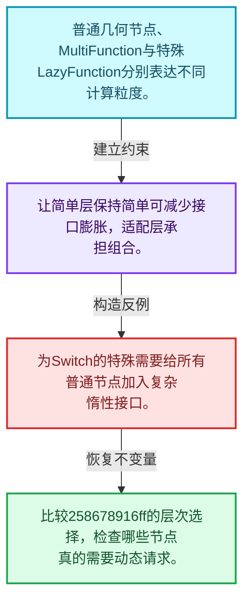
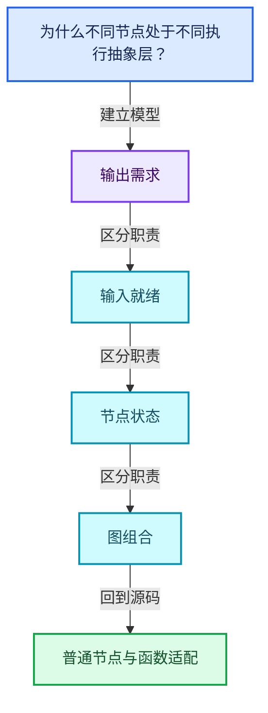
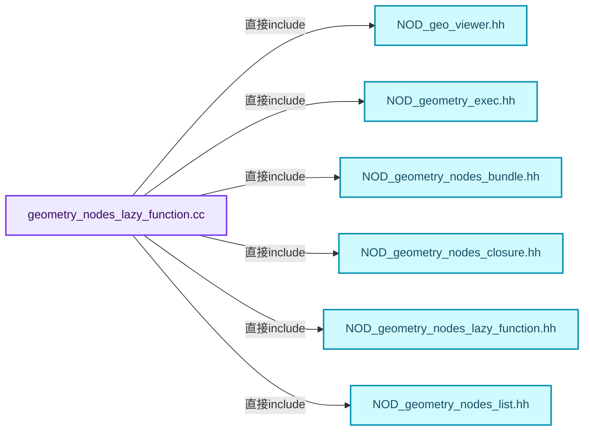
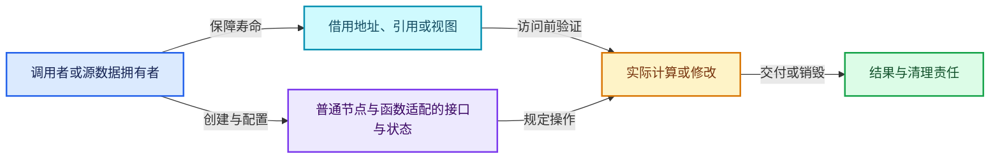
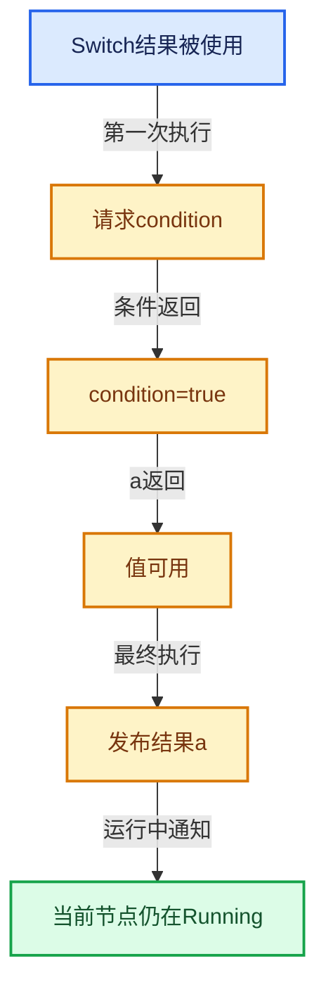

# 09-10 普通节点与函数适配

[方向导航](README.md) · [总目录](../README.md) · [覆盖索引](../%E6%BA%90%E7%A0%81%E7%89%88%E6%9C%AC%E4%B8%8E%E8%A6%86%E7%9B%96%E7%B4%A2%E5%BC%95.md)

> 阅读顺序：问题与数据模型 → 语法与类型 → 源码逐行 → 调用线索 → 历史与取舍 → 推演和练习。

- 基准 HEAD：`cbda6b96c26c0dee3c3b5cbb93960c4ac06a6b30`。
- 记录日期：2026-10-14。
- 教学示例状态：正文中的推演不是本机性能实测；已运行练习见验收报告。

## 一、从问题到设计

为什么不同节点处于不同执行抽象层？

批量函数、普通几何节点和特殊惰性节点具有不同需求，通过适配共同接入执行图。

本篇把语法、数据语义和系统取舍连接起来。需求与就绪是不同维度；状态只在有证据时推进，不能把未确定当作无需求。

### 本篇独立模型与设计推理

普通几何节点、MultiFunction与特殊LazyFunction分别表达不同计算粒度。

设计取舍：让简单层保持简单可减少接口膨胀，适配层承担组合。

最小反例：为Switch的特殊需要给所有普通节点加入复杂惰性接口。

推导与处理：比较258678916ff的层次选择，检查哪些节点真的需要动态请求。



### 源码范围与相邻篇章

| 文件 | 本篇逐行范围 | 基准SHA-256 |
|---|---|---|
| [source/blender/nodes/intern/geometry_nodes_lazy_function.cc](../../../../../source/blender/nodes/intern/geometry_nodes_lazy_function.cc) | L1473—L2902 | `28f744e665608be8d326853f759fed4c20816eaf2f8e64b605bc8a2a6594c746` |
| [source/blender/functions/intern/lazy_function_graph_executor.cc](../../../../../source/blender/functions/intern/lazy_function_graph_executor.cc) | L1—L145 | `0f02dca335f5e00a40999760991e7494c997a09541285e2b49c12eeb14cc93a0` |

同一主讲文件可能分多篇覆盖；超出本篇范围的符号通过覆盖索引定位。空行与纯注释保留在源码摘录中，逐行表解释有效语句与语法边界；许可证头统一保留。

前篇：[几何节点图构建器](09-%E5%87%A0%E4%BD%95%E8%8A%82%E7%82%B9%E5%9B%BE%E6%9E%84%E5%BB%BA%E5%99%A8.md).

后篇：[Switch与MenuSwitch](11-Switch%E4%B8%8EMenuSwitch.md).

## 二、类型、数据与阅读地图



这是概念依赖图，边表示阅读关系，不声称是运行时调用顺序。

### 直接编译依赖



箭头只表示头文件包含关系；完整调用线索见后面的符号定位表。

## 三、关键词、语法与类型角色

### 模板 template

模板把类型或常量作为生成实现的参数。读声明时先列出类型参数、非类型参数和默认值，再看使用者实际实例化了什么。模板声明本身不意味着每种T都支持其全部成员。

具体检查：把T替换为int、string、只能移动的类型，分别检查每个被调用操作是否成立。

### 常量求值 constexpr

constexpr声明允许相应实体参与常量求值，但constexpr函数仍可以在运行时执行。是否常量求值由调用场景和表达式合法性共同决定。

具体检查：比较constexpr变量初始化和从运行时输入调用同一函数。

### 只读限定 const

const约束当前访问路径可做的修改。const指针、指向const的指针、const视图对象、const元素是不同位置的限定；其他别名可能仍可修改原对象。

具体检查：分别写T* const、const T*与const T* const，并画出不可修改的层次。

### 移动转换 std::move

std::move把表达式转换为可供移动重载选择的值类别，实际资源转移发生在被选中的构造或赋值中。对const对象move可能仍调用复制，对视图move也不会获得底层数据所有权。

具体检查：记录移动构造调用次数，不用变量名或std::move的出现次数替代测量。

### 异常边界 try与catch

try定义异常传播的局部边界。失败路径需要销毁已经成功构造的部分并释放相应存储；未构造的对象不能被析构。

具体检查：在第k次构造失败，列出已经存在的对象集合与待释放缓冲。

### 显式静态转换 static_cast

static_cast表达编译期允许的转换，不会自动验证运行时真实类型、指针寿命或索引边界。由void指针恢复T指针时，调用者仍须保证实际存储中确有合法T对象。

具体检查：标出转换前后的类型以及正确性依据来自哪里。

### 覆写检查 override

override要求函数确实覆盖基类虚函数，可捕获参数类型和const限定不匹配。它不改变基类规定的生命周期或线程约束。

具体检查：故意改变一个参数或const，观察编译器如何拒绝误写的新函数。

### 可选值 optional

optional把不存在与存在的T区分开，T的构造和析构跟随engaged状态变化。访问前应由has_value或条件分支证明存在。

具体检查：把空Field状态与合法常量零区分，不能用某个普通值代替不存在。

### 原子操作 atomic

原子性保护相应原子对象的访问；发布其他普通数据还要分析内存序。多个原子字段分别安全不等于复合不变量整体原子。

具体检查：画出写数据、发布ready与读ready、读数据的顺序关系。

### 对象表示 sizeof

sizeof给出对象表示大小，不是其引用的所有堆内存总量。sizeof视图很小并不说明底层数组很小。

具体检查：分别统计容器对象、容量字节和元素拥有的间接资源。

### 内部断言 assert

断言表达开发者预期成立的内部契约，发布构建可能关闭。它不能替代对不可信输入的完整错误处理，也不保证后续操作被运行时保护。

具体检查：对每条断言构造违反条件的输入，区分调用者错误与应向用户报告的错误。

### 编译期分支 if constexpr

条件在实例化时决定被保留的分支，这常用于不同类型的合法操作选择。它与运行时if有不同的实例化检查规则。

具体检查：找出每个分支依赖哪些类型特征，再使用满足与不满足条件的类型。

### 受控访问 friend

friend授予指定函数或类访问非公开成员的权限，并不意味着继承，也不自动扩展到友元的派生类。

具体检查：解释执行器为何需要访问包装器的内部映射，同时检查边界是否仍清楚。

### 共享拥有 shared_ptr

shared_ptr让控制块跟踪共享寿命，不自动使被指向对象的读写线程安全；循环拥有可能阻止销毁。

具体检查：画出强引用环并考虑是否应改变所有权方向或引入弱引用。

### 类型别名 using

类型别名为已有类型建立名字，不创建运行期对象。它常把模板内部使用的类型统一暴露给泛型调用者。

具体检查：展开别名直到基础类型，区分类型别名和变量声明。

## 四、真实源码与逐行讲解

源码块保持原行内容，原始行号由小节标题及逐行表给出。表中的调用定位是静态阅读辅助；重载、模板实例化、宏展开和虚调用需结合完整声明，不能仅凭词法出现证明动态调用。

### geometry_nodes_lazy_function.cc：L1473—L1524

<!-- source:source/blender/nodes/intern/geometry_nodes_lazy_function.cc:1473:1524 -->

```cpp

 public:
  LazyFunctionForJoinReferenceSets(const int amount) : amount_(amount)
  {
    debug_name_ = "Join Reference Sets";
    for ([[maybe_unused]] const int i : IndexRange(amount)) {
      inputs_.append_as("Use", CPPType::get<bool>());
      inputs_.append_as(
          "Reference Set", CPPType::get<GeometryNodesReferenceSet>(), lf::ValueUsage::Maybe);
    }
    outputs_.append_as("Reference Set", CPPType::get<GeometryNodesReferenceSet>());
  }

  void execute_impl(lf::Params &params, const lf::Context & /*context*/) const override
  {
    Vector<GeometryNodesReferenceSet *> sets;
    bool set_is_missing = false;
    for (const int i : IndexRange(amount_)) {
      if (params.get_input<bool>(this->get_use_input(i))) {
        if (GeometryNodesReferenceSet *set =
                params.try_get_input_data_ptr_or_request<GeometryNodesReferenceSet>(
                    this->get_reference_set_input(i)))
        {
          sets.append(set);
        }
        else {
          set_is_missing = true;
        }
      }
    }
    if (set_is_missing) {
      return;
    }
    GeometryNodesReferenceSet joined_set;
    if (sets.is_empty()) {
      /* Nothing to do. */
    }
    else if (sets.size() == 1) {
      joined_set.names = std::move(sets[0]->names);
    }
    else {
      joined_set.names = std::make_shared<Set<std::string>>();
      for (const GeometryNodesReferenceSet *set : sets) {
        if (set->names) {
          for (const std::string &name : *set->names) {
            joined_set.names->add(name);
          }
        }
      }
    }
    params.set_output(0, std::move(joined_set));
  }
```

本段语义重点：

- `set_output`：向输出位置发布值；输出是否已构造、是否已经设置由调用约定限制。
- `try_get_input`：尝试读取已可用输入；未就绪与合法空值应使用接口约定区分。

| 原始行 | 语义、约束与检查 |
|---|---|
| L1474 | 切换成员访问权限为 public；它是编译期接口边界，不是线程同步或内存保护。 |
| L1475 | 出现调用或函数声明 `LazyFunctionForJoinReferenceSets`，对应表达式为 `LazyFunctionForJoinReferenceSets(const int amount) : amount_(amount)`。参数求值、返回类型与重载需结合前后完整语句；静态文本引用不能证明动态目标。 |
| L1476 | 连接上一行的声明或控制结构与其语句块；后续行在这个作用域中执行或声明。 |
| L1477 | 把右侧 `"Join Reference Sets"` 用于初始化或更新左侧 `debug_name_`。声明初始化与已有对象赋值应按上下文区分；有资源的类型会调用相应特殊成员。 |
| L1478 | 按 `for ([[maybe_unused]] const int i : IndexRange(amount))` 指定的范围或条件重复执行。对照循环变量与真实元素编号；循环内调用成本乘以实际迭代次数。 |
| L1479 | 出现调用或函数声明 `append_as`，对应表达式为 `inputs_.append_as("Use", CPPType::get<bool>());`。参数求值、返回类型与重载需结合前后完整语句；静态文本引用不能证明动态目标。 |
| L1480 | 出现调用或函数声明 `append_as`，对应表达式为 `inputs_.append_as(`。参数求值、返回类型与重载需结合前后完整语句；静态文本引用不能证明动态目标。 |
| L1481 | 出现调用或函数声明 `CPPType::get`，对应表达式为 `"Reference Set", CPPType::get<GeometryNodesReferenceSet>(), lf::ValueUsage::Maybe);`。参数求值、返回类型与重载需结合前后完整语句；静态文本引用不能证明动态目标。 |
| L1482 | 结束当前语法单元。局部自动对象在离开其作用域时按规则销毁；这不等于所有被引用的外部数据也被释放。 |
| L1483 | 出现调用或函数声明 `append_as`，对应表达式为 `outputs_.append_as("Reference Set", CPPType::get<GeometryNodesReferenceSet>());`。参数求值、返回类型与重载需结合前后完整语句；静态文本引用不能证明动态目标。 |
| L1484 | 结束当前语法单元。局部自动对象在离开其作用域时按规则销毁；这不等于所有被引用的外部数据也被释放。 |
| L1486 | 出现调用或函数声明 `execute_impl`，对应表达式为 `void execute_impl(lf::Params &params, const lf::Context & ) const override`。参数求值、返回类型与重载需结合前后完整语句；静态文本引用不能证明动态目标。 |
| L1487 | 连接上一行的声明或控制结构与其语句块；后续行在这个作用域中执行或声明。 |
| L1488 | 声明成员、局部对象或完成语句 `Vector<GeometryNodesReferenceSet *> sets`。若为指针或引用，它本身不说明拥有；若为值对象，其构造析构由所在作用域或外层对象管理。 |
| L1489 | 把右侧 `false` 用于初始化或更新左侧 `bool set_is_missing`。声明初始化与已有对象赋值应按上下文区分；有资源的类型会调用相应特殊成员。 |
| L1490 | 按 `for (const int i : IndexRange(amount_))` 指定的范围或条件重复执行。对照循环变量与真实元素编号；循环内调用成本乘以实际迭代次数。 |
| L1491 | 判断 `params.get_input<bool>(this->get_use_input(i))`，成立时进入本分支，否则继续后续路径。 |
| L1492 | 判断 `GeometryNodesReferenceSet *set =`，成立时进入本分支，否则继续后续路径。 |
| L1493 | 出现调用或函数声明 `try_get_input_data_ptr_or_request`，对应表达式为 `params.try_get_input_data_ptr_or_request<GeometryNodesReferenceSet>(`。参数求值、返回类型与重载需结合前后完整语句；静态文本引用不能证明动态目标。 |
| L1494 | 出现调用或函数声明 `get_reference_set_input`，对应表达式为 `this->get_reference_set_input(i)))`。参数求值、返回类型与重载需结合前后完整语句；静态文本引用不能证明动态目标。 |
| L1495 | 连接上一行的声明或控制结构与其语句块；后续行在这个作用域中执行或声明。 |
| L1496 | 出现调用或函数声明 `append`，对应表达式为 `sets.append(set);`。参数求值、返回类型与重载需结合前后完整语句；静态文本引用不能证明动态目标。 |
| L1497 | 结束当前语法单元。局部自动对象在离开其作用域时按规则销毁；这不等于所有被引用的外部数据也被释放。 |
| L1498 | 处理前一条件不成立的互补路径。比较两条路径最后是否恢复同一不变量，以及是否产生不同的资源责任。 |
| L1499 | 把右侧 `true` 用于初始化或更新左侧 `set_is_missing`。声明初始化与已有对象赋值应按上下文区分；有资源的类型会调用相应特殊成员。 |
| L1500 | 结束当前语法单元。局部自动对象在离开其作用域时按规则销毁；这不等于所有被引用的外部数据也被释放。 |
| L1501 | 结束当前语法单元。局部自动对象在离开其作用域时按规则销毁；这不等于所有被引用的外部数据也被释放。 |
| L1502 | 结束当前语法单元。局部自动对象在离开其作用域时按规则销毁；这不等于所有被引用的外部数据也被释放。 |
| L1503 | 判断 `set_is_missing`，成立时进入本分支，否则继续后续路径。 |
| L1504 | 结束当前函数，本路径不再执行后续语句；局部对象按作用域规则清理。 |
| L1505 | 结束当前语法单元。局部自动对象在离开其作用域时按规则销毁；这不等于所有被引用的外部数据也被释放。 |
| L1506 | 声明成员、局部对象或完成语句 `GeometryNodesReferenceSet joined_set`。若为指针或引用，它本身不说明拥有；若为值对象，其构造析构由所在作用域或外层对象管理。 |
| L1507 | 判断 `sets.is_empty()`，成立时进入本分支，否则继续后续路径。 |
| L1509 | 结束当前语法单元。局部自动对象在离开其作用域时按规则销毁；这不等于所有被引用的外部数据也被释放。 |
| L1510 | 判断 `sets.size() == 1`，成立时进入本分支，否则继续后续路径。该边界影响可访问元素或可用容量，两者要按各变量的定义区分。 |
| L1511 | 把右侧 `std::move(sets[0]->names)` 用于初始化或更新左侧 `joined_set.names`。声明初始化与已有对象赋值应按上下文区分；有资源的类型会调用相应特殊成员。 |
| L1512 | 结束当前语法单元。局部自动对象在离开其作用域时按规则销毁；这不等于所有被引用的外部数据也被释放。 |
| L1513 | 处理前一条件不成立的互补路径。比较两条路径最后是否恢复同一不变量，以及是否产生不同的资源责任。 |
| L1514 | 把右侧 `std::make_shared<Set<std::string>>()` 用于初始化或更新左侧 `joined_set.names`。声明初始化与已有对象赋值应按上下文区分；有资源的类型会调用相应特殊成员。 |
| L1515 | 按 `for (const GeometryNodesReferenceSet *set : sets)` 指定的范围或条件重复执行。对照循环变量与真实元素编号；循环内调用成本乘以实际迭代次数。 |
| L1516 | 判断 `set->names`，成立时进入本分支，否则继续后续路径。 |
| L1517 | 按 `for (const std::string &name : *set->names)` 指定的范围或条件重复执行。对照循环变量与真实元素编号；循环内调用成本乘以实际迭代次数。 |
| L1518 | 出现调用或函数声明 `add`，对应表达式为 `joined_set.names->add(name);`。参数求值、返回类型与重载需结合前后完整语句；静态文本引用不能证明动态目标。 |
| L1519 | 结束当前语法单元。局部自动对象在离开其作用域时按规则销毁；这不等于所有被引用的外部数据也被释放。 |
| L1520 | 结束当前语法单元。局部自动对象在离开其作用域时按规则销毁；这不等于所有被引用的外部数据也被释放。 |
| L1521 | 结束当前语法单元。局部自动对象在离开其作用域时按规则销毁；这不等于所有被引用的外部数据也被释放。 |
| L1522 | 结束当前语法单元。局部自动对象在离开其作用域时按规则销毁；这不等于所有被引用的外部数据也被释放。 |
| L1523 | 本行使用 `set_output`：向输出位置发布值；输出是否已构造、是否已经设置由调用约定限制。 |
| L1524 | 结束当前语法单元。局部自动对象在离开其作用域时按规则销毁；这不等于所有被引用的外部数据也被释放。 |

### geometry_nodes_lazy_function.cc：L1525—L1572

<!-- source:source/blender/nodes/intern/geometry_nodes_lazy_function.cc:1525:1572 -->

```cpp

  int get_use_input(const int i) const
  {
    return 2 * i;
  }

  int get_reference_set_input(const int i) const
  {
    return 2 * i + 1;
  }

  /**
   * Cache for functions small amounts to avoid to avoid building them many times.
   */
  static const LazyFunctionForJoinReferenceSets &get_cached(const int amount, ResourceScope &scope)
  {
    constexpr int cache_amount = 16;
    static std::array<LazyFunctionForJoinReferenceSets, cache_amount> cached_functions = get_cache(
        std::make_index_sequence<cache_amount>{});
    if (amount < cached_functions.size()) {
      return cached_functions[amount];
    }

    return scope.construct<LazyFunctionForJoinReferenceSets>(amount);
  }

 private:
  template<size_t... I>
  static std::array<LazyFunctionForJoinReferenceSets, sizeof...(I)> get_cache(
      std::index_sequence<I...> /*indices*/)
  {
    return {LazyFunctionForJoinReferenceSets(I)...};
  }
};

class LazyFunctionForSimulationZone : public LazyFunction {
 private:
  const bNode &sim_output_bnode_;
  const LazyFunction &fn_;

 public:
  LazyFunctionForSimulationZone(const bNode &sim_output_bnode, const LazyFunction &fn)
      : sim_output_bnode_(sim_output_bnode), fn_(fn)
  {
    debug_name_ = "Simulation Zone";
    inputs_ = fn.inputs();
    outputs_ = fn.outputs();
  }
```

本段语义重点：

- 分支证据 `amount < cached_functions.size())`：分别推演条件成立与不成立，核对相同出口处的状态。

| 原始行 | 语义、约束与检查 |
|---|---|
| L1526 | 出现调用或函数声明 `get_use_input`，对应表达式为 `int get_use_input(const int i) const`。参数求值、返回类型与重载需结合前后完整语句；静态文本引用不能证明动态目标。 |
| L1527 | 连接上一行的声明或控制结构与其语句块；后续行在这个作用域中执行或声明。 |
| L1528 | 返回表达式 `2 * i`。 |
| L1529 | 结束当前语法单元。局部自动对象在离开其作用域时按规则销毁；这不等于所有被引用的外部数据也被释放。 |
| L1531 | 出现调用或函数声明 `get_reference_set_input`，对应表达式为 `int get_reference_set_input(const int i) const`。参数求值、返回类型与重载需结合前后完整语句；静态文本引用不能证明动态目标。 |
| L1532 | 连接上一行的声明或控制结构与其语句块；后续行在这个作用域中执行或声明。 |
| L1533 | 返回表达式 `2 * i + 1`。 |
| L1534 | 结束当前语法单元。局部自动对象在离开其作用域时按规则销毁；这不等于所有被引用的外部数据也被释放。 |
| L1539 | 出现调用或函数声明 `get_cached`，对应表达式为 `static const LazyFunctionForJoinReferenceSets &get_cached(const int amount, ResourceScope &scope)`。参数求值、返回类型与重载需结合前后完整语句；静态文本引用不能证明动态目标。 |
| L1540 | 连接上一行的声明或控制结构与其语句块；后续行在这个作用域中执行或声明。 |
| L1541 | 把右侧 `16` 用于初始化或更新左侧 `constexpr int cache_amount`。声明初始化与已有对象赋值应按上下文区分；有资源的类型会调用相应特殊成员。 |
| L1542 | 把右侧 `get_cache(` 用于初始化或更新左侧 `static std::array<LazyFunctionForJoinReferenceSets, cache_amount> cached_functions`。声明初始化与已有对象赋值应按上下文区分；有资源的类型会调用相应特殊成员。 |
| L1543 | 声明成员、局部对象或完成语句 `std::make_index_sequence<cache_amount>{})`。若为指针或引用，它本身不说明拥有；若为值对象，其构造析构由所在作用域或外层对象管理。 |
| L1544 | 判断 `amount < cached_functions.size()`，成立时进入本分支，否则继续后续路径。该边界影响可访问元素或可用容量，两者要按各变量的定义区分。 |
| L1545 | 返回表达式 `cached_functions[amount]`。 |
| L1546 | 结束当前语法单元。局部自动对象在离开其作用域时按规则销毁；这不等于所有被引用的外部数据也被释放。 |
| L1548 | 返回表达式 `scope.construct<LazyFunctionForJoinReferenceSets>(amount)`。 |
| L1549 | 结束当前语法单元。局部自动对象在离开其作用域时按规则销毁；这不等于所有被引用的外部数据也被释放。 |
| L1551 | 切换成员访问权限为 private；它是编译期接口边界，不是线程同步或内存保护。 |
| L1552 | 声明模板参数 `template<size_t... I>`。类型参数决定生成操作的类型，非类型参数可决定内嵌容量或编译期分支。 |
| L1553 | 出现调用或函数声明 `get_cache`，对应表达式为 `static std::array<LazyFunctionForJoinReferenceSets, sizeof...(I)> get_cache(`。参数求值、返回类型与重载需结合前后完整语句；静态文本引用不能证明动态目标。 |
| L1554 | 本行是连续声明或表达式的一部分：`std::index_sequence<I...> )`。与本段前后行合读；逗号、括号和限定符决定它属于参数、初始化列表还是实际计算。 |
| L1555 | 连接上一行的声明或控制结构与其语句块；后续行在这个作用域中执行或声明。 |
| L1556 | 返回表达式 `{LazyFunctionForJoinReferenceSets(I)...}`。 |
| L1557 | 结束当前语法单元。局部自动对象在离开其作用域时按规则销毁；这不等于所有被引用的外部数据也被释放。 |
| L1558 | 结束当前语法单元。局部自动对象在离开其作用域时按规则销毁；这不等于所有被引用的外部数据也被释放。 |
| L1560 | 声明或定义类型 `class LazyFunctionForSimulationZone : public LazyFunction`。结合继承、访问权限和成员布局确认接口与拥有关系；前向声明本身没有完整对象布局。 |
| L1561 | 切换成员访问权限为 private；它是编译期接口边界，不是线程同步或内存保护。 |
| L1562 | 声明成员、局部对象或完成语句 `const bNode &sim_output_bnode_`。若为指针或引用，它本身不说明拥有；若为值对象，其构造析构由所在作用域或外层对象管理。 |
| L1563 | 声明成员、局部对象或完成语句 `const LazyFunction &fn_`。若为指针或引用，它本身不说明拥有；若为值对象，其构造析构由所在作用域或外层对象管理。 |
| L1565 | 切换成员访问权限为 public；它是编译期接口边界，不是线程同步或内存保护。 |
| L1566 | 出现调用或函数声明 `LazyFunctionForSimulationZone`，对应表达式为 `LazyFunctionForSimulationZone(const bNode &sim_output_bnode, const LazyFunction &fn)`。参数求值、返回类型与重载需结合前后完整语句；静态文本引用不能证明动态目标。 |
| L1567 | 出现调用或函数声明 `sim_output_bnode_`，对应表达式为 `: sim_output_bnode_(sim_output_bnode), fn_(fn)`。参数求值、返回类型与重载需结合前后完整语句；静态文本引用不能证明动态目标。 |
| L1568 | 连接上一行的声明或控制结构与其语句块；后续行在这个作用域中执行或声明。 |
| L1569 | 把右侧 `"Simulation Zone"` 用于初始化或更新左侧 `debug_name_`。声明初始化与已有对象赋值应按上下文区分；有资源的类型会调用相应特殊成员。 |
| L1570 | 把右侧 `fn.inputs()` 用于初始化或更新左侧 `inputs_`。声明初始化与已有对象赋值应按上下文区分；有资源的类型会调用相应特殊成员。 |
| L1571 | 把右侧 `fn.outputs()` 用于初始化或更新左侧 `outputs_`。声明初始化与已有对象赋值应按上下文区分；有资源的类型会调用相应特殊成员。 |
| L1572 | 结束当前语法单元。局部自动对象在离开其作用域时按规则销毁；这不等于所有被引用的外部数据也被释放。 |

### geometry_nodes_lazy_function.cc：L1573—L1610

<!-- source:source/blender/nodes/intern/geometry_nodes_lazy_function.cc:1573:1610 -->

```cpp

  void execute_impl(lf::Params &params, const lf::Context &context) const override
  {
    ScopedNodeTimer node_timer{context, sim_output_bnode_};
    GeoNodesUserData &user_data = *static_cast<GeoNodesUserData *>(context.user_data);

    bke::SimulationZoneComputeContext compute_context{user_data.compute_context,
                                                      sim_output_bnode_};

    GeoNodesUserData zone_user_data = user_data;
    zone_user_data.compute_context = &compute_context;
    zone_user_data.verbose_log = should_log_verbose_in_context(user_data, compute_context.hash());

    GeoNodesLocalUserData zone_local_user_data{zone_user_data};
    lf::Context zone_context{context.storage, &zone_user_data, &zone_local_user_data};
    fn_.execute(params, zone_context);
  }

  void *init_storage(LinearAllocator<> &allocator) const override
  {
    return fn_.init_storage(allocator);
  }

  void destruct_storage(void *storage) const override
  {
    fn_.destruct_storage(storage);
  }

  std::string input_name(const int i) const override
  {
    return fn_.input_name(i);
  }

  std::string output_name(const int i) const override
  {
    return fn_.output_name(i);
  }
};
```

| 原始行 | 语义、约束与检查 |
|---|---|
| L1574 | 出现调用或函数声明 `execute_impl`，对应表达式为 `void execute_impl(lf::Params &params, const lf::Context &context) const override`。参数求值、返回类型与重载需结合前后完整语句；静态文本引用不能证明动态目标。 |
| L1575 | 连接上一行的声明或控制结构与其语句块；后续行在这个作用域中执行或声明。 |
| L1576 | 声明成员、局部对象或完成语句 `ScopedNodeTimer node_timer{context, sim_output_bnode_}`。若为指针或引用，它本身不说明拥有；若为值对象，其构造析构由所在作用域或外层对象管理。 |
| L1577 | 把右侧 `*static_cast<GeoNodesUserData *>(context.user_data)` 用于初始化或更新左侧 `GeoNodesUserData &user_data`。声明初始化与已有对象赋值应按上下文区分；有资源的类型会调用相应特殊成员。 |
| L1579 | 本行是连续声明或表达式的一部分：`bke::SimulationZoneComputeContext compute_context{user_data.compute_context,`。与本段前后行合读；逗号、括号和限定符决定它属于参数、初始化列表还是实际计算。 |
| L1580 | 声明成员、局部对象或完成语句 `sim_output_bnode_}`。若为指针或引用，它本身不说明拥有；若为值对象，其构造析构由所在作用域或外层对象管理。 |
| L1582 | 把右侧 `user_data` 用于初始化或更新左侧 `GeoNodesUserData zone_user_data`。声明初始化与已有对象赋值应按上下文区分；有资源的类型会调用相应特殊成员。 |
| L1583 | 把右侧 `&compute_context` 用于初始化或更新左侧 `zone_user_data.compute_context`。声明初始化与已有对象赋值应按上下文区分；有资源的类型会调用相应特殊成员。 |
| L1584 | 把右侧 `should_log_verbose_in_context(user_data, compute_context.hash())` 用于初始化或更新左侧 `zone_user_data.verbose_log`。声明初始化与已有对象赋值应按上下文区分；有资源的类型会调用相应特殊成员。 |
| L1586 | 声明成员、局部对象或完成语句 `GeoNodesLocalUserData zone_local_user_data{zone_user_data}`。若为指针或引用，它本身不说明拥有；若为值对象，其构造析构由所在作用域或外层对象管理。 |
| L1587 | 声明成员、局部对象或完成语句 `lf::Context zone_context{context.storage, &zone_user_data, &zone_local_user_data}`。若为指针或引用，它本身不说明拥有；若为值对象，其构造析构由所在作用域或外层对象管理。 |
| L1588 | 出现调用或函数声明 `execute`，对应表达式为 `fn_.execute(params, zone_context);`。参数求值、返回类型与重载需结合前后完整语句；静态文本引用不能证明动态目标。 |
| L1589 | 结束当前语法单元。局部自动对象在离开其作用域时按规则销毁；这不等于所有被引用的外部数据也被释放。 |
| L1591 | 出现调用或函数声明 `init_storage`，对应表达式为 `void *init_storage(LinearAllocator<> &allocator) const override`。参数求值、返回类型与重载需结合前后完整语句；静态文本引用不能证明动态目标。 |
| L1592 | 连接上一行的声明或控制结构与其语句块；后续行在这个作用域中执行或声明。 |
| L1593 | 返回表达式 `fn_.init_storage(allocator)`。 |
| L1594 | 结束当前语法单元。局部自动对象在离开其作用域时按规则销毁；这不等于所有被引用的外部数据也被释放。 |
| L1596 | 出现调用或函数声明 `destruct_storage`，对应表达式为 `void destruct_storage(void *storage) const override`。参数求值、返回类型与重载需结合前后完整语句；静态文本引用不能证明动态目标。 |
| L1597 | 连接上一行的声明或控制结构与其语句块；后续行在这个作用域中执行或声明。 |
| L1598 | 出现调用或函数声明 `destruct_storage`，对应表达式为 `fn_.destruct_storage(storage);`。参数求值、返回类型与重载需结合前后完整语句；静态文本引用不能证明动态目标。 |
| L1599 | 结束当前语法单元。局部自动对象在离开其作用域时按规则销毁；这不等于所有被引用的外部数据也被释放。 |
| L1601 | 出现调用或函数声明 `input_name`，对应表达式为 `std::string input_name(const int i) const override`。参数求值、返回类型与重载需结合前后完整语句；静态文本引用不能证明动态目标。 |
| L1602 | 连接上一行的声明或控制结构与其语句块；后续行在这个作用域中执行或声明。 |
| L1603 | 返回表达式 `fn_.input_name(i)`。 |
| L1604 | 结束当前语法单元。局部自动对象在离开其作用域时按规则销毁；这不等于所有被引用的外部数据也被释放。 |
| L1606 | 出现调用或函数声明 `output_name`，对应表达式为 `std::string output_name(const int i) const override`。参数求值、返回类型与重载需结合前后完整语句；静态文本引用不能证明动态目标。 |
| L1607 | 连接上一行的声明或控制结构与其语句块；后续行在这个作用域中执行或声明。 |
| L1608 | 返回表达式 `fn_.output_name(i)`。 |
| L1609 | 结束当前语法单元。局部自动对象在离开其作用域时按规则销毁；这不等于所有被引用的外部数据也被释放。 |
| L1610 | 结束当前语法单元。局部自动对象在离开其作用域时按规则销毁；这不等于所有被引用的外部数据也被释放。 |

### geometry_nodes_lazy_function.cc：L1611—L1658

<!-- source:source/blender/nodes/intern/geometry_nodes_lazy_function.cc:1611:1658 -->

```cpp

void report_from_multi_function(const mf::Context &context,
                                NodeWarningType type,
                                std::string message)
{
  if (auto *shader_nodes_user_data = dynamic_cast<ShaderNodesMultiFunctionUserData *>(
          context.user_data))
  {
    shader_nodes_user_data->warnings.append({type, std::move(message)});
    return;
  }

  const auto *user_data = dynamic_cast<const GeoNodesUserData *>(context.user_data);
  if (!user_data) {
    return;
  }
  eval_log::NodesEvalLog *log = user_data->call_data->eval_log;
  if (!log) {
    return;
  }
  const bke::NodeComputeContext *node_context = nullptr;
  for (const ComputeContext *compute_context = user_data->compute_context; compute_context;
       compute_context = compute_context->parent())
  {
    node_context = dynamic_cast<const bke::NodeComputeContext *>(compute_context);
    if (node_context) {
      break;
    }
  }
  if (!node_context) {
    return;
  }
  const auto *tree_context = node_context->parent();
  if (!tree_context) {
    return;
  }
  eval_log::NodeTreeLogger &logger = log->get_local_tree_logger(*tree_context);
  logger.node_warnings.append(*logger.allocator,
                              {node_context->node_id(), {type, std::move(message)}});
}

using JoinReferenceSetsCache = Map<Vector<lf::OutputSocket *>, lf::OutputSocket *>;

struct BuildGraphParams {
  /** Lazy-function graph that nodes and links should be inserted into. */
  lf::Graph &lf_graph;
  /** Map #bNodeSocket to newly generated sockets. Those maps are later used to insert links. */
  MultiValueMap<const bNodeSocket *, lf::InputSocket *> lf_inputs_by_bsocket;
```

本段语义重点：

- 分支证据 `auto *shader_nodes_user_data = dynamic_cast<ShaderNodesMultiFunctionUserData *>(`：分别推演条件成立与不成立，核对相同出口处的状态。
- 分支证据 `!user_data)`：分别推演条件成立与不成立，核对相同出口处的状态。

| 原始行 | 语义、约束与检查 |
|---|---|
| L1612 | 出现调用或函数声明 `report_from_multi_function`，对应表达式为 `void report_from_multi_function(const mf::Context &context,`。参数求值、返回类型与重载需结合前后完整语句；静态文本引用不能证明动态目标。 |
| L1613 | 本行是连续声明或表达式的一部分：`NodeWarningType type,`。与本段前后行合读；逗号、括号和限定符决定它属于参数、初始化列表还是实际计算。 |
| L1614 | 本行是连续声明或表达式的一部分：`std::string message)`。与本段前后行合读；逗号、括号和限定符决定它属于参数、初始化列表还是实际计算。 |
| L1615 | 连接上一行的声明或控制结构与其语句块；后续行在这个作用域中执行或声明。 |
| L1616 | 判断 `auto *shader_nodes_user_data = dynamic_cast<ShaderNodesMultiFunctionUserData *>(`，成立时进入本分支，否则继续后续路径。 |
| L1617 | 本行是连续声明或表达式的一部分：`context.user_data))`。与本段前后行合读；逗号、括号和限定符决定它属于参数、初始化列表还是实际计算。 |
| L1618 | 连接上一行的声明或控制结构与其语句块；后续行在这个作用域中执行或声明。 |
| L1619 | 出现调用或函数声明 `append`，对应表达式为 `shader_nodes_user_data->warnings.append({type, std::move(message)});`。参数求值、返回类型与重载需结合前后完整语句；静态文本引用不能证明动态目标。 |
| L1620 | 结束当前函数，本路径不再执行后续语句；局部对象按作用域规则清理。 |
| L1621 | 结束当前语法单元。局部自动对象在离开其作用域时按规则销毁；这不等于所有被引用的外部数据也被释放。 |
| L1623 | 把右侧 `dynamic_cast<const GeoNodesUserData *>(context.user_data)` 用于初始化或更新左侧 `const auto *user_data`。声明初始化与已有对象赋值应按上下文区分；有资源的类型会调用相应特殊成员。 |
| L1624 | 判断 `!user_data`，成立时进入本分支，否则继续后续路径。 |
| L1625 | 结束当前函数，本路径不再执行后续语句；局部对象按作用域规则清理。 |
| L1626 | 结束当前语法单元。局部自动对象在离开其作用域时按规则销毁；这不等于所有被引用的外部数据也被释放。 |
| L1627 | 把右侧 `user_data->call_data->eval_log` 用于初始化或更新左侧 `eval_log::NodesEvalLog *log`。声明初始化与已有对象赋值应按上下文区分；有资源的类型会调用相应特殊成员。 |
| L1628 | 判断 `!log`，成立时进入本分支，否则继续后续路径。 |
| L1629 | 结束当前函数，本路径不再执行后续语句；局部对象按作用域规则清理。 |
| L1630 | 结束当前语法单元。局部自动对象在离开其作用域时按规则销毁；这不等于所有被引用的外部数据也被释放。 |
| L1631 | 把右侧 `nullptr` 用于初始化或更新左侧 `const bke::NodeComputeContext *node_context`。声明初始化与已有对象赋值应按上下文区分；有资源的类型会调用相应特殊成员。 |
| L1632 | 按 `for (const ComputeContext *compute_context = user_data->compute_context; compute_context;` 指定的范围或条件重复执行。对照循环变量与真实元素编号；循环内调用成本乘以实际迭代次数。 |
| L1633 | 把右侧 `compute_context->parent())` 用于初始化或更新左侧 `compute_context`。声明初始化与已有对象赋值应按上下文区分；有资源的类型会调用相应特殊成员。 |
| L1634 | 连接上一行的声明或控制结构与其语句块；后续行在这个作用域中执行或声明。 |
| L1635 | 把右侧 `dynamic_cast<const bke::NodeComputeContext *>(compute_context)` 用于初始化或更新左侧 `node_context`。声明初始化与已有对象赋值应按上下文区分；有资源的类型会调用相应特殊成员。 |
| L1636 | 判断 `node_context`，成立时进入本分支，否则继续后续路径。 |
| L1637 | 离开最近的循环或switch；不是离开整个函数，后续清理和提交代码可能仍会执行。 |
| L1638 | 结束当前语法单元。局部自动对象在离开其作用域时按规则销毁；这不等于所有被引用的外部数据也被释放。 |
| L1639 | 结束当前语法单元。局部自动对象在离开其作用域时按规则销毁；这不等于所有被引用的外部数据也被释放。 |
| L1640 | 判断 `!node_context`，成立时进入本分支，否则继续后续路径。 |
| L1641 | 结束当前函数，本路径不再执行后续语句；局部对象按作用域规则清理。 |
| L1642 | 结束当前语法单元。局部自动对象在离开其作用域时按规则销毁；这不等于所有被引用的外部数据也被释放。 |
| L1643 | 把右侧 `node_context->parent()` 用于初始化或更新左侧 `const auto *tree_context`。声明初始化与已有对象赋值应按上下文区分；有资源的类型会调用相应特殊成员。 |
| L1644 | 判断 `!tree_context`，成立时进入本分支，否则继续后续路径。 |
| L1645 | 结束当前函数，本路径不再执行后续语句；局部对象按作用域规则清理。 |
| L1646 | 结束当前语法单元。局部自动对象在离开其作用域时按规则销毁；这不等于所有被引用的外部数据也被释放。 |
| L1647 | 把右侧 `log->get_local_tree_logger(*tree_context)` 用于初始化或更新左侧 `eval_log::NodeTreeLogger &logger`。声明初始化与已有对象赋值应按上下文区分；有资源的类型会调用相应特殊成员。 |
| L1648 | 出现调用或函数声明 `append`，对应表达式为 `logger.node_warnings.append(*logger.allocator,`。参数求值、返回类型与重载需结合前后完整语句；静态文本引用不能证明动态目标。 |
| L1649 | 出现调用或函数声明 `node_id`，对应表达式为 `{node_context->node_id(), {type, std::move(message)}});`。参数求值、返回类型与重载需结合前后完整语句；静态文本引用不能证明动态目标。 |
| L1650 | 结束当前语法单元。局部自动对象在离开其作用域时按规则销毁；这不等于所有被引用的外部数据也被释放。 |
| L1652 | 定义类型别名 `using JoinReferenceSetsCache = Map<Vector<lf::OutputSocket *>, lf::OutputSocket *>`，为模板接口或内部实现统一命名；本行不分配该类型对象。 |
| L1654 | 声明或定义类型 `struct BuildGraphParams`。结合继承、访问权限和成员布局确认接口与拥有关系；前向声明本身没有完整对象布局。 |
| L1656 | 声明成员、局部对象或完成语句 `lf::Graph &lf_graph`。若为指针或引用，它本身不说明拥有；若为值对象，其构造析构由所在作用域或外层对象管理。 |
| L1658 | 声明成员、局部对象或完成语句 `MultiValueMap<const bNodeSocket *, lf::InputSocket *> lf_inputs_by_bsocket`。若为指针或引用，它本身不说明拥有；若为值对象，其构造析构由所在作用域或外层对象管理。 |

### geometry_nodes_lazy_function.cc：L1659—L1702

<!-- source:source/blender/nodes/intern/geometry_nodes_lazy_function.cc:1659:1702 -->

```cpp
  Map<const bNodeSocket *, lf::OutputSocket *> lf_output_by_bsocket;
  /**
   * Maps sockets to corresponding generated boolean sockets that indicate whether the socket is
   * used or not.
   */
  Map<const bNodeSocket *, lf::OutputSocket *> usage_by_bsocket;
  /**
   * Nodes that propagate anonymous attributes have to know which of those attributes to propagate.
   * For that they have an input for each output that specifies what data to propagate.
   */
  Map<const bNodeSocket *, lf::InputSocket *> lf_reference_set_input_by_output;
  /**
   * Multi-input sockets are split into separate sockets, once for each incoming link.
   */
  Map<const bNodeLink *, lf::InputSocket *> lf_input_by_multi_input_link;
  /**
   * This is similar to #lf_inputs_by_bsocket but contains more relevant information when border
   * links are linked to multi-input sockets.
   */
  Map<const bNodeLink *, lf::InputSocket *> lf_input_by_border_link;
  /**
   * Keeps track of all boolean inputs that indicate whether a socket is used. Links to those
   * sockets may be replaced with a constant-true if necessary to break dependency cycles in
   * #fix_link_cycles.
   */
  Set<lf::InputSocket *> socket_usage_inputs;
  MultiValueMap<ReferenceSetIndex, lf::InputSocket *> lf_reference_set_inputs;
  /** Cache to avoid building the same socket combinations multiple times. */
  Map<Vector<lf::OutputSocket *>, lf::OutputSocket *> socket_usages_combination_cache;

  BuildGraphParams(lf::Graph &lf_graph) : lf_graph(lf_graph) {}
};

static bool ignore_zone_bsocket(const bNodeSocket &bsocket)
{
  if (!bsocket.is_available()) {
    return true;
  }
  if (!bsocket.typeinfo->geometry_nodes_default_value) {
    /* These are typically extend sockets. */
    return true;
  }
  return false;
}
```

本段语义重点：

- 分支证据 `!bsocket.is_available())`：分别推演条件成立与不成立，核对相同出口处的状态。
- 分支证据 `!bsocket.typeinfo->geometry_nodes_default_value)`：分别推演条件成立与不成立，核对相同出口处的状态。

| 原始行 | 语义、约束与检查 |
|---|---|
| L1659 | 声明成员、局部对象或完成语句 `Map<const bNodeSocket *, lf::OutputSocket *> lf_output_by_bsocket`。若为指针或引用，它本身不说明拥有；若为值对象，其构造析构由所在作用域或外层对象管理。 |
| L1664 | 声明成员、局部对象或完成语句 `Map<const bNodeSocket *, lf::OutputSocket *> usage_by_bsocket`。若为指针或引用，它本身不说明拥有；若为值对象，其构造析构由所在作用域或外层对象管理。 |
| L1669 | 声明成员、局部对象或完成语句 `Map<const bNodeSocket *, lf::InputSocket *> lf_reference_set_input_by_output`。若为指针或引用，它本身不说明拥有；若为值对象，其构造析构由所在作用域或外层对象管理。 |
| L1673 | 声明成员、局部对象或完成语句 `Map<const bNodeLink *, lf::InputSocket *> lf_input_by_multi_input_link`。若为指针或引用，它本身不说明拥有；若为值对象，其构造析构由所在作用域或外层对象管理。 |
| L1678 | 声明成员、局部对象或完成语句 `Map<const bNodeLink *, lf::InputSocket *> lf_input_by_border_link`。若为指针或引用，它本身不说明拥有；若为值对象，其构造析构由所在作用域或外层对象管理。 |
| L1684 | 声明成员、局部对象或完成语句 `Set<lf::InputSocket *> socket_usage_inputs`。若为指针或引用，它本身不说明拥有；若为值对象，其构造析构由所在作用域或外层对象管理。 |
| L1685 | 声明成员、局部对象或完成语句 `MultiValueMap<ReferenceSetIndex, lf::InputSocket *> lf_reference_set_inputs`。若为指针或引用，它本身不说明拥有；若为值对象，其构造析构由所在作用域或外层对象管理。 |
| L1687 | 声明成员、局部对象或完成语句 `Map<Vector<lf::OutputSocket *>, lf::OutputSocket *> socket_usages_combination_cache`。若为指针或引用，它本身不说明拥有；若为值对象，其构造析构由所在作用域或外层对象管理。 |
| L1689 | 出现调用或函数声明 `BuildGraphParams`，对应表达式为 `BuildGraphParams(lf::Graph &lf_graph) : lf_graph(lf_graph) {}`。参数求值、返回类型与重载需结合前后完整语句；静态文本引用不能证明动态目标。 |
| L1690 | 结束当前语法单元。局部自动对象在离开其作用域时按规则销毁；这不等于所有被引用的外部数据也被释放。 |
| L1692 | 出现调用或函数声明 `ignore_zone_bsocket`，对应表达式为 `static bool ignore_zone_bsocket(const bNodeSocket &bsocket)`。参数求值、返回类型与重载需结合前后完整语句；静态文本引用不能证明动态目标。 |
| L1693 | 连接上一行的声明或控制结构与其语句块；后续行在这个作用域中执行或声明。 |
| L1694 | 判断 `!bsocket.is_available()`，成立时进入本分支，否则继续后续路径。 |
| L1695 | 返回表达式 `true`。这是本路径的布尔结果，具体成功、存在或状态含义由函数接口规定。 |
| L1696 | 结束当前语法单元。局部自动对象在离开其作用域时按规则销毁；这不等于所有被引用的外部数据也被释放。 |
| L1697 | 判断 `!bsocket.typeinfo->geometry_nodes_default_value`，成立时进入本分支，否则继续后续路径。 |
| L1699 | 返回表达式 `true`。这是本路径的布尔结果，具体成功、存在或状态含义由函数接口规定。 |
| L1700 | 结束当前语法单元。局部自动对象在离开其作用域时按规则销毁；这不等于所有被引用的外部数据也被释放。 |
| L1701 | 返回表达式 `false`。这是本路径的布尔结果，具体成功、存在或状态含义由函数接口规定。 |
| L1702 | 结束当前语法单元。局部自动对象在离开其作用域时按规则销毁；这不等于所有被引用的外部数据也被释放。 |

### geometry_nodes_lazy_function.cc：L1703—L1756

<!-- source:source/blender/nodes/intern/geometry_nodes_lazy_function.cc:1703:1756 -->

```cpp

void initialize_zone_wrapper(const bNodeTreeZone &zone,
                             ZoneBuildInfo &zone_info,
                             const ZoneBodyFunction &body_fn,
                             const bool expose_all_reference_sets,
                             Vector<lf::Input> &r_inputs,
                             Vector<lf::Output> &r_outputs)
{
  for (const bNodeSocket *socket : zone.input_node()->input_sockets()) {
    if (ignore_zone_bsocket(*socket)) {
      continue;
    }
    zone_info.indices.inputs.main.append(r_inputs.append_and_get_index_as(
        socket->name, CPPType::get<SocketValueVariant>(), lf::ValueUsage::Maybe));
  }

  for (const bNodeLink *link : zone.border_links) {
    zone_info.indices.inputs.border_links.append(r_inputs.append_and_get_index_as(
        link->fromsock->name, CPPType::get<SocketValueVariant>(), lf::ValueUsage::Maybe));
  }

  for (const bNodeSocket *socket : zone.output_node()->output_sockets()) {
    if (ignore_zone_bsocket(*socket)) {
      continue;
    }
    zone_info.indices.inputs.output_usages.append(
        r_inputs.append_and_get_index_as("Usage", CPPType::get<bool>(), lf::ValueUsage::Maybe));
    zone_info.indices.outputs.main.append(
        r_outputs.append_and_get_index_as(socket->name, CPPType::get<SocketValueVariant>()));
  }

  for ([[maybe_unused]] const bNodeSocket *socket : zone.input_node()->input_sockets()) {
    if (ignore_zone_bsocket(*socket)) {
      continue;
    }
    zone_info.indices.outputs.input_usages.append(
        r_outputs.append_and_get_index_as("Usage", CPPType::get<bool>()));
  }

  for ([[maybe_unused]] const bNodeLink *link : zone.border_links) {
    zone_info.indices.outputs.border_link_usages.append(
        r_outputs.append_and_get_index_as("Border Link Usage", CPPType::get<bool>()));
  }

  /* Some zone types (e.g. the closure zone) do not expose all reference sets. */
  if (expose_all_reference_sets) {
    for (const auto item : body_fn.indices.inputs.reference_sets.items()) {
      zone_info.indices.inputs.reference_sets.add_new(
          item.key,
          r_inputs.append_and_get_index_as(
              "Reference Set", CPPType::get<GeometryNodesReferenceSet>(), lf::ValueUsage::Maybe));
    }
  }
}
```

本段语义重点：

- 分支证据 `ignore_zone_bsocket(*socket))`：分别推演条件成立与不成立，核对相同出口处的状态。
- 分支证据 `ignore_zone_bsocket(*socket))`：分别推演条件成立与不成立，核对相同出口处的状态。

| 原始行 | 语义、约束与检查 |
|---|---|
| L1704 | 出现调用或函数声明 `initialize_zone_wrapper`，对应表达式为 `void initialize_zone_wrapper(const bNodeTreeZone &zone,`。参数求值、返回类型与重载需结合前后完整语句；静态文本引用不能证明动态目标。 |
| L1705 | 本行是连续声明或表达式的一部分：`ZoneBuildInfo &zone_info,`。与本段前后行合读；逗号、括号和限定符决定它属于参数、初始化列表还是实际计算。 |
| L1706 | 本行是连续声明或表达式的一部分：`const ZoneBodyFunction &body_fn,`。与本段前后行合读；逗号、括号和限定符决定它属于参数、初始化列表还是实际计算。 |
| L1707 | 本行是连续声明或表达式的一部分：`const bool expose_all_reference_sets,`。与本段前后行合读；逗号、括号和限定符决定它属于参数、初始化列表还是实际计算。 |
| L1708 | 本行是连续声明或表达式的一部分：`Vector<lf::Input> &r_inputs,`。与本段前后行合读；逗号、括号和限定符决定它属于参数、初始化列表还是实际计算。 |
| L1709 | 本行是连续声明或表达式的一部分：`Vector<lf::Output> &r_outputs)`。与本段前后行合读；逗号、括号和限定符决定它属于参数、初始化列表还是实际计算。 |
| L1710 | 连接上一行的声明或控制结构与其语句块；后续行在这个作用域中执行或声明。 |
| L1711 | 按 `for (const bNodeSocket *socket : zone.input_node()->input_sockets())` 指定的范围或条件重复执行。对照循环变量与真实元素编号；循环内调用成本乘以实际迭代次数。 |
| L1712 | 判断 `ignore_zone_bsocket(*socket)`，成立时进入本分支，否则继续后续路径。 |
| L1713 | 结束本轮循环并进入下一轮；核对本轮已经取得的资源是否由作用域或显式代码清理。 |
| L1714 | 结束当前语法单元。局部自动对象在离开其作用域时按规则销毁；这不等于所有被引用的外部数据也被释放。 |
| L1715 | 出现调用或函数声明 `append`，对应表达式为 `zone_info.indices.inputs.main.append(r_inputs.append_and_get_index_as(`。参数求值、返回类型与重载需结合前后完整语句；静态文本引用不能证明动态目标。 |
| L1716 | 出现调用或函数声明 `CPPType::get`，对应表达式为 `socket->name, CPPType::get<SocketValueVariant>(), lf::ValueUsage::Maybe));`。参数求值、返回类型与重载需结合前后完整语句；静态文本引用不能证明动态目标。 |
| L1717 | 结束当前语法单元。局部自动对象在离开其作用域时按规则销毁；这不等于所有被引用的外部数据也被释放。 |
| L1719 | 按 `for (const bNodeLink *link : zone.border_links)` 指定的范围或条件重复执行。对照循环变量与真实元素编号；循环内调用成本乘以实际迭代次数。 |
| L1720 | 出现调用或函数声明 `append`，对应表达式为 `zone_info.indices.inputs.border_links.append(r_inputs.append_and_get_index_as(`。参数求值、返回类型与重载需结合前后完整语句；静态文本引用不能证明动态目标。 |
| L1721 | 出现调用或函数声明 `CPPType::get`，对应表达式为 `link->fromsock->name, CPPType::get<SocketValueVariant>(), lf::ValueUsage::Maybe));`。参数求值、返回类型与重载需结合前后完整语句；静态文本引用不能证明动态目标。 |
| L1722 | 结束当前语法单元。局部自动对象在离开其作用域时按规则销毁；这不等于所有被引用的外部数据也被释放。 |
| L1724 | 按 `for (const bNodeSocket *socket : zone.output_node()->output_sockets())` 指定的范围或条件重复执行。对照循环变量与真实元素编号；循环内调用成本乘以实际迭代次数。 |
| L1725 | 判断 `ignore_zone_bsocket(*socket)`，成立时进入本分支，否则继续后续路径。 |
| L1726 | 结束本轮循环并进入下一轮；核对本轮已经取得的资源是否由作用域或显式代码清理。 |
| L1727 | 结束当前语法单元。局部自动对象在离开其作用域时按规则销毁；这不等于所有被引用的外部数据也被释放。 |
| L1728 | 出现调用或函数声明 `append`，对应表达式为 `zone_info.indices.inputs.output_usages.append(`。参数求值、返回类型与重载需结合前后完整语句；静态文本引用不能证明动态目标。 |
| L1729 | 出现调用或函数声明 `append_and_get_index_as`，对应表达式为 `r_inputs.append_and_get_index_as("Usage", CPPType::get<bool>(), lf::ValueUsage::Maybe));`。参数求值、返回类型与重载需结合前后完整语句；静态文本引用不能证明动态目标。 |
| L1730 | 出现调用或函数声明 `append`，对应表达式为 `zone_info.indices.outputs.main.append(`。参数求值、返回类型与重载需结合前后完整语句；静态文本引用不能证明动态目标。 |
| L1731 | 出现调用或函数声明 `append_and_get_index_as`，对应表达式为 `r_outputs.append_and_get_index_as(socket->name, CPPType::get<SocketValueVariant>()));`。参数求值、返回类型与重载需结合前后完整语句；静态文本引用不能证明动态目标。 |
| L1732 | 结束当前语法单元。局部自动对象在离开其作用域时按规则销毁；这不等于所有被引用的外部数据也被释放。 |
| L1734 | 按 `for ([[maybe_unused]] const bNodeSocket *socket : zone.input_node()->input_sockets())` 指定的范围或条件重复执行。对照循环变量与真实元素编号；循环内调用成本乘以实际迭代次数。 |
| L1735 | 判断 `ignore_zone_bsocket(*socket)`，成立时进入本分支，否则继续后续路径。 |
| L1736 | 结束本轮循环并进入下一轮；核对本轮已经取得的资源是否由作用域或显式代码清理。 |
| L1737 | 结束当前语法单元。局部自动对象在离开其作用域时按规则销毁；这不等于所有被引用的外部数据也被释放。 |
| L1738 | 出现调用或函数声明 `append`，对应表达式为 `zone_info.indices.outputs.input_usages.append(`。参数求值、返回类型与重载需结合前后完整语句；静态文本引用不能证明动态目标。 |
| L1739 | 出现调用或函数声明 `append_and_get_index_as`，对应表达式为 `r_outputs.append_and_get_index_as("Usage", CPPType::get<bool>()));`。参数求值、返回类型与重载需结合前后完整语句；静态文本引用不能证明动态目标。 |
| L1740 | 结束当前语法单元。局部自动对象在离开其作用域时按规则销毁；这不等于所有被引用的外部数据也被释放。 |
| L1742 | 按 `for ([[maybe_unused]] const bNodeLink *link : zone.border_links)` 指定的范围或条件重复执行。对照循环变量与真实元素编号；循环内调用成本乘以实际迭代次数。 |
| L1743 | 出现调用或函数声明 `append`，对应表达式为 `zone_info.indices.outputs.border_link_usages.append(`。参数求值、返回类型与重载需结合前后完整语句；静态文本引用不能证明动态目标。 |
| L1744 | 出现调用或函数声明 `append_and_get_index_as`，对应表达式为 `r_outputs.append_and_get_index_as("Border Link Usage", CPPType::get<bool>()));`。参数求值、返回类型与重载需结合前后完整语句；静态文本引用不能证明动态目标。 |
| L1745 | 结束当前语法单元。局部自动对象在离开其作用域时按规则销毁；这不等于所有被引用的外部数据也被释放。 |
| L1748 | 判断 `expose_all_reference_sets`，成立时进入本分支，否则继续后续路径。 |
| L1749 | 按 `for (const auto item : body_fn.indices.inputs.reference_sets.items())` 指定的范围或条件重复执行。对照循环变量与真实元素编号；循环内调用成本乘以实际迭代次数。 |
| L1750 | 出现调用或函数声明 `add_new`，对应表达式为 `zone_info.indices.inputs.reference_sets.add_new(`。参数求值、返回类型与重载需结合前后完整语句；静态文本引用不能证明动态目标。 |
| L1751 | 本行是连续声明或表达式的一部分：`item.key,`。与本段前后行合读；逗号、括号和限定符决定它属于参数、初始化列表还是实际计算。 |
| L1752 | 出现调用或函数声明 `append_and_get_index_as`，对应表达式为 `r_inputs.append_and_get_index_as(`。参数求值、返回类型与重载需结合前后完整语句；静态文本引用不能证明动态目标。 |
| L1753 | 出现调用或函数声明 `CPPType::get`，对应表达式为 `"Reference Set", CPPType::get<GeometryNodesReferenceSet>(), lf::ValueUsage::Maybe));`。参数求值、返回类型与重载需结合前后完整语句；静态文本引用不能证明动态目标。 |
| L1754 | 结束当前语法单元。局部自动对象在离开其作用域时按规则销毁；这不等于所有被引用的外部数据也被释放。 |
| L1755 | 结束当前语法单元。局部自动对象在离开其作用域时按规则销毁；这不等于所有被引用的外部数据也被释放。 |
| L1756 | 结束当前语法单元。局部自动对象在离开其作用域时按规则销毁；这不等于所有被引用的外部数据也被释放。 |

### geometry_nodes_lazy_function.cc：L1757—L1805

<!-- source:source/blender/nodes/intern/geometry_nodes_lazy_function.cc:1757:1805 -->

```cpp

std::string zone_wrapper_input_name(const ZoneBuildInfo &zone_info,
                                    const bNodeTreeZone &zone,
                                    const Span<lf::Input> inputs,
                                    const int lf_socket_i)
{
  if (zone_info.indices.inputs.output_usages.contains(lf_socket_i)) {
    const int output_usage_i = lf_socket_i - zone_info.indices.inputs.output_usages.first();
    int current_valid_i = 0;
    for (const bNodeSocket *bsocket : zone.output_node()->output_sockets()) {
      if (ignore_zone_bsocket(*bsocket)) {
        continue;
      }
      if (current_valid_i == output_usage_i) {
        return "Usage: " + StringRef(bsocket->name);
      }
      current_valid_i++;
    }
  }
  return inputs[lf_socket_i].debug_name;
}

std::string zone_wrapper_output_name(const ZoneBuildInfo &zone_info,
                                     const bNodeTreeZone &zone,
                                     const Span<lf::Output> outputs,
                                     const int lf_socket_i)
{
  if (zone_info.indices.outputs.input_usages.contains(lf_socket_i)) {
    const int input_usage_i = lf_socket_i - zone_info.indices.outputs.input_usages.first();
    int current_valid_i = 0;
    for (const bNodeSocket *bsocket : zone.input_node()->input_sockets()) {
      if (ignore_zone_bsocket(*bsocket)) {
        continue;
      }
      if (current_valid_i == input_usage_i) {
        return "Usage: " + StringRef(bsocket->name);
      }
      current_valid_i++;
    }
  }
  return outputs[lf_socket_i].debug_name;
}

/**
 * Logs intermediate values from the lazy-function graph evaluation into #NodesEvalLog based on
 * the mapping between the lazy-function graph and the corresponding #bNodeTree.
 */
class GeometryNodesLazyFunctionLogger : public lf::GraphExecutor::Logger {
 private:
```

本段语义重点：

- 分支证据 `zone_info.indices.inputs.output_usages.contains(lf_socket_i))`：分别推演条件成立与不成立，核对相同出口处的状态。
- 分支证据 `ignore_zone_bsocket(*bsocket))`：分别推演条件成立与不成立，核对相同出口处的状态。

| 原始行 | 语义、约束与检查 |
|---|---|
| L1758 | 出现调用或函数声明 `zone_wrapper_input_name`，对应表达式为 `std::string zone_wrapper_input_name(const ZoneBuildInfo &zone_info,`。参数求值、返回类型与重载需结合前后完整语句；静态文本引用不能证明动态目标。 |
| L1759 | 本行是连续声明或表达式的一部分：`const bNodeTreeZone &zone,`。与本段前后行合读；逗号、括号和限定符决定它属于参数、初始化列表还是实际计算。 |
| L1760 | 本行是连续声明或表达式的一部分：`const Span<lf::Input> inputs,`。与本段前后行合读；逗号、括号和限定符决定它属于参数、初始化列表还是实际计算。 |
| L1761 | 本行是连续声明或表达式的一部分：`const int lf_socket_i)`。与本段前后行合读；逗号、括号和限定符决定它属于参数、初始化列表还是实际计算。 |
| L1762 | 连接上一行的声明或控制结构与其语句块；后续行在这个作用域中执行或声明。 |
| L1763 | 判断 `zone_info.indices.inputs.output_usages.contains(lf_socket_i)`，成立时进入本分支，否则继续后续路径。此处处理需求状态；不要把未知需求直接当作不需要。 |
| L1764 | 把右侧 `lf_socket_i - zone_info.indices.inputs.output_usages.first()` 用于初始化或更新左侧 `const int output_usage_i`。声明初始化与已有对象赋值应按上下文区分；有资源的类型会调用相应特殊成员。 |
| L1765 | 把右侧 `0` 用于初始化或更新左侧 `int current_valid_i`。声明初始化与已有对象赋值应按上下文区分；有资源的类型会调用相应特殊成员。 |
| L1766 | 按 `for (const bNodeSocket *bsocket : zone.output_node()->output_sockets())` 指定的范围或条件重复执行。对照循环变量与真实元素编号；循环内调用成本乘以实际迭代次数。 |
| L1767 | 判断 `ignore_zone_bsocket(*bsocket)`，成立时进入本分支，否则继续后续路径。 |
| L1768 | 结束本轮循环并进入下一轮；核对本轮已经取得的资源是否由作用域或显式代码清理。 |
| L1769 | 结束当前语法单元。局部自动对象在离开其作用域时按规则销毁；这不等于所有被引用的外部数据也被释放。 |
| L1770 | 判断 `current_valid_i == output_usage_i`，成立时进入本分支，否则继续后续路径。此处处理需求状态；不要把未知需求直接当作不需要。 |
| L1771 | 返回表达式 `"Usage: " + StringRef(bsocket->name)`。 |
| L1772 | 结束当前语法单元。局部自动对象在离开其作用域时按规则销毁；这不等于所有被引用的外部数据也被释放。 |
| L1773 | 递增或递减现有状态：`current_valid_i++;`。这改变计数或游标；检查边界、计数单位，以及并发访问是否有相应保护。 |
| L1774 | 结束当前语法单元。局部自动对象在离开其作用域时按规则销毁；这不等于所有被引用的外部数据也被释放。 |
| L1775 | 结束当前语法单元。局部自动对象在离开其作用域时按规则销毁；这不等于所有被引用的外部数据也被释放。 |
| L1776 | 返回表达式 `inputs[lf_socket_i].debug_name`。 |
| L1777 | 结束当前语法单元。局部自动对象在离开其作用域时按规则销毁；这不等于所有被引用的外部数据也被释放。 |
| L1779 | 出现调用或函数声明 `zone_wrapper_output_name`，对应表达式为 `std::string zone_wrapper_output_name(const ZoneBuildInfo &zone_info,`。参数求值、返回类型与重载需结合前后完整语句；静态文本引用不能证明动态目标。 |
| L1780 | 本行是连续声明或表达式的一部分：`const bNodeTreeZone &zone,`。与本段前后行合读；逗号、括号和限定符决定它属于参数、初始化列表还是实际计算。 |
| L1781 | 本行是连续声明或表达式的一部分：`const Span<lf::Output> outputs,`。与本段前后行合读；逗号、括号和限定符决定它属于参数、初始化列表还是实际计算。 |
| L1782 | 本行是连续声明或表达式的一部分：`const int lf_socket_i)`。与本段前后行合读；逗号、括号和限定符决定它属于参数、初始化列表还是实际计算。 |
| L1783 | 连接上一行的声明或控制结构与其语句块；后续行在这个作用域中执行或声明。 |
| L1784 | 判断 `zone_info.indices.outputs.input_usages.contains(lf_socket_i)`，成立时进入本分支，否则继续后续路径。此处处理需求状态；不要把未知需求直接当作不需要。 |
| L1785 | 把右侧 `lf_socket_i - zone_info.indices.outputs.input_usages.first()` 用于初始化或更新左侧 `const int input_usage_i`。声明初始化与已有对象赋值应按上下文区分；有资源的类型会调用相应特殊成员。 |
| L1786 | 把右侧 `0` 用于初始化或更新左侧 `int current_valid_i`。声明初始化与已有对象赋值应按上下文区分；有资源的类型会调用相应特殊成员。 |
| L1787 | 按 `for (const bNodeSocket *bsocket : zone.input_node()->input_sockets())` 指定的范围或条件重复执行。对照循环变量与真实元素编号；循环内调用成本乘以实际迭代次数。 |
| L1788 | 判断 `ignore_zone_bsocket(*bsocket)`，成立时进入本分支，否则继续后续路径。 |
| L1789 | 结束本轮循环并进入下一轮；核对本轮已经取得的资源是否由作用域或显式代码清理。 |
| L1790 | 结束当前语法单元。局部自动对象在离开其作用域时按规则销毁；这不等于所有被引用的外部数据也被释放。 |
| L1791 | 判断 `current_valid_i == input_usage_i`，成立时进入本分支，否则继续后续路径。此处处理需求状态；不要把未知需求直接当作不需要。 |
| L1792 | 返回表达式 `"Usage: " + StringRef(bsocket->name)`。 |
| L1793 | 结束当前语法单元。局部自动对象在离开其作用域时按规则销毁；这不等于所有被引用的外部数据也被释放。 |
| L1794 | 递增或递减现有状态：`current_valid_i++;`。这改变计数或游标；检查边界、计数单位，以及并发访问是否有相应保护。 |
| L1795 | 结束当前语法单元。局部自动对象在离开其作用域时按规则销毁；这不等于所有被引用的外部数据也被释放。 |
| L1796 | 结束当前语法单元。局部自动对象在离开其作用域时按规则销毁；这不等于所有被引用的外部数据也被释放。 |
| L1797 | 返回表达式 `outputs[lf_socket_i].debug_name`。 |
| L1798 | 结束当前语法单元。局部自动对象在离开其作用域时按规则销毁；这不等于所有被引用的外部数据也被释放。 |
| L1804 | 声明或定义类型 `class GeometryNodesLazyFunctionLogger : public lf::GraphExecutor::Logger`。结合继承、访问权限和成员布局确认接口与拥有关系；前向声明本身没有完整对象布局。 |
| L1805 | 切换成员访问权限为 private；它是编译期接口边界，不是线程同步或内存保护。 |

### geometry_nodes_lazy_function.cc：L1806—L1856

<!-- source:source/blender/nodes/intern/geometry_nodes_lazy_function.cc:1806:1856 -->

```cpp
  const GeometryNodesLazyFunctionGraphInfo &lf_graph_info_;

 public:
  GeometryNodesLazyFunctionLogger(const GeometryNodesLazyFunctionGraphInfo &lf_graph_info)
      : lf_graph_info_(lf_graph_info)
  {
  }

  LoggingEnabledState get_logging_enabled_state(const lf::Context &context) const override
  {
    auto &user_data = *static_cast<GeoNodesUserData *>(context.user_data);
    return LoggingEnabledState{user_data.verbose_log};
  }

  void log_socket_value(const lf::Socket &lf_socket,
                        const GPointer value,
                        const lf::Context &context) const override
  {
    auto &user_data = *static_cast<GeoNodesUserData *>(context.user_data);
    if (!user_data.verbose_log) {
      return;
    }
    auto &local_user_data = *static_cast<GeoNodesLocalUserData *>(context.local_user_data);
    eval_log::NodeTreeLogger *tree_logger = local_user_data.try_get_tree_logger(user_data);
    if (tree_logger == nullptr) {
      return;
    }

    Span<const bNodeSocket *> bsockets = lf_graph_info_.mapping.bsockets_by_lf_socket_map.lookup(
        &lf_socket);
    if (bsockets.is_empty()) {
      return;
    }
    if (bsockets[0]->owner_node().is_group_input()) {
      /* Only log a group input once instead of for every group input node separately. */
      bsockets = bsockets.take_front(1);
    }

    for (const bNodeSocket *bsocket : bsockets) {
      /* Avoid logging to some sockets when the same value will also be logged to a linked socket.
       * This reduces the number of logged values without losing information. */
      if (bsocket->is_input() && bsocket->is_directly_linked()) {
        continue;
      }
      const bNode &bnode = bsocket->owner_node();
      if (bnode.is_reroute()) {
        continue;
      }
      tree_logger->log_value(bsocket->owner_node(), *bsocket, value);
    }
  }
```

本段语义重点：

- 分支证据 `!user_data.verbose_log)`：分别推演条件成立与不成立，核对相同出口处的状态。
- 分支证据 `tree_logger == nullptr)`：分别推演条件成立与不成立，核对相同出口处的状态。

| 原始行 | 语义、约束与检查 |
|---|---|
| L1806 | 声明成员、局部对象或完成语句 `const GeometryNodesLazyFunctionGraphInfo &lf_graph_info_`。若为指针或引用，它本身不说明拥有；若为值对象，其构造析构由所在作用域或外层对象管理。 |
| L1808 | 切换成员访问权限为 public；它是编译期接口边界，不是线程同步或内存保护。 |
| L1809 | 出现调用或函数声明 `GeometryNodesLazyFunctionLogger`，对应表达式为 `GeometryNodesLazyFunctionLogger(const GeometryNodesLazyFunctionGraphInfo &lf_graph_info)`。参数求值、返回类型与重载需结合前后完整语句；静态文本引用不能证明动态目标。 |
| L1810 | 出现调用或函数声明 `lf_graph_info_`，对应表达式为 `: lf_graph_info_(lf_graph_info)`。参数求值、返回类型与重载需结合前后完整语句；静态文本引用不能证明动态目标。 |
| L1811 | 连接上一行的声明或控制结构与其语句块；后续行在这个作用域中执行或声明。 |
| L1812 | 结束当前语法单元。局部自动对象在离开其作用域时按规则销毁；这不等于所有被引用的外部数据也被释放。 |
| L1814 | 出现调用或函数声明 `get_logging_enabled_state`，对应表达式为 `LoggingEnabledState get_logging_enabled_state(const lf::Context &context) const override`。参数求值、返回类型与重载需结合前后完整语句；静态文本引用不能证明动态目标。 |
| L1815 | 连接上一行的声明或控制结构与其语句块；后续行在这个作用域中执行或声明。 |
| L1816 | 把右侧 `*static_cast<GeoNodesUserData *>(context.user_data)` 用于初始化或更新左侧 `auto &user_data`。声明初始化与已有对象赋值应按上下文区分；有资源的类型会调用相应特殊成员。 |
| L1817 | 返回表达式 `LoggingEnabledState{user_data.verbose_log}`。结合函数声明检查返回值是否借用原存储，借用值不会自动延长其寿命。 |
| L1818 | 结束当前语法单元。局部自动对象在离开其作用域时按规则销毁；这不等于所有被引用的外部数据也被释放。 |
| L1820 | 出现调用或函数声明 `log_socket_value`，对应表达式为 `void log_socket_value(const lf::Socket &lf_socket,`。参数求值、返回类型与重载需结合前后完整语句；静态文本引用不能证明动态目标。 |
| L1821 | 本行是连续声明或表达式的一部分：`const GPointer value,`。与本段前后行合读；逗号、括号和限定符决定它属于参数、初始化列表还是实际计算。 |
| L1822 | 本行是连续声明或表达式的一部分：`const lf::Context &context) const override`。与本段前后行合读；逗号、括号和限定符决定它属于参数、初始化列表还是实际计算。 |
| L1823 | 连接上一行的声明或控制结构与其语句块；后续行在这个作用域中执行或声明。 |
| L1824 | 把右侧 `*static_cast<GeoNodesUserData *>(context.user_data)` 用于初始化或更新左侧 `auto &user_data`。声明初始化与已有对象赋值应按上下文区分；有资源的类型会调用相应特殊成员。 |
| L1825 | 判断 `!user_data.verbose_log`，成立时进入本分支，否则继续后续路径。 |
| L1826 | 结束当前函数，本路径不再执行后续语句；局部对象按作用域规则清理。 |
| L1827 | 结束当前语法单元。局部自动对象在离开其作用域时按规则销毁；这不等于所有被引用的外部数据也被释放。 |
| L1828 | 把右侧 `*static_cast<GeoNodesLocalUserData *>(context.local_user_data)` 用于初始化或更新左侧 `auto &local_user_data`。声明初始化与已有对象赋值应按上下文区分；有资源的类型会调用相应特殊成员。 |
| L1829 | 把右侧 `local_user_data.try_get_tree_logger(user_data)` 用于初始化或更新左侧 `eval_log::NodeTreeLogger *tree_logger`。声明初始化与已有对象赋值应按上下文区分；有资源的类型会调用相应特殊成员。 |
| L1830 | 判断 `tree_logger == nullptr`，成立时进入本分支，否则继续后续路径。这里区分空地址与可用地址，但非空本身仍不能证明对象存活。 |
| L1831 | 结束当前函数，本路径不再执行后续语句；局部对象按作用域规则清理。 |
| L1832 | 结束当前语法单元。局部自动对象在离开其作用域时按规则销毁；这不等于所有被引用的外部数据也被释放。 |
| L1834 | 把右侧 `lf_graph_info_.mapping.bsockets_by_lf_socket_map.lookup(` 用于初始化或更新左侧 `Span<const bNodeSocket *> bsockets`。声明初始化与已有对象赋值应按上下文区分；有资源的类型会调用相应特殊成员。 |
| L1835 | 声明成员、局部对象或完成语句 `&lf_socket)`。若为指针或引用，它本身不说明拥有；若为值对象，其构造析构由所在作用域或外层对象管理。 |
| L1836 | 判断 `bsockets.is_empty()`，成立时进入本分支，否则继续后续路径。 |
| L1837 | 结束当前函数，本路径不再执行后续语句；局部对象按作用域规则清理。 |
| L1838 | 结束当前语法单元。局部自动对象在离开其作用域时按规则销毁；这不等于所有被引用的外部数据也被释放。 |
| L1839 | 判断 `bsockets[0]->owner_node().is_group_input()`，成立时进入本分支，否则继续后续路径。 |
| L1841 | 把右侧 `bsockets.take_front(1)` 用于初始化或更新左侧 `bsockets`。声明初始化与已有对象赋值应按上下文区分；有资源的类型会调用相应特殊成员。 |
| L1842 | 结束当前语法单元。局部自动对象在离开其作用域时按规则销毁；这不等于所有被引用的外部数据也被释放。 |
| L1844 | 按 `for (const bNodeSocket *bsocket : bsockets)` 指定的范围或条件重复执行。对照循环变量与真实元素编号；循环内调用成本乘以实际迭代次数。 |
| L1847 | 判断 `bsocket->is_input() && bsocket->is_directly_linked()`，成立时进入本分支，否则继续后续路径。 |
| L1848 | 结束本轮循环并进入下一轮；核对本轮已经取得的资源是否由作用域或显式代码清理。 |
| L1849 | 结束当前语法单元。局部自动对象在离开其作用域时按规则销毁；这不等于所有被引用的外部数据也被释放。 |
| L1850 | 把右侧 `bsocket->owner_node()` 用于初始化或更新左侧 `const bNode &bnode`。声明初始化与已有对象赋值应按上下文区分；有资源的类型会调用相应特殊成员。 |
| L1851 | 判断 `bnode.is_reroute()`，成立时进入本分支，否则继续后续路径。 |
| L1852 | 结束本轮循环并进入下一轮；核对本轮已经取得的资源是否由作用域或显式代码清理。 |
| L1853 | 结束当前语法单元。局部自动对象在离开其作用域时按规则销毁；这不等于所有被引用的外部数据也被释放。 |
| L1854 | 出现调用或函数声明 `log_value`，对应表达式为 `tree_logger->log_value(bsocket->owner_node(), *bsocket, value);`。参数求值、返回类型与重载需结合前后完整语句；静态文本引用不能证明动态目标。 |
| L1855 | 结束当前语法单元。局部自动对象在离开其作用域时按规则销毁；这不等于所有被引用的外部数据也被释放。 |
| L1856 | 结束当前语法单元。局部自动对象在离开其作用域时按规则销毁；这不等于所有被引用的外部数据也被释放。 |

### geometry_nodes_lazy_function.cc：L1857—L1898

<!-- source:source/blender/nodes/intern/geometry_nodes_lazy_function.cc:1857:1898 -->

```cpp

  static inline Mutex dump_error_context_mutex;

  void dump_when_outputs_are_missing(const lf::FunctionNode &node,
                                     Span<const lf::OutputSocket *> missing_sockets,
                                     const lf::Context &context) const override
  {
    std::lock_guard lock{dump_error_context_mutex};

    GeoNodesUserData *user_data = dynamic_cast<GeoNodesUserData *>(context.user_data);
    BLI_assert(user_data != nullptr);
    user_data->compute_context->print_stack(std::cout, node.name());
    std::cout << "Missing outputs:\n";
    for (const lf::OutputSocket *socket : missing_sockets) {
      std::cout << "  " << socket->name() << "\n";
    }
  }

  void dump_when_input_is_set_twice(const lf::InputSocket &target_socket,
                                    const lf::OutputSocket &from_socket,
                                    const lf::Context &context) const override
  {
    std::lock_guard lock{dump_error_context_mutex};

    std::stringstream ss;
    ss << from_socket.node().name() << ":" << from_socket.name() << " -> "
       << target_socket.node().name() << ":" << target_socket.name();

    GeoNodesUserData *user_data = dynamic_cast<GeoNodesUserData *>(context.user_data);
    BLI_assert(user_data != nullptr);
    user_data->compute_context->print_stack(std::cout, ss.str());
  }

  void log_before_node_execute(const lf::FunctionNode &node,
                               const lf::Params & /*params*/,
                               const lf::Context &context) const override
  {
    /* Enable this to see the threads that invoked a node. */
    if constexpr (false) {
      this->add_thread_id_debug_message(node, context);
    }
  }
```

| 原始行 | 语义、约束与检查 |
|---|---|
| L1858 | 声明成员、局部对象或完成语句 `static inline Mutex dump_error_context_mutex`。若为指针或引用，它本身不说明拥有；若为值对象，其构造析构由所在作用域或外层对象管理。 |
| L1860 | 出现调用或函数声明 `dump_when_outputs_are_missing`，对应表达式为 `void dump_when_outputs_are_missing(const lf::FunctionNode &node,`。参数求值、返回类型与重载需结合前后完整语句；静态文本引用不能证明动态目标。 |
| L1861 | 本行是连续声明或表达式的一部分：`Span<const lf::OutputSocket *> missing_sockets,`。与本段前后行合读；逗号、括号和限定符决定它属于参数、初始化列表还是实际计算。 |
| L1862 | 本行是连续声明或表达式的一部分：`const lf::Context &context) const override`。与本段前后行合读；逗号、括号和限定符决定它属于参数、初始化列表还是实际计算。 |
| L1863 | 连接上一行的声明或控制结构与其语句块；后续行在这个作用域中执行或声明。 |
| L1864 | 声明成员、局部对象或完成语句 `std::lock_guard lock{dump_error_context_mutex}`。若为指针或引用，它本身不说明拥有；若为值对象，其构造析构由所在作用域或外层对象管理。 |
| L1866 | 把右侧 `dynamic_cast<GeoNodesUserData *>(context.user_data)` 用于初始化或更新左侧 `GeoNodesUserData *user_data`。声明初始化与已有对象赋值应按上下文区分；有资源的类型会调用相应特殊成员。 |
| L1867 | 断言约束 `BLI_assert(user_data != nullptr);`。条件是后续访问的内部前置条件；发布构建可能不执行，不能把断言当作输入修复。 |
| L1868 | 出现调用或函数声明 `print_stack`，对应表达式为 `user_data->compute_context->print_stack(std::cout, node.name());`。参数求值、返回类型与重载需结合前后完整语句；静态文本引用不能证明动态目标。 |
| L1869 | 声明成员、局部对象或完成语句 `std::cout << "Missing outputs:\n"`。若为指针或引用，它本身不说明拥有；若为值对象，其构造析构由所在作用域或外层对象管理。 |
| L1870 | 按 `for (const lf::OutputSocket *socket : missing_sockets)` 指定的范围或条件重复执行。对照循环变量与真实元素编号；循环内调用成本乘以实际迭代次数。 |
| L1871 | 出现调用或函数声明 `name`，对应表达式为 `std::cout << "  " << socket->name() << "\n";`。参数求值、返回类型与重载需结合前后完整语句；静态文本引用不能证明动态目标。 |
| L1872 | 结束当前语法单元。局部自动对象在离开其作用域时按规则销毁；这不等于所有被引用的外部数据也被释放。 |
| L1873 | 结束当前语法单元。局部自动对象在离开其作用域时按规则销毁；这不等于所有被引用的外部数据也被释放。 |
| L1875 | 出现调用或函数声明 `dump_when_input_is_set_twice`，对应表达式为 `void dump_when_input_is_set_twice(const lf::InputSocket &target_socket,`。参数求值、返回类型与重载需结合前后完整语句；静态文本引用不能证明动态目标。 |
| L1876 | 本行是连续声明或表达式的一部分：`const lf::OutputSocket &from_socket,`。与本段前后行合读；逗号、括号和限定符决定它属于参数、初始化列表还是实际计算。 |
| L1877 | 本行是连续声明或表达式的一部分：`const lf::Context &context) const override`。与本段前后行合读；逗号、括号和限定符决定它属于参数、初始化列表还是实际计算。 |
| L1878 | 连接上一行的声明或控制结构与其语句块；后续行在这个作用域中执行或声明。 |
| L1879 | 声明成员、局部对象或完成语句 `std::lock_guard lock{dump_error_context_mutex}`。若为指针或引用，它本身不说明拥有；若为值对象，其构造析构由所在作用域或外层对象管理。 |
| L1881 | 声明成员、局部对象或完成语句 `std::stringstream ss`。若为指针或引用，它本身不说明拥有；若为值对象，其构造析构由所在作用域或外层对象管理。 |
| L1882 | 出现调用或函数声明 `node`，对应表达式为 `ss << from_socket.node().name() << ":" << from_socket.name() << " -> "`。参数求值、返回类型与重载需结合前后完整语句；静态文本引用不能证明动态目标。 |
| L1883 | 出现调用或函数声明 `node`，对应表达式为 `<< target_socket.node().name() << ":" << target_socket.name();`。参数求值、返回类型与重载需结合前后完整语句；静态文本引用不能证明动态目标。 |
| L1885 | 把右侧 `dynamic_cast<GeoNodesUserData *>(context.user_data)` 用于初始化或更新左侧 `GeoNodesUserData *user_data`。声明初始化与已有对象赋值应按上下文区分；有资源的类型会调用相应特殊成员。 |
| L1886 | 断言约束 `BLI_assert(user_data != nullptr);`。条件是后续访问的内部前置条件；发布构建可能不执行，不能把断言当作输入修复。 |
| L1887 | 出现调用或函数声明 `print_stack`，对应表达式为 `user_data->compute_context->print_stack(std::cout, ss.str());`。参数求值、返回类型与重载需结合前后完整语句；静态文本引用不能证明动态目标。 |
| L1888 | 结束当前语法单元。局部自动对象在离开其作用域时按规则销毁；这不等于所有被引用的外部数据也被释放。 |
| L1890 | 出现调用或函数声明 `log_before_node_execute`，对应表达式为 `void log_before_node_execute(const lf::FunctionNode &node,`。参数求值、返回类型与重载需结合前后完整语句；静态文本引用不能证明动态目标。 |
| L1891 | 本行是连续声明或表达式的一部分：`const lf::Params & ,`。与本段前后行合读；逗号、括号和限定符决定它属于参数、初始化列表还是实际计算。 |
| L1892 | 本行是连续声明或表达式的一部分：`const lf::Context &context) const override`。与本段前后行合读；逗号、括号和限定符决定它属于参数、初始化列表还是实际计算。 |
| L1893 | 连接上一行的声明或控制结构与其语句块；后续行在这个作用域中执行或声明。 |
| L1895 | 编译期条件分支 `if constexpr (false)`。按实例化类型选择相应实现；被舍弃分支和运行期if具有不同检查规则，不能当作运行时输入验证。 |
| L1896 | 出现调用或函数声明 `add_thread_id_debug_message`，对应表达式为 `this->add_thread_id_debug_message(node, context);`。参数求值、返回类型与重载需结合前后完整语句；静态文本引用不能证明动态目标。 |
| L1897 | 结束当前语法单元。局部自动对象在离开其作用域时按规则销毁；这不等于所有被引用的外部数据也被释放。 |
| L1898 | 结束当前语法单元。局部自动对象在离开其作用域时按规则销毁；这不等于所有被引用的外部数据也被释放。 |

### geometry_nodes_lazy_function.cc：L1899—L1945

<!-- source:source/blender/nodes/intern/geometry_nodes_lazy_function.cc:1899:1945 -->

```cpp

  void add_thread_id_debug_message(const lf::FunctionNode &node, const lf::Context &context) const
  {
    static std::atomic<int> thread_id_source = 0;
    static thread_local const int thread_id = thread_id_source.fetch_add(1);
    static thread_local const std::string thread_id_str = "Thread: " + std::to_string(thread_id);

    const auto &user_data = *static_cast<GeoNodesUserData *>(context.user_data);
    const auto &local_user_data = *static_cast<GeoNodesLocalUserData *>(context.local_user_data);
    eval_log::NodeTreeLogger *tree_logger = local_user_data.try_get_tree_logger(user_data);
    if (tree_logger == nullptr) {
      return;
    }

    /* Find corresponding node based on the socket mapping. */
    auto check_sockets = [&](const Span<const lf::Socket *> lf_sockets) {
      for (const lf::Socket *lf_socket : lf_sockets) {
        const Span<const bNodeSocket *> bsockets =
            lf_graph_info_.mapping.bsockets_by_lf_socket_map.lookup(lf_socket);
        if (!bsockets.is_empty()) {
          const bNodeSocket &bsocket = *bsockets[0];
          const bNode &bnode = bsocket.owner_node();
          tree_logger->debug_messages.append(*tree_logger->allocator,
                                             {bnode.identifier, thread_id_str});
          return true;
        }
      }
      return false;
    };

    if (check_sockets(node.inputs().cast<const lf::Socket *>())) {
      return;
    }
    check_sockets(node.outputs().cast<const lf::Socket *>());
  }
};

/**
 * Tells the lazy-function graph evaluator which nodes have side effects based on the current
 * context. For example, the same viewer node can have side effects in one context, but not in
 * another (depending on e.g. which tree path is currently viewed in the node editor).
 */
class GeometryNodesLazyFunctionSideEffectProvider : public lf::GraphExecutor::SideEffectProvider {
 private:
  Span<const lf::FunctionNode *> local_side_effect_nodes_;

 public:
```

本段语义重点：

- 分支证据 `tree_logger == nullptr)`：分别推演条件成立与不成立，核对相同出口处的状态。
- 分支证据 `!bsockets.is_empty())`：分别推演条件成立与不成立，核对相同出口处的状态。

| 原始行 | 语义、约束与检查 |
|---|---|
| L1900 | 出现调用或函数声明 `add_thread_id_debug_message`，对应表达式为 `void add_thread_id_debug_message(const lf::FunctionNode &node, const lf::Context &context) const`。参数求值、返回类型与重载需结合前后完整语句；静态文本引用不能证明动态目标。 |
| L1901 | 连接上一行的声明或控制结构与其语句块；后续行在这个作用域中执行或声明。 |
| L1902 | 把右侧 `0` 用于初始化或更新左侧 `static std::atomic<int> thread_id_source`。声明初始化与已有对象赋值应按上下文区分；有资源的类型会调用相应特殊成员。 |
| L1903 | 把右侧 `thread_id_source.fetch_add(1)` 用于初始化或更新左侧 `static thread_local const int thread_id`。声明初始化与已有对象赋值应按上下文区分；有资源的类型会调用相应特殊成员。 |
| L1904 | 把右侧 `"Thread: " + std::to_string(thread_id)` 用于初始化或更新左侧 `static thread_local const std::string thread_id_str`。声明初始化与已有对象赋值应按上下文区分；有资源的类型会调用相应特殊成员。 |
| L1906 | 把右侧 `*static_cast<GeoNodesUserData *>(context.user_data)` 用于初始化或更新左侧 `const auto &user_data`。声明初始化与已有对象赋值应按上下文区分；有资源的类型会调用相应特殊成员。 |
| L1907 | 把右侧 `*static_cast<GeoNodesLocalUserData *>(context.local_user_data)` 用于初始化或更新左侧 `const auto &local_user_data`。声明初始化与已有对象赋值应按上下文区分；有资源的类型会调用相应特殊成员。 |
| L1908 | 把右侧 `local_user_data.try_get_tree_logger(user_data)` 用于初始化或更新左侧 `eval_log::NodeTreeLogger *tree_logger`。声明初始化与已有对象赋值应按上下文区分；有资源的类型会调用相应特殊成员。 |
| L1909 | 判断 `tree_logger == nullptr`，成立时进入本分支，否则继续后续路径。这里区分空地址与可用地址，但非空本身仍不能证明对象存活。 |
| L1910 | 结束当前函数，本路径不再执行后续语句；局部对象按作用域规则清理。 |
| L1911 | 结束当前语法单元。局部自动对象在离开其作用域时按规则销毁；这不等于所有被引用的外部数据也被释放。 |
| L1914 | 把右侧 `[&](const Span<const lf::Socket *> lf_sockets) {` 用于初始化或更新左侧 `auto check_sockets`。声明初始化与已有对象赋值应按上下文区分；有资源的类型会调用相应特殊成员。 |
| L1915 | 按 `for (const lf::Socket *lf_socket : lf_sockets)` 指定的范围或条件重复执行。对照循环变量与真实元素编号；循环内调用成本乘以实际迭代次数。 |
| L1916 | 把右侧 `` 用于初始化或更新左侧 `const Span<const bNodeSocket *> bsockets`。声明初始化与已有对象赋值应按上下文区分；有资源的类型会调用相应特殊成员。 |
| L1917 | 出现调用或函数声明 `lookup`，对应表达式为 `lf_graph_info_.mapping.bsockets_by_lf_socket_map.lookup(lf_socket);`。参数求值、返回类型与重载需结合前后完整语句；静态文本引用不能证明动态目标。 |
| L1918 | 判断 `!bsockets.is_empty()`，成立时进入本分支，否则继续后续路径。 |
| L1919 | 把右侧 `*bsockets[0]` 用于初始化或更新左侧 `const bNodeSocket &bsocket`。声明初始化与已有对象赋值应按上下文区分；有资源的类型会调用相应特殊成员。 |
| L1920 | 把右侧 `bsocket.owner_node()` 用于初始化或更新左侧 `const bNode &bnode`。声明初始化与已有对象赋值应按上下文区分；有资源的类型会调用相应特殊成员。 |
| L1921 | 出现调用或函数声明 `append`，对应表达式为 `tree_logger->debug_messages.append(*tree_logger->allocator,`。参数求值、返回类型与重载需结合前后完整语句；静态文本引用不能证明动态目标。 |
| L1922 | 声明成员、局部对象或完成语句 `{bnode.identifier, thread_id_str})`。若为指针或引用，它本身不说明拥有；若为值对象，其构造析构由所在作用域或外层对象管理。 |
| L1923 | 返回表达式 `true`。这是本路径的布尔结果，具体成功、存在或状态含义由函数接口规定。 |
| L1924 | 结束当前语法单元。局部自动对象在离开其作用域时按规则销毁；这不等于所有被引用的外部数据也被释放。 |
| L1925 | 结束当前语法单元。局部自动对象在离开其作用域时按规则销毁；这不等于所有被引用的外部数据也被释放。 |
| L1926 | 返回表达式 `false`。这是本路径的布尔结果，具体成功、存在或状态含义由函数接口规定。 |
| L1927 | 结束当前语法单元。局部自动对象在离开其作用域时按规则销毁；这不等于所有被引用的外部数据也被释放。 |
| L1929 | 判断 `check_sockets(node.inputs().cast<const lf::Socket *>())`，成立时进入本分支，否则继续后续路径。 |
| L1930 | 结束当前函数，本路径不再执行后续语句；局部对象按作用域规则清理。 |
| L1931 | 结束当前语法单元。局部自动对象在离开其作用域时按规则销毁；这不等于所有被引用的外部数据也被释放。 |
| L1932 | 出现调用或函数声明 `check_sockets`，对应表达式为 `check_sockets(node.outputs().cast<const lf::Socket *>());`。参数求值、返回类型与重载需结合前后完整语句；静态文本引用不能证明动态目标。 |
| L1933 | 结束当前语法单元。局部自动对象在离开其作用域时按规则销毁；这不等于所有被引用的外部数据也被释放。 |
| L1934 | 结束当前语法单元。局部自动对象在离开其作用域时按规则销毁；这不等于所有被引用的外部数据也被释放。 |
| L1941 | 声明或定义类型 `class GeometryNodesLazyFunctionSideEffectProvider : public lf::GraphExecutor::SideEffectProvider`。结合继承、访问权限和成员布局确认接口与拥有关系；前向声明本身没有完整对象布局。 |
| L1942 | 切换成员访问权限为 private；它是编译期接口边界，不是线程同步或内存保护。 |
| L1943 | 声明成员、局部对象或完成语句 `Span<const lf::FunctionNode *> local_side_effect_nodes_`。若为指针或引用，它本身不说明拥有；若为值对象，其构造析构由所在作用域或外层对象管理。 |
| L1945 | 切换成员访问权限为 public；它是编译期接口边界，不是线程同步或内存保护。 |

### geometry_nodes_lazy_function.cc：L1946—L1992

<!-- source:source/blender/nodes/intern/geometry_nodes_lazy_function.cc:1946:1992 -->

```cpp
  GeometryNodesLazyFunctionSideEffectProvider(
      Span<const lf::FunctionNode *> local_side_effect_nodes = {})
      : local_side_effect_nodes_(local_side_effect_nodes)
  {
  }

  Vector<const lf::FunctionNode *> get_nodes_with_side_effects(
      const lf::Context &context) const override
  {
    GeoNodesUserData *user_data = dynamic_cast<GeoNodesUserData *>(context.user_data);
    BLI_assert(user_data != nullptr);
    const GeoNodesCallData &call_data = *user_data->call_data;
    if (!call_data.side_effect_nodes) {
      return {};
    }
    const ComputeContextHash &context_hash = user_data->compute_context->hash();
    Vector<const lf::FunctionNode *> side_effect_nodes =
        call_data.side_effect_nodes->nodes_by_context.lookup(context_hash);
    side_effect_nodes.extend(local_side_effect_nodes_);
    return side_effect_nodes;
  }
};

/**
 * Utility class to build a lazy-function based on a geometry nodes tree.
 * This is mainly a separate class because it makes it easier to have variables that can be
 * accessed by many functions.
 */
struct GeometryNodesLazyFunctionBuilder {
 private:
  const bNodeTree &btree_;
  const ReferenceLifetimesInfo &reference_lifetimes_;
  ResourceScope &scope_;
  NodeMultiFunctions &node_multi_functions_;
  std::shared_ptr<GeometryNodesLazyFunctionGraphInfo> lf_graph_info_;
  GeometryNodeLazyFunctionGraphMapping *mapping_;
  const bke::DataTypeConversions *conversions_;

  /**
   * A #LazyFunctionForSimulationInputsUsage for each simulation zone.
   */
  Map<const bNode *, lf::Node *> simulation_inputs_usage_nodes_;

  const bNodeTreeZones *tree_zones_;
  MutableSpan<ZoneBuildInfo> zone_build_infos_;

  std::optional<BuildGraphParams> root_graph_build_params_;
```

本段语义重点：

- `scope_`：求值或资源作用域，负责相应临时存储及清理。

| 原始行 | 语义、约束与检查 |
|---|---|
| L1946 | 出现调用或函数声明 `GeometryNodesLazyFunctionSideEffectProvider`，对应表达式为 `GeometryNodesLazyFunctionSideEffectProvider(`。参数求值、返回类型与重载需结合前后完整语句；静态文本引用不能证明动态目标。 |
| L1947 | 把右侧 `{})` 用于初始化或更新左侧 `Span<const lf::FunctionNode *> local_side_effect_nodes`。声明初始化与已有对象赋值应按上下文区分；有资源的类型会调用相应特殊成员。 |
| L1948 | 出现调用或函数声明 `local_side_effect_nodes_`，对应表达式为 `: local_side_effect_nodes_(local_side_effect_nodes)`。参数求值、返回类型与重载需结合前后完整语句；静态文本引用不能证明动态目标。 |
| L1949 | 连接上一行的声明或控制结构与其语句块；后续行在这个作用域中执行或声明。 |
| L1950 | 结束当前语法单元。局部自动对象在离开其作用域时按规则销毁；这不等于所有被引用的外部数据也被释放。 |
| L1952 | 出现调用或函数声明 `get_nodes_with_side_effects`，对应表达式为 `Vector<const lf::FunctionNode *> get_nodes_with_side_effects(`。参数求值、返回类型与重载需结合前后完整语句；静态文本引用不能证明动态目标。 |
| L1953 | 本行是连续声明或表达式的一部分：`const lf::Context &context) const override`。与本段前后行合读；逗号、括号和限定符决定它属于参数、初始化列表还是实际计算。 |
| L1954 | 连接上一行的声明或控制结构与其语句块；后续行在这个作用域中执行或声明。 |
| L1955 | 把右侧 `dynamic_cast<GeoNodesUserData *>(context.user_data)` 用于初始化或更新左侧 `GeoNodesUserData *user_data`。声明初始化与已有对象赋值应按上下文区分；有资源的类型会调用相应特殊成员。 |
| L1956 | 断言约束 `BLI_assert(user_data != nullptr);`。条件是后续访问的内部前置条件；发布构建可能不执行，不能把断言当作输入修复。 |
| L1957 | 把右侧 `*user_data->call_data` 用于初始化或更新左侧 `const GeoNodesCallData &call_data`。声明初始化与已有对象赋值应按上下文区分；有资源的类型会调用相应特殊成员。 |
| L1958 | 判断 `!call_data.side_effect_nodes`，成立时进入本分支，否则继续后续路径。 |
| L1959 | 返回表达式 `{}`。 |
| L1960 | 结束当前语法单元。局部自动对象在离开其作用域时按规则销毁；这不等于所有被引用的外部数据也被释放。 |
| L1961 | 把右侧 `user_data->compute_context->hash()` 用于初始化或更新左侧 `const ComputeContextHash &context_hash`。声明初始化与已有对象赋值应按上下文区分；有资源的类型会调用相应特殊成员。 |
| L1962 | 把右侧 `` 用于初始化或更新左侧 `Vector<const lf::FunctionNode *> side_effect_nodes`。声明初始化与已有对象赋值应按上下文区分；有资源的类型会调用相应特殊成员。 |
| L1963 | 出现调用或函数声明 `lookup`，对应表达式为 `call_data.side_effect_nodes->nodes_by_context.lookup(context_hash);`。参数求值、返回类型与重载需结合前后完整语句；静态文本引用不能证明动态目标。 |
| L1964 | 出现调用或函数声明 `extend`，对应表达式为 `side_effect_nodes.extend(local_side_effect_nodes_);`。参数求值、返回类型与重载需结合前后完整语句；静态文本引用不能证明动态目标。 |
| L1965 | 返回表达式 `side_effect_nodes`。 |
| L1966 | 结束当前语法单元。局部自动对象在离开其作用域时按规则销毁；这不等于所有被引用的外部数据也被释放。 |
| L1967 | 结束当前语法单元。局部自动对象在离开其作用域时按规则销毁；这不等于所有被引用的外部数据也被释放。 |
| L1974 | 声明或定义类型 `struct GeometryNodesLazyFunctionBuilder`。结合继承、访问权限和成员布局确认接口与拥有关系；前向声明本身没有完整对象布局。 |
| L1975 | 切换成员访问权限为 private；它是编译期接口边界，不是线程同步或内存保护。 |
| L1976 | 声明成员、局部对象或完成语句 `const bNodeTree &btree_`。若为指针或引用，它本身不说明拥有；若为值对象，其构造析构由所在作用域或外层对象管理。 |
| L1977 | 声明成员、局部对象或完成语句 `const ReferenceLifetimesInfo &reference_lifetimes_`。若为指针或引用，它本身不说明拥有；若为值对象，其构造析构由所在作用域或外层对象管理。 |
| L1978 | 本行涉及 `scope_`：求值或资源作用域，负责相应临时存储及清理。按此语义解读 `ResourceScope &scope_`，不要把地址、数量或状态混用。 |
| L1979 | 声明成员、局部对象或完成语句 `NodeMultiFunctions &node_multi_functions_`。若为指针或引用，它本身不说明拥有；若为值对象，其构造析构由所在作用域或外层对象管理。 |
| L1980 | 声明成员、局部对象或完成语句 `std::shared_ptr<GeometryNodesLazyFunctionGraphInfo> lf_graph_info_`。若为指针或引用，它本身不说明拥有；若为值对象，其构造析构由所在作用域或外层对象管理。 |
| L1981 | 声明成员、局部对象或完成语句 `GeometryNodeLazyFunctionGraphMapping *mapping_`。若为指针或引用，它本身不说明拥有；若为值对象，其构造析构由所在作用域或外层对象管理。 |
| L1982 | 声明成员、局部对象或完成语句 `const bke::DataTypeConversions *conversions_`。若为指针或引用，它本身不说明拥有；若为值对象，其构造析构由所在作用域或外层对象管理。 |
| L1987 | 声明成员、局部对象或完成语句 `Map<const bNode *, lf::Node *> simulation_inputs_usage_nodes_`。若为指针或引用，它本身不说明拥有；若为值对象，其构造析构由所在作用域或外层对象管理。 |
| L1989 | 声明成员、局部对象或完成语句 `const bNodeTreeZones *tree_zones_`。若为指针或引用，它本身不说明拥有；若为值对象，其构造析构由所在作用域或外层对象管理。 |
| L1990 | 声明成员、局部对象或完成语句 `MutableSpan<ZoneBuildInfo> zone_build_infos_`。若为指针或引用，它本身不说明拥有；若为值对象，其构造析构由所在作用域或外层对象管理。 |
| L1992 | 声明成员、局部对象或完成语句 `std::optional<BuildGraphParams> root_graph_build_params_`。若为指针或引用，它本身不说明拥有；若为值对象，其构造析构由所在作用域或外层对象管理。 |

### geometry_nodes_lazy_function.cc：L1993—L2047

<!-- source:source/blender/nodes/intern/geometry_nodes_lazy_function.cc:1993:2047 -->

```cpp

  /**
   * The inputs sockets in the graph. Multiple group input nodes are combined into one in the
   * lazy-function graph.
   */
  Vector<lf::GraphInputSocket *> group_input_sockets_;
  /**
   * Interface output sockets that correspond to the active group output node. If there is no such
   * node, defaulted fallback outputs are created.
   */
  Vector<lf::GraphOutputSocket *> standard_group_output_sockets_;
  /**
   * Interface boolean sockets that have to be passed in from the outside and indicate whether a
   * specific output will be used.
   */
  Vector<lf::GraphInputSocket *> group_output_used_sockets_;
  /**
   * Interface boolean sockets that can be used as group output that indicate whether a specific
   * input will be used (this may depend on the used outputs as well as other inputs).
   */
  Vector<lf::GraphOutputSocket *> group_input_usage_sockets_;
  /**
   * If the node group propagates attributes from an input to the output, it has to know
   * which attributes should be propagated and which can be removed (for optimization purposes).
   */
  Map<int, lf::GraphInputSocket *> reference_set_by_output_;

  friend class UsedSocketVisualizeOptions;

 public:
  GeometryNodesLazyFunctionBuilder(
      std::shared_ptr<GeometryNodesLazyFunctionGraphInfo> &lf_graph_info)
      : btree_(*lf_graph_info->tree),
        reference_lifetimes_(*lf_graph_info->tree->runtime->reference_lifetimes_info),
        scope_(lf_graph_info->scope),
        node_multi_functions_(
            lf_graph_info->scope.construct<NodeMultiFunctions>(btree_, lf_graph_info->tree)),
        lf_graph_info_(lf_graph_info)
  {
  }

  void build()
  {
    btree_.ensure_topology_cache();
    btree_.ensure_interface_cache();

    mapping_ = &lf_graph_info_->mapping;
    conversions_ = &bke::get_implicit_type_conversions();
    tree_zones_ = btree_.zones();

    this->initialize_mapping_arrays();
    this->build_zone_functions();
    this->build_root_graph();
    this->build_geometry_nodes_group_function();
  }
```

本段语义重点：

- `scope_`：求值或资源作用域，负责相应临时存储及清理。

| 原始行 | 语义、约束与检查 |
|---|---|
| L1998 | 声明成员、局部对象或完成语句 `Vector<lf::GraphInputSocket *> group_input_sockets_`。若为指针或引用，它本身不说明拥有；若为值对象，其构造析构由所在作用域或外层对象管理。 |
| L2003 | 声明成员、局部对象或完成语句 `Vector<lf::GraphOutputSocket *> standard_group_output_sockets_`。若为指针或引用，它本身不说明拥有；若为值对象，其构造析构由所在作用域或外层对象管理。 |
| L2008 | 声明成员、局部对象或完成语句 `Vector<lf::GraphInputSocket *> group_output_used_sockets_`。若为指针或引用，它本身不说明拥有；若为值对象，其构造析构由所在作用域或外层对象管理。 |
| L2013 | 声明成员、局部对象或完成语句 `Vector<lf::GraphOutputSocket *> group_input_usage_sockets_`。若为指针或引用，它本身不说明拥有；若为值对象，其构造析构由所在作用域或外层对象管理。 |
| L2018 | 声明成员、局部对象或完成语句 `Map<int, lf::GraphInputSocket *> reference_set_by_output_`。若为指针或引用，它本身不说明拥有；若为值对象，其构造析构由所在作用域或外层对象管理。 |
| L2020 | 声明成员、局部对象或完成语句 `friend class UsedSocketVisualizeOptions`。若为指针或引用，它本身不说明拥有；若为值对象，其构造析构由所在作用域或外层对象管理。 |
| L2022 | 切换成员访问权限为 public；它是编译期接口边界，不是线程同步或内存保护。 |
| L2023 | 出现调用或函数声明 `GeometryNodesLazyFunctionBuilder`，对应表达式为 `GeometryNodesLazyFunctionBuilder(`。参数求值、返回类型与重载需结合前后完整语句；静态文本引用不能证明动态目标。 |
| L2024 | 本行是连续声明或表达式的一部分：`std::shared_ptr<GeometryNodesLazyFunctionGraphInfo> &lf_graph_info)`。与本段前后行合读；逗号、括号和限定符决定它属于参数、初始化列表还是实际计算。 |
| L2025 | 出现调用或函数声明 `btree_`，对应表达式为 `: btree_(*lf_graph_info->tree),`。参数求值、返回类型与重载需结合前后完整语句；静态文本引用不能证明动态目标。 |
| L2026 | 出现调用或函数声明 `reference_lifetimes_`，对应表达式为 `reference_lifetimes_(*lf_graph_info->tree->runtime->reference_lifetimes_info),`。参数求值、返回类型与重载需结合前后完整语句；静态文本引用不能证明动态目标。 |
| L2027 | 本行涉及 `scope_`：求值或资源作用域，负责相应临时存储及清理。按此语义解读 `scope_(lf_graph_info->scope),`，不要把地址、数量或状态混用。 |
| L2028 | 出现调用或函数声明 `node_multi_functions_`，对应表达式为 `node_multi_functions_(`。参数求值、返回类型与重载需结合前后完整语句；静态文本引用不能证明动态目标。 |
| L2029 | 出现调用或函数声明 `construct`，对应表达式为 `lf_graph_info->scope.construct<NodeMultiFunctions>(btree_, lf_graph_info->tree)),`。参数求值、返回类型与重载需结合前后完整语句；静态文本引用不能证明动态目标。 |
| L2030 | 出现调用或函数声明 `lf_graph_info_`，对应表达式为 `lf_graph_info_(lf_graph_info)`。参数求值、返回类型与重载需结合前后完整语句；静态文本引用不能证明动态目标。 |
| L2031 | 连接上一行的声明或控制结构与其语句块；后续行在这个作用域中执行或声明。 |
| L2032 | 结束当前语法单元。局部自动对象在离开其作用域时按规则销毁；这不等于所有被引用的外部数据也被释放。 |
| L2034 | 出现调用或函数声明 `build`，对应表达式为 `void build()`。参数求值、返回类型与重载需结合前后完整语句；静态文本引用不能证明动态目标。 |
| L2035 | 连接上一行的声明或控制结构与其语句块；后续行在这个作用域中执行或声明。 |
| L2036 | 出现调用或函数声明 `ensure_topology_cache`，对应表达式为 `btree_.ensure_topology_cache();`。参数求值、返回类型与重载需结合前后完整语句；静态文本引用不能证明动态目标。 |
| L2037 | 出现调用或函数声明 `ensure_interface_cache`，对应表达式为 `btree_.ensure_interface_cache();`。参数求值、返回类型与重载需结合前后完整语句；静态文本引用不能证明动态目标。 |
| L2039 | 把右侧 `&lf_graph_info_->mapping` 用于初始化或更新左侧 `mapping_`。声明初始化与已有对象赋值应按上下文区分；有资源的类型会调用相应特殊成员。 |
| L2040 | 把右侧 `&bke::get_implicit_type_conversions()` 用于初始化或更新左侧 `conversions_`。声明初始化与已有对象赋值应按上下文区分；有资源的类型会调用相应特殊成员。 |
| L2041 | 把右侧 `btree_.zones()` 用于初始化或更新左侧 `tree_zones_`。声明初始化与已有对象赋值应按上下文区分；有资源的类型会调用相应特殊成员。 |
| L2043 | 出现调用或函数声明 `initialize_mapping_arrays`，对应表达式为 `this->initialize_mapping_arrays();`。参数求值、返回类型与重载需结合前后完整语句；静态文本引用不能证明动态目标。 |
| L2044 | 出现调用或函数声明 `build_zone_functions`，对应表达式为 `this->build_zone_functions();`。参数求值、返回类型与重载需结合前后完整语句；静态文本引用不能证明动态目标。 |
| L2045 | 出现调用或函数声明 `build_root_graph`，对应表达式为 `this->build_root_graph();`。参数求值、返回类型与重载需结合前后完整语句；静态文本引用不能证明动态目标。 |
| L2046 | 出现调用或函数声明 `build_geometry_nodes_group_function`，对应表达式为 `this->build_geometry_nodes_group_function();`。参数求值、返回类型与重载需结合前后完整语句；静态文本引用不能证明动态目标。 |
| L2047 | 结束当前语法单元。局部自动对象在离开其作用域时按规则销毁；这不等于所有被引用的外部数据也被释放。 |

### geometry_nodes_lazy_function.cc：L2048—L2094

<!-- source:source/blender/nodes/intern/geometry_nodes_lazy_function.cc:2048:2094 -->

```cpp

 private:
  void initialize_mapping_arrays()
  {
    mapping_->lf_input_index_for_output_bsocket_usage.reinitialize(
        btree_.all_output_sockets().size());
    mapping_->lf_input_index_for_output_bsocket_usage.fill(-1);
    mapping_->lf_input_index_for_reference_set_for_output.reinitialize(
        btree_.all_output_sockets().size());
    mapping_->lf_input_index_for_reference_set_for_output.fill(-1);
    mapping_->lf_index_by_bsocket.reinitialize(btree_.all_sockets().size());
    mapping_->lf_index_by_bsocket.fill(-1);
  }

  /**
   * Builds lazy-functions for all zones in the node tree.
   */
  void build_zone_functions()
  {
    zone_build_infos_ = scope_.construct<Array<ZoneBuildInfo>>(tree_zones_->zones.size());

    const Array<int> zone_build_order = this->compute_zone_build_order();

    for (const int zone_i : zone_build_order) {
      const bNodeTreeZone &zone = *tree_zones_->zones[zone_i];
      switch (zone.output_node()->type_legacy) {
        case GEO_NODE_SIMULATION_OUTPUT: {
          this->build_simulation_zone_function(zone);
          break;
        }
        case GEO_NODE_REPEAT_OUTPUT: {
          this->build_repeat_zone_function(zone);
          break;
        }
        case GEO_NODE_FOREACH_GEOMETRY_ELEMENT_OUTPUT:
          this->build_foreach_geometry_element_zone_function(zone);
          break;
        case NODE_CLOSURE_OUTPUT:
          this->build_closure_zone_function(zone);
          break;
        default: {
          BLI_assert_unreachable();
          break;
        }
      }
    }
  }
```

本段语义重点：

- `scope_`：求值或资源作用域，负责相应临时存储及清理。

| 原始行 | 语义、约束与检查 |
|---|---|
| L2049 | 切换成员访问权限为 private；它是编译期接口边界，不是线程同步或内存保护。 |
| L2050 | 出现调用或函数声明 `initialize_mapping_arrays`，对应表达式为 `void initialize_mapping_arrays()`。参数求值、返回类型与重载需结合前后完整语句；静态文本引用不能证明动态目标。 |
| L2051 | 连接上一行的声明或控制结构与其语句块；后续行在这个作用域中执行或声明。 |
| L2052 | 出现调用或函数声明 `reinitialize`，对应表达式为 `mapping_->lf_input_index_for_output_bsocket_usage.reinitialize(`。参数求值、返回类型与重载需结合前后完整语句；静态文本引用不能证明动态目标。 |
| L2053 | 出现调用或函数声明 `all_output_sockets`，对应表达式为 `btree_.all_output_sockets().size());`。参数求值、返回类型与重载需结合前后完整语句；静态文本引用不能证明动态目标。 |
| L2054 | 出现调用或函数声明 `fill`，对应表达式为 `mapping_->lf_input_index_for_output_bsocket_usage.fill(-1);`。参数求值、返回类型与重载需结合前后完整语句；静态文本引用不能证明动态目标。 |
| L2055 | 出现调用或函数声明 `reinitialize`，对应表达式为 `mapping_->lf_input_index_for_reference_set_for_output.reinitialize(`。参数求值、返回类型与重载需结合前后完整语句；静态文本引用不能证明动态目标。 |
| L2056 | 出现调用或函数声明 `all_output_sockets`，对应表达式为 `btree_.all_output_sockets().size());`。参数求值、返回类型与重载需结合前后完整语句；静态文本引用不能证明动态目标。 |
| L2057 | 出现调用或函数声明 `fill`，对应表达式为 `mapping_->lf_input_index_for_reference_set_for_output.fill(-1);`。参数求值、返回类型与重载需结合前后完整语句；静态文本引用不能证明动态目标。 |
| L2058 | 出现调用或函数声明 `reinitialize`，对应表达式为 `mapping_->lf_index_by_bsocket.reinitialize(btree_.all_sockets().size());`。参数求值、返回类型与重载需结合前后完整语句；静态文本引用不能证明动态目标。 |
| L2059 | 出现调用或函数声明 `fill`，对应表达式为 `mapping_->lf_index_by_bsocket.fill(-1);`。参数求值、返回类型与重载需结合前后完整语句；静态文本引用不能证明动态目标。 |
| L2060 | 结束当前语法单元。局部自动对象在离开其作用域时按规则销毁；这不等于所有被引用的外部数据也被释放。 |
| L2065 | 出现调用或函数声明 `build_zone_functions`，对应表达式为 `void build_zone_functions()`。参数求值、返回类型与重载需结合前后完整语句；静态文本引用不能证明动态目标。 |
| L2066 | 连接上一行的声明或控制结构与其语句块；后续行在这个作用域中执行或声明。 |
| L2067 | 建立或更新 `scope_`：求值或资源作用域，负责相应临时存储及清理。本行的具体值关系为 `zone_build_infos_ = scope_.construct<Array<ZoneBuildInfo>>(tree_zones_->zones.size())`；对照更新前后相应范围或状态是否一致。 |
| L2069 | 把右侧 `this->compute_zone_build_order()` 用于初始化或更新左侧 `const Array<int> zone_build_order`。声明初始化与已有对象赋值应按上下文区分；有资源的类型会调用相应特殊成员。 |
| L2071 | 按 `for (const int zone_i : zone_build_order)` 指定的范围或条件重复执行。对照循环变量与真实元素编号；循环内调用成本乘以实际迭代次数。 |
| L2072 | 把右侧 `*tree_zones_->zones[zone_i]` 用于初始化或更新左侧 `const bNodeTreeZone &zone`。声明初始化与已有对象赋值应按上下文区分；有资源的类型会调用相应特殊成员。 |
| L2073 | 按 switch (zone.output_node()->type_legacy) 选择状态处理路径；每个case的break、return或贯穿行为决定下一步。 |
| L2074 | 进入枚举或判别值对应分支 case GEO_NODE_SIMULATION_OUTPUT: {；结合状态定义和后续更新判断允许的转移。 |
| L2075 | 出现调用或函数声明 `build_simulation_zone_function`，对应表达式为 `this->build_simulation_zone_function(zone);`。参数求值、返回类型与重载需结合前后完整语句；静态文本引用不能证明动态目标。 |
| L2076 | 离开最近的循环或switch；不是离开整个函数，后续清理和提交代码可能仍会执行。 |
| L2077 | 结束当前语法单元。局部自动对象在离开其作用域时按规则销毁；这不等于所有被引用的外部数据也被释放。 |
| L2078 | 进入枚举或判别值对应分支 case GEO_NODE_REPEAT_OUTPUT: {；结合状态定义和后续更新判断允许的转移。 |
| L2079 | 出现调用或函数声明 `build_repeat_zone_function`，对应表达式为 `this->build_repeat_zone_function(zone);`。参数求值、返回类型与重载需结合前后完整语句；静态文本引用不能证明动态目标。 |
| L2080 | 离开最近的循环或switch；不是离开整个函数，后续清理和提交代码可能仍会执行。 |
| L2081 | 结束当前语法单元。局部自动对象在离开其作用域时按规则销毁；这不等于所有被引用的外部数据也被释放。 |
| L2082 | 进入枚举或判别值对应分支 case GEO_NODE_FOREACH_GEOMETRY_ELEMENT_OUTPUT:；结合状态定义和后续更新判断允许的转移。 |
| L2083 | 出现调用或函数声明 `build_foreach_geometry_element_zone_function`，对应表达式为 `this->build_foreach_geometry_element_zone_function(zone);`。参数求值、返回类型与重载需结合前后完整语句；静态文本引用不能证明动态目标。 |
| L2084 | 离开最近的循环或switch；不是离开整个函数，后续清理和提交代码可能仍会执行。 |
| L2085 | 进入枚举或判别值对应分支 case NODE_CLOSURE_OUTPUT:；结合状态定义和后续更新判断允许的转移。 |
| L2086 | 出现调用或函数声明 `build_closure_zone_function`，对应表达式为 `this->build_closure_zone_function(zone);`。参数求值、返回类型与重载需结合前后完整语句；静态文本引用不能证明动态目标。 |
| L2087 | 离开最近的循环或switch；不是离开整个函数，后续清理和提交代码可能仍会执行。 |
| L2088 | 进入枚举或判别值对应分支 default: {；结合状态定义和后续更新判断允许的转移。 |
| L2089 | 断言约束 `BLI_assert_unreachable();`。条件是后续访问的内部前置条件；发布构建可能不执行，不能把断言当作输入修复。 |
| L2090 | 离开最近的循环或switch；不是离开整个函数，后续清理和提交代码可能仍会执行。 |
| L2091 | 结束当前语法单元。局部自动对象在离开其作用域时按规则销毁；这不等于所有被引用的外部数据也被释放。 |
| L2092 | 结束当前语法单元。局部自动对象在离开其作用域时按规则销毁；这不等于所有被引用的外部数据也被释放。 |
| L2093 | 结束当前语法单元。局部自动对象在离开其作用域时按规则销毁；这不等于所有被引用的外部数据也被释放。 |
| L2094 | 结束当前语法单元。局部自动对象在离开其作用域时按规则销毁；这不等于所有被引用的外部数据也被释放。 |

### geometry_nodes_lazy_function.cc：L2095—L2238

<!-- source:source/blender/nodes/intern/geometry_nodes_lazy_function.cc:2095:2238 -->

```cpp

  Array<int> compute_zone_build_order()
  {
    /* Build nested zones first. */
    Array<int> zone_build_order(tree_zones_->zones.size());
    array_utils::fill_index_range<int>(zone_build_order);
    std::ranges::sort(zone_build_order, [&](const int zone_a, const int zone_b) {
      return tree_zones_->zones[zone_a]->depth > tree_zones_->zones[zone_b]->depth;
    });
    return zone_build_order;
  }

  /**
   * Builds a lazy-function for a simulation zone.
   * Internally, the generated lazy-function is just another graph.
   */
  void build_simulation_zone_function(const bNodeTreeZone &zone)
  {
    const int zone_i = zone.index;
    ZoneBuildInfo &zone_info = zone_build_infos_[zone_i];
    lf::Graph &lf_graph = scope_.construct<lf::Graph>("Simulation Zone");
    const auto &sim_output_storage = *static_cast<const NodeGeometrySimulationOutput *>(
        zone.output_node()->storage);

    Vector<lf::GraphInputSocket *> lf_zone_inputs;
    Vector<lf::GraphOutputSocket *> lf_zone_outputs;

    if (zone.input_node() != nullptr) {
      for (const bNodeSocket *bsocket : zone.input_node()->input_sockets().drop_back(1)) {
        zone_info.indices.inputs.main.append(lf_zone_inputs.append_and_get_index(
            &lf_graph.add_input(CPPType::get<SocketValueVariant>(), bsocket->name)));
        zone_info.indices.outputs.input_usages.append(lf_zone_outputs.append_and_get_index(
            &lf_graph.add_output(CPPType::get<bool>(), "Usage: " + StringRef(bsocket->name))));
      }
    }

    this->build_zone_border_links_inputs(
        zone, lf_graph, lf_zone_inputs, zone_info.indices.inputs.border_links);
    this->build_zone_border_link_input_usages(
        zone, lf_graph, lf_zone_outputs, zone_info.indices.outputs.border_link_usages);

    for (const bNodeSocket *bsocket : zone.output_node()->output_sockets().drop_back(1)) {
      zone_info.indices.outputs.main.append(lf_zone_outputs.append_and_get_index(
          &lf_graph.add_output(CPPType::get<SocketValueVariant>(), bsocket->name)));
      zone_info.indices.inputs.output_usages.append(lf_zone_inputs.append_and_get_index(
          &lf_graph.add_input(CPPType::get<bool>(), "Usage: " + StringRef(bsocket->name))));
    }

    lf::Node &lf_simulation_usage_node = [&]() -> lf::Node & {
      auto &lazy_function = scope_.construct<LazyFunctionForSimulationInputsUsage>(
          *zone.output_node());
      lf::Node &lf_node = lf_graph.add_function(lazy_function);

      for (const int i : zone_info.indices.outputs.input_usages) {
        lf_graph.add_link(lf_node.output(0), *lf_zone_outputs[i]);
      }

      return lf_node;
    }();

    BuildGraphParams graph_params{lf_graph};

    lf::FunctionNode *lf_simulation_input = nullptr;
    if (zone.input_node()) {
      lf_simulation_input = this->insert_simulation_input_node(
          btree_, *zone.input_node(), graph_params);
    }
    lf::FunctionNode &lf_simulation_output = this->insert_simulation_output_node(
        *zone.output_node(), graph_params);

    for (const bNodeSocket *bsocket : zone.output_node()->input_sockets().drop_back(1)) {
      graph_params.usage_by_bsocket.add(bsocket, &lf_simulation_usage_node.output(1));
    }

    /* Link simulation input node directly to simulation output node for skip behavior. */
    for (const int i : IndexRange(sim_output_storage.items_num)) {
      lf::InputSocket &lf_to = lf_simulation_output.input(i + 1);
      if (lf_simulation_input) {
        lf::OutputSocket &lf_from = lf_simulation_input->output(i + 1);
        lf_graph.add_link(lf_from, lf_to);
      }
      else {
        const bNodeSocket &bsocket = zone.output_node()->input_socket(i + 1);
        lf_to.set_default_value(bsocket.typeinfo->geometry_nodes_default_value);
      }
    }

    this->insert_nodes_and_zones(zone.child_nodes(), zone.child_zones, graph_params);

    if (zone.input_node()) {
      this->build_output_socket_usages(*zone.input_node(), graph_params);
    }
    for (const auto item : graph_params.lf_output_by_bsocket.items()) {
      this->insert_links_from_socket(*item.key, *item.value, graph_params);
    }

    this->link_border_link_inputs_and_usages(zone,
                                             lf_zone_inputs,
                                             zone_info.indices.inputs.border_links,
                                             lf_zone_outputs,
                                             zone_info.indices.outputs.border_link_usages,
                                             graph_params);

    for (const int i : zone_info.indices.inputs.main) {
      lf_graph.add_link(*lf_zone_inputs[i], lf_simulation_input->input(i));
    }

    for (const int i : zone_info.indices.outputs.main.index_range()) {
      lf_graph.add_link(lf_simulation_output.output(i),
                        *lf_zone_outputs[zone_info.indices.outputs.main[i]]);
    }

    this->add_default_inputs(graph_params);

    Map<ReferenceSetIndex, lf::OutputSocket *> lf_reference_sets;
    this->build_reference_set_for_zone(graph_params, lf_reference_sets);
    for (const auto item : lf_reference_sets.items()) {
      lf::OutputSocket &lf_attribute_set_socket = *item.value;
      if (lf_attribute_set_socket.node().is_interface()) {
        zone_info.indices.inputs.reference_sets.add_new(
            item.key, lf_zone_inputs.append_and_get_index(&lf_attribute_set_socket));
      }
    }
    this->link_reference_sets(graph_params, lf_reference_sets);
    this->fix_link_cycles(lf_graph, graph_params.socket_usage_inputs);

    lf_graph.update_node_indices();

    auto &logger = scope_.construct<GeometryNodesLazyFunctionLogger>(*lf_graph_info_);
    auto &side_effect_provider = scope_.construct<GeometryNodesLazyFunctionSideEffectProvider>();

    const auto &lf_graph_fn = scope_.construct<lf::GraphExecutor>(lf_graph,
                                                                  lf_zone_inputs.as_span(),
                                                                  lf_zone_outputs.as_span(),
                                                                  &logger,
                                                                  &side_effect_provider,
                                                                  nullptr);
    const auto &zone_function = scope_.construct<LazyFunctionForSimulationZone>(
        *zone.output_node(), lf_graph_fn);
    zone_info.lazy_function = &zone_function;

    lf_graph_info_->debug_zone_body_graphs.add(zone.output_node()->identifier, &lf_graph);
    // std::cout << "\n\n" << lf_graph.to_dot() << "\n\n";
  }
```

本段语义重点：

- `scope_`：求值或资源作用域，负责相应临时存储及清理。

| 原始行 | 语义、约束与检查 |
|---|---|
| L2096 | 出现调用或函数声明 `compute_zone_build_order`，对应表达式为 `Array<int> compute_zone_build_order()`。参数求值、返回类型与重载需结合前后完整语句；静态文本引用不能证明动态目标。 |
| L2097 | 连接上一行的声明或控制结构与其语句块；后续行在这个作用域中执行或声明。 |
| L2099 | 出现调用或函数声明 `zone_build_order`，对应表达式为 `Array<int> zone_build_order(tree_zones_->zones.size());`。参数求值、返回类型与重载需结合前后完整语句；静态文本引用不能证明动态目标。 |
| L2100 | 出现调用或函数声明 `array_utils::fill_index_range`，对应表达式为 `array_utils::fill_index_range<int>(zone_build_order);`。参数求值、返回类型与重载需结合前后完整语句；静态文本引用不能证明动态目标。 |
| L2101 | 出现调用或函数声明 `std::ranges::sort`，对应表达式为 `std::ranges::sort(zone_build_order, [&](const int zone_a, const int zone_b) {`。参数求值、返回类型与重载需结合前后完整语句；静态文本引用不能证明动态目标。 |
| L2102 | 返回表达式 `tree_zones_->zones[zone_a]->depth > tree_zones_->zones[zone_b]->depth`。结合函数声明检查返回值是否借用原存储，借用值不会自动延长其寿命。 |
| L2103 | 结束当前语法单元。局部自动对象在离开其作用域时按规则销毁；这不等于所有被引用的外部数据也被释放。 |
| L2104 | 返回表达式 `zone_build_order`。 |
| L2105 | 结束当前语法单元。局部自动对象在离开其作用域时按规则销毁；这不等于所有被引用的外部数据也被释放。 |
| L2111 | 出现调用或函数声明 `build_simulation_zone_function`，对应表达式为 `void build_simulation_zone_function(const bNodeTreeZone &zone)`。参数求值、返回类型与重载需结合前后完整语句；静态文本引用不能证明动态目标。 |
| L2112 | 连接上一行的声明或控制结构与其语句块；后续行在这个作用域中执行或声明。 |
| L2113 | 把右侧 `zone.index` 用于初始化或更新左侧 `const int zone_i`。声明初始化与已有对象赋值应按上下文区分；有资源的类型会调用相应特殊成员。 |
| L2114 | 把右侧 `zone_build_infos_[zone_i]` 用于初始化或更新左侧 `ZoneBuildInfo &zone_info`。声明初始化与已有对象赋值应按上下文区分；有资源的类型会调用相应特殊成员。 |
| L2115 | 建立或更新 `scope_`：求值或资源作用域，负责相应临时存储及清理。本行的具体值关系为 `lf::Graph &lf_graph = scope_.construct<lf::Graph>("Simulation Zone")`；对照更新前后相应范围或状态是否一致。 |
| L2116 | 把右侧 `*static_cast<const NodeGeometrySimulationOutput *>(` 用于初始化或更新左侧 `const auto &sim_output_storage`。声明初始化与已有对象赋值应按上下文区分；有资源的类型会调用相应特殊成员。 |
| L2117 | 出现调用或函数声明 `output_node`，对应表达式为 `zone.output_node()->storage);`。参数求值、返回类型与重载需结合前后完整语句；静态文本引用不能证明动态目标。 |
| L2119 | 声明成员、局部对象或完成语句 `Vector<lf::GraphInputSocket *> lf_zone_inputs`。若为指针或引用，它本身不说明拥有；若为值对象，其构造析构由所在作用域或外层对象管理。 |
| L2120 | 声明成员、局部对象或完成语句 `Vector<lf::GraphOutputSocket *> lf_zone_outputs`。若为指针或引用，它本身不说明拥有；若为值对象，其构造析构由所在作用域或外层对象管理。 |
| L2122 | 判断 `zone.input_node() != nullptr`，成立时进入本分支，否则继续后续路径。这里区分空地址与可用地址，但非空本身仍不能证明对象存活。 |
| L2123 | 按 `for (const bNodeSocket *bsocket : zone.input_node()->input_sockets().drop_back(1))` 指定的范围或条件重复执行。对照循环变量与真实元素编号；循环内调用成本乘以实际迭代次数。 |
| L2124 | 出现调用或函数声明 `append`，对应表达式为 `zone_info.indices.inputs.main.append(lf_zone_inputs.append_and_get_index(`。参数求值、返回类型与重载需结合前后完整语句；静态文本引用不能证明动态目标。 |
| L2125 | 出现调用或函数声明 `add_input`，对应表达式为 `&lf_graph.add_input(CPPType::get<SocketValueVariant>(), bsocket->name)));`。参数求值、返回类型与重载需结合前后完整语句；静态文本引用不能证明动态目标。 |
| L2126 | 出现调用或函数声明 `append`，对应表达式为 `zone_info.indices.outputs.input_usages.append(lf_zone_outputs.append_and_get_index(`。参数求值、返回类型与重载需结合前后完整语句；静态文本引用不能证明动态目标。 |
| L2127 | 出现调用或函数声明 `add_output`，对应表达式为 `&lf_graph.add_output(CPPType::get<bool>(), "Usage: " + StringRef(bsocket->name))));`。参数求值、返回类型与重载需结合前后完整语句；静态文本引用不能证明动态目标。 |
| L2128 | 结束当前语法单元。局部自动对象在离开其作用域时按规则销毁；这不等于所有被引用的外部数据也被释放。 |
| L2129 | 结束当前语法单元。局部自动对象在离开其作用域时按规则销毁；这不等于所有被引用的外部数据也被释放。 |
| L2131 | 出现调用或函数声明 `build_zone_border_links_inputs`，对应表达式为 `this->build_zone_border_links_inputs(`。参数求值、返回类型与重载需结合前后完整语句；静态文本引用不能证明动态目标。 |
| L2132 | 声明成员、局部对象或完成语句 `zone, lf_graph, lf_zone_inputs, zone_info.indices.inputs.border_links)`。若为指针或引用，它本身不说明拥有；若为值对象，其构造析构由所在作用域或外层对象管理。 |
| L2133 | 出现调用或函数声明 `build_zone_border_link_input_usages`，对应表达式为 `this->build_zone_border_link_input_usages(`。参数求值、返回类型与重载需结合前后完整语句；静态文本引用不能证明动态目标。 |
| L2134 | 声明成员、局部对象或完成语句 `zone, lf_graph, lf_zone_outputs, zone_info.indices.outputs.border_link_usages)`。若为指针或引用，它本身不说明拥有；若为值对象，其构造析构由所在作用域或外层对象管理。 |
| L2136 | 按 `for (const bNodeSocket *bsocket : zone.output_node()->output_sockets().drop_back(1))` 指定的范围或条件重复执行。对照循环变量与真实元素编号；循环内调用成本乘以实际迭代次数。 |
| L2137 | 出现调用或函数声明 `append`，对应表达式为 `zone_info.indices.outputs.main.append(lf_zone_outputs.append_and_get_index(`。参数求值、返回类型与重载需结合前后完整语句；静态文本引用不能证明动态目标。 |
| L2138 | 出现调用或函数声明 `add_output`，对应表达式为 `&lf_graph.add_output(CPPType::get<SocketValueVariant>(), bsocket->name)));`。参数求值、返回类型与重载需结合前后完整语句；静态文本引用不能证明动态目标。 |
| L2139 | 出现调用或函数声明 `append`，对应表达式为 `zone_info.indices.inputs.output_usages.append(lf_zone_inputs.append_and_get_index(`。参数求值、返回类型与重载需结合前后完整语句；静态文本引用不能证明动态目标。 |
| L2140 | 出现调用或函数声明 `add_input`，对应表达式为 `&lf_graph.add_input(CPPType::get<bool>(), "Usage: " + StringRef(bsocket->name))));`。参数求值、返回类型与重载需结合前后完整语句；静态文本引用不能证明动态目标。 |
| L2141 | 结束当前语法单元。局部自动对象在离开其作用域时按规则销毁；这不等于所有被引用的外部数据也被释放。 |
| L2143 | 把右侧 `[&]() -> lf::Node & {` 用于初始化或更新左侧 `lf::Node &lf_simulation_usage_node`。声明初始化与已有对象赋值应按上下文区分；有资源的类型会调用相应特殊成员。 |
| L2144 | 建立或更新 `scope_`：求值或资源作用域，负责相应临时存储及清理。本行的具体值关系为 `auto &lazy_function = scope_.construct<LazyFunctionForSimulationInputsUsage>(`；对照更新前后相应范围或状态是否一致。 |
| L2145 | 出现调用或函数声明 `output_node`，对应表达式为 `*zone.output_node());`。参数求值、返回类型与重载需结合前后完整语句；静态文本引用不能证明动态目标。 |
| L2146 | 把右侧 `lf_graph.add_function(lazy_function)` 用于初始化或更新左侧 `lf::Node &lf_node`。声明初始化与已有对象赋值应按上下文区分；有资源的类型会调用相应特殊成员。 |
| L2148 | 按 `for (const int i : zone_info.indices.outputs.input_usages)` 指定的范围或条件重复执行。对照循环变量与真实元素编号；循环内调用成本乘以实际迭代次数。 |
| L2149 | 出现调用或函数声明 `add_link`，对应表达式为 `lf_graph.add_link(lf_node.output(0), *lf_zone_outputs[i]);`。参数求值、返回类型与重载需结合前后完整语句；静态文本引用不能证明动态目标。 |
| L2150 | 结束当前语法单元。局部自动对象在离开其作用域时按规则销毁；这不等于所有被引用的外部数据也被释放。 |
| L2152 | 返回表达式 `lf_node`。 |
| L2153 | 声明成员、局部对象或完成语句 `}()`。若为指针或引用，它本身不说明拥有；若为值对象，其构造析构由所在作用域或外层对象管理。 |
| L2155 | 声明成员、局部对象或完成语句 `BuildGraphParams graph_params{lf_graph}`。若为指针或引用，它本身不说明拥有；若为值对象，其构造析构由所在作用域或外层对象管理。 |
| L2157 | 把右侧 `nullptr` 用于初始化或更新左侧 `lf::FunctionNode *lf_simulation_input`。声明初始化与已有对象赋值应按上下文区分；有资源的类型会调用相应特殊成员。 |
| L2158 | 判断 `zone.input_node()`，成立时进入本分支，否则继续后续路径。 |
| L2159 | 把右侧 `this->insert_simulation_input_node(` 用于初始化或更新左侧 `lf_simulation_input`。声明初始化与已有对象赋值应按上下文区分；有资源的类型会调用相应特殊成员。 |
| L2160 | 出现调用或函数声明 `input_node`，对应表达式为 `btree_, *zone.input_node(), graph_params);`。参数求值、返回类型与重载需结合前后完整语句；静态文本引用不能证明动态目标。 |
| L2161 | 结束当前语法单元。局部自动对象在离开其作用域时按规则销毁；这不等于所有被引用的外部数据也被释放。 |
| L2162 | 把右侧 `this->insert_simulation_output_node(` 用于初始化或更新左侧 `lf::FunctionNode &lf_simulation_output`。声明初始化与已有对象赋值应按上下文区分；有资源的类型会调用相应特殊成员。 |
| L2163 | 出现调用或函数声明 `output_node`，对应表达式为 `*zone.output_node(), graph_params);`。参数求值、返回类型与重载需结合前后完整语句；静态文本引用不能证明动态目标。 |
| L2165 | 按 `for (const bNodeSocket *bsocket : zone.output_node()->input_sockets().drop_back(1))` 指定的范围或条件重复执行。对照循环变量与真实元素编号；循环内调用成本乘以实际迭代次数。 |
| L2166 | 出现调用或函数声明 `add`，对应表达式为 `graph_params.usage_by_bsocket.add(bsocket, &lf_simulation_usage_node.output(1));`。参数求值、返回类型与重载需结合前后完整语句；静态文本引用不能证明动态目标。 |
| L2167 | 结束当前语法单元。局部自动对象在离开其作用域时按规则销毁；这不等于所有被引用的外部数据也被释放。 |
| L2170 | 按 `for (const int i : IndexRange(sim_output_storage.items_num))` 指定的范围或条件重复执行。对照循环变量与真实元素编号；循环内调用成本乘以实际迭代次数。 |
| L2171 | 把右侧 `lf_simulation_output.input(i + 1)` 用于初始化或更新左侧 `lf::InputSocket &lf_to`。声明初始化与已有对象赋值应按上下文区分；有资源的类型会调用相应特殊成员。 |
| L2172 | 判断 `lf_simulation_input`，成立时进入本分支，否则继续后续路径。 |
| L2173 | 把右侧 `lf_simulation_input->output(i + 1)` 用于初始化或更新左侧 `lf::OutputSocket &lf_from`。声明初始化与已有对象赋值应按上下文区分；有资源的类型会调用相应特殊成员。 |
| L2174 | 出现调用或函数声明 `add_link`，对应表达式为 `lf_graph.add_link(lf_from, lf_to);`。参数求值、返回类型与重载需结合前后完整语句；静态文本引用不能证明动态目标。 |
| L2175 | 结束当前语法单元。局部自动对象在离开其作用域时按规则销毁；这不等于所有被引用的外部数据也被释放。 |
| L2176 | 处理前一条件不成立的互补路径。比较两条路径最后是否恢复同一不变量，以及是否产生不同的资源责任。 |
| L2177 | 把右侧 `zone.output_node()->input_socket(i + 1)` 用于初始化或更新左侧 `const bNodeSocket &bsocket`。声明初始化与已有对象赋值应按上下文区分；有资源的类型会调用相应特殊成员。 |
| L2178 | 出现调用或函数声明 `set_default_value`，对应表达式为 `lf_to.set_default_value(bsocket.typeinfo->geometry_nodes_default_value);`。参数求值、返回类型与重载需结合前后完整语句；静态文本引用不能证明动态目标。 |
| L2179 | 结束当前语法单元。局部自动对象在离开其作用域时按规则销毁；这不等于所有被引用的外部数据也被释放。 |
| L2180 | 结束当前语法单元。局部自动对象在离开其作用域时按规则销毁；这不等于所有被引用的外部数据也被释放。 |
| L2182 | 出现调用或函数声明 `insert_nodes_and_zones`，对应表达式为 `this->insert_nodes_and_zones(zone.child_nodes(), zone.child_zones, graph_params);`。参数求值、返回类型与重载需结合前后完整语句；静态文本引用不能证明动态目标。 |
| L2184 | 判断 `zone.input_node()`，成立时进入本分支，否则继续后续路径。 |
| L2185 | 出现调用或函数声明 `build_output_socket_usages`，对应表达式为 `this->build_output_socket_usages(*zone.input_node(), graph_params);`。参数求值、返回类型与重载需结合前后完整语句；静态文本引用不能证明动态目标。 |
| L2186 | 结束当前语法单元。局部自动对象在离开其作用域时按规则销毁；这不等于所有被引用的外部数据也被释放。 |
| L2187 | 按 `for (const auto item : graph_params.lf_output_by_bsocket.items())` 指定的范围或条件重复执行。对照循环变量与真实元素编号；循环内调用成本乘以实际迭代次数。 |
| L2188 | 出现调用或函数声明 `insert_links_from_socket`，对应表达式为 `this->insert_links_from_socket(*item.key, *item.value, graph_params);`。参数求值、返回类型与重载需结合前后完整语句；静态文本引用不能证明动态目标。 |
| L2189 | 结束当前语法单元。局部自动对象在离开其作用域时按规则销毁；这不等于所有被引用的外部数据也被释放。 |
| L2191 | 出现调用或函数声明 `link_border_link_inputs_and_usages`，对应表达式为 `this->link_border_link_inputs_and_usages(zone,`。参数求值、返回类型与重载需结合前后完整语句；静态文本引用不能证明动态目标。 |
| L2192 | 本行是连续声明或表达式的一部分：`lf_zone_inputs,`。与本段前后行合读；逗号、括号和限定符决定它属于参数、初始化列表还是实际计算。 |
| L2193 | 本行是连续声明或表达式的一部分：`zone_info.indices.inputs.border_links,`。与本段前后行合读；逗号、括号和限定符决定它属于参数、初始化列表还是实际计算。 |
| L2194 | 本行是连续声明或表达式的一部分：`lf_zone_outputs,`。与本段前后行合读；逗号、括号和限定符决定它属于参数、初始化列表还是实际计算。 |
| L2195 | 本行是连续声明或表达式的一部分：`zone_info.indices.outputs.border_link_usages,`。与本段前后行合读；逗号、括号和限定符决定它属于参数、初始化列表还是实际计算。 |
| L2196 | 声明成员、局部对象或完成语句 `graph_params)`。若为指针或引用，它本身不说明拥有；若为值对象，其构造析构由所在作用域或外层对象管理。 |
| L2198 | 按 `for (const int i : zone_info.indices.inputs.main)` 指定的范围或条件重复执行。对照循环变量与真实元素编号；循环内调用成本乘以实际迭代次数。 |
| L2199 | 出现调用或函数声明 `add_link`，对应表达式为 `lf_graph.add_link(*lf_zone_inputs[i], lf_simulation_input->input(i));`。参数求值、返回类型与重载需结合前后完整语句；静态文本引用不能证明动态目标。 |
| L2200 | 结束当前语法单元。局部自动对象在离开其作用域时按规则销毁；这不等于所有被引用的外部数据也被释放。 |
| L2202 | 按 `for (const int i : zone_info.indices.outputs.main.index_range())` 指定的范围或条件重复执行。对照循环变量与真实元素编号；循环内调用成本乘以实际迭代次数。 |
| L2203 | 出现调用或函数声明 `add_link`，对应表达式为 `lf_graph.add_link(lf_simulation_output.output(i),`。参数求值、返回类型与重载需结合前后完整语句；静态文本引用不能证明动态目标。 |
| L2204 | 声明成员、局部对象或完成语句 `*lf_zone_outputs[zone_info.indices.outputs.main[i]])`。若为指针或引用，它本身不说明拥有；若为值对象，其构造析构由所在作用域或外层对象管理。 |
| L2205 | 结束当前语法单元。局部自动对象在离开其作用域时按规则销毁；这不等于所有被引用的外部数据也被释放。 |
| L2207 | 出现调用或函数声明 `add_default_inputs`，对应表达式为 `this->add_default_inputs(graph_params);`。参数求值、返回类型与重载需结合前后完整语句；静态文本引用不能证明动态目标。 |
| L2209 | 声明成员、局部对象或完成语句 `Map<ReferenceSetIndex, lf::OutputSocket *> lf_reference_sets`。若为指针或引用，它本身不说明拥有；若为值对象，其构造析构由所在作用域或外层对象管理。 |
| L2210 | 出现调用或函数声明 `build_reference_set_for_zone`，对应表达式为 `this->build_reference_set_for_zone(graph_params, lf_reference_sets);`。参数求值、返回类型与重载需结合前后完整语句；静态文本引用不能证明动态目标。 |
| L2211 | 按 `for (const auto item : lf_reference_sets.items())` 指定的范围或条件重复执行。对照循环变量与真实元素编号；循环内调用成本乘以实际迭代次数。 |
| L2212 | 把右侧 `*item.value` 用于初始化或更新左侧 `lf::OutputSocket &lf_attribute_set_socket`。声明初始化与已有对象赋值应按上下文区分；有资源的类型会调用相应特殊成员。 |
| L2213 | 判断 `lf_attribute_set_socket.node().is_interface()`，成立时进入本分支，否则继续后续路径。 |
| L2214 | 出现调用或函数声明 `add_new`，对应表达式为 `zone_info.indices.inputs.reference_sets.add_new(`。参数求值、返回类型与重载需结合前后完整语句；静态文本引用不能证明动态目标。 |
| L2215 | 出现调用或函数声明 `append_and_get_index`，对应表达式为 `item.key, lf_zone_inputs.append_and_get_index(&lf_attribute_set_socket));`。参数求值、返回类型与重载需结合前后完整语句；静态文本引用不能证明动态目标。 |
| L2216 | 结束当前语法单元。局部自动对象在离开其作用域时按规则销毁；这不等于所有被引用的外部数据也被释放。 |
| L2217 | 结束当前语法单元。局部自动对象在离开其作用域时按规则销毁；这不等于所有被引用的外部数据也被释放。 |
| L2218 | 出现调用或函数声明 `link_reference_sets`，对应表达式为 `this->link_reference_sets(graph_params, lf_reference_sets);`。参数求值、返回类型与重载需结合前后完整语句；静态文本引用不能证明动态目标。 |
| L2219 | 出现调用或函数声明 `fix_link_cycles`，对应表达式为 `this->fix_link_cycles(lf_graph, graph_params.socket_usage_inputs);`。参数求值、返回类型与重载需结合前后完整语句；静态文本引用不能证明动态目标。 |
| L2221 | 出现调用或函数声明 `update_node_indices`，对应表达式为 `lf_graph.update_node_indices();`。参数求值、返回类型与重载需结合前后完整语句；静态文本引用不能证明动态目标。 |
| L2223 | 建立或更新 `scope_`：求值或资源作用域，负责相应临时存储及清理。本行的具体值关系为 `auto &logger = scope_.construct<GeometryNodesLazyFunctionLogger>(*lf_graph_info_)`；对照更新前后相应范围或状态是否一致。 |
| L2224 | 建立或更新 `scope_`：求值或资源作用域，负责相应临时存储及清理。本行的具体值关系为 `auto &side_effect_provider = scope_.construct<GeometryNodesLazyFunctionSideEffectProvider>()`；对照更新前后相应范围或状态是否一致。 |
| L2226 | 建立或更新 `scope_`：求值或资源作用域，负责相应临时存储及清理。本行的具体值关系为 `const auto &lf_graph_fn = scope_.construct<lf::GraphExecutor>(lf_graph,`；对照更新前后相应范围或状态是否一致。 |
| L2227 | 出现调用或函数声明 `as_span`，对应表达式为 `lf_zone_inputs.as_span(),`。参数求值、返回类型与重载需结合前后完整语句；静态文本引用不能证明动态目标。 |
| L2228 | 出现调用或函数声明 `as_span`，对应表达式为 `lf_zone_outputs.as_span(),`。参数求值、返回类型与重载需结合前后完整语句；静态文本引用不能证明动态目标。 |
| L2229 | 本行是连续声明或表达式的一部分：`&logger,`。与本段前后行合读；逗号、括号和限定符决定它属于参数、初始化列表还是实际计算。 |
| L2230 | 本行是连续声明或表达式的一部分：`&side_effect_provider,`。与本段前后行合读；逗号、括号和限定符决定它属于参数、初始化列表还是实际计算。 |
| L2231 | 声明成员、局部对象或完成语句 `nullptr)`。若为指针或引用，它本身不说明拥有；若为值对象，其构造析构由所在作用域或外层对象管理。 |
| L2232 | 建立或更新 `scope_`：求值或资源作用域，负责相应临时存储及清理。本行的具体值关系为 `const auto &zone_function = scope_.construct<LazyFunctionForSimulationZone>(`；对照更新前后相应范围或状态是否一致。 |
| L2233 | 出现调用或函数声明 `output_node`，对应表达式为 `*zone.output_node(), lf_graph_fn);`。参数求值、返回类型与重载需结合前后完整语句；静态文本引用不能证明动态目标。 |
| L2234 | 把右侧 `&zone_function` 用于初始化或更新左侧 `zone_info.lazy_function`。声明初始化与已有对象赋值应按上下文区分；有资源的类型会调用相应特殊成员。 |
| L2236 | 出现调用或函数声明 `add`，对应表达式为 `lf_graph_info_->debug_zone_body_graphs.add(zone.output_node()->identifier, &lf_graph);`。参数求值、返回类型与重载需结合前后完整语句；静态文本引用不能证明动态目标。 |
| L2238 | 结束当前语法单元。局部自动对象在离开其作用域时按规则销毁；这不等于所有被引用的外部数据也被释放。 |

### geometry_nodes_lazy_function.cc：L2239—L2275

<!-- source:source/blender/nodes/intern/geometry_nodes_lazy_function.cc:2239:2275 -->

```cpp

  /**
   * Builds a #LazyFunction for a repeat zone.
   */
  void build_repeat_zone_function(const bNodeTreeZone &zone)
  {
    ZoneBuildInfo &zone_info = zone_build_infos_[zone.index];
    /* Build a function for the loop body. */
    ZoneBodyFunction &body_fn = this->build_zone_body_function(
        zone, "Repeat Body", &scope_.construct<GeometryNodesLazyFunctionSideEffectProvider>());
    /* Wrap the loop body by another function that implements the repeat behavior. */
    auto &zone_fn = build_repeat_zone_lazy_function(scope_, btree_, zone, zone_info, body_fn);
    zone_info.lazy_function = &zone_fn;
  }

  void build_foreach_geometry_element_zone_function(const bNodeTreeZone &zone)
  {
    ZoneBuildInfo &zone_info = zone_build_infos_[zone.index];
    /* Build a function for the loop body. */
    ZoneBodyFunction &body_fn = this->build_zone_body_function(
        zone, "Foreach Body", &scope_.construct<GeometryNodesLazyFunctionSideEffectProvider>());
    /* Wrap the loop body in another function that implements the foreach behavior. */
    auto &zone_fn = build_foreach_geometry_element_zone_lazy_function(
        scope_, btree_, zone, zone_info, body_fn);
    zone_info.lazy_function = &zone_fn;
  }

  void build_closure_zone_function(const bNodeTreeZone &zone)
  {
    ZoneBuildInfo &zone_info = zone_build_infos_[zone.index];
    /* Build a function for the closure body. */
    ZoneBodyFunction &body_fn = this->build_zone_body_function(
        zone, "Closure Body", &scope_.construct<GeometryNodesLazyFunctionSideEffectProvider>());
    auto &zone_fn = build_closure_zone_lazy_function(
        scope_, btree_, zone, zone_info, body_fn, lf_graph_info_);
    zone_info.lazy_function = &zone_fn;
  }
```

本段语义重点：

- `scope_`：求值或资源作用域，负责相应临时存储及清理。

| 原始行 | 语义、约束与检查 |
|---|---|
| L2243 | 出现调用或函数声明 `build_repeat_zone_function`，对应表达式为 `void build_repeat_zone_function(const bNodeTreeZone &zone)`。参数求值、返回类型与重载需结合前后完整语句；静态文本引用不能证明动态目标。 |
| L2244 | 连接上一行的声明或控制结构与其语句块；后续行在这个作用域中执行或声明。 |
| L2245 | 把右侧 `zone_build_infos_[zone.index]` 用于初始化或更新左侧 `ZoneBuildInfo &zone_info`。声明初始化与已有对象赋值应按上下文区分；有资源的类型会调用相应特殊成员。 |
| L2247 | 把右侧 `this->build_zone_body_function(` 用于初始化或更新左侧 `ZoneBodyFunction &body_fn`。声明初始化与已有对象赋值应按上下文区分；有资源的类型会调用相应特殊成员。 |
| L2248 | 本行涉及 `scope_`：求值或资源作用域，负责相应临时存储及清理。按此语义解读 `zone, "Repeat Body", &scope_.construct<GeometryNodesLazyFunctionSideEffectProvider>())`，不要把地址、数量或状态混用。 |
| L2250 | 建立或更新 `scope_`：求值或资源作用域，负责相应临时存储及清理。本行的具体值关系为 `auto &zone_fn = build_repeat_zone_lazy_function(scope_, btree_, zone, zone_info, body_fn)`；对照更新前后相应范围或状态是否一致。 |
| L2251 | 把右侧 `&zone_fn` 用于初始化或更新左侧 `zone_info.lazy_function`。声明初始化与已有对象赋值应按上下文区分；有资源的类型会调用相应特殊成员。 |
| L2252 | 结束当前语法单元。局部自动对象在离开其作用域时按规则销毁；这不等于所有被引用的外部数据也被释放。 |
| L2254 | 出现调用或函数声明 `build_foreach_geometry_element_zone_function`，对应表达式为 `void build_foreach_geometry_element_zone_function(const bNodeTreeZone &zone)`。参数求值、返回类型与重载需结合前后完整语句；静态文本引用不能证明动态目标。 |
| L2255 | 连接上一行的声明或控制结构与其语句块；后续行在这个作用域中执行或声明。 |
| L2256 | 把右侧 `zone_build_infos_[zone.index]` 用于初始化或更新左侧 `ZoneBuildInfo &zone_info`。声明初始化与已有对象赋值应按上下文区分；有资源的类型会调用相应特殊成员。 |
| L2258 | 把右侧 `this->build_zone_body_function(` 用于初始化或更新左侧 `ZoneBodyFunction &body_fn`。声明初始化与已有对象赋值应按上下文区分；有资源的类型会调用相应特殊成员。 |
| L2259 | 本行涉及 `scope_`：求值或资源作用域，负责相应临时存储及清理。按此语义解读 `zone, "Foreach Body", &scope_.construct<GeometryNodesLazyFunctionSideEffectProvider>())`，不要把地址、数量或状态混用。 |
| L2261 | 把右侧 `build_foreach_geometry_element_zone_lazy_function(` 用于初始化或更新左侧 `auto &zone_fn`。声明初始化与已有对象赋值应按上下文区分；有资源的类型会调用相应特殊成员。 |
| L2262 | 本行涉及 `scope_`：求值或资源作用域，负责相应临时存储及清理。按此语义解读 `scope_, btree_, zone, zone_info, body_fn)`，不要把地址、数量或状态混用。 |
| L2263 | 把右侧 `&zone_fn` 用于初始化或更新左侧 `zone_info.lazy_function`。声明初始化与已有对象赋值应按上下文区分；有资源的类型会调用相应特殊成员。 |
| L2264 | 结束当前语法单元。局部自动对象在离开其作用域时按规则销毁；这不等于所有被引用的外部数据也被释放。 |
| L2266 | 出现调用或函数声明 `build_closure_zone_function`，对应表达式为 `void build_closure_zone_function(const bNodeTreeZone &zone)`。参数求值、返回类型与重载需结合前后完整语句；静态文本引用不能证明动态目标。 |
| L2267 | 连接上一行的声明或控制结构与其语句块；后续行在这个作用域中执行或声明。 |
| L2268 | 把右侧 `zone_build_infos_[zone.index]` 用于初始化或更新左侧 `ZoneBuildInfo &zone_info`。声明初始化与已有对象赋值应按上下文区分；有资源的类型会调用相应特殊成员。 |
| L2270 | 把右侧 `this->build_zone_body_function(` 用于初始化或更新左侧 `ZoneBodyFunction &body_fn`。声明初始化与已有对象赋值应按上下文区分；有资源的类型会调用相应特殊成员。 |
| L2271 | 本行涉及 `scope_`：求值或资源作用域，负责相应临时存储及清理。按此语义解读 `zone, "Closure Body", &scope_.construct<GeometryNodesLazyFunctionSideEffectProvider>())`，不要把地址、数量或状态混用。 |
| L2272 | 把右侧 `build_closure_zone_lazy_function(` 用于初始化或更新左侧 `auto &zone_fn`。声明初始化与已有对象赋值应按上下文区分；有资源的类型会调用相应特殊成员。 |
| L2273 | 本行涉及 `scope_`：求值或资源作用域，负责相应临时存储及清理。按此语义解读 `scope_, btree_, zone, zone_info, body_fn, lf_graph_info_)`，不要把地址、数量或状态混用。 |
| L2274 | 把右侧 `&zone_fn` 用于初始化或更新左侧 `zone_info.lazy_function`。声明初始化与已有对象赋值应按上下文区分；有资源的类型会调用相应特殊成员。 |
| L2275 | 结束当前语法单元。局部自动对象在离开其作用域时按规则销毁；这不等于所有被引用的外部数据也被释放。 |

### geometry_nodes_lazy_function.cc：L2276—L2393

<!-- source:source/blender/nodes/intern/geometry_nodes_lazy_function.cc:2276:2393 -->

```cpp

  /**
   * Build a lazy-function for the "body" of a zone, i.e. for all the nodes within the zone.
   */
  ZoneBodyFunction &build_zone_body_function(
      const bNodeTreeZone &zone,
      const StringRef name,
      const lf::GraphExecutorSideEffectProvider *side_effect_provider)
  {
    lf::Graph &lf_body_graph = scope_.construct<lf::Graph>(name);

    BuildGraphParams graph_params{lf_body_graph};

    Vector<lf::GraphInputSocket *> lf_body_inputs;
    Vector<lf::GraphOutputSocket *> lf_body_outputs;
    ZoneBodyFunction &body_fn = scope_.construct<ZoneBodyFunction>();

    for (const bNodeSocket *bsocket : zone.input_node()->output_sockets()) {
      if (ignore_zone_bsocket(*bsocket)) {
        continue;
      }
      lf::GraphInputSocket &lf_input = lf_body_graph.add_input(CPPType::get<SocketValueVariant>(),
                                                               bsocket->name);
      lf::GraphOutputSocket &lf_input_usage = lf_body_graph.add_output(
          CPPType::get<bool>(), "Usage: " + StringRef(bsocket->name));
      body_fn.indices.inputs.main.append(lf_body_inputs.append_and_get_index(&lf_input));
      body_fn.indices.outputs.input_usages.append(
          lf_body_outputs.append_and_get_index(&lf_input_usage));
      graph_params.lf_output_by_bsocket.add_new(bsocket, &lf_input);
    }

    this->build_zone_border_links_inputs(
        zone, lf_body_graph, lf_body_inputs, body_fn.indices.inputs.border_links);
    this->build_zone_border_link_input_usages(
        zone, lf_body_graph, lf_body_outputs, body_fn.indices.outputs.border_link_usages);

    for (const bNodeSocket *bsocket : zone.output_node()->input_sockets()) {
      if (ignore_zone_bsocket(*bsocket)) {
        continue;
      }
      lf::GraphOutputSocket &lf_output = lf_body_graph.add_output(
          CPPType::get<SocketValueVariant>(), bsocket->name);
      lf::GraphInputSocket &lf_output_usage = lf_body_graph.add_input(
          CPPType::get<bool>(), "Usage: " + StringRef(bsocket->name));
      graph_params.lf_inputs_by_bsocket.add(bsocket, &lf_output);
      graph_params.usage_by_bsocket.add(bsocket, &lf_output_usage);
      body_fn.indices.outputs.main.append(lf_body_outputs.append_and_get_index(&lf_output));
      body_fn.indices.inputs.output_usages.append(
          lf_body_inputs.append_and_get_index(&lf_output_usage));
    }

    this->insert_nodes_and_zones(zone.child_nodes(), zone.child_zones, graph_params);

    this->build_output_socket_usages(*zone.input_node(), graph_params);

    {
      int valid_socket_i = 0;
      for (const bNodeSocket *bsocket : zone.input_node()->output_sockets()) {
        if (ignore_zone_bsocket(*bsocket)) {
          continue;
        }
        lf::OutputSocket *lf_usage = graph_params.usage_by_bsocket.lookup_default(bsocket,
                                                                                  nullptr);
        lf::GraphOutputSocket &lf_usage_output =
            *lf_body_outputs[body_fn.indices.outputs.input_usages[valid_socket_i]];
        if (lf_usage) {
          lf_body_graph.add_link(*lf_usage, lf_usage_output);
        }
        else {
          static const bool static_false = false;
          lf_usage_output.set_default_value(&static_false);
        }
        valid_socket_i++;
      }
    }

    for (const auto item : graph_params.lf_output_by_bsocket.items()) {
      this->insert_links_from_socket(*item.key, *item.value, graph_params);
    }

    this->link_border_link_inputs_and_usages(zone,
                                             lf_body_inputs,
                                             body_fn.indices.inputs.border_links,
                                             lf_body_outputs,
                                             body_fn.indices.outputs.border_link_usages,
                                             graph_params);

    this->add_default_inputs(graph_params);

    Map<int, lf::OutputSocket *> lf_reference_sets;
    this->build_reference_set_for_zone(graph_params, lf_reference_sets);
    for (const auto item : lf_reference_sets.items()) {
      lf::OutputSocket &lf_attribute_set_socket = *item.value;
      if (lf_attribute_set_socket.node().is_interface()) {
        body_fn.indices.inputs.reference_sets.add_new(
            item.key, lf_body_inputs.append_and_get_index(&lf_attribute_set_socket));
      }
    }
    this->link_reference_sets(graph_params, lf_reference_sets);
    this->fix_link_cycles(lf_body_graph, graph_params.socket_usage_inputs);

    lf_body_graph.update_node_indices();

    auto &logger = scope_.construct<GeometryNodesLazyFunctionLogger>(*lf_graph_info_);

    body_fn.function = &scope_.construct<lf::GraphExecutor>(lf_body_graph,
                                                            lf_body_inputs.as_span(),
                                                            lf_body_outputs.as_span(),
                                                            &logger,
                                                            side_effect_provider,
                                                            nullptr);

    lf_graph_info_->debug_zone_body_graphs.add(zone.output_node()->identifier, &lf_body_graph);

    // std::cout << "\n\n" << lf_body_graph.to_dot() << "\n\n";

    return body_fn;
  }
```

本段语义重点：

- `scope_`：求值或资源作用域，负责相应临时存储及清理。

| 原始行 | 语义、约束与检查 |
|---|---|
| L2280 | 出现调用或函数声明 `build_zone_body_function`，对应表达式为 `ZoneBodyFunction &build_zone_body_function(`。参数求值、返回类型与重载需结合前后完整语句；静态文本引用不能证明动态目标。 |
| L2281 | 本行是连续声明或表达式的一部分：`const bNodeTreeZone &zone,`。与本段前后行合读；逗号、括号和限定符决定它属于参数、初始化列表还是实际计算。 |
| L2282 | 本行是连续声明或表达式的一部分：`const StringRef name,`。与本段前后行合读；逗号、括号和限定符决定它属于参数、初始化列表还是实际计算。 |
| L2283 | 本行是连续声明或表达式的一部分：`const lf::GraphExecutorSideEffectProvider *side_effect_provider)`。与本段前后行合读；逗号、括号和限定符决定它属于参数、初始化列表还是实际计算。 |
| L2284 | 连接上一行的声明或控制结构与其语句块；后续行在这个作用域中执行或声明。 |
| L2285 | 建立或更新 `scope_`：求值或资源作用域，负责相应临时存储及清理。本行的具体值关系为 `lf::Graph &lf_body_graph = scope_.construct<lf::Graph>(name)`；对照更新前后相应范围或状态是否一致。 |
| L2287 | 声明成员、局部对象或完成语句 `BuildGraphParams graph_params{lf_body_graph}`。若为指针或引用，它本身不说明拥有；若为值对象，其构造析构由所在作用域或外层对象管理。 |
| L2289 | 声明成员、局部对象或完成语句 `Vector<lf::GraphInputSocket *> lf_body_inputs`。若为指针或引用，它本身不说明拥有；若为值对象，其构造析构由所在作用域或外层对象管理。 |
| L2290 | 声明成员、局部对象或完成语句 `Vector<lf::GraphOutputSocket *> lf_body_outputs`。若为指针或引用，它本身不说明拥有；若为值对象，其构造析构由所在作用域或外层对象管理。 |
| L2291 | 建立或更新 `scope_`：求值或资源作用域，负责相应临时存储及清理。本行的具体值关系为 `ZoneBodyFunction &body_fn = scope_.construct<ZoneBodyFunction>()`；对照更新前后相应范围或状态是否一致。 |
| L2293 | 按 `for (const bNodeSocket *bsocket : zone.input_node()->output_sockets())` 指定的范围或条件重复执行。对照循环变量与真实元素编号；循环内调用成本乘以实际迭代次数。 |
| L2294 | 判断 `ignore_zone_bsocket(*bsocket)`，成立时进入本分支，否则继续后续路径。 |
| L2295 | 结束本轮循环并进入下一轮；核对本轮已经取得的资源是否由作用域或显式代码清理。 |
| L2296 | 结束当前语法单元。局部自动对象在离开其作用域时按规则销毁；这不等于所有被引用的外部数据也被释放。 |
| L2297 | 把右侧 `lf_body_graph.add_input(CPPType::get<SocketValueVariant>(),` 用于初始化或更新左侧 `lf::GraphInputSocket &lf_input`。声明初始化与已有对象赋值应按上下文区分；有资源的类型会调用相应特殊成员。 |
| L2298 | 声明成员、局部对象或完成语句 `bsocket->name)`。若为指针或引用，它本身不说明拥有；若为值对象，其构造析构由所在作用域或外层对象管理。 |
| L2299 | 把右侧 `lf_body_graph.add_output(` 用于初始化或更新左侧 `lf::GraphOutputSocket &lf_input_usage`。声明初始化与已有对象赋值应按上下文区分；有资源的类型会调用相应特殊成员。 |
| L2300 | 出现调用或函数声明 `CPPType::get`，对应表达式为 `CPPType::get<bool>(), "Usage: " + StringRef(bsocket->name));`。参数求值、返回类型与重载需结合前后完整语句；静态文本引用不能证明动态目标。 |
| L2301 | 出现调用或函数声明 `append`，对应表达式为 `body_fn.indices.inputs.main.append(lf_body_inputs.append_and_get_index(&lf_input));`。参数求值、返回类型与重载需结合前后完整语句；静态文本引用不能证明动态目标。 |
| L2302 | 出现调用或函数声明 `append`，对应表达式为 `body_fn.indices.outputs.input_usages.append(`。参数求值、返回类型与重载需结合前后完整语句；静态文本引用不能证明动态目标。 |
| L2303 | 出现调用或函数声明 `append_and_get_index`，对应表达式为 `lf_body_outputs.append_and_get_index(&lf_input_usage));`。参数求值、返回类型与重载需结合前后完整语句；静态文本引用不能证明动态目标。 |
| L2304 | 出现调用或函数声明 `add_new`，对应表达式为 `graph_params.lf_output_by_bsocket.add_new(bsocket, &lf_input);`。参数求值、返回类型与重载需结合前后完整语句；静态文本引用不能证明动态目标。 |
| L2305 | 结束当前语法单元。局部自动对象在离开其作用域时按规则销毁；这不等于所有被引用的外部数据也被释放。 |
| L2307 | 出现调用或函数声明 `build_zone_border_links_inputs`，对应表达式为 `this->build_zone_border_links_inputs(`。参数求值、返回类型与重载需结合前后完整语句；静态文本引用不能证明动态目标。 |
| L2308 | 声明成员、局部对象或完成语句 `zone, lf_body_graph, lf_body_inputs, body_fn.indices.inputs.border_links)`。若为指针或引用，它本身不说明拥有；若为值对象，其构造析构由所在作用域或外层对象管理。 |
| L2309 | 出现调用或函数声明 `build_zone_border_link_input_usages`，对应表达式为 `this->build_zone_border_link_input_usages(`。参数求值、返回类型与重载需结合前后完整语句；静态文本引用不能证明动态目标。 |
| L2310 | 声明成员、局部对象或完成语句 `zone, lf_body_graph, lf_body_outputs, body_fn.indices.outputs.border_link_usages)`。若为指针或引用，它本身不说明拥有；若为值对象，其构造析构由所在作用域或外层对象管理。 |
| L2312 | 按 `for (const bNodeSocket *bsocket : zone.output_node()->input_sockets())` 指定的范围或条件重复执行。对照循环变量与真实元素编号；循环内调用成本乘以实际迭代次数。 |
| L2313 | 判断 `ignore_zone_bsocket(*bsocket)`，成立时进入本分支，否则继续后续路径。 |
| L2314 | 结束本轮循环并进入下一轮；核对本轮已经取得的资源是否由作用域或显式代码清理。 |
| L2315 | 结束当前语法单元。局部自动对象在离开其作用域时按规则销毁；这不等于所有被引用的外部数据也被释放。 |
| L2316 | 把右侧 `lf_body_graph.add_output(` 用于初始化或更新左侧 `lf::GraphOutputSocket &lf_output`。声明初始化与已有对象赋值应按上下文区分；有资源的类型会调用相应特殊成员。 |
| L2317 | 出现调用或函数声明 `CPPType::get`，对应表达式为 `CPPType::get<SocketValueVariant>(), bsocket->name);`。参数求值、返回类型与重载需结合前后完整语句；静态文本引用不能证明动态目标。 |
| L2318 | 把右侧 `lf_body_graph.add_input(` 用于初始化或更新左侧 `lf::GraphInputSocket &lf_output_usage`。声明初始化与已有对象赋值应按上下文区分；有资源的类型会调用相应特殊成员。 |
| L2319 | 出现调用或函数声明 `CPPType::get`，对应表达式为 `CPPType::get<bool>(), "Usage: " + StringRef(bsocket->name));`。参数求值、返回类型与重载需结合前后完整语句；静态文本引用不能证明动态目标。 |
| L2320 | 出现调用或函数声明 `add`，对应表达式为 `graph_params.lf_inputs_by_bsocket.add(bsocket, &lf_output);`。参数求值、返回类型与重载需结合前后完整语句；静态文本引用不能证明动态目标。 |
| L2321 | 出现调用或函数声明 `add`，对应表达式为 `graph_params.usage_by_bsocket.add(bsocket, &lf_output_usage);`。参数求值、返回类型与重载需结合前后完整语句；静态文本引用不能证明动态目标。 |
| L2322 | 出现调用或函数声明 `append`，对应表达式为 `body_fn.indices.outputs.main.append(lf_body_outputs.append_and_get_index(&lf_output));`。参数求值、返回类型与重载需结合前后完整语句；静态文本引用不能证明动态目标。 |
| L2323 | 出现调用或函数声明 `append`，对应表达式为 `body_fn.indices.inputs.output_usages.append(`。参数求值、返回类型与重载需结合前后完整语句；静态文本引用不能证明动态目标。 |
| L2324 | 出现调用或函数声明 `append_and_get_index`，对应表达式为 `lf_body_inputs.append_and_get_index(&lf_output_usage));`。参数求值、返回类型与重载需结合前后完整语句；静态文本引用不能证明动态目标。 |
| L2325 | 结束当前语法单元。局部自动对象在离开其作用域时按规则销毁；这不等于所有被引用的外部数据也被释放。 |
| L2327 | 出现调用或函数声明 `insert_nodes_and_zones`，对应表达式为 `this->insert_nodes_and_zones(zone.child_nodes(), zone.child_zones, graph_params);`。参数求值、返回类型与重载需结合前后完整语句；静态文本引用不能证明动态目标。 |
| L2329 | 出现调用或函数声明 `build_output_socket_usages`，对应表达式为 `this->build_output_socket_usages(*zone.input_node(), graph_params);`。参数求值、返回类型与重载需结合前后完整语句；静态文本引用不能证明动态目标。 |
| L2331 | 连接上一行的声明或控制结构与其语句块；后续行在这个作用域中执行或声明。 |
| L2332 | 把右侧 `0` 用于初始化或更新左侧 `int valid_socket_i`。声明初始化与已有对象赋值应按上下文区分；有资源的类型会调用相应特殊成员。 |
| L2333 | 按 `for (const bNodeSocket *bsocket : zone.input_node()->output_sockets())` 指定的范围或条件重复执行。对照循环变量与真实元素编号；循环内调用成本乘以实际迭代次数。 |
| L2334 | 判断 `ignore_zone_bsocket(*bsocket)`，成立时进入本分支，否则继续后续路径。 |
| L2335 | 结束本轮循环并进入下一轮；核对本轮已经取得的资源是否由作用域或显式代码清理。 |
| L2336 | 结束当前语法单元。局部自动对象在离开其作用域时按规则销毁；这不等于所有被引用的外部数据也被释放。 |
| L2337 | 把右侧 `graph_params.usage_by_bsocket.lookup_default(bsocket,` 用于初始化或更新左侧 `lf::OutputSocket *lf_usage`。声明初始化与已有对象赋值应按上下文区分；有资源的类型会调用相应特殊成员。 |
| L2338 | 声明成员、局部对象或完成语句 `nullptr)`。若为指针或引用，它本身不说明拥有；若为值对象，其构造析构由所在作用域或外层对象管理。 |
| L2339 | 把右侧 `` 用于初始化或更新左侧 `lf::GraphOutputSocket &lf_usage_output`。声明初始化与已有对象赋值应按上下文区分；有资源的类型会调用相应特殊成员。 |
| L2340 | 声明成员、局部对象或完成语句 `*lf_body_outputs[body_fn.indices.outputs.input_usages[valid_socket_i]]`。若为指针或引用，它本身不说明拥有；若为值对象，其构造析构由所在作用域或外层对象管理。 |
| L2341 | 判断 `lf_usage`，成立时进入本分支，否则继续后续路径。此处处理需求状态；不要把未知需求直接当作不需要。 |
| L2342 | 出现调用或函数声明 `add_link`，对应表达式为 `lf_body_graph.add_link(*lf_usage, lf_usage_output);`。参数求值、返回类型与重载需结合前后完整语句；静态文本引用不能证明动态目标。 |
| L2343 | 结束当前语法单元。局部自动对象在离开其作用域时按规则销毁；这不等于所有被引用的外部数据也被释放。 |
| L2344 | 处理前一条件不成立的互补路径。比较两条路径最后是否恢复同一不变量，以及是否产生不同的资源责任。 |
| L2345 | 把右侧 `false` 用于初始化或更新左侧 `static const bool static_false`。声明初始化与已有对象赋值应按上下文区分；有资源的类型会调用相应特殊成员。 |
| L2346 | 出现调用或函数声明 `set_default_value`，对应表达式为 `lf_usage_output.set_default_value(&static_false);`。参数求值、返回类型与重载需结合前后完整语句；静态文本引用不能证明动态目标。 |
| L2347 | 结束当前语法单元。局部自动对象在离开其作用域时按规则销毁；这不等于所有被引用的外部数据也被释放。 |
| L2348 | 递增或递减现有状态：`valid_socket_i++;`。这改变计数或游标；检查边界、计数单位，以及并发访问是否有相应保护。 |
| L2349 | 结束当前语法单元。局部自动对象在离开其作用域时按规则销毁；这不等于所有被引用的外部数据也被释放。 |
| L2350 | 结束当前语法单元。局部自动对象在离开其作用域时按规则销毁；这不等于所有被引用的外部数据也被释放。 |
| L2352 | 按 `for (const auto item : graph_params.lf_output_by_bsocket.items())` 指定的范围或条件重复执行。对照循环变量与真实元素编号；循环内调用成本乘以实际迭代次数。 |
| L2353 | 出现调用或函数声明 `insert_links_from_socket`，对应表达式为 `this->insert_links_from_socket(*item.key, *item.value, graph_params);`。参数求值、返回类型与重载需结合前后完整语句；静态文本引用不能证明动态目标。 |
| L2354 | 结束当前语法单元。局部自动对象在离开其作用域时按规则销毁；这不等于所有被引用的外部数据也被释放。 |
| L2356 | 出现调用或函数声明 `link_border_link_inputs_and_usages`，对应表达式为 `this->link_border_link_inputs_and_usages(zone,`。参数求值、返回类型与重载需结合前后完整语句；静态文本引用不能证明动态目标。 |
| L2357 | 本行是连续声明或表达式的一部分：`lf_body_inputs,`。与本段前后行合读；逗号、括号和限定符决定它属于参数、初始化列表还是实际计算。 |
| L2358 | 本行是连续声明或表达式的一部分：`body_fn.indices.inputs.border_links,`。与本段前后行合读；逗号、括号和限定符决定它属于参数、初始化列表还是实际计算。 |
| L2359 | 本行是连续声明或表达式的一部分：`lf_body_outputs,`。与本段前后行合读；逗号、括号和限定符决定它属于参数、初始化列表还是实际计算。 |
| L2360 | 本行是连续声明或表达式的一部分：`body_fn.indices.outputs.border_link_usages,`。与本段前后行合读；逗号、括号和限定符决定它属于参数、初始化列表还是实际计算。 |
| L2361 | 声明成员、局部对象或完成语句 `graph_params)`。若为指针或引用，它本身不说明拥有；若为值对象，其构造析构由所在作用域或外层对象管理。 |
| L2363 | 出现调用或函数声明 `add_default_inputs`，对应表达式为 `this->add_default_inputs(graph_params);`。参数求值、返回类型与重载需结合前后完整语句；静态文本引用不能证明动态目标。 |
| L2365 | 声明成员、局部对象或完成语句 `Map<int, lf::OutputSocket *> lf_reference_sets`。若为指针或引用，它本身不说明拥有；若为值对象，其构造析构由所在作用域或外层对象管理。 |
| L2366 | 出现调用或函数声明 `build_reference_set_for_zone`，对应表达式为 `this->build_reference_set_for_zone(graph_params, lf_reference_sets);`。参数求值、返回类型与重载需结合前后完整语句；静态文本引用不能证明动态目标。 |
| L2367 | 按 `for (const auto item : lf_reference_sets.items())` 指定的范围或条件重复执行。对照循环变量与真实元素编号；循环内调用成本乘以实际迭代次数。 |
| L2368 | 把右侧 `*item.value` 用于初始化或更新左侧 `lf::OutputSocket &lf_attribute_set_socket`。声明初始化与已有对象赋值应按上下文区分；有资源的类型会调用相应特殊成员。 |
| L2369 | 判断 `lf_attribute_set_socket.node().is_interface()`，成立时进入本分支，否则继续后续路径。 |
| L2370 | 出现调用或函数声明 `add_new`，对应表达式为 `body_fn.indices.inputs.reference_sets.add_new(`。参数求值、返回类型与重载需结合前后完整语句；静态文本引用不能证明动态目标。 |
| L2371 | 出现调用或函数声明 `append_and_get_index`，对应表达式为 `item.key, lf_body_inputs.append_and_get_index(&lf_attribute_set_socket));`。参数求值、返回类型与重载需结合前后完整语句；静态文本引用不能证明动态目标。 |
| L2372 | 结束当前语法单元。局部自动对象在离开其作用域时按规则销毁；这不等于所有被引用的外部数据也被释放。 |
| L2373 | 结束当前语法单元。局部自动对象在离开其作用域时按规则销毁；这不等于所有被引用的外部数据也被释放。 |
| L2374 | 出现调用或函数声明 `link_reference_sets`，对应表达式为 `this->link_reference_sets(graph_params, lf_reference_sets);`。参数求值、返回类型与重载需结合前后完整语句；静态文本引用不能证明动态目标。 |
| L2375 | 出现调用或函数声明 `fix_link_cycles`，对应表达式为 `this->fix_link_cycles(lf_body_graph, graph_params.socket_usage_inputs);`。参数求值、返回类型与重载需结合前后完整语句；静态文本引用不能证明动态目标。 |
| L2377 | 出现调用或函数声明 `update_node_indices`，对应表达式为 `lf_body_graph.update_node_indices();`。参数求值、返回类型与重载需结合前后完整语句；静态文本引用不能证明动态目标。 |
| L2379 | 建立或更新 `scope_`：求值或资源作用域，负责相应临时存储及清理。本行的具体值关系为 `auto &logger = scope_.construct<GeometryNodesLazyFunctionLogger>(*lf_graph_info_)`；对照更新前后相应范围或状态是否一致。 |
| L2381 | 建立或更新 `scope_`：求值或资源作用域，负责相应临时存储及清理。本行的具体值关系为 `body_fn.function = &scope_.construct<lf::GraphExecutor>(lf_body_graph,`；对照更新前后相应范围或状态是否一致。 |
| L2382 | 出现调用或函数声明 `as_span`，对应表达式为 `lf_body_inputs.as_span(),`。参数求值、返回类型与重载需结合前后完整语句；静态文本引用不能证明动态目标。 |
| L2383 | 出现调用或函数声明 `as_span`，对应表达式为 `lf_body_outputs.as_span(),`。参数求值、返回类型与重载需结合前后完整语句；静态文本引用不能证明动态目标。 |
| L2384 | 本行是连续声明或表达式的一部分：`&logger,`。与本段前后行合读；逗号、括号和限定符决定它属于参数、初始化列表还是实际计算。 |
| L2385 | 本行是连续声明或表达式的一部分：`side_effect_provider,`。与本段前后行合读；逗号、括号和限定符决定它属于参数、初始化列表还是实际计算。 |
| L2386 | 声明成员、局部对象或完成语句 `nullptr)`。若为指针或引用，它本身不说明拥有；若为值对象，其构造析构由所在作用域或外层对象管理。 |
| L2388 | 出现调用或函数声明 `add`，对应表达式为 `lf_graph_info_->debug_zone_body_graphs.add(zone.output_node()->identifier, &lf_body_graph);`。参数求值、返回类型与重载需结合前后完整语句；静态文本引用不能证明动态目标。 |
| L2392 | 返回表达式 `body_fn`。 |
| L2393 | 结束当前语法单元。局部自动对象在离开其作用域时按规则销毁；这不等于所有被引用的外部数据也被释放。 |

### geometry_nodes_lazy_function.cc：L2394—L2461

<!-- source:source/blender/nodes/intern/geometry_nodes_lazy_function.cc:2394:2461 -->

```cpp

  void build_zone_border_links_inputs(const bNodeTreeZone &zone,
                                      lf::Graph &lf_graph,
                                      Vector<lf::GraphInputSocket *> &r_lf_graph_inputs,
                                      Vector<int> &r_indices)
  {
    for (const bNodeLink *border_link : zone.border_links) {
      r_indices.append(r_lf_graph_inputs.append_and_get_index(
          &lf_graph.add_input(CPPType::get<SocketValueVariant>(),
                              StringRef("Link from ") + border_link->fromsock->name)));
    }
  }

  void build_zone_border_link_input_usages(const bNodeTreeZone &zone,
                                           lf::Graph &lf_graph,
                                           Vector<lf::GraphOutputSocket *> &r_lf_graph_outputs,
                                           Vector<int> &r_indices)
  {
    for (const bNodeLink *border_link : zone.border_links) {
      r_indices.append(r_lf_graph_outputs.append_and_get_index(&lf_graph.add_output(
          CPPType::get<bool>(), StringRef("Usage: Link from ") + border_link->fromsock->name)));
    }
  }

  void build_reference_set_for_zone(BuildGraphParams &graph_params,
                                    Map<ReferenceSetIndex, lf::OutputSocket *> &lf_reference_sets)
  {
    const Vector<ReferenceSetIndex> all_required_reference_sets =
        this->find_all_required_reference_sets(graph_params.lf_reference_set_input_by_output,
                                               graph_params.lf_reference_set_inputs);

    auto add_reference_set_zone_input = [&](const ReferenceSetIndex reference_set_i) {
      lf::GraphInputSocket &lf_graph_input = graph_params.lf_graph.add_input(
          CPPType::get<GeometryNodesReferenceSet>(), "Reference Set");
      lf_reference_sets.add(reference_set_i, &lf_graph_input);
    };

    VectorSet<ReferenceSetIndex> input_reference_sets;
    for (const ReferenceSetIndex reference_set_i : all_required_reference_sets) {
      const ReferenceSetInfo &reference_set = reference_lifetimes_.reference_sets[reference_set_i];
      switch (reference_set.type) {
        case ReferenceSetType::GroupOutputData:
        case ReferenceSetType::GroupInputReferenceSet: {
          add_reference_set_zone_input(reference_set_i);
          break;
        }
        case ReferenceSetType::LocalReferenceSet:
        case ReferenceSetType::ClosureOutputData:
        case ReferenceSetType::ClosureInputReferenceSet: {
          const bNodeSocket &bsocket = *reference_set.socket;
          if (lf::OutputSocket *lf_socket = graph_params.lf_output_by_bsocket.lookup_default(
                  &bsocket, nullptr))
          {
            lf::OutputSocket *lf_usage_socket = graph_params.usage_by_bsocket.lookup_default(
                &bsocket, nullptr);
            lf::OutputSocket &lf_reference_set_socket = this->get_extracted_reference_set(
                *lf_socket, lf_usage_socket, graph_params);
            lf_reference_sets.add(reference_set_i, &lf_reference_set_socket);
          }
          else {
            /* The reference was not created in the zone, so it needs to come from the input. */
            add_reference_set_zone_input(reference_set_i);
          }
          break;
        }
      }
    }
  }
```

本段语义重点：

- 分支证据 `lf::OutputSocket *lf_socket = graph_params.lf_output_by_bsocket.lookup_default(`：分别推演条件成立与不成立，核对相同出口处的状态。

| 原始行 | 语义、约束与检查 |
|---|---|
| L2395 | 出现调用或函数声明 `build_zone_border_links_inputs`，对应表达式为 `void build_zone_border_links_inputs(const bNodeTreeZone &zone,`。参数求值、返回类型与重载需结合前后完整语句；静态文本引用不能证明动态目标。 |
| L2396 | 本行是连续声明或表达式的一部分：`lf::Graph &lf_graph,`。与本段前后行合读；逗号、括号和限定符决定它属于参数、初始化列表还是实际计算。 |
| L2397 | 本行是连续声明或表达式的一部分：`Vector<lf::GraphInputSocket *> &r_lf_graph_inputs,`。与本段前后行合读；逗号、括号和限定符决定它属于参数、初始化列表还是实际计算。 |
| L2398 | 本行是连续声明或表达式的一部分：`Vector<int> &r_indices)`。与本段前后行合读；逗号、括号和限定符决定它属于参数、初始化列表还是实际计算。 |
| L2399 | 连接上一行的声明或控制结构与其语句块；后续行在这个作用域中执行或声明。 |
| L2400 | 按 `for (const bNodeLink *border_link : zone.border_links)` 指定的范围或条件重复执行。对照循环变量与真实元素编号；循环内调用成本乘以实际迭代次数。 |
| L2401 | 出现调用或函数声明 `append`，对应表达式为 `r_indices.append(r_lf_graph_inputs.append_and_get_index(`。参数求值、返回类型与重载需结合前后完整语句；静态文本引用不能证明动态目标。 |
| L2402 | 出现调用或函数声明 `add_input`，对应表达式为 `&lf_graph.add_input(CPPType::get<SocketValueVariant>(),`。参数求值、返回类型与重载需结合前后完整语句；静态文本引用不能证明动态目标。 |
| L2403 | 出现调用或函数声明 `StringRef`，对应表达式为 `StringRef("Link from ") + border_link->fromsock->name)));`。参数求值、返回类型与重载需结合前后完整语句；静态文本引用不能证明动态目标。 |
| L2404 | 结束当前语法单元。局部自动对象在离开其作用域时按规则销毁；这不等于所有被引用的外部数据也被释放。 |
| L2405 | 结束当前语法单元。局部自动对象在离开其作用域时按规则销毁；这不等于所有被引用的外部数据也被释放。 |
| L2407 | 出现调用或函数声明 `build_zone_border_link_input_usages`，对应表达式为 `void build_zone_border_link_input_usages(const bNodeTreeZone &zone,`。参数求值、返回类型与重载需结合前后完整语句；静态文本引用不能证明动态目标。 |
| L2408 | 本行是连续声明或表达式的一部分：`lf::Graph &lf_graph,`。与本段前后行合读；逗号、括号和限定符决定它属于参数、初始化列表还是实际计算。 |
| L2409 | 本行是连续声明或表达式的一部分：`Vector<lf::GraphOutputSocket *> &r_lf_graph_outputs,`。与本段前后行合读；逗号、括号和限定符决定它属于参数、初始化列表还是实际计算。 |
| L2410 | 本行是连续声明或表达式的一部分：`Vector<int> &r_indices)`。与本段前后行合读；逗号、括号和限定符决定它属于参数、初始化列表还是实际计算。 |
| L2411 | 连接上一行的声明或控制结构与其语句块；后续行在这个作用域中执行或声明。 |
| L2412 | 按 `for (const bNodeLink *border_link : zone.border_links)` 指定的范围或条件重复执行。对照循环变量与真实元素编号；循环内调用成本乘以实际迭代次数。 |
| L2413 | 出现调用或函数声明 `append`，对应表达式为 `r_indices.append(r_lf_graph_outputs.append_and_get_index(&lf_graph.add_output(`。参数求值、返回类型与重载需结合前后完整语句；静态文本引用不能证明动态目标。 |
| L2414 | 出现调用或函数声明 `CPPType::get`，对应表达式为 `CPPType::get<bool>(), StringRef("Usage: Link from ") + border_link->fromsock->name)));`。参数求值、返回类型与重载需结合前后完整语句；静态文本引用不能证明动态目标。 |
| L2415 | 结束当前语法单元。局部自动对象在离开其作用域时按规则销毁；这不等于所有被引用的外部数据也被释放。 |
| L2416 | 结束当前语法单元。局部自动对象在离开其作用域时按规则销毁；这不等于所有被引用的外部数据也被释放。 |
| L2418 | 出现调用或函数声明 `build_reference_set_for_zone`，对应表达式为 `void build_reference_set_for_zone(BuildGraphParams &graph_params,`。参数求值、返回类型与重载需结合前后完整语句；静态文本引用不能证明动态目标。 |
| L2419 | 本行是连续声明或表达式的一部分：`Map<ReferenceSetIndex, lf::OutputSocket *> &lf_reference_sets)`。与本段前后行合读；逗号、括号和限定符决定它属于参数、初始化列表还是实际计算。 |
| L2420 | 连接上一行的声明或控制结构与其语句块；后续行在这个作用域中执行或声明。 |
| L2421 | 把右侧 `` 用于初始化或更新左侧 `const Vector<ReferenceSetIndex> all_required_reference_sets`。声明初始化与已有对象赋值应按上下文区分；有资源的类型会调用相应特殊成员。 |
| L2422 | 出现调用或函数声明 `find_all_required_reference_sets`，对应表达式为 `this->find_all_required_reference_sets(graph_params.lf_reference_set_input_by_output,`。参数求值、返回类型与重载需结合前后完整语句；静态文本引用不能证明动态目标。 |
| L2423 | 声明成员、局部对象或完成语句 `graph_params.lf_reference_set_inputs)`。若为指针或引用，它本身不说明拥有；若为值对象，其构造析构由所在作用域或外层对象管理。 |
| L2425 | 把右侧 `[&](const ReferenceSetIndex reference_set_i) {` 用于初始化或更新左侧 `auto add_reference_set_zone_input`。声明初始化与已有对象赋值应按上下文区分；有资源的类型会调用相应特殊成员。 |
| L2426 | 把右侧 `graph_params.lf_graph.add_input(` 用于初始化或更新左侧 `lf::GraphInputSocket &lf_graph_input`。声明初始化与已有对象赋值应按上下文区分；有资源的类型会调用相应特殊成员。 |
| L2427 | 出现调用或函数声明 `CPPType::get`，对应表达式为 `CPPType::get<GeometryNodesReferenceSet>(), "Reference Set");`。参数求值、返回类型与重载需结合前后完整语句；静态文本引用不能证明动态目标。 |
| L2428 | 出现调用或函数声明 `add`，对应表达式为 `lf_reference_sets.add(reference_set_i, &lf_graph_input);`。参数求值、返回类型与重载需结合前后完整语句；静态文本引用不能证明动态目标。 |
| L2429 | 结束当前语法单元。局部自动对象在离开其作用域时按规则销毁；这不等于所有被引用的外部数据也被释放。 |
| L2431 | 声明成员、局部对象或完成语句 `VectorSet<ReferenceSetIndex> input_reference_sets`。若为指针或引用，它本身不说明拥有；若为值对象，其构造析构由所在作用域或外层对象管理。 |
| L2432 | 按 `for (const ReferenceSetIndex reference_set_i : all_required_reference_sets)` 指定的范围或条件重复执行。对照循环变量与真实元素编号；循环内调用成本乘以实际迭代次数。 |
| L2433 | 把右侧 `reference_lifetimes_.reference_sets[reference_set_i]` 用于初始化或更新左侧 `const ReferenceSetInfo &reference_set`。声明初始化与已有对象赋值应按上下文区分；有资源的类型会调用相应特殊成员。 |
| L2434 | 按 switch (reference_set.type) 选择状态处理路径；每个case的break、return或贯穿行为决定下一步。 |
| L2435 | 进入枚举或判别值对应分支 case ReferenceSetType::GroupOutputData:；结合状态定义和后续更新判断允许的转移。 |
| L2436 | 进入枚举或判别值对应分支 case ReferenceSetType::GroupInputReferenceSet: {；结合状态定义和后续更新判断允许的转移。 |
| L2437 | 出现调用或函数声明 `add_reference_set_zone_input`，对应表达式为 `add_reference_set_zone_input(reference_set_i);`。参数求值、返回类型与重载需结合前后完整语句；静态文本引用不能证明动态目标。 |
| L2438 | 离开最近的循环或switch；不是离开整个函数，后续清理和提交代码可能仍会执行。 |
| L2439 | 结束当前语法单元。局部自动对象在离开其作用域时按规则销毁；这不等于所有被引用的外部数据也被释放。 |
| L2440 | 进入枚举或判别值对应分支 case ReferenceSetType::LocalReferenceSet:；结合状态定义和后续更新判断允许的转移。 |
| L2441 | 进入枚举或判别值对应分支 case ReferenceSetType::ClosureOutputData:；结合状态定义和后续更新判断允许的转移。 |
| L2442 | 进入枚举或判别值对应分支 case ReferenceSetType::ClosureInputReferenceSet: {；结合状态定义和后续更新判断允许的转移。 |
| L2443 | 把右侧 `*reference_set.socket` 用于初始化或更新左侧 `const bNodeSocket &bsocket`。声明初始化与已有对象赋值应按上下文区分；有资源的类型会调用相应特殊成员。 |
| L2444 | 判断 `lf::OutputSocket *lf_socket = graph_params.lf_output_by_bsocket.lookup_default(`，成立时进入本分支，否则继续后续路径。 |
| L2445 | 本行是连续声明或表达式的一部分：`&bsocket, nullptr))`。与本段前后行合读；逗号、括号和限定符决定它属于参数、初始化列表还是实际计算。 |
| L2446 | 连接上一行的声明或控制结构与其语句块；后续行在这个作用域中执行或声明。 |
| L2447 | 把右侧 `graph_params.usage_by_bsocket.lookup_default(` 用于初始化或更新左侧 `lf::OutputSocket *lf_usage_socket`。声明初始化与已有对象赋值应按上下文区分；有资源的类型会调用相应特殊成员。 |
| L2448 | 声明成员、局部对象或完成语句 `&bsocket, nullptr)`。若为指针或引用，它本身不说明拥有；若为值对象，其构造析构由所在作用域或外层对象管理。 |
| L2449 | 把右侧 `this->get_extracted_reference_set(` 用于初始化或更新左侧 `lf::OutputSocket &lf_reference_set_socket`。声明初始化与已有对象赋值应按上下文区分；有资源的类型会调用相应特殊成员。 |
| L2450 | 声明成员、局部对象或完成语句 `*lf_socket, lf_usage_socket, graph_params)`。若为指针或引用，它本身不说明拥有；若为值对象，其构造析构由所在作用域或外层对象管理。 |
| L2451 | 出现调用或函数声明 `add`，对应表达式为 `lf_reference_sets.add(reference_set_i, &lf_reference_set_socket);`。参数求值、返回类型与重载需结合前后完整语句；静态文本引用不能证明动态目标。 |
| L2452 | 结束当前语法单元。局部自动对象在离开其作用域时按规则销毁；这不等于所有被引用的外部数据也被释放。 |
| L2453 | 处理前一条件不成立的互补路径。比较两条路径最后是否恢复同一不变量，以及是否产生不同的资源责任。 |
| L2455 | 出现调用或函数声明 `add_reference_set_zone_input`，对应表达式为 `add_reference_set_zone_input(reference_set_i);`。参数求值、返回类型与重载需结合前后完整语句；静态文本引用不能证明动态目标。 |
| L2456 | 结束当前语法单元。局部自动对象在离开其作用域时按规则销毁；这不等于所有被引用的外部数据也被释放。 |
| L2457 | 离开最近的循环或switch；不是离开整个函数，后续清理和提交代码可能仍会执行。 |
| L2458 | 结束当前语法单元。局部自动对象在离开其作用域时按规则销毁；这不等于所有被引用的外部数据也被释放。 |
| L2459 | 结束当前语法单元。局部自动对象在离开其作用域时按规则销毁；这不等于所有被引用的外部数据也被释放。 |
| L2460 | 结束当前语法单元。局部自动对象在离开其作用域时按规则销毁；这不等于所有被引用的外部数据也被释放。 |
| L2461 | 结束当前语法单元。局部自动对象在离开其作用域时按规则销毁；这不等于所有被引用的外部数据也被释放。 |

### geometry_nodes_lazy_function.cc：L2462—L2518

<!-- source:source/blender/nodes/intern/geometry_nodes_lazy_function.cc:2462:2518 -->

```cpp

  /**
   * Build the graph that contains all nodes that are not contained in any zone. This graph is
   * called when this geometry nodes node group is evaluated.
   */
  void build_root_graph()
  {
    lf::Graph &lf_graph = lf_graph_info_->graph;

    this->build_main_group_inputs(lf_graph);
    if (btree_.group_output_node() == nullptr) {
      this->build_fallback_group_outputs(lf_graph);
    }

    for (const bNodeTreeInterfaceSocket *interface_input : btree_.interface_inputs()) {
      lf::GraphOutputSocket &lf_socket = lf_graph.add_output(
          CPPType::get<bool>(), StringRef("Usage: ") + interface_input->name());
      group_input_usage_sockets_.append(&lf_socket);
    }

    Vector<lf::GraphInputSocket *> lf_output_usages;
    for (const bNodeTreeInterfaceSocket *interface_output : btree_.interface_outputs()) {
      lf::GraphInputSocket &lf_socket = lf_graph.add_input(
          CPPType::get<bool>(), StringRef("Usage: ") + interface_output->name());
      group_output_used_sockets_.append(&lf_socket);
      lf_output_usages.append(&lf_socket);
    }

    BuildGraphParams &graph_params = root_graph_build_params_.emplace(lf_graph);
    if (const bNode *group_output_bnode = btree_.group_output_node()) {
      for (const bNodeSocket *bsocket : group_output_bnode->input_sockets().drop_back(1)) {
        graph_params.usage_by_bsocket.add(bsocket, lf_output_usages[bsocket->index()]);
      }
    }

    this->insert_nodes_and_zones(
        tree_zones_->nodes_outside_zones(), tree_zones_->root_zones, graph_params);

    for (const auto item : graph_params.lf_output_by_bsocket.items()) {
      this->insert_links_from_socket(*item.key, *item.value, graph_params);
    }
    this->build_group_input_usages(graph_params);
    this->add_default_inputs(graph_params);

    this->build_root_reference_set_inputs(lf_graph);

    Map<ReferenceSetIndex, lf::OutputSocket *> lf_reference_sets;
    this->build_reference_sets_outside_of_zones(graph_params, lf_reference_sets);
    this->link_reference_sets(graph_params, lf_reference_sets);

    this->fix_link_cycles(lf_graph, graph_params.socket_usage_inputs);

    // std::cout << "\n\n" << lf_graph.to_dot() << "\n\n";

    lf_graph.update_node_indices();
    lf_graph_info_->num_inline_nodes_approximate += lf_graph.nodes().size();
  }
```

本段语义重点：

- 分支证据 `btree_.group_output_node() == nullptr)`：分别推演条件成立与不成立，核对相同出口处的状态。
- 分支证据 `const bNode *group_output_bnode = btree_.group_output_node())`：分别推演条件成立与不成立，核对相同出口处的状态。

| 原始行 | 语义、约束与检查 |
|---|---|
| L2467 | 出现调用或函数声明 `build_root_graph`，对应表达式为 `void build_root_graph()`。参数求值、返回类型与重载需结合前后完整语句；静态文本引用不能证明动态目标。 |
| L2468 | 连接上一行的声明或控制结构与其语句块；后续行在这个作用域中执行或声明。 |
| L2469 | 把右侧 `lf_graph_info_->graph` 用于初始化或更新左侧 `lf::Graph &lf_graph`。声明初始化与已有对象赋值应按上下文区分；有资源的类型会调用相应特殊成员。 |
| L2471 | 出现调用或函数声明 `build_main_group_inputs`，对应表达式为 `this->build_main_group_inputs(lf_graph);`。参数求值、返回类型与重载需结合前后完整语句；静态文本引用不能证明动态目标。 |
| L2472 | 判断 `btree_.group_output_node() == nullptr`，成立时进入本分支，否则继续后续路径。这里区分空地址与可用地址，但非空本身仍不能证明对象存活。 |
| L2473 | 出现调用或函数声明 `build_fallback_group_outputs`，对应表达式为 `this->build_fallback_group_outputs(lf_graph);`。参数求值、返回类型与重载需结合前后完整语句；静态文本引用不能证明动态目标。 |
| L2474 | 结束当前语法单元。局部自动对象在离开其作用域时按规则销毁；这不等于所有被引用的外部数据也被释放。 |
| L2476 | 按 `for (const bNodeTreeInterfaceSocket *interface_input : btree_.interface_inputs())` 指定的范围或条件重复执行。对照循环变量与真实元素编号；循环内调用成本乘以实际迭代次数。 |
| L2477 | 把右侧 `lf_graph.add_output(` 用于初始化或更新左侧 `lf::GraphOutputSocket &lf_socket`。声明初始化与已有对象赋值应按上下文区分；有资源的类型会调用相应特殊成员。 |
| L2478 | 出现调用或函数声明 `CPPType::get`，对应表达式为 `CPPType::get<bool>(), StringRef("Usage: ") + interface_input->name());`。参数求值、返回类型与重载需结合前后完整语句；静态文本引用不能证明动态目标。 |
| L2479 | 出现调用或函数声明 `append`，对应表达式为 `group_input_usage_sockets_.append(&lf_socket);`。参数求值、返回类型与重载需结合前后完整语句；静态文本引用不能证明动态目标。 |
| L2480 | 结束当前语法单元。局部自动对象在离开其作用域时按规则销毁；这不等于所有被引用的外部数据也被释放。 |
| L2482 | 声明成员、局部对象或完成语句 `Vector<lf::GraphInputSocket *> lf_output_usages`。若为指针或引用，它本身不说明拥有；若为值对象，其构造析构由所在作用域或外层对象管理。 |
| L2483 | 按 `for (const bNodeTreeInterfaceSocket *interface_output : btree_.interface_outputs())` 指定的范围或条件重复执行。对照循环变量与真实元素编号；循环内调用成本乘以实际迭代次数。 |
| L2484 | 把右侧 `lf_graph.add_input(` 用于初始化或更新左侧 `lf::GraphInputSocket &lf_socket`。声明初始化与已有对象赋值应按上下文区分；有资源的类型会调用相应特殊成员。 |
| L2485 | 出现调用或函数声明 `CPPType::get`，对应表达式为 `CPPType::get<bool>(), StringRef("Usage: ") + interface_output->name());`。参数求值、返回类型与重载需结合前后完整语句；静态文本引用不能证明动态目标。 |
| L2486 | 出现调用或函数声明 `append`，对应表达式为 `group_output_used_sockets_.append(&lf_socket);`。参数求值、返回类型与重载需结合前后完整语句；静态文本引用不能证明动态目标。 |
| L2487 | 出现调用或函数声明 `append`，对应表达式为 `lf_output_usages.append(&lf_socket);`。参数求值、返回类型与重载需结合前后完整语句；静态文本引用不能证明动态目标。 |
| L2488 | 结束当前语法单元。局部自动对象在离开其作用域时按规则销毁；这不等于所有被引用的外部数据也被释放。 |
| L2490 | 把右侧 `root_graph_build_params_.emplace(lf_graph)` 用于初始化或更新左侧 `BuildGraphParams &graph_params`。声明初始化与已有对象赋值应按上下文区分；有资源的类型会调用相应特殊成员。 |
| L2491 | 判断 `const bNode *group_output_bnode = btree_.group_output_node()`，成立时进入本分支，否则继续后续路径。 |
| L2492 | 按 `for (const bNodeSocket *bsocket : group_output_bnode->input_sockets().drop_back(1))` 指定的范围或条件重复执行。对照循环变量与真实元素编号；循环内调用成本乘以实际迭代次数。 |
| L2493 | 出现调用或函数声明 `add`，对应表达式为 `graph_params.usage_by_bsocket.add(bsocket, lf_output_usages[bsocket->index()]);`。参数求值、返回类型与重载需结合前后完整语句；静态文本引用不能证明动态目标。 |
| L2494 | 结束当前语法单元。局部自动对象在离开其作用域时按规则销毁；这不等于所有被引用的外部数据也被释放。 |
| L2495 | 结束当前语法单元。局部自动对象在离开其作用域时按规则销毁；这不等于所有被引用的外部数据也被释放。 |
| L2497 | 出现调用或函数声明 `insert_nodes_and_zones`，对应表达式为 `this->insert_nodes_and_zones(`。参数求值、返回类型与重载需结合前后完整语句；静态文本引用不能证明动态目标。 |
| L2498 | 出现调用或函数声明 `nodes_outside_zones`，对应表达式为 `tree_zones_->nodes_outside_zones(), tree_zones_->root_zones, graph_params);`。参数求值、返回类型与重载需结合前后完整语句；静态文本引用不能证明动态目标。 |
| L2500 | 按 `for (const auto item : graph_params.lf_output_by_bsocket.items())` 指定的范围或条件重复执行。对照循环变量与真实元素编号；循环内调用成本乘以实际迭代次数。 |
| L2501 | 出现调用或函数声明 `insert_links_from_socket`，对应表达式为 `this->insert_links_from_socket(*item.key, *item.value, graph_params);`。参数求值、返回类型与重载需结合前后完整语句；静态文本引用不能证明动态目标。 |
| L2502 | 结束当前语法单元。局部自动对象在离开其作用域时按规则销毁；这不等于所有被引用的外部数据也被释放。 |
| L2503 | 出现调用或函数声明 `build_group_input_usages`，对应表达式为 `this->build_group_input_usages(graph_params);`。参数求值、返回类型与重载需结合前后完整语句；静态文本引用不能证明动态目标。 |
| L2504 | 出现调用或函数声明 `add_default_inputs`，对应表达式为 `this->add_default_inputs(graph_params);`。参数求值、返回类型与重载需结合前后完整语句；静态文本引用不能证明动态目标。 |
| L2506 | 出现调用或函数声明 `build_root_reference_set_inputs`，对应表达式为 `this->build_root_reference_set_inputs(lf_graph);`。参数求值、返回类型与重载需结合前后完整语句；静态文本引用不能证明动态目标。 |
| L2508 | 声明成员、局部对象或完成语句 `Map<ReferenceSetIndex, lf::OutputSocket *> lf_reference_sets`。若为指针或引用，它本身不说明拥有；若为值对象，其构造析构由所在作用域或外层对象管理。 |
| L2509 | 出现调用或函数声明 `build_reference_sets_outside_of_zones`，对应表达式为 `this->build_reference_sets_outside_of_zones(graph_params, lf_reference_sets);`。参数求值、返回类型与重载需结合前后完整语句；静态文本引用不能证明动态目标。 |
| L2510 | 出现调用或函数声明 `link_reference_sets`，对应表达式为 `this->link_reference_sets(graph_params, lf_reference_sets);`。参数求值、返回类型与重载需结合前后完整语句；静态文本引用不能证明动态目标。 |
| L2512 | 出现调用或函数声明 `fix_link_cycles`，对应表达式为 `this->fix_link_cycles(lf_graph, graph_params.socket_usage_inputs);`。参数求值、返回类型与重载需结合前后完整语句；静态文本引用不能证明动态目标。 |
| L2516 | 出现调用或函数声明 `update_node_indices`，对应表达式为 `lf_graph.update_node_indices();`。参数求值、返回类型与重载需结合前后完整语句；静态文本引用不能证明动态目标。 |
| L2517 | 复合更新 `lf_graph_info_->num_inline_nodes_approximate += lf_graph.nodes().size()`：读取左侧现有值，与右侧按`+=`对应操作组合后写回。检查数值边界、位掩码或共享状态保护；它不是新对象的构造。 |
| L2518 | 结束当前语法单元。局部自动对象在离开其作用域时按规则销毁；这不等于所有被引用的外部数据也被释放。 |

### geometry_nodes_lazy_function.cc：L2519—L2581

<!-- source:source/blender/nodes/intern/geometry_nodes_lazy_function.cc:2519:2581 -->

```cpp

  /**
   * Build a lazy-function from the generated graph. This is then the lazy-function that must be
   * executed by others to run a geometry node group.
   */
  void build_geometry_nodes_group_function()
  {
    GeometryNodesGroupFunction &function = lf_graph_info_->function;

    Vector<const lf::GraphInputSocket *> lf_graph_inputs;
    Vector<const lf::GraphOutputSocket *> lf_graph_outputs;

    lf_graph_inputs.extend(group_input_sockets_);
    function.inputs.main = lf_graph_inputs.index_range().take_back(group_input_sockets_.size());

    lf_graph_inputs.extend(group_output_used_sockets_);
    function.inputs.output_usages = lf_graph_inputs.index_range().take_back(
        group_output_used_sockets_.size());

    for (auto [output_index, lf_socket] : reference_set_by_output_.items()) {
      lf_graph_inputs.append(lf_socket);
      function.inputs.references_to_propagate.geometry_outputs.append(output_index);
    }
    function.inputs.references_to_propagate.range = lf_graph_inputs.index_range().take_back(
        reference_set_by_output_.size());

    lf_graph_outputs.extend(standard_group_output_sockets_);
    function.outputs.main = lf_graph_outputs.index_range().take_back(
        standard_group_output_sockets_.size());

    lf_graph_outputs.extend(group_input_usage_sockets_);
    function.outputs.input_usages = lf_graph_outputs.index_range().take_back(
        group_input_usage_sockets_.size());

    Vector<const lf::FunctionNode *> &local_side_effect_nodes =
        scope_.construct<Vector<const lf::FunctionNode *>>();
    for (const bNode *bnode : btree_.nodes_by_type("GeometryNodeWarning"_ustr)) {
      if (bnode->output_socket(0).is_directly_linked()) {
        /* The warning node is not a side-effect node. Instead, the user explicitly used the output
         * socket to specify when the warning node should be used. */
        continue;
      }
      if (tree_zones_->get_zone_by_node(bnode->identifier)) {
        /* "Global" warning nodes that are evaluated whenever the node group is evaluated must not
         * be in a zone. */
        continue;
      }
      /* Add warning node as side-effect node so that it is always evaluated if the node group is
       * evaluated. */
      const lf::Socket *lf_socket = root_graph_build_params_->lf_inputs_by_bsocket.lookup(
          &bnode->input_socket(0))[0];
      const lf::FunctionNode &lf_node = static_cast<const lf::FunctionNode &>(lf_socket->node());
      local_side_effect_nodes.append(&lf_node);
    }

    function.function = &scope_.construct<lf::GraphExecutor>(
        lf_graph_info_->graph,
        std::move(lf_graph_inputs),
        std::move(lf_graph_outputs),
        &scope_.construct<GeometryNodesLazyFunctionLogger>(*lf_graph_info_),
        &scope_.construct<GeometryNodesLazyFunctionSideEffectProvider>(local_side_effect_nodes),
        nullptr);
  }
```

本段语义重点：

- `scope_`：求值或资源作用域，负责相应临时存储及清理。

| 原始行 | 语义、约束与检查 |
|---|---|
| L2524 | 出现调用或函数声明 `build_geometry_nodes_group_function`，对应表达式为 `void build_geometry_nodes_group_function()`。参数求值、返回类型与重载需结合前后完整语句；静态文本引用不能证明动态目标。 |
| L2525 | 连接上一行的声明或控制结构与其语句块；后续行在这个作用域中执行或声明。 |
| L2526 | 把右侧 `lf_graph_info_->function` 用于初始化或更新左侧 `GeometryNodesGroupFunction &function`。声明初始化与已有对象赋值应按上下文区分；有资源的类型会调用相应特殊成员。 |
| L2528 | 声明成员、局部对象或完成语句 `Vector<const lf::GraphInputSocket *> lf_graph_inputs`。若为指针或引用，它本身不说明拥有；若为值对象，其构造析构由所在作用域或外层对象管理。 |
| L2529 | 声明成员、局部对象或完成语句 `Vector<const lf::GraphOutputSocket *> lf_graph_outputs`。若为指针或引用，它本身不说明拥有；若为值对象，其构造析构由所在作用域或外层对象管理。 |
| L2531 | 出现调用或函数声明 `extend`，对应表达式为 `lf_graph_inputs.extend(group_input_sockets_);`。参数求值、返回类型与重载需结合前后完整语句；静态文本引用不能证明动态目标。 |
| L2532 | 把右侧 `lf_graph_inputs.index_range().take_back(group_input_sockets_.size())` 用于初始化或更新左侧 `function.inputs.main`。声明初始化与已有对象赋值应按上下文区分；有资源的类型会调用相应特殊成员。 |
| L2534 | 出现调用或函数声明 `extend`，对应表达式为 `lf_graph_inputs.extend(group_output_used_sockets_);`。参数求值、返回类型与重载需结合前后完整语句；静态文本引用不能证明动态目标。 |
| L2535 | 把右侧 `lf_graph_inputs.index_range().take_back(` 用于初始化或更新左侧 `function.inputs.output_usages`。声明初始化与已有对象赋值应按上下文区分；有资源的类型会调用相应特殊成员。 |
| L2536 | 出现调用或函数声明 `size`，对应表达式为 `group_output_used_sockets_.size());`。参数求值、返回类型与重载需结合前后完整语句；静态文本引用不能证明动态目标。 |
| L2538 | 按 `for (auto [output_index, lf_socket] : reference_set_by_output_.items())` 指定的范围或条件重复执行。对照循环变量与真实元素编号；循环内调用成本乘以实际迭代次数。 |
| L2539 | 出现调用或函数声明 `append`，对应表达式为 `lf_graph_inputs.append(lf_socket);`。参数求值、返回类型与重载需结合前后完整语句；静态文本引用不能证明动态目标。 |
| L2540 | 出现调用或函数声明 `append`，对应表达式为 `function.inputs.references_to_propagate.geometry_outputs.append(output_index);`。参数求值、返回类型与重载需结合前后完整语句；静态文本引用不能证明动态目标。 |
| L2541 | 结束当前语法单元。局部自动对象在离开其作用域时按规则销毁；这不等于所有被引用的外部数据也被释放。 |
| L2542 | 把右侧 `lf_graph_inputs.index_range().take_back(` 用于初始化或更新左侧 `function.inputs.references_to_propagate.range`。声明初始化与已有对象赋值应按上下文区分；有资源的类型会调用相应特殊成员。 |
| L2543 | 出现调用或函数声明 `size`，对应表达式为 `reference_set_by_output_.size());`。参数求值、返回类型与重载需结合前后完整语句；静态文本引用不能证明动态目标。 |
| L2545 | 出现调用或函数声明 `extend`，对应表达式为 `lf_graph_outputs.extend(standard_group_output_sockets_);`。参数求值、返回类型与重载需结合前后完整语句；静态文本引用不能证明动态目标。 |
| L2546 | 把右侧 `lf_graph_outputs.index_range().take_back(` 用于初始化或更新左侧 `function.outputs.main`。声明初始化与已有对象赋值应按上下文区分；有资源的类型会调用相应特殊成员。 |
| L2547 | 出现调用或函数声明 `size`，对应表达式为 `standard_group_output_sockets_.size());`。参数求值、返回类型与重载需结合前后完整语句；静态文本引用不能证明动态目标。 |
| L2549 | 出现调用或函数声明 `extend`，对应表达式为 `lf_graph_outputs.extend(group_input_usage_sockets_);`。参数求值、返回类型与重载需结合前后完整语句；静态文本引用不能证明动态目标。 |
| L2550 | 把右侧 `lf_graph_outputs.index_range().take_back(` 用于初始化或更新左侧 `function.outputs.input_usages`。声明初始化与已有对象赋值应按上下文区分；有资源的类型会调用相应特殊成员。 |
| L2551 | 出现调用或函数声明 `size`，对应表达式为 `group_input_usage_sockets_.size());`。参数求值、返回类型与重载需结合前后完整语句；静态文本引用不能证明动态目标。 |
| L2553 | 把右侧 `` 用于初始化或更新左侧 `Vector<const lf::FunctionNode *> &local_side_effect_nodes`。声明初始化与已有对象赋值应按上下文区分；有资源的类型会调用相应特殊成员。 |
| L2554 | 本行涉及 `scope_`：求值或资源作用域，负责相应临时存储及清理。按此语义解读 `scope_.construct<Vector<const lf::FunctionNode *>>()`，不要把地址、数量或状态混用。 |
| L2555 | 按 `for (const bNode *bnode : btree_.nodes_by_type("GeometryNodeWarning"_ustr))` 指定的范围或条件重复执行。对照循环变量与真实元素编号；循环内调用成本乘以实际迭代次数。 |
| L2556 | 判断 `bnode->output_socket(0).is_directly_linked()`，成立时进入本分支，否则继续后续路径。 |
| L2559 | 结束本轮循环并进入下一轮；核对本轮已经取得的资源是否由作用域或显式代码清理。 |
| L2560 | 结束当前语法单元。局部自动对象在离开其作用域时按规则销毁；这不等于所有被引用的外部数据也被释放。 |
| L2561 | 判断 `tree_zones_->get_zone_by_node(bnode->identifier)`，成立时进入本分支，否则继续后续路径。 |
| L2564 | 结束本轮循环并进入下一轮；核对本轮已经取得的资源是否由作用域或显式代码清理。 |
| L2565 | 结束当前语法单元。局部自动对象在离开其作用域时按规则销毁；这不等于所有被引用的外部数据也被释放。 |
| L2568 | 把右侧 `root_graph_build_params_->lf_inputs_by_bsocket.lookup(` 用于初始化或更新左侧 `const lf::Socket *lf_socket`。声明初始化与已有对象赋值应按上下文区分；有资源的类型会调用相应特殊成员。 |
| L2569 | 出现调用或函数声明 `input_socket`，对应表达式为 `&bnode->input_socket(0))[0];`。参数求值、返回类型与重载需结合前后完整语句；静态文本引用不能证明动态目标。 |
| L2570 | 把右侧 `static_cast<const lf::FunctionNode &>(lf_socket->node())` 用于初始化或更新左侧 `const lf::FunctionNode &lf_node`。声明初始化与已有对象赋值应按上下文区分；有资源的类型会调用相应特殊成员。 |
| L2571 | 出现调用或函数声明 `append`，对应表达式为 `local_side_effect_nodes.append(&lf_node);`。参数求值、返回类型与重载需结合前后完整语句；静态文本引用不能证明动态目标。 |
| L2572 | 结束当前语法单元。局部自动对象在离开其作用域时按规则销毁；这不等于所有被引用的外部数据也被释放。 |
| L2574 | 建立或更新 `scope_`：求值或资源作用域，负责相应临时存储及清理。本行的具体值关系为 `function.function = &scope_.construct<lf::GraphExecutor>(`；对照更新前后相应范围或状态是否一致。 |
| L2575 | 本行是连续声明或表达式的一部分：`lf_graph_info_->graph,`。与本段前后行合读；逗号、括号和限定符决定它属于参数、初始化列表还是实际计算。 |
| L2576 | 出现调用或函数声明 `std::move`，对应表达式为 `std::move(lf_graph_inputs),`。参数求值、返回类型与重载需结合前后完整语句；静态文本引用不能证明动态目标。 |
| L2577 | 出现调用或函数声明 `std::move`，对应表达式为 `std::move(lf_graph_outputs),`。参数求值、返回类型与重载需结合前后完整语句；静态文本引用不能证明动态目标。 |
| L2578 | 本行涉及 `scope_`：求值或资源作用域，负责相应临时存储及清理。按此语义解读 `&scope_.construct<GeometryNodesLazyFunctionLogger>(*lf_graph_info_),`，不要把地址、数量或状态混用。 |
| L2579 | 本行涉及 `scope_`：求值或资源作用域，负责相应临时存储及清理。按此语义解读 `&scope_.construct<GeometryNodesLazyFunctionSideEffectProvider>(local_side_effect_nodes),`，不要把地址、数量或状态混用。 |
| L2580 | 声明成员、局部对象或完成语句 `nullptr)`。若为指针或引用，它本身不说明拥有；若为值对象，其构造析构由所在作用域或外层对象管理。 |
| L2581 | 结束当前语法单元。局部自动对象在离开其作用域时按规则销毁；这不等于所有被引用的外部数据也被释放。 |

### geometry_nodes_lazy_function.cc：L2582—L2627

<!-- source:source/blender/nodes/intern/geometry_nodes_lazy_function.cc:2582:2627 -->

```cpp

  void build_reference_sets_outside_of_zones(
      BuildGraphParams &graph_params,
      Map<ReferenceSetIndex, lf::OutputSocket *> &lf_reference_sets)
  {
    const Vector<ReferenceSetIndex> all_required_reference_sets =
        this->find_all_required_reference_sets(graph_params.lf_reference_set_input_by_output,
                                               graph_params.lf_reference_set_inputs);
    for (const ReferenceSetIndex reference_set_i : all_required_reference_sets) {
      const ReferenceSetInfo &reference_set = reference_lifetimes_.reference_sets[reference_set_i];
      switch (reference_set.type) {
        case ReferenceSetType::LocalReferenceSet: {
          const bNodeSocket &bsocket = *reference_set.socket;
          lf::OutputSocket &lf_socket = *graph_params.lf_output_by_bsocket.lookup(&bsocket);
          lf::OutputSocket *lf_usage_socket = graph_params.usage_by_bsocket.lookup_default(
              &bsocket, nullptr);
          lf::OutputSocket &lf_reference_set_socket = this->get_extracted_reference_set(
              lf_socket, lf_usage_socket, graph_params);
          lf_reference_sets.add_new(reference_set_i, &lf_reference_set_socket);
          break;
        }
        case ReferenceSetType::GroupInputReferenceSet: {
          const int group_input_i = reference_set.index;
          lf::GraphInputSocket &lf_socket = *group_input_sockets_[group_input_i];
          lf::OutputSocket *lf_usage_socket = group_input_usage_sockets_[group_input_i]->origin();
          lf::OutputSocket &lf_reference_set_socket = this->get_extracted_reference_set(
              lf_socket, lf_usage_socket, graph_params);
          lf_reference_sets.add_new(reference_set_i, &lf_reference_set_socket);
          break;
        }
        case ReferenceSetType::GroupOutputData: {
          const int group_output_i = reference_set.index;
          lf::GraphInputSocket *lf_reference_set_socket = reference_set_by_output_.lookup(
              group_output_i);
          lf_reference_sets.add_new(reference_set_i, lf_reference_set_socket);
          break;
        }
        case ReferenceSetType::ClosureOutputData:
        case ReferenceSetType::ClosureInputReferenceSet: {
          /* These reference sets are not used outside of zones. */
          BLI_assert_unreachable();
          break;
        }
      }
    }
  }
```

| 原始行 | 语义、约束与检查 |
|---|---|
| L2583 | 出现调用或函数声明 `build_reference_sets_outside_of_zones`，对应表达式为 `void build_reference_sets_outside_of_zones(`。参数求值、返回类型与重载需结合前后完整语句；静态文本引用不能证明动态目标。 |
| L2584 | 本行是连续声明或表达式的一部分：`BuildGraphParams &graph_params,`。与本段前后行合读；逗号、括号和限定符决定它属于参数、初始化列表还是实际计算。 |
| L2585 | 本行是连续声明或表达式的一部分：`Map<ReferenceSetIndex, lf::OutputSocket *> &lf_reference_sets)`。与本段前后行合读；逗号、括号和限定符决定它属于参数、初始化列表还是实际计算。 |
| L2586 | 连接上一行的声明或控制结构与其语句块；后续行在这个作用域中执行或声明。 |
| L2587 | 把右侧 `` 用于初始化或更新左侧 `const Vector<ReferenceSetIndex> all_required_reference_sets`。声明初始化与已有对象赋值应按上下文区分；有资源的类型会调用相应特殊成员。 |
| L2588 | 出现调用或函数声明 `find_all_required_reference_sets`，对应表达式为 `this->find_all_required_reference_sets(graph_params.lf_reference_set_input_by_output,`。参数求值、返回类型与重载需结合前后完整语句；静态文本引用不能证明动态目标。 |
| L2589 | 声明成员、局部对象或完成语句 `graph_params.lf_reference_set_inputs)`。若为指针或引用，它本身不说明拥有；若为值对象，其构造析构由所在作用域或外层对象管理。 |
| L2590 | 按 `for (const ReferenceSetIndex reference_set_i : all_required_reference_sets)` 指定的范围或条件重复执行。对照循环变量与真实元素编号；循环内调用成本乘以实际迭代次数。 |
| L2591 | 把右侧 `reference_lifetimes_.reference_sets[reference_set_i]` 用于初始化或更新左侧 `const ReferenceSetInfo &reference_set`。声明初始化与已有对象赋值应按上下文区分；有资源的类型会调用相应特殊成员。 |
| L2592 | 按 switch (reference_set.type) 选择状态处理路径；每个case的break、return或贯穿行为决定下一步。 |
| L2593 | 进入枚举或判别值对应分支 case ReferenceSetType::LocalReferenceSet: {；结合状态定义和后续更新判断允许的转移。 |
| L2594 | 把右侧 `*reference_set.socket` 用于初始化或更新左侧 `const bNodeSocket &bsocket`。声明初始化与已有对象赋值应按上下文区分；有资源的类型会调用相应特殊成员。 |
| L2595 | 把右侧 `*graph_params.lf_output_by_bsocket.lookup(&bsocket)` 用于初始化或更新左侧 `lf::OutputSocket &lf_socket`。声明初始化与已有对象赋值应按上下文区分；有资源的类型会调用相应特殊成员。 |
| L2596 | 把右侧 `graph_params.usage_by_bsocket.lookup_default(` 用于初始化或更新左侧 `lf::OutputSocket *lf_usage_socket`。声明初始化与已有对象赋值应按上下文区分；有资源的类型会调用相应特殊成员。 |
| L2597 | 声明成员、局部对象或完成语句 `&bsocket, nullptr)`。若为指针或引用，它本身不说明拥有；若为值对象，其构造析构由所在作用域或外层对象管理。 |
| L2598 | 把右侧 `this->get_extracted_reference_set(` 用于初始化或更新左侧 `lf::OutputSocket &lf_reference_set_socket`。声明初始化与已有对象赋值应按上下文区分；有资源的类型会调用相应特殊成员。 |
| L2599 | 声明成员、局部对象或完成语句 `lf_socket, lf_usage_socket, graph_params)`。若为指针或引用，它本身不说明拥有；若为值对象，其构造析构由所在作用域或外层对象管理。 |
| L2600 | 出现调用或函数声明 `add_new`，对应表达式为 `lf_reference_sets.add_new(reference_set_i, &lf_reference_set_socket);`。参数求值、返回类型与重载需结合前后完整语句；静态文本引用不能证明动态目标。 |
| L2601 | 离开最近的循环或switch；不是离开整个函数，后续清理和提交代码可能仍会执行。 |
| L2602 | 结束当前语法单元。局部自动对象在离开其作用域时按规则销毁；这不等于所有被引用的外部数据也被释放。 |
| L2603 | 进入枚举或判别值对应分支 case ReferenceSetType::GroupInputReferenceSet: {；结合状态定义和后续更新判断允许的转移。 |
| L2604 | 把右侧 `reference_set.index` 用于初始化或更新左侧 `const int group_input_i`。声明初始化与已有对象赋值应按上下文区分；有资源的类型会调用相应特殊成员。 |
| L2605 | 把右侧 `*group_input_sockets_[group_input_i]` 用于初始化或更新左侧 `lf::GraphInputSocket &lf_socket`。声明初始化与已有对象赋值应按上下文区分；有资源的类型会调用相应特殊成员。 |
| L2606 | 把右侧 `group_input_usage_sockets_[group_input_i]->origin()` 用于初始化或更新左侧 `lf::OutputSocket *lf_usage_socket`。声明初始化与已有对象赋值应按上下文区分；有资源的类型会调用相应特殊成员。 |
| L2607 | 把右侧 `this->get_extracted_reference_set(` 用于初始化或更新左侧 `lf::OutputSocket &lf_reference_set_socket`。声明初始化与已有对象赋值应按上下文区分；有资源的类型会调用相应特殊成员。 |
| L2608 | 声明成员、局部对象或完成语句 `lf_socket, lf_usage_socket, graph_params)`。若为指针或引用，它本身不说明拥有；若为值对象，其构造析构由所在作用域或外层对象管理。 |
| L2609 | 出现调用或函数声明 `add_new`，对应表达式为 `lf_reference_sets.add_new(reference_set_i, &lf_reference_set_socket);`。参数求值、返回类型与重载需结合前后完整语句；静态文本引用不能证明动态目标。 |
| L2610 | 离开最近的循环或switch；不是离开整个函数，后续清理和提交代码可能仍会执行。 |
| L2611 | 结束当前语法单元。局部自动对象在离开其作用域时按规则销毁；这不等于所有被引用的外部数据也被释放。 |
| L2612 | 进入枚举或判别值对应分支 case ReferenceSetType::GroupOutputData: {；结合状态定义和后续更新判断允许的转移。 |
| L2613 | 把右侧 `reference_set.index` 用于初始化或更新左侧 `const int group_output_i`。声明初始化与已有对象赋值应按上下文区分；有资源的类型会调用相应特殊成员。 |
| L2614 | 把右侧 `reference_set_by_output_.lookup(` 用于初始化或更新左侧 `lf::GraphInputSocket *lf_reference_set_socket`。声明初始化与已有对象赋值应按上下文区分；有资源的类型会调用相应特殊成员。 |
| L2615 | 声明成员、局部对象或完成语句 `group_output_i)`。若为指针或引用，它本身不说明拥有；若为值对象，其构造析构由所在作用域或外层对象管理。 |
| L2616 | 出现调用或函数声明 `add_new`，对应表达式为 `lf_reference_sets.add_new(reference_set_i, lf_reference_set_socket);`。参数求值、返回类型与重载需结合前后完整语句；静态文本引用不能证明动态目标。 |
| L2617 | 离开最近的循环或switch；不是离开整个函数，后续清理和提交代码可能仍会执行。 |
| L2618 | 结束当前语法单元。局部自动对象在离开其作用域时按规则销毁；这不等于所有被引用的外部数据也被释放。 |
| L2619 | 进入枚举或判别值对应分支 case ReferenceSetType::ClosureOutputData:；结合状态定义和后续更新判断允许的转移。 |
| L2620 | 进入枚举或判别值对应分支 case ReferenceSetType::ClosureInputReferenceSet: {；结合状态定义和后续更新判断允许的转移。 |
| L2622 | 断言约束 `BLI_assert_unreachable();`。条件是后续访问的内部前置条件；发布构建可能不执行，不能把断言当作输入修复。 |
| L2623 | 离开最近的循环或switch；不是离开整个函数，后续清理和提交代码可能仍会执行。 |
| L2624 | 结束当前语法单元。局部自动对象在离开其作用域时按规则销毁；这不等于所有被引用的外部数据也被释放。 |
| L2625 | 结束当前语法单元。局部自动对象在离开其作用域时按规则销毁；这不等于所有被引用的外部数据也被释放。 |
| L2626 | 结束当前语法单元。局部自动对象在离开其作用域时按规则销毁；这不等于所有被引用的外部数据也被释放。 |
| L2627 | 结束当前语法单元。局部自动对象在离开其作用域时按规则销毁；这不等于所有被引用的外部数据也被释放。 |

### geometry_nodes_lazy_function.cc：L2628—L2693

<!-- source:source/blender/nodes/intern/geometry_nodes_lazy_function.cc:2628:2693 -->

```cpp

  Vector<ReferenceSetIndex> find_all_required_reference_sets(
      const Map<const bNodeSocket *, lf::InputSocket *> &lf_reference_set_input_by_output,
      const MultiValueMap<ReferenceSetIndex, lf::InputSocket *> &lf_reference_set_inputs)
  {
    BitVector<> all_required_reference_sets(reference_lifetimes_.reference_sets.size(), false);
    for (const bNodeSocket *bsocket : lf_reference_set_input_by_output.keys()) {
      all_required_reference_sets |=
          reference_lifetimes_.required_data_by_socket[bsocket->index_in_tree()];
    }
    for (const ReferenceSetIndex reference_set_i : lf_reference_set_inputs.keys()) {
      all_required_reference_sets[reference_set_i].set();
    }
    Vector<ReferenceSetIndex> indices;
    bits::foreach_1_index(all_required_reference_sets,
                          [&](const int index) { indices.append(index); });
    return indices;
  }

  void link_reference_sets(BuildGraphParams &graph_params,
                           const Map<ReferenceSetIndex, lf::OutputSocket *> &lf_reference_sets)
  {
    JoinReferenceSetsCache join_reference_sets_cache;
    /* Pass reference sets to nodes so that they know which attributes to propagate. */
    for (const auto &item : graph_params.lf_reference_set_input_by_output.items()) {
      const bNodeSocket &output_bsocket = *item.key;
      lf::InputSocket &lf_reference_set_input = *item.value;

      Vector<lf::OutputSocket *> lf_reference_sets_to_join;
      const BoundedBitSpan required_reference_sets =
          reference_lifetimes_.required_data_by_socket[output_bsocket.index_in_tree()];
      bits::foreach_1_index(required_reference_sets, [&](const ReferenceSetIndex reference_set_i) {
        const ReferenceSetInfo &reference_set =
            reference_lifetimes_.reference_sets[reference_set_i];
        if (reference_set.type == ReferenceSetType::LocalReferenceSet) {
          if (&reference_set.socket->owner_node() == &output_bsocket.owner_node()) {
            /* This reference is created in the current node, so it should not be an input. */
            return;
          }
        }
        lf_reference_sets_to_join.append(lf_reference_sets.lookup(reference_set_i));
      });

      if (lf::OutputSocket *lf_joined_reference_set = this->join_reference_sets(
              lf_reference_sets_to_join,
              join_reference_sets_cache,
              graph_params.lf_graph,
              graph_params.socket_usage_inputs))
      {
        graph_params.lf_graph.add_link(*lf_joined_reference_set, lf_reference_set_input);
      }
      else {
        static const GeometryNodesReferenceSet empty_reference_set;
        lf_reference_set_input.set_default_value(&empty_reference_set);
      }
    }

    /* Pass reference sets to e.g. sub-zones. */
    for (const auto &item : graph_params.lf_reference_set_inputs.items()) {
      const ReferenceSetIndex reference_set_i = item.key;
      lf::OutputSocket &lf_reference_set = *lf_reference_sets.lookup(reference_set_i);
      for (lf::InputSocket *lf_reference_set_input : item.value) {
        graph_params.lf_graph.add_link(lf_reference_set, *lf_reference_set_input);
      }
    }
  }
```

本段语义重点：

- 分支证据 `reference_set.type == ReferenceSetType::LocalReferenceSet)`：分别推演条件成立与不成立，核对相同出口处的状态。
- 分支证据 `&reference_set.socket->owner_node() == &output_bsocket.owner_node())`：分别推演条件成立与不成立，核对相同出口处的状态。

| 原始行 | 语义、约束与检查 |
|---|---|
| L2629 | 出现调用或函数声明 `find_all_required_reference_sets`，对应表达式为 `Vector<ReferenceSetIndex> find_all_required_reference_sets(`。参数求值、返回类型与重载需结合前后完整语句；静态文本引用不能证明动态目标。 |
| L2630 | 本行是连续声明或表达式的一部分：`const Map<const bNodeSocket *, lf::InputSocket *> &lf_reference_set_input_by_output,`。与本段前后行合读；逗号、括号和限定符决定它属于参数、初始化列表还是实际计算。 |
| L2631 | 本行是连续声明或表达式的一部分：`const MultiValueMap<ReferenceSetIndex, lf::InputSocket *> &lf_reference_set_inputs)`。与本段前后行合读；逗号、括号和限定符决定它属于参数、初始化列表还是实际计算。 |
| L2632 | 连接上一行的声明或控制结构与其语句块；后续行在这个作用域中执行或声明。 |
| L2633 | 出现调用或函数声明 `all_required_reference_sets`，对应表达式为 `BitVector<> all_required_reference_sets(reference_lifetimes_.reference_sets.size(), false);`。参数求值、返回类型与重载需结合前后完整语句；静态文本引用不能证明动态目标。 |
| L2634 | 按 `for (const bNodeSocket *bsocket : lf_reference_set_input_by_output.keys())` 指定的范围或条件重复执行。对照循环变量与真实元素编号；循环内调用成本乘以实际迭代次数。 |
| L2635 | 把右侧 `` 用于初始化或更新左侧 `all_required_reference_sets &#124;`。声明初始化与已有对象赋值应按上下文区分；有资源的类型会调用相应特殊成员。 |
| L2636 | 出现调用或函数声明 `index_in_tree`，对应表达式为 `reference_lifetimes_.required_data_by_socket[bsocket->index_in_tree()];`。参数求值、返回类型与重载需结合前后完整语句；静态文本引用不能证明动态目标。 |
| L2637 | 结束当前语法单元。局部自动对象在离开其作用域时按规则销毁；这不等于所有被引用的外部数据也被释放。 |
| L2638 | 按 `for (const ReferenceSetIndex reference_set_i : lf_reference_set_inputs.keys())` 指定的范围或条件重复执行。对照循环变量与真实元素编号；循环内调用成本乘以实际迭代次数。 |
| L2639 | 出现调用或函数声明 `set`，对应表达式为 `all_required_reference_sets[reference_set_i].set();`。参数求值、返回类型与重载需结合前后完整语句；静态文本引用不能证明动态目标。 |
| L2640 | 结束当前语法单元。局部自动对象在离开其作用域时按规则销毁；这不等于所有被引用的外部数据也被释放。 |
| L2641 | 声明成员、局部对象或完成语句 `Vector<ReferenceSetIndex> indices`。若为指针或引用，它本身不说明拥有；若为值对象，其构造析构由所在作用域或外层对象管理。 |
| L2642 | 出现调用或函数声明 `bits::foreach_1_index`，对应表达式为 `bits::foreach_1_index(all_required_reference_sets,`。参数求值、返回类型与重载需结合前后完整语句；静态文本引用不能证明动态目标。 |
| L2643 | 出现调用或函数声明 `append`，对应表达式为 `[&](const int index) { indices.append(index); });`。参数求值、返回类型与重载需结合前后完整语句；静态文本引用不能证明动态目标。 |
| L2644 | 返回表达式 `indices`。结合函数声明检查返回值是否借用原存储，借用值不会自动延长其寿命。 |
| L2645 | 结束当前语法单元。局部自动对象在离开其作用域时按规则销毁；这不等于所有被引用的外部数据也被释放。 |
| L2647 | 出现调用或函数声明 `link_reference_sets`，对应表达式为 `void link_reference_sets(BuildGraphParams &graph_params,`。参数求值、返回类型与重载需结合前后完整语句；静态文本引用不能证明动态目标。 |
| L2648 | 本行是连续声明或表达式的一部分：`const Map<ReferenceSetIndex, lf::OutputSocket *> &lf_reference_sets)`。与本段前后行合读；逗号、括号和限定符决定它属于参数、初始化列表还是实际计算。 |
| L2649 | 连接上一行的声明或控制结构与其语句块；后续行在这个作用域中执行或声明。 |
| L2650 | 声明成员、局部对象或完成语句 `JoinReferenceSetsCache join_reference_sets_cache`。若为指针或引用，它本身不说明拥有；若为值对象，其构造析构由所在作用域或外层对象管理。 |
| L2652 | 按 `for (const auto &item : graph_params.lf_reference_set_input_by_output.items())` 指定的范围或条件重复执行。对照循环变量与真实元素编号；循环内调用成本乘以实际迭代次数。 |
| L2653 | 把右侧 `*item.key` 用于初始化或更新左侧 `const bNodeSocket &output_bsocket`。声明初始化与已有对象赋值应按上下文区分；有资源的类型会调用相应特殊成员。 |
| L2654 | 把右侧 `*item.value` 用于初始化或更新左侧 `lf::InputSocket &lf_reference_set_input`。声明初始化与已有对象赋值应按上下文区分；有资源的类型会调用相应特殊成员。 |
| L2656 | 声明成员、局部对象或完成语句 `Vector<lf::OutputSocket *> lf_reference_sets_to_join`。若为指针或引用，它本身不说明拥有；若为值对象，其构造析构由所在作用域或外层对象管理。 |
| L2657 | 把右侧 `` 用于初始化或更新左侧 `const BoundedBitSpan required_reference_sets`。声明初始化与已有对象赋值应按上下文区分；有资源的类型会调用相应特殊成员。 |
| L2658 | 出现调用或函数声明 `index_in_tree`，对应表达式为 `reference_lifetimes_.required_data_by_socket[output_bsocket.index_in_tree()];`。参数求值、返回类型与重载需结合前后完整语句；静态文本引用不能证明动态目标。 |
| L2659 | 出现调用或函数声明 `bits::foreach_1_index`，对应表达式为 `bits::foreach_1_index(required_reference_sets, [&](const ReferenceSetIndex reference_set_i) {`。参数求值、返回类型与重载需结合前后完整语句；静态文本引用不能证明动态目标。 |
| L2660 | 把右侧 `` 用于初始化或更新左侧 `const ReferenceSetInfo &reference_set`。声明初始化与已有对象赋值应按上下文区分；有资源的类型会调用相应特殊成员。 |
| L2661 | 声明成员、局部对象或完成语句 `reference_lifetimes_.reference_sets[reference_set_i]`。若为指针或引用，它本身不说明拥有；若为值对象，其构造析构由所在作用域或外层对象管理。 |
| L2662 | 判断 `reference_set.type == ReferenceSetType::LocalReferenceSet`，成立时进入本分支，否则继续后续路径。 |
| L2663 | 判断 `&reference_set.socket->owner_node() == &output_bsocket.owner_node()`，成立时进入本分支，否则继续后续路径。 |
| L2665 | 结束当前函数，本路径不再执行后续语句；局部对象按作用域规则清理。 |
| L2666 | 结束当前语法单元。局部自动对象在离开其作用域时按规则销毁；这不等于所有被引用的外部数据也被释放。 |
| L2667 | 结束当前语法单元。局部自动对象在离开其作用域时按规则销毁；这不等于所有被引用的外部数据也被释放。 |
| L2668 | 出现调用或函数声明 `append`，对应表达式为 `lf_reference_sets_to_join.append(lf_reference_sets.lookup(reference_set_i));`。参数求值、返回类型与重载需结合前后完整语句；静态文本引用不能证明动态目标。 |
| L2669 | 结束当前语法单元。局部自动对象在离开其作用域时按规则销毁；这不等于所有被引用的外部数据也被释放。 |
| L2671 | 判断 `lf::OutputSocket *lf_joined_reference_set = this->join_reference_sets(`，成立时进入本分支，否则继续后续路径。 |
| L2672 | 本行是连续声明或表达式的一部分：`lf_reference_sets_to_join,`。与本段前后行合读；逗号、括号和限定符决定它属于参数、初始化列表还是实际计算。 |
| L2673 | 本行是连续声明或表达式的一部分：`join_reference_sets_cache,`。与本段前后行合读；逗号、括号和限定符决定它属于参数、初始化列表还是实际计算。 |
| L2674 | 本行是连续声明或表达式的一部分：`graph_params.lf_graph,`。与本段前后行合读；逗号、括号和限定符决定它属于参数、初始化列表还是实际计算。 |
| L2675 | 本行是连续声明或表达式的一部分：`graph_params.socket_usage_inputs))`。与本段前后行合读；逗号、括号和限定符决定它属于参数、初始化列表还是实际计算。 |
| L2676 | 连接上一行的声明或控制结构与其语句块；后续行在这个作用域中执行或声明。 |
| L2677 | 出现调用或函数声明 `add_link`，对应表达式为 `graph_params.lf_graph.add_link(*lf_joined_reference_set, lf_reference_set_input);`。参数求值、返回类型与重载需结合前后完整语句；静态文本引用不能证明动态目标。 |
| L2678 | 结束当前语法单元。局部自动对象在离开其作用域时按规则销毁；这不等于所有被引用的外部数据也被释放。 |
| L2679 | 处理前一条件不成立的互补路径。比较两条路径最后是否恢复同一不变量，以及是否产生不同的资源责任。 |
| L2680 | 声明成员、局部对象或完成语句 `static const GeometryNodesReferenceSet empty_reference_set`。若为指针或引用，它本身不说明拥有；若为值对象，其构造析构由所在作用域或外层对象管理。 |
| L2681 | 出现调用或函数声明 `set_default_value`，对应表达式为 `lf_reference_set_input.set_default_value(&empty_reference_set);`。参数求值、返回类型与重载需结合前后完整语句；静态文本引用不能证明动态目标。 |
| L2682 | 结束当前语法单元。局部自动对象在离开其作用域时按规则销毁；这不等于所有被引用的外部数据也被释放。 |
| L2683 | 结束当前语法单元。局部自动对象在离开其作用域时按规则销毁；这不等于所有被引用的外部数据也被释放。 |
| L2686 | 按 `for (const auto &item : graph_params.lf_reference_set_inputs.items())` 指定的范围或条件重复执行。对照循环变量与真实元素编号；循环内调用成本乘以实际迭代次数。 |
| L2687 | 把右侧 `item.key` 用于初始化或更新左侧 `const ReferenceSetIndex reference_set_i`。声明初始化与已有对象赋值应按上下文区分；有资源的类型会调用相应特殊成员。 |
| L2688 | 把右侧 `*lf_reference_sets.lookup(reference_set_i)` 用于初始化或更新左侧 `lf::OutputSocket &lf_reference_set`。声明初始化与已有对象赋值应按上下文区分；有资源的类型会调用相应特殊成员。 |
| L2689 | 按 `for (lf::InputSocket *lf_reference_set_input : item.value)` 指定的范围或条件重复执行。对照循环变量与真实元素编号；循环内调用成本乘以实际迭代次数。 |
| L2690 | 出现调用或函数声明 `add_link`，对应表达式为 `graph_params.lf_graph.add_link(lf_reference_set, *lf_reference_set_input);`。参数求值、返回类型与重载需结合前后完整语句；静态文本引用不能证明动态目标。 |
| L2691 | 结束当前语法单元。局部自动对象在离开其作用域时按规则销毁；这不等于所有被引用的外部数据也被释放。 |
| L2692 | 结束当前语法单元。局部自动对象在离开其作用域时按规则销毁；这不等于所有被引用的外部数据也被释放。 |
| L2693 | 结束当前语法单元。局部自动对象在离开其作用域时按规则销毁；这不等于所有被引用的外部数据也被释放。 |

### geometry_nodes_lazy_function.cc：L2694—L2749

<!-- source:source/blender/nodes/intern/geometry_nodes_lazy_function.cc:2694:2749 -->

```cpp

  void insert_nodes_and_zones(const Span<const bNode *> bnodes,
                              const Span<const bNodeTreeZone *> zones,
                              BuildGraphParams &graph_params)
  {
    Vector<const bNode *> nodes_to_insert = bnodes;
    Map<const bNode *, const bNodeTreeZone *> zone_by_output;
    for (const bNodeTreeZone *zone : zones) {
      nodes_to_insert.append(zone->output_node());
      zone_by_output.add(zone->output_node(), zone);
    }
    /* Insert nodes from right to left so that usage sockets can be build in the same pass. */
    std::ranges::sort(nodes_to_insert, [](const bNode *a, const bNode *b) {
      return a->runtime->toposort_right_to_left_index < b->runtime->toposort_right_to_left_index;
    });

    for (const bNode *bnode : nodes_to_insert) {
      this->build_output_socket_usages(*bnode, graph_params);
      if (const bNodeTreeZone *zone = zone_by_output.lookup_default(bnode, nullptr)) {
        this->insert_child_zone_node(*zone, graph_params);
      }
      else {
        this->insert_node_in_graph(*bnode, graph_params);
      }
    }
  }

  void link_border_link_inputs_and_usages(const bNodeTreeZone &zone,
                                          const Span<lf::GraphInputSocket *> lf_inputs,
                                          const Span<int> lf_border_link_input_indices,
                                          const Span<lf::GraphOutputSocket *> lf_usages,
                                          const Span<int> lf_border_link_usage_indices,
                                          BuildGraphParams &graph_params)
  {
    lf::Graph &lf_graph = graph_params.lf_graph;
    for (const int border_link_i : zone.border_links.index_range()) {
      const bNodeLink &border_link = *zone.border_links[border_link_i];
      lf::GraphInputSocket &lf_from = *lf_inputs[lf_border_link_input_indices[border_link_i]];
      const Vector<lf::InputSocket *> lf_link_targets = this->find_link_targets(border_link,
                                                                                graph_params);
      for (lf::InputSocket *lf_to : lf_link_targets) {
        lf_graph.add_link(lf_from, *lf_to);
      }
      lf::GraphOutputSocket &lf_usage_output =
          *lf_usages[lf_border_link_usage_indices[border_link_i]];
      if (lf::OutputSocket *lf_usage = graph_params.usage_by_bsocket.lookup_default(
              border_link.tosock, nullptr))
      {
        lf_graph.add_link(*lf_usage, lf_usage_output);
      }
      else {
        static const bool static_false = false;
        lf_usage_output.set_default_value(&static_false);
      }
    }
  }
```

本段语义重点：

- 分支证据 `const bNodeTreeZone *zone = zone_by_output.lookup_default(bnode, nullptr))`：分别推演条件成立与不成立，核对相同出口处的状态。
- 分支证据 `lf::OutputSocket *lf_usage = graph_params.usage_by_bsocket.lookup_default(`：分别推演条件成立与不成立，核对相同出口处的状态。

| 原始行 | 语义、约束与检查 |
|---|---|
| L2695 | 出现调用或函数声明 `insert_nodes_and_zones`，对应表达式为 `void insert_nodes_and_zones(const Span<const bNode *> bnodes,`。参数求值、返回类型与重载需结合前后完整语句；静态文本引用不能证明动态目标。 |
| L2696 | 本行是连续声明或表达式的一部分：`const Span<const bNodeTreeZone *> zones,`。与本段前后行合读；逗号、括号和限定符决定它属于参数、初始化列表还是实际计算。 |
| L2697 | 本行是连续声明或表达式的一部分：`BuildGraphParams &graph_params)`。与本段前后行合读；逗号、括号和限定符决定它属于参数、初始化列表还是实际计算。 |
| L2698 | 连接上一行的声明或控制结构与其语句块；后续行在这个作用域中执行或声明。 |
| L2699 | 把右侧 `bnodes` 用于初始化或更新左侧 `Vector<const bNode *> nodes_to_insert`。声明初始化与已有对象赋值应按上下文区分；有资源的类型会调用相应特殊成员。 |
| L2700 | 声明成员、局部对象或完成语句 `Map<const bNode *, const bNodeTreeZone *> zone_by_output`。若为指针或引用，它本身不说明拥有；若为值对象，其构造析构由所在作用域或外层对象管理。 |
| L2701 | 按 `for (const bNodeTreeZone *zone : zones)` 指定的范围或条件重复执行。对照循环变量与真实元素编号；循环内调用成本乘以实际迭代次数。 |
| L2702 | 出现调用或函数声明 `append`，对应表达式为 `nodes_to_insert.append(zone->output_node());`。参数求值、返回类型与重载需结合前后完整语句；静态文本引用不能证明动态目标。 |
| L2703 | 出现调用或函数声明 `add`，对应表达式为 `zone_by_output.add(zone->output_node(), zone);`。参数求值、返回类型与重载需结合前后完整语句；静态文本引用不能证明动态目标。 |
| L2704 | 结束当前语法单元。局部自动对象在离开其作用域时按规则销毁；这不等于所有被引用的外部数据也被释放。 |
| L2706 | 出现调用或函数声明 `std::ranges::sort`，对应表达式为 `std::ranges::sort(nodes_to_insert, [](const bNode *a, const bNode *b) {`。参数求值、返回类型与重载需结合前后完整语句；静态文本引用不能证明动态目标。 |
| L2707 | 返回表达式 `a->runtime->toposort_right_to_left_index < b->runtime->toposort_right_to_left_index`。结合函数声明检查返回值是否借用原存储，借用值不会自动延长其寿命。 |
| L2708 | 结束当前语法单元。局部自动对象在离开其作用域时按规则销毁；这不等于所有被引用的外部数据也被释放。 |
| L2710 | 按 `for (const bNode *bnode : nodes_to_insert)` 指定的范围或条件重复执行。对照循环变量与真实元素编号；循环内调用成本乘以实际迭代次数。 |
| L2711 | 出现调用或函数声明 `build_output_socket_usages`，对应表达式为 `this->build_output_socket_usages(*bnode, graph_params);`。参数求值、返回类型与重载需结合前后完整语句；静态文本引用不能证明动态目标。 |
| L2712 | 判断 `const bNodeTreeZone *zone = zone_by_output.lookup_default(bnode, nullptr)`，成立时进入本分支，否则继续后续路径。这里区分空地址与可用地址，但非空本身仍不能证明对象存活。 |
| L2713 | 出现调用或函数声明 `insert_child_zone_node`，对应表达式为 `this->insert_child_zone_node(*zone, graph_params);`。参数求值、返回类型与重载需结合前后完整语句；静态文本引用不能证明动态目标。 |
| L2714 | 结束当前语法单元。局部自动对象在离开其作用域时按规则销毁；这不等于所有被引用的外部数据也被释放。 |
| L2715 | 处理前一条件不成立的互补路径。比较两条路径最后是否恢复同一不变量，以及是否产生不同的资源责任。 |
| L2716 | 出现调用或函数声明 `insert_node_in_graph`，对应表达式为 `this->insert_node_in_graph(*bnode, graph_params);`。参数求值、返回类型与重载需结合前后完整语句；静态文本引用不能证明动态目标。 |
| L2717 | 结束当前语法单元。局部自动对象在离开其作用域时按规则销毁；这不等于所有被引用的外部数据也被释放。 |
| L2718 | 结束当前语法单元。局部自动对象在离开其作用域时按规则销毁；这不等于所有被引用的外部数据也被释放。 |
| L2719 | 结束当前语法单元。局部自动对象在离开其作用域时按规则销毁；这不等于所有被引用的外部数据也被释放。 |
| L2721 | 出现调用或函数声明 `link_border_link_inputs_and_usages`，对应表达式为 `void link_border_link_inputs_and_usages(const bNodeTreeZone &zone,`。参数求值、返回类型与重载需结合前后完整语句；静态文本引用不能证明动态目标。 |
| L2722 | 本行是连续声明或表达式的一部分：`const Span<lf::GraphInputSocket *> lf_inputs,`。与本段前后行合读；逗号、括号和限定符决定它属于参数、初始化列表还是实际计算。 |
| L2723 | 本行是连续声明或表达式的一部分：`const Span<int> lf_border_link_input_indices,`。与本段前后行合读；逗号、括号和限定符决定它属于参数、初始化列表还是实际计算。 |
| L2724 | 本行是连续声明或表达式的一部分：`const Span<lf::GraphOutputSocket *> lf_usages,`。与本段前后行合读；逗号、括号和限定符决定它属于参数、初始化列表还是实际计算。 |
| L2725 | 本行是连续声明或表达式的一部分：`const Span<int> lf_border_link_usage_indices,`。与本段前后行合读；逗号、括号和限定符决定它属于参数、初始化列表还是实际计算。 |
| L2726 | 本行是连续声明或表达式的一部分：`BuildGraphParams &graph_params)`。与本段前后行合读；逗号、括号和限定符决定它属于参数、初始化列表还是实际计算。 |
| L2727 | 连接上一行的声明或控制结构与其语句块；后续行在这个作用域中执行或声明。 |
| L2728 | 把右侧 `graph_params.lf_graph` 用于初始化或更新左侧 `lf::Graph &lf_graph`。声明初始化与已有对象赋值应按上下文区分；有资源的类型会调用相应特殊成员。 |
| L2729 | 按 `for (const int border_link_i : zone.border_links.index_range())` 指定的范围或条件重复执行。对照循环变量与真实元素编号；循环内调用成本乘以实际迭代次数。 |
| L2730 | 把右侧 `*zone.border_links[border_link_i]` 用于初始化或更新左侧 `const bNodeLink &border_link`。声明初始化与已有对象赋值应按上下文区分；有资源的类型会调用相应特殊成员。 |
| L2731 | 把右侧 `*lf_inputs[lf_border_link_input_indices[border_link_i]]` 用于初始化或更新左侧 `lf::GraphInputSocket &lf_from`。声明初始化与已有对象赋值应按上下文区分；有资源的类型会调用相应特殊成员。 |
| L2732 | 把右侧 `this->find_link_targets(border_link,` 用于初始化或更新左侧 `const Vector<lf::InputSocket *> lf_link_targets`。声明初始化与已有对象赋值应按上下文区分；有资源的类型会调用相应特殊成员。 |
| L2733 | 声明成员、局部对象或完成语句 `graph_params)`。若为指针或引用，它本身不说明拥有；若为值对象，其构造析构由所在作用域或外层对象管理。 |
| L2734 | 按 `for (lf::InputSocket *lf_to : lf_link_targets)` 指定的范围或条件重复执行。对照循环变量与真实元素编号；循环内调用成本乘以实际迭代次数。 |
| L2735 | 出现调用或函数声明 `add_link`，对应表达式为 `lf_graph.add_link(lf_from, *lf_to);`。参数求值、返回类型与重载需结合前后完整语句；静态文本引用不能证明动态目标。 |
| L2736 | 结束当前语法单元。局部自动对象在离开其作用域时按规则销毁；这不等于所有被引用的外部数据也被释放。 |
| L2737 | 把右侧 `` 用于初始化或更新左侧 `lf::GraphOutputSocket &lf_usage_output`。声明初始化与已有对象赋值应按上下文区分；有资源的类型会调用相应特殊成员。 |
| L2738 | 声明成员、局部对象或完成语句 `*lf_usages[lf_border_link_usage_indices[border_link_i]]`。若为指针或引用，它本身不说明拥有；若为值对象，其构造析构由所在作用域或外层对象管理。 |
| L2739 | 判断 `lf::OutputSocket *lf_usage = graph_params.usage_by_bsocket.lookup_default(`，成立时进入本分支，否则继续后续路径。此处处理需求状态；不要把未知需求直接当作不需要。 |
| L2740 | 本行是连续声明或表达式的一部分：`border_link.tosock, nullptr))`。与本段前后行合读；逗号、括号和限定符决定它属于参数、初始化列表还是实际计算。 |
| L2741 | 连接上一行的声明或控制结构与其语句块；后续行在这个作用域中执行或声明。 |
| L2742 | 出现调用或函数声明 `add_link`，对应表达式为 `lf_graph.add_link(*lf_usage, lf_usage_output);`。参数求值、返回类型与重载需结合前后完整语句；静态文本引用不能证明动态目标。 |
| L2743 | 结束当前语法单元。局部自动对象在离开其作用域时按规则销毁；这不等于所有被引用的外部数据也被释放。 |
| L2744 | 处理前一条件不成立的互补路径。比较两条路径最后是否恢复同一不变量，以及是否产生不同的资源责任。 |
| L2745 | 把右侧 `false` 用于初始化或更新左侧 `static const bool static_false`。声明初始化与已有对象赋值应按上下文区分；有资源的类型会调用相应特殊成员。 |
| L2746 | 出现调用或函数声明 `set_default_value`，对应表达式为 `lf_usage_output.set_default_value(&static_false);`。参数求值、返回类型与重载需结合前后完整语句；静态文本引用不能证明动态目标。 |
| L2747 | 结束当前语法单元。局部自动对象在离开其作用域时按规则销毁；这不等于所有被引用的外部数据也被释放。 |
| L2748 | 结束当前语法单元。局部自动对象在离开其作用域时按规则销毁；这不等于所有被引用的外部数据也被释放。 |
| L2749 | 结束当前语法单元。局部自动对象在离开其作用域时按规则销毁；这不等于所有被引用的外部数据也被释放。 |

### geometry_nodes_lazy_function.cc：L2750—L2808

<!-- source:source/blender/nodes/intern/geometry_nodes_lazy_function.cc:2750:2808 -->

```cpp

  lf::OutputSocket &get_extracted_reference_set(lf::OutputSocket &lf_field_socket,
                                                lf::OutputSocket *lf_usage_socket,
                                                BuildGraphParams &graph_params)
  {
    auto &lazy_function = scope_.construct<LazyFunctionForExtractingReferenceSet>();
    lf::Node &lf_node = graph_params.lf_graph.add_function(lazy_function);
    lf::InputSocket &lf_use_input = lf_node.input(0);
    lf::InputSocket &lf_field_input = lf_node.input(1);
    graph_params.socket_usage_inputs.add_new(&lf_use_input);
    if (lf_usage_socket) {
      graph_params.lf_graph.add_link(*lf_usage_socket, lf_use_input);
    }
    else {
      static const bool static_false = false;
      lf_use_input.set_default_value(&static_false);
    }
    graph_params.lf_graph.add_link(lf_field_socket, lf_field_input);
    return lf_node.output(0);
  }

  /**
   * Join multiple reference sets into a single one that can be passed into a node.
   */
  lf::OutputSocket *join_reference_sets(const Span<lf::OutputSocket *> lf_reference_set_sockets,
                                        JoinReferenceSetsCache &cache,
                                        lf::Graph &lf_graph,
                                        Set<lf::InputSocket *> &socket_usage_inputs)
  {
    if (lf_reference_set_sockets.is_empty()) {
      return nullptr;
    }
    if (lf_reference_set_sockets.size() == 1) {
      return lf_reference_set_sockets[0];
    }

    Vector<lf::OutputSocket *, 16> key = lf_reference_set_sockets;
    std::ranges::sort(key);
    return cache.lookup_or_add_cb(key, [&]() {
      const auto &lazy_function = LazyFunctionForJoinReferenceSets::get_cached(
          lf_reference_set_sockets.size(), scope_);
      lf::Node &lf_node = lf_graph.add_function(lazy_function);
      for (const int i : lf_reference_set_sockets.index_range()) {
        lf::OutputSocket &lf_reference_set_socket = *lf_reference_set_sockets[i];
        lf::InputSocket &lf_use_input = lf_node.input(lazy_function.get_use_input(i));

        /* Some reference sets could potentially be set unused in the future based on more dynamic
         * analysis of the node tree. */
        static const bool static_true = true;
        lf_use_input.set_default_value(&static_true);

        socket_usage_inputs.add(&lf_use_input);
        lf::InputSocket &lf_reference_set_input = lf_node.input(
            lazy_function.get_reference_set_input(i));
        lf_graph.add_link(lf_reference_set_socket, lf_reference_set_input);
      }
      return &lf_node.output(0);
    });
  }
```

本段语义重点：

- `lookup_or_add_cb`：合并查找和延迟创建；键已存在时应检查回调是否跳过。
- `scope_`：求值或资源作用域，负责相应临时存储及清理。

| 原始行 | 语义、约束与检查 |
|---|---|
| L2751 | 出现调用或函数声明 `get_extracted_reference_set`，对应表达式为 `lf::OutputSocket &get_extracted_reference_set(lf::OutputSocket &lf_field_socket,`。参数求值、返回类型与重载需结合前后完整语句；静态文本引用不能证明动态目标。 |
| L2752 | 本行是连续声明或表达式的一部分：`lf::OutputSocket *lf_usage_socket,`。与本段前后行合读；逗号、括号和限定符决定它属于参数、初始化列表还是实际计算。 |
| L2753 | 本行是连续声明或表达式的一部分：`BuildGraphParams &graph_params)`。与本段前后行合读；逗号、括号和限定符决定它属于参数、初始化列表还是实际计算。 |
| L2754 | 连接上一行的声明或控制结构与其语句块；后续行在这个作用域中执行或声明。 |
| L2755 | 建立或更新 `scope_`：求值或资源作用域，负责相应临时存储及清理。本行的具体值关系为 `auto &lazy_function = scope_.construct<LazyFunctionForExtractingReferenceSet>()`；对照更新前后相应范围或状态是否一致。 |
| L2756 | 把右侧 `graph_params.lf_graph.add_function(lazy_function)` 用于初始化或更新左侧 `lf::Node &lf_node`。声明初始化与已有对象赋值应按上下文区分；有资源的类型会调用相应特殊成员。 |
| L2757 | 把右侧 `lf_node.input(0)` 用于初始化或更新左侧 `lf::InputSocket &lf_use_input`。声明初始化与已有对象赋值应按上下文区分；有资源的类型会调用相应特殊成员。 |
| L2758 | 把右侧 `lf_node.input(1)` 用于初始化或更新左侧 `lf::InputSocket &lf_field_input`。声明初始化与已有对象赋值应按上下文区分；有资源的类型会调用相应特殊成员。 |
| L2759 | 出现调用或函数声明 `add_new`，对应表达式为 `graph_params.socket_usage_inputs.add_new(&lf_use_input);`。参数求值、返回类型与重载需结合前后完整语句；静态文本引用不能证明动态目标。 |
| L2760 | 判断 `lf_usage_socket`，成立时进入本分支，否则继续后续路径。此处处理需求状态；不要把未知需求直接当作不需要。 |
| L2761 | 出现调用或函数声明 `add_link`，对应表达式为 `graph_params.lf_graph.add_link(*lf_usage_socket, lf_use_input);`。参数求值、返回类型与重载需结合前后完整语句；静态文本引用不能证明动态目标。 |
| L2762 | 结束当前语法单元。局部自动对象在离开其作用域时按规则销毁；这不等于所有被引用的外部数据也被释放。 |
| L2763 | 处理前一条件不成立的互补路径。比较两条路径最后是否恢复同一不变量，以及是否产生不同的资源责任。 |
| L2764 | 把右侧 `false` 用于初始化或更新左侧 `static const bool static_false`。声明初始化与已有对象赋值应按上下文区分；有资源的类型会调用相应特殊成员。 |
| L2765 | 出现调用或函数声明 `set_default_value`，对应表达式为 `lf_use_input.set_default_value(&static_false);`。参数求值、返回类型与重载需结合前后完整语句；静态文本引用不能证明动态目标。 |
| L2766 | 结束当前语法单元。局部自动对象在离开其作用域时按规则销毁；这不等于所有被引用的外部数据也被释放。 |
| L2767 | 出现调用或函数声明 `add_link`，对应表达式为 `graph_params.lf_graph.add_link(lf_field_socket, lf_field_input);`。参数求值、返回类型与重载需结合前后完整语句；静态文本引用不能证明动态目标。 |
| L2768 | 返回表达式 `lf_node.output(0)`。 |
| L2769 | 结束当前语法单元。局部自动对象在离开其作用域时按规则销毁；这不等于所有被引用的外部数据也被释放。 |
| L2774 | 出现调用或函数声明 `join_reference_sets`，对应表达式为 `lf::OutputSocket *join_reference_sets(const Span<lf::OutputSocket *> lf_reference_set_sockets,`。参数求值、返回类型与重载需结合前后完整语句；静态文本引用不能证明动态目标。 |
| L2775 | 本行是连续声明或表达式的一部分：`JoinReferenceSetsCache &cache,`。与本段前后行合读；逗号、括号和限定符决定它属于参数、初始化列表还是实际计算。 |
| L2776 | 本行是连续声明或表达式的一部分：`lf::Graph &lf_graph,`。与本段前后行合读；逗号、括号和限定符决定它属于参数、初始化列表还是实际计算。 |
| L2777 | 本行是连续声明或表达式的一部分：`Set<lf::InputSocket *> &socket_usage_inputs)`。与本段前后行合读；逗号、括号和限定符决定它属于参数、初始化列表还是实际计算。 |
| L2778 | 连接上一行的声明或控制结构与其语句块；后续行在这个作用域中执行或声明。 |
| L2779 | 判断 `lf_reference_set_sockets.is_empty()`，成立时进入本分支，否则继续后续路径。 |
| L2780 | 返回表达式 `nullptr`。 |
| L2781 | 结束当前语法单元。局部自动对象在离开其作用域时按规则销毁；这不等于所有被引用的外部数据也被释放。 |
| L2782 | 判断 `lf_reference_set_sockets.size() == 1`，成立时进入本分支，否则继续后续路径。该边界影响可访问元素或可用容量，两者要按各变量的定义区分。 |
| L2783 | 返回表达式 `lf_reference_set_sockets[0]`。 |
| L2784 | 结束当前语法单元。局部自动对象在离开其作用域时按规则销毁；这不等于所有被引用的外部数据也被释放。 |
| L2786 | 把右侧 `lf_reference_set_sockets` 用于初始化或更新左侧 `Vector<lf::OutputSocket *, 16> key`。声明初始化与已有对象赋值应按上下文区分；有资源的类型会调用相应特殊成员。 |
| L2787 | 出现调用或函数声明 `std::ranges::sort`，对应表达式为 `std::ranges::sort(key);`。参数求值、返回类型与重载需结合前后完整语句；静态文本引用不能证明动态目标。 |
| L2788 | 本行使用 `lookup_or_add_cb`：合并查找和延迟创建；键已存在时应检查回调是否跳过。 |
| L2789 | 把右侧 `LazyFunctionForJoinReferenceSets::get_cached(` 用于初始化或更新左侧 `const auto &lazy_function`。声明初始化与已有对象赋值应按上下文区分；有资源的类型会调用相应特殊成员。 |
| L2790 | 本行涉及 `scope_`：求值或资源作用域，负责相应临时存储及清理。按此语义解读 `lf_reference_set_sockets.size(), scope_)`，不要把地址、数量或状态混用。 |
| L2791 | 把右侧 `lf_graph.add_function(lazy_function)` 用于初始化或更新左侧 `lf::Node &lf_node`。声明初始化与已有对象赋值应按上下文区分；有资源的类型会调用相应特殊成员。 |
| L2792 | 按 `for (const int i : lf_reference_set_sockets.index_range())` 指定的范围或条件重复执行。对照循环变量与真实元素编号；循环内调用成本乘以实际迭代次数。 |
| L2793 | 把右侧 `*lf_reference_set_sockets[i]` 用于初始化或更新左侧 `lf::OutputSocket &lf_reference_set_socket`。声明初始化与已有对象赋值应按上下文区分；有资源的类型会调用相应特殊成员。 |
| L2794 | 把右侧 `lf_node.input(lazy_function.get_use_input(i))` 用于初始化或更新左侧 `lf::InputSocket &lf_use_input`。声明初始化与已有对象赋值应按上下文区分；有资源的类型会调用相应特殊成员。 |
| L2798 | 把右侧 `true` 用于初始化或更新左侧 `static const bool static_true`。声明初始化与已有对象赋值应按上下文区分；有资源的类型会调用相应特殊成员。 |
| L2799 | 出现调用或函数声明 `set_default_value`，对应表达式为 `lf_use_input.set_default_value(&static_true);`。参数求值、返回类型与重载需结合前后完整语句；静态文本引用不能证明动态目标。 |
| L2801 | 出现调用或函数声明 `add`，对应表达式为 `socket_usage_inputs.add(&lf_use_input);`。参数求值、返回类型与重载需结合前后完整语句；静态文本引用不能证明动态目标。 |
| L2802 | 把右侧 `lf_node.input(` 用于初始化或更新左侧 `lf::InputSocket &lf_reference_set_input`。声明初始化与已有对象赋值应按上下文区分；有资源的类型会调用相应特殊成员。 |
| L2803 | 出现调用或函数声明 `get_reference_set_input`，对应表达式为 `lazy_function.get_reference_set_input(i));`。参数求值、返回类型与重载需结合前后完整语句；静态文本引用不能证明动态目标。 |
| L2804 | 出现调用或函数声明 `add_link`，对应表达式为 `lf_graph.add_link(lf_reference_set_socket, lf_reference_set_input);`。参数求值、返回类型与重载需结合前后完整语句；静态文本引用不能证明动态目标。 |
| L2805 | 结束当前语法单元。局部自动对象在离开其作用域时按规则销毁；这不等于所有被引用的外部数据也被释放。 |
| L2806 | 返回表达式 `&lf_node.output(0)`。 |
| L2807 | 结束当前语法单元。局部自动对象在离开其作用域时按规则销毁；这不等于所有被引用的外部数据也被释放。 |
| L2808 | 结束当前语法单元。局部自动对象在离开其作用域时按规则销毁；这不等于所有被引用的外部数据也被释放。 |

### geometry_nodes_lazy_function.cc：L2809—L2877

<!-- source:source/blender/nodes/intern/geometry_nodes_lazy_function.cc:2809:2877 -->

```cpp

  void insert_child_zone_node(const bNodeTreeZone &child_zone, BuildGraphParams &graph_params)
  {
    const int child_zone_i = child_zone.index;
    ZoneBuildInfo &child_zone_info = zone_build_infos_[child_zone_i];
    lf::FunctionNode &child_zone_node = graph_params.lf_graph.add_function(
        *child_zone_info.lazy_function);
    mapping_->zone_node_map.add_new(*child_zone.output_node_id, &child_zone_node);

    {
      int valid_socket_i = 0;
      for (const bNodeSocket *bsocket : child_zone.input_node()->input_sockets()) {
        if (ignore_zone_bsocket(*bsocket)) {
          continue;
        }
        lf::InputSocket &lf_input_socket = child_zone_node.input(
            child_zone_info.indices.inputs.main[valid_socket_i]);
        lf::OutputSocket &lf_usage_socket = child_zone_node.output(
            child_zone_info.indices.outputs.input_usages[valid_socket_i]);
        this->add_to_socket_map(graph_params, *bsocket, lf_input_socket);
        graph_params.usage_by_bsocket.add(bsocket, &lf_usage_socket);
        valid_socket_i++;
      }
    }
    {
      int valid_socket_i = 0;
      for (const bNodeSocket *bsocket : child_zone.output_node()->output_sockets()) {
        if (ignore_zone_bsocket(*bsocket)) {
          continue;
        }
        lf::OutputSocket &lf_output_socket = child_zone_node.output(
            child_zone_info.indices.outputs.main[valid_socket_i]);
        lf::InputSocket &lf_usage_input = child_zone_node.input(
            child_zone_info.indices.inputs.output_usages[valid_socket_i]);
        this->add_to_socket_map(graph_params, *bsocket, lf_output_socket);
        graph_params.socket_usage_inputs.add(&lf_usage_input);
        if (lf::OutputSocket *lf_usage = graph_params.usage_by_bsocket.lookup_default(bsocket,
                                                                                      nullptr))
        {
          graph_params.lf_graph.add_link(*lf_usage, lf_usage_input);
        }
        else {
          static const bool static_false = false;
          lf_usage_input.set_default_value(&static_false);
        }
        valid_socket_i++;
      }
    }

    const Span<const bNodeLink *> child_border_links = child_zone.border_links;
    for (const int child_border_link_i : child_border_links.index_range()) {
      lf::InputSocket &child_border_link_input = child_zone_node.input(
          child_zone_info.indices.inputs.border_links[child_border_link_i]);
      const bNodeLink &link = *child_border_links[child_border_link_i];
      graph_params.lf_input_by_border_link.add(&link, &child_border_link_input);
      lf::OutputSocket &lf_usage = child_zone_node.output(
          child_zone_info.indices.outputs.border_link_usages[child_border_link_i]);
      graph_params.lf_inputs_by_bsocket.add(link.tosock, &child_border_link_input);
      graph_params.usage_by_bsocket.add(link.tosock, &lf_usage);
    }

    for (const auto &item : child_zone_info.indices.inputs.reference_sets.items()) {
      const ReferenceSetIndex reference_set_i = item.key;
      const int child_zone_input_i = item.value;
      lf::InputSocket &lf_reference_set_input = child_zone_node.input(child_zone_input_i);
      BLI_assert(lf_reference_set_input.type().is<GeometryNodesReferenceSet>());
      graph_params.lf_reference_set_inputs.add(reference_set_i, &lf_reference_set_input);
    }
  }
```

本段语义重点：

- 分支证据 `ignore_zone_bsocket(*bsocket))`：分别推演条件成立与不成立，核对相同出口处的状态。
- 分支证据 `ignore_zone_bsocket(*bsocket))`：分别推演条件成立与不成立，核对相同出口处的状态。

| 原始行 | 语义、约束与检查 |
|---|---|
| L2810 | 出现调用或函数声明 `insert_child_zone_node`，对应表达式为 `void insert_child_zone_node(const bNodeTreeZone &child_zone, BuildGraphParams &graph_params)`。参数求值、返回类型与重载需结合前后完整语句；静态文本引用不能证明动态目标。 |
| L2811 | 连接上一行的声明或控制结构与其语句块；后续行在这个作用域中执行或声明。 |
| L2812 | 把右侧 `child_zone.index` 用于初始化或更新左侧 `const int child_zone_i`。声明初始化与已有对象赋值应按上下文区分；有资源的类型会调用相应特殊成员。 |
| L2813 | 把右侧 `zone_build_infos_[child_zone_i]` 用于初始化或更新左侧 `ZoneBuildInfo &child_zone_info`。声明初始化与已有对象赋值应按上下文区分；有资源的类型会调用相应特殊成员。 |
| L2814 | 把右侧 `graph_params.lf_graph.add_function(` 用于初始化或更新左侧 `lf::FunctionNode &child_zone_node`。声明初始化与已有对象赋值应按上下文区分；有资源的类型会调用相应特殊成员。 |
| L2815 | 声明成员、局部对象或完成语句 `*child_zone_info.lazy_function)`。若为指针或引用，它本身不说明拥有；若为值对象，其构造析构由所在作用域或外层对象管理。 |
| L2816 | 出现调用或函数声明 `add_new`，对应表达式为 `mapping_->zone_node_map.add_new(*child_zone.output_node_id, &child_zone_node);`。参数求值、返回类型与重载需结合前后完整语句；静态文本引用不能证明动态目标。 |
| L2818 | 连接上一行的声明或控制结构与其语句块；后续行在这个作用域中执行或声明。 |
| L2819 | 把右侧 `0` 用于初始化或更新左侧 `int valid_socket_i`。声明初始化与已有对象赋值应按上下文区分；有资源的类型会调用相应特殊成员。 |
| L2820 | 按 `for (const bNodeSocket *bsocket : child_zone.input_node()->input_sockets())` 指定的范围或条件重复执行。对照循环变量与真实元素编号；循环内调用成本乘以实际迭代次数。 |
| L2821 | 判断 `ignore_zone_bsocket(*bsocket)`，成立时进入本分支，否则继续后续路径。 |
| L2822 | 结束本轮循环并进入下一轮；核对本轮已经取得的资源是否由作用域或显式代码清理。 |
| L2823 | 结束当前语法单元。局部自动对象在离开其作用域时按规则销毁；这不等于所有被引用的外部数据也被释放。 |
| L2824 | 把右侧 `child_zone_node.input(` 用于初始化或更新左侧 `lf::InputSocket &lf_input_socket`。声明初始化与已有对象赋值应按上下文区分；有资源的类型会调用相应特殊成员。 |
| L2825 | 声明成员、局部对象或完成语句 `child_zone_info.indices.inputs.main[valid_socket_i])`。若为指针或引用，它本身不说明拥有；若为值对象，其构造析构由所在作用域或外层对象管理。 |
| L2826 | 把右侧 `child_zone_node.output(` 用于初始化或更新左侧 `lf::OutputSocket &lf_usage_socket`。声明初始化与已有对象赋值应按上下文区分；有资源的类型会调用相应特殊成员。 |
| L2827 | 声明成员、局部对象或完成语句 `child_zone_info.indices.outputs.input_usages[valid_socket_i])`。若为指针或引用，它本身不说明拥有；若为值对象，其构造析构由所在作用域或外层对象管理。 |
| L2828 | 出现调用或函数声明 `add_to_socket_map`，对应表达式为 `this->add_to_socket_map(graph_params, *bsocket, lf_input_socket);`。参数求值、返回类型与重载需结合前后完整语句；静态文本引用不能证明动态目标。 |
| L2829 | 出现调用或函数声明 `add`，对应表达式为 `graph_params.usage_by_bsocket.add(bsocket, &lf_usage_socket);`。参数求值、返回类型与重载需结合前后完整语句；静态文本引用不能证明动态目标。 |
| L2830 | 递增或递减现有状态：`valid_socket_i++;`。这改变计数或游标；检查边界、计数单位，以及并发访问是否有相应保护。 |
| L2831 | 结束当前语法单元。局部自动对象在离开其作用域时按规则销毁；这不等于所有被引用的外部数据也被释放。 |
| L2832 | 结束当前语法单元。局部自动对象在离开其作用域时按规则销毁；这不等于所有被引用的外部数据也被释放。 |
| L2833 | 连接上一行的声明或控制结构与其语句块；后续行在这个作用域中执行或声明。 |
| L2834 | 把右侧 `0` 用于初始化或更新左侧 `int valid_socket_i`。声明初始化与已有对象赋值应按上下文区分；有资源的类型会调用相应特殊成员。 |
| L2835 | 按 `for (const bNodeSocket *bsocket : child_zone.output_node()->output_sockets())` 指定的范围或条件重复执行。对照循环变量与真实元素编号；循环内调用成本乘以实际迭代次数。 |
| L2836 | 判断 `ignore_zone_bsocket(*bsocket)`，成立时进入本分支，否则继续后续路径。 |
| L2837 | 结束本轮循环并进入下一轮；核对本轮已经取得的资源是否由作用域或显式代码清理。 |
| L2838 | 结束当前语法单元。局部自动对象在离开其作用域时按规则销毁；这不等于所有被引用的外部数据也被释放。 |
| L2839 | 把右侧 `child_zone_node.output(` 用于初始化或更新左侧 `lf::OutputSocket &lf_output_socket`。声明初始化与已有对象赋值应按上下文区分；有资源的类型会调用相应特殊成员。 |
| L2840 | 声明成员、局部对象或完成语句 `child_zone_info.indices.outputs.main[valid_socket_i])`。若为指针或引用，它本身不说明拥有；若为值对象，其构造析构由所在作用域或外层对象管理。 |
| L2841 | 把右侧 `child_zone_node.input(` 用于初始化或更新左侧 `lf::InputSocket &lf_usage_input`。声明初始化与已有对象赋值应按上下文区分；有资源的类型会调用相应特殊成员。 |
| L2842 | 声明成员、局部对象或完成语句 `child_zone_info.indices.inputs.output_usages[valid_socket_i])`。若为指针或引用，它本身不说明拥有；若为值对象，其构造析构由所在作用域或外层对象管理。 |
| L2843 | 出现调用或函数声明 `add_to_socket_map`，对应表达式为 `this->add_to_socket_map(graph_params, *bsocket, lf_output_socket);`。参数求值、返回类型与重载需结合前后完整语句；静态文本引用不能证明动态目标。 |
| L2844 | 出现调用或函数声明 `add`，对应表达式为 `graph_params.socket_usage_inputs.add(&lf_usage_input);`。参数求值、返回类型与重载需结合前后完整语句；静态文本引用不能证明动态目标。 |
| L2845 | 判断 `lf::OutputSocket *lf_usage = graph_params.usage_by_bsocket.lookup_default(bsocket,`，成立时进入本分支，否则继续后续路径。此处处理需求状态；不要把未知需求直接当作不需要。 |
| L2846 | 本行是连续声明或表达式的一部分：`nullptr))`。与本段前后行合读；逗号、括号和限定符决定它属于参数、初始化列表还是实际计算。 |
| L2847 | 连接上一行的声明或控制结构与其语句块；后续行在这个作用域中执行或声明。 |
| L2848 | 出现调用或函数声明 `add_link`，对应表达式为 `graph_params.lf_graph.add_link(*lf_usage, lf_usage_input);`。参数求值、返回类型与重载需结合前后完整语句；静态文本引用不能证明动态目标。 |
| L2849 | 结束当前语法单元。局部自动对象在离开其作用域时按规则销毁；这不等于所有被引用的外部数据也被释放。 |
| L2850 | 处理前一条件不成立的互补路径。比较两条路径最后是否恢复同一不变量，以及是否产生不同的资源责任。 |
| L2851 | 把右侧 `false` 用于初始化或更新左侧 `static const bool static_false`。声明初始化与已有对象赋值应按上下文区分；有资源的类型会调用相应特殊成员。 |
| L2852 | 出现调用或函数声明 `set_default_value`，对应表达式为 `lf_usage_input.set_default_value(&static_false);`。参数求值、返回类型与重载需结合前后完整语句；静态文本引用不能证明动态目标。 |
| L2853 | 结束当前语法单元。局部自动对象在离开其作用域时按规则销毁；这不等于所有被引用的外部数据也被释放。 |
| L2854 | 递增或递减现有状态：`valid_socket_i++;`。这改变计数或游标；检查边界、计数单位，以及并发访问是否有相应保护。 |
| L2855 | 结束当前语法单元。局部自动对象在离开其作用域时按规则销毁；这不等于所有被引用的外部数据也被释放。 |
| L2856 | 结束当前语法单元。局部自动对象在离开其作用域时按规则销毁；这不等于所有被引用的外部数据也被释放。 |
| L2858 | 把右侧 `child_zone.border_links` 用于初始化或更新左侧 `const Span<const bNodeLink *> child_border_links`。声明初始化与已有对象赋值应按上下文区分；有资源的类型会调用相应特殊成员。 |
| L2859 | 按 `for (const int child_border_link_i : child_border_links.index_range())` 指定的范围或条件重复执行。对照循环变量与真实元素编号；循环内调用成本乘以实际迭代次数。 |
| L2860 | 把右侧 `child_zone_node.input(` 用于初始化或更新左侧 `lf::InputSocket &child_border_link_input`。声明初始化与已有对象赋值应按上下文区分；有资源的类型会调用相应特殊成员。 |
| L2861 | 声明成员、局部对象或完成语句 `child_zone_info.indices.inputs.border_links[child_border_link_i])`。若为指针或引用，它本身不说明拥有；若为值对象，其构造析构由所在作用域或外层对象管理。 |
| L2862 | 把右侧 `*child_border_links[child_border_link_i]` 用于初始化或更新左侧 `const bNodeLink &link`。声明初始化与已有对象赋值应按上下文区分；有资源的类型会调用相应特殊成员。 |
| L2863 | 出现调用或函数声明 `add`，对应表达式为 `graph_params.lf_input_by_border_link.add(&link, &child_border_link_input);`。参数求值、返回类型与重载需结合前后完整语句；静态文本引用不能证明动态目标。 |
| L2864 | 把右侧 `child_zone_node.output(` 用于初始化或更新左侧 `lf::OutputSocket &lf_usage`。声明初始化与已有对象赋值应按上下文区分；有资源的类型会调用相应特殊成员。 |
| L2865 | 声明成员、局部对象或完成语句 `child_zone_info.indices.outputs.border_link_usages[child_border_link_i])`。若为指针或引用，它本身不说明拥有；若为值对象，其构造析构由所在作用域或外层对象管理。 |
| L2866 | 出现调用或函数声明 `add`，对应表达式为 `graph_params.lf_inputs_by_bsocket.add(link.tosock, &child_border_link_input);`。参数求值、返回类型与重载需结合前后完整语句；静态文本引用不能证明动态目标。 |
| L2867 | 出现调用或函数声明 `add`，对应表达式为 `graph_params.usage_by_bsocket.add(link.tosock, &lf_usage);`。参数求值、返回类型与重载需结合前后完整语句；静态文本引用不能证明动态目标。 |
| L2868 | 结束当前语法单元。局部自动对象在离开其作用域时按规则销毁；这不等于所有被引用的外部数据也被释放。 |
| L2870 | 按 `for (const auto &item : child_zone_info.indices.inputs.reference_sets.items())` 指定的范围或条件重复执行。对照循环变量与真实元素编号；循环内调用成本乘以实际迭代次数。 |
| L2871 | 把右侧 `item.key` 用于初始化或更新左侧 `const ReferenceSetIndex reference_set_i`。声明初始化与已有对象赋值应按上下文区分；有资源的类型会调用相应特殊成员。 |
| L2872 | 把右侧 `item.value` 用于初始化或更新左侧 `const int child_zone_input_i`。声明初始化与已有对象赋值应按上下文区分；有资源的类型会调用相应特殊成员。 |
| L2873 | 把右侧 `child_zone_node.input(child_zone_input_i)` 用于初始化或更新左侧 `lf::InputSocket &lf_reference_set_input`。声明初始化与已有对象赋值应按上下文区分；有资源的类型会调用相应特殊成员。 |
| L2874 | 断言约束 `BLI_assert(lf_reference_set_input.type().is<GeometryNodesReferenceSet>());`。条件是后续访问的内部前置条件；发布构建可能不执行，不能把断言当作输入修复。 |
| L2875 | 出现调用或函数声明 `add`，对应表达式为 `graph_params.lf_reference_set_inputs.add(reference_set_i, &lf_reference_set_input);`。参数求值、返回类型与重载需结合前后完整语句；静态文本引用不能证明动态目标。 |
| L2876 | 结束当前语法单元。局部自动对象在离开其作用域时按规则销毁；这不等于所有被引用的外部数据也被释放。 |
| L2877 | 结束当前语法单元。局部自动对象在离开其作用域时按规则销毁；这不等于所有被引用的外部数据也被释放。 |

### geometry_nodes_lazy_function.cc：L2878—L2902

<!-- source:source/blender/nodes/intern/geometry_nodes_lazy_function.cc:2878:2902 -->

```cpp

  void build_main_group_inputs(lf::Graph &lf_graph)
  {
    const Span<const bNodeTreeInterfaceSocket *> interface_inputs = btree_.interface_inputs();
    for (const bNodeTreeInterfaceSocket *interface_input : interface_inputs) {
      lf::GraphInputSocket &lf_socket = lf_graph.add_input(CPPType::get<SocketValueVariant>(),
                                                           interface_input->name());
      group_input_sockets_.append(&lf_socket);
    }
  }

  /**
   * Build an output node that just outputs default values in the case when there is no Group
   * Output node in the tree.
   */
  void build_fallback_group_outputs(lf::Graph &lf_graph)
  {
    for (const bNodeTreeInterfaceSocket *interface_output : btree_.interface_outputs()) {
      const bke::bNodeSocketType *typeinfo = interface_output->socket_typeinfo();
      lf::GraphOutputSocket &lf_socket = lf_graph.add_output(CPPType::get<SocketValueVariant>(),
                                                             interface_output->name());
      lf_socket.set_default_value(typeinfo->geometry_nodes_default_value);
      standard_group_output_sockets_.append(&lf_socket);
    }
  }
```

| 原始行 | 语义、约束与检查 |
|---|---|
| L2879 | 出现调用或函数声明 `build_main_group_inputs`，对应表达式为 `void build_main_group_inputs(lf::Graph &lf_graph)`。参数求值、返回类型与重载需结合前后完整语句；静态文本引用不能证明动态目标。 |
| L2880 | 连接上一行的声明或控制结构与其语句块；后续行在这个作用域中执行或声明。 |
| L2881 | 把右侧 `btree_.interface_inputs()` 用于初始化或更新左侧 `const Span<const bNodeTreeInterfaceSocket *> interface_inputs`。声明初始化与已有对象赋值应按上下文区分；有资源的类型会调用相应特殊成员。 |
| L2882 | 按 `for (const bNodeTreeInterfaceSocket *interface_input : interface_inputs)` 指定的范围或条件重复执行。对照循环变量与真实元素编号；循环内调用成本乘以实际迭代次数。 |
| L2883 | 把右侧 `lf_graph.add_input(CPPType::get<SocketValueVariant>(),` 用于初始化或更新左侧 `lf::GraphInputSocket &lf_socket`。声明初始化与已有对象赋值应按上下文区分；有资源的类型会调用相应特殊成员。 |
| L2884 | 出现调用或函数声明 `name`，对应表达式为 `interface_input->name());`。参数求值、返回类型与重载需结合前后完整语句；静态文本引用不能证明动态目标。 |
| L2885 | 出现调用或函数声明 `append`，对应表达式为 `group_input_sockets_.append(&lf_socket);`。参数求值、返回类型与重载需结合前后完整语句；静态文本引用不能证明动态目标。 |
| L2886 | 结束当前语法单元。局部自动对象在离开其作用域时按规则销毁；这不等于所有被引用的外部数据也被释放。 |
| L2887 | 结束当前语法单元。局部自动对象在离开其作用域时按规则销毁；这不等于所有被引用的外部数据也被释放。 |
| L2893 | 出现调用或函数声明 `build_fallback_group_outputs`，对应表达式为 `void build_fallback_group_outputs(lf::Graph &lf_graph)`。参数求值、返回类型与重载需结合前后完整语句；静态文本引用不能证明动态目标。 |
| L2894 | 连接上一行的声明或控制结构与其语句块；后续行在这个作用域中执行或声明。 |
| L2895 | 按 `for (const bNodeTreeInterfaceSocket *interface_output : btree_.interface_outputs())` 指定的范围或条件重复执行。对照循环变量与真实元素编号；循环内调用成本乘以实际迭代次数。 |
| L2896 | 把右侧 `interface_output->socket_typeinfo()` 用于初始化或更新左侧 `const bke::bNodeSocketType *typeinfo`。声明初始化与已有对象赋值应按上下文区分；有资源的类型会调用相应特殊成员。 |
| L2897 | 把右侧 `lf_graph.add_output(CPPType::get<SocketValueVariant>(),` 用于初始化或更新左侧 `lf::GraphOutputSocket &lf_socket`。声明初始化与已有对象赋值应按上下文区分；有资源的类型会调用相应特殊成员。 |
| L2898 | 出现调用或函数声明 `name`，对应表达式为 `interface_output->name());`。参数求值、返回类型与重载需结合前后完整语句；静态文本引用不能证明动态目标。 |
| L2899 | 出现调用或函数声明 `set_default_value`，对应表达式为 `lf_socket.set_default_value(typeinfo->geometry_nodes_default_value);`。参数求值、返回类型与重载需结合前后完整语句；静态文本引用不能证明动态目标。 |
| L2900 | 出现调用或函数声明 `append`，对应表达式为 `standard_group_output_sockets_.append(&lf_socket);`。参数求值、返回类型与重载需结合前后完整语句；静态文本引用不能证明动态目标。 |
| L2901 | 结束当前语法单元。局部自动对象在离开其作用域时按规则销毁；这不等于所有被引用的外部数据也被释放。 |
| L2902 | 结束当前语法单元。局部自动对象在离开其作用域时按规则销毁；这不等于所有被引用的外部数据也被释放。 |

### lazy_function_graph_executor.cc：L1—L30

<!-- source:source/blender/functions/intern/lazy_function_graph_executor.cc:1:30 -->

```cpp
/* SPDX-FileCopyrightText: 2023 Blender Authors
 *
 * SPDX-License-Identifier: GPL-2.0-or-later */

/** \file
 * \ingroup fn
 */

#include "FN_lazy_function_graph_executor.hh"

/* The entire executor is included here. Otherwise an additional indirection using forward
 * declarations of #GenericGraphExecutor would be needed. However, there isn't really a point in
 * having that because it's tightly coupled to #GraphExecutor anyway. It's only defined in a
 * separate file for code organization purposes. */
#include "lazy_function_graph_executor_generic.hh"

namespace blender::fn::lazy_function {

GraphExecutor::GraphExecutor(const Graph &graph,
                             const Logger *logger,
                             const SideEffectProvider *side_effect_provider,
                             const NodeExecuteWrapper *node_execute_wrapper)
    : GraphExecutor(graph,
                    Vector<const GraphInputSocket *>(graph.graph_inputs()),
                    Vector<const GraphOutputSocket *>(graph.graph_outputs()),
                    logger,
                    side_effect_provider,
                    node_execute_wrapper)
{
}
```

| 原始行 | 语义、约束与检查 |
|---|---|
| L9 | 引入编译依赖 "FN_lazy_function_graph_executor.hh"；这是声明可见性关系，不表示运行时一定调用该文件的所有接口。 |
| L15 | 引入编译依赖 "lazy_function_graph_executor_generic.hh"；这是声明可见性关系，不表示运行时一定调用该文件的所有接口。 |
| L17 | 把后续声明放入 blender::fn::lazy_function 命名空间，影响名称查找和符号归属，不创建运行时对象。 |
| L19 | 出现调用或函数声明 `GraphExecutor::GraphExecutor`，对应表达式为 `GraphExecutor::GraphExecutor(const Graph &graph,`。参数求值、返回类型与重载需结合前后完整语句；静态文本引用不能证明动态目标。 |
| L20 | 本行是连续声明或表达式的一部分：`const Logger *logger,`。与本段前后行合读；逗号、括号和限定符决定它属于参数、初始化列表还是实际计算。 |
| L21 | 本行是连续声明或表达式的一部分：`const SideEffectProvider *side_effect_provider,`。与本段前后行合读；逗号、括号和限定符决定它属于参数、初始化列表还是实际计算。 |
| L22 | 本行是连续声明或表达式的一部分：`const NodeExecuteWrapper *node_execute_wrapper)`。与本段前后行合读；逗号、括号和限定符决定它属于参数、初始化列表还是实际计算。 |
| L23 | 出现调用或函数声明 `GraphExecutor`，对应表达式为 `: GraphExecutor(graph,`。参数求值、返回类型与重载需结合前后完整语句；静态文本引用不能证明动态目标。 |
| L24 | 出现调用或函数声明 `Vector`，对应表达式为 `Vector<const GraphInputSocket *>(graph.graph_inputs()),`。参数求值、返回类型与重载需结合前后完整语句；静态文本引用不能证明动态目标。 |
| L25 | 出现调用或函数声明 `Vector`，对应表达式为 `Vector<const GraphOutputSocket *>(graph.graph_outputs()),`。参数求值、返回类型与重载需结合前后完整语句；静态文本引用不能证明动态目标。 |
| L26 | 本行是连续声明或表达式的一部分：`logger,`。与本段前后行合读；逗号、括号和限定符决定它属于参数、初始化列表还是实际计算。 |
| L27 | 本行是连续声明或表达式的一部分：`side_effect_provider,`。与本段前后行合读；逗号、括号和限定符决定它属于参数、初始化列表还是实际计算。 |
| L28 | 本行是连续声明或表达式的一部分：`node_execute_wrapper)`。与本段前后行合读；逗号、括号和限定符决定它属于参数、初始化列表还是实际计算。 |
| L29 | 连接上一行的声明或控制结构与其语句块；后续行在这个作用域中执行或声明。 |
| L30 | 结束当前语法单元。局部自动对象在离开其作用域时按规则销毁；这不等于所有被引用的外部数据也被释放。 |

### lazy_function_graph_executor.cc：L31—L78

<!-- source:source/blender/functions/intern/lazy_function_graph_executor.cc:31:78 -->

```cpp

GraphExecutor::GraphExecutor(const Graph &graph,
                             Vector<const GraphInputSocket *> graph_inputs,
                             Vector<const GraphOutputSocket *> graph_outputs,
                             const Logger *logger,
                             const SideEffectProvider *side_effect_provider,
                             const NodeExecuteWrapper *node_execute_wrapper)
    : graph_(graph),
      graph_inputs_(std::move(graph_inputs)),
      graph_outputs_(std::move(graph_outputs)),
      graph_input_index_by_socket_index_(graph.graph_inputs().size(), -1),
      graph_output_index_by_socket_index_(graph.graph_outputs().size(), -1),
      logger_(logger),
      side_effect_provider_(side_effect_provider),
      node_execute_wrapper_(node_execute_wrapper)
{
  debug_name_ = graph.name().c_str();

  /* The graph executor can handle partial execution when there are still missing inputs. */
  allow_missing_requested_inputs_ = true;

  for (const int i : graph_inputs_.index_range()) {
    const OutputSocket &socket = *graph_inputs_[i];
    BLI_assert(socket.node().is_interface());
    inputs_.append({"In", socket.type(), ValueUsage::Maybe});
    graph_input_index_by_socket_index_[socket.index()] = i;
  }
  for (const int i : graph_outputs_.index_range()) {
    const InputSocket &socket = *graph_outputs_[i];
    BLI_assert(socket.node().is_interface());
    outputs_.append({"Out", socket.type()});
    graph_output_index_by_socket_index_[socket.index()] = i;
  }

  GenericExecutor::preprocess_graph(*this);
}

void GraphExecutor::execute_impl(Params &params, const Context &context) const
{
  GenericExecutor &executor = *static_cast<GenericExecutor *>(context.storage);
  executor.execute(params, context);
}

void *GraphExecutor::init_storage(LinearAllocator<> &allocator) const
{
  GenericExecutor &executor = *allocator.construct<GenericExecutor>(*this).release();
  return &executor;
}
```

本段语义重点：

- `graph_`：图结构字段；GraphExecutor以引用借用图，其存活不自动保证图存活，其他类按声明确认。
- `graph_inputs_`：图对外输入插槽列表，用于建立接口到图内部的对应。
- `graph_outputs_`：图对外输出插槽列表，决定外部请求结果的入口。
- `logger_`：可选日志策略对象，通常为借用关系。
- `side_effect_provider_`：提供必须执行的副作用节点，补充纯输出需求分析。

| 原始行 | 语义、约束与检查 |
|---|---|
| L32 | 出现调用或函数声明 `GraphExecutor::GraphExecutor`，对应表达式为 `GraphExecutor::GraphExecutor(const Graph &graph,`。参数求值、返回类型与重载需结合前后完整语句；静态文本引用不能证明动态目标。 |
| L33 | 本行是连续声明或表达式的一部分：`Vector<const GraphInputSocket *> graph_inputs,`。与本段前后行合读；逗号、括号和限定符决定它属于参数、初始化列表还是实际计算。 |
| L34 | 本行是连续声明或表达式的一部分：`Vector<const GraphOutputSocket *> graph_outputs,`。与本段前后行合读；逗号、括号和限定符决定它属于参数、初始化列表还是实际计算。 |
| L35 | 本行是连续声明或表达式的一部分：`const Logger *logger,`。与本段前后行合读；逗号、括号和限定符决定它属于参数、初始化列表还是实际计算。 |
| L36 | 本行是连续声明或表达式的一部分：`const SideEffectProvider *side_effect_provider,`。与本段前后行合读；逗号、括号和限定符决定它属于参数、初始化列表还是实际计算。 |
| L37 | 本行是连续声明或表达式的一部分：`const NodeExecuteWrapper *node_execute_wrapper)`。与本段前后行合读；逗号、括号和限定符决定它属于参数、初始化列表还是实际计算。 |
| L38 | 本行涉及 `graph_`：图结构字段；GraphExecutor以引用借用图，其存活不自动保证图存活，其他类按声明确认。按此语义解读 `: graph_(graph),`，不要把地址、数量或状态混用。 |
| L39 | 本行涉及 `graph_inputs_`：图对外输入插槽列表，用于建立接口到图内部的对应。按此语义解读 `graph_inputs_(std::move(graph_inputs)),`，不要把地址、数量或状态混用。 |
| L40 | 本行涉及 `graph_outputs_`：图对外输出插槽列表，决定外部请求结果的入口。按此语义解读 `graph_outputs_(std::move(graph_outputs)),`，不要把地址、数量或状态混用。 |
| L41 | 出现调用或函数声明 `graph_input_index_by_socket_index_`，对应表达式为 `graph_input_index_by_socket_index_(graph.graph_inputs().size(), -1),`。参数求值、返回类型与重载需结合前后完整语句；静态文本引用不能证明动态目标。 |
| L42 | 出现调用或函数声明 `graph_output_index_by_socket_index_`，对应表达式为 `graph_output_index_by_socket_index_(graph.graph_outputs().size(), -1),`。参数求值、返回类型与重载需结合前后完整语句；静态文本引用不能证明动态目标。 |
| L43 | 本行涉及 `logger_`：可选日志策略对象，通常为借用关系。按此语义解读 `logger_(logger),`，不要把地址、数量或状态混用。 |
| L44 | 本行涉及 `side_effect_provider_`：提供必须执行的副作用节点，补充纯输出需求分析。按此语义解读 `side_effect_provider_(side_effect_provider),`，不要把地址、数量或状态混用。 |
| L45 | 本行涉及 `node_execute_wrapper_`：执行包装策略，可调整上下文但仍须调用真实节点逻辑。按此语义解读 `node_execute_wrapper_(node_execute_wrapper)`，不要把地址、数量或状态混用。 |
| L46 | 连接上一行的声明或控制结构与其语句块；后续行在这个作用域中执行或声明。 |
| L47 | 把右侧 `graph.name().c_str()` 用于初始化或更新左侧 `debug_name_`。声明初始化与已有对象赋值应按上下文区分；有资源的类型会调用相应特殊成员。 |
| L50 | 把右侧 `true` 用于初始化或更新左侧 `allow_missing_requested_inputs_`。声明初始化与已有对象赋值应按上下文区分；有资源的类型会调用相应特殊成员。 |
| L52 | 按 `for (const int i : graph_inputs_.index_range())` 指定的范围或条件重复执行。对照循环变量与真实元素编号；循环内调用成本乘以实际迭代次数。 |
| L53 | 建立或更新 `graph_inputs_`：图对外输入插槽列表，用于建立接口到图内部的对应。本行的具体值关系为 `const OutputSocket &socket = *graph_inputs_[i]`；对照更新前后相应范围或状态是否一致。 |
| L54 | 断言约束 `BLI_assert(socket.node().is_interface());`。条件是后续访问的内部前置条件；发布构建可能不执行，不能把断言当作输入修复。 |
| L55 | 出现调用或函数声明 `append`，对应表达式为 `inputs_.append({"In", socket.type(), ValueUsage::Maybe});`。参数求值、返回类型与重载需结合前后完整语句；静态文本引用不能证明动态目标。 |
| L56 | 把右侧 `i` 用于初始化或更新左侧 `graph_input_index_by_socket_index_[socket.index()]`。声明初始化与已有对象赋值应按上下文区分；有资源的类型会调用相应特殊成员。 |
| L57 | 结束当前语法单元。局部自动对象在离开其作用域时按规则销毁；这不等于所有被引用的外部数据也被释放。 |
| L58 | 按 `for (const int i : graph_outputs_.index_range())` 指定的范围或条件重复执行。对照循环变量与真实元素编号；循环内调用成本乘以实际迭代次数。 |
| L59 | 建立或更新 `graph_outputs_`：图对外输出插槽列表，决定外部请求结果的入口。本行的具体值关系为 `const InputSocket &socket = *graph_outputs_[i]`；对照更新前后相应范围或状态是否一致。 |
| L60 | 断言约束 `BLI_assert(socket.node().is_interface());`。条件是后续访问的内部前置条件；发布构建可能不执行，不能把断言当作输入修复。 |
| L61 | 出现调用或函数声明 `append`，对应表达式为 `outputs_.append({"Out", socket.type()});`。参数求值、返回类型与重载需结合前后完整语句；静态文本引用不能证明动态目标。 |
| L62 | 把右侧 `i` 用于初始化或更新左侧 `graph_output_index_by_socket_index_[socket.index()]`。声明初始化与已有对象赋值应按上下文区分；有资源的类型会调用相应特殊成员。 |
| L63 | 结束当前语法单元。局部自动对象在离开其作用域时按规则销毁；这不等于所有被引用的外部数据也被释放。 |
| L65 | 出现调用或函数声明 `GenericExecutor::preprocess_graph`，对应表达式为 `GenericExecutor::preprocess_graph(*this);`。参数求值、返回类型与重载需结合前后完整语句；静态文本引用不能证明动态目标。 |
| L66 | 结束当前语法单元。局部自动对象在离开其作用域时按规则销毁；这不等于所有被引用的外部数据也被释放。 |
| L68 | 出现调用或函数声明 `GraphExecutor::execute_impl`，对应表达式为 `void GraphExecutor::execute_impl(Params &params, const Context &context) const`。参数求值、返回类型与重载需结合前后完整语句；静态文本引用不能证明动态目标。 |
| L69 | 连接上一行的声明或控制结构与其语句块；后续行在这个作用域中执行或声明。 |
| L70 | 把右侧 `*static_cast<GenericExecutor *>(context.storage)` 用于初始化或更新左侧 `GenericExecutor &executor`。声明初始化与已有对象赋值应按上下文区分；有资源的类型会调用相应特殊成员。 |
| L71 | 出现调用或函数声明 `execute`，对应表达式为 `executor.execute(params, context);`。参数求值、返回类型与重载需结合前后完整语句；静态文本引用不能证明动态目标。 |
| L72 | 结束当前语法单元。局部自动对象在离开其作用域时按规则销毁；这不等于所有被引用的外部数据也被释放。 |
| L74 | 出现调用或函数声明 `GraphExecutor::init_storage`，对应表达式为 `void *GraphExecutor::init_storage(LinearAllocator<> &allocator) const`。参数求值、返回类型与重载需结合前后完整语句；静态文本引用不能证明动态目标。 |
| L75 | 连接上一行的声明或控制结构与其语句块；后续行在这个作用域中执行或声明。 |
| L76 | 把右侧 `*allocator.construct<GenericExecutor>(*this).release()` 用于初始化或更新左侧 `GenericExecutor &executor`。声明初始化与已有对象赋值应按上下文区分；有资源的类型会调用相应特殊成员。 |
| L77 | 返回表达式 `&executor`。结合函数声明检查返回值是否借用原存储，借用值不会自动延长其寿命。 |
| L78 | 结束当前语法单元。局部自动对象在离开其作用域时按规则销毁；这不等于所有被引用的外部数据也被释放。 |

### lazy_function_graph_executor.cc：L79—L129

<!-- source:source/blender/functions/intern/lazy_function_graph_executor.cc:79:129 -->

```cpp

void GraphExecutor::destruct_storage(void *storage) const
{
  std::destroy_at(static_cast<GenericExecutor *>(storage));
}

std::string GraphExecutor::input_name(const int index) const
{
  const lf::OutputSocket &socket = *graph_inputs_[index];
  return socket.name();
}

std::string GraphExecutor::output_name(const int index) const
{
  const lf::InputSocket &socket = *graph_outputs_[index];
  return socket.name();
}

GraphExecutorLogger::LoggingEnabledState GraphExecutorLogger::get_logging_enabled_state(
    const Context & /*context*/) const
{
  return LoggingEnabledState{true};
}

void GraphExecutorLogger::log_socket_value(const Socket &socket,
                                           const GPointer value,
                                           const Context &context) const
{
  UNUSED_VARS(socket, value, context);
}

void GraphExecutorLogger::log_before_node_execute(const FunctionNode &node,
                                                  const Params &params,
                                                  const Context &context) const
{
  UNUSED_VARS(node, params, context);
}

void GraphExecutorLogger::log_after_node_execute(const FunctionNode &node,
                                                 const Params &params,
                                                 const Context &context) const
{
  UNUSED_VARS(node, params, context);
}

Vector<const FunctionNode *> GraphExecutorSideEffectProvider::get_nodes_with_side_effects(
    const Context &context) const
{
  UNUSED_VARS(context);
  return {};
}
```

本段语义重点：

- `graph_inputs_`：图对外输入插槽列表，用于建立接口到图内部的对应。
- `graph_outputs_`：图对外输出插槽列表，决定外部请求结果的入口。

| 原始行 | 语义、约束与检查 |
|---|---|
| L80 | 出现调用或函数声明 `GraphExecutor::destruct_storage`，对应表达式为 `void GraphExecutor::destruct_storage(void *storage) const`。参数求值、返回类型与重载需结合前后完整语句；静态文本引用不能证明动态目标。 |
| L81 | 连接上一行的声明或控制结构与其语句块；后续行在这个作用域中执行或声明。 |
| L82 | 出现调用或函数声明 `std::destroy_at`，对应表达式为 `std::destroy_at(static_cast<GenericExecutor *>(storage));`。参数求值、返回类型与重载需结合前后完整语句；静态文本引用不能证明动态目标。 |
| L83 | 结束当前语法单元。局部自动对象在离开其作用域时按规则销毁；这不等于所有被引用的外部数据也被释放。 |
| L85 | 出现调用或函数声明 `GraphExecutor::input_name`，对应表达式为 `std::string GraphExecutor::input_name(const int index) const`。参数求值、返回类型与重载需结合前后完整语句；静态文本引用不能证明动态目标。 |
| L86 | 连接上一行的声明或控制结构与其语句块；后续行在这个作用域中执行或声明。 |
| L87 | 建立或更新 `graph_inputs_`：图对外输入插槽列表，用于建立接口到图内部的对应。本行的具体值关系为 `const lf::OutputSocket &socket = *graph_inputs_[index]`；对照更新前后相应范围或状态是否一致。 |
| L88 | 返回表达式 `socket.name()`。结合函数声明检查返回值是否借用原存储，借用值不会自动延长其寿命。 |
| L89 | 结束当前语法单元。局部自动对象在离开其作用域时按规则销毁；这不等于所有被引用的外部数据也被释放。 |
| L91 | 出现调用或函数声明 `GraphExecutor::output_name`，对应表达式为 `std::string GraphExecutor::output_name(const int index) const`。参数求值、返回类型与重载需结合前后完整语句；静态文本引用不能证明动态目标。 |
| L92 | 连接上一行的声明或控制结构与其语句块；后续行在这个作用域中执行或声明。 |
| L93 | 建立或更新 `graph_outputs_`：图对外输出插槽列表，决定外部请求结果的入口。本行的具体值关系为 `const lf::InputSocket &socket = *graph_outputs_[index]`；对照更新前后相应范围或状态是否一致。 |
| L94 | 返回表达式 `socket.name()`。结合函数声明检查返回值是否借用原存储，借用值不会自动延长其寿命。 |
| L95 | 结束当前语法单元。局部自动对象在离开其作用域时按规则销毁；这不等于所有被引用的外部数据也被释放。 |
| L97 | 出现调用或函数声明 `GraphExecutorLogger::get_logging_enabled_state`，对应表达式为 `GraphExecutorLogger::LoggingEnabledState GraphExecutorLogger::get_logging_enabled_state(`。参数求值、返回类型与重载需结合前后完整语句；静态文本引用不能证明动态目标。 |
| L98 | 本行是连续声明或表达式的一部分：`const Context & ) const`。与本段前后行合读；逗号、括号和限定符决定它属于参数、初始化列表还是实际计算。 |
| L99 | 连接上一行的声明或控制结构与其语句块；后续行在这个作用域中执行或声明。 |
| L100 | 返回表达式 `LoggingEnabledState{true}`。 |
| L101 | 结束当前语法单元。局部自动对象在离开其作用域时按规则销毁；这不等于所有被引用的外部数据也被释放。 |
| L103 | 出现调用或函数声明 `GraphExecutorLogger::log_socket_value`，对应表达式为 `void GraphExecutorLogger::log_socket_value(const Socket &socket,`。参数求值、返回类型与重载需结合前后完整语句；静态文本引用不能证明动态目标。 |
| L104 | 本行是连续声明或表达式的一部分：`const GPointer value,`。与本段前后行合读；逗号、括号和限定符决定它属于参数、初始化列表还是实际计算。 |
| L105 | 本行是连续声明或表达式的一部分：`const Context &context) const`。与本段前后行合读；逗号、括号和限定符决定它属于参数、初始化列表还是实际计算。 |
| L106 | 连接上一行的声明或控制结构与其语句块；后续行在这个作用域中执行或声明。 |
| L107 | 出现调用或函数声明 `UNUSED_VARS`，对应表达式为 `UNUSED_VARS(socket, value, context);`。参数求值、返回类型与重载需结合前后完整语句；静态文本引用不能证明动态目标。 |
| L108 | 结束当前语法单元。局部自动对象在离开其作用域时按规则销毁；这不等于所有被引用的外部数据也被释放。 |
| L110 | 出现调用或函数声明 `GraphExecutorLogger::log_before_node_execute`，对应表达式为 `void GraphExecutorLogger::log_before_node_execute(const FunctionNode &node,`。参数求值、返回类型与重载需结合前后完整语句；静态文本引用不能证明动态目标。 |
| L111 | 本行是连续声明或表达式的一部分：`const Params &params,`。与本段前后行合读；逗号、括号和限定符决定它属于参数、初始化列表还是实际计算。 |
| L112 | 本行是连续声明或表达式的一部分：`const Context &context) const`。与本段前后行合读；逗号、括号和限定符决定它属于参数、初始化列表还是实际计算。 |
| L113 | 连接上一行的声明或控制结构与其语句块；后续行在这个作用域中执行或声明。 |
| L114 | 出现调用或函数声明 `UNUSED_VARS`，对应表达式为 `UNUSED_VARS(node, params, context);`。参数求值、返回类型与重载需结合前后完整语句；静态文本引用不能证明动态目标。 |
| L115 | 结束当前语法单元。局部自动对象在离开其作用域时按规则销毁；这不等于所有被引用的外部数据也被释放。 |
| L117 | 出现调用或函数声明 `GraphExecutorLogger::log_after_node_execute`，对应表达式为 `void GraphExecutorLogger::log_after_node_execute(const FunctionNode &node,`。参数求值、返回类型与重载需结合前后完整语句；静态文本引用不能证明动态目标。 |
| L118 | 本行是连续声明或表达式的一部分：`const Params &params,`。与本段前后行合读；逗号、括号和限定符决定它属于参数、初始化列表还是实际计算。 |
| L119 | 本行是连续声明或表达式的一部分：`const Context &context) const`。与本段前后行合读；逗号、括号和限定符决定它属于参数、初始化列表还是实际计算。 |
| L120 | 连接上一行的声明或控制结构与其语句块；后续行在这个作用域中执行或声明。 |
| L121 | 出现调用或函数声明 `UNUSED_VARS`，对应表达式为 `UNUSED_VARS(node, params, context);`。参数求值、返回类型与重载需结合前后完整语句；静态文本引用不能证明动态目标。 |
| L122 | 结束当前语法单元。局部自动对象在离开其作用域时按规则销毁；这不等于所有被引用的外部数据也被释放。 |
| L124 | 出现调用或函数声明 `GraphExecutorSideEffectProvider::get_nodes_with_side_effects`，对应表达式为 `Vector<const FunctionNode *> GraphExecutorSideEffectProvider::get_nodes_with_side_effects(`。参数求值、返回类型与重载需结合前后完整语句；静态文本引用不能证明动态目标。 |
| L125 | 本行是连续声明或表达式的一部分：`const Context &context) const`。与本段前后行合读；逗号、括号和限定符决定它属于参数、初始化列表还是实际计算。 |
| L126 | 连接上一行的声明或控制结构与其语句块；后续行在这个作用域中执行或声明。 |
| L127 | 出现调用或函数声明 `UNUSED_VARS`，对应表达式为 `UNUSED_VARS(context);`。参数求值、返回类型与重载需结合前后完整语句；静态文本引用不能证明动态目标。 |
| L128 | 返回表达式 `{}`。 |
| L129 | 结束当前语法单元。局部自动对象在离开其作用域时按规则销毁；这不等于所有被引用的外部数据也被释放。 |

### lazy_function_graph_executor.cc：L130—L145

<!-- source:source/blender/functions/intern/lazy_function_graph_executor.cc:130:145 -->

```cpp

void GraphExecutorLogger::dump_when_outputs_are_missing(const FunctionNode &node,
                                                        Span<const OutputSocket *> missing_sockets,
                                                        const Context &context) const
{
  UNUSED_VARS(node, missing_sockets, context);
}

void GraphExecutorLogger::dump_when_input_is_set_twice(const InputSocket &target_socket,
                                                       const OutputSocket &from_socket,
                                                       const Context &context) const
{
  UNUSED_VARS(target_socket, from_socket, context);
}

}  // namespace blender::fn::lazy_function
```

| 原始行 | 语义、约束与检查 |
|---|---|
| L131 | 出现调用或函数声明 `GraphExecutorLogger::dump_when_outputs_are_missing`，对应表达式为 `void GraphExecutorLogger::dump_when_outputs_are_missing(const FunctionNode &node,`。参数求值、返回类型与重载需结合前后完整语句；静态文本引用不能证明动态目标。 |
| L132 | 本行是连续声明或表达式的一部分：`Span<const OutputSocket *> missing_sockets,`。与本段前后行合读；逗号、括号和限定符决定它属于参数、初始化列表还是实际计算。 |
| L133 | 本行是连续声明或表达式的一部分：`const Context &context) const`。与本段前后行合读；逗号、括号和限定符决定它属于参数、初始化列表还是实际计算。 |
| L134 | 连接上一行的声明或控制结构与其语句块；后续行在这个作用域中执行或声明。 |
| L135 | 出现调用或函数声明 `UNUSED_VARS`，对应表达式为 `UNUSED_VARS(node, missing_sockets, context);`。参数求值、返回类型与重载需结合前后完整语句；静态文本引用不能证明动态目标。 |
| L136 | 结束当前语法单元。局部自动对象在离开其作用域时按规则销毁；这不等于所有被引用的外部数据也被释放。 |
| L138 | 出现调用或函数声明 `GraphExecutorLogger::dump_when_input_is_set_twice`，对应表达式为 `void GraphExecutorLogger::dump_when_input_is_set_twice(const InputSocket &target_socket,`。参数求值、返回类型与重载需结合前后完整语句；静态文本引用不能证明动态目标。 |
| L139 | 本行是连续声明或表达式的一部分：`const OutputSocket &from_socket,`。与本段前后行合读；逗号、括号和限定符决定它属于参数、初始化列表还是实际计算。 |
| L140 | 本行是连续声明或表达式的一部分：`const Context &context) const`。与本段前后行合读；逗号、括号和限定符决定它属于参数、初始化列表还是实际计算。 |
| L141 | 连接上一行的声明或控制结构与其语句块；后续行在这个作用域中执行或声明。 |
| L142 | 出现调用或函数声明 `UNUSED_VARS`，对应表达式为 `UNUSED_VARS(target_socket, from_socket, context);`。参数求值、返回类型与重载需结合前后完整语句；静态文本引用不能证明动态目标。 |
| L143 | 结束当前语法单元。局部自动对象在离开其作用域时按规则销毁；这不等于所有被引用的外部数据也被释放。 |
| L145 | 结束当前语法单元。局部自动对象在离开其作用域时按规则销毁；这不等于所有被引用的外部数据也被释放。 |

## 五、接口定位、调用线索与生命周期

### 本篇声明与实现入口

| 源码位置 | 实际声明片段 |
|---|---|
| [geometry_nodes_lazy_function.cc:L1475](../../../../../source/blender/nodes/intern/geometry_nodes_lazy_function.cc#L1475) | `LazyFunctionForJoinReferenceSets(const int amount) : amount_(amount)` |
| [geometry_nodes_lazy_function.cc:L1486](../../../../../source/blender/nodes/intern/geometry_nodes_lazy_function.cc#L1486) | `void execute_impl(lf::Params &params, const lf::Context & /*context*/) const override` |
| [geometry_nodes_lazy_function.cc:L1510](../../../../../source/blender/nodes/intern/geometry_nodes_lazy_function.cc#L1510) | `else if (sets.size() == 1)` |
| [geometry_nodes_lazy_function.cc:L1526](../../../../../source/blender/nodes/intern/geometry_nodes_lazy_function.cc#L1526) | `int get_use_input(const int i) const` |
| [geometry_nodes_lazy_function.cc:L1531](../../../../../source/blender/nodes/intern/geometry_nodes_lazy_function.cc#L1531) | `int get_reference_set_input(const int i) const` |
| [geometry_nodes_lazy_function.cc:L1539](../../../../../source/blender/nodes/intern/geometry_nodes_lazy_function.cc#L1539) | `static const LazyFunctionForJoinReferenceSets &get_cached(const int amount, ResourceScope &scope)` |
| [geometry_nodes_lazy_function.cc:L1560](../../../../../source/blender/nodes/intern/geometry_nodes_lazy_function.cc#L1560) | `class LazyFunctionForSimulationZone : public LazyFunction` |
| [geometry_nodes_lazy_function.cc:L1566](../../../../../source/blender/nodes/intern/geometry_nodes_lazy_function.cc#L1566) | `LazyFunctionForSimulationZone(const bNode &sim_output_bnode, const LazyFunction &fn)` |
| [geometry_nodes_lazy_function.cc:L1567](../../../../../source/blender/nodes/intern/geometry_nodes_lazy_function.cc#L1567) | `: sim_output_bnode_(sim_output_bnode), fn_(fn)` |
| [geometry_nodes_lazy_function.cc:L1574](../../../../../source/blender/nodes/intern/geometry_nodes_lazy_function.cc#L1574) | `void execute_impl(lf::Params &params, const lf::Context &context) const override` |
| [geometry_nodes_lazy_function.cc:L1591](../../../../../source/blender/nodes/intern/geometry_nodes_lazy_function.cc#L1591) | `void *init_storage(LinearAllocator<> &allocator) const override` |
| [geometry_nodes_lazy_function.cc:L1596](../../../../../source/blender/nodes/intern/geometry_nodes_lazy_function.cc#L1596) | `void destruct_storage(void *storage) const override` |
| [geometry_nodes_lazy_function.cc:L1601](../../../../../source/blender/nodes/intern/geometry_nodes_lazy_function.cc#L1601) | `std::string input_name(const int i) const override` |
| [geometry_nodes_lazy_function.cc:L1606](../../../../../source/blender/nodes/intern/geometry_nodes_lazy_function.cc#L1606) | `std::string output_name(const int i) const override` |
| [geometry_nodes_lazy_function.cc:L1612](../../../../../source/blender/nodes/intern/geometry_nodes_lazy_function.cc#L1612) | `void report_from_multi_function(const mf::Context &context,` |
| [geometry_nodes_lazy_function.cc:L1654](../../../../../source/blender/nodes/intern/geometry_nodes_lazy_function.cc#L1654) | `struct BuildGraphParams` |
| [geometry_nodes_lazy_function.cc:L1689](../../../../../source/blender/nodes/intern/geometry_nodes_lazy_function.cc#L1689) | `BuildGraphParams(lf::Graph &lf_graph) : lf_graph(lf_graph) {}` |
| [geometry_nodes_lazy_function.cc:L1692](../../../../../source/blender/nodes/intern/geometry_nodes_lazy_function.cc#L1692) | `static bool ignore_zone_bsocket(const bNodeSocket &bsocket)` |
| [geometry_nodes_lazy_function.cc:L1704](../../../../../source/blender/nodes/intern/geometry_nodes_lazy_function.cc#L1704) | `void initialize_zone_wrapper(const bNodeTreeZone &zone,` |
| [geometry_nodes_lazy_function.cc:L1758](../../../../../source/blender/nodes/intern/geometry_nodes_lazy_function.cc#L1758) | `std::string zone_wrapper_input_name(const ZoneBuildInfo &zone_info,` |
| [geometry_nodes_lazy_function.cc:L1779](../../../../../source/blender/nodes/intern/geometry_nodes_lazy_function.cc#L1779) | `std::string zone_wrapper_output_name(const ZoneBuildInfo &zone_info,` |
| [geometry_nodes_lazy_function.cc:L1804](../../../../../source/blender/nodes/intern/geometry_nodes_lazy_function.cc#L1804) | `class GeometryNodesLazyFunctionLogger : public lf::GraphExecutor::Logger` |
| [geometry_nodes_lazy_function.cc:L1809](../../../../../source/blender/nodes/intern/geometry_nodes_lazy_function.cc#L1809) | `GeometryNodesLazyFunctionLogger(const GeometryNodesLazyFunctionGraphInfo &lf_graph_info)` |
| [geometry_nodes_lazy_function.cc:L1810](../../../../../source/blender/nodes/intern/geometry_nodes_lazy_function.cc#L1810) | `: lf_graph_info_(lf_graph_info)` |
| [geometry_nodes_lazy_function.cc:L1814](../../../../../source/blender/nodes/intern/geometry_nodes_lazy_function.cc#L1814) | `LoggingEnabledState get_logging_enabled_state(const lf::Context &context) const override` |
| [geometry_nodes_lazy_function.cc:L1820](../../../../../source/blender/nodes/intern/geometry_nodes_lazy_function.cc#L1820) | `void log_socket_value(const lf::Socket &lf_socket,` |
| [geometry_nodes_lazy_function.cc:L1860](../../../../../source/blender/nodes/intern/geometry_nodes_lazy_function.cc#L1860) | `void dump_when_outputs_are_missing(const lf::FunctionNode &node,` |
| [geometry_nodes_lazy_function.cc:L1875](../../../../../source/blender/nodes/intern/geometry_nodes_lazy_function.cc#L1875) | `void dump_when_input_is_set_twice(const lf::InputSocket &target_socket,` |
| [geometry_nodes_lazy_function.cc:L1890](../../../../../source/blender/nodes/intern/geometry_nodes_lazy_function.cc#L1890) | `void log_before_node_execute(const lf::FunctionNode &node,` |
| [geometry_nodes_lazy_function.cc:L1900](../../../../../source/blender/nodes/intern/geometry_nodes_lazy_function.cc#L1900) | `void add_thread_id_debug_message(const lf::FunctionNode &node, const lf::Context &context) const` |
| [geometry_nodes_lazy_function.cc:L1941](../../../../../source/blender/nodes/intern/geometry_nodes_lazy_function.cc#L1941) | `class GeometryNodesLazyFunctionSideEffectProvider : public lf::GraphExecutor::SideEffectProvider` |
| [geometry_nodes_lazy_function.cc:L1946](../../../../../source/blender/nodes/intern/geometry_nodes_lazy_function.cc#L1946) | `GeometryNodesLazyFunctionSideEffectProvider(` |
| [geometry_nodes_lazy_function.cc:L1948](../../../../../source/blender/nodes/intern/geometry_nodes_lazy_function.cc#L1948) | `: local_side_effect_nodes_(local_side_effect_nodes)` |
| [geometry_nodes_lazy_function.cc:L1952](../../../../../source/blender/nodes/intern/geometry_nodes_lazy_function.cc#L1952) | `Vector<const lf::FunctionNode *> get_nodes_with_side_effects(` |
| [geometry_nodes_lazy_function.cc:L1974](../../../../../source/blender/nodes/intern/geometry_nodes_lazy_function.cc#L1974) | `struct GeometryNodesLazyFunctionBuilder` |
| [geometry_nodes_lazy_function.cc:L2023](../../../../../source/blender/nodes/intern/geometry_nodes_lazy_function.cc#L2023) | `GeometryNodesLazyFunctionBuilder(` |
| [geometry_nodes_lazy_function.cc:L2025](../../../../../source/blender/nodes/intern/geometry_nodes_lazy_function.cc#L2025) | `: btree_(*lf_graph_info->tree),` |
| [geometry_nodes_lazy_function.cc:L2034](../../../../../source/blender/nodes/intern/geometry_nodes_lazy_function.cc#L2034) | `void build()` |
| [geometry_nodes_lazy_function.cc:L2050](../../../../../source/blender/nodes/intern/geometry_nodes_lazy_function.cc#L2050) | `void initialize_mapping_arrays()` |
| [geometry_nodes_lazy_function.cc:L2065](../../../../../source/blender/nodes/intern/geometry_nodes_lazy_function.cc#L2065) | `void build_zone_functions()` |
| [geometry_nodes_lazy_function.cc:L2096](../../../../../source/blender/nodes/intern/geometry_nodes_lazy_function.cc#L2096) | `Array<int> compute_zone_build_order()` |
| [geometry_nodes_lazy_function.cc:L2099](../../../../../source/blender/nodes/intern/geometry_nodes_lazy_function.cc#L2099) | `Array<int> zone_build_order(tree_zones_->zones.size());` |
| [geometry_nodes_lazy_function.cc:L2111](../../../../../source/blender/nodes/intern/geometry_nodes_lazy_function.cc#L2111) | `void build_simulation_zone_function(const bNodeTreeZone &zone)` |
| [geometry_nodes_lazy_function.cc:L2243](../../../../../source/blender/nodes/intern/geometry_nodes_lazy_function.cc#L2243) | `void build_repeat_zone_function(const bNodeTreeZone &zone)` |
| [geometry_nodes_lazy_function.cc:L2254](../../../../../source/blender/nodes/intern/geometry_nodes_lazy_function.cc#L2254) | `void build_foreach_geometry_element_zone_function(const bNodeTreeZone &zone)` |
| [geometry_nodes_lazy_function.cc:L2266](../../../../../source/blender/nodes/intern/geometry_nodes_lazy_function.cc#L2266) | `void build_closure_zone_function(const bNodeTreeZone &zone)` |
| [geometry_nodes_lazy_function.cc:L2280](../../../../../source/blender/nodes/intern/geometry_nodes_lazy_function.cc#L2280) | `ZoneBodyFunction &build_zone_body_function(` |
| [geometry_nodes_lazy_function.cc:L2395](../../../../../source/blender/nodes/intern/geometry_nodes_lazy_function.cc#L2395) | `void build_zone_border_links_inputs(const bNodeTreeZone &zone,` |
| [geometry_nodes_lazy_function.cc:L2403](../../../../../source/blender/nodes/intern/geometry_nodes_lazy_function.cc#L2403) | `StringRef("Link from ") + border_link->fromsock->name)));` |
| [geometry_nodes_lazy_function.cc:L2407](../../../../../source/blender/nodes/intern/geometry_nodes_lazy_function.cc#L2407) | `void build_zone_border_link_input_usages(const bNodeTreeZone &zone,` |
| [geometry_nodes_lazy_function.cc:L2418](../../../../../source/blender/nodes/intern/geometry_nodes_lazy_function.cc#L2418) | `void build_reference_set_for_zone(BuildGraphParams &graph_params,` |
| [geometry_nodes_lazy_function.cc:L2467](../../../../../source/blender/nodes/intern/geometry_nodes_lazy_function.cc#L2467) | `void build_root_graph()` |
| [geometry_nodes_lazy_function.cc:L2524](../../../../../source/blender/nodes/intern/geometry_nodes_lazy_function.cc#L2524) | `void build_geometry_nodes_group_function()` |
| [geometry_nodes_lazy_function.cc:L2583](../../../../../source/blender/nodes/intern/geometry_nodes_lazy_function.cc#L2583) | `void build_reference_sets_outside_of_zones(` |
| [geometry_nodes_lazy_function.cc:L2629](../../../../../source/blender/nodes/intern/geometry_nodes_lazy_function.cc#L2629) | `Vector<ReferenceSetIndex> find_all_required_reference_sets(` |
| [geometry_nodes_lazy_function.cc:L2633](../../../../../source/blender/nodes/intern/geometry_nodes_lazy_function.cc#L2633) | `BitVector<> all_required_reference_sets(reference_lifetimes_.reference_sets.size(), false);` |
| [geometry_nodes_lazy_function.cc:L2647](../../../../../source/blender/nodes/intern/geometry_nodes_lazy_function.cc#L2647) | `void link_reference_sets(BuildGraphParams &graph_params,` |
| [geometry_nodes_lazy_function.cc:L2695](../../../../../source/blender/nodes/intern/geometry_nodes_lazy_function.cc#L2695) | `void insert_nodes_and_zones(const Span<const bNode *> bnodes,` |
| [geometry_nodes_lazy_function.cc:L2721](../../../../../source/blender/nodes/intern/geometry_nodes_lazy_function.cc#L2721) | `void link_border_link_inputs_and_usages(const bNodeTreeZone &zone,` |
| [geometry_nodes_lazy_function.cc:L2751](../../../../../source/blender/nodes/intern/geometry_nodes_lazy_function.cc#L2751) | `lf::OutputSocket &get_extracted_reference_set(lf::OutputSocket &lf_field_socket,` |
| [geometry_nodes_lazy_function.cc:L2774](../../../../../source/blender/nodes/intern/geometry_nodes_lazy_function.cc#L2774) | `lf::OutputSocket *join_reference_sets(const Span<lf::OutputSocket *> lf_reference_set_sockets,` |
| [geometry_nodes_lazy_function.cc:L2810](../../../../../source/blender/nodes/intern/geometry_nodes_lazy_function.cc#L2810) | `void insert_child_zone_node(const bNodeTreeZone &child_zone, BuildGraphParams &graph_params)` |
| [geometry_nodes_lazy_function.cc:L2879](../../../../../source/blender/nodes/intern/geometry_nodes_lazy_function.cc#L2879) | `void build_main_group_inputs(lf::Graph &lf_graph)` |
| [geometry_nodes_lazy_function.cc:L2893](../../../../../source/blender/nodes/intern/geometry_nodes_lazy_function.cc#L2893) | `void build_fallback_group_outputs(lf::Graph &lf_graph)` |
| [lazy_function_graph_executor.cc:L23](../../../../../source/blender/functions/intern/lazy_function_graph_executor.cc#L23) | `: GraphExecutor(graph,` |
| [lazy_function_graph_executor.cc:L38](../../../../../source/blender/functions/intern/lazy_function_graph_executor.cc#L38) | `: graph_(graph),` |
| [lazy_function_graph_executor.cc:L68](../../../../../source/blender/functions/intern/lazy_function_graph_executor.cc#L68) | `void GraphExecutor::execute_impl(Params &params, const Context &context) const` |
| [lazy_function_graph_executor.cc:L74](../../../../../source/blender/functions/intern/lazy_function_graph_executor.cc#L74) | `void *GraphExecutor::init_storage(LinearAllocator<> &allocator) const` |
| [lazy_function_graph_executor.cc:L80](../../../../../source/blender/functions/intern/lazy_function_graph_executor.cc#L80) | `void GraphExecutor::destruct_storage(void *storage) const` |
| [lazy_function_graph_executor.cc:L85](../../../../../source/blender/functions/intern/lazy_function_graph_executor.cc#L85) | `std::string GraphExecutor::input_name(const int index) const` |
| [lazy_function_graph_executor.cc:L91](../../../../../source/blender/functions/intern/lazy_function_graph_executor.cc#L91) | `std::string GraphExecutor::output_name(const int index) const` |
| [lazy_function_graph_executor.cc:L97](../../../../../source/blender/functions/intern/lazy_function_graph_executor.cc#L97) | `GraphExecutorLogger::LoggingEnabledState GraphExecutorLogger::get_logging_enabled_state(` |
| [lazy_function_graph_executor.cc:L103](../../../../../source/blender/functions/intern/lazy_function_graph_executor.cc#L103) | `void GraphExecutorLogger::log_socket_value(const Socket &socket,` |
| [lazy_function_graph_executor.cc:L107](../../../../../source/blender/functions/intern/lazy_function_graph_executor.cc#L107) | `UNUSED_VARS(socket, value, context);` |
| [lazy_function_graph_executor.cc:L110](../../../../../source/blender/functions/intern/lazy_function_graph_executor.cc#L110) | `void GraphExecutorLogger::log_before_node_execute(const FunctionNode &node,` |
| [lazy_function_graph_executor.cc:L114](../../../../../source/blender/functions/intern/lazy_function_graph_executor.cc#L114) | `UNUSED_VARS(node, params, context);` |
| [lazy_function_graph_executor.cc:L117](../../../../../source/blender/functions/intern/lazy_function_graph_executor.cc#L117) | `void GraphExecutorLogger::log_after_node_execute(const FunctionNode &node,` |
| [lazy_function_graph_executor.cc:L121](../../../../../source/blender/functions/intern/lazy_function_graph_executor.cc#L121) | `UNUSED_VARS(node, params, context);` |
| [lazy_function_graph_executor.cc:L124](../../../../../source/blender/functions/intern/lazy_function_graph_executor.cc#L124) | `Vector<const FunctionNode *> GraphExecutorSideEffectProvider::get_nodes_with_side_effects(` |
| [lazy_function_graph_executor.cc:L127](../../../../../source/blender/functions/intern/lazy_function_graph_executor.cc#L127) | `UNUSED_VARS(context);` |
| [lazy_function_graph_executor.cc:L131](../../../../../source/blender/functions/intern/lazy_function_graph_executor.cc#L131) | `void GraphExecutorLogger::dump_when_outputs_are_missing(const FunctionNode &node,` |
| [lazy_function_graph_executor.cc:L135](../../../../../source/blender/functions/intern/lazy_function_graph_executor.cc#L135) | `UNUSED_VARS(node, missing_sockets, context);` |
| [lazy_function_graph_executor.cc:L138](../../../../../source/blender/functions/intern/lazy_function_graph_executor.cc#L138) | `void GraphExecutorLogger::dump_when_input_is_set_twice(const InputSocket &target_socket,` |
| [lazy_function_graph_executor.cc:L142](../../../../../source/blender/functions/intern/lazy_function_graph_executor.cc#L142) | `UNUSED_VARS(target_socket, from_socket, context);` |

### 同名符号出现位置

以下表提供跨文件阅读入口，包含声明、调用或测试使用；没有经过完整C++名称解析，不把它命名为已证明的运行时调用图。

| 符号 | 位置 | 文本证据 |
|---|---|---|
| `execute_impl` | [FN_lazy_function.hh:L324](../../../../../source/blender/functions/FN_lazy_function.hh#L324) | `virtual void execute_impl(Params &params, const Context &context) const = 0;` |
| `execute_impl` | [FN_lazy_function.hh:L346](../../../../../source/blender/functions/FN_lazy_function.hh#L346) | `this->execute_impl(params, context);` |
| `execute_impl` | [FN_lazy_function_graph_executor.hh:L152](../../../../../source/blender/functions/FN_lazy_function_graph_executor.hh#L152) | `void execute_impl(Params &params, const Context &context) const override;` |
| `init_storage` | [FN_lazy_function.hh:L273](../../../../../source/blender/functions/FN_lazy_function.hh#L273) | `virtual void *init_storage(LinearAllocator<> &allocator) const;` |
| `init_storage` | [FN_lazy_function_execute.hh:L119](../../../../../source/blender/functions/FN_lazy_function_execute.hh#L119) | `Context context(fn.init_storage(allocator), user_data, local_user_data);` |
| `init_storage` | [FN_lazy_function_graph_executor.hh:L145](../../../../../source/blender/functions/FN_lazy_function_graph_executor.hh#L145) | `void *init_storage(LinearAllocator<> &allocator) const override;` |
| `destruct_storage` | [FN_lazy_function.hh:L278](../../../../../source/blender/functions/FN_lazy_function.hh#L278) | `virtual void destruct_storage(void *storage) const;` |
| `destruct_storage` | [FN_lazy_function_execute.hh:L123](../../../../../source/blender/functions/FN_lazy_function_execute.hh#L123) | `fn.destruct_storage(context.storage);` |
| `destruct_storage` | [FN_lazy_function_graph_executor.hh:L146](../../../../../source/blender/functions/FN_lazy_function_graph_executor.hh#L146) | `void destruct_storage(void *storage) const override;` |
| `input_name` | [FN_lazy_function.hh:L266](../../../../../source/blender/functions/FN_lazy_function.hh#L266) | `virtual std::string input_name(int index) const;` |
| `input_name` | [FN_lazy_function_graph_executor.hh:L148](../../../../../source/blender/functions/FN_lazy_function_graph_executor.hh#L148) | `std::string input_name(int index) const override;` |
| `input_name` | [lazy_function.cc:L18](../../../../../source/blender/functions/intern/lazy_function.cc#L18) | `std::string LazyFunction::input_name(int index) const` |
| `output_name` | [FN_lazy_function.hh:L267](../../../../../source/blender/functions/FN_lazy_function.hh#L267) | `virtual std::string output_name(int index) const;` |
| `output_name` | [FN_lazy_function_graph_executor.hh:L149](../../../../../source/blender/functions/FN_lazy_function_graph_executor.hh#L149) | `std::string output_name(int index) const override;` |
| `output_name` | [lazy_function.cc:L23](../../../../../source/blender/functions/intern/lazy_function.cc#L23) | `std::string LazyFunction::output_name(int index) const` |
| `report_from_multi_function` | [NOD_geometry_nodes_lazy_function.hh:L686](../../../../../source/blender/nodes/NOD_geometry_nodes_lazy_function.hh#L686) | `void report_from_multi_function(const mf::Context &context,` |
| `initialize_zone_wrapper` | [NOD_geometry_nodes_lazy_function.hh:L663](../../../../../source/blender/nodes/NOD_geometry_nodes_lazy_function.hh#L663) | `void initialize_zone_wrapper(const bke::bNodeTreeZone &zone,` |
| `initialize_zone_wrapper` | [geometry_nodes_closure_zone.cc:L109](../../../../../source/blender/nodes/intern/geometry_nodes_closure_zone.cc#L109) | `initialize_zone_wrapper(zone, zone_info, body_fn, false, inputs_, outputs_);` |
| `zone_wrapper_input_name` | [NOD_geometry_nodes_lazy_function.hh:L670](../../../../../source/blender/nodes/NOD_geometry_nodes_lazy_function.hh#L670) | `std::string zone_wrapper_input_name(const ZoneBuildInfo &zone_info,` |
| `zone_wrapper_output_name` | [NOD_geometry_nodes_lazy_function.hh:L675](../../../../../source/blender/nodes/NOD_geometry_nodes_lazy_function.hh#L675) | `std::string zone_wrapper_output_name(const ZoneBuildInfo &zone_info,` |
| `lf_graph_info_` | [geometry_nodes_closure_zone.cc:L105](../../../../../source/blender/nodes/intern/geometry_nodes_closure_zone.cc#L105) | `lf_graph_info_(lf_graph_info)` |
| `get_logging_enabled_state` | [FN_lazy_function_graph_executor.hh:L40](../../../../../source/blender/functions/FN_lazy_function_graph_executor.hh#L40) | `virtual LoggingEnabledState get_logging_enabled_state(const Context &context) const;` |
| `get_logging_enabled_state` | [lazy_function_graph_executor.cc:L97](../../../../../source/blender/functions/intern/lazy_function_graph_executor.cc#L97) | `GraphExecutorLogger::LoggingEnabledState GraphExecutorLogger::get_logging_enabled_state(` |
| `get_logging_enabled_state` | [lazy_function_graph_executor_generic.hh:L397](../../../../../source/blender/functions/intern/lazy_function_graph_executor_generic.hh#L397) | `logging_enabled_state_ = self_.logger_->get_logging_enabled_state(context);` |
| `log_socket_value` | [FN_lazy_function_graph_executor.hh:L42](../../../../../source/blender/functions/FN_lazy_function_graph_executor.hh#L42) | `virtual void log_socket_value(const Socket &socket,` |
| `log_socket_value` | [lazy_function_graph_executor.cc:L103](../../../../../source/blender/functions/intern/lazy_function_graph_executor.cc#L103) | `void GraphExecutorLogger::log_socket_value(const Socket &socket,` |
| `log_socket_value` | [lazy_function_graph_executor_generic.hh:L560](../../../../../source/blender/functions/intern/lazy_function_graph_executor_generic.hh#L560) | `self_.logger_->log_socket_value(socket, {type, default_value}, context);` |
| `dump_when_outputs_are_missing` | [FN_lazy_function_graph_executor.hh:L54](../../../../../source/blender/functions/FN_lazy_function_graph_executor.hh#L54) | `virtual void dump_when_outputs_are_missing(const FunctionNode &node,` |
| `dump_when_outputs_are_missing` | [lazy_function_graph_executor.cc:L131](../../../../../source/blender/functions/intern/lazy_function_graph_executor.cc#L131) | `void GraphExecutorLogger::dump_when_outputs_are_missing(const FunctionNode &node,` |
| `dump_when_outputs_are_missing` | [lazy_function_graph_executor_generic.hh:L1008](../../../../../source/blender/functions/intern/lazy_function_graph_executor_generic.hh#L1008) | `self_.logger_->dump_when_outputs_are_missing(node, missing_outputs, context);` |

### 生命周期推理图



这是审查生命周期的通用模型。具体类是否拥有数据由本篇成员、构造、析构和调用者一起证明；任何箭头都不自动代表shared_ptr。

## 六、把代码放进具体数据中推演

本方向的共同数值模型如下。本篇的专门检查是：比较数学节点、Set Position和Switch各自需要的接口。

| 步骤 | 数据或状态 | 为什么需要这一步 |
|---|---|---|
| 请求输出 | Switch结果被使用 | 尚不知道取哪个数据分支 |
| 第一次执行 | 请求condition | 缺失输入时交回控制 |
| 条件返回 | condition=true | 只请求a |
| a返回 | 值可用 | b仍不需要执行 |
| 最终执行 | 发布结果a | 标记输出已计算 |
| 运行中通知 | 当前节点仍在Running | 转成需要再次调度而非并发重复执行 |



图是教学推演模型；精确分支与状态更新以本篇摘录及调用契约为准。

### 本篇独立练习与参考思路

比较数学节点、Set Position和Switch各自需要的接口。

参考思路：批量函数、普通几何节点和特殊惰性节点具有不同需求，通过适配共同接入执行图。

将输入、预期结果和资源责任分成三张清单。先用最直接的实现给出可核对的答案，再替换成对应源码使用的表示；比较结果不变的条件，而不是只比较接口名字。

验收依据：未选分支不执行；输出不会被非法重复构造；同一节点不同时运行两次；副作用有明确执行依据。

## 七、复杂度、设计取舍与其他基础库

与拓扑一次求值、future和数据流调度比较：惰性函数允许执行过程中继续请求输入，同一个计算单元可分多次推进。

本篇的具体取舍：批量函数、普通几何节点和特殊惰性节点具有不同需求，通过适配共同接入执行图。

| 观察维度 | 从源码取得证据的方法 | 本篇要避免的误判 |
|---|---|---|
| 时间 | 对循环次数、分派次数和重建频率分别计数 | 看到单次常数操作就断定整个操作序列是常数成本 |
| 内存 | 区分对象本体、容量存储、间接资源和共享控制块 | 用sizeof代替总内存 |
| 安全 | 沿构造、失败回滚、销毁与失效逐路径检查 | 把断言或非空指针当作完整安全证明 |
| 并发 | 逐字段确认锁、发布顺序和借用寿命 | 把引用计数线程安全等同数据读写线程安全 |

相关一手资料：

- [C++公开工作草案](https://eel.is/c++draft/)：持续更新的工作草案；语言与标准库语义以相应章节为准。
- [oneTBB官方文档](https://uxlfoundation.github.io/oneTBB/)：在线入口；实现细节以实际依赖版本为准。

资料用于核对契约和进一步阅读；这里没有声称外部库与Blender实现相同，也没有把上游性能数字当作本机实测。

## 八、历史提交与设计演化

### 2022-09-13 · Jacques Lucke

[Geometry Nodes: new evaluation system](https://projects.blender.org/blender/blender/commit/4130f1e674f83fc3d53979d3061469af34e1f873)

完整哈希：`4130f1e674f83fc3d53979d3061469af34e1f873`。提交标题与作者日期来自本地Git对象。

提交说明原文（历史证据，不能直接作为当前API说明）：

```text
Geometry Nodes: new evaluation system

This refactors the geometry nodes evaluation system. No changes for the
user are expected. At a high level the goals are:
* Support using geometry nodes outside of the geometry nodes modifier.
* Support using the evaluator infrastructure for other purposes like field evaluation.
* Support more nodes, especially when many of them are disabled behind switch nodes.
* Support doing preprocessing on node groups.

For more details see T98492.

There are fairly detailed comments in the code, but here is a high level overview
for how it works now:
* There is a new "lazy-function" system. It is similar in spirit to the multi-function
  system but with different goals. Instead of optimizing throughput for highly
  parallelizable work, this system is designed to compute only the data that is actually
  necessary. What data is necessary can be determined dynamically during evaluation.
  Many lazy-functions can be composed in a graph to form a new lazy-function, which can
  again be used in a graph etc.
* Each geometry node group is converted into a lazy-function graph prior to evaluation.
  To evaluate geometry nodes, one then just has to evaluate that graph. Node groups are
  no longer inlined into their parents.

Next steps for the evaluation system is to reduce the use of threads in some situations
to avoid overhead. Many small node groups don't benefit from multi-threading at all.
This is much easier to do now because not everything has to be inlined in one huge
node tree anymore.

Differential Revision: https://developer.blender.org/D15914
```

阅读任务：先根据说明复述旧问题，提出一个自己的修复方案，再对照diff。结合本篇重点“为什么不同节点处于不同执行抽象层？”判断方案改变的是表示、接口、生命周期还是调度。

### 2023-03-14 · Jacques Lucke

[Geometry Nodes: use lazy-function directly for switch node](https://projects.blender.org/blender/blender/commit/258678916ff90379b998ddf150f9f8a3fb360eaf)

完整哈希：`258678916ff90379b998ddf150f9f8a3fb360eaf`。提交标题与作者日期来自本地Git对象。

提交说明原文（历史证据，不能直接作为当前API说明）：

```text
Geometry Nodes: use lazy-function directly for switch node

This changes the Switch node so that it is implemented directly as a lazy-function,
instead of as a normal geometry node which uses `GeoNodeExecParams`. This improves
the design of the layered execution api, where different nodes can be implemented
at a proper different abstraction level. The simplest kinds of nodes are implemented
as multi-function, then there is `GeoNodeExecParams` and more specialized nodes are
implemented as lazy-function. The switch node is special in the sense that it currently
needs extra behavior in the lazy-function graph generation anyway.

`GeoNodeExecParams` can be simplified as well, because the Switch node was the only
one that used the `lazy_` methods.

We could consider adding back lazy-input functionality to normal geometry nodes
as it becomes necessary. Ideally, that could be integrated with the node declaration.

Pull Request: https://projects.blender.org/blender/blender/pulls/105696
```

阅读任务：先根据说明复述旧问题，提出一个自己的修复方案，再对照diff。结合本篇重点“为什么不同节点处于不同执行抽象层？”判断方案改变的是表示、接口、生命周期还是调度。

### 2026-06-02 · Jacques Lucke

[Fix: Geometry Nodes: unnecessary evaluation with specific usage of Menu Switch node](https://projects.blender.org/blender/blender/commit/0f87eef0ea914687fe31e6813df21aebd1dae8ac)

完整哈希：`0f87eef0ea914687fe31e6813df21aebd1dae8ac`。提交标题与作者日期来自本地Git对象。

提交说明原文（历史证据，不能直接作为当前API说明）：

```text
Fix: Geometry Nodes: unnecessary evaluation with specific usage of Menu Switch node

This fixes an issue where some nodes are evaluated even though their output is
not needed.

The issue is caused by a cyclic dependency when determining of which sockets the
referenced anonymous attributes should be gathered. Breaking the cyclic
dependency in `fix_link_cycles` has the fallback of assuming that the value is
used.

The fix is to split the Menu Switch node evaluation into two lazy-functions. One
that only computes the output value, and one that outputs all the booleans for
the individual cases. This works because the output booleans only depend on the
first input and not all the value inputs.

A regression test has been added that fails (by crash or timeout) when this
change is broken somehow.

Pull Request: https://projects.blender.org/blender/blender/pulls/159482
```

阅读任务：先根据说明复述旧问题，提出一个自己的修复方案，再对照diff。结合本篇重点“为什么不同节点处于不同执行抽象层？”判断方案改变的是表示、接口、生命周期还是调度。

### 2026-03-12 · Jacques Lucke

[Refactor: Functions: extract graph executor implementation into separate file](https://projects.blender.org/blender/blender/commit/74ce7d338cff0f6cae4190883ef3799c44c182ee)

完整哈希：`74ce7d338cff0f6cae4190883ef3799c44c182ee`。提交标题与作者日期来自本地Git对象。

提交说明原文（历史证据，不能直接作为当前API说明）：

```text
Refactor: Functions: extract graph executor implementation into separate file

This extracts the core implementation of the lazy function graph executor into a
separate file. This is done in preparation for investigating alternative graph
executors which can be more optimal under certain circumstances at the cost of
e.g. not evaluating nodes in parallel.

Pull Request: https://projects.blender.org/blender/blender/pulls/155537
```

阅读任务：先根据说明复述旧问题，提出一个自己的修复方案，再对照diff。结合本篇重点“为什么不同节点处于不同执行抽象层？”判断方案改变的是表示、接口、生命周期还是调度。

## 九、反例、测试入口与掌握标准

需要实际构造的反例：

- 空输入或没有结果需求：确认接口允许的空状态与不允许访问的操作。
- 边界位置和退化结构：把长度为1、末尾位置、重复值或深链代入真实分支。
- 生命周期结束或修改之后：检查保存的指针、引用、结果视图是否仍有效。
- 与本篇核心不变量相冲突的输入：比较数学节点、Set Position和Switch各自需要的接口。

### 可运行的教学参考程序

[reference_exercises.cc](../_tools/reference_exercises.cc)包含独立于Blender的C++20参考检查：视图、简化SmallVector、异常回滚、哈希碰撞与删除、偏移数组、拓扑映射、共享缓存、表达式、惰性分支、闭包和暴力最近邻。

参考程序有意省略生产实现的完整能力。例如SmallVector禁止复制移动容器，不支持只能移动的元素，并禁止append参数别名到自身元素；TinyMap固定8槽，不提供增长。程序通过不能替代Blender实现测试。实际运行结果、编译器与命令见验收报告。

掌握标准：离开源码解释“为什么不同节点处于不同执行抽象层？”；独立完成上述练习；能指出一个会破坏输出需求相关约束的最小反例，并用具体代码行说明检查或修复应放在哪里。
