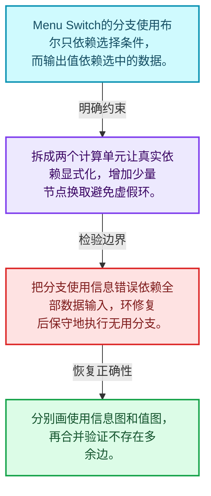
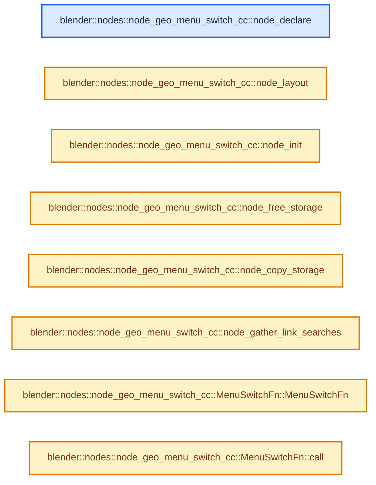
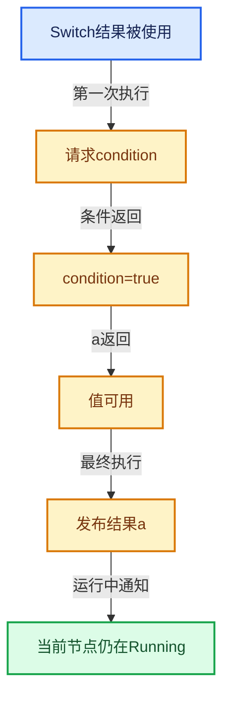

# 09-11 Switch与MenuSwitch

[方向导航](README.md) · [总目录](../README.md) · [实现索引](../%E7%AC%A6%E5%8F%B7%E4%BE%9D%E8%B5%96%E4%B8%8E%E5%AE%9E%E7%8E%B0%E7%B4%A2%E5%BC%95.md)

## 从问题到实现

怎样把值需求和分支使用需求分开？

条件决定所需输入，辅助使用信息不应错误依赖所有分支值；拆分节点可消除虚假环。

**数据模型**

Menu Switch的分支使用布尔只依赖选择条件，而输出值依赖选中的数据。

**设计取舍**

拆成两个计算单元让真实依赖显式化，增加少量节点换取避免虚假环。

**最小反例**

把分支使用信息错误依赖全部数据输入，环修复后保守地执行无用分支。

**推导**

分别画使用信息图和值图，再合并验证不存在多余边。

## 阅读地图与执行推演








图中的数值推演是本方向的教学模型；实际函数之间的调用边与概念分析边分别标注，不能把概念关系当作运行时调度顺序。

## 完整源码单元与就地讲解

中文讲解直接放在相关代码旁，复杂机制在代码下展开。原文折叠区保留基准行号；不需要在行号表和函数之间来回查找。类布局可分段展示，函数实现不按固定行数切开。

### 类型布局、声明与编译条件 · node_geo_menu_switch.cc L1—L44

<!-- annotated:c607a8683016b8 -->

```cpp
/* SPDX-FileCopyrightText: 2023 Blender Authors
 *
 * SPDX-License-Identifier: GPL-2.0-or-later */

#include "BLI_array_utils.hh"

#include "node_geometry_util.hh"
#include "shader/node_shader_util.hh"

#include "DNA_node_types.h"

#include "FN_multi_function.hh"

#include "UI_interface_layout.hh"
#include "UI_resources.hh"

#include "NOD_geo_menu_switch.hh"
#include "NOD_rna_define.hh"
#include "NOD_socket.hh"
#include "NOD_socket_items_blend.hh"
#include "NOD_socket_items_ops.hh"
#include "NOD_socket_items_ui.hh"
#include "NOD_socket_search_link.hh"

#include "BLO_read_write.hh"

#include "RNA_enum_types.hh"
#include "RNA_prototypes.hh"

#include "BKE_node_tree_reference_lifetimes.hh"
#include "BKE_screen.hh"

#include "WM_api.hh"

#include "COM_node_operation.hh"
#include "COM_result.hh"
#include "COM_utilities.hh"

namespace blender {

namespace nodes::node_geo_menu_switch_cc {

NODE_STORAGE_FUNCS(NodeMenuSwitch)

```

<details>
<summary>核对原始源码：source/blender/nodes/geometry/nodes/node_geo_menu_switch.cc · L1—L44</summary>

<!-- original:c607a8683016b8:source/blender/nodes/geometry/nodes/node_geo_menu_switch.cc:1:44 -->

```cpp
/* SPDX-FileCopyrightText: 2023 Blender Authors
 *
 * SPDX-License-Identifier: GPL-2.0-or-later */

#include "BLI_array_utils.hh"

#include "node_geometry_util.hh"
#include "shader/node_shader_util.hh"

#include "DNA_node_types.h"

#include "FN_multi_function.hh"

#include "UI_interface_layout.hh"
#include "UI_resources.hh"

#include "NOD_geo_menu_switch.hh"
#include "NOD_rna_define.hh"
#include "NOD_socket.hh"
#include "NOD_socket_items_blend.hh"
#include "NOD_socket_items_ops.hh"
#include "NOD_socket_items_ui.hh"
#include "NOD_socket_search_link.hh"

#include "BLO_read_write.hh"

#include "RNA_enum_types.hh"
#include "RNA_prototypes.hh"

#include "BKE_node_tree_reference_lifetimes.hh"
#include "BKE_screen.hh"

#include "WM_api.hh"

#include "COM_node_operation.hh"
#include "COM_result.hh"
#include "COM_utilities.hh"

namespace blender {

namespace nodes::node_geo_menu_switch_cc {

NODE_STORAGE_FUNCS(NodeMenuSwitch)

```

</details>

<a id="f-2f7ee7144a31018c"></a>

### `blender::nodes::node_geo_menu_switch_cc::node_declare`

实现位置：[source/blender/nodes/geometry/nodes/node_geo_menu_switch.cc](../../../../../source/blender/nodes/geometry/nodes/node_geo_menu_switch.cc) · L45—L114。

接口参数：

- `nodes::NodeDeclarationBuilder &b`

**教学注释版**

<!-- annotated:bffd0334c1cc0b -->

```cpp
static void node_declare(nodes::NodeDeclarationBuilder &b)
{
  b.use_custom_socket_order();
  b.allow_any_socket_order();

  const bNodeTree *ntree = b.tree_or_null();
  const bNode *node = b.node_or_null();
  if (node == nullptr) {
    return;
  }
  const NodeMenuSwitch &storage = node_storage(*node);
  const eNodeSocketDatatype data_type = storage.data_type;

  StructureType value_structure_type = StructureType::Dynamic;
  StructureType menu_structure_type = value_structure_type;

  if (ntree->type == NTREE_COMPOSIT) {
    const bool is_single_compositor_type = compositor::Result::is_single_value_only_type(
        compositor::socket_data_type_to_result_type(data_type));
    if (is_single_compositor_type) {
      value_structure_type = StructureType::Single;
    }
    menu_structure_type = StructureType::Single;
  }

  b.add_output(data_type, "Output"_ustr)
      .propagate_all()
      .inferred_structure_type()
      .structure_type(value_structure_type);

  b.add_default_layout();

  auto &menu = b.add_input<decl::Menu>("Menu"_ustr);
  menu.default_value(MenuValue(storage.enum_definition.items().is_empty() ?
                                   0 :
                                   storage.enum_definition.items().first().identifier));
  menu.structure_type(menu_structure_type);
  menu.optional_label();

  for (const NodeEnumItem &enum_item : storage.enum_definition.items()) {
    const UString name(enum_item.name);
    const UString identifier(MenuSwitchItemsAccessor::socket_identifier_for_item(enum_item));
    auto &input = b.add_input(data_type, name, identifier)
                      .socket_name_ptr(
                          &ntree->id, *MenuSwitchItemsAccessor::item_srna, &enum_item, "name")
                      .compositor_realization_mode(CompositorInputRealizationMode::None)
                      .description("Becomes the output value if it is chosen by the menu input");
    /* Labels are ugly in combination with data-block pickers and are usually disabled. */
    input.optional_label(ELEM(data_type,
                              SOCK_OBJECT,
                              SOCK_IMAGE,
                              SOCK_COLLECTION,
                              SOCK_MATERIAL,
                              SOCK_FONT,
                              SOCK_SCENE,
                              SOCK_TEXT_ID,
                              SOCK_MASK,
                              SOCK_SOUND));
    input.structure_type(value_structure_type);
    b.add_output<decl::Bool>(name, identifier)
        .align_with_previous()
        .description("True if this item is chosen by the menu input")
        .inferred_structure_type({menu.index()})
        .propagate_references({menu.index()});
  }

  b.add_input<decl::Extend>(""_ustr, "__extend__"_ustr)
      .structure_type(StructureType::Dynamic)
      .custom_draw(socket_items::ui::draw_extend_socket_fn<MenuSwitchItemsAccessor>());
}
```

<details>
<summary>核对原始源码：source/blender/nodes/geometry/nodes/node_geo_menu_switch.cc · L45—L114</summary>

<!-- original:bffd0334c1cc0b:source/blender/nodes/geometry/nodes/node_geo_menu_switch.cc:45:114 -->

```cpp
static void node_declare(nodes::NodeDeclarationBuilder &b)
{
  b.use_custom_socket_order();
  b.allow_any_socket_order();

  const bNodeTree *ntree = b.tree_or_null();
  const bNode *node = b.node_or_null();
  if (node == nullptr) {
    return;
  }
  const NodeMenuSwitch &storage = node_storage(*node);
  const eNodeSocketDatatype data_type = storage.data_type;

  StructureType value_structure_type = StructureType::Dynamic;
  StructureType menu_structure_type = value_structure_type;

  if (ntree->type == NTREE_COMPOSIT) {
    const bool is_single_compositor_type = compositor::Result::is_single_value_only_type(
        compositor::socket_data_type_to_result_type(data_type));
    if (is_single_compositor_type) {
      value_structure_type = StructureType::Single;
    }
    menu_structure_type = StructureType::Single;
  }

  b.add_output(data_type, "Output"_ustr)
      .propagate_all()
      .inferred_structure_type()
      .structure_type(value_structure_type);

  b.add_default_layout();

  auto &menu = b.add_input<decl::Menu>("Menu"_ustr);
  menu.default_value(MenuValue(storage.enum_definition.items().is_empty() ?
                                   0 :
                                   storage.enum_definition.items().first().identifier));
  menu.structure_type(menu_structure_type);
  menu.optional_label();

  for (const NodeEnumItem &enum_item : storage.enum_definition.items()) {
    const UString name(enum_item.name);
    const UString identifier(MenuSwitchItemsAccessor::socket_identifier_for_item(enum_item));
    auto &input = b.add_input(data_type, name, identifier)
                      .socket_name_ptr(
                          &ntree->id, *MenuSwitchItemsAccessor::item_srna, &enum_item, "name")
                      .compositor_realization_mode(CompositorInputRealizationMode::None)
                      .description("Becomes the output value if it is chosen by the menu input");
    /* Labels are ugly in combination with data-block pickers and are usually disabled. */
    input.optional_label(ELEM(data_type,
                              SOCK_OBJECT,
                              SOCK_IMAGE,
                              SOCK_COLLECTION,
                              SOCK_MATERIAL,
                              SOCK_FONT,
                              SOCK_SCENE,
                              SOCK_TEXT_ID,
                              SOCK_MASK,
                              SOCK_SOUND));
    input.structure_type(value_structure_type);
    b.add_output<decl::Bool>(name, identifier)
        .align_with_previous()
        .description("True if this item is chosen by the menu input")
        .inferred_structure_type({menu.index()})
        .propagate_references({menu.index()});
  }

  b.add_input<decl::Extend>(""_ustr, "__extend__"_ustr)
      .structure_type(StructureType::Dynamic)
      .custom_draw(socket_items::ui::draw_extend_socket_fn<MenuSwitchItemsAccessor>());
}
```

</details>

**沿实际写入检查状态**

- `value_structure_type = StructureType::Single;`
- `menu_structure_type = StructureType::Single;`

**继续追踪实现**

- `b.use_custom_socket_order` → [blender::nodes::NodeDeclarationBuilder::use_custom_socket_order · L135](%E4%BE%9D%E8%B5%96-node_declaration-250442.md#f-7a3e20373b6f44d0)。
- `b.allow_any_socket_order` → [blender::nodes::NodeDeclarationBuilder::allow_any_socket_order · L140](%E4%BE%9D%E8%B5%96-node_declaration-250442.md#f-5440adf750141e49)。
- `b.tree_or_null` → [blender::nodes::NodeDeclarationBuilder::tree_or_null · L681](%E4%BE%9D%E8%B5%96-NOD_node_declaration-9b193f.md#f-f41371835832ba92)。
- `b.node_or_null` → [blender::nodes::NodeDeclarationBuilder::node_or_null · L675](%E4%BE%9D%E8%B5%96-NOD_node_declaration-9b193f.md#f-1dfd970e8f6b7b32)。
- `node_storage` → [调用协议](../%E6%A8%A1%E6%9D%BF%E5%AE%8F%E4%B8%8E%E5%8A%A8%E6%80%81%E5%88%86%E6%B4%BE%E5%8D%8F%E8%AE%AE.md)：函数指针、局部可调用对象或未展开的宏；必须结合调用者环境。调用位置L55。
- `compositor::Result::is_single_value_only_type` → [blender::compositor::Result::is_single_value_only_type · L51](../05-%E5%87%A0%E4%BD%95%E5%AD%98%E5%82%A8%E4%B8%8E%E6%8B%93%E6%89%91%E6%98%A0%E5%B0%84/%E4%BE%9D%E8%B5%96-result-844e73.md#f-e15a58f6d1b11e77)。
- `compositor::socket_data_type_to_result_type` → [blender::compositor::socket_data_type_to_result_type · L39](../05-%E5%87%A0%E4%BD%95%E5%AD%98%E5%82%A8%E4%B8%8E%E6%8B%93%E6%89%91%E6%98%A0%E5%B0%84/%E4%BE%9D%E8%B5%96-utilities-1ec26a.md#f-9bc4ab546a3e2be9)。
- `b.add_output(data_type, "Output"_ustr) .propagate_all() .inferred_structure_type() .structure_type` → [调用协议](../%E6%A8%A1%E6%9D%BF%E5%AE%8F%E4%B8%8E%E5%8A%A8%E6%80%81%E5%88%86%E6%B4%BE%E5%8D%8F%E8%AE%AE.md)：接收对象类型依赖auto、返回值或模板实例；不按同名猜测目标。调用位置L70。
- `b.add_output(data_type, "Output"_ustr) .propagate_all() .inferred_structure_type` → [调用协议](../%E6%A8%A1%E6%9D%BF%E5%AE%8F%E4%B8%8E%E5%8A%A8%E6%80%81%E5%88%86%E6%B4%BE%E5%8D%8F%E8%AE%AE.md)：接收对象类型依赖auto、返回值或模板实例；不按同名猜测目标。调用位置L70。
- `b.add_output(data_type, "Output"_ustr) .propagate_all` → [调用协议](../%E6%A8%A1%E6%9D%BF%E5%AE%8F%E4%B8%8E%E5%8A%A8%E6%80%81%E5%88%86%E6%B4%BE%E5%8D%8F%E8%AE%AE.md)：接收对象类型依赖auto、返回值或模板实例；不按同名猜测目标。调用位置L70。
- `b.add_output` → [调用协议](../%E6%A8%A1%E6%9D%BF%E5%AE%8F%E4%B8%8E%E5%8A%A8%E6%80%81%E5%88%86%E6%B4%BE%E5%8D%8F%E8%AE%AE.md)：由接收对象具体类型或运行时策略提供实现。调用位置L70。
- `b.add_default_layout` → [blender::nodes::DeclarationListBuilder::add_default_layout · L458](%E4%BE%9D%E8%B5%96-node_declaration-250442.md#f-6245704e5ac02c69)。
- `b.add_input<decl::Menu>` → [调用协议](../%E6%A8%A1%E6%9D%BF%E5%AE%8F%E4%B8%8E%E5%8A%A8%E6%80%81%E5%88%86%E6%B4%BE%E5%8D%8F%E8%AE%AE.md)：由接收对象具体类型或运行时策略提供实现。调用位置L77。
- `menu.default_value` → [调用协议](../%E6%A8%A1%E6%9D%BF%E5%AE%8F%E4%B8%8E%E5%8A%A8%E6%80%81%E5%88%86%E6%B4%BE%E5%8D%8F%E8%AE%AE.md)：接收对象类型依赖auto、返回值或模板实例；不按同名猜测目标。调用位置L78。
- `MenuValue` → [blender::nodes::MenuValue::MenuValue · L23](%E4%BE%9D%E8%B5%96-NOD_menu_value-6ddf35.md#f-5b614ab1fafc8ef9)；[blender::nodes::MenuValue::MenuValue · L24](%E4%BE%9D%E8%B5%96-NOD_menu_value-6ddf35.md#f-20fc7efc74f2e570)；[blender::nodes::MenuValue::MenuValue · L26](%E4%BE%9D%E8%B5%96-NOD_menu_value-6ddf35.md#f-5a26f9bc3af837d0)。同名重载需按实参类型选择。
- `storage.enum_definition.items().is_empty` → [调用协议](../%E6%A8%A1%E6%9D%BF%E5%AE%8F%E4%B8%8E%E5%8A%A8%E6%80%81%E5%88%86%E6%B4%BE%E5%8D%8F%E8%AE%AE.md)：接收对象类型依赖auto、返回值或模板实例；不按同名猜测目标。调用位置L78。
- `storage.enum_definition.items` → [调用协议](../%E6%A8%A1%E6%9D%BF%E5%AE%8F%E4%B8%8E%E5%8A%A8%E6%80%81%E5%88%86%E6%B4%BE%E5%8D%8F%E8%AE%AE.md)：接收对象类型依赖auto、返回值或模板实例；不按同名猜测目标。调用位置L78。
- `storage.enum_definition.items().first` → [调用协议](../%E6%A8%A1%E6%9D%BF%E5%AE%8F%E4%B8%8E%E5%8A%A8%E6%80%81%E5%88%86%E6%B4%BE%E5%8D%8F%E8%AE%AE.md)：接收对象类型依赖auto、返回值或模板实例；不按同名猜测目标。调用位置L80。
- `menu.structure_type` → [调用协议](../%E6%A8%A1%E6%9D%BF%E5%AE%8F%E4%B8%8E%E5%8A%A8%E6%80%81%E5%88%86%E6%B4%BE%E5%8D%8F%E8%AE%AE.md)：接收对象类型依赖auto、返回值或模板实例；不按同名猜测目标。调用位置L81。
- `menu.optional_label` → [调用协议](../%E6%A8%A1%E6%9D%BF%E5%AE%8F%E4%B8%8E%E5%8A%A8%E6%80%81%E5%88%86%E6%B4%BE%E5%8D%8F%E8%AE%AE.md)：接收对象类型依赖auto、返回值或模板实例；不按同名猜测目标。调用位置L82。
- `b.add_input(data_type, name, identifier) .socket_name_ptr( &ntree->id, *MenuSwitchItemsAccessor::item_srna, &enum_item, "name") .compositor_realization_mode(CompositorInputRealizationMode::None) .description` → [调用协议](../%E6%A8%A1%E6%9D%BF%E5%AE%8F%E4%B8%8E%E5%8A%A8%E6%80%81%E5%88%86%E6%B4%BE%E5%8D%8F%E8%AE%AE.md)：接收对象类型依赖auto、返回值或模板实例；不按同名猜测目标。调用位置L87。
- `b.add_input(data_type, name, identifier) .socket_name_ptr( &ntree->id, *MenuSwitchItemsAccessor::item_srna, &enum_item, "name") .compositor_realization_mode` → [调用协议](../%E6%A8%A1%E6%9D%BF%E5%AE%8F%E4%B8%8E%E5%8A%A8%E6%80%81%E5%88%86%E6%B4%BE%E5%8D%8F%E8%AE%AE.md)：接收对象类型依赖auto、返回值或模板实例；不按同名猜测目标。调用位置L87。
- `b.add_input(data_type, name, identifier) .socket_name_ptr` → [调用协议](../%E6%A8%A1%E6%9D%BF%E5%AE%8F%E4%B8%8E%E5%8A%A8%E6%80%81%E5%88%86%E6%B4%BE%E5%8D%8F%E8%AE%AE.md)：接收对象类型依赖auto、返回值或模板实例；不按同名猜测目标。调用位置L87。
- `b.add_input` → [调用协议](../%E6%A8%A1%E6%9D%BF%E5%AE%8F%E4%B8%8E%E5%8A%A8%E6%80%81%E5%88%86%E6%B4%BE%E5%8D%8F%E8%AE%AE.md)：由接收对象具体类型或运行时策略提供实现。调用位置L87。
- `input.optional_label` → [调用协议](../%E6%A8%A1%E6%9D%BF%E5%AE%8F%E4%B8%8E%E5%8A%A8%E6%80%81%E5%88%86%E6%B4%BE%E5%8D%8F%E8%AE%AE.md)：接收对象类型依赖auto、返回值或模板实例；不按同名猜测目标。调用位置L93。
- `ELEM` → [ELEM · L88](../05-%E5%87%A0%E4%BD%95%E5%AD%98%E5%82%A8%E4%B8%8E%E6%8B%93%E6%89%91%E6%98%A0%E5%B0%84/%E4%BE%9D%E8%B5%96-GHOST_utildefines-34b996.md#m-d28724a15928)；[ELEM · L135](../01-%E5%9F%BA%E7%A1%80%E5%AE%B9%E5%99%A8%E4%B8%8E%E7%8E%B0%E4%BB%A3CPP/%E4%BE%9D%E8%B5%96-BLI_utildefines-293a0a.md#m-d6572de7cae0)。宏定义由构建条件选择。
- `input.structure_type` → [调用协议](../%E6%A8%A1%E6%9D%BF%E5%AE%8F%E4%B8%8E%E5%8A%A8%E6%80%81%E5%88%86%E6%B4%BE%E5%8D%8F%E8%AE%AE.md)：接收对象类型依赖auto、返回值或模板实例；不按同名猜测目标。调用位置L103。
- `b.add_output<decl::Bool>(name, identifier) .align_with_previous() .description("True if this item is chosen by the menu input") .inferred_structure_type({menu.index()}) .propagate_references` → [调用协议](../%E6%A8%A1%E6%9D%BF%E5%AE%8F%E4%B8%8E%E5%8A%A8%E6%80%81%E5%88%86%E6%B4%BE%E5%8D%8F%E8%AE%AE.md)：接收对象类型依赖auto、返回值或模板实例；不按同名猜测目标。调用位置L104。
- `b.add_output<decl::Bool>(name, identifier) .align_with_previous() .description("True if this item is chosen by the menu input") .inferred_structure_type` → [调用协议](../%E6%A8%A1%E6%9D%BF%E5%AE%8F%E4%B8%8E%E5%8A%A8%E6%80%81%E5%88%86%E6%B4%BE%E5%8D%8F%E8%AE%AE.md)：接收对象类型依赖auto、返回值或模板实例；不按同名猜测目标。调用位置L104。
- `b.add_output<decl::Bool>(name, identifier) .align_with_previous() .description` → [调用协议](../%E6%A8%A1%E6%9D%BF%E5%AE%8F%E4%B8%8E%E5%8A%A8%E6%80%81%E5%88%86%E6%B4%BE%E5%8D%8F%E8%AE%AE.md)：接收对象类型依赖auto、返回值或模板实例；不按同名猜测目标。调用位置L104。
- `b.add_output<decl::Bool>(name, identifier) .align_with_previous` → [调用协议](../%E6%A8%A1%E6%9D%BF%E5%AE%8F%E4%B8%8E%E5%8A%A8%E6%80%81%E5%88%86%E6%B4%BE%E5%8D%8F%E8%AE%AE.md)：接收对象类型依赖auto、返回值或模板实例；不按同名猜测目标。调用位置L104。
- `b.add_output<decl::Bool>` → [调用协议](../%E6%A8%A1%E6%9D%BF%E5%AE%8F%E4%B8%8E%E5%8A%A8%E6%80%81%E5%88%86%E6%B4%BE%E5%8D%8F%E8%AE%AE.md)：由接收对象具体类型或运行时策略提供实现。调用位置L104。
- `menu.index` → [调用协议](../%E6%A8%A1%E6%9D%BF%E5%AE%8F%E4%B8%8E%E5%8A%A8%E6%80%81%E5%88%86%E6%B4%BE%E5%8D%8F%E8%AE%AE.md)：接收对象类型依赖auto、返回值或模板实例；不按同名猜测目标。调用位置L107。
- `b.add_input<decl::Extend>(""_ustr, "__extend__"_ustr) .structure_type(StructureType::Dynamic) .custom_draw` → [调用协议](../%E6%A8%A1%E6%9D%BF%E5%AE%8F%E4%B8%8E%E5%8A%A8%E6%80%81%E5%88%86%E6%B4%BE%E5%8D%8F%E8%AE%AE.md)：接收对象类型依赖auto、返回值或模板实例；不按同名猜测目标。调用位置L111。
- `b.add_input<decl::Extend>(""_ustr, "__extend__"_ustr) .structure_type` → [调用协议](../%E6%A8%A1%E6%9D%BF%E5%AE%8F%E4%B8%8E%E5%8A%A8%E6%80%81%E5%88%86%E6%B4%BE%E5%8D%8F%E8%AE%AE.md)：接收对象类型依赖auto、返回值或模板实例；不按同名猜测目标。调用位置L111。
- `b.add_input<decl::Extend>` → [调用协议](../%E6%A8%A1%E6%9D%BF%E5%AE%8F%E4%B8%8E%E5%8A%A8%E6%80%81%E5%88%86%E6%B4%BE%E5%8D%8F%E8%AE%AE.md)：由接收对象具体类型或运行时策略提供实现。调用位置L111。
- `socket_items::ui::draw_extend_socket_fn<MenuSwitchItemsAccessor>` → [blender::nodes::socket_items::ui::draw_extend_socket_fn · L128](%E4%BE%9D%E8%B5%96-NOD_socket_items_ui-2ab39c.md#f-78b09f9b74014bee)。

<!-- annotated:f177b9ec139561 -->

```cpp

```

<details>
<summary>核对原始源码：source/blender/nodes/geometry/nodes/node_geo_menu_switch.cc · L115—L115</summary>

<!-- original:f177b9ec139561:source/blender/nodes/geometry/nodes/node_geo_menu_switch.cc:115:115 -->

```cpp

```

</details>

<a id="f-cbb04faf0bcce046"></a>

### `blender::nodes::node_geo_menu_switch_cc::node_layout`

实现位置：[source/blender/nodes/geometry/nodes/node_geo_menu_switch.cc](../../../../../source/blender/nodes/geometry/nodes/node_geo_menu_switch.cc) · L116—L119。

接口参数：

- `ui::Layout &layout`
- `bContext *`
- `PointerRNA *ptr`

**教学注释版**

<!-- annotated:32e05ac261ac3f -->

```cpp
static void node_layout(ui::Layout &layout, bContext * /*C*/, PointerRNA *ptr)
{
  layout.prop(ptr, "data_type", UI_ITEM_NONE, "", ICON_NONE);
}
```

<details>
<summary>核对原始源码：source/blender/nodes/geometry/nodes/node_geo_menu_switch.cc · L116—L119</summary>

<!-- original:32e05ac261ac3f:source/blender/nodes/geometry/nodes/node_geo_menu_switch.cc:116:119 -->

```cpp
static void node_layout(ui::Layout &layout, bContext * /*C*/, PointerRNA *ptr)
{
  layout.prop(ptr, "data_type", UI_ITEM_NONE, "", ICON_NONE);
}
```

</details>

**继续追踪实现**

- `layout.prop` → [blender::ui::Layout::prop · L1980](../05-%E5%87%A0%E4%BD%95%E5%AD%98%E5%82%A8%E4%B8%8E%E6%8B%93%E6%89%91%E6%98%A0%E5%B0%84/%E4%BE%9D%E8%B5%96-interface_layout-7cc3aa.md#f-fe037a66d23c597c)；[blender::ui::Layout::prop · L2447](../05-%E5%87%A0%E4%BD%95%E5%AD%98%E5%82%A8%E4%B8%8E%E6%8B%93%E6%89%91%E6%98%A0%E5%B0%84/%E4%BE%9D%E8%B5%96-interface_layout-7cc3aa.md#f-2d185b7c1e4b86bd)。同名重载需按实参类型选择。

<!-- annotated:818b2a133b8db0 -->

```cpp

```

<details>
<summary>核对原始源码：source/blender/nodes/geometry/nodes/node_geo_menu_switch.cc · L120—L120</summary>

<!-- original:818b2a133b8db0:source/blender/nodes/geometry/nodes/node_geo_menu_switch.cc:120:120 -->

```cpp

```

</details>

<a id="f-7e3d95b2056db06e"></a>

### `blender::nodes::node_geo_menu_switch_cc::node_init`

实现位置：[source/blender/nodes/geometry/nodes/node_geo_menu_switch.cc](../../../../../source/blender/nodes/geometry/nodes/node_geo_menu_switch.cc) · L121—L132。

接口参数：

- `bNodeTree *tree`
- `bNode *node`

**教学注释版**

<!-- annotated:aee3e325b6fb2d -->

```cpp
static void node_init(bNodeTree *tree, bNode *node)
{
  NodeMenuSwitch *data = MEM_new<NodeMenuSwitch>(__func__);
  data->data_type = tree->type == NTREE_GEOMETRY ? SOCK_GEOMETRY : SOCK_RGBA;
  data->enum_definition.next_identifier = 0;
  data->enum_definition.items_array = nullptr;
  data->enum_definition.items_num = 0;
  node->storage = data;

  socket_items::add_item_with_name<MenuSwitchItemsAccessor>(*node, "A");
  socket_items::add_item_with_name<MenuSwitchItemsAccessor>(*node, "B");
}
```

<details>
<summary>核对原始源码：source/blender/nodes/geometry/nodes/node_geo_menu_switch.cc · L121—L132</summary>

<!-- original:aee3e325b6fb2d:source/blender/nodes/geometry/nodes/node_geo_menu_switch.cc:121:132 -->

```cpp
static void node_init(bNodeTree *tree, bNode *node)
{
  NodeMenuSwitch *data = MEM_new<NodeMenuSwitch>(__func__);
  data->data_type = tree->type == NTREE_GEOMETRY ? SOCK_GEOMETRY : SOCK_RGBA;
  data->enum_definition.next_identifier = 0;
  data->enum_definition.items_array = nullptr;
  data->enum_definition.items_num = 0;
  node->storage = data;

  socket_items::add_item_with_name<MenuSwitchItemsAccessor>(*node, "A");
  socket_items::add_item_with_name<MenuSwitchItemsAccessor>(*node, "B");
}
```

</details>

**沿实际写入检查状态**

- `data->data_type = tree->type == NTREE_GEOMETRY ? SOCK_GEOMETRY : SOCK_RGBA;`
- `data->enum_definition.next_identifier = 0;`
- `data->enum_definition.items_array = nullptr;`
- `data->enum_definition.items_num = 0;`
- `node->storage = data;`

**继续追踪实现**

- `MEM_new<NodeMenuSwitch>` → [MEM_new · L351](../03-%E5%86%85%E5%AD%98%E5%88%86%E9%85%8D%E4%B8%8E%E8%BF%90%E8%A1%8C%E6%97%B6%E7%B1%BB%E5%9E%8B/%E4%BE%9D%E8%B5%96-MEM_guardedalloc-b54eca.md#f-115f9b6784f89912)。
- `socket_items::add_item_with_name<MenuSwitchItemsAccessor>` → [blender::nodes::socket_items::add_item_with_name · L250](%E4%BE%9D%E8%B5%96-NOD_socket_items-d21cfb.md#f-cceb0353ca12d966)。

<!-- annotated:fc74322116db6e -->

```cpp

```

<details>
<summary>核对原始源码：source/blender/nodes/geometry/nodes/node_geo_menu_switch.cc · L133—L133</summary>

<!-- original:fc74322116db6e:source/blender/nodes/geometry/nodes/node_geo_menu_switch.cc:133:133 -->

```cpp

```

</details>

<a id="f-ebd956355001c714"></a>

### `blender::nodes::node_geo_menu_switch_cc::node_free_storage`

实现位置：[source/blender/nodes/geometry/nodes/node_geo_menu_switch.cc](../../../../../source/blender/nodes/geometry/nodes/node_geo_menu_switch.cc) · L134—L138。

接口参数：

- `bNode *node`

**教学注释版**

<!-- annotated:d86b2617aaa3eb -->

```cpp
static void node_free_storage(bNode *node)
{
  socket_items::destruct_array<MenuSwitchItemsAccessor>(*node);
  MEM_delete(reinterpret_cast<NodeMenuSwitch *>(node->storage));
}
```

<details>
<summary>核对原始源码：source/blender/nodes/geometry/nodes/node_geo_menu_switch.cc · L134—L138</summary>

<!-- original:d86b2617aaa3eb:source/blender/nodes/geometry/nodes/node_geo_menu_switch.cc:134:138 -->

```cpp
static void node_free_storage(bNode *node)
{
  socket_items::destruct_array<MenuSwitchItemsAccessor>(*node);
  MEM_delete(reinterpret_cast<NodeMenuSwitch *>(node->storage));
}
```

</details>

**继续追踪实现**

- `socket_items::destruct_array<MenuSwitchItemsAccessor>` → [blender::nodes::socket_items::destruct_array · L92](%E4%BE%9D%E8%B5%96-NOD_socket_items-d21cfb.md#f-61cc3426af55b8af)。
- `MEM_delete` → [MEM_delete · L400](../03-%E5%86%85%E5%AD%98%E5%88%86%E9%85%8D%E4%B8%8E%E8%BF%90%E8%A1%8C%E6%97%B6%E7%B1%BB%E5%9E%8B/%E4%BE%9D%E8%B5%96-MEM_guardedalloc-b54eca.md#f-9049ffdd1682887c)。

<!-- annotated:535050ed068e6b -->

```cpp

```

<details>
<summary>核对原始源码：source/blender/nodes/geometry/nodes/node_geo_menu_switch.cc · L139—L139</summary>

<!-- original:535050ed068e6b:source/blender/nodes/geometry/nodes/node_geo_menu_switch.cc:139:139 -->

```cpp

```

</details>

<a id="f-50215441f4572cfb"></a>

### `blender::nodes::node_geo_menu_switch_cc::node_copy_storage`

实现位置：[source/blender/nodes/geometry/nodes/node_geo_menu_switch.cc](../../../../../source/blender/nodes/geometry/nodes/node_geo_menu_switch.cc) · L140—L147。

接口参数：

- `bNodeTree *`
- `bNode *dst_node`
- `const bNode *src_node`

**教学注释版**

<!-- annotated:fabaaeb1046103 -->

```cpp
static void node_copy_storage(bNodeTree * /*dst_tree*/, bNode *dst_node, const bNode *src_node)
{
  const NodeMenuSwitch &src_storage = node_storage(*src_node);
  NodeMenuSwitch *dst_storage = MEM_new<NodeMenuSwitch>(__func__, dna::shallow_copy(src_storage));
  dst_node->storage = dst_storage;

  socket_items::copy_array<MenuSwitchItemsAccessor>(*src_node, *dst_node);
}
```

<details>
<summary>核对原始源码：source/blender/nodes/geometry/nodes/node_geo_menu_switch.cc · L140—L147</summary>

<!-- original:fabaaeb1046103:source/blender/nodes/geometry/nodes/node_geo_menu_switch.cc:140:147 -->

```cpp
static void node_copy_storage(bNodeTree * /*dst_tree*/, bNode *dst_node, const bNode *src_node)
{
  const NodeMenuSwitch &src_storage = node_storage(*src_node);
  NodeMenuSwitch *dst_storage = MEM_new<NodeMenuSwitch>(__func__, dna::shallow_copy(src_storage));
  dst_node->storage = dst_storage;

  socket_items::copy_array<MenuSwitchItemsAccessor>(*src_node, *dst_node);
}
```

</details>

**沿实际写入检查状态**

- `dst_node->storage = dst_storage;`

**继续追踪实现**

- `node_storage` → [调用协议](../%E6%A8%A1%E6%9D%BF%E5%AE%8F%E4%B8%8E%E5%8A%A8%E6%80%81%E5%88%86%E6%B4%BE%E5%8D%8F%E8%AE%AE.md)：函数指针、局部可调用对象或未展开的宏；必须结合调用者环境。调用位置L142。
- `MEM_new<NodeMenuSwitch>` → [MEM_new · L351](../03-%E5%86%85%E5%AD%98%E5%88%86%E9%85%8D%E4%B8%8E%E8%BF%90%E8%A1%8C%E6%97%B6%E7%B1%BB%E5%9E%8B/%E4%BE%9D%E8%B5%96-MEM_guardedalloc-b54eca.md#f-115f9b6784f89912)。
- `dna::shallow_copy` → [blender::dna::shallow_copy · L146](../05-%E5%87%A0%E4%BD%95%E5%AD%98%E5%82%A8%E4%B8%8E%E6%8B%93%E6%89%91%E6%98%A0%E5%B0%84/%E4%BE%9D%E8%B5%96-DNA_defs-ed47fd.md#f-84b6eda95a1c994c)。
- `socket_items::copy_array<MenuSwitchItemsAccessor>` → [blender::nodes::socket_items::copy_array · L119](%E4%BE%9D%E8%B5%96-NOD_socket_items-d21cfb.md#f-1f49897843aa192c)。

<!-- annotated:42fd3df3245934 -->

```cpp

```

<details>
<summary>核对原始源码：source/blender/nodes/geometry/nodes/node_geo_menu_switch.cc · L148—L148</summary>

<!-- original:42fd3df3245934:source/blender/nodes/geometry/nodes/node_geo_menu_switch.cc:148:148 -->

```cpp

```

</details>

<a id="f-fcacd9616cd5cf1e"></a>

### `blender::nodes::node_geo_menu_switch_cc::node_gather_link_searches`

实现位置：[source/blender/nodes/geometry/nodes/node_geo_menu_switch.cc](../../../../../source/blender/nodes/geometry/nodes/node_geo_menu_switch.cc) · L149—L169。

接口参数：

- `GatherLinkSearchOpParams &params`

**教学注释版**

<!-- annotated:07c1f8af10d361 -->

```cpp
static void node_gather_link_searches(GatherLinkSearchOpParams &params)
{
  const eNodeSocketDatatype data_type = params.other_socket().type;
  if (params.in_out() == SOCK_IN) {
    if (data_type == SOCK_MENU) {
      params.add_item(IFACE_("Menu"), [](LinkSearchOpParams &params) {
        bNode &node = params.add_node("GeometryNodeMenuSwitch"_ustr);
        params.update_and_connect_available_socket(node, "Menu"_ustr);
      });
    }
  }
  else {
    if (data_type != SOCK_MENU) {
      params.add_item(IFACE_("Output"), [](LinkSearchOpParams &params) {
        bNode &node = params.add_node("GeometryNodeMenuSwitch"_ustr);
        node_storage(node).data_type = params.socket.type;
        params.update_and_connect_available_socket(node, "Output"_ustr);
      });
    }
  }
}
```

<details>
<summary>核对原始源码：source/blender/nodes/geometry/nodes/node_geo_menu_switch.cc · L149—L169</summary>

<!-- original:07c1f8af10d361:source/blender/nodes/geometry/nodes/node_geo_menu_switch.cc:149:169 -->

```cpp
static void node_gather_link_searches(GatherLinkSearchOpParams &params)
{
  const eNodeSocketDatatype data_type = params.other_socket().type;
  if (params.in_out() == SOCK_IN) {
    if (data_type == SOCK_MENU) {
      params.add_item(IFACE_("Menu"), [](LinkSearchOpParams &params) {
        bNode &node = params.add_node("GeometryNodeMenuSwitch"_ustr);
        params.update_and_connect_available_socket(node, "Menu"_ustr);
      });
    }
  }
  else {
    if (data_type != SOCK_MENU) {
      params.add_item(IFACE_("Output"), [](LinkSearchOpParams &params) {
        bNode &node = params.add_node("GeometryNodeMenuSwitch"_ustr);
        node_storage(node).data_type = params.socket.type;
        params.update_and_connect_available_socket(node, "Output"_ustr);
      });
    }
  }
}
```

</details>

**继续追踪实现**

- `params.other_socket` → [blender::nodes::GatherLinkSearchOpParams::other_socket · L45](%E4%BE%9D%E8%B5%96-socket_search_link-d6b6cb.md#f-7cba06c73785c130)。
- `params.in_out` → [blender::nodes::GatherLinkSearchOpParams::in_out · L65](%E4%BE%9D%E8%B5%96-socket_search_link-d6b6cb.md#f-ce52d3e93d6549ea)。
- `params.add_item` → [blender::nodes::GatherLinkSearchOpParams::add_item · L27](%E4%BE%9D%E8%B5%96-socket_search_link-d6b6cb.md#f-2ac8ec254ff2c58f)。
- `IFACE_` → [IFACE_ · L49](../05-%E5%87%A0%E4%BD%95%E5%AD%98%E5%82%A8%E4%B8%8E%E6%8B%93%E6%89%91%E6%98%A0%E5%B0%84/%E4%BE%9D%E8%B5%96-BLT_translation-c89e58.md#m-378ed115fdc8)。宏定义由构建条件选择。
- `params.add_node` → [调用协议](../%E6%A8%A1%E6%9D%BF%E5%AE%8F%E4%B8%8E%E5%8A%A8%E6%80%81%E5%88%86%E6%B4%BE%E5%8D%8F%E8%AE%AE.md)：由接收对象具体类型或运行时策略提供实现。调用位置L155。
- `params.update_and_connect_available_socket` → [blender::nodes::LinkSearchOpParams::update_and_connect_available_socket · L127](%E4%BE%9D%E8%B5%96-socket_search_link-d6b6cb.md#f-433b9de74cae0a4a)。
- `node_storage` → [调用协议](../%E6%A8%A1%E6%9D%BF%E5%AE%8F%E4%B8%8E%E5%8A%A8%E6%80%81%E5%88%86%E6%B4%BE%E5%8D%8F%E8%AE%AE.md)：函数指针、局部可调用对象或未展开的宏；必须结合调用者环境。调用位置L164。

### 类型布局、声明与编译条件 · node_geo_menu_switch.cc L170—L180

<a id="t-907585084ff4"></a>

`MenuSwitchFn`在这里声明的数据成员：

- `NodeEnumDefinition enum_def_`
- `CPPType type_`
- `mf::Signature signature_`

<!-- annotated:52dac07397bfbb -->

```cpp

/**
 * Multi-function which evaluates the switch input for each enum item and partially fills the
 * output array with values from the input array where the identifier matches.
 */
class MenuSwitchFn : public mf::MultiFunction {
  const NodeEnumDefinition &enum_def_;
  const CPPType &type_;
  mf::Signature signature_;

 public:
```

<details>
<summary>核对原始源码：source/blender/nodes/geometry/nodes/node_geo_menu_switch.cc · L170—L180</summary>

<!-- original:52dac07397bfbb:source/blender/nodes/geometry/nodes/node_geo_menu_switch.cc:170:180 -->

```cpp

/**
 * Multi-function which evaluates the switch input for each enum item and partially fills the
 * output array with values from the input array where the identifier matches.
 */
class MenuSwitchFn : public mf::MultiFunction {
  const NodeEnumDefinition &enum_def_;
  const CPPType &type_;
  mf::Signature signature_;

 public:
```

</details>

<a id="f-a803471a3de4c624"></a>

### `blender::nodes::node_geo_menu_switch_cc::MenuSwitchFn::MenuSwitchFn`

实现位置：[source/blender/nodes/geometry/nodes/node_geo_menu_switch.cc](../../../../../source/blender/nodes/geometry/nodes/node_geo_menu_switch.cc) · L181—L191。

接口参数：

- `const NodeEnumDefinition &enum_def`
- `const CPPType &type`

**教学注释版**

<!-- annotated:a98db6a861c3fa -->

```cpp
  MenuSwitchFn(const NodeEnumDefinition &enum_def, const CPPType &type)
      : enum_def_(enum_def), type_(type)
  {
    mf::SignatureBuilder builder{"Menu Switch", signature_};
    builder.single_input<MenuValue>("Menu");
    for (const NodeEnumItem &enum_item : enum_def.items()) {
      builder.single_input(enum_item.name, type);
    }
    builder.single_output("Output", type, mf::ParamFlag::SupportsUnusedOutput);
    this->set_signature(&signature_);
  }
```

<details>
<summary>核对原始源码：source/blender/nodes/geometry/nodes/node_geo_menu_switch.cc · L181—L191</summary>

<!-- original:a98db6a861c3fa:source/blender/nodes/geometry/nodes/node_geo_menu_switch.cc:181:191 -->

```cpp
  MenuSwitchFn(const NodeEnumDefinition &enum_def, const CPPType &type)
      : enum_def_(enum_def), type_(type)
  {
    mf::SignatureBuilder builder{"Menu Switch", signature_};
    builder.single_input<MenuValue>("Menu");
    for (const NodeEnumItem &enum_item : enum_def.items()) {
      builder.single_input(enum_item.name, type);
    }
    builder.single_output("Output", type, mf::ParamFlag::SupportsUnusedOutput);
    this->set_signature(&signature_);
  }
```

</details>

**继续追踪实现**

- `builder.single_input<MenuValue>` → [blender::fn::multi_function::SignatureBuilder::single_input · L102](../07-MultiFunction%E4%B8%8E%E6%89%B9%E9%87%8F%E6%89%A7%E8%A1%8C/02-%E5%87%BD%E6%95%B0%E7%AD%BE%E5%90%8D.md#f-8c435d9e973ba71d)；[blender::fn::multi_function::SignatureBuilder::single_input · L107](../07-MultiFunction%E4%B8%8E%E6%89%B9%E9%87%8F%E6%89%A7%E8%A1%8C/02-%E5%87%BD%E6%95%B0%E7%AD%BE%E5%90%8D.md#f-9df9b61334a7062a)。同名重载需按实参类型选择。
- `enum_def.items` → [blender::NodeEnumDefinition::items · L23](../05-%E5%87%A0%E4%BD%95%E5%AD%98%E5%82%A8%E4%B8%8E%E6%8B%93%E6%89%91%E6%98%A0%E5%B0%84/%E4%BE%9D%E8%B5%96-node_enum_definition-d2a941.md#f-2c1fb3cb9aa66c3d)；[blender::NodeEnumDefinition::items · L28](../05-%E5%87%A0%E4%BD%95%E5%AD%98%E5%82%A8%E4%B8%8E%E6%8B%93%E6%89%91%E6%98%A0%E5%B0%84/%E4%BE%9D%E8%B5%96-node_enum_definition-d2a941.md#f-33276360012e9f2e)。同名重载需按实参类型选择。
- `builder.single_input` → [blender::fn::multi_function::SignatureBuilder::single_input · L102](../07-MultiFunction%E4%B8%8E%E6%89%B9%E9%87%8F%E6%89%A7%E8%A1%8C/02-%E5%87%BD%E6%95%B0%E7%AD%BE%E5%90%8D.md#f-8c435d9e973ba71d)；[blender::fn::multi_function::SignatureBuilder::single_input · L107](../07-MultiFunction%E4%B8%8E%E6%89%B9%E9%87%8F%E6%89%A7%E8%A1%8C/02-%E5%87%BD%E6%95%B0%E7%AD%BE%E5%90%8D.md#f-9df9b61334a7062a)。同名重载需按实参类型选择。
- `builder.single_output` → [blender::fn::multi_function::SignatureBuilder::single_output · L127](../07-MultiFunction%E4%B8%8E%E6%89%B9%E9%87%8F%E6%89%A7%E8%A1%8C/02-%E5%87%BD%E6%95%B0%E7%AD%BE%E5%90%8D.md#f-12fe60c15a0df7eb)；[blender::fn::multi_function::SignatureBuilder::single_output · L133](../07-MultiFunction%E4%B8%8E%E6%89%B9%E9%87%8F%E6%89%A7%E8%A1%8C/02-%E5%87%BD%E6%95%B0%E7%AD%BE%E5%90%8D.md#f-578452e5167aab0d)。同名重载需按实参类型选择。
- `this->set_signature` → [blender::fn::multi_function::MultiFunction::set_signature · L133](../07-MultiFunction%E4%B8%8E%E6%89%B9%E9%87%8F%E6%89%A7%E8%A1%8C/01-%E6%89%B9%E9%87%8F%E8%AE%A1%E7%AE%97%E6%A8%A1%E5%9E%8B.md#f-3b440d337b220123)。

<!-- annotated:81754eb2fa1003 -->

```cpp

```

<details>
<summary>核对原始源码：source/blender/nodes/geometry/nodes/node_geo_menu_switch.cc · L192—L192</summary>

<!-- original:81754eb2fa1003:source/blender/nodes/geometry/nodes/node_geo_menu_switch.cc:192:192 -->

```cpp

```

</details>

<a id="f-fe546a4d79294cab"></a>

### `blender::nodes::node_geo_menu_switch_cc::MenuSwitchFn::call`

实现位置：[source/blender/nodes/geometry/nodes/node_geo_menu_switch.cc](../../../../../source/blender/nodes/geometry/nodes/node_geo_menu_switch.cc) · L193—L244。

接口参数：

- `const IndexMask &mask`
- `mf::Params params`
- `mf::Context`

**教学注释版**

<!-- annotated:838b78278933d4 -->

```cpp
  void call(const IndexMask &mask, mf::Params params, mf::Context /*context*/) const override
  {
    const int value_inputs_start = 1;
    const int inputs_num = enum_def_.items_num;
    const VArray<MenuValue> values = params.readonly_single_input<MenuValue>(0, "Menu");
    /* Use one extra mask at the end for invalid indices. */
    const int invalid_index = inputs_num;

    GMutableSpan value_output = params.uninitialized_single_output_if_required(1 + inputs_num,
                                                                               "Output");

    auto find_item_index = [&](const MenuValue value) -> int {
      for (const int i : enum_def_.items().index_range()) {
        const NodeEnumItem &item = enum_def_.items()[i];
        if (item.identifier == value.value) {
          return i;
        }
      }
      return invalid_index;
    };

    if (const std::optional<MenuValue> value = values.get_if_single()) {
      const int index = find_item_index(*value);
      if (index < inputs_num) {
        if (!value_output.is_empty()) {
          const GVArray inputs = params.readonly_single_input(value_inputs_start + index);
          inputs.materialize_to_uninitialized(mask, value_output.data());
        }
      }
      else {
        if (!value_output.is_empty()) {
          type_.fill_construct_indices(type_.default_value(), value_output.data(), mask);
        }
      }
      return;
    }

    IndexMaskMemory memory;
    Array<IndexMask> masks(inputs_num + 1);
    IndexMask::from_groups<int64_t>(
        mask, memory, [&](const int64_t i) { return find_item_index(values[i]); }, masks);

    for (const int item_i : IndexRange(inputs_num)) {
      const IndexMask &mask_for_index = masks[item_i];
      if (!mask_for_index.is_empty() && !value_output.is_empty()) {
        const GVArray inputs = params.readonly_single_input(value_inputs_start + item_i);
        inputs.materialize_to_uninitialized(mask_for_index, value_output.data());
      }
    }

    type_.fill_construct_indices(type_.default_value(), value_output.data(), masks[invalid_index]);
  }
```

<details>
<summary>核对原始源码：source/blender/nodes/geometry/nodes/node_geo_menu_switch.cc · L193—L244</summary>

<!-- original:838b78278933d4:source/blender/nodes/geometry/nodes/node_geo_menu_switch.cc:193:244 -->

```cpp
  void call(const IndexMask &mask, mf::Params params, mf::Context /*context*/) const override
  {
    const int value_inputs_start = 1;
    const int inputs_num = enum_def_.items_num;
    const VArray<MenuValue> values = params.readonly_single_input<MenuValue>(0, "Menu");
    /* Use one extra mask at the end for invalid indices. */
    const int invalid_index = inputs_num;

    GMutableSpan value_output = params.uninitialized_single_output_if_required(1 + inputs_num,
                                                                               "Output");

    auto find_item_index = [&](const MenuValue value) -> int {
      for (const int i : enum_def_.items().index_range()) {
        const NodeEnumItem &item = enum_def_.items()[i];
        if (item.identifier == value.value) {
          return i;
        }
      }
      return invalid_index;
    };

    if (const std::optional<MenuValue> value = values.get_if_single()) {
      const int index = find_item_index(*value);
      if (index < inputs_num) {
        if (!value_output.is_empty()) {
          const GVArray inputs = params.readonly_single_input(value_inputs_start + index);
          inputs.materialize_to_uninitialized(mask, value_output.data());
        }
      }
      else {
        if (!value_output.is_empty()) {
          type_.fill_construct_indices(type_.default_value(), value_output.data(), mask);
        }
      }
      return;
    }

    IndexMaskMemory memory;
    Array<IndexMask> masks(inputs_num + 1);
    IndexMask::from_groups<int64_t>(
        mask, memory, [&](const int64_t i) { return find_item_index(values[i]); }, masks);

    for (const int item_i : IndexRange(inputs_num)) {
      const IndexMask &mask_for_index = masks[item_i];
      if (!mask_for_index.is_empty() && !value_output.is_empty()) {
        const GVArray inputs = params.readonly_single_input(value_inputs_start + item_i);
        inputs.materialize_to_uninitialized(mask_for_index, value_output.data());
      }
    }

    type_.fill_construct_indices(type_.default_value(), value_output.data(), masks[invalid_index]);
  }
```

</details>

**结果出口**

- `return i;`
- `return invalid_index;`

**继续追踪实现**

- `params.readonly_single_input<MenuValue>` → [blender::fn::multi_function::Params::readonly_single_input · L333](../07-MultiFunction%E4%B8%8E%E6%89%B9%E9%87%8F%E6%89%A7%E8%A1%8C/04-%E5%8F%82%E6%95%B0%E8%AE%BF%E9%97%AE%E4%B8%8E%E8%BE%93%E5%87%BA%E6%9E%84%E9%80%A0.md#f-bf8962325f032689)；[blender::fn::multi_function::Params::readonly_single_input · L340](../07-MultiFunction%E4%B8%8E%E6%89%B9%E9%87%8F%E6%89%A7%E8%A1%8C/04-%E5%8F%82%E6%95%B0%E8%AE%BF%E9%97%AE%E4%B8%8E%E8%BE%93%E5%87%BA%E6%9E%84%E9%80%A0.md#f-fb1c312ddfea5e55)。同名重载需按实参类型选择。
- `params.uninitialized_single_output_if_required` → [blender::fn::multi_function::Params::uninitialized_single_output_if_required · L368](../07-MultiFunction%E4%B8%8E%E6%89%B9%E9%87%8F%E6%89%A7%E8%A1%8C/04-%E5%8F%82%E6%95%B0%E8%AE%BF%E9%97%AE%E4%B8%8E%E8%BE%93%E5%87%BA%E6%9E%84%E9%80%A0.md#f-cf61774be6d07a93)；[blender::fn::multi_function::Params::uninitialized_single_output_if_required · L375](../07-MultiFunction%E4%B8%8E%E6%89%B9%E9%87%8F%E6%89%A7%E8%A1%8C/04-%E5%8F%82%E6%95%B0%E8%AE%BF%E9%97%AE%E4%B8%8E%E8%BE%93%E5%87%BA%E6%9E%84%E9%80%A0.md#f-72bff53c80d8ed47)。同名重载需按实参类型选择。
- `enum_def_.items().index_range` → [调用协议](../%E6%A8%A1%E6%9D%BF%E5%AE%8F%E4%B8%8E%E5%8A%A8%E6%80%81%E5%88%86%E6%B4%BE%E5%8D%8F%E8%AE%AE.md)：接收对象类型依赖auto、返回值或模板实例；不按同名猜测目标。调用位置L205。
- `enum_def_.items` → [blender::NodeEnumDefinition::items · L23](../05-%E5%87%A0%E4%BD%95%E5%AD%98%E5%82%A8%E4%B8%8E%E6%8B%93%E6%89%91%E6%98%A0%E5%B0%84/%E4%BE%9D%E8%B5%96-node_enum_definition-d2a941.md#f-2c1fb3cb9aa66c3d)；[blender::NodeEnumDefinition::items · L28](../05-%E5%87%A0%E4%BD%95%E5%AD%98%E5%82%A8%E4%B8%8E%E6%8B%93%E6%89%91%E6%98%A0%E5%B0%84/%E4%BE%9D%E8%B5%96-node_enum_definition-d2a941.md#f-33276360012e9f2e)。同名重载需按实参类型选择。
- `values.get_if_single` → [blender::VArrayCommon::get_if_single · L649](../04-%E8%99%9A%E6%8B%9F%E6%95%B0%E7%BB%84%E4%B8%8E%E7%B4%A2%E5%BC%95%E9%80%89%E6%8B%A9/03-%E5%8D%95%E5%80%BC%E4%B8%8ESpan%E8%A1%A8%E7%A4%BA.md#f-779c11c4fd8e6ac3)。
- `find_item_index` → [调用协议](../%E6%A8%A1%E6%9D%BF%E5%AE%8F%E4%B8%8E%E5%8A%A8%E6%80%81%E5%88%86%E6%B4%BE%E5%8D%8F%E8%AE%AE.md)：局部可调用对象，须结合其初始化与捕获环境。调用位置L215。
- `value_output.is_empty` → [blender::GMutableSpan::is_empty · L193](../03-%E5%86%85%E5%AD%98%E5%88%86%E9%85%8D%E4%B8%8E%E8%BF%90%E8%A1%8C%E6%97%B6%E7%B1%BB%E5%9E%8B/11-GSpan%E4%B8%8EGArray.md#f-6fac8d7ba01608fb)。
- `params.readonly_single_input` → [blender::fn::multi_function::Params::readonly_single_input · L333](../07-MultiFunction%E4%B8%8E%E6%89%B9%E9%87%8F%E6%89%A7%E8%A1%8C/04-%E5%8F%82%E6%95%B0%E8%AE%BF%E9%97%AE%E4%B8%8E%E8%BE%93%E5%87%BA%E6%9E%84%E9%80%A0.md#f-bf8962325f032689)；[blender::fn::multi_function::Params::readonly_single_input · L340](../07-MultiFunction%E4%B8%8E%E6%89%B9%E9%87%8F%E6%89%A7%E8%A1%8C/04-%E5%8F%82%E6%95%B0%E8%AE%BF%E9%97%AE%E4%B8%8E%E8%BE%93%E5%87%BA%E6%9E%84%E9%80%A0.md#f-fb1c312ddfea5e55)。同名重载需按实参类型选择。
- `inputs.materialize_to_uninitialized` → [调用协议](../%E6%A8%A1%E6%9D%BF%E5%AE%8F%E4%B8%8E%E5%8A%A8%E6%80%81%E5%88%86%E6%B4%BE%E5%8D%8F%E8%AE%AE.md)：由接收对象具体类型或运行时策略提供实现。调用位置L219。
- `value_output.data` → [blender::GMutableSpan::data · L208](../03-%E5%86%85%E5%AD%98%E5%88%86%E9%85%8D%E4%B8%8E%E8%BF%90%E8%A1%8C%E6%97%B6%E7%B1%BB%E5%9E%8B/11-GSpan%E4%B8%8EGArray.md#f-f951536a0bdbb159)。
- `type_.fill_construct_indices` → [blender::CPPType::fill_construct_indices · L693](../03-%E5%86%85%E5%AD%98%E5%88%86%E9%85%8D%E4%B8%8E%E8%BF%90%E8%A1%8C%E6%97%B6%E7%B1%BB%E5%9E%8B/09-CPPType%E5%A4%8D%E5%88%B6%E7%A7%BB%E5%8A%A8%E9%87%8D%E5%AE%9A%E4%BD%8D.md#f-76c7dd833335e68b)。
- `type_.default_value` → [blender::CPPType::default_value · L743](../03-%E5%86%85%E5%AD%98%E5%88%86%E9%85%8D%E4%B8%8E%E8%BF%90%E8%A1%8C%E6%97%B6%E7%B1%BB%E5%9E%8B/09-CPPType%E5%A4%8D%E5%88%B6%E7%A7%BB%E5%8A%A8%E9%87%8D%E5%AE%9A%E4%BD%8D.md#f-95e76cbe74b383e8)。
- `IndexMask::from_groups<int64_t>` → [blender::index_mask::IndexMask::from_groups · L1105](../04-%E8%99%9A%E6%8B%9F%E6%95%B0%E7%BB%84%E4%B8%8E%E7%B4%A2%E5%BC%95%E9%80%89%E6%8B%A9/12-%E9%87%8D%E6%9E%84%E5%8E%86%E5%8F%B2%E4%B8%8E%E5%9F%BA%E5%87%86%E7%BB%83%E4%B9%A0.md#f-df7af197626c37f1)。
- `IndexRange` → [blender::IndexRange](../01-%E5%9F%BA%E7%A1%80%E5%AE%B9%E5%99%A8%E4%B8%8E%E7%8E%B0%E4%BB%A3CPP/%E4%BE%9D%E8%B5%96-BLI_index_range-7d7cc5.md#t-caa3466d6776)；[blender::gpu::shader::parser::IndexRange](../05-%E5%87%A0%E4%BD%95%E5%AD%98%E5%82%A8%E4%B8%8E%E6%8B%93%E6%89%91%E6%98%A0%E5%B0%84/%E4%BE%9D%E8%B5%96-utils-06433d.md#t-82d2bd4ea71c)；[blender::IndexRange](../05-%E5%87%A0%E4%BD%95%E5%AD%98%E5%82%A8%E4%B8%8E%E6%8B%93%E6%89%91%E6%98%A0%E5%B0%84/%E4%BE%9D%E8%B5%96-DNA_node_types-6708b9.md#t-0448cc889d39)。
- `mask_for_index.is_empty` → [blender::index_mask::IndexMask::is_empty · L748](../04-%E8%99%9A%E6%8B%9F%E6%95%B0%E7%BB%84%E4%B8%8E%E7%B4%A2%E5%BC%95%E9%80%89%E6%8B%A9/09-%E5%88%86%E6%AE%B5%E5%AD%98%E5%82%A8%E4%B8%8E%E9%81%8D%E5%8E%86.md#f-190ac996386064f4)。

<!-- annotated:83769615e8c5aa -->

```cpp

```

<details>
<summary>核对原始源码：source/blender/nodes/geometry/nodes/node_geo_menu_switch.cc · L245—L245</summary>

<!-- original:83769615e8c5aa:source/blender/nodes/geometry/nodes/node_geo_menu_switch.cc:245:245 -->

```cpp

```

</details>

<a id="f-87c3ee9c6dad64be"></a>

### `blender::nodes::node_geo_menu_switch_cc::MenuSwitchFn::hash_unique`

实现位置：[source/blender/nodes/geometry/nodes/node_geo_menu_switch.cc](../../../../../source/blender/nodes/geometry/nodes/node_geo_menu_switch.cc) · L246—L252。

接口参数：

- `UniqueHashBytes &hash`

**教学注释版**

<!-- annotated:cc85947c6731c4 -->

```cpp
  void hash_unique(UniqueHashBytes &hash) const override
  {
    static constexpr int8_t id = 0;
    hash.add(&id);
    hash.add(&type_);
    hash.add(&enum_def_);
  }
```

<details>
<summary>核对原始源码：source/blender/nodes/geometry/nodes/node_geo_menu_switch.cc · L246—L252</summary>

<!-- original:cc85947c6731c4:source/blender/nodes/geometry/nodes/node_geo_menu_switch.cc:246:252 -->

```cpp
  void hash_unique(UniqueHashBytes &hash) const override
  {
    static constexpr int8_t id = 0;
    hash.add(&id);
    hash.add(&type_);
    hash.add(&enum_def_);
  }
```

</details>

**继续追踪实现**

- `hash.add` → [blender::UniqueHashBytes::add · L40](../02-%E5%93%88%E5%B8%8C%E8%A1%A8%E4%B8%8E%E5%85%B3%E8%81%94%E6%95%B0%E6%8D%AE%E7%BB%93%E6%9E%84/%E4%BE%9D%E8%B5%96-BLI_unique_hash-5663a0.md#f-12ca7cac7556bc01)。

### 类型布局、声明与编译条件 · node_geo_menu_switch.cc L253—L260

<a id="t-259870f7ca49"></a>

`MenuSwitchBoolsFn`在这里声明的数据成员：

- `NodeEnumDefinition enum_def_`
- `mf::Signature signature_`

<!-- annotated:1336bf1e7b2efd -->

```cpp
};

class MenuSwitchBoolsFn : public mf::MultiFunction {
 private:
  const NodeEnumDefinition &enum_def_;
  mf::Signature signature_;

 public:
```

<details>
<summary>核对原始源码：source/blender/nodes/geometry/nodes/node_geo_menu_switch.cc · L253—L260</summary>

<!-- original:1336bf1e7b2efd:source/blender/nodes/geometry/nodes/node_geo_menu_switch.cc:253:260 -->

```cpp
};

class MenuSwitchBoolsFn : public mf::MultiFunction {
 private:
  const NodeEnumDefinition &enum_def_;
  mf::Signature signature_;

 public:
```

</details>

<a id="f-441873f73cda3999"></a>

### `blender::nodes::node_geo_menu_switch_cc::MenuSwitchBoolsFn::MenuSwitchBoolsFn`

实现位置：[source/blender/nodes/geometry/nodes/node_geo_menu_switch.cc](../../../../../source/blender/nodes/geometry/nodes/node_geo_menu_switch.cc) · L261—L270。

接口参数：

- `const NodeEnumDefinition &enum_def`

**教学注释版**

<!-- annotated:ef7726187abb10 -->

```cpp
  MenuSwitchBoolsFn(const NodeEnumDefinition &enum_def) : enum_def_(enum_def)
  {
    mf::SignatureBuilder builder{"Menu Switch Bools", signature_};
    builder.single_input<MenuValue>("Menu");
    for (const NodeEnumItem &enum_item : enum_def.items()) {
      builder.single_output(
          enum_item.name, CPPType::get<bool>(), mf::ParamFlag::SupportsUnusedOutput);
    }
    this->set_signature(&signature_);
  }
```

<details>
<summary>核对原始源码：source/blender/nodes/geometry/nodes/node_geo_menu_switch.cc · L261—L270</summary>

<!-- original:ef7726187abb10:source/blender/nodes/geometry/nodes/node_geo_menu_switch.cc:261:270 -->

```cpp
  MenuSwitchBoolsFn(const NodeEnumDefinition &enum_def) : enum_def_(enum_def)
  {
    mf::SignatureBuilder builder{"Menu Switch Bools", signature_};
    builder.single_input<MenuValue>("Menu");
    for (const NodeEnumItem &enum_item : enum_def.items()) {
      builder.single_output(
          enum_item.name, CPPType::get<bool>(), mf::ParamFlag::SupportsUnusedOutput);
    }
    this->set_signature(&signature_);
  }
```

</details>

**继续追踪实现**

- `builder.single_input<MenuValue>` → [blender::fn::multi_function::SignatureBuilder::single_input · L102](../07-MultiFunction%E4%B8%8E%E6%89%B9%E9%87%8F%E6%89%A7%E8%A1%8C/02-%E5%87%BD%E6%95%B0%E7%AD%BE%E5%90%8D.md#f-8c435d9e973ba71d)；[blender::fn::multi_function::SignatureBuilder::single_input · L107](../07-MultiFunction%E4%B8%8E%E6%89%B9%E9%87%8F%E6%89%A7%E8%A1%8C/02-%E5%87%BD%E6%95%B0%E7%AD%BE%E5%90%8D.md#f-9df9b61334a7062a)。同名重载需按实参类型选择。
- `enum_def.items` → [blender::NodeEnumDefinition::items · L23](../05-%E5%87%A0%E4%BD%95%E5%AD%98%E5%82%A8%E4%B8%8E%E6%8B%93%E6%89%91%E6%98%A0%E5%B0%84/%E4%BE%9D%E8%B5%96-node_enum_definition-d2a941.md#f-2c1fb3cb9aa66c3d)；[blender::NodeEnumDefinition::items · L28](../05-%E5%87%A0%E4%BD%95%E5%AD%98%E5%82%A8%E4%B8%8E%E6%8B%93%E6%89%91%E6%98%A0%E5%B0%84/%E4%BE%9D%E8%B5%96-node_enum_definition-d2a941.md#f-33276360012e9f2e)。同名重载需按实参类型选择。
- `builder.single_output` → [blender::fn::multi_function::SignatureBuilder::single_output · L127](../07-MultiFunction%E4%B8%8E%E6%89%B9%E9%87%8F%E6%89%A7%E8%A1%8C/02-%E5%87%BD%E6%95%B0%E7%AD%BE%E5%90%8D.md#f-12fe60c15a0df7eb)；[blender::fn::multi_function::SignatureBuilder::single_output · L133](../07-MultiFunction%E4%B8%8E%E6%89%B9%E9%87%8F%E6%89%A7%E8%A1%8C/02-%E5%87%BD%E6%95%B0%E7%AD%BE%E5%90%8D.md#f-578452e5167aab0d)。同名重载需按实参类型选择。
- `CPPType::get<bool>` → [blender::CPPType::get · L481](../03-%E5%86%85%E5%AD%98%E5%88%86%E9%85%8D%E4%B8%8E%E8%BF%90%E8%A1%8C%E6%97%B6%E7%B1%BB%E5%9E%8B/08-CPPType%E6%9E%84%E9%80%A0%E4%B8%8E%E6%9E%90%E6%9E%84.md#f-0cc10a3783d6abdb)。
- `this->set_signature` → [blender::fn::multi_function::MultiFunction::set_signature · L133](../07-MultiFunction%E4%B8%8E%E6%89%B9%E9%87%8F%E6%89%A7%E8%A1%8C/01-%E6%89%B9%E9%87%8F%E8%AE%A1%E7%AE%97%E6%A8%A1%E5%9E%8B.md#f-3b440d337b220123)。

<!-- annotated:6c7b201e36504d -->

```cpp

```

<details>
<summary>核对原始源码：source/blender/nodes/geometry/nodes/node_geo_menu_switch.cc · L271—L271</summary>

<!-- original:6c7b201e36504d:source/blender/nodes/geometry/nodes/node_geo_menu_switch.cc:271:271 -->

```cpp

```

</details>

<a id="f-d5fe304a724ebb11"></a>

### `blender::nodes::node_geo_menu_switch_cc::MenuSwitchBoolsFn::call`

实现位置：[source/blender/nodes/geometry/nodes/node_geo_menu_switch.cc](../../../../../source/blender/nodes/geometry/nodes/node_geo_menu_switch.cc) · L272—L302。

接口参数：

- `const IndexMask &mask`
- `mf::Params params`
- `mf::Context`

**教学注释版**

<!-- annotated:6fe27b6673aa30 -->

```cpp
  void call(const IndexMask &mask, mf::Params params, mf::Context /*context*/) const override
  {
    const VArray<MenuValue> values = params.readonly_single_input<MenuValue>(0, "Menu");

    Array<MutableSpan<bool>> item_spans(enum_def_.items_num);
    Vector<int> used_output_items;
    for (const int item_i : IndexRange(enum_def_.items_num)) {
      item_spans[item_i] = params.uninitialized_single_output_if_required<bool>(1 + item_i);
      if (!item_spans[item_i].is_empty()) {
        // [讲解] used_output_items.append：在尾部建立新元素，必要时先扩大存储。
        used_output_items.append(item_i);
      }
    }

    if (const std::optional<MenuValue> value = values.get_if_single()) {
      for (const int item_i : used_output_items) {
        const NodeEnumItem &enum_item = enum_def_.items()[item_i];
        const bool is_selected = enum_item.identifier == value->value;
        index_mask::masked_fill(item_spans[item_i], is_selected, mask);
      }
      return;
    }

    mask.foreach_index([&](const int i) {
      const MenuValue value = values[i];
      for (const int item_i : used_output_items) {
        const NodeEnumItem &enum_item = enum_def_.items_array[item_i];
        const bool is_selected = value.value == enum_item.identifier;
        item_spans[item_i][i] = is_selected;
      }
    });
  }
```

<details>
<summary>核对原始源码：source/blender/nodes/geometry/nodes/node_geo_menu_switch.cc · L272—L302</summary>

<!-- original:6fe27b6673aa30:source/blender/nodes/geometry/nodes/node_geo_menu_switch.cc:272:302 -->

```cpp
  void call(const IndexMask &mask, mf::Params params, mf::Context /*context*/) const override
  {
    const VArray<MenuValue> values = params.readonly_single_input<MenuValue>(0, "Menu");

    Array<MutableSpan<bool>> item_spans(enum_def_.items_num);
    Vector<int> used_output_items;
    for (const int item_i : IndexRange(enum_def_.items_num)) {
      item_spans[item_i] = params.uninitialized_single_output_if_required<bool>(1 + item_i);
      if (!item_spans[item_i].is_empty()) {
        used_output_items.append(item_i);
      }
    }

    if (const std::optional<MenuValue> value = values.get_if_single()) {
      for (const int item_i : used_output_items) {
        const NodeEnumItem &enum_item = enum_def_.items()[item_i];
        const bool is_selected = enum_item.identifier == value->value;
        index_mask::masked_fill(item_spans[item_i], is_selected, mask);
      }
      return;
    }

    mask.foreach_index([&](const int i) {
      const MenuValue value = values[i];
      for (const int item_i : used_output_items) {
        const NodeEnumItem &enum_item = enum_def_.items_array[item_i];
        const bool is_selected = value.value == enum_item.identifier;
        item_spans[item_i][i] = is_selected;
      }
    });
  }
```

</details>

**沿实际写入检查状态**

- `item_spans[item_i] = params.uninitialized_single_output_if_required<bool>(1 + item_i);`
- `item_spans[item_i][i] = is_selected;`

**继续追踪实现**

- `params.readonly_single_input<MenuValue>` → [blender::fn::multi_function::Params::readonly_single_input · L333](../07-MultiFunction%E4%B8%8E%E6%89%B9%E9%87%8F%E6%89%A7%E8%A1%8C/04-%E5%8F%82%E6%95%B0%E8%AE%BF%E9%97%AE%E4%B8%8E%E8%BE%93%E5%87%BA%E6%9E%84%E9%80%A0.md#f-bf8962325f032689)；[blender::fn::multi_function::Params::readonly_single_input · L340](../07-MultiFunction%E4%B8%8E%E6%89%B9%E9%87%8F%E6%89%A7%E8%A1%8C/04-%E5%8F%82%E6%95%B0%E8%AE%BF%E9%97%AE%E4%B8%8E%E8%BE%93%E5%87%BA%E6%9E%84%E9%80%A0.md#f-fb1c312ddfea5e55)。同名重载需按实参类型选择。
- `IndexRange` → [blender::IndexRange](../01-%E5%9F%BA%E7%A1%80%E5%AE%B9%E5%99%A8%E4%B8%8E%E7%8E%B0%E4%BB%A3CPP/%E4%BE%9D%E8%B5%96-BLI_index_range-7d7cc5.md#t-caa3466d6776)；[blender::gpu::shader::parser::IndexRange](../05-%E5%87%A0%E4%BD%95%E5%AD%98%E5%82%A8%E4%B8%8E%E6%8B%93%E6%89%91%E6%98%A0%E5%B0%84/%E4%BE%9D%E8%B5%96-utils-06433d.md#t-82d2bd4ea71c)；[blender::IndexRange](../05-%E5%87%A0%E4%BD%95%E5%AD%98%E5%82%A8%E4%B8%8E%E6%8B%93%E6%89%91%E6%98%A0%E5%B0%84/%E4%BE%9D%E8%B5%96-DNA_node_types-6708b9.md#t-0448cc889d39)。
- `params.uninitialized_single_output_if_required<bool>` → [blender::fn::multi_function::Params::uninitialized_single_output_if_required · L368](../07-MultiFunction%E4%B8%8E%E6%89%B9%E9%87%8F%E6%89%A7%E8%A1%8C/04-%E5%8F%82%E6%95%B0%E8%AE%BF%E9%97%AE%E4%B8%8E%E8%BE%93%E5%87%BA%E6%9E%84%E9%80%A0.md#f-cf61774be6d07a93)；[blender::fn::multi_function::Params::uninitialized_single_output_if_required · L375](../07-MultiFunction%E4%B8%8E%E6%89%B9%E9%87%8F%E6%89%A7%E8%A1%8C/04-%E5%8F%82%E6%95%B0%E8%AE%BF%E9%97%AE%E4%B8%8E%E8%BE%93%E5%87%BA%E6%9E%84%E9%80%A0.md#f-72bff53c80d8ed47)。同名重载需按实参类型选择。
- `item_spans[item_i].is_empty` → [调用协议](../%E6%A8%A1%E6%9D%BF%E5%AE%8F%E4%B8%8E%E5%8A%A8%E6%80%81%E5%88%86%E6%B4%BE%E5%8D%8F%E8%AE%AE.md)：接收对象类型依赖auto、返回值或模板实例；不按同名猜测目标。调用位置L280。
- `used_output_items.append` → [blender::Vector::append · L498](../01-%E5%9F%BA%E7%A1%80%E5%AE%B9%E5%99%A8%E4%B8%8E%E7%8E%B0%E4%BB%A3CPP/11-Vector%E6%8F%92%E5%85%A5%E5%88%A0%E9%99%A4%E4%B8%8E%E9%87%8D%E6%8E%92.md#f-5bde268a69e443ec)；[blender::Vector::append · L502](../01-%E5%9F%BA%E7%A1%80%E5%AE%B9%E5%99%A8%E4%B8%8E%E7%8E%B0%E4%BB%A3CPP/11-Vector%E6%8F%92%E5%85%A5%E5%88%A0%E9%99%A4%E4%B8%8E%E9%87%8D%E6%8E%92.md#f-591e0b15e6308532)。同名重载需按实参类型选择。
- `values.get_if_single` → [blender::VArrayCommon::get_if_single · L649](../04-%E8%99%9A%E6%8B%9F%E6%95%B0%E7%BB%84%E4%B8%8E%E7%B4%A2%E5%BC%95%E9%80%89%E6%8B%A9/03-%E5%8D%95%E5%80%BC%E4%B8%8ESpan%E8%A1%A8%E7%A4%BA.md#f-779c11c4fd8e6ac3)。
- `enum_def_.items` → [blender::NodeEnumDefinition::items · L23](../05-%E5%87%A0%E4%BD%95%E5%AD%98%E5%82%A8%E4%B8%8E%E6%8B%93%E6%89%91%E6%98%A0%E5%B0%84/%E4%BE%9D%E8%B5%96-node_enum_definition-d2a941.md#f-2c1fb3cb9aa66c3d)；[blender::NodeEnumDefinition::items · L28](../05-%E5%87%A0%E4%BD%95%E5%AD%98%E5%82%A8%E4%B8%8E%E6%8B%93%E6%89%91%E6%98%A0%E5%B0%84/%E4%BE%9D%E8%B5%96-node_enum_definition-d2a941.md#f-33276360012e9f2e)。同名重载需按实参类型选择。
- `index_mask::masked_fill` → [blender::index_mask::masked_fill · L1261](../04-%E8%99%9A%E6%8B%9F%E6%95%B0%E7%BB%84%E4%B8%8E%E7%B4%A2%E5%BC%95%E9%80%89%E6%8B%A9/12-%E9%87%8D%E6%9E%84%E5%8E%86%E5%8F%B2%E4%B8%8E%E5%9F%BA%E5%87%86%E7%BB%83%E4%B9%A0.md#f-00f1f611c7000f05)。
- `mask.foreach_index` → [blender::index_mask::IndexMask::foreach_index · L855](../04-%E8%99%9A%E6%8B%9F%E6%95%B0%E7%BB%84%E4%B8%8E%E7%B4%A2%E5%BC%95%E9%80%89%E6%8B%A9/09-%E5%88%86%E6%AE%B5%E5%AD%98%E5%82%A8%E4%B8%8E%E9%81%8D%E5%8E%86.md#f-cd6cd317e2e2812c)。

<!-- annotated:a67b10e4d45ce8 -->

```cpp

```

<details>
<summary>核对原始源码：source/blender/nodes/geometry/nodes/node_geo_menu_switch.cc · L303—L303</summary>

<!-- original:a67b10e4d45ce8:source/blender/nodes/geometry/nodes/node_geo_menu_switch.cc:303:303 -->

```cpp

```

</details>

<a id="f-22d915e4f0a21656"></a>

### `blender::nodes::node_geo_menu_switch_cc::MenuSwitchBoolsFn::hash_unique`

实现位置：[source/blender/nodes/geometry/nodes/node_geo_menu_switch.cc](../../../../../source/blender/nodes/geometry/nodes/node_geo_menu_switch.cc) · L304—L309。

接口参数：

- `UniqueHashBytes &hash`

**教学注释版**

<!-- annotated:044d72c73744c8 -->

```cpp
  void hash_unique(UniqueHashBytes &hash) const override
  {
    static constexpr int8_t id = 0;
    hash.add(&id);
    hash.add(&enum_def_);
  }
```

<details>
<summary>核对原始源码：source/blender/nodes/geometry/nodes/node_geo_menu_switch.cc · L304—L309</summary>

<!-- original:044d72c73744c8:source/blender/nodes/geometry/nodes/node_geo_menu_switch.cc:304:309 -->

```cpp
  void hash_unique(UniqueHashBytes &hash) const override
  {
    static constexpr int8_t id = 0;
    hash.add(&id);
    hash.add(&enum_def_);
  }
```

</details>

**继续追踪实现**

- `hash.add` → [blender::UniqueHashBytes::add · L40](../02-%E5%93%88%E5%B8%8C%E8%A1%A8%E4%B8%8E%E5%85%B3%E8%81%94%E6%95%B0%E6%8D%AE%E7%BB%93%E6%9E%84/%E4%BE%9D%E8%B5%96-BLI_unique_hash-5663a0.md#f-12ca7cac7556bc01)。

### 类型布局、声明与编译条件 · node_geo_menu_switch.cc L310—L319

<a id="t-1d36c2e3aaf8"></a>

`LazyFunctionForMenuSwitchNode`在这里声明的数据成员：

- `bNode node_`
- `bool can_be_field_`
- `NodeEnumDefinition enum_def_`
- `CPPType field_base_type_`

<!-- annotated:8b7aa6fc04489d -->

```cpp
};

class LazyFunctionForMenuSwitchNode : public LazyFunction {
 private:
  const bNode &node_;
  bool can_be_field_ = false;
  const NodeEnumDefinition &enum_def_;
  const CPPType *field_base_type_;

 public:
```

<details>
<summary>核对原始源码：source/blender/nodes/geometry/nodes/node_geo_menu_switch.cc · L310—L319</summary>

<!-- original:8b7aa6fc04489d:source/blender/nodes/geometry/nodes/node_geo_menu_switch.cc:310:319 -->

```cpp
};

class LazyFunctionForMenuSwitchNode : public LazyFunction {
 private:
  const bNode &node_;
  bool can_be_field_ = false;
  const NodeEnumDefinition &enum_def_;
  const CPPType *field_base_type_;

 public:
```

</details>

<a id="f-1e9a5d178d54eb01"></a>

### `blender::nodes::node_geo_menu_switch_cc::LazyFunctionForMenuSwitchNode::LazyFunctionForMenuSwitchNode`

实现位置：[source/blender/nodes/geometry/nodes/node_geo_menu_switch.cc](../../../../../source/blender/nodes/geometry/nodes/node_geo_menu_switch.cc) · L320—L343。

接口参数：

- `const bNode &node`
- `GeometryNodesLazyFunctionGraphInfo &lf_graph_info`

**教学注释版**

<!-- annotated:f4388372848727 -->

```cpp
  LazyFunctionForMenuSwitchNode(const bNode &node,
                                GeometryNodesLazyFunctionGraphInfo &lf_graph_info)
      : node_(node), enum_def_(node_storage(node).enum_definition)
  {
    const NodeMenuSwitch &storage = node_storage(node);
    const eNodeSocketDatatype data_type = storage.data_type;
    can_be_field_ = socket_type_supports_fields(data_type);
    const bke::bNodeSocketType *socket_type = bke::node_socket_type_find_static(data_type);
    BLI_assert(socket_type != nullptr);
    field_base_type_ = socket_type->base_cpp_type;

    MutableSpan<int> lf_index_by_bsocket = lf_graph_info.mapping.lf_index_by_bsocket;
    debug_name_ = node.name;
    lf_index_by_bsocket[node.input_socket(0).index_in_tree()] = inputs_.append_and_get_index_as(
        "Switch", CPPType::get<SocketValueVariant>(), lf::ValueUsage::Used);
    for (const int i : enum_def_.items().index_range()) {
      const NodeEnumItem &enum_item = enum_def_.items()[i];
      lf_index_by_bsocket[node.input_socket(i + 1).index_in_tree()] =
          inputs_.append_and_get_index_as(
              enum_item.name, CPPType::get<bke::SocketValueVariant>(), lf::ValueUsage::Maybe);
    }
    lf_index_by_bsocket[node.output_socket(0).index_in_tree()] = outputs_.append_and_get_index_as(
        "Value", CPPType::get<bke::SocketValueVariant>());
  }
```

<details>
<summary>核对原始源码：source/blender/nodes/geometry/nodes/node_geo_menu_switch.cc · L320—L343</summary>

<!-- original:f4388372848727:source/blender/nodes/geometry/nodes/node_geo_menu_switch.cc:320:343 -->

```cpp
  LazyFunctionForMenuSwitchNode(const bNode &node,
                                GeometryNodesLazyFunctionGraphInfo &lf_graph_info)
      : node_(node), enum_def_(node_storage(node).enum_definition)
  {
    const NodeMenuSwitch &storage = node_storage(node);
    const eNodeSocketDatatype data_type = storage.data_type;
    can_be_field_ = socket_type_supports_fields(data_type);
    const bke::bNodeSocketType *socket_type = bke::node_socket_type_find_static(data_type);
    BLI_assert(socket_type != nullptr);
    field_base_type_ = socket_type->base_cpp_type;

    MutableSpan<int> lf_index_by_bsocket = lf_graph_info.mapping.lf_index_by_bsocket;
    debug_name_ = node.name;
    lf_index_by_bsocket[node.input_socket(0).index_in_tree()] = inputs_.append_and_get_index_as(
        "Switch", CPPType::get<SocketValueVariant>(), lf::ValueUsage::Used);
    for (const int i : enum_def_.items().index_range()) {
      const NodeEnumItem &enum_item = enum_def_.items()[i];
      lf_index_by_bsocket[node.input_socket(i + 1).index_in_tree()] =
          inputs_.append_and_get_index_as(
              enum_item.name, CPPType::get<bke::SocketValueVariant>(), lf::ValueUsage::Maybe);
    }
    lf_index_by_bsocket[node.output_socket(0).index_in_tree()] = outputs_.append_and_get_index_as(
        "Value", CPPType::get<bke::SocketValueVariant>());
  }
```

</details>

**沿实际写入检查状态**

- `can_be_field_ = socket_type_supports_fields(data_type);`
- `field_base_type_ = socket_type->base_cpp_type;`
- `debug_name_ = node.name;`

**继续追踪实现**

- `node_storage` → [调用协议](../%E6%A8%A1%E6%9D%BF%E5%AE%8F%E4%B8%8E%E5%8A%A8%E6%80%81%E5%88%86%E6%B4%BE%E5%8D%8F%E8%AE%AE.md)：函数指针、局部可调用对象或未展开的宏；必须结合调用者环境。调用位置L324。
- `socket_type_supports_fields` → [blender::nodes::socket_type_supports_fields · L663](%E4%BE%9D%E8%B5%96-node_socket-0ca7fe.md#f-2d675fda05d0eec2)。
- `bke::node_socket_type_find_static` → [blender::bke::node_socket_type_find_static · L2975](../05-%E5%87%A0%E4%BD%95%E5%AD%98%E5%82%A8%E4%B8%8E%E6%8B%93%E6%89%91%E6%98%A0%E5%B0%84/%E4%BE%9D%E8%B5%96-node-89d753.md#f-8082ced6587b7cd9)。
- `BLI_assert` → [BLI_assert · L48](../01-%E5%9F%BA%E7%A1%80%E5%AE%B9%E5%99%A8%E4%B8%8E%E7%8E%B0%E4%BB%A3CPP/%E4%BE%9D%E8%B5%96-BLI_assert-cc98e8.md#m-57a88495704d)；[BLI_assert · L63](../01-%E5%9F%BA%E7%A1%80%E5%AE%B9%E5%99%A8%E4%B8%8E%E7%8E%B0%E4%BB%A3CPP/%E4%BE%9D%E8%B5%96-BLI_assert-cc98e8.md#m-d07050020cb5)。宏定义由构建条件选择。
- `node.input_socket(0).index_in_tree` → [调用协议](../%E6%A8%A1%E6%9D%BF%E5%AE%8F%E4%B8%8E%E5%8A%A8%E6%80%81%E5%88%86%E6%B4%BE%E5%8D%8F%E8%AE%AE.md)：接收对象类型依赖auto、返回值或模板实例；不按同名猜测目标。调用位置L333。
- `node.input_socket` → [blender::bNode::input_socket · L818](../05-%E5%87%A0%E4%BD%95%E5%AD%98%E5%82%A8%E4%B8%8E%E6%8B%93%E6%89%91%E6%98%A0%E5%B0%84/%E4%BE%9D%E8%B5%96-BKE_node_runtime-ee561b.md#f-00274c021929d3dc)；[blender::bNode::input_socket · L830](../05-%E5%87%A0%E4%BD%95%E5%AD%98%E5%82%A8%E4%B8%8E%E6%8B%93%E6%89%91%E6%98%A0%E5%B0%84/%E4%BE%9D%E8%B5%96-BKE_node_runtime-ee561b.md#f-e9c8cccac4999eb8)。同名重载需按实参类型选择。
- `inputs_.append_and_get_index_as` → [调用协议](../%E6%A8%A1%E6%9D%BF%E5%AE%8F%E4%B8%8E%E5%8A%A8%E6%80%81%E5%88%86%E6%B4%BE%E5%8D%8F%E8%AE%AE.md)：接收对象类型依赖auto、返回值或模板实例；不按同名猜测目标。调用位置L333。
- `CPPType::get<SocketValueVariant>` → [blender::CPPType::get · L481](../03-%E5%86%85%E5%AD%98%E5%88%86%E9%85%8D%E4%B8%8E%E8%BF%90%E8%A1%8C%E6%97%B6%E7%B1%BB%E5%9E%8B/08-CPPType%E6%9E%84%E9%80%A0%E4%B8%8E%E6%9E%90%E6%9E%84.md#f-0cc10a3783d6abdb)。
- `enum_def_.items().index_range` → [调用协议](../%E6%A8%A1%E6%9D%BF%E5%AE%8F%E4%B8%8E%E5%8A%A8%E6%80%81%E5%88%86%E6%B4%BE%E5%8D%8F%E8%AE%AE.md)：接收对象类型依赖auto、返回值或模板实例；不按同名猜测目标。调用位置L335。
- `enum_def_.items` → [blender::NodeEnumDefinition::items · L23](../05-%E5%87%A0%E4%BD%95%E5%AD%98%E5%82%A8%E4%B8%8E%E6%8B%93%E6%89%91%E6%98%A0%E5%B0%84/%E4%BE%9D%E8%B5%96-node_enum_definition-d2a941.md#f-2c1fb3cb9aa66c3d)；[blender::NodeEnumDefinition::items · L28](../05-%E5%87%A0%E4%BD%95%E5%AD%98%E5%82%A8%E4%B8%8E%E6%8B%93%E6%89%91%E6%98%A0%E5%B0%84/%E4%BE%9D%E8%B5%96-node_enum_definition-d2a941.md#f-33276360012e9f2e)。同名重载需按实参类型选择。
- `node.input_socket(i + 1).index_in_tree` → [调用协议](../%E6%A8%A1%E6%9D%BF%E5%AE%8F%E4%B8%8E%E5%8A%A8%E6%80%81%E5%88%86%E6%B4%BE%E5%8D%8F%E8%AE%AE.md)：接收对象类型依赖auto、返回值或模板实例；不按同名猜测目标。调用位置L337。
- `CPPType::get<bke::SocketValueVariant>` → [blender::CPPType::get · L481](../03-%E5%86%85%E5%AD%98%E5%88%86%E9%85%8D%E4%B8%8E%E8%BF%90%E8%A1%8C%E6%97%B6%E7%B1%BB%E5%9E%8B/08-CPPType%E6%9E%84%E9%80%A0%E4%B8%8E%E6%9E%90%E6%9E%84.md#f-0cc10a3783d6abdb)。
- `node.output_socket(0).index_in_tree` → [调用协议](../%E6%A8%A1%E6%9D%BF%E5%AE%8F%E4%B8%8E%E5%8A%A8%E6%80%81%E5%88%86%E6%B4%BE%E5%8D%8F%E8%AE%AE.md)：接收对象类型依赖auto、返回值或模板实例；不按同名猜测目标。调用位置L341。
- `node.output_socket` → [blender::bNode::output_socket · L824](../05-%E5%87%A0%E4%BD%95%E5%AD%98%E5%82%A8%E4%B8%8E%E6%8B%93%E6%89%91%E6%98%A0%E5%B0%84/%E4%BE%9D%E8%B5%96-BKE_node_runtime-ee561b.md#f-9e46f3a437215eb5)；[blender::bNode::output_socket · L836](../05-%E5%87%A0%E4%BD%95%E5%AD%98%E5%82%A8%E4%B8%8E%E6%8B%93%E6%89%91%E6%98%A0%E5%B0%84/%E4%BE%9D%E8%B5%96-BKE_node_runtime-ee561b.md#f-39021ff32ee7c409)。同名重载需按实参类型选择。
- `outputs_.append_and_get_index_as` → [调用协议](../%E6%A8%A1%E6%9D%BF%E5%AE%8F%E4%B8%8E%E5%8A%A8%E6%80%81%E5%88%86%E6%B4%BE%E5%8D%8F%E8%AE%AE.md)：接收对象类型依赖auto、返回值或模板实例；不按同名猜测目标。调用位置L341。

<!-- annotated:4d2b6451c33be1 -->

```cpp

```

<details>
<summary>核对原始源码：source/blender/nodes/geometry/nodes/node_geo_menu_switch.cc · L344—L344</summary>

<!-- original:4d2b6451c33be1:source/blender/nodes/geometry/nodes/node_geo_menu_switch.cc:344:344 -->

```cpp

```

</details>

<a id="f-00ce9da768d07d58"></a>

### `blender::nodes::node_geo_menu_switch_cc::LazyFunctionForMenuSwitchNode::execute_impl`

实现位置：[source/blender/nodes/geometry/nodes/node_geo_menu_switch.cc](../../../../../source/blender/nodes/geometry/nodes/node_geo_menu_switch.cc) · L345—L354。

接口参数：

- `lf::Params &params`
- `const lf::Context &`

**教学注释版**

<!-- annotated:b8817f9eadbd41 -->

```cpp
  void execute_impl(lf::Params &params, const lf::Context & /*context*/) const override
  {
    SocketValueVariant condition_variant = params.get_input<SocketValueVariant>(0);
    if (condition_variant.is_context_dependent_field() && can_be_field_) {
      this->execute_field(condition_variant.ensure_type<Field<MenuValue>>(), params);
    }
    else {
      this->execute_single(condition_variant.ensure_type<MenuValue>(), params);
    }
  }
```

<details>
<summary>核对原始源码：source/blender/nodes/geometry/nodes/node_geo_menu_switch.cc · L345—L354</summary>

<!-- original:b8817f9eadbd41:source/blender/nodes/geometry/nodes/node_geo_menu_switch.cc:345:354 -->

```cpp
  void execute_impl(lf::Params &params, const lf::Context & /*context*/) const override
  {
    SocketValueVariant condition_variant = params.get_input<SocketValueVariant>(0);
    if (condition_variant.is_context_dependent_field() && can_be_field_) {
      this->execute_field(condition_variant.ensure_type<Field<MenuValue>>(), params);
    }
    else {
      this->execute_single(condition_variant.ensure_type<MenuValue>(), params);
    }
  }
```

</details>

**继续追踪实现**

- `params.get_input<SocketValueVariant>` → [blender::fn::lazy_function::Params::get_input · L421](02-LazyFunction%E6%8E%A5%E5%8F%A3.md#f-167a9263f8e9f932)。
- `condition_variant.is_context_dependent_field` → [SocketValueVariant::is_context_dependent_field · L534](../05-%E5%87%A0%E4%BD%95%E5%AD%98%E5%82%A8%E4%B8%8E%E6%8B%93%E6%89%91%E6%98%A0%E5%B0%84/%E4%BE%9D%E8%B5%96-node_socket_value-841c72.md#f-55e5e1818d077c80)。
- `this->execute_field` → [blender::nodes::node_geo_menu_switch_cc::LazyFunctionForMenuSwitchNode::execute_field · L385](11-Switch%E4%B8%8EMenuSwitch.md#f-92924dbb194417a0)。
- `condition_variant.ensure_type<Field<MenuValue>>` → [blender::bke::SocketValueVariant::ensure_type · L271](../05-%E5%87%A0%E4%BD%95%E5%AD%98%E5%82%A8%E4%B8%8E%E6%8B%93%E6%89%91%E6%98%A0%E5%B0%84/%E4%BE%9D%E8%B5%96-BKE_node_socket_value-24f0e5.md#f-36be485d1fc40c00)；[blender::bke::SocketValueVariant::ensure_type · L279](../05-%E5%87%A0%E4%BD%95%E5%AD%98%E5%82%A8%E4%B8%8E%E6%8B%93%E6%89%91%E6%98%A0%E5%B0%84/%E4%BE%9D%E8%B5%96-BKE_node_socket_value-24f0e5.md#f-417f182997393297)。同名重载需按实参类型选择。
- `this->execute_single` → [blender::nodes::node_geo_menu_switch_cc::LazyFunctionForMenuSwitchNode::execute_single · L356](11-Switch%E4%B8%8EMenuSwitch.md#f-b4d90dfbcd0281be)。
- `condition_variant.ensure_type<MenuValue>` → [blender::bke::SocketValueVariant::ensure_type · L271](../05-%E5%87%A0%E4%BD%95%E5%AD%98%E5%82%A8%E4%B8%8E%E6%8B%93%E6%89%91%E6%98%A0%E5%B0%84/%E4%BE%9D%E8%B5%96-BKE_node_socket_value-24f0e5.md#f-36be485d1fc40c00)；[blender::bke::SocketValueVariant::ensure_type · L279](../05-%E5%87%A0%E4%BD%95%E5%AD%98%E5%82%A8%E4%B8%8E%E6%8B%93%E6%89%91%E6%98%A0%E5%B0%84/%E4%BE%9D%E8%B5%96-BKE_node_socket_value-24f0e5.md#f-417f182997393297)。同名重载需按实参类型选择。

<!-- annotated:983e11f44aee4a -->

```cpp

```

<details>
<summary>核对原始源码：source/blender/nodes/geometry/nodes/node_geo_menu_switch.cc · L355—L355</summary>

<!-- original:983e11f44aee4a:source/blender/nodes/geometry/nodes/node_geo_menu_switch.cc:355:355 -->

```cpp

```

</details>

<a id="f-b4d90dfbcd0281be"></a>

### `blender::nodes::node_geo_menu_switch_cc::LazyFunctionForMenuSwitchNode::execute_single`

实现位置：[source/blender/nodes/geometry/nodes/node_geo_menu_switch.cc](../../../../../source/blender/nodes/geometry/nodes/node_geo_menu_switch.cc) · L356—L383。

接口参数：

- `const MenuValue condition`
- `lf::Params &params`

**教学注释版**

<!-- annotated:bdde7a573a5fa6 -->

```cpp
  void execute_single(const MenuValue condition, lf::Params &params) const
  {
    bool output_was_set = false;
    for (const int i : IndexRange(enum_def_.items_num)) {
      const NodeEnumItem &enum_item = enum_def_.items_array[i];
      const int input_index = i + 1;
      const bool is_selected = enum_item.identifier == condition.value;
      if (is_selected) {
        SocketValueVariant *value_to_forward =
            params.try_get_input_data_ptr_or_request<SocketValueVariant>(input_index);
        if (value_to_forward == nullptr) {
          /* Try again when the value is available. */
          return;
        }

        // [讲解] std::move：把表达式转换成可供移动重载选择的值类别；不保证真的移动，不结束源对象寿命，对const值可能选择复制。
        params.set_output(0, std::move(*value_to_forward));
        output_was_set = true;
      }
      else {
        params.set_input_unused(input_index);
      }
    }
    if (!output_was_set) {
      /* No guarantee that the switch input matches any enum,
       * set default outputs to ensure valid state. */
      set_default_value_for_output_socket(params, 0, node_.output_socket(0));
    }
  }
```

<details>
<summary>核对原始源码：source/blender/nodes/geometry/nodes/node_geo_menu_switch.cc · L356—L383</summary>

<!-- original:bdde7a573a5fa6:source/blender/nodes/geometry/nodes/node_geo_menu_switch.cc:356:383 -->

```cpp
  void execute_single(const MenuValue condition, lf::Params &params) const
  {
    bool output_was_set = false;
    for (const int i : IndexRange(enum_def_.items_num)) {
      const NodeEnumItem &enum_item = enum_def_.items_array[i];
      const int input_index = i + 1;
      const bool is_selected = enum_item.identifier == condition.value;
      if (is_selected) {
        SocketValueVariant *value_to_forward =
            params.try_get_input_data_ptr_or_request<SocketValueVariant>(input_index);
        if (value_to_forward == nullptr) {
          /* Try again when the value is available. */
          return;
        }

        params.set_output(0, std::move(*value_to_forward));
        output_was_set = true;
      }
      else {
        params.set_input_unused(input_index);
      }
    }
    if (!output_was_set) {
      /* No guarantee that the switch input matches any enum,
       * set default outputs to ensure valid state. */
      set_default_value_for_output_socket(params, 0, node_.output_socket(0));
    }
  }
```

</details>

**沿实际写入检查状态**

- `output_was_set = true;`

**继续追踪实现**

- `IndexRange` → [blender::IndexRange](../01-%E5%9F%BA%E7%A1%80%E5%AE%B9%E5%99%A8%E4%B8%8E%E7%8E%B0%E4%BB%A3CPP/%E4%BE%9D%E8%B5%96-BLI_index_range-7d7cc5.md#t-caa3466d6776)；[blender::gpu::shader::parser::IndexRange](../05-%E5%87%A0%E4%BD%95%E5%AD%98%E5%82%A8%E4%B8%8E%E6%8B%93%E6%89%91%E6%98%A0%E5%B0%84/%E4%BE%9D%E8%B5%96-utils-06433d.md#t-82d2bd4ea71c)；[blender::IndexRange](../05-%E5%87%A0%E4%BD%95%E5%AD%98%E5%82%A8%E4%B8%8E%E6%8B%93%E6%89%91%E6%98%A0%E5%B0%84/%E4%BE%9D%E8%B5%96-DNA_node_types-6708b9.md#t-0448cc889d39)。
- `params.try_get_input_data_ptr_or_request<SocketValueVariant>` → [blender::fn::lazy_function::Params::try_get_input_data_ptr_or_request · L372](02-LazyFunction%E6%8E%A5%E5%8F%A3.md#f-89de2295f5baa94f)；[blender::fn::lazy_function::Params::try_get_input_data_ptr_or_request · L434](02-LazyFunction%E6%8E%A5%E5%8F%A3.md#f-97ba143c63061e47)。同名重载需按实参类型选择。
- `params.set_output` → [blender::fn::lazy_function::Params::set_output · L440](02-LazyFunction%E6%8E%A5%E5%8F%A3.md#f-993589d688de575d)。
- `std::move` → [外部契约](https://eel.is/c++draft/utility.forward)：把表达式转换成可供移动重载选择的值类别；不保证真的移动，不结束源对象寿命，对const值可能选择复制。
- `params.set_input_unused` → [blender::fn::lazy_function::Params::set_input_unused · L405](02-LazyFunction%E6%8E%A5%E5%8F%A3.md#f-0a0db77ebf68f7c8)。
- `set_default_value_for_output_socket` → [blender::nodes::set_default_value_for_output_socket · L395](09-%E5%87%A0%E4%BD%95%E8%8A%82%E7%82%B9%E5%9B%BE%E6%9E%84%E5%BB%BA%E5%99%A8.md#f-11b53ecad0665b10)。
- `node_.output_socket` → [blender::bNode::output_socket · L824](../05-%E5%87%A0%E4%BD%95%E5%AD%98%E5%82%A8%E4%B8%8E%E6%8B%93%E6%89%91%E6%98%A0%E5%B0%84/%E4%BE%9D%E8%B5%96-BKE_node_runtime-ee561b.md#f-9e46f3a437215eb5)；[blender::bNode::output_socket · L836](../05-%E5%87%A0%E4%BD%95%E5%AD%98%E5%82%A8%E4%B8%8E%E6%8B%93%E6%89%91%E6%98%A0%E5%B0%84/%E4%BE%9D%E8%B5%96-BKE_node_runtime-ee561b.md#f-39021ff32ee7c409)。同名重载需按实参类型选择。

<!-- annotated:dc8eba8061c4bf -->

```cpp

```

<details>
<summary>核对原始源码：source/blender/nodes/geometry/nodes/node_geo_menu_switch.cc · L384—L384</summary>

<!-- original:dc8eba8061c4bf:source/blender/nodes/geometry/nodes/node_geo_menu_switch.cc:384:384 -->

```cpp

```

</details>

<a id="f-92924dbb194417a0"></a>

### `blender::nodes::node_geo_menu_switch_cc::LazyFunctionForMenuSwitchNode::execute_field`

实现位置：[source/blender/nodes/geometry/nodes/node_geo_menu_switch.cc](../../../../../source/blender/nodes/geometry/nodes/node_geo_menu_switch.cc) · L385—L411。

接口参数：

- `Field<MenuValue> condition`
- `lf::Params &params`

**教学注释版**

<!-- annotated:2acc80a012cfdb -->

```cpp
  void execute_field(Field<MenuValue> condition, lf::Params &params) const
  {
    /* When the condition is a non-constant field, we need all inputs. */
    const int values_num = this->enum_def_.items_num;
    Array<SocketValueVariant *, 8> input_values(values_num);
    for (const int i : IndexRange(values_num)) {
      const int input_index = i + 1;
      input_values[i] = params.try_get_input_data_ptr_or_request<SocketValueVariant>(input_index);
    }
    // [讲解] input_values.as_span：提供数组的借用访问入口。
    if (input_values.as_span().contains(nullptr)) {
      /* Try again when inputs are available. */
      return;
    }

    Vector<GField> item_fields;
    // [讲解] item_fields.reserve：确保可容纳至少min_capacity个元素；当前size和已有元素值不因容量请求本身而增加。
    item_fields.reserve(enum_def_.items_num + 1);
    // [讲解] item_fields.append：在尾部建立新元素，必要时先扩大存储。
    item_fields.append(std::move(condition));
    for (const int i : IndexRange(enum_def_.items_num)) {
      item_fields.append(input_values[i]->extract<GField>());
    }
    // [讲解] std::make_unique<MenuSwitchFn>：创建独占拥有的对象，拥有关系可移动，get返回的借用指针不自动延长寿命。
    std::unique_ptr<MultiFunction> multi_function = std::make_unique<MenuSwitchFn>(
        enum_def_, *field_base_type_);
    // [讲解] FieldOperation::from：建立运算、常量或借用表示。
    fn::FieldOperationPtr operation = FieldOperation::from(std::move(multi_function),
                                                           // [讲解] std::move：把表达式转换成可供移动重载选择的值类别；不保证真的移动，不结束源对象寿命，对const值可能选择复制。
                                                           std::move(item_fields));

    params.set_output(0, SocketValueVariant::from(GField(operation, 0)));
  }
```

<details>
<summary>核对原始源码：source/blender/nodes/geometry/nodes/node_geo_menu_switch.cc · L385—L411</summary>

<!-- original:2acc80a012cfdb:source/blender/nodes/geometry/nodes/node_geo_menu_switch.cc:385:411 -->

```cpp
  void execute_field(Field<MenuValue> condition, lf::Params &params) const
  {
    /* When the condition is a non-constant field, we need all inputs. */
    const int values_num = this->enum_def_.items_num;
    Array<SocketValueVariant *, 8> input_values(values_num);
    for (const int i : IndexRange(values_num)) {
      const int input_index = i + 1;
      input_values[i] = params.try_get_input_data_ptr_or_request<SocketValueVariant>(input_index);
    }
    if (input_values.as_span().contains(nullptr)) {
      /* Try again when inputs are available. */
      return;
    }

    Vector<GField> item_fields;
    item_fields.reserve(enum_def_.items_num + 1);
    item_fields.append(std::move(condition));
    for (const int i : IndexRange(enum_def_.items_num)) {
      item_fields.append(input_values[i]->extract<GField>());
    }
    std::unique_ptr<MultiFunction> multi_function = std::make_unique<MenuSwitchFn>(
        enum_def_, *field_base_type_);
    fn::FieldOperationPtr operation = FieldOperation::from(std::move(multi_function),
                                                           std::move(item_fields));

    params.set_output(0, SocketValueVariant::from(GField(operation, 0)));
  }
```

</details>

**沿实际写入检查状态**

- `input_values[i] = params.try_get_input_data_ptr_or_request<SocketValueVariant>(input_index);`

**继续追踪实现**

- `IndexRange` → [blender::IndexRange](../01-%E5%9F%BA%E7%A1%80%E5%AE%B9%E5%99%A8%E4%B8%8E%E7%8E%B0%E4%BB%A3CPP/%E4%BE%9D%E8%B5%96-BLI_index_range-7d7cc5.md#t-caa3466d6776)；[blender::gpu::shader::parser::IndexRange](../05-%E5%87%A0%E4%BD%95%E5%AD%98%E5%82%A8%E4%B8%8E%E6%8B%93%E6%89%91%E6%98%A0%E5%B0%84/%E4%BE%9D%E8%B5%96-utils-06433d.md#t-82d2bd4ea71c)；[blender::IndexRange](../05-%E5%87%A0%E4%BD%95%E5%AD%98%E5%82%A8%E4%B8%8E%E6%8B%93%E6%89%91%E6%98%A0%E5%B0%84/%E4%BE%9D%E8%B5%96-DNA_node_types-6708b9.md#t-0448cc889d39)。
- `params.try_get_input_data_ptr_or_request<SocketValueVariant>` → [blender::fn::lazy_function::Params::try_get_input_data_ptr_or_request · L372](02-LazyFunction%E6%8E%A5%E5%8F%A3.md#f-89de2295f5baa94f)；[blender::fn::lazy_function::Params::try_get_input_data_ptr_or_request · L434](02-LazyFunction%E6%8E%A5%E5%8F%A3.md#f-97ba143c63061e47)。同名重载需按实参类型选择。
- `input_values.as_span().contains` → [调用协议](../%E6%A8%A1%E6%9D%BF%E5%AE%8F%E4%B8%8E%E5%8A%A8%E6%80%81%E5%88%86%E6%B4%BE%E5%8D%8F%E8%AE%AE.md)：接收对象类型依赖auto、返回值或模板实例；不按同名猜测目标。调用位置L394。
- `input_values.as_span` → [blender::Array::as_span · L254](../01-%E5%9F%BA%E7%A1%80%E5%AE%B9%E5%99%A8%E4%B8%8E%E7%8E%B0%E4%BB%A3CPP/08-Array%E5%A4%8D%E5%88%B6%E7%A7%BB%E5%8A%A8%E4%B8%8E%E9%94%80%E6%AF%81.md#f-05fc77056a242032)。
- `item_fields.reserve` → [blender::Vector::reserve · L405](../01-%E5%9F%BA%E7%A1%80%E5%AE%B9%E5%99%A8%E4%B8%8E%E7%8E%B0%E4%BB%A3CPP/10-Vector%E6%89%A9%E5%AE%B9%E4%B8%8E%E5%A2%9E%E9%95%BF.md#f-4cf9c0f00e01102e)。
- `item_fields.append` → [blender::Vector::append · L498](../01-%E5%9F%BA%E7%A1%80%E5%AE%B9%E5%99%A8%E4%B8%8E%E7%8E%B0%E4%BB%A3CPP/11-Vector%E6%8F%92%E5%85%A5%E5%88%A0%E9%99%A4%E4%B8%8E%E9%87%8D%E6%8E%92.md#f-5bde268a69e443ec)；[blender::Vector::append · L502](../01-%E5%9F%BA%E7%A1%80%E5%AE%B9%E5%99%A8%E4%B8%8E%E7%8E%B0%E4%BB%A3CPP/11-Vector%E6%8F%92%E5%85%A5%E5%88%A0%E9%99%A4%E4%B8%8E%E9%87%8D%E6%8E%92.md#f-591e0b15e6308532)。同名重载需按实参类型选择。
- `std::move` → [外部契约](https://eel.is/c++draft/utility.forward)：把表达式转换成可供移动重载选择的值类别；不保证真的移动，不结束源对象寿命，对const值可能选择复制。
- `input_values[i]->extract<GField>` → [调用协议](../%E6%A8%A1%E6%9D%BF%E5%AE%8F%E4%B8%8E%E5%8A%A8%E6%80%81%E5%88%86%E6%B4%BE%E5%8D%8F%E8%AE%AE.md)：接收对象类型依赖auto、返回值或模板实例；不按同名猜测目标。调用位置L403。
- `std::make_unique<MenuSwitchFn>` → [外部契约](https://eel.is/c++draft/unique.ptr.create)：创建独占拥有的对象，拥有关系可移动，get返回的借用指针不自动延长寿命。
- `FieldOperation::from` → [blender::fn::FieldOperation::from · L252](../08-Field%E8%A1%A8%E8%BE%BE%E5%BC%8F%E4%B8%8E%E6%B1%82%E5%80%BC/06-FieldContext%E4%B8%8A%E4%B8%8B%E6%96%87.md#f-d78060e8f5e1929f)；[blender::fn::FieldOperation::from · L258](../08-Field%E8%A1%A8%E8%BE%BE%E5%BC%8F%E4%B8%8E%E6%B1%82%E5%80%BC/06-FieldContext%E4%B8%8A%E4%B8%8B%E6%96%87.md#f-60a41b323ee8ceb7)。同名重载需按实参类型选择。
- `params.set_output` → [blender::fn::lazy_function::Params::set_output · L440](02-LazyFunction%E6%8E%A5%E5%8F%A3.md#f-993589d688de575d)。
- `SocketValueVariant::from` → [blender::bke::SocketValueVariant::from · L220](../05-%E5%87%A0%E4%BD%95%E5%AD%98%E5%82%A8%E4%B8%8E%E6%8B%93%E6%89%91%E6%98%A0%E5%B0%84/%E4%BE%9D%E8%B5%96-BKE_node_socket_value-24f0e5.md#f-fa3c16e83ef6de45)。
- `GField` → [blender::fn::GField::GField · L321](../08-Field%E8%A1%A8%E8%BE%BE%E5%BC%8F%E4%B8%8E%E6%B1%82%E5%80%BC/12-Field%E9%87%8D%E6%9E%84%E4%B8%8E%E6%B7%B1%E9%93%BE%E9%94%80%E6%AF%81.md#f-7865e4089df6225d)；[blender::fn::GField::GField · L335](../08-Field%E8%A1%A8%E8%BE%BE%E5%BC%8F%E4%B8%8E%E6%B1%82%E5%80%BC/12-Field%E9%87%8D%E6%9E%84%E4%B8%8E%E6%B7%B1%E9%93%BE%E9%94%80%E6%AF%81.md#f-438a60155477a30a)；[blender::fn::GField::GField · L121](../08-Field%E8%A1%A8%E8%BE%BE%E5%BC%8F%E4%B8%8E%E6%B1%82%E5%80%BC/02-GField%E5%AD%98%E5%82%A8%E8%A1%A8%E7%A4%BA.md#f-05b8cf641fd81420)；[blender::fn::GField::GField · L450](../08-Field%E8%A1%A8%E8%BE%BE%E5%BC%8F%E4%B8%8E%E6%B1%82%E5%80%BC/05-FieldOperation%E8%BF%90%E7%AE%97%E8%8A%82%E7%82%B9.md#f-211db26b169f2f41)；[blender::fn::GField::GField · L454](../08-Field%E8%A1%A8%E8%BE%BE%E5%BC%8F%E4%B8%8E%E6%B1%82%E5%80%BC/05-FieldOperation%E8%BF%90%E7%AE%97%E8%8A%82%E7%82%B9.md#f-7fdb26f58de14966)；[blender::fn::GField::GField · L455](../08-Field%E8%A1%A8%E8%BE%BE%E5%BC%8F%E4%B8%8E%E6%B1%82%E5%80%BC/05-FieldOperation%E8%BF%90%E7%AE%97%E8%8A%82%E7%82%B9.md#f-0f8304d195c6e071)；[blender::fn::GField::GField · L456](../08-Field%E8%A1%A8%E8%BE%BE%E5%BC%8F%E4%B8%8E%E6%B1%82%E5%80%BC/05-FieldOperation%E8%BF%90%E7%AE%97%E8%8A%82%E7%82%B9.md#f-49cf4fb08737a047)。同名重载需按实参类型选择。

### 类型布局、声明与编译条件 · node_geo_menu_switch.cc L412—L420

<a id="t-39f08d0b8573"></a>

`LazyFunctionMenuSwitchBooleanOutputs`在这里声明的数据成员：

- `NodeEnumDefinition enum_def_`
- `bool can_be_field_`
- `MenuSwitchBoolsFn fn_`

<!-- annotated:c588eae4f8c7e0 -->

```cpp
};

class LazyFunctionMenuSwitchBooleanOutputs : public LazyFunction {
 private:
  const NodeEnumDefinition &enum_def_;
  bool can_be_field_ = false;
  MenuSwitchBoolsFn fn_;

 public:
```

<details>
<summary>核对原始源码：source/blender/nodes/geometry/nodes/node_geo_menu_switch.cc · L412—L420</summary>

<!-- original:c588eae4f8c7e0:source/blender/nodes/geometry/nodes/node_geo_menu_switch.cc:412:420 -->

```cpp
};

class LazyFunctionMenuSwitchBooleanOutputs : public LazyFunction {
 private:
  const NodeEnumDefinition &enum_def_;
  bool can_be_field_ = false;
  MenuSwitchBoolsFn fn_;

 public:
```

</details>

<a id="f-98bfb3d793d38c67"></a>

### `blender::nodes::node_geo_menu_switch_cc::LazyFunctionMenuSwitchBooleanOutputs::LazyFunctionMenuSwitchBooleanOutputs`

实现位置：[source/blender/nodes/geometry/nodes/node_geo_menu_switch.cc](../../../../../source/blender/nodes/geometry/nodes/node_geo_menu_switch.cc) · L421—L437。

接口参数：

- `const bNode &node`
- `GeometryNodesLazyFunctionGraphInfo &lf_graph_info`

**教学注释版**

<!-- annotated:87a2fa5aa465d6 -->

```cpp
  LazyFunctionMenuSwitchBooleanOutputs(const bNode &node,
                                       GeometryNodesLazyFunctionGraphInfo &lf_graph_info)
      : enum_def_(node_storage(node).enum_definition), fn_(enum_def_)
  {
    debug_name_ = node.name;
    const NodeMenuSwitch &storage = node_storage(node);
    can_be_field_ = socket_type_supports_fields(storage.data_type);

    MutableSpan<int> lf_index_by_bsocket = lf_graph_info.mapping.lf_index_by_bsocket;
    lf_index_by_bsocket[node.input_socket(0).index_in_tree()] = inputs_.append_and_get_index_as(
        "Switch", CPPType::get<SocketValueVariant>(), lf::ValueUsage::Used);
    for (const int i : enum_def_.items().index_range()) {
      const NodeEnumItem &enum_item = enum_def_.items_array[i];
      lf_index_by_bsocket[node.output_socket(i + 1).index_in_tree()] =
          outputs_.append_and_get_index_as(enum_item.name, CPPType::get<SocketValueVariant>());
    }
  }
```

<details>
<summary>核对原始源码：source/blender/nodes/geometry/nodes/node_geo_menu_switch.cc · L421—L437</summary>

<!-- original:87a2fa5aa465d6:source/blender/nodes/geometry/nodes/node_geo_menu_switch.cc:421:437 -->

```cpp
  LazyFunctionMenuSwitchBooleanOutputs(const bNode &node,
                                       GeometryNodesLazyFunctionGraphInfo &lf_graph_info)
      : enum_def_(node_storage(node).enum_definition), fn_(enum_def_)
  {
    debug_name_ = node.name;
    const NodeMenuSwitch &storage = node_storage(node);
    can_be_field_ = socket_type_supports_fields(storage.data_type);

    MutableSpan<int> lf_index_by_bsocket = lf_graph_info.mapping.lf_index_by_bsocket;
    lf_index_by_bsocket[node.input_socket(0).index_in_tree()] = inputs_.append_and_get_index_as(
        "Switch", CPPType::get<SocketValueVariant>(), lf::ValueUsage::Used);
    for (const int i : enum_def_.items().index_range()) {
      const NodeEnumItem &enum_item = enum_def_.items_array[i];
      lf_index_by_bsocket[node.output_socket(i + 1).index_in_tree()] =
          outputs_.append_and_get_index_as(enum_item.name, CPPType::get<SocketValueVariant>());
    }
  }
```

</details>

**沿实际写入检查状态**

- `debug_name_ = node.name;`
- `can_be_field_ = socket_type_supports_fields(storage.data_type);`

**继续追踪实现**

- `node_storage` → [调用协议](../%E6%A8%A1%E6%9D%BF%E5%AE%8F%E4%B8%8E%E5%8A%A8%E6%80%81%E5%88%86%E6%B4%BE%E5%8D%8F%E8%AE%AE.md)：函数指针、局部可调用对象或未展开的宏；必须结合调用者环境。调用位置L426。
- `socket_type_supports_fields` → [blender::nodes::socket_type_supports_fields · L663](%E4%BE%9D%E8%B5%96-node_socket-0ca7fe.md#f-2d675fda05d0eec2)。
- `node.input_socket(0).index_in_tree` → [调用协议](../%E6%A8%A1%E6%9D%BF%E5%AE%8F%E4%B8%8E%E5%8A%A8%E6%80%81%E5%88%86%E6%B4%BE%E5%8D%8F%E8%AE%AE.md)：接收对象类型依赖auto、返回值或模板实例；不按同名猜测目标。调用位置L430。
- `node.input_socket` → [blender::bNode::input_socket · L818](../05-%E5%87%A0%E4%BD%95%E5%AD%98%E5%82%A8%E4%B8%8E%E6%8B%93%E6%89%91%E6%98%A0%E5%B0%84/%E4%BE%9D%E8%B5%96-BKE_node_runtime-ee561b.md#f-00274c021929d3dc)；[blender::bNode::input_socket · L830](../05-%E5%87%A0%E4%BD%95%E5%AD%98%E5%82%A8%E4%B8%8E%E6%8B%93%E6%89%91%E6%98%A0%E5%B0%84/%E4%BE%9D%E8%B5%96-BKE_node_runtime-ee561b.md#f-e9c8cccac4999eb8)。同名重载需按实参类型选择。
- `inputs_.append_and_get_index_as` → [调用协议](../%E6%A8%A1%E6%9D%BF%E5%AE%8F%E4%B8%8E%E5%8A%A8%E6%80%81%E5%88%86%E6%B4%BE%E5%8D%8F%E8%AE%AE.md)：接收对象类型依赖auto、返回值或模板实例；不按同名猜测目标。调用位置L430。
- `CPPType::get<SocketValueVariant>` → [blender::CPPType::get · L481](../03-%E5%86%85%E5%AD%98%E5%88%86%E9%85%8D%E4%B8%8E%E8%BF%90%E8%A1%8C%E6%97%B6%E7%B1%BB%E5%9E%8B/08-CPPType%E6%9E%84%E9%80%A0%E4%B8%8E%E6%9E%90%E6%9E%84.md#f-0cc10a3783d6abdb)。
- `enum_def_.items().index_range` → [调用协议](../%E6%A8%A1%E6%9D%BF%E5%AE%8F%E4%B8%8E%E5%8A%A8%E6%80%81%E5%88%86%E6%B4%BE%E5%8D%8F%E8%AE%AE.md)：接收对象类型依赖auto、返回值或模板实例；不按同名猜测目标。调用位置L432。
- `enum_def_.items` → [blender::NodeEnumDefinition::items · L23](../05-%E5%87%A0%E4%BD%95%E5%AD%98%E5%82%A8%E4%B8%8E%E6%8B%93%E6%89%91%E6%98%A0%E5%B0%84/%E4%BE%9D%E8%B5%96-node_enum_definition-d2a941.md#f-2c1fb3cb9aa66c3d)；[blender::NodeEnumDefinition::items · L28](../05-%E5%87%A0%E4%BD%95%E5%AD%98%E5%82%A8%E4%B8%8E%E6%8B%93%E6%89%91%E6%98%A0%E5%B0%84/%E4%BE%9D%E8%B5%96-node_enum_definition-d2a941.md#f-33276360012e9f2e)。同名重载需按实参类型选择。
- `node.output_socket(i + 1).index_in_tree` → [调用协议](../%E6%A8%A1%E6%9D%BF%E5%AE%8F%E4%B8%8E%E5%8A%A8%E6%80%81%E5%88%86%E6%B4%BE%E5%8D%8F%E8%AE%AE.md)：接收对象类型依赖auto、返回值或模板实例；不按同名猜测目标。调用位置L434。
- `node.output_socket` → [blender::bNode::output_socket · L824](../05-%E5%87%A0%E4%BD%95%E5%AD%98%E5%82%A8%E4%B8%8E%E6%8B%93%E6%89%91%E6%98%A0%E5%B0%84/%E4%BE%9D%E8%B5%96-BKE_node_runtime-ee561b.md#f-9e46f3a437215eb5)；[blender::bNode::output_socket · L836](../05-%E5%87%A0%E4%BD%95%E5%AD%98%E5%82%A8%E4%B8%8E%E6%8B%93%E6%89%91%E6%98%A0%E5%B0%84/%E4%BE%9D%E8%B5%96-BKE_node_runtime-ee561b.md#f-39021ff32ee7c409)。同名重载需按实参类型选择。
- `outputs_.append_and_get_index_as` → [调用协议](../%E6%A8%A1%E6%9D%BF%E5%AE%8F%E4%B8%8E%E5%8A%A8%E6%80%81%E5%88%86%E6%B4%BE%E5%8D%8F%E8%AE%AE.md)：接收对象类型依赖auto、返回值或模板实例；不按同名猜测目标。调用位置L435。

<!-- annotated:f17122742612d0 -->

```cpp

```

<details>
<summary>核对原始源码：source/blender/nodes/geometry/nodes/node_geo_menu_switch.cc · L438—L438</summary>

<!-- original:f17122742612d0:source/blender/nodes/geometry/nodes/node_geo_menu_switch.cc:438:438 -->

```cpp

```

</details>

<a id="f-f4b794db5e1be159"></a>

### `blender::nodes::node_geo_menu_switch_cc::LazyFunctionMenuSwitchBooleanOutputs::execute_impl`

实现位置：[source/blender/nodes/geometry/nodes/node_geo_menu_switch.cc](../../../../../source/blender/nodes/geometry/nodes/node_geo_menu_switch.cc) · L439—L467。

接口参数：

- `lf::Params &params`
- `const lf::Context &context`

**教学注释版**

<!-- annotated:bd2bb5c600e4cb -->

```cpp
  void execute_impl(lf::Params &params, const lf::Context &context) const override
  {
    GeoNodesUserData *user_data = dynamic_cast<GeoNodesUserData *>(context.user_data);
    SocketValueVariant condition_variant = params.get_input<SocketValueVariant>(0);
    if (condition_variant.is_single()) {
      this->execute_single(condition_variant.ensure_type<MenuValue>(), params);
      return;
    }

    Array<SocketValueVariant *> input_values = {&condition_variant};
    Array<SocketValueVariant *> output_values(enum_def_.items_num, nullptr);
    for (const int i : IndexRange(enum_def_.items_num)) {
      if (params.get_output_usage(i) != lf::ValueUsage::Unused) {
        output_values[i] = static_cast<SocketValueVariant *>(params.get_output_data_ptr(i));
        new (output_values[i]) SocketValueVariant(false);
      }
    }
    std::string error_message;
    if (!execute_multi_function_on_value_variant(
            fn_, input_values, output_values, user_data, error_message))
    {
      /* Is set to default value already. */
    }
    for (const int i : IndexRange(enum_def_.items_num)) {
      if (output_values[i]) {
        params.output_set(i);
      }
    }
  }
```

<details>
<summary>核对原始源码：source/blender/nodes/geometry/nodes/node_geo_menu_switch.cc · L439—L467</summary>

<!-- original:bd2bb5c600e4cb:source/blender/nodes/geometry/nodes/node_geo_menu_switch.cc:439:467 -->

```cpp
  void execute_impl(lf::Params &params, const lf::Context &context) const override
  {
    GeoNodesUserData *user_data = dynamic_cast<GeoNodesUserData *>(context.user_data);
    SocketValueVariant condition_variant = params.get_input<SocketValueVariant>(0);
    if (condition_variant.is_single()) {
      this->execute_single(condition_variant.ensure_type<MenuValue>(), params);
      return;
    }

    Array<SocketValueVariant *> input_values = {&condition_variant};
    Array<SocketValueVariant *> output_values(enum_def_.items_num, nullptr);
    for (const int i : IndexRange(enum_def_.items_num)) {
      if (params.get_output_usage(i) != lf::ValueUsage::Unused) {
        output_values[i] = static_cast<SocketValueVariant *>(params.get_output_data_ptr(i));
        new (output_values[i]) SocketValueVariant(false);
      }
    }
    std::string error_message;
    if (!execute_multi_function_on_value_variant(
            fn_, input_values, output_values, user_data, error_message))
    {
      /* Is set to default value already. */
    }
    for (const int i : IndexRange(enum_def_.items_num)) {
      if (output_values[i]) {
        params.output_set(i);
      }
    }
  }
```

</details>

**沿实际写入检查状态**

- `output_values[i] = static_cast<SocketValueVariant *>(params.get_output_data_ptr(i));`

**继续追踪实现**

- `params.get_input<SocketValueVariant>` → [blender::fn::lazy_function::Params::get_input · L421](02-LazyFunction%E6%8E%A5%E5%8F%A3.md#f-167a9263f8e9f932)。
- `condition_variant.is_single` → [SocketValueVariant::is_single · L501](../05-%E5%87%A0%E4%BD%95%E5%AD%98%E5%82%A8%E4%B8%8E%E6%8B%93%E6%89%91%E6%98%A0%E5%B0%84/%E4%BE%9D%E8%B5%96-node_socket_value-841c72.md#f-305458280511ae60)。
- `this->execute_single` → [blender::nodes::node_geo_menu_switch_cc::LazyFunctionMenuSwitchBooleanOutputs::execute_single · L469](11-Switch%E4%B8%8EMenuSwitch.md#f-cf633ed0e9816635)。
- `condition_variant.ensure_type<MenuValue>` → [blender::bke::SocketValueVariant::ensure_type · L271](../05-%E5%87%A0%E4%BD%95%E5%AD%98%E5%82%A8%E4%B8%8E%E6%8B%93%E6%89%91%E6%98%A0%E5%B0%84/%E4%BE%9D%E8%B5%96-BKE_node_socket_value-24f0e5.md#f-36be485d1fc40c00)；[blender::bke::SocketValueVariant::ensure_type · L279](../05-%E5%87%A0%E4%BD%95%E5%AD%98%E5%82%A8%E4%B8%8E%E6%8B%93%E6%89%91%E6%98%A0%E5%B0%84/%E4%BE%9D%E8%B5%96-BKE_node_socket_value-24f0e5.md#f-417f182997393297)。同名重载需按实参类型选择。
- `IndexRange` → [blender::IndexRange](../01-%E5%9F%BA%E7%A1%80%E5%AE%B9%E5%99%A8%E4%B8%8E%E7%8E%B0%E4%BB%A3CPP/%E4%BE%9D%E8%B5%96-BLI_index_range-7d7cc5.md#t-caa3466d6776)；[blender::gpu::shader::parser::IndexRange](../05-%E5%87%A0%E4%BD%95%E5%AD%98%E5%82%A8%E4%B8%8E%E6%8B%93%E6%89%91%E6%98%A0%E5%B0%84/%E4%BE%9D%E8%B5%96-utils-06433d.md#t-82d2bd4ea71c)；[blender::IndexRange](../05-%E5%87%A0%E4%BD%95%E5%AD%98%E5%82%A8%E4%B8%8E%E6%8B%93%E6%89%91%E6%98%A0%E5%B0%84/%E4%BE%9D%E8%B5%96-DNA_node_types-6708b9.md#t-0448cc889d39)。
- `params.get_output_usage` → [blender::fn::lazy_function::Params::get_output_usage · L399](02-LazyFunction%E6%8E%A5%E5%8F%A3.md#f-bd2d3063532e6360)。
- `params.get_output_data_ptr` → [blender::fn::lazy_function::Params::get_output_data_ptr · L379](02-LazyFunction%E6%8E%A5%E5%8F%A3.md#f-e994bf059ecf6ba3)。
- `execute_multi_function_on_value_variant` → [blender::nodes::execute_multi_function_on_value_variant · L59](%E4%BE%9D%E8%B5%96-NOD_geometry_nodes_values-932df9.md#f-4dbb5da04e0ebedc)；[blender::nodes::execute_multi_function_on_value_variant · L71](%E4%BE%9D%E8%B5%96-NOD_geometry_nodes_values-932df9.md#f-d306258bd44dcdbf)；[blender::nodes::execute_multi_function_on_value_variant · L500](09-%E5%87%A0%E4%BD%95%E8%8A%82%E7%82%B9%E5%9B%BE%E6%9E%84%E5%BB%BA%E5%99%A8.md#f-b3bbb9da34c5cb4c)。同名重载需按实参类型选择。
- `params.output_set` → [blender::fn::lazy_function::Params::output_set · L386](02-LazyFunction%E6%8E%A5%E5%8F%A3.md#f-ccb221ae62d438f5)。

<!-- annotated:9aa928c748fad7 -->

```cpp

```

<details>
<summary>核对原始源码：source/blender/nodes/geometry/nodes/node_geo_menu_switch.cc · L468—L468</summary>

<!-- original:9aa928c748fad7:source/blender/nodes/geometry/nodes/node_geo_menu_switch.cc:468:468 -->

```cpp

```

</details>

<a id="f-cf633ed0e9816635"></a>

### `blender::nodes::node_geo_menu_switch_cc::LazyFunctionMenuSwitchBooleanOutputs::execute_single`

实现位置：[source/blender/nodes/geometry/nodes/node_geo_menu_switch.cc](../../../../../source/blender/nodes/geometry/nodes/node_geo_menu_switch.cc) · L469—L476。

接口参数：

- `const MenuValue condition`
- `lf::Params &params`

**教学注释版**

<!-- annotated:5938e53a871c19 -->

```cpp
  void execute_single(const MenuValue condition, lf::Params &params) const
  {
    for (const int i : IndexRange(enum_def_.items_num)) {
      const NodeEnumItem &enum_item = enum_def_.items_array[i];
      const bool is_selected = enum_item.identifier == condition.value;
      params.set_output(i, SocketValueVariant(is_selected));
    }
  }
```

<details>
<summary>核对原始源码：source/blender/nodes/geometry/nodes/node_geo_menu_switch.cc · L469—L476</summary>

<!-- original:5938e53a871c19:source/blender/nodes/geometry/nodes/node_geo_menu_switch.cc:469:476 -->

```cpp
  void execute_single(const MenuValue condition, lf::Params &params) const
  {
    for (const int i : IndexRange(enum_def_.items_num)) {
      const NodeEnumItem &enum_item = enum_def_.items_array[i];
      const bool is_selected = enum_item.identifier == condition.value;
      params.set_output(i, SocketValueVariant(is_selected));
    }
  }
```

</details>

**继续追踪实现**

- `IndexRange` → [blender::IndexRange](../01-%E5%9F%BA%E7%A1%80%E5%AE%B9%E5%99%A8%E4%B8%8E%E7%8E%B0%E4%BB%A3CPP/%E4%BE%9D%E8%B5%96-BLI_index_range-7d7cc5.md#t-caa3466d6776)；[blender::gpu::shader::parser::IndexRange](../05-%E5%87%A0%E4%BD%95%E5%AD%98%E5%82%A8%E4%B8%8E%E6%8B%93%E6%89%91%E6%98%A0%E5%B0%84/%E4%BE%9D%E8%B5%96-utils-06433d.md#t-82d2bd4ea71c)；[blender::IndexRange](../05-%E5%87%A0%E4%BD%95%E5%AD%98%E5%82%A8%E4%B8%8E%E6%8B%93%E6%89%91%E6%98%A0%E5%B0%84/%E4%BE%9D%E8%B5%96-DNA_node_types-6708b9.md#t-0448cc889d39)。
- `params.set_output` → [blender::fn::lazy_function::Params::set_output · L440](02-LazyFunction%E6%8E%A5%E5%8F%A3.md#f-993589d688de575d)。
- `SocketValueVariant` → [blender::bke::SocketValueVariant::SocketValueVariant · L100](../05-%E5%87%A0%E4%BD%95%E5%AD%98%E5%82%A8%E4%B8%8E%E6%8B%93%E6%89%91%E6%98%A0%E5%B0%84/%E4%BE%9D%E8%B5%96-BKE_node_socket_value-24f0e5.md#f-a12d4437125f15ca)；[blender::bke::SocketValueVariant::SocketValueVariant · L205](../05-%E5%87%A0%E4%BD%95%E5%AD%98%E5%82%A8%E4%B8%8E%E6%8B%93%E6%89%91%E6%98%A0%E5%B0%84/%E4%BE%9D%E8%B5%96-BKE_node_socket_value-24f0e5.md#f-ec020790ea374ce3)。同名重载需按实参类型选择。

### 类型布局、声明与编译条件 · node_geo_menu_switch.cc L477—L487

<a id="t-dab72320e2ee"></a>

`LazyFunctionForMenuSwitchSocketUsage`在这里声明的数据成员：

- `NodeEnumDefinition enum_def_`

<!-- annotated:24c52e39dbd96e -->

```cpp
};

/**
 * Outputs booleans that indicate which inputs of a menu switch node
 * are used. Note that it's possible that multiple inputs are used
 * when the condition is a field.
 */
class LazyFunctionForMenuSwitchSocketUsage : public lf::LazyFunction {
  const NodeEnumDefinition &enum_def_;

 public:
```

<details>
<summary>核对原始源码：source/blender/nodes/geometry/nodes/node_geo_menu_switch.cc · L477—L487</summary>

<!-- original:24c52e39dbd96e:source/blender/nodes/geometry/nodes/node_geo_menu_switch.cc:477:487 -->

```cpp
};

/**
 * Outputs booleans that indicate which inputs of a menu switch node
 * are used. Note that it's possible that multiple inputs are used
 * when the condition is a field.
 */
class LazyFunctionForMenuSwitchSocketUsage : public lf::LazyFunction {
  const NodeEnumDefinition &enum_def_;

 public:
```

</details>

<a id="f-a9a1d36580acfa27"></a>

### `blender::nodes::node_geo_menu_switch_cc::LazyFunctionForMenuSwitchSocketUsage::LazyFunctionForMenuSwitchSocketUsage`

实现位置：[source/blender/nodes/geometry/nodes/node_geo_menu_switch.cc](../../../../../source/blender/nodes/geometry/nodes/node_geo_menu_switch.cc) · L488—L497。

接口参数：

- `const bNode &node`

**教学注释版**

<!-- annotated:01d944e8b4ac8d -->

```cpp
  LazyFunctionForMenuSwitchSocketUsage(const bNode &node)
      : enum_def_(node_storage(node).enum_definition)
  {
    debug_name_ = "Menu Switch Socket Usage";
    inputs_.append_as("Condition", CPPType::get<SocketValueVariant>());
    for (const int i : IndexRange(enum_def_.items_num)) {
      const NodeEnumItem &enum_item = enum_def_.items()[i];
      outputs_.append_as(enum_item.name, CPPType::get<bool>());
    }
  }
```

<details>
<summary>核对原始源码：source/blender/nodes/geometry/nodes/node_geo_menu_switch.cc · L488—L497</summary>

<!-- original:01d944e8b4ac8d:source/blender/nodes/geometry/nodes/node_geo_menu_switch.cc:488:497 -->

```cpp
  LazyFunctionForMenuSwitchSocketUsage(const bNode &node)
      : enum_def_(node_storage(node).enum_definition)
  {
    debug_name_ = "Menu Switch Socket Usage";
    inputs_.append_as("Condition", CPPType::get<SocketValueVariant>());
    for (const int i : IndexRange(enum_def_.items_num)) {
      const NodeEnumItem &enum_item = enum_def_.items()[i];
      outputs_.append_as(enum_item.name, CPPType::get<bool>());
    }
  }
```

</details>

**沿实际写入检查状态**

- `debug_name_ = "Menu Switch Socket Usage";`

**继续追踪实现**

- `inputs_.append_as` → [调用协议](../%E6%A8%A1%E6%9D%BF%E5%AE%8F%E4%B8%8E%E5%8A%A8%E6%80%81%E5%88%86%E6%B4%BE%E5%8D%8F%E8%AE%AE.md)：接收对象类型依赖auto、返回值或模板实例；不按同名猜测目标。调用位置L492。
- `CPPType::get<SocketValueVariant>` → [blender::CPPType::get · L481](../03-%E5%86%85%E5%AD%98%E5%88%86%E9%85%8D%E4%B8%8E%E8%BF%90%E8%A1%8C%E6%97%B6%E7%B1%BB%E5%9E%8B/08-CPPType%E6%9E%84%E9%80%A0%E4%B8%8E%E6%9E%90%E6%9E%84.md#f-0cc10a3783d6abdb)。
- `IndexRange` → [blender::IndexRange](../01-%E5%9F%BA%E7%A1%80%E5%AE%B9%E5%99%A8%E4%B8%8E%E7%8E%B0%E4%BB%A3CPP/%E4%BE%9D%E8%B5%96-BLI_index_range-7d7cc5.md#t-caa3466d6776)；[blender::gpu::shader::parser::IndexRange](../05-%E5%87%A0%E4%BD%95%E5%AD%98%E5%82%A8%E4%B8%8E%E6%8B%93%E6%89%91%E6%98%A0%E5%B0%84/%E4%BE%9D%E8%B5%96-utils-06433d.md#t-82d2bd4ea71c)；[blender::IndexRange](../05-%E5%87%A0%E4%BD%95%E5%AD%98%E5%82%A8%E4%B8%8E%E6%8B%93%E6%89%91%E6%98%A0%E5%B0%84/%E4%BE%9D%E8%B5%96-DNA_node_types-6708b9.md#t-0448cc889d39)。
- `enum_def_.items` → [blender::NodeEnumDefinition::items · L23](../05-%E5%87%A0%E4%BD%95%E5%AD%98%E5%82%A8%E4%B8%8E%E6%8B%93%E6%89%91%E6%98%A0%E5%B0%84/%E4%BE%9D%E8%B5%96-node_enum_definition-d2a941.md#f-2c1fb3cb9aa66c3d)；[blender::NodeEnumDefinition::items · L28](../05-%E5%87%A0%E4%BD%95%E5%AD%98%E5%82%A8%E4%B8%8E%E6%8B%93%E6%89%91%E6%98%A0%E5%B0%84/%E4%BE%9D%E8%B5%96-node_enum_definition-d2a941.md#f-33276360012e9f2e)。同名重载需按实参类型选择。
- `outputs_.append_as` → [调用协议](../%E6%A8%A1%E6%9D%BF%E5%AE%8F%E4%B8%8E%E5%8A%A8%E6%80%81%E5%88%86%E6%B4%BE%E5%8D%8F%E8%AE%AE.md)：接收对象类型依赖auto、返回值或模板实例；不按同名猜测目标。调用位置L495。
- `CPPType::get<bool>` → [blender::CPPType::get · L481](../03-%E5%86%85%E5%AD%98%E5%88%86%E9%85%8D%E4%B8%8E%E8%BF%90%E8%A1%8C%E6%97%B6%E7%B1%BB%E5%9E%8B/08-CPPType%E6%9E%84%E9%80%A0%E4%B8%8E%E6%9E%90%E6%9E%84.md#f-0cc10a3783d6abdb)。

<!-- annotated:15a8ce51e6f988 -->

```cpp

```

<details>
<summary>核对原始源码：source/blender/nodes/geometry/nodes/node_geo_menu_switch.cc · L498—L498</summary>

<!-- original:15a8ce51e6f988:source/blender/nodes/geometry/nodes/node_geo_menu_switch.cc:498:498 -->

```cpp

```

</details>

<a id="f-306d395cfaa06f05"></a>

### `blender::nodes::node_geo_menu_switch_cc::LazyFunctionForMenuSwitchSocketUsage::execute_impl`

实现位置：[source/blender/nodes/geometry/nodes/node_geo_menu_switch.cc](../../../../../source/blender/nodes/geometry/nodes/node_geo_menu_switch.cc) · L499—L514。

接口参数：

- `lf::Params &params`
- `const lf::Context &`

**教学注释版**

<!-- annotated:4b3cc3c32c51bc -->

```cpp
  void execute_impl(lf::Params &params, const lf::Context & /*context*/) const override
  {
    const SocketValueVariant &condition_variant = params.get_input<SocketValueVariant>(0);
    if (condition_variant.is_context_dependent_field()) {
      for (const int i : IndexRange(enum_def_.items_num)) {
        params.set_output(i, true);
      }
    }
    else {
      const MenuValue value = condition_variant.copy_as<MenuValue>();
      for (const int i : IndexRange(enum_def_.items_num)) {
        const NodeEnumItem &enum_item = enum_def_.items()[i];
        params.set_output(i, value.value == enum_item.identifier);
      }
    }
  }
```

<details>
<summary>核对原始源码：source/blender/nodes/geometry/nodes/node_geo_menu_switch.cc · L499—L514</summary>

<!-- original:4b3cc3c32c51bc:source/blender/nodes/geometry/nodes/node_geo_menu_switch.cc:499:514 -->

```cpp
  void execute_impl(lf::Params &params, const lf::Context & /*context*/) const override
  {
    const SocketValueVariant &condition_variant = params.get_input<SocketValueVariant>(0);
    if (condition_variant.is_context_dependent_field()) {
      for (const int i : IndexRange(enum_def_.items_num)) {
        params.set_output(i, true);
      }
    }
    else {
      const MenuValue value = condition_variant.copy_as<MenuValue>();
      for (const int i : IndexRange(enum_def_.items_num)) {
        const NodeEnumItem &enum_item = enum_def_.items()[i];
        params.set_output(i, value.value == enum_item.identifier);
      }
    }
  }
```

</details>

**继续追踪实现**

- `params.get_input<SocketValueVariant>` → [blender::fn::lazy_function::Params::get_input · L421](02-LazyFunction%E6%8E%A5%E5%8F%A3.md#f-167a9263f8e9f932)。
- `condition_variant.is_context_dependent_field` → [SocketValueVariant::is_context_dependent_field · L534](../05-%E5%87%A0%E4%BD%95%E5%AD%98%E5%82%A8%E4%B8%8E%E6%8B%93%E6%89%91%E6%98%A0%E5%B0%84/%E4%BE%9D%E8%B5%96-node_socket_value-841c72.md#f-55e5e1818d077c80)。
- `IndexRange` → [blender::IndexRange](../01-%E5%9F%BA%E7%A1%80%E5%AE%B9%E5%99%A8%E4%B8%8E%E7%8E%B0%E4%BB%A3CPP/%E4%BE%9D%E8%B5%96-BLI_index_range-7d7cc5.md#t-caa3466d6776)；[blender::gpu::shader::parser::IndexRange](../05-%E5%87%A0%E4%BD%95%E5%AD%98%E5%82%A8%E4%B8%8E%E6%8B%93%E6%89%91%E6%98%A0%E5%B0%84/%E4%BE%9D%E8%B5%96-utils-06433d.md#t-82d2bd4ea71c)；[blender::IndexRange](../05-%E5%87%A0%E4%BD%95%E5%AD%98%E5%82%A8%E4%B8%8E%E6%8B%93%E6%89%91%E6%98%A0%E5%B0%84/%E4%BE%9D%E8%B5%96-DNA_node_types-6708b9.md#t-0448cc889d39)。
- `params.set_output` → [blender::fn::lazy_function::Params::set_output · L440](02-LazyFunction%E6%8E%A5%E5%8F%A3.md#f-993589d688de575d)。
- `condition_variant.copy_as<MenuValue>` → [blender::bke::SocketValueVariant::copy_as · L287](../05-%E5%87%A0%E4%BD%95%E5%AD%98%E5%82%A8%E4%B8%8E%E6%8B%93%E6%89%91%E6%98%A0%E5%B0%84/%E4%BE%9D%E8%B5%96-BKE_node_socket_value-24f0e5.md#f-81cc327789815ca1)。
- `enum_def_.items` → [blender::NodeEnumDefinition::items · L23](../05-%E5%87%A0%E4%BD%95%E5%AD%98%E5%82%A8%E4%B8%8E%E6%8B%93%E6%89%91%E6%98%A0%E5%B0%84/%E4%BE%9D%E8%B5%96-node_enum_definition-d2a941.md#f-2c1fb3cb9aa66c3d)；[blender::NodeEnumDefinition::items · L28](../05-%E5%87%A0%E4%BD%95%E5%AD%98%E5%82%A8%E4%B8%8E%E6%8B%93%E6%89%91%E6%98%A0%E5%B0%84/%E4%BE%9D%E8%B5%96-node_enum_definition-d2a941.md#f-33276360012e9f2e)。同名重载需按实参类型选择。

### 类型布局、声明与编译条件 · node_geo_menu_switch.cc L515—L522

<a id="t-5174c78942c6"></a>

<!-- annotated:7757da9d6e5d36 -->

```cpp
};

using namespace blender::compositor;

class MenuSwitchOperation : public NodeOperation {
 public:
  using NodeOperation::NodeOperation;

```

<details>
<summary>核对原始源码：source/blender/nodes/geometry/nodes/node_geo_menu_switch.cc · L515—L522</summary>

<!-- original:7757da9d6e5d36:source/blender/nodes/geometry/nodes/node_geo_menu_switch.cc:515:522 -->

```cpp
};

using namespace blender::compositor;

class MenuSwitchOperation : public NodeOperation {
 public:
  using NodeOperation::NodeOperation;

```

</details>

<a id="f-13d2a0833d274933"></a>

### `blender::nodes::node_geo_menu_switch_cc::MenuSwitchOperation::execute`

实现位置：[source/blender/nodes/geometry/nodes/node_geo_menu_switch.cc](../../../../../source/blender/nodes/geometry/nodes/node_geo_menu_switch.cc) · L523—L552。

**教学注释版**

<!-- annotated:bbd38e1001e612 -->

```cpp
  void execute() override
  {
    Result &value_output = this->get_result("Output");
    const MenuValue menu_identifier = this->get_input("Menu").get_single_value<MenuValue>();
    const NodeEnumDefinition &enum_definition = node_storage(node()).enum_definition;
    bool found_item = false;

    for (const int i : IndexRange(enum_definition.items_num)) {
      const NodeEnumItem &enum_item = enum_definition.items()[i];
      const std::string identifier = MenuSwitchItemsAccessor::socket_identifier_for_item(
          enum_item);
      const bool is_selected = enum_item.identifier == menu_identifier.value;
      Result &item_output = this->get_result(identifier);
      if (item_output.should_compute()) {
        item_output.allocate_single_value();
        item_output.set_single_value(is_selected);
      }
      if (!is_selected) {
        continue;
      }
      const Result &input = this->get_input(identifier);
      value_output.share_data(input);
      found_item = true;
    }

    if (!found_item) {
      /* The menu identifier didn't match any item, so allocate an invalid output. */
      value_output.allocate_invalid();
    }
  }
```

<details>
<summary>核对原始源码：source/blender/nodes/geometry/nodes/node_geo_menu_switch.cc · L523—L552</summary>

<!-- original:bbd38e1001e612:source/blender/nodes/geometry/nodes/node_geo_menu_switch.cc:523:552 -->

```cpp
  void execute() override
  {
    Result &value_output = this->get_result("Output");
    const MenuValue menu_identifier = this->get_input("Menu").get_single_value<MenuValue>();
    const NodeEnumDefinition &enum_definition = node_storage(node()).enum_definition;
    bool found_item = false;

    for (const int i : IndexRange(enum_definition.items_num)) {
      const NodeEnumItem &enum_item = enum_definition.items()[i];
      const std::string identifier = MenuSwitchItemsAccessor::socket_identifier_for_item(
          enum_item);
      const bool is_selected = enum_item.identifier == menu_identifier.value;
      Result &item_output = this->get_result(identifier);
      if (item_output.should_compute()) {
        item_output.allocate_single_value();
        item_output.set_single_value(is_selected);
      }
      if (!is_selected) {
        continue;
      }
      const Result &input = this->get_input(identifier);
      value_output.share_data(input);
      found_item = true;
    }

    if (!found_item) {
      /* The menu identifier didn't match any item, so allocate an invalid output. */
      value_output.allocate_invalid();
    }
  }
```

</details>

**沿实际写入检查状态**

- `found_item = true;`

**继续追踪实现**

- `this->get_result` → [调用协议](../%E6%A8%A1%E6%9D%BF%E5%AE%8F%E4%B8%8E%E5%8A%A8%E6%80%81%E5%88%86%E6%B4%BE%E5%8D%8F%E8%AE%AE.md)：由接收对象具体类型或运行时策略提供实现。调用位置L525。
- `this->get_input("Menu").get_single_value<MenuValue>` → [调用协议](../%E6%A8%A1%E6%9D%BF%E5%AE%8F%E4%B8%8E%E5%8A%A8%E6%80%81%E5%88%86%E6%B4%BE%E5%8D%8F%E8%AE%AE.md)：接收对象类型依赖auto、返回值或模板实例；不按同名猜测目标。调用位置L526。
- `this->get_input` → [调用协议](../%E6%A8%A1%E6%9D%BF%E5%AE%8F%E4%B8%8E%E5%8A%A8%E6%80%81%E5%88%86%E6%B4%BE%E5%8D%8F%E8%AE%AE.md)：由接收对象具体类型或运行时策略提供实现。调用位置L526。
- `node_storage` → [调用协议](../%E6%A8%A1%E6%9D%BF%E5%AE%8F%E4%B8%8E%E5%8A%A8%E6%80%81%E5%88%86%E6%B4%BE%E5%8D%8F%E8%AE%AE.md)：函数指针、局部可调用对象或未展开的宏；必须结合调用者环境。调用位置L527。
- `node` → [node · L142](../05-%E5%87%A0%E4%BD%95%E5%AD%98%E5%82%A8%E4%B8%8E%E6%8B%93%E6%89%91%E6%98%A0%E5%B0%84/%E4%BE%9D%E8%B5%96-gpu_shader_cxx_attribute-d75f56.md#m-357756b70038)。宏定义由构建条件选择。
- `IndexRange` → [blender::IndexRange](../01-%E5%9F%BA%E7%A1%80%E5%AE%B9%E5%99%A8%E4%B8%8E%E7%8E%B0%E4%BB%A3CPP/%E4%BE%9D%E8%B5%96-BLI_index_range-7d7cc5.md#t-caa3466d6776)；[blender::gpu::shader::parser::IndexRange](../05-%E5%87%A0%E4%BD%95%E5%AD%98%E5%82%A8%E4%B8%8E%E6%8B%93%E6%89%91%E6%98%A0%E5%B0%84/%E4%BE%9D%E8%B5%96-utils-06433d.md#t-82d2bd4ea71c)；[blender::IndexRange](../05-%E5%87%A0%E4%BD%95%E5%AD%98%E5%82%A8%E4%B8%8E%E6%8B%93%E6%89%91%E6%98%A0%E5%B0%84/%E4%BE%9D%E8%B5%96-DNA_node_types-6708b9.md#t-0448cc889d39)。
- `enum_definition.items` → [blender::NodeEnumDefinition::items · L23](../05-%E5%87%A0%E4%BD%95%E5%AD%98%E5%82%A8%E4%B8%8E%E6%8B%93%E6%89%91%E6%98%A0%E5%B0%84/%E4%BE%9D%E8%B5%96-node_enum_definition-d2a941.md#f-2c1fb3cb9aa66c3d)；[blender::NodeEnumDefinition::items · L28](../05-%E5%87%A0%E4%BD%95%E5%AD%98%E5%82%A8%E4%B8%8E%E6%8B%93%E6%89%91%E6%98%A0%E5%B0%84/%E4%BE%9D%E8%B5%96-node_enum_definition-d2a941.md#f-33276360012e9f2e)。同名重载需按实参类型选择。
- `MenuSwitchItemsAccessor::socket_identifier_for_item` → [blender::nodes::MenuSwitchItemsAccessor::socket_identifier_for_item · L74](%E4%BE%9D%E8%B5%96-NOD_geo_menu_switch-046336.md#f-d1b39d5572b04bed)。
- `item_output.should_compute` → [blender::compositor::Result::should_compute · L1124](../05-%E5%87%A0%E4%BD%95%E5%AD%98%E5%82%A8%E4%B8%8E%E6%8B%93%E6%89%91%E6%98%A0%E5%B0%84/%E4%BE%9D%E8%B5%96-result-844e73.md#f-1690003fef53b2cd)。
- `item_output.allocate_single_value` → [blender::compositor::Result::allocate_single_value · L583](../05-%E5%87%A0%E4%BD%95%E5%AD%98%E5%82%A8%E4%B8%8E%E6%8B%93%E6%89%91%E6%98%A0%E5%B0%84/%E4%BE%9D%E8%B5%96-result-844e73.md#f-42be79644f54e7fe)。
- `item_output.set_single_value` → [blender::compositor::Result::set_single_value · L546](../05-%E5%87%A0%E4%BD%95%E5%AD%98%E5%82%A8%E4%B8%8E%E6%8B%93%E6%89%91%E6%98%A0%E5%B0%84/%E4%BE%9D%E8%B5%96-COM_result-462d01.md#f-cb89c0019c20c94b)。
- `value_output.share_data` → [blender::compositor::Result::share_data · L996](../05-%E5%87%A0%E4%BD%95%E5%AD%98%E5%82%A8%E4%B8%8E%E6%8B%93%E6%89%91%E6%98%A0%E5%B0%84/%E4%BE%9D%E8%B5%96-result-844e73.md#f-1c63e714b21bfd6a)；[blender::compositor::Result::share_data · L1037](../05-%E5%87%A0%E4%BD%95%E5%AD%98%E5%82%A8%E4%B8%8E%E6%8B%93%E6%89%91%E6%98%A0%E5%B0%84/%E4%BE%9D%E8%B5%96-result-844e73.md#f-fcd42dcd0168de75)；[blender::compositor::Result::share_data · L1048](../05-%E5%87%A0%E4%BD%95%E5%AD%98%E5%82%A8%E4%B8%8E%E6%8B%93%E6%89%91%E6%98%A0%E5%B0%84/%E4%BE%9D%E8%B5%96-result-844e73.md#f-a82a883f8ad364a7)。同名重载需按实参类型选择。
- `value_output.allocate_invalid` → [blender::compositor::Result::allocate_invalid · L666](../05-%E5%87%A0%E4%BD%95%E5%AD%98%E5%82%A8%E4%B8%8E%E6%8B%93%E6%89%91%E6%98%A0%E5%B0%84/%E4%BE%9D%E8%B5%96-result-844e73.md#f-94ade3b88f036b92)。

### 类型布局、声明与编译条件 · node_geo_menu_switch.cc L553—L554

<!-- annotated:47ff80b794c783 -->

```cpp
};

```

<details>
<summary>核对原始源码：source/blender/nodes/geometry/nodes/node_geo_menu_switch.cc · L553—L554</summary>

<!-- original:47ff80b794c783:source/blender/nodes/geometry/nodes/node_geo_menu_switch.cc:553:554 -->

```cpp
};

```

</details>

<a id="f-d95d09777e99feab"></a>

### `blender::nodes::node_geo_menu_switch_cc::get_compositor_operation`

实现位置：[source/blender/nodes/geometry/nodes/node_geo_menu_switch.cc](../../../../../source/blender/nodes/geometry/nodes/node_geo_menu_switch.cc) · L555—L558。

接口参数：

- `Context &context`
- `const bNode &node`

**教学注释版**

<!-- annotated:4070a41122c13d -->

```cpp
static NodeOperation *get_compositor_operation(Context &context, const bNode &node)
{
  return new MenuSwitchOperation(context, node);
}
```

<details>
<summary>核对原始源码：source/blender/nodes/geometry/nodes/node_geo_menu_switch.cc · L555—L558</summary>

<!-- original:4070a41122c13d:source/blender/nodes/geometry/nodes/node_geo_menu_switch.cc:555:558 -->

```cpp
static NodeOperation *get_compositor_operation(Context &context, const bNode &node)
{
  return new MenuSwitchOperation(context, node);
}
```

</details>

**结果出口**

- `return new MenuSwitchOperation(context, node);`

**继续追踪实现**

本实现没有需要继续展开的显式调用；检查返回表达式、对象转换和调用者前置条件。

<!-- annotated:fa631279d4c319 -->

```cpp

```

<details>
<summary>核对原始源码：source/blender/nodes/geometry/nodes/node_geo_menu_switch.cc · L559—L559</summary>

<!-- original:fa631279d4c319:source/blender/nodes/geometry/nodes/node_geo_menu_switch.cc:559:559 -->

```cpp

```

</details>

<a id="f-1763d2d5b10a9245"></a>

### `blender::nodes::node_geo_menu_switch_cc::node_layout_ex`

实现位置：[source/blender/nodes/geometry/nodes/node_geo_menu_switch.cc](../../../../../source/blender/nodes/geometry/nodes/node_geo_menu_switch.cc) · L560—L577。

接口参数：

- `ui::Layout &layout`
- `bContext *C`
- `PointerRNA *ptr`

**教学注释版**

<!-- annotated:7a7637664bde1e -->

```cpp
static void node_layout_ex(ui::Layout &layout, bContext *C, PointerRNA *ptr)
{
  bNodeTree &tree = *reinterpret_cast<bNodeTree *>(ptr->owner_id);
  bNode &node = *static_cast<bNode *>(ptr->data);

  layout.prop(ptr, "data_type", UI_ITEM_NONE, "", ICON_NONE);

  if (ui::Layout *panel = layout.panel(C, "menu_switch_items", false, IFACE_("Menu Items"))) {
    socket_items::ui::draw_items_list_with_operators<MenuSwitchItemsAccessor>(
        C, panel, tree, node);
    socket_items::ui::draw_active_item_props<MenuSwitchItemsAccessor>(
        tree, node, [&](PointerRNA *item_ptr) {
          panel->use_property_split_set(true);
          panel->use_property_decorate_set(false);
          panel->prop(item_ptr, "description", UI_ITEM_NONE, std::nullopt, ICON_NONE);
        });
  }
}
```

<details>
<summary>核对原始源码：source/blender/nodes/geometry/nodes/node_geo_menu_switch.cc · L560—L577</summary>

<!-- original:7a7637664bde1e:source/blender/nodes/geometry/nodes/node_geo_menu_switch.cc:560:577 -->

```cpp
static void node_layout_ex(ui::Layout &layout, bContext *C, PointerRNA *ptr)
{
  bNodeTree &tree = *reinterpret_cast<bNodeTree *>(ptr->owner_id);
  bNode &node = *static_cast<bNode *>(ptr->data);

  layout.prop(ptr, "data_type", UI_ITEM_NONE, "", ICON_NONE);

  if (ui::Layout *panel = layout.panel(C, "menu_switch_items", false, IFACE_("Menu Items"))) {
    socket_items::ui::draw_items_list_with_operators<MenuSwitchItemsAccessor>(
        C, panel, tree, node);
    socket_items::ui::draw_active_item_props<MenuSwitchItemsAccessor>(
        tree, node, [&](PointerRNA *item_ptr) {
          panel->use_property_split_set(true);
          panel->use_property_decorate_set(false);
          panel->prop(item_ptr, "description", UI_ITEM_NONE, std::nullopt, ICON_NONE);
        });
  }
}
```

</details>

**继续追踪实现**

- `layout.prop` → [blender::ui::Layout::prop · L1980](../05-%E5%87%A0%E4%BD%95%E5%AD%98%E5%82%A8%E4%B8%8E%E6%8B%93%E6%89%91%E6%98%A0%E5%B0%84/%E4%BE%9D%E8%B5%96-interface_layout-7cc3aa.md#f-fe037a66d23c597c)；[blender::ui::Layout::prop · L2447](../05-%E5%87%A0%E4%BD%95%E5%AD%98%E5%82%A8%E4%B8%8E%E6%8B%93%E6%89%91%E6%98%A0%E5%B0%84/%E4%BE%9D%E8%B5%96-interface_layout-7cc3aa.md#f-2d185b7c1e4b86bd)。同名重载需按实参类型选择。
- `layout.panel` → [blender::ui::Layout::panel · L5214](../05-%E5%87%A0%E4%BD%95%E5%AD%98%E5%82%A8%E4%B8%8E%E6%8B%93%E6%89%91%E6%98%A0%E5%B0%84/%E4%BE%9D%E8%B5%96-interface_layout-7cc3aa.md#f-3d289dbb292aa3fa)；[blender::ui::Layout::panel · L5226](../05-%E5%87%A0%E4%BD%95%E5%AD%98%E5%82%A8%E4%B8%8E%E6%8B%93%E6%89%91%E6%98%A0%E5%B0%84/%E4%BE%9D%E8%B5%96-interface_layout-7cc3aa.md#f-38f1c6beda0aba73)。同名重载需按实参类型选择。
- `IFACE_` → [IFACE_ · L49](../05-%E5%87%A0%E4%BD%95%E5%AD%98%E5%82%A8%E4%B8%8E%E6%8B%93%E6%89%91%E6%98%A0%E5%B0%84/%E4%BE%9D%E8%B5%96-BLT_translation-c89e58.md#m-378ed115fdc8)。宏定义由构建条件选择。
- `socket_items::ui::draw_items_list_with_operators<MenuSwitchItemsAccessor>` → [blender::nodes::socket_items::ui::draw_items_list_with_operators · L57](%E4%BE%9D%E8%B5%96-NOD_socket_items_ui-2ab39c.md#f-db5b39b48f392cc8)。
- `socket_items::ui::draw_active_item_props<MenuSwitchItemsAccessor>` → [blender::nodes::socket_items::ui::draw_active_item_props · L106](%E4%BE%9D%E8%B5%96-NOD_socket_items_ui-2ab39c.md#f-1882f1aae96d5c1f)。
- `panel->use_property_split_set` → [blender::ui::Layout::use_property_split_set · L5421](../05-%E5%87%A0%E4%BD%95%E5%AD%98%E5%82%A8%E4%B8%8E%E6%8B%93%E6%89%91%E6%98%A0%E5%B0%84/%E4%BE%9D%E8%B5%96-interface_layout-7cc3aa.md#f-df3bdb242a6426c4)。
- `panel->use_property_decorate_set` → [blender::ui::Layout::use_property_decorate_set · L5431](../05-%E5%87%A0%E4%BD%95%E5%AD%98%E5%82%A8%E4%B8%8E%E6%8B%93%E6%89%91%E6%98%A0%E5%B0%84/%E4%BE%9D%E8%B5%96-interface_layout-7cc3aa.md#f-b7f062a27a7daed0)。
- `panel->prop` → [blender::ui::Layout::prop · L1980](../05-%E5%87%A0%E4%BD%95%E5%AD%98%E5%82%A8%E4%B8%8E%E6%8B%93%E6%89%91%E6%98%A0%E5%B0%84/%E4%BE%9D%E8%B5%96-interface_layout-7cc3aa.md#f-fe037a66d23c597c)；[blender::ui::Layout::prop · L2447](../05-%E5%87%A0%E4%BD%95%E5%AD%98%E5%82%A8%E4%B8%8E%E6%8B%93%E6%89%91%E6%98%A0%E5%B0%84/%E4%BE%9D%E8%B5%96-interface_layout-7cc3aa.md#f-2d185b7c1e4b86bd)。同名重载需按实参类型选择。

<!-- annotated:f3efa079a30828 -->

```cpp

```

<details>
<summary>核对原始源码：source/blender/nodes/geometry/nodes/node_geo_menu_switch.cc · L578—L578</summary>

<!-- original:f3efa079a30828:source/blender/nodes/geometry/nodes/node_geo_menu_switch.cc:578:578 -->

```cpp

```

</details>

<a id="f-32fcd0b7f2f3512d"></a>

### `blender::nodes::node_geo_menu_switch_cc::node_operators`

实现位置：[source/blender/nodes/geometry/nodes/node_geo_menu_switch.cc](../../../../../source/blender/nodes/geometry/nodes/node_geo_menu_switch.cc) · L579—L582。

**教学注释版**

<!-- annotated:9d05e3288dd99c -->

```cpp
static void node_operators()
{
  socket_items::ops::make_common_operators<MenuSwitchItemsAccessor>();
}
```

<details>
<summary>核对原始源码：source/blender/nodes/geometry/nodes/node_geo_menu_switch.cc · L579—L582</summary>

<!-- original:9d05e3288dd99c:source/blender/nodes/geometry/nodes/node_geo_menu_switch.cc:579:582 -->

```cpp
static void node_operators()
{
  socket_items::ops::make_common_operators<MenuSwitchItemsAccessor>();
}
```

</details>

**继续追踪实现**

- `socket_items::ops::make_common_operators<MenuSwitchItemsAccessor>` → [blender::nodes::socket_items::ops::make_common_operators · L449](%E4%BE%9D%E8%B5%96-NOD_socket_items_ops-3d37d6.md#f-6159519f24e7554b)。

<!-- annotated:2fbd8136312dc5 -->

```cpp

```

<details>
<summary>核对原始源码：source/blender/nodes/geometry/nodes/node_geo_menu_switch.cc · L583—L583</summary>

<!-- original:2fbd8136312dc5:source/blender/nodes/geometry/nodes/node_geo_menu_switch.cc:583:583 -->

```cpp

```

</details>

<a id="f-c2ba9bf0156afe4b"></a>

### `blender::nodes::node_geo_menu_switch_cc::node_insert_link`

实现位置：[source/blender/nodes/geometry/nodes/node_geo_menu_switch.cc](../../../../../source/blender/nodes/geometry/nodes/node_geo_menu_switch.cc) · L584—L588。

接口参数：

- `bke::NodeInsertLinkParams &params`

**教学注释版**

<!-- annotated:153f2b5d477f28 -->

```cpp
static bool node_insert_link(bke::NodeInsertLinkParams &params)
{
  return socket_items::try_add_item_via_any_extend_socket<MenuSwitchItemsAccessor>(
      params.ntree, params.node, params.node, params.link);
}
```

<details>
<summary>核对原始源码：source/blender/nodes/geometry/nodes/node_geo_menu_switch.cc · L584—L588</summary>

<!-- original:153f2b5d477f28:source/blender/nodes/geometry/nodes/node_geo_menu_switch.cc:584:588 -->

```cpp
static bool node_insert_link(bke::NodeInsertLinkParams &params)
{
  return socket_items::try_add_item_via_any_extend_socket<MenuSwitchItemsAccessor>(
      params.ntree, params.node, params.node, params.link);
}
```

</details>

**结果出口**

- `return socket_items::try_add_item_via_any_extend_socket<MenuSwitchItemsAccessor>(`

**继续追踪实现**

- `socket_items::try_add_item_via_any_extend_socket<MenuSwitchItemsAccessor>` → [blender::nodes::socket_items::try_add_item_via_any_extend_socket · L388](%E4%BE%9D%E8%B5%96-NOD_socket_items-d21cfb.md#f-6e4eb2393bb06b5b)。

<!-- annotated:0d731dc7f5b26e -->

```cpp

```

<details>
<summary>核对原始源码：source/blender/nodes/geometry/nodes/node_geo_menu_switch.cc · L589—L589</summary>

<!-- original:0d731dc7f5b26e:source/blender/nodes/geometry/nodes/node_geo_menu_switch.cc:589:589 -->

```cpp

```

</details>

<a id="f-d0c88d102ff3a694"></a>

### `blender::nodes::node_geo_menu_switch_cc::node_blend_write`

实现位置：[source/blender/nodes/geometry/nodes/node_geo_menu_switch.cc](../../../../../source/blender/nodes/geometry/nodes/node_geo_menu_switch.cc) · L590—L593。

接口参数：

- `const bNodeTree &`
- `const bNode &node`
- `BlendWriter &writer`

**教学注释版**

<!-- annotated:1aa888b333a644 -->

```cpp
static void node_blend_write(const bNodeTree & /*ntree*/, const bNode &node, BlendWriter &writer)
{
  socket_items::blend_write<MenuSwitchItemsAccessor>(&writer, node);
}
```

<details>
<summary>核对原始源码：source/blender/nodes/geometry/nodes/node_geo_menu_switch.cc · L590—L593</summary>

<!-- original:1aa888b333a644:source/blender/nodes/geometry/nodes/node_geo_menu_switch.cc:590:593 -->

```cpp
static void node_blend_write(const bNodeTree & /*ntree*/, const bNode &node, BlendWriter &writer)
{
  socket_items::blend_write<MenuSwitchItemsAccessor>(&writer, node);
}
```

</details>

**继续追踪实现**

- `socket_items::blend_write<MenuSwitchItemsAccessor>` → [blender::nodes::socket_items::blend_write · L17](%E4%BE%9D%E8%B5%96-NOD_socket_items_blend-d6e617.md#f-ae17c9413f15c969)。

<!-- annotated:9ec30e526ebb61 -->

```cpp

```

<details>
<summary>核对原始源码：source/blender/nodes/geometry/nodes/node_geo_menu_switch.cc · L594—L594</summary>

<!-- original:9ec30e526ebb61:source/blender/nodes/geometry/nodes/node_geo_menu_switch.cc:594:594 -->

```cpp

```

</details>

<a id="f-ed2c09c35b62d695"></a>

### `blender::nodes::node_geo_menu_switch_cc::node_blend_read`

实现位置：[source/blender/nodes/geometry/nodes/node_geo_menu_switch.cc](../../../../../source/blender/nodes/geometry/nodes/node_geo_menu_switch.cc) · L595—L598。

接口参数：

- `bNodeTree &`
- `bNode &node`
- `BlendDataReader &reader`

**教学注释版**

<!-- annotated:54ad47ec87ead3 -->

```cpp
static void node_blend_read(bNodeTree & /*ntree*/, bNode &node, BlendDataReader &reader)
{
  socket_items::blend_read_data<MenuSwitchItemsAccessor>(&reader, node);
}
```

<details>
<summary>核对原始源码：source/blender/nodes/geometry/nodes/node_geo_menu_switch.cc · L595—L598</summary>

<!-- original:54ad47ec87ead3:source/blender/nodes/geometry/nodes/node_geo_menu_switch.cc:595:598 -->

```cpp
static void node_blend_read(bNodeTree & /*ntree*/, bNode &node, BlendDataReader &reader)
{
  socket_items::blend_read_data<MenuSwitchItemsAccessor>(&reader, node);
}
```

</details>

**继续追踪实现**

- `socket_items::blend_read_data<MenuSwitchItemsAccessor>` → [blender::nodes::socket_items::blend_read_data · L28](%E4%BE%9D%E8%B5%96-NOD_socket_items_blend-d6e617.md#f-2eff33b148bb4cd4)。

<!-- annotated:da7f0e3a165345 -->

```cpp

```

<details>
<summary>核对原始源码：source/blender/nodes/geometry/nodes/node_geo_menu_switch.cc · L599—L599</summary>

<!-- original:da7f0e3a165345:source/blender/nodes/geometry/nodes/node_geo_menu_switch.cc:599:599 -->

```cpp

```

</details>

<a id="f-ba01b3ee9d553661"></a>

### `blender::nodes::node_geo_menu_switch_cc::node_internally_linked_input`

实现位置：[source/blender/nodes/geometry/nodes/node_geo_menu_switch.cc](../../../../../source/blender/nodes/geometry/nodes/node_geo_menu_switch.cc) · L600—L613。

接口参数：

- `const bNodeTree &`
- `const bNode &node`
- `const bNodeSocket &output_socket`

**教学注释版**

<!-- annotated:a74d3222aba2b3 -->

```cpp
static const bNodeSocket *node_internally_linked_input(const bNodeTree & /*tree*/,
                                                       const bNode &node,
                                                       const bNodeSocket &output_socket)
{
  const NodeMenuSwitch &storage = node_storage(node);
  if (storage.enum_definition.items_num == 0) {
    return nullptr;
  }
  if (&output_socket == node.outputs.first_) {
    /* Default to the first enum item input. */
    return &node.input_socket(1);
  }
  return nullptr;
}
```

<details>
<summary>核对原始源码：source/blender/nodes/geometry/nodes/node_geo_menu_switch.cc · L600—L613</summary>

<!-- original:a74d3222aba2b3:source/blender/nodes/geometry/nodes/node_geo_menu_switch.cc:600:613 -->

```cpp
static const bNodeSocket *node_internally_linked_input(const bNodeTree & /*tree*/,
                                                       const bNode &node,
                                                       const bNodeSocket &output_socket)
{
  const NodeMenuSwitch &storage = node_storage(node);
  if (storage.enum_definition.items_num == 0) {
    return nullptr;
  }
  if (&output_socket == node.outputs.first_) {
    /* Default to the first enum item input. */
    return &node.input_socket(1);
  }
  return nullptr;
}
```

</details>

**结果出口**

- `return nullptr;`
- `return &node.input_socket(1);`

**继续追踪实现**

- `node_storage` → [调用协议](../%E6%A8%A1%E6%9D%BF%E5%AE%8F%E4%B8%8E%E5%8A%A8%E6%80%81%E5%88%86%E6%B4%BE%E5%8D%8F%E8%AE%AE.md)：函数指针、局部可调用对象或未展开的宏；必须结合调用者环境。调用位置L604。
- `node.input_socket` → [blender::bNode::input_socket · L818](../05-%E5%87%A0%E4%BD%95%E5%AD%98%E5%82%A8%E4%B8%8E%E6%8B%93%E6%89%91%E6%98%A0%E5%B0%84/%E4%BE%9D%E8%B5%96-BKE_node_runtime-ee561b.md#f-00274c021929d3dc)；[blender::bNode::input_socket · L830](../05-%E5%87%A0%E4%BD%95%E5%AD%98%E5%82%A8%E4%B8%8E%E6%8B%93%E6%89%91%E6%98%A0%E5%B0%84/%E4%BE%9D%E8%B5%96-BKE_node_runtime-ee561b.md#f-e9c8cccac4999eb8)。同名重载需按实参类型选择。

<!-- annotated:ec2230bd24aeb3 -->

```cpp

```

<details>
<summary>核对原始源码：source/blender/nodes/geometry/nodes/node_geo_menu_switch.cc · L614—L614</summary>

<!-- original:ec2230bd24aeb3:source/blender/nodes/geometry/nodes/node_geo_menu_switch.cc:614:614 -->

```cpp

```

</details>

<a id="f-7380dcac19d03e05"></a>

### `blender::nodes::node_geo_menu_switch_cc::data_type_items_callback`

实现位置：[source/blender/nodes/geometry/nodes/node_geo_menu_switch.cc](../../../../../source/blender/nodes/geometry/nodes/node_geo_menu_switch.cc) · L615—L628。

接口参数：

- `bContext *`
- `PointerRNA *ptr`
- `PropertyRNA *`
- `bool *r_free`

**教学注释版**

<!-- annotated:15bfd92824f497 -->

```cpp
static const EnumPropertyItem *data_type_items_callback(bContext * /*C*/,
                                                        PointerRNA *ptr,
                                                        PropertyRNA * /*prop*/,
                                                        bool *r_free)
{
  *r_free = true;
  const bNodeTree &ntree = *reinterpret_cast<bNodeTree *>(ptr->owner_id);
  bke::bNodeTreeType *ntree_type = ntree.typeinfo;
  return enum_items_filter(
      rna_enum_node_socket_data_type_items, [&](const EnumPropertyItem &item) -> bool {
        bke::bNodeSocketType *socket_type = bke::node_socket_type_find_static(item.value);
        return ntree_type->valid_socket_type(ntree_type, socket_type);
      });
}
```

<details>
<summary>核对原始源码：source/blender/nodes/geometry/nodes/node_geo_menu_switch.cc · L615—L628</summary>

<!-- original:15bfd92824f497:source/blender/nodes/geometry/nodes/node_geo_menu_switch.cc:615:628 -->

```cpp
static const EnumPropertyItem *data_type_items_callback(bContext * /*C*/,
                                                        PointerRNA *ptr,
                                                        PropertyRNA * /*prop*/,
                                                        bool *r_free)
{
  *r_free = true;
  const bNodeTree &ntree = *reinterpret_cast<bNodeTree *>(ptr->owner_id);
  bke::bNodeTreeType *ntree_type = ntree.typeinfo;
  return enum_items_filter(
      rna_enum_node_socket_data_type_items, [&](const EnumPropertyItem &item) -> bool {
        bke::bNodeSocketType *socket_type = bke::node_socket_type_find_static(item.value);
        return ntree_type->valid_socket_type(ntree_type, socket_type);
      });
}
```

</details>

**结果出口**

- `return enum_items_filter(`
- `return ntree_type->valid_socket_type(ntree_type, socket_type);`

**继续追踪实现**

- `enum_items_filter` → [blender::nodes::enum_items_filter · L13](%E4%BE%9D%E8%B5%96-node_rna_define-7c9678.md#f-a364b9e5c0cb6ff4)。
- `bke::node_socket_type_find_static` → [blender::bke::node_socket_type_find_static · L2975](../05-%E5%87%A0%E4%BD%95%E5%AD%98%E5%82%A8%E4%B8%8E%E6%8B%93%E6%89%91%E6%98%A0%E5%B0%84/%E4%BE%9D%E8%B5%96-node-89d753.md#f-8082ced6587b7cd9)。
- `ntree_type->valid_socket_type` → [调用协议](../%E6%A8%A1%E6%9D%BF%E5%AE%8F%E4%B8%8E%E5%8A%A8%E6%80%81%E5%88%86%E6%B4%BE%E5%8D%8F%E8%AE%AE.md)：由接收对象具体类型或运行时策略提供实现。调用位置L626。

<!-- annotated:8e4610b9dd47cf -->

```cpp

```

<details>
<summary>核对原始源码：source/blender/nodes/geometry/nodes/node_geo_menu_switch.cc · L629—L629</summary>

<!-- original:8e4610b9dd47cf:source/blender/nodes/geometry/nodes/node_geo_menu_switch.cc:629:629 -->

```cpp

```

</details>

<a id="f-ca58b1e3a0a3b5b3"></a>

### `blender::nodes::node_geo_menu_switch_cc::node_rna`

实现位置：[source/blender/nodes/geometry/nodes/node_geo_menu_switch.cc](../../../../../source/blender/nodes/geometry/nodes/node_geo_menu_switch.cc) · L630—L640。

接口参数：

- `StructRNA *srna`

**教学注释版**

<!-- annotated:1b7d59a86c61ad -->

```cpp
static void node_rna(StructRNA *srna)
{
  RNA_def_node_enum(srna,
                    "data_type",
                    "Data Type",
                    "",
                    rna_enum_node_socket_data_type_items,
                    NOD_storage_enum_accessors(data_type),
                    SOCK_GEOMETRY,
                    data_type_items_callback);
}
```

<details>
<summary>核对原始源码：source/blender/nodes/geometry/nodes/node_geo_menu_switch.cc · L630—L640</summary>

<!-- original:1b7d59a86c61ad:source/blender/nodes/geometry/nodes/node_geo_menu_switch.cc:630:640 -->

```cpp
static void node_rna(StructRNA *srna)
{
  RNA_def_node_enum(srna,
                    "data_type",
                    "Data Type",
                    "",
                    rna_enum_node_socket_data_type_items,
                    NOD_storage_enum_accessors(data_type),
                    SOCK_GEOMETRY,
                    data_type_items_callback);
}
```

</details>

**继续追踪实现**

- `RNA_def_node_enum` → [blender::nodes::RNA_def_node_enum · L29](%E4%BE%9D%E8%B5%96-node_rna_define-7c9678.md#f-d3c04fc562565860)。
- `NOD_storage_enum_accessors` → [调用协议](../%E6%A8%A1%E6%9D%BF%E5%AE%8F%E4%B8%8E%E5%8A%A8%E6%80%81%E5%88%86%E6%B4%BE%E5%8D%8F%E8%AE%AE.md)：函数指针、局部可调用对象或未展开的宏；必须结合调用者环境。调用位置L637。

<!-- annotated:b86483671ecdc8 -->

```cpp

```

<details>
<summary>核对原始源码：source/blender/nodes/geometry/nodes/node_geo_menu_switch.cc · L641—L641</summary>

<!-- original:b86483671ecdc8:source/blender/nodes/geometry/nodes/node_geo_menu_switch.cc:641:641 -->

```cpp

```

</details>

<a id="f-de6053195da80e66"></a>

### `blender::nodes::node_geo_menu_switch_cc::register_node`

实现位置：[source/blender/nodes/geometry/nodes/node_geo_menu_switch.cc](../../../../../source/blender/nodes/geometry/nodes/node_geo_menu_switch.cc) · L642—L667。

**教学注释版**

<!-- annotated:2ed377da322bb1 -->

```cpp
static void register_node()
{
  static bke::bNodeType ntype;

  common_node_type_base(&ntype, "GeometryNodeMenuSwitch"_ustr, GEO_NODE_MENU_SWITCH);
  ntype.ui_name = "Menu Switch";
  ntype.ui_description = "Select from multiple inputs by name";
  ntype.enum_name_legacy = "MENU_SWITCH";
  ntype.nclass = NODE_CLASS_CONVERTER;
  ntype.declare = node_declare;
  ntype.initfunc = node_init;
  bke::node_type_storage(ntype, "NodeMenuSwitch", node_free_storage, node_copy_storage);
  ntype.gather_link_search_ops = node_gather_link_searches;
  ntype.draw_buttons = node_layout;
  ntype.draw_buttons_ex = node_layout_ex;
  ntype.register_operators = node_operators;
  ntype.insert_link = node_insert_link;
  ntype.ignore_inferred_input_socket_visibility = true;
  ntype.blend_write_storage_content = node_blend_write;
  ntype.blend_data_read_storage_content = node_blend_read;
  ntype.internally_linked_input = node_internally_linked_input;
  ntype.get_compositor_operation = get_compositor_operation;
  bke::node_register_type(ntype);

  node_rna(ntype.rna_ext.srna);
}
```

<details>
<summary>核对原始源码：source/blender/nodes/geometry/nodes/node_geo_menu_switch.cc · L642—L667</summary>

<!-- original:2ed377da322bb1:source/blender/nodes/geometry/nodes/node_geo_menu_switch.cc:642:667 -->

```cpp
static void register_node()
{
  static bke::bNodeType ntype;

  common_node_type_base(&ntype, "GeometryNodeMenuSwitch"_ustr, GEO_NODE_MENU_SWITCH);
  ntype.ui_name = "Menu Switch";
  ntype.ui_description = "Select from multiple inputs by name";
  ntype.enum_name_legacy = "MENU_SWITCH";
  ntype.nclass = NODE_CLASS_CONVERTER;
  ntype.declare = node_declare;
  ntype.initfunc = node_init;
  bke::node_type_storage(ntype, "NodeMenuSwitch", node_free_storage, node_copy_storage);
  ntype.gather_link_search_ops = node_gather_link_searches;
  ntype.draw_buttons = node_layout;
  ntype.draw_buttons_ex = node_layout_ex;
  ntype.register_operators = node_operators;
  ntype.insert_link = node_insert_link;
  ntype.ignore_inferred_input_socket_visibility = true;
  ntype.blend_write_storage_content = node_blend_write;
  ntype.blend_data_read_storage_content = node_blend_read;
  ntype.internally_linked_input = node_internally_linked_input;
  ntype.get_compositor_operation = get_compositor_operation;
  bke::node_register_type(ntype);

  node_rna(ntype.rna_ext.srna);
}
```

</details>

**沿实际写入检查状态**

- `ntype.ui_name = "Menu Switch";`
- `ntype.ui_description = "Select from multiple inputs by name";`
- `ntype.enum_name_legacy = "MENU_SWITCH";`
- `ntype.nclass = NODE_CLASS_CONVERTER;`
- `ntype.declare = node_declare;`
- `ntype.initfunc = node_init;`
- `ntype.gather_link_search_ops = node_gather_link_searches;`
- `ntype.draw_buttons = node_layout;`
- `ntype.draw_buttons_ex = node_layout_ex;`
- `ntype.register_operators = node_operators;`
- `ntype.insert_link = node_insert_link;`
- `ntype.ignore_inferred_input_socket_visibility = true;`
- `ntype.blend_write_storage_content = node_blend_write;`
- `ntype.blend_data_read_storage_content = node_blend_read;`
- `ntype.internally_linked_input = node_internally_linked_input;`
- `ntype.get_compositor_operation = get_compositor_operation;`

**继续追踪实现**

- `common_node_type_base` → [blender::common_node_type_base · L88](%E4%BE%9D%E8%B5%96-node_shader_util-6b7d04.md#f-c9702359b888361c)。
- `bke::node_type_storage` → [blender::bke::node_type_storage · L6166](../05-%E5%87%A0%E4%BD%95%E5%AD%98%E5%82%A8%E4%B8%8E%E6%8B%93%E6%89%91%E6%98%A0%E5%B0%84/%E4%BE%9D%E8%B5%96-node-89d753.md#f-92185de642727866)。
- `bke::node_register_type` → [blender::bke::node_register_type · L2920](../05-%E5%87%A0%E4%BD%95%E5%AD%98%E5%82%A8%E4%B8%8E%E6%8B%93%E6%89%91%E6%98%A0%E5%B0%84/%E4%BE%9D%E8%B5%96-node-89d753.md#f-990ea2d16bb4cef1)。
- `node_rna` → [blender::nodes::node_geo_menu_switch_cc::node_rna · L630](11-Switch%E4%B8%8EMenuSwitch.md#f-ca58b1e3a0a3b5b3)。

### 类型布局、声明与编译条件 · node_geo_menu_switch.cc L668—L673

<!-- annotated:341c40cb019b01 -->

```cpp
NOD_REGISTER_NODE(register_node)

}  // namespace nodes::node_geo_menu_switch_cc

namespace nodes {

```

<details>
<summary>核对原始源码：source/blender/nodes/geometry/nodes/node_geo_menu_switch.cc · L668—L673</summary>

<!-- original:341c40cb019b01:source/blender/nodes/geometry/nodes/node_geo_menu_switch.cc:668:673 -->

```cpp
NOD_REGISTER_NODE(register_node)

}  // namespace nodes::node_geo_menu_switch_cc

namespace nodes {

```

</details>

<a id="f-448d886ce446bf2f"></a>

### `blender::nodes::get_menu_switch_node_lazy_function`

实现位置：[source/blender/nodes/geometry/nodes/node_geo_menu_switch.cc](../../../../../source/blender/nodes/geometry/nodes/node_geo_menu_switch.cc) · L674—L680。

接口参数：

- `const bNode &node`
- `GeometryNodesLazyFunctionGraphInfo &lf_graph_info`

**教学注释版**

<!-- annotated:ec17f84991c273 -->

```cpp
std::unique_ptr<LazyFunction> get_menu_switch_node_lazy_function(
    const bNode &node, GeometryNodesLazyFunctionGraphInfo &lf_graph_info)
{
  using namespace node_geo_menu_switch_cc;
  BLI_assert(node.type_legacy == GEO_NODE_MENU_SWITCH);
  // [讲解] std::make_unique<LazyFunctionForMenuSwitchNode>：创建独占拥有的对象，拥有关系可移动，get返回的借用指针不自动延长寿命。
  return std::make_unique<LazyFunctionForMenuSwitchNode>(node, lf_graph_info);
}
```

<details>
<summary>核对原始源码：source/blender/nodes/geometry/nodes/node_geo_menu_switch.cc · L674—L680</summary>

<!-- original:ec17f84991c273:source/blender/nodes/geometry/nodes/node_geo_menu_switch.cc:674:680 -->

```cpp
std::unique_ptr<LazyFunction> get_menu_switch_node_lazy_function(
    const bNode &node, GeometryNodesLazyFunctionGraphInfo &lf_graph_info)
{
  using namespace node_geo_menu_switch_cc;
  BLI_assert(node.type_legacy == GEO_NODE_MENU_SWITCH);
  return std::make_unique<LazyFunctionForMenuSwitchNode>(node, lf_graph_info);
}
```

</details>

**结果出口**

- `return std::make_unique<LazyFunctionForMenuSwitchNode>(node, lf_graph_info);`

**继续追踪实现**

- `BLI_assert` → [BLI_assert · L48](../01-%E5%9F%BA%E7%A1%80%E5%AE%B9%E5%99%A8%E4%B8%8E%E7%8E%B0%E4%BB%A3CPP/%E4%BE%9D%E8%B5%96-BLI_assert-cc98e8.md#m-57a88495704d)；[BLI_assert · L63](../01-%E5%9F%BA%E7%A1%80%E5%AE%B9%E5%99%A8%E4%B8%8E%E7%8E%B0%E4%BB%A3CPP/%E4%BE%9D%E8%B5%96-BLI_assert-cc98e8.md#m-d07050020cb5)。宏定义由构建条件选择。
- `std::make_unique<LazyFunctionForMenuSwitchNode>` → [外部契约](https://eel.is/c++draft/unique.ptr.create)：创建独占拥有的对象，拥有关系可移动，get返回的借用指针不自动延长寿命。

<!-- annotated:8d98d22de9c5fb -->

```cpp

```

<details>
<summary>核对原始源码：source/blender/nodes/geometry/nodes/node_geo_menu_switch.cc · L681—L681</summary>

<!-- original:8d98d22de9c5fb:source/blender/nodes/geometry/nodes/node_geo_menu_switch.cc:681:681 -->

```cpp

```

</details>

<a id="f-f4855258c89dbdc0"></a>

### `blender::nodes::get_menu_switch_node_boolean_outputs_lazy_function`

实现位置：[source/blender/nodes/geometry/nodes/node_geo_menu_switch.cc](../../../../../source/blender/nodes/geometry/nodes/node_geo_menu_switch.cc) · L682—L688。

接口参数：

- `const bNode &node`
- `GeometryNodesLazyFunctionGraphInfo &lf_graph_info`

**教学注释版**

<!-- annotated:8e6826d1699036 -->

```cpp
std::unique_ptr<LazyFunction> get_menu_switch_node_boolean_outputs_lazy_function(
    const bNode &node, GeometryNodesLazyFunctionGraphInfo &lf_graph_info)
{
  using namespace node_geo_menu_switch_cc;
  BLI_assert(node.type_legacy == GEO_NODE_MENU_SWITCH);
  // [讲解] std::make_unique<LazyFunctionMenuSwitchBooleanOutputs>：创建独占拥有的对象，拥有关系可移动，get返回的借用指针不自动延长寿命。
  return std::make_unique<LazyFunctionMenuSwitchBooleanOutputs>(node, lf_graph_info);
}
```

<details>
<summary>核对原始源码：source/blender/nodes/geometry/nodes/node_geo_menu_switch.cc · L682—L688</summary>

<!-- original:8e6826d1699036:source/blender/nodes/geometry/nodes/node_geo_menu_switch.cc:682:688 -->

```cpp
std::unique_ptr<LazyFunction> get_menu_switch_node_boolean_outputs_lazy_function(
    const bNode &node, GeometryNodesLazyFunctionGraphInfo &lf_graph_info)
{
  using namespace node_geo_menu_switch_cc;
  BLI_assert(node.type_legacy == GEO_NODE_MENU_SWITCH);
  return std::make_unique<LazyFunctionMenuSwitchBooleanOutputs>(node, lf_graph_info);
}
```

</details>

**结果出口**

- `return std::make_unique<LazyFunctionMenuSwitchBooleanOutputs>(node, lf_graph_info);`

**继续追踪实现**

- `BLI_assert` → [BLI_assert · L48](../01-%E5%9F%BA%E7%A1%80%E5%AE%B9%E5%99%A8%E4%B8%8E%E7%8E%B0%E4%BB%A3CPP/%E4%BE%9D%E8%B5%96-BLI_assert-cc98e8.md#m-57a88495704d)；[BLI_assert · L63](../01-%E5%9F%BA%E7%A1%80%E5%AE%B9%E5%99%A8%E4%B8%8E%E7%8E%B0%E4%BB%A3CPP/%E4%BE%9D%E8%B5%96-BLI_assert-cc98e8.md#m-d07050020cb5)。宏定义由构建条件选择。
- `std::make_unique<LazyFunctionMenuSwitchBooleanOutputs>` → [外部契约](https://eel.is/c++draft/unique.ptr.create)：创建独占拥有的对象，拥有关系可移动，get返回的借用指针不自动延长寿命。

<!-- annotated:679e1ea345b8fe -->

```cpp

```

<details>
<summary>核对原始源码：source/blender/nodes/geometry/nodes/node_geo_menu_switch.cc · L689—L689</summary>

<!-- original:679e1ea345b8fe:source/blender/nodes/geometry/nodes/node_geo_menu_switch.cc:689:689 -->

```cpp

```

</details>

<a id="f-c2489d1e6e6b1043"></a>

### `blender::nodes::get_menu_switch_node_socket_usage_lazy_function`

实现位置：[source/blender/nodes/geometry/nodes/node_geo_menu_switch.cc](../../../../../source/blender/nodes/geometry/nodes/node_geo_menu_switch.cc) · L690—L695。

接口参数：

- `const bNode &node`

**教学注释版**

<!-- annotated:f9d06d6f5bfad3 -->

```cpp
std::unique_ptr<LazyFunction> get_menu_switch_node_socket_usage_lazy_function(const bNode &node)
{
  using namespace node_geo_menu_switch_cc;
  BLI_assert(node.type_legacy == GEO_NODE_MENU_SWITCH);
  // [讲解] std::make_unique<LazyFunctionForMenuSwitchSocketUsage>：创建独占拥有的对象，拥有关系可移动，get返回的借用指针不自动延长寿命。
  return std::make_unique<LazyFunctionForMenuSwitchSocketUsage>(node);
}
```

<details>
<summary>核对原始源码：source/blender/nodes/geometry/nodes/node_geo_menu_switch.cc · L690—L695</summary>

<!-- original:f9d06d6f5bfad3:source/blender/nodes/geometry/nodes/node_geo_menu_switch.cc:690:695 -->

```cpp
std::unique_ptr<LazyFunction> get_menu_switch_node_socket_usage_lazy_function(const bNode &node)
{
  using namespace node_geo_menu_switch_cc;
  BLI_assert(node.type_legacy == GEO_NODE_MENU_SWITCH);
  return std::make_unique<LazyFunctionForMenuSwitchSocketUsage>(node);
}
```

</details>

**结果出口**

- `return std::make_unique<LazyFunctionForMenuSwitchSocketUsage>(node);`

**继续追踪实现**

- `BLI_assert` → [BLI_assert · L48](../01-%E5%9F%BA%E7%A1%80%E5%AE%B9%E5%99%A8%E4%B8%8E%E7%8E%B0%E4%BB%A3CPP/%E4%BE%9D%E8%B5%96-BLI_assert-cc98e8.md#m-57a88495704d)；[BLI_assert · L63](../01-%E5%9F%BA%E7%A1%80%E5%AE%B9%E5%99%A8%E4%B8%8E%E7%8E%B0%E4%BB%A3CPP/%E4%BE%9D%E8%B5%96-BLI_assert-cc98e8.md#m-d07050020cb5)。宏定义由构建条件选择。
- `std::make_unique<LazyFunctionForMenuSwitchSocketUsage>` → [外部契约](https://eel.is/c++draft/unique.ptr.create)：创建独占拥有的对象，拥有关系可移动，get返回的借用指针不自动延长寿命。

### 类型布局、声明与编译条件 · node_geo_menu_switch.cc L696—L698

<!-- annotated:887ff3b7bc9f59 -->

```cpp

StructRNA **MenuSwitchItemsAccessor::item_srna = &RNA_NodeEnumItem;

```

<details>
<summary>核对原始源码：source/blender/nodes/geometry/nodes/node_geo_menu_switch.cc · L696—L698</summary>

<!-- original:887ff3b7bc9f59:source/blender/nodes/geometry/nodes/node_geo_menu_switch.cc:696:698 -->

```cpp

StructRNA **MenuSwitchItemsAccessor::item_srna = &RNA_NodeEnumItem;

```

</details>

<a id="f-ecbda9aef4ea0d7c"></a>

### `blender::nodes::MenuSwitchItemsAccessor::blend_write_item`

实现位置：[source/blender/nodes/geometry/nodes/node_geo_menu_switch.cc](../../../../../source/blender/nodes/geometry/nodes/node_geo_menu_switch.cc) · L699—L703。

接口参数：

- `BlendWriter *writer`
- `const ItemT &item`

**教学注释版**

<!-- annotated:607f4b3eb0c979 -->

```cpp
void MenuSwitchItemsAccessor::blend_write_item(BlendWriter *writer, const ItemT &item)
{
  writer->write_string(item.name);
  writer->write_string(item.description);
}
```

<details>
<summary>核对原始源码：source/blender/nodes/geometry/nodes/node_geo_menu_switch.cc · L699—L703</summary>

<!-- original:607f4b3eb0c979:source/blender/nodes/geometry/nodes/node_geo_menu_switch.cc:699:703 -->

```cpp
void MenuSwitchItemsAccessor::blend_write_item(BlendWriter *writer, const ItemT &item)
{
  writer->write_string(item.name);
  writer->write_string(item.description);
}
```

</details>

**继续追踪实现**

- `writer->write_string` → [blender::BlendWriter::write_string · L2357](../05-%E5%87%A0%E4%BD%95%E5%AD%98%E5%82%A8%E4%B8%8E%E6%8B%93%E6%89%91%E6%98%A0%E5%B0%84/%E4%BE%9D%E8%B5%96-writefile-3eb36f.md#f-3fd83db72afbdcbe)。

<!-- annotated:a7605ff36d8e3e -->

```cpp

```

<details>
<summary>核对原始源码：source/blender/nodes/geometry/nodes/node_geo_menu_switch.cc · L704—L704</summary>

<!-- original:a7605ff36d8e3e:source/blender/nodes/geometry/nodes/node_geo_menu_switch.cc:704:704 -->

```cpp

```

</details>

<a id="f-a8c55645f14e5d98"></a>

### `blender::nodes::MenuSwitchItemsAccessor::blend_read_data_item`

实现位置：[source/blender/nodes/geometry/nodes/node_geo_menu_switch.cc](../../../../../source/blender/nodes/geometry/nodes/node_geo_menu_switch.cc) · L705—L709。

接口参数：

- `BlendDataReader *reader`
- `ItemT &item`

**教学注释版**

<!-- annotated:e29ccea1f84d00 -->

```cpp
void MenuSwitchItemsAccessor::blend_read_data_item(BlendDataReader *reader, ItemT &item)
{
  BLO_read_string(reader, &item.name);
  BLO_read_string(reader, &item.description);
}
```

<details>
<summary>核对原始源码：source/blender/nodes/geometry/nodes/node_geo_menu_switch.cc · L705—L709</summary>

<!-- original:e29ccea1f84d00:source/blender/nodes/geometry/nodes/node_geo_menu_switch.cc:705:709 -->

```cpp
void MenuSwitchItemsAccessor::blend_read_data_item(BlendDataReader *reader, ItemT &item)
{
  BLO_read_string(reader, &item.name);
  BLO_read_string(reader, &item.description);
}
```

</details>

**继续追踪实现**

- `BLO_read_string` → [BLO_read_string · L6348](../05-%E5%87%A0%E4%BD%95%E5%AD%98%E5%82%A8%E4%B8%8E%E6%8B%93%E6%89%91%E6%98%A0%E5%B0%84/%E4%BE%9D%E8%B5%96-readfile-05cc37.md#f-b9cb42e390941235)；[BLO_read_string · L6370](../05-%E5%87%A0%E4%BD%95%E5%AD%98%E5%82%A8%E4%B8%8E%E6%8B%93%E6%89%91%E6%98%A0%E5%B0%84/%E4%BE%9D%E8%B5%96-readfile-05cc37.md#f-1bb75b8661d718d2)；[BLO_read_string · L6375](../05-%E5%87%A0%E4%BD%95%E5%AD%98%E5%82%A8%E4%B8%8E%E6%8B%93%E6%89%91%E6%98%A0%E5%B0%84/%E4%BE%9D%E8%B5%96-readfile-05cc37.md#f-5714da923b3ad83d)。同名重载需按实参类型选择。

### 类型布局、声明与编译条件 · node_geo_menu_switch.cc L710—L712

<!-- annotated:755e19e1cb4847 -->

```cpp

}  // namespace nodes
}  // namespace blender
```

<details>
<summary>核对原始源码：source/blender/nodes/geometry/nodes/node_geo_menu_switch.cc · L710—L712</summary>

<!-- original:755e19e1cb4847:source/blender/nodes/geometry/nodes/node_geo_menu_switch.cc:710:712 -->

```cpp

}  // namespace nodes
}  // namespace blender
```

</details>

### 类型布局、声明与编译条件 · node_geo_switch.cc L1—L29

<!-- annotated:51006b9f8c33c6 -->

```cpp
/* SPDX-FileCopyrightText: 2023 Blender Authors
 *
 * SPDX-License-Identifier: GPL-2.0-or-later */

#include "node_geometry_util.hh"
#include "shader/node_shader_util.hh"

#include "BKE_node_tree_reference_lifetimes.hh"

#include "UI_interface_layout.hh"
#include "UI_resources.hh"

#include "NOD_rna_define.hh"
#include "NOD_socket.hh"
#include "NOD_socket_search_link.hh"

#include "RNA_enum_types.hh"

#include "COM_node_operation.hh"
#include "COM_utilities.hh"

#include "FN_multi_function_builder.hh"

namespace blender {

namespace nodes::node_geo_switch_cc {

NODE_STORAGE_FUNCS(NodeSwitch)

```

<details>
<summary>核对原始源码：source/blender/nodes/geometry/nodes/node_geo_switch.cc · L1—L29</summary>

<!-- original:51006b9f8c33c6:source/blender/nodes/geometry/nodes/node_geo_switch.cc:1:29 -->

```cpp
/* SPDX-FileCopyrightText: 2023 Blender Authors
 *
 * SPDX-License-Identifier: GPL-2.0-or-later */

#include "node_geometry_util.hh"
#include "shader/node_shader_util.hh"

#include "BKE_node_tree_reference_lifetimes.hh"

#include "UI_interface_layout.hh"
#include "UI_resources.hh"

#include "NOD_rna_define.hh"
#include "NOD_socket.hh"
#include "NOD_socket_search_link.hh"

#include "RNA_enum_types.hh"

#include "COM_node_operation.hh"
#include "COM_utilities.hh"

#include "FN_multi_function_builder.hh"

namespace blender {

namespace nodes::node_geo_switch_cc {

NODE_STORAGE_FUNCS(NodeSwitch)

```

</details>

<a id="f-378aa114550c4a5e"></a>

### `blender::nodes::node_geo_switch_cc::node_declare`

实现位置：[source/blender/nodes/geometry/nodes/node_geo_switch.cc](../../../../../source/blender/nodes/geometry/nodes/node_geo_switch.cc) · L30—L72。

接口参数：

- `NodeDeclarationBuilder &b`

**教学注释版**

<!-- annotated:1196e9033e64f3 -->

```cpp
static void node_declare(NodeDeclarationBuilder &b)
{
  auto &switch_decl = b.add_input<decl::Bool>("Switch"_ustr);
  const bNodeTree *node_tree = b.tree_or_null();
  const bNode *node = b.node_or_null();
  if (!node_tree || !node) {
    return;
  }
  const NodeSwitch &storage = node_storage(*node);
  const eNodeSocketDatatype socket_type = storage.input_type;

  auto &false_decl = b.add_input(socket_type, "False"_ustr);
  auto &true_decl = b.add_input(socket_type, "True"_ustr);
  auto &output_decl = b.add_output(socket_type, "Output"_ustr).propagate_all();

  StructureType value_structure_type = StructureType::Dynamic;
  StructureType condition_structure_type = StructureType::Dynamic;

  if (node_tree->type == NTREE_COMPOSIT) {
    const bool is_single_compositor_type = compositor::Result::is_single_value_only_type(
        compositor::socket_data_type_to_result_type(socket_type));
    if (is_single_compositor_type) {
      value_structure_type = StructureType::Single;
    }
    condition_structure_type = StructureType::Single;

    false_decl.compositor_realization_mode(CompositorInputRealizationMode::None);
    true_decl.compositor_realization_mode(CompositorInputRealizationMode::None);
  }
  if (node_tree->type == NTREE_GEOMETRY) {
    if (socket_type_supports_fields(socket_type)) {
      output_decl.inferred_structure_type();
    }
    else {
      output_decl.inferred_structure_type({false_decl.index(), true_decl.index()});
    }
  }

  switch_decl.structure_type(condition_structure_type);
  false_decl.structure_type(value_structure_type);
  true_decl.structure_type(value_structure_type);
  output_decl.structure_type(value_structure_type);
}
```

<details>
<summary>核对原始源码：source/blender/nodes/geometry/nodes/node_geo_switch.cc · L30—L72</summary>

<!-- original:1196e9033e64f3:source/blender/nodes/geometry/nodes/node_geo_switch.cc:30:72 -->

```cpp
static void node_declare(NodeDeclarationBuilder &b)
{
  auto &switch_decl = b.add_input<decl::Bool>("Switch"_ustr);
  const bNodeTree *node_tree = b.tree_or_null();
  const bNode *node = b.node_or_null();
  if (!node_tree || !node) {
    return;
  }
  const NodeSwitch &storage = node_storage(*node);
  const eNodeSocketDatatype socket_type = storage.input_type;

  auto &false_decl = b.add_input(socket_type, "False"_ustr);
  auto &true_decl = b.add_input(socket_type, "True"_ustr);
  auto &output_decl = b.add_output(socket_type, "Output"_ustr).propagate_all();

  StructureType value_structure_type = StructureType::Dynamic;
  StructureType condition_structure_type = StructureType::Dynamic;

  if (node_tree->type == NTREE_COMPOSIT) {
    const bool is_single_compositor_type = compositor::Result::is_single_value_only_type(
        compositor::socket_data_type_to_result_type(socket_type));
    if (is_single_compositor_type) {
      value_structure_type = StructureType::Single;
    }
    condition_structure_type = StructureType::Single;

    false_decl.compositor_realization_mode(CompositorInputRealizationMode::None);
    true_decl.compositor_realization_mode(CompositorInputRealizationMode::None);
  }
  if (node_tree->type == NTREE_GEOMETRY) {
    if (socket_type_supports_fields(socket_type)) {
      output_decl.inferred_structure_type();
    }
    else {
      output_decl.inferred_structure_type({false_decl.index(), true_decl.index()});
    }
  }

  switch_decl.structure_type(condition_structure_type);
  false_decl.structure_type(value_structure_type);
  true_decl.structure_type(value_structure_type);
  output_decl.structure_type(value_structure_type);
}
```

</details>

**沿实际写入检查状态**

- `value_structure_type = StructureType::Single;`
- `condition_structure_type = StructureType::Single;`

**继续追踪实现**

- `b.add_input<decl::Bool>` → [调用协议](../%E6%A8%A1%E6%9D%BF%E5%AE%8F%E4%B8%8E%E5%8A%A8%E6%80%81%E5%88%86%E6%B4%BE%E5%8D%8F%E8%AE%AE.md)：由接收对象具体类型或运行时策略提供实现。调用位置L32。
- `b.tree_or_null` → [blender::nodes::NodeDeclarationBuilder::tree_or_null · L681](%E4%BE%9D%E8%B5%96-NOD_node_declaration-9b193f.md#f-f41371835832ba92)。
- `b.node_or_null` → [blender::nodes::NodeDeclarationBuilder::node_or_null · L675](%E4%BE%9D%E8%B5%96-NOD_node_declaration-9b193f.md#f-1dfd970e8f6b7b32)。
- `node_storage` → [调用协议](../%E6%A8%A1%E6%9D%BF%E5%AE%8F%E4%B8%8E%E5%8A%A8%E6%80%81%E5%88%86%E6%B4%BE%E5%8D%8F%E8%AE%AE.md)：函数指针、局部可调用对象或未展开的宏；必须结合调用者环境。调用位置L38。
- `b.add_input` → [调用协议](../%E6%A8%A1%E6%9D%BF%E5%AE%8F%E4%B8%8E%E5%8A%A8%E6%80%81%E5%88%86%E6%B4%BE%E5%8D%8F%E8%AE%AE.md)：由接收对象具体类型或运行时策略提供实现。调用位置L41。
- `b.add_output(socket_type, "Output"_ustr).propagate_all` → [调用协议](../%E6%A8%A1%E6%9D%BF%E5%AE%8F%E4%B8%8E%E5%8A%A8%E6%80%81%E5%88%86%E6%B4%BE%E5%8D%8F%E8%AE%AE.md)：接收对象类型依赖auto、返回值或模板实例；不按同名猜测目标。调用位置L43。
- `b.add_output` → [调用协议](../%E6%A8%A1%E6%9D%BF%E5%AE%8F%E4%B8%8E%E5%8A%A8%E6%80%81%E5%88%86%E6%B4%BE%E5%8D%8F%E8%AE%AE.md)：由接收对象具体类型或运行时策略提供实现。调用位置L43。
- `compositor::Result::is_single_value_only_type` → [blender::compositor::Result::is_single_value_only_type · L51](../05-%E5%87%A0%E4%BD%95%E5%AD%98%E5%82%A8%E4%B8%8E%E6%8B%93%E6%89%91%E6%98%A0%E5%B0%84/%E4%BE%9D%E8%B5%96-result-844e73.md#f-e15a58f6d1b11e77)。
- `compositor::socket_data_type_to_result_type` → [blender::compositor::socket_data_type_to_result_type · L39](../05-%E5%87%A0%E4%BD%95%E5%AD%98%E5%82%A8%E4%B8%8E%E6%8B%93%E6%89%91%E6%98%A0%E5%B0%84/%E4%BE%9D%E8%B5%96-utilities-1ec26a.md#f-9bc4ab546a3e2be9)。
- `false_decl.compositor_realization_mode` → [调用协议](../%E6%A8%A1%E6%9D%BF%E5%AE%8F%E4%B8%8E%E5%8A%A8%E6%80%81%E5%88%86%E6%B4%BE%E5%8D%8F%E8%AE%AE.md)：接收对象类型依赖auto、返回值或模板实例；不按同名猜测目标。调用位置L56。
- `true_decl.compositor_realization_mode` → [调用协议](../%E6%A8%A1%E6%9D%BF%E5%AE%8F%E4%B8%8E%E5%8A%A8%E6%80%81%E5%88%86%E6%B4%BE%E5%8D%8F%E8%AE%AE.md)：接收对象类型依赖auto、返回值或模板实例；不按同名猜测目标。调用位置L57。
- `socket_type_supports_fields` → [blender::nodes::socket_type_supports_fields · L663](%E4%BE%9D%E8%B5%96-node_socket-0ca7fe.md#f-2d675fda05d0eec2)。
- `output_decl.inferred_structure_type` → [调用协议](../%E6%A8%A1%E6%9D%BF%E5%AE%8F%E4%B8%8E%E5%8A%A8%E6%80%81%E5%88%86%E6%B4%BE%E5%8D%8F%E8%AE%AE.md)：接收对象类型依赖auto、返回值或模板实例；不按同名猜测目标。调用位置L61。
- `false_decl.index` → [调用协议](../%E6%A8%A1%E6%9D%BF%E5%AE%8F%E4%B8%8E%E5%8A%A8%E6%80%81%E5%88%86%E6%B4%BE%E5%8D%8F%E8%AE%AE.md)：接收对象类型依赖auto、返回值或模板实例；不按同名猜测目标。调用位置L64。
- `true_decl.index` → [调用协议](../%E6%A8%A1%E6%9D%BF%E5%AE%8F%E4%B8%8E%E5%8A%A8%E6%80%81%E5%88%86%E6%B4%BE%E5%8D%8F%E8%AE%AE.md)：接收对象类型依赖auto、返回值或模板实例；不按同名猜测目标。调用位置L64。
- `switch_decl.structure_type` → [调用协议](../%E6%A8%A1%E6%9D%BF%E5%AE%8F%E4%B8%8E%E5%8A%A8%E6%80%81%E5%88%86%E6%B4%BE%E5%8D%8F%E8%AE%AE.md)：接收对象类型依赖auto、返回值或模板实例；不按同名猜测目标。调用位置L68。
- `false_decl.structure_type` → [调用协议](../%E6%A8%A1%E6%9D%BF%E5%AE%8F%E4%B8%8E%E5%8A%A8%E6%80%81%E5%88%86%E6%B4%BE%E5%8D%8F%E8%AE%AE.md)：接收对象类型依赖auto、返回值或模板实例；不按同名猜测目标。调用位置L69。
- `true_decl.structure_type` → [调用协议](../%E6%A8%A1%E6%9D%BF%E5%AE%8F%E4%B8%8E%E5%8A%A8%E6%80%81%E5%88%86%E6%B4%BE%E5%8D%8F%E8%AE%AE.md)：接收对象类型依赖auto、返回值或模板实例；不按同名猜测目标。调用位置L70。
- `output_decl.structure_type` → [调用协议](../%E6%A8%A1%E6%9D%BF%E5%AE%8F%E4%B8%8E%E5%8A%A8%E6%80%81%E5%88%86%E6%B4%BE%E5%8D%8F%E8%AE%AE.md)：接收对象类型依赖auto、返回值或模板实例；不按同名猜测目标。调用位置L71。

<!-- annotated:3a2bacf96e64d5 -->

```cpp

```

<details>
<summary>核对原始源码：source/blender/nodes/geometry/nodes/node_geo_switch.cc · L73—L73</summary>

<!-- original:3a2bacf96e64d5:source/blender/nodes/geometry/nodes/node_geo_switch.cc:73:73 -->

```cpp

```

</details>

<a id="f-940c03a4a8b88b89"></a>

### `blender::nodes::node_geo_switch_cc::node_layout`

实现位置：[source/blender/nodes/geometry/nodes/node_geo_switch.cc](../../../../../source/blender/nodes/geometry/nodes/node_geo_switch.cc) · L74—L77。

接口参数：

- `ui::Layout &layout`
- `bContext *`
- `PointerRNA *ptr`

**教学注释版**

<!-- annotated:87d1bde3ecdf2b -->

```cpp
static void node_layout(ui::Layout &layout, bContext * /*C*/, PointerRNA *ptr)
{
  layout.prop(ptr, "input_type", UI_ITEM_NONE, "", ICON_NONE);
}
```

<details>
<summary>核对原始源码：source/blender/nodes/geometry/nodes/node_geo_switch.cc · L74—L77</summary>

<!-- original:87d1bde3ecdf2b:source/blender/nodes/geometry/nodes/node_geo_switch.cc:74:77 -->

```cpp
static void node_layout(ui::Layout &layout, bContext * /*C*/, PointerRNA *ptr)
{
  layout.prop(ptr, "input_type", UI_ITEM_NONE, "", ICON_NONE);
}
```

</details>

**继续追踪实现**

- `layout.prop` → [blender::ui::Layout::prop · L1980](../05-%E5%87%A0%E4%BD%95%E5%AD%98%E5%82%A8%E4%B8%8E%E6%8B%93%E6%89%91%E6%98%A0%E5%B0%84/%E4%BE%9D%E8%B5%96-interface_layout-7cc3aa.md#f-fe037a66d23c597c)；[blender::ui::Layout::prop · L2447](../05-%E5%87%A0%E4%BD%95%E5%AD%98%E5%82%A8%E4%B8%8E%E6%8B%93%E6%89%91%E6%98%A0%E5%B0%84/%E4%BE%9D%E8%B5%96-interface_layout-7cc3aa.md#f-2d185b7c1e4b86bd)。同名重载需按实参类型选择。

<!-- annotated:9111e0d60e55a3 -->

```cpp

```

<details>
<summary>核对原始源码：source/blender/nodes/geometry/nodes/node_geo_switch.cc · L78—L78</summary>

<!-- original:9111e0d60e55a3:source/blender/nodes/geometry/nodes/node_geo_switch.cc:78:78 -->

```cpp

```

</details>

<a id="f-e56a10a6c7c383df"></a>

### `blender::nodes::node_geo_switch_cc::node_init`

实现位置：[source/blender/nodes/geometry/nodes/node_geo_switch.cc](../../../../../source/blender/nodes/geometry/nodes/node_geo_switch.cc) · L79—L84。

接口参数：

- `bNodeTree *tree`
- `bNode *node`

**教学注释版**

<!-- annotated:ef0d321f56fc8f -->

```cpp
static void node_init(bNodeTree *tree, bNode *node)
{
  NodeSwitch *data = MEM_new<NodeSwitch>(__func__);
  data->input_type = tree->type == NTREE_GEOMETRY ? SOCK_FLOAT : SOCK_RGBA;
  node->storage = data;
}
```

<details>
<summary>核对原始源码：source/blender/nodes/geometry/nodes/node_geo_switch.cc · L79—L84</summary>

<!-- original:ef0d321f56fc8f:source/blender/nodes/geometry/nodes/node_geo_switch.cc:79:84 -->

```cpp
static void node_init(bNodeTree *tree, bNode *node)
{
  NodeSwitch *data = MEM_new<NodeSwitch>(__func__);
  data->input_type = tree->type == NTREE_GEOMETRY ? SOCK_FLOAT : SOCK_RGBA;
  node->storage = data;
}
```

</details>

**沿实际写入检查状态**

- `data->input_type = tree->type == NTREE_GEOMETRY ? SOCK_FLOAT : SOCK_RGBA;`
- `node->storage = data;`

**继续追踪实现**

- `MEM_new<NodeSwitch>` → [MEM_new · L351](../03-%E5%86%85%E5%AD%98%E5%88%86%E9%85%8D%E4%B8%8E%E8%BF%90%E8%A1%8C%E6%97%B6%E7%B1%BB%E5%9E%8B/%E4%BE%9D%E8%B5%96-MEM_guardedalloc-b54eca.md#f-115f9b6784f89912)。

<!-- annotated:812d4ba37151d3 -->

```cpp

```

<details>
<summary>核对原始源码：source/blender/nodes/geometry/nodes/node_geo_switch.cc · L85—L85</summary>

<!-- original:812d4ba37151d3:source/blender/nodes/geometry/nodes/node_geo_switch.cc:85:85 -->

```cpp

```

</details>

<a id="f-49a92a5fa93e5cc0"></a>

### `blender::nodes::node_geo_switch_cc::node_gather_link_searches`

实现位置：[source/blender/nodes/geometry/nodes/node_geo_switch.cc](../../../../../source/blender/nodes/geometry/nodes/node_geo_switch.cc) · L86—L123。

接口参数：

- `GatherLinkSearchOpParams &params`

**教学注释版**

<!-- annotated:3af0137312da13 -->

```cpp
static void node_gather_link_searches(GatherLinkSearchOpParams &params)
{
  if (params.in_out() == SOCK_OUT) {
    params.add_item(IFACE_("Output"), [](LinkSearchOpParams &params) {
      bNode &node = params.add_node("GeometryNodeSwitch"_ustr);
      node_storage(node).input_type = params.socket.type;
      params.update_and_connect_available_socket(node, "Output"_ustr);
    });
  }
  else {
    /* Make sure the switch input comes first in the search for boolean sockets. */
    int true_false_weights = 0;
    if (params.other_socket().type == SOCK_BOOLEAN) {
      params.add_item(IFACE_("Switch"), [](LinkSearchOpParams &params) {
        bNode &node = params.add_node("GeometryNodeSwitch"_ustr);
        params.update_and_connect_available_socket(node, "Switch"_ustr);
      });
      true_false_weights--;
    }

    params.add_item(
        IFACE_("False"),
        [](LinkSearchOpParams &params) {
          bNode &node = params.add_node("GeometryNodeSwitch"_ustr);
          node_storage(node).input_type = params.socket.type;
          params.update_and_connect_available_socket(node, "False"_ustr);
        },
        true_false_weights);
    params.add_item(
        IFACE_("True"),
        [](LinkSearchOpParams &params) {
          bNode &node = params.add_node("GeometryNodeSwitch"_ustr);
          node_storage(node).input_type = params.socket.type;
          params.update_and_connect_available_socket(node, "True"_ustr);
        },
        true_false_weights);
  }
}
```

<details>
<summary>核对原始源码：source/blender/nodes/geometry/nodes/node_geo_switch.cc · L86—L123</summary>

<!-- original:3af0137312da13:source/blender/nodes/geometry/nodes/node_geo_switch.cc:86:123 -->

```cpp
static void node_gather_link_searches(GatherLinkSearchOpParams &params)
{
  if (params.in_out() == SOCK_OUT) {
    params.add_item(IFACE_("Output"), [](LinkSearchOpParams &params) {
      bNode &node = params.add_node("GeometryNodeSwitch"_ustr);
      node_storage(node).input_type = params.socket.type;
      params.update_and_connect_available_socket(node, "Output"_ustr);
    });
  }
  else {
    /* Make sure the switch input comes first in the search for boolean sockets. */
    int true_false_weights = 0;
    if (params.other_socket().type == SOCK_BOOLEAN) {
      params.add_item(IFACE_("Switch"), [](LinkSearchOpParams &params) {
        bNode &node = params.add_node("GeometryNodeSwitch"_ustr);
        params.update_and_connect_available_socket(node, "Switch"_ustr);
      });
      true_false_weights--;
    }

    params.add_item(
        IFACE_("False"),
        [](LinkSearchOpParams &params) {
          bNode &node = params.add_node("GeometryNodeSwitch"_ustr);
          node_storage(node).input_type = params.socket.type;
          params.update_and_connect_available_socket(node, "False"_ustr);
        },
        true_false_weights);
    params.add_item(
        IFACE_("True"),
        [](LinkSearchOpParams &params) {
          bNode &node = params.add_node("GeometryNodeSwitch"_ustr);
          node_storage(node).input_type = params.socket.type;
          params.update_and_connect_available_socket(node, "True"_ustr);
        },
        true_false_weights);
  }
}
```

</details>

**继续追踪实现**

- `params.in_out` → [blender::nodes::GatherLinkSearchOpParams::in_out · L65](%E4%BE%9D%E8%B5%96-socket_search_link-d6b6cb.md#f-ce52d3e93d6549ea)。
- `params.add_item` → [blender::nodes::GatherLinkSearchOpParams::add_item · L27](%E4%BE%9D%E8%B5%96-socket_search_link-d6b6cb.md#f-2ac8ec254ff2c58f)。
- `IFACE_` → [IFACE_ · L49](../05-%E5%87%A0%E4%BD%95%E5%AD%98%E5%82%A8%E4%B8%8E%E6%8B%93%E6%89%91%E6%98%A0%E5%B0%84/%E4%BE%9D%E8%B5%96-BLT_translation-c89e58.md#m-378ed115fdc8)。宏定义由构建条件选择。
- `params.add_node` → [调用协议](../%E6%A8%A1%E6%9D%BF%E5%AE%8F%E4%B8%8E%E5%8A%A8%E6%80%81%E5%88%86%E6%B4%BE%E5%8D%8F%E8%AE%AE.md)：由接收对象具体类型或运行时策略提供实现。调用位置L90。
- `node_storage` → [调用协议](../%E6%A8%A1%E6%9D%BF%E5%AE%8F%E4%B8%8E%E5%8A%A8%E6%80%81%E5%88%86%E6%B4%BE%E5%8D%8F%E8%AE%AE.md)：函数指针、局部可调用对象或未展开的宏；必须结合调用者环境。调用位置L91。
- `params.update_and_connect_available_socket` → [blender::nodes::LinkSearchOpParams::update_and_connect_available_socket · L127](%E4%BE%9D%E8%B5%96-socket_search_link-d6b6cb.md#f-433b9de74cae0a4a)。
- `params.other_socket` → [blender::nodes::GatherLinkSearchOpParams::other_socket · L45](%E4%BE%9D%E8%B5%96-socket_search_link-d6b6cb.md#f-7cba06c73785c130)。

### 类型布局、声明与编译条件 · node_geo_switch.cc L124—L131

<a id="t-9c696acfab41"></a>

`LazyFunctionForSwitchNode`在这里声明的数据成员：

- `int32_t node_id_`
- `bool can_be_field_`
- `CPPType base_type_`

<!-- annotated:0bf99996c7b54b -->

```cpp

class LazyFunctionForSwitchNode : public LazyFunction {
 private:
  int32_t node_id_;
  bool can_be_field_ = false;
  const CPPType *base_type_;

 public:
```

<details>
<summary>核对原始源码：source/blender/nodes/geometry/nodes/node_geo_switch.cc · L124—L131</summary>

<!-- original:0bf99996c7b54b:source/blender/nodes/geometry/nodes/node_geo_switch.cc:124:131 -->

```cpp

class LazyFunctionForSwitchNode : public LazyFunction {
 private:
  int32_t node_id_;
  bool can_be_field_ = false;
  const CPPType *base_type_;

 public:
```

</details>

<a id="f-ffc52b6f70e821fc"></a>

### `blender::nodes::node_geo_switch_cc::LazyFunctionForSwitchNode::LazyFunctionForSwitchNode`

实现位置：[source/blender/nodes/geometry/nodes/node_geo_switch.cc](../../../../../source/blender/nodes/geometry/nodes/node_geo_switch.cc) · L132—L154。

接口参数：

- `const bNode &node`

**教学注释版**

<!-- annotated:41ef40ea355c22 -->

```cpp
  LazyFunctionForSwitchNode(const bNode &node) : node_id_(node.identifier)
  {
    const NodeSwitch &storage = node_storage(node);
    const eNodeSocketDatatype data_type = storage.input_type;
    can_be_field_ = socket_type_supports_fields(data_type);

    const bke::bNodeSocketType *socket_type = nullptr;
    for (const bNodeSocket *socket : node.output_sockets()) {
      if (socket->type == data_type) {
        socket_type = socket->typeinfo;
        break;
      }
    }
    BLI_assert(socket_type != nullptr);
    const CPPType &cpp_type = CPPType::get<SocketValueVariant>();
    base_type_ = socket_type->base_cpp_type;

    debug_name_ = node.name;
    inputs_.append_as("Condition", CPPType::get<SocketValueVariant>());
    inputs_.append_as("False", cpp_type, lf::ValueUsage::Maybe);
    inputs_.append_as("True", cpp_type, lf::ValueUsage::Maybe);
    outputs_.append_as("Value", cpp_type);
  }
```

<details>
<summary>核对原始源码：source/blender/nodes/geometry/nodes/node_geo_switch.cc · L132—L154</summary>

<!-- original:41ef40ea355c22:source/blender/nodes/geometry/nodes/node_geo_switch.cc:132:154 -->

```cpp
  LazyFunctionForSwitchNode(const bNode &node) : node_id_(node.identifier)
  {
    const NodeSwitch &storage = node_storage(node);
    const eNodeSocketDatatype data_type = storage.input_type;
    can_be_field_ = socket_type_supports_fields(data_type);

    const bke::bNodeSocketType *socket_type = nullptr;
    for (const bNodeSocket *socket : node.output_sockets()) {
      if (socket->type == data_type) {
        socket_type = socket->typeinfo;
        break;
      }
    }
    BLI_assert(socket_type != nullptr);
    const CPPType &cpp_type = CPPType::get<SocketValueVariant>();
    base_type_ = socket_type->base_cpp_type;

    debug_name_ = node.name;
    inputs_.append_as("Condition", CPPType::get<SocketValueVariant>());
    inputs_.append_as("False", cpp_type, lf::ValueUsage::Maybe);
    inputs_.append_as("True", cpp_type, lf::ValueUsage::Maybe);
    outputs_.append_as("Value", cpp_type);
  }
```

</details>

**沿实际写入检查状态**

- `can_be_field_ = socket_type_supports_fields(data_type);`
- `socket_type = socket->typeinfo;`
- `base_type_ = socket_type->base_cpp_type;`
- `debug_name_ = node.name;`

**继续追踪实现**

- `node_storage` → [调用协议](../%E6%A8%A1%E6%9D%BF%E5%AE%8F%E4%B8%8E%E5%8A%A8%E6%80%81%E5%88%86%E6%B4%BE%E5%8D%8F%E8%AE%AE.md)：函数指针、局部可调用对象或未展开的宏；必须结合调用者环境。调用位置L134。
- `socket_type_supports_fields` → [blender::nodes::socket_type_supports_fields · L663](%E4%BE%9D%E8%B5%96-node_socket-0ca7fe.md#f-2d675fda05d0eec2)。
- `node.output_sockets` → [blender::bNode::output_sockets · L760](../05-%E5%87%A0%E4%BD%95%E5%AD%98%E5%82%A8%E4%B8%8E%E6%8B%93%E6%89%91%E6%98%A0%E5%B0%84/%E4%BE%9D%E8%B5%96-BKE_node_runtime-ee561b.md#f-40ec6d6aed2ab6fb)；[blender::bNode::output_sockets · L772](../05-%E5%87%A0%E4%BD%95%E5%AD%98%E5%82%A8%E4%B8%8E%E6%8B%93%E6%89%91%E6%98%A0%E5%B0%84/%E4%BE%9D%E8%B5%96-BKE_node_runtime-ee561b.md#f-ddbd8f42409bdcd1)。同名重载需按实参类型选择。
- `BLI_assert` → [BLI_assert · L48](../01-%E5%9F%BA%E7%A1%80%E5%AE%B9%E5%99%A8%E4%B8%8E%E7%8E%B0%E4%BB%A3CPP/%E4%BE%9D%E8%B5%96-BLI_assert-cc98e8.md#m-57a88495704d)；[BLI_assert · L63](../01-%E5%9F%BA%E7%A1%80%E5%AE%B9%E5%99%A8%E4%B8%8E%E7%8E%B0%E4%BB%A3CPP/%E4%BE%9D%E8%B5%96-BLI_assert-cc98e8.md#m-d07050020cb5)。宏定义由构建条件选择。
- `CPPType::get<SocketValueVariant>` → [blender::CPPType::get · L481](../03-%E5%86%85%E5%AD%98%E5%88%86%E9%85%8D%E4%B8%8E%E8%BF%90%E8%A1%8C%E6%97%B6%E7%B1%BB%E5%9E%8B/08-CPPType%E6%9E%84%E9%80%A0%E4%B8%8E%E6%9E%90%E6%9E%84.md#f-0cc10a3783d6abdb)。
- `inputs_.append_as` → [调用协议](../%E6%A8%A1%E6%9D%BF%E5%AE%8F%E4%B8%8E%E5%8A%A8%E6%80%81%E5%88%86%E6%B4%BE%E5%8D%8F%E8%AE%AE.md)：接收对象类型依赖auto、返回值或模板实例；不按同名猜测目标。调用位置L150。
- `outputs_.append_as` → [调用协议](../%E6%A8%A1%E6%9D%BF%E5%AE%8F%E4%B8%8E%E5%8A%A8%E6%80%81%E5%88%86%E6%B4%BE%E5%8D%8F%E8%AE%AE.md)：接收对象类型依赖auto、返回值或模板实例；不按同名猜测目标。调用位置L153。

<!-- annotated:1bb245f4d0ff38 -->

```cpp

```

<details>
<summary>核对原始源码：source/blender/nodes/geometry/nodes/node_geo_switch.cc · L155—L155</summary>

<!-- original:1bb245f4d0ff38:source/blender/nodes/geometry/nodes/node_geo_switch.cc:155:155 -->

```cpp

```

</details>

<a id="f-39c9023447d47991"></a>

### `blender::nodes::node_geo_switch_cc::LazyFunctionForSwitchNode::execute_impl`

实现位置：[source/blender/nodes/geometry/nodes/node_geo_switch.cc](../../../../../source/blender/nodes/geometry/nodes/node_geo_switch.cc) · L156—L178。

接口参数：

- `lf::Params &params`
- `const lf::Context &context`

**教学注释版**

<!-- annotated:72d8243387a878 -->

```cpp
  void execute_impl(lf::Params &params, const lf::Context &context) const override
  {
    SocketValueVariant condition_variant = params.get_input<SocketValueVariant>(0);
    if (!condition_variant.is_context_dependent_field()) {
      this->execute_single(condition_variant.ensure_type<bool>(), params);
      return;
    }

    if (can_be_field_) {
      this->execute_field(condition_variant.ensure_type<Field<bool>>(), params);
      return;
    }

    auto &user_data = *static_cast<GeoNodesUserData *>(context.user_data);
    auto &local_user_data = *static_cast<GeoNodesLocalUserData *>(context.local_user_data);
    if (eval_log::NodeTreeLogger *tree_logger = local_user_data.try_get_tree_logger(user_data)) {
      tree_logger->node_warnings.append(
          *tree_logger->allocator,
          {node_id_, {NodeWarningType::Error, N_("Type cannot be switched by a field")}});
    }

    this->execute_single(condition_variant.ensure_type<bool>(), params);
  }
```

<details>
<summary>核对原始源码：source/blender/nodes/geometry/nodes/node_geo_switch.cc · L156—L178</summary>

<!-- original:72d8243387a878:source/blender/nodes/geometry/nodes/node_geo_switch.cc:156:178 -->

```cpp
  void execute_impl(lf::Params &params, const lf::Context &context) const override
  {
    SocketValueVariant condition_variant = params.get_input<SocketValueVariant>(0);
    if (!condition_variant.is_context_dependent_field()) {
      this->execute_single(condition_variant.ensure_type<bool>(), params);
      return;
    }

    if (can_be_field_) {
      this->execute_field(condition_variant.ensure_type<Field<bool>>(), params);
      return;
    }

    auto &user_data = *static_cast<GeoNodesUserData *>(context.user_data);
    auto &local_user_data = *static_cast<GeoNodesLocalUserData *>(context.local_user_data);
    if (eval_log::NodeTreeLogger *tree_logger = local_user_data.try_get_tree_logger(user_data)) {
      tree_logger->node_warnings.append(
          *tree_logger->allocator,
          {node_id_, {NodeWarningType::Error, N_("Type cannot be switched by a field")}});
    }

    this->execute_single(condition_variant.ensure_type<bool>(), params);
  }
```

</details>

**继续追踪实现**

- `params.get_input<SocketValueVariant>` → [blender::fn::lazy_function::Params::get_input · L421](02-LazyFunction%E6%8E%A5%E5%8F%A3.md#f-167a9263f8e9f932)。
- `condition_variant.is_context_dependent_field` → [SocketValueVariant::is_context_dependent_field · L534](../05-%E5%87%A0%E4%BD%95%E5%AD%98%E5%82%A8%E4%B8%8E%E6%8B%93%E6%89%91%E6%98%A0%E5%B0%84/%E4%BE%9D%E8%B5%96-node_socket_value-841c72.md#f-55e5e1818d077c80)。
- `this->execute_single` → [blender::nodes::node_geo_switch_cc::LazyFunctionForSwitchNode::execute_single · L183](11-Switch%E4%B8%8EMenuSwitch.md#f-4249afe28ce8f493)。
- `condition_variant.ensure_type<bool>` → [blender::bke::SocketValueVariant::ensure_type · L271](../05-%E5%87%A0%E4%BD%95%E5%AD%98%E5%82%A8%E4%B8%8E%E6%8B%93%E6%89%91%E6%98%A0%E5%B0%84/%E4%BE%9D%E8%B5%96-BKE_node_socket_value-24f0e5.md#f-36be485d1fc40c00)；[blender::bke::SocketValueVariant::ensure_type · L279](../05-%E5%87%A0%E4%BD%95%E5%AD%98%E5%82%A8%E4%B8%8E%E6%8B%93%E6%89%91%E6%98%A0%E5%B0%84/%E4%BE%9D%E8%B5%96-BKE_node_socket_value-24f0e5.md#f-417f182997393297)。同名重载需按实参类型选择。
- `this->execute_field` → [blender::nodes::node_geo_switch_cc::LazyFunctionForSwitchNode::execute_field · L201](11-Switch%E4%B8%8EMenuSwitch.md#f-fc1025899a06c010)。
- `condition_variant.ensure_type<Field<bool>>` → [blender::bke::SocketValueVariant::ensure_type · L271](../05-%E5%87%A0%E4%BD%95%E5%AD%98%E5%82%A8%E4%B8%8E%E6%8B%93%E6%89%91%E6%98%A0%E5%B0%84/%E4%BE%9D%E8%B5%96-BKE_node_socket_value-24f0e5.md#f-36be485d1fc40c00)；[blender::bke::SocketValueVariant::ensure_type · L279](../05-%E5%87%A0%E4%BD%95%E5%AD%98%E5%82%A8%E4%B8%8E%E6%8B%93%E6%89%91%E6%98%A0%E5%B0%84/%E4%BE%9D%E8%B5%96-BKE_node_socket_value-24f0e5.md#f-417f182997393297)。同名重载需按实参类型选择。
- `local_user_data.try_get_tree_logger` → [调用协议](../%E6%A8%A1%E6%9D%BF%E5%AE%8F%E4%B8%8E%E5%8A%A8%E6%80%81%E5%88%86%E6%B4%BE%E5%8D%8F%E8%AE%AE.md)：接收对象类型依赖auto、返回值或模板实例；不按同名猜测目标。调用位置L171。
- `tree_logger->node_warnings.append` → [调用协议](../%E6%A8%A1%E6%9D%BF%E5%AE%8F%E4%B8%8E%E5%8A%A8%E6%80%81%E5%88%86%E6%B4%BE%E5%8D%8F%E8%AE%AE.md)：接收对象类型依赖auto、返回值或模板实例；不按同名猜测目标。调用位置L172。
- `N_` → [N_ · L65](../05-%E5%87%A0%E4%BD%95%E5%AD%98%E5%82%A8%E4%B8%8E%E6%8B%93%E6%89%91%E6%98%A0%E5%B0%84/%E4%BE%9D%E8%B5%96-versioning_userdef-fdee9b.md#m-7c11c8200907)；[N_ · L44](../05-%E5%87%A0%E4%BD%95%E5%AD%98%E5%82%A8%E4%B8%8E%E6%8B%93%E6%89%91%E6%98%A0%E5%B0%84/%E4%BE%9D%E8%B5%96-BLT_translation-c89e58.md#m-e686781e2b24)。宏定义由构建条件选择。

### 类型布局、声明与编译条件 · node_geo_switch.cc L179—L182

<!-- annotated:133b68a241ef35 -->

```cpp

  static constexpr int false_input_index = 1;
  static constexpr int true_input_index = 2;

```

<details>
<summary>核对原始源码：source/blender/nodes/geometry/nodes/node_geo_switch.cc · L179—L182</summary>

<!-- original:133b68a241ef35:source/blender/nodes/geometry/nodes/node_geo_switch.cc:179:182 -->

```cpp

  static constexpr int false_input_index = 1;
  static constexpr int true_input_index = 2;

```

</details>

<a id="f-4249afe28ce8f493"></a>

### `blender::nodes::node_geo_switch_cc::LazyFunctionForSwitchNode::execute_single`

实现位置：[source/blender/nodes/geometry/nodes/node_geo_switch.cc](../../../../../source/blender/nodes/geometry/nodes/node_geo_switch.cc) · L183—L199。

接口参数：

- `const bool condition`
- `lf::Params &params`

**教学注释版**

<!-- annotated:cddebf82efa135 -->

```cpp
  void execute_single(const bool condition, lf::Params &params) const
  {
    const int input_to_forward = condition ? true_input_index : false_input_index;
    const int input_to_ignore = condition ? false_input_index : true_input_index;

    params.set_input_unused(input_to_ignore);
    void *value_to_forward = params.try_get_input_data_ptr_or_request(input_to_forward);
    if (value_to_forward == nullptr) {
      /* Try again when the value is available. */
      return;
    }

    const CPPType &type = *outputs_[0].type;
    void *output_ptr = params.get_output_data_ptr(0);
    type.move_construct(value_to_forward, output_ptr);
    params.output_set(0);
  }
```

<details>
<summary>核对原始源码：source/blender/nodes/geometry/nodes/node_geo_switch.cc · L183—L199</summary>

<!-- original:cddebf82efa135:source/blender/nodes/geometry/nodes/node_geo_switch.cc:183:199 -->

```cpp
  void execute_single(const bool condition, lf::Params &params) const
  {
    const int input_to_forward = condition ? true_input_index : false_input_index;
    const int input_to_ignore = condition ? false_input_index : true_input_index;

    params.set_input_unused(input_to_ignore);
    void *value_to_forward = params.try_get_input_data_ptr_or_request(input_to_forward);
    if (value_to_forward == nullptr) {
      /* Try again when the value is available. */
      return;
    }

    const CPPType &type = *outputs_[0].type;
    void *output_ptr = params.get_output_data_ptr(0);
    type.move_construct(value_to_forward, output_ptr);
    params.output_set(0);
  }
```

</details>

**继续追踪实现**

- `params.set_input_unused` → [blender::fn::lazy_function::Params::set_input_unused · L405](02-LazyFunction%E6%8E%A5%E5%8F%A3.md#f-0a0db77ebf68f7c8)。
- `params.try_get_input_data_ptr_or_request` → [blender::fn::lazy_function::Params::try_get_input_data_ptr_or_request · L372](02-LazyFunction%E6%8E%A5%E5%8F%A3.md#f-89de2295f5baa94f)；[blender::fn::lazy_function::Params::try_get_input_data_ptr_or_request · L434](02-LazyFunction%E6%8E%A5%E5%8F%A3.md#f-97ba143c63061e47)。同名重载需按实参类型选择。
- `params.get_output_data_ptr` → [blender::fn::lazy_function::Params::get_output_data_ptr · L379](02-LazyFunction%E6%8E%A5%E5%8F%A3.md#f-e994bf059ecf6ba3)。
- `type.move_construct` → [blender::CPPType::move_construct · L633](../03-%E5%86%85%E5%AD%98%E5%88%86%E9%85%8D%E4%B8%8E%E8%BF%90%E8%A1%8C%E6%97%B6%E7%B1%BB%E5%9E%8B/09-CPPType%E5%A4%8D%E5%88%B6%E7%A7%BB%E5%8A%A8%E9%87%8D%E5%AE%9A%E4%BD%8D.md#f-12275cc6e59e9740)。
- `params.output_set` → [blender::fn::lazy_function::Params::output_set · L386](02-LazyFunction%E6%8E%A5%E5%8F%A3.md#f-ccb221ae62d438f5)。

<!-- annotated:6bbf6173b8e4f1 -->

```cpp

```

<details>
<summary>核对原始源码：source/blender/nodes/geometry/nodes/node_geo_switch.cc · L200—L200</summary>

<!-- original:6bbf6173b8e4f1:source/blender/nodes/geometry/nodes/node_geo_switch.cc:200:200 -->

```cpp

```

</details>

<a id="f-fc1025899a06c010"></a>

### `blender::nodes::node_geo_switch_cc::LazyFunctionForSwitchNode::execute_field`

实现位置：[source/blender/nodes/geometry/nodes/node_geo_switch.cc](../../../../../source/blender/nodes/geometry/nodes/node_geo_switch.cc) · L201—L225。

接口参数：

- `Field<bool> condition`
- `lf::Params &params`

**教学注释版**

<!-- annotated:791379d9ee79bc -->

```cpp
  void execute_field(Field<bool> condition, lf::Params &params) const
  {
    /* When the condition is a non-constant field, we need both inputs. */
    auto *false_value_variant = params.try_get_input_data_ptr_or_request<SocketValueVariant>(
        false_input_index);
    auto *true_value_variant = params.try_get_input_data_ptr_or_request<SocketValueVariant>(
        true_input_index);
    if (ELEM(nullptr, false_value_variant, true_value_variant)) {
      /* Try again when inputs are available. */
      return;
    }

    const MultiFunction &switch_multi_function = this->get_switch_multi_function();

    // [讲解] std::move：把表达式转换成可供移动重载选择的值类别；不保证真的移动，不结束源对象寿命，对const值可能选择复制。
    GField false_field = std::move(false_value_variant->ensure_type<GField>());
    GField true_field = std::move(true_value_variant->ensure_type<GField>());

    // [讲解] FieldOperation::from：建立运算、常量或借用表示。
    GField output_field{FieldOperation::from(
        switch_multi_function,
        {std::move(condition), std::move(false_field), std::move(true_field)})};

    void *output_ptr = params.get_output_data_ptr(0);
    new (output_ptr) SocketValueVariant(SocketValueVariant::from(std::move(output_field)));
    params.output_set(0);
  }
```

<details>
<summary>核对原始源码：source/blender/nodes/geometry/nodes/node_geo_switch.cc · L201—L225</summary>

<!-- original:791379d9ee79bc:source/blender/nodes/geometry/nodes/node_geo_switch.cc:201:225 -->

```cpp
  void execute_field(Field<bool> condition, lf::Params &params) const
  {
    /* When the condition is a non-constant field, we need both inputs. */
    auto *false_value_variant = params.try_get_input_data_ptr_or_request<SocketValueVariant>(
        false_input_index);
    auto *true_value_variant = params.try_get_input_data_ptr_or_request<SocketValueVariant>(
        true_input_index);
    if (ELEM(nullptr, false_value_variant, true_value_variant)) {
      /* Try again when inputs are available. */
      return;
    }

    const MultiFunction &switch_multi_function = this->get_switch_multi_function();

    GField false_field = std::move(false_value_variant->ensure_type<GField>());
    GField true_field = std::move(true_value_variant->ensure_type<GField>());

    GField output_field{FieldOperation::from(
        switch_multi_function,
        {std::move(condition), std::move(false_field), std::move(true_field)})};

    void *output_ptr = params.get_output_data_ptr(0);
    new (output_ptr) SocketValueVariant(SocketValueVariant::from(std::move(output_field)));
    params.output_set(0);
  }
```

</details>

**继续追踪实现**

- `params.try_get_input_data_ptr_or_request<SocketValueVariant>` → [blender::fn::lazy_function::Params::try_get_input_data_ptr_or_request · L372](02-LazyFunction%E6%8E%A5%E5%8F%A3.md#f-89de2295f5baa94f)；[blender::fn::lazy_function::Params::try_get_input_data_ptr_or_request · L434](02-LazyFunction%E6%8E%A5%E5%8F%A3.md#f-97ba143c63061e47)。同名重载需按实参类型选择。
- `ELEM` → [ELEM · L88](../05-%E5%87%A0%E4%BD%95%E5%AD%98%E5%82%A8%E4%B8%8E%E6%8B%93%E6%89%91%E6%98%A0%E5%B0%84/%E4%BE%9D%E8%B5%96-GHOST_utildefines-34b996.md#m-d28724a15928)；[ELEM · L135](../01-%E5%9F%BA%E7%A1%80%E5%AE%B9%E5%99%A8%E4%B8%8E%E7%8E%B0%E4%BB%A3CPP/%E4%BE%9D%E8%B5%96-BLI_utildefines-293a0a.md#m-d6572de7cae0)。宏定义由构建条件选择。
- `this->get_switch_multi_function` → [blender::nodes::node_geo_switch_cc::LazyFunctionForSwitchNode::get_switch_multi_function · L227](11-Switch%E4%B8%8EMenuSwitch.md#f-1216f025ff2b702e)。
- `std::move` → [外部契约](https://eel.is/c++draft/utility.forward)：把表达式转换成可供移动重载选择的值类别；不保证真的移动，不结束源对象寿命，对const值可能选择复制。
- `false_value_variant->ensure_type<GField>` → [调用协议](../%E6%A8%A1%E6%9D%BF%E5%AE%8F%E4%B8%8E%E5%8A%A8%E6%80%81%E5%88%86%E6%B4%BE%E5%8D%8F%E8%AE%AE.md)：接收对象类型依赖auto、返回值或模板实例；不按同名猜测目标。调用位置L215。
- `true_value_variant->ensure_type<GField>` → [调用协议](../%E6%A8%A1%E6%9D%BF%E5%AE%8F%E4%B8%8E%E5%8A%A8%E6%80%81%E5%88%86%E6%B4%BE%E5%8D%8F%E8%AE%AE.md)：接收对象类型依赖auto、返回值或模板实例；不按同名猜测目标。调用位置L216。
- `FieldOperation::from` → [blender::fn::FieldOperation::from · L252](../08-Field%E8%A1%A8%E8%BE%BE%E5%BC%8F%E4%B8%8E%E6%B1%82%E5%80%BC/06-FieldContext%E4%B8%8A%E4%B8%8B%E6%96%87.md#f-d78060e8f5e1929f)；[blender::fn::FieldOperation::from · L258](../08-Field%E8%A1%A8%E8%BE%BE%E5%BC%8F%E4%B8%8E%E6%B1%82%E5%80%BC/06-FieldContext%E4%B8%8A%E4%B8%8B%E6%96%87.md#f-60a41b323ee8ceb7)。同名重载需按实参类型选择。
- `params.get_output_data_ptr` → [blender::fn::lazy_function::Params::get_output_data_ptr · L379](02-LazyFunction%E6%8E%A5%E5%8F%A3.md#f-e994bf059ecf6ba3)。
- `SocketValueVariant::from` → [blender::bke::SocketValueVariant::from · L220](../05-%E5%87%A0%E4%BD%95%E5%AD%98%E5%82%A8%E4%B8%8E%E6%8B%93%E6%89%91%E6%98%A0%E5%B0%84/%E4%BE%9D%E8%B5%96-BKE_node_socket_value-24f0e5.md#f-fa3c16e83ef6de45)。
- `params.output_set` → [blender::fn::lazy_function::Params::output_set · L386](02-LazyFunction%E6%8E%A5%E5%8F%A3.md#f-ccb221ae62d438f5)。

<!-- annotated:525f483a61457a -->

```cpp

```

<details>
<summary>核对原始源码：source/blender/nodes/geometry/nodes/node_geo_switch.cc · L226—L226</summary>

<!-- original:525f483a61457a:source/blender/nodes/geometry/nodes/node_geo_switch.cc:226:226 -->

```cpp

```

</details>

<a id="f-1216f025ff2b702e"></a>

### `blender::nodes::node_geo_switch_cc::LazyFunctionForSwitchNode::get_switch_multi_function`

实现位置：[source/blender/nodes/geometry/nodes/node_geo_switch.cc](../../../../../source/blender/nodes/geometry/nodes/node_geo_switch.cc) · L227—L247。

**教学注释版**

<!-- annotated:0aed2a9995882a -->

```cpp
  const MultiFunction &get_switch_multi_function() const
  {
    const MultiFunction *switch_multi_function = nullptr;
    base_type_->to_static_type<float,
                               int,
                               bool,
                               float3,
                               ColorGeometry4f,
                               std::string,
                               math::Quaternion,
                               float4x4,
                               MenuValue>([&]<typename T>() {
      static auto switch_fn = mf::build::SI3_SO<bool, T, T, T>(
          "Switch", [](const bool condition, const T &false_value, const T &true_value) {
            return condition ? true_value : false_value;
          });
      switch_multi_function = &switch_fn;
    });
    BLI_assert(switch_multi_function != nullptr);
    return *switch_multi_function;
  }
```

<details>
<summary>核对原始源码：source/blender/nodes/geometry/nodes/node_geo_switch.cc · L227—L247</summary>

<!-- original:0aed2a9995882a:source/blender/nodes/geometry/nodes/node_geo_switch.cc:227:247 -->

```cpp
  const MultiFunction &get_switch_multi_function() const
  {
    const MultiFunction *switch_multi_function = nullptr;
    base_type_->to_static_type<float,
                               int,
                               bool,
                               float3,
                               ColorGeometry4f,
                               std::string,
                               math::Quaternion,
                               float4x4,
                               MenuValue>([&]<typename T>() {
      static auto switch_fn = mf::build::SI3_SO<bool, T, T, T>(
          "Switch", [](const bool condition, const T &false_value, const T &true_value) {
            return condition ? true_value : false_value;
          });
      switch_multi_function = &switch_fn;
    });
    BLI_assert(switch_multi_function != nullptr);
    return *switch_multi_function;
  }
```

</details>

**沿实际写入检查状态**

- `switch_multi_function = &switch_fn;`

**结果出口**

- `return condition ? true_value : false_value;`
- `return *switch_multi_function;`

**继续追踪实现**

- `base_type_->to_static_type<float, int, bool, float3, ColorGeometry4f, std::string, math::Quaternion, float4x4, MenuValue>` → [blender::CPPType::to_static_type · L768](../03-%E5%86%85%E5%AD%98%E5%88%86%E9%85%8D%E4%B8%8E%E8%BF%90%E8%A1%8C%E6%97%B6%E7%B1%BB%E5%9E%8B/09-CPPType%E5%A4%8D%E5%88%B6%E7%A7%BB%E5%8A%A8%E9%87%8D%E5%AE%9A%E4%BD%8D.md#f-c63e6d79f19ab075)。
- `mf::build::SI3_SO<bool, T, T, T>` → [blender::fn::multi_function::build::SI3_SO · L579](../07-MultiFunction%E4%B8%8E%E6%89%B9%E9%87%8F%E6%89%A7%E8%A1%8C/06-%E5%87%BD%E6%95%B0%E6%9E%84%E5%BB%BA%E5%99%A8.md#f-ce61391f45fe0e8c)。
- `BLI_assert` → [BLI_assert · L48](../01-%E5%9F%BA%E7%A1%80%E5%AE%B9%E5%99%A8%E4%B8%8E%E7%8E%B0%E4%BB%A3CPP/%E4%BE%9D%E8%B5%96-BLI_assert-cc98e8.md#m-57a88495704d)；[BLI_assert · L63](../01-%E5%9F%BA%E7%A1%80%E5%AE%B9%E5%99%A8%E4%B8%8E%E7%8E%B0%E4%BB%A3CPP/%E4%BE%9D%E8%B5%96-BLI_assert-cc98e8.md#m-d07050020cb5)。宏定义由构建条件选择。

### 类型布局、声明与编译条件 · node_geo_switch.cc L248—L255

<a id="t-3d68118d497b"></a>

<!-- annotated:2d620d924a980a -->

```cpp
};

using namespace blender::compositor;

class SwitchOperation : public NodeOperation {
 public:
  using NodeOperation::NodeOperation;

```

<details>
<summary>核对原始源码：source/blender/nodes/geometry/nodes/node_geo_switch.cc · L248—L255</summary>

<!-- original:2d620d924a980a:source/blender/nodes/geometry/nodes/node_geo_switch.cc:248:255 -->

```cpp
};

using namespace blender::compositor;

class SwitchOperation : public NodeOperation {
 public:
  using NodeOperation::NodeOperation;

```

</details>

<a id="f-d1f88180869eba2f"></a>

### `blender::nodes::node_geo_switch_cc::SwitchOperation::execute`

实现位置：[source/blender/nodes/geometry/nodes/node_geo_switch.cc](../../../../../source/blender/nodes/geometry/nodes/node_geo_switch.cc) · L256—L261。

**教学注释版**

<!-- annotated:17b27e9e7916de -->

```cpp
  void execute() override
  {
    const Result &input = this->get_input(this->get_condition() ? "True" : "False");
    Result &output = this->get_result("Output");
    output.share_data(input);
  }
```

<details>
<summary>核对原始源码：source/blender/nodes/geometry/nodes/node_geo_switch.cc · L256—L261</summary>

<!-- original:17b27e9e7916de:source/blender/nodes/geometry/nodes/node_geo_switch.cc:256:261 -->

```cpp
  void execute() override
  {
    const Result &input = this->get_input(this->get_condition() ? "True" : "False");
    Result &output = this->get_result("Output");
    output.share_data(input);
  }
```

</details>

**继续追踪实现**

- `this->get_input` → [调用协议](../%E6%A8%A1%E6%9D%BF%E5%AE%8F%E4%B8%8E%E5%8A%A8%E6%80%81%E5%88%86%E6%B4%BE%E5%8D%8F%E8%AE%AE.md)：由接收对象具体类型或运行时策略提供实现。调用位置L258。
- `this->get_condition` → [blender::nodes::node_geo_switch_cc::SwitchOperation::get_condition · L263](11-Switch%E4%B8%8EMenuSwitch.md#f-9a093ecbc5cfa465)。
- `this->get_result` → [调用协议](../%E6%A8%A1%E6%9D%BF%E5%AE%8F%E4%B8%8E%E5%8A%A8%E6%80%81%E5%88%86%E6%B4%BE%E5%8D%8F%E8%AE%AE.md)：由接收对象具体类型或运行时策略提供实现。调用位置L259。
- `output.share_data` → [blender::compositor::Result::share_data · L996](../05-%E5%87%A0%E4%BD%95%E5%AD%98%E5%82%A8%E4%B8%8E%E6%8B%93%E6%89%91%E6%98%A0%E5%B0%84/%E4%BE%9D%E8%B5%96-result-844e73.md#f-1c63e714b21bfd6a)；[blender::compositor::Result::share_data · L1037](../05-%E5%87%A0%E4%BD%95%E5%AD%98%E5%82%A8%E4%B8%8E%E6%8B%93%E6%89%91%E6%98%A0%E5%B0%84/%E4%BE%9D%E8%B5%96-result-844e73.md#f-fcd42dcd0168de75)；[blender::compositor::Result::share_data · L1048](../05-%E5%87%A0%E4%BD%95%E5%AD%98%E5%82%A8%E4%B8%8E%E6%8B%93%E6%89%91%E6%98%A0%E5%B0%84/%E4%BE%9D%E8%B5%96-result-844e73.md#f-a82a883f8ad364a7)。同名重载需按实参类型选择。

<!-- annotated:4b1e9ef3d83a93 -->

```cpp

```

<details>
<summary>核对原始源码：source/blender/nodes/geometry/nodes/node_geo_switch.cc · L262—L262</summary>

<!-- original:4b1e9ef3d83a93:source/blender/nodes/geometry/nodes/node_geo_switch.cc:262:262 -->

```cpp

```

</details>

<a id="f-9a093ecbc5cfa465"></a>

### `blender::nodes::node_geo_switch_cc::SwitchOperation::get_condition`

实现位置：[source/blender/nodes/geometry/nodes/node_geo_switch.cc](../../../../../source/blender/nodes/geometry/nodes/node_geo_switch.cc) · L263—L266。

**教学注释版**

<!-- annotated:259daee5f2b7e6 -->

```cpp
  bool get_condition()
  {
    return this->get_input("Switch").get_single_value_default<bool>();
  }
```

<details>
<summary>核对原始源码：source/blender/nodes/geometry/nodes/node_geo_switch.cc · L263—L266</summary>

<!-- original:259daee5f2b7e6:source/blender/nodes/geometry/nodes/node_geo_switch.cc:263:266 -->

```cpp
  bool get_condition()
  {
    return this->get_input("Switch").get_single_value_default<bool>();
  }
```

</details>

**结果出口**

- `return this->get_input("Switch").get_single_value_default<bool>();`

**继续追踪实现**

- `this->get_input("Switch").get_single_value_default<bool>` → [调用协议](../%E6%A8%A1%E6%9D%BF%E5%AE%8F%E4%B8%8E%E5%8A%A8%E6%80%81%E5%88%86%E6%B4%BE%E5%8D%8F%E8%AE%AE.md)：接收对象类型依赖auto、返回值或模板实例；不按同名猜测目标。调用位置L265。
- `this->get_input` → [调用协议](../%E6%A8%A1%E6%9D%BF%E5%AE%8F%E4%B8%8E%E5%8A%A8%E6%80%81%E5%88%86%E6%B4%BE%E5%8D%8F%E8%AE%AE.md)：由接收对象具体类型或运行时策略提供实现。调用位置L265。

### 类型布局、声明与编译条件 · node_geo_switch.cc L267—L268

<!-- annotated:8202d5b17f8e91 -->

```cpp
};

```

<details>
<summary>核对原始源码：source/blender/nodes/geometry/nodes/node_geo_switch.cc · L267—L268</summary>

<!-- original:8202d5b17f8e91:source/blender/nodes/geometry/nodes/node_geo_switch.cc:267:268 -->

```cpp
};

```

</details>

<a id="f-c9a49213d05b7003"></a>

### `blender::nodes::node_geo_switch_cc::get_compositor_operation`

实现位置：[source/blender/nodes/geometry/nodes/node_geo_switch.cc](../../../../../source/blender/nodes/geometry/nodes/node_geo_switch.cc) · L269—L272。

接口参数：

- `Context &context`
- `const bNode &node`

**教学注释版**

<!-- annotated:dc090be2fbd758 -->

```cpp
static NodeOperation *get_compositor_operation(Context &context, const bNode &node)
{
  return new SwitchOperation(context, node);
}
```

<details>
<summary>核对原始源码：source/blender/nodes/geometry/nodes/node_geo_switch.cc · L269—L272</summary>

<!-- original:dc090be2fbd758:source/blender/nodes/geometry/nodes/node_geo_switch.cc:269:272 -->

```cpp
static NodeOperation *get_compositor_operation(Context &context, const bNode &node)
{
  return new SwitchOperation(context, node);
}
```

</details>

**结果出口**

- `return new SwitchOperation(context, node);`

**继续追踪实现**

本实现没有需要继续展开的显式调用；检查返回表达式、对象转换和调用者前置条件。

<!-- annotated:07d59d32b971a0 -->

```cpp

```

<details>
<summary>核对原始源码：source/blender/nodes/geometry/nodes/node_geo_switch.cc · L273—L273</summary>

<!-- original:07d59d32b971a0:source/blender/nodes/geometry/nodes/node_geo_switch.cc:273:273 -->

```cpp

```

</details>

<a id="f-32d2d03c2f0c3c59"></a>

### `blender::nodes::node_geo_switch_cc::node_internally_linked_input`

实现位置：[source/blender/nodes/geometry/nodes/node_geo_switch.cc](../../../../../source/blender/nodes/geometry/nodes/node_geo_switch.cc) · L274—L280。

接口参数：

- `const bNodeTree &`
- `const bNode &node`
- `const bNodeSocket &`

**教学注释版**

<!-- annotated:e3266b39166b3f -->

```cpp
static const bNodeSocket *node_internally_linked_input(const bNodeTree & /*tree*/,
                                                       const bNode &node,
                                                       const bNodeSocket & /*output_socket*/)
{
  /* Default to the False input. */
  return &node.input_socket(1);
}
```

<details>
<summary>核对原始源码：source/blender/nodes/geometry/nodes/node_geo_switch.cc · L274—L280</summary>

<!-- original:e3266b39166b3f:source/blender/nodes/geometry/nodes/node_geo_switch.cc:274:280 -->

```cpp
static const bNodeSocket *node_internally_linked_input(const bNodeTree & /*tree*/,
                                                       const bNode &node,
                                                       const bNodeSocket & /*output_socket*/)
{
  /* Default to the False input. */
  return &node.input_socket(1);
}
```

</details>

**结果出口**

- `return &node.input_socket(1);`

**继续追踪实现**

- `node.input_socket` → [blender::bNode::input_socket · L818](../05-%E5%87%A0%E4%BD%95%E5%AD%98%E5%82%A8%E4%B8%8E%E6%8B%93%E6%89%91%E6%98%A0%E5%B0%84/%E4%BE%9D%E8%B5%96-BKE_node_runtime-ee561b.md#f-00274c021929d3dc)；[blender::bNode::input_socket · L830](../05-%E5%87%A0%E4%BD%95%E5%AD%98%E5%82%A8%E4%B8%8E%E6%8B%93%E6%89%91%E6%98%A0%E5%B0%84/%E4%BE%9D%E8%B5%96-BKE_node_runtime-ee561b.md#f-e9c8cccac4999eb8)。同名重载需按实参类型选择。

<!-- annotated:14e1f66aca390f -->

```cpp

```

<details>
<summary>核对原始源码：source/blender/nodes/geometry/nodes/node_geo_switch.cc · L281—L281</summary>

<!-- original:14e1f66aca390f:source/blender/nodes/geometry/nodes/node_geo_switch.cc:281:281 -->

```cpp

```

</details>

<a id="f-b59f79a3e43e9291"></a>

### `blender::nodes::node_geo_switch_cc::node_rna`

实现位置：[source/blender/nodes/geometry/nodes/node_geo_switch.cc](../../../../../source/blender/nodes/geometry/nodes/node_geo_switch.cc) · L282—L301。

接口参数：

- `StructRNA *srna`

**教学注释版**

<!-- annotated:2fff03c8c80950 -->

```cpp
static void node_rna(StructRNA *srna)
{
  RNA_def_node_enum(srna,
                    "input_type",
                    "Input Type",
                    "",
                    rna_enum_node_socket_data_type_items,
                    NOD_storage_enum_accessors(input_type),
                    SOCK_GEOMETRY,
                    [](bContext * /*C*/, PointerRNA *ptr, PropertyRNA * /*prop*/, bool *r_free) {
                      *r_free = true;
                      const bNodeTree &ntree = *id_cast<const bNodeTree *>(ptr->owner_id);
                      return enum_items_filter(
                          rna_enum_node_socket_data_type_items,
                          [&](const EnumPropertyItem &item) -> bool {
                            return bke::node_tree_type_supports_socket_type_static(
                                ntree.type, eNodeSocketDatatype(item.value));
                          });
                    });
}
```

<details>
<summary>核对原始源码：source/blender/nodes/geometry/nodes/node_geo_switch.cc · L282—L301</summary>

<!-- original:2fff03c8c80950:source/blender/nodes/geometry/nodes/node_geo_switch.cc:282:301 -->

```cpp
static void node_rna(StructRNA *srna)
{
  RNA_def_node_enum(srna,
                    "input_type",
                    "Input Type",
                    "",
                    rna_enum_node_socket_data_type_items,
                    NOD_storage_enum_accessors(input_type),
                    SOCK_GEOMETRY,
                    [](bContext * /*C*/, PointerRNA *ptr, PropertyRNA * /*prop*/, bool *r_free) {
                      *r_free = true;
                      const bNodeTree &ntree = *id_cast<const bNodeTree *>(ptr->owner_id);
                      return enum_items_filter(
                          rna_enum_node_socket_data_type_items,
                          [&](const EnumPropertyItem &item) -> bool {
                            return bke::node_tree_type_supports_socket_type_static(
                                ntree.type, eNodeSocketDatatype(item.value));
                          });
                    });
}
```

</details>

**结果出口**

- `return enum_items_filter(`
- `return bke::node_tree_type_supports_socket_type_static(`

**继续追踪实现**

- `RNA_def_node_enum` → [blender::nodes::RNA_def_node_enum · L29](%E4%BE%9D%E8%B5%96-node_rna_define-7c9678.md#f-d3c04fc562565860)。
- `NOD_storage_enum_accessors` → [调用协议](../%E6%A8%A1%E6%9D%BF%E5%AE%8F%E4%B8%8E%E5%8A%A8%E6%80%81%E5%88%86%E6%B4%BE%E5%8D%8F%E8%AE%AE.md)：函数指针、局部可调用对象或未展开的宏；必须结合调用者环境。调用位置L289。
- `id_cast<const bNodeTree *>` → [blender::id_cast · L1417](../05-%E5%87%A0%E4%BD%95%E5%AD%98%E5%82%A8%E4%B8%8E%E6%8B%93%E6%89%91%E6%98%A0%E5%B0%84/%E4%BE%9D%E8%B5%96-DNA_ID-3eb091.md#f-6c8ac6412850ac5a)。
- `enum_items_filter` → [blender::nodes::enum_items_filter · L13](%E4%BE%9D%E8%B5%96-node_rna_define-7c9678.md#f-a364b9e5c0cb6ff4)。
- `bke::node_tree_type_supports_socket_type_static` → [blender::bke::node_tree_type_supports_socket_type_static · L6295](../05-%E5%87%A0%E4%BD%95%E5%AD%98%E5%82%A8%E4%B8%8E%E6%8B%93%E6%89%91%E6%98%A0%E5%B0%84/%E4%BE%9D%E8%B5%96-node-89d753.md#f-f2bd64dc6bed02ca)。
- `eNodeSocketDatatype` → [eNodeSocketDatatype](../05-%E5%87%A0%E4%BD%95%E5%AD%98%E5%82%A8%E4%B8%8E%E6%8B%93%E6%89%91%E6%98%A0%E5%B0%84/%E4%BE%9D%E8%B5%96-compositor-a4aa61.md#t-09b65f729b18)；[blender::eNodeSocketDatatype](../05-%E5%87%A0%E4%BD%95%E5%AD%98%E5%82%A8%E4%B8%8E%E6%8B%93%E6%89%91%E6%98%A0%E5%B0%84/%E4%BE%9D%E8%B5%96-DNA_node_types-6708b9.md#t-fdea02f95b31)。

<!-- annotated:04d5954a69326f -->

```cpp

```

<details>
<summary>核对原始源码：source/blender/nodes/geometry/nodes/node_geo_switch.cc · L302—L302</summary>

<!-- original:04d5954a69326f:source/blender/nodes/geometry/nodes/node_geo_switch.cc:302:302 -->

```cpp

```

</details>

<a id="f-0e11fd0966cd44e2"></a>

### `blender::nodes::node_geo_switch_cc::register_node`

实现位置：[source/blender/nodes/geometry/nodes/node_geo_switch.cc](../../../../../source/blender/nodes/geometry/nodes/node_geo_switch.cc) · L303—L325。

**教学注释版**

<!-- annotated:293db71552d4d7 -->

```cpp
static void register_node()
{
  static bke::bNodeType ntype;

  common_node_type_base(&ntype, "GeometryNodeSwitch"_ustr, GEO_NODE_SWITCH);
  ntype.ui_name = "Switch";
  ntype.ui_description = "Switch between two inputs";
  ntype.enum_name_legacy = "SWITCH";
  ntype.nclass = NODE_CLASS_CONVERTER;
  ntype.declare = node_declare;
  ntype.initfunc = node_init;
  bke::node_type_storage(
      ntype, "NodeSwitch", node_free_standard_storage, node_copy_standard_storage);
  ntype.gather_link_search_ops = node_gather_link_searches;
  ntype.draw_buttons = node_layout;
  ntype.ignore_inferred_input_socket_visibility = true;
  ntype.internally_linked_input = node_internally_linked_input;
  ntype.get_compositor_operation = get_compositor_operation;

  bke::node_register_type(ntype);

  node_rna(ntype.rna_ext.srna);
}
```

<details>
<summary>核对原始源码：source/blender/nodes/geometry/nodes/node_geo_switch.cc · L303—L325</summary>

<!-- original:293db71552d4d7:source/blender/nodes/geometry/nodes/node_geo_switch.cc:303:325 -->

```cpp
static void register_node()
{
  static bke::bNodeType ntype;

  common_node_type_base(&ntype, "GeometryNodeSwitch"_ustr, GEO_NODE_SWITCH);
  ntype.ui_name = "Switch";
  ntype.ui_description = "Switch between two inputs";
  ntype.enum_name_legacy = "SWITCH";
  ntype.nclass = NODE_CLASS_CONVERTER;
  ntype.declare = node_declare;
  ntype.initfunc = node_init;
  bke::node_type_storage(
      ntype, "NodeSwitch", node_free_standard_storage, node_copy_standard_storage);
  ntype.gather_link_search_ops = node_gather_link_searches;
  ntype.draw_buttons = node_layout;
  ntype.ignore_inferred_input_socket_visibility = true;
  ntype.internally_linked_input = node_internally_linked_input;
  ntype.get_compositor_operation = get_compositor_operation;

  bke::node_register_type(ntype);

  node_rna(ntype.rna_ext.srna);
}
```

</details>

**沿实际写入检查状态**

- `ntype.ui_name = "Switch";`
- `ntype.ui_description = "Switch between two inputs";`
- `ntype.enum_name_legacy = "SWITCH";`
- `ntype.nclass = NODE_CLASS_CONVERTER;`
- `ntype.declare = node_declare;`
- `ntype.initfunc = node_init;`
- `ntype.gather_link_search_ops = node_gather_link_searches;`
- `ntype.draw_buttons = node_layout;`
- `ntype.ignore_inferred_input_socket_visibility = true;`
- `ntype.internally_linked_input = node_internally_linked_input;`
- `ntype.get_compositor_operation = get_compositor_operation;`

**继续追踪实现**

- `common_node_type_base` → [blender::common_node_type_base · L88](%E4%BE%9D%E8%B5%96-node_shader_util-6b7d04.md#f-c9702359b888361c)。
- `bke::node_type_storage` → [blender::bke::node_type_storage · L6166](../05-%E5%87%A0%E4%BD%95%E5%AD%98%E5%82%A8%E4%B8%8E%E6%8B%93%E6%89%91%E6%98%A0%E5%B0%84/%E4%BE%9D%E8%B5%96-node-89d753.md#f-92185de642727866)。
- `bke::node_register_type` → [blender::bke::node_register_type · L2920](../05-%E5%87%A0%E4%BD%95%E5%AD%98%E5%82%A8%E4%B8%8E%E6%8B%93%E6%89%91%E6%98%A0%E5%B0%84/%E4%BE%9D%E8%B5%96-node-89d753.md#f-990ea2d16bb4cef1)。
- `node_rna` → [blender::nodes::node_geo_switch_cc::node_rna · L282](11-Switch%E4%B8%8EMenuSwitch.md#f-b59f79a3e43e9291)。

### 类型布局、声明与编译条件 · node_geo_switch.cc L326—L331

<!-- annotated:cfb2141dc295cf -->

```cpp
NOD_REGISTER_NODE(register_node)

}  // namespace nodes::node_geo_switch_cc

namespace nodes {

```

<details>
<summary>核对原始源码：source/blender/nodes/geometry/nodes/node_geo_switch.cc · L326—L331</summary>

<!-- original:cfb2141dc295cf:source/blender/nodes/geometry/nodes/node_geo_switch.cc:326:331 -->

```cpp
NOD_REGISTER_NODE(register_node)

}  // namespace nodes::node_geo_switch_cc

namespace nodes {

```

</details>

<a id="f-4c8089366dcfe968"></a>

### `blender::nodes::get_switch_node_lazy_function`

实现位置：[source/blender/nodes/geometry/nodes/node_geo_switch.cc](../../../../../source/blender/nodes/geometry/nodes/node_geo_switch.cc) · L332—L337。

接口参数：

- `const bNode &node`

**教学注释版**

<!-- annotated:4168a056ee74ed -->

```cpp
std::unique_ptr<LazyFunction> get_switch_node_lazy_function(const bNode &node)
{
  using namespace node_geo_switch_cc;
  BLI_assert(node.type_legacy == GEO_NODE_SWITCH);
  // [讲解] std::make_unique<LazyFunctionForSwitchNode>：创建独占拥有的对象，拥有关系可移动，get返回的借用指针不自动延长寿命。
  return std::make_unique<LazyFunctionForSwitchNode>(node);
}
```

<details>
<summary>核对原始源码：source/blender/nodes/geometry/nodes/node_geo_switch.cc · L332—L337</summary>

<!-- original:4168a056ee74ed:source/blender/nodes/geometry/nodes/node_geo_switch.cc:332:337 -->

```cpp
std::unique_ptr<LazyFunction> get_switch_node_lazy_function(const bNode &node)
{
  using namespace node_geo_switch_cc;
  BLI_assert(node.type_legacy == GEO_NODE_SWITCH);
  return std::make_unique<LazyFunctionForSwitchNode>(node);
}
```

</details>

**结果出口**

- `return std::make_unique<LazyFunctionForSwitchNode>(node);`

**继续追踪实现**

- `BLI_assert` → [BLI_assert · L48](../01-%E5%9F%BA%E7%A1%80%E5%AE%B9%E5%99%A8%E4%B8%8E%E7%8E%B0%E4%BB%A3CPP/%E4%BE%9D%E8%B5%96-BLI_assert-cc98e8.md#m-57a88495704d)；[BLI_assert · L63](../01-%E5%9F%BA%E7%A1%80%E5%AE%B9%E5%99%A8%E4%B8%8E%E7%8E%B0%E4%BB%A3CPP/%E4%BE%9D%E8%B5%96-BLI_assert-cc98e8.md#m-d07050020cb5)。宏定义由构建条件选择。
- `std::make_unique<LazyFunctionForSwitchNode>` → [外部契约](https://eel.is/c++draft/unique.ptr.create)：创建独占拥有的对象，拥有关系可移动，get返回的借用指针不自动延长寿命。

### 类型布局、声明与编译条件 · node_geo_switch.cc L338—L340

<!-- annotated:946ccb9dc3e27c -->

```cpp

}  // namespace nodes
}  // namespace blender
```

<details>
<summary>核对原始源码：source/blender/nodes/geometry/nodes/node_geo_switch.cc · L338—L340</summary>

<!-- original:946ccb9dc3e27c:source/blender/nodes/geometry/nodes/node_geo_switch.cc:338:340 -->

```cpp

}  // namespace nodes
}  // namespace blender
```

</details>

## 语法与相关类型

### 依赖名称 typename

typename既可引入类型模板参数，也可告诉编译器某个依赖名称是类型。它不创建运行时对象；解析期确认语法类别与实例化期检查具体类型是不同阶段。

区分typename T::value_type和T::size()，前者标记类型，后者是表达式。

### 常量求值 constexpr

constexpr声明允许相应实体参与常量求值，但constexpr函数仍可以在运行时执行。是否常量求值由调用场景和表达式合法性共同决定。

比较constexpr变量初始化和从运行时输入调用同一函数。

### 只读限定 const

const约束当前访问路径可做的修改。const指针、指向const的指针、const视图对象、const元素是不同位置的限定；其他别名可能仍可修改原对象。

分别写T* const、const T*与const T* const，并画出不可修改的层次。

### 移动转换 std::move

std::move把表达式转换为可供移动重载选择的值类别，实际资源转移发生在被选中的构造或赋值中。对const对象move可能仍调用复制，对视图move也不会获得底层数据所有权。

记录移动构造调用次数，不用变量名或std::move的出现次数替代测量。

### 异常边界 try与catch

try定义异常传播的局部边界。失败路径需要销毁已经成功构造的部分并释放相应存储；未构造的对象不能被析构。

在第k次构造失败，列出已经存在的对象集合与待释放缓冲。

### 显式静态转换 static_cast

static_cast表达编译期允许的转换，不会自动验证运行时真实类型、指针寿命或索引边界。由void指针恢复T指针时，调用者仍须保证实际存储中确有合法T对象。

标出转换前后的类型以及正确性依据来自哪里。

### 表示层转换 reinterpret_cast

reinterpret_cast不能自动开始任意对象的生命周期，也不能豁免对齐和别名规则。读这类代码需要追溯原始分配与实际构造操作。

分别检查大小、对齐、生命周期和可访问类型，四项不能互相替代。

### 覆写检查 override

override要求函数确实覆盖基类虚函数，可捕获参数类型和const限定不匹配。它不改变基类规定的生命周期或线程约束。

故意改变一个参数或const，观察编译器如何拒绝误写的新函数。

### 可选值 optional

optional把不存在与存在的T区分开，T的构造和析构跟随engaged状态变化。访问前应由has_value或条件分支证明存在。

把空Field状态与合法常量零区分，不能用某个普通值代替不存在。

### 构造与new表达式

普通new可能分配并构造；placement new在给定地址构造，存储由其他机制提供。失败回滚应区分两类责任。

追踪地址来自哪里、构造何时成功、由谁析构、由谁释放。

### 内部断言 assert

断言表达开发者预期成立的内部契约，发布构建可能关闭。它不能替代对不可信输入的完整错误处理，也不保证后续操作被运行时保护。

对每条断言构造违反条件的输入，区分调用者错误与应向用户报告的错误。

### 独占拥有 unique_ptr

unique_ptr通过移动转移拥有关系，默认删除策略必须与资源来源匹配。get返回借用指针，release交出责任而不销毁。

区分move、get、release和reset后谁负责销毁。

### 类型别名 using

类型别名为已有类型建立名字，不创建运行期对象。它常把模板内部使用的类型统一暴露给泛型调用者。

展开别名直到基础类型，区分类型别名和变量声明。

### 枚举与状态模型 enum

枚举把有限状态命名；enum class避免许多隐式整数转换。状态机正确性还依赖允许的转移，不能只看有哪些枚举项。

列出每个状态的进入条件和离开条件，检查终止状态是否仍可能被调度。

## 实现练习与验证

构造只需一个分支的图，标出每条真实依赖与错误添加的边。

参考推理：分别画使用信息图和值图，再合并验证不存在多余边。

未选分支不执行；输出不会被非法重复构造；同一节点不同时运行两次；副作用有明确执行依据。

## 历史、跨库比较与证据

与拓扑一次求值、future和数据流调度比较：惰性函数允许执行过程中继续请求输入，同一个计算单元可分多次推进。

[历史提交索引](../%E5%8E%86%E5%8F%B2%E6%8F%90%E4%BA%A4%E4%B8%8E%E8%AE%BE%E8%AE%A1%E6%BC%94%E5%8C%96%E7%B4%A2%E5%BC%95.md) · [源码基准](../%E6%BA%90%E7%A0%81%E7%89%88%E6%9C%AC%E4%B8%8E%E8%A6%86%E7%9B%96%E7%B4%A2%E5%BC%95.md) · [验收报告](../%E9%AA%8C%E6%94%B6%E6%8A%A5%E5%91%8A.md)
