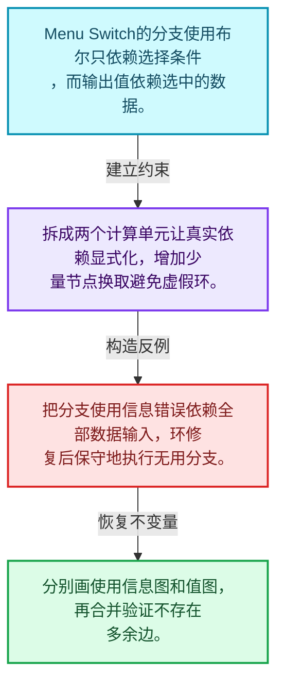
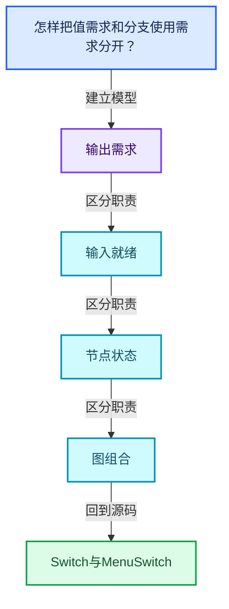
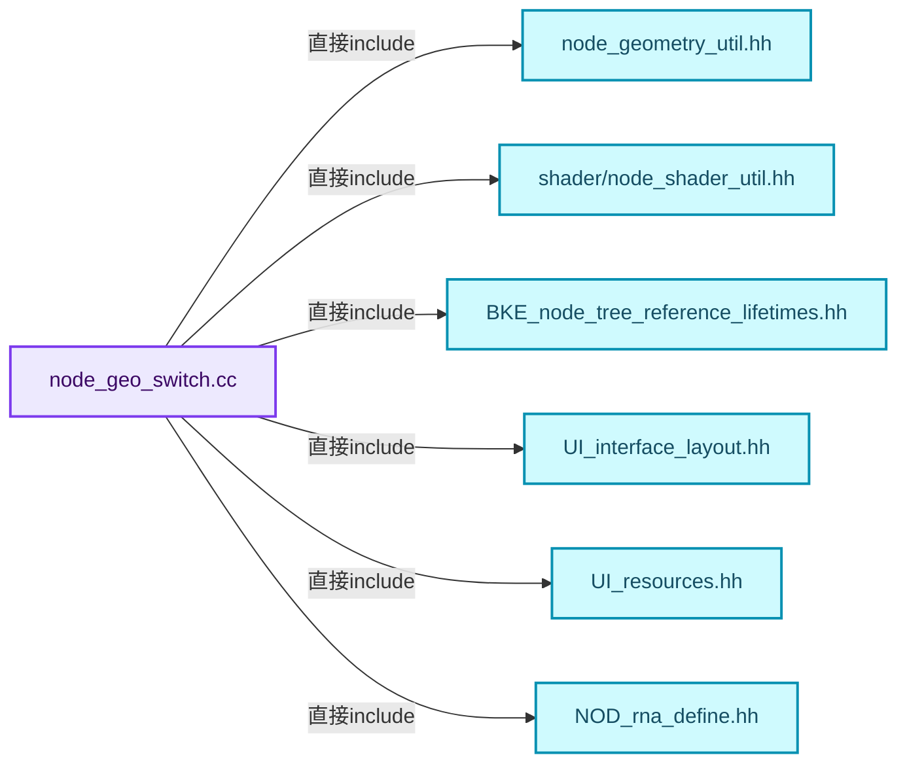
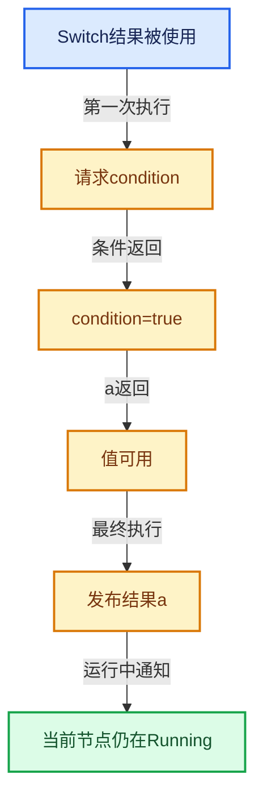

# 09-11 Switch与MenuSwitch

[方向导航](README.md) · [总目录](../README.md) · [覆盖索引](../%E6%BA%90%E7%A0%81%E7%89%88%E6%9C%AC%E4%B8%8E%E8%A6%86%E7%9B%96%E7%B4%A2%E5%BC%95.md)

> 阅读顺序：问题与数据模型 → 语法与类型 → 源码逐行 → 调用线索 → 历史与取舍 → 推演和练习。

- 基准 HEAD：`cbda6b96c26c0dee3c3b5cbb93960c4ac06a6b30`。
- 记录日期：2026-10-14。
- 教学示例状态：正文中的推演不是本机性能实测；已运行练习见验收报告。

## 一、从问题到设计

怎样把值需求和分支使用需求分开？

条件决定所需输入，辅助使用信息不应错误依赖所有分支值；拆分节点可消除虚假环。

本篇把语法、数据语义和系统取舍连接起来。需求与就绪是不同维度；状态只在有证据时推进，不能把未确定当作无需求。

### 本篇独立模型与设计推理

Menu Switch的分支使用布尔只依赖选择条件，而输出值依赖选中的数据。

设计取舍：拆成两个计算单元让真实依赖显式化，增加少量节点换取避免虚假环。

最小反例：把分支使用信息错误依赖全部数据输入，环修复后保守地执行无用分支。

推导与处理：分别画使用信息图和值图，再合并验证不存在多余边。



### 源码范围与相邻篇章

| 文件 | 本篇逐行范围 | 基准SHA-256 |
|---|---|---|
| [source/blender/nodes/geometry/nodes/node_geo_switch.cc](../../../../../source/blender/nodes/geometry/nodes/node_geo_switch.cc) | L1—L340 | `8c51dd387694ad6a6a9c24ef9476585d1357fa820cee58e63ac4d7f97206fcc3` |
| [source/blender/nodes/geometry/nodes/node_geo_menu_switch.cc](../../../../../source/blender/nodes/geometry/nodes/node_geo_menu_switch.cc) | L1—L712 | `cc510c2c90074abc1a711349a87fd6effbdaeec2e6fe978e560362886ec11734` |

同一主讲文件可能分多篇覆盖；超出本篇范围的符号通过覆盖索引定位。空行与纯注释保留在源码摘录中，逐行表解释有效语句与语法边界；许可证头统一保留。

前篇：[普通节点与函数适配](10-%E6%99%AE%E9%80%9A%E8%8A%82%E7%82%B9%E4%B8%8E%E5%87%BD%E6%95%B0%E9%80%82%E9%85%8D.md).

后篇：[嵌套图副作用日志与测试](12-%E5%B5%8C%E5%A5%97%E5%9B%BE%E5%89%AF%E4%BD%9C%E7%94%A8%E6%97%A5%E5%BF%97%E4%B8%8E%E6%B5%8B%E8%AF%95.md).

## 二、类型、数据与阅读地图



这是概念依赖图，边表示阅读关系，不声称是运行时调用顺序。

### 直接编译依赖



箭头只表示头文件包含关系；完整调用线索见后面的符号定位表。

## 三、关键词、语法与类型角色

### 依赖名称 typename

typename既可引入类型模板参数，也可告诉编译器某个依赖名称是类型。它不创建运行时对象；解析期确认语法类别与实例化期检查具体类型是不同阶段。

具体检查：区分typename T::value_type和T::size()，前者标记类型，后者是表达式。

### 常量求值 constexpr

constexpr声明允许相应实体参与常量求值，但constexpr函数仍可以在运行时执行。是否常量求值由调用场景和表达式合法性共同决定。

具体检查：比较constexpr变量初始化和从运行时输入调用同一函数。

### 只读限定 const

const约束当前访问路径可做的修改。const指针、指向const的指针、const视图对象、const元素是不同位置的限定；其他别名可能仍可修改原对象。

具体检查：分别写T* const、const T*与const T* const，并画出不可修改的层次。

### 移动转换 std::move

std::move把表达式转换为可供移动重载选择的值类别，实际资源转移发生在被选中的构造或赋值中。对const对象move可能仍调用复制，对视图move也不会获得底层数据所有权。

具体检查：记录移动构造调用次数，不用变量名或std::move的出现次数替代测量。

### 异常边界 try与catch

try定义异常传播的局部边界。失败路径需要销毁已经成功构造的部分并释放相应存储；未构造的对象不能被析构。

具体检查：在第k次构造失败，列出已经存在的对象集合与待释放缓冲。

### 显式静态转换 static_cast

static_cast表达编译期允许的转换，不会自动验证运行时真实类型、指针寿命或索引边界。由void指针恢复T指针时，调用者仍须保证实际存储中确有合法T对象。

具体检查：标出转换前后的类型以及正确性依据来自哪里。

### 表示层转换 reinterpret_cast

reinterpret_cast不能自动开始任意对象的生命周期，也不能豁免对齐和别名规则。读这类代码需要追溯原始分配与实际构造操作。

具体检查：分别检查大小、对齐、生命周期和可访问类型，四项不能互相替代。

### 覆写检查 override

override要求函数确实覆盖基类虚函数，可捕获参数类型和const限定不匹配。它不改变基类规定的生命周期或线程约束。

具体检查：故意改变一个参数或const，观察编译器如何拒绝误写的新函数。

### 可选值 optional

optional把不存在与存在的T区分开，T的构造和析构跟随engaged状态变化。访问前应由has_value或条件分支证明存在。

具体检查：把空Field状态与合法常量零区分，不能用某个普通值代替不存在。

### 构造与new表达式

普通new可能分配并构造；placement new在给定地址构造，存储由其他机制提供。失败回滚应区分两类责任。

具体检查：追踪地址来自哪里、构造何时成功、由谁析构、由谁释放。

### 内部断言 assert

断言表达开发者预期成立的内部契约，发布构建可能关闭。它不能替代对不可信输入的完整错误处理，也不保证后续操作被运行时保护。

具体检查：对每条断言构造违反条件的输入，区分调用者错误与应向用户报告的错误。

### 独占拥有 unique_ptr

unique_ptr通过移动转移拥有关系，默认删除策略必须与资源来源匹配。get返回借用指针，release交出责任而不销毁。

具体检查：区分move、get、release和reset后谁负责销毁。

### 类型别名 using

类型别名为已有类型建立名字，不创建运行期对象。它常把模板内部使用的类型统一暴露给泛型调用者。

具体检查：展开别名直到基础类型，区分类型别名和变量声明。

### 枚举与状态模型 enum

枚举把有限状态命名；enum class避免许多隐式整数转换。状态机正确性还依赖允许的转移，不能只看有哪些枚举项。

具体检查：列出每个状态的进入条件和离开条件，检查终止状态是否仍可能被调度。

## 四、真实源码与逐行讲解

源码块保持原行内容，原始行号由小节标题及逐行表给出。表中的调用定位是静态阅读辅助；重载、模板实例化、宏展开和虚调用需结合完整声明，不能仅凭词法出现证明动态调用。

### node_geo_switch.cc：L1—L72

<!-- source:source/blender/nodes/geometry/nodes/node_geo_switch.cc:1:72 -->

```cpp
/* SPDX-FileCopyrightText: 2023 Blender Authors
 *
 * SPDX-License-Identifier: GPL-2.0-or-later */

#include "node_geometry_util.hh"
#include "shader/node_shader_util.hh"

#include "BKE_node_tree_reference_lifetimes.hh"

#include "UI_interface_layout.hh"
#include "UI_resources.hh"

#include "NOD_rna_define.hh"
#include "NOD_socket.hh"
#include "NOD_socket_search_link.hh"

#include "RNA_enum_types.hh"

#include "COM_node_operation.hh"
#include "COM_utilities.hh"

#include "FN_multi_function_builder.hh"

namespace blender {

namespace nodes::node_geo_switch_cc {

NODE_STORAGE_FUNCS(NodeSwitch)

static void node_declare(NodeDeclarationBuilder &b)
{
  auto &switch_decl = b.add_input<decl::Bool>("Switch"_ustr);
  const bNodeTree *node_tree = b.tree_or_null();
  const bNode *node = b.node_or_null();
  if (!node_tree || !node) {
    return;
  }
  const NodeSwitch &storage = node_storage(*node);
  const eNodeSocketDatatype socket_type = storage.input_type;

  auto &false_decl = b.add_input(socket_type, "False"_ustr);
  auto &true_decl = b.add_input(socket_type, "True"_ustr);
  auto &output_decl = b.add_output(socket_type, "Output"_ustr).propagate_all();

  StructureType value_structure_type = StructureType::Dynamic;
  StructureType condition_structure_type = StructureType::Dynamic;

  if (node_tree->type == NTREE_COMPOSIT) {
    const bool is_single_compositor_type = compositor::Result::is_single_value_only_type(
        compositor::socket_data_type_to_result_type(socket_type));
    if (is_single_compositor_type) {
      value_structure_type = StructureType::Single;
    }
    condition_structure_type = StructureType::Single;

    false_decl.compositor_realization_mode(CompositorInputRealizationMode::None);
    true_decl.compositor_realization_mode(CompositorInputRealizationMode::None);
  }
  if (node_tree->type == NTREE_GEOMETRY) {
    if (socket_type_supports_fields(socket_type)) {
      output_decl.inferred_structure_type();
    }
    else {
      output_decl.inferred_structure_type({false_decl.index(), true_decl.index()});
    }
  }

  switch_decl.structure_type(condition_structure_type);
  false_decl.structure_type(value_structure_type);
  true_decl.structure_type(value_structure_type);
  output_decl.structure_type(value_structure_type);
}
```

本段语义重点：

- 分支证据 `!node_tree &#124;&#124; !node)`：分别推演条件成立与不成立，核对相同出口处的状态。
- 分支证据 `node_tree->type == NTREE_COMPOSIT)`：分别推演条件成立与不成立，核对相同出口处的状态。

| 原始行 | 语义、约束与检查 |
|---|---|
| L5 | 引入编译依赖 "node_geometry_util.hh"；这是声明可见性关系，不表示运行时一定调用该文件的所有接口。 |
| L6 | 引入编译依赖 "shader/node_shader_util.hh"；这是声明可见性关系，不表示运行时一定调用该文件的所有接口。 |
| L8 | 引入编译依赖 "BKE_node_tree_reference_lifetimes.hh"；这是声明可见性关系，不表示运行时一定调用该文件的所有接口。 |
| L10 | 引入编译依赖 "UI_interface_layout.hh"；这是声明可见性关系，不表示运行时一定调用该文件的所有接口。 |
| L11 | 引入编译依赖 "UI_resources.hh"；这是声明可见性关系，不表示运行时一定调用该文件的所有接口。 |
| L13 | 引入编译依赖 "NOD_rna_define.hh"；这是声明可见性关系，不表示运行时一定调用该文件的所有接口。 |
| L14 | 引入编译依赖 "NOD_socket.hh"；这是声明可见性关系，不表示运行时一定调用该文件的所有接口。 |
| L15 | 引入编译依赖 "NOD_socket_search_link.hh"；这是声明可见性关系，不表示运行时一定调用该文件的所有接口。 |
| L17 | 引入编译依赖 "RNA_enum_types.hh"；这是声明可见性关系，不表示运行时一定调用该文件的所有接口。 |
| L19 | 引入编译依赖 "COM_node_operation.hh"；这是声明可见性关系，不表示运行时一定调用该文件的所有接口。 |
| L20 | 引入编译依赖 "COM_utilities.hh"；这是声明可见性关系，不表示运行时一定调用该文件的所有接口。 |
| L22 | 引入编译依赖 "FN_multi_function_builder.hh"；这是声明可见性关系，不表示运行时一定调用该文件的所有接口。 |
| L24 | 把后续声明放入 blender 命名空间，影响名称查找和符号归属，不创建运行时对象。 |
| L26 | 把后续声明放入 nodes::node_geo_switch_cc 命名空间，影响名称查找和符号归属，不创建运行时对象。 |
| L28 | 出现调用或函数声明 `NODE_STORAGE_FUNCS`，对应表达式为 `NODE_STORAGE_FUNCS(NodeSwitch)`。参数求值、返回类型与重载需结合前后完整语句；静态文本引用不能证明动态目标。 |
| L30 | 出现调用或函数声明 `node_declare`，对应表达式为 `static void node_declare(NodeDeclarationBuilder &b)`。参数求值、返回类型与重载需结合前后完整语句；静态文本引用不能证明动态目标。 |
| L31 | 连接上一行的声明或控制结构与其语句块；后续行在这个作用域中执行或声明。 |
| L32 | 把右侧 `b.add_input<decl::Bool>("Switch"_ustr)` 用于初始化或更新左侧 `auto &switch_decl`。声明初始化与已有对象赋值应按上下文区分；有资源的类型会调用相应特殊成员。 |
| L33 | 把右侧 `b.tree_or_null()` 用于初始化或更新左侧 `const bNodeTree *node_tree`。声明初始化与已有对象赋值应按上下文区分；有资源的类型会调用相应特殊成员。 |
| L34 | 把右侧 `b.node_or_null()` 用于初始化或更新左侧 `const bNode *node`。声明初始化与已有对象赋值应按上下文区分；有资源的类型会调用相应特殊成员。 |
| L35 | 判断 `!node_tree &#124;&#124; !node`，成立时进入本分支，否则继续后续路径。 |
| L36 | 结束当前函数，本路径不再执行后续语句；局部对象按作用域规则清理。 |
| L37 | 结束当前语法单元。局部自动对象在离开其作用域时按规则销毁；这不等于所有被引用的外部数据也被释放。 |
| L38 | 把右侧 `node_storage(*node)` 用于初始化或更新左侧 `const NodeSwitch &storage`。声明初始化与已有对象赋值应按上下文区分；有资源的类型会调用相应特殊成员。 |
| L39 | 把右侧 `storage.input_type` 用于初始化或更新左侧 `const eNodeSocketDatatype socket_type`。声明初始化与已有对象赋值应按上下文区分；有资源的类型会调用相应特殊成员。 |
| L41 | 把右侧 `b.add_input(socket_type, "False"_ustr)` 用于初始化或更新左侧 `auto &false_decl`。声明初始化与已有对象赋值应按上下文区分；有资源的类型会调用相应特殊成员。 |
| L42 | 把右侧 `b.add_input(socket_type, "True"_ustr)` 用于初始化或更新左侧 `auto &true_decl`。声明初始化与已有对象赋值应按上下文区分；有资源的类型会调用相应特殊成员。 |
| L43 | 把右侧 `b.add_output(socket_type, "Output"_ustr).propagate_all()` 用于初始化或更新左侧 `auto &output_decl`。声明初始化与已有对象赋值应按上下文区分；有资源的类型会调用相应特殊成员。 |
| L45 | 把右侧 `StructureType::Dynamic` 用于初始化或更新左侧 `StructureType value_structure_type`。声明初始化与已有对象赋值应按上下文区分；有资源的类型会调用相应特殊成员。 |
| L46 | 把右侧 `StructureType::Dynamic` 用于初始化或更新左侧 `StructureType condition_structure_type`。声明初始化与已有对象赋值应按上下文区分；有资源的类型会调用相应特殊成员。 |
| L48 | 判断 `node_tree->type == NTREE_COMPOSIT`，成立时进入本分支，否则继续后续路径。 |
| L49 | 把右侧 `compositor::Result::is_single_value_only_type(` 用于初始化或更新左侧 `const bool is_single_compositor_type`。声明初始化与已有对象赋值应按上下文区分；有资源的类型会调用相应特殊成员。 |
| L50 | 出现调用或函数声明 `compositor::socket_data_type_to_result_type`，对应表达式为 `compositor::socket_data_type_to_result_type(socket_type));`。参数求值、返回类型与重载需结合前后完整语句；静态文本引用不能证明动态目标。 |
| L51 | 判断 `is_single_compositor_type`，成立时进入本分支，否则继续后续路径。单值表示可以避免逐元素读取，仍须保留逻辑长度。 |
| L52 | 把右侧 `StructureType::Single` 用于初始化或更新左侧 `value_structure_type`。声明初始化与已有对象赋值应按上下文区分；有资源的类型会调用相应特殊成员。 |
| L53 | 结束当前语法单元。局部自动对象在离开其作用域时按规则销毁；这不等于所有被引用的外部数据也被释放。 |
| L54 | 把右侧 `StructureType::Single` 用于初始化或更新左侧 `condition_structure_type`。声明初始化与已有对象赋值应按上下文区分；有资源的类型会调用相应特殊成员。 |
| L56 | 出现调用或函数声明 `compositor_realization_mode`，对应表达式为 `false_decl.compositor_realization_mode(CompositorInputRealizationMode::None);`。参数求值、返回类型与重载需结合前后完整语句；静态文本引用不能证明动态目标。 |
| L57 | 出现调用或函数声明 `compositor_realization_mode`，对应表达式为 `true_decl.compositor_realization_mode(CompositorInputRealizationMode::None);`。参数求值、返回类型与重载需结合前后完整语句；静态文本引用不能证明动态目标。 |
| L58 | 结束当前语法单元。局部自动对象在离开其作用域时按规则销毁；这不等于所有被引用的外部数据也被释放。 |
| L59 | 判断 `node_tree->type == NTREE_GEOMETRY`，成立时进入本分支，否则继续后续路径。 |
| L60 | 判断 `socket_type_supports_fields(socket_type)`，成立时进入本分支，否则继续后续路径。 |
| L61 | 出现调用或函数声明 `inferred_structure_type`，对应表达式为 `output_decl.inferred_structure_type();`。参数求值、返回类型与重载需结合前后完整语句；静态文本引用不能证明动态目标。 |
| L62 | 结束当前语法单元。局部自动对象在离开其作用域时按规则销毁；这不等于所有被引用的外部数据也被释放。 |
| L63 | 处理前一条件不成立的互补路径。比较两条路径最后是否恢复同一不变量，以及是否产生不同的资源责任。 |
| L64 | 出现调用或函数声明 `inferred_structure_type`，对应表达式为 `output_decl.inferred_structure_type({false_decl.index(), true_decl.index()});`。参数求值、返回类型与重载需结合前后完整语句；静态文本引用不能证明动态目标。 |
| L65 | 结束当前语法单元。局部自动对象在离开其作用域时按规则销毁；这不等于所有被引用的外部数据也被释放。 |
| L66 | 结束当前语法单元。局部自动对象在离开其作用域时按规则销毁；这不等于所有被引用的外部数据也被释放。 |
| L68 | 出现调用或函数声明 `structure_type`，对应表达式为 `switch_decl.structure_type(condition_structure_type);`。参数求值、返回类型与重载需结合前后完整语句；静态文本引用不能证明动态目标。 |
| L69 | 出现调用或函数声明 `structure_type`，对应表达式为 `false_decl.structure_type(value_structure_type);`。参数求值、返回类型与重载需结合前后完整语句；静态文本引用不能证明动态目标。 |
| L70 | 出现调用或函数声明 `structure_type`，对应表达式为 `true_decl.structure_type(value_structure_type);`。参数求值、返回类型与重载需结合前后完整语句；静态文本引用不能证明动态目标。 |
| L71 | 出现调用或函数声明 `structure_type`，对应表达式为 `output_decl.structure_type(value_structure_type);`。参数求值、返回类型与重载需结合前后完整语句；静态文本引用不能证明动态目标。 |
| L72 | 结束当前语法单元。局部自动对象在离开其作用域时按规则销毁；这不等于所有被引用的外部数据也被释放。 |

### node_geo_switch.cc：L73—L123

<!-- source:source/blender/nodes/geometry/nodes/node_geo_switch.cc:73:123 -->

```cpp

static void node_layout(ui::Layout &layout, bContext * /*C*/, PointerRNA *ptr)
{
  layout.prop(ptr, "input_type", UI_ITEM_NONE, "", ICON_NONE);
}

static void node_init(bNodeTree *tree, bNode *node)
{
  NodeSwitch *data = MEM_new<NodeSwitch>(__func__);
  data->input_type = tree->type == NTREE_GEOMETRY ? SOCK_FLOAT : SOCK_RGBA;
  node->storage = data;
}

static void node_gather_link_searches(GatherLinkSearchOpParams &params)
{
  if (params.in_out() == SOCK_OUT) {
    params.add_item(IFACE_("Output"), [](LinkSearchOpParams &params) {
      bNode &node = params.add_node("GeometryNodeSwitch"_ustr);
      node_storage(node).input_type = params.socket.type;
      params.update_and_connect_available_socket(node, "Output"_ustr);
    });
  }
  else {
    /* Make sure the switch input comes first in the search for boolean sockets. */
    int true_false_weights = 0;
    if (params.other_socket().type == SOCK_BOOLEAN) {
      params.add_item(IFACE_("Switch"), [](LinkSearchOpParams &params) {
        bNode &node = params.add_node("GeometryNodeSwitch"_ustr);
        params.update_and_connect_available_socket(node, "Switch"_ustr);
      });
      true_false_weights--;
    }

    params.add_item(
        IFACE_("False"),
        [](LinkSearchOpParams &params) {
          bNode &node = params.add_node("GeometryNodeSwitch"_ustr);
          node_storage(node).input_type = params.socket.type;
          params.update_and_connect_available_socket(node, "False"_ustr);
        },
        true_false_weights);
    params.add_item(
        IFACE_("True"),
        [](LinkSearchOpParams &params) {
          bNode &node = params.add_node("GeometryNodeSwitch"_ustr);
          node_storage(node).input_type = params.socket.type;
          params.update_and_connect_available_socket(node, "True"_ustr);
        },
        true_false_weights);
  }
}
```

本段语义重点：

- 分支证据 `params.in_out() == SOCK_OUT)`：分别推演条件成立与不成立，核对相同出口处的状态。
- 分支证据 `params.other_socket().type == SOCK_BOOLEAN)`：分别推演条件成立与不成立，核对相同出口处的状态。

| 原始行 | 语义、约束与检查 |
|---|---|
| L74 | 出现调用或函数声明 `node_layout`，对应表达式为 `static void node_layout(ui::Layout &layout, bContext * , PointerRNA *ptr)`。参数求值、返回类型与重载需结合前后完整语句；静态文本引用不能证明动态目标。 |
| L75 | 连接上一行的声明或控制结构与其语句块；后续行在这个作用域中执行或声明。 |
| L76 | 出现调用或函数声明 `prop`，对应表达式为 `layout.prop(ptr, "input_type", UI_ITEM_NONE, "", ICON_NONE);`。参数求值、返回类型与重载需结合前后完整语句；静态文本引用不能证明动态目标。 |
| L77 | 结束当前语法单元。局部自动对象在离开其作用域时按规则销毁；这不等于所有被引用的外部数据也被释放。 |
| L79 | 出现调用或函数声明 `node_init`，对应表达式为 `static void node_init(bNodeTree *tree, bNode *node)`。参数求值、返回类型与重载需结合前后完整语句；静态文本引用不能证明动态目标。 |
| L80 | 连接上一行的声明或控制结构与其语句块；后续行在这个作用域中执行或声明。 |
| L81 | 把右侧 `MEM_new<NodeSwitch>(__func__)` 用于初始化或更新左侧 `NodeSwitch *data`。声明初始化与已有对象赋值应按上下文区分；有资源的类型会调用相应特殊成员。 |
| L82 | 把右侧 `tree->type == NTREE_GEOMETRY ? SOCK_FLOAT : SOCK_RGBA` 用于初始化或更新左侧 `data->input_type`。声明初始化与已有对象赋值应按上下文区分；有资源的类型会调用相应特殊成员。 |
| L83 | 把右侧 `data` 用于初始化或更新左侧 `node->storage`。声明初始化与已有对象赋值应按上下文区分；有资源的类型会调用相应特殊成员。 |
| L84 | 结束当前语法单元。局部自动对象在离开其作用域时按规则销毁；这不等于所有被引用的外部数据也被释放。 |
| L86 | 出现调用或函数声明 `node_gather_link_searches`，对应表达式为 `static void node_gather_link_searches(GatherLinkSearchOpParams &params)`。参数求值、返回类型与重载需结合前后完整语句；静态文本引用不能证明动态目标。 |
| L87 | 连接上一行的声明或控制结构与其语句块；后续行在这个作用域中执行或声明。 |
| L88 | 判断 `params.in_out() == SOCK_OUT`，成立时进入本分支，否则继续后续路径。 |
| L89 | 出现调用或函数声明 `add_item`，对应表达式为 `params.add_item(IFACE_("Output"), [](LinkSearchOpParams &params) {`。参数求值、返回类型与重载需结合前后完整语句；静态文本引用不能证明动态目标。 |
| L90 | 把右侧 `params.add_node("GeometryNodeSwitch"_ustr)` 用于初始化或更新左侧 `bNode &node`。声明初始化与已有对象赋值应按上下文区分；有资源的类型会调用相应特殊成员。 |
| L91 | 把右侧 `params.socket.type` 用于初始化或更新左侧 `node_storage(node).input_type`。声明初始化与已有对象赋值应按上下文区分；有资源的类型会调用相应特殊成员。 |
| L92 | 出现调用或函数声明 `update_and_connect_available_socket`，对应表达式为 `params.update_and_connect_available_socket(node, "Output"_ustr);`。参数求值、返回类型与重载需结合前后完整语句；静态文本引用不能证明动态目标。 |
| L93 | 结束当前语法单元。局部自动对象在离开其作用域时按规则销毁；这不等于所有被引用的外部数据也被释放。 |
| L94 | 结束当前语法单元。局部自动对象在离开其作用域时按规则销毁；这不等于所有被引用的外部数据也被释放。 |
| L95 | 处理前一条件不成立的互补路径。比较两条路径最后是否恢复同一不变量，以及是否产生不同的资源责任。 |
| L97 | 把右侧 `0` 用于初始化或更新左侧 `int true_false_weights`。声明初始化与已有对象赋值应按上下文区分；有资源的类型会调用相应特殊成员。 |
| L98 | 判断 `params.other_socket().type == SOCK_BOOLEAN`，成立时进入本分支，否则继续后续路径。 |
| L99 | 出现调用或函数声明 `add_item`，对应表达式为 `params.add_item(IFACE_("Switch"), [](LinkSearchOpParams &params) {`。参数求值、返回类型与重载需结合前后完整语句；静态文本引用不能证明动态目标。 |
| L100 | 把右侧 `params.add_node("GeometryNodeSwitch"_ustr)` 用于初始化或更新左侧 `bNode &node`。声明初始化与已有对象赋值应按上下文区分；有资源的类型会调用相应特殊成员。 |
| L101 | 出现调用或函数声明 `update_and_connect_available_socket`，对应表达式为 `params.update_and_connect_available_socket(node, "Switch"_ustr);`。参数求值、返回类型与重载需结合前后完整语句；静态文本引用不能证明动态目标。 |
| L102 | 结束当前语法单元。局部自动对象在离开其作用域时按规则销毁；这不等于所有被引用的外部数据也被释放。 |
| L103 | 递增或递减现有状态：`true_false_weights--;`。这改变计数或游标；检查边界、计数单位，以及并发访问是否有相应保护。 |
| L104 | 结束当前语法单元。局部自动对象在离开其作用域时按规则销毁；这不等于所有被引用的外部数据也被释放。 |
| L106 | 出现调用或函数声明 `add_item`，对应表达式为 `params.add_item(`。参数求值、返回类型与重载需结合前后完整语句；静态文本引用不能证明动态目标。 |
| L107 | 出现调用或函数声明 `IFACE_`，对应表达式为 `IFACE_("False"),`。参数求值、返回类型与重载需结合前后完整语句；静态文本引用不能证明动态目标。 |
| L108 | 本行是连续声明或表达式的一部分：`[](LinkSearchOpParams &params) {`。与本段前后行合读；逗号、括号和限定符决定它属于参数、初始化列表还是实际计算。 |
| L109 | 把右侧 `params.add_node("GeometryNodeSwitch"_ustr)` 用于初始化或更新左侧 `bNode &node`。声明初始化与已有对象赋值应按上下文区分；有资源的类型会调用相应特殊成员。 |
| L110 | 把右侧 `params.socket.type` 用于初始化或更新左侧 `node_storage(node).input_type`。声明初始化与已有对象赋值应按上下文区分；有资源的类型会调用相应特殊成员。 |
| L111 | 出现调用或函数声明 `update_and_connect_available_socket`，对应表达式为 `params.update_and_connect_available_socket(node, "False"_ustr);`。参数求值、返回类型与重载需结合前后完整语句；静态文本引用不能证明动态目标。 |
| L112 | 结束当前语法单元。局部自动对象在离开其作用域时按规则销毁；这不等于所有被引用的外部数据也被释放。 |
| L113 | 声明成员、局部对象或完成语句 `true_false_weights)`。若为指针或引用，它本身不说明拥有；若为值对象，其构造析构由所在作用域或外层对象管理。 |
| L114 | 出现调用或函数声明 `add_item`，对应表达式为 `params.add_item(`。参数求值、返回类型与重载需结合前后完整语句；静态文本引用不能证明动态目标。 |
| L115 | 出现调用或函数声明 `IFACE_`，对应表达式为 `IFACE_("True"),`。参数求值、返回类型与重载需结合前后完整语句；静态文本引用不能证明动态目标。 |
| L116 | 本行是连续声明或表达式的一部分：`[](LinkSearchOpParams &params) {`。与本段前后行合读；逗号、括号和限定符决定它属于参数、初始化列表还是实际计算。 |
| L117 | 把右侧 `params.add_node("GeometryNodeSwitch"_ustr)` 用于初始化或更新左侧 `bNode &node`。声明初始化与已有对象赋值应按上下文区分；有资源的类型会调用相应特殊成员。 |
| L118 | 把右侧 `params.socket.type` 用于初始化或更新左侧 `node_storage(node).input_type`。声明初始化与已有对象赋值应按上下文区分；有资源的类型会调用相应特殊成员。 |
| L119 | 出现调用或函数声明 `update_and_connect_available_socket`，对应表达式为 `params.update_and_connect_available_socket(node, "True"_ustr);`。参数求值、返回类型与重载需结合前后完整语句；静态文本引用不能证明动态目标。 |
| L120 | 结束当前语法单元。局部自动对象在离开其作用域时按规则销毁；这不等于所有被引用的外部数据也被释放。 |
| L121 | 声明成员、局部对象或完成语句 `true_false_weights)`。若为指针或引用，它本身不说明拥有；若为值对象，其构造析构由所在作用域或外层对象管理。 |
| L122 | 结束当前语法单元。局部自动对象在离开其作用域时按规则销毁；这不等于所有被引用的外部数据也被释放。 |
| L123 | 结束当前语法单元。局部自动对象在离开其作用域时按规则销毁；这不等于所有被引用的外部数据也被释放。 |

### node_geo_switch.cc：L124—L178

<!-- source:source/blender/nodes/geometry/nodes/node_geo_switch.cc:124:178 -->

```cpp

class LazyFunctionForSwitchNode : public LazyFunction {
 private:
  int32_t node_id_;
  bool can_be_field_ = false;
  const CPPType *base_type_;

 public:
  LazyFunctionForSwitchNode(const bNode &node) : node_id_(node.identifier)
  {
    const NodeSwitch &storage = node_storage(node);
    const eNodeSocketDatatype data_type = storage.input_type;
    can_be_field_ = socket_type_supports_fields(data_type);

    const bke::bNodeSocketType *socket_type = nullptr;
    for (const bNodeSocket *socket : node.output_sockets()) {
      if (socket->type == data_type) {
        socket_type = socket->typeinfo;
        break;
      }
    }
    BLI_assert(socket_type != nullptr);
    const CPPType &cpp_type = CPPType::get<SocketValueVariant>();
    base_type_ = socket_type->base_cpp_type;

    debug_name_ = node.name;
    inputs_.append_as("Condition", CPPType::get<SocketValueVariant>());
    inputs_.append_as("False", cpp_type, lf::ValueUsage::Maybe);
    inputs_.append_as("True", cpp_type, lf::ValueUsage::Maybe);
    outputs_.append_as("Value", cpp_type);
  }

  void execute_impl(lf::Params &params, const lf::Context &context) const override
  {
    SocketValueVariant condition_variant = params.get_input<SocketValueVariant>(0);
    if (!condition_variant.is_context_dependent_field()) {
      this->execute_single(condition_variant.ensure_type<bool>(), params);
      return;
    }

    if (can_be_field_) {
      this->execute_field(condition_variant.ensure_type<Field<bool>>(), params);
      return;
    }

    auto &user_data = *static_cast<GeoNodesUserData *>(context.user_data);
    auto &local_user_data = *static_cast<GeoNodesLocalUserData *>(context.local_user_data);
    if (eval_log::NodeTreeLogger *tree_logger = local_user_data.try_get_tree_logger(user_data)) {
      tree_logger->node_warnings.append(
          *tree_logger->allocator,
          {node_id_, {NodeWarningType::Error, N_("Type cannot be switched by a field")}});
    }

    this->execute_single(condition_variant.ensure_type<bool>(), params);
  }
```

本段语义重点：

- 分支证据 `socket->type == data_type)`：分别推演条件成立与不成立，核对相同出口处的状态。
- 分支证据 `!condition_variant.is_context_dependent_field())`：分别推演条件成立与不成立，核对相同出口处的状态。

| 原始行 | 语义、约束与检查 |
|---|---|
| L125 | 声明或定义类型 `class LazyFunctionForSwitchNode : public LazyFunction`。结合继承、访问权限和成员布局确认接口与拥有关系；前向声明本身没有完整对象布局。 |
| L126 | 切换成员访问权限为 private；它是编译期接口边界，不是线程同步或内存保护。 |
| L127 | 声明成员、局部对象或完成语句 `int32_t node_id_`。若为指针或引用，它本身不说明拥有；若为值对象，其构造析构由所在作用域或外层对象管理。 |
| L128 | 把右侧 `false` 用于初始化或更新左侧 `bool can_be_field_`。声明初始化与已有对象赋值应按上下文区分；有资源的类型会调用相应特殊成员。 |
| L129 | 声明成员、局部对象或完成语句 `const CPPType *base_type_`。若为指针或引用，它本身不说明拥有；若为值对象，其构造析构由所在作用域或外层对象管理。 |
| L131 | 切换成员访问权限为 public；它是编译期接口边界，不是线程同步或内存保护。 |
| L132 | 出现调用或函数声明 `LazyFunctionForSwitchNode`，对应表达式为 `LazyFunctionForSwitchNode(const bNode &node) : node_id_(node.identifier)`。参数求值、返回类型与重载需结合前后完整语句；静态文本引用不能证明动态目标。 |
| L133 | 连接上一行的声明或控制结构与其语句块；后续行在这个作用域中执行或声明。 |
| L134 | 把右侧 `node_storage(node)` 用于初始化或更新左侧 `const NodeSwitch &storage`。声明初始化与已有对象赋值应按上下文区分；有资源的类型会调用相应特殊成员。 |
| L135 | 把右侧 `storage.input_type` 用于初始化或更新左侧 `const eNodeSocketDatatype data_type`。声明初始化与已有对象赋值应按上下文区分；有资源的类型会调用相应特殊成员。 |
| L136 | 把右侧 `socket_type_supports_fields(data_type)` 用于初始化或更新左侧 `can_be_field_`。声明初始化与已有对象赋值应按上下文区分；有资源的类型会调用相应特殊成员。 |
| L138 | 把右侧 `nullptr` 用于初始化或更新左侧 `const bke::bNodeSocketType *socket_type`。声明初始化与已有对象赋值应按上下文区分；有资源的类型会调用相应特殊成员。 |
| L139 | 按 `for (const bNodeSocket *socket : node.output_sockets())` 指定的范围或条件重复执行。对照循环变量与真实元素编号；循环内调用成本乘以实际迭代次数。 |
| L140 | 判断 `socket->type == data_type`，成立时进入本分支，否则继续后续路径。 |
| L141 | 把右侧 `socket->typeinfo` 用于初始化或更新左侧 `socket_type`。声明初始化与已有对象赋值应按上下文区分；有资源的类型会调用相应特殊成员。 |
| L142 | 离开最近的循环或switch；不是离开整个函数，后续清理和提交代码可能仍会执行。 |
| L143 | 结束当前语法单元。局部自动对象在离开其作用域时按规则销毁；这不等于所有被引用的外部数据也被释放。 |
| L144 | 结束当前语法单元。局部自动对象在离开其作用域时按规则销毁；这不等于所有被引用的外部数据也被释放。 |
| L145 | 断言约束 `BLI_assert(socket_type != nullptr);`。条件是后续访问的内部前置条件；发布构建可能不执行，不能把断言当作输入修复。 |
| L146 | 把右侧 `CPPType::get<SocketValueVariant>()` 用于初始化或更新左侧 `const CPPType &cpp_type`。声明初始化与已有对象赋值应按上下文区分；有资源的类型会调用相应特殊成员。 |
| L147 | 把右侧 `socket_type->base_cpp_type` 用于初始化或更新左侧 `base_type_`。声明初始化与已有对象赋值应按上下文区分；有资源的类型会调用相应特殊成员。 |
| L149 | 把右侧 `node.name` 用于初始化或更新左侧 `debug_name_`。声明初始化与已有对象赋值应按上下文区分；有资源的类型会调用相应特殊成员。 |
| L150 | 出现调用或函数声明 `append_as`，对应表达式为 `inputs_.append_as("Condition", CPPType::get<SocketValueVariant>());`。参数求值、返回类型与重载需结合前后完整语句；静态文本引用不能证明动态目标。 |
| L151 | 出现调用或函数声明 `append_as`，对应表达式为 `inputs_.append_as("False", cpp_type, lf::ValueUsage::Maybe);`。参数求值、返回类型与重载需结合前后完整语句；静态文本引用不能证明动态目标。 |
| L152 | 出现调用或函数声明 `append_as`，对应表达式为 `inputs_.append_as("True", cpp_type, lf::ValueUsage::Maybe);`。参数求值、返回类型与重载需结合前后完整语句；静态文本引用不能证明动态目标。 |
| L153 | 出现调用或函数声明 `append_as`，对应表达式为 `outputs_.append_as("Value", cpp_type);`。参数求值、返回类型与重载需结合前后完整语句；静态文本引用不能证明动态目标。 |
| L154 | 结束当前语法单元。局部自动对象在离开其作用域时按规则销毁；这不等于所有被引用的外部数据也被释放。 |
| L156 | 出现调用或函数声明 `execute_impl`，对应表达式为 `void execute_impl(lf::Params &params, const lf::Context &context) const override`。参数求值、返回类型与重载需结合前后完整语句；静态文本引用不能证明动态目标。 |
| L157 | 连接上一行的声明或控制结构与其语句块；后续行在这个作用域中执行或声明。 |
| L158 | 把右侧 `params.get_input<SocketValueVariant>(0)` 用于初始化或更新左侧 `SocketValueVariant condition_variant`。声明初始化与已有对象赋值应按上下文区分；有资源的类型会调用相应特殊成员。 |
| L159 | 判断 `!condition_variant.is_context_dependent_field()`，成立时进入本分支，否则继续后续路径。 |
| L160 | 出现调用或函数声明 `execute_single`，对应表达式为 `this->execute_single(condition_variant.ensure_type<bool>(), params);`。参数求值、返回类型与重载需结合前后完整语句；静态文本引用不能证明动态目标。 |
| L161 | 结束当前函数，本路径不再执行后续语句；局部对象按作用域规则清理。 |
| L162 | 结束当前语法单元。局部自动对象在离开其作用域时按规则销毁；这不等于所有被引用的外部数据也被释放。 |
| L164 | 判断 `can_be_field_`，成立时进入本分支，否则继续后续路径。 |
| L165 | 出现调用或函数声明 `execute_field`，对应表达式为 `this->execute_field(condition_variant.ensure_type<Field<bool>>(), params);`。参数求值、返回类型与重载需结合前后完整语句；静态文本引用不能证明动态目标。 |
| L166 | 结束当前函数，本路径不再执行后续语句；局部对象按作用域规则清理。 |
| L167 | 结束当前语法单元。局部自动对象在离开其作用域时按规则销毁；这不等于所有被引用的外部数据也被释放。 |
| L169 | 把右侧 `*static_cast<GeoNodesUserData *>(context.user_data)` 用于初始化或更新左侧 `auto &user_data`。声明初始化与已有对象赋值应按上下文区分；有资源的类型会调用相应特殊成员。 |
| L170 | 把右侧 `*static_cast<GeoNodesLocalUserData *>(context.local_user_data)` 用于初始化或更新左侧 `auto &local_user_data`。声明初始化与已有对象赋值应按上下文区分；有资源的类型会调用相应特殊成员。 |
| L171 | 判断 `eval_log::NodeTreeLogger *tree_logger = local_user_data.try_get_tree_logger(user_data)`，成立时进入本分支，否则继续后续路径。 |
| L172 | 出现调用或函数声明 `append`，对应表达式为 `tree_logger->node_warnings.append(`。参数求值、返回类型与重载需结合前后完整语句；静态文本引用不能证明动态目标。 |
| L173 | 本行是连续声明或表达式的一部分：`*tree_logger->allocator,`。与本段前后行合读；逗号、括号和限定符决定它属于参数、初始化列表还是实际计算。 |
| L174 | 出现调用或函数声明 `N_`，对应表达式为 `{node_id_, {NodeWarningType::Error, N_("Type cannot be switched by a field")}});`。参数求值、返回类型与重载需结合前后完整语句；静态文本引用不能证明动态目标。 |
| L175 | 结束当前语法单元。局部自动对象在离开其作用域时按规则销毁；这不等于所有被引用的外部数据也被释放。 |
| L177 | 出现调用或函数声明 `execute_single`，对应表达式为 `this->execute_single(condition_variant.ensure_type<bool>(), params);`。参数求值、返回类型与重载需结合前后完整语句；静态文本引用不能证明动态目标。 |
| L178 | 结束当前语法单元。局部自动对象在离开其作用域时按规则销毁；这不等于所有被引用的外部数据也被释放。 |

### node_geo_switch.cc：L179—L225

<!-- source:source/blender/nodes/geometry/nodes/node_geo_switch.cc:179:225 -->

```cpp

  static constexpr int false_input_index = 1;
  static constexpr int true_input_index = 2;

  void execute_single(const bool condition, lf::Params &params) const
  {
    const int input_to_forward = condition ? true_input_index : false_input_index;
    const int input_to_ignore = condition ? false_input_index : true_input_index;

    params.set_input_unused(input_to_ignore);
    void *value_to_forward = params.try_get_input_data_ptr_or_request(input_to_forward);
    if (value_to_forward == nullptr) {
      /* Try again when the value is available. */
      return;
    }

    const CPPType &type = *outputs_[0].type;
    void *output_ptr = params.get_output_data_ptr(0);
    type.move_construct(value_to_forward, output_ptr);
    params.output_set(0);
  }

  void execute_field(Field<bool> condition, lf::Params &params) const
  {
    /* When the condition is a non-constant field, we need both inputs. */
    auto *false_value_variant = params.try_get_input_data_ptr_or_request<SocketValueVariant>(
        false_input_index);
    auto *true_value_variant = params.try_get_input_data_ptr_or_request<SocketValueVariant>(
        true_input_index);
    if (ELEM(nullptr, false_value_variant, true_value_variant)) {
      /* Try again when inputs are available. */
      return;
    }

    const MultiFunction &switch_multi_function = this->get_switch_multi_function();

    GField false_field = std::move(false_value_variant->ensure_type<GField>());
    GField true_field = std::move(true_value_variant->ensure_type<GField>());

    GField output_field{FieldOperation::from(
        switch_multi_function,
        {std::move(condition), std::move(false_field), std::move(true_field)})};

    void *output_ptr = params.get_output_data_ptr(0);
    new (output_ptr) SocketValueVariant(SocketValueVariant::from(std::move(output_field)));
    params.output_set(0);
  }
```

本段语义重点：

- `try_get_input`：尝试读取已可用输入；未就绪与合法空值应使用接口约定区分。

| 原始行 | 语义、约束与检查 |
|---|---|
| L180 | 把右侧 `1` 用于初始化或更新左侧 `static constexpr int false_input_index`。声明初始化与已有对象赋值应按上下文区分；有资源的类型会调用相应特殊成员。 |
| L181 | 把右侧 `2` 用于初始化或更新左侧 `static constexpr int true_input_index`。声明初始化与已有对象赋值应按上下文区分；有资源的类型会调用相应特殊成员。 |
| L183 | 出现调用或函数声明 `execute_single`，对应表达式为 `void execute_single(const bool condition, lf::Params &params) const`。参数求值、返回类型与重载需结合前后完整语句；静态文本引用不能证明动态目标。 |
| L184 | 连接上一行的声明或控制结构与其语句块；后续行在这个作用域中执行或声明。 |
| L185 | 把右侧 `condition ? true_input_index : false_input_index` 用于初始化或更新左侧 `const int input_to_forward`。声明初始化与已有对象赋值应按上下文区分；有资源的类型会调用相应特殊成员。 |
| L186 | 把右侧 `condition ? false_input_index : true_input_index` 用于初始化或更新左侧 `const int input_to_ignore`。声明初始化与已有对象赋值应按上下文区分；有资源的类型会调用相应特殊成员。 |
| L188 | 出现调用或函数声明 `set_input_unused`，对应表达式为 `params.set_input_unused(input_to_ignore);`。参数求值、返回类型与重载需结合前后完整语句；静态文本引用不能证明动态目标。 |
| L189 | 把右侧 `params.try_get_input_data_ptr_or_request(input_to_forward)` 用于初始化或更新左侧 `void *value_to_forward`。声明初始化与已有对象赋值应按上下文区分；有资源的类型会调用相应特殊成员。 |
| L190 | 判断 `value_to_forward == nullptr`，成立时进入本分支，否则继续后续路径。这里区分空地址与可用地址，但非空本身仍不能证明对象存活。 |
| L192 | 结束当前函数，本路径不再执行后续语句；局部对象按作用域规则清理。 |
| L193 | 结束当前语法单元。局部自动对象在离开其作用域时按规则销毁；这不等于所有被引用的外部数据也被释放。 |
| L195 | 把右侧 `*outputs_[0].type` 用于初始化或更新左侧 `const CPPType &type`。声明初始化与已有对象赋值应按上下文区分；有资源的类型会调用相应特殊成员。 |
| L196 | 把右侧 `params.get_output_data_ptr(0)` 用于初始化或更新左侧 `void *output_ptr`。声明初始化与已有对象赋值应按上下文区分；有资源的类型会调用相应特殊成员。 |
| L197 | 出现调用或函数声明 `move_construct`，对应表达式为 `type.move_construct(value_to_forward, output_ptr);`。参数求值、返回类型与重载需结合前后完整语句；静态文本引用不能证明动态目标。 |
| L198 | 出现调用或函数声明 `output_set`，对应表达式为 `params.output_set(0);`。参数求值、返回类型与重载需结合前后完整语句；静态文本引用不能证明动态目标。 |
| L199 | 结束当前语法单元。局部自动对象在离开其作用域时按规则销毁；这不等于所有被引用的外部数据也被释放。 |
| L201 | 出现调用或函数声明 `execute_field`，对应表达式为 `void execute_field(Field<bool> condition, lf::Params &params) const`。参数求值、返回类型与重载需结合前后完整语句；静态文本引用不能证明动态目标。 |
| L202 | 连接上一行的声明或控制结构与其语句块；后续行在这个作用域中执行或声明。 |
| L204 | 把右侧 `params.try_get_input_data_ptr_or_request<SocketValueVariant>(` 用于初始化或更新左侧 `auto *false_value_variant`。声明初始化与已有对象赋值应按上下文区分；有资源的类型会调用相应特殊成员。 |
| L205 | 声明成员、局部对象或完成语句 `false_input_index)`。若为指针或引用，它本身不说明拥有；若为值对象，其构造析构由所在作用域或外层对象管理。 |
| L206 | 把右侧 `params.try_get_input_data_ptr_or_request<SocketValueVariant>(` 用于初始化或更新左侧 `auto *true_value_variant`。声明初始化与已有对象赋值应按上下文区分；有资源的类型会调用相应特殊成员。 |
| L207 | 声明成员、局部对象或完成语句 `true_input_index)`。若为指针或引用，它本身不说明拥有；若为值对象，其构造析构由所在作用域或外层对象管理。 |
| L208 | 判断 `ELEM(nullptr, false_value_variant, true_value_variant)`，成立时进入本分支，否则继续后续路径。这里区分空地址与可用地址，但非空本身仍不能证明对象存活。 |
| L210 | 结束当前函数，本路径不再执行后续语句；局部对象按作用域规则清理。 |
| L211 | 结束当前语法单元。局部自动对象在离开其作用域时按规则销毁；这不等于所有被引用的外部数据也被释放。 |
| L213 | 把右侧 `this->get_switch_multi_function()` 用于初始化或更新左侧 `const MultiFunction &switch_multi_function`。声明初始化与已有对象赋值应按上下文区分；有资源的类型会调用相应特殊成员。 |
| L215 | 把右侧 `std::move(false_value_variant->ensure_type<GField>())` 用于初始化或更新左侧 `GField false_field`。声明初始化与已有对象赋值应按上下文区分；有资源的类型会调用相应特殊成员。 |
| L216 | 把右侧 `std::move(true_value_variant->ensure_type<GField>())` 用于初始化或更新左侧 `GField true_field`。声明初始化与已有对象赋值应按上下文区分；有资源的类型会调用相应特殊成员。 |
| L218 | 出现调用或函数声明 `FieldOperation::from`，对应表达式为 `GField output_field{FieldOperation::from(`。参数求值、返回类型与重载需结合前后完整语句；静态文本引用不能证明动态目标。 |
| L219 | 本行是连续声明或表达式的一部分：`switch_multi_function,`。与本段前后行合读；逗号、括号和限定符决定它属于参数、初始化列表还是实际计算。 |
| L220 | 出现调用或函数声明 `std::move`，对应表达式为 `{std::move(condition), std::move(false_field), std::move(true_field)})};`。参数求值、返回类型与重载需结合前后完整语句；静态文本引用不能证明动态目标。 |
| L222 | 把右侧 `params.get_output_data_ptr(0)` 用于初始化或更新左侧 `void *output_ptr`。声明初始化与已有对象赋值应按上下文区分；有资源的类型会调用相应特殊成员。 |
| L223 | 出现调用或函数声明 `new`，对应表达式为 `new (output_ptr) SocketValueVariant(SocketValueVariant::from(std::move(output_field)));`。参数求值、返回类型与重载需结合前后完整语句；静态文本引用不能证明动态目标。 |
| L224 | 出现调用或函数声明 `output_set`，对应表达式为 `params.output_set(0);`。参数求值、返回类型与重载需结合前后完整语句；静态文本引用不能证明动态目标。 |
| L225 | 结束当前语法单元。局部自动对象在离开其作用域时按规则销毁；这不等于所有被引用的外部数据也被释放。 |

### node_geo_switch.cc：L226—L272

<!-- source:source/blender/nodes/geometry/nodes/node_geo_switch.cc:226:272 -->

```cpp

  const MultiFunction &get_switch_multi_function() const
  {
    const MultiFunction *switch_multi_function = nullptr;
    base_type_->to_static_type<float,
                               int,
                               bool,
                               float3,
                               ColorGeometry4f,
                               std::string,
                               math::Quaternion,
                               float4x4,
                               MenuValue>([&]<typename T>() {
      static auto switch_fn = mf::build::SI3_SO<bool, T, T, T>(
          "Switch", [](const bool condition, const T &false_value, const T &true_value) {
            return condition ? true_value : false_value;
          });
      switch_multi_function = &switch_fn;
    });
    BLI_assert(switch_multi_function != nullptr);
    return *switch_multi_function;
  }
};

using namespace blender::compositor;

class SwitchOperation : public NodeOperation {
 public:
  using NodeOperation::NodeOperation;

  void execute() override
  {
    const Result &input = this->get_input(this->get_condition() ? "True" : "False");
    Result &output = this->get_result("Output");
    output.share_data(input);
  }

  bool get_condition()
  {
    return this->get_input("Switch").get_single_value_default<bool>();
  }
};

static NodeOperation *get_compositor_operation(Context &context, const bNode &node)
{
  return new SwitchOperation(context, node);
}
```

本段语义重点：

- `true_value`：布尔真常量；选中集合内部的selection结果可以直接引用真值。

| 原始行 | 语义、约束与检查 |
|---|---|
| L227 | 出现调用或函数声明 `get_switch_multi_function`，对应表达式为 `const MultiFunction &get_switch_multi_function() const`。参数求值、返回类型与重载需结合前后完整语句；静态文本引用不能证明动态目标。 |
| L228 | 连接上一行的声明或控制结构与其语句块；后续行在这个作用域中执行或声明。 |
| L229 | 把右侧 `nullptr` 用于初始化或更新左侧 `const MultiFunction *switch_multi_function`。声明初始化与已有对象赋值应按上下文区分；有资源的类型会调用相应特殊成员。 |
| L230 | 本行是连续声明或表达式的一部分：`base_type_->to_static_type<float,`。与本段前后行合读；逗号、括号和限定符决定它属于参数、初始化列表还是实际计算。 |
| L231 | 本行是连续声明或表达式的一部分：`int,`。与本段前后行合读；逗号、括号和限定符决定它属于参数、初始化列表还是实际计算。 |
| L232 | 本行是连续声明或表达式的一部分：`bool,`。与本段前后行合读；逗号、括号和限定符决定它属于参数、初始化列表还是实际计算。 |
| L233 | 本行是连续声明或表达式的一部分：`float3,`。与本段前后行合读；逗号、括号和限定符决定它属于参数、初始化列表还是实际计算。 |
| L234 | 本行是连续声明或表达式的一部分：`ColorGeometry4f,`。与本段前后行合读；逗号、括号和限定符决定它属于参数、初始化列表还是实际计算。 |
| L235 | 本行是连续声明或表达式的一部分：`std::string,`。与本段前后行合读；逗号、括号和限定符决定它属于参数、初始化列表还是实际计算。 |
| L236 | 本行是连续声明或表达式的一部分：`math::Quaternion,`。与本段前后行合读；逗号、括号和限定符决定它属于参数、初始化列表还是实际计算。 |
| L237 | 本行是连续声明或表达式的一部分：`float4x4,`。与本段前后行合读；逗号、括号和限定符决定它属于参数、初始化列表还是实际计算。 |
| L238 | 本行是连续声明或表达式的一部分：`MenuValue>([&]<typename T>() {`。与本段前后行合读；逗号、括号和限定符决定它属于参数、初始化列表还是实际计算。 |
| L239 | 把右侧 `mf::build::SI3_SO<bool, T, T, T>(` 用于初始化或更新左侧 `static auto switch_fn`。声明初始化与已有对象赋值应按上下文区分；有资源的类型会调用相应特殊成员。 |
| L240 | 本行涉及 `true_value`：布尔真常量；选中集合内部的selection结果可以直接引用真值。按此语义解读 `"Switch", [](const bool condition, const T &false_value, const T &true_value) {`，不要把地址、数量或状态混用。 |
| L241 | 返回表达式 `condition ? true_value : false_value`。结合函数声明检查返回值是否借用原存储，借用值不会自动延长其寿命。 |
| L242 | 结束当前语法单元。局部自动对象在离开其作用域时按规则销毁；这不等于所有被引用的外部数据也被释放。 |
| L243 | 把右侧 `&switch_fn` 用于初始化或更新左侧 `switch_multi_function`。声明初始化与已有对象赋值应按上下文区分；有资源的类型会调用相应特殊成员。 |
| L244 | 结束当前语法单元。局部自动对象在离开其作用域时按规则销毁；这不等于所有被引用的外部数据也被释放。 |
| L245 | 断言约束 `BLI_assert(switch_multi_function != nullptr);`。条件是后续访问的内部前置条件；发布构建可能不执行，不能把断言当作输入修复。 |
| L246 | 返回表达式 `*switch_multi_function`。 |
| L247 | 结束当前语法单元。局部自动对象在离开其作用域时按规则销毁；这不等于所有被引用的外部数据也被释放。 |
| L248 | 结束当前语法单元。局部自动对象在离开其作用域时按规则销毁；这不等于所有被引用的外部数据也被释放。 |
| L250 | 定义类型别名 `using namespace blender::compositor`，为模板接口或内部实现统一命名；本行不分配该类型对象。 |
| L252 | 声明或定义类型 `class SwitchOperation : public NodeOperation`。结合继承、访问权限和成员布局确认接口与拥有关系；前向声明本身没有完整对象布局。 |
| L253 | 切换成员访问权限为 public；它是编译期接口边界，不是线程同步或内存保护。 |
| L254 | 定义类型别名 `using NodeOperation::NodeOperation`，为模板接口或内部实现统一命名；本行不分配该类型对象。 |
| L256 | 出现调用或函数声明 `execute`，对应表达式为 `void execute() override`。参数求值、返回类型与重载需结合前后完整语句；静态文本引用不能证明动态目标。 |
| L257 | 连接上一行的声明或控制结构与其语句块；后续行在这个作用域中执行或声明。 |
| L258 | 把右侧 `this->get_input(this->get_condition() ? "True" : "False")` 用于初始化或更新左侧 `const Result &input`。声明初始化与已有对象赋值应按上下文区分；有资源的类型会调用相应特殊成员。 |
| L259 | 把右侧 `this->get_result("Output")` 用于初始化或更新左侧 `Result &output`。声明初始化与已有对象赋值应按上下文区分；有资源的类型会调用相应特殊成员。 |
| L260 | 出现调用或函数声明 `share_data`，对应表达式为 `output.share_data(input);`。参数求值、返回类型与重载需结合前后完整语句；静态文本引用不能证明动态目标。 |
| L261 | 结束当前语法单元。局部自动对象在离开其作用域时按规则销毁；这不等于所有被引用的外部数据也被释放。 |
| L263 | 出现调用或函数声明 `get_condition`，对应表达式为 `bool get_condition()`。参数求值、返回类型与重载需结合前后完整语句；静态文本引用不能证明动态目标。 |
| L264 | 连接上一行的声明或控制结构与其语句块；后续行在这个作用域中执行或声明。 |
| L265 | 返回表达式 `this->get_input("Switch").get_single_value_default<bool>()`。 |
| L266 | 结束当前语法单元。局部自动对象在离开其作用域时按规则销毁；这不等于所有被引用的外部数据也被释放。 |
| L267 | 结束当前语法单元。局部自动对象在离开其作用域时按规则销毁；这不等于所有被引用的外部数据也被释放。 |
| L269 | 出现调用或函数声明 `get_compositor_operation`，对应表达式为 `static NodeOperation *get_compositor_operation(Context &context, const bNode &node)`。参数求值、返回类型与重载需结合前后完整语句；静态文本引用不能证明动态目标。 |
| L270 | 连接上一行的声明或控制结构与其语句块；后续行在这个作用域中执行或声明。 |
| L271 | 返回表达式 `new SwitchOperation(context, node)`。 |
| L272 | 结束当前语法单元。局部自动对象在离开其作用域时按规则销毁；这不等于所有被引用的外部数据也被释放。 |

### node_geo_switch.cc：L273—L325

<!-- source:source/blender/nodes/geometry/nodes/node_geo_switch.cc:273:325 -->

```cpp

static const bNodeSocket *node_internally_linked_input(const bNodeTree & /*tree*/,
                                                       const bNode &node,
                                                       const bNodeSocket & /*output_socket*/)
{
  /* Default to the False input. */
  return &node.input_socket(1);
}

static void node_rna(StructRNA *srna)
{
  RNA_def_node_enum(srna,
                    "input_type",
                    "Input Type",
                    "",
                    rna_enum_node_socket_data_type_items,
                    NOD_storage_enum_accessors(input_type),
                    SOCK_GEOMETRY,
                    [](bContext * /*C*/, PointerRNA *ptr, PropertyRNA * /*prop*/, bool *r_free) {
                      *r_free = true;
                      const bNodeTree &ntree = *id_cast<const bNodeTree *>(ptr->owner_id);
                      return enum_items_filter(
                          rna_enum_node_socket_data_type_items,
                          [&](const EnumPropertyItem &item) -> bool {
                            return bke::node_tree_type_supports_socket_type_static(
                                ntree.type, eNodeSocketDatatype(item.value));
                          });
                    });
}

static void register_node()
{
  static bke::bNodeType ntype;

  common_node_type_base(&ntype, "GeometryNodeSwitch"_ustr, GEO_NODE_SWITCH);
  ntype.ui_name = "Switch";
  ntype.ui_description = "Switch between two inputs";
  ntype.enum_name_legacy = "SWITCH";
  ntype.nclass = NODE_CLASS_CONVERTER;
  ntype.declare = node_declare;
  ntype.initfunc = node_init;
  bke::node_type_storage(
      ntype, "NodeSwitch", node_free_standard_storage, node_copy_standard_storage);
  ntype.gather_link_search_ops = node_gather_link_searches;
  ntype.draw_buttons = node_layout;
  ntype.ignore_inferred_input_socket_visibility = true;
  ntype.internally_linked_input = node_internally_linked_input;
  ntype.get_compositor_operation = get_compositor_operation;

  bke::node_register_type(ntype);

  node_rna(ntype.rna_ext.srna);
}
```

| 原始行 | 语义、约束与检查 |
|---|---|
| L274 | 出现调用或函数声明 `node_internally_linked_input`，对应表达式为 `static const bNodeSocket *node_internally_linked_input(const bNodeTree & ,`。参数求值、返回类型与重载需结合前后完整语句；静态文本引用不能证明动态目标。 |
| L275 | 本行是连续声明或表达式的一部分：`const bNode &node,`。与本段前后行合读；逗号、括号和限定符决定它属于参数、初始化列表还是实际计算。 |
| L276 | 本行是连续声明或表达式的一部分：`const bNodeSocket & )`。与本段前后行合读；逗号、括号和限定符决定它属于参数、初始化列表还是实际计算。 |
| L277 | 连接上一行的声明或控制结构与其语句块；后续行在这个作用域中执行或声明。 |
| L279 | 返回表达式 `&node.input_socket(1)`。 |
| L280 | 结束当前语法单元。局部自动对象在离开其作用域时按规则销毁；这不等于所有被引用的外部数据也被释放。 |
| L282 | 出现调用或函数声明 `node_rna`，对应表达式为 `static void node_rna(StructRNA *srna)`。参数求值、返回类型与重载需结合前后完整语句；静态文本引用不能证明动态目标。 |
| L283 | 连接上一行的声明或控制结构与其语句块；后续行在这个作用域中执行或声明。 |
| L284 | 出现调用或函数声明 `RNA_def_node_enum`，对应表达式为 `RNA_def_node_enum(srna,`。参数求值、返回类型与重载需结合前后完整语句；静态文本引用不能证明动态目标。 |
| L285 | 本行是连续声明或表达式的一部分：`"input_type",`。与本段前后行合读；逗号、括号和限定符决定它属于参数、初始化列表还是实际计算。 |
| L286 | 本行是连续声明或表达式的一部分：`"Input Type",`。与本段前后行合读；逗号、括号和限定符决定它属于参数、初始化列表还是实际计算。 |
| L287 | 本行是连续声明或表达式的一部分：`"",`。与本段前后行合读；逗号、括号和限定符决定它属于参数、初始化列表还是实际计算。 |
| L288 | 本行是连续声明或表达式的一部分：`rna_enum_node_socket_data_type_items,`。与本段前后行合读；逗号、括号和限定符决定它属于参数、初始化列表还是实际计算。 |
| L289 | 出现调用或函数声明 `NOD_storage_enum_accessors`，对应表达式为 `NOD_storage_enum_accessors(input_type),`。参数求值、返回类型与重载需结合前后完整语句；静态文本引用不能证明动态目标。 |
| L290 | 本行是连续声明或表达式的一部分：`SOCK_GEOMETRY,`。与本段前后行合读；逗号、括号和限定符决定它属于参数、初始化列表还是实际计算。 |
| L291 | 本行是连续声明或表达式的一部分：`[](bContext * , PointerRNA *ptr, PropertyRNA * , bool *r_free) {`。与本段前后行合读；逗号、括号和限定符决定它属于参数、初始化列表还是实际计算。 |
| L292 | 把右侧 `true` 用于初始化或更新左侧 `*r_free`。声明初始化与已有对象赋值应按上下文区分；有资源的类型会调用相应特殊成员。 |
| L293 | 把右侧 `*id_cast<const bNodeTree *>(ptr->owner_id)` 用于初始化或更新左侧 `const bNodeTree &ntree`。声明初始化与已有对象赋值应按上下文区分；有资源的类型会调用相应特殊成员。 |
| L294 | 返回表达式 `enum_items_filter(`。结合函数声明检查返回值是否借用原存储，借用值不会自动延长其寿命。 |
| L295 | 本行是连续声明或表达式的一部分：`rna_enum_node_socket_data_type_items,`。与本段前后行合读；逗号、括号和限定符决定它属于参数、初始化列表还是实际计算。 |
| L296 | 本行是连续声明或表达式的一部分：`[&](const EnumPropertyItem &item) -> bool {`。与本段前后行合读；逗号、括号和限定符决定它属于参数、初始化列表还是实际计算。 |
| L297 | 返回表达式 `bke::node_tree_type_supports_socket_type_static(`。结合函数声明检查返回值是否借用原存储，借用值不会自动延长其寿命。 |
| L298 | 出现调用或函数声明 `eNodeSocketDatatype`，对应表达式为 `ntree.type, eNodeSocketDatatype(item.value));`。参数求值、返回类型与重载需结合前后完整语句；静态文本引用不能证明动态目标。 |
| L299 | 结束当前语法单元。局部自动对象在离开其作用域时按规则销毁；这不等于所有被引用的外部数据也被释放。 |
| L300 | 结束当前语法单元。局部自动对象在离开其作用域时按规则销毁；这不等于所有被引用的外部数据也被释放。 |
| L301 | 结束当前语法单元。局部自动对象在离开其作用域时按规则销毁；这不等于所有被引用的外部数据也被释放。 |
| L303 | 出现调用或函数声明 `register_node`，对应表达式为 `static void register_node()`。参数求值、返回类型与重载需结合前后完整语句；静态文本引用不能证明动态目标。 |
| L304 | 连接上一行的声明或控制结构与其语句块；后续行在这个作用域中执行或声明。 |
| L305 | 声明成员、局部对象或完成语句 `static bke::bNodeType ntype`。若为指针或引用，它本身不说明拥有；若为值对象，其构造析构由所在作用域或外层对象管理。 |
| L307 | 出现调用或函数声明 `common_node_type_base`，对应表达式为 `common_node_type_base(&ntype, "GeometryNodeSwitch"_ustr, GEO_NODE_SWITCH);`。参数求值、返回类型与重载需结合前后完整语句；静态文本引用不能证明动态目标。 |
| L308 | 把右侧 `"Switch"` 用于初始化或更新左侧 `ntype.ui_name`。声明初始化与已有对象赋值应按上下文区分；有资源的类型会调用相应特殊成员。 |
| L309 | 把右侧 `"Switch between two inputs"` 用于初始化或更新左侧 `ntype.ui_description`。声明初始化与已有对象赋值应按上下文区分；有资源的类型会调用相应特殊成员。 |
| L310 | 把右侧 `"SWITCH"` 用于初始化或更新左侧 `ntype.enum_name_legacy`。声明初始化与已有对象赋值应按上下文区分；有资源的类型会调用相应特殊成员。 |
| L311 | 把右侧 `NODE_CLASS_CONVERTER` 用于初始化或更新左侧 `ntype.nclass`。声明初始化与已有对象赋值应按上下文区分；有资源的类型会调用相应特殊成员。 |
| L312 | 把右侧 `node_declare` 用于初始化或更新左侧 `ntype.declare`。声明初始化与已有对象赋值应按上下文区分；有资源的类型会调用相应特殊成员。 |
| L313 | 把右侧 `node_init` 用于初始化或更新左侧 `ntype.initfunc`。声明初始化与已有对象赋值应按上下文区分；有资源的类型会调用相应特殊成员。 |
| L314 | 出现调用或函数声明 `bke::node_type_storage`，对应表达式为 `bke::node_type_storage(`。参数求值、返回类型与重载需结合前后完整语句；静态文本引用不能证明动态目标。 |
| L315 | 声明成员、局部对象或完成语句 `ntype, "NodeSwitch", node_free_standard_storage, node_copy_standard_storage)`。若为指针或引用，它本身不说明拥有；若为值对象，其构造析构由所在作用域或外层对象管理。 |
| L316 | 把右侧 `node_gather_link_searches` 用于初始化或更新左侧 `ntype.gather_link_search_ops`。声明初始化与已有对象赋值应按上下文区分；有资源的类型会调用相应特殊成员。 |
| L317 | 把右侧 `node_layout` 用于初始化或更新左侧 `ntype.draw_buttons`。声明初始化与已有对象赋值应按上下文区分；有资源的类型会调用相应特殊成员。 |
| L318 | 把右侧 `true` 用于初始化或更新左侧 `ntype.ignore_inferred_input_socket_visibility`。声明初始化与已有对象赋值应按上下文区分；有资源的类型会调用相应特殊成员。 |
| L319 | 把右侧 `node_internally_linked_input` 用于初始化或更新左侧 `ntype.internally_linked_input`。声明初始化与已有对象赋值应按上下文区分；有资源的类型会调用相应特殊成员。 |
| L320 | 把右侧 `get_compositor_operation` 用于初始化或更新左侧 `ntype.get_compositor_operation`。声明初始化与已有对象赋值应按上下文区分；有资源的类型会调用相应特殊成员。 |
| L322 | 出现调用或函数声明 `bke::node_register_type`，对应表达式为 `bke::node_register_type(ntype);`。参数求值、返回类型与重载需结合前后完整语句；静态文本引用不能证明动态目标。 |
| L324 | 出现调用或函数声明 `node_rna`，对应表达式为 `node_rna(ntype.rna_ext.srna);`。参数求值、返回类型与重载需结合前后完整语句；静态文本引用不能证明动态目标。 |
| L325 | 结束当前语法单元。局部自动对象在离开其作用域时按规则销毁；这不等于所有被引用的外部数据也被释放。 |

### node_geo_switch.cc：L326—L340

<!-- source:source/blender/nodes/geometry/nodes/node_geo_switch.cc:326:340 -->

```cpp
NOD_REGISTER_NODE(register_node)

}  // namespace nodes::node_geo_switch_cc

namespace nodes {

std::unique_ptr<LazyFunction> get_switch_node_lazy_function(const bNode &node)
{
  using namespace node_geo_switch_cc;
  BLI_assert(node.type_legacy == GEO_NODE_SWITCH);
  return std::make_unique<LazyFunctionForSwitchNode>(node);
}

}  // namespace nodes
}  // namespace blender
```

| 原始行 | 语义、约束与检查 |
|---|---|
| L326 | 出现调用或函数声明 `NOD_REGISTER_NODE`，对应表达式为 `NOD_REGISTER_NODE(register_node)`。参数求值、返回类型与重载需结合前后完整语句；静态文本引用不能证明动态目标。 |
| L328 | 结束当前语法单元。局部自动对象在离开其作用域时按规则销毁；这不等于所有被引用的外部数据也被释放。 |
| L330 | 把后续声明放入 nodes 命名空间，影响名称查找和符号归属，不创建运行时对象。 |
| L332 | 出现调用或函数声明 `get_switch_node_lazy_function`，对应表达式为 `std::unique_ptr<LazyFunction> get_switch_node_lazy_function(const bNode &node)`。参数求值、返回类型与重载需结合前后完整语句；静态文本引用不能证明动态目标。 |
| L333 | 连接上一行的声明或控制结构与其语句块；后续行在这个作用域中执行或声明。 |
| L334 | 定义类型别名 `using namespace node_geo_switch_cc`，为模板接口或内部实现统一命名；本行不分配该类型对象。 |
| L335 | 断言约束 `BLI_assert(node.type_legacy == GEO_NODE_SWITCH);`。条件是后续访问的内部前置条件；发布构建可能不执行，不能把断言当作输入修复。 |
| L336 | 返回表达式 `std::make_unique<LazyFunctionForSwitchNode>(node)`。 |
| L337 | 结束当前语法单元。局部自动对象在离开其作用域时按规则销毁；这不等于所有被引用的外部数据也被释放。 |
| L339 | 结束当前语法单元。局部自动对象在离开其作用域时按规则销毁；这不等于所有被引用的外部数据也被释放。 |
| L340 | 结束当前语法单元。局部自动对象在离开其作用域时按规则销毁；这不等于所有被引用的外部数据也被释放。 |

### node_geo_menu_switch.cc：L1—L37

<!-- source:source/blender/nodes/geometry/nodes/node_geo_menu_switch.cc:1:37 -->

```cpp
/* SPDX-FileCopyrightText: 2023 Blender Authors
 *
 * SPDX-License-Identifier: GPL-2.0-or-later */

#include "BLI_array_utils.hh"

#include "node_geometry_util.hh"
#include "shader/node_shader_util.hh"

#include "DNA_node_types.h"

#include "FN_multi_function.hh"

#include "UI_interface_layout.hh"
#include "UI_resources.hh"

#include "NOD_geo_menu_switch.hh"
#include "NOD_rna_define.hh"
#include "NOD_socket.hh"
#include "NOD_socket_items_blend.hh"
#include "NOD_socket_items_ops.hh"
#include "NOD_socket_items_ui.hh"
#include "NOD_socket_search_link.hh"

#include "BLO_read_write.hh"

#include "RNA_enum_types.hh"
#include "RNA_prototypes.hh"

#include "BKE_node_tree_reference_lifetimes.hh"
#include "BKE_screen.hh"

#include "WM_api.hh"

#include "COM_node_operation.hh"
#include "COM_result.hh"
#include "COM_utilities.hh"
```

| 原始行 | 语义、约束与检查 |
|---|---|
| L5 | 引入编译依赖 "BLI_array_utils.hh"；这是声明可见性关系，不表示运行时一定调用该文件的所有接口。 |
| L7 | 引入编译依赖 "node_geometry_util.hh"；这是声明可见性关系，不表示运行时一定调用该文件的所有接口。 |
| L8 | 引入编译依赖 "shader/node_shader_util.hh"；这是声明可见性关系，不表示运行时一定调用该文件的所有接口。 |
| L10 | 引入编译依赖 "DNA_node_types.h"；这是声明可见性关系，不表示运行时一定调用该文件的所有接口。 |
| L12 | 引入编译依赖 "FN_multi_function.hh"；这是声明可见性关系，不表示运行时一定调用该文件的所有接口。 |
| L14 | 引入编译依赖 "UI_interface_layout.hh"；这是声明可见性关系，不表示运行时一定调用该文件的所有接口。 |
| L15 | 引入编译依赖 "UI_resources.hh"；这是声明可见性关系，不表示运行时一定调用该文件的所有接口。 |
| L17 | 引入编译依赖 "NOD_geo_menu_switch.hh"；这是声明可见性关系，不表示运行时一定调用该文件的所有接口。 |
| L18 | 引入编译依赖 "NOD_rna_define.hh"；这是声明可见性关系，不表示运行时一定调用该文件的所有接口。 |
| L19 | 引入编译依赖 "NOD_socket.hh"；这是声明可见性关系，不表示运行时一定调用该文件的所有接口。 |
| L20 | 引入编译依赖 "NOD_socket_items_blend.hh"；这是声明可见性关系，不表示运行时一定调用该文件的所有接口。 |
| L21 | 引入编译依赖 "NOD_socket_items_ops.hh"；这是声明可见性关系，不表示运行时一定调用该文件的所有接口。 |
| L22 | 引入编译依赖 "NOD_socket_items_ui.hh"；这是声明可见性关系，不表示运行时一定调用该文件的所有接口。 |
| L23 | 引入编译依赖 "NOD_socket_search_link.hh"；这是声明可见性关系，不表示运行时一定调用该文件的所有接口。 |
| L25 | 引入编译依赖 "BLO_read_write.hh"；这是声明可见性关系，不表示运行时一定调用该文件的所有接口。 |
| L27 | 引入编译依赖 "RNA_enum_types.hh"；这是声明可见性关系，不表示运行时一定调用该文件的所有接口。 |
| L28 | 引入编译依赖 "RNA_prototypes.hh"；这是声明可见性关系，不表示运行时一定调用该文件的所有接口。 |
| L30 | 引入编译依赖 "BKE_node_tree_reference_lifetimes.hh"；这是声明可见性关系，不表示运行时一定调用该文件的所有接口。 |
| L31 | 引入编译依赖 "BKE_screen.hh"；这是声明可见性关系，不表示运行时一定调用该文件的所有接口。 |
| L33 | 引入编译依赖 "WM_api.hh"；这是声明可见性关系，不表示运行时一定调用该文件的所有接口。 |
| L35 | 引入编译依赖 "COM_node_operation.hh"；这是声明可见性关系，不表示运行时一定调用该文件的所有接口。 |
| L36 | 引入编译依赖 "COM_result.hh"；这是声明可见性关系，不表示运行时一定调用该文件的所有接口。 |
| L37 | 引入编译依赖 "COM_utilities.hh"；这是声明可见性关系，不表示运行时一定调用该文件的所有接口。 |

### node_geo_menu_switch.cc：L38—L114

<!-- source:source/blender/nodes/geometry/nodes/node_geo_menu_switch.cc:38:114 -->

```cpp

namespace blender {

namespace nodes::node_geo_menu_switch_cc {

NODE_STORAGE_FUNCS(NodeMenuSwitch)

static void node_declare(nodes::NodeDeclarationBuilder &b)
{
  b.use_custom_socket_order();
  b.allow_any_socket_order();

  const bNodeTree *ntree = b.tree_or_null();
  const bNode *node = b.node_or_null();
  if (node == nullptr) {
    return;
  }
  const NodeMenuSwitch &storage = node_storage(*node);
  const eNodeSocketDatatype data_type = storage.data_type;

  StructureType value_structure_type = StructureType::Dynamic;
  StructureType menu_structure_type = value_structure_type;

  if (ntree->type == NTREE_COMPOSIT) {
    const bool is_single_compositor_type = compositor::Result::is_single_value_only_type(
        compositor::socket_data_type_to_result_type(data_type));
    if (is_single_compositor_type) {
      value_structure_type = StructureType::Single;
    }
    menu_structure_type = StructureType::Single;
  }

  b.add_output(data_type, "Output"_ustr)
      .propagate_all()
      .inferred_structure_type()
      .structure_type(value_structure_type);

  b.add_default_layout();

  auto &menu = b.add_input<decl::Menu>("Menu"_ustr);
  menu.default_value(MenuValue(storage.enum_definition.items().is_empty() ?
                                   0 :
                                   storage.enum_definition.items().first().identifier));
  menu.structure_type(menu_structure_type);
  menu.optional_label();

  for (const NodeEnumItem &enum_item : storage.enum_definition.items()) {
    const UString name(enum_item.name);
    const UString identifier(MenuSwitchItemsAccessor::socket_identifier_for_item(enum_item));
    auto &input = b.add_input(data_type, name, identifier)
                      .socket_name_ptr(
                          &ntree->id, *MenuSwitchItemsAccessor::item_srna, &enum_item, "name")
                      .compositor_realization_mode(CompositorInputRealizationMode::None)
                      .description("Becomes the output value if it is chosen by the menu input");
    /* Labels are ugly in combination with data-block pickers and are usually disabled. */
    input.optional_label(ELEM(data_type,
                              SOCK_OBJECT,
                              SOCK_IMAGE,
                              SOCK_COLLECTION,
                              SOCK_MATERIAL,
                              SOCK_FONT,
                              SOCK_SCENE,
                              SOCK_TEXT_ID,
                              SOCK_MASK,
                              SOCK_SOUND));
    input.structure_type(value_structure_type);
    b.add_output<decl::Bool>(name, identifier)
        .align_with_previous()
        .description("True if this item is chosen by the menu input")
        .inferred_structure_type({menu.index()})
        .propagate_references({menu.index()});
  }

  b.add_input<decl::Extend>(""_ustr, "__extend__"_ustr)
      .structure_type(StructureType::Dynamic)
      .custom_draw(socket_items::ui::draw_extend_socket_fn<MenuSwitchItemsAccessor>());
}
```

本段语义重点：

- 分支证据 `node == nullptr)`：分别推演条件成立与不成立，核对相同出口处的状态。
- 分支证据 `ntree->type == NTREE_COMPOSIT)`：分别推演条件成立与不成立，核对相同出口处的状态。

| 原始行 | 语义、约束与检查 |
|---|---|
| L39 | 把后续声明放入 blender 命名空间，影响名称查找和符号归属，不创建运行时对象。 |
| L41 | 把后续声明放入 nodes::node_geo_menu_switch_cc 命名空间，影响名称查找和符号归属，不创建运行时对象。 |
| L43 | 出现调用或函数声明 `NODE_STORAGE_FUNCS`，对应表达式为 `NODE_STORAGE_FUNCS(NodeMenuSwitch)`。参数求值、返回类型与重载需结合前后完整语句；静态文本引用不能证明动态目标。 |
| L45 | 出现调用或函数声明 `node_declare`，对应表达式为 `static void node_declare(nodes::NodeDeclarationBuilder &b)`。参数求值、返回类型与重载需结合前后完整语句；静态文本引用不能证明动态目标。 |
| L46 | 连接上一行的声明或控制结构与其语句块；后续行在这个作用域中执行或声明。 |
| L47 | 出现调用或函数声明 `use_custom_socket_order`，对应表达式为 `b.use_custom_socket_order();`。参数求值、返回类型与重载需结合前后完整语句；静态文本引用不能证明动态目标。 |
| L48 | 出现调用或函数声明 `allow_any_socket_order`，对应表达式为 `b.allow_any_socket_order();`。参数求值、返回类型与重载需结合前后完整语句；静态文本引用不能证明动态目标。 |
| L50 | 把右侧 `b.tree_or_null()` 用于初始化或更新左侧 `const bNodeTree *ntree`。声明初始化与已有对象赋值应按上下文区分；有资源的类型会调用相应特殊成员。 |
| L51 | 把右侧 `b.node_or_null()` 用于初始化或更新左侧 `const bNode *node`。声明初始化与已有对象赋值应按上下文区分；有资源的类型会调用相应特殊成员。 |
| L52 | 判断 `node == nullptr`，成立时进入本分支，否则继续后续路径。这里区分空地址与可用地址，但非空本身仍不能证明对象存活。 |
| L53 | 结束当前函数，本路径不再执行后续语句；局部对象按作用域规则清理。 |
| L54 | 结束当前语法单元。局部自动对象在离开其作用域时按规则销毁；这不等于所有被引用的外部数据也被释放。 |
| L55 | 把右侧 `node_storage(*node)` 用于初始化或更新左侧 `const NodeMenuSwitch &storage`。声明初始化与已有对象赋值应按上下文区分；有资源的类型会调用相应特殊成员。 |
| L56 | 把右侧 `storage.data_type` 用于初始化或更新左侧 `const eNodeSocketDatatype data_type`。声明初始化与已有对象赋值应按上下文区分；有资源的类型会调用相应特殊成员。 |
| L58 | 把右侧 `StructureType::Dynamic` 用于初始化或更新左侧 `StructureType value_structure_type`。声明初始化与已有对象赋值应按上下文区分；有资源的类型会调用相应特殊成员。 |
| L59 | 把右侧 `value_structure_type` 用于初始化或更新左侧 `StructureType menu_structure_type`。声明初始化与已有对象赋值应按上下文区分；有资源的类型会调用相应特殊成员。 |
| L61 | 判断 `ntree->type == NTREE_COMPOSIT`，成立时进入本分支，否则继续后续路径。 |
| L62 | 把右侧 `compositor::Result::is_single_value_only_type(` 用于初始化或更新左侧 `const bool is_single_compositor_type`。声明初始化与已有对象赋值应按上下文区分；有资源的类型会调用相应特殊成员。 |
| L63 | 出现调用或函数声明 `compositor::socket_data_type_to_result_type`，对应表达式为 `compositor::socket_data_type_to_result_type(data_type));`。参数求值、返回类型与重载需结合前后完整语句；静态文本引用不能证明动态目标。 |
| L64 | 判断 `is_single_compositor_type`，成立时进入本分支，否则继续后续路径。单值表示可以避免逐元素读取，仍须保留逻辑长度。 |
| L65 | 把右侧 `StructureType::Single` 用于初始化或更新左侧 `value_structure_type`。声明初始化与已有对象赋值应按上下文区分；有资源的类型会调用相应特殊成员。 |
| L66 | 结束当前语法单元。局部自动对象在离开其作用域时按规则销毁；这不等于所有被引用的外部数据也被释放。 |
| L67 | 把右侧 `StructureType::Single` 用于初始化或更新左侧 `menu_structure_type`。声明初始化与已有对象赋值应按上下文区分；有资源的类型会调用相应特殊成员。 |
| L68 | 结束当前语法单元。局部自动对象在离开其作用域时按规则销毁；这不等于所有被引用的外部数据也被释放。 |
| L70 | 出现调用或函数声明 `add_output`，对应表达式为 `b.add_output(data_type, "Output"_ustr)`。参数求值、返回类型与重载需结合前后完整语句；静态文本引用不能证明动态目标。 |
| L71 | 出现调用或函数声明 `propagate_all`，对应表达式为 `.propagate_all()`。参数求值、返回类型与重载需结合前后完整语句；静态文本引用不能证明动态目标。 |
| L72 | 出现调用或函数声明 `inferred_structure_type`，对应表达式为 `.inferred_structure_type()`。参数求值、返回类型与重载需结合前后完整语句；静态文本引用不能证明动态目标。 |
| L73 | 出现调用或函数声明 `structure_type`，对应表达式为 `.structure_type(value_structure_type);`。参数求值、返回类型与重载需结合前后完整语句；静态文本引用不能证明动态目标。 |
| L75 | 出现调用或函数声明 `add_default_layout`，对应表达式为 `b.add_default_layout();`。参数求值、返回类型与重载需结合前后完整语句；静态文本引用不能证明动态目标。 |
| L77 | 把右侧 `b.add_input<decl::Menu>("Menu"_ustr)` 用于初始化或更新左侧 `auto &menu`。声明初始化与已有对象赋值应按上下文区分；有资源的类型会调用相应特殊成员。 |
| L78 | 出现调用或函数声明 `default_value`，对应表达式为 `menu.default_value(MenuValue(storage.enum_definition.items().is_empty() ?`。参数求值、返回类型与重载需结合前后完整语句；静态文本引用不能证明动态目标。 |
| L79 | 本行是连续声明或表达式的一部分：`0 :`。与本段前后行合读；逗号、括号和限定符决定它属于参数、初始化列表还是实际计算。 |
| L80 | 出现调用或函数声明 `items`，对应表达式为 `storage.enum_definition.items().first().identifier));`。参数求值、返回类型与重载需结合前后完整语句；静态文本引用不能证明动态目标。 |
| L81 | 出现调用或函数声明 `structure_type`，对应表达式为 `menu.structure_type(menu_structure_type);`。参数求值、返回类型与重载需结合前后完整语句；静态文本引用不能证明动态目标。 |
| L82 | 出现调用或函数声明 `optional_label`，对应表达式为 `menu.optional_label();`。参数求值、返回类型与重载需结合前后完整语句；静态文本引用不能证明动态目标。 |
| L84 | 按 `for (const NodeEnumItem &enum_item : storage.enum_definition.items())` 指定的范围或条件重复执行。对照循环变量与真实元素编号；循环内调用成本乘以实际迭代次数。 |
| L85 | 声明接口 `const UString name(enum_item.name)`，本行没有对应函数体；返回类型、参数限定和const/noexcept共同组成调用契约，实际行为需继续定位实现。 |
| L86 | 声明接口 `const UString identifier(MenuSwitchItemsAccessor::socket_identifier_for_item(enum_item))`，本行没有对应函数体；返回类型、参数限定和const/noexcept共同组成调用契约，实际行为需继续定位实现。 |
| L87 | 把右侧 `b.add_input(data_type, name, identifier)` 用于初始化或更新左侧 `auto &input`。声明初始化与已有对象赋值应按上下文区分；有资源的类型会调用相应特殊成员。 |
| L88 | 出现调用或函数声明 `socket_name_ptr`，对应表达式为 `.socket_name_ptr(`。参数求值、返回类型与重载需结合前后完整语句；静态文本引用不能证明动态目标。 |
| L89 | 本行是连续声明或表达式的一部分：`&ntree->id, *MenuSwitchItemsAccessor::item_srna, &enum_item, "name")`。与本段前后行合读；逗号、括号和限定符决定它属于参数、初始化列表还是实际计算。 |
| L90 | 出现调用或函数声明 `compositor_realization_mode`，对应表达式为 `.compositor_realization_mode(CompositorInputRealizationMode::None)`。参数求值、返回类型与重载需结合前后完整语句；静态文本引用不能证明动态目标。 |
| L91 | 出现调用或函数声明 `description`，对应表达式为 `.description("Becomes the output value if it is chosen by the menu input");`。参数求值、返回类型与重载需结合前后完整语句；静态文本引用不能证明动态目标。 |
| L93 | 出现调用或函数声明 `optional_label`，对应表达式为 `input.optional_label(ELEM(data_type,`。参数求值、返回类型与重载需结合前后完整语句；静态文本引用不能证明动态目标。 |
| L94 | 本行是连续声明或表达式的一部分：`SOCK_OBJECT,`。与本段前后行合读；逗号、括号和限定符决定它属于参数、初始化列表还是实际计算。 |
| L95 | 本行是连续声明或表达式的一部分：`SOCK_IMAGE,`。与本段前后行合读；逗号、括号和限定符决定它属于参数、初始化列表还是实际计算。 |
| L96 | 本行是连续声明或表达式的一部分：`SOCK_COLLECTION,`。与本段前后行合读；逗号、括号和限定符决定它属于参数、初始化列表还是实际计算。 |
| L97 | 本行是连续声明或表达式的一部分：`SOCK_MATERIAL,`。与本段前后行合读；逗号、括号和限定符决定它属于参数、初始化列表还是实际计算。 |
| L98 | 本行是连续声明或表达式的一部分：`SOCK_FONT,`。与本段前后行合读；逗号、括号和限定符决定它属于参数、初始化列表还是实际计算。 |
| L99 | 本行是连续声明或表达式的一部分：`SOCK_SCENE,`。与本段前后行合读；逗号、括号和限定符决定它属于参数、初始化列表还是实际计算。 |
| L100 | 本行是连续声明或表达式的一部分：`SOCK_TEXT_ID,`。与本段前后行合读；逗号、括号和限定符决定它属于参数、初始化列表还是实际计算。 |
| L101 | 本行是连续声明或表达式的一部分：`SOCK_MASK,`。与本段前后行合读；逗号、括号和限定符决定它属于参数、初始化列表还是实际计算。 |
| L102 | 声明成员、局部对象或完成语句 `SOCK_SOUND))`。若为指针或引用，它本身不说明拥有；若为值对象，其构造析构由所在作用域或外层对象管理。 |
| L103 | 出现调用或函数声明 `structure_type`，对应表达式为 `input.structure_type(value_structure_type);`。参数求值、返回类型与重载需结合前后完整语句；静态文本引用不能证明动态目标。 |
| L104 | 出现调用或函数声明 `add_output`，对应表达式为 `b.add_output<decl::Bool>(name, identifier)`。参数求值、返回类型与重载需结合前后完整语句；静态文本引用不能证明动态目标。 |
| L105 | 出现调用或函数声明 `align_with_previous`，对应表达式为 `.align_with_previous()`。参数求值、返回类型与重载需结合前后完整语句；静态文本引用不能证明动态目标。 |
| L106 | 出现调用或函数声明 `description`，对应表达式为 `.description("True if this item is chosen by the menu input")`。参数求值、返回类型与重载需结合前后完整语句；静态文本引用不能证明动态目标。 |
| L107 | 出现调用或函数声明 `inferred_structure_type`，对应表达式为 `.inferred_structure_type({menu.index()})`。参数求值、返回类型与重载需结合前后完整语句；静态文本引用不能证明动态目标。 |
| L108 | 出现调用或函数声明 `propagate_references`，对应表达式为 `.propagate_references({menu.index()});`。参数求值、返回类型与重载需结合前后完整语句；静态文本引用不能证明动态目标。 |
| L109 | 结束当前语法单元。局部自动对象在离开其作用域时按规则销毁；这不等于所有被引用的外部数据也被释放。 |
| L111 | 出现调用或函数声明 `add_input`，对应表达式为 `b.add_input<decl::Extend>(""_ustr, "__extend__"_ustr)`。参数求值、返回类型与重载需结合前后完整语句；静态文本引用不能证明动态目标。 |
| L112 | 出现调用或函数声明 `structure_type`，对应表达式为 `.structure_type(StructureType::Dynamic)`。参数求值、返回类型与重载需结合前后完整语句；静态文本引用不能证明动态目标。 |
| L113 | 出现调用或函数声明 `custom_draw`，对应表达式为 `.custom_draw(socket_items::ui::draw_extend_socket_fn<MenuSwitchItemsAccessor>());`。参数求值、返回类型与重载需结合前后完整语句；静态文本引用不能证明动态目标。 |
| L114 | 结束当前语法单元。局部自动对象在离开其作用域时按规则销毁；这不等于所有被引用的外部数据也被释放。 |

### node_geo_menu_switch.cc：L115—L169

<!-- source:source/blender/nodes/geometry/nodes/node_geo_menu_switch.cc:115:169 -->

```cpp

static void node_layout(ui::Layout &layout, bContext * /*C*/, PointerRNA *ptr)
{
  layout.prop(ptr, "data_type", UI_ITEM_NONE, "", ICON_NONE);
}

static void node_init(bNodeTree *tree, bNode *node)
{
  NodeMenuSwitch *data = MEM_new<NodeMenuSwitch>(__func__);
  data->data_type = tree->type == NTREE_GEOMETRY ? SOCK_GEOMETRY : SOCK_RGBA;
  data->enum_definition.next_identifier = 0;
  data->enum_definition.items_array = nullptr;
  data->enum_definition.items_num = 0;
  node->storage = data;

  socket_items::add_item_with_name<MenuSwitchItemsAccessor>(*node, "A");
  socket_items::add_item_with_name<MenuSwitchItemsAccessor>(*node, "B");
}

static void node_free_storage(bNode *node)
{
  socket_items::destruct_array<MenuSwitchItemsAccessor>(*node);
  MEM_delete(reinterpret_cast<NodeMenuSwitch *>(node->storage));
}

static void node_copy_storage(bNodeTree * /*dst_tree*/, bNode *dst_node, const bNode *src_node)
{
  const NodeMenuSwitch &src_storage = node_storage(*src_node);
  NodeMenuSwitch *dst_storage = MEM_new<NodeMenuSwitch>(__func__, dna::shallow_copy(src_storage));
  dst_node->storage = dst_storage;

  socket_items::copy_array<MenuSwitchItemsAccessor>(*src_node, *dst_node);
}

static void node_gather_link_searches(GatherLinkSearchOpParams &params)
{
  const eNodeSocketDatatype data_type = params.other_socket().type;
  if (params.in_out() == SOCK_IN) {
    if (data_type == SOCK_MENU) {
      params.add_item(IFACE_("Menu"), [](LinkSearchOpParams &params) {
        bNode &node = params.add_node("GeometryNodeMenuSwitch"_ustr);
        params.update_and_connect_available_socket(node, "Menu"_ustr);
      });
    }
  }
  else {
    if (data_type != SOCK_MENU) {
      params.add_item(IFACE_("Output"), [](LinkSearchOpParams &params) {
        bNode &node = params.add_node("GeometryNodeMenuSwitch"_ustr);
        node_storage(node).data_type = params.socket.type;
        params.update_and_connect_available_socket(node, "Output"_ustr);
      });
    }
  }
}
```

本段语义重点：

- 分支证据 `params.in_out() == SOCK_IN)`：分别推演条件成立与不成立，核对相同出口处的状态。
- 分支证据 `data_type == SOCK_MENU)`：分别推演条件成立与不成立，核对相同出口处的状态。

| 原始行 | 语义、约束与检查 |
|---|---|
| L116 | 出现调用或函数声明 `node_layout`，对应表达式为 `static void node_layout(ui::Layout &layout, bContext * , PointerRNA *ptr)`。参数求值、返回类型与重载需结合前后完整语句；静态文本引用不能证明动态目标。 |
| L117 | 连接上一行的声明或控制结构与其语句块；后续行在这个作用域中执行或声明。 |
| L118 | 出现调用或函数声明 `prop`，对应表达式为 `layout.prop(ptr, "data_type", UI_ITEM_NONE, "", ICON_NONE);`。参数求值、返回类型与重载需结合前后完整语句；静态文本引用不能证明动态目标。 |
| L119 | 结束当前语法单元。局部自动对象在离开其作用域时按规则销毁；这不等于所有被引用的外部数据也被释放。 |
| L121 | 出现调用或函数声明 `node_init`，对应表达式为 `static void node_init(bNodeTree *tree, bNode *node)`。参数求值、返回类型与重载需结合前后完整语句；静态文本引用不能证明动态目标。 |
| L122 | 连接上一行的声明或控制结构与其语句块；后续行在这个作用域中执行或声明。 |
| L123 | 把右侧 `MEM_new<NodeMenuSwitch>(__func__)` 用于初始化或更新左侧 `NodeMenuSwitch *data`。声明初始化与已有对象赋值应按上下文区分；有资源的类型会调用相应特殊成员。 |
| L124 | 把右侧 `tree->type == NTREE_GEOMETRY ? SOCK_GEOMETRY : SOCK_RGBA` 用于初始化或更新左侧 `data->data_type`。声明初始化与已有对象赋值应按上下文区分；有资源的类型会调用相应特殊成员。 |
| L125 | 把右侧 `0` 用于初始化或更新左侧 `data->enum_definition.next_identifier`。声明初始化与已有对象赋值应按上下文区分；有资源的类型会调用相应特殊成员。 |
| L126 | 把右侧 `nullptr` 用于初始化或更新左侧 `data->enum_definition.items_array`。声明初始化与已有对象赋值应按上下文区分；有资源的类型会调用相应特殊成员。 |
| L127 | 把右侧 `0` 用于初始化或更新左侧 `data->enum_definition.items_num`。声明初始化与已有对象赋值应按上下文区分；有资源的类型会调用相应特殊成员。 |
| L128 | 把右侧 `data` 用于初始化或更新左侧 `node->storage`。声明初始化与已有对象赋值应按上下文区分；有资源的类型会调用相应特殊成员。 |
| L130 | 出现调用或函数声明 `socket_items::add_item_with_name`，对应表达式为 `socket_items::add_item_with_name<MenuSwitchItemsAccessor>(*node, "A");`。参数求值、返回类型与重载需结合前后完整语句；静态文本引用不能证明动态目标。 |
| L131 | 出现调用或函数声明 `socket_items::add_item_with_name`，对应表达式为 `socket_items::add_item_with_name<MenuSwitchItemsAccessor>(*node, "B");`。参数求值、返回类型与重载需结合前后完整语句；静态文本引用不能证明动态目标。 |
| L132 | 结束当前语法单元。局部自动对象在离开其作用域时按规则销毁；这不等于所有被引用的外部数据也被释放。 |
| L134 | 出现调用或函数声明 `node_free_storage`，对应表达式为 `static void node_free_storage(bNode *node)`。参数求值、返回类型与重载需结合前后完整语句；静态文本引用不能证明动态目标。 |
| L135 | 连接上一行的声明或控制结构与其语句块；后续行在这个作用域中执行或声明。 |
| L136 | 出现调用或函数声明 `socket_items::destruct_array`，对应表达式为 `socket_items::destruct_array<MenuSwitchItemsAccessor>(*node);`。参数求值、返回类型与重载需结合前后完整语句；静态文本引用不能证明动态目标。 |
| L137 | 出现调用或函数声明 `MEM_delete`，对应表达式为 `MEM_delete(reinterpret_cast<NodeMenuSwitch *>(node->storage));`。参数求值、返回类型与重载需结合前后完整语句；静态文本引用不能证明动态目标。 |
| L138 | 结束当前语法单元。局部自动对象在离开其作用域时按规则销毁；这不等于所有被引用的外部数据也被释放。 |
| L140 | 出现调用或函数声明 `node_copy_storage`，对应表达式为 `static void node_copy_storage(bNodeTree * , bNode *dst_node, const bNode *src_node)`。参数求值、返回类型与重载需结合前后完整语句；静态文本引用不能证明动态目标。 |
| L141 | 连接上一行的声明或控制结构与其语句块；后续行在这个作用域中执行或声明。 |
| L142 | 把右侧 `node_storage(*src_node)` 用于初始化或更新左侧 `const NodeMenuSwitch &src_storage`。声明初始化与已有对象赋值应按上下文区分；有资源的类型会调用相应特殊成员。 |
| L143 | 把右侧 `MEM_new<NodeMenuSwitch>(__func__, dna::shallow_copy(src_storage))` 用于初始化或更新左侧 `NodeMenuSwitch *dst_storage`。声明初始化与已有对象赋值应按上下文区分；有资源的类型会调用相应特殊成员。 |
| L144 | 把右侧 `dst_storage` 用于初始化或更新左侧 `dst_node->storage`。声明初始化与已有对象赋值应按上下文区分；有资源的类型会调用相应特殊成员。 |
| L146 | 出现调用或函数声明 `socket_items::copy_array`，对应表达式为 `socket_items::copy_array<MenuSwitchItemsAccessor>(*src_node, *dst_node);`。参数求值、返回类型与重载需结合前后完整语句；静态文本引用不能证明动态目标。 |
| L147 | 结束当前语法单元。局部自动对象在离开其作用域时按规则销毁；这不等于所有被引用的外部数据也被释放。 |
| L149 | 出现调用或函数声明 `node_gather_link_searches`，对应表达式为 `static void node_gather_link_searches(GatherLinkSearchOpParams &params)`。参数求值、返回类型与重载需结合前后完整语句；静态文本引用不能证明动态目标。 |
| L150 | 连接上一行的声明或控制结构与其语句块；后续行在这个作用域中执行或声明。 |
| L151 | 把右侧 `params.other_socket().type` 用于初始化或更新左侧 `const eNodeSocketDatatype data_type`。声明初始化与已有对象赋值应按上下文区分；有资源的类型会调用相应特殊成员。 |
| L152 | 判断 `params.in_out() == SOCK_IN`，成立时进入本分支，否则继续后续路径。 |
| L153 | 判断 `data_type == SOCK_MENU`，成立时进入本分支，否则继续后续路径。 |
| L154 | 出现调用或函数声明 `add_item`，对应表达式为 `params.add_item(IFACE_("Menu"), [](LinkSearchOpParams &params) {`。参数求值、返回类型与重载需结合前后完整语句；静态文本引用不能证明动态目标。 |
| L155 | 把右侧 `params.add_node("GeometryNodeMenuSwitch"_ustr)` 用于初始化或更新左侧 `bNode &node`。声明初始化与已有对象赋值应按上下文区分；有资源的类型会调用相应特殊成员。 |
| L156 | 出现调用或函数声明 `update_and_connect_available_socket`，对应表达式为 `params.update_and_connect_available_socket(node, "Menu"_ustr);`。参数求值、返回类型与重载需结合前后完整语句；静态文本引用不能证明动态目标。 |
| L157 | 结束当前语法单元。局部自动对象在离开其作用域时按规则销毁；这不等于所有被引用的外部数据也被释放。 |
| L158 | 结束当前语法单元。局部自动对象在离开其作用域时按规则销毁；这不等于所有被引用的外部数据也被释放。 |
| L159 | 结束当前语法单元。局部自动对象在离开其作用域时按规则销毁；这不等于所有被引用的外部数据也被释放。 |
| L160 | 处理前一条件不成立的互补路径。比较两条路径最后是否恢复同一不变量，以及是否产生不同的资源责任。 |
| L161 | 判断 `data_type != SOCK_MENU`，成立时进入本分支，否则继续后续路径。 |
| L162 | 出现调用或函数声明 `add_item`，对应表达式为 `params.add_item(IFACE_("Output"), [](LinkSearchOpParams &params) {`。参数求值、返回类型与重载需结合前后完整语句；静态文本引用不能证明动态目标。 |
| L163 | 把右侧 `params.add_node("GeometryNodeMenuSwitch"_ustr)` 用于初始化或更新左侧 `bNode &node`。声明初始化与已有对象赋值应按上下文区分；有资源的类型会调用相应特殊成员。 |
| L164 | 把右侧 `params.socket.type` 用于初始化或更新左侧 `node_storage(node).data_type`。声明初始化与已有对象赋值应按上下文区分；有资源的类型会调用相应特殊成员。 |
| L165 | 出现调用或函数声明 `update_and_connect_available_socket`，对应表达式为 `params.update_and_connect_available_socket(node, "Output"_ustr);`。参数求值、返回类型与重载需结合前后完整语句；静态文本引用不能证明动态目标。 |
| L166 | 结束当前语法单元。局部自动对象在离开其作用域时按规则销毁；这不等于所有被引用的外部数据也被释放。 |
| L167 | 结束当前语法单元。局部自动对象在离开其作用域时按规则销毁；这不等于所有被引用的外部数据也被释放。 |
| L168 | 结束当前语法单元。局部自动对象在离开其作用域时按规则销毁；这不等于所有被引用的外部数据也被释放。 |
| L169 | 结束当前语法单元。局部自动对象在离开其作用域时按规则销毁；这不等于所有被引用的外部数据也被释放。 |

### node_geo_menu_switch.cc：L170—L244

<!-- source:source/blender/nodes/geometry/nodes/node_geo_menu_switch.cc:170:244 -->

```cpp

/**
 * Multi-function which evaluates the switch input for each enum item and partially fills the
 * output array with values from the input array where the identifier matches.
 */
class MenuSwitchFn : public mf::MultiFunction {
  const NodeEnumDefinition &enum_def_;
  const CPPType &type_;
  mf::Signature signature_;

 public:
  MenuSwitchFn(const NodeEnumDefinition &enum_def, const CPPType &type)
      : enum_def_(enum_def), type_(type)
  {
    mf::SignatureBuilder builder{"Menu Switch", signature_};
    builder.single_input<MenuValue>("Menu");
    for (const NodeEnumItem &enum_item : enum_def.items()) {
      builder.single_input(enum_item.name, type);
    }
    builder.single_output("Output", type, mf::ParamFlag::SupportsUnusedOutput);
    this->set_signature(&signature_);
  }

  void call(const IndexMask &mask, mf::Params params, mf::Context /*context*/) const override
  {
    const int value_inputs_start = 1;
    const int inputs_num = enum_def_.items_num;
    const VArray<MenuValue> values = params.readonly_single_input<MenuValue>(0, "Menu");
    /* Use one extra mask at the end for invalid indices. */
    const int invalid_index = inputs_num;

    GMutableSpan value_output = params.uninitialized_single_output_if_required(1 + inputs_num,
                                                                               "Output");

    auto find_item_index = [&](const MenuValue value) -> int {
      for (const int i : enum_def_.items().index_range()) {
        const NodeEnumItem &item = enum_def_.items()[i];
        if (item.identifier == value.value) {
          return i;
        }
      }
      return invalid_index;
    };

    if (const std::optional<MenuValue> value = values.get_if_single()) {
      const int index = find_item_index(*value);
      if (index < inputs_num) {
        if (!value_output.is_empty()) {
          const GVArray inputs = params.readonly_single_input(value_inputs_start + index);
          inputs.materialize_to_uninitialized(mask, value_output.data());
        }
      }
      else {
        if (!value_output.is_empty()) {
          type_.fill_construct_indices(type_.default_value(), value_output.data(), mask);
        }
      }
      return;
    }

    IndexMaskMemory memory;
    Array<IndexMask> masks(inputs_num + 1);
    IndexMask::from_groups<int64_t>(
        mask, memory, [&](const int64_t i) { return find_item_index(values[i]); }, masks);

    for (const int item_i : IndexRange(inputs_num)) {
      const IndexMask &mask_for_index = masks[item_i];
      if (!mask_for_index.is_empty() && !value_output.is_empty()) {
        const GVArray inputs = params.readonly_single_input(value_inputs_start + item_i);
        inputs.materialize_to_uninitialized(mask_for_index, value_output.data());
      }
    }

    type_.fill_construct_indices(type_.default_value(), value_output.data(), masks[invalid_index]);
  }
```

本段语义重点：

- 分支证据 `item.identifier == value.value)`：分别推演条件成立与不成立，核对相同出口处的状态。
- 分支证据 `const std::optional<MenuValue> value = values.get_if_single())`：分别推演条件成立与不成立，核对相同出口处的状态。

| 原始行 | 语义、约束与检查 |
|---|---|
| L175 | 声明或定义类型 `class MenuSwitchFn : public mf::MultiFunction`。结合继承、访问权限和成员布局确认接口与拥有关系；前向声明本身没有完整对象布局。 |
| L176 | 声明成员、局部对象或完成语句 `const NodeEnumDefinition &enum_def_`。若为指针或引用，它本身不说明拥有；若为值对象，其构造析构由所在作用域或外层对象管理。 |
| L177 | 声明成员、局部对象或完成语句 `const CPPType &type_`。若为指针或引用，它本身不说明拥有；若为值对象，其构造析构由所在作用域或外层对象管理。 |
| L178 | 声明成员、局部对象或完成语句 `mf::Signature signature_`。若为指针或引用，它本身不说明拥有；若为值对象，其构造析构由所在作用域或外层对象管理。 |
| L180 | 切换成员访问权限为 public；它是编译期接口边界，不是线程同步或内存保护。 |
| L181 | 出现调用或函数声明 `MenuSwitchFn`，对应表达式为 `MenuSwitchFn(const NodeEnumDefinition &enum_def, const CPPType &type)`。参数求值、返回类型与重载需结合前后完整语句；静态文本引用不能证明动态目标。 |
| L182 | 出现调用或函数声明 `enum_def_`，对应表达式为 `: enum_def_(enum_def), type_(type)`。参数求值、返回类型与重载需结合前后完整语句；静态文本引用不能证明动态目标。 |
| L183 | 连接上一行的声明或控制结构与其语句块；后续行在这个作用域中执行或声明。 |
| L184 | 声明成员、局部对象或完成语句 `mf::SignatureBuilder builder{"Menu Switch", signature_}`。若为指针或引用，它本身不说明拥有；若为值对象，其构造析构由所在作用域或外层对象管理。 |
| L185 | 出现调用或函数声明 `single_input`，对应表达式为 `builder.single_input<MenuValue>("Menu");`。参数求值、返回类型与重载需结合前后完整语句；静态文本引用不能证明动态目标。 |
| L186 | 按 `for (const NodeEnumItem &enum_item : enum_def.items())` 指定的范围或条件重复执行。对照循环变量与真实元素编号；循环内调用成本乘以实际迭代次数。 |
| L187 | 出现调用或函数声明 `single_input`，对应表达式为 `builder.single_input(enum_item.name, type);`。参数求值、返回类型与重载需结合前后完整语句；静态文本引用不能证明动态目标。 |
| L188 | 结束当前语法单元。局部自动对象在离开其作用域时按规则销毁；这不等于所有被引用的外部数据也被释放。 |
| L189 | 出现调用或函数声明 `single_output`，对应表达式为 `builder.single_output("Output", type, mf::ParamFlag::SupportsUnusedOutput);`。参数求值、返回类型与重载需结合前后完整语句；静态文本引用不能证明动态目标。 |
| L190 | 出现调用或函数声明 `set_signature`，对应表达式为 `this->set_signature(&signature_);`。参数求值、返回类型与重载需结合前后完整语句；静态文本引用不能证明动态目标。 |
| L191 | 结束当前语法单元。局部自动对象在离开其作用域时按规则销毁；这不等于所有被引用的外部数据也被释放。 |
| L193 | 出现调用或函数声明 `call`，对应表达式为 `void call(const IndexMask &mask, mf::Params params, mf::Context ) const override`。参数求值、返回类型与重载需结合前后完整语句；静态文本引用不能证明动态目标。 |
| L194 | 连接上一行的声明或控制结构与其语句块；后续行在这个作用域中执行或声明。 |
| L195 | 把右侧 `1` 用于初始化或更新左侧 `const int value_inputs_start`。声明初始化与已有对象赋值应按上下文区分；有资源的类型会调用相应特殊成员。 |
| L196 | 把右侧 `enum_def_.items_num` 用于初始化或更新左侧 `const int inputs_num`。声明初始化与已有对象赋值应按上下文区分；有资源的类型会调用相应特殊成员。 |
| L197 | 把右侧 `params.readonly_single_input<MenuValue>(0, "Menu")` 用于初始化或更新左侧 `const VArray<MenuValue> values`。声明初始化与已有对象赋值应按上下文区分；有资源的类型会调用相应特殊成员。 |
| L199 | 把右侧 `inputs_num` 用于初始化或更新左侧 `const int invalid_index`。声明初始化与已有对象赋值应按上下文区分；有资源的类型会调用相应特殊成员。 |
| L201 | 把右侧 `params.uninitialized_single_output_if_required(1 + inputs_num,` 用于初始化或更新左侧 `GMutableSpan value_output`。声明初始化与已有对象赋值应按上下文区分；有资源的类型会调用相应特殊成员。 |
| L202 | 声明成员、局部对象或完成语句 `"Output")`。若为指针或引用，它本身不说明拥有；若为值对象，其构造析构由所在作用域或外层对象管理。 |
| L204 | 把右侧 `[&](const MenuValue value) -> int {` 用于初始化或更新左侧 `auto find_item_index`。声明初始化与已有对象赋值应按上下文区分；有资源的类型会调用相应特殊成员。 |
| L205 | 按 `for (const int i : enum_def_.items().index_range())` 指定的范围或条件重复执行。对照循环变量与真实元素编号；循环内调用成本乘以实际迭代次数。 |
| L206 | 把右侧 `enum_def_.items()[i]` 用于初始化或更新左侧 `const NodeEnumItem &item`。声明初始化与已有对象赋值应按上下文区分；有资源的类型会调用相应特殊成员。 |
| L207 | 判断 `item.identifier == value.value`，成立时进入本分支，否则继续后续路径。 |
| L208 | 返回表达式 `i`。 |
| L209 | 结束当前语法单元。局部自动对象在离开其作用域时按规则销毁；这不等于所有被引用的外部数据也被释放。 |
| L210 | 结束当前语法单元。局部自动对象在离开其作用域时按规则销毁；这不等于所有被引用的外部数据也被释放。 |
| L211 | 返回表达式 `invalid_index`。 |
| L212 | 结束当前语法单元。局部自动对象在离开其作用域时按规则销毁；这不等于所有被引用的外部数据也被释放。 |
| L214 | 判断 `const std::optional<MenuValue> value = values.get_if_single()`，成立时进入本分支，否则继续后续路径。 |
| L215 | 把右侧 `find_item_index(*value)` 用于初始化或更新左侧 `const int index`。声明初始化与已有对象赋值应按上下文区分；有资源的类型会调用相应特殊成员。 |
| L216 | 判断 `index < inputs_num`，成立时进入本分支，否则继续后续路径。 |
| L217 | 判断 `!value_output.is_empty()`，成立时进入本分支，否则继续后续路径。 |
| L218 | 把右侧 `params.readonly_single_input(value_inputs_start + index)` 用于初始化或更新左侧 `const GVArray inputs`。声明初始化与已有对象赋值应按上下文区分；有资源的类型会调用相应特殊成员。 |
| L219 | 出现调用或函数声明 `materialize_to_uninitialized`，对应表达式为 `inputs.materialize_to_uninitialized(mask, value_output.data());`。参数求值、返回类型与重载需结合前后完整语句；静态文本引用不能证明动态目标。 |
| L220 | 结束当前语法单元。局部自动对象在离开其作用域时按规则销毁；这不等于所有被引用的外部数据也被释放。 |
| L221 | 结束当前语法单元。局部自动对象在离开其作用域时按规则销毁；这不等于所有被引用的外部数据也被释放。 |
| L222 | 处理前一条件不成立的互补路径。比较两条路径最后是否恢复同一不变量，以及是否产生不同的资源责任。 |
| L223 | 判断 `!value_output.is_empty()`，成立时进入本分支，否则继续后续路径。 |
| L224 | 出现调用或函数声明 `fill_construct_indices`，对应表达式为 `type_.fill_construct_indices(type_.default_value(), value_output.data(), mask);`。参数求值、返回类型与重载需结合前后完整语句；静态文本引用不能证明动态目标。 |
| L225 | 结束当前语法单元。局部自动对象在离开其作用域时按规则销毁；这不等于所有被引用的外部数据也被释放。 |
| L226 | 结束当前语法单元。局部自动对象在离开其作用域时按规则销毁；这不等于所有被引用的外部数据也被释放。 |
| L227 | 结束当前函数，本路径不再执行后续语句；局部对象按作用域规则清理。 |
| L228 | 结束当前语法单元。局部自动对象在离开其作用域时按规则销毁；这不等于所有被引用的外部数据也被释放。 |
| L230 | 声明成员、局部对象或完成语句 `IndexMaskMemory memory`。若为指针或引用，它本身不说明拥有；若为值对象，其构造析构由所在作用域或外层对象管理。 |
| L231 | 出现调用或函数声明 `masks`，对应表达式为 `Array<IndexMask> masks(inputs_num + 1);`。参数求值、返回类型与重载需结合前后完整语句；静态文本引用不能证明动态目标。 |
| L232 | 出现调用或函数声明 `IndexMask::from_groups`，对应表达式为 `IndexMask::from_groups<int64_t>(`。参数求值、返回类型与重载需结合前后完整语句；静态文本引用不能证明动态目标。 |
| L233 | 出现调用或函数声明 `find_item_index`，对应表达式为 `mask, memory, [&](const int64_t i) { return find_item_index(values[i]); }, masks);`。参数求值、返回类型与重载需结合前后完整语句；静态文本引用不能证明动态目标。 |
| L235 | 按 `for (const int item_i : IndexRange(inputs_num))` 指定的范围或条件重复执行。对照循环变量与真实元素编号；循环内调用成本乘以实际迭代次数。 |
| L236 | 把右侧 `masks[item_i]` 用于初始化或更新左侧 `const IndexMask &mask_for_index`。声明初始化与已有对象赋值应按上下文区分；有资源的类型会调用相应特殊成员。 |
| L237 | 判断 `!mask_for_index.is_empty() && !value_output.is_empty()`，成立时进入本分支，否则继续后续路径。 |
| L238 | 把右侧 `params.readonly_single_input(value_inputs_start + item_i)` 用于初始化或更新左侧 `const GVArray inputs`。声明初始化与已有对象赋值应按上下文区分；有资源的类型会调用相应特殊成员。 |
| L239 | 出现调用或函数声明 `materialize_to_uninitialized`，对应表达式为 `inputs.materialize_to_uninitialized(mask_for_index, value_output.data());`。参数求值、返回类型与重载需结合前后完整语句；静态文本引用不能证明动态目标。 |
| L240 | 结束当前语法单元。局部自动对象在离开其作用域时按规则销毁；这不等于所有被引用的外部数据也被释放。 |
| L241 | 结束当前语法单元。局部自动对象在离开其作用域时按规则销毁；这不等于所有被引用的外部数据也被释放。 |
| L243 | 出现调用或函数声明 `fill_construct_indices`，对应表达式为 `type_.fill_construct_indices(type_.default_value(), value_output.data(), masks[invalid_index]);`。参数求值、返回类型与重载需结合前后完整语句；静态文本引用不能证明动态目标。 |
| L244 | 结束当前语法单元。局部自动对象在离开其作用域时按规则销毁；这不等于所有被引用的外部数据也被释放。 |

### node_geo_menu_switch.cc：L245—L302

<!-- source:source/blender/nodes/geometry/nodes/node_geo_menu_switch.cc:245:302 -->

```cpp

  void hash_unique(UniqueHashBytes &hash) const override
  {
    static constexpr int8_t id = 0;
    hash.add(&id);
    hash.add(&type_);
    hash.add(&enum_def_);
  }
};

class MenuSwitchBoolsFn : public mf::MultiFunction {
 private:
  const NodeEnumDefinition &enum_def_;
  mf::Signature signature_;

 public:
  MenuSwitchBoolsFn(const NodeEnumDefinition &enum_def) : enum_def_(enum_def)
  {
    mf::SignatureBuilder builder{"Menu Switch Bools", signature_};
    builder.single_input<MenuValue>("Menu");
    for (const NodeEnumItem &enum_item : enum_def.items()) {
      builder.single_output(
          enum_item.name, CPPType::get<bool>(), mf::ParamFlag::SupportsUnusedOutput);
    }
    this->set_signature(&signature_);
  }

  void call(const IndexMask &mask, mf::Params params, mf::Context /*context*/) const override
  {
    const VArray<MenuValue> values = params.readonly_single_input<MenuValue>(0, "Menu");

    Array<MutableSpan<bool>> item_spans(enum_def_.items_num);
    Vector<int> used_output_items;
    for (const int item_i : IndexRange(enum_def_.items_num)) {
      item_spans[item_i] = params.uninitialized_single_output_if_required<bool>(1 + item_i);
      if (!item_spans[item_i].is_empty()) {
        used_output_items.append(item_i);
      }
    }

    if (const std::optional<MenuValue> value = values.get_if_single()) {
      for (const int item_i : used_output_items) {
        const NodeEnumItem &enum_item = enum_def_.items()[item_i];
        const bool is_selected = enum_item.identifier == value->value;
        index_mask::masked_fill(item_spans[item_i], is_selected, mask);
      }
      return;
    }

    mask.foreach_index([&](const int i) {
      const MenuValue value = values[i];
      for (const int item_i : used_output_items) {
        const NodeEnumItem &enum_item = enum_def_.items_array[item_i];
        const bool is_selected = value.value == enum_item.identifier;
        item_spans[item_i][i] = is_selected;
      }
    });
  }
```

本段语义重点：

- 分支证据 `!item_spans[item_i].is_empty())`：分别推演条件成立与不成立，核对相同出口处的状态。
- 分支证据 `const std::optional<MenuValue> value = values.get_if_single())`：分别推演条件成立与不成立，核对相同出口处的状态。

| 原始行 | 语义、约束与检查 |
|---|---|
| L246 | 出现调用或函数声明 `hash_unique`，对应表达式为 `void hash_unique(UniqueHashBytes &hash) const override`。参数求值、返回类型与重载需结合前后完整语句；静态文本引用不能证明动态目标。 |
| L247 | 连接上一行的声明或控制结构与其语句块；后续行在这个作用域中执行或声明。 |
| L248 | 把右侧 `0` 用于初始化或更新左侧 `static constexpr int8_t id`。声明初始化与已有对象赋值应按上下文区分；有资源的类型会调用相应特殊成员。 |
| L249 | 出现调用或函数声明 `add`，对应表达式为 `hash.add(&id);`。参数求值、返回类型与重载需结合前后完整语句；静态文本引用不能证明动态目标。 |
| L250 | 出现调用或函数声明 `add`，对应表达式为 `hash.add(&type_);`。参数求值、返回类型与重载需结合前后完整语句；静态文本引用不能证明动态目标。 |
| L251 | 出现调用或函数声明 `add`，对应表达式为 `hash.add(&enum_def_);`。参数求值、返回类型与重载需结合前后完整语句；静态文本引用不能证明动态目标。 |
| L252 | 结束当前语法单元。局部自动对象在离开其作用域时按规则销毁；这不等于所有被引用的外部数据也被释放。 |
| L253 | 结束当前语法单元。局部自动对象在离开其作用域时按规则销毁；这不等于所有被引用的外部数据也被释放。 |
| L255 | 声明或定义类型 `class MenuSwitchBoolsFn : public mf::MultiFunction`。结合继承、访问权限和成员布局确认接口与拥有关系；前向声明本身没有完整对象布局。 |
| L256 | 切换成员访问权限为 private；它是编译期接口边界，不是线程同步或内存保护。 |
| L257 | 声明成员、局部对象或完成语句 `const NodeEnumDefinition &enum_def_`。若为指针或引用，它本身不说明拥有；若为值对象，其构造析构由所在作用域或外层对象管理。 |
| L258 | 声明成员、局部对象或完成语句 `mf::Signature signature_`。若为指针或引用，它本身不说明拥有；若为值对象，其构造析构由所在作用域或外层对象管理。 |
| L260 | 切换成员访问权限为 public；它是编译期接口边界，不是线程同步或内存保护。 |
| L261 | 出现调用或函数声明 `MenuSwitchBoolsFn`，对应表达式为 `MenuSwitchBoolsFn(const NodeEnumDefinition &enum_def) : enum_def_(enum_def)`。参数求值、返回类型与重载需结合前后完整语句；静态文本引用不能证明动态目标。 |
| L262 | 连接上一行的声明或控制结构与其语句块；后续行在这个作用域中执行或声明。 |
| L263 | 声明成员、局部对象或完成语句 `mf::SignatureBuilder builder{"Menu Switch Bools", signature_}`。若为指针或引用，它本身不说明拥有；若为值对象，其构造析构由所在作用域或外层对象管理。 |
| L264 | 出现调用或函数声明 `single_input`，对应表达式为 `builder.single_input<MenuValue>("Menu");`。参数求值、返回类型与重载需结合前后完整语句；静态文本引用不能证明动态目标。 |
| L265 | 按 `for (const NodeEnumItem &enum_item : enum_def.items())` 指定的范围或条件重复执行。对照循环变量与真实元素编号；循环内调用成本乘以实际迭代次数。 |
| L266 | 出现调用或函数声明 `single_output`，对应表达式为 `builder.single_output(`。参数求值、返回类型与重载需结合前后完整语句；静态文本引用不能证明动态目标。 |
| L267 | 出现调用或函数声明 `CPPType::get`，对应表达式为 `enum_item.name, CPPType::get<bool>(), mf::ParamFlag::SupportsUnusedOutput);`。参数求值、返回类型与重载需结合前后完整语句；静态文本引用不能证明动态目标。 |
| L268 | 结束当前语法单元。局部自动对象在离开其作用域时按规则销毁；这不等于所有被引用的外部数据也被释放。 |
| L269 | 出现调用或函数声明 `set_signature`，对应表达式为 `this->set_signature(&signature_);`。参数求值、返回类型与重载需结合前后完整语句；静态文本引用不能证明动态目标。 |
| L270 | 结束当前语法单元。局部自动对象在离开其作用域时按规则销毁；这不等于所有被引用的外部数据也被释放。 |
| L272 | 出现调用或函数声明 `call`，对应表达式为 `void call(const IndexMask &mask, mf::Params params, mf::Context ) const override`。参数求值、返回类型与重载需结合前后完整语句；静态文本引用不能证明动态目标。 |
| L273 | 连接上一行的声明或控制结构与其语句块；后续行在这个作用域中执行或声明。 |
| L274 | 把右侧 `params.readonly_single_input<MenuValue>(0, "Menu")` 用于初始化或更新左侧 `const VArray<MenuValue> values`。声明初始化与已有对象赋值应按上下文区分；有资源的类型会调用相应特殊成员。 |
| L276 | 出现调用或函数声明 `item_spans`，对应表达式为 `Array<MutableSpan<bool>> item_spans(enum_def_.items_num);`。参数求值、返回类型与重载需结合前后完整语句；静态文本引用不能证明动态目标。 |
| L277 | 声明成员、局部对象或完成语句 `Vector<int> used_output_items`。若为指针或引用，它本身不说明拥有；若为值对象，其构造析构由所在作用域或外层对象管理。 |
| L278 | 按 `for (const int item_i : IndexRange(enum_def_.items_num))` 指定的范围或条件重复执行。对照循环变量与真实元素编号；循环内调用成本乘以实际迭代次数。 |
| L279 | 把右侧 `params.uninitialized_single_output_if_required<bool>(1 + item_i)` 用于初始化或更新左侧 `item_spans[item_i]`。声明初始化与已有对象赋值应按上下文区分；有资源的类型会调用相应特殊成员。 |
| L280 | 判断 `!item_spans[item_i].is_empty()`，成立时进入本分支，否则继续后续路径。 |
| L281 | 出现调用或函数声明 `append`，对应表达式为 `used_output_items.append(item_i);`。参数求值、返回类型与重载需结合前后完整语句；静态文本引用不能证明动态目标。 |
| L282 | 结束当前语法单元。局部自动对象在离开其作用域时按规则销毁；这不等于所有被引用的外部数据也被释放。 |
| L283 | 结束当前语法单元。局部自动对象在离开其作用域时按规则销毁；这不等于所有被引用的外部数据也被释放。 |
| L285 | 判断 `const std::optional<MenuValue> value = values.get_if_single()`，成立时进入本分支，否则继续后续路径。 |
| L286 | 按 `for (const int item_i : used_output_items)` 指定的范围或条件重复执行。对照循环变量与真实元素编号；循环内调用成本乘以实际迭代次数。 |
| L287 | 把右侧 `enum_def_.items()[item_i]` 用于初始化或更新左侧 `const NodeEnumItem &enum_item`。声明初始化与已有对象赋值应按上下文区分；有资源的类型会调用相应特殊成员。 |
| L288 | 把右侧 `enum_item.identifier == value->value` 用于初始化或更新左侧 `const bool is_selected`。声明初始化与已有对象赋值应按上下文区分；有资源的类型会调用相应特殊成员。 |
| L289 | 出现调用或函数声明 `index_mask::masked_fill`，对应表达式为 `index_mask::masked_fill(item_spans[item_i], is_selected, mask);`。参数求值、返回类型与重载需结合前后完整语句；静态文本引用不能证明动态目标。 |
| L290 | 结束当前语法单元。局部自动对象在离开其作用域时按规则销毁；这不等于所有被引用的外部数据也被释放。 |
| L291 | 结束当前函数，本路径不再执行后续语句；局部对象按作用域规则清理。 |
| L292 | 结束当前语法单元。局部自动对象在离开其作用域时按规则销毁；这不等于所有被引用的外部数据也被释放。 |
| L294 | 出现调用或函数声明 `foreach_index`，对应表达式为 `mask.foreach_index([&](const int i) {`。参数求值、返回类型与重载需结合前后完整语句；静态文本引用不能证明动态目标。 |
| L295 | 把右侧 `values[i]` 用于初始化或更新左侧 `const MenuValue value`。声明初始化与已有对象赋值应按上下文区分；有资源的类型会调用相应特殊成员。 |
| L296 | 按 `for (const int item_i : used_output_items)` 指定的范围或条件重复执行。对照循环变量与真实元素编号；循环内调用成本乘以实际迭代次数。 |
| L297 | 把右侧 `enum_def_.items_array[item_i]` 用于初始化或更新左侧 `const NodeEnumItem &enum_item`。声明初始化与已有对象赋值应按上下文区分；有资源的类型会调用相应特殊成员。 |
| L298 | 把右侧 `value.value == enum_item.identifier` 用于初始化或更新左侧 `const bool is_selected`。声明初始化与已有对象赋值应按上下文区分；有资源的类型会调用相应特殊成员。 |
| L299 | 把右侧 `is_selected` 用于初始化或更新左侧 `item_spans[item_i][i]`。声明初始化与已有对象赋值应按上下文区分；有资源的类型会调用相应特殊成员。 |
| L300 | 结束当前语法单元。局部自动对象在离开其作用域时按规则销毁；这不等于所有被引用的外部数据也被释放。 |
| L301 | 结束当前语法单元。局部自动对象在离开其作用域时按规则销毁；这不等于所有被引用的外部数据也被释放。 |
| L302 | 结束当前语法单元。局部自动对象在离开其作用域时按规则销毁；这不等于所有被引用的外部数据也被释放。 |

### node_geo_menu_switch.cc：L303—L354

<!-- source:source/blender/nodes/geometry/nodes/node_geo_menu_switch.cc:303:354 -->

```cpp

  void hash_unique(UniqueHashBytes &hash) const override
  {
    static constexpr int8_t id = 0;
    hash.add(&id);
    hash.add(&enum_def_);
  }
};

class LazyFunctionForMenuSwitchNode : public LazyFunction {
 private:
  const bNode &node_;
  bool can_be_field_ = false;
  const NodeEnumDefinition &enum_def_;
  const CPPType *field_base_type_;

 public:
  LazyFunctionForMenuSwitchNode(const bNode &node,
                                GeometryNodesLazyFunctionGraphInfo &lf_graph_info)
      : node_(node), enum_def_(node_storage(node).enum_definition)
  {
    const NodeMenuSwitch &storage = node_storage(node);
    const eNodeSocketDatatype data_type = storage.data_type;
    can_be_field_ = socket_type_supports_fields(data_type);
    const bke::bNodeSocketType *socket_type = bke::node_socket_type_find_static(data_type);
    BLI_assert(socket_type != nullptr);
    field_base_type_ = socket_type->base_cpp_type;

    MutableSpan<int> lf_index_by_bsocket = lf_graph_info.mapping.lf_index_by_bsocket;
    debug_name_ = node.name;
    lf_index_by_bsocket[node.input_socket(0).index_in_tree()] = inputs_.append_and_get_index_as(
        "Switch", CPPType::get<SocketValueVariant>(), lf::ValueUsage::Used);
    for (const int i : enum_def_.items().index_range()) {
      const NodeEnumItem &enum_item = enum_def_.items()[i];
      lf_index_by_bsocket[node.input_socket(i + 1).index_in_tree()] =
          inputs_.append_and_get_index_as(
              enum_item.name, CPPType::get<bke::SocketValueVariant>(), lf::ValueUsage::Maybe);
    }
    lf_index_by_bsocket[node.output_socket(0).index_in_tree()] = outputs_.append_and_get_index_as(
        "Value", CPPType::get<bke::SocketValueVariant>());
  }

  void execute_impl(lf::Params &params, const lf::Context & /*context*/) const override
  {
    SocketValueVariant condition_variant = params.get_input<SocketValueVariant>(0);
    if (condition_variant.is_context_dependent_field() && can_be_field_) {
      this->execute_field(condition_variant.ensure_type<Field<MenuValue>>(), params);
    }
    else {
      this->execute_single(condition_variant.ensure_type<MenuValue>(), params);
    }
  }
```

本段语义重点：

- 分支证据 `condition_variant.is_context_dependent_field() && can_be_field_)`：分别推演条件成立与不成立，核对相同出口处的状态。

| 原始行 | 语义、约束与检查 |
|---|---|
| L304 | 出现调用或函数声明 `hash_unique`，对应表达式为 `void hash_unique(UniqueHashBytes &hash) const override`。参数求值、返回类型与重载需结合前后完整语句；静态文本引用不能证明动态目标。 |
| L305 | 连接上一行的声明或控制结构与其语句块；后续行在这个作用域中执行或声明。 |
| L306 | 把右侧 `0` 用于初始化或更新左侧 `static constexpr int8_t id`。声明初始化与已有对象赋值应按上下文区分；有资源的类型会调用相应特殊成员。 |
| L307 | 出现调用或函数声明 `add`，对应表达式为 `hash.add(&id);`。参数求值、返回类型与重载需结合前后完整语句；静态文本引用不能证明动态目标。 |
| L308 | 出现调用或函数声明 `add`，对应表达式为 `hash.add(&enum_def_);`。参数求值、返回类型与重载需结合前后完整语句；静态文本引用不能证明动态目标。 |
| L309 | 结束当前语法单元。局部自动对象在离开其作用域时按规则销毁；这不等于所有被引用的外部数据也被释放。 |
| L310 | 结束当前语法单元。局部自动对象在离开其作用域时按规则销毁；这不等于所有被引用的外部数据也被释放。 |
| L312 | 声明或定义类型 `class LazyFunctionForMenuSwitchNode : public LazyFunction`。结合继承、访问权限和成员布局确认接口与拥有关系；前向声明本身没有完整对象布局。 |
| L313 | 切换成员访问权限为 private；它是编译期接口边界，不是线程同步或内存保护。 |
| L314 | 声明成员、局部对象或完成语句 `const bNode &node_`。若为指针或引用，它本身不说明拥有；若为值对象，其构造析构由所在作用域或外层对象管理。 |
| L315 | 把右侧 `false` 用于初始化或更新左侧 `bool can_be_field_`。声明初始化与已有对象赋值应按上下文区分；有资源的类型会调用相应特殊成员。 |
| L316 | 声明成员、局部对象或完成语句 `const NodeEnumDefinition &enum_def_`。若为指针或引用，它本身不说明拥有；若为值对象，其构造析构由所在作用域或外层对象管理。 |
| L317 | 声明成员、局部对象或完成语句 `const CPPType *field_base_type_`。若为指针或引用，它本身不说明拥有；若为值对象，其构造析构由所在作用域或外层对象管理。 |
| L319 | 切换成员访问权限为 public；它是编译期接口边界，不是线程同步或内存保护。 |
| L320 | 出现调用或函数声明 `LazyFunctionForMenuSwitchNode`，对应表达式为 `LazyFunctionForMenuSwitchNode(const bNode &node,`。参数求值、返回类型与重载需结合前后完整语句；静态文本引用不能证明动态目标。 |
| L321 | 本行是连续声明或表达式的一部分：`GeometryNodesLazyFunctionGraphInfo &lf_graph_info)`。与本段前后行合读；逗号、括号和限定符决定它属于参数、初始化列表还是实际计算。 |
| L322 | 出现调用或函数声明 `node_`，对应表达式为 `: node_(node), enum_def_(node_storage(node).enum_definition)`。参数求值、返回类型与重载需结合前后完整语句；静态文本引用不能证明动态目标。 |
| L323 | 连接上一行的声明或控制结构与其语句块；后续行在这个作用域中执行或声明。 |
| L324 | 把右侧 `node_storage(node)` 用于初始化或更新左侧 `const NodeMenuSwitch &storage`。声明初始化与已有对象赋值应按上下文区分；有资源的类型会调用相应特殊成员。 |
| L325 | 把右侧 `storage.data_type` 用于初始化或更新左侧 `const eNodeSocketDatatype data_type`。声明初始化与已有对象赋值应按上下文区分；有资源的类型会调用相应特殊成员。 |
| L326 | 把右侧 `socket_type_supports_fields(data_type)` 用于初始化或更新左侧 `can_be_field_`。声明初始化与已有对象赋值应按上下文区分；有资源的类型会调用相应特殊成员。 |
| L327 | 把右侧 `bke::node_socket_type_find_static(data_type)` 用于初始化或更新左侧 `const bke::bNodeSocketType *socket_type`。声明初始化与已有对象赋值应按上下文区分；有资源的类型会调用相应特殊成员。 |
| L328 | 断言约束 `BLI_assert(socket_type != nullptr);`。条件是后续访问的内部前置条件；发布构建可能不执行，不能把断言当作输入修复。 |
| L329 | 把右侧 `socket_type->base_cpp_type` 用于初始化或更新左侧 `field_base_type_`。声明初始化与已有对象赋值应按上下文区分；有资源的类型会调用相应特殊成员。 |
| L331 | 把右侧 `lf_graph_info.mapping.lf_index_by_bsocket` 用于初始化或更新左侧 `MutableSpan<int> lf_index_by_bsocket`。声明初始化与已有对象赋值应按上下文区分；有资源的类型会调用相应特殊成员。 |
| L332 | 把右侧 `node.name` 用于初始化或更新左侧 `debug_name_`。声明初始化与已有对象赋值应按上下文区分；有资源的类型会调用相应特殊成员。 |
| L333 | 把右侧 `inputs_.append_and_get_index_as(` 用于初始化或更新左侧 `lf_index_by_bsocket[node.input_socket(0).index_in_tree()]`。声明初始化与已有对象赋值应按上下文区分；有资源的类型会调用相应特殊成员。 |
| L334 | 出现调用或函数声明 `CPPType::get`，对应表达式为 `"Switch", CPPType::get<SocketValueVariant>(), lf::ValueUsage::Used);`。参数求值、返回类型与重载需结合前后完整语句；静态文本引用不能证明动态目标。 |
| L335 | 按 `for (const int i : enum_def_.items().index_range())` 指定的范围或条件重复执行。对照循环变量与真实元素编号；循环内调用成本乘以实际迭代次数。 |
| L336 | 把右侧 `enum_def_.items()[i]` 用于初始化或更新左侧 `const NodeEnumItem &enum_item`。声明初始化与已有对象赋值应按上下文区分；有资源的类型会调用相应特殊成员。 |
| L337 | 把右侧 `` 用于初始化或更新左侧 `lf_index_by_bsocket[node.input_socket(i + 1).index_in_tree()]`。声明初始化与已有对象赋值应按上下文区分；有资源的类型会调用相应特殊成员。 |
| L338 | 出现调用或函数声明 `append_and_get_index_as`，对应表达式为 `inputs_.append_and_get_index_as(`。参数求值、返回类型与重载需结合前后完整语句；静态文本引用不能证明动态目标。 |
| L339 | 出现调用或函数声明 `CPPType::get`，对应表达式为 `enum_item.name, CPPType::get<bke::SocketValueVariant>(), lf::ValueUsage::Maybe);`。参数求值、返回类型与重载需结合前后完整语句；静态文本引用不能证明动态目标。 |
| L340 | 结束当前语法单元。局部自动对象在离开其作用域时按规则销毁；这不等于所有被引用的外部数据也被释放。 |
| L341 | 把右侧 `outputs_.append_and_get_index_as(` 用于初始化或更新左侧 `lf_index_by_bsocket[node.output_socket(0).index_in_tree()]`。声明初始化与已有对象赋值应按上下文区分；有资源的类型会调用相应特殊成员。 |
| L342 | 出现调用或函数声明 `CPPType::get`，对应表达式为 `"Value", CPPType::get<bke::SocketValueVariant>());`。参数求值、返回类型与重载需结合前后完整语句；静态文本引用不能证明动态目标。 |
| L343 | 结束当前语法单元。局部自动对象在离开其作用域时按规则销毁；这不等于所有被引用的外部数据也被释放。 |
| L345 | 出现调用或函数声明 `execute_impl`，对应表达式为 `void execute_impl(lf::Params &params, const lf::Context & ) const override`。参数求值、返回类型与重载需结合前后完整语句；静态文本引用不能证明动态目标。 |
| L346 | 连接上一行的声明或控制结构与其语句块；后续行在这个作用域中执行或声明。 |
| L347 | 把右侧 `params.get_input<SocketValueVariant>(0)` 用于初始化或更新左侧 `SocketValueVariant condition_variant`。声明初始化与已有对象赋值应按上下文区分；有资源的类型会调用相应特殊成员。 |
| L348 | 判断 `condition_variant.is_context_dependent_field() && can_be_field_`，成立时进入本分支，否则继续后续路径。 |
| L349 | 出现调用或函数声明 `execute_field`，对应表达式为 `this->execute_field(condition_variant.ensure_type<Field<MenuValue>>(), params);`。参数求值、返回类型与重载需结合前后完整语句；静态文本引用不能证明动态目标。 |
| L350 | 结束当前语法单元。局部自动对象在离开其作用域时按规则销毁；这不等于所有被引用的外部数据也被释放。 |
| L351 | 处理前一条件不成立的互补路径。比较两条路径最后是否恢复同一不变量，以及是否产生不同的资源责任。 |
| L352 | 出现调用或函数声明 `execute_single`，对应表达式为 `this->execute_single(condition_variant.ensure_type<MenuValue>(), params);`。参数求值、返回类型与重载需结合前后完整语句；静态文本引用不能证明动态目标。 |
| L353 | 结束当前语法单元。局部自动对象在离开其作用域时按规则销毁；这不等于所有被引用的外部数据也被释放。 |
| L354 | 结束当前语法单元。局部自动对象在离开其作用域时按规则销毁；这不等于所有被引用的外部数据也被释放。 |

### node_geo_menu_switch.cc：L355—L411

<!-- source:source/blender/nodes/geometry/nodes/node_geo_menu_switch.cc:355:411 -->

```cpp

  void execute_single(const MenuValue condition, lf::Params &params) const
  {
    bool output_was_set = false;
    for (const int i : IndexRange(enum_def_.items_num)) {
      const NodeEnumItem &enum_item = enum_def_.items_array[i];
      const int input_index = i + 1;
      const bool is_selected = enum_item.identifier == condition.value;
      if (is_selected) {
        SocketValueVariant *value_to_forward =
            params.try_get_input_data_ptr_or_request<SocketValueVariant>(input_index);
        if (value_to_forward == nullptr) {
          /* Try again when the value is available. */
          return;
        }

        params.set_output(0, std::move(*value_to_forward));
        output_was_set = true;
      }
      else {
        params.set_input_unused(input_index);
      }
    }
    if (!output_was_set) {
      /* No guarantee that the switch input matches any enum,
       * set default outputs to ensure valid state. */
      set_default_value_for_output_socket(params, 0, node_.output_socket(0));
    }
  }

  void execute_field(Field<MenuValue> condition, lf::Params &params) const
  {
    /* When the condition is a non-constant field, we need all inputs. */
    const int values_num = this->enum_def_.items_num;
    Array<SocketValueVariant *, 8> input_values(values_num);
    for (const int i : IndexRange(values_num)) {
      const int input_index = i + 1;
      input_values[i] = params.try_get_input_data_ptr_or_request<SocketValueVariant>(input_index);
    }
    if (input_values.as_span().contains(nullptr)) {
      /* Try again when inputs are available. */
      return;
    }

    Vector<GField> item_fields;
    item_fields.reserve(enum_def_.items_num + 1);
    item_fields.append(std::move(condition));
    for (const int i : IndexRange(enum_def_.items_num)) {
      item_fields.append(input_values[i]->extract<GField>());
    }
    std::unique_ptr<MultiFunction> multi_function = std::make_unique<MenuSwitchFn>(
        enum_def_, *field_base_type_);
    fn::FieldOperationPtr operation = FieldOperation::from(std::move(multi_function),
                                                           std::move(item_fields));

    params.set_output(0, SocketValueVariant::from(GField(operation, 0)));
  }
```

本段语义重点：

- `set_output`：向输出位置发布值；输出是否已构造、是否已经设置由调用约定限制。
- `try_get_input`：尝试读取已可用输入；未就绪与合法空值应使用接口约定区分。

| 原始行 | 语义、约束与检查 |
|---|---|
| L356 | 出现调用或函数声明 `execute_single`，对应表达式为 `void execute_single(const MenuValue condition, lf::Params &params) const`。参数求值、返回类型与重载需结合前后完整语句；静态文本引用不能证明动态目标。 |
| L357 | 连接上一行的声明或控制结构与其语句块；后续行在这个作用域中执行或声明。 |
| L358 | 把右侧 `false` 用于初始化或更新左侧 `bool output_was_set`。声明初始化与已有对象赋值应按上下文区分；有资源的类型会调用相应特殊成员。 |
| L359 | 按 `for (const int i : IndexRange(enum_def_.items_num))` 指定的范围或条件重复执行。对照循环变量与真实元素编号；循环内调用成本乘以实际迭代次数。 |
| L360 | 把右侧 `enum_def_.items_array[i]` 用于初始化或更新左侧 `const NodeEnumItem &enum_item`。声明初始化与已有对象赋值应按上下文区分；有资源的类型会调用相应特殊成员。 |
| L361 | 把右侧 `i + 1` 用于初始化或更新左侧 `const int input_index`。声明初始化与已有对象赋值应按上下文区分；有资源的类型会调用相应特殊成员。 |
| L362 | 把右侧 `enum_item.identifier == condition.value` 用于初始化或更新左侧 `const bool is_selected`。声明初始化与已有对象赋值应按上下文区分；有资源的类型会调用相应特殊成员。 |
| L363 | 判断 `is_selected`，成立时进入本分支，否则继续后续路径。 |
| L364 | 把右侧 `` 用于初始化或更新左侧 `SocketValueVariant *value_to_forward`。声明初始化与已有对象赋值应按上下文区分；有资源的类型会调用相应特殊成员。 |
| L365 | 出现调用或函数声明 `try_get_input_data_ptr_or_request`，对应表达式为 `params.try_get_input_data_ptr_or_request<SocketValueVariant>(input_index);`。参数求值、返回类型与重载需结合前后完整语句；静态文本引用不能证明动态目标。 |
| L366 | 判断 `value_to_forward == nullptr`，成立时进入本分支，否则继续后续路径。这里区分空地址与可用地址，但非空本身仍不能证明对象存活。 |
| L368 | 结束当前函数，本路径不再执行后续语句；局部对象按作用域规则清理。 |
| L369 | 结束当前语法单元。局部自动对象在离开其作用域时按规则销毁；这不等于所有被引用的外部数据也被释放。 |
| L371 | 本行使用 `set_output`：向输出位置发布值；输出是否已构造、是否已经设置由调用约定限制。 |
| L372 | 把右侧 `true` 用于初始化或更新左侧 `output_was_set`。声明初始化与已有对象赋值应按上下文区分；有资源的类型会调用相应特殊成员。 |
| L373 | 结束当前语法单元。局部自动对象在离开其作用域时按规则销毁；这不等于所有被引用的外部数据也被释放。 |
| L374 | 处理前一条件不成立的互补路径。比较两条路径最后是否恢复同一不变量，以及是否产生不同的资源责任。 |
| L375 | 出现调用或函数声明 `set_input_unused`，对应表达式为 `params.set_input_unused(input_index);`。参数求值、返回类型与重载需结合前后完整语句；静态文本引用不能证明动态目标。 |
| L376 | 结束当前语法单元。局部自动对象在离开其作用域时按规则销毁；这不等于所有被引用的外部数据也被释放。 |
| L377 | 结束当前语法单元。局部自动对象在离开其作用域时按规则销毁；这不等于所有被引用的外部数据也被释放。 |
| L378 | 判断 `!output_was_set`，成立时进入本分支，否则继续后续路径。 |
| L381 | 出现调用或函数声明 `set_default_value_for_output_socket`，对应表达式为 `set_default_value_for_output_socket(params, 0, node_.output_socket(0));`。参数求值、返回类型与重载需结合前后完整语句；静态文本引用不能证明动态目标。 |
| L382 | 结束当前语法单元。局部自动对象在离开其作用域时按规则销毁；这不等于所有被引用的外部数据也被释放。 |
| L383 | 结束当前语法单元。局部自动对象在离开其作用域时按规则销毁；这不等于所有被引用的外部数据也被释放。 |
| L385 | 出现调用或函数声明 `execute_field`，对应表达式为 `void execute_field(Field<MenuValue> condition, lf::Params &params) const`。参数求值、返回类型与重载需结合前后完整语句；静态文本引用不能证明动态目标。 |
| L386 | 连接上一行的声明或控制结构与其语句块；后续行在这个作用域中执行或声明。 |
| L388 | 把右侧 `this->enum_def_.items_num` 用于初始化或更新左侧 `const int values_num`。声明初始化与已有对象赋值应按上下文区分；有资源的类型会调用相应特殊成员。 |
| L389 | 出现调用或函数声明 `input_values`，对应表达式为 `Array<SocketValueVariant *, 8> input_values(values_num);`。参数求值、返回类型与重载需结合前后完整语句；静态文本引用不能证明动态目标。 |
| L390 | 按 `for (const int i : IndexRange(values_num))` 指定的范围或条件重复执行。对照循环变量与真实元素编号；循环内调用成本乘以实际迭代次数。 |
| L391 | 把右侧 `i + 1` 用于初始化或更新左侧 `const int input_index`。声明初始化与已有对象赋值应按上下文区分；有资源的类型会调用相应特殊成员。 |
| L392 | 把右侧 `params.try_get_input_data_ptr_or_request<SocketValueVariant>(input_index)` 用于初始化或更新左侧 `input_values[i]`。声明初始化与已有对象赋值应按上下文区分；有资源的类型会调用相应特殊成员。 |
| L393 | 结束当前语法单元。局部自动对象在离开其作用域时按规则销毁；这不等于所有被引用的外部数据也被释放。 |
| L394 | 判断 `input_values.as_span().contains(nullptr)`，成立时进入本分支，否则继续后续路径。这里区分空地址与可用地址，但非空本身仍不能证明对象存活。 |
| L396 | 结束当前函数，本路径不再执行后续语句；局部对象按作用域规则清理。 |
| L397 | 结束当前语法单元。局部自动对象在离开其作用域时按规则销毁；这不等于所有被引用的外部数据也被释放。 |
| L399 | 声明成员、局部对象或完成语句 `Vector<GField> item_fields`。若为指针或引用，它本身不说明拥有；若为值对象，其构造析构由所在作用域或外层对象管理。 |
| L400 | 出现调用或函数声明 `reserve`，对应表达式为 `item_fields.reserve(enum_def_.items_num + 1);`。参数求值、返回类型与重载需结合前后完整语句；静态文本引用不能证明动态目标。 |
| L401 | 出现调用或函数声明 `append`，对应表达式为 `item_fields.append(std::move(condition));`。参数求值、返回类型与重载需结合前后完整语句；静态文本引用不能证明动态目标。 |
| L402 | 按 `for (const int i : IndexRange(enum_def_.items_num))` 指定的范围或条件重复执行。对照循环变量与真实元素编号；循环内调用成本乘以实际迭代次数。 |
| L403 | 出现调用或函数声明 `append`，对应表达式为 `item_fields.append(input_values[i]->extract<GField>());`。参数求值、返回类型与重载需结合前后完整语句；静态文本引用不能证明动态目标。 |
| L404 | 结束当前语法单元。局部自动对象在离开其作用域时按规则销毁；这不等于所有被引用的外部数据也被释放。 |
| L405 | 把右侧 `std::make_unique<MenuSwitchFn>(` 用于初始化或更新左侧 `std::unique_ptr<MultiFunction> multi_function`。声明初始化与已有对象赋值应按上下文区分；有资源的类型会调用相应特殊成员。 |
| L406 | 声明成员、局部对象或完成语句 `enum_def_, *field_base_type_)`。若为指针或引用，它本身不说明拥有；若为值对象，其构造析构由所在作用域或外层对象管理。 |
| L407 | 把右侧 `FieldOperation::from(std::move(multi_function),` 用于初始化或更新左侧 `fn::FieldOperationPtr operation`。声明初始化与已有对象赋值应按上下文区分；有资源的类型会调用相应特殊成员。 |
| L408 | 出现调用或函数声明 `std::move`，对应表达式为 `std::move(item_fields));`。参数求值、返回类型与重载需结合前后完整语句；静态文本引用不能证明动态目标。 |
| L410 | 本行使用 `set_output`：向输出位置发布值；输出是否已构造、是否已经设置由调用约定限制。 |
| L411 | 结束当前语法单元。局部自动对象在离开其作用域时按规则销毁；这不等于所有被引用的外部数据也被释放。 |

### node_geo_menu_switch.cc：L412—L467

<!-- source:source/blender/nodes/geometry/nodes/node_geo_menu_switch.cc:412:467 -->

```cpp
};

class LazyFunctionMenuSwitchBooleanOutputs : public LazyFunction {
 private:
  const NodeEnumDefinition &enum_def_;
  bool can_be_field_ = false;
  MenuSwitchBoolsFn fn_;

 public:
  LazyFunctionMenuSwitchBooleanOutputs(const bNode &node,
                                       GeometryNodesLazyFunctionGraphInfo &lf_graph_info)
      : enum_def_(node_storage(node).enum_definition), fn_(enum_def_)
  {
    debug_name_ = node.name;
    const NodeMenuSwitch &storage = node_storage(node);
    can_be_field_ = socket_type_supports_fields(storage.data_type);

    MutableSpan<int> lf_index_by_bsocket = lf_graph_info.mapping.lf_index_by_bsocket;
    lf_index_by_bsocket[node.input_socket(0).index_in_tree()] = inputs_.append_and_get_index_as(
        "Switch", CPPType::get<SocketValueVariant>(), lf::ValueUsage::Used);
    for (const int i : enum_def_.items().index_range()) {
      const NodeEnumItem &enum_item = enum_def_.items_array[i];
      lf_index_by_bsocket[node.output_socket(i + 1).index_in_tree()] =
          outputs_.append_and_get_index_as(enum_item.name, CPPType::get<SocketValueVariant>());
    }
  }

  void execute_impl(lf::Params &params, const lf::Context &context) const override
  {
    GeoNodesUserData *user_data = dynamic_cast<GeoNodesUserData *>(context.user_data);
    SocketValueVariant condition_variant = params.get_input<SocketValueVariant>(0);
    if (condition_variant.is_single()) {
      this->execute_single(condition_variant.ensure_type<MenuValue>(), params);
      return;
    }

    Array<SocketValueVariant *> input_values = {&condition_variant};
    Array<SocketValueVariant *> output_values(enum_def_.items_num, nullptr);
    for (const int i : IndexRange(enum_def_.items_num)) {
      if (params.get_output_usage(i) != lf::ValueUsage::Unused) {
        output_values[i] = static_cast<SocketValueVariant *>(params.get_output_data_ptr(i));
        new (output_values[i]) SocketValueVariant(false);
      }
    }
    std::string error_message;
    if (!execute_multi_function_on_value_variant(
            fn_, input_values, output_values, user_data, error_message))
    {
      /* Is set to default value already. */
    }
    for (const int i : IndexRange(enum_def_.items_num)) {
      if (output_values[i]) {
        params.output_set(i);
      }
    }
  }
```

本段语义重点：

- `get_output_usage`：读取输出需求，依据它决定是否请求额外输入。

| 原始行 | 语义、约束与检查 |
|---|---|
| L412 | 结束当前语法单元。局部自动对象在离开其作用域时按规则销毁；这不等于所有被引用的外部数据也被释放。 |
| L414 | 声明或定义类型 `class LazyFunctionMenuSwitchBooleanOutputs : public LazyFunction`。结合继承、访问权限和成员布局确认接口与拥有关系；前向声明本身没有完整对象布局。 |
| L415 | 切换成员访问权限为 private；它是编译期接口边界，不是线程同步或内存保护。 |
| L416 | 声明成员、局部对象或完成语句 `const NodeEnumDefinition &enum_def_`。若为指针或引用，它本身不说明拥有；若为值对象，其构造析构由所在作用域或外层对象管理。 |
| L417 | 把右侧 `false` 用于初始化或更新左侧 `bool can_be_field_`。声明初始化与已有对象赋值应按上下文区分；有资源的类型会调用相应特殊成员。 |
| L418 | 声明成员、局部对象或完成语句 `MenuSwitchBoolsFn fn_`。若为指针或引用，它本身不说明拥有；若为值对象，其构造析构由所在作用域或外层对象管理。 |
| L420 | 切换成员访问权限为 public；它是编译期接口边界，不是线程同步或内存保护。 |
| L421 | 出现调用或函数声明 `LazyFunctionMenuSwitchBooleanOutputs`，对应表达式为 `LazyFunctionMenuSwitchBooleanOutputs(const bNode &node,`。参数求值、返回类型与重载需结合前后完整语句；静态文本引用不能证明动态目标。 |
| L422 | 本行是连续声明或表达式的一部分：`GeometryNodesLazyFunctionGraphInfo &lf_graph_info)`。与本段前后行合读；逗号、括号和限定符决定它属于参数、初始化列表还是实际计算。 |
| L423 | 出现调用或函数声明 `enum_def_`，对应表达式为 `: enum_def_(node_storage(node).enum_definition), fn_(enum_def_)`。参数求值、返回类型与重载需结合前后完整语句；静态文本引用不能证明动态目标。 |
| L424 | 连接上一行的声明或控制结构与其语句块；后续行在这个作用域中执行或声明。 |
| L425 | 把右侧 `node.name` 用于初始化或更新左侧 `debug_name_`。声明初始化与已有对象赋值应按上下文区分；有资源的类型会调用相应特殊成员。 |
| L426 | 把右侧 `node_storage(node)` 用于初始化或更新左侧 `const NodeMenuSwitch &storage`。声明初始化与已有对象赋值应按上下文区分；有资源的类型会调用相应特殊成员。 |
| L427 | 把右侧 `socket_type_supports_fields(storage.data_type)` 用于初始化或更新左侧 `can_be_field_`。声明初始化与已有对象赋值应按上下文区分；有资源的类型会调用相应特殊成员。 |
| L429 | 把右侧 `lf_graph_info.mapping.lf_index_by_bsocket` 用于初始化或更新左侧 `MutableSpan<int> lf_index_by_bsocket`。声明初始化与已有对象赋值应按上下文区分；有资源的类型会调用相应特殊成员。 |
| L430 | 把右侧 `inputs_.append_and_get_index_as(` 用于初始化或更新左侧 `lf_index_by_bsocket[node.input_socket(0).index_in_tree()]`。声明初始化与已有对象赋值应按上下文区分；有资源的类型会调用相应特殊成员。 |
| L431 | 出现调用或函数声明 `CPPType::get`，对应表达式为 `"Switch", CPPType::get<SocketValueVariant>(), lf::ValueUsage::Used);`。参数求值、返回类型与重载需结合前后完整语句；静态文本引用不能证明动态目标。 |
| L432 | 按 `for (const int i : enum_def_.items().index_range())` 指定的范围或条件重复执行。对照循环变量与真实元素编号；循环内调用成本乘以实际迭代次数。 |
| L433 | 把右侧 `enum_def_.items_array[i]` 用于初始化或更新左侧 `const NodeEnumItem &enum_item`。声明初始化与已有对象赋值应按上下文区分；有资源的类型会调用相应特殊成员。 |
| L434 | 把右侧 `` 用于初始化或更新左侧 `lf_index_by_bsocket[node.output_socket(i + 1).index_in_tree()]`。声明初始化与已有对象赋值应按上下文区分；有资源的类型会调用相应特殊成员。 |
| L435 | 出现调用或函数声明 `append_and_get_index_as`，对应表达式为 `outputs_.append_and_get_index_as(enum_item.name, CPPType::get<SocketValueVariant>());`。参数求值、返回类型与重载需结合前后完整语句；静态文本引用不能证明动态目标。 |
| L436 | 结束当前语法单元。局部自动对象在离开其作用域时按规则销毁；这不等于所有被引用的外部数据也被释放。 |
| L437 | 结束当前语法单元。局部自动对象在离开其作用域时按规则销毁；这不等于所有被引用的外部数据也被释放。 |
| L439 | 出现调用或函数声明 `execute_impl`，对应表达式为 `void execute_impl(lf::Params &params, const lf::Context &context) const override`。参数求值、返回类型与重载需结合前后完整语句；静态文本引用不能证明动态目标。 |
| L440 | 连接上一行的声明或控制结构与其语句块；后续行在这个作用域中执行或声明。 |
| L441 | 把右侧 `dynamic_cast<GeoNodesUserData *>(context.user_data)` 用于初始化或更新左侧 `GeoNodesUserData *user_data`。声明初始化与已有对象赋值应按上下文区分；有资源的类型会调用相应特殊成员。 |
| L442 | 把右侧 `params.get_input<SocketValueVariant>(0)` 用于初始化或更新左侧 `SocketValueVariant condition_variant`。声明初始化与已有对象赋值应按上下文区分；有资源的类型会调用相应特殊成员。 |
| L443 | 判断 `condition_variant.is_single()`，成立时进入本分支，否则继续后续路径。单值表示可以避免逐元素读取，仍须保留逻辑长度。 |
| L444 | 出现调用或函数声明 `execute_single`，对应表达式为 `this->execute_single(condition_variant.ensure_type<MenuValue>(), params);`。参数求值、返回类型与重载需结合前后完整语句；静态文本引用不能证明动态目标。 |
| L445 | 结束当前函数，本路径不再执行后续语句；局部对象按作用域规则清理。 |
| L446 | 结束当前语法单元。局部自动对象在离开其作用域时按规则销毁；这不等于所有被引用的外部数据也被释放。 |
| L448 | 把右侧 `{&condition_variant}` 用于初始化或更新左侧 `Array<SocketValueVariant *> input_values`。声明初始化与已有对象赋值应按上下文区分；有资源的类型会调用相应特殊成员。 |
| L449 | 出现调用或函数声明 `output_values`，对应表达式为 `Array<SocketValueVariant *> output_values(enum_def_.items_num, nullptr);`。参数求值、返回类型与重载需结合前后完整语句；静态文本引用不能证明动态目标。 |
| L450 | 按 `for (const int i : IndexRange(enum_def_.items_num))` 指定的范围或条件重复执行。对照循环变量与真实元素编号；循环内调用成本乘以实际迭代次数。 |
| L451 | 本行使用 `get_output_usage`：读取输出需求，依据它决定是否请求额外输入。 |
| L452 | 把右侧 `static_cast<SocketValueVariant *>(params.get_output_data_ptr(i))` 用于初始化或更新左侧 `output_values[i]`。声明初始化与已有对象赋值应按上下文区分；有资源的类型会调用相应特殊成员。 |
| L453 | 出现调用或函数声明 `new`，对应表达式为 `new (output_values[i]) SocketValueVariant(false);`。参数求值、返回类型与重载需结合前后完整语句；静态文本引用不能证明动态目标。 |
| L454 | 结束当前语法单元。局部自动对象在离开其作用域时按规则销毁；这不等于所有被引用的外部数据也被释放。 |
| L455 | 结束当前语法单元。局部自动对象在离开其作用域时按规则销毁；这不等于所有被引用的外部数据也被释放。 |
| L456 | 声明成员、局部对象或完成语句 `std::string error_message`。若为指针或引用，它本身不说明拥有；若为值对象，其构造析构由所在作用域或外层对象管理。 |
| L457 | 判断 `!execute_multi_function_on_value_variant(`，成立时进入本分支，否则继续后续路径。 |
| L458 | 本行是连续声明或表达式的一部分：`fn_, input_values, output_values, user_data, error_message))`。与本段前后行合读；逗号、括号和限定符决定它属于参数、初始化列表还是实际计算。 |
| L459 | 连接上一行的声明或控制结构与其语句块；后续行在这个作用域中执行或声明。 |
| L461 | 结束当前语法单元。局部自动对象在离开其作用域时按规则销毁；这不等于所有被引用的外部数据也被释放。 |
| L462 | 按 `for (const int i : IndexRange(enum_def_.items_num))` 指定的范围或条件重复执行。对照循环变量与真实元素编号；循环内调用成本乘以实际迭代次数。 |
| L463 | 判断 `output_values[i]`，成立时进入本分支，否则继续后续路径。 |
| L464 | 出现调用或函数声明 `output_set`，对应表达式为 `params.output_set(i);`。参数求值、返回类型与重载需结合前后完整语句；静态文本引用不能证明动态目标。 |
| L465 | 结束当前语法单元。局部自动对象在离开其作用域时按规则销毁；这不等于所有被引用的外部数据也被释放。 |
| L466 | 结束当前语法单元。局部自动对象在离开其作用域时按规则销毁；这不等于所有被引用的外部数据也被释放。 |
| L467 | 结束当前语法单元。局部自动对象在离开其作用域时按规则销毁；这不等于所有被引用的外部数据也被释放。 |

### node_geo_menu_switch.cc：L468—L515

<!-- source:source/blender/nodes/geometry/nodes/node_geo_menu_switch.cc:468:515 -->

```cpp

  void execute_single(const MenuValue condition, lf::Params &params) const
  {
    for (const int i : IndexRange(enum_def_.items_num)) {
      const NodeEnumItem &enum_item = enum_def_.items_array[i];
      const bool is_selected = enum_item.identifier == condition.value;
      params.set_output(i, SocketValueVariant(is_selected));
    }
  }
};

/**
 * Outputs booleans that indicate which inputs of a menu switch node
 * are used. Note that it's possible that multiple inputs are used
 * when the condition is a field.
 */
class LazyFunctionForMenuSwitchSocketUsage : public lf::LazyFunction {
  const NodeEnumDefinition &enum_def_;

 public:
  LazyFunctionForMenuSwitchSocketUsage(const bNode &node)
      : enum_def_(node_storage(node).enum_definition)
  {
    debug_name_ = "Menu Switch Socket Usage";
    inputs_.append_as("Condition", CPPType::get<SocketValueVariant>());
    for (const int i : IndexRange(enum_def_.items_num)) {
      const NodeEnumItem &enum_item = enum_def_.items()[i];
      outputs_.append_as(enum_item.name, CPPType::get<bool>());
    }
  }

  void execute_impl(lf::Params &params, const lf::Context & /*context*/) const override
  {
    const SocketValueVariant &condition_variant = params.get_input<SocketValueVariant>(0);
    if (condition_variant.is_context_dependent_field()) {
      for (const int i : IndexRange(enum_def_.items_num)) {
        params.set_output(i, true);
      }
    }
    else {
      const MenuValue value = condition_variant.copy_as<MenuValue>();
      for (const int i : IndexRange(enum_def_.items_num)) {
        const NodeEnumItem &enum_item = enum_def_.items()[i];
        params.set_output(i, value.value == enum_item.identifier);
      }
    }
  }
};
```

本段语义重点：

- `set_output`：向输出位置发布值；输出是否已构造、是否已经设置由调用约定限制。

| 原始行 | 语义、约束与检查 |
|---|---|
| L469 | 出现调用或函数声明 `execute_single`，对应表达式为 `void execute_single(const MenuValue condition, lf::Params &params) const`。参数求值、返回类型与重载需结合前后完整语句；静态文本引用不能证明动态目标。 |
| L470 | 连接上一行的声明或控制结构与其语句块；后续行在这个作用域中执行或声明。 |
| L471 | 按 `for (const int i : IndexRange(enum_def_.items_num))` 指定的范围或条件重复执行。对照循环变量与真实元素编号；循环内调用成本乘以实际迭代次数。 |
| L472 | 把右侧 `enum_def_.items_array[i]` 用于初始化或更新左侧 `const NodeEnumItem &enum_item`。声明初始化与已有对象赋值应按上下文区分；有资源的类型会调用相应特殊成员。 |
| L473 | 把右侧 `enum_item.identifier == condition.value` 用于初始化或更新左侧 `const bool is_selected`。声明初始化与已有对象赋值应按上下文区分；有资源的类型会调用相应特殊成员。 |
| L474 | 本行使用 `set_output`：向输出位置发布值；输出是否已构造、是否已经设置由调用约定限制。 |
| L475 | 结束当前语法单元。局部自动对象在离开其作用域时按规则销毁；这不等于所有被引用的外部数据也被释放。 |
| L476 | 结束当前语法单元。局部自动对象在离开其作用域时按规则销毁；这不等于所有被引用的外部数据也被释放。 |
| L477 | 结束当前语法单元。局部自动对象在离开其作用域时按规则销毁；这不等于所有被引用的外部数据也被释放。 |
| L484 | 声明或定义类型 `class LazyFunctionForMenuSwitchSocketUsage : public lf::LazyFunction`。结合继承、访问权限和成员布局确认接口与拥有关系；前向声明本身没有完整对象布局。 |
| L485 | 声明成员、局部对象或完成语句 `const NodeEnumDefinition &enum_def_`。若为指针或引用，它本身不说明拥有；若为值对象，其构造析构由所在作用域或外层对象管理。 |
| L487 | 切换成员访问权限为 public；它是编译期接口边界，不是线程同步或内存保护。 |
| L488 | 出现调用或函数声明 `LazyFunctionForMenuSwitchSocketUsage`，对应表达式为 `LazyFunctionForMenuSwitchSocketUsage(const bNode &node)`。参数求值、返回类型与重载需结合前后完整语句；静态文本引用不能证明动态目标。 |
| L489 | 出现调用或函数声明 `enum_def_`，对应表达式为 `: enum_def_(node_storage(node).enum_definition)`。参数求值、返回类型与重载需结合前后完整语句；静态文本引用不能证明动态目标。 |
| L490 | 连接上一行的声明或控制结构与其语句块；后续行在这个作用域中执行或声明。 |
| L491 | 把右侧 `"Menu Switch Socket Usage"` 用于初始化或更新左侧 `debug_name_`。声明初始化与已有对象赋值应按上下文区分；有资源的类型会调用相应特殊成员。 |
| L492 | 出现调用或函数声明 `append_as`，对应表达式为 `inputs_.append_as("Condition", CPPType::get<SocketValueVariant>());`。参数求值、返回类型与重载需结合前后完整语句；静态文本引用不能证明动态目标。 |
| L493 | 按 `for (const int i : IndexRange(enum_def_.items_num))` 指定的范围或条件重复执行。对照循环变量与真实元素编号；循环内调用成本乘以实际迭代次数。 |
| L494 | 把右侧 `enum_def_.items()[i]` 用于初始化或更新左侧 `const NodeEnumItem &enum_item`。声明初始化与已有对象赋值应按上下文区分；有资源的类型会调用相应特殊成员。 |
| L495 | 出现调用或函数声明 `append_as`，对应表达式为 `outputs_.append_as(enum_item.name, CPPType::get<bool>());`。参数求值、返回类型与重载需结合前后完整语句；静态文本引用不能证明动态目标。 |
| L496 | 结束当前语法单元。局部自动对象在离开其作用域时按规则销毁；这不等于所有被引用的外部数据也被释放。 |
| L497 | 结束当前语法单元。局部自动对象在离开其作用域时按规则销毁；这不等于所有被引用的外部数据也被释放。 |
| L499 | 出现调用或函数声明 `execute_impl`，对应表达式为 `void execute_impl(lf::Params &params, const lf::Context & ) const override`。参数求值、返回类型与重载需结合前后完整语句；静态文本引用不能证明动态目标。 |
| L500 | 连接上一行的声明或控制结构与其语句块；后续行在这个作用域中执行或声明。 |
| L501 | 把右侧 `params.get_input<SocketValueVariant>(0)` 用于初始化或更新左侧 `const SocketValueVariant &condition_variant`。声明初始化与已有对象赋值应按上下文区分；有资源的类型会调用相应特殊成员。 |
| L502 | 判断 `condition_variant.is_context_dependent_field()`，成立时进入本分支，否则继续后续路径。 |
| L503 | 按 `for (const int i : IndexRange(enum_def_.items_num))` 指定的范围或条件重复执行。对照循环变量与真实元素编号；循环内调用成本乘以实际迭代次数。 |
| L504 | 本行使用 `set_output`：向输出位置发布值；输出是否已构造、是否已经设置由调用约定限制。 |
| L505 | 结束当前语法单元。局部自动对象在离开其作用域时按规则销毁；这不等于所有被引用的外部数据也被释放。 |
| L506 | 结束当前语法单元。局部自动对象在离开其作用域时按规则销毁；这不等于所有被引用的外部数据也被释放。 |
| L507 | 处理前一条件不成立的互补路径。比较两条路径最后是否恢复同一不变量，以及是否产生不同的资源责任。 |
| L508 | 把右侧 `condition_variant.copy_as<MenuValue>()` 用于初始化或更新左侧 `const MenuValue value`。声明初始化与已有对象赋值应按上下文区分；有资源的类型会调用相应特殊成员。 |
| L509 | 按 `for (const int i : IndexRange(enum_def_.items_num))` 指定的范围或条件重复执行。对照循环变量与真实元素编号；循环内调用成本乘以实际迭代次数。 |
| L510 | 把右侧 `enum_def_.items()[i]` 用于初始化或更新左侧 `const NodeEnumItem &enum_item`。声明初始化与已有对象赋值应按上下文区分；有资源的类型会调用相应特殊成员。 |
| L511 | 本行使用 `set_output`：向输出位置发布值；输出是否已构造、是否已经设置由调用约定限制。 |
| L512 | 结束当前语法单元。局部自动对象在离开其作用域时按规则销毁；这不等于所有被引用的外部数据也被释放。 |
| L513 | 结束当前语法单元。局部自动对象在离开其作用域时按规则销毁；这不等于所有被引用的外部数据也被释放。 |
| L514 | 结束当前语法单元。局部自动对象在离开其作用域时按规则销毁；这不等于所有被引用的外部数据也被释放。 |
| L515 | 结束当前语法单元。局部自动对象在离开其作用域时按规则销毁；这不等于所有被引用的外部数据也被释放。 |

### node_geo_menu_switch.cc：L516—L558

<!-- source:source/blender/nodes/geometry/nodes/node_geo_menu_switch.cc:516:558 -->

```cpp

using namespace blender::compositor;

class MenuSwitchOperation : public NodeOperation {
 public:
  using NodeOperation::NodeOperation;

  void execute() override
  {
    Result &value_output = this->get_result("Output");
    const MenuValue menu_identifier = this->get_input("Menu").get_single_value<MenuValue>();
    const NodeEnumDefinition &enum_definition = node_storage(node()).enum_definition;
    bool found_item = false;

    for (const int i : IndexRange(enum_definition.items_num)) {
      const NodeEnumItem &enum_item = enum_definition.items()[i];
      const std::string identifier = MenuSwitchItemsAccessor::socket_identifier_for_item(
          enum_item);
      const bool is_selected = enum_item.identifier == menu_identifier.value;
      Result &item_output = this->get_result(identifier);
      if (item_output.should_compute()) {
        item_output.allocate_single_value();
        item_output.set_single_value(is_selected);
      }
      if (!is_selected) {
        continue;
      }
      const Result &input = this->get_input(identifier);
      value_output.share_data(input);
      found_item = true;
    }

    if (!found_item) {
      /* The menu identifier didn't match any item, so allocate an invalid output. */
      value_output.allocate_invalid();
    }
  }
};

static NodeOperation *get_compositor_operation(Context &context, const bNode &node)
{
  return new MenuSwitchOperation(context, node);
}
```

本段语义重点：

- 分支证据 `item_output.should_compute())`：分别推演条件成立与不成立，核对相同出口处的状态。
- 分支证据 `!is_selected)`：分别推演条件成立与不成立，核对相同出口处的状态。

| 原始行 | 语义、约束与检查 |
|---|---|
| L517 | 定义类型别名 `using namespace blender::compositor`，为模板接口或内部实现统一命名；本行不分配该类型对象。 |
| L519 | 声明或定义类型 `class MenuSwitchOperation : public NodeOperation`。结合继承、访问权限和成员布局确认接口与拥有关系；前向声明本身没有完整对象布局。 |
| L520 | 切换成员访问权限为 public；它是编译期接口边界，不是线程同步或内存保护。 |
| L521 | 定义类型别名 `using NodeOperation::NodeOperation`，为模板接口或内部实现统一命名；本行不分配该类型对象。 |
| L523 | 出现调用或函数声明 `execute`，对应表达式为 `void execute() override`。参数求值、返回类型与重载需结合前后完整语句；静态文本引用不能证明动态目标。 |
| L524 | 连接上一行的声明或控制结构与其语句块；后续行在这个作用域中执行或声明。 |
| L525 | 把右侧 `this->get_result("Output")` 用于初始化或更新左侧 `Result &value_output`。声明初始化与已有对象赋值应按上下文区分；有资源的类型会调用相应特殊成员。 |
| L526 | 把右侧 `this->get_input("Menu").get_single_value<MenuValue>()` 用于初始化或更新左侧 `const MenuValue menu_identifier`。声明初始化与已有对象赋值应按上下文区分；有资源的类型会调用相应特殊成员。 |
| L527 | 把右侧 `node_storage(node()).enum_definition` 用于初始化或更新左侧 `const NodeEnumDefinition &enum_definition`。声明初始化与已有对象赋值应按上下文区分；有资源的类型会调用相应特殊成员。 |
| L528 | 把右侧 `false` 用于初始化或更新左侧 `bool found_item`。声明初始化与已有对象赋值应按上下文区分；有资源的类型会调用相应特殊成员。 |
| L530 | 按 `for (const int i : IndexRange(enum_definition.items_num))` 指定的范围或条件重复执行。对照循环变量与真实元素编号；循环内调用成本乘以实际迭代次数。 |
| L531 | 把右侧 `enum_definition.items()[i]` 用于初始化或更新左侧 `const NodeEnumItem &enum_item`。声明初始化与已有对象赋值应按上下文区分；有资源的类型会调用相应特殊成员。 |
| L532 | 把右侧 `MenuSwitchItemsAccessor::socket_identifier_for_item(` 用于初始化或更新左侧 `const std::string identifier`。声明初始化与已有对象赋值应按上下文区分；有资源的类型会调用相应特殊成员。 |
| L533 | 声明成员、局部对象或完成语句 `enum_item)`。若为指针或引用，它本身不说明拥有；若为值对象，其构造析构由所在作用域或外层对象管理。 |
| L534 | 把右侧 `enum_item.identifier == menu_identifier.value` 用于初始化或更新左侧 `const bool is_selected`。声明初始化与已有对象赋值应按上下文区分；有资源的类型会调用相应特殊成员。 |
| L535 | 把右侧 `this->get_result(identifier)` 用于初始化或更新左侧 `Result &item_output`。声明初始化与已有对象赋值应按上下文区分；有资源的类型会调用相应特殊成员。 |
| L536 | 判断 `item_output.should_compute()`，成立时进入本分支，否则继续后续路径。 |
| L537 | 出现调用或函数声明 `allocate_single_value`，对应表达式为 `item_output.allocate_single_value();`。参数求值、返回类型与重载需结合前后完整语句；静态文本引用不能证明动态目标。 |
| L538 | 出现调用或函数声明 `set_single_value`，对应表达式为 `item_output.set_single_value(is_selected);`。参数求值、返回类型与重载需结合前后完整语句；静态文本引用不能证明动态目标。 |
| L539 | 结束当前语法单元。局部自动对象在离开其作用域时按规则销毁；这不等于所有被引用的外部数据也被释放。 |
| L540 | 判断 `!is_selected`，成立时进入本分支，否则继续后续路径。 |
| L541 | 结束本轮循环并进入下一轮；核对本轮已经取得的资源是否由作用域或显式代码清理。 |
| L542 | 结束当前语法单元。局部自动对象在离开其作用域时按规则销毁；这不等于所有被引用的外部数据也被释放。 |
| L543 | 把右侧 `this->get_input(identifier)` 用于初始化或更新左侧 `const Result &input`。声明初始化与已有对象赋值应按上下文区分；有资源的类型会调用相应特殊成员。 |
| L544 | 出现调用或函数声明 `share_data`，对应表达式为 `value_output.share_data(input);`。参数求值、返回类型与重载需结合前后完整语句；静态文本引用不能证明动态目标。 |
| L545 | 把右侧 `true` 用于初始化或更新左侧 `found_item`。声明初始化与已有对象赋值应按上下文区分；有资源的类型会调用相应特殊成员。 |
| L546 | 结束当前语法单元。局部自动对象在离开其作用域时按规则销毁；这不等于所有被引用的外部数据也被释放。 |
| L548 | 判断 `!found_item`，成立时进入本分支，否则继续后续路径。 |
| L550 | 出现调用或函数声明 `allocate_invalid`，对应表达式为 `value_output.allocate_invalid();`。参数求值、返回类型与重载需结合前后完整语句；静态文本引用不能证明动态目标。 |
| L551 | 结束当前语法单元。局部自动对象在离开其作用域时按规则销毁；这不等于所有被引用的外部数据也被释放。 |
| L552 | 结束当前语法单元。局部自动对象在离开其作用域时按规则销毁；这不等于所有被引用的外部数据也被释放。 |
| L553 | 结束当前语法单元。局部自动对象在离开其作用域时按规则销毁；这不等于所有被引用的外部数据也被释放。 |
| L555 | 出现调用或函数声明 `get_compositor_operation`，对应表达式为 `static NodeOperation *get_compositor_operation(Context &context, const bNode &node)`。参数求值、返回类型与重载需结合前后完整语句；静态文本引用不能证明动态目标。 |
| L556 | 连接上一行的声明或控制结构与其语句块；后续行在这个作用域中执行或声明。 |
| L557 | 返回表达式 `new MenuSwitchOperation(context, node)`。 |
| L558 | 结束当前语法单元。局部自动对象在离开其作用域时按规则销毁；这不等于所有被引用的外部数据也被释放。 |

### node_geo_menu_switch.cc：L559—L613

<!-- source:source/blender/nodes/geometry/nodes/node_geo_menu_switch.cc:559:613 -->

```cpp

static void node_layout_ex(ui::Layout &layout, bContext *C, PointerRNA *ptr)
{
  bNodeTree &tree = *reinterpret_cast<bNodeTree *>(ptr->owner_id);
  bNode &node = *static_cast<bNode *>(ptr->data);

  layout.prop(ptr, "data_type", UI_ITEM_NONE, "", ICON_NONE);

  if (ui::Layout *panel = layout.panel(C, "menu_switch_items", false, IFACE_("Menu Items"))) {
    socket_items::ui::draw_items_list_with_operators<MenuSwitchItemsAccessor>(
        C, panel, tree, node);
    socket_items::ui::draw_active_item_props<MenuSwitchItemsAccessor>(
        tree, node, [&](PointerRNA *item_ptr) {
          panel->use_property_split_set(true);
          panel->use_property_decorate_set(false);
          panel->prop(item_ptr, "description", UI_ITEM_NONE, std::nullopt, ICON_NONE);
        });
  }
}

static void node_operators()
{
  socket_items::ops::make_common_operators<MenuSwitchItemsAccessor>();
}

static bool node_insert_link(bke::NodeInsertLinkParams &params)
{
  return socket_items::try_add_item_via_any_extend_socket<MenuSwitchItemsAccessor>(
      params.ntree, params.node, params.node, params.link);
}

static void node_blend_write(const bNodeTree & /*ntree*/, const bNode &node, BlendWriter &writer)
{
  socket_items::blend_write<MenuSwitchItemsAccessor>(&writer, node);
}

static void node_blend_read(bNodeTree & /*ntree*/, bNode &node, BlendDataReader &reader)
{
  socket_items::blend_read_data<MenuSwitchItemsAccessor>(&reader, node);
}

static const bNodeSocket *node_internally_linked_input(const bNodeTree & /*tree*/,
                                                       const bNode &node,
                                                       const bNodeSocket &output_socket)
{
  const NodeMenuSwitch &storage = node_storage(node);
  if (storage.enum_definition.items_num == 0) {
    return nullptr;
  }
  if (&output_socket == node.outputs.first_) {
    /* Default to the first enum item input. */
    return &node.input_socket(1);
  }
  return nullptr;
}
```

本段语义重点：

- 分支证据 `ui::Layout *panel = layout.panel(C, "menu_switch_items", false, IFACE_("Menu Items")))`：分别推演条件成立与不成立，核对相同出口处的状态。
- 分支证据 `storage.enum_definition.items_num == 0)`：分别推演条件成立与不成立，核对相同出口处的状态。

| 原始行 | 语义、约束与检查 |
|---|---|
| L560 | 出现调用或函数声明 `node_layout_ex`，对应表达式为 `static void node_layout_ex(ui::Layout &layout, bContext *C, PointerRNA *ptr)`。参数求值、返回类型与重载需结合前后完整语句；静态文本引用不能证明动态目标。 |
| L561 | 连接上一行的声明或控制结构与其语句块；后续行在这个作用域中执行或声明。 |
| L562 | 把右侧 `*reinterpret_cast<bNodeTree *>(ptr->owner_id)` 用于初始化或更新左侧 `bNodeTree &tree`。声明初始化与已有对象赋值应按上下文区分；有资源的类型会调用相应特殊成员。 |
| L563 | 把右侧 `*static_cast<bNode *>(ptr->data)` 用于初始化或更新左侧 `bNode &node`。声明初始化与已有对象赋值应按上下文区分；有资源的类型会调用相应特殊成员。 |
| L565 | 出现调用或函数声明 `prop`，对应表达式为 `layout.prop(ptr, "data_type", UI_ITEM_NONE, "", ICON_NONE);`。参数求值、返回类型与重载需结合前后完整语句；静态文本引用不能证明动态目标。 |
| L567 | 判断 `ui::Layout *panel = layout.panel(C, "menu_switch_items", false, IFACE_("Menu Items"))`，成立时进入本分支，否则继续后续路径。 |
| L568 | 出现调用或函数声明 `socket_items::ui::draw_items_list_with_operators`，对应表达式为 `socket_items::ui::draw_items_list_with_operators<MenuSwitchItemsAccessor>(`。参数求值、返回类型与重载需结合前后完整语句；静态文本引用不能证明动态目标。 |
| L569 | 声明成员、局部对象或完成语句 `C, panel, tree, node)`。若为指针或引用，它本身不说明拥有；若为值对象，其构造析构由所在作用域或外层对象管理。 |
| L570 | 出现调用或函数声明 `socket_items::ui::draw_active_item_props`，对应表达式为 `socket_items::ui::draw_active_item_props<MenuSwitchItemsAccessor>(`。参数求值、返回类型与重载需结合前后完整语句；静态文本引用不能证明动态目标。 |
| L571 | 本行是连续声明或表达式的一部分：`tree, node, [&](PointerRNA *item_ptr) {`。与本段前后行合读；逗号、括号和限定符决定它属于参数、初始化列表还是实际计算。 |
| L572 | 出现调用或函数声明 `use_property_split_set`，对应表达式为 `panel->use_property_split_set(true);`。参数求值、返回类型与重载需结合前后完整语句；静态文本引用不能证明动态目标。 |
| L573 | 出现调用或函数声明 `use_property_decorate_set`，对应表达式为 `panel->use_property_decorate_set(false);`。参数求值、返回类型与重载需结合前后完整语句；静态文本引用不能证明动态目标。 |
| L574 | 出现调用或函数声明 `prop`，对应表达式为 `panel->prop(item_ptr, "description", UI_ITEM_NONE, std::nullopt, ICON_NONE);`。参数求值、返回类型与重载需结合前后完整语句；静态文本引用不能证明动态目标。 |
| L575 | 结束当前语法单元。局部自动对象在离开其作用域时按规则销毁；这不等于所有被引用的外部数据也被释放。 |
| L576 | 结束当前语法单元。局部自动对象在离开其作用域时按规则销毁；这不等于所有被引用的外部数据也被释放。 |
| L577 | 结束当前语法单元。局部自动对象在离开其作用域时按规则销毁；这不等于所有被引用的外部数据也被释放。 |
| L579 | 出现调用或函数声明 `node_operators`，对应表达式为 `static void node_operators()`。参数求值、返回类型与重载需结合前后完整语句；静态文本引用不能证明动态目标。 |
| L580 | 连接上一行的声明或控制结构与其语句块；后续行在这个作用域中执行或声明。 |
| L581 | 出现调用或函数声明 `socket_items::ops::make_common_operators`，对应表达式为 `socket_items::ops::make_common_operators<MenuSwitchItemsAccessor>();`。参数求值、返回类型与重载需结合前后完整语句；静态文本引用不能证明动态目标。 |
| L582 | 结束当前语法单元。局部自动对象在离开其作用域时按规则销毁；这不等于所有被引用的外部数据也被释放。 |
| L584 | 出现调用或函数声明 `node_insert_link`，对应表达式为 `static bool node_insert_link(bke::NodeInsertLinkParams &params)`。参数求值、返回类型与重载需结合前后完整语句；静态文本引用不能证明动态目标。 |
| L585 | 连接上一行的声明或控制结构与其语句块；后续行在这个作用域中执行或声明。 |
| L586 | 返回表达式 `socket_items::try_add_item_via_any_extend_socket<MenuSwitchItemsAccessor>(`。 |
| L587 | 声明成员、局部对象或完成语句 `params.ntree, params.node, params.node, params.link)`。若为指针或引用，它本身不说明拥有；若为值对象，其构造析构由所在作用域或外层对象管理。 |
| L588 | 结束当前语法单元。局部自动对象在离开其作用域时按规则销毁；这不等于所有被引用的外部数据也被释放。 |
| L590 | 出现调用或函数声明 `node_blend_write`，对应表达式为 `static void node_blend_write(const bNodeTree & , const bNode &node, BlendWriter &writer)`。参数求值、返回类型与重载需结合前后完整语句；静态文本引用不能证明动态目标。 |
| L591 | 连接上一行的声明或控制结构与其语句块；后续行在这个作用域中执行或声明。 |
| L592 | 出现调用或函数声明 `socket_items::blend_write`，对应表达式为 `socket_items::blend_write<MenuSwitchItemsAccessor>(&writer, node);`。参数求值、返回类型与重载需结合前后完整语句；静态文本引用不能证明动态目标。 |
| L593 | 结束当前语法单元。局部自动对象在离开其作用域时按规则销毁；这不等于所有被引用的外部数据也被释放。 |
| L595 | 出现调用或函数声明 `node_blend_read`，对应表达式为 `static void node_blend_read(bNodeTree & , bNode &node, BlendDataReader &reader)`。参数求值、返回类型与重载需结合前后完整语句；静态文本引用不能证明动态目标。 |
| L596 | 连接上一行的声明或控制结构与其语句块；后续行在这个作用域中执行或声明。 |
| L597 | 出现调用或函数声明 `socket_items::blend_read_data`，对应表达式为 `socket_items::blend_read_data<MenuSwitchItemsAccessor>(&reader, node);`。参数求值、返回类型与重载需结合前后完整语句；静态文本引用不能证明动态目标。 |
| L598 | 结束当前语法单元。局部自动对象在离开其作用域时按规则销毁；这不等于所有被引用的外部数据也被释放。 |
| L600 | 出现调用或函数声明 `node_internally_linked_input`，对应表达式为 `static const bNodeSocket *node_internally_linked_input(const bNodeTree & ,`。参数求值、返回类型与重载需结合前后完整语句；静态文本引用不能证明动态目标。 |
| L601 | 本行是连续声明或表达式的一部分：`const bNode &node,`。与本段前后行合读；逗号、括号和限定符决定它属于参数、初始化列表还是实际计算。 |
| L602 | 本行是连续声明或表达式的一部分：`const bNodeSocket &output_socket)`。与本段前后行合读；逗号、括号和限定符决定它属于参数、初始化列表还是实际计算。 |
| L603 | 连接上一行的声明或控制结构与其语句块；后续行在这个作用域中执行或声明。 |
| L604 | 把右侧 `node_storage(node)` 用于初始化或更新左侧 `const NodeMenuSwitch &storage`。声明初始化与已有对象赋值应按上下文区分；有资源的类型会调用相应特殊成员。 |
| L605 | 判断 `storage.enum_definition.items_num == 0`，成立时进入本分支，否则继续后续路径。 |
| L606 | 返回表达式 `nullptr`。 |
| L607 | 结束当前语法单元。局部自动对象在离开其作用域时按规则销毁；这不等于所有被引用的外部数据也被释放。 |
| L608 | 判断 `&output_socket == node.outputs.first_`，成立时进入本分支，否则继续后续路径。 |
| L610 | 返回表达式 `&node.input_socket(1)`。 |
| L611 | 结束当前语法单元。局部自动对象在离开其作用域时按规则销毁；这不等于所有被引用的外部数据也被释放。 |
| L612 | 返回表达式 `nullptr`。 |
| L613 | 结束当前语法单元。局部自动对象在离开其作用域时按规则销毁；这不等于所有被引用的外部数据也被释放。 |

### node_geo_menu_switch.cc：L614—L667

<!-- source:source/blender/nodes/geometry/nodes/node_geo_menu_switch.cc:614:667 -->

```cpp

static const EnumPropertyItem *data_type_items_callback(bContext * /*C*/,
                                                        PointerRNA *ptr,
                                                        PropertyRNA * /*prop*/,
                                                        bool *r_free)
{
  *r_free = true;
  const bNodeTree &ntree = *reinterpret_cast<bNodeTree *>(ptr->owner_id);
  bke::bNodeTreeType *ntree_type = ntree.typeinfo;
  return enum_items_filter(
      rna_enum_node_socket_data_type_items, [&](const EnumPropertyItem &item) -> bool {
        bke::bNodeSocketType *socket_type = bke::node_socket_type_find_static(item.value);
        return ntree_type->valid_socket_type(ntree_type, socket_type);
      });
}

static void node_rna(StructRNA *srna)
{
  RNA_def_node_enum(srna,
                    "data_type",
                    "Data Type",
                    "",
                    rna_enum_node_socket_data_type_items,
                    NOD_storage_enum_accessors(data_type),
                    SOCK_GEOMETRY,
                    data_type_items_callback);
}

static void register_node()
{
  static bke::bNodeType ntype;

  common_node_type_base(&ntype, "GeometryNodeMenuSwitch"_ustr, GEO_NODE_MENU_SWITCH);
  ntype.ui_name = "Menu Switch";
  ntype.ui_description = "Select from multiple inputs by name";
  ntype.enum_name_legacy = "MENU_SWITCH";
  ntype.nclass = NODE_CLASS_CONVERTER;
  ntype.declare = node_declare;
  ntype.initfunc = node_init;
  bke::node_type_storage(ntype, "NodeMenuSwitch", node_free_storage, node_copy_storage);
  ntype.gather_link_search_ops = node_gather_link_searches;
  ntype.draw_buttons = node_layout;
  ntype.draw_buttons_ex = node_layout_ex;
  ntype.register_operators = node_operators;
  ntype.insert_link = node_insert_link;
  ntype.ignore_inferred_input_socket_visibility = true;
  ntype.blend_write_storage_content = node_blend_write;
  ntype.blend_data_read_storage_content = node_blend_read;
  ntype.internally_linked_input = node_internally_linked_input;
  ntype.get_compositor_operation = get_compositor_operation;
  bke::node_register_type(ntype);

  node_rna(ntype.rna_ext.srna);
}
```

| 原始行 | 语义、约束与检查 |
|---|---|
| L615 | 出现调用或函数声明 `data_type_items_callback`，对应表达式为 `static const EnumPropertyItem *data_type_items_callback(bContext * ,`。参数求值、返回类型与重载需结合前后完整语句；静态文本引用不能证明动态目标。 |
| L616 | 本行是连续声明或表达式的一部分：`PointerRNA *ptr,`。与本段前后行合读；逗号、括号和限定符决定它属于参数、初始化列表还是实际计算。 |
| L617 | 本行是连续声明或表达式的一部分：`PropertyRNA * ,`。与本段前后行合读；逗号、括号和限定符决定它属于参数、初始化列表还是实际计算。 |
| L618 | 本行是连续声明或表达式的一部分：`bool *r_free)`。与本段前后行合读；逗号、括号和限定符决定它属于参数、初始化列表还是实际计算。 |
| L619 | 连接上一行的声明或控制结构与其语句块；后续行在这个作用域中执行或声明。 |
| L620 | 把右侧 `true` 用于初始化或更新左侧 `*r_free`。声明初始化与已有对象赋值应按上下文区分；有资源的类型会调用相应特殊成员。 |
| L621 | 把右侧 `*reinterpret_cast<bNodeTree *>(ptr->owner_id)` 用于初始化或更新左侧 `const bNodeTree &ntree`。声明初始化与已有对象赋值应按上下文区分；有资源的类型会调用相应特殊成员。 |
| L622 | 把右侧 `ntree.typeinfo` 用于初始化或更新左侧 `bke::bNodeTreeType *ntree_type`。声明初始化与已有对象赋值应按上下文区分；有资源的类型会调用相应特殊成员。 |
| L623 | 返回表达式 `enum_items_filter(`。结合函数声明检查返回值是否借用原存储，借用值不会自动延长其寿命。 |
| L624 | 本行是连续声明或表达式的一部分：`rna_enum_node_socket_data_type_items, [&](const EnumPropertyItem &item) -> bool {`。与本段前后行合读；逗号、括号和限定符决定它属于参数、初始化列表还是实际计算。 |
| L625 | 把右侧 `bke::node_socket_type_find_static(item.value)` 用于初始化或更新左侧 `bke::bNodeSocketType *socket_type`。声明初始化与已有对象赋值应按上下文区分；有资源的类型会调用相应特殊成员。 |
| L626 | 返回表达式 `ntree_type->valid_socket_type(ntree_type, socket_type)`。结合函数声明检查返回值是否借用原存储，借用值不会自动延长其寿命。 |
| L627 | 结束当前语法单元。局部自动对象在离开其作用域时按规则销毁；这不等于所有被引用的外部数据也被释放。 |
| L628 | 结束当前语法单元。局部自动对象在离开其作用域时按规则销毁；这不等于所有被引用的外部数据也被释放。 |
| L630 | 出现调用或函数声明 `node_rna`，对应表达式为 `static void node_rna(StructRNA *srna)`。参数求值、返回类型与重载需结合前后完整语句；静态文本引用不能证明动态目标。 |
| L631 | 连接上一行的声明或控制结构与其语句块；后续行在这个作用域中执行或声明。 |
| L632 | 出现调用或函数声明 `RNA_def_node_enum`，对应表达式为 `RNA_def_node_enum(srna,`。参数求值、返回类型与重载需结合前后完整语句；静态文本引用不能证明动态目标。 |
| L633 | 本行是连续声明或表达式的一部分：`"data_type",`。与本段前后行合读；逗号、括号和限定符决定它属于参数、初始化列表还是实际计算。 |
| L634 | 本行是连续声明或表达式的一部分：`"Data Type",`。与本段前后行合读；逗号、括号和限定符决定它属于参数、初始化列表还是实际计算。 |
| L635 | 本行是连续声明或表达式的一部分：`"",`。与本段前后行合读；逗号、括号和限定符决定它属于参数、初始化列表还是实际计算。 |
| L636 | 本行是连续声明或表达式的一部分：`rna_enum_node_socket_data_type_items,`。与本段前后行合读；逗号、括号和限定符决定它属于参数、初始化列表还是实际计算。 |
| L637 | 出现调用或函数声明 `NOD_storage_enum_accessors`，对应表达式为 `NOD_storage_enum_accessors(data_type),`。参数求值、返回类型与重载需结合前后完整语句；静态文本引用不能证明动态目标。 |
| L638 | 本行是连续声明或表达式的一部分：`SOCK_GEOMETRY,`。与本段前后行合读；逗号、括号和限定符决定它属于参数、初始化列表还是实际计算。 |
| L639 | 声明成员、局部对象或完成语句 `data_type_items_callback)`。若为指针或引用，它本身不说明拥有；若为值对象，其构造析构由所在作用域或外层对象管理。 |
| L640 | 结束当前语法单元。局部自动对象在离开其作用域时按规则销毁；这不等于所有被引用的外部数据也被释放。 |
| L642 | 出现调用或函数声明 `register_node`，对应表达式为 `static void register_node()`。参数求值、返回类型与重载需结合前后完整语句；静态文本引用不能证明动态目标。 |
| L643 | 连接上一行的声明或控制结构与其语句块；后续行在这个作用域中执行或声明。 |
| L644 | 声明成员、局部对象或完成语句 `static bke::bNodeType ntype`。若为指针或引用，它本身不说明拥有；若为值对象，其构造析构由所在作用域或外层对象管理。 |
| L646 | 出现调用或函数声明 `common_node_type_base`，对应表达式为 `common_node_type_base(&ntype, "GeometryNodeMenuSwitch"_ustr, GEO_NODE_MENU_SWITCH);`。参数求值、返回类型与重载需结合前后完整语句；静态文本引用不能证明动态目标。 |
| L647 | 把右侧 `"Menu Switch"` 用于初始化或更新左侧 `ntype.ui_name`。声明初始化与已有对象赋值应按上下文区分；有资源的类型会调用相应特殊成员。 |
| L648 | 把右侧 `"Select from multiple inputs by name"` 用于初始化或更新左侧 `ntype.ui_description`。声明初始化与已有对象赋值应按上下文区分；有资源的类型会调用相应特殊成员。 |
| L649 | 把右侧 `"MENU_SWITCH"` 用于初始化或更新左侧 `ntype.enum_name_legacy`。声明初始化与已有对象赋值应按上下文区分；有资源的类型会调用相应特殊成员。 |
| L650 | 把右侧 `NODE_CLASS_CONVERTER` 用于初始化或更新左侧 `ntype.nclass`。声明初始化与已有对象赋值应按上下文区分；有资源的类型会调用相应特殊成员。 |
| L651 | 把右侧 `node_declare` 用于初始化或更新左侧 `ntype.declare`。声明初始化与已有对象赋值应按上下文区分；有资源的类型会调用相应特殊成员。 |
| L652 | 把右侧 `node_init` 用于初始化或更新左侧 `ntype.initfunc`。声明初始化与已有对象赋值应按上下文区分；有资源的类型会调用相应特殊成员。 |
| L653 | 出现调用或函数声明 `bke::node_type_storage`，对应表达式为 `bke::node_type_storage(ntype, "NodeMenuSwitch", node_free_storage, node_copy_storage);`。参数求值、返回类型与重载需结合前后完整语句；静态文本引用不能证明动态目标。 |
| L654 | 把右侧 `node_gather_link_searches` 用于初始化或更新左侧 `ntype.gather_link_search_ops`。声明初始化与已有对象赋值应按上下文区分；有资源的类型会调用相应特殊成员。 |
| L655 | 把右侧 `node_layout` 用于初始化或更新左侧 `ntype.draw_buttons`。声明初始化与已有对象赋值应按上下文区分；有资源的类型会调用相应特殊成员。 |
| L656 | 把右侧 `node_layout_ex` 用于初始化或更新左侧 `ntype.draw_buttons_ex`。声明初始化与已有对象赋值应按上下文区分；有资源的类型会调用相应特殊成员。 |
| L657 | 把右侧 `node_operators` 用于初始化或更新左侧 `ntype.register_operators`。声明初始化与已有对象赋值应按上下文区分；有资源的类型会调用相应特殊成员。 |
| L658 | 把右侧 `node_insert_link` 用于初始化或更新左侧 `ntype.insert_link`。声明初始化与已有对象赋值应按上下文区分；有资源的类型会调用相应特殊成员。 |
| L659 | 把右侧 `true` 用于初始化或更新左侧 `ntype.ignore_inferred_input_socket_visibility`。声明初始化与已有对象赋值应按上下文区分；有资源的类型会调用相应特殊成员。 |
| L660 | 把右侧 `node_blend_write` 用于初始化或更新左侧 `ntype.blend_write_storage_content`。声明初始化与已有对象赋值应按上下文区分；有资源的类型会调用相应特殊成员。 |
| L661 | 把右侧 `node_blend_read` 用于初始化或更新左侧 `ntype.blend_data_read_storage_content`。声明初始化与已有对象赋值应按上下文区分；有资源的类型会调用相应特殊成员。 |
| L662 | 把右侧 `node_internally_linked_input` 用于初始化或更新左侧 `ntype.internally_linked_input`。声明初始化与已有对象赋值应按上下文区分；有资源的类型会调用相应特殊成员。 |
| L663 | 把右侧 `get_compositor_operation` 用于初始化或更新左侧 `ntype.get_compositor_operation`。声明初始化与已有对象赋值应按上下文区分；有资源的类型会调用相应特殊成员。 |
| L664 | 出现调用或函数声明 `bke::node_register_type`，对应表达式为 `bke::node_register_type(ntype);`。参数求值、返回类型与重载需结合前后完整语句；静态文本引用不能证明动态目标。 |
| L666 | 出现调用或函数声明 `node_rna`，对应表达式为 `node_rna(ntype.rna_ext.srna);`。参数求值、返回类型与重载需结合前后完整语句；静态文本引用不能证明动态目标。 |
| L667 | 结束当前语法单元。局部自动对象在离开其作用域时按规则销毁；这不等于所有被引用的外部数据也被释放。 |

### node_geo_menu_switch.cc：L668—L712

<!-- source:source/blender/nodes/geometry/nodes/node_geo_menu_switch.cc:668:712 -->

```cpp
NOD_REGISTER_NODE(register_node)

}  // namespace nodes::node_geo_menu_switch_cc

namespace nodes {

std::unique_ptr<LazyFunction> get_menu_switch_node_lazy_function(
    const bNode &node, GeometryNodesLazyFunctionGraphInfo &lf_graph_info)
{
  using namespace node_geo_menu_switch_cc;
  BLI_assert(node.type_legacy == GEO_NODE_MENU_SWITCH);
  return std::make_unique<LazyFunctionForMenuSwitchNode>(node, lf_graph_info);
}

std::unique_ptr<LazyFunction> get_menu_switch_node_boolean_outputs_lazy_function(
    const bNode &node, GeometryNodesLazyFunctionGraphInfo &lf_graph_info)
{
  using namespace node_geo_menu_switch_cc;
  BLI_assert(node.type_legacy == GEO_NODE_MENU_SWITCH);
  return std::make_unique<LazyFunctionMenuSwitchBooleanOutputs>(node, lf_graph_info);
}

std::unique_ptr<LazyFunction> get_menu_switch_node_socket_usage_lazy_function(const bNode &node)
{
  using namespace node_geo_menu_switch_cc;
  BLI_assert(node.type_legacy == GEO_NODE_MENU_SWITCH);
  return std::make_unique<LazyFunctionForMenuSwitchSocketUsage>(node);
}

StructRNA **MenuSwitchItemsAccessor::item_srna = &RNA_NodeEnumItem;

void MenuSwitchItemsAccessor::blend_write_item(BlendWriter *writer, const ItemT &item)
{
  writer->write_string(item.name);
  writer->write_string(item.description);
}

void MenuSwitchItemsAccessor::blend_read_data_item(BlendDataReader *reader, ItemT &item)
{
  BLO_read_string(reader, &item.name);
  BLO_read_string(reader, &item.description);
}

}  // namespace nodes
}  // namespace blender
```

| 原始行 | 语义、约束与检查 |
|---|---|
| L668 | 出现调用或函数声明 `NOD_REGISTER_NODE`，对应表达式为 `NOD_REGISTER_NODE(register_node)`。参数求值、返回类型与重载需结合前后完整语句；静态文本引用不能证明动态目标。 |
| L670 | 结束当前语法单元。局部自动对象在离开其作用域时按规则销毁；这不等于所有被引用的外部数据也被释放。 |
| L672 | 把后续声明放入 nodes 命名空间，影响名称查找和符号归属，不创建运行时对象。 |
| L674 | 出现调用或函数声明 `get_menu_switch_node_lazy_function`，对应表达式为 `std::unique_ptr<LazyFunction> get_menu_switch_node_lazy_function(`。参数求值、返回类型与重载需结合前后完整语句；静态文本引用不能证明动态目标。 |
| L675 | 本行是连续声明或表达式的一部分：`const bNode &node, GeometryNodesLazyFunctionGraphInfo &lf_graph_info)`。与本段前后行合读；逗号、括号和限定符决定它属于参数、初始化列表还是实际计算。 |
| L676 | 连接上一行的声明或控制结构与其语句块；后续行在这个作用域中执行或声明。 |
| L677 | 定义类型别名 `using namespace node_geo_menu_switch_cc`，为模板接口或内部实现统一命名；本行不分配该类型对象。 |
| L678 | 断言约束 `BLI_assert(node.type_legacy == GEO_NODE_MENU_SWITCH);`。条件是后续访问的内部前置条件；发布构建可能不执行，不能把断言当作输入修复。 |
| L679 | 返回表达式 `std::make_unique<LazyFunctionForMenuSwitchNode>(node, lf_graph_info)`。 |
| L680 | 结束当前语法单元。局部自动对象在离开其作用域时按规则销毁；这不等于所有被引用的外部数据也被释放。 |
| L682 | 出现调用或函数声明 `get_menu_switch_node_boolean_outputs_lazy_function`，对应表达式为 `std::unique_ptr<LazyFunction> get_menu_switch_node_boolean_outputs_lazy_function(`。参数求值、返回类型与重载需结合前后完整语句；静态文本引用不能证明动态目标。 |
| L683 | 本行是连续声明或表达式的一部分：`const bNode &node, GeometryNodesLazyFunctionGraphInfo &lf_graph_info)`。与本段前后行合读；逗号、括号和限定符决定它属于参数、初始化列表还是实际计算。 |
| L684 | 连接上一行的声明或控制结构与其语句块；后续行在这个作用域中执行或声明。 |
| L685 | 定义类型别名 `using namespace node_geo_menu_switch_cc`，为模板接口或内部实现统一命名；本行不分配该类型对象。 |
| L686 | 断言约束 `BLI_assert(node.type_legacy == GEO_NODE_MENU_SWITCH);`。条件是后续访问的内部前置条件；发布构建可能不执行，不能把断言当作输入修复。 |
| L687 | 返回表达式 `std::make_unique<LazyFunctionMenuSwitchBooleanOutputs>(node, lf_graph_info)`。 |
| L688 | 结束当前语法单元。局部自动对象在离开其作用域时按规则销毁；这不等于所有被引用的外部数据也被释放。 |
| L690 | 出现调用或函数声明 `get_menu_switch_node_socket_usage_lazy_function`，对应表达式为 `std::unique_ptr<LazyFunction> get_menu_switch_node_socket_usage_lazy_function(const bNode &node)`。参数求值、返回类型与重载需结合前后完整语句；静态文本引用不能证明动态目标。 |
| L691 | 连接上一行的声明或控制结构与其语句块；后续行在这个作用域中执行或声明。 |
| L692 | 定义类型别名 `using namespace node_geo_menu_switch_cc`，为模板接口或内部实现统一命名；本行不分配该类型对象。 |
| L693 | 断言约束 `BLI_assert(node.type_legacy == GEO_NODE_MENU_SWITCH);`。条件是后续访问的内部前置条件；发布构建可能不执行，不能把断言当作输入修复。 |
| L694 | 返回表达式 `std::make_unique<LazyFunctionForMenuSwitchSocketUsage>(node)`。 |
| L695 | 结束当前语法单元。局部自动对象在离开其作用域时按规则销毁；这不等于所有被引用的外部数据也被释放。 |
| L697 | 把右侧 `&RNA_NodeEnumItem` 用于初始化或更新左侧 `StructRNA **MenuSwitchItemsAccessor::item_srna`。声明初始化与已有对象赋值应按上下文区分；有资源的类型会调用相应特殊成员。 |
| L699 | 出现调用或函数声明 `MenuSwitchItemsAccessor::blend_write_item`，对应表达式为 `void MenuSwitchItemsAccessor::blend_write_item(BlendWriter *writer, const ItemT &item)`。参数求值、返回类型与重载需结合前后完整语句；静态文本引用不能证明动态目标。 |
| L700 | 连接上一行的声明或控制结构与其语句块；后续行在这个作用域中执行或声明。 |
| L701 | 出现调用或函数声明 `write_string`，对应表达式为 `writer->write_string(item.name);`。参数求值、返回类型与重载需结合前后完整语句；静态文本引用不能证明动态目标。 |
| L702 | 出现调用或函数声明 `write_string`，对应表达式为 `writer->write_string(item.description);`。参数求值、返回类型与重载需结合前后完整语句；静态文本引用不能证明动态目标。 |
| L703 | 结束当前语法单元。局部自动对象在离开其作用域时按规则销毁；这不等于所有被引用的外部数据也被释放。 |
| L705 | 出现调用或函数声明 `MenuSwitchItemsAccessor::blend_read_data_item`，对应表达式为 `void MenuSwitchItemsAccessor::blend_read_data_item(BlendDataReader *reader, ItemT &item)`。参数求值、返回类型与重载需结合前后完整语句；静态文本引用不能证明动态目标。 |
| L706 | 连接上一行的声明或控制结构与其语句块；后续行在这个作用域中执行或声明。 |
| L707 | 出现调用或函数声明 `BLO_read_string`，对应表达式为 `BLO_read_string(reader, &item.name);`。参数求值、返回类型与重载需结合前后完整语句；静态文本引用不能证明动态目标。 |
| L708 | 出现调用或函数声明 `BLO_read_string`，对应表达式为 `BLO_read_string(reader, &item.description);`。参数求值、返回类型与重载需结合前后完整语句；静态文本引用不能证明动态目标。 |
| L709 | 结束当前语法单元。局部自动对象在离开其作用域时按规则销毁；这不等于所有被引用的外部数据也被释放。 |
| L711 | 结束当前语法单元。局部自动对象在离开其作用域时按规则销毁；这不等于所有被引用的外部数据也被释放。 |
| L712 | 结束当前语法单元。局部自动对象在离开其作用域时按规则销毁；这不等于所有被引用的外部数据也被释放。 |

## 五、接口定位、调用线索与生命周期

### 本篇声明与实现入口

| 源码位置 | 实际声明片段 |
|---|---|
| [node_geo_switch.cc:L28](../../../../../source/blender/nodes/geometry/nodes/node_geo_switch.cc#L28) | `NODE_STORAGE_FUNCS(NodeSwitch)` |
| [node_geo_switch.cc:L30](../../../../../source/blender/nodes/geometry/nodes/node_geo_switch.cc#L30) | `static void node_declare(NodeDeclarationBuilder &b)` |
| [node_geo_switch.cc:L74](../../../../../source/blender/nodes/geometry/nodes/node_geo_switch.cc#L74) | `static void node_layout(ui::Layout &layout, bContext * /*C*/, PointerRNA *ptr)` |
| [node_geo_switch.cc:L79](../../../../../source/blender/nodes/geometry/nodes/node_geo_switch.cc#L79) | `static void node_init(bNodeTree *tree, bNode *node)` |
| [node_geo_switch.cc:L86](../../../../../source/blender/nodes/geometry/nodes/node_geo_switch.cc#L86) | `static void node_gather_link_searches(GatherLinkSearchOpParams &params)` |
| [node_geo_switch.cc:L107](../../../../../source/blender/nodes/geometry/nodes/node_geo_switch.cc#L107) | `IFACE_("False"),` |
| [node_geo_switch.cc:L115](../../../../../source/blender/nodes/geometry/nodes/node_geo_switch.cc#L115) | `IFACE_("True"),` |
| [node_geo_switch.cc:L125](../../../../../source/blender/nodes/geometry/nodes/node_geo_switch.cc#L125) | `class LazyFunctionForSwitchNode : public LazyFunction` |
| [node_geo_switch.cc:L132](../../../../../source/blender/nodes/geometry/nodes/node_geo_switch.cc#L132) | `LazyFunctionForSwitchNode(const bNode &node) : node_id_(node.identifier)` |
| [node_geo_switch.cc:L156](../../../../../source/blender/nodes/geometry/nodes/node_geo_switch.cc#L156) | `void execute_impl(lf::Params &params, const lf::Context &context) const override` |
| [node_geo_switch.cc:L183](../../../../../source/blender/nodes/geometry/nodes/node_geo_switch.cc#L183) | `void execute_single(const bool condition, lf::Params &params) const` |
| [node_geo_switch.cc:L201](../../../../../source/blender/nodes/geometry/nodes/node_geo_switch.cc#L201) | `void execute_field(Field<bool> condition, lf::Params &params) const` |
| [node_geo_switch.cc:L227](../../../../../source/blender/nodes/geometry/nodes/node_geo_switch.cc#L227) | `const MultiFunction &get_switch_multi_function() const` |
| [node_geo_switch.cc:L252](../../../../../source/blender/nodes/geometry/nodes/node_geo_switch.cc#L252) | `class SwitchOperation : public NodeOperation` |
| [node_geo_switch.cc:L256](../../../../../source/blender/nodes/geometry/nodes/node_geo_switch.cc#L256) | `void execute() override` |
| [node_geo_switch.cc:L263](../../../../../source/blender/nodes/geometry/nodes/node_geo_switch.cc#L263) | `bool get_condition()` |
| [node_geo_switch.cc:L269](../../../../../source/blender/nodes/geometry/nodes/node_geo_switch.cc#L269) | `static NodeOperation *get_compositor_operation(Context &context, const bNode &node)` |
| [node_geo_switch.cc:L274](../../../../../source/blender/nodes/geometry/nodes/node_geo_switch.cc#L274) | `static const bNodeSocket *node_internally_linked_input(const bNodeTree & /*tree*/,` |
| [node_geo_switch.cc:L282](../../../../../source/blender/nodes/geometry/nodes/node_geo_switch.cc#L282) | `static void node_rna(StructRNA *srna)` |
| [node_geo_switch.cc:L284](../../../../../source/blender/nodes/geometry/nodes/node_geo_switch.cc#L284) | `RNA_def_node_enum(srna,` |
| [node_geo_switch.cc:L289](../../../../../source/blender/nodes/geometry/nodes/node_geo_switch.cc#L289) | `NOD_storage_enum_accessors(input_type),` |
| [node_geo_switch.cc:L303](../../../../../source/blender/nodes/geometry/nodes/node_geo_switch.cc#L303) | `static void register_node()` |
| [node_geo_switch.cc:L326](../../../../../source/blender/nodes/geometry/nodes/node_geo_switch.cc#L326) | `NOD_REGISTER_NODE(register_node)` |
| [node_geo_switch.cc:L332](../../../../../source/blender/nodes/geometry/nodes/node_geo_switch.cc#L332) | `std::unique_ptr<LazyFunction> get_switch_node_lazy_function(const bNode &node)` |
| [node_geo_menu_switch.cc:L43](../../../../../source/blender/nodes/geometry/nodes/node_geo_menu_switch.cc#L43) | `NODE_STORAGE_FUNCS(NodeMenuSwitch)` |
| [node_geo_menu_switch.cc:L45](../../../../../source/blender/nodes/geometry/nodes/node_geo_menu_switch.cc#L45) | `static void node_declare(nodes::NodeDeclarationBuilder &b)` |
| [node_geo_menu_switch.cc:L85](../../../../../source/blender/nodes/geometry/nodes/node_geo_menu_switch.cc#L85) | `const UString name(enum_item.name);` |
| [node_geo_menu_switch.cc:L86](../../../../../source/blender/nodes/geometry/nodes/node_geo_menu_switch.cc#L86) | `const UString identifier(MenuSwitchItemsAccessor::socket_identifier_for_item(enum_item));` |
| [node_geo_menu_switch.cc:L116](../../../../../source/blender/nodes/geometry/nodes/node_geo_menu_switch.cc#L116) | `static void node_layout(ui::Layout &layout, bContext * /*C*/, PointerRNA *ptr)` |
| [node_geo_menu_switch.cc:L121](../../../../../source/blender/nodes/geometry/nodes/node_geo_menu_switch.cc#L121) | `static void node_init(bNodeTree *tree, bNode *node)` |
| [node_geo_menu_switch.cc:L134](../../../../../source/blender/nodes/geometry/nodes/node_geo_menu_switch.cc#L134) | `static void node_free_storage(bNode *node)` |
| [node_geo_menu_switch.cc:L137](../../../../../source/blender/nodes/geometry/nodes/node_geo_menu_switch.cc#L137) | `MEM_delete(reinterpret_cast<NodeMenuSwitch *>(node->storage));` |
| [node_geo_menu_switch.cc:L140](../../../../../source/blender/nodes/geometry/nodes/node_geo_menu_switch.cc#L140) | `static void node_copy_storage(bNodeTree * /*dst_tree*/, bNode *dst_node, const bNode *src_node)` |
| [node_geo_menu_switch.cc:L149](../../../../../source/blender/nodes/geometry/nodes/node_geo_menu_switch.cc#L149) | `static void node_gather_link_searches(GatherLinkSearchOpParams &params)` |
| [node_geo_menu_switch.cc:L175](../../../../../source/blender/nodes/geometry/nodes/node_geo_menu_switch.cc#L175) | `class MenuSwitchFn : public mf::MultiFunction` |
| [node_geo_menu_switch.cc:L181](../../../../../source/blender/nodes/geometry/nodes/node_geo_menu_switch.cc#L181) | `MenuSwitchFn(const NodeEnumDefinition &enum_def, const CPPType &type)` |
| [node_geo_menu_switch.cc:L182](../../../../../source/blender/nodes/geometry/nodes/node_geo_menu_switch.cc#L182) | `: enum_def_(enum_def), type_(type)` |
| [node_geo_menu_switch.cc:L193](../../../../../source/blender/nodes/geometry/nodes/node_geo_menu_switch.cc#L193) | `void call(const IndexMask &mask, mf::Params params, mf::Context /*context*/) const override` |
| [node_geo_menu_switch.cc:L231](../../../../../source/blender/nodes/geometry/nodes/node_geo_menu_switch.cc#L231) | `Array<IndexMask> masks(inputs_num + 1);` |
| [node_geo_menu_switch.cc:L246](../../../../../source/blender/nodes/geometry/nodes/node_geo_menu_switch.cc#L246) | `void hash_unique(UniqueHashBytes &hash) const override` |
| [node_geo_menu_switch.cc:L255](../../../../../source/blender/nodes/geometry/nodes/node_geo_menu_switch.cc#L255) | `class MenuSwitchBoolsFn : public mf::MultiFunction` |
| [node_geo_menu_switch.cc:L261](../../../../../source/blender/nodes/geometry/nodes/node_geo_menu_switch.cc#L261) | `MenuSwitchBoolsFn(const NodeEnumDefinition &enum_def) : enum_def_(enum_def)` |
| [node_geo_menu_switch.cc:L272](../../../../../source/blender/nodes/geometry/nodes/node_geo_menu_switch.cc#L272) | `void call(const IndexMask &mask, mf::Params params, mf::Context /*context*/) const override` |
| [node_geo_menu_switch.cc:L276](../../../../../source/blender/nodes/geometry/nodes/node_geo_menu_switch.cc#L276) | `Array<MutableSpan<bool>> item_spans(enum_def_.items_num);` |
| [node_geo_menu_switch.cc:L304](../../../../../source/blender/nodes/geometry/nodes/node_geo_menu_switch.cc#L304) | `void hash_unique(UniqueHashBytes &hash) const override` |
| [node_geo_menu_switch.cc:L312](../../../../../source/blender/nodes/geometry/nodes/node_geo_menu_switch.cc#L312) | `class LazyFunctionForMenuSwitchNode : public LazyFunction` |
| [node_geo_menu_switch.cc:L320](../../../../../source/blender/nodes/geometry/nodes/node_geo_menu_switch.cc#L320) | `LazyFunctionForMenuSwitchNode(const bNode &node,` |
| [node_geo_menu_switch.cc:L322](../../../../../source/blender/nodes/geometry/nodes/node_geo_menu_switch.cc#L322) | `: node_(node), enum_def_(node_storage(node).enum_definition)` |
| [node_geo_menu_switch.cc:L345](../../../../../source/blender/nodes/geometry/nodes/node_geo_menu_switch.cc#L345) | `void execute_impl(lf::Params &params, const lf::Context & /*context*/) const override` |
| [node_geo_menu_switch.cc:L356](../../../../../source/blender/nodes/geometry/nodes/node_geo_menu_switch.cc#L356) | `void execute_single(const MenuValue condition, lf::Params &params) const` |
| [node_geo_menu_switch.cc:L385](../../../../../source/blender/nodes/geometry/nodes/node_geo_menu_switch.cc#L385) | `void execute_field(Field<MenuValue> condition, lf::Params &params) const` |
| [node_geo_menu_switch.cc:L414](../../../../../source/blender/nodes/geometry/nodes/node_geo_menu_switch.cc#L414) | `class LazyFunctionMenuSwitchBooleanOutputs : public LazyFunction` |
| [node_geo_menu_switch.cc:L421](../../../../../source/blender/nodes/geometry/nodes/node_geo_menu_switch.cc#L421) | `LazyFunctionMenuSwitchBooleanOutputs(const bNode &node,` |
| [node_geo_menu_switch.cc:L423](../../../../../source/blender/nodes/geometry/nodes/node_geo_menu_switch.cc#L423) | `: enum_def_(node_storage(node).enum_definition), fn_(enum_def_)` |
| [node_geo_menu_switch.cc:L439](../../../../../source/blender/nodes/geometry/nodes/node_geo_menu_switch.cc#L439) | `void execute_impl(lf::Params &params, const lf::Context &context) const override` |
| [node_geo_menu_switch.cc:L449](../../../../../source/blender/nodes/geometry/nodes/node_geo_menu_switch.cc#L449) | `Array<SocketValueVariant *> output_values(enum_def_.items_num, nullptr);` |
| [node_geo_menu_switch.cc:L469](../../../../../source/blender/nodes/geometry/nodes/node_geo_menu_switch.cc#L469) | `void execute_single(const MenuValue condition, lf::Params &params) const` |
| [node_geo_menu_switch.cc:L484](../../../../../source/blender/nodes/geometry/nodes/node_geo_menu_switch.cc#L484) | `class LazyFunctionForMenuSwitchSocketUsage : public lf::LazyFunction` |
| [node_geo_menu_switch.cc:L488](../../../../../source/blender/nodes/geometry/nodes/node_geo_menu_switch.cc#L488) | `LazyFunctionForMenuSwitchSocketUsage(const bNode &node)` |
| [node_geo_menu_switch.cc:L489](../../../../../source/blender/nodes/geometry/nodes/node_geo_menu_switch.cc#L489) | `: enum_def_(node_storage(node).enum_definition)` |
| [node_geo_menu_switch.cc:L499](../../../../../source/blender/nodes/geometry/nodes/node_geo_menu_switch.cc#L499) | `void execute_impl(lf::Params &params, const lf::Context & /*context*/) const override` |
| [node_geo_menu_switch.cc:L519](../../../../../source/blender/nodes/geometry/nodes/node_geo_menu_switch.cc#L519) | `class MenuSwitchOperation : public NodeOperation` |
| [node_geo_menu_switch.cc:L523](../../../../../source/blender/nodes/geometry/nodes/node_geo_menu_switch.cc#L523) | `void execute() override` |
| [node_geo_menu_switch.cc:L555](../../../../../source/blender/nodes/geometry/nodes/node_geo_menu_switch.cc#L555) | `static NodeOperation *get_compositor_operation(Context &context, const bNode &node)` |
| [node_geo_menu_switch.cc:L560](../../../../../source/blender/nodes/geometry/nodes/node_geo_menu_switch.cc#L560) | `static void node_layout_ex(ui::Layout &layout, bContext *C, PointerRNA *ptr)` |
| [node_geo_menu_switch.cc:L579](../../../../../source/blender/nodes/geometry/nodes/node_geo_menu_switch.cc#L579) | `static void node_operators()` |
| [node_geo_menu_switch.cc:L584](../../../../../source/blender/nodes/geometry/nodes/node_geo_menu_switch.cc#L584) | `static bool node_insert_link(bke::NodeInsertLinkParams &params)` |
| [node_geo_menu_switch.cc:L590](../../../../../source/blender/nodes/geometry/nodes/node_geo_menu_switch.cc#L590) | `static void node_blend_write(const bNodeTree & /*ntree*/, const bNode &node, BlendWriter &writer)` |
| [node_geo_menu_switch.cc:L595](../../../../../source/blender/nodes/geometry/nodes/node_geo_menu_switch.cc#L595) | `static void node_blend_read(bNodeTree & /*ntree*/, bNode &node, BlendDataReader &reader)` |
| [node_geo_menu_switch.cc:L600](../../../../../source/blender/nodes/geometry/nodes/node_geo_menu_switch.cc#L600) | `static const bNodeSocket *node_internally_linked_input(const bNodeTree & /*tree*/,` |
| [node_geo_menu_switch.cc:L615](../../../../../source/blender/nodes/geometry/nodes/node_geo_menu_switch.cc#L615) | `static const EnumPropertyItem *data_type_items_callback(bContext * /*C*/,` |
| [node_geo_menu_switch.cc:L630](../../../../../source/blender/nodes/geometry/nodes/node_geo_menu_switch.cc#L630) | `static void node_rna(StructRNA *srna)` |
| [node_geo_menu_switch.cc:L632](../../../../../source/blender/nodes/geometry/nodes/node_geo_menu_switch.cc#L632) | `RNA_def_node_enum(srna,` |
| [node_geo_menu_switch.cc:L637](../../../../../source/blender/nodes/geometry/nodes/node_geo_menu_switch.cc#L637) | `NOD_storage_enum_accessors(data_type),` |
| [node_geo_menu_switch.cc:L642](../../../../../source/blender/nodes/geometry/nodes/node_geo_menu_switch.cc#L642) | `static void register_node()` |
| [node_geo_menu_switch.cc:L668](../../../../../source/blender/nodes/geometry/nodes/node_geo_menu_switch.cc#L668) | `NOD_REGISTER_NODE(register_node)` |
| [node_geo_menu_switch.cc:L674](../../../../../source/blender/nodes/geometry/nodes/node_geo_menu_switch.cc#L674) | `std::unique_ptr<LazyFunction> get_menu_switch_node_lazy_function(` |
| [node_geo_menu_switch.cc:L682](../../../../../source/blender/nodes/geometry/nodes/node_geo_menu_switch.cc#L682) | `std::unique_ptr<LazyFunction> get_menu_switch_node_boolean_outputs_lazy_function(` |
| [node_geo_menu_switch.cc:L690](../../../../../source/blender/nodes/geometry/nodes/node_geo_menu_switch.cc#L690) | `std::unique_ptr<LazyFunction> get_menu_switch_node_socket_usage_lazy_function(const bNode &node)` |
| [node_geo_menu_switch.cc:L699](../../../../../source/blender/nodes/geometry/nodes/node_geo_menu_switch.cc#L699) | `void MenuSwitchItemsAccessor::blend_write_item(BlendWriter *writer, const ItemT &item)` |
| [node_geo_menu_switch.cc:L705](../../../../../source/blender/nodes/geometry/nodes/node_geo_menu_switch.cc#L705) | `void MenuSwitchItemsAccessor::blend_read_data_item(BlendDataReader *reader, ItemT &item)` |
| [node_geo_menu_switch.cc:L707](../../../../../source/blender/nodes/geometry/nodes/node_geo_menu_switch.cc#L707) | `BLO_read_string(reader, &item.name);` |
| [node_geo_menu_switch.cc:L708](../../../../../source/blender/nodes/geometry/nodes/node_geo_menu_switch.cc#L708) | `BLO_read_string(reader, &item.description);` |

### 同名符号出现位置

以下表提供跨文件阅读入口，包含声明、调用或测试使用；没有经过完整C++名称解析，不把它命名为已证明的运行时调用图。

| 符号 | 位置 | 文本证据 |
|---|---|---|
| `NODE_STORAGE_FUNCS` | [node_geo_menu_switch.cc:L43](../../../../../source/blender/nodes/geometry/nodes/node_geo_menu_switch.cc#L43) | `NODE_STORAGE_FUNCS(NodeMenuSwitch)` |
| `node_declare` | [node_geo_menu_switch.cc:L45](../../../../../source/blender/nodes/geometry/nodes/node_geo_menu_switch.cc#L45) | `static void node_declare(nodes::NodeDeclarationBuilder &b)` |
| `node_declare` | [node_geo_set_position.cc:L18](../../../../../source/blender/nodes/geometry/nodes/node_geo_set_position.cc#L18) | `static void node_declare(NodeDeclarationBuilder &b)` |
| `node_layout` | [node_geo_menu_switch.cc:L116](../../../../../source/blender/nodes/geometry/nodes/node_geo_menu_switch.cc#L116) | `static void node_layout(ui::Layout &layout, bContext * , PointerRNA *ptr)` |
| `node_init` | [node_geo_menu_switch.cc:L121](../../../../../source/blender/nodes/geometry/nodes/node_geo_menu_switch.cc#L121) | `static void node_init(bNodeTree *tree, bNode *node)` |
| `node_gather_link_searches` | [node_geo_menu_switch.cc:L149](../../../../../source/blender/nodes/geometry/nodes/node_geo_menu_switch.cc#L149) | `static void node_gather_link_searches(GatherLinkSearchOpParams &params)` |
| `IFACE_` | [node_geo_menu_switch.cc:L154](../../../../../source/blender/nodes/geometry/nodes/node_geo_menu_switch.cc#L154) | `params.add_item(IFACE_("Menu"), [](LinkSearchOpParams &params) {` |
| `IFACE_` | [node_geo_menu_switch.cc:L162](../../../../../source/blender/nodes/geometry/nodes/node_geo_menu_switch.cc#L162) | `params.add_item(IFACE_("Output"), [](LinkSearchOpParams &params) {` |
| `IFACE_` | [node_geo_menu_switch.cc:L567](../../../../../source/blender/nodes/geometry/nodes/node_geo_menu_switch.cc#L567) | `if (ui::Layout *panel = layout.panel(C, "menu_switch_items", false, IFACE_("Menu Items"))) {` |
| `execute_impl` | [FN_lazy_function.hh:L324](../../../../../source/blender/functions/FN_lazy_function.hh#L324) | `virtual void execute_impl(Params &params, const Context &context) const = 0;` |
| `execute_impl` | [FN_lazy_function.hh:L346](../../../../../source/blender/functions/FN_lazy_function.hh#L346) | `this->execute_impl(params, context);` |
| `execute_impl` | [FN_lazy_function_graph_executor.hh:L152](../../../../../source/blender/functions/FN_lazy_function_graph_executor.hh#L152) | `void execute_impl(Params &params, const Context &context) const override;` |
| `execute_single` | [node_geo_menu_switch.cc:L352](../../../../../source/blender/nodes/geometry/nodes/node_geo_menu_switch.cc#L352) | `this->execute_single(condition_variant.ensure_type<MenuValue>(), params);` |
| `execute_single` | [node_geo_menu_switch.cc:L356](../../../../../source/blender/nodes/geometry/nodes/node_geo_menu_switch.cc#L356) | `void execute_single(const MenuValue condition, lf::Params &params) const` |
| `execute_single` | [node_geo_menu_switch.cc:L444](../../../../../source/blender/nodes/geometry/nodes/node_geo_menu_switch.cc#L444) | `this->execute_single(condition_variant.ensure_type<MenuValue>(), params);` |
| `execute_field` | [node_geo_menu_switch.cc:L349](../../../../../source/blender/nodes/geometry/nodes/node_geo_menu_switch.cc#L349) | `this->execute_field(condition_variant.ensure_type<Field<MenuValue>>(), params);` |
| `execute_field` | [node_geo_menu_switch.cc:L385](../../../../../source/blender/nodes/geometry/nodes/node_geo_menu_switch.cc#L385) | `void execute_field(Field<MenuValue> condition, lf::Params &params) const` |
| `execute` | [task_range.cc:L313](../../../../../source/blender/blenlib/intern/task_range.cc#L313) | `arena.execute(function);` |
| `execute` | [task_range.cc:L333](../../../../../source/blender/blenlib/intern/task_range.cc#L333) | `arena.execute(function);` |
| `execute` | [FN_lazy_function.hh:L301](../../../../../source/blender/functions/FN_lazy_function.hh#L301) | `void execute(Params &params, const Context &context) const;` |
| `get_compositor_operation` | [node_geo_menu_switch.cc:L555](../../../../../source/blender/nodes/geometry/nodes/node_geo_menu_switch.cc#L555) | `static NodeOperation *get_compositor_operation(Context &context, const bNode &node)` |
| `node_internally_linked_input` | [node_geo_menu_switch.cc:L600](../../../../../source/blender/nodes/geometry/nodes/node_geo_menu_switch.cc#L600) | `static const bNodeSocket *node_internally_linked_input(const bNodeTree & ,` |
| `node_rna` | [node_geo_menu_switch.cc:L630](../../../../../source/blender/nodes/geometry/nodes/node_geo_menu_switch.cc#L630) | `static void node_rna(StructRNA *srna)` |
| `node_rna` | [node_geo_menu_switch.cc:L666](../../../../../source/blender/nodes/geometry/nodes/node_geo_menu_switch.cc#L666) | `node_rna(ntype.rna_ext.srna);` |
| `RNA_def_node_enum` | [node_geo_menu_switch.cc:L632](../../../../../source/blender/nodes/geometry/nodes/node_geo_menu_switch.cc#L632) | `RNA_def_node_enum(srna,` |
| `NOD_storage_enum_accessors` | [node_geo_menu_switch.cc:L637](../../../../../source/blender/nodes/geometry/nodes/node_geo_menu_switch.cc#L637) | `NOD_storage_enum_accessors(data_type),` |
| `register_node` | [node_geo_menu_switch.cc:L642](../../../../../source/blender/nodes/geometry/nodes/node_geo_menu_switch.cc#L642) | `static void register_node()` |
| `NOD_REGISTER_NODE` | [node_geo_menu_switch.cc:L668](../../../../../source/blender/nodes/geometry/nodes/node_geo_menu_switch.cc#L668) | `NOD_REGISTER_NODE(register_node)` |
| `NOD_REGISTER_NODE` | [node_geo_set_position.cc:L179](../../../../../source/blender/nodes/geometry/nodes/node_geo_set_position.cc#L179) | `NOD_REGISTER_NODE(node_register)` |
| `get_switch_node_lazy_function` | [NOD_geometry_nodes_lazy_function.hh:L472](../../../../../source/blender/nodes/NOD_geometry_nodes_lazy_function.hh#L472) | `std::unique_ptr<LazyFunction> get_switch_node_lazy_function(const bNode &node);` |
| `get_switch_node_lazy_function` | [geometry_nodes_lazy_function.cc:L3494](../../../../../source/blender/nodes/intern/geometry_nodes_lazy_function.cc#L3494) | `std::unique_ptr<LazyFunction> lazy_function = get_switch_node_lazy_function(bnode);` |

### 生命周期推理图


这是审查生命周期的通用模型。具体类是否拥有数据由本篇成员、构造、析构和调用者一起证明；任何箭头都不自动代表shared_ptr。

## 六、把代码放进具体数据中推演

本方向的共同数值模型如下。本篇的专门检查是：构造只需一个分支的图，标出每条真实依赖与错误添加的边。

| 步骤 | 数据或状态 | 为什么需要这一步 |
|---|---|---|
| 请求输出 | Switch结果被使用 | 尚不知道取哪个数据分支 |
| 第一次执行 | 请求condition | 缺失输入时交回控制 |
| 条件返回 | condition=true | 只请求a |
| a返回 | 值可用 | b仍不需要执行 |
| 最终执行 | 发布结果a | 标记输出已计算 |
| 运行中通知 | 当前节点仍在Running | 转成需要再次调度而非并发重复执行 |



图是教学推演模型；精确分支与状态更新以本篇摘录及调用契约为准。

### 本篇独立练习与参考思路

构造只需一个分支的图，标出每条真实依赖与错误添加的边。

参考思路：条件决定所需输入，辅助使用信息不应错误依赖所有分支值；拆分节点可消除虚假环。

将输入、预期结果和资源责任分成三张清单。先用最直接的实现给出可核对的答案，再替换成对应源码使用的表示；比较结果不变的条件，而不是只比较接口名字。

验收依据：未选分支不执行；输出不会被非法重复构造；同一节点不同时运行两次；副作用有明确执行依据。

## 七、复杂度、设计取舍与其他基础库

与拓扑一次求值、future和数据流调度比较：惰性函数允许执行过程中继续请求输入，同一个计算单元可分多次推进。

本篇的具体取舍：条件决定所需输入，辅助使用信息不应错误依赖所有分支值；拆分节点可消除虚假环。

| 观察维度 | 从源码取得证据的方法 | 本篇要避免的误判 |
|---|---|---|
| 时间 | 对循环次数、分派次数和重建频率分别计数 | 看到单次常数操作就断定整个操作序列是常数成本 |
| 内存 | 区分对象本体、容量存储、间接资源和共享控制块 | 用sizeof代替总内存 |
| 安全 | 沿构造、失败回滚、销毁与失效逐路径检查 | 把断言或非空指针当作完整安全证明 |
| 并发 | 逐字段确认锁、发布顺序和借用寿命 | 把引用计数线程安全等同数据读写线程安全 |

相关一手资料：

- [C++公开工作草案](https://eel.is/c++draft/)：持续更新的工作草案；语言与标准库语义以相应章节为准。
- [oneTBB官方文档](https://uxlfoundation.github.io/oneTBB/)：在线入口；实现细节以实际依赖版本为准。

资料用于核对契约和进一步阅读；这里没有声称外部库与Blender实现相同，也没有把上游性能数字当作本机实测。

## 八、历史提交与设计演化

### 2023-03-14 · Jacques Lucke

[Geometry Nodes: use lazy-function directly for switch node](https://projects.blender.org/blender/blender/commit/258678916ff90379b998ddf150f9f8a3fb360eaf)

完整哈希：`258678916ff90379b998ddf150f9f8a3fb360eaf`。提交标题与作者日期来自本地Git对象。

提交说明原文（历史证据，不能直接作为当前API说明）：

```text
Geometry Nodes: use lazy-function directly for switch node

This changes the Switch node so that it is implemented directly as a lazy-function,
instead of as a normal geometry node which uses `GeoNodeExecParams`. This improves
the design of the layered execution api, where different nodes can be implemented
at a proper different abstraction level. The simplest kinds of nodes are implemented
as multi-function, then there is `GeoNodeExecParams` and more specialized nodes are
implemented as lazy-function. The switch node is special in the sense that it currently
needs extra behavior in the lazy-function graph generation anyway.

`GeoNodeExecParams` can be simplified as well, because the Switch node was the only
one that used the `lazy_` methods.

We could consider adding back lazy-input functionality to normal geometry nodes
as it becomes necessary. Ideally, that could be integrated with the node declaration.

Pull Request: https://projects.blender.org/blender/blender/pulls/105696
```

阅读任务：先根据说明复述旧问题，提出一个自己的修复方案，再对照diff。结合本篇重点“怎样把值需求和分支使用需求分开？”判断方案改变的是表示、接口、生命周期还是调度。

### 2026-06-02 · Jacques Lucke

[Fix: Geometry Nodes: unnecessary evaluation with specific usage of Menu Switch node](https://projects.blender.org/blender/blender/commit/0f87eef0ea914687fe31e6813df21aebd1dae8ac)

完整哈希：`0f87eef0ea914687fe31e6813df21aebd1dae8ac`。提交标题与作者日期来自本地Git对象。

提交说明原文（历史证据，不能直接作为当前API说明）：

```text
Fix: Geometry Nodes: unnecessary evaluation with specific usage of Menu Switch node

This fixes an issue where some nodes are evaluated even though their output is
not needed.

The issue is caused by a cyclic dependency when determining of which sockets the
referenced anonymous attributes should be gathered. Breaking the cyclic
dependency in `fix_link_cycles` has the fallback of assuming that the value is
used.

The fix is to split the Menu Switch node evaluation into two lazy-functions. One
that only computes the output value, and one that outputs all the booleans for
the individual cases. This works because the output booleans only depend on the
first input and not all the value inputs.

A regression test has been added that fails (by crash or timeout) when this
change is broken somehow.

Pull Request: https://projects.blender.org/blender/blender/pulls/159482
```

阅读任务：先根据说明复述旧问题，提出一个自己的修复方案，再对照diff。结合本篇重点“怎样把值需求和分支使用需求分开？”判断方案改变的是表示、接口、生命周期还是调度。

## 九、反例、测试入口与掌握标准

需要实际构造的反例：

- 空输入或没有结果需求：确认接口允许的空状态与不允许访问的操作。
- 边界位置和退化结构：把长度为1、末尾位置、重复值或深链代入真实分支。
- 生命周期结束或修改之后：检查保存的指针、引用、结果视图是否仍有效。
- 与本篇核心不变量相冲突的输入：构造只需一个分支的图，标出每条真实依赖与错误添加的边。

### 可运行的教学参考程序

[reference_exercises.cc](../_tools/reference_exercises.cc)包含独立于Blender的C++20参考检查：视图、简化SmallVector、异常回滚、哈希碰撞与删除、偏移数组、拓扑映射、共享缓存、表达式、惰性分支、闭包和暴力最近邻。

参考程序有意省略生产实现的完整能力。例如SmallVector禁止复制移动容器，不支持只能移动的元素，并禁止append参数别名到自身元素；TinyMap固定8槽，不提供增长。程序通过不能替代Blender实现测试。实际运行结果、编译器与命令见验收报告。

掌握标准：离开源码解释“怎样把值需求和分支使用需求分开？”；独立完成上述练习；能指出一个会破坏输出需求相关约束的最小反例，并用具体代码行说明检查或修复应放在哪里。
