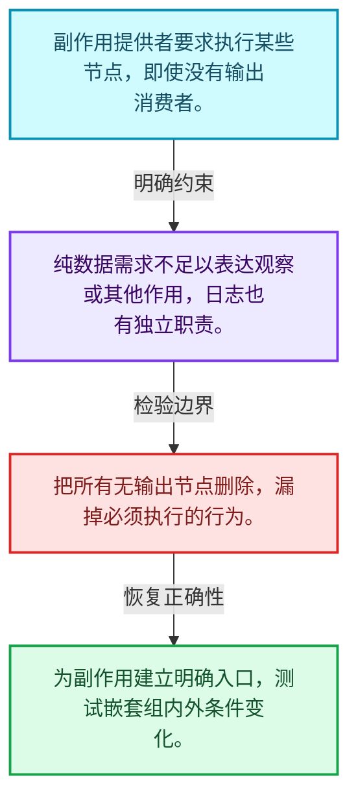
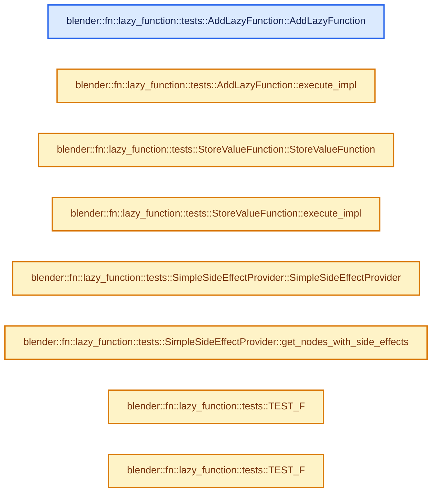
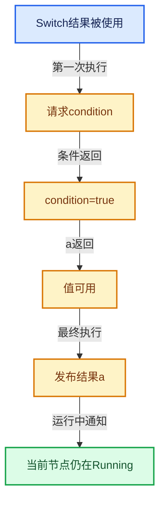

# 09-12 嵌套图副作用日志与测试

[方向导航](README.md) · [总目录](../README.md) · [实现索引](../%E7%AC%A6%E5%8F%B7%E4%BE%9D%E8%B5%96%E4%B8%8E%E5%AE%9E%E7%8E%B0%E7%B4%A2%E5%BC%95.md)

## 从问题到实现

没有结果被使用的节点是否永远不用执行？

副作用节点可由提供者额外要求执行；日志观察执行过程，不能改变结果需求语义。

**数据模型**

副作用提供者要求执行某些节点，即使没有输出消费者。

**设计取舍**

纯数据需求不足以表达观察或其他作用，日志也有独立职责。

**最小反例**

把所有无输出节点删除，漏掉必须执行的行为。

**推导**

为副作用建立明确入口，测试嵌套组内外条件变化。

## 阅读地图与执行推演








图中的数值推演是本方向的教学模型；实际函数之间的调用边与概念分析边分别标注，不能把概念关系当作运行时调度顺序。

## 完整源码单元与就地讲解

中文讲解直接放在相关代码旁，复杂机制在代码下展开。原文折叠区保留基准行号；不需要在行号表和函数之间来回查找。类布局可分段展示，函数实现不按固定行数切开。

### 类型布局、声明与编译条件 · FN_lazy_function_test.cc L1—L20

<a id="t-a720431d4c4b"></a>

<a id="t-853a1a5e8882"></a>

<!-- annotated:0881d27d96ffff -->

```cpp
/* SPDX-FileCopyrightText: 2023 Blender Authors
 *
 * SPDX-License-Identifier: Apache-2.0 */

#include "testing/testing.h"

#include "FN_lazy_function_execute.hh"
#include "FN_lazy_function_graph.hh"
#include "FN_lazy_function_graph_executor.hh"

#include "BLI_task_c.hh"

#include "BKE_gtest_base.hh"

namespace blender::fn::lazy_function::tests {

class LazyFunctionTest : public bke::BlenderGTestBase {};

class AddLazyFunction : public LazyFunction {
 public:
```

<details>
<summary>核对原始源码：source/blender/functions/tests/FN_lazy_function_test.cc · L1—L20</summary>

<!-- original:0881d27d96ffff:source/blender/functions/tests/FN_lazy_function_test.cc:1:20 -->

```cpp
/* SPDX-FileCopyrightText: 2023 Blender Authors
 *
 * SPDX-License-Identifier: Apache-2.0 */

#include "testing/testing.h"

#include "FN_lazy_function_execute.hh"
#include "FN_lazy_function_graph.hh"
#include "FN_lazy_function_graph_executor.hh"

#include "BLI_task_c.hh"

#include "BKE_gtest_base.hh"

namespace blender::fn::lazy_function::tests {

class LazyFunctionTest : public bke::BlenderGTestBase {};

class AddLazyFunction : public LazyFunction {
 public:
```

</details>

<a id="f-24fca7004f517c73"></a>

### `blender::fn::lazy_function::tests::AddLazyFunction::AddLazyFunction`

实现位置：[source/blender/functions/tests/FN_lazy_function_test.cc](../../../../../source/blender/functions/tests/FN_lazy_function_test.cc) · L21—L27。

**教学注释版**

<!-- annotated:e33c08bd4b4e0e -->

```cpp
  AddLazyFunction()
  {
    debug_name_ = "Add";
    inputs_.append({"A", CPPType::get<int>()});
    inputs_.append({"B", CPPType::get<int>()});
    outputs_.append({"Result", CPPType::get<int>()});
  }
```

<details>
<summary>核对原始源码：source/blender/functions/tests/FN_lazy_function_test.cc · L21—L27</summary>

<!-- original:e33c08bd4b4e0e:source/blender/functions/tests/FN_lazy_function_test.cc:21:27 -->

```cpp
  AddLazyFunction()
  {
    debug_name_ = "Add";
    inputs_.append({"A", CPPType::get<int>()});
    inputs_.append({"B", CPPType::get<int>()});
    outputs_.append({"Result", CPPType::get<int>()});
  }
```

</details>

**沿实际写入检查状态**

- `debug_name_ = "Add";`

**继续追踪实现**

- `inputs_.append` → [调用协议](../%E6%A8%A1%E6%9D%BF%E5%AE%8F%E4%B8%8E%E5%8A%A8%E6%80%81%E5%88%86%E6%B4%BE%E5%8D%8F%E8%AE%AE.md)：接收对象类型依赖auto、返回值或模板实例；不按同名猜测目标。调用位置L24。
- `CPPType::get<int>` → [blender::CPPType::get · L481](../03-%E5%86%85%E5%AD%98%E5%88%86%E9%85%8D%E4%B8%8E%E8%BF%90%E8%A1%8C%E6%97%B6%E7%B1%BB%E5%9E%8B/08-CPPType%E6%9E%84%E9%80%A0%E4%B8%8E%E6%9E%90%E6%9E%84.md#f-0cc10a3783d6abdb)。
- `outputs_.append` → [调用协议](../%E6%A8%A1%E6%9D%BF%E5%AE%8F%E4%B8%8E%E5%8A%A8%E6%80%81%E5%88%86%E6%B4%BE%E5%8D%8F%E8%AE%AE.md)：接收对象类型依赖auto、返回值或模板实例；不按同名猜测目标。调用位置L26。

<!-- annotated:4197f6bf04be87 -->

```cpp

```

<details>
<summary>核对原始源码：source/blender/functions/tests/FN_lazy_function_test.cc · L28—L28</summary>

<!-- original:4197f6bf04be87:source/blender/functions/tests/FN_lazy_function_test.cc:28:28 -->

```cpp

```

</details>

<a id="f-4dc5415b71ff93c1"></a>

### `blender::fn::lazy_function::tests::AddLazyFunction::execute_impl`

实现位置：[source/blender/functions/tests/FN_lazy_function_test.cc](../../../../../source/blender/functions/tests/FN_lazy_function_test.cc) · L29—L34。

接口参数：

- `Params &params`
- `const Context &`

**教学注释版**

<!-- annotated:a6281c76cc13ac -->

```cpp
  void execute_impl(Params &params, const Context & /*context*/) const override
  {
    const int a = params.get_input<int>(0);
    const int b = params.get_input<int>(1);
    params.set_output(0, a + b);
  }
```

<details>
<summary>核对原始源码：source/blender/functions/tests/FN_lazy_function_test.cc · L29—L34</summary>

<!-- original:a6281c76cc13ac:source/blender/functions/tests/FN_lazy_function_test.cc:29:34 -->

```cpp
  void execute_impl(Params &params, const Context & /*context*/) const override
  {
    const int a = params.get_input<int>(0);
    const int b = params.get_input<int>(1);
    params.set_output(0, a + b);
  }
```

</details>

**继续追踪实现**

- `params.get_input<int>` → [blender::fn::lazy_function::Params::get_input · L421](02-LazyFunction%E6%8E%A5%E5%8F%A3.md#f-167a9263f8e9f932)。
- `params.set_output` → [blender::fn::lazy_function::Params::set_output · L440](02-LazyFunction%E6%8E%A5%E5%8F%A3.md#f-993589d688de575d)。

### 类型布局、声明与编译条件 · FN_lazy_function_test.cc L35—L42

<a id="t-b610f445e4f1"></a>

`StoreValueFunction`在这里声明的数据成员：

- `int dst1_`
- `int dst2_`

<!-- annotated:ca1756afe2c38f -->

```cpp
};

class StoreValueFunction : public LazyFunction {
 private:
  int *dst1_;
  int *dst2_;

 public:
```

<details>
<summary>核对原始源码：source/blender/functions/tests/FN_lazy_function_test.cc · L35—L42</summary>

<!-- original:ca1756afe2c38f:source/blender/functions/tests/FN_lazy_function_test.cc:35:42 -->

```cpp
};

class StoreValueFunction : public LazyFunction {
 private:
  int *dst1_;
  int *dst2_;

 public:
```

</details>

<a id="f-b7a46c5295704ab0"></a>

### `blender::fn::lazy_function::tests::StoreValueFunction::StoreValueFunction`

实现位置：[source/blender/functions/tests/FN_lazy_function_test.cc](../../../../../source/blender/functions/tests/FN_lazy_function_test.cc) · L43—L48。

接口参数：

- `int *dst1`
- `int *dst2`

**教学注释版**

<!-- annotated:93cc0e6b8b7f9c -->

```cpp
  StoreValueFunction(int *dst1, int *dst2) : dst1_(dst1), dst2_(dst2)
  {
    debug_name_ = "Store Value";
    inputs_.append({"A", CPPType::get<int>()});
    inputs_.append({"B", CPPType::get<int>(), ValueUsage::Maybe});
  }
```

<details>
<summary>核对原始源码：source/blender/functions/tests/FN_lazy_function_test.cc · L43—L48</summary>

<!-- original:93cc0e6b8b7f9c:source/blender/functions/tests/FN_lazy_function_test.cc:43:48 -->

```cpp
  StoreValueFunction(int *dst1, int *dst2) : dst1_(dst1), dst2_(dst2)
  {
    debug_name_ = "Store Value";
    inputs_.append({"A", CPPType::get<int>()});
    inputs_.append({"B", CPPType::get<int>(), ValueUsage::Maybe});
  }
```

</details>

**沿实际写入检查状态**

- `debug_name_ = "Store Value";`

**继续追踪实现**

- `inputs_.append` → [调用协议](../%E6%A8%A1%E6%9D%BF%E5%AE%8F%E4%B8%8E%E5%8A%A8%E6%80%81%E5%88%86%E6%B4%BE%E5%8D%8F%E8%AE%AE.md)：接收对象类型依赖auto、返回值或模板实例；不按同名猜测目标。调用位置L46。
- `CPPType::get<int>` → [blender::CPPType::get · L481](../03-%E5%86%85%E5%AD%98%E5%88%86%E9%85%8D%E4%B8%8E%E8%BF%90%E8%A1%8C%E6%97%B6%E7%B1%BB%E5%9E%8B/08-CPPType%E6%9E%84%E9%80%A0%E4%B8%8E%E6%9E%90%E6%9E%84.md#f-0cc10a3783d6abdb)。

<!-- annotated:e803e1109d4556 -->

```cpp

```

<details>
<summary>核对原始源码：source/blender/functions/tests/FN_lazy_function_test.cc · L49—L49</summary>

<!-- original:e803e1109d4556:source/blender/functions/tests/FN_lazy_function_test.cc:49:49 -->

```cpp

```

</details>

<a id="f-2c8bd92e18ed69ae"></a>

### `blender::fn::lazy_function::tests::StoreValueFunction::execute_impl`

实现位置：[source/blender/functions/tests/FN_lazy_function_test.cc](../../../../../source/blender/functions/tests/FN_lazy_function_test.cc) · L50—L56。

接口参数：

- `Params &params`
- `const Context &`

**教学注释版**

<!-- annotated:73116e78613056 -->

```cpp
  void execute_impl(Params &params, const Context & /*context*/) const override
  {
    *dst1_ = params.get_input<int>(0);
    if (int *value = params.try_get_input_data_ptr_or_request<int>(1)) {
      *dst2_ = *value;
    }
  }
```

<details>
<summary>核对原始源码：source/blender/functions/tests/FN_lazy_function_test.cc · L50—L56</summary>

<!-- original:73116e78613056:source/blender/functions/tests/FN_lazy_function_test.cc:50:56 -->

```cpp
  void execute_impl(Params &params, const Context & /*context*/) const override
  {
    *dst1_ = params.get_input<int>(0);
    if (int *value = params.try_get_input_data_ptr_or_request<int>(1)) {
      *dst2_ = *value;
    }
  }
```

</details>

**继续追踪实现**

- `params.get_input<int>` → [blender::fn::lazy_function::Params::get_input · L421](02-LazyFunction%E6%8E%A5%E5%8F%A3.md#f-167a9263f8e9f932)。
- `params.try_get_input_data_ptr_or_request<int>` → [blender::fn::lazy_function::Params::try_get_input_data_ptr_or_request · L372](02-LazyFunction%E6%8E%A5%E5%8F%A3.md#f-89de2295f5baa94f)；[blender::fn::lazy_function::Params::try_get_input_data_ptr_or_request · L434](02-LazyFunction%E6%8E%A5%E5%8F%A3.md#f-97ba143c63061e47)。同名重载需按实参类型选择。

### 类型布局、声明与编译条件 · FN_lazy_function_test.cc L57—L63

<a id="t-febe5215b3a2"></a>

`SimpleSideEffectProvider`在这里声明的数据成员：

- `Vector<const FunctionNode *> side_effect_nodes_`

<!-- annotated:7c4dc3a7f96704 -->

```cpp
};

class SimpleSideEffectProvider : public GraphExecutor::SideEffectProvider {
 private:
  Vector<const FunctionNode *> side_effect_nodes_;

 public:
```

<details>
<summary>核对原始源码：source/blender/functions/tests/FN_lazy_function_test.cc · L57—L63</summary>

<!-- original:7c4dc3a7f96704:source/blender/functions/tests/FN_lazy_function_test.cc:57:63 -->

```cpp
};

class SimpleSideEffectProvider : public GraphExecutor::SideEffectProvider {
 private:
  Vector<const FunctionNode *> side_effect_nodes_;

 public:
```

</details>

<a id="f-d361a5520713ae20"></a>

### `blender::fn::lazy_function::tests::SimpleSideEffectProvider::SimpleSideEffectProvider`

实现位置：[source/blender/functions/tests/FN_lazy_function_test.cc](../../../../../source/blender/functions/tests/FN_lazy_function_test.cc) · L64—L67。

接口参数：

- `Span<const FunctionNode *> side_effect_nodes`

**教学注释版**

<!-- annotated:2811515ba86cee -->

```cpp
  SimpleSideEffectProvider(Span<const FunctionNode *> side_effect_nodes)
      : side_effect_nodes_(side_effect_nodes)
  {
  }
```

<details>
<summary>核对原始源码：source/blender/functions/tests/FN_lazy_function_test.cc · L64—L67</summary>

<!-- original:2811515ba86cee:source/blender/functions/tests/FN_lazy_function_test.cc:64:67 -->

```cpp
  SimpleSideEffectProvider(Span<const FunctionNode *> side_effect_nodes)
      : side_effect_nodes_(side_effect_nodes)
  {
  }
```

</details>

**继续追踪实现**

本实现没有需要继续展开的显式调用；检查返回表达式、对象转换和调用者前置条件。

<!-- annotated:b638534a72ee13 -->

```cpp

```

<details>
<summary>核对原始源码：source/blender/functions/tests/FN_lazy_function_test.cc · L68—L68</summary>

<!-- original:b638534a72ee13:source/blender/functions/tests/FN_lazy_function_test.cc:68:68 -->

```cpp

```

</details>

<a id="f-0790d488f10c8833"></a>

### `blender::fn::lazy_function::tests::SimpleSideEffectProvider::get_nodes_with_side_effects`

实现位置：[source/blender/functions/tests/FN_lazy_function_test.cc](../../../../../source/blender/functions/tests/FN_lazy_function_test.cc) · L69—L73。

接口参数：

- `const Context &`

**教学注释版**

<!-- annotated:7d9729536bf8c1 -->

```cpp
  Vector<const FunctionNode *> get_nodes_with_side_effects(
      const Context & /*context*/) const override
  {
    return side_effect_nodes_;
  }
```

<details>
<summary>核对原始源码：source/blender/functions/tests/FN_lazy_function_test.cc · L69—L73</summary>

<!-- original:7d9729536bf8c1:source/blender/functions/tests/FN_lazy_function_test.cc:69:73 -->

```cpp
  Vector<const FunctionNode *> get_nodes_with_side_effects(
      const Context & /*context*/) const override
  {
    return side_effect_nodes_;
  }
```

</details>

**结果出口**

- `return side_effect_nodes_;`

**继续追踪实现**

本实现没有需要继续展开的显式调用；检查返回表达式、对象转换和调用者前置条件。

### 类型布局、声明与编译条件 · FN_lazy_function_test.cc L74—L75

<!-- annotated:b0975dfb114a7b -->

```cpp
};

```

<details>
<summary>核对原始源码：source/blender/functions/tests/FN_lazy_function_test.cc · L74—L75</summary>

<!-- original:b0975dfb114a7b:source/blender/functions/tests/FN_lazy_function_test.cc:74:75 -->

```cpp
};

```

</details>

<a id="f-6a2323afb7baceda"></a>

### `blender::fn::lazy_function::tests::TEST_F`

实现位置：[source/blender/functions/tests/FN_lazy_function_test.cc](../../../../../source/blender/functions/tests/FN_lazy_function_test.cc) · L76—L83。

接口参数：

- `LazyFunctionTest`
- `SimpleAdd`

**教学注释版**

<!-- annotated:d9ff0f680a8505 -->

```cpp
TEST_F(LazyFunctionTest, SimpleAdd)
{
  const AddLazyFunction add_fn;
  int result = 0;
  execute_lazy_function_eagerly(
      add_fn, nullptr, nullptr, std::make_tuple(30, 5), std::make_tuple(&result));
  EXPECT_EQ(result, 35);
}
```

<details>
<summary>核对原始源码：source/blender/functions/tests/FN_lazy_function_test.cc · L76—L83</summary>

<!-- original:d9ff0f680a8505:source/blender/functions/tests/FN_lazy_function_test.cc:76:83 -->

```cpp
TEST_F(LazyFunctionTest, SimpleAdd)
{
  const AddLazyFunction add_fn;
  int result = 0;
  execute_lazy_function_eagerly(
      add_fn, nullptr, nullptr, std::make_tuple(30, 5), std::make_tuple(&result));
  EXPECT_EQ(result, 35);
}
```

</details>

**继续追踪实现**

- `execute_lazy_function_eagerly` → [blender::fn::lazy_function::execute_lazy_function_eagerly · L140](03-Params%E4%B8%8EValueUsage.md#f-a47eee497bf34125)。
- `std::make_tuple` → [外部契约](https://eel.is/c++draft/)：这个边界按实际表达式及所属类型核对参数、返回值、寿命与失败行为。这里提供接口入口，不声称已解释该第三方版本的内部实现。
- `EXPECT_EQ` → [EXPECT_EQ · L23](../05-%E5%87%A0%E4%BD%95%E5%AD%98%E5%82%A8%E4%B8%8E%E6%8B%93%E6%89%91%E6%98%A0%E5%B0%84/%E4%BE%9D%E8%B5%96-util_half_test-cbec66.md#m-171ffd5d7770)；[EXPECT_EQ · L191](../05-%E5%87%A0%E4%BD%95%E5%AD%98%E5%82%A8%E4%B8%8E%E6%8B%93%E6%89%91%E6%98%A0%E5%B0%84/%E4%BE%9D%E8%B5%96-gpu_shader_test_lib.bsl-fdb7ea.md#m-b4a6a76e53eb)。宏定义由构建条件选择。

<!-- annotated:9dda3998cedb3e -->

```cpp

```

<details>
<summary>核对原始源码：source/blender/functions/tests/FN_lazy_function_test.cc · L84—L84</summary>

<!-- original:9dda3998cedb3e:source/blender/functions/tests/FN_lazy_function_test.cc:84:84 -->

```cpp

```

</details>

<a id="f-c0011fa97bfdfb99"></a>

### `blender::fn::lazy_function::tests::TEST_F`

实现位置：[source/blender/functions/tests/FN_lazy_function_test.cc](../../../../../source/blender/functions/tests/FN_lazy_function_test.cc) · L85—L120。

接口参数：

- `LazyFunctionTest`
- `SideEffects`

**教学注释版**

<!-- annotated:b3e21d12a294e7 -->

```cpp
TEST_F(LazyFunctionTest, SideEffects)
{
  BLI_task_scheduler_init();
  int dst1 = 0;
  int dst2 = 0;

  const AddLazyFunction add_fn;
  const StoreValueFunction store_fn{&dst1, &dst2};

  Graph graph;
  FunctionNode &add_node_1 = graph.add_function(add_fn);
  FunctionNode &add_node_2 = graph.add_function(add_fn);
  FunctionNode &store_node = graph.add_function(store_fn);
  GraphInputSocket &graph_input = graph.add_input(CPPType::get<int>());

  graph.add_link(graph_input, add_node_1.input(0));
  graph.add_link(graph_input, add_node_2.input(0));
  graph.add_link(add_node_1.output(0), store_node.input(0));
  graph.add_link(add_node_2.output(0), store_node.input(1));

  const int value_10 = 10;
  const int value_100 = 100;
  add_node_1.input(1).set_default_value(&value_10);
  add_node_2.input(1).set_default_value(&value_100);

  graph.update_node_indices();

  SimpleSideEffectProvider side_effect_provider{{&store_node}};

  GraphExecutor executor_fn{graph, {&graph_input}, {}, nullptr, &side_effect_provider, nullptr};
  execute_lazy_function_eagerly(
      executor_fn, nullptr, nullptr, std::make_tuple(5), std::make_tuple());

  EXPECT_EQ(dst1, 15);
  EXPECT_EQ(dst2, 105);
}
```

<details>
<summary>核对原始源码：source/blender/functions/tests/FN_lazy_function_test.cc · L85—L120</summary>

<!-- original:b3e21d12a294e7:source/blender/functions/tests/FN_lazy_function_test.cc:85:120 -->

```cpp
TEST_F(LazyFunctionTest, SideEffects)
{
  BLI_task_scheduler_init();
  int dst1 = 0;
  int dst2 = 0;

  const AddLazyFunction add_fn;
  const StoreValueFunction store_fn{&dst1, &dst2};

  Graph graph;
  FunctionNode &add_node_1 = graph.add_function(add_fn);
  FunctionNode &add_node_2 = graph.add_function(add_fn);
  FunctionNode &store_node = graph.add_function(store_fn);
  GraphInputSocket &graph_input = graph.add_input(CPPType::get<int>());

  graph.add_link(graph_input, add_node_1.input(0));
  graph.add_link(graph_input, add_node_2.input(0));
  graph.add_link(add_node_1.output(0), store_node.input(0));
  graph.add_link(add_node_2.output(0), store_node.input(1));

  const int value_10 = 10;
  const int value_100 = 100;
  add_node_1.input(1).set_default_value(&value_10);
  add_node_2.input(1).set_default_value(&value_100);

  graph.update_node_indices();

  SimpleSideEffectProvider side_effect_provider{{&store_node}};

  GraphExecutor executor_fn{graph, {&graph_input}, {}, nullptr, &side_effect_provider, nullptr};
  execute_lazy_function_eagerly(
      executor_fn, nullptr, nullptr, std::make_tuple(5), std::make_tuple());

  EXPECT_EQ(dst1, 15);
  EXPECT_EQ(dst2, 105);
}
```

</details>

**继续追踪实现**

- `BLI_task_scheduler_init` → [blender::BLI_task_scheduler_init · L70](../11-Depsgraph%E4%B8%8E%E5%B9%B6%E8%A1%8C%E4%BB%BB%E5%8A%A1%E7%B3%BB%E7%BB%9F/07-%E4%BB%BB%E5%8A%A1%E6%B1%A0%E4%B8%8ETBB%E6%8E%A5%E5%85%A5.md#f-2a9b04d296c08d20)。
- `graph.add_function` → [blender::fn::lazy_function::Graph::add_function · L48](05-Graph%E4%B8%8ESocket.md#f-e3b1de312a10505f)。
- `graph.add_input` → [blender::fn::lazy_function::Graph::add_input · L77](05-Graph%E4%B8%8ESocket.md#f-5ba24059cb7509d1)。
- `CPPType::get<int>` → [blender::CPPType::get · L481](../03-%E5%86%85%E5%AD%98%E5%88%86%E9%85%8D%E4%B8%8E%E8%BF%90%E8%A1%8C%E6%97%B6%E7%B1%BB%E5%9E%8B/08-CPPType%E6%9E%84%E9%80%A0%E4%B8%8E%E6%9E%90%E6%9E%84.md#f-0cc10a3783d6abdb)。
- `graph.add_link` → [blender::fn::lazy_function::Graph::add_link · L103](05-Graph%E4%B8%8ESocket.md#f-9f7e86fc6fe42046)。
- `add_node_1.input` → [调用协议](../%E6%A8%A1%E6%9D%BF%E5%AE%8F%E4%B8%8E%E5%8A%A8%E6%80%81%E5%88%86%E6%B4%BE%E5%8D%8F%E8%AE%AE.md)：由接收对象具体类型或运行时策略提供实现。调用位置L100。
- `add_node_2.input` → [调用协议](../%E6%A8%A1%E6%9D%BF%E5%AE%8F%E4%B8%8E%E5%8A%A8%E6%80%81%E5%88%86%E6%B4%BE%E5%8D%8F%E8%AE%AE.md)：由接收对象具体类型或运行时策略提供实现。调用位置L101。
- `add_node_1.output` → [调用协议](../%E6%A8%A1%E6%9D%BF%E5%AE%8F%E4%B8%8E%E5%8A%A8%E6%80%81%E5%88%86%E6%B4%BE%E5%8D%8F%E8%AE%AE.md)：由接收对象具体类型或运行时策略提供实现。调用位置L102。
- `store_node.input` → [调用协议](../%E6%A8%A1%E6%9D%BF%E5%AE%8F%E4%B8%8E%E5%8A%A8%E6%80%81%E5%88%86%E6%B4%BE%E5%8D%8F%E8%AE%AE.md)：由接收对象具体类型或运行时策略提供实现。调用位置L102。
- `add_node_2.output` → [调用协议](../%E6%A8%A1%E6%9D%BF%E5%AE%8F%E4%B8%8E%E5%8A%A8%E6%80%81%E5%88%86%E6%B4%BE%E5%8D%8F%E8%AE%AE.md)：由接收对象具体类型或运行时策略提供实现。调用位置L103。
- `add_node_1.input(1).set_default_value` → [调用协议](../%E6%A8%A1%E6%9D%BF%E5%AE%8F%E4%B8%8E%E5%8A%A8%E6%80%81%E5%88%86%E6%B4%BE%E5%8D%8F%E8%AE%AE.md)：接收对象类型依赖auto、返回值或模板实例；不按同名猜测目标。调用位置L107。
- `add_node_2.input(1).set_default_value` → [调用协议](../%E6%A8%A1%E6%9D%BF%E5%AE%8F%E4%B8%8E%E5%8A%A8%E6%80%81%E5%88%86%E6%B4%BE%E5%8D%8F%E8%AE%AE.md)：接收对象类型依赖auto、返回值或模板实例；不按同名猜测目标。调用位置L108。
- `graph.update_node_indices` → [blender::fn::lazy_function::Graph::update_node_indices · L119](05-Graph%E4%B8%8ESocket.md#f-c4b2854250326c4e)。
- `execute_lazy_function_eagerly` → [blender::fn::lazy_function::execute_lazy_function_eagerly · L140](03-Params%E4%B8%8EValueUsage.md#f-a47eee497bf34125)。
- `std::make_tuple` → [外部契约](https://eel.is/c++draft/)：这个边界按实际表达式及所属类型核对参数、返回值、寿命与失败行为。这里提供接口入口，不声称已解释该第三方版本的内部实现。
- `EXPECT_EQ` → [EXPECT_EQ · L23](../05-%E5%87%A0%E4%BD%95%E5%AD%98%E5%82%A8%E4%B8%8E%E6%8B%93%E6%89%91%E6%98%A0%E5%B0%84/%E4%BE%9D%E8%B5%96-util_half_test-cbec66.md#m-171ffd5d7770)；[EXPECT_EQ · L191](../05-%E5%87%A0%E4%BD%95%E5%AD%98%E5%82%A8%E4%B8%8E%E6%8B%93%E6%89%91%E6%98%A0%E5%B0%84/%E4%BE%9D%E8%B5%96-gpu_shader_test_lib.bsl-fdb7ea.md#m-b4a6a76e53eb)。宏定义由构建条件选择。

### 类型布局、声明与编译条件 · FN_lazy_function_test.cc L121—L123

<a id="t-60852065ab97"></a>

<!-- annotated:a5df6d010083ec -->

```cpp

class PartialEvaluationTestFunction : public LazyFunction {
 public:
```

<details>
<summary>核对原始源码：source/blender/functions/tests/FN_lazy_function_test.cc · L121—L123</summary>

<!-- original:a5df6d010083ec:source/blender/functions/tests/FN_lazy_function_test.cc:121:123 -->

```cpp

class PartialEvaluationTestFunction : public LazyFunction {
 public:
```

</details>

<a id="f-a80a55f058dd4f88"></a>

### `blender::fn::lazy_function::tests::PartialEvaluationTestFunction::PartialEvaluationTestFunction`

实现位置：[source/blender/functions/tests/FN_lazy_function_test.cc](../../../../../source/blender/functions/tests/FN_lazy_function_test.cc) · L124—L134。

**教学注释版**

<!-- annotated:23909f4e3b0719 -->

```cpp
  PartialEvaluationTestFunction()
  {
    debug_name_ = "Partial Evaluation";
    allow_missing_requested_inputs_ = true;

    inputs_.append_as("A", CPPType::get<int>(), ValueUsage::Used);
    inputs_.append_as("B", CPPType::get<int>(), ValueUsage::Used);

    outputs_.append_as("A*2", CPPType::get<int>());
    outputs_.append_as("B*5", CPPType::get<int>());
  }
```

<details>
<summary>核对原始源码：source/blender/functions/tests/FN_lazy_function_test.cc · L124—L134</summary>

<!-- original:23909f4e3b0719:source/blender/functions/tests/FN_lazy_function_test.cc:124:134 -->

```cpp
  PartialEvaluationTestFunction()
  {
    debug_name_ = "Partial Evaluation";
    allow_missing_requested_inputs_ = true;

    inputs_.append_as("A", CPPType::get<int>(), ValueUsage::Used);
    inputs_.append_as("B", CPPType::get<int>(), ValueUsage::Used);

    outputs_.append_as("A*2", CPPType::get<int>());
    outputs_.append_as("B*5", CPPType::get<int>());
  }
```

</details>

**沿实际写入检查状态**

- `debug_name_ = "Partial Evaluation";`
- `allow_missing_requested_inputs_ = true;`

**继续追踪实现**

- `inputs_.append_as` → [调用协议](../%E6%A8%A1%E6%9D%BF%E5%AE%8F%E4%B8%8E%E5%8A%A8%E6%80%81%E5%88%86%E6%B4%BE%E5%8D%8F%E8%AE%AE.md)：接收对象类型依赖auto、返回值或模板实例；不按同名猜测目标。调用位置L129。
- `CPPType::get<int>` → [blender::CPPType::get · L481](../03-%E5%86%85%E5%AD%98%E5%88%86%E9%85%8D%E4%B8%8E%E8%BF%90%E8%A1%8C%E6%97%B6%E7%B1%BB%E5%9E%8B/08-CPPType%E6%9E%84%E9%80%A0%E4%B8%8E%E6%9E%90%E6%9E%84.md#f-0cc10a3783d6abdb)。
- `outputs_.append_as` → [调用协议](../%E6%A8%A1%E6%9D%BF%E5%AE%8F%E4%B8%8E%E5%8A%A8%E6%80%81%E5%88%86%E6%B4%BE%E5%8D%8F%E8%AE%AE.md)：接收对象类型依赖auto、返回值或模板实例；不按同名猜测目标。调用位置L132。

<!-- annotated:6f955c08c8d05e -->

```cpp

```

<details>
<summary>核对原始源码：source/blender/functions/tests/FN_lazy_function_test.cc · L135—L135</summary>

<!-- original:6f955c08c8d05e:source/blender/functions/tests/FN_lazy_function_test.cc:135:135 -->

```cpp

```

</details>

<a id="f-b3428795ade1f3c7"></a>

### `blender::fn::lazy_function::tests::PartialEvaluationTestFunction::execute_impl`

实现位置：[source/blender/functions/tests/FN_lazy_function_test.cc](../../../../../source/blender/functions/tests/FN_lazy_function_test.cc) · L136—L148。

接口参数：

- `Params &params`
- `const Context &`

**教学注释版**

<!-- annotated:b798e9cd8794a6 -->

```cpp
  void execute_impl(Params &params, const Context & /*context*/) const override
  {
    if (!params.output_was_set(0)) {
      if (int *a = params.try_get_input_data_ptr<int>(0)) {
        params.set_output(0, *a * 2);
      }
    }
    if (!params.output_was_set(1)) {
      if (int *b = params.try_get_input_data_ptr<int>(1)) {
        params.set_output(1, *b * 5);
      }
    }
  }
```

<details>
<summary>核对原始源码：source/blender/functions/tests/FN_lazy_function_test.cc · L136—L148</summary>

<!-- original:b798e9cd8794a6:source/blender/functions/tests/FN_lazy_function_test.cc:136:148 -->

```cpp
  void execute_impl(Params &params, const Context & /*context*/) const override
  {
    if (!params.output_was_set(0)) {
      if (int *a = params.try_get_input_data_ptr<int>(0)) {
        params.set_output(0, *a * 2);
      }
    }
    if (!params.output_was_set(1)) {
      if (int *b = params.try_get_input_data_ptr<int>(1)) {
        params.set_output(1, *b * 5);
      }
    }
  }
```

</details>

**继续追踪实现**

- `params.output_was_set` → [blender::fn::lazy_function::Params::output_was_set · L393](02-LazyFunction%E6%8E%A5%E5%8F%A3.md#f-aecdc506c9bbff3b)。
- `params.try_get_input_data_ptr<int>` → [blender::fn::lazy_function::Params::try_get_input_data_ptr · L366](02-LazyFunction%E6%8E%A5%E5%8F%A3.md#f-9dc147b3722ce6e6)；[blender::fn::lazy_function::Params::try_get_input_data_ptr · L428](02-LazyFunction%E6%8E%A5%E5%8F%A3.md#f-3751fbc263e091cc)。同名重载需按实参类型选择。
- `params.set_output` → [blender::fn::lazy_function::Params::set_output · L440](02-LazyFunction%E6%8E%A5%E5%8F%A3.md#f-993589d688de575d)。

<!-- annotated:f49e22dbb95ebf -->

```cpp

```

<details>
<summary>核对原始源码：source/blender/functions/tests/FN_lazy_function_test.cc · L149—L149</summary>

<!-- original:f49e22dbb95ebf:source/blender/functions/tests/FN_lazy_function_test.cc:149:149 -->

```cpp

```

</details>

<a id="f-35a9c3333a5957ad"></a>

### `blender::fn::lazy_function::tests::PartialEvaluationTestFunction::possible_output_dependencies`

实现位置：[source/blender/functions/tests/FN_lazy_function_test.cc](../../../../../source/blender/functions/tests/FN_lazy_function_test.cc) · L150—L156。

接口参数：

- `const int output_index`
- `FunctionRef<void(Span<int>)> fn`
- `Span<int>`

**教学注释版**

<!-- annotated:3273702797842b -->

```cpp
  void possible_output_dependencies(const int output_index,
                                    FunctionRef<void(Span<int>)> fn) const override
  {
    /* Each output only depends on the input with the same index. */
    const int input_index = output_index;
    fn({input_index});
  }
```

<details>
<summary>核对原始源码：source/blender/functions/tests/FN_lazy_function_test.cc · L150—L156</summary>

<!-- original:3273702797842b:source/blender/functions/tests/FN_lazy_function_test.cc:150:156 -->

```cpp
  void possible_output_dependencies(const int output_index,
                                    FunctionRef<void(Span<int>)> fn) const override
  {
    /* Each output only depends on the input with the same index. */
    const int input_index = output_index;
    fn({input_index});
  }
```

</details>

**继续追踪实现**

- `fn` → [调用协议](../%E6%A8%A1%E6%9D%BF%E5%AE%8F%E4%B8%8E%E5%8A%A8%E6%80%81%E5%88%86%E6%B4%BE%E5%8D%8F%E8%AE%AE.md)：局部可调用对象，须结合其初始化与捕获环境。调用位置L155。

### 类型布局、声明与编译条件 · FN_lazy_function_test.cc L157—L158

<!-- annotated:5396938c6dfd0c -->

```cpp
};

```

<details>
<summary>核对原始源码：source/blender/functions/tests/FN_lazy_function_test.cc · L157—L158</summary>

<!-- original:5396938c6dfd0c:source/blender/functions/tests/FN_lazy_function_test.cc:157:158 -->

```cpp
};

```

</details>

<a id="f-edb61f46e4d43983"></a>

### `blender::fn::lazy_function::tests::TEST_F`

实现位置：[source/blender/functions/tests/FN_lazy_function_test.cc](../../../../../source/blender/functions/tests/FN_lazy_function_test.cc) · L159—L183。

接口参数：

- `LazyFunctionTest`
- `GraphWithCycle`

**教学注释版**

<!-- annotated:eb617d1818ab1e -->

```cpp
TEST_F(LazyFunctionTest, GraphWithCycle)
{
  const PartialEvaluationTestFunction fn;

  Graph graph;
  FunctionNode &fn_node = graph.add_function(fn);

  GraphInputSocket &input_socket = graph.add_input(CPPType::get<int>());
  GraphOutputSocket &output_socket = graph.add_output(CPPType::get<int>());

  graph.add_link(input_socket, fn_node.input(0));
  /* NOTE: This creates a cycle in the graph. However, it should still be possible to evaluate it,
   * because there is no actual data dependency in the cycle. */
  graph.add_link(fn_node.output(0), fn_node.input(1));
  graph.add_link(fn_node.output(1), output_socket);

  graph.update_node_indices();

  GraphExecutor executor_fn{graph, {&input_socket}, {&output_socket}, nullptr, nullptr, nullptr};
  int result = 0;
  execute_lazy_function_eagerly(
      executor_fn, nullptr, nullptr, std::make_tuple(10), std::make_tuple(&result));

  EXPECT_EQ(result, 10 * 2 * 5);
}
```

<details>
<summary>核对原始源码：source/blender/functions/tests/FN_lazy_function_test.cc · L159—L183</summary>

<!-- original:eb617d1818ab1e:source/blender/functions/tests/FN_lazy_function_test.cc:159:183 -->

```cpp
TEST_F(LazyFunctionTest, GraphWithCycle)
{
  const PartialEvaluationTestFunction fn;

  Graph graph;
  FunctionNode &fn_node = graph.add_function(fn);

  GraphInputSocket &input_socket = graph.add_input(CPPType::get<int>());
  GraphOutputSocket &output_socket = graph.add_output(CPPType::get<int>());

  graph.add_link(input_socket, fn_node.input(0));
  /* NOTE: This creates a cycle in the graph. However, it should still be possible to evaluate it,
   * because there is no actual data dependency in the cycle. */
  graph.add_link(fn_node.output(0), fn_node.input(1));
  graph.add_link(fn_node.output(1), output_socket);

  graph.update_node_indices();

  GraphExecutor executor_fn{graph, {&input_socket}, {&output_socket}, nullptr, nullptr, nullptr};
  int result = 0;
  execute_lazy_function_eagerly(
      executor_fn, nullptr, nullptr, std::make_tuple(10), std::make_tuple(&result));

  EXPECT_EQ(result, 10 * 2 * 5);
}
```

</details>

**继续追踪实现**

- `graph.add_function` → [blender::fn::lazy_function::Graph::add_function · L48](05-Graph%E4%B8%8ESocket.md#f-e3b1de312a10505f)。
- `graph.add_input` → [blender::fn::lazy_function::Graph::add_input · L77](05-Graph%E4%B8%8ESocket.md#f-5ba24059cb7509d1)。
- `CPPType::get<int>` → [blender::CPPType::get · L481](../03-%E5%86%85%E5%AD%98%E5%88%86%E9%85%8D%E4%B8%8E%E8%BF%90%E8%A1%8C%E6%97%B6%E7%B1%BB%E5%9E%8B/08-CPPType%E6%9E%84%E9%80%A0%E4%B8%8E%E6%9E%90%E6%9E%84.md#f-0cc10a3783d6abdb)。
- `graph.add_output` → [blender::fn::lazy_function::Graph::add_output · L90](05-Graph%E4%B8%8ESocket.md#f-a3f7054aad76da4d)。
- `graph.add_link` → [blender::fn::lazy_function::Graph::add_link · L103](05-Graph%E4%B8%8ESocket.md#f-9f7e86fc6fe42046)。
- `fn_node.input` → [调用协议](../%E6%A8%A1%E6%9D%BF%E5%AE%8F%E4%B8%8E%E5%8A%A8%E6%80%81%E5%88%86%E6%B4%BE%E5%8D%8F%E8%AE%AE.md)：由接收对象具体类型或运行时策略提供实现。调用位置L169。
- `fn_node.output` → [调用协议](../%E6%A8%A1%E6%9D%BF%E5%AE%8F%E4%B8%8E%E5%8A%A8%E6%80%81%E5%88%86%E6%B4%BE%E5%8D%8F%E8%AE%AE.md)：由接收对象具体类型或运行时策略提供实现。调用位置L172。
- `graph.update_node_indices` → [blender::fn::lazy_function::Graph::update_node_indices · L119](05-Graph%E4%B8%8ESocket.md#f-c4b2854250326c4e)。
- `execute_lazy_function_eagerly` → [blender::fn::lazy_function::execute_lazy_function_eagerly · L140](03-Params%E4%B8%8EValueUsage.md#f-a47eee497bf34125)。
- `std::make_tuple` → [外部契约](https://eel.is/c++draft/)：这个边界按实际表达式及所属类型核对参数、返回值、寿命与失败行为。这里提供接口入口，不声称已解释该第三方版本的内部实现。
- `EXPECT_EQ` → [EXPECT_EQ · L23](../05-%E5%87%A0%E4%BD%95%E5%AD%98%E5%82%A8%E4%B8%8E%E6%8B%93%E6%89%91%E6%98%A0%E5%B0%84/%E4%BE%9D%E8%B5%96-util_half_test-cbec66.md#m-171ffd5d7770)；[EXPECT_EQ · L191](../05-%E5%87%A0%E4%BD%95%E5%AD%98%E5%82%A8%E4%B8%8E%E6%8B%93%E6%89%91%E6%98%A0%E5%B0%84/%E4%BE%9D%E8%B5%96-gpu_shader_test_lib.bsl-fdb7ea.md#m-b4a6a76e53eb)。宏定义由构建条件选择。

### 类型布局、声明与编译条件 · FN_lazy_function_test.cc L184—L185

<!-- annotated:f3702f6d334cd4 -->

```cpp

}  // namespace blender::fn::lazy_function::tests
```

<details>
<summary>核对原始源码：source/blender/functions/tests/FN_lazy_function_test.cc · L184—L185</summary>

<!-- original:f3702f6d334cd4:source/blender/functions/tests/FN_lazy_function_test.cc:184:185 -->

```cpp

}  // namespace blender::fn::lazy_function::tests
```

</details>

<!-- annotated:3e7138246751cd -->

```cpp

```

<details>
<summary>核对原始源码：source/blender/nodes/intern/geometry_nodes_lazy_function.cc · L2903—L2903</summary>

<!-- original:3e7138246751cd:source/blender/nodes/intern/geometry_nodes_lazy_function.cc:2903:2903 -->

```cpp

```

</details>

<a id="f-07167d3e81534614"></a>

### `blender::nodes::GeometryNodesLazyFunctionBuilder::insert_node_in_graph`

实现位置：[source/blender/nodes/intern/geometry_nodes_lazy_function.cc](../../../../../source/blender/nodes/intern/geometry_nodes_lazy_function.cc) · L2904—L2993。

接口参数：

- `const bNode &bnode`
- `BuildGraphParams &graph_params`

**教学注释版**

<!-- annotated:78d0a57f7d9640 -->

```cpp
  void insert_node_in_graph(const bNode &bnode, BuildGraphParams &graph_params)
  {
    const bke::bNodeType *node_type = bnode.typeinfo;
    if (node_type == nullptr) {
      return;
    }
    if (bnode.is_muted()) {
      this->build_muted_node(bnode, graph_params);
      return;
    }
    if (bnode.is_group()) {
      /* Have special handling because `bnode.type_legacy` and `node_type.type_legacy` can be
       * different for custom node groups. In other cases they should be identical. */
      this->build_group_node(bnode, graph_params);
      return;
    }
    switch (node_type->type_legacy) {
      case NODE_FRAME: {
        /* Ignored. */
        break;
      }
      case NODE_REROUTE: {
        this->build_reroute_node(bnode, graph_params);
        break;
      }
      case NODE_GROUP_INPUT: {
        this->handle_group_input_node(bnode, graph_params);
        break;
      }
      case NODE_GROUP_OUTPUT: {
        this->build_group_output_node(bnode, graph_params);
        break;
      }
      case GEO_NODE_VIEWER: {
        this->build_viewer_node(bnode, graph_params);
        break;
      }
      case GEO_NODE_SWITCH: {
        this->build_switch_node(bnode, graph_params);
        break;
      }
      case GEO_NODE_INDEX_SWITCH: {
        this->build_index_switch_node(bnode, graph_params);
        break;
      }
      case GEO_NODE_WARNING: {
        this->build_warning_node(bnode, graph_params);
        break;
      }
      case GEO_NODE_GIZMO_LINEAR:
      case GEO_NODE_GIZMO_DIAL:
      case GEO_NODE_GIZMO_TRANSFORM: {
        this->build_gizmo_node(bnode, graph_params);
        break;
      }
      case GEO_NODE_BAKE: {
        this->build_bake_node(bnode, graph_params);
        break;
      }
      case GEO_NODE_MENU_SWITCH: {
        this->build_menu_switch_node(bnode, graph_params);
        break;
      }
      case NODE_EVALUATE_CLOSURE: {
        this->build_evaluate_closure_node(bnode, graph_params);
        break;
      }
      default: {
        if (node_type->geometry_node_execute) {
          this->build_geometry_node(bnode, graph_params);
          break;
        }
        const NodeMultiFunctions::Item &fn_item = node_multi_functions_.try_get(bnode);
        if (fn_item.fn != nullptr) {
          this->build_multi_function_node(bnode, fn_item, graph_params);
          break;
        }
        if (bnode.is_type("NodeEnableOutput"_ustr)) {
          this->build_enable_output_node(bnode, graph_params);
          break;
        }
        if (bnode.is_undefined()) {
          this->build_undefined_node(bnode, graph_params);
          break;
        }
        /* Nodes that don't match any of the criteria above are just ignored. */
        break;
      }
    }
  }
```

<details>
<summary>核对原始源码：source/blender/nodes/intern/geometry_nodes_lazy_function.cc · L2904—L2993</summary>

<!-- original:78d0a57f7d9640:source/blender/nodes/intern/geometry_nodes_lazy_function.cc:2904:2993 -->

```cpp
  void insert_node_in_graph(const bNode &bnode, BuildGraphParams &graph_params)
  {
    const bke::bNodeType *node_type = bnode.typeinfo;
    if (node_type == nullptr) {
      return;
    }
    if (bnode.is_muted()) {
      this->build_muted_node(bnode, graph_params);
      return;
    }
    if (bnode.is_group()) {
      /* Have special handling because `bnode.type_legacy` and `node_type.type_legacy` can be
       * different for custom node groups. In other cases they should be identical. */
      this->build_group_node(bnode, graph_params);
      return;
    }
    switch (node_type->type_legacy) {
      case NODE_FRAME: {
        /* Ignored. */
        break;
      }
      case NODE_REROUTE: {
        this->build_reroute_node(bnode, graph_params);
        break;
      }
      case NODE_GROUP_INPUT: {
        this->handle_group_input_node(bnode, graph_params);
        break;
      }
      case NODE_GROUP_OUTPUT: {
        this->build_group_output_node(bnode, graph_params);
        break;
      }
      case GEO_NODE_VIEWER: {
        this->build_viewer_node(bnode, graph_params);
        break;
      }
      case GEO_NODE_SWITCH: {
        this->build_switch_node(bnode, graph_params);
        break;
      }
      case GEO_NODE_INDEX_SWITCH: {
        this->build_index_switch_node(bnode, graph_params);
        break;
      }
      case GEO_NODE_WARNING: {
        this->build_warning_node(bnode, graph_params);
        break;
      }
      case GEO_NODE_GIZMO_LINEAR:
      case GEO_NODE_GIZMO_DIAL:
      case GEO_NODE_GIZMO_TRANSFORM: {
        this->build_gizmo_node(bnode, graph_params);
        break;
      }
      case GEO_NODE_BAKE: {
        this->build_bake_node(bnode, graph_params);
        break;
      }
      case GEO_NODE_MENU_SWITCH: {
        this->build_menu_switch_node(bnode, graph_params);
        break;
      }
      case NODE_EVALUATE_CLOSURE: {
        this->build_evaluate_closure_node(bnode, graph_params);
        break;
      }
      default: {
        if (node_type->geometry_node_execute) {
          this->build_geometry_node(bnode, graph_params);
          break;
        }
        const NodeMultiFunctions::Item &fn_item = node_multi_functions_.try_get(bnode);
        if (fn_item.fn != nullptr) {
          this->build_multi_function_node(bnode, fn_item, graph_params);
          break;
        }
        if (bnode.is_type("NodeEnableOutput"_ustr)) {
          this->build_enable_output_node(bnode, graph_params);
          break;
        }
        if (bnode.is_undefined()) {
          this->build_undefined_node(bnode, graph_params);
          break;
        }
        /* Nodes that don't match any of the criteria above are just ignored. */
        break;
      }
    }
  }
```

</details>

**继续追踪实现**

- `bnode.is_muted` → [blender::bNode::is_muted · L886](../05-%E5%87%A0%E4%BD%95%E5%AD%98%E5%82%A8%E4%B8%8E%E6%8B%93%E6%89%91%E6%98%A0%E5%B0%84/%E4%BE%9D%E8%B5%96-BKE_node_runtime-ee561b.md#f-4d91efc4cc87d00d)。
- `this->build_muted_node` → [blender::nodes::GeometryNodesLazyFunctionBuilder::build_muted_node · L2995](12-%E5%B5%8C%E5%A5%97%E5%9B%BE%E5%89%AF%E4%BD%9C%E7%94%A8%E6%97%A5%E5%BF%97%E4%B8%8E%E6%B5%8B%E8%AF%95.md#f-bb1e733d04428263)。
- `bnode.is_group` → [blender::bNode::is_group · L906](../05-%E5%87%A0%E4%BD%95%E5%AD%98%E5%82%A8%E4%B8%8E%E6%8B%93%E6%89%91%E6%98%A0%E5%B0%84/%E4%BE%9D%E8%B5%96-BKE_node_runtime-ee561b.md#f-0685281392963ec9)。
- `this->build_group_node` → [blender::nodes::GeometryNodesLazyFunctionBuilder::build_group_node · L3095](12-%E5%B5%8C%E5%A5%97%E5%9B%BE%E5%89%AF%E4%BD%9C%E7%94%A8%E6%97%A5%E5%BF%97%E4%B8%8E%E6%B5%8B%E8%AF%95.md#f-0a64f59677b2925c)。
- `this->build_reroute_node` → [blender::nodes::GeometryNodesLazyFunctionBuilder::build_reroute_node · L3046](12-%E5%B5%8C%E5%A5%97%E5%9B%BE%E5%89%AF%E4%BD%9C%E7%94%A8%E6%97%A5%E5%BF%97%E4%B8%8E%E6%B5%8B%E8%AF%95.md#f-03f61a0910984409)。
- `this->handle_group_input_node` → [blender::nodes::GeometryNodesLazyFunctionBuilder::handle_group_input_node · L3067](12-%E5%B5%8C%E5%A5%97%E5%9B%BE%E5%89%AF%E4%BD%9C%E7%94%A8%E6%97%A5%E5%BF%97%E4%B8%8E%E6%B5%8B%E8%AF%95.md#f-cf8cc0e7a11b22c8)。
- `this->build_group_output_node` → [blender::nodes::GeometryNodesLazyFunctionBuilder::build_group_output_node · L3077](12-%E5%B5%8C%E5%A5%97%E5%9B%BE%E5%89%AF%E4%BD%9C%E7%94%A8%E6%97%A5%E5%BF%97%E4%B8%8E%E6%B5%8B%E8%AF%95.md#f-41e81342da1acab5)。
- `this->build_viewer_node` → [blender::nodes::GeometryNodesLazyFunctionBuilder::build_viewer_node · L3335](12-%E5%B5%8C%E5%A5%97%E5%9B%BE%E5%89%AF%E4%BD%9C%E7%94%A8%E6%97%A5%E5%BF%97%E4%B8%8E%E6%B5%8B%E8%AF%95.md#f-f9937d6b45746714)。
- `this->build_switch_node` → [blender::nodes::GeometryNodesLazyFunctionBuilder::build_switch_node · L3492](12-%E5%B5%8C%E5%A5%97%E5%9B%BE%E5%89%AF%E4%BD%9C%E7%94%A8%E6%97%A5%E5%BF%97%E4%B8%8E%E6%B5%8B%E8%AF%95.md#f-44b9ecd57cf83f4c)。
- `this->build_index_switch_node` → [blender::nodes::GeometryNodesLazyFunctionBuilder::build_index_switch_node · L3570](12-%E5%B5%8C%E5%A5%97%E5%9B%BE%E5%89%AF%E4%BD%9C%E7%94%A8%E6%97%A5%E5%BF%97%E4%B8%8E%E6%B5%8B%E8%AF%95.md#f-d76ad4ee074abda9)。
- `this->build_warning_node` → [blender::nodes::GeometryNodesLazyFunctionBuilder::build_warning_node · L3615](12-%E5%B5%8C%E5%A5%97%E5%9B%BE%E5%89%AF%E4%BD%9C%E7%94%A8%E6%97%A5%E5%BF%97%E4%B8%8E%E6%B5%8B%E8%AF%95.md#f-8c9fa4a4ed49725f)。
- `this->build_gizmo_node` → [blender::nodes::GeometryNodesLazyFunctionBuilder::build_gizmo_node · L3359](12-%E5%B5%8C%E5%A5%97%E5%9B%BE%E5%89%AF%E4%BD%9C%E7%94%A8%E6%97%A5%E5%BF%97%E4%B8%8E%E6%B5%8B%E8%AF%95.md#f-abc8caf24bd7ac84)。
- `this->build_bake_node` → [blender::nodes::GeometryNodesLazyFunctionBuilder::build_bake_node · L3456](12-%E5%B5%8C%E5%A5%97%E5%9B%BE%E5%89%AF%E4%BD%9C%E7%94%A8%E6%97%A5%E5%BF%97%E4%B8%8E%E6%B5%8B%E8%AF%95.md#f-d00541e87e1bca85)。
- `this->build_menu_switch_node` → [blender::nodes::GeometryNodesLazyFunctionBuilder::build_menu_switch_node · L3648](12-%E5%B5%8C%E5%A5%97%E5%9B%BE%E5%89%AF%E4%BD%9C%E7%94%A8%E6%97%A5%E5%BF%97%E4%B8%8E%E6%B5%8B%E8%AF%95.md#f-bcd1bf42acfbde70)。
- `this->build_evaluate_closure_node` → [blender::nodes::GeometryNodesLazyFunctionBuilder::build_evaluate_closure_node · L3724](12-%E5%B5%8C%E5%A5%97%E5%9B%BE%E5%89%AF%E4%BD%9C%E7%94%A8%E6%97%A5%E5%BF%97%E4%B8%8E%E6%B5%8B%E8%AF%95.md#f-092d670672fa3e52)。
- `this->build_geometry_node` → [blender::nodes::GeometryNodesLazyFunctionBuilder::build_geometry_node · L3207](12-%E5%B5%8C%E5%A5%97%E5%9B%BE%E5%89%AF%E4%BD%9C%E7%94%A8%E6%97%A5%E5%BF%97%E4%B8%8E%E6%B5%8B%E8%AF%95.md#f-e24b8c990dcf166f)。
- `node_multi_functions_.try_get` → [blender::nodes::NodeMultiFunctions::try_get · L156](%E4%BE%9D%E8%B5%96-NOD_multi_function-01ca0e.md#f-46ec882b19348877)。
- `this->build_multi_function_node` → [blender::nodes::GeometryNodesLazyFunctionBuilder::build_multi_function_node · L3308](12-%E5%B5%8C%E5%A5%97%E5%9B%BE%E5%89%AF%E4%BD%9C%E7%94%A8%E6%97%A5%E5%BF%97%E4%B8%8E%E6%B5%8B%E8%AF%95.md#f-a39466d8624f8f12)。
- `bnode.is_type` → [blender::bNode::is_type · L931](../05-%E5%87%A0%E4%BD%95%E5%AD%98%E5%82%A8%E4%B8%8E%E6%8B%93%E6%89%91%E6%98%A0%E5%B0%84/%E4%BE%9D%E8%B5%96-BKE_node_runtime-ee561b.md#f-828d5e91e96da197)。
- `this->build_enable_output_node` → [blender::nodes::GeometryNodesLazyFunctionBuilder::build_enable_output_node · L3536](12-%E5%B5%8C%E5%A5%97%E5%9B%BE%E5%89%AF%E4%BD%9C%E7%94%A8%E6%97%A5%E5%BF%97%E4%B8%8E%E6%B5%8B%E8%AF%95.md#f-b1be6bbb2909092e)。
- `bnode.is_undefined` → [blender::bNode::is_undefined · L926](../05-%E5%87%A0%E4%BD%95%E5%AD%98%E5%82%A8%E4%B8%8E%E6%8B%93%E6%89%91%E6%98%A0%E5%B0%84/%E4%BE%9D%E8%B5%96-BKE_node_runtime-ee561b.md#f-48ba40c353bcf4a3)。
- `this->build_undefined_node` → [blender::nodes::GeometryNodesLazyFunctionBuilder::build_undefined_node · L3768](12-%E5%B5%8C%E5%A5%97%E5%9B%BE%E5%89%AF%E4%BD%9C%E7%94%A8%E6%97%A5%E5%BF%97%E4%B8%8E%E6%B5%8B%E8%AF%95.md#f-82547a55ca5cff39)。

<!-- annotated:0e3c1767b394c9 -->

```cpp

```

<details>
<summary>核对原始源码：source/blender/nodes/intern/geometry_nodes_lazy_function.cc · L2994—L2994</summary>

<!-- original:0e3c1767b394c9:source/blender/nodes/intern/geometry_nodes_lazy_function.cc:2994:2994 -->

```cpp

```

</details>

<a id="f-bb1e733d04428263"></a>

### `blender::nodes::GeometryNodesLazyFunctionBuilder::build_muted_node`

实现位置：[source/blender/nodes/intern/geometry_nodes_lazy_function.cc](../../../../../source/blender/nodes/intern/geometry_nodes_lazy_function.cc) · L2995—L3016。

接口参数：

- `const bNode &bnode`
- `BuildGraphParams &graph_params`

**教学注释版**

<!-- annotated:54473604dc991c -->

```cpp
  void build_muted_node(const bNode &bnode, BuildGraphParams &graph_params)
  {
    auto &lazy_function = scope_.construct<LazyFunctionForMutedNode>(
        bnode, mapping_->lf_index_by_bsocket);
    lf::Node &lf_node = graph_params.lf_graph.add_function(lazy_function);
    for (const bNodeSocket *bsocket : bnode.input_sockets()) {
      const int lf_index = mapping_->lf_index_by_bsocket[bsocket->index_in_tree()];
      if (lf_index == -1) {
        continue;
      }
      this->add_to_socket_map(graph_params, *bsocket, lf_node.input(lf_index));
    }
    for (const bNodeSocket *bsocket : bnode.output_sockets()) {
      const int lf_index = mapping_->lf_index_by_bsocket[bsocket->index_in_tree()];
      if (lf_index == -1) {
        continue;
      }
      this->add_to_socket_map(graph_params, *bsocket, lf_node.output(lf_index));
    }

    this->build_muted_node_usages(bnode, graph_params);
  }
```

<details>
<summary>核对原始源码：source/blender/nodes/intern/geometry_nodes_lazy_function.cc · L2995—L3016</summary>

<!-- original:54473604dc991c:source/blender/nodes/intern/geometry_nodes_lazy_function.cc:2995:3016 -->

```cpp
  void build_muted_node(const bNode &bnode, BuildGraphParams &graph_params)
  {
    auto &lazy_function = scope_.construct<LazyFunctionForMutedNode>(
        bnode, mapping_->lf_index_by_bsocket);
    lf::Node &lf_node = graph_params.lf_graph.add_function(lazy_function);
    for (const bNodeSocket *bsocket : bnode.input_sockets()) {
      const int lf_index = mapping_->lf_index_by_bsocket[bsocket->index_in_tree()];
      if (lf_index == -1) {
        continue;
      }
      this->add_to_socket_map(graph_params, *bsocket, lf_node.input(lf_index));
    }
    for (const bNodeSocket *bsocket : bnode.output_sockets()) {
      const int lf_index = mapping_->lf_index_by_bsocket[bsocket->index_in_tree()];
      if (lf_index == -1) {
        continue;
      }
      this->add_to_socket_map(graph_params, *bsocket, lf_node.output(lf_index));
    }

    this->build_muted_node_usages(bnode, graph_params);
  }
```

</details>

**继续追踪实现**

- `scope_.construct<LazyFunctionForMutedNode>` → [blender::ResourceScope::construct · L219](../03-%E5%86%85%E5%AD%98%E5%88%86%E9%85%8D%E4%B8%8E%E8%BF%90%E8%A1%8C%E6%97%B6%E7%B1%BB%E5%9E%8B/05-ResourceScope%E9%94%80%E6%AF%81%E8%B4%A3%E4%BB%BB.md#f-5b24624bb64539d5)。
- `graph_params.lf_graph.add_function` → [调用协议](../%E6%A8%A1%E6%9D%BF%E5%AE%8F%E4%B8%8E%E5%8A%A8%E6%80%81%E5%88%86%E6%B4%BE%E5%8D%8F%E8%AE%AE.md)：接收对象类型依赖auto、返回值或模板实例；不按同名猜测目标。调用位置L2999。
- `bnode.input_sockets` → [blender::bNode::input_sockets · L754](../05-%E5%87%A0%E4%BD%95%E5%AD%98%E5%82%A8%E4%B8%8E%E6%8B%93%E6%89%91%E6%98%A0%E5%B0%84/%E4%BE%9D%E8%B5%96-BKE_node_runtime-ee561b.md#f-82cd385c5c18b40d)；[blender::bNode::input_sockets · L766](../05-%E5%87%A0%E4%BD%95%E5%AD%98%E5%82%A8%E4%B8%8E%E6%8B%93%E6%89%91%E6%98%A0%E5%B0%84/%E4%BE%9D%E8%B5%96-BKE_node_runtime-ee561b.md#f-65ad84a029887502)。同名重载需按实参类型选择。
- `bsocket->index_in_tree` → [调用协议](../%E6%A8%A1%E6%9D%BF%E5%AE%8F%E4%B8%8E%E5%8A%A8%E6%80%81%E5%88%86%E6%B4%BE%E5%8D%8F%E8%AE%AE.md)：接收对象类型依赖auto、返回值或模板实例；不按同名猜测目标。调用位置L3001。
- `this->add_to_socket_map` → [blender::nodes::GeometryNodesLazyFunctionBuilder::add_to_socket_map · L3783](12-%E5%B5%8C%E5%A5%97%E5%9B%BE%E5%89%AF%E4%BD%9C%E7%94%A8%E6%97%A5%E5%BF%97%E4%B8%8E%E6%B5%8B%E8%AF%95.md#f-a775b88d81440c9c)；[blender::nodes::GeometryNodesLazyFunctionBuilder::add_to_socket_map · L3791](12-%E5%B5%8C%E5%A5%97%E5%9B%BE%E5%89%AF%E4%BD%9C%E7%94%A8%E6%97%A5%E5%BF%97%E4%B8%8E%E6%B5%8B%E8%AF%95.md#f-94dc61e364135caa)。同名重载需按实参类型选择。
- `lf_node.input` → [blender::fn::lazy_function::Node::input · L462](05-Graph%E4%B8%8ESocket.md#f-f55de52ad7d47ca2)；[blender::fn::lazy_function::Node::input · L472](05-Graph%E4%B8%8ESocket.md#f-f8695f9c02e31f5f)。同名重载需按实参类型选择。
- `bnode.output_sockets` → [blender::bNode::output_sockets · L760](../05-%E5%87%A0%E4%BD%95%E5%AD%98%E5%82%A8%E4%B8%8E%E6%8B%93%E6%89%91%E6%98%A0%E5%B0%84/%E4%BE%9D%E8%B5%96-BKE_node_runtime-ee561b.md#f-40ec6d6aed2ab6fb)；[blender::bNode::output_sockets · L772](../05-%E5%87%A0%E4%BD%95%E5%AD%98%E5%82%A8%E4%B8%8E%E6%8B%93%E6%89%91%E6%98%A0%E5%B0%84/%E4%BE%9D%E8%B5%96-BKE_node_runtime-ee561b.md#f-ddbd8f42409bdcd1)。同名重载需按实参类型选择。
- `lf_node.output` → [blender::fn::lazy_function::Node::output · L467](05-Graph%E4%B8%8ESocket.md#f-2fecb4e83f57c39c)；[blender::fn::lazy_function::Node::output · L477](05-Graph%E4%B8%8ESocket.md#f-6688afdaa28f1ba7)。同名重载需按实参类型选择。
- `this->build_muted_node_usages` → [blender::nodes::GeometryNodesLazyFunctionBuilder::build_muted_node_usages · L3021](12-%E5%B5%8C%E5%A5%97%E5%9B%BE%E5%89%AF%E4%BD%9C%E7%94%A8%E6%97%A5%E5%BF%97%E4%B8%8E%E6%B5%8B%E8%AF%95.md#f-5b901eccf78144ca)。

### 类型布局、声明与编译条件 · geometry_nodes_lazy_function.cc L3017—L3020

<!-- annotated:a6b1b4254db997 -->

```cpp

  /**
   * An input of a muted node is used when any of its internally linked outputs is used.
   */
```

<details>
<summary>核对原始源码：source/blender/nodes/intern/geometry_nodes_lazy_function.cc · L3017—L3020</summary>

<!-- original:a6b1b4254db997:source/blender/nodes/intern/geometry_nodes_lazy_function.cc:3017:3020 -->

```cpp

  /**
   * An input of a muted node is used when any of its internally linked outputs is used.
   */
```

</details>

<a id="f-5b901eccf78144ca"></a>

### `blender::nodes::GeometryNodesLazyFunctionBuilder::build_muted_node_usages`

实现位置：[source/blender/nodes/intern/geometry_nodes_lazy_function.cc](../../../../../source/blender/nodes/intern/geometry_nodes_lazy_function.cc) · L3021—L3044。

接口参数：

- `const bNode &bnode`
- `BuildGraphParams &graph_params`

**教学注释版**

<!-- annotated:239b4c774d44d8 -->

```cpp
  void build_muted_node_usages(const bNode &bnode, BuildGraphParams &graph_params)
  {
    /* Find all outputs that use a specific input. */
    MultiValueMap<const bNodeSocket *, const bNodeSocket *> outputs_by_input;
    for (const bNodeInternalLink &blink : bnode.internal_links()) {
      outputs_by_input.add(blink.in, blink.out);
    }
    for (const auto item : outputs_by_input.items()) {
      const bNodeSocket &input_bsocket = *item.key;
      const Span<const bNodeSocket *> output_bsockets = item.value;

      /* The input is used if any of the internally linked outputs is used. */
      Vector<lf::OutputSocket *> lf_socket_usages;
      for (const bNodeSocket *output_bsocket : output_bsockets) {
        if (lf::OutputSocket *lf_socket = graph_params.usage_by_bsocket.lookup_default(
                output_bsocket, nullptr))
        {
          // [讲解] lf_socket_usages.append：在尾部建立新元素，必要时先扩大存储。
          lf_socket_usages.append(lf_socket);
        }
      }
      graph_params.usage_by_bsocket.add(&input_bsocket,
                                        this->or_socket_usages(lf_socket_usages, graph_params));
    }
  }
```

<details>
<summary>核对原始源码：source/blender/nodes/intern/geometry_nodes_lazy_function.cc · L3021—L3044</summary>

<!-- original:239b4c774d44d8:source/blender/nodes/intern/geometry_nodes_lazy_function.cc:3021:3044 -->

```cpp
  void build_muted_node_usages(const bNode &bnode, BuildGraphParams &graph_params)
  {
    /* Find all outputs that use a specific input. */
    MultiValueMap<const bNodeSocket *, const bNodeSocket *> outputs_by_input;
    for (const bNodeInternalLink &blink : bnode.internal_links()) {
      outputs_by_input.add(blink.in, blink.out);
    }
    for (const auto item : outputs_by_input.items()) {
      const bNodeSocket &input_bsocket = *item.key;
      const Span<const bNodeSocket *> output_bsockets = item.value;

      /* The input is used if any of the internally linked outputs is used. */
      Vector<lf::OutputSocket *> lf_socket_usages;
      for (const bNodeSocket *output_bsocket : output_bsockets) {
        if (lf::OutputSocket *lf_socket = graph_params.usage_by_bsocket.lookup_default(
                output_bsocket, nullptr))
        {
          lf_socket_usages.append(lf_socket);
        }
      }
      graph_params.usage_by_bsocket.add(&input_bsocket,
                                        this->or_socket_usages(lf_socket_usages, graph_params));
    }
  }
```

</details>

**继续追踪实现**

- `bnode.internal_links` → [blender::bNode::internal_links · L936](../05-%E5%87%A0%E4%BD%95%E5%AD%98%E5%82%A8%E4%B8%8E%E6%8B%93%E6%89%91%E6%98%A0%E5%B0%84/%E4%BE%9D%E8%B5%96-BKE_node_runtime-ee561b.md#f-333e5379d38629d0)。
- `outputs_by_input.add` → [blender::MultiValueMap::add · L41](../02-%E5%93%88%E5%B8%8C%E8%A1%A8%E4%B8%8E%E5%85%B3%E8%81%94%E6%95%B0%E6%8D%AE%E7%BB%93%E6%9E%84/09-MultiValueMap%E4%B8%80%E9%94%AE%E5%A4%9A%E5%80%BC.md#f-63372b49311db5a5)；[blender::MultiValueMap::add · L45](../02-%E5%93%88%E5%B8%8C%E8%A1%A8%E4%B8%8E%E5%85%B3%E8%81%94%E6%95%B0%E6%8D%AE%E7%BB%93%E6%9E%84/09-MultiValueMap%E4%B8%80%E9%94%AE%E5%A4%9A%E5%80%BC.md#f-05dd4addb1fcb0b0)；[blender::MultiValueMap::add · L49](../02-%E5%93%88%E5%B8%8C%E8%A1%A8%E4%B8%8E%E5%85%B3%E8%81%94%E6%95%B0%E6%8D%AE%E7%BB%93%E6%9E%84/09-MultiValueMap%E4%B8%80%E9%94%AE%E5%A4%9A%E5%80%BC.md#f-c897543def377b93)；[blender::MultiValueMap::add · L53](../02-%E5%93%88%E5%B8%8C%E8%A1%A8%E4%B8%8E%E5%85%B3%E8%81%94%E6%95%B0%E6%8D%AE%E7%BB%93%E6%9E%84/09-MultiValueMap%E4%B8%80%E9%94%AE%E5%A4%9A%E5%80%BC.md#f-3cf2c275172b7900)。同名重载需按实参类型选择。
- `outputs_by_input.items` → [blender::MultiValueMap::items · L139](../02-%E5%93%88%E5%B8%8C%E8%A1%A8%E4%B8%8E%E5%85%B3%E8%81%94%E6%95%B0%E6%8D%AE%E7%BB%93%E6%9E%84/09-MultiValueMap%E4%B8%80%E9%94%AE%E5%A4%9A%E5%80%BC.md#f-f01c75c50f161aa6)；[blender::MultiValueMap::items · L147](../02-%E5%93%88%E5%B8%8C%E8%A1%A8%E4%B8%8E%E5%85%B3%E8%81%94%E6%95%B0%E6%8D%AE%E7%BB%93%E6%9E%84/09-MultiValueMap%E4%B8%80%E9%94%AE%E5%A4%9A%E5%80%BC.md#f-9c4f2e06dc72246a)。同名重载需按实参类型选择。
- `graph_params.usage_by_bsocket.lookup_default` → [调用协议](../%E6%A8%A1%E6%9D%BF%E5%AE%8F%E4%B8%8E%E5%8A%A8%E6%80%81%E5%88%86%E6%B4%BE%E5%8D%8F%E8%AE%AE.md)：接收对象类型依赖auto、返回值或模板实例；不按同名猜测目标。调用位置L3035。
- `lf_socket_usages.append` → [blender::Vector::append · L498](../01-%E5%9F%BA%E7%A1%80%E5%AE%B9%E5%99%A8%E4%B8%8E%E7%8E%B0%E4%BB%A3CPP/11-Vector%E6%8F%92%E5%85%A5%E5%88%A0%E9%99%A4%E4%B8%8E%E9%87%8D%E6%8E%92.md#f-5bde268a69e443ec)；[blender::Vector::append · L502](../01-%E5%9F%BA%E7%A1%80%E5%AE%B9%E5%99%A8%E4%B8%8E%E7%8E%B0%E4%BB%A3CPP/11-Vector%E6%8F%92%E5%85%A5%E5%88%A0%E9%99%A4%E4%B8%8E%E9%87%8D%E6%8E%92.md#f-591e0b15e6308532)。同名重载需按实参类型选择。
- `graph_params.usage_by_bsocket.add` → [调用协议](../%E6%A8%A1%E6%9D%BF%E5%AE%8F%E4%B8%8E%E5%8A%A8%E6%80%81%E5%88%86%E6%B4%BE%E5%8D%8F%E8%AE%AE.md)：接收对象类型依赖auto、返回值或模板实例；不按同名猜测目标。调用位置L3041。
- `this->or_socket_usages` → [blender::nodes::GeometryNodesLazyFunctionBuilder::or_socket_usages · L4035](12-%E5%B5%8C%E5%A5%97%E5%9B%BE%E5%89%AF%E4%BD%9C%E7%94%A8%E6%97%A5%E5%BF%97%E4%B8%8E%E6%B5%8B%E8%AF%95.md#f-30aa810f0ca23bf6)。

<!-- annotated:abddf5f0530ba0 -->

```cpp

```

<details>
<summary>核对原始源码：source/blender/nodes/intern/geometry_nodes_lazy_function.cc · L3045—L3045</summary>

<!-- original:abddf5f0530ba0:source/blender/nodes/intern/geometry_nodes_lazy_function.cc:3045:3045 -->

```cpp

```

</details>

<a id="f-03f61a0910984409"></a>

### `blender::nodes::GeometryNodesLazyFunctionBuilder::build_reroute_node`

实现位置：[source/blender/nodes/intern/geometry_nodes_lazy_function.cc](../../../../../source/blender/nodes/intern/geometry_nodes_lazy_function.cc) · L3046—L3065。

接口参数：

- `const bNode &bnode`
- `BuildGraphParams &graph_params`

**教学注释版**

<!-- annotated:7e7968e1d561b8 -->

```cpp
  void build_reroute_node(const bNode &bnode, BuildGraphParams &graph_params)
  {
    const bNodeSocket &input_bsocket = bnode.input_socket(0);
    const bNodeSocket &output_bsocket = bnode.output_socket(0);
    if (!input_bsocket.typeinfo->geometry_nodes_default_value) {
      return;
    }

    auto &lazy_function = scope_.construct<LazyFunctionForRerouteNode>();
    lf::Node &lf_node = graph_params.lf_graph.add_function(lazy_function);

    this->add_to_socket_map(graph_params, input_bsocket, lf_node.input(0));
    this->add_to_socket_map(graph_params, output_bsocket, lf_node.output(0));

    if (lf::OutputSocket *lf_usage = graph_params.usage_by_bsocket.lookup_default(
            &bnode.output_socket(0), nullptr))
    {
      graph_params.usage_by_bsocket.add(&bnode.input_socket(0), lf_usage);
    }
  }
```

<details>
<summary>核对原始源码：source/blender/nodes/intern/geometry_nodes_lazy_function.cc · L3046—L3065</summary>

<!-- original:7e7968e1d561b8:source/blender/nodes/intern/geometry_nodes_lazy_function.cc:3046:3065 -->

```cpp
  void build_reroute_node(const bNode &bnode, BuildGraphParams &graph_params)
  {
    const bNodeSocket &input_bsocket = bnode.input_socket(0);
    const bNodeSocket &output_bsocket = bnode.output_socket(0);
    if (!input_bsocket.typeinfo->geometry_nodes_default_value) {
      return;
    }

    auto &lazy_function = scope_.construct<LazyFunctionForRerouteNode>();
    lf::Node &lf_node = graph_params.lf_graph.add_function(lazy_function);

    this->add_to_socket_map(graph_params, input_bsocket, lf_node.input(0));
    this->add_to_socket_map(graph_params, output_bsocket, lf_node.output(0));

    if (lf::OutputSocket *lf_usage = graph_params.usage_by_bsocket.lookup_default(
            &bnode.output_socket(0), nullptr))
    {
      graph_params.usage_by_bsocket.add(&bnode.input_socket(0), lf_usage);
    }
  }
```

</details>

**继续追踪实现**

- `bnode.input_socket` → [blender::bNode::input_socket · L818](../05-%E5%87%A0%E4%BD%95%E5%AD%98%E5%82%A8%E4%B8%8E%E6%8B%93%E6%89%91%E6%98%A0%E5%B0%84/%E4%BE%9D%E8%B5%96-BKE_node_runtime-ee561b.md#f-00274c021929d3dc)；[blender::bNode::input_socket · L830](../05-%E5%87%A0%E4%BD%95%E5%AD%98%E5%82%A8%E4%B8%8E%E6%8B%93%E6%89%91%E6%98%A0%E5%B0%84/%E4%BE%9D%E8%B5%96-BKE_node_runtime-ee561b.md#f-e9c8cccac4999eb8)。同名重载需按实参类型选择。
- `bnode.output_socket` → [blender::bNode::output_socket · L824](../05-%E5%87%A0%E4%BD%95%E5%AD%98%E5%82%A8%E4%B8%8E%E6%8B%93%E6%89%91%E6%98%A0%E5%B0%84/%E4%BE%9D%E8%B5%96-BKE_node_runtime-ee561b.md#f-9e46f3a437215eb5)；[blender::bNode::output_socket · L836](../05-%E5%87%A0%E4%BD%95%E5%AD%98%E5%82%A8%E4%B8%8E%E6%8B%93%E6%89%91%E6%98%A0%E5%B0%84/%E4%BE%9D%E8%B5%96-BKE_node_runtime-ee561b.md#f-39021ff32ee7c409)。同名重载需按实参类型选择。
- `scope_.construct<LazyFunctionForRerouteNode>` → [blender::ResourceScope::construct · L219](../03-%E5%86%85%E5%AD%98%E5%88%86%E9%85%8D%E4%B8%8E%E8%BF%90%E8%A1%8C%E6%97%B6%E7%B1%BB%E5%9E%8B/05-ResourceScope%E9%94%80%E6%AF%81%E8%B4%A3%E4%BB%BB.md#f-5b24624bb64539d5)。
- `graph_params.lf_graph.add_function` → [调用协议](../%E6%A8%A1%E6%9D%BF%E5%AE%8F%E4%B8%8E%E5%8A%A8%E6%80%81%E5%88%86%E6%B4%BE%E5%8D%8F%E8%AE%AE.md)：接收对象类型依赖auto、返回值或模板实例；不按同名猜测目标。调用位置L3055。
- `this->add_to_socket_map` → [blender::nodes::GeometryNodesLazyFunctionBuilder::add_to_socket_map · L3783](12-%E5%B5%8C%E5%A5%97%E5%9B%BE%E5%89%AF%E4%BD%9C%E7%94%A8%E6%97%A5%E5%BF%97%E4%B8%8E%E6%B5%8B%E8%AF%95.md#f-a775b88d81440c9c)；[blender::nodes::GeometryNodesLazyFunctionBuilder::add_to_socket_map · L3791](12-%E5%B5%8C%E5%A5%97%E5%9B%BE%E5%89%AF%E4%BD%9C%E7%94%A8%E6%97%A5%E5%BF%97%E4%B8%8E%E6%B5%8B%E8%AF%95.md#f-94dc61e364135caa)。同名重载需按实参类型选择。
- `lf_node.input` → [blender::fn::lazy_function::Node::input · L462](05-Graph%E4%B8%8ESocket.md#f-f55de52ad7d47ca2)；[blender::fn::lazy_function::Node::input · L472](05-Graph%E4%B8%8ESocket.md#f-f8695f9c02e31f5f)。同名重载需按实参类型选择。
- `lf_node.output` → [blender::fn::lazy_function::Node::output · L467](05-Graph%E4%B8%8ESocket.md#f-2fecb4e83f57c39c)；[blender::fn::lazy_function::Node::output · L477](05-Graph%E4%B8%8ESocket.md#f-6688afdaa28f1ba7)。同名重载需按实参类型选择。
- `graph_params.usage_by_bsocket.lookup_default` → [调用协议](../%E6%A8%A1%E6%9D%BF%E5%AE%8F%E4%B8%8E%E5%8A%A8%E6%80%81%E5%88%86%E6%B4%BE%E5%8D%8F%E8%AE%AE.md)：接收对象类型依赖auto、返回值或模板实例；不按同名猜测目标。调用位置L3060。
- `graph_params.usage_by_bsocket.add` → [调用协议](../%E6%A8%A1%E6%9D%BF%E5%AE%8F%E4%B8%8E%E5%8A%A8%E6%80%81%E5%88%86%E6%B4%BE%E5%8D%8F%E8%AE%AE.md)：接收对象类型依赖auto、返回值或模板实例；不按同名猜测目标。调用位置L3063。

<!-- annotated:a802e24e76646a -->

```cpp

```

<details>
<summary>核对原始源码：source/blender/nodes/intern/geometry_nodes_lazy_function.cc · L3066—L3066</summary>

<!-- original:a802e24e76646a:source/blender/nodes/intern/geometry_nodes_lazy_function.cc:3066:3066 -->

```cpp

```

</details>

<a id="f-cf8cc0e7a11b22c8"></a>

### `blender::nodes::GeometryNodesLazyFunctionBuilder::handle_group_input_node`

实现位置：[source/blender/nodes/intern/geometry_nodes_lazy_function.cc](../../../../../source/blender/nodes/intern/geometry_nodes_lazy_function.cc) · L3067—L3075。

接口参数：

- `const bNode &bnode`
- `BuildGraphParams &graph_params`

**教学注释版**

<!-- annotated:1bd5c99ec0e3d9 -->

```cpp
  void handle_group_input_node(const bNode &bnode, BuildGraphParams &graph_params)
  {
    for (const int i : btree_.interface_inputs().index_range()) {
      const bNodeSocket &bsocket = bnode.output_socket(i);
      lf::GraphInputSocket &lf_socket = *const_cast<lf::GraphInputSocket *>(
          group_input_sockets_[i]);
      this->add_to_socket_map(graph_params, bsocket, lf_socket);
    }
  }
```

<details>
<summary>核对原始源码：source/blender/nodes/intern/geometry_nodes_lazy_function.cc · L3067—L3075</summary>

<!-- original:1bd5c99ec0e3d9:source/blender/nodes/intern/geometry_nodes_lazy_function.cc:3067:3075 -->

```cpp
  void handle_group_input_node(const bNode &bnode, BuildGraphParams &graph_params)
  {
    for (const int i : btree_.interface_inputs().index_range()) {
      const bNodeSocket &bsocket = bnode.output_socket(i);
      lf::GraphInputSocket &lf_socket = *const_cast<lf::GraphInputSocket *>(
          group_input_sockets_[i]);
      this->add_to_socket_map(graph_params, bsocket, lf_socket);
    }
  }
```

</details>

**继续追踪实现**

- `btree_.interface_inputs().index_range` → [调用协议](../%E6%A8%A1%E6%9D%BF%E5%AE%8F%E4%B8%8E%E5%8A%A8%E6%80%81%E5%88%86%E6%B4%BE%E5%8D%8F%E8%AE%AE.md)：接收对象类型依赖auto、返回值或模板实例；不按同名猜测目标。调用位置L3069。
- `btree_.interface_inputs` → [blender::bNodeTree::interface_inputs · L675](../05-%E5%87%A0%E4%BD%95%E5%AD%98%E5%82%A8%E4%B8%8E%E6%8B%93%E6%89%91%E6%98%A0%E5%B0%84/%E4%BE%9D%E8%B5%96-BKE_node_runtime-ee561b.md#f-b5decde7a09fbf57)；[blender::bNodeTree::interface_inputs · L681](../05-%E5%87%A0%E4%BD%95%E5%AD%98%E5%82%A8%E4%B8%8E%E6%8B%93%E6%89%91%E6%98%A0%E5%B0%84/%E4%BE%9D%E8%B5%96-BKE_node_runtime-ee561b.md#f-f999995c05009884)。同名重载需按实参类型选择。
- `bnode.output_socket` → [blender::bNode::output_socket · L824](../05-%E5%87%A0%E4%BD%95%E5%AD%98%E5%82%A8%E4%B8%8E%E6%8B%93%E6%89%91%E6%98%A0%E5%B0%84/%E4%BE%9D%E8%B5%96-BKE_node_runtime-ee561b.md#f-9e46f3a437215eb5)；[blender::bNode::output_socket · L836](../05-%E5%87%A0%E4%BD%95%E5%AD%98%E5%82%A8%E4%B8%8E%E6%8B%93%E6%89%91%E6%98%A0%E5%B0%84/%E4%BE%9D%E8%B5%96-BKE_node_runtime-ee561b.md#f-39021ff32ee7c409)。同名重载需按实参类型选择。
- `this->add_to_socket_map` → [blender::nodes::GeometryNodesLazyFunctionBuilder::add_to_socket_map · L3783](12-%E5%B5%8C%E5%A5%97%E5%9B%BE%E5%89%AF%E4%BD%9C%E7%94%A8%E6%97%A5%E5%BF%97%E4%B8%8E%E6%B5%8B%E8%AF%95.md#f-a775b88d81440c9c)；[blender::nodes::GeometryNodesLazyFunctionBuilder::add_to_socket_map · L3791](12-%E5%B5%8C%E5%A5%97%E5%9B%BE%E5%89%AF%E4%BD%9C%E7%94%A8%E6%97%A5%E5%BF%97%E4%B8%8E%E6%B5%8B%E8%AF%95.md#f-94dc61e364135caa)。同名重载需按实参类型选择。

<!-- annotated:7525dd5dbb4349 -->

```cpp

```

<details>
<summary>核对原始源码：source/blender/nodes/intern/geometry_nodes_lazy_function.cc · L3076—L3076</summary>

<!-- original:7525dd5dbb4349:source/blender/nodes/intern/geometry_nodes_lazy_function.cc:3076:3076 -->

```cpp

```

</details>

<a id="f-41e81342da1acab5"></a>

### `blender::nodes::GeometryNodesLazyFunctionBuilder::build_group_output_node`

实现位置：[source/blender/nodes/intern/geometry_nodes_lazy_function.cc](../../../../../source/blender/nodes/intern/geometry_nodes_lazy_function.cc) · L3077—L3093。

接口参数：

- `const bNode &bnode`
- `BuildGraphParams &graph_params`

**教学注释版**

<!-- annotated:c780de8899fd0b -->

```cpp
  void build_group_output_node(const bNode &bnode, BuildGraphParams &graph_params)
  {
    Vector<lf::GraphOutputSocket *> lf_graph_outputs;

    for (const int i : btree_.interface_outputs().index_range()) {
      const bNodeTreeInterfaceSocket &interface_output = *btree_.interface_outputs()[i];
      const bNodeSocket &bsocket = bnode.input_socket(i);
      lf::GraphOutputSocket &lf_socket = graph_params.lf_graph.add_output(
          CPPType::get<SocketValueVariant>(), interface_output.name());
      // [讲解] lf_graph_outputs.append：在尾部建立新元素，必要时先扩大存储。
      lf_graph_outputs.append(&lf_socket);
      this->add_to_socket_map(graph_params, bsocket, lf_socket);
    }

    if (&bnode == btree_.group_output_node()) {
      // [讲解] lf_graph_outputs.as_span：构造对当前有效元素区间的借用视图。
      standard_group_output_sockets_ = lf_graph_outputs.as_span();
    }
  }
```

<details>
<summary>核对原始源码：source/blender/nodes/intern/geometry_nodes_lazy_function.cc · L3077—L3093</summary>

<!-- original:c780de8899fd0b:source/blender/nodes/intern/geometry_nodes_lazy_function.cc:3077:3093 -->

```cpp
  void build_group_output_node(const bNode &bnode, BuildGraphParams &graph_params)
  {
    Vector<lf::GraphOutputSocket *> lf_graph_outputs;

    for (const int i : btree_.interface_outputs().index_range()) {
      const bNodeTreeInterfaceSocket &interface_output = *btree_.interface_outputs()[i];
      const bNodeSocket &bsocket = bnode.input_socket(i);
      lf::GraphOutputSocket &lf_socket = graph_params.lf_graph.add_output(
          CPPType::get<SocketValueVariant>(), interface_output.name());
      lf_graph_outputs.append(&lf_socket);
      this->add_to_socket_map(graph_params, bsocket, lf_socket);
    }

    if (&bnode == btree_.group_output_node()) {
      standard_group_output_sockets_ = lf_graph_outputs.as_span();
    }
  }
```

</details>

**沿实际写入检查状态**

- `standard_group_output_sockets_ = lf_graph_outputs.as_span();`

**继续追踪实现**

- `btree_.interface_outputs().index_range` → [调用协议](../%E6%A8%A1%E6%9D%BF%E5%AE%8F%E4%B8%8E%E5%8A%A8%E6%80%81%E5%88%86%E6%B4%BE%E5%8D%8F%E8%AE%AE.md)：接收对象类型依赖auto、返回值或模板实例；不按同名猜测目标。调用位置L3081。
- `btree_.interface_outputs` → [blender::bNodeTree::interface_outputs · L687](../05-%E5%87%A0%E4%BD%95%E5%AD%98%E5%82%A8%E4%B8%8E%E6%8B%93%E6%89%91%E6%98%A0%E5%B0%84/%E4%BE%9D%E8%B5%96-BKE_node_runtime-ee561b.md#f-6ce8b655d24a2365)；[blender::bNodeTree::interface_outputs · L693](../05-%E5%87%A0%E4%BD%95%E5%AD%98%E5%82%A8%E4%B8%8E%E6%8B%93%E6%89%91%E6%98%A0%E5%B0%84/%E4%BE%9D%E8%B5%96-BKE_node_runtime-ee561b.md#f-64e16fb2a089e741)。同名重载需按实参类型选择。
- `bnode.input_socket` → [blender::bNode::input_socket · L818](../05-%E5%87%A0%E4%BD%95%E5%AD%98%E5%82%A8%E4%B8%8E%E6%8B%93%E6%89%91%E6%98%A0%E5%B0%84/%E4%BE%9D%E8%B5%96-BKE_node_runtime-ee561b.md#f-00274c021929d3dc)；[blender::bNode::input_socket · L830](../05-%E5%87%A0%E4%BD%95%E5%AD%98%E5%82%A8%E4%B8%8E%E6%8B%93%E6%89%91%E6%98%A0%E5%B0%84/%E4%BE%9D%E8%B5%96-BKE_node_runtime-ee561b.md#f-e9c8cccac4999eb8)。同名重载需按实参类型选择。
- `graph_params.lf_graph.add_output` → [调用协议](../%E6%A8%A1%E6%9D%BF%E5%AE%8F%E4%B8%8E%E5%8A%A8%E6%80%81%E5%88%86%E6%B4%BE%E5%8D%8F%E8%AE%AE.md)：接收对象类型依赖auto、返回值或模板实例；不按同名猜测目标。调用位置L3084。
- `CPPType::get<SocketValueVariant>` → [blender::CPPType::get · L481](../03-%E5%86%85%E5%AD%98%E5%88%86%E9%85%8D%E4%B8%8E%E8%BF%90%E8%A1%8C%E6%97%B6%E7%B1%BB%E5%9E%8B/08-CPPType%E6%9E%84%E9%80%A0%E4%B8%8E%E6%9E%90%E6%9E%84.md#f-0cc10a3783d6abdb)。
- `interface_output.name` → [blender::bNodeTreeInterfaceSocket::name · L760](../05-%E5%87%A0%E4%BD%95%E5%AD%98%E5%82%A8%E4%B8%8E%E6%8B%93%E6%89%91%E6%98%A0%E5%B0%84/%E4%BE%9D%E8%B5%96-node_tree_interface-893d31.md#f-17b06c8fb888e080)。
- `lf_graph_outputs.append` → [blender::Vector::append · L498](../01-%E5%9F%BA%E7%A1%80%E5%AE%B9%E5%99%A8%E4%B8%8E%E7%8E%B0%E4%BB%A3CPP/11-Vector%E6%8F%92%E5%85%A5%E5%88%A0%E9%99%A4%E4%B8%8E%E9%87%8D%E6%8E%92.md#f-5bde268a69e443ec)；[blender::Vector::append · L502](../01-%E5%9F%BA%E7%A1%80%E5%AE%B9%E5%99%A8%E4%B8%8E%E7%8E%B0%E4%BB%A3CPP/11-Vector%E6%8F%92%E5%85%A5%E5%88%A0%E9%99%A4%E4%B8%8E%E9%87%8D%E6%8E%92.md#f-591e0b15e6308532)。同名重载需按实参类型选择。
- `this->add_to_socket_map` → [blender::nodes::GeometryNodesLazyFunctionBuilder::add_to_socket_map · L3783](12-%E5%B5%8C%E5%A5%97%E5%9B%BE%E5%89%AF%E4%BD%9C%E7%94%A8%E6%97%A5%E5%BF%97%E4%B8%8E%E6%B5%8B%E8%AF%95.md#f-a775b88d81440c9c)；[blender::nodes::GeometryNodesLazyFunctionBuilder::add_to_socket_map · L3791](12-%E5%B5%8C%E5%A5%97%E5%9B%BE%E5%89%AF%E4%BD%9C%E7%94%A8%E6%97%A5%E5%BF%97%E4%B8%8E%E6%B5%8B%E8%AF%95.md#f-94dc61e364135caa)。同名重载需按实参类型选择。
- `btree_.group_output_node` → [blender::bNodeTree::group_output_node · L584](../05-%E5%87%A0%E4%BD%95%E5%AD%98%E5%82%A8%E4%B8%8E%E6%8B%93%E6%89%91%E6%98%A0%E5%B0%84/%E4%BE%9D%E8%B5%96-BKE_node_runtime-ee561b.md#f-a01078b19d92ff02)；[blender::bNodeTree::group_output_node · L590](../05-%E5%87%A0%E4%BD%95%E5%AD%98%E5%82%A8%E4%B8%8E%E6%8B%93%E6%89%91%E6%98%A0%E5%B0%84/%E4%BE%9D%E8%B5%96-BKE_node_runtime-ee561b.md#f-453bfee152775d3a)。同名重载需按实参类型选择。
- `lf_graph_outputs.as_span` → [blender::Vector::as_span · L390](../01-%E5%9F%BA%E7%A1%80%E5%AE%B9%E5%99%A8%E4%B8%8E%E7%8E%B0%E4%BB%A3CPP/10-Vector%E6%89%A9%E5%AE%B9%E4%B8%8E%E5%A2%9E%E9%95%BF.md#f-e2eed03cefcdd2ff)。

<!-- annotated:0f487875212b70 -->

```cpp

```

<details>
<summary>核对原始源码：source/blender/nodes/intern/geometry_nodes_lazy_function.cc · L3094—L3094</summary>

<!-- original:0f487875212b70:source/blender/nodes/intern/geometry_nodes_lazy_function.cc:3094:3094 -->

```cpp

```

</details>

<a id="f-0a64f59677b2925c"></a>

### `blender::nodes::GeometryNodesLazyFunctionBuilder::build_group_node`

实现位置：[source/blender/nodes/intern/geometry_nodes_lazy_function.cc](../../../../../source/blender/nodes/intern/geometry_nodes_lazy_function.cc) · L3095—L3150。

接口参数：

- `const bNode &bnode`
- `BuildGraphParams &graph_params`

**教学注释版**

<!-- annotated:dbdaaed4ff634c -->

```cpp
  void build_group_node(const bNode &bnode, BuildGraphParams &graph_params)
  {
    const bNodeTree *group_btree = reinterpret_cast<bNodeTree *>(bnode.id);
    if (group_btree == nullptr) {
      return;
    }
    const std::shared_ptr<const GeometryNodesLazyFunctionGraphInfo> &group_lf_graph_info =
        ensure_geometry_nodes_lazy_function_graph(*group_btree);
    if (!group_lf_graph_info) {
      return;
    }
    /* Take ownership of the nested group. */
    scope_.add(group_lf_graph_info);

    auto &lazy_function = scope_.construct<LazyFunctionForGroupNode>(
        bnode, *group_lf_graph_info, *lf_graph_info_);
    lf::FunctionNode &lf_node = graph_params.lf_graph.add_function(lazy_function);

    for (const int i : bnode.input_sockets().index_range()) {
      const bNodeSocket &bsocket = bnode.input_socket(i);
      BLI_assert(!bsocket.is_multi_input());
      lf::InputSocket &lf_socket = lf_node.input(group_lf_graph_info->function.inputs.main[i]);
      this->add_to_socket_map(graph_params, bsocket, lf_socket);
    }
    for (const int i : bnode.output_sockets().index_range()) {
      const bNodeSocket &bsocket = bnode.output_socket(i);
      lf::OutputSocket &lf_socket = lf_node.output(group_lf_graph_info->function.outputs.main[i]);
      this->add_to_socket_map(graph_params, bsocket, lf_socket);
    }
    mapping_->group_node_map.add(bnode.identifier, &lf_node);
    lf_graph_info_->num_inline_nodes_approximate +=
        group_lf_graph_info->num_inline_nodes_approximate;
    static const bool static_false = false;
    for (const bNodeSocket *bsocket : bnode.output_sockets()) {
      {
        const int lf_input_index =
            mapping_->lf_input_index_for_output_bsocket_usage[bsocket->index_in_all_outputs()];
        if (lf_input_index != -1) {
          lf::InputSocket &lf_input = lf_node.input(lf_input_index);
          lf_input.set_default_value(&static_false);
          graph_params.socket_usage_inputs.add(&lf_input);
        }
      }
      {
        /* Keep track of reference set inputs that need to be populated later. */
        const int lf_input_index =
            mapping_->lf_input_index_for_reference_set_for_output[bsocket->index_in_all_outputs()];
        if (lf_input_index != -1) {
          lf::InputSocket &lf_input = lf_node.input(lf_input_index);
          graph_params.lf_reference_set_input_by_output.add(bsocket, &lf_input);
        }
      }
    }

    this->build_group_node_socket_usage(bnode, lf_node, graph_params, *group_lf_graph_info);
  }
```

<details>
<summary>核对原始源码：source/blender/nodes/intern/geometry_nodes_lazy_function.cc · L3095—L3150</summary>

<!-- original:dbdaaed4ff634c:source/blender/nodes/intern/geometry_nodes_lazy_function.cc:3095:3150 -->

```cpp
  void build_group_node(const bNode &bnode, BuildGraphParams &graph_params)
  {
    const bNodeTree *group_btree = reinterpret_cast<bNodeTree *>(bnode.id);
    if (group_btree == nullptr) {
      return;
    }
    const std::shared_ptr<const GeometryNodesLazyFunctionGraphInfo> &group_lf_graph_info =
        ensure_geometry_nodes_lazy_function_graph(*group_btree);
    if (!group_lf_graph_info) {
      return;
    }
    /* Take ownership of the nested group. */
    scope_.add(group_lf_graph_info);

    auto &lazy_function = scope_.construct<LazyFunctionForGroupNode>(
        bnode, *group_lf_graph_info, *lf_graph_info_);
    lf::FunctionNode &lf_node = graph_params.lf_graph.add_function(lazy_function);

    for (const int i : bnode.input_sockets().index_range()) {
      const bNodeSocket &bsocket = bnode.input_socket(i);
      BLI_assert(!bsocket.is_multi_input());
      lf::InputSocket &lf_socket = lf_node.input(group_lf_graph_info->function.inputs.main[i]);
      this->add_to_socket_map(graph_params, bsocket, lf_socket);
    }
    for (const int i : bnode.output_sockets().index_range()) {
      const bNodeSocket &bsocket = bnode.output_socket(i);
      lf::OutputSocket &lf_socket = lf_node.output(group_lf_graph_info->function.outputs.main[i]);
      this->add_to_socket_map(graph_params, bsocket, lf_socket);
    }
    mapping_->group_node_map.add(bnode.identifier, &lf_node);
    lf_graph_info_->num_inline_nodes_approximate +=
        group_lf_graph_info->num_inline_nodes_approximate;
    static const bool static_false = false;
    for (const bNodeSocket *bsocket : bnode.output_sockets()) {
      {
        const int lf_input_index =
            mapping_->lf_input_index_for_output_bsocket_usage[bsocket->index_in_all_outputs()];
        if (lf_input_index != -1) {
          lf::InputSocket &lf_input = lf_node.input(lf_input_index);
          lf_input.set_default_value(&static_false);
          graph_params.socket_usage_inputs.add(&lf_input);
        }
      }
      {
        /* Keep track of reference set inputs that need to be populated later. */
        const int lf_input_index =
            mapping_->lf_input_index_for_reference_set_for_output[bsocket->index_in_all_outputs()];
        if (lf_input_index != -1) {
          lf::InputSocket &lf_input = lf_node.input(lf_input_index);
          graph_params.lf_reference_set_input_by_output.add(bsocket, &lf_input);
        }
      }
    }

    this->build_group_node_socket_usage(bnode, lf_node, graph_params, *group_lf_graph_info);
  }
```

</details>

**沿实际写入检查状态**

- `lf_graph_info_->num_inline_nodes_approximate +=`

**继续追踪实现**

- `ensure_geometry_nodes_lazy_function_graph` → [blender::nodes::ensure_geometry_nodes_lazy_function_graph · L4334](12-%E5%B5%8C%E5%A5%97%E5%9B%BE%E5%89%AF%E4%BD%9C%E7%94%A8%E6%97%A5%E5%BF%97%E4%B8%8E%E6%B5%8B%E8%AF%95.md#f-52501f045c159f79)。
- `scope_.add` → [blender::ResourceScope::add · L158](../03-%E5%86%85%E5%AD%98%E5%88%86%E9%85%8D%E4%B8%8E%E8%BF%90%E8%A1%8C%E6%97%B6%E7%B1%BB%E5%9E%8B/05-ResourceScope%E9%94%80%E6%AF%81%E8%B4%A3%E4%BB%BB.md#f-ea50aaeb75a3ae88)；[blender::ResourceScope::add · L171](../03-%E5%86%85%E5%AD%98%E5%88%86%E9%85%8D%E4%B8%8E%E8%BF%90%E8%A1%8C%E6%97%B6%E7%B1%BB%E5%9E%8B/05-ResourceScope%E9%94%80%E6%AF%81%E8%B4%A3%E4%BB%BB.md#f-69a0755cd9372e60)；[blender::ResourceScope::add · L181](../03-%E5%86%85%E5%AD%98%E5%88%86%E9%85%8D%E4%B8%8E%E8%BF%90%E8%A1%8C%E6%97%B6%E7%B1%BB%E5%9E%8B/05-ResourceScope%E9%94%80%E6%AF%81%E8%B4%A3%E4%BB%BB.md#f-af785bf57d715c47)；[blender::ResourceScope::add · L199](../03-%E5%86%85%E5%AD%98%E5%88%86%E9%85%8D%E4%B8%8E%E8%BF%90%E8%A1%8C%E6%97%B6%E7%B1%BB%E5%9E%8B/05-ResourceScope%E9%94%80%E6%AF%81%E8%B4%A3%E4%BB%BB.md#f-bd09b45cee23317d)。同名重载需按实参类型选择。
- `scope_.construct<LazyFunctionForGroupNode>` → [blender::ResourceScope::construct · L219](../03-%E5%86%85%E5%AD%98%E5%88%86%E9%85%8D%E4%B8%8E%E8%BF%90%E8%A1%8C%E6%97%B6%E7%B1%BB%E5%9E%8B/05-ResourceScope%E9%94%80%E6%AF%81%E8%B4%A3%E4%BB%BB.md#f-5b24624bb64539d5)。
- `graph_params.lf_graph.add_function` → [调用协议](../%E6%A8%A1%E6%9D%BF%E5%AE%8F%E4%B8%8E%E5%8A%A8%E6%80%81%E5%88%86%E6%B4%BE%E5%8D%8F%E8%AE%AE.md)：接收对象类型依赖auto、返回值或模板实例；不按同名猜测目标。调用位置L3111。
- `bnode.input_sockets().index_range` → [调用协议](../%E6%A8%A1%E6%9D%BF%E5%AE%8F%E4%B8%8E%E5%8A%A8%E6%80%81%E5%88%86%E6%B4%BE%E5%8D%8F%E8%AE%AE.md)：接收对象类型依赖auto、返回值或模板实例；不按同名猜测目标。调用位置L3113。
- `bnode.input_sockets` → [blender::bNode::input_sockets · L754](../05-%E5%87%A0%E4%BD%95%E5%AD%98%E5%82%A8%E4%B8%8E%E6%8B%93%E6%89%91%E6%98%A0%E5%B0%84/%E4%BE%9D%E8%B5%96-BKE_node_runtime-ee561b.md#f-82cd385c5c18b40d)；[blender::bNode::input_sockets · L766](../05-%E5%87%A0%E4%BD%95%E5%AD%98%E5%82%A8%E4%B8%8E%E6%8B%93%E6%89%91%E6%98%A0%E5%B0%84/%E4%BE%9D%E8%B5%96-BKE_node_runtime-ee561b.md#f-65ad84a029887502)。同名重载需按实参类型选择。
- `bnode.input_socket` → [blender::bNode::input_socket · L818](../05-%E5%87%A0%E4%BD%95%E5%AD%98%E5%82%A8%E4%B8%8E%E6%8B%93%E6%89%91%E6%98%A0%E5%B0%84/%E4%BE%9D%E8%B5%96-BKE_node_runtime-ee561b.md#f-00274c021929d3dc)；[blender::bNode::input_socket · L830](../05-%E5%87%A0%E4%BD%95%E5%AD%98%E5%82%A8%E4%B8%8E%E6%8B%93%E6%89%91%E6%98%A0%E5%B0%84/%E4%BE%9D%E8%B5%96-BKE_node_runtime-ee561b.md#f-e9c8cccac4999eb8)。同名重载需按实参类型选择。
- `BLI_assert` → [BLI_assert · L48](../01-%E5%9F%BA%E7%A1%80%E5%AE%B9%E5%99%A8%E4%B8%8E%E7%8E%B0%E4%BB%A3CPP/%E4%BE%9D%E8%B5%96-BLI_assert-cc98e8.md#m-57a88495704d)；[BLI_assert · L63](../01-%E5%9F%BA%E7%A1%80%E5%AE%B9%E5%99%A8%E4%B8%8E%E7%8E%B0%E4%BB%A3CPP/%E4%BE%9D%E8%B5%96-BLI_assert-cc98e8.md#m-d07050020cb5)。宏定义由构建条件选择。
- `bsocket.is_multi_input` → [blender::bNodeSocket::is_multi_input · L1154](../05-%E5%87%A0%E4%BD%95%E5%AD%98%E5%82%A8%E4%B8%8E%E6%8B%93%E6%89%91%E6%98%A0%E5%B0%84/%E4%BE%9D%E8%B5%96-BKE_node_runtime-ee561b.md#f-202e0c9cb21ab442)。
- `lf_node.input` → [调用协议](../%E6%A8%A1%E6%9D%BF%E5%AE%8F%E4%B8%8E%E5%8A%A8%E6%80%81%E5%88%86%E6%B4%BE%E5%8D%8F%E8%AE%AE.md)：由接收对象具体类型或运行时策略提供实现。调用位置L3116。
- `this->add_to_socket_map` → [blender::nodes::GeometryNodesLazyFunctionBuilder::add_to_socket_map · L3783](12-%E5%B5%8C%E5%A5%97%E5%9B%BE%E5%89%AF%E4%BD%9C%E7%94%A8%E6%97%A5%E5%BF%97%E4%B8%8E%E6%B5%8B%E8%AF%95.md#f-a775b88d81440c9c)；[blender::nodes::GeometryNodesLazyFunctionBuilder::add_to_socket_map · L3791](12-%E5%B5%8C%E5%A5%97%E5%9B%BE%E5%89%AF%E4%BD%9C%E7%94%A8%E6%97%A5%E5%BF%97%E4%B8%8E%E6%B5%8B%E8%AF%95.md#f-94dc61e364135caa)。同名重载需按实参类型选择。
- `bnode.output_sockets().index_range` → [调用协议](../%E6%A8%A1%E6%9D%BF%E5%AE%8F%E4%B8%8E%E5%8A%A8%E6%80%81%E5%88%86%E6%B4%BE%E5%8D%8F%E8%AE%AE.md)：接收对象类型依赖auto、返回值或模板实例；不按同名猜测目标。调用位置L3119。
- `bnode.output_sockets` → [blender::bNode::output_sockets · L760](../05-%E5%87%A0%E4%BD%95%E5%AD%98%E5%82%A8%E4%B8%8E%E6%8B%93%E6%89%91%E6%98%A0%E5%B0%84/%E4%BE%9D%E8%B5%96-BKE_node_runtime-ee561b.md#f-40ec6d6aed2ab6fb)；[blender::bNode::output_sockets · L772](../05-%E5%87%A0%E4%BD%95%E5%AD%98%E5%82%A8%E4%B8%8E%E6%8B%93%E6%89%91%E6%98%A0%E5%B0%84/%E4%BE%9D%E8%B5%96-BKE_node_runtime-ee561b.md#f-ddbd8f42409bdcd1)。同名重载需按实参类型选择。
- `bnode.output_socket` → [blender::bNode::output_socket · L824](../05-%E5%87%A0%E4%BD%95%E5%AD%98%E5%82%A8%E4%B8%8E%E6%8B%93%E6%89%91%E6%98%A0%E5%B0%84/%E4%BE%9D%E8%B5%96-BKE_node_runtime-ee561b.md#f-9e46f3a437215eb5)；[blender::bNode::output_socket · L836](../05-%E5%87%A0%E4%BD%95%E5%AD%98%E5%82%A8%E4%B8%8E%E6%8B%93%E6%89%91%E6%98%A0%E5%B0%84/%E4%BE%9D%E8%B5%96-BKE_node_runtime-ee561b.md#f-39021ff32ee7c409)。同名重载需按实参类型选择。
- `lf_node.output` → [调用协议](../%E6%A8%A1%E6%9D%BF%E5%AE%8F%E4%B8%8E%E5%8A%A8%E6%80%81%E5%88%86%E6%B4%BE%E5%8D%8F%E8%AE%AE.md)：由接收对象具体类型或运行时策略提供实现。调用位置L3121。
- `mapping_->group_node_map.add` → [调用协议](../%E6%A8%A1%E6%9D%BF%E5%AE%8F%E4%B8%8E%E5%8A%A8%E6%80%81%E5%88%86%E6%B4%BE%E5%8D%8F%E8%AE%AE.md)：接收对象类型依赖auto、返回值或模板实例；不按同名猜测目标。调用位置L3124。
- `bsocket->index_in_all_outputs` → [blender::bNodeSocket::index_in_all_outputs · L1015](../05-%E5%87%A0%E4%BD%95%E5%AD%98%E5%82%A8%E4%B8%8E%E6%8B%93%E6%89%91%E6%98%A0%E5%B0%84/%E4%BE%9D%E8%B5%96-BKE_node_runtime-ee561b.md#f-260bb13a30ff322f)。
- `lf_input.set_default_value` → [blender::fn::lazy_function::InputSocket::set_default_value · L400](05-Graph%E4%B8%8ESocket.md#f-4f92074b62d78dc7)。
- `graph_params.socket_usage_inputs.add` → [调用协议](../%E6%A8%A1%E6%9D%BF%E5%AE%8F%E4%B8%8E%E5%8A%A8%E6%80%81%E5%88%86%E6%B4%BE%E5%8D%8F%E8%AE%AE.md)：接收对象类型依赖auto、返回值或模板实例；不按同名猜测目标。调用位置L3135。
- `graph_params.lf_reference_set_input_by_output.add` → [调用协议](../%E6%A8%A1%E6%9D%BF%E5%AE%8F%E4%B8%8E%E5%8A%A8%E6%80%81%E5%88%86%E6%B4%BE%E5%8D%8F%E8%AE%AE.md)：接收对象类型依赖auto、返回值或模板实例；不按同名猜测目标。调用位置L3144。
- `this->build_group_node_socket_usage` → [blender::nodes::GeometryNodesLazyFunctionBuilder::build_group_node_socket_usage · L3152](12-%E5%B5%8C%E5%A5%97%E5%9B%BE%E5%89%AF%E4%BD%9C%E7%94%A8%E6%97%A5%E5%BF%97%E4%B8%8E%E6%B5%8B%E8%AF%95.md#f-fdd6f125e80c3444)。

<!-- annotated:1f134aea99d856 -->

```cpp

```

<details>
<summary>核对原始源码：source/blender/nodes/intern/geometry_nodes_lazy_function.cc · L3151—L3151</summary>

<!-- original:1f134aea99d856:source/blender/nodes/intern/geometry_nodes_lazy_function.cc:3151:3151 -->

```cpp

```

</details>

<a id="f-fdd6f125e80c3444"></a>

### `blender::nodes::GeometryNodesLazyFunctionBuilder::build_group_node_socket_usage`

实现位置：[source/blender/nodes/intern/geometry_nodes_lazy_function.cc](../../../../../source/blender/nodes/intern/geometry_nodes_lazy_function.cc) · L3152—L3205。

接口参数：

- `const bNode &bnode`
- `lf::FunctionNode &lf_group_node`
- `BuildGraphParams &graph_params`
- `const GeometryNodesLazyFunctionGraphInfo &group_lf_graph_info`

**教学注释版**

<!-- annotated:c61637b444cb80 -->

```cpp
  void build_group_node_socket_usage(const bNode &bnode,
                                     lf::FunctionNode &lf_group_node,
                                     BuildGraphParams &graph_params,
                                     const GeometryNodesLazyFunctionGraphInfo &group_lf_graph_info)
  {
    for (const bNodeSocket *input_bsocket : bnode.input_sockets()) {
      const int input_index = input_bsocket->index();
      const InputUsageHint &input_usage_hint =
          group_lf_graph_info.mapping.group_input_usage_hints[input_index];
      switch (input_usage_hint.type) {
        case InputUsageHintType::Never: {
          /* Nothing to do. */
          break;
        }
        case InputUsageHintType::DependsOnOutput: {
          Vector<lf::OutputSocket *> output_usages;
          for (const int i : input_usage_hint.output_dependencies) {
            if (lf::OutputSocket *lf_socket = graph_params.usage_by_bsocket.lookup_default(
                    &bnode.output_socket(i), nullptr))
            {
              // [讲解] output_usages.append：在尾部建立新元素，必要时先扩大存储。
              output_usages.append(lf_socket);
            }
          }
          graph_params.usage_by_bsocket.add(input_bsocket,
                                            this->or_socket_usages(output_usages, graph_params));
          break;
        }
        case InputUsageHintType::DynamicSocket: {
          graph_params.usage_by_bsocket.add(
              input_bsocket,
              &lf_group_node.output(
                  group_lf_graph_info.function.outputs.input_usages[input_index]));
          break;
        }
      }
    }

    for (const bNodeSocket *output_bsocket : bnode.output_sockets()) {
      const int lf_input_index =
          mapping_
              ->lf_input_index_for_output_bsocket_usage[output_bsocket->index_in_all_outputs()];
      BLI_assert(lf_input_index >= 0);
      lf::InputSocket &lf_socket = lf_group_node.input(lf_input_index);
      if (lf::OutputSocket *lf_output_is_used = graph_params.usage_by_bsocket.lookup_default(
              output_bsocket, nullptr))
      {
        graph_params.lf_graph.add_link(*lf_output_is_used, lf_socket);
      }
      else {
        static const bool static_false = false;
        lf_socket.set_default_value(&static_false);
      }
    }
  }
```

<details>
<summary>核对原始源码：source/blender/nodes/intern/geometry_nodes_lazy_function.cc · L3152—L3205</summary>

<!-- original:c61637b444cb80:source/blender/nodes/intern/geometry_nodes_lazy_function.cc:3152:3205 -->

```cpp
  void build_group_node_socket_usage(const bNode &bnode,
                                     lf::FunctionNode &lf_group_node,
                                     BuildGraphParams &graph_params,
                                     const GeometryNodesLazyFunctionGraphInfo &group_lf_graph_info)
  {
    for (const bNodeSocket *input_bsocket : bnode.input_sockets()) {
      const int input_index = input_bsocket->index();
      const InputUsageHint &input_usage_hint =
          group_lf_graph_info.mapping.group_input_usage_hints[input_index];
      switch (input_usage_hint.type) {
        case InputUsageHintType::Never: {
          /* Nothing to do. */
          break;
        }
        case InputUsageHintType::DependsOnOutput: {
          Vector<lf::OutputSocket *> output_usages;
          for (const int i : input_usage_hint.output_dependencies) {
            if (lf::OutputSocket *lf_socket = graph_params.usage_by_bsocket.lookup_default(
                    &bnode.output_socket(i), nullptr))
            {
              output_usages.append(lf_socket);
            }
          }
          graph_params.usage_by_bsocket.add(input_bsocket,
                                            this->or_socket_usages(output_usages, graph_params));
          break;
        }
        case InputUsageHintType::DynamicSocket: {
          graph_params.usage_by_bsocket.add(
              input_bsocket,
              &lf_group_node.output(
                  group_lf_graph_info.function.outputs.input_usages[input_index]));
          break;
        }
      }
    }

    for (const bNodeSocket *output_bsocket : bnode.output_sockets()) {
      const int lf_input_index =
          mapping_
              ->lf_input_index_for_output_bsocket_usage[output_bsocket->index_in_all_outputs()];
      BLI_assert(lf_input_index >= 0);
      lf::InputSocket &lf_socket = lf_group_node.input(lf_input_index);
      if (lf::OutputSocket *lf_output_is_used = graph_params.usage_by_bsocket.lookup_default(
              output_bsocket, nullptr))
      {
        graph_params.lf_graph.add_link(*lf_output_is_used, lf_socket);
      }
      else {
        static const bool static_false = false;
        lf_socket.set_default_value(&static_false);
      }
    }
  }
```

</details>

**继续追踪实现**

- `bnode.input_sockets` → [blender::bNode::input_sockets · L754](../05-%E5%87%A0%E4%BD%95%E5%AD%98%E5%82%A8%E4%B8%8E%E6%8B%93%E6%89%91%E6%98%A0%E5%B0%84/%E4%BE%9D%E8%B5%96-BKE_node_runtime-ee561b.md#f-82cd385c5c18b40d)；[blender::bNode::input_sockets · L766](../05-%E5%87%A0%E4%BD%95%E5%AD%98%E5%82%A8%E4%B8%8E%E6%8B%93%E6%89%91%E6%98%A0%E5%B0%84/%E4%BE%9D%E8%B5%96-BKE_node_runtime-ee561b.md#f-65ad84a029887502)。同名重载需按实参类型选择。
- `input_bsocket->index` → [调用协议](../%E6%A8%A1%E6%9D%BF%E5%AE%8F%E4%B8%8E%E5%8A%A8%E6%80%81%E5%88%86%E6%B4%BE%E5%8D%8F%E8%AE%AE.md)：接收对象类型依赖auto、返回值或模板实例；不按同名猜测目标。调用位置L3158。
- `graph_params.usage_by_bsocket.lookup_default` → [调用协议](../%E6%A8%A1%E6%9D%BF%E5%AE%8F%E4%B8%8E%E5%8A%A8%E6%80%81%E5%88%86%E6%B4%BE%E5%8D%8F%E8%AE%AE.md)：接收对象类型依赖auto、返回值或模板实例；不按同名猜测目标。调用位置L3169。
- `bnode.output_socket` → [blender::bNode::output_socket · L824](../05-%E5%87%A0%E4%BD%95%E5%AD%98%E5%82%A8%E4%B8%8E%E6%8B%93%E6%89%91%E6%98%A0%E5%B0%84/%E4%BE%9D%E8%B5%96-BKE_node_runtime-ee561b.md#f-9e46f3a437215eb5)；[blender::bNode::output_socket · L836](../05-%E5%87%A0%E4%BD%95%E5%AD%98%E5%82%A8%E4%B8%8E%E6%8B%93%E6%89%91%E6%98%A0%E5%B0%84/%E4%BE%9D%E8%B5%96-BKE_node_runtime-ee561b.md#f-39021ff32ee7c409)。同名重载需按实参类型选择。
- `output_usages.append` → [blender::Vector::append · L498](../01-%E5%9F%BA%E7%A1%80%E5%AE%B9%E5%99%A8%E4%B8%8E%E7%8E%B0%E4%BB%A3CPP/11-Vector%E6%8F%92%E5%85%A5%E5%88%A0%E9%99%A4%E4%B8%8E%E9%87%8D%E6%8E%92.md#f-5bde268a69e443ec)；[blender::Vector::append · L502](../01-%E5%9F%BA%E7%A1%80%E5%AE%B9%E5%99%A8%E4%B8%8E%E7%8E%B0%E4%BB%A3CPP/11-Vector%E6%8F%92%E5%85%A5%E5%88%A0%E9%99%A4%E4%B8%8E%E9%87%8D%E6%8E%92.md#f-591e0b15e6308532)。同名重载需按实参类型选择。
- `graph_params.usage_by_bsocket.add` → [调用协议](../%E6%A8%A1%E6%9D%BF%E5%AE%8F%E4%B8%8E%E5%8A%A8%E6%80%81%E5%88%86%E6%B4%BE%E5%8D%8F%E8%AE%AE.md)：接收对象类型依赖auto、返回值或模板实例；不按同名猜测目标。调用位置L3175。
- `this->or_socket_usages` → [blender::nodes::GeometryNodesLazyFunctionBuilder::or_socket_usages · L4035](12-%E5%B5%8C%E5%A5%97%E5%9B%BE%E5%89%AF%E4%BD%9C%E7%94%A8%E6%97%A5%E5%BF%97%E4%B8%8E%E6%B5%8B%E8%AF%95.md#f-30aa810f0ca23bf6)。
- `lf_group_node.output` → [调用协议](../%E6%A8%A1%E6%9D%BF%E5%AE%8F%E4%B8%8E%E5%8A%A8%E6%80%81%E5%88%86%E6%B4%BE%E5%8D%8F%E8%AE%AE.md)：由接收对象具体类型或运行时策略提供实现。调用位置L3182。
- `bnode.output_sockets` → [blender::bNode::output_sockets · L760](../05-%E5%87%A0%E4%BD%95%E5%AD%98%E5%82%A8%E4%B8%8E%E6%8B%93%E6%89%91%E6%98%A0%E5%B0%84/%E4%BE%9D%E8%B5%96-BKE_node_runtime-ee561b.md#f-40ec6d6aed2ab6fb)；[blender::bNode::output_sockets · L772](../05-%E5%87%A0%E4%BD%95%E5%AD%98%E5%82%A8%E4%B8%8E%E6%8B%93%E6%89%91%E6%98%A0%E5%B0%84/%E4%BE%9D%E8%B5%96-BKE_node_runtime-ee561b.md#f-ddbd8f42409bdcd1)。同名重载需按实参类型选择。
- `output_bsocket->index_in_all_outputs` → [调用协议](../%E6%A8%A1%E6%9D%BF%E5%AE%8F%E4%B8%8E%E5%8A%A8%E6%80%81%E5%88%86%E6%B4%BE%E5%8D%8F%E8%AE%AE.md)：接收对象类型依赖auto、返回值或模板实例；不按同名猜测目标。调用位置L3192。
- `BLI_assert` → [BLI_assert · L48](../01-%E5%9F%BA%E7%A1%80%E5%AE%B9%E5%99%A8%E4%B8%8E%E7%8E%B0%E4%BB%A3CPP/%E4%BE%9D%E8%B5%96-BLI_assert-cc98e8.md#m-57a88495704d)；[BLI_assert · L63](../01-%E5%9F%BA%E7%A1%80%E5%AE%B9%E5%99%A8%E4%B8%8E%E7%8E%B0%E4%BB%A3CPP/%E4%BE%9D%E8%B5%96-BLI_assert-cc98e8.md#m-d07050020cb5)。宏定义由构建条件选择。
- `lf_group_node.input` → [调用协议](../%E6%A8%A1%E6%9D%BF%E5%AE%8F%E4%B8%8E%E5%8A%A8%E6%80%81%E5%88%86%E6%B4%BE%E5%8D%8F%E8%AE%AE.md)：由接收对象具体类型或运行时策略提供实现。调用位置L3194。
- `graph_params.lf_graph.add_link` → [调用协议](../%E6%A8%A1%E6%9D%BF%E5%AE%8F%E4%B8%8E%E5%8A%A8%E6%80%81%E5%88%86%E6%B4%BE%E5%8D%8F%E8%AE%AE.md)：接收对象类型依赖auto、返回值或模板实例；不按同名猜测目标。调用位置L3198。
- `lf_socket.set_default_value` → [blender::fn::lazy_function::InputSocket::set_default_value · L400](05-Graph%E4%B8%8ESocket.md#f-4f92074b62d78dc7)。

<!-- annotated:b025f9bf2ee591 -->

```cpp

```

<details>
<summary>核对原始源码：source/blender/nodes/intern/geometry_nodes_lazy_function.cc · L3206—L3206</summary>

<!-- original:b025f9bf2ee591:source/blender/nodes/intern/geometry_nodes_lazy_function.cc:3206:3206 -->

```cpp

```

</details>

<a id="f-e24b8c990dcf166f"></a>

### `blender::nodes::GeometryNodesLazyFunctionBuilder::build_geometry_node`

实现位置：[source/blender/nodes/intern/geometry_nodes_lazy_function.cc](../../../../../source/blender/nodes/intern/geometry_nodes_lazy_function.cc) · L3207—L3275。

接口参数：

- `const bNode &bnode`
- `BuildGraphParams &graph_params`

**教学注释版**

<!-- annotated:51010aaa0f7a88 -->

```cpp
  void build_geometry_node(const bNode &bnode, BuildGraphParams &graph_params)
  {
    auto &lazy_function = scope_.construct<LazyFunctionForGeometryNode>(bnode, *lf_graph_info_);
    lf::Node &lf_node = graph_params.lf_graph.add_function(lazy_function);

    for (const bNodeSocket *bsocket : bnode.input_sockets()) {
      const int lf_index = mapping_->lf_index_by_bsocket[bsocket->index_in_tree()];
      if (lf_index == -1) {
        continue;
      }
      lf::InputSocket &lf_socket = lf_node.input(lf_index);

      if (bsocket->is_multi_input()) {
        auto &multi_input_lazy_function = scope_.construct<LazyFunctionForMultiInput>(*bsocket);
        lf::Node &lf_multi_input_node = graph_params.lf_graph.add_function(
            multi_input_lazy_function);
        graph_params.lf_graph.add_link(lf_multi_input_node.output(0), lf_socket);
        for (const int i : multi_input_lazy_function.links.index_range()) {
          lf::InputSocket &lf_multi_input_socket = lf_multi_input_node.input(i);
          const bNodeLink *link = multi_input_lazy_function.links[i];
          graph_params.lf_input_by_multi_input_link.add(link, &lf_multi_input_socket);
          mapping_->bsockets_by_lf_socket_map.add(&lf_multi_input_socket, bsocket);
          lf_multi_input_socket.set_default_value(bsocket->typeinfo->geometry_nodes_default_value);
        }
      }
      else {
        this->add_to_socket_map(graph_params, *bsocket, lf_socket);
      }
    }
    for (const bNodeSocket *bsocket : bnode.output_sockets()) {
      const int lf_index = mapping_->lf_index_by_bsocket[bsocket->index_in_tree()];
      if (lf_index == -1) {
        continue;
      }
      lf::OutputSocket &lf_socket = lf_node.output(lf_index);
      this->add_to_socket_map(graph_params, *bsocket, lf_socket);
    }

    for (const bNodeSocket *bsocket : bnode.output_sockets()) {
      {
        const int lf_input_index =
            mapping_->lf_input_index_for_output_bsocket_usage[bsocket->index_in_all_outputs()];
        if (lf_input_index != -1) {
          lf::InputSocket &lf_input_socket = lf_node.input(lf_input_index);
          if (lf::OutputSocket *lf_usage = graph_params.usage_by_bsocket.lookup_default(bsocket,
                                                                                        nullptr))
          {
            graph_params.lf_graph.add_link(*lf_usage, lf_input_socket);
          }
          else {
            static const bool static_false = false;
            lf_input_socket.set_default_value(&static_false);
          }
          graph_params.socket_usage_inputs.add_new(&lf_node.input(lf_input_index));
        }
      }
      {
        /* Keep track of reference inputs that need to be populated later. */
        const int lf_input_index =
            mapping_->lf_input_index_for_reference_set_for_output[bsocket->index_in_all_outputs()];
        if (lf_input_index != -1) {
          graph_params.lf_reference_set_input_by_output.add(bsocket,
                                                            &lf_node.input(lf_input_index));
        }
      }
    }

    this->build_standard_node_input_socket_usage(bnode, graph_params);
  }
```

<details>
<summary>核对原始源码：source/blender/nodes/intern/geometry_nodes_lazy_function.cc · L3207—L3275</summary>

<!-- original:51010aaa0f7a88:source/blender/nodes/intern/geometry_nodes_lazy_function.cc:3207:3275 -->

```cpp
  void build_geometry_node(const bNode &bnode, BuildGraphParams &graph_params)
  {
    auto &lazy_function = scope_.construct<LazyFunctionForGeometryNode>(bnode, *lf_graph_info_);
    lf::Node &lf_node = graph_params.lf_graph.add_function(lazy_function);

    for (const bNodeSocket *bsocket : bnode.input_sockets()) {
      const int lf_index = mapping_->lf_index_by_bsocket[bsocket->index_in_tree()];
      if (lf_index == -1) {
        continue;
      }
      lf::InputSocket &lf_socket = lf_node.input(lf_index);

      if (bsocket->is_multi_input()) {
        auto &multi_input_lazy_function = scope_.construct<LazyFunctionForMultiInput>(*bsocket);
        lf::Node &lf_multi_input_node = graph_params.lf_graph.add_function(
            multi_input_lazy_function);
        graph_params.lf_graph.add_link(lf_multi_input_node.output(0), lf_socket);
        for (const int i : multi_input_lazy_function.links.index_range()) {
          lf::InputSocket &lf_multi_input_socket = lf_multi_input_node.input(i);
          const bNodeLink *link = multi_input_lazy_function.links[i];
          graph_params.lf_input_by_multi_input_link.add(link, &lf_multi_input_socket);
          mapping_->bsockets_by_lf_socket_map.add(&lf_multi_input_socket, bsocket);
          lf_multi_input_socket.set_default_value(bsocket->typeinfo->geometry_nodes_default_value);
        }
      }
      else {
        this->add_to_socket_map(graph_params, *bsocket, lf_socket);
      }
    }
    for (const bNodeSocket *bsocket : bnode.output_sockets()) {
      const int lf_index = mapping_->lf_index_by_bsocket[bsocket->index_in_tree()];
      if (lf_index == -1) {
        continue;
      }
      lf::OutputSocket &lf_socket = lf_node.output(lf_index);
      this->add_to_socket_map(graph_params, *bsocket, lf_socket);
    }

    for (const bNodeSocket *bsocket : bnode.output_sockets()) {
      {
        const int lf_input_index =
            mapping_->lf_input_index_for_output_bsocket_usage[bsocket->index_in_all_outputs()];
        if (lf_input_index != -1) {
          lf::InputSocket &lf_input_socket = lf_node.input(lf_input_index);
          if (lf::OutputSocket *lf_usage = graph_params.usage_by_bsocket.lookup_default(bsocket,
                                                                                        nullptr))
          {
            graph_params.lf_graph.add_link(*lf_usage, lf_input_socket);
          }
          else {
            static const bool static_false = false;
            lf_input_socket.set_default_value(&static_false);
          }
          graph_params.socket_usage_inputs.add_new(&lf_node.input(lf_input_index));
        }
      }
      {
        /* Keep track of reference inputs that need to be populated later. */
        const int lf_input_index =
            mapping_->lf_input_index_for_reference_set_for_output[bsocket->index_in_all_outputs()];
        if (lf_input_index != -1) {
          graph_params.lf_reference_set_input_by_output.add(bsocket,
                                                            &lf_node.input(lf_input_index));
        }
      }
    }

    this->build_standard_node_input_socket_usage(bnode, graph_params);
  }
```

</details>

**继续追踪实现**

- `scope_.construct<LazyFunctionForGeometryNode>` → [blender::ResourceScope::construct · L219](../03-%E5%86%85%E5%AD%98%E5%88%86%E9%85%8D%E4%B8%8E%E8%BF%90%E8%A1%8C%E6%97%B6%E7%B1%BB%E5%9E%8B/05-ResourceScope%E9%94%80%E6%AF%81%E8%B4%A3%E4%BB%BB.md#f-5b24624bb64539d5)。
- `graph_params.lf_graph.add_function` → [调用协议](../%E6%A8%A1%E6%9D%BF%E5%AE%8F%E4%B8%8E%E5%8A%A8%E6%80%81%E5%88%86%E6%B4%BE%E5%8D%8F%E8%AE%AE.md)：接收对象类型依赖auto、返回值或模板实例；不按同名猜测目标。调用位置L3210。
- `bnode.input_sockets` → [blender::bNode::input_sockets · L754](../05-%E5%87%A0%E4%BD%95%E5%AD%98%E5%82%A8%E4%B8%8E%E6%8B%93%E6%89%91%E6%98%A0%E5%B0%84/%E4%BE%9D%E8%B5%96-BKE_node_runtime-ee561b.md#f-82cd385c5c18b40d)；[blender::bNode::input_sockets · L766](../05-%E5%87%A0%E4%BD%95%E5%AD%98%E5%82%A8%E4%B8%8E%E6%8B%93%E6%89%91%E6%98%A0%E5%B0%84/%E4%BE%9D%E8%B5%96-BKE_node_runtime-ee561b.md#f-65ad84a029887502)。同名重载需按实参类型选择。
- `bsocket->index_in_tree` → [调用协议](../%E6%A8%A1%E6%9D%BF%E5%AE%8F%E4%B8%8E%E5%8A%A8%E6%80%81%E5%88%86%E6%B4%BE%E5%8D%8F%E8%AE%AE.md)：接收对象类型依赖auto、返回值或模板实例；不按同名猜测目标。调用位置L3213。
- `lf_node.input` → [blender::fn::lazy_function::Node::input · L462](05-Graph%E4%B8%8ESocket.md#f-f55de52ad7d47ca2)；[blender::fn::lazy_function::Node::input · L472](05-Graph%E4%B8%8ESocket.md#f-f8695f9c02e31f5f)。同名重载需按实参类型选择。
- `bsocket->is_multi_input` → [调用协议](../%E6%A8%A1%E6%9D%BF%E5%AE%8F%E4%B8%8E%E5%8A%A8%E6%80%81%E5%88%86%E6%B4%BE%E5%8D%8F%E8%AE%AE.md)：接收对象类型依赖auto、返回值或模板实例；不按同名猜测目标。调用位置L3219。
- `scope_.construct<LazyFunctionForMultiInput>` → [blender::ResourceScope::construct · L219](../03-%E5%86%85%E5%AD%98%E5%88%86%E9%85%8D%E4%B8%8E%E8%BF%90%E8%A1%8C%E6%97%B6%E7%B1%BB%E5%9E%8B/05-ResourceScope%E9%94%80%E6%AF%81%E8%B4%A3%E4%BB%BB.md#f-5b24624bb64539d5)。
- `graph_params.lf_graph.add_link` → [调用协议](../%E6%A8%A1%E6%9D%BF%E5%AE%8F%E4%B8%8E%E5%8A%A8%E6%80%81%E5%88%86%E6%B4%BE%E5%8D%8F%E8%AE%AE.md)：接收对象类型依赖auto、返回值或模板实例；不按同名猜测目标。调用位置L3223。
- `lf_multi_input_node.output` → [blender::fn::lazy_function::Node::output · L467](05-Graph%E4%B8%8ESocket.md#f-2fecb4e83f57c39c)；[blender::fn::lazy_function::Node::output · L477](05-Graph%E4%B8%8ESocket.md#f-6688afdaa28f1ba7)。同名重载需按实参类型选择。
- `multi_input_lazy_function.links.index_range` → [调用协议](../%E6%A8%A1%E6%9D%BF%E5%AE%8F%E4%B8%8E%E5%8A%A8%E6%80%81%E5%88%86%E6%B4%BE%E5%8D%8F%E8%AE%AE.md)：接收对象类型依赖auto、返回值或模板实例；不按同名猜测目标。调用位置L3224。
- `lf_multi_input_node.input` → [blender::fn::lazy_function::Node::input · L462](05-Graph%E4%B8%8ESocket.md#f-f55de52ad7d47ca2)；[blender::fn::lazy_function::Node::input · L472](05-Graph%E4%B8%8ESocket.md#f-f8695f9c02e31f5f)。同名重载需按实参类型选择。
- `graph_params.lf_input_by_multi_input_link.add` → [调用协议](../%E6%A8%A1%E6%9D%BF%E5%AE%8F%E4%B8%8E%E5%8A%A8%E6%80%81%E5%88%86%E6%B4%BE%E5%8D%8F%E8%AE%AE.md)：接收对象类型依赖auto、返回值或模板实例；不按同名猜测目标。调用位置L3227。
- `mapping_->bsockets_by_lf_socket_map.add` → [调用协议](../%E6%A8%A1%E6%9D%BF%E5%AE%8F%E4%B8%8E%E5%8A%A8%E6%80%81%E5%88%86%E6%B4%BE%E5%8D%8F%E8%AE%AE.md)：接收对象类型依赖auto、返回值或模板实例；不按同名猜测目标。调用位置L3228。
- `lf_multi_input_socket.set_default_value` → [blender::fn::lazy_function::InputSocket::set_default_value · L400](05-Graph%E4%B8%8ESocket.md#f-4f92074b62d78dc7)。
- `this->add_to_socket_map` → [blender::nodes::GeometryNodesLazyFunctionBuilder::add_to_socket_map · L3783](12-%E5%B5%8C%E5%A5%97%E5%9B%BE%E5%89%AF%E4%BD%9C%E7%94%A8%E6%97%A5%E5%BF%97%E4%B8%8E%E6%B5%8B%E8%AF%95.md#f-a775b88d81440c9c)；[blender::nodes::GeometryNodesLazyFunctionBuilder::add_to_socket_map · L3791](12-%E5%B5%8C%E5%A5%97%E5%9B%BE%E5%89%AF%E4%BD%9C%E7%94%A8%E6%97%A5%E5%BF%97%E4%B8%8E%E6%B5%8B%E8%AF%95.md#f-94dc61e364135caa)。同名重载需按实参类型选择。
- `bnode.output_sockets` → [blender::bNode::output_sockets · L760](../05-%E5%87%A0%E4%BD%95%E5%AD%98%E5%82%A8%E4%B8%8E%E6%8B%93%E6%89%91%E6%98%A0%E5%B0%84/%E4%BE%9D%E8%B5%96-BKE_node_runtime-ee561b.md#f-40ec6d6aed2ab6fb)；[blender::bNode::output_sockets · L772](../05-%E5%87%A0%E4%BD%95%E5%AD%98%E5%82%A8%E4%B8%8E%E6%8B%93%E6%89%91%E6%98%A0%E5%B0%84/%E4%BE%9D%E8%B5%96-BKE_node_runtime-ee561b.md#f-ddbd8f42409bdcd1)。同名重载需按实参类型选择。
- `lf_node.output` → [blender::fn::lazy_function::Node::output · L467](05-Graph%E4%B8%8ESocket.md#f-2fecb4e83f57c39c)；[blender::fn::lazy_function::Node::output · L477](05-Graph%E4%B8%8ESocket.md#f-6688afdaa28f1ba7)。同名重载需按实参类型选择。
- `bsocket->index_in_all_outputs` → [调用协议](../%E6%A8%A1%E6%9D%BF%E5%AE%8F%E4%B8%8E%E5%8A%A8%E6%80%81%E5%88%86%E6%B4%BE%E5%8D%8F%E8%AE%AE.md)：接收对象类型依赖auto、返回值或模板实例；不按同名猜测目标。调用位置L3248。
- `graph_params.usage_by_bsocket.lookup_default` → [调用协议](../%E6%A8%A1%E6%9D%BF%E5%AE%8F%E4%B8%8E%E5%8A%A8%E6%80%81%E5%88%86%E6%B4%BE%E5%8D%8F%E8%AE%AE.md)：接收对象类型依赖auto、返回值或模板实例；不按同名猜测目标。调用位置L3251。
- `lf_input_socket.set_default_value` → [blender::fn::lazy_function::InputSocket::set_default_value · L400](05-Graph%E4%B8%8ESocket.md#f-4f92074b62d78dc7)。
- `graph_params.socket_usage_inputs.add_new` → [调用协议](../%E6%A8%A1%E6%9D%BF%E5%AE%8F%E4%B8%8E%E5%8A%A8%E6%80%81%E5%88%86%E6%B4%BE%E5%8D%8F%E8%AE%AE.md)：接收对象类型依赖auto、返回值或模板实例；不按同名猜测目标。调用位置L3260。
- `graph_params.lf_reference_set_input_by_output.add` → [调用协议](../%E6%A8%A1%E6%9D%BF%E5%AE%8F%E4%B8%8E%E5%8A%A8%E6%80%81%E5%88%86%E6%B4%BE%E5%8D%8F%E8%AE%AE.md)：接收对象类型依赖auto、返回值或模板实例；不按同名猜测目标。调用位置L3268。
- `this->build_standard_node_input_socket_usage` → [blender::nodes::GeometryNodesLazyFunctionBuilder::build_standard_node_input_socket_usage · L3277](12-%E5%B5%8C%E5%A5%97%E5%9B%BE%E5%89%AF%E4%BD%9C%E7%94%A8%E6%97%A5%E5%BF%97%E4%B8%8E%E6%B5%8B%E8%AF%95.md#f-49624d659c7341ca)。

<!-- annotated:f62633d6dcd59c -->

```cpp

```

<details>
<summary>核对原始源码：source/blender/nodes/intern/geometry_nodes_lazy_function.cc · L3276—L3276</summary>

<!-- original:f62633d6dcd59c:source/blender/nodes/intern/geometry_nodes_lazy_function.cc:3276:3276 -->

```cpp

```

</details>

<a id="f-49624d659c7341ca"></a>

### `blender::nodes::GeometryNodesLazyFunctionBuilder::build_standard_node_input_socket_usage`

实现位置：[source/blender/nodes/intern/geometry_nodes_lazy_function.cc](../../../../../source/blender/nodes/intern/geometry_nodes_lazy_function.cc) · L3277—L3306。

接口参数：

- `const bNode &bnode`
- `BuildGraphParams &graph_params`

**教学注释版**

<!-- annotated:705473f11052a1 -->

```cpp
  void build_standard_node_input_socket_usage(const bNode &bnode, BuildGraphParams &graph_params)
  {
    if (bnode.input_sockets().is_empty()) {
      return;
    }

    Vector<lf::OutputSocket *> output_usages;
    for (const bNodeSocket *output_socket : bnode.output_sockets()) {
      if (!output_socket->is_available()) {
        continue;
      }
      if (lf::OutputSocket *is_used_socket = graph_params.usage_by_bsocket.lookup_default(
              output_socket, nullptr))
      {
        output_usages.append_non_duplicates(is_used_socket);
      }
    }

    /* Assume every input is used when any output is used. */
    lf::OutputSocket *lf_usage = this->or_socket_usages(output_usages, graph_params);
    if (lf_usage == nullptr) {
      return;
    }

    for (const bNodeSocket *input_socket : bnode.input_sockets()) {
      if (input_socket->is_available()) {
        graph_params.usage_by_bsocket.add(input_socket, lf_usage);
      }
    }
  }
```

<details>
<summary>核对原始源码：source/blender/nodes/intern/geometry_nodes_lazy_function.cc · L3277—L3306</summary>

<!-- original:705473f11052a1:source/blender/nodes/intern/geometry_nodes_lazy_function.cc:3277:3306 -->

```cpp
  void build_standard_node_input_socket_usage(const bNode &bnode, BuildGraphParams &graph_params)
  {
    if (bnode.input_sockets().is_empty()) {
      return;
    }

    Vector<lf::OutputSocket *> output_usages;
    for (const bNodeSocket *output_socket : bnode.output_sockets()) {
      if (!output_socket->is_available()) {
        continue;
      }
      if (lf::OutputSocket *is_used_socket = graph_params.usage_by_bsocket.lookup_default(
              output_socket, nullptr))
      {
        output_usages.append_non_duplicates(is_used_socket);
      }
    }

    /* Assume every input is used when any output is used. */
    lf::OutputSocket *lf_usage = this->or_socket_usages(output_usages, graph_params);
    if (lf_usage == nullptr) {
      return;
    }

    for (const bNodeSocket *input_socket : bnode.input_sockets()) {
      if (input_socket->is_available()) {
        graph_params.usage_by_bsocket.add(input_socket, lf_usage);
      }
    }
  }
```

</details>

**继续追踪实现**

- `bnode.input_sockets().is_empty` → [调用协议](../%E6%A8%A1%E6%9D%BF%E5%AE%8F%E4%B8%8E%E5%8A%A8%E6%80%81%E5%88%86%E6%B4%BE%E5%8D%8F%E8%AE%AE.md)：接收对象类型依赖auto、返回值或模板实例；不按同名猜测目标。调用位置L3279。
- `bnode.input_sockets` → [blender::bNode::input_sockets · L754](../05-%E5%87%A0%E4%BD%95%E5%AD%98%E5%82%A8%E4%B8%8E%E6%8B%93%E6%89%91%E6%98%A0%E5%B0%84/%E4%BE%9D%E8%B5%96-BKE_node_runtime-ee561b.md#f-82cd385c5c18b40d)；[blender::bNode::input_sockets · L766](../05-%E5%87%A0%E4%BD%95%E5%AD%98%E5%82%A8%E4%B8%8E%E6%8B%93%E6%89%91%E6%98%A0%E5%B0%84/%E4%BE%9D%E8%B5%96-BKE_node_runtime-ee561b.md#f-65ad84a029887502)。同名重载需按实参类型选择。
- `bnode.output_sockets` → [blender::bNode::output_sockets · L760](../05-%E5%87%A0%E4%BD%95%E5%AD%98%E5%82%A8%E4%B8%8E%E6%8B%93%E6%89%91%E6%98%A0%E5%B0%84/%E4%BE%9D%E8%B5%96-BKE_node_runtime-ee561b.md#f-40ec6d6aed2ab6fb)；[blender::bNode::output_sockets · L772](../05-%E5%87%A0%E4%BD%95%E5%AD%98%E5%82%A8%E4%B8%8E%E6%8B%93%E6%89%91%E6%98%A0%E5%B0%84/%E4%BE%9D%E8%B5%96-BKE_node_runtime-ee561b.md#f-ddbd8f42409bdcd1)。同名重载需按实参类型选择。
- `output_socket->is_available` → [调用协议](../%E6%A8%A1%E6%9D%BF%E5%AE%8F%E4%B8%8E%E5%8A%A8%E6%80%81%E5%88%86%E6%B4%BE%E5%8D%8F%E8%AE%AE.md)：接收对象类型依赖auto、返回值或模板实例；不按同名猜测目标。调用位置L3285。
- `graph_params.usage_by_bsocket.lookup_default` → [调用协议](../%E6%A8%A1%E6%9D%BF%E5%AE%8F%E4%B8%8E%E5%8A%A8%E6%80%81%E5%88%86%E6%B4%BE%E5%8D%8F%E8%AE%AE.md)：接收对象类型依赖auto、返回值或模板实例；不按同名猜测目标。调用位置L3288。
- `output_usages.append_non_duplicates` → [blender::Vector::append_non_duplicates · L537](../01-%E5%9F%BA%E7%A1%80%E5%AE%B9%E5%99%A8%E4%B8%8E%E7%8E%B0%E4%BB%A3CPP/11-Vector%E6%8F%92%E5%85%A5%E5%88%A0%E9%99%A4%E4%B8%8E%E9%87%8D%E6%8E%92.md#f-7741238254851c96)。
- `this->or_socket_usages` → [blender::nodes::GeometryNodesLazyFunctionBuilder::or_socket_usages · L4035](12-%E5%B5%8C%E5%A5%97%E5%9B%BE%E5%89%AF%E4%BD%9C%E7%94%A8%E6%97%A5%E5%BF%97%E4%B8%8E%E6%B5%8B%E8%AF%95.md#f-30aa810f0ca23bf6)。
- `input_socket->is_available` → [调用协议](../%E6%A8%A1%E6%9D%BF%E5%AE%8F%E4%B8%8E%E5%8A%A8%E6%80%81%E5%88%86%E6%B4%BE%E5%8D%8F%E8%AE%AE.md)：接收对象类型依赖auto、返回值或模板实例；不按同名猜测目标。调用位置L3302。
- `graph_params.usage_by_bsocket.add` → [调用协议](../%E6%A8%A1%E6%9D%BF%E5%AE%8F%E4%B8%8E%E5%8A%A8%E6%80%81%E5%88%86%E6%B4%BE%E5%8D%8F%E8%AE%AE.md)：接收对象类型依赖auto、返回值或模板实例；不按同名猜测目标。调用位置L3303。

<!-- annotated:0e3d4064245ff8 -->

```cpp

```

<details>
<summary>核对原始源码：source/blender/nodes/intern/geometry_nodes_lazy_function.cc · L3307—L3307</summary>

<!-- original:0e3d4064245ff8:source/blender/nodes/intern/geometry_nodes_lazy_function.cc:3307:3307 -->

```cpp

```

</details>

<a id="f-a39466d8624f8f12"></a>

### `blender::nodes::GeometryNodesLazyFunctionBuilder::build_multi_function_node`

实现位置：[source/blender/nodes/intern/geometry_nodes_lazy_function.cc](../../../../../source/blender/nodes/intern/geometry_nodes_lazy_function.cc) · L3308—L3333。

接口参数：

- `const bNode &bnode`
- `const NodeMultiFunctions::Item &fn_item`
- `BuildGraphParams &graph_params`

**教学注释版**

<!-- annotated:00bfe8e4c73b36 -->

```cpp
  void build_multi_function_node(const bNode &bnode,
                                 const NodeMultiFunctions::Item &fn_item,
                                 BuildGraphParams &graph_params)
  {
    auto &lazy_function = scope_.construct<LazyFunctionForMultiFunctionNode>(
        bnode, fn_item, mapping_->lf_index_by_bsocket);
    lf::FunctionNode &lf_node = graph_params.lf_graph.add_function(lazy_function);

    for (const bNodeSocket *bsocket : bnode.input_sockets()) {
      const int lf_index = mapping_->lf_index_by_bsocket[bsocket->index_in_tree()];
      if (lf_index == -1) {
        continue;
      }
      BLI_assert(!bsocket->is_multi_input());
      this->add_to_socket_map(graph_params, *bsocket, lf_node.input(lf_index));
    }
    for (const bNodeSocket *bsocket : bnode.output_sockets()) {
      const int lf_index = mapping_->lf_index_by_bsocket[bsocket->index_in_tree()];
      if (lf_index == -1) {
        continue;
      }
      this->add_to_socket_map(graph_params, *bsocket, lf_node.output(lf_index));
    }

    this->build_standard_node_input_socket_usage(bnode, graph_params);
  }
```

<details>
<summary>核对原始源码：source/blender/nodes/intern/geometry_nodes_lazy_function.cc · L3308—L3333</summary>

<!-- original:00bfe8e4c73b36:source/blender/nodes/intern/geometry_nodes_lazy_function.cc:3308:3333 -->

```cpp
  void build_multi_function_node(const bNode &bnode,
                                 const NodeMultiFunctions::Item &fn_item,
                                 BuildGraphParams &graph_params)
  {
    auto &lazy_function = scope_.construct<LazyFunctionForMultiFunctionNode>(
        bnode, fn_item, mapping_->lf_index_by_bsocket);
    lf::FunctionNode &lf_node = graph_params.lf_graph.add_function(lazy_function);

    for (const bNodeSocket *bsocket : bnode.input_sockets()) {
      const int lf_index = mapping_->lf_index_by_bsocket[bsocket->index_in_tree()];
      if (lf_index == -1) {
        continue;
      }
      BLI_assert(!bsocket->is_multi_input());
      this->add_to_socket_map(graph_params, *bsocket, lf_node.input(lf_index));
    }
    for (const bNodeSocket *bsocket : bnode.output_sockets()) {
      const int lf_index = mapping_->lf_index_by_bsocket[bsocket->index_in_tree()];
      if (lf_index == -1) {
        continue;
      }
      this->add_to_socket_map(graph_params, *bsocket, lf_node.output(lf_index));
    }

    this->build_standard_node_input_socket_usage(bnode, graph_params);
  }
```

</details>

**继续追踪实现**

- `scope_.construct<LazyFunctionForMultiFunctionNode>` → [blender::ResourceScope::construct · L219](../03-%E5%86%85%E5%AD%98%E5%88%86%E9%85%8D%E4%B8%8E%E8%BF%90%E8%A1%8C%E6%97%B6%E7%B1%BB%E5%9E%8B/05-ResourceScope%E9%94%80%E6%AF%81%E8%B4%A3%E4%BB%BB.md#f-5b24624bb64539d5)。
- `graph_params.lf_graph.add_function` → [调用协议](../%E6%A8%A1%E6%9D%BF%E5%AE%8F%E4%B8%8E%E5%8A%A8%E6%80%81%E5%88%86%E6%B4%BE%E5%8D%8F%E8%AE%AE.md)：接收对象类型依赖auto、返回值或模板实例；不按同名猜测目标。调用位置L3314。
- `bnode.input_sockets` → [blender::bNode::input_sockets · L754](../05-%E5%87%A0%E4%BD%95%E5%AD%98%E5%82%A8%E4%B8%8E%E6%8B%93%E6%89%91%E6%98%A0%E5%B0%84/%E4%BE%9D%E8%B5%96-BKE_node_runtime-ee561b.md#f-82cd385c5c18b40d)；[blender::bNode::input_sockets · L766](../05-%E5%87%A0%E4%BD%95%E5%AD%98%E5%82%A8%E4%B8%8E%E6%8B%93%E6%89%91%E6%98%A0%E5%B0%84/%E4%BE%9D%E8%B5%96-BKE_node_runtime-ee561b.md#f-65ad84a029887502)。同名重载需按实参类型选择。
- `bsocket->index_in_tree` → [调用协议](../%E6%A8%A1%E6%9D%BF%E5%AE%8F%E4%B8%8E%E5%8A%A8%E6%80%81%E5%88%86%E6%B4%BE%E5%8D%8F%E8%AE%AE.md)：接收对象类型依赖auto、返回值或模板实例；不按同名猜测目标。调用位置L3317。
- `BLI_assert` → [BLI_assert · L48](../01-%E5%9F%BA%E7%A1%80%E5%AE%B9%E5%99%A8%E4%B8%8E%E7%8E%B0%E4%BB%A3CPP/%E4%BE%9D%E8%B5%96-BLI_assert-cc98e8.md#m-57a88495704d)；[BLI_assert · L63](../01-%E5%9F%BA%E7%A1%80%E5%AE%B9%E5%99%A8%E4%B8%8E%E7%8E%B0%E4%BB%A3CPP/%E4%BE%9D%E8%B5%96-BLI_assert-cc98e8.md#m-d07050020cb5)。宏定义由构建条件选择。
- `bsocket->is_multi_input` → [调用协议](../%E6%A8%A1%E6%9D%BF%E5%AE%8F%E4%B8%8E%E5%8A%A8%E6%80%81%E5%88%86%E6%B4%BE%E5%8D%8F%E8%AE%AE.md)：接收对象类型依赖auto、返回值或模板实例；不按同名猜测目标。调用位置L3321。
- `this->add_to_socket_map` → [blender::nodes::GeometryNodesLazyFunctionBuilder::add_to_socket_map · L3783](12-%E5%B5%8C%E5%A5%97%E5%9B%BE%E5%89%AF%E4%BD%9C%E7%94%A8%E6%97%A5%E5%BF%97%E4%B8%8E%E6%B5%8B%E8%AF%95.md#f-a775b88d81440c9c)；[blender::nodes::GeometryNodesLazyFunctionBuilder::add_to_socket_map · L3791](12-%E5%B5%8C%E5%A5%97%E5%9B%BE%E5%89%AF%E4%BD%9C%E7%94%A8%E6%97%A5%E5%BF%97%E4%B8%8E%E6%B5%8B%E8%AF%95.md#f-94dc61e364135caa)。同名重载需按实参类型选择。
- `lf_node.input` → [调用协议](../%E6%A8%A1%E6%9D%BF%E5%AE%8F%E4%B8%8E%E5%8A%A8%E6%80%81%E5%88%86%E6%B4%BE%E5%8D%8F%E8%AE%AE.md)：由接收对象具体类型或运行时策略提供实现。调用位置L3322。
- `bnode.output_sockets` → [blender::bNode::output_sockets · L760](../05-%E5%87%A0%E4%BD%95%E5%AD%98%E5%82%A8%E4%B8%8E%E6%8B%93%E6%89%91%E6%98%A0%E5%B0%84/%E4%BE%9D%E8%B5%96-BKE_node_runtime-ee561b.md#f-40ec6d6aed2ab6fb)；[blender::bNode::output_sockets · L772](../05-%E5%87%A0%E4%BD%95%E5%AD%98%E5%82%A8%E4%B8%8E%E6%8B%93%E6%89%91%E6%98%A0%E5%B0%84/%E4%BE%9D%E8%B5%96-BKE_node_runtime-ee561b.md#f-ddbd8f42409bdcd1)。同名重载需按实参类型选择。
- `lf_node.output` → [调用协议](../%E6%A8%A1%E6%9D%BF%E5%AE%8F%E4%B8%8E%E5%8A%A8%E6%80%81%E5%88%86%E6%B4%BE%E5%8D%8F%E8%AE%AE.md)：由接收对象具体类型或运行时策略提供实现。调用位置L3329。
- `this->build_standard_node_input_socket_usage` → [blender::nodes::GeometryNodesLazyFunctionBuilder::build_standard_node_input_socket_usage · L3277](12-%E5%B5%8C%E5%A5%97%E5%9B%BE%E5%89%AF%E4%BD%9C%E7%94%A8%E6%97%A5%E5%BF%97%E4%B8%8E%E6%B5%8B%E8%AF%95.md#f-49624d659c7341ca)。

<!-- annotated:fadce1d86b2348 -->

```cpp

```

<details>
<summary>核对原始源码：source/blender/nodes/intern/geometry_nodes_lazy_function.cc · L3334—L3334</summary>

<!-- original:fadce1d86b2348:source/blender/nodes/intern/geometry_nodes_lazy_function.cc:3334:3334 -->

```cpp

```

</details>

<a id="f-f9937d6b45746714"></a>

### `blender::nodes::GeometryNodesLazyFunctionBuilder::build_viewer_node`

实现位置：[source/blender/nodes/intern/geometry_nodes_lazy_function.cc](../../../../../source/blender/nodes/intern/geometry_nodes_lazy_function.cc) · L3335—L3357。

接口参数：

- `const bNode &bnode`
- `BuildGraphParams &graph_params`

**教学注释版**

<!-- annotated:25e4a484829867 -->

```cpp
  void build_viewer_node(const bNode &bnode, BuildGraphParams &graph_params)
  {
    auto &lazy_function = scope_.construct<LazyFunctionForViewerNode>(
        bnode, mapping_->lf_index_by_bsocket);
    lf::FunctionNode &lf_viewer_node = graph_params.lf_graph.add_function(lazy_function);

    for (const bNodeSocket *bsocket : bnode.input_sockets().drop_back(1)) {
      const int lf_index = mapping_->lf_index_by_bsocket[bsocket->index_in_tree()];
      this->add_to_socket_map(graph_params, *bsocket, lf_viewer_node.input(lf_index));
    }

    mapping_->possible_side_effect_node_map.add(bnode.identifier, &lf_viewer_node);

    {
      auto &usage_lazy_function = scope_.construct<LazyFunctionForViewerInputUsage>(
          lf_viewer_node);
      lf::FunctionNode &lf_usage_node = graph_params.lf_graph.add_function(usage_lazy_function);

      for (const bNodeSocket *bsocket : bnode.input_sockets().drop_back(1)) {
        graph_params.usage_by_bsocket.add(bsocket, &lf_usage_node.output(0));
      }
    }
  }
```

<details>
<summary>核对原始源码：source/blender/nodes/intern/geometry_nodes_lazy_function.cc · L3335—L3357</summary>

<!-- original:25e4a484829867:source/blender/nodes/intern/geometry_nodes_lazy_function.cc:3335:3357 -->

```cpp
  void build_viewer_node(const bNode &bnode, BuildGraphParams &graph_params)
  {
    auto &lazy_function = scope_.construct<LazyFunctionForViewerNode>(
        bnode, mapping_->lf_index_by_bsocket);
    lf::FunctionNode &lf_viewer_node = graph_params.lf_graph.add_function(lazy_function);

    for (const bNodeSocket *bsocket : bnode.input_sockets().drop_back(1)) {
      const int lf_index = mapping_->lf_index_by_bsocket[bsocket->index_in_tree()];
      this->add_to_socket_map(graph_params, *bsocket, lf_viewer_node.input(lf_index));
    }

    mapping_->possible_side_effect_node_map.add(bnode.identifier, &lf_viewer_node);

    {
      auto &usage_lazy_function = scope_.construct<LazyFunctionForViewerInputUsage>(
          lf_viewer_node);
      lf::FunctionNode &lf_usage_node = graph_params.lf_graph.add_function(usage_lazy_function);

      for (const bNodeSocket *bsocket : bnode.input_sockets().drop_back(1)) {
        graph_params.usage_by_bsocket.add(bsocket, &lf_usage_node.output(0));
      }
    }
  }
```

</details>

**继续追踪实现**

- `scope_.construct<LazyFunctionForViewerNode>` → [blender::ResourceScope::construct · L219](../03-%E5%86%85%E5%AD%98%E5%88%86%E9%85%8D%E4%B8%8E%E8%BF%90%E8%A1%8C%E6%97%B6%E7%B1%BB%E5%9E%8B/05-ResourceScope%E9%94%80%E6%AF%81%E8%B4%A3%E4%BB%BB.md#f-5b24624bb64539d5)。
- `graph_params.lf_graph.add_function` → [调用协议](../%E6%A8%A1%E6%9D%BF%E5%AE%8F%E4%B8%8E%E5%8A%A8%E6%80%81%E5%88%86%E6%B4%BE%E5%8D%8F%E8%AE%AE.md)：接收对象类型依赖auto、返回值或模板实例；不按同名猜测目标。调用位置L3339。
- `bnode.input_sockets().drop_back` → [调用协议](../%E6%A8%A1%E6%9D%BF%E5%AE%8F%E4%B8%8E%E5%8A%A8%E6%80%81%E5%88%86%E6%B4%BE%E5%8D%8F%E8%AE%AE.md)：接收对象类型依赖auto、返回值或模板实例；不按同名猜测目标。调用位置L3341。
- `bnode.input_sockets` → [blender::bNode::input_sockets · L754](../05-%E5%87%A0%E4%BD%95%E5%AD%98%E5%82%A8%E4%B8%8E%E6%8B%93%E6%89%91%E6%98%A0%E5%B0%84/%E4%BE%9D%E8%B5%96-BKE_node_runtime-ee561b.md#f-82cd385c5c18b40d)；[blender::bNode::input_sockets · L766](../05-%E5%87%A0%E4%BD%95%E5%AD%98%E5%82%A8%E4%B8%8E%E6%8B%93%E6%89%91%E6%98%A0%E5%B0%84/%E4%BE%9D%E8%B5%96-BKE_node_runtime-ee561b.md#f-65ad84a029887502)。同名重载需按实参类型选择。
- `bsocket->index_in_tree` → [调用协议](../%E6%A8%A1%E6%9D%BF%E5%AE%8F%E4%B8%8E%E5%8A%A8%E6%80%81%E5%88%86%E6%B4%BE%E5%8D%8F%E8%AE%AE.md)：接收对象类型依赖auto、返回值或模板实例；不按同名猜测目标。调用位置L3342。
- `this->add_to_socket_map` → [blender::nodes::GeometryNodesLazyFunctionBuilder::add_to_socket_map · L3783](12-%E5%B5%8C%E5%A5%97%E5%9B%BE%E5%89%AF%E4%BD%9C%E7%94%A8%E6%97%A5%E5%BF%97%E4%B8%8E%E6%B5%8B%E8%AF%95.md#f-a775b88d81440c9c)；[blender::nodes::GeometryNodesLazyFunctionBuilder::add_to_socket_map · L3791](12-%E5%B5%8C%E5%A5%97%E5%9B%BE%E5%89%AF%E4%BD%9C%E7%94%A8%E6%97%A5%E5%BF%97%E4%B8%8E%E6%B5%8B%E8%AF%95.md#f-94dc61e364135caa)。同名重载需按实参类型选择。
- `lf_viewer_node.input` → [调用协议](../%E6%A8%A1%E6%9D%BF%E5%AE%8F%E4%B8%8E%E5%8A%A8%E6%80%81%E5%88%86%E6%B4%BE%E5%8D%8F%E8%AE%AE.md)：由接收对象具体类型或运行时策略提供实现。调用位置L3343。
- `mapping_->possible_side_effect_node_map.add` → [调用协议](../%E6%A8%A1%E6%9D%BF%E5%AE%8F%E4%B8%8E%E5%8A%A8%E6%80%81%E5%88%86%E6%B4%BE%E5%8D%8F%E8%AE%AE.md)：接收对象类型依赖auto、返回值或模板实例；不按同名猜测目标。调用位置L3346。
- `scope_.construct<LazyFunctionForViewerInputUsage>` → [blender::ResourceScope::construct · L219](../03-%E5%86%85%E5%AD%98%E5%88%86%E9%85%8D%E4%B8%8E%E8%BF%90%E8%A1%8C%E6%97%B6%E7%B1%BB%E5%9E%8B/05-ResourceScope%E9%94%80%E6%AF%81%E8%B4%A3%E4%BB%BB.md#f-5b24624bb64539d5)。
- `graph_params.usage_by_bsocket.add` → [调用协议](../%E6%A8%A1%E6%9D%BF%E5%AE%8F%E4%B8%8E%E5%8A%A8%E6%80%81%E5%88%86%E6%B4%BE%E5%8D%8F%E8%AE%AE.md)：接收对象类型依赖auto、返回值或模板实例；不按同名猜测目标。调用位置L3354。
- `lf_usage_node.output` → [调用协议](../%E6%A8%A1%E6%9D%BF%E5%AE%8F%E4%B8%8E%E5%8A%A8%E6%80%81%E5%88%86%E6%B4%BE%E5%8D%8F%E8%AE%AE.md)：由接收对象具体类型或运行时策略提供实现。调用位置L3354。

<!-- annotated:ee6230712aa3f6 -->

```cpp

```

<details>
<summary>核对原始源码：source/blender/nodes/intern/geometry_nodes_lazy_function.cc · L3358—L3358</summary>

<!-- original:ee6230712aa3f6:source/blender/nodes/intern/geometry_nodes_lazy_function.cc:3358:3358 -->

```cpp

```

</details>

<a id="f-abc8caf24bd7ac84"></a>

### `blender::nodes::GeometryNodesLazyFunctionBuilder::build_gizmo_node`

实现位置：[source/blender/nodes/intern/geometry_nodes_lazy_function.cc](../../../../../source/blender/nodes/intern/geometry_nodes_lazy_function.cc) · L3359—L3383。

接口参数：

- `const bNode &bnode`
- `BuildGraphParams &graph_params`

**教学注释版**

<!-- annotated:22b8cdde9c6c3e -->

```cpp
  void build_gizmo_node(const bNode &bnode, BuildGraphParams &graph_params)
  {
    auto &lazy_function = scope_.construct<LazyFunctionForGizmoNode>(
        bnode, mapping_->lf_index_by_bsocket);
    lf::FunctionNode &lf_gizmo_node = graph_params.lf_graph.add_function(lazy_function);
    lazy_function.self_node = &lf_gizmo_node;

    for (const int i : lazy_function.gizmo_links.index_range()) {
      const bNodeLink &link = *lazy_function.gizmo_links[i];
      lf::InputSocket &lf_socket = lf_gizmo_node.input(i);
      graph_params.lf_input_by_multi_input_link.add(&link, &lf_socket);
    }
    for (const int i : bnode.input_sockets().drop_front(1).index_range()) {
      this->add_to_socket_map(graph_params,
                              bnode.input_socket(i + 1),
                              lf_gizmo_node.input(i + lazy_function.gizmo_links.size()));
    }
    for (const int i : bnode.output_sockets().index_range()) {
      this->add_to_socket_map(graph_params, bnode.output_socket(i), lf_gizmo_node.output(i));
    }

    this->build_gizmo_node_socket_usage(bnode, graph_params, lf_gizmo_node);

    mapping_->possible_side_effect_node_map.add(bnode.identifier, &lf_gizmo_node);
  }
```

<details>
<summary>核对原始源码：source/blender/nodes/intern/geometry_nodes_lazy_function.cc · L3359—L3383</summary>

<!-- original:22b8cdde9c6c3e:source/blender/nodes/intern/geometry_nodes_lazy_function.cc:3359:3383 -->

```cpp
  void build_gizmo_node(const bNode &bnode, BuildGraphParams &graph_params)
  {
    auto &lazy_function = scope_.construct<LazyFunctionForGizmoNode>(
        bnode, mapping_->lf_index_by_bsocket);
    lf::FunctionNode &lf_gizmo_node = graph_params.lf_graph.add_function(lazy_function);
    lazy_function.self_node = &lf_gizmo_node;

    for (const int i : lazy_function.gizmo_links.index_range()) {
      const bNodeLink &link = *lazy_function.gizmo_links[i];
      lf::InputSocket &lf_socket = lf_gizmo_node.input(i);
      graph_params.lf_input_by_multi_input_link.add(&link, &lf_socket);
    }
    for (const int i : bnode.input_sockets().drop_front(1).index_range()) {
      this->add_to_socket_map(graph_params,
                              bnode.input_socket(i + 1),
                              lf_gizmo_node.input(i + lazy_function.gizmo_links.size()));
    }
    for (const int i : bnode.output_sockets().index_range()) {
      this->add_to_socket_map(graph_params, bnode.output_socket(i), lf_gizmo_node.output(i));
    }

    this->build_gizmo_node_socket_usage(bnode, graph_params, lf_gizmo_node);

    mapping_->possible_side_effect_node_map.add(bnode.identifier, &lf_gizmo_node);
  }
```

</details>

**沿实际写入检查状态**

- `lazy_function.self_node = &lf_gizmo_node;`

**继续追踪实现**

- `scope_.construct<LazyFunctionForGizmoNode>` → [blender::ResourceScope::construct · L219](../03-%E5%86%85%E5%AD%98%E5%88%86%E9%85%8D%E4%B8%8E%E8%BF%90%E8%A1%8C%E6%97%B6%E7%B1%BB%E5%9E%8B/05-ResourceScope%E9%94%80%E6%AF%81%E8%B4%A3%E4%BB%BB.md#f-5b24624bb64539d5)。
- `graph_params.lf_graph.add_function` → [调用协议](../%E6%A8%A1%E6%9D%BF%E5%AE%8F%E4%B8%8E%E5%8A%A8%E6%80%81%E5%88%86%E6%B4%BE%E5%8D%8F%E8%AE%AE.md)：接收对象类型依赖auto、返回值或模板实例；不按同名猜测目标。调用位置L3363。
- `lazy_function.gizmo_links.index_range` → [调用协议](../%E6%A8%A1%E6%9D%BF%E5%AE%8F%E4%B8%8E%E5%8A%A8%E6%80%81%E5%88%86%E6%B4%BE%E5%8D%8F%E8%AE%AE.md)：接收对象类型依赖auto、返回值或模板实例；不按同名猜测目标。调用位置L3366。
- `lf_gizmo_node.input` → [调用协议](../%E6%A8%A1%E6%9D%BF%E5%AE%8F%E4%B8%8E%E5%8A%A8%E6%80%81%E5%88%86%E6%B4%BE%E5%8D%8F%E8%AE%AE.md)：由接收对象具体类型或运行时策略提供实现。调用位置L3368。
- `graph_params.lf_input_by_multi_input_link.add` → [调用协议](../%E6%A8%A1%E6%9D%BF%E5%AE%8F%E4%B8%8E%E5%8A%A8%E6%80%81%E5%88%86%E6%B4%BE%E5%8D%8F%E8%AE%AE.md)：接收对象类型依赖auto、返回值或模板实例；不按同名猜测目标。调用位置L3369。
- `bnode.input_sockets().drop_front(1).index_range` → [调用协议](../%E6%A8%A1%E6%9D%BF%E5%AE%8F%E4%B8%8E%E5%8A%A8%E6%80%81%E5%88%86%E6%B4%BE%E5%8D%8F%E8%AE%AE.md)：接收对象类型依赖auto、返回值或模板实例；不按同名猜测目标。调用位置L3371。
- `bnode.input_sockets().drop_front` → [调用协议](../%E6%A8%A1%E6%9D%BF%E5%AE%8F%E4%B8%8E%E5%8A%A8%E6%80%81%E5%88%86%E6%B4%BE%E5%8D%8F%E8%AE%AE.md)：接收对象类型依赖auto、返回值或模板实例；不按同名猜测目标。调用位置L3371。
- `bnode.input_sockets` → [blender::bNode::input_sockets · L754](../05-%E5%87%A0%E4%BD%95%E5%AD%98%E5%82%A8%E4%B8%8E%E6%8B%93%E6%89%91%E6%98%A0%E5%B0%84/%E4%BE%9D%E8%B5%96-BKE_node_runtime-ee561b.md#f-82cd385c5c18b40d)；[blender::bNode::input_sockets · L766](../05-%E5%87%A0%E4%BD%95%E5%AD%98%E5%82%A8%E4%B8%8E%E6%8B%93%E6%89%91%E6%98%A0%E5%B0%84/%E4%BE%9D%E8%B5%96-BKE_node_runtime-ee561b.md#f-65ad84a029887502)。同名重载需按实参类型选择。
- `this->add_to_socket_map` → [blender::nodes::GeometryNodesLazyFunctionBuilder::add_to_socket_map · L3783](12-%E5%B5%8C%E5%A5%97%E5%9B%BE%E5%89%AF%E4%BD%9C%E7%94%A8%E6%97%A5%E5%BF%97%E4%B8%8E%E6%B5%8B%E8%AF%95.md#f-a775b88d81440c9c)；[blender::nodes::GeometryNodesLazyFunctionBuilder::add_to_socket_map · L3791](12-%E5%B5%8C%E5%A5%97%E5%9B%BE%E5%89%AF%E4%BD%9C%E7%94%A8%E6%97%A5%E5%BF%97%E4%B8%8E%E6%B5%8B%E8%AF%95.md#f-94dc61e364135caa)。同名重载需按实参类型选择。
- `bnode.input_socket` → [blender::bNode::input_socket · L818](../05-%E5%87%A0%E4%BD%95%E5%AD%98%E5%82%A8%E4%B8%8E%E6%8B%93%E6%89%91%E6%98%A0%E5%B0%84/%E4%BE%9D%E8%B5%96-BKE_node_runtime-ee561b.md#f-00274c021929d3dc)；[blender::bNode::input_socket · L830](../05-%E5%87%A0%E4%BD%95%E5%AD%98%E5%82%A8%E4%B8%8E%E6%8B%93%E6%89%91%E6%98%A0%E5%B0%84/%E4%BE%9D%E8%B5%96-BKE_node_runtime-ee561b.md#f-e9c8cccac4999eb8)。同名重载需按实参类型选择。
- `lazy_function.gizmo_links.size` → [调用协议](../%E6%A8%A1%E6%9D%BF%E5%AE%8F%E4%B8%8E%E5%8A%A8%E6%80%81%E5%88%86%E6%B4%BE%E5%8D%8F%E8%AE%AE.md)：接收对象类型依赖auto、返回值或模板实例；不按同名猜测目标。调用位置L3374。
- `bnode.output_sockets().index_range` → [调用协议](../%E6%A8%A1%E6%9D%BF%E5%AE%8F%E4%B8%8E%E5%8A%A8%E6%80%81%E5%88%86%E6%B4%BE%E5%8D%8F%E8%AE%AE.md)：接收对象类型依赖auto、返回值或模板实例；不按同名猜测目标。调用位置L3376。
- `bnode.output_sockets` → [blender::bNode::output_sockets · L760](../05-%E5%87%A0%E4%BD%95%E5%AD%98%E5%82%A8%E4%B8%8E%E6%8B%93%E6%89%91%E6%98%A0%E5%B0%84/%E4%BE%9D%E8%B5%96-BKE_node_runtime-ee561b.md#f-40ec6d6aed2ab6fb)；[blender::bNode::output_sockets · L772](../05-%E5%87%A0%E4%BD%95%E5%AD%98%E5%82%A8%E4%B8%8E%E6%8B%93%E6%89%91%E6%98%A0%E5%B0%84/%E4%BE%9D%E8%B5%96-BKE_node_runtime-ee561b.md#f-ddbd8f42409bdcd1)。同名重载需按实参类型选择。
- `bnode.output_socket` → [blender::bNode::output_socket · L824](../05-%E5%87%A0%E4%BD%95%E5%AD%98%E5%82%A8%E4%B8%8E%E6%8B%93%E6%89%91%E6%98%A0%E5%B0%84/%E4%BE%9D%E8%B5%96-BKE_node_runtime-ee561b.md#f-9e46f3a437215eb5)；[blender::bNode::output_socket · L836](../05-%E5%87%A0%E4%BD%95%E5%AD%98%E5%82%A8%E4%B8%8E%E6%8B%93%E6%89%91%E6%98%A0%E5%B0%84/%E4%BE%9D%E8%B5%96-BKE_node_runtime-ee561b.md#f-39021ff32ee7c409)。同名重载需按实参类型选择。
- `lf_gizmo_node.output` → [调用协议](../%E6%A8%A1%E6%9D%BF%E5%AE%8F%E4%B8%8E%E5%8A%A8%E6%80%81%E5%88%86%E6%B4%BE%E5%8D%8F%E8%AE%AE.md)：由接收对象具体类型或运行时策略提供实现。调用位置L3377。
- `this->build_gizmo_node_socket_usage` → [blender::nodes::GeometryNodesLazyFunctionBuilder::build_gizmo_node_socket_usage · L3385](12-%E5%B5%8C%E5%A5%97%E5%9B%BE%E5%89%AF%E4%BD%9C%E7%94%A8%E6%97%A5%E5%BF%97%E4%B8%8E%E6%B5%8B%E8%AF%95.md#f-051ef20efd7cb813)。
- `mapping_->possible_side_effect_node_map.add` → [调用协议](../%E6%A8%A1%E6%9D%BF%E5%AE%8F%E4%B8%8E%E5%8A%A8%E6%80%81%E5%88%86%E6%B4%BE%E5%8D%8F%E8%AE%AE.md)：接收对象类型依赖auto、返回值或模板实例；不按同名猜测目标。调用位置L3382。

<!-- annotated:acba2cfbd2a7ac -->

```cpp

```

<details>
<summary>核对原始源码：source/blender/nodes/intern/geometry_nodes_lazy_function.cc · L3384—L3384</summary>

<!-- original:acba2cfbd2a7ac:source/blender/nodes/intern/geometry_nodes_lazy_function.cc:3384:3384 -->

```cpp

```

</details>

<a id="f-051ef20efd7cb813"></a>

### `blender::nodes::GeometryNodesLazyFunctionBuilder::build_gizmo_node_socket_usage`

实现位置：[source/blender/nodes/intern/geometry_nodes_lazy_function.cc](../../../../../source/blender/nodes/intern/geometry_nodes_lazy_function.cc) · L3385—L3394。

接口参数：

- `const bNode &bnode`
- `BuildGraphParams &graph_params`
- `const lf::FunctionNode &lf_gizmo_node`

**教学注释版**

<!-- annotated:252a7c357be5c4 -->

```cpp
  void build_gizmo_node_socket_usage(const bNode &bnode,
                                     BuildGraphParams &graph_params,
                                     const lf::FunctionNode &lf_gizmo_node)
  {
    const auto &usage_fn = scope_.construct<LazyFunctionForGizmoInputsUsage>(bnode, lf_gizmo_node);
    lf::FunctionNode &lf_usage_node = graph_params.lf_graph.add_function(usage_fn);
    for (const bNodeSocket *bsocket : bnode.input_sockets()) {
      graph_params.usage_by_bsocket.add(bsocket, &lf_usage_node.output(0));
    }
  }
```

<details>
<summary>核对原始源码：source/blender/nodes/intern/geometry_nodes_lazy_function.cc · L3385—L3394</summary>

<!-- original:252a7c357be5c4:source/blender/nodes/intern/geometry_nodes_lazy_function.cc:3385:3394 -->

```cpp
  void build_gizmo_node_socket_usage(const bNode &bnode,
                                     BuildGraphParams &graph_params,
                                     const lf::FunctionNode &lf_gizmo_node)
  {
    const auto &usage_fn = scope_.construct<LazyFunctionForGizmoInputsUsage>(bnode, lf_gizmo_node);
    lf::FunctionNode &lf_usage_node = graph_params.lf_graph.add_function(usage_fn);
    for (const bNodeSocket *bsocket : bnode.input_sockets()) {
      graph_params.usage_by_bsocket.add(bsocket, &lf_usage_node.output(0));
    }
  }
```

</details>

**继续追踪实现**

- `scope_.construct<LazyFunctionForGizmoInputsUsage>` → [blender::ResourceScope::construct · L219](../03-%E5%86%85%E5%AD%98%E5%88%86%E9%85%8D%E4%B8%8E%E8%BF%90%E8%A1%8C%E6%97%B6%E7%B1%BB%E5%9E%8B/05-ResourceScope%E9%94%80%E6%AF%81%E8%B4%A3%E4%BB%BB.md#f-5b24624bb64539d5)。
- `graph_params.lf_graph.add_function` → [调用协议](../%E6%A8%A1%E6%9D%BF%E5%AE%8F%E4%B8%8E%E5%8A%A8%E6%80%81%E5%88%86%E6%B4%BE%E5%8D%8F%E8%AE%AE.md)：接收对象类型依赖auto、返回值或模板实例；不按同名猜测目标。调用位置L3390。
- `bnode.input_sockets` → [blender::bNode::input_sockets · L754](../05-%E5%87%A0%E4%BD%95%E5%AD%98%E5%82%A8%E4%B8%8E%E6%8B%93%E6%89%91%E6%98%A0%E5%B0%84/%E4%BE%9D%E8%B5%96-BKE_node_runtime-ee561b.md#f-82cd385c5c18b40d)；[blender::bNode::input_sockets · L766](../05-%E5%87%A0%E4%BD%95%E5%AD%98%E5%82%A8%E4%B8%8E%E6%8B%93%E6%89%91%E6%98%A0%E5%B0%84/%E4%BE%9D%E8%B5%96-BKE_node_runtime-ee561b.md#f-65ad84a029887502)。同名重载需按实参类型选择。
- `graph_params.usage_by_bsocket.add` → [调用协议](../%E6%A8%A1%E6%9D%BF%E5%AE%8F%E4%B8%8E%E5%8A%A8%E6%80%81%E5%88%86%E6%B4%BE%E5%8D%8F%E8%AE%AE.md)：接收对象类型依赖auto、返回值或模板实例；不按同名猜测目标。调用位置L3392。
- `lf_usage_node.output` → [调用协议](../%E6%A8%A1%E6%9D%BF%E5%AE%8F%E4%B8%8E%E5%8A%A8%E6%80%81%E5%88%86%E6%B4%BE%E5%8D%8F%E8%AE%AE.md)：由接收对象具体类型或运行时策略提供实现。调用位置L3392。

<!-- annotated:e57c73366986fd -->

```cpp

```

<details>
<summary>核对原始源码：source/blender/nodes/intern/geometry_nodes_lazy_function.cc · L3395—L3395</summary>

<!-- original:e57c73366986fd:source/blender/nodes/intern/geometry_nodes_lazy_function.cc:3395:3395 -->

```cpp

```

</details>

<a id="f-eff96a195d49ee83"></a>

### `blender::nodes::GeometryNodesLazyFunctionBuilder::insert_simulation_input_node`

实现位置：[source/blender/nodes/intern/geometry_nodes_lazy_function.cc](../../../../../source/blender/nodes/intern/geometry_nodes_lazy_function.cc) · L3396—L3426。

接口参数：

- `const bNodeTree &node_tree`
- `const bNode &bnode`
- `BuildGraphParams &graph_params`

**教学注释版**

<!-- annotated:28783f8e3a8bb5 -->

```cpp
  lf::FunctionNode *insert_simulation_input_node(const bNodeTree &node_tree,
                                                 const bNode &bnode,
                                                 BuildGraphParams &graph_params)
  {
    const NodeGeometrySimulationInput *storage = static_cast<const NodeGeometrySimulationInput *>(
        bnode.storage);
    if (node_tree.node_by_id(storage->output_node_id) == nullptr) {
      return nullptr;
    }

    std::unique_ptr<LazyFunction> lazy_function = get_simulation_input_lazy_function(
        node_tree, bnode, *lf_graph_info_);
    lf::FunctionNode &lf_node = graph_params.lf_graph.add_function(*lazy_function);
    // [讲解] std::move：把表达式转换成可供移动重载选择的值类别；不保证真的移动，不结束源对象寿命，对const值可能选择复制。
    scope_.add(std::move(lazy_function));

    for (const int i : bnode.input_sockets().index_range().drop_back(1)) {
      const bNodeSocket &bsocket = bnode.input_socket(i);
      this->add_to_socket_map(
          graph_params,
          bsocket,
          lf_node.input(mapping_->lf_index_by_bsocket[bsocket.index_in_tree()]));
    }
    for (const int i : bnode.output_sockets().index_range().drop_back(1)) {
      const bNodeSocket &bsocket = bnode.output_socket(i);
      this->add_to_socket_map(
          graph_params,
          bsocket,
          lf_node.output(mapping_->lf_index_by_bsocket[bsocket.index_in_tree()]));
    }
    return &lf_node;
  }
```

<details>
<summary>核对原始源码：source/blender/nodes/intern/geometry_nodes_lazy_function.cc · L3396—L3426</summary>

<!-- original:28783f8e3a8bb5:source/blender/nodes/intern/geometry_nodes_lazy_function.cc:3396:3426 -->

```cpp
  lf::FunctionNode *insert_simulation_input_node(const bNodeTree &node_tree,
                                                 const bNode &bnode,
                                                 BuildGraphParams &graph_params)
  {
    const NodeGeometrySimulationInput *storage = static_cast<const NodeGeometrySimulationInput *>(
        bnode.storage);
    if (node_tree.node_by_id(storage->output_node_id) == nullptr) {
      return nullptr;
    }

    std::unique_ptr<LazyFunction> lazy_function = get_simulation_input_lazy_function(
        node_tree, bnode, *lf_graph_info_);
    lf::FunctionNode &lf_node = graph_params.lf_graph.add_function(*lazy_function);
    scope_.add(std::move(lazy_function));

    for (const int i : bnode.input_sockets().index_range().drop_back(1)) {
      const bNodeSocket &bsocket = bnode.input_socket(i);
      this->add_to_socket_map(
          graph_params,
          bsocket,
          lf_node.input(mapping_->lf_index_by_bsocket[bsocket.index_in_tree()]));
    }
    for (const int i : bnode.output_sockets().index_range().drop_back(1)) {
      const bNodeSocket &bsocket = bnode.output_socket(i);
      this->add_to_socket_map(
          graph_params,
          bsocket,
          lf_node.output(mapping_->lf_index_by_bsocket[bsocket.index_in_tree()]));
    }
    return &lf_node;
  }
```

</details>

**结果出口**

- `return nullptr;`
- `return &lf_node;`

**继续追踪实现**

- `node_tree.node_by_id` → [blender::bNodeTree::node_by_id · L510](../05-%E5%87%A0%E4%BD%95%E5%AD%98%E5%82%A8%E4%B8%8E%E6%8B%93%E6%89%91%E6%98%A0%E5%B0%84/%E4%BE%9D%E8%B5%96-BKE_node_runtime-ee561b.md#f-9ad10482fbea31d4)；[blender::bNodeTree::node_by_id · L517](../05-%E5%87%A0%E4%BD%95%E5%AD%98%E5%82%A8%E4%B8%8E%E6%8B%93%E6%89%91%E6%98%A0%E5%B0%84/%E4%BE%9D%E8%B5%96-BKE_node_runtime-ee561b.md#f-d25cdfa86a7c2cb1)。同名重载需按实参类型选择。
- `get_simulation_input_lazy_function` → [blender::nodes::get_simulation_input_lazy_function · L798](%E4%BE%9D%E8%B5%96-node_geo_simulation-65049c.md#f-926f5235bacd0621)。
- `graph_params.lf_graph.add_function` → [调用协议](../%E6%A8%A1%E6%9D%BF%E5%AE%8F%E4%B8%8E%E5%8A%A8%E6%80%81%E5%88%86%E6%B4%BE%E5%8D%8F%E8%AE%AE.md)：接收对象类型依赖auto、返回值或模板实例；不按同名猜测目标。调用位置L3408。
- `scope_.add` → [blender::ResourceScope::add · L158](../03-%E5%86%85%E5%AD%98%E5%88%86%E9%85%8D%E4%B8%8E%E8%BF%90%E8%A1%8C%E6%97%B6%E7%B1%BB%E5%9E%8B/05-ResourceScope%E9%94%80%E6%AF%81%E8%B4%A3%E4%BB%BB.md#f-ea50aaeb75a3ae88)；[blender::ResourceScope::add · L171](../03-%E5%86%85%E5%AD%98%E5%88%86%E9%85%8D%E4%B8%8E%E8%BF%90%E8%A1%8C%E6%97%B6%E7%B1%BB%E5%9E%8B/05-ResourceScope%E9%94%80%E6%AF%81%E8%B4%A3%E4%BB%BB.md#f-69a0755cd9372e60)；[blender::ResourceScope::add · L181](../03-%E5%86%85%E5%AD%98%E5%88%86%E9%85%8D%E4%B8%8E%E8%BF%90%E8%A1%8C%E6%97%B6%E7%B1%BB%E5%9E%8B/05-ResourceScope%E9%94%80%E6%AF%81%E8%B4%A3%E4%BB%BB.md#f-af785bf57d715c47)；[blender::ResourceScope::add · L199](../03-%E5%86%85%E5%AD%98%E5%88%86%E9%85%8D%E4%B8%8E%E8%BF%90%E8%A1%8C%E6%97%B6%E7%B1%BB%E5%9E%8B/05-ResourceScope%E9%94%80%E6%AF%81%E8%B4%A3%E4%BB%BB.md#f-bd09b45cee23317d)。同名重载需按实参类型选择。
- `std::move` → [外部契约](https://eel.is/c++draft/utility.forward)：把表达式转换成可供移动重载选择的值类别；不保证真的移动，不结束源对象寿命，对const值可能选择复制。
- `bnode.input_sockets().index_range().drop_back` → [调用协议](../%E6%A8%A1%E6%9D%BF%E5%AE%8F%E4%B8%8E%E5%8A%A8%E6%80%81%E5%88%86%E6%B4%BE%E5%8D%8F%E8%AE%AE.md)：接收对象类型依赖auto、返回值或模板实例；不按同名猜测目标。调用位置L3411。
- `bnode.input_sockets().index_range` → [调用协议](../%E6%A8%A1%E6%9D%BF%E5%AE%8F%E4%B8%8E%E5%8A%A8%E6%80%81%E5%88%86%E6%B4%BE%E5%8D%8F%E8%AE%AE.md)：接收对象类型依赖auto、返回值或模板实例；不按同名猜测目标。调用位置L3411。
- `bnode.input_sockets` → [blender::bNode::input_sockets · L754](../05-%E5%87%A0%E4%BD%95%E5%AD%98%E5%82%A8%E4%B8%8E%E6%8B%93%E6%89%91%E6%98%A0%E5%B0%84/%E4%BE%9D%E8%B5%96-BKE_node_runtime-ee561b.md#f-82cd385c5c18b40d)；[blender::bNode::input_sockets · L766](../05-%E5%87%A0%E4%BD%95%E5%AD%98%E5%82%A8%E4%B8%8E%E6%8B%93%E6%89%91%E6%98%A0%E5%B0%84/%E4%BE%9D%E8%B5%96-BKE_node_runtime-ee561b.md#f-65ad84a029887502)。同名重载需按实参类型选择。
- `bnode.input_socket` → [blender::bNode::input_socket · L818](../05-%E5%87%A0%E4%BD%95%E5%AD%98%E5%82%A8%E4%B8%8E%E6%8B%93%E6%89%91%E6%98%A0%E5%B0%84/%E4%BE%9D%E8%B5%96-BKE_node_runtime-ee561b.md#f-00274c021929d3dc)；[blender::bNode::input_socket · L830](../05-%E5%87%A0%E4%BD%95%E5%AD%98%E5%82%A8%E4%B8%8E%E6%8B%93%E6%89%91%E6%98%A0%E5%B0%84/%E4%BE%9D%E8%B5%96-BKE_node_runtime-ee561b.md#f-e9c8cccac4999eb8)。同名重载需按实参类型选择。
- `this->add_to_socket_map` → [blender::nodes::GeometryNodesLazyFunctionBuilder::add_to_socket_map · L3783](12-%E5%B5%8C%E5%A5%97%E5%9B%BE%E5%89%AF%E4%BD%9C%E7%94%A8%E6%97%A5%E5%BF%97%E4%B8%8E%E6%B5%8B%E8%AF%95.md#f-a775b88d81440c9c)；[blender::nodes::GeometryNodesLazyFunctionBuilder::add_to_socket_map · L3791](12-%E5%B5%8C%E5%A5%97%E5%9B%BE%E5%89%AF%E4%BD%9C%E7%94%A8%E6%97%A5%E5%BF%97%E4%B8%8E%E6%B5%8B%E8%AF%95.md#f-94dc61e364135caa)。同名重载需按实参类型选择。
- `lf_node.input` → [调用协议](../%E6%A8%A1%E6%9D%BF%E5%AE%8F%E4%B8%8E%E5%8A%A8%E6%80%81%E5%88%86%E6%B4%BE%E5%8D%8F%E8%AE%AE.md)：由接收对象具体类型或运行时策略提供实现。调用位置L3416。
- `bsocket.index_in_tree` → [blender::bNodeSocket::index_in_tree · L1002](../05-%E5%87%A0%E4%BD%95%E5%AD%98%E5%82%A8%E4%B8%8E%E6%8B%93%E6%89%91%E6%98%A0%E5%B0%84/%E4%BE%9D%E8%B5%96-BKE_node_runtime-ee561b.md#f-84ec49d8e3ae0cdb)。
- `bnode.output_sockets().index_range().drop_back` → [调用协议](../%E6%A8%A1%E6%9D%BF%E5%AE%8F%E4%B8%8E%E5%8A%A8%E6%80%81%E5%88%86%E6%B4%BE%E5%8D%8F%E8%AE%AE.md)：接收对象类型依赖auto、返回值或模板实例；不按同名猜测目标。调用位置L3418。
- `bnode.output_sockets().index_range` → [调用协议](../%E6%A8%A1%E6%9D%BF%E5%AE%8F%E4%B8%8E%E5%8A%A8%E6%80%81%E5%88%86%E6%B4%BE%E5%8D%8F%E8%AE%AE.md)：接收对象类型依赖auto、返回值或模板实例；不按同名猜测目标。调用位置L3418。
- `bnode.output_sockets` → [blender::bNode::output_sockets · L760](../05-%E5%87%A0%E4%BD%95%E5%AD%98%E5%82%A8%E4%B8%8E%E6%8B%93%E6%89%91%E6%98%A0%E5%B0%84/%E4%BE%9D%E8%B5%96-BKE_node_runtime-ee561b.md#f-40ec6d6aed2ab6fb)；[blender::bNode::output_sockets · L772](../05-%E5%87%A0%E4%BD%95%E5%AD%98%E5%82%A8%E4%B8%8E%E6%8B%93%E6%89%91%E6%98%A0%E5%B0%84/%E4%BE%9D%E8%B5%96-BKE_node_runtime-ee561b.md#f-ddbd8f42409bdcd1)。同名重载需按实参类型选择。
- `bnode.output_socket` → [blender::bNode::output_socket · L824](../05-%E5%87%A0%E4%BD%95%E5%AD%98%E5%82%A8%E4%B8%8E%E6%8B%93%E6%89%91%E6%98%A0%E5%B0%84/%E4%BE%9D%E8%B5%96-BKE_node_runtime-ee561b.md#f-9e46f3a437215eb5)；[blender::bNode::output_socket · L836](../05-%E5%87%A0%E4%BD%95%E5%AD%98%E5%82%A8%E4%B8%8E%E6%8B%93%E6%89%91%E6%98%A0%E5%B0%84/%E4%BE%9D%E8%B5%96-BKE_node_runtime-ee561b.md#f-39021ff32ee7c409)。同名重载需按实参类型选择。
- `lf_node.output` → [调用协议](../%E6%A8%A1%E6%9D%BF%E5%AE%8F%E4%B8%8E%E5%8A%A8%E6%80%81%E5%88%86%E6%B4%BE%E5%8D%8F%E8%AE%AE.md)：由接收对象具体类型或运行时策略提供实现。调用位置L3423。

<!-- annotated:47d6e640b67128 -->

```cpp

```

<details>
<summary>核对原始源码：source/blender/nodes/intern/geometry_nodes_lazy_function.cc · L3427—L3427</summary>

<!-- original:47d6e640b67128:source/blender/nodes/intern/geometry_nodes_lazy_function.cc:3427:3427 -->

```cpp

```

</details>

<a id="f-2ba3c878857eb37e"></a>

### `blender::nodes::GeometryNodesLazyFunctionBuilder::insert_simulation_output_node`

实现位置：[source/blender/nodes/intern/geometry_nodes_lazy_function.cc](../../../../../source/blender/nodes/intern/geometry_nodes_lazy_function.cc) · L3428—L3454。

接口参数：

- `const bNode &bnode`
- `BuildGraphParams &graph_params`

**教学注释版**

<!-- annotated:d80738a680cca7 -->

```cpp
  lf::FunctionNode &insert_simulation_output_node(const bNode &bnode,
                                                  BuildGraphParams &graph_params)
  {
    std::unique_ptr<LazyFunction> lazy_function = get_simulation_output_lazy_function(
        bnode, *lf_graph_info_);
    lf::FunctionNode &lf_node = graph_params.lf_graph.add_function(*lazy_function);
    // [讲解] std::move：把表达式转换成可供移动重载选择的值类别；不保证真的移动，不结束源对象寿命，对const值可能选择复制。
    scope_.add(std::move(lazy_function));

    for (const int i : bnode.input_sockets().index_range().drop_back(1)) {
      const bNodeSocket &bsocket = bnode.input_socket(i);
      this->add_to_socket_map(
          graph_params,
          bsocket,
          lf_node.input(mapping_->lf_index_by_bsocket[bsocket.index_in_tree()]));
    }
    for (const int i : bnode.output_sockets().index_range().drop_back(1)) {
      const bNodeSocket &bsocket = bnode.output_socket(i);
      this->add_to_socket_map(
          graph_params,
          bsocket,
          lf_node.output(mapping_->lf_index_by_bsocket[bsocket.index_in_tree()]));
    }

    mapping_->possible_side_effect_node_map.add(bnode.identifier, &lf_node);

    return lf_node;
  }
```

<details>
<summary>核对原始源码：source/blender/nodes/intern/geometry_nodes_lazy_function.cc · L3428—L3454</summary>

<!-- original:d80738a680cca7:source/blender/nodes/intern/geometry_nodes_lazy_function.cc:3428:3454 -->

```cpp
  lf::FunctionNode &insert_simulation_output_node(const bNode &bnode,
                                                  BuildGraphParams &graph_params)
  {
    std::unique_ptr<LazyFunction> lazy_function = get_simulation_output_lazy_function(
        bnode, *lf_graph_info_);
    lf::FunctionNode &lf_node = graph_params.lf_graph.add_function(*lazy_function);
    scope_.add(std::move(lazy_function));

    for (const int i : bnode.input_sockets().index_range().drop_back(1)) {
      const bNodeSocket &bsocket = bnode.input_socket(i);
      this->add_to_socket_map(
          graph_params,
          bsocket,
          lf_node.input(mapping_->lf_index_by_bsocket[bsocket.index_in_tree()]));
    }
    for (const int i : bnode.output_sockets().index_range().drop_back(1)) {
      const bNodeSocket &bsocket = bnode.output_socket(i);
      this->add_to_socket_map(
          graph_params,
          bsocket,
          lf_node.output(mapping_->lf_index_by_bsocket[bsocket.index_in_tree()]));
    }

    mapping_->possible_side_effect_node_map.add(bnode.identifier, &lf_node);

    return lf_node;
  }
```

</details>

**结果出口**

- `return lf_node;`

**继续追踪实现**

- `get_simulation_output_lazy_function` → [blender::nodes::get_simulation_output_lazy_function · L809](%E4%BE%9D%E8%B5%96-node_geo_simulation-65049c.md#f-90b7371916184169)。
- `graph_params.lf_graph.add_function` → [调用协议](../%E6%A8%A1%E6%9D%BF%E5%AE%8F%E4%B8%8E%E5%8A%A8%E6%80%81%E5%88%86%E6%B4%BE%E5%8D%8F%E8%AE%AE.md)：接收对象类型依赖auto、返回值或模板实例；不按同名猜测目标。调用位置L3433。
- `scope_.add` → [blender::ResourceScope::add · L158](../03-%E5%86%85%E5%AD%98%E5%88%86%E9%85%8D%E4%B8%8E%E8%BF%90%E8%A1%8C%E6%97%B6%E7%B1%BB%E5%9E%8B/05-ResourceScope%E9%94%80%E6%AF%81%E8%B4%A3%E4%BB%BB.md#f-ea50aaeb75a3ae88)；[blender::ResourceScope::add · L171](../03-%E5%86%85%E5%AD%98%E5%88%86%E9%85%8D%E4%B8%8E%E8%BF%90%E8%A1%8C%E6%97%B6%E7%B1%BB%E5%9E%8B/05-ResourceScope%E9%94%80%E6%AF%81%E8%B4%A3%E4%BB%BB.md#f-69a0755cd9372e60)；[blender::ResourceScope::add · L181](../03-%E5%86%85%E5%AD%98%E5%88%86%E9%85%8D%E4%B8%8E%E8%BF%90%E8%A1%8C%E6%97%B6%E7%B1%BB%E5%9E%8B/05-ResourceScope%E9%94%80%E6%AF%81%E8%B4%A3%E4%BB%BB.md#f-af785bf57d715c47)；[blender::ResourceScope::add · L199](../03-%E5%86%85%E5%AD%98%E5%88%86%E9%85%8D%E4%B8%8E%E8%BF%90%E8%A1%8C%E6%97%B6%E7%B1%BB%E5%9E%8B/05-ResourceScope%E9%94%80%E6%AF%81%E8%B4%A3%E4%BB%BB.md#f-bd09b45cee23317d)。同名重载需按实参类型选择。
- `std::move` → [外部契约](https://eel.is/c++draft/utility.forward)：把表达式转换成可供移动重载选择的值类别；不保证真的移动，不结束源对象寿命，对const值可能选择复制。
- `bnode.input_sockets().index_range().drop_back` → [调用协议](../%E6%A8%A1%E6%9D%BF%E5%AE%8F%E4%B8%8E%E5%8A%A8%E6%80%81%E5%88%86%E6%B4%BE%E5%8D%8F%E8%AE%AE.md)：接收对象类型依赖auto、返回值或模板实例；不按同名猜测目标。调用位置L3436。
- `bnode.input_sockets().index_range` → [调用协议](../%E6%A8%A1%E6%9D%BF%E5%AE%8F%E4%B8%8E%E5%8A%A8%E6%80%81%E5%88%86%E6%B4%BE%E5%8D%8F%E8%AE%AE.md)：接收对象类型依赖auto、返回值或模板实例；不按同名猜测目标。调用位置L3436。
- `bnode.input_sockets` → [blender::bNode::input_sockets · L754](../05-%E5%87%A0%E4%BD%95%E5%AD%98%E5%82%A8%E4%B8%8E%E6%8B%93%E6%89%91%E6%98%A0%E5%B0%84/%E4%BE%9D%E8%B5%96-BKE_node_runtime-ee561b.md#f-82cd385c5c18b40d)；[blender::bNode::input_sockets · L766](../05-%E5%87%A0%E4%BD%95%E5%AD%98%E5%82%A8%E4%B8%8E%E6%8B%93%E6%89%91%E6%98%A0%E5%B0%84/%E4%BE%9D%E8%B5%96-BKE_node_runtime-ee561b.md#f-65ad84a029887502)。同名重载需按实参类型选择。
- `bnode.input_socket` → [blender::bNode::input_socket · L818](../05-%E5%87%A0%E4%BD%95%E5%AD%98%E5%82%A8%E4%B8%8E%E6%8B%93%E6%89%91%E6%98%A0%E5%B0%84/%E4%BE%9D%E8%B5%96-BKE_node_runtime-ee561b.md#f-00274c021929d3dc)；[blender::bNode::input_socket · L830](../05-%E5%87%A0%E4%BD%95%E5%AD%98%E5%82%A8%E4%B8%8E%E6%8B%93%E6%89%91%E6%98%A0%E5%B0%84/%E4%BE%9D%E8%B5%96-BKE_node_runtime-ee561b.md#f-e9c8cccac4999eb8)。同名重载需按实参类型选择。
- `this->add_to_socket_map` → [blender::nodes::GeometryNodesLazyFunctionBuilder::add_to_socket_map · L3783](12-%E5%B5%8C%E5%A5%97%E5%9B%BE%E5%89%AF%E4%BD%9C%E7%94%A8%E6%97%A5%E5%BF%97%E4%B8%8E%E6%B5%8B%E8%AF%95.md#f-a775b88d81440c9c)；[blender::nodes::GeometryNodesLazyFunctionBuilder::add_to_socket_map · L3791](12-%E5%B5%8C%E5%A5%97%E5%9B%BE%E5%89%AF%E4%BD%9C%E7%94%A8%E6%97%A5%E5%BF%97%E4%B8%8E%E6%B5%8B%E8%AF%95.md#f-94dc61e364135caa)。同名重载需按实参类型选择。
- `lf_node.input` → [调用协议](../%E6%A8%A1%E6%9D%BF%E5%AE%8F%E4%B8%8E%E5%8A%A8%E6%80%81%E5%88%86%E6%B4%BE%E5%8D%8F%E8%AE%AE.md)：由接收对象具体类型或运行时策略提供实现。调用位置L3441。
- `bsocket.index_in_tree` → [blender::bNodeSocket::index_in_tree · L1002](../05-%E5%87%A0%E4%BD%95%E5%AD%98%E5%82%A8%E4%B8%8E%E6%8B%93%E6%89%91%E6%98%A0%E5%B0%84/%E4%BE%9D%E8%B5%96-BKE_node_runtime-ee561b.md#f-84ec49d8e3ae0cdb)。
- `bnode.output_sockets().index_range().drop_back` → [调用协议](../%E6%A8%A1%E6%9D%BF%E5%AE%8F%E4%B8%8E%E5%8A%A8%E6%80%81%E5%88%86%E6%B4%BE%E5%8D%8F%E8%AE%AE.md)：接收对象类型依赖auto、返回值或模板实例；不按同名猜测目标。调用位置L3443。
- `bnode.output_sockets().index_range` → [调用协议](../%E6%A8%A1%E6%9D%BF%E5%AE%8F%E4%B8%8E%E5%8A%A8%E6%80%81%E5%88%86%E6%B4%BE%E5%8D%8F%E8%AE%AE.md)：接收对象类型依赖auto、返回值或模板实例；不按同名猜测目标。调用位置L3443。
- `bnode.output_sockets` → [blender::bNode::output_sockets · L760](../05-%E5%87%A0%E4%BD%95%E5%AD%98%E5%82%A8%E4%B8%8E%E6%8B%93%E6%89%91%E6%98%A0%E5%B0%84/%E4%BE%9D%E8%B5%96-BKE_node_runtime-ee561b.md#f-40ec6d6aed2ab6fb)；[blender::bNode::output_sockets · L772](../05-%E5%87%A0%E4%BD%95%E5%AD%98%E5%82%A8%E4%B8%8E%E6%8B%93%E6%89%91%E6%98%A0%E5%B0%84/%E4%BE%9D%E8%B5%96-BKE_node_runtime-ee561b.md#f-ddbd8f42409bdcd1)。同名重载需按实参类型选择。
- `bnode.output_socket` → [blender::bNode::output_socket · L824](../05-%E5%87%A0%E4%BD%95%E5%AD%98%E5%82%A8%E4%B8%8E%E6%8B%93%E6%89%91%E6%98%A0%E5%B0%84/%E4%BE%9D%E8%B5%96-BKE_node_runtime-ee561b.md#f-9e46f3a437215eb5)；[blender::bNode::output_socket · L836](../05-%E5%87%A0%E4%BD%95%E5%AD%98%E5%82%A8%E4%B8%8E%E6%8B%93%E6%89%91%E6%98%A0%E5%B0%84/%E4%BE%9D%E8%B5%96-BKE_node_runtime-ee561b.md#f-39021ff32ee7c409)。同名重载需按实参类型选择。
- `lf_node.output` → [调用协议](../%E6%A8%A1%E6%9D%BF%E5%AE%8F%E4%B8%8E%E5%8A%A8%E6%80%81%E5%88%86%E6%B4%BE%E5%8D%8F%E8%AE%AE.md)：由接收对象具体类型或运行时策略提供实现。调用位置L3448。
- `mapping_->possible_side_effect_node_map.add` → [调用协议](../%E6%A8%A1%E6%9D%BF%E5%AE%8F%E4%B8%8E%E5%8A%A8%E6%80%81%E5%88%86%E6%B4%BE%E5%8D%8F%E8%AE%AE.md)：接收对象类型依赖auto、返回值或模板实例；不按同名猜测目标。调用位置L3451。

<!-- annotated:b13c2a81a07b5e -->

```cpp

```

<details>
<summary>核对原始源码：source/blender/nodes/intern/geometry_nodes_lazy_function.cc · L3455—L3455</summary>

<!-- original:b13c2a81a07b5e:source/blender/nodes/intern/geometry_nodes_lazy_function.cc:3455:3455 -->

```cpp

```

</details>

<a id="f-d00541e87e1bca85"></a>

### `blender::nodes::GeometryNodesLazyFunctionBuilder::build_bake_node`

实现位置：[source/blender/nodes/intern/geometry_nodes_lazy_function.cc](../../../../../source/blender/nodes/intern/geometry_nodes_lazy_function.cc) · L3456—L3480。

接口参数：

- `const bNode &bnode`
- `BuildGraphParams &graph_params`

**教学注释版**

<!-- annotated:2304f041c169b5 -->

```cpp
  void build_bake_node(const bNode &bnode, BuildGraphParams &graph_params)
  {
    std::unique_ptr<LazyFunction> lazy_function = get_bake_lazy_function(bnode, *lf_graph_info_);
    lf::FunctionNode &lf_node = graph_params.lf_graph.add_function(*lazy_function);
    // [讲解] std::move：把表达式转换成可供移动重载选择的值类别；不保证真的移动，不结束源对象寿命，对const值可能选择复制。
    scope_.add(std::move(lazy_function));

    for (const int i : bnode.input_sockets().index_range().drop_back(1)) {
      const bNodeSocket &bsocket = bnode.input_socket(i);
      this->add_to_socket_map(
          graph_params,
          bsocket,
          lf_node.input(mapping_->lf_index_by_bsocket[bsocket.index_in_tree()]));
    }
    for (const int i : bnode.output_sockets().index_range().drop_back(1)) {
      const bNodeSocket &bsocket = bnode.output_socket(i);
      this->add_to_socket_map(
          graph_params,
          bsocket,
          lf_node.output(mapping_->lf_index_by_bsocket[bsocket.index_in_tree()]));
    }

    mapping_->possible_side_effect_node_map.add(bnode.identifier, &lf_node);

    this->build_bake_node_socket_usage(bnode, graph_params);
  }
```

<details>
<summary>核对原始源码：source/blender/nodes/intern/geometry_nodes_lazy_function.cc · L3456—L3480</summary>

<!-- original:2304f041c169b5:source/blender/nodes/intern/geometry_nodes_lazy_function.cc:3456:3480 -->

```cpp
  void build_bake_node(const bNode &bnode, BuildGraphParams &graph_params)
  {
    std::unique_ptr<LazyFunction> lazy_function = get_bake_lazy_function(bnode, *lf_graph_info_);
    lf::FunctionNode &lf_node = graph_params.lf_graph.add_function(*lazy_function);
    scope_.add(std::move(lazy_function));

    for (const int i : bnode.input_sockets().index_range().drop_back(1)) {
      const bNodeSocket &bsocket = bnode.input_socket(i);
      this->add_to_socket_map(
          graph_params,
          bsocket,
          lf_node.input(mapping_->lf_index_by_bsocket[bsocket.index_in_tree()]));
    }
    for (const int i : bnode.output_sockets().index_range().drop_back(1)) {
      const bNodeSocket &bsocket = bnode.output_socket(i);
      this->add_to_socket_map(
          graph_params,
          bsocket,
          lf_node.output(mapping_->lf_index_by_bsocket[bsocket.index_in_tree()]));
    }

    mapping_->possible_side_effect_node_map.add(bnode.identifier, &lf_node);

    this->build_bake_node_socket_usage(bnode, graph_params);
  }
```

</details>

**继续追踪实现**

- `get_bake_lazy_function` → [blender::nodes::get_bake_lazy_function · L802](%E4%BE%9D%E8%B5%96-node_geo_bake-422d76.md#f-1b00548aa251d83c)。
- `graph_params.lf_graph.add_function` → [调用协议](../%E6%A8%A1%E6%9D%BF%E5%AE%8F%E4%B8%8E%E5%8A%A8%E6%80%81%E5%88%86%E6%B4%BE%E5%8D%8F%E8%AE%AE.md)：接收对象类型依赖auto、返回值或模板实例；不按同名猜测目标。调用位置L3459。
- `scope_.add` → [blender::ResourceScope::add · L158](../03-%E5%86%85%E5%AD%98%E5%88%86%E9%85%8D%E4%B8%8E%E8%BF%90%E8%A1%8C%E6%97%B6%E7%B1%BB%E5%9E%8B/05-ResourceScope%E9%94%80%E6%AF%81%E8%B4%A3%E4%BB%BB.md#f-ea50aaeb75a3ae88)；[blender::ResourceScope::add · L171](../03-%E5%86%85%E5%AD%98%E5%88%86%E9%85%8D%E4%B8%8E%E8%BF%90%E8%A1%8C%E6%97%B6%E7%B1%BB%E5%9E%8B/05-ResourceScope%E9%94%80%E6%AF%81%E8%B4%A3%E4%BB%BB.md#f-69a0755cd9372e60)；[blender::ResourceScope::add · L181](../03-%E5%86%85%E5%AD%98%E5%88%86%E9%85%8D%E4%B8%8E%E8%BF%90%E8%A1%8C%E6%97%B6%E7%B1%BB%E5%9E%8B/05-ResourceScope%E9%94%80%E6%AF%81%E8%B4%A3%E4%BB%BB.md#f-af785bf57d715c47)；[blender::ResourceScope::add · L199](../03-%E5%86%85%E5%AD%98%E5%88%86%E9%85%8D%E4%B8%8E%E8%BF%90%E8%A1%8C%E6%97%B6%E7%B1%BB%E5%9E%8B/05-ResourceScope%E9%94%80%E6%AF%81%E8%B4%A3%E4%BB%BB.md#f-bd09b45cee23317d)。同名重载需按实参类型选择。
- `std::move` → [外部契约](https://eel.is/c++draft/utility.forward)：把表达式转换成可供移动重载选择的值类别；不保证真的移动，不结束源对象寿命，对const值可能选择复制。
- `bnode.input_sockets().index_range().drop_back` → [调用协议](../%E6%A8%A1%E6%9D%BF%E5%AE%8F%E4%B8%8E%E5%8A%A8%E6%80%81%E5%88%86%E6%B4%BE%E5%8D%8F%E8%AE%AE.md)：接收对象类型依赖auto、返回值或模板实例；不按同名猜测目标。调用位置L3462。
- `bnode.input_sockets().index_range` → [调用协议](../%E6%A8%A1%E6%9D%BF%E5%AE%8F%E4%B8%8E%E5%8A%A8%E6%80%81%E5%88%86%E6%B4%BE%E5%8D%8F%E8%AE%AE.md)：接收对象类型依赖auto、返回值或模板实例；不按同名猜测目标。调用位置L3462。
- `bnode.input_sockets` → [blender::bNode::input_sockets · L754](../05-%E5%87%A0%E4%BD%95%E5%AD%98%E5%82%A8%E4%B8%8E%E6%8B%93%E6%89%91%E6%98%A0%E5%B0%84/%E4%BE%9D%E8%B5%96-BKE_node_runtime-ee561b.md#f-82cd385c5c18b40d)；[blender::bNode::input_sockets · L766](../05-%E5%87%A0%E4%BD%95%E5%AD%98%E5%82%A8%E4%B8%8E%E6%8B%93%E6%89%91%E6%98%A0%E5%B0%84/%E4%BE%9D%E8%B5%96-BKE_node_runtime-ee561b.md#f-65ad84a029887502)。同名重载需按实参类型选择。
- `bnode.input_socket` → [blender::bNode::input_socket · L818](../05-%E5%87%A0%E4%BD%95%E5%AD%98%E5%82%A8%E4%B8%8E%E6%8B%93%E6%89%91%E6%98%A0%E5%B0%84/%E4%BE%9D%E8%B5%96-BKE_node_runtime-ee561b.md#f-00274c021929d3dc)；[blender::bNode::input_socket · L830](../05-%E5%87%A0%E4%BD%95%E5%AD%98%E5%82%A8%E4%B8%8E%E6%8B%93%E6%89%91%E6%98%A0%E5%B0%84/%E4%BE%9D%E8%B5%96-BKE_node_runtime-ee561b.md#f-e9c8cccac4999eb8)。同名重载需按实参类型选择。
- `this->add_to_socket_map` → [blender::nodes::GeometryNodesLazyFunctionBuilder::add_to_socket_map · L3783](12-%E5%B5%8C%E5%A5%97%E5%9B%BE%E5%89%AF%E4%BD%9C%E7%94%A8%E6%97%A5%E5%BF%97%E4%B8%8E%E6%B5%8B%E8%AF%95.md#f-a775b88d81440c9c)；[blender::nodes::GeometryNodesLazyFunctionBuilder::add_to_socket_map · L3791](12-%E5%B5%8C%E5%A5%97%E5%9B%BE%E5%89%AF%E4%BD%9C%E7%94%A8%E6%97%A5%E5%BF%97%E4%B8%8E%E6%B5%8B%E8%AF%95.md#f-94dc61e364135caa)。同名重载需按实参类型选择。
- `lf_node.input` → [调用协议](../%E6%A8%A1%E6%9D%BF%E5%AE%8F%E4%B8%8E%E5%8A%A8%E6%80%81%E5%88%86%E6%B4%BE%E5%8D%8F%E8%AE%AE.md)：由接收对象具体类型或运行时策略提供实现。调用位置L3467。
- `bsocket.index_in_tree` → [blender::bNodeSocket::index_in_tree · L1002](../05-%E5%87%A0%E4%BD%95%E5%AD%98%E5%82%A8%E4%B8%8E%E6%8B%93%E6%89%91%E6%98%A0%E5%B0%84/%E4%BE%9D%E8%B5%96-BKE_node_runtime-ee561b.md#f-84ec49d8e3ae0cdb)。
- `bnode.output_sockets().index_range().drop_back` → [调用协议](../%E6%A8%A1%E6%9D%BF%E5%AE%8F%E4%B8%8E%E5%8A%A8%E6%80%81%E5%88%86%E6%B4%BE%E5%8D%8F%E8%AE%AE.md)：接收对象类型依赖auto、返回值或模板实例；不按同名猜测目标。调用位置L3469。
- `bnode.output_sockets().index_range` → [调用协议](../%E6%A8%A1%E6%9D%BF%E5%AE%8F%E4%B8%8E%E5%8A%A8%E6%80%81%E5%88%86%E6%B4%BE%E5%8D%8F%E8%AE%AE.md)：接收对象类型依赖auto、返回值或模板实例；不按同名猜测目标。调用位置L3469。
- `bnode.output_sockets` → [blender::bNode::output_sockets · L760](../05-%E5%87%A0%E4%BD%95%E5%AD%98%E5%82%A8%E4%B8%8E%E6%8B%93%E6%89%91%E6%98%A0%E5%B0%84/%E4%BE%9D%E8%B5%96-BKE_node_runtime-ee561b.md#f-40ec6d6aed2ab6fb)；[blender::bNode::output_sockets · L772](../05-%E5%87%A0%E4%BD%95%E5%AD%98%E5%82%A8%E4%B8%8E%E6%8B%93%E6%89%91%E6%98%A0%E5%B0%84/%E4%BE%9D%E8%B5%96-BKE_node_runtime-ee561b.md#f-ddbd8f42409bdcd1)。同名重载需按实参类型选择。
- `bnode.output_socket` → [blender::bNode::output_socket · L824](../05-%E5%87%A0%E4%BD%95%E5%AD%98%E5%82%A8%E4%B8%8E%E6%8B%93%E6%89%91%E6%98%A0%E5%B0%84/%E4%BE%9D%E8%B5%96-BKE_node_runtime-ee561b.md#f-9e46f3a437215eb5)；[blender::bNode::output_socket · L836](../05-%E5%87%A0%E4%BD%95%E5%AD%98%E5%82%A8%E4%B8%8E%E6%8B%93%E6%89%91%E6%98%A0%E5%B0%84/%E4%BE%9D%E8%B5%96-BKE_node_runtime-ee561b.md#f-39021ff32ee7c409)。同名重载需按实参类型选择。
- `lf_node.output` → [调用协议](../%E6%A8%A1%E6%9D%BF%E5%AE%8F%E4%B8%8E%E5%8A%A8%E6%80%81%E5%88%86%E6%B4%BE%E5%8D%8F%E8%AE%AE.md)：由接收对象具体类型或运行时策略提供实现。调用位置L3474。
- `mapping_->possible_side_effect_node_map.add` → [调用协议](../%E6%A8%A1%E6%9D%BF%E5%AE%8F%E4%B8%8E%E5%8A%A8%E6%80%81%E5%88%86%E6%B4%BE%E5%8D%8F%E8%AE%AE.md)：接收对象类型依赖auto、返回值或模板实例；不按同名猜测目标。调用位置L3477。
- `this->build_bake_node_socket_usage` → [blender::nodes::GeometryNodesLazyFunctionBuilder::build_bake_node_socket_usage · L3482](12-%E5%B5%8C%E5%A5%97%E5%9B%BE%E5%89%AF%E4%BD%9C%E7%94%A8%E6%97%A5%E5%BF%97%E4%B8%8E%E6%B5%8B%E8%AF%95.md#f-ae7e8cd09928278b)。

<!-- annotated:7eb6a582b2016b -->

```cpp

```

<details>
<summary>核对原始源码：source/blender/nodes/intern/geometry_nodes_lazy_function.cc · L3481—L3481</summary>

<!-- original:7eb6a582b2016b:source/blender/nodes/intern/geometry_nodes_lazy_function.cc:3481:3481 -->

```cpp

```

</details>

<a id="f-ae7e8cd09928278b"></a>

### `blender::nodes::GeometryNodesLazyFunctionBuilder::build_bake_node_socket_usage`

实现位置：[source/blender/nodes/intern/geometry_nodes_lazy_function.cc](../../../../../source/blender/nodes/intern/geometry_nodes_lazy_function.cc) · L3482—L3490。

接口参数：

- `const bNode &bnode`
- `BuildGraphParams &graph_params`

**教学注释版**

<!-- annotated:0a33163a1ccaa5 -->

```cpp
  void build_bake_node_socket_usage(const bNode &bnode, BuildGraphParams &graph_params)
  {
    const LazyFunction &usage_fn = scope_.construct<LazyFunctionForBakeInputsUsage>(bnode);
    lf::FunctionNode &lf_usage_node = graph_params.lf_graph.add_function(usage_fn);
    const int items_num = bnode.input_sockets().size() - 1;
    for (const int i : IndexRange(items_num)) {
      graph_params.usage_by_bsocket.add(&bnode.input_socket(i), &lf_usage_node.output(0));
    }
  }
```

<details>
<summary>核对原始源码：source/blender/nodes/intern/geometry_nodes_lazy_function.cc · L3482—L3490</summary>

<!-- original:0a33163a1ccaa5:source/blender/nodes/intern/geometry_nodes_lazy_function.cc:3482:3490 -->

```cpp
  void build_bake_node_socket_usage(const bNode &bnode, BuildGraphParams &graph_params)
  {
    const LazyFunction &usage_fn = scope_.construct<LazyFunctionForBakeInputsUsage>(bnode);
    lf::FunctionNode &lf_usage_node = graph_params.lf_graph.add_function(usage_fn);
    const int items_num = bnode.input_sockets().size() - 1;
    for (const int i : IndexRange(items_num)) {
      graph_params.usage_by_bsocket.add(&bnode.input_socket(i), &lf_usage_node.output(0));
    }
  }
```

</details>

**继续追踪实现**

- `scope_.construct<LazyFunctionForBakeInputsUsage>` → [blender::ResourceScope::construct · L219](../03-%E5%86%85%E5%AD%98%E5%88%86%E9%85%8D%E4%B8%8E%E8%BF%90%E8%A1%8C%E6%97%B6%E7%B1%BB%E5%9E%8B/05-ResourceScope%E9%94%80%E6%AF%81%E8%B4%A3%E4%BB%BB.md#f-5b24624bb64539d5)。
- `graph_params.lf_graph.add_function` → [调用协议](../%E6%A8%A1%E6%9D%BF%E5%AE%8F%E4%B8%8E%E5%8A%A8%E6%80%81%E5%88%86%E6%B4%BE%E5%8D%8F%E8%AE%AE.md)：接收对象类型依赖auto、返回值或模板实例；不按同名猜测目标。调用位置L3485。
- `bnode.input_sockets().size` → [调用协议](../%E6%A8%A1%E6%9D%BF%E5%AE%8F%E4%B8%8E%E5%8A%A8%E6%80%81%E5%88%86%E6%B4%BE%E5%8D%8F%E8%AE%AE.md)：接收对象类型依赖auto、返回值或模板实例；不按同名猜测目标。调用位置L3486。
- `bnode.input_sockets` → [blender::bNode::input_sockets · L754](../05-%E5%87%A0%E4%BD%95%E5%AD%98%E5%82%A8%E4%B8%8E%E6%8B%93%E6%89%91%E6%98%A0%E5%B0%84/%E4%BE%9D%E8%B5%96-BKE_node_runtime-ee561b.md#f-82cd385c5c18b40d)；[blender::bNode::input_sockets · L766](../05-%E5%87%A0%E4%BD%95%E5%AD%98%E5%82%A8%E4%B8%8E%E6%8B%93%E6%89%91%E6%98%A0%E5%B0%84/%E4%BE%9D%E8%B5%96-BKE_node_runtime-ee561b.md#f-65ad84a029887502)。同名重载需按实参类型选择。
- `IndexRange` → [blender::IndexRange](../01-%E5%9F%BA%E7%A1%80%E5%AE%B9%E5%99%A8%E4%B8%8E%E7%8E%B0%E4%BB%A3CPP/%E4%BE%9D%E8%B5%96-BLI_index_range-7d7cc5.md#t-caa3466d6776)；[blender::gpu::shader::parser::IndexRange](../05-%E5%87%A0%E4%BD%95%E5%AD%98%E5%82%A8%E4%B8%8E%E6%8B%93%E6%89%91%E6%98%A0%E5%B0%84/%E4%BE%9D%E8%B5%96-utils-06433d.md#t-82d2bd4ea71c)；[blender::IndexRange](../05-%E5%87%A0%E4%BD%95%E5%AD%98%E5%82%A8%E4%B8%8E%E6%8B%93%E6%89%91%E6%98%A0%E5%B0%84/%E4%BE%9D%E8%B5%96-DNA_node_types-6708b9.md#t-0448cc889d39)。
- `graph_params.usage_by_bsocket.add` → [调用协议](../%E6%A8%A1%E6%9D%BF%E5%AE%8F%E4%B8%8E%E5%8A%A8%E6%80%81%E5%88%86%E6%B4%BE%E5%8D%8F%E8%AE%AE.md)：接收对象类型依赖auto、返回值或模板实例；不按同名猜测目标。调用位置L3488。
- `bnode.input_socket` → [blender::bNode::input_socket · L818](../05-%E5%87%A0%E4%BD%95%E5%AD%98%E5%82%A8%E4%B8%8E%E6%8B%93%E6%89%91%E6%98%A0%E5%B0%84/%E4%BE%9D%E8%B5%96-BKE_node_runtime-ee561b.md#f-00274c021929d3dc)；[blender::bNode::input_socket · L830](../05-%E5%87%A0%E4%BD%95%E5%AD%98%E5%82%A8%E4%B8%8E%E6%8B%93%E6%89%91%E6%98%A0%E5%B0%84/%E4%BE%9D%E8%B5%96-BKE_node_runtime-ee561b.md#f-e9c8cccac4999eb8)。同名重载需按实参类型选择。
- `lf_usage_node.output` → [调用协议](../%E6%A8%A1%E6%9D%BF%E5%AE%8F%E4%B8%8E%E5%8A%A8%E6%80%81%E5%88%86%E6%B4%BE%E5%8D%8F%E8%AE%AE.md)：由接收对象具体类型或运行时策略提供实现。调用位置L3488。

<!-- annotated:15b10ef863d99f -->

```cpp

```

<details>
<summary>核对原始源码：source/blender/nodes/intern/geometry_nodes_lazy_function.cc · L3491—L3491</summary>

<!-- original:15b10ef863d99f:source/blender/nodes/intern/geometry_nodes_lazy_function.cc:3491:3491 -->

```cpp

```

</details>

<a id="f-44b9ecd57cf83f4c"></a>

### `blender::nodes::GeometryNodesLazyFunctionBuilder::build_switch_node`

实现位置：[source/blender/nodes/intern/geometry_nodes_lazy_function.cc](../../../../../source/blender/nodes/intern/geometry_nodes_lazy_function.cc) · L3492—L3504。

接口参数：

- `const bNode &bnode`
- `BuildGraphParams &graph_params`

**教学注释版**

<!-- annotated:60df42ff6e3a20 -->

```cpp
  void build_switch_node(const bNode &bnode, BuildGraphParams &graph_params)
  {
    std::unique_ptr<LazyFunction> lazy_function = get_switch_node_lazy_function(bnode);
    lf::FunctionNode &lf_node = graph_params.lf_graph.add_function(*lazy_function);
    // [讲解] std::move：把表达式转换成可供移动重载选择的值类别；不保证真的移动，不结束源对象寿命，对const值可能选择复制。
    scope_.add(std::move(lazy_function));

    for (const int i : bnode.input_sockets().index_range()) {
      this->add_to_socket_map(graph_params, bnode.input_socket(i), lf_node.input(i));
    }
    this->add_to_socket_map(graph_params, bnode.output_socket(0), lf_node.output(0));

    this->build_switch_node_socket_usage(bnode, graph_params);
  }
```

<details>
<summary>核对原始源码：source/blender/nodes/intern/geometry_nodes_lazy_function.cc · L3492—L3504</summary>

<!-- original:60df42ff6e3a20:source/blender/nodes/intern/geometry_nodes_lazy_function.cc:3492:3504 -->

```cpp
  void build_switch_node(const bNode &bnode, BuildGraphParams &graph_params)
  {
    std::unique_ptr<LazyFunction> lazy_function = get_switch_node_lazy_function(bnode);
    lf::FunctionNode &lf_node = graph_params.lf_graph.add_function(*lazy_function);
    scope_.add(std::move(lazy_function));

    for (const int i : bnode.input_sockets().index_range()) {
      this->add_to_socket_map(graph_params, bnode.input_socket(i), lf_node.input(i));
    }
    this->add_to_socket_map(graph_params, bnode.output_socket(0), lf_node.output(0));

    this->build_switch_node_socket_usage(bnode, graph_params);
  }
```

</details>

**继续追踪实现**

- `get_switch_node_lazy_function` → [blender::nodes::get_switch_node_lazy_function · L332](11-Switch%E4%B8%8EMenuSwitch.md#f-4c8089366dcfe968)。
- `graph_params.lf_graph.add_function` → [调用协议](../%E6%A8%A1%E6%9D%BF%E5%AE%8F%E4%B8%8E%E5%8A%A8%E6%80%81%E5%88%86%E6%B4%BE%E5%8D%8F%E8%AE%AE.md)：接收对象类型依赖auto、返回值或模板实例；不按同名猜测目标。调用位置L3495。
- `scope_.add` → [blender::ResourceScope::add · L158](../03-%E5%86%85%E5%AD%98%E5%88%86%E9%85%8D%E4%B8%8E%E8%BF%90%E8%A1%8C%E6%97%B6%E7%B1%BB%E5%9E%8B/05-ResourceScope%E9%94%80%E6%AF%81%E8%B4%A3%E4%BB%BB.md#f-ea50aaeb75a3ae88)；[blender::ResourceScope::add · L171](../03-%E5%86%85%E5%AD%98%E5%88%86%E9%85%8D%E4%B8%8E%E8%BF%90%E8%A1%8C%E6%97%B6%E7%B1%BB%E5%9E%8B/05-ResourceScope%E9%94%80%E6%AF%81%E8%B4%A3%E4%BB%BB.md#f-69a0755cd9372e60)；[blender::ResourceScope::add · L181](../03-%E5%86%85%E5%AD%98%E5%88%86%E9%85%8D%E4%B8%8E%E8%BF%90%E8%A1%8C%E6%97%B6%E7%B1%BB%E5%9E%8B/05-ResourceScope%E9%94%80%E6%AF%81%E8%B4%A3%E4%BB%BB.md#f-af785bf57d715c47)；[blender::ResourceScope::add · L199](../03-%E5%86%85%E5%AD%98%E5%88%86%E9%85%8D%E4%B8%8E%E8%BF%90%E8%A1%8C%E6%97%B6%E7%B1%BB%E5%9E%8B/05-ResourceScope%E9%94%80%E6%AF%81%E8%B4%A3%E4%BB%BB.md#f-bd09b45cee23317d)。同名重载需按实参类型选择。
- `std::move` → [外部契约](https://eel.is/c++draft/utility.forward)：把表达式转换成可供移动重载选择的值类别；不保证真的移动，不结束源对象寿命，对const值可能选择复制。
- `bnode.input_sockets().index_range` → [调用协议](../%E6%A8%A1%E6%9D%BF%E5%AE%8F%E4%B8%8E%E5%8A%A8%E6%80%81%E5%88%86%E6%B4%BE%E5%8D%8F%E8%AE%AE.md)：接收对象类型依赖auto、返回值或模板实例；不按同名猜测目标。调用位置L3498。
- `bnode.input_sockets` → [blender::bNode::input_sockets · L754](../05-%E5%87%A0%E4%BD%95%E5%AD%98%E5%82%A8%E4%B8%8E%E6%8B%93%E6%89%91%E6%98%A0%E5%B0%84/%E4%BE%9D%E8%B5%96-BKE_node_runtime-ee561b.md#f-82cd385c5c18b40d)；[blender::bNode::input_sockets · L766](../05-%E5%87%A0%E4%BD%95%E5%AD%98%E5%82%A8%E4%B8%8E%E6%8B%93%E6%89%91%E6%98%A0%E5%B0%84/%E4%BE%9D%E8%B5%96-BKE_node_runtime-ee561b.md#f-65ad84a029887502)。同名重载需按实参类型选择。
- `this->add_to_socket_map` → [blender::nodes::GeometryNodesLazyFunctionBuilder::add_to_socket_map · L3783](12-%E5%B5%8C%E5%A5%97%E5%9B%BE%E5%89%AF%E4%BD%9C%E7%94%A8%E6%97%A5%E5%BF%97%E4%B8%8E%E6%B5%8B%E8%AF%95.md#f-a775b88d81440c9c)；[blender::nodes::GeometryNodesLazyFunctionBuilder::add_to_socket_map · L3791](12-%E5%B5%8C%E5%A5%97%E5%9B%BE%E5%89%AF%E4%BD%9C%E7%94%A8%E6%97%A5%E5%BF%97%E4%B8%8E%E6%B5%8B%E8%AF%95.md#f-94dc61e364135caa)。同名重载需按实参类型选择。
- `bnode.input_socket` → [blender::bNode::input_socket · L818](../05-%E5%87%A0%E4%BD%95%E5%AD%98%E5%82%A8%E4%B8%8E%E6%8B%93%E6%89%91%E6%98%A0%E5%B0%84/%E4%BE%9D%E8%B5%96-BKE_node_runtime-ee561b.md#f-00274c021929d3dc)；[blender::bNode::input_socket · L830](../05-%E5%87%A0%E4%BD%95%E5%AD%98%E5%82%A8%E4%B8%8E%E6%8B%93%E6%89%91%E6%98%A0%E5%B0%84/%E4%BE%9D%E8%B5%96-BKE_node_runtime-ee561b.md#f-e9c8cccac4999eb8)。同名重载需按实参类型选择。
- `lf_node.input` → [调用协议](../%E6%A8%A1%E6%9D%BF%E5%AE%8F%E4%B8%8E%E5%8A%A8%E6%80%81%E5%88%86%E6%B4%BE%E5%8D%8F%E8%AE%AE.md)：由接收对象具体类型或运行时策略提供实现。调用位置L3499。
- `bnode.output_socket` → [blender::bNode::output_socket · L824](../05-%E5%87%A0%E4%BD%95%E5%AD%98%E5%82%A8%E4%B8%8E%E6%8B%93%E6%89%91%E6%98%A0%E5%B0%84/%E4%BE%9D%E8%B5%96-BKE_node_runtime-ee561b.md#f-9e46f3a437215eb5)；[blender::bNode::output_socket · L836](../05-%E5%87%A0%E4%BD%95%E5%AD%98%E5%82%A8%E4%B8%8E%E6%8B%93%E6%89%91%E6%98%A0%E5%B0%84/%E4%BE%9D%E8%B5%96-BKE_node_runtime-ee561b.md#f-39021ff32ee7c409)。同名重载需按实参类型选择。
- `lf_node.output` → [调用协议](../%E6%A8%A1%E6%9D%BF%E5%AE%8F%E4%B8%8E%E5%8A%A8%E6%80%81%E5%88%86%E6%B4%BE%E5%8D%8F%E8%AE%AE.md)：由接收对象具体类型或运行时策略提供实现。调用位置L3501。
- `this->build_switch_node_socket_usage` → [blender::nodes::GeometryNodesLazyFunctionBuilder::build_switch_node_socket_usage · L3506](12-%E5%B5%8C%E5%A5%97%E5%9B%BE%E5%89%AF%E4%BD%9C%E7%94%A8%E6%97%A5%E5%BF%97%E4%B8%8E%E6%B5%8B%E8%AF%95.md#f-2d5ff3a8e778d619)。

<!-- annotated:be96204a84c916 -->

```cpp

```

<details>
<summary>核对原始源码：source/blender/nodes/intern/geometry_nodes_lazy_function.cc · L3505—L3505</summary>

<!-- original:be96204a84c916:source/blender/nodes/intern/geometry_nodes_lazy_function.cc:3505:3505 -->

```cpp

```

</details>

<a id="f-2d5ff3a8e778d619"></a>

### `blender::nodes::GeometryNodesLazyFunctionBuilder::build_switch_node_socket_usage`

实现位置：[source/blender/nodes/intern/geometry_nodes_lazy_function.cc](../../../../../source/blender/nodes/intern/geometry_nodes_lazy_function.cc) · L3506—L3534。

接口参数：

- `const bNode &bnode`
- `BuildGraphParams &graph_params`

**教学注释版**

<!-- annotated:21a5270fe671be -->

```cpp
  void build_switch_node_socket_usage(const bNode &bnode, BuildGraphParams &graph_params)
  {
    const bNodeSocket &switch_input_bsocket = bnode.input_socket(0);
    const bNodeSocket &false_input_bsocket = bnode.input_socket(1);
    const bNodeSocket &true_input_bsocket = bnode.input_socket(2);
    const bNodeSocket &output_bsocket = bnode.output_socket(0);
    lf::OutputSocket *output_is_used_socket = graph_params.usage_by_bsocket.lookup_default(
        &output_bsocket, nullptr);
    if (output_is_used_socket == nullptr) {
      return;
    }
    graph_params.usage_by_bsocket.add(&switch_input_bsocket, output_is_used_socket);
    if (switch_input_bsocket.is_directly_linked()) {
      /* The condition input is dynamic, so the usage of the other inputs is as well. */
      static const LazyFunctionForSwitchSocketUsage switch_socket_usage_fn;
      lf::Node &lf_node = graph_params.lf_graph.add_function(switch_socket_usage_fn);
      graph_params.lf_inputs_by_bsocket.add(&switch_input_bsocket, &lf_node.input(0));
      graph_params.usage_by_bsocket.add(&false_input_bsocket, &lf_node.output(0));
      graph_params.usage_by_bsocket.add(&true_input_bsocket, &lf_node.output(1));
    }
    else {
      if (switch_input_bsocket.default_value_typed<bNodeSocketValueBoolean>()->value) {
        graph_params.usage_by_bsocket.add(&true_input_bsocket, output_is_used_socket);
      }
      else {
        graph_params.usage_by_bsocket.add(&false_input_bsocket, output_is_used_socket);
      }
    }
  }
```

<details>
<summary>核对原始源码：source/blender/nodes/intern/geometry_nodes_lazy_function.cc · L3506—L3534</summary>

<!-- original:21a5270fe671be:source/blender/nodes/intern/geometry_nodes_lazy_function.cc:3506:3534 -->

```cpp
  void build_switch_node_socket_usage(const bNode &bnode, BuildGraphParams &graph_params)
  {
    const bNodeSocket &switch_input_bsocket = bnode.input_socket(0);
    const bNodeSocket &false_input_bsocket = bnode.input_socket(1);
    const bNodeSocket &true_input_bsocket = bnode.input_socket(2);
    const bNodeSocket &output_bsocket = bnode.output_socket(0);
    lf::OutputSocket *output_is_used_socket = graph_params.usage_by_bsocket.lookup_default(
        &output_bsocket, nullptr);
    if (output_is_used_socket == nullptr) {
      return;
    }
    graph_params.usage_by_bsocket.add(&switch_input_bsocket, output_is_used_socket);
    if (switch_input_bsocket.is_directly_linked()) {
      /* The condition input is dynamic, so the usage of the other inputs is as well. */
      static const LazyFunctionForSwitchSocketUsage switch_socket_usage_fn;
      lf::Node &lf_node = graph_params.lf_graph.add_function(switch_socket_usage_fn);
      graph_params.lf_inputs_by_bsocket.add(&switch_input_bsocket, &lf_node.input(0));
      graph_params.usage_by_bsocket.add(&false_input_bsocket, &lf_node.output(0));
      graph_params.usage_by_bsocket.add(&true_input_bsocket, &lf_node.output(1));
    }
    else {
      if (switch_input_bsocket.default_value_typed<bNodeSocketValueBoolean>()->value) {
        graph_params.usage_by_bsocket.add(&true_input_bsocket, output_is_used_socket);
      }
      else {
        graph_params.usage_by_bsocket.add(&false_input_bsocket, output_is_used_socket);
      }
    }
  }
```

</details>

**继续追踪实现**

- `bnode.input_socket` → [blender::bNode::input_socket · L818](../05-%E5%87%A0%E4%BD%95%E5%AD%98%E5%82%A8%E4%B8%8E%E6%8B%93%E6%89%91%E6%98%A0%E5%B0%84/%E4%BE%9D%E8%B5%96-BKE_node_runtime-ee561b.md#f-00274c021929d3dc)；[blender::bNode::input_socket · L830](../05-%E5%87%A0%E4%BD%95%E5%AD%98%E5%82%A8%E4%B8%8E%E6%8B%93%E6%89%91%E6%98%A0%E5%B0%84/%E4%BE%9D%E8%B5%96-BKE_node_runtime-ee561b.md#f-e9c8cccac4999eb8)。同名重载需按实参类型选择。
- `bnode.output_socket` → [blender::bNode::output_socket · L824](../05-%E5%87%A0%E4%BD%95%E5%AD%98%E5%82%A8%E4%B8%8E%E6%8B%93%E6%89%91%E6%98%A0%E5%B0%84/%E4%BE%9D%E8%B5%96-BKE_node_runtime-ee561b.md#f-9e46f3a437215eb5)；[blender::bNode::output_socket · L836](../05-%E5%87%A0%E4%BD%95%E5%AD%98%E5%82%A8%E4%B8%8E%E6%8B%93%E6%89%91%E6%98%A0%E5%B0%84/%E4%BE%9D%E8%B5%96-BKE_node_runtime-ee561b.md#f-39021ff32ee7c409)。同名重载需按实参类型选择。
- `graph_params.usage_by_bsocket.lookup_default` → [调用协议](../%E6%A8%A1%E6%9D%BF%E5%AE%8F%E4%B8%8E%E5%8A%A8%E6%80%81%E5%88%86%E6%B4%BE%E5%8D%8F%E8%AE%AE.md)：接收对象类型依赖auto、返回值或模板实例；不按同名猜测目标。调用位置L3512。
- `graph_params.usage_by_bsocket.add` → [调用协议](../%E6%A8%A1%E6%9D%BF%E5%AE%8F%E4%B8%8E%E5%8A%A8%E6%80%81%E5%88%86%E6%B4%BE%E5%8D%8F%E8%AE%AE.md)：接收对象类型依赖auto、返回值或模板实例；不按同名猜测目标。调用位置L3517。
- `switch_input_bsocket.is_directly_linked` → [blender::bNodeSocket::is_directly_linked · L1117](../05-%E5%87%A0%E4%BD%95%E5%AD%98%E5%82%A8%E4%B8%8E%E6%8B%93%E6%89%91%E6%98%A0%E5%B0%84/%E4%BE%9D%E8%B5%96-BKE_node_runtime-ee561b.md#f-3cb481d43d55e865)。
- `graph_params.lf_graph.add_function` → [调用协议](../%E6%A8%A1%E6%9D%BF%E5%AE%8F%E4%B8%8E%E5%8A%A8%E6%80%81%E5%88%86%E6%B4%BE%E5%8D%8F%E8%AE%AE.md)：接收对象类型依赖auto、返回值或模板实例；不按同名猜测目标。调用位置L3521。
- `graph_params.lf_inputs_by_bsocket.add` → [调用协议](../%E6%A8%A1%E6%9D%BF%E5%AE%8F%E4%B8%8E%E5%8A%A8%E6%80%81%E5%88%86%E6%B4%BE%E5%8D%8F%E8%AE%AE.md)：接收对象类型依赖auto、返回值或模板实例；不按同名猜测目标。调用位置L3522。
- `lf_node.input` → [blender::fn::lazy_function::Node::input · L462](05-Graph%E4%B8%8ESocket.md#f-f55de52ad7d47ca2)；[blender::fn::lazy_function::Node::input · L472](05-Graph%E4%B8%8ESocket.md#f-f8695f9c02e31f5f)。同名重载需按实参类型选择。
- `lf_node.output` → [blender::fn::lazy_function::Node::output · L467](05-Graph%E4%B8%8ESocket.md#f-2fecb4e83f57c39c)；[blender::fn::lazy_function::Node::output · L477](05-Graph%E4%B8%8ESocket.md#f-6688afdaa28f1ba7)。同名重载需按实参类型选择。
- `switch_input_bsocket.default_value_typed<bNodeSocketValueBoolean>` → [blender::bNodeSocket::default_value_typed · L1134](../05-%E5%87%A0%E4%BD%95%E5%AD%98%E5%82%A8%E4%B8%8E%E6%8B%93%E6%89%91%E6%98%A0%E5%B0%84/%E4%BE%9D%E8%B5%96-BKE_node_runtime-ee561b.md#f-ce490d0e5a28d98d)；[blender::bNodeSocket::default_value_typed · L1139](../05-%E5%87%A0%E4%BD%95%E5%AD%98%E5%82%A8%E4%B8%8E%E6%8B%93%E6%89%91%E6%98%A0%E5%B0%84/%E4%BE%9D%E8%B5%96-BKE_node_runtime-ee561b.md#f-392726ff93a0389d)。同名重载需按实参类型选择。

<!-- annotated:db80f0c9c9e77a -->

```cpp

```

<details>
<summary>核对原始源码：source/blender/nodes/intern/geometry_nodes_lazy_function.cc · L3535—L3535</summary>

<!-- original:db80f0c9c9e77a:source/blender/nodes/intern/geometry_nodes_lazy_function.cc:3535:3535 -->

```cpp

```

</details>

<a id="f-b1be6bbb2909092e"></a>

### `blender::nodes::GeometryNodesLazyFunctionBuilder::build_enable_output_node`

实现位置：[source/blender/nodes/intern/geometry_nodes_lazy_function.cc](../../../../../source/blender/nodes/intern/geometry_nodes_lazy_function.cc) · L3536—L3551。

接口参数：

- `const bNode &bnode`
- `BuildGraphParams &graph_params`

**教学注释版**

<!-- annotated:61b890252c113e -->

```cpp
  void build_enable_output_node(const bNode &bnode, BuildGraphParams &graph_params)
  {
    std::unique_ptr<LazyFunction> lazy_function = get_enable_output_node_lazy_function(
        bnode, *lf_graph_info_);
    lf::FunctionNode &lf_node = graph_params.lf_graph.add_function(*lazy_function);
    // [讲解] std::move：把表达式转换成可供移动重载选择的值类别；不保证真的移动，不结束源对象寿命，对const值可能选择复制。
    scope_.add(std::move(lazy_function));

    for (const int i : bnode.input_sockets().index_range()) {
      this->add_to_socket_map(graph_params, bnode.input_socket(i), lf_node.input(i));
    }
    for (const int i : bnode.output_sockets().index_range()) {
      this->add_to_socket_map(graph_params, bnode.output_socket(i), lf_node.output(i));
    }

    this->build_enable_output_node_socket_usage(bnode, graph_params);
  }
```

<details>
<summary>核对原始源码：source/blender/nodes/intern/geometry_nodes_lazy_function.cc · L3536—L3551</summary>

<!-- original:61b890252c113e:source/blender/nodes/intern/geometry_nodes_lazy_function.cc:3536:3551 -->

```cpp
  void build_enable_output_node(const bNode &bnode, BuildGraphParams &graph_params)
  {
    std::unique_ptr<LazyFunction> lazy_function = get_enable_output_node_lazy_function(
        bnode, *lf_graph_info_);
    lf::FunctionNode &lf_node = graph_params.lf_graph.add_function(*lazy_function);
    scope_.add(std::move(lazy_function));

    for (const int i : bnode.input_sockets().index_range()) {
      this->add_to_socket_map(graph_params, bnode.input_socket(i), lf_node.input(i));
    }
    for (const int i : bnode.output_sockets().index_range()) {
      this->add_to_socket_map(graph_params, bnode.output_socket(i), lf_node.output(i));
    }

    this->build_enable_output_node_socket_usage(bnode, graph_params);
  }
```

</details>

**继续追踪实现**

- `get_enable_output_node_lazy_function` → [blender::nodes::get_enable_output_node_lazy_function · L246](%E4%BE%9D%E8%B5%96-node_geo_enable_output-f3927a.md#f-a53a98cf6cc75b38)。
- `graph_params.lf_graph.add_function` → [调用协议](../%E6%A8%A1%E6%9D%BF%E5%AE%8F%E4%B8%8E%E5%8A%A8%E6%80%81%E5%88%86%E6%B4%BE%E5%8D%8F%E8%AE%AE.md)：接收对象类型依赖auto、返回值或模板实例；不按同名猜测目标。调用位置L3540。
- `scope_.add` → [blender::ResourceScope::add · L158](../03-%E5%86%85%E5%AD%98%E5%88%86%E9%85%8D%E4%B8%8E%E8%BF%90%E8%A1%8C%E6%97%B6%E7%B1%BB%E5%9E%8B/05-ResourceScope%E9%94%80%E6%AF%81%E8%B4%A3%E4%BB%BB.md#f-ea50aaeb75a3ae88)；[blender::ResourceScope::add · L171](../03-%E5%86%85%E5%AD%98%E5%88%86%E9%85%8D%E4%B8%8E%E8%BF%90%E8%A1%8C%E6%97%B6%E7%B1%BB%E5%9E%8B/05-ResourceScope%E9%94%80%E6%AF%81%E8%B4%A3%E4%BB%BB.md#f-69a0755cd9372e60)；[blender::ResourceScope::add · L181](../03-%E5%86%85%E5%AD%98%E5%88%86%E9%85%8D%E4%B8%8E%E8%BF%90%E8%A1%8C%E6%97%B6%E7%B1%BB%E5%9E%8B/05-ResourceScope%E9%94%80%E6%AF%81%E8%B4%A3%E4%BB%BB.md#f-af785bf57d715c47)；[blender::ResourceScope::add · L199](../03-%E5%86%85%E5%AD%98%E5%88%86%E9%85%8D%E4%B8%8E%E8%BF%90%E8%A1%8C%E6%97%B6%E7%B1%BB%E5%9E%8B/05-ResourceScope%E9%94%80%E6%AF%81%E8%B4%A3%E4%BB%BB.md#f-bd09b45cee23317d)。同名重载需按实参类型选择。
- `std::move` → [外部契约](https://eel.is/c++draft/utility.forward)：把表达式转换成可供移动重载选择的值类别；不保证真的移动，不结束源对象寿命，对const值可能选择复制。
- `bnode.input_sockets().index_range` → [调用协议](../%E6%A8%A1%E6%9D%BF%E5%AE%8F%E4%B8%8E%E5%8A%A8%E6%80%81%E5%88%86%E6%B4%BE%E5%8D%8F%E8%AE%AE.md)：接收对象类型依赖auto、返回值或模板实例；不按同名猜测目标。调用位置L3543。
- `bnode.input_sockets` → [blender::bNode::input_sockets · L754](../05-%E5%87%A0%E4%BD%95%E5%AD%98%E5%82%A8%E4%B8%8E%E6%8B%93%E6%89%91%E6%98%A0%E5%B0%84/%E4%BE%9D%E8%B5%96-BKE_node_runtime-ee561b.md#f-82cd385c5c18b40d)；[blender::bNode::input_sockets · L766](../05-%E5%87%A0%E4%BD%95%E5%AD%98%E5%82%A8%E4%B8%8E%E6%8B%93%E6%89%91%E6%98%A0%E5%B0%84/%E4%BE%9D%E8%B5%96-BKE_node_runtime-ee561b.md#f-65ad84a029887502)。同名重载需按实参类型选择。
- `this->add_to_socket_map` → [blender::nodes::GeometryNodesLazyFunctionBuilder::add_to_socket_map · L3783](12-%E5%B5%8C%E5%A5%97%E5%9B%BE%E5%89%AF%E4%BD%9C%E7%94%A8%E6%97%A5%E5%BF%97%E4%B8%8E%E6%B5%8B%E8%AF%95.md#f-a775b88d81440c9c)；[blender::nodes::GeometryNodesLazyFunctionBuilder::add_to_socket_map · L3791](12-%E5%B5%8C%E5%A5%97%E5%9B%BE%E5%89%AF%E4%BD%9C%E7%94%A8%E6%97%A5%E5%BF%97%E4%B8%8E%E6%B5%8B%E8%AF%95.md#f-94dc61e364135caa)。同名重载需按实参类型选择。
- `bnode.input_socket` → [blender::bNode::input_socket · L818](../05-%E5%87%A0%E4%BD%95%E5%AD%98%E5%82%A8%E4%B8%8E%E6%8B%93%E6%89%91%E6%98%A0%E5%B0%84/%E4%BE%9D%E8%B5%96-BKE_node_runtime-ee561b.md#f-00274c021929d3dc)；[blender::bNode::input_socket · L830](../05-%E5%87%A0%E4%BD%95%E5%AD%98%E5%82%A8%E4%B8%8E%E6%8B%93%E6%89%91%E6%98%A0%E5%B0%84/%E4%BE%9D%E8%B5%96-BKE_node_runtime-ee561b.md#f-e9c8cccac4999eb8)。同名重载需按实参类型选择。
- `lf_node.input` → [调用协议](../%E6%A8%A1%E6%9D%BF%E5%AE%8F%E4%B8%8E%E5%8A%A8%E6%80%81%E5%88%86%E6%B4%BE%E5%8D%8F%E8%AE%AE.md)：由接收对象具体类型或运行时策略提供实现。调用位置L3544。
- `bnode.output_sockets().index_range` → [调用协议](../%E6%A8%A1%E6%9D%BF%E5%AE%8F%E4%B8%8E%E5%8A%A8%E6%80%81%E5%88%86%E6%B4%BE%E5%8D%8F%E8%AE%AE.md)：接收对象类型依赖auto、返回值或模板实例；不按同名猜测目标。调用位置L3546。
- `bnode.output_sockets` → [blender::bNode::output_sockets · L760](../05-%E5%87%A0%E4%BD%95%E5%AD%98%E5%82%A8%E4%B8%8E%E6%8B%93%E6%89%91%E6%98%A0%E5%B0%84/%E4%BE%9D%E8%B5%96-BKE_node_runtime-ee561b.md#f-40ec6d6aed2ab6fb)；[blender::bNode::output_sockets · L772](../05-%E5%87%A0%E4%BD%95%E5%AD%98%E5%82%A8%E4%B8%8E%E6%8B%93%E6%89%91%E6%98%A0%E5%B0%84/%E4%BE%9D%E8%B5%96-BKE_node_runtime-ee561b.md#f-ddbd8f42409bdcd1)。同名重载需按实参类型选择。
- `bnode.output_socket` → [blender::bNode::output_socket · L824](../05-%E5%87%A0%E4%BD%95%E5%AD%98%E5%82%A8%E4%B8%8E%E6%8B%93%E6%89%91%E6%98%A0%E5%B0%84/%E4%BE%9D%E8%B5%96-BKE_node_runtime-ee561b.md#f-9e46f3a437215eb5)；[blender::bNode::output_socket · L836](../05-%E5%87%A0%E4%BD%95%E5%AD%98%E5%82%A8%E4%B8%8E%E6%8B%93%E6%89%91%E6%98%A0%E5%B0%84/%E4%BE%9D%E8%B5%96-BKE_node_runtime-ee561b.md#f-39021ff32ee7c409)。同名重载需按实参类型选择。
- `lf_node.output` → [调用协议](../%E6%A8%A1%E6%9D%BF%E5%AE%8F%E4%B8%8E%E5%8A%A8%E6%80%81%E5%88%86%E6%B4%BE%E5%8D%8F%E8%AE%AE.md)：由接收对象具体类型或运行时策略提供实现。调用位置L3547。
- `this->build_enable_output_node_socket_usage` → [blender::nodes::GeometryNodesLazyFunctionBuilder::build_enable_output_node_socket_usage · L3553](12-%E5%B5%8C%E5%A5%97%E5%9B%BE%E5%89%AF%E4%BD%9C%E7%94%A8%E6%97%A5%E5%BF%97%E4%B8%8E%E6%B5%8B%E8%AF%95.md#f-01d44e84e0e456f5)。

<!-- annotated:e956dffabb1d7a -->

```cpp

```

<details>
<summary>核对原始源码：source/blender/nodes/intern/geometry_nodes_lazy_function.cc · L3552—L3552</summary>

<!-- original:e956dffabb1d7a:source/blender/nodes/intern/geometry_nodes_lazy_function.cc:3552:3552 -->

```cpp

```

</details>

<a id="f-01d44e84e0e456f5"></a>

### `blender::nodes::GeometryNodesLazyFunctionBuilder::build_enable_output_node_socket_usage`

实现位置：[source/blender/nodes/intern/geometry_nodes_lazy_function.cc](../../../../../source/blender/nodes/intern/geometry_nodes_lazy_function.cc) · L3553—L3568。

接口参数：

- `const bNode &bnode`
- `BuildGraphParams &graph_params`

**教学注释版**

<!-- annotated:8cd4f13fb7f549 -->

```cpp
  void build_enable_output_node_socket_usage(const bNode &bnode, BuildGraphParams &graph_params)
  {
    const bNodeSocket &enable_bsocket = *bnode.input_by_identifier("Enable"_ustr);
    const bNodeSocket &value_input_bsocket = *bnode.input_by_identifier("Value"_ustr);
    const bNodeSocket &output_bsocket = bnode.output_socket(0);
    lf::OutputSocket *output_is_used_socket = graph_params.usage_by_bsocket.lookup_default(
        &output_bsocket, nullptr);
    if (!output_is_used_socket) {
      return;
    }
    static LazyFunctionForEnableOutputSocketUsage socket_usage_fn;
    lf::Node &lf_node = graph_params.lf_graph.add_function(socket_usage_fn);
    graph_params.lf_inputs_by_bsocket.add(&enable_bsocket, &lf_node.input(0));
    graph_params.usage_by_bsocket.add(&enable_bsocket, output_is_used_socket);
    graph_params.usage_by_bsocket.add(&value_input_bsocket, &lf_node.output(0));
  }
```

<details>
<summary>核对原始源码：source/blender/nodes/intern/geometry_nodes_lazy_function.cc · L3553—L3568</summary>

<!-- original:8cd4f13fb7f549:source/blender/nodes/intern/geometry_nodes_lazy_function.cc:3553:3568 -->

```cpp
  void build_enable_output_node_socket_usage(const bNode &bnode, BuildGraphParams &graph_params)
  {
    const bNodeSocket &enable_bsocket = *bnode.input_by_identifier("Enable"_ustr);
    const bNodeSocket &value_input_bsocket = *bnode.input_by_identifier("Value"_ustr);
    const bNodeSocket &output_bsocket = bnode.output_socket(0);
    lf::OutputSocket *output_is_used_socket = graph_params.usage_by_bsocket.lookup_default(
        &output_bsocket, nullptr);
    if (!output_is_used_socket) {
      return;
    }
    static LazyFunctionForEnableOutputSocketUsage socket_usage_fn;
    lf::Node &lf_node = graph_params.lf_graph.add_function(socket_usage_fn);
    graph_params.lf_inputs_by_bsocket.add(&enable_bsocket, &lf_node.input(0));
    graph_params.usage_by_bsocket.add(&enable_bsocket, output_is_used_socket);
    graph_params.usage_by_bsocket.add(&value_input_bsocket, &lf_node.output(0));
  }
```

</details>

**继续追踪实现**

- `bnode.input_by_identifier` → [blender::bNode::input_by_identifier · L842](../05-%E5%87%A0%E4%BD%95%E5%AD%98%E5%82%A8%E4%B8%8E%E6%8B%93%E6%89%91%E6%98%A0%E5%B0%84/%E4%BE%9D%E8%B5%96-BKE_node_runtime-ee561b.md#f-d7bd2e97ab2dd5f4)；[blender::bNode::input_by_identifier · L854](../05-%E5%87%A0%E4%BD%95%E5%AD%98%E5%82%A8%E4%B8%8E%E6%8B%93%E6%89%91%E6%98%A0%E5%B0%84/%E4%BE%9D%E8%B5%96-BKE_node_runtime-ee561b.md#f-37095a407a90a740)。同名重载需按实参类型选择。
- `bnode.output_socket` → [blender::bNode::output_socket · L824](../05-%E5%87%A0%E4%BD%95%E5%AD%98%E5%82%A8%E4%B8%8E%E6%8B%93%E6%89%91%E6%98%A0%E5%B0%84/%E4%BE%9D%E8%B5%96-BKE_node_runtime-ee561b.md#f-9e46f3a437215eb5)；[blender::bNode::output_socket · L836](../05-%E5%87%A0%E4%BD%95%E5%AD%98%E5%82%A8%E4%B8%8E%E6%8B%93%E6%89%91%E6%98%A0%E5%B0%84/%E4%BE%9D%E8%B5%96-BKE_node_runtime-ee561b.md#f-39021ff32ee7c409)。同名重载需按实参类型选择。
- `graph_params.usage_by_bsocket.lookup_default` → [调用协议](../%E6%A8%A1%E6%9D%BF%E5%AE%8F%E4%B8%8E%E5%8A%A8%E6%80%81%E5%88%86%E6%B4%BE%E5%8D%8F%E8%AE%AE.md)：接收对象类型依赖auto、返回值或模板实例；不按同名猜测目标。调用位置L3558。
- `graph_params.lf_graph.add_function` → [调用协议](../%E6%A8%A1%E6%9D%BF%E5%AE%8F%E4%B8%8E%E5%8A%A8%E6%80%81%E5%88%86%E6%B4%BE%E5%8D%8F%E8%AE%AE.md)：接收对象类型依赖auto、返回值或模板实例；不按同名猜测目标。调用位置L3564。
- `graph_params.lf_inputs_by_bsocket.add` → [调用协议](../%E6%A8%A1%E6%9D%BF%E5%AE%8F%E4%B8%8E%E5%8A%A8%E6%80%81%E5%88%86%E6%B4%BE%E5%8D%8F%E8%AE%AE.md)：接收对象类型依赖auto、返回值或模板实例；不按同名猜测目标。调用位置L3565。
- `lf_node.input` → [blender::fn::lazy_function::Node::input · L462](05-Graph%E4%B8%8ESocket.md#f-f55de52ad7d47ca2)；[blender::fn::lazy_function::Node::input · L472](05-Graph%E4%B8%8ESocket.md#f-f8695f9c02e31f5f)。同名重载需按实参类型选择。
- `graph_params.usage_by_bsocket.add` → [调用协议](../%E6%A8%A1%E6%9D%BF%E5%AE%8F%E4%B8%8E%E5%8A%A8%E6%80%81%E5%88%86%E6%B4%BE%E5%8D%8F%E8%AE%AE.md)：接收对象类型依赖auto、返回值或模板实例；不按同名猜测目标。调用位置L3566。
- `lf_node.output` → [blender::fn::lazy_function::Node::output · L467](05-Graph%E4%B8%8ESocket.md#f-2fecb4e83f57c39c)；[blender::fn::lazy_function::Node::output · L477](05-Graph%E4%B8%8ESocket.md#f-6688afdaa28f1ba7)。同名重载需按实参类型选择。

<!-- annotated:43a2b1025da82f -->

```cpp

```

<details>
<summary>核对原始源码：source/blender/nodes/intern/geometry_nodes_lazy_function.cc · L3569—L3569</summary>

<!-- original:43a2b1025da82f:source/blender/nodes/intern/geometry_nodes_lazy_function.cc:3569:3569 -->

```cpp

```

</details>

<a id="f-d76ad4ee074abda9"></a>

### `blender::nodes::GeometryNodesLazyFunctionBuilder::build_index_switch_node`

实现位置：[source/blender/nodes/intern/geometry_nodes_lazy_function.cc](../../../../../source/blender/nodes/intern/geometry_nodes_lazy_function.cc) · L3570—L3583。

接口参数：

- `const bNode &bnode`
- `BuildGraphParams &graph_params`

**教学注释版**

<!-- annotated:a9a32b5d35e600 -->

```cpp
  void build_index_switch_node(const bNode &bnode, BuildGraphParams &graph_params)
  {
    std::unique_ptr<LazyFunction> lazy_function = get_index_switch_node_lazy_function(
        bnode, *lf_graph_info_);
    lf::FunctionNode &lf_node = graph_params.lf_graph.add_function(*lazy_function);
    // [讲解] std::move：把表达式转换成可供移动重载选择的值类别；不保证真的移动，不结束源对象寿命，对const值可能选择复制。
    scope_.add(std::move(lazy_function));

    for (const int i : bnode.input_sockets().drop_back(1).index_range()) {
      this->add_to_socket_map(graph_params, bnode.input_socket(i), lf_node.input(i));
    }
    this->add_to_socket_map(graph_params, bnode.output_socket(0), lf_node.output(0));

    this->build_index_switch_node_socket_usage(bnode, graph_params);
  }
```

<details>
<summary>核对原始源码：source/blender/nodes/intern/geometry_nodes_lazy_function.cc · L3570—L3583</summary>

<!-- original:a9a32b5d35e600:source/blender/nodes/intern/geometry_nodes_lazy_function.cc:3570:3583 -->

```cpp
  void build_index_switch_node(const bNode &bnode, BuildGraphParams &graph_params)
  {
    std::unique_ptr<LazyFunction> lazy_function = get_index_switch_node_lazy_function(
        bnode, *lf_graph_info_);
    lf::FunctionNode &lf_node = graph_params.lf_graph.add_function(*lazy_function);
    scope_.add(std::move(lazy_function));

    for (const int i : bnode.input_sockets().drop_back(1).index_range()) {
      this->add_to_socket_map(graph_params, bnode.input_socket(i), lf_node.input(i));
    }
    this->add_to_socket_map(graph_params, bnode.output_socket(0), lf_node.output(0));

    this->build_index_switch_node_socket_usage(bnode, graph_params);
  }
```

</details>

**继续追踪实现**

- `get_index_switch_node_lazy_function` → [blender::nodes::get_index_switch_node_lazy_function · L538](%E4%BE%9D%E8%B5%96-node_geo_index_switch-ec3a87.md#f-3876340c0b545641)。
- `graph_params.lf_graph.add_function` → [调用协议](../%E6%A8%A1%E6%9D%BF%E5%AE%8F%E4%B8%8E%E5%8A%A8%E6%80%81%E5%88%86%E6%B4%BE%E5%8D%8F%E8%AE%AE.md)：接收对象类型依赖auto、返回值或模板实例；不按同名猜测目标。调用位置L3574。
- `scope_.add` → [blender::ResourceScope::add · L158](../03-%E5%86%85%E5%AD%98%E5%88%86%E9%85%8D%E4%B8%8E%E8%BF%90%E8%A1%8C%E6%97%B6%E7%B1%BB%E5%9E%8B/05-ResourceScope%E9%94%80%E6%AF%81%E8%B4%A3%E4%BB%BB.md#f-ea50aaeb75a3ae88)；[blender::ResourceScope::add · L171](../03-%E5%86%85%E5%AD%98%E5%88%86%E9%85%8D%E4%B8%8E%E8%BF%90%E8%A1%8C%E6%97%B6%E7%B1%BB%E5%9E%8B/05-ResourceScope%E9%94%80%E6%AF%81%E8%B4%A3%E4%BB%BB.md#f-69a0755cd9372e60)；[blender::ResourceScope::add · L181](../03-%E5%86%85%E5%AD%98%E5%88%86%E9%85%8D%E4%B8%8E%E8%BF%90%E8%A1%8C%E6%97%B6%E7%B1%BB%E5%9E%8B/05-ResourceScope%E9%94%80%E6%AF%81%E8%B4%A3%E4%BB%BB.md#f-af785bf57d715c47)；[blender::ResourceScope::add · L199](../03-%E5%86%85%E5%AD%98%E5%88%86%E9%85%8D%E4%B8%8E%E8%BF%90%E8%A1%8C%E6%97%B6%E7%B1%BB%E5%9E%8B/05-ResourceScope%E9%94%80%E6%AF%81%E8%B4%A3%E4%BB%BB.md#f-bd09b45cee23317d)。同名重载需按实参类型选择。
- `std::move` → [外部契约](https://eel.is/c++draft/utility.forward)：把表达式转换成可供移动重载选择的值类别；不保证真的移动，不结束源对象寿命，对const值可能选择复制。
- `bnode.input_sockets().drop_back(1).index_range` → [调用协议](../%E6%A8%A1%E6%9D%BF%E5%AE%8F%E4%B8%8E%E5%8A%A8%E6%80%81%E5%88%86%E6%B4%BE%E5%8D%8F%E8%AE%AE.md)：接收对象类型依赖auto、返回值或模板实例；不按同名猜测目标。调用位置L3577。
- `bnode.input_sockets().drop_back` → [调用协议](../%E6%A8%A1%E6%9D%BF%E5%AE%8F%E4%B8%8E%E5%8A%A8%E6%80%81%E5%88%86%E6%B4%BE%E5%8D%8F%E8%AE%AE.md)：接收对象类型依赖auto、返回值或模板实例；不按同名猜测目标。调用位置L3577。
- `bnode.input_sockets` → [blender::bNode::input_sockets · L754](../05-%E5%87%A0%E4%BD%95%E5%AD%98%E5%82%A8%E4%B8%8E%E6%8B%93%E6%89%91%E6%98%A0%E5%B0%84/%E4%BE%9D%E8%B5%96-BKE_node_runtime-ee561b.md#f-82cd385c5c18b40d)；[blender::bNode::input_sockets · L766](../05-%E5%87%A0%E4%BD%95%E5%AD%98%E5%82%A8%E4%B8%8E%E6%8B%93%E6%89%91%E6%98%A0%E5%B0%84/%E4%BE%9D%E8%B5%96-BKE_node_runtime-ee561b.md#f-65ad84a029887502)。同名重载需按实参类型选择。
- `this->add_to_socket_map` → [blender::nodes::GeometryNodesLazyFunctionBuilder::add_to_socket_map · L3783](12-%E5%B5%8C%E5%A5%97%E5%9B%BE%E5%89%AF%E4%BD%9C%E7%94%A8%E6%97%A5%E5%BF%97%E4%B8%8E%E6%B5%8B%E8%AF%95.md#f-a775b88d81440c9c)；[blender::nodes::GeometryNodesLazyFunctionBuilder::add_to_socket_map · L3791](12-%E5%B5%8C%E5%A5%97%E5%9B%BE%E5%89%AF%E4%BD%9C%E7%94%A8%E6%97%A5%E5%BF%97%E4%B8%8E%E6%B5%8B%E8%AF%95.md#f-94dc61e364135caa)。同名重载需按实参类型选择。
- `bnode.input_socket` → [blender::bNode::input_socket · L818](../05-%E5%87%A0%E4%BD%95%E5%AD%98%E5%82%A8%E4%B8%8E%E6%8B%93%E6%89%91%E6%98%A0%E5%B0%84/%E4%BE%9D%E8%B5%96-BKE_node_runtime-ee561b.md#f-00274c021929d3dc)；[blender::bNode::input_socket · L830](../05-%E5%87%A0%E4%BD%95%E5%AD%98%E5%82%A8%E4%B8%8E%E6%8B%93%E6%89%91%E6%98%A0%E5%B0%84/%E4%BE%9D%E8%B5%96-BKE_node_runtime-ee561b.md#f-e9c8cccac4999eb8)。同名重载需按实参类型选择。
- `lf_node.input` → [调用协议](../%E6%A8%A1%E6%9D%BF%E5%AE%8F%E4%B8%8E%E5%8A%A8%E6%80%81%E5%88%86%E6%B4%BE%E5%8D%8F%E8%AE%AE.md)：由接收对象具体类型或运行时策略提供实现。调用位置L3578。
- `bnode.output_socket` → [blender::bNode::output_socket · L824](../05-%E5%87%A0%E4%BD%95%E5%AD%98%E5%82%A8%E4%B8%8E%E6%8B%93%E6%89%91%E6%98%A0%E5%B0%84/%E4%BE%9D%E8%B5%96-BKE_node_runtime-ee561b.md#f-9e46f3a437215eb5)；[blender::bNode::output_socket · L836](../05-%E5%87%A0%E4%BD%95%E5%AD%98%E5%82%A8%E4%B8%8E%E6%8B%93%E6%89%91%E6%98%A0%E5%B0%84/%E4%BE%9D%E8%B5%96-BKE_node_runtime-ee561b.md#f-39021ff32ee7c409)。同名重载需按实参类型选择。
- `lf_node.output` → [调用协议](../%E6%A8%A1%E6%9D%BF%E5%AE%8F%E4%B8%8E%E5%8A%A8%E6%80%81%E5%88%86%E6%B4%BE%E5%8D%8F%E8%AE%AE.md)：由接收对象具体类型或运行时策略提供实现。调用位置L3580。
- `this->build_index_switch_node_socket_usage` → [blender::nodes::GeometryNodesLazyFunctionBuilder::build_index_switch_node_socket_usage · L3585](12-%E5%B5%8C%E5%A5%97%E5%9B%BE%E5%89%AF%E4%BD%9C%E7%94%A8%E6%97%A5%E5%BF%97%E4%B8%8E%E6%B5%8B%E8%AF%95.md#f-04be8a0a1188c764)。

<!-- annotated:a8204a9f79cdc1 -->

```cpp

```

<details>
<summary>核对原始源码：source/blender/nodes/intern/geometry_nodes_lazy_function.cc · L3584—L3584</summary>

<!-- original:a8204a9f79cdc1:source/blender/nodes/intern/geometry_nodes_lazy_function.cc:3584:3584 -->

```cpp

```

</details>

<a id="f-04be8a0a1188c764"></a>

### `blender::nodes::GeometryNodesLazyFunctionBuilder::build_index_switch_node_socket_usage`

实现位置：[source/blender/nodes/intern/geometry_nodes_lazy_function.cc](../../../../../source/blender/nodes/intern/geometry_nodes_lazy_function.cc) · L3585—L3613。

接口参数：

- `const bNode &bnode`
- `BuildGraphParams &graph_params`

**教学注释版**

<!-- annotated:a46f8e23c59408 -->

```cpp
  void build_index_switch_node_socket_usage(const bNode &bnode, BuildGraphParams &graph_params)
  {
    const bNodeSocket &index_socket = bnode.input_socket(0);
    const int items_num = bnode.input_sockets().size() - 1;

    lf::OutputSocket *output_is_used = graph_params.usage_by_bsocket.lookup_default(
        &bnode.output_socket(0), nullptr);
    if (output_is_used == nullptr) {
      return;
    }
    graph_params.usage_by_bsocket.add(&index_socket, output_is_used);
    if (index_socket.is_directly_linked()) {
      /* The condition input is dynamic, so the usage of the other inputs is as well. */
      // [讲解] std::make_unique<LazyFunctionForIndexSwitchSocketUsage>：创建独占拥有的对象，拥有关系可移动，get返回的借用指针不自动延长寿命。
      auto usage_fn = std::make_unique<LazyFunctionForIndexSwitchSocketUsage>(bnode);
      lf::Node &lf_node = graph_params.lf_graph.add_function(*usage_fn);
      // [讲解] std::move：把表达式转换成可供移动重载选择的值类别；不保证真的移动，不结束源对象寿命，对const值可能选择复制。
      scope_.add(std::move(usage_fn));

      graph_params.lf_inputs_by_bsocket.add(&index_socket, &lf_node.input(0));
      for (const int i : IndexRange(items_num)) {
        graph_params.usage_by_bsocket.add(&bnode.input_socket(i + 1), &lf_node.output(i));
      }
    }
    else {
      const int index = index_socket.default_value_typed<bNodeSocketValueInt>()->value;
      if (IndexRange(items_num).contains(index)) {
        graph_params.usage_by_bsocket.add(&bnode.input_socket(index + 1), output_is_used);
      }
    }
  }
```

<details>
<summary>核对原始源码：source/blender/nodes/intern/geometry_nodes_lazy_function.cc · L3585—L3613</summary>

<!-- original:a46f8e23c59408:source/blender/nodes/intern/geometry_nodes_lazy_function.cc:3585:3613 -->

```cpp
  void build_index_switch_node_socket_usage(const bNode &bnode, BuildGraphParams &graph_params)
  {
    const bNodeSocket &index_socket = bnode.input_socket(0);
    const int items_num = bnode.input_sockets().size() - 1;

    lf::OutputSocket *output_is_used = graph_params.usage_by_bsocket.lookup_default(
        &bnode.output_socket(0), nullptr);
    if (output_is_used == nullptr) {
      return;
    }
    graph_params.usage_by_bsocket.add(&index_socket, output_is_used);
    if (index_socket.is_directly_linked()) {
      /* The condition input is dynamic, so the usage of the other inputs is as well. */
      auto usage_fn = std::make_unique<LazyFunctionForIndexSwitchSocketUsage>(bnode);
      lf::Node &lf_node = graph_params.lf_graph.add_function(*usage_fn);
      scope_.add(std::move(usage_fn));

      graph_params.lf_inputs_by_bsocket.add(&index_socket, &lf_node.input(0));
      for (const int i : IndexRange(items_num)) {
        graph_params.usage_by_bsocket.add(&bnode.input_socket(i + 1), &lf_node.output(i));
      }
    }
    else {
      const int index = index_socket.default_value_typed<bNodeSocketValueInt>()->value;
      if (IndexRange(items_num).contains(index)) {
        graph_params.usage_by_bsocket.add(&bnode.input_socket(index + 1), output_is_used);
      }
    }
  }
```

</details>

**继续追踪实现**

- `bnode.input_socket` → [blender::bNode::input_socket · L818](../05-%E5%87%A0%E4%BD%95%E5%AD%98%E5%82%A8%E4%B8%8E%E6%8B%93%E6%89%91%E6%98%A0%E5%B0%84/%E4%BE%9D%E8%B5%96-BKE_node_runtime-ee561b.md#f-00274c021929d3dc)；[blender::bNode::input_socket · L830](../05-%E5%87%A0%E4%BD%95%E5%AD%98%E5%82%A8%E4%B8%8E%E6%8B%93%E6%89%91%E6%98%A0%E5%B0%84/%E4%BE%9D%E8%B5%96-BKE_node_runtime-ee561b.md#f-e9c8cccac4999eb8)。同名重载需按实参类型选择。
- `bnode.input_sockets().size` → [调用协议](../%E6%A8%A1%E6%9D%BF%E5%AE%8F%E4%B8%8E%E5%8A%A8%E6%80%81%E5%88%86%E6%B4%BE%E5%8D%8F%E8%AE%AE.md)：接收对象类型依赖auto、返回值或模板实例；不按同名猜测目标。调用位置L3588。
- `bnode.input_sockets` → [blender::bNode::input_sockets · L754](../05-%E5%87%A0%E4%BD%95%E5%AD%98%E5%82%A8%E4%B8%8E%E6%8B%93%E6%89%91%E6%98%A0%E5%B0%84/%E4%BE%9D%E8%B5%96-BKE_node_runtime-ee561b.md#f-82cd385c5c18b40d)；[blender::bNode::input_sockets · L766](../05-%E5%87%A0%E4%BD%95%E5%AD%98%E5%82%A8%E4%B8%8E%E6%8B%93%E6%89%91%E6%98%A0%E5%B0%84/%E4%BE%9D%E8%B5%96-BKE_node_runtime-ee561b.md#f-65ad84a029887502)。同名重载需按实参类型选择。
- `graph_params.usage_by_bsocket.lookup_default` → [调用协议](../%E6%A8%A1%E6%9D%BF%E5%AE%8F%E4%B8%8E%E5%8A%A8%E6%80%81%E5%88%86%E6%B4%BE%E5%8D%8F%E8%AE%AE.md)：接收对象类型依赖auto、返回值或模板实例；不按同名猜测目标。调用位置L3590。
- `bnode.output_socket` → [blender::bNode::output_socket · L824](../05-%E5%87%A0%E4%BD%95%E5%AD%98%E5%82%A8%E4%B8%8E%E6%8B%93%E6%89%91%E6%98%A0%E5%B0%84/%E4%BE%9D%E8%B5%96-BKE_node_runtime-ee561b.md#f-9e46f3a437215eb5)；[blender::bNode::output_socket · L836](../05-%E5%87%A0%E4%BD%95%E5%AD%98%E5%82%A8%E4%B8%8E%E6%8B%93%E6%89%91%E6%98%A0%E5%B0%84/%E4%BE%9D%E8%B5%96-BKE_node_runtime-ee561b.md#f-39021ff32ee7c409)。同名重载需按实参类型选择。
- `graph_params.usage_by_bsocket.add` → [调用协议](../%E6%A8%A1%E6%9D%BF%E5%AE%8F%E4%B8%8E%E5%8A%A8%E6%80%81%E5%88%86%E6%B4%BE%E5%8D%8F%E8%AE%AE.md)：接收对象类型依赖auto、返回值或模板实例；不按同名猜测目标。调用位置L3595。
- `index_socket.is_directly_linked` → [blender::bNodeSocket::is_directly_linked · L1117](../05-%E5%87%A0%E4%BD%95%E5%AD%98%E5%82%A8%E4%B8%8E%E6%8B%93%E6%89%91%E6%98%A0%E5%B0%84/%E4%BE%9D%E8%B5%96-BKE_node_runtime-ee561b.md#f-3cb481d43d55e865)。
- `std::make_unique<LazyFunctionForIndexSwitchSocketUsage>` → [外部契约](https://eel.is/c++draft/unique.ptr.create)：创建独占拥有的对象，拥有关系可移动，get返回的借用指针不自动延长寿命。
- `graph_params.lf_graph.add_function` → [调用协议](../%E6%A8%A1%E6%9D%BF%E5%AE%8F%E4%B8%8E%E5%8A%A8%E6%80%81%E5%88%86%E6%B4%BE%E5%8D%8F%E8%AE%AE.md)：接收对象类型依赖auto、返回值或模板实例；不按同名猜测目标。调用位置L3599。
- `scope_.add` → [blender::ResourceScope::add · L158](../03-%E5%86%85%E5%AD%98%E5%88%86%E9%85%8D%E4%B8%8E%E8%BF%90%E8%A1%8C%E6%97%B6%E7%B1%BB%E5%9E%8B/05-ResourceScope%E9%94%80%E6%AF%81%E8%B4%A3%E4%BB%BB.md#f-ea50aaeb75a3ae88)；[blender::ResourceScope::add · L171](../03-%E5%86%85%E5%AD%98%E5%88%86%E9%85%8D%E4%B8%8E%E8%BF%90%E8%A1%8C%E6%97%B6%E7%B1%BB%E5%9E%8B/05-ResourceScope%E9%94%80%E6%AF%81%E8%B4%A3%E4%BB%BB.md#f-69a0755cd9372e60)；[blender::ResourceScope::add · L181](../03-%E5%86%85%E5%AD%98%E5%88%86%E9%85%8D%E4%B8%8E%E8%BF%90%E8%A1%8C%E6%97%B6%E7%B1%BB%E5%9E%8B/05-ResourceScope%E9%94%80%E6%AF%81%E8%B4%A3%E4%BB%BB.md#f-af785bf57d715c47)；[blender::ResourceScope::add · L199](../03-%E5%86%85%E5%AD%98%E5%88%86%E9%85%8D%E4%B8%8E%E8%BF%90%E8%A1%8C%E6%97%B6%E7%B1%BB%E5%9E%8B/05-ResourceScope%E9%94%80%E6%AF%81%E8%B4%A3%E4%BB%BB.md#f-bd09b45cee23317d)。同名重载需按实参类型选择。
- `std::move` → [外部契约](https://eel.is/c++draft/utility.forward)：把表达式转换成可供移动重载选择的值类别；不保证真的移动，不结束源对象寿命，对const值可能选择复制。
- `graph_params.lf_inputs_by_bsocket.add` → [调用协议](../%E6%A8%A1%E6%9D%BF%E5%AE%8F%E4%B8%8E%E5%8A%A8%E6%80%81%E5%88%86%E6%B4%BE%E5%8D%8F%E8%AE%AE.md)：接收对象类型依赖auto、返回值或模板实例；不按同名猜测目标。调用位置L3602。
- `lf_node.input` → [blender::fn::lazy_function::Node::input · L462](05-Graph%E4%B8%8ESocket.md#f-f55de52ad7d47ca2)；[blender::fn::lazy_function::Node::input · L472](05-Graph%E4%B8%8ESocket.md#f-f8695f9c02e31f5f)。同名重载需按实参类型选择。
- `IndexRange` → [blender::IndexRange](../01-%E5%9F%BA%E7%A1%80%E5%AE%B9%E5%99%A8%E4%B8%8E%E7%8E%B0%E4%BB%A3CPP/%E4%BE%9D%E8%B5%96-BLI_index_range-7d7cc5.md#t-caa3466d6776)；[blender::gpu::shader::parser::IndexRange](../05-%E5%87%A0%E4%BD%95%E5%AD%98%E5%82%A8%E4%B8%8E%E6%8B%93%E6%89%91%E6%98%A0%E5%B0%84/%E4%BE%9D%E8%B5%96-utils-06433d.md#t-82d2bd4ea71c)；[blender::IndexRange](../05-%E5%87%A0%E4%BD%95%E5%AD%98%E5%82%A8%E4%B8%8E%E6%8B%93%E6%89%91%E6%98%A0%E5%B0%84/%E4%BE%9D%E8%B5%96-DNA_node_types-6708b9.md#t-0448cc889d39)。
- `lf_node.output` → [blender::fn::lazy_function::Node::output · L467](05-Graph%E4%B8%8ESocket.md#f-2fecb4e83f57c39c)；[blender::fn::lazy_function::Node::output · L477](05-Graph%E4%B8%8ESocket.md#f-6688afdaa28f1ba7)。同名重载需按实参类型选择。
- `index_socket.default_value_typed<bNodeSocketValueInt>` → [blender::bNodeSocket::default_value_typed · L1134](../05-%E5%87%A0%E4%BD%95%E5%AD%98%E5%82%A8%E4%B8%8E%E6%8B%93%E6%89%91%E6%98%A0%E5%B0%84/%E4%BE%9D%E8%B5%96-BKE_node_runtime-ee561b.md#f-ce490d0e5a28d98d)；[blender::bNodeSocket::default_value_typed · L1139](../05-%E5%87%A0%E4%BD%95%E5%AD%98%E5%82%A8%E4%B8%8E%E6%8B%93%E6%89%91%E6%98%A0%E5%B0%84/%E4%BE%9D%E8%B5%96-BKE_node_runtime-ee561b.md#f-392726ff93a0389d)。同名重载需按实参类型选择。
- `IndexRange(items_num).contains` → [调用协议](../%E6%A8%A1%E6%9D%BF%E5%AE%8F%E4%B8%8E%E5%8A%A8%E6%80%81%E5%88%86%E6%B4%BE%E5%8D%8F%E8%AE%AE.md)：接收对象类型依赖auto、返回值或模板实例；不按同名猜测目标。调用位置L3609。

<!-- annotated:9ee196d752ceb8 -->

```cpp

```

<details>
<summary>核对原始源码：source/blender/nodes/intern/geometry_nodes_lazy_function.cc · L3614—L3614</summary>

<!-- original:9ee196d752ceb8:source/blender/nodes/intern/geometry_nodes_lazy_function.cc:3614:3614 -->

```cpp

```

</details>

<a id="f-8c9fa4a4ed49725f"></a>

### `blender::nodes::GeometryNodesLazyFunctionBuilder::build_warning_node`

实现位置：[source/blender/nodes/intern/geometry_nodes_lazy_function.cc](../../../../../source/blender/nodes/intern/geometry_nodes_lazy_function.cc) · L3615—L3646。

接口参数：

- `const bNode &bnode`
- `BuildGraphParams &graph_params`

**教学注释版**

<!-- annotated:e724a8cfb10eea -->

```cpp
  void build_warning_node(const bNode &bnode, BuildGraphParams &graph_params)
  {
    auto lazy_function_ptr = get_warning_node_lazy_function(bnode);
    LazyFunction &lazy_function = *lazy_function_ptr;
    // [讲解] std::move：把表达式转换成可供移动重载选择的值类别；不保证真的移动，不结束源对象寿命，对const值可能选择复制。
    scope_.add(std::move(lazy_function_ptr));

    lf::Node &lf_node = graph_params.lf_graph.add_function(lazy_function);

    for (const int i : bnode.input_sockets().index_range()) {
      this->add_to_socket_map(graph_params, bnode.input_socket(i), lf_node.input(i));
    }
    for (const int i : bnode.output_sockets().index_range()) {
      this->add_to_socket_map(graph_params, bnode.output_socket(i), lf_node.output(i));
    }

    const bNodeSocket &output_bsocket = bnode.output_socket(0);

    lf::OutputSocket *lf_usage = nullptr;
    if (output_bsocket.is_directly_linked()) {
      /* The warning node is only used if the output socket is used. */
      lf_usage = graph_params.usage_by_bsocket.lookup_default(&output_bsocket, nullptr);
    }
    else {
      /* The warning node is used if any of the output sockets is used. */
      lf_usage = this->or_socket_usages(group_output_used_sockets_, graph_params);
    }
    if (lf_usage) {
      for (const bNodeSocket *socket : bnode.input_sockets()) {
        graph_params.usage_by_bsocket.add(socket, lf_usage);
      }
    }
  }
```

<details>
<summary>核对原始源码：source/blender/nodes/intern/geometry_nodes_lazy_function.cc · L3615—L3646</summary>

<!-- original:e724a8cfb10eea:source/blender/nodes/intern/geometry_nodes_lazy_function.cc:3615:3646 -->

```cpp
  void build_warning_node(const bNode &bnode, BuildGraphParams &graph_params)
  {
    auto lazy_function_ptr = get_warning_node_lazy_function(bnode);
    LazyFunction &lazy_function = *lazy_function_ptr;
    scope_.add(std::move(lazy_function_ptr));

    lf::Node &lf_node = graph_params.lf_graph.add_function(lazy_function);

    for (const int i : bnode.input_sockets().index_range()) {
      this->add_to_socket_map(graph_params, bnode.input_socket(i), lf_node.input(i));
    }
    for (const int i : bnode.output_sockets().index_range()) {
      this->add_to_socket_map(graph_params, bnode.output_socket(i), lf_node.output(i));
    }

    const bNodeSocket &output_bsocket = bnode.output_socket(0);

    lf::OutputSocket *lf_usage = nullptr;
    if (output_bsocket.is_directly_linked()) {
      /* The warning node is only used if the output socket is used. */
      lf_usage = graph_params.usage_by_bsocket.lookup_default(&output_bsocket, nullptr);
    }
    else {
      /* The warning node is used if any of the output sockets is used. */
      lf_usage = this->or_socket_usages(group_output_used_sockets_, graph_params);
    }
    if (lf_usage) {
      for (const bNodeSocket *socket : bnode.input_sockets()) {
        graph_params.usage_by_bsocket.add(socket, lf_usage);
      }
    }
  }
```

</details>

**沿实际写入检查状态**

- `lf_usage = graph_params.usage_by_bsocket.lookup_default(&output_bsocket, nullptr);`
- `lf_usage = this->or_socket_usages(group_output_used_sockets_, graph_params);`

**继续追踪实现**

- `get_warning_node_lazy_function` → [blender::nodes::get_warning_node_lazy_function · L154](%E4%BE%9D%E8%B5%96-node_geo_warning-81bdec.md#f-d6b4144685faae78)。
- `scope_.add` → [blender::ResourceScope::add · L158](../03-%E5%86%85%E5%AD%98%E5%88%86%E9%85%8D%E4%B8%8E%E8%BF%90%E8%A1%8C%E6%97%B6%E7%B1%BB%E5%9E%8B/05-ResourceScope%E9%94%80%E6%AF%81%E8%B4%A3%E4%BB%BB.md#f-ea50aaeb75a3ae88)；[blender::ResourceScope::add · L171](../03-%E5%86%85%E5%AD%98%E5%88%86%E9%85%8D%E4%B8%8E%E8%BF%90%E8%A1%8C%E6%97%B6%E7%B1%BB%E5%9E%8B/05-ResourceScope%E9%94%80%E6%AF%81%E8%B4%A3%E4%BB%BB.md#f-69a0755cd9372e60)；[blender::ResourceScope::add · L181](../03-%E5%86%85%E5%AD%98%E5%88%86%E9%85%8D%E4%B8%8E%E8%BF%90%E8%A1%8C%E6%97%B6%E7%B1%BB%E5%9E%8B/05-ResourceScope%E9%94%80%E6%AF%81%E8%B4%A3%E4%BB%BB.md#f-af785bf57d715c47)；[blender::ResourceScope::add · L199](../03-%E5%86%85%E5%AD%98%E5%88%86%E9%85%8D%E4%B8%8E%E8%BF%90%E8%A1%8C%E6%97%B6%E7%B1%BB%E5%9E%8B/05-ResourceScope%E9%94%80%E6%AF%81%E8%B4%A3%E4%BB%BB.md#f-bd09b45cee23317d)。同名重载需按实参类型选择。
- `std::move` → [外部契约](https://eel.is/c++draft/utility.forward)：把表达式转换成可供移动重载选择的值类别；不保证真的移动，不结束源对象寿命，对const值可能选择复制。
- `graph_params.lf_graph.add_function` → [调用协议](../%E6%A8%A1%E6%9D%BF%E5%AE%8F%E4%B8%8E%E5%8A%A8%E6%80%81%E5%88%86%E6%B4%BE%E5%8D%8F%E8%AE%AE.md)：接收对象类型依赖auto、返回值或模板实例；不按同名猜测目标。调用位置L3621。
- `bnode.input_sockets().index_range` → [调用协议](../%E6%A8%A1%E6%9D%BF%E5%AE%8F%E4%B8%8E%E5%8A%A8%E6%80%81%E5%88%86%E6%B4%BE%E5%8D%8F%E8%AE%AE.md)：接收对象类型依赖auto、返回值或模板实例；不按同名猜测目标。调用位置L3623。
- `bnode.input_sockets` → [blender::bNode::input_sockets · L754](../05-%E5%87%A0%E4%BD%95%E5%AD%98%E5%82%A8%E4%B8%8E%E6%8B%93%E6%89%91%E6%98%A0%E5%B0%84/%E4%BE%9D%E8%B5%96-BKE_node_runtime-ee561b.md#f-82cd385c5c18b40d)；[blender::bNode::input_sockets · L766](../05-%E5%87%A0%E4%BD%95%E5%AD%98%E5%82%A8%E4%B8%8E%E6%8B%93%E6%89%91%E6%98%A0%E5%B0%84/%E4%BE%9D%E8%B5%96-BKE_node_runtime-ee561b.md#f-65ad84a029887502)。同名重载需按实参类型选择。
- `this->add_to_socket_map` → [blender::nodes::GeometryNodesLazyFunctionBuilder::add_to_socket_map · L3783](12-%E5%B5%8C%E5%A5%97%E5%9B%BE%E5%89%AF%E4%BD%9C%E7%94%A8%E6%97%A5%E5%BF%97%E4%B8%8E%E6%B5%8B%E8%AF%95.md#f-a775b88d81440c9c)；[blender::nodes::GeometryNodesLazyFunctionBuilder::add_to_socket_map · L3791](12-%E5%B5%8C%E5%A5%97%E5%9B%BE%E5%89%AF%E4%BD%9C%E7%94%A8%E6%97%A5%E5%BF%97%E4%B8%8E%E6%B5%8B%E8%AF%95.md#f-94dc61e364135caa)。同名重载需按实参类型选择。
- `bnode.input_socket` → [blender::bNode::input_socket · L818](../05-%E5%87%A0%E4%BD%95%E5%AD%98%E5%82%A8%E4%B8%8E%E6%8B%93%E6%89%91%E6%98%A0%E5%B0%84/%E4%BE%9D%E8%B5%96-BKE_node_runtime-ee561b.md#f-00274c021929d3dc)；[blender::bNode::input_socket · L830](../05-%E5%87%A0%E4%BD%95%E5%AD%98%E5%82%A8%E4%B8%8E%E6%8B%93%E6%89%91%E6%98%A0%E5%B0%84/%E4%BE%9D%E8%B5%96-BKE_node_runtime-ee561b.md#f-e9c8cccac4999eb8)。同名重载需按实参类型选择。
- `lf_node.input` → [blender::fn::lazy_function::Node::input · L462](05-Graph%E4%B8%8ESocket.md#f-f55de52ad7d47ca2)；[blender::fn::lazy_function::Node::input · L472](05-Graph%E4%B8%8ESocket.md#f-f8695f9c02e31f5f)。同名重载需按实参类型选择。
- `bnode.output_sockets().index_range` → [调用协议](../%E6%A8%A1%E6%9D%BF%E5%AE%8F%E4%B8%8E%E5%8A%A8%E6%80%81%E5%88%86%E6%B4%BE%E5%8D%8F%E8%AE%AE.md)：接收对象类型依赖auto、返回值或模板实例；不按同名猜测目标。调用位置L3626。
- `bnode.output_sockets` → [blender::bNode::output_sockets · L760](../05-%E5%87%A0%E4%BD%95%E5%AD%98%E5%82%A8%E4%B8%8E%E6%8B%93%E6%89%91%E6%98%A0%E5%B0%84/%E4%BE%9D%E8%B5%96-BKE_node_runtime-ee561b.md#f-40ec6d6aed2ab6fb)；[blender::bNode::output_sockets · L772](../05-%E5%87%A0%E4%BD%95%E5%AD%98%E5%82%A8%E4%B8%8E%E6%8B%93%E6%89%91%E6%98%A0%E5%B0%84/%E4%BE%9D%E8%B5%96-BKE_node_runtime-ee561b.md#f-ddbd8f42409bdcd1)。同名重载需按实参类型选择。
- `bnode.output_socket` → [blender::bNode::output_socket · L824](../05-%E5%87%A0%E4%BD%95%E5%AD%98%E5%82%A8%E4%B8%8E%E6%8B%93%E6%89%91%E6%98%A0%E5%B0%84/%E4%BE%9D%E8%B5%96-BKE_node_runtime-ee561b.md#f-9e46f3a437215eb5)；[blender::bNode::output_socket · L836](../05-%E5%87%A0%E4%BD%95%E5%AD%98%E5%82%A8%E4%B8%8E%E6%8B%93%E6%89%91%E6%98%A0%E5%B0%84/%E4%BE%9D%E8%B5%96-BKE_node_runtime-ee561b.md#f-39021ff32ee7c409)。同名重载需按实参类型选择。
- `lf_node.output` → [blender::fn::lazy_function::Node::output · L467](05-Graph%E4%B8%8ESocket.md#f-2fecb4e83f57c39c)；[blender::fn::lazy_function::Node::output · L477](05-Graph%E4%B8%8ESocket.md#f-6688afdaa28f1ba7)。同名重载需按实参类型选择。
- `output_bsocket.is_directly_linked` → [blender::bNodeSocket::is_directly_linked · L1117](../05-%E5%87%A0%E4%BD%95%E5%AD%98%E5%82%A8%E4%B8%8E%E6%8B%93%E6%89%91%E6%98%A0%E5%B0%84/%E4%BE%9D%E8%B5%96-BKE_node_runtime-ee561b.md#f-3cb481d43d55e865)。
- `graph_params.usage_by_bsocket.lookup_default` → [调用协议](../%E6%A8%A1%E6%9D%BF%E5%AE%8F%E4%B8%8E%E5%8A%A8%E6%80%81%E5%88%86%E6%B4%BE%E5%8D%8F%E8%AE%AE.md)：接收对象类型依赖auto、返回值或模板实例；不按同名猜测目标。调用位置L3635。
- `this->or_socket_usages` → [blender::nodes::GeometryNodesLazyFunctionBuilder::or_socket_usages · L4035](12-%E5%B5%8C%E5%A5%97%E5%9B%BE%E5%89%AF%E4%BD%9C%E7%94%A8%E6%97%A5%E5%BF%97%E4%B8%8E%E6%B5%8B%E8%AF%95.md#f-30aa810f0ca23bf6)。
- `graph_params.usage_by_bsocket.add` → [调用协议](../%E6%A8%A1%E6%9D%BF%E5%AE%8F%E4%B8%8E%E5%8A%A8%E6%80%81%E5%88%86%E6%B4%BE%E5%8D%8F%E8%AE%AE.md)：接收对象类型依赖auto、返回值或模板实例；不按同名猜测目标。调用位置L3643。

<!-- annotated:e4915edbfff308 -->

```cpp

```

<details>
<summary>核对原始源码：source/blender/nodes/intern/geometry_nodes_lazy_function.cc · L3647—L3647</summary>

<!-- original:e4915edbfff308:source/blender/nodes/intern/geometry_nodes_lazy_function.cc:3647:3647 -->

```cpp

```

</details>

<a id="f-bcd1bf42acfbde70"></a>

### `blender::nodes::GeometryNodesLazyFunctionBuilder::build_menu_switch_node`

实现位置：[source/blender/nodes/intern/geometry_nodes_lazy_function.cc](../../../../../source/blender/nodes/intern/geometry_nodes_lazy_function.cc) · L3648—L3679。

接口参数：

- `const bNode &bnode`
- `BuildGraphParams &graph_params`

**教学注释版**

<!-- annotated:29629ab1576073 -->

```cpp
  void build_menu_switch_node(const bNode &bnode, BuildGraphParams &graph_params)
  {
    const NodeMenuSwitch &storage = *static_cast<NodeMenuSwitch *>(bnode.storage);

    /* The menu-switch node uses separate lazy-functions for the main output and all the boolean
     * outputs. This leads to better lazy evaluation in some cases because the boolean outputs more
     * obviously only depend on the menu input (and not on all the value inputs). */
    std::unique_ptr<LazyFunction> value_fn = get_menu_switch_node_lazy_function(bnode,
                                                                                *lf_graph_info_);
    std::unique_ptr<LazyFunction> bools_fn = get_menu_switch_node_boolean_outputs_lazy_function(
        bnode, *lf_graph_info_);

    lf::FunctionNode &lf_value_node = graph_params.lf_graph.add_function(*value_fn);
    lf::FunctionNode &lf_bools_node = graph_params.lf_graph.add_function(*bools_fn);
    // [讲解] std::move：把表达式转换成可供移动重载选择的值类别；不保证真的移动，不结束源对象寿命，对const值可能选择复制。
    scope_.add(std::move(value_fn));
    scope_.add(std::move(bools_fn));

    for (const int i : bnode.input_sockets().index_range().drop_back(1)) {
      const bNodeSocket &bsocket = bnode.input_socket(i);
      this->add_to_socket_map(graph_params, bsocket, lf_value_node.input(i));
    }
    this->add_to_socket_map(graph_params, bnode.input_socket(0), lf_bools_node.input(0));

    this->add_to_socket_map(graph_params, bnode.output_socket(0), lf_value_node.output(0));

    for (const int i : IndexRange(storage.enum_definition.items_num)) {
      const bNodeSocket &bsocket = bnode.output_socket(i + 1);
      this->add_to_socket_map(graph_params, bsocket, lf_bools_node.output(i));
    }

    this->build_menu_switch_node_socket_usage(bnode, graph_params);
  }
```

<details>
<summary>核对原始源码：source/blender/nodes/intern/geometry_nodes_lazy_function.cc · L3648—L3679</summary>

<!-- original:29629ab1576073:source/blender/nodes/intern/geometry_nodes_lazy_function.cc:3648:3679 -->

```cpp
  void build_menu_switch_node(const bNode &bnode, BuildGraphParams &graph_params)
  {
    const NodeMenuSwitch &storage = *static_cast<NodeMenuSwitch *>(bnode.storage);

    /* The menu-switch node uses separate lazy-functions for the main output and all the boolean
     * outputs. This leads to better lazy evaluation in some cases because the boolean outputs more
     * obviously only depend on the menu input (and not on all the value inputs). */
    std::unique_ptr<LazyFunction> value_fn = get_menu_switch_node_lazy_function(bnode,
                                                                                *lf_graph_info_);
    std::unique_ptr<LazyFunction> bools_fn = get_menu_switch_node_boolean_outputs_lazy_function(
        bnode, *lf_graph_info_);

    lf::FunctionNode &lf_value_node = graph_params.lf_graph.add_function(*value_fn);
    lf::FunctionNode &lf_bools_node = graph_params.lf_graph.add_function(*bools_fn);
    scope_.add(std::move(value_fn));
    scope_.add(std::move(bools_fn));

    for (const int i : bnode.input_sockets().index_range().drop_back(1)) {
      const bNodeSocket &bsocket = bnode.input_socket(i);
      this->add_to_socket_map(graph_params, bsocket, lf_value_node.input(i));
    }
    this->add_to_socket_map(graph_params, bnode.input_socket(0), lf_bools_node.input(0));

    this->add_to_socket_map(graph_params, bnode.output_socket(0), lf_value_node.output(0));

    for (const int i : IndexRange(storage.enum_definition.items_num)) {
      const bNodeSocket &bsocket = bnode.output_socket(i + 1);
      this->add_to_socket_map(graph_params, bsocket, lf_bools_node.output(i));
    }

    this->build_menu_switch_node_socket_usage(bnode, graph_params);
  }
```

</details>

**继续追踪实现**

- `get_menu_switch_node_lazy_function` → [blender::nodes::get_menu_switch_node_lazy_function · L674](11-Switch%E4%B8%8EMenuSwitch.md#f-448d886ce446bf2f)。
- `get_menu_switch_node_boolean_outputs_lazy_function` → [blender::nodes::get_menu_switch_node_boolean_outputs_lazy_function · L682](11-Switch%E4%B8%8EMenuSwitch.md#f-f4855258c89dbdc0)。
- `graph_params.lf_graph.add_function` → [调用协议](../%E6%A8%A1%E6%9D%BF%E5%AE%8F%E4%B8%8E%E5%8A%A8%E6%80%81%E5%88%86%E6%B4%BE%E5%8D%8F%E8%AE%AE.md)：接收对象类型依赖auto、返回值或模板实例；不按同名猜测目标。调用位置L3660。
- `scope_.add` → [blender::ResourceScope::add · L158](../03-%E5%86%85%E5%AD%98%E5%88%86%E9%85%8D%E4%B8%8E%E8%BF%90%E8%A1%8C%E6%97%B6%E7%B1%BB%E5%9E%8B/05-ResourceScope%E9%94%80%E6%AF%81%E8%B4%A3%E4%BB%BB.md#f-ea50aaeb75a3ae88)；[blender::ResourceScope::add · L171](../03-%E5%86%85%E5%AD%98%E5%88%86%E9%85%8D%E4%B8%8E%E8%BF%90%E8%A1%8C%E6%97%B6%E7%B1%BB%E5%9E%8B/05-ResourceScope%E9%94%80%E6%AF%81%E8%B4%A3%E4%BB%BB.md#f-69a0755cd9372e60)；[blender::ResourceScope::add · L181](../03-%E5%86%85%E5%AD%98%E5%88%86%E9%85%8D%E4%B8%8E%E8%BF%90%E8%A1%8C%E6%97%B6%E7%B1%BB%E5%9E%8B/05-ResourceScope%E9%94%80%E6%AF%81%E8%B4%A3%E4%BB%BB.md#f-af785bf57d715c47)；[blender::ResourceScope::add · L199](../03-%E5%86%85%E5%AD%98%E5%88%86%E9%85%8D%E4%B8%8E%E8%BF%90%E8%A1%8C%E6%97%B6%E7%B1%BB%E5%9E%8B/05-ResourceScope%E9%94%80%E6%AF%81%E8%B4%A3%E4%BB%BB.md#f-bd09b45cee23317d)。同名重载需按实参类型选择。
- `std::move` → [外部契约](https://eel.is/c++draft/utility.forward)：把表达式转换成可供移动重载选择的值类别；不保证真的移动，不结束源对象寿命，对const值可能选择复制。
- `bnode.input_sockets().index_range().drop_back` → [调用协议](../%E6%A8%A1%E6%9D%BF%E5%AE%8F%E4%B8%8E%E5%8A%A8%E6%80%81%E5%88%86%E6%B4%BE%E5%8D%8F%E8%AE%AE.md)：接收对象类型依赖auto、返回值或模板实例；不按同名猜测目标。调用位置L3665。
- `bnode.input_sockets().index_range` → [调用协议](../%E6%A8%A1%E6%9D%BF%E5%AE%8F%E4%B8%8E%E5%8A%A8%E6%80%81%E5%88%86%E6%B4%BE%E5%8D%8F%E8%AE%AE.md)：接收对象类型依赖auto、返回值或模板实例；不按同名猜测目标。调用位置L3665。
- `bnode.input_sockets` → [blender::bNode::input_sockets · L754](../05-%E5%87%A0%E4%BD%95%E5%AD%98%E5%82%A8%E4%B8%8E%E6%8B%93%E6%89%91%E6%98%A0%E5%B0%84/%E4%BE%9D%E8%B5%96-BKE_node_runtime-ee561b.md#f-82cd385c5c18b40d)；[blender::bNode::input_sockets · L766](../05-%E5%87%A0%E4%BD%95%E5%AD%98%E5%82%A8%E4%B8%8E%E6%8B%93%E6%89%91%E6%98%A0%E5%B0%84/%E4%BE%9D%E8%B5%96-BKE_node_runtime-ee561b.md#f-65ad84a029887502)。同名重载需按实参类型选择。
- `bnode.input_socket` → [blender::bNode::input_socket · L818](../05-%E5%87%A0%E4%BD%95%E5%AD%98%E5%82%A8%E4%B8%8E%E6%8B%93%E6%89%91%E6%98%A0%E5%B0%84/%E4%BE%9D%E8%B5%96-BKE_node_runtime-ee561b.md#f-00274c021929d3dc)；[blender::bNode::input_socket · L830](../05-%E5%87%A0%E4%BD%95%E5%AD%98%E5%82%A8%E4%B8%8E%E6%8B%93%E6%89%91%E6%98%A0%E5%B0%84/%E4%BE%9D%E8%B5%96-BKE_node_runtime-ee561b.md#f-e9c8cccac4999eb8)。同名重载需按实参类型选择。
- `this->add_to_socket_map` → [blender::nodes::GeometryNodesLazyFunctionBuilder::add_to_socket_map · L3783](12-%E5%B5%8C%E5%A5%97%E5%9B%BE%E5%89%AF%E4%BD%9C%E7%94%A8%E6%97%A5%E5%BF%97%E4%B8%8E%E6%B5%8B%E8%AF%95.md#f-a775b88d81440c9c)；[blender::nodes::GeometryNodesLazyFunctionBuilder::add_to_socket_map · L3791](12-%E5%B5%8C%E5%A5%97%E5%9B%BE%E5%89%AF%E4%BD%9C%E7%94%A8%E6%97%A5%E5%BF%97%E4%B8%8E%E6%B5%8B%E8%AF%95.md#f-94dc61e364135caa)。同名重载需按实参类型选择。
- `lf_value_node.input` → [调用协议](../%E6%A8%A1%E6%9D%BF%E5%AE%8F%E4%B8%8E%E5%8A%A8%E6%80%81%E5%88%86%E6%B4%BE%E5%8D%8F%E8%AE%AE.md)：由接收对象具体类型或运行时策略提供实现。调用位置L3667。
- `lf_bools_node.input` → [调用协议](../%E6%A8%A1%E6%9D%BF%E5%AE%8F%E4%B8%8E%E5%8A%A8%E6%80%81%E5%88%86%E6%B4%BE%E5%8D%8F%E8%AE%AE.md)：由接收对象具体类型或运行时策略提供实现。调用位置L3669。
- `bnode.output_socket` → [blender::bNode::output_socket · L824](../05-%E5%87%A0%E4%BD%95%E5%AD%98%E5%82%A8%E4%B8%8E%E6%8B%93%E6%89%91%E6%98%A0%E5%B0%84/%E4%BE%9D%E8%B5%96-BKE_node_runtime-ee561b.md#f-9e46f3a437215eb5)；[blender::bNode::output_socket · L836](../05-%E5%87%A0%E4%BD%95%E5%AD%98%E5%82%A8%E4%B8%8E%E6%8B%93%E6%89%91%E6%98%A0%E5%B0%84/%E4%BE%9D%E8%B5%96-BKE_node_runtime-ee561b.md#f-39021ff32ee7c409)。同名重载需按实参类型选择。
- `lf_value_node.output` → [调用协议](../%E6%A8%A1%E6%9D%BF%E5%AE%8F%E4%B8%8E%E5%8A%A8%E6%80%81%E5%88%86%E6%B4%BE%E5%8D%8F%E8%AE%AE.md)：由接收对象具体类型或运行时策略提供实现。调用位置L3671。
- `IndexRange` → [blender::IndexRange](../01-%E5%9F%BA%E7%A1%80%E5%AE%B9%E5%99%A8%E4%B8%8E%E7%8E%B0%E4%BB%A3CPP/%E4%BE%9D%E8%B5%96-BLI_index_range-7d7cc5.md#t-caa3466d6776)；[blender::gpu::shader::parser::IndexRange](../05-%E5%87%A0%E4%BD%95%E5%AD%98%E5%82%A8%E4%B8%8E%E6%8B%93%E6%89%91%E6%98%A0%E5%B0%84/%E4%BE%9D%E8%B5%96-utils-06433d.md#t-82d2bd4ea71c)；[blender::IndexRange](../05-%E5%87%A0%E4%BD%95%E5%AD%98%E5%82%A8%E4%B8%8E%E6%8B%93%E6%89%91%E6%98%A0%E5%B0%84/%E4%BE%9D%E8%B5%96-DNA_node_types-6708b9.md#t-0448cc889d39)。
- `lf_bools_node.output` → [调用协议](../%E6%A8%A1%E6%9D%BF%E5%AE%8F%E4%B8%8E%E5%8A%A8%E6%80%81%E5%88%86%E6%B4%BE%E5%8D%8F%E8%AE%AE.md)：由接收对象具体类型或运行时策略提供实现。调用位置L3675。
- `this->build_menu_switch_node_socket_usage` → [blender::nodes::GeometryNodesLazyFunctionBuilder::build_menu_switch_node_socket_usage · L3681](12-%E5%B5%8C%E5%A5%97%E5%9B%BE%E5%89%AF%E4%BD%9C%E7%94%A8%E6%97%A5%E5%BF%97%E4%B8%8E%E6%B5%8B%E8%AF%95.md#f-b382aa8954fbb877)。

<!-- annotated:7e43f39ef0e362 -->

```cpp

```

<details>
<summary>核对原始源码：source/blender/nodes/intern/geometry_nodes_lazy_function.cc · L3680—L3680</summary>

<!-- original:7e43f39ef0e362:source/blender/nodes/intern/geometry_nodes_lazy_function.cc:3680:3680 -->

```cpp

```

</details>

<a id="f-b382aa8954fbb877"></a>

### `blender::nodes::GeometryNodesLazyFunctionBuilder::build_menu_switch_node_socket_usage`

实现位置：[source/blender/nodes/intern/geometry_nodes_lazy_function.cc](../../../../../source/blender/nodes/intern/geometry_nodes_lazy_function.cc) · L3681—L3722。

接口参数：

- `const bNode &bnode`
- `BuildGraphParams &graph_params`

**教学注释版**

<!-- annotated:1e5d2d107e0a2e -->

```cpp
  void build_menu_switch_node_socket_usage(const bNode &bnode, BuildGraphParams &graph_params)
  {
    const NodeMenuSwitch &storage = *static_cast<NodeMenuSwitch *>(bnode.storage);
    const NodeEnumDefinition &enum_def = storage.enum_definition;

    const bNodeSocket *switch_input_bsocket = bnode.input_sockets()[0];
    Vector<const bNodeSocket *> input_bsockets(enum_def.items_num);
    for (const int i : IndexRange(enum_def.items_num)) {
      input_bsockets[i] = bnode.input_sockets()[i + 1];
    }
    const bNodeSocket *output_bsocket = bnode.output_sockets()[0];

    lf::OutputSocket *output_is_used_socket = graph_params.usage_by_bsocket.lookup_default(
        output_bsocket, nullptr);
    if (output_is_used_socket == nullptr) {
      return;
    }
    graph_params.usage_by_bsocket.add(switch_input_bsocket, output_is_used_socket);
    if (switch_input_bsocket->is_directly_linked()) {
      /* The condition input is dynamic, so the usage of the other inputs is as well. */
      std::unique_ptr<LazyFunction> lazy_function =
          get_menu_switch_node_socket_usage_lazy_function(bnode);
      lf::FunctionNode &lf_node = graph_params.lf_graph.add_function(*lazy_function);
      // [讲解] std::move：把表达式转换成可供移动重载选择的值类别；不保证真的移动，不结束源对象寿命，对const值可能选择复制。
      scope_.add(std::move(lazy_function));

      graph_params.lf_inputs_by_bsocket.add(switch_input_bsocket, &lf_node.input(0));
      for (const int i : IndexRange(enum_def.items_num)) {
        graph_params.usage_by_bsocket.add(input_bsockets[i], &lf_node.output(i));
      }
    }
    else {
      const int condition =
          switch_input_bsocket->default_value_typed<bNodeSocketValueMenu>()->value;
      for (const int i : IndexRange(enum_def.items_num)) {
        const NodeEnumItem &enum_item = enum_def.items()[i];
        if (enum_item.identifier == condition) {
          graph_params.usage_by_bsocket.add(input_bsockets[i], output_is_used_socket);
          break;
        }
      }
    }
  }
```

<details>
<summary>核对原始源码：source/blender/nodes/intern/geometry_nodes_lazy_function.cc · L3681—L3722</summary>

<!-- original:1e5d2d107e0a2e:source/blender/nodes/intern/geometry_nodes_lazy_function.cc:3681:3722 -->

```cpp
  void build_menu_switch_node_socket_usage(const bNode &bnode, BuildGraphParams &graph_params)
  {
    const NodeMenuSwitch &storage = *static_cast<NodeMenuSwitch *>(bnode.storage);
    const NodeEnumDefinition &enum_def = storage.enum_definition;

    const bNodeSocket *switch_input_bsocket = bnode.input_sockets()[0];
    Vector<const bNodeSocket *> input_bsockets(enum_def.items_num);
    for (const int i : IndexRange(enum_def.items_num)) {
      input_bsockets[i] = bnode.input_sockets()[i + 1];
    }
    const bNodeSocket *output_bsocket = bnode.output_sockets()[0];

    lf::OutputSocket *output_is_used_socket = graph_params.usage_by_bsocket.lookup_default(
        output_bsocket, nullptr);
    if (output_is_used_socket == nullptr) {
      return;
    }
    graph_params.usage_by_bsocket.add(switch_input_bsocket, output_is_used_socket);
    if (switch_input_bsocket->is_directly_linked()) {
      /* The condition input is dynamic, so the usage of the other inputs is as well. */
      std::unique_ptr<LazyFunction> lazy_function =
          get_menu_switch_node_socket_usage_lazy_function(bnode);
      lf::FunctionNode &lf_node = graph_params.lf_graph.add_function(*lazy_function);
      scope_.add(std::move(lazy_function));

      graph_params.lf_inputs_by_bsocket.add(switch_input_bsocket, &lf_node.input(0));
      for (const int i : IndexRange(enum_def.items_num)) {
        graph_params.usage_by_bsocket.add(input_bsockets[i], &lf_node.output(i));
      }
    }
    else {
      const int condition =
          switch_input_bsocket->default_value_typed<bNodeSocketValueMenu>()->value;
      for (const int i : IndexRange(enum_def.items_num)) {
        const NodeEnumItem &enum_item = enum_def.items()[i];
        if (enum_item.identifier == condition) {
          graph_params.usage_by_bsocket.add(input_bsockets[i], output_is_used_socket);
          break;
        }
      }
    }
  }
```

</details>

**沿实际写入检查状态**

- `input_bsockets[i] = bnode.input_sockets()[i + 1];`

**继续追踪实现**

- `bnode.input_sockets` → [blender::bNode::input_sockets · L754](../05-%E5%87%A0%E4%BD%95%E5%AD%98%E5%82%A8%E4%B8%8E%E6%8B%93%E6%89%91%E6%98%A0%E5%B0%84/%E4%BE%9D%E8%B5%96-BKE_node_runtime-ee561b.md#f-82cd385c5c18b40d)；[blender::bNode::input_sockets · L766](../05-%E5%87%A0%E4%BD%95%E5%AD%98%E5%82%A8%E4%B8%8E%E6%8B%93%E6%89%91%E6%98%A0%E5%B0%84/%E4%BE%9D%E8%B5%96-BKE_node_runtime-ee561b.md#f-65ad84a029887502)。同名重载需按实参类型选择。
- `IndexRange` → [blender::IndexRange](../01-%E5%9F%BA%E7%A1%80%E5%AE%B9%E5%99%A8%E4%B8%8E%E7%8E%B0%E4%BB%A3CPP/%E4%BE%9D%E8%B5%96-BLI_index_range-7d7cc5.md#t-caa3466d6776)；[blender::gpu::shader::parser::IndexRange](../05-%E5%87%A0%E4%BD%95%E5%AD%98%E5%82%A8%E4%B8%8E%E6%8B%93%E6%89%91%E6%98%A0%E5%B0%84/%E4%BE%9D%E8%B5%96-utils-06433d.md#t-82d2bd4ea71c)；[blender::IndexRange](../05-%E5%87%A0%E4%BD%95%E5%AD%98%E5%82%A8%E4%B8%8E%E6%8B%93%E6%89%91%E6%98%A0%E5%B0%84/%E4%BE%9D%E8%B5%96-DNA_node_types-6708b9.md#t-0448cc889d39)。
- `bnode.output_sockets` → [blender::bNode::output_sockets · L760](../05-%E5%87%A0%E4%BD%95%E5%AD%98%E5%82%A8%E4%B8%8E%E6%8B%93%E6%89%91%E6%98%A0%E5%B0%84/%E4%BE%9D%E8%B5%96-BKE_node_runtime-ee561b.md#f-40ec6d6aed2ab6fb)；[blender::bNode::output_sockets · L772](../05-%E5%87%A0%E4%BD%95%E5%AD%98%E5%82%A8%E4%B8%8E%E6%8B%93%E6%89%91%E6%98%A0%E5%B0%84/%E4%BE%9D%E8%B5%96-BKE_node_runtime-ee561b.md#f-ddbd8f42409bdcd1)。同名重载需按实参类型选择。
- `graph_params.usage_by_bsocket.lookup_default` → [调用协议](../%E6%A8%A1%E6%9D%BF%E5%AE%8F%E4%B8%8E%E5%8A%A8%E6%80%81%E5%88%86%E6%B4%BE%E5%8D%8F%E8%AE%AE.md)：接收对象类型依赖auto、返回值或模板实例；不按同名猜测目标。调用位置L3693。
- `graph_params.usage_by_bsocket.add` → [调用协议](../%E6%A8%A1%E6%9D%BF%E5%AE%8F%E4%B8%8E%E5%8A%A8%E6%80%81%E5%88%86%E6%B4%BE%E5%8D%8F%E8%AE%AE.md)：接收对象类型依赖auto、返回值或模板实例；不按同名猜测目标。调用位置L3698。
- `switch_input_bsocket->is_directly_linked` → [blender::bNodeSocket::is_directly_linked · L1117](../05-%E5%87%A0%E4%BD%95%E5%AD%98%E5%82%A8%E4%B8%8E%E6%8B%93%E6%89%91%E6%98%A0%E5%B0%84/%E4%BE%9D%E8%B5%96-BKE_node_runtime-ee561b.md#f-3cb481d43d55e865)。
- `get_menu_switch_node_socket_usage_lazy_function` → [blender::nodes::get_menu_switch_node_socket_usage_lazy_function · L690](11-Switch%E4%B8%8EMenuSwitch.md#f-c2489d1e6e6b1043)。
- `graph_params.lf_graph.add_function` → [调用协议](../%E6%A8%A1%E6%9D%BF%E5%AE%8F%E4%B8%8E%E5%8A%A8%E6%80%81%E5%88%86%E6%B4%BE%E5%8D%8F%E8%AE%AE.md)：接收对象类型依赖auto、返回值或模板实例；不按同名猜测目标。调用位置L3703。
- `scope_.add` → [blender::ResourceScope::add · L158](../03-%E5%86%85%E5%AD%98%E5%88%86%E9%85%8D%E4%B8%8E%E8%BF%90%E8%A1%8C%E6%97%B6%E7%B1%BB%E5%9E%8B/05-ResourceScope%E9%94%80%E6%AF%81%E8%B4%A3%E4%BB%BB.md#f-ea50aaeb75a3ae88)；[blender::ResourceScope::add · L171](../03-%E5%86%85%E5%AD%98%E5%88%86%E9%85%8D%E4%B8%8E%E8%BF%90%E8%A1%8C%E6%97%B6%E7%B1%BB%E5%9E%8B/05-ResourceScope%E9%94%80%E6%AF%81%E8%B4%A3%E4%BB%BB.md#f-69a0755cd9372e60)；[blender::ResourceScope::add · L181](../03-%E5%86%85%E5%AD%98%E5%88%86%E9%85%8D%E4%B8%8E%E8%BF%90%E8%A1%8C%E6%97%B6%E7%B1%BB%E5%9E%8B/05-ResourceScope%E9%94%80%E6%AF%81%E8%B4%A3%E4%BB%BB.md#f-af785bf57d715c47)；[blender::ResourceScope::add · L199](../03-%E5%86%85%E5%AD%98%E5%88%86%E9%85%8D%E4%B8%8E%E8%BF%90%E8%A1%8C%E6%97%B6%E7%B1%BB%E5%9E%8B/05-ResourceScope%E9%94%80%E6%AF%81%E8%B4%A3%E4%BB%BB.md#f-bd09b45cee23317d)。同名重载需按实参类型选择。
- `std::move` → [外部契约](https://eel.is/c++draft/utility.forward)：把表达式转换成可供移动重载选择的值类别；不保证真的移动，不结束源对象寿命，对const值可能选择复制。
- `graph_params.lf_inputs_by_bsocket.add` → [调用协议](../%E6%A8%A1%E6%9D%BF%E5%AE%8F%E4%B8%8E%E5%8A%A8%E6%80%81%E5%88%86%E6%B4%BE%E5%8D%8F%E8%AE%AE.md)：接收对象类型依赖auto、返回值或模板实例；不按同名猜测目标。调用位置L3706。
- `lf_node.input` → [调用协议](../%E6%A8%A1%E6%9D%BF%E5%AE%8F%E4%B8%8E%E5%8A%A8%E6%80%81%E5%88%86%E6%B4%BE%E5%8D%8F%E8%AE%AE.md)：由接收对象具体类型或运行时策略提供实现。调用位置L3706。
- `lf_node.output` → [调用协议](../%E6%A8%A1%E6%9D%BF%E5%AE%8F%E4%B8%8E%E5%8A%A8%E6%80%81%E5%88%86%E6%B4%BE%E5%8D%8F%E8%AE%AE.md)：由接收对象具体类型或运行时策略提供实现。调用位置L3708。
- `switch_input_bsocket->default_value_typed<bNodeSocketValueMenu>` → [blender::bNodeSocket::default_value_typed · L1134](../05-%E5%87%A0%E4%BD%95%E5%AD%98%E5%82%A8%E4%B8%8E%E6%8B%93%E6%89%91%E6%98%A0%E5%B0%84/%E4%BE%9D%E8%B5%96-BKE_node_runtime-ee561b.md#f-ce490d0e5a28d98d)；[blender::bNodeSocket::default_value_typed · L1139](../05-%E5%87%A0%E4%BD%95%E5%AD%98%E5%82%A8%E4%B8%8E%E6%8B%93%E6%89%91%E6%98%A0%E5%B0%84/%E4%BE%9D%E8%B5%96-BKE_node_runtime-ee561b.md#f-392726ff93a0389d)。同名重载需按实参类型选择。
- `enum_def.items` → [blender::NodeEnumDefinition::items · L23](../05-%E5%87%A0%E4%BD%95%E5%AD%98%E5%82%A8%E4%B8%8E%E6%8B%93%E6%89%91%E6%98%A0%E5%B0%84/%E4%BE%9D%E8%B5%96-node_enum_definition-d2a941.md#f-2c1fb3cb9aa66c3d)；[blender::NodeEnumDefinition::items · L28](../05-%E5%87%A0%E4%BD%95%E5%AD%98%E5%82%A8%E4%B8%8E%E6%8B%93%E6%89%91%E6%98%A0%E5%B0%84/%E4%BE%9D%E8%B5%96-node_enum_definition-d2a941.md#f-33276360012e9f2e)。同名重载需按实参类型选择。

<!-- annotated:1a9098f16bd98a -->

```cpp

```

<details>
<summary>核对原始源码：source/blender/nodes/intern/geometry_nodes_lazy_function.cc · L3723—L3723</summary>

<!-- original:1a9098f16bd98a:source/blender/nodes/intern/geometry_nodes_lazy_function.cc:3723:3723 -->

```cpp

```

</details>

<a id="f-092d670672fa3e52"></a>

### `blender::nodes::GeometryNodesLazyFunctionBuilder::build_evaluate_closure_node`

实现位置：[source/blender/nodes/intern/geometry_nodes_lazy_function.cc](../../../../../source/blender/nodes/intern/geometry_nodes_lazy_function.cc) · L3724—L3766。

接口参数：

- `const bNode &bnode`
- `BuildGraphParams &graph_params`

**教学注释版**

<!-- annotated:be52c7629ce02c -->

```cpp
  void build_evaluate_closure_node(const bNode &bnode, BuildGraphParams &graph_params)
  {
    const EvaluateClosureFunction function = build_evaluate_closure_node_lazy_function(scope_,
                                                                                       bnode);
    lf::FunctionNode &lf_node = graph_params.lf_graph.add_function(*function.lazy_function);
    const int inputs_num = bnode.input_sockets().size() - 1;
    const int outputs_num = bnode.output_sockets().size() - 1;
    BLI_assert(inputs_num == function.indices.inputs.main.size());
    BLI_assert(inputs_num == function.indices.outputs.input_usages.size());
    BLI_assert(outputs_num == function.indices.outputs.main.size());
    BLI_assert(outputs_num == function.indices.inputs.output_usages.size());

    mapping_->possible_side_effect_node_map.add(bnode.identifier, &lf_node);

    for (const int i : IndexRange(inputs_num)) {
      const bNodeSocket &bsocket = bnode.input_socket(i);
      lf::InputSocket &lf_socket = lf_node.input(function.indices.inputs.main[i]);
      this->add_to_socket_map(graph_params, bsocket, lf_socket);
      graph_params.usage_by_bsocket.add(&bsocket,
                                        &lf_node.output(function.indices.outputs.input_usages[i]));
    }
    for (const int i : IndexRange(outputs_num)) {
      const bNodeSocket &bsocket = bnode.output_socket(i);
      lf::OutputSocket &lf_socket = lf_node.output(function.indices.outputs.main[i]);
      this->add_to_socket_map(graph_params, bsocket, lf_socket);
      lf::InputSocket &lf_usage_socket = lf_node.input(function.indices.inputs.output_usages[i]);
      graph_params.socket_usage_inputs.add(&lf_usage_socket);
      if (lf::OutputSocket *output_is_used = graph_params.usage_by_bsocket.lookup(&bsocket)) {
        graph_params.lf_graph.add_link(*output_is_used, lf_usage_socket);
      }
      else {
        static const bool static_false = false;
        lf_usage_socket.set_default_value(&static_false);
      }
    }
    for (const auto item : function.indices.inputs.reference_set_by_output.items()) {
      const bNodeSocket &bsocket = bnode.output_socket(item.key);
      lf_graph_info_->mapping
          .lf_input_index_for_reference_set_for_output[bsocket.index_in_all_outputs()] =
          item.value;
      graph_params.lf_reference_set_input_by_output.add(&bsocket, &lf_node.input(item.value));
    }
  }
```

<details>
<summary>核对原始源码：source/blender/nodes/intern/geometry_nodes_lazy_function.cc · L3724—L3766</summary>

<!-- original:be52c7629ce02c:source/blender/nodes/intern/geometry_nodes_lazy_function.cc:3724:3766 -->

```cpp
  void build_evaluate_closure_node(const bNode &bnode, BuildGraphParams &graph_params)
  {
    const EvaluateClosureFunction function = build_evaluate_closure_node_lazy_function(scope_,
                                                                                       bnode);
    lf::FunctionNode &lf_node = graph_params.lf_graph.add_function(*function.lazy_function);
    const int inputs_num = bnode.input_sockets().size() - 1;
    const int outputs_num = bnode.output_sockets().size() - 1;
    BLI_assert(inputs_num == function.indices.inputs.main.size());
    BLI_assert(inputs_num == function.indices.outputs.input_usages.size());
    BLI_assert(outputs_num == function.indices.outputs.main.size());
    BLI_assert(outputs_num == function.indices.inputs.output_usages.size());

    mapping_->possible_side_effect_node_map.add(bnode.identifier, &lf_node);

    for (const int i : IndexRange(inputs_num)) {
      const bNodeSocket &bsocket = bnode.input_socket(i);
      lf::InputSocket &lf_socket = lf_node.input(function.indices.inputs.main[i]);
      this->add_to_socket_map(graph_params, bsocket, lf_socket);
      graph_params.usage_by_bsocket.add(&bsocket,
                                        &lf_node.output(function.indices.outputs.input_usages[i]));
    }
    for (const int i : IndexRange(outputs_num)) {
      const bNodeSocket &bsocket = bnode.output_socket(i);
      lf::OutputSocket &lf_socket = lf_node.output(function.indices.outputs.main[i]);
      this->add_to_socket_map(graph_params, bsocket, lf_socket);
      lf::InputSocket &lf_usage_socket = lf_node.input(function.indices.inputs.output_usages[i]);
      graph_params.socket_usage_inputs.add(&lf_usage_socket);
      if (lf::OutputSocket *output_is_used = graph_params.usage_by_bsocket.lookup(&bsocket)) {
        graph_params.lf_graph.add_link(*output_is_used, lf_usage_socket);
      }
      else {
        static const bool static_false = false;
        lf_usage_socket.set_default_value(&static_false);
      }
    }
    for (const auto item : function.indices.inputs.reference_set_by_output.items()) {
      const bNodeSocket &bsocket = bnode.output_socket(item.key);
      lf_graph_info_->mapping
          .lf_input_index_for_reference_set_for_output[bsocket.index_in_all_outputs()] =
          item.value;
      graph_params.lf_reference_set_input_by_output.add(&bsocket, &lf_node.input(item.value));
    }
  }
```

</details>

**继续追踪实现**

- `build_evaluate_closure_node_lazy_function` → [blender::nodes::build_evaluate_closure_node_lazy_function · L901](../10-%E5%BC%95%E7%94%A8%E7%94%9F%E5%91%BD%E5%91%A8%E6%9C%9F%E4%B8%8EClosure/07-Closure%E6%B1%82%E5%80%BC%E4%B8%8EZone.md#f-2cf2d672751790f1)。
- `graph_params.lf_graph.add_function` → [调用协议](../%E6%A8%A1%E6%9D%BF%E5%AE%8F%E4%B8%8E%E5%8A%A8%E6%80%81%E5%88%86%E6%B4%BE%E5%8D%8F%E8%AE%AE.md)：接收对象类型依赖auto、返回值或模板实例；不按同名猜测目标。调用位置L3728。
- `bnode.input_sockets().size` → [调用协议](../%E6%A8%A1%E6%9D%BF%E5%AE%8F%E4%B8%8E%E5%8A%A8%E6%80%81%E5%88%86%E6%B4%BE%E5%8D%8F%E8%AE%AE.md)：接收对象类型依赖auto、返回值或模板实例；不按同名猜测目标。调用位置L3729。
- `bnode.input_sockets` → [blender::bNode::input_sockets · L754](../05-%E5%87%A0%E4%BD%95%E5%AD%98%E5%82%A8%E4%B8%8E%E6%8B%93%E6%89%91%E6%98%A0%E5%B0%84/%E4%BE%9D%E8%B5%96-BKE_node_runtime-ee561b.md#f-82cd385c5c18b40d)；[blender::bNode::input_sockets · L766](../05-%E5%87%A0%E4%BD%95%E5%AD%98%E5%82%A8%E4%B8%8E%E6%8B%93%E6%89%91%E6%98%A0%E5%B0%84/%E4%BE%9D%E8%B5%96-BKE_node_runtime-ee561b.md#f-65ad84a029887502)。同名重载需按实参类型选择。
- `bnode.output_sockets().size` → [调用协议](../%E6%A8%A1%E6%9D%BF%E5%AE%8F%E4%B8%8E%E5%8A%A8%E6%80%81%E5%88%86%E6%B4%BE%E5%8D%8F%E8%AE%AE.md)：接收对象类型依赖auto、返回值或模板实例；不按同名猜测目标。调用位置L3730。
- `bnode.output_sockets` → [blender::bNode::output_sockets · L760](../05-%E5%87%A0%E4%BD%95%E5%AD%98%E5%82%A8%E4%B8%8E%E6%8B%93%E6%89%91%E6%98%A0%E5%B0%84/%E4%BE%9D%E8%B5%96-BKE_node_runtime-ee561b.md#f-40ec6d6aed2ab6fb)；[blender::bNode::output_sockets · L772](../05-%E5%87%A0%E4%BD%95%E5%AD%98%E5%82%A8%E4%B8%8E%E6%8B%93%E6%89%91%E6%98%A0%E5%B0%84/%E4%BE%9D%E8%B5%96-BKE_node_runtime-ee561b.md#f-ddbd8f42409bdcd1)。同名重载需按实参类型选择。
- `BLI_assert` → [BLI_assert · L48](../01-%E5%9F%BA%E7%A1%80%E5%AE%B9%E5%99%A8%E4%B8%8E%E7%8E%B0%E4%BB%A3CPP/%E4%BE%9D%E8%B5%96-BLI_assert-cc98e8.md#m-57a88495704d)；[BLI_assert · L63](../01-%E5%9F%BA%E7%A1%80%E5%AE%B9%E5%99%A8%E4%B8%8E%E7%8E%B0%E4%BB%A3CPP/%E4%BE%9D%E8%B5%96-BLI_assert-cc98e8.md#m-d07050020cb5)。宏定义由构建条件选择。
- `function.indices.inputs.main.size` → [调用协议](../%E6%A8%A1%E6%9D%BF%E5%AE%8F%E4%B8%8E%E5%8A%A8%E6%80%81%E5%88%86%E6%B4%BE%E5%8D%8F%E8%AE%AE.md)：接收对象类型依赖auto、返回值或模板实例；不按同名猜测目标。调用位置L3731。
- `function.indices.outputs.input_usages.size` → [调用协议](../%E6%A8%A1%E6%9D%BF%E5%AE%8F%E4%B8%8E%E5%8A%A8%E6%80%81%E5%88%86%E6%B4%BE%E5%8D%8F%E8%AE%AE.md)：接收对象类型依赖auto、返回值或模板实例；不按同名猜测目标。调用位置L3732。
- `function.indices.outputs.main.size` → [调用协议](../%E6%A8%A1%E6%9D%BF%E5%AE%8F%E4%B8%8E%E5%8A%A8%E6%80%81%E5%88%86%E6%B4%BE%E5%8D%8F%E8%AE%AE.md)：接收对象类型依赖auto、返回值或模板实例；不按同名猜测目标。调用位置L3733。
- `function.indices.inputs.output_usages.size` → [调用协议](../%E6%A8%A1%E6%9D%BF%E5%AE%8F%E4%B8%8E%E5%8A%A8%E6%80%81%E5%88%86%E6%B4%BE%E5%8D%8F%E8%AE%AE.md)：接收对象类型依赖auto、返回值或模板实例；不按同名猜测目标。调用位置L3734。
- `mapping_->possible_side_effect_node_map.add` → [调用协议](../%E6%A8%A1%E6%9D%BF%E5%AE%8F%E4%B8%8E%E5%8A%A8%E6%80%81%E5%88%86%E6%B4%BE%E5%8D%8F%E8%AE%AE.md)：接收对象类型依赖auto、返回值或模板实例；不按同名猜测目标。调用位置L3736。
- `IndexRange` → [blender::IndexRange](../01-%E5%9F%BA%E7%A1%80%E5%AE%B9%E5%99%A8%E4%B8%8E%E7%8E%B0%E4%BB%A3CPP/%E4%BE%9D%E8%B5%96-BLI_index_range-7d7cc5.md#t-caa3466d6776)；[blender::gpu::shader::parser::IndexRange](../05-%E5%87%A0%E4%BD%95%E5%AD%98%E5%82%A8%E4%B8%8E%E6%8B%93%E6%89%91%E6%98%A0%E5%B0%84/%E4%BE%9D%E8%B5%96-utils-06433d.md#t-82d2bd4ea71c)；[blender::IndexRange](../05-%E5%87%A0%E4%BD%95%E5%AD%98%E5%82%A8%E4%B8%8E%E6%8B%93%E6%89%91%E6%98%A0%E5%B0%84/%E4%BE%9D%E8%B5%96-DNA_node_types-6708b9.md#t-0448cc889d39)。
- `bnode.input_socket` → [blender::bNode::input_socket · L818](../05-%E5%87%A0%E4%BD%95%E5%AD%98%E5%82%A8%E4%B8%8E%E6%8B%93%E6%89%91%E6%98%A0%E5%B0%84/%E4%BE%9D%E8%B5%96-BKE_node_runtime-ee561b.md#f-00274c021929d3dc)；[blender::bNode::input_socket · L830](../05-%E5%87%A0%E4%BD%95%E5%AD%98%E5%82%A8%E4%B8%8E%E6%8B%93%E6%89%91%E6%98%A0%E5%B0%84/%E4%BE%9D%E8%B5%96-BKE_node_runtime-ee561b.md#f-e9c8cccac4999eb8)。同名重载需按实参类型选择。
- `lf_node.input` → [调用协议](../%E6%A8%A1%E6%9D%BF%E5%AE%8F%E4%B8%8E%E5%8A%A8%E6%80%81%E5%88%86%E6%B4%BE%E5%8D%8F%E8%AE%AE.md)：由接收对象具体类型或运行时策略提供实现。调用位置L3740。
- `this->add_to_socket_map` → [blender::nodes::GeometryNodesLazyFunctionBuilder::add_to_socket_map · L3783](12-%E5%B5%8C%E5%A5%97%E5%9B%BE%E5%89%AF%E4%BD%9C%E7%94%A8%E6%97%A5%E5%BF%97%E4%B8%8E%E6%B5%8B%E8%AF%95.md#f-a775b88d81440c9c)；[blender::nodes::GeometryNodesLazyFunctionBuilder::add_to_socket_map · L3791](12-%E5%B5%8C%E5%A5%97%E5%9B%BE%E5%89%AF%E4%BD%9C%E7%94%A8%E6%97%A5%E5%BF%97%E4%B8%8E%E6%B5%8B%E8%AF%95.md#f-94dc61e364135caa)。同名重载需按实参类型选择。
- `graph_params.usage_by_bsocket.add` → [调用协议](../%E6%A8%A1%E6%9D%BF%E5%AE%8F%E4%B8%8E%E5%8A%A8%E6%80%81%E5%88%86%E6%B4%BE%E5%8D%8F%E8%AE%AE.md)：接收对象类型依赖auto、返回值或模板实例；不按同名猜测目标。调用位置L3742。
- `lf_node.output` → [调用协议](../%E6%A8%A1%E6%9D%BF%E5%AE%8F%E4%B8%8E%E5%8A%A8%E6%80%81%E5%88%86%E6%B4%BE%E5%8D%8F%E8%AE%AE.md)：由接收对象具体类型或运行时策略提供实现。调用位置L3743。
- `bnode.output_socket` → [blender::bNode::output_socket · L824](../05-%E5%87%A0%E4%BD%95%E5%AD%98%E5%82%A8%E4%B8%8E%E6%8B%93%E6%89%91%E6%98%A0%E5%B0%84/%E4%BE%9D%E8%B5%96-BKE_node_runtime-ee561b.md#f-9e46f3a437215eb5)；[blender::bNode::output_socket · L836](../05-%E5%87%A0%E4%BD%95%E5%AD%98%E5%82%A8%E4%B8%8E%E6%8B%93%E6%89%91%E6%98%A0%E5%B0%84/%E4%BE%9D%E8%B5%96-BKE_node_runtime-ee561b.md#f-39021ff32ee7c409)。同名重载需按实参类型选择。
- `graph_params.socket_usage_inputs.add` → [调用协议](../%E6%A8%A1%E6%9D%BF%E5%AE%8F%E4%B8%8E%E5%8A%A8%E6%80%81%E5%88%86%E6%B4%BE%E5%8D%8F%E8%AE%AE.md)：接收对象类型依赖auto、返回值或模板实例；不按同名猜测目标。调用位置L3750。
- `graph_params.usage_by_bsocket.lookup` → [调用协议](../%E6%A8%A1%E6%9D%BF%E5%AE%8F%E4%B8%8E%E5%8A%A8%E6%80%81%E5%88%86%E6%B4%BE%E5%8D%8F%E8%AE%AE.md)：接收对象类型依赖auto、返回值或模板实例；不按同名猜测目标。调用位置L3751。
- `graph_params.lf_graph.add_link` → [调用协议](../%E6%A8%A1%E6%9D%BF%E5%AE%8F%E4%B8%8E%E5%8A%A8%E6%80%81%E5%88%86%E6%B4%BE%E5%8D%8F%E8%AE%AE.md)：接收对象类型依赖auto、返回值或模板实例；不按同名猜测目标。调用位置L3752。
- `lf_usage_socket.set_default_value` → [blender::fn::lazy_function::InputSocket::set_default_value · L400](05-Graph%E4%B8%8ESocket.md#f-4f92074b62d78dc7)。
- `function.indices.inputs.reference_set_by_output.items` → [调用协议](../%E6%A8%A1%E6%9D%BF%E5%AE%8F%E4%B8%8E%E5%8A%A8%E6%80%81%E5%88%86%E6%B4%BE%E5%8D%8F%E8%AE%AE.md)：接收对象类型依赖auto、返回值或模板实例；不按同名猜测目标。调用位置L3759。
- `bsocket.index_in_all_outputs` → [blender::bNodeSocket::index_in_all_outputs · L1015](../05-%E5%87%A0%E4%BD%95%E5%AD%98%E5%82%A8%E4%B8%8E%E6%8B%93%E6%89%91%E6%98%A0%E5%B0%84/%E4%BE%9D%E8%B5%96-BKE_node_runtime-ee561b.md#f-260bb13a30ff322f)。
- `graph_params.lf_reference_set_input_by_output.add` → [调用协议](../%E6%A8%A1%E6%9D%BF%E5%AE%8F%E4%B8%8E%E5%8A%A8%E6%80%81%E5%88%86%E6%B4%BE%E5%8D%8F%E8%AE%AE.md)：接收对象类型依赖auto、返回值或模板实例；不按同名猜测目标。调用位置L3764。

<!-- annotated:67761bffd93a69 -->

```cpp

```

<details>
<summary>核对原始源码：source/blender/nodes/intern/geometry_nodes_lazy_function.cc · L3767—L3767</summary>

<!-- original:67761bffd93a69:source/blender/nodes/intern/geometry_nodes_lazy_function.cc:3767:3767 -->

```cpp

```

</details>

<a id="f-82547a55ca5cff39"></a>

### `blender::nodes::GeometryNodesLazyFunctionBuilder::build_undefined_node`

实现位置：[source/blender/nodes/intern/geometry_nodes_lazy_function.cc](../../../../../source/blender/nodes/intern/geometry_nodes_lazy_function.cc) · L3768—L3781。

接口参数：

- `const bNode &bnode`
- `BuildGraphParams &graph_params`

**教学注释版**

<!-- annotated:97cca1bd0541ea -->

```cpp
  void build_undefined_node(const bNode &bnode, BuildGraphParams &graph_params)
  {
    auto &lazy_function = scope_.construct<LazyFunctionForUndefinedNode>(
        bnode, mapping_->lf_index_by_bsocket);
    lf::FunctionNode &lf_node = graph_params.lf_graph.add_function(lazy_function);

    for (const bNodeSocket *bsocket : bnode.output_sockets()) {
      const int lf_index = mapping_->lf_index_by_bsocket[bsocket->index_in_tree()];
      if (lf_index == -1) {
        continue;
      }
      this->add_to_socket_map(graph_params, *bsocket, lf_node.output(lf_index));
    }
  }
```

<details>
<summary>核对原始源码：source/blender/nodes/intern/geometry_nodes_lazy_function.cc · L3768—L3781</summary>

<!-- original:97cca1bd0541ea:source/blender/nodes/intern/geometry_nodes_lazy_function.cc:3768:3781 -->

```cpp
  void build_undefined_node(const bNode &bnode, BuildGraphParams &graph_params)
  {
    auto &lazy_function = scope_.construct<LazyFunctionForUndefinedNode>(
        bnode, mapping_->lf_index_by_bsocket);
    lf::FunctionNode &lf_node = graph_params.lf_graph.add_function(lazy_function);

    for (const bNodeSocket *bsocket : bnode.output_sockets()) {
      const int lf_index = mapping_->lf_index_by_bsocket[bsocket->index_in_tree()];
      if (lf_index == -1) {
        continue;
      }
      this->add_to_socket_map(graph_params, *bsocket, lf_node.output(lf_index));
    }
  }
```

</details>

**继续追踪实现**

- `scope_.construct<LazyFunctionForUndefinedNode>` → [blender::ResourceScope::construct · L219](../03-%E5%86%85%E5%AD%98%E5%88%86%E9%85%8D%E4%B8%8E%E8%BF%90%E8%A1%8C%E6%97%B6%E7%B1%BB%E5%9E%8B/05-ResourceScope%E9%94%80%E6%AF%81%E8%B4%A3%E4%BB%BB.md#f-5b24624bb64539d5)。
- `graph_params.lf_graph.add_function` → [调用协议](../%E6%A8%A1%E6%9D%BF%E5%AE%8F%E4%B8%8E%E5%8A%A8%E6%80%81%E5%88%86%E6%B4%BE%E5%8D%8F%E8%AE%AE.md)：接收对象类型依赖auto、返回值或模板实例；不按同名猜测目标。调用位置L3772。
- `bnode.output_sockets` → [blender::bNode::output_sockets · L760](../05-%E5%87%A0%E4%BD%95%E5%AD%98%E5%82%A8%E4%B8%8E%E6%8B%93%E6%89%91%E6%98%A0%E5%B0%84/%E4%BE%9D%E8%B5%96-BKE_node_runtime-ee561b.md#f-40ec6d6aed2ab6fb)；[blender::bNode::output_sockets · L772](../05-%E5%87%A0%E4%BD%95%E5%AD%98%E5%82%A8%E4%B8%8E%E6%8B%93%E6%89%91%E6%98%A0%E5%B0%84/%E4%BE%9D%E8%B5%96-BKE_node_runtime-ee561b.md#f-ddbd8f42409bdcd1)。同名重载需按实参类型选择。
- `bsocket->index_in_tree` → [调用协议](../%E6%A8%A1%E6%9D%BF%E5%AE%8F%E4%B8%8E%E5%8A%A8%E6%80%81%E5%88%86%E6%B4%BE%E5%8D%8F%E8%AE%AE.md)：接收对象类型依赖auto、返回值或模板实例；不按同名猜测目标。调用位置L3775。
- `this->add_to_socket_map` → [blender::nodes::GeometryNodesLazyFunctionBuilder::add_to_socket_map · L3783](12-%E5%B5%8C%E5%A5%97%E5%9B%BE%E5%89%AF%E4%BD%9C%E7%94%A8%E6%97%A5%E5%BF%97%E4%B8%8E%E6%B5%8B%E8%AF%95.md#f-a775b88d81440c9c)；[blender::nodes::GeometryNodesLazyFunctionBuilder::add_to_socket_map · L3791](12-%E5%B5%8C%E5%A5%97%E5%9B%BE%E5%89%AF%E4%BD%9C%E7%94%A8%E6%97%A5%E5%BF%97%E4%B8%8E%E6%B5%8B%E8%AF%95.md#f-94dc61e364135caa)。同名重载需按实参类型选择。
- `lf_node.output` → [调用协议](../%E6%A8%A1%E6%9D%BF%E5%AE%8F%E4%B8%8E%E5%8A%A8%E6%80%81%E5%88%86%E6%B4%BE%E5%8D%8F%E8%AE%AE.md)：由接收对象具体类型或运行时策略提供实现。调用位置L3779。

<!-- annotated:63368d5769eb72 -->

```cpp

```

<details>
<summary>核对原始源码：source/blender/nodes/intern/geometry_nodes_lazy_function.cc · L3782—L3782</summary>

<!-- original:63368d5769eb72:source/blender/nodes/intern/geometry_nodes_lazy_function.cc:3782:3782 -->

```cpp

```

</details>

<a id="f-a775b88d81440c9c"></a>

### `blender::nodes::GeometryNodesLazyFunctionBuilder::add_to_socket_map`

实现位置：[source/blender/nodes/intern/geometry_nodes_lazy_function.cc](../../../../../source/blender/nodes/intern/geometry_nodes_lazy_function.cc) · L3783—L3789。

接口参数：

- `BuildGraphParams &graph_params`
- `const bNodeSocket &bsocket`
- `lf::InputSocket &lf_socket`

**教学注释版**

<!-- annotated:ae0e08aa697d5f -->

```cpp
  void add_to_socket_map(BuildGraphParams &graph_params,
                         const bNodeSocket &bsocket,
                         lf::InputSocket &lf_socket)
  {
    graph_params.lf_inputs_by_bsocket.add(&bsocket, &lf_socket);
    mapping_->bsockets_by_lf_socket_map.add(&lf_socket, &bsocket);
  }
```

<details>
<summary>核对原始源码：source/blender/nodes/intern/geometry_nodes_lazy_function.cc · L3783—L3789</summary>

<!-- original:ae0e08aa697d5f:source/blender/nodes/intern/geometry_nodes_lazy_function.cc:3783:3789 -->

```cpp
  void add_to_socket_map(BuildGraphParams &graph_params,
                         const bNodeSocket &bsocket,
                         lf::InputSocket &lf_socket)
  {
    graph_params.lf_inputs_by_bsocket.add(&bsocket, &lf_socket);
    mapping_->bsockets_by_lf_socket_map.add(&lf_socket, &bsocket);
  }
```

</details>

**继续追踪实现**

- `graph_params.lf_inputs_by_bsocket.add` → [调用协议](../%E6%A8%A1%E6%9D%BF%E5%AE%8F%E4%B8%8E%E5%8A%A8%E6%80%81%E5%88%86%E6%B4%BE%E5%8D%8F%E8%AE%AE.md)：接收对象类型依赖auto、返回值或模板实例；不按同名猜测目标。调用位置L3787。
- `mapping_->bsockets_by_lf_socket_map.add` → [调用协议](../%E6%A8%A1%E6%9D%BF%E5%AE%8F%E4%B8%8E%E5%8A%A8%E6%80%81%E5%88%86%E6%B4%BE%E5%8D%8F%E8%AE%AE.md)：接收对象类型依赖auto、返回值或模板实例；不按同名猜测目标。调用位置L3788。

<!-- annotated:d1798209bc83af -->

```cpp

```

<details>
<summary>核对原始源码：source/blender/nodes/intern/geometry_nodes_lazy_function.cc · L3790—L3790</summary>

<!-- original:d1798209bc83af:source/blender/nodes/intern/geometry_nodes_lazy_function.cc:3790:3790 -->

```cpp

```

</details>

<a id="f-94dc61e364135caa"></a>

### `blender::nodes::GeometryNodesLazyFunctionBuilder::add_to_socket_map`

实现位置：[source/blender/nodes/intern/geometry_nodes_lazy_function.cc](../../../../../source/blender/nodes/intern/geometry_nodes_lazy_function.cc) · L3791—L3797。

接口参数：

- `BuildGraphParams &graph_params`
- `const bNodeSocket &bsocket`
- `lf::OutputSocket &lf_socket`

**教学注释版**

<!-- annotated:84d3fa9125f798 -->

```cpp
  void add_to_socket_map(BuildGraphParams &graph_params,
                         const bNodeSocket &bsocket,
                         lf::OutputSocket &lf_socket)
  {
    graph_params.lf_output_by_bsocket.add(&bsocket, &lf_socket);
    mapping_->bsockets_by_lf_socket_map.add(&lf_socket, &bsocket);
  }
```

<details>
<summary>核对原始源码：source/blender/nodes/intern/geometry_nodes_lazy_function.cc · L3791—L3797</summary>

<!-- original:84d3fa9125f798:source/blender/nodes/intern/geometry_nodes_lazy_function.cc:3791:3797 -->

```cpp
  void add_to_socket_map(BuildGraphParams &graph_params,
                         const bNodeSocket &bsocket,
                         lf::OutputSocket &lf_socket)
  {
    graph_params.lf_output_by_bsocket.add(&bsocket, &lf_socket);
    mapping_->bsockets_by_lf_socket_map.add(&lf_socket, &bsocket);
  }
```

</details>

**继续追踪实现**

- `graph_params.lf_output_by_bsocket.add` → [调用协议](../%E6%A8%A1%E6%9D%BF%E5%AE%8F%E4%B8%8E%E5%8A%A8%E6%80%81%E5%88%86%E6%B4%BE%E5%8D%8F%E8%AE%AE.md)：接收对象类型依赖auto、返回值或模板实例；不按同名猜测目标。调用位置L3795。
- `mapping_->bsockets_by_lf_socket_map.add` → [调用协议](../%E6%A8%A1%E6%9D%BF%E5%AE%8F%E4%B8%8E%E5%8A%A8%E6%80%81%E5%88%86%E6%B4%BE%E5%8D%8F%E8%AE%AE.md)：接收对象类型依赖auto、返回值或模板实例；不按同名猜测目标。调用位置L3796。

### 类型布局、声明与编译条件 · geometry_nodes_lazy_function.cc L3798—L3803

<a id="t-180c19a6c0ce"></a>

`TypeWithLinks`在这里声明的数据成员：

- `bke::bNodeSocketType typeinfo`
- `Vector<const bNodeLink *> links`

<!-- annotated:a5e9cff5c011b3 -->

```cpp

  struct TypeWithLinks {
    const bke::bNodeSocketType *typeinfo;
    Vector<const bNodeLink *> links;
  };

```

<details>
<summary>核对原始源码：source/blender/nodes/intern/geometry_nodes_lazy_function.cc · L3798—L3803</summary>

<!-- original:a5e9cff5c011b3:source/blender/nodes/intern/geometry_nodes_lazy_function.cc:3798:3803 -->

```cpp

  struct TypeWithLinks {
    const bke::bNodeSocketType *typeinfo;
    Vector<const bNodeLink *> links;
  };

```

</details>

<a id="f-7a9a3bf9aac88c76"></a>

### `blender::nodes::GeometryNodesLazyFunctionBuilder::insert_links_from_socket`

实现位置：[source/blender/nodes/intern/geometry_nodes_lazy_function.cc](../../../../../source/blender/nodes/intern/geometry_nodes_lazy_function.cc) · L3804—L3845。

接口参数：

- `const bNodeSocket &from_bsocket`
- `lf::OutputSocket &from_lf_socket`
- `BuildGraphParams &graph_params`

**教学注释版**

<!-- annotated:ae077596b75f3f -->

```cpp
  void insert_links_from_socket(const bNodeSocket &from_bsocket,
                                lf::OutputSocket &from_lf_socket,
                                BuildGraphParams &graph_params)
  {
    if (from_bsocket.owner_node().is_dangling_reroute()) {
      return;
    }

    const bke::bNodeSocketType &from_typeinfo = *from_bsocket.typeinfo;

    /* Group available target sockets by type so that they can be handled together. */
    const Vector<TypeWithLinks> types_with_links = this->group_link_targets_by_type(from_bsocket);

    for (const TypeWithLinks &type_with_links : types_with_links) {
      if (!type_with_links.typeinfo) {
        continue;
      }
      if (!type_with_links.typeinfo->geometry_nodes_default_value) {
        continue;
      }
      const bke::bNodeSocketType &to_typeinfo = *type_with_links.typeinfo;
      const Span<const bNodeLink *> links = type_with_links.links;

      lf::OutputSocket *converted_from_lf_socket = this->insert_type_conversion_if_necessary(
          from_lf_socket, from_typeinfo, to_typeinfo, graph_params.lf_graph);

      for (const bNodeLink *link : links) {
        const Vector<lf::InputSocket *> lf_link_targets = this->find_link_targets(*link,
                                                                                  graph_params);
        if (converted_from_lf_socket == nullptr) {
          for (lf::InputSocket *to_lf_socket : lf_link_targets) {
            to_lf_socket->set_default_value(to_typeinfo.geometry_nodes_default_value);
          }
        }
        else {
          for (lf::InputSocket *to_lf_socket : lf_link_targets) {
            graph_params.lf_graph.add_link(*converted_from_lf_socket, *to_lf_socket);
          }
        }
      }
    }
  }
```

<details>
<summary>核对原始源码：source/blender/nodes/intern/geometry_nodes_lazy_function.cc · L3804—L3845</summary>

<!-- original:ae077596b75f3f:source/blender/nodes/intern/geometry_nodes_lazy_function.cc:3804:3845 -->

```cpp
  void insert_links_from_socket(const bNodeSocket &from_bsocket,
                                lf::OutputSocket &from_lf_socket,
                                BuildGraphParams &graph_params)
  {
    if (from_bsocket.owner_node().is_dangling_reroute()) {
      return;
    }

    const bke::bNodeSocketType &from_typeinfo = *from_bsocket.typeinfo;

    /* Group available target sockets by type so that they can be handled together. */
    const Vector<TypeWithLinks> types_with_links = this->group_link_targets_by_type(from_bsocket);

    for (const TypeWithLinks &type_with_links : types_with_links) {
      if (!type_with_links.typeinfo) {
        continue;
      }
      if (!type_with_links.typeinfo->geometry_nodes_default_value) {
        continue;
      }
      const bke::bNodeSocketType &to_typeinfo = *type_with_links.typeinfo;
      const Span<const bNodeLink *> links = type_with_links.links;

      lf::OutputSocket *converted_from_lf_socket = this->insert_type_conversion_if_necessary(
          from_lf_socket, from_typeinfo, to_typeinfo, graph_params.lf_graph);

      for (const bNodeLink *link : links) {
        const Vector<lf::InputSocket *> lf_link_targets = this->find_link_targets(*link,
                                                                                  graph_params);
        if (converted_from_lf_socket == nullptr) {
          for (lf::InputSocket *to_lf_socket : lf_link_targets) {
            to_lf_socket->set_default_value(to_typeinfo.geometry_nodes_default_value);
          }
        }
        else {
          for (lf::InputSocket *to_lf_socket : lf_link_targets) {
            graph_params.lf_graph.add_link(*converted_from_lf_socket, *to_lf_socket);
          }
        }
      }
    }
  }
```

</details>

**继续追踪实现**

- `from_bsocket.owner_node().is_dangling_reroute` → [调用协议](../%E6%A8%A1%E6%9D%BF%E5%AE%8F%E4%B8%8E%E5%8A%A8%E6%80%81%E5%88%86%E6%B4%BE%E5%8D%8F%E8%AE%AE.md)：接收对象类型依赖auto、返回值或模板实例；不按同名猜测目标。调用位置L3808。
- `from_bsocket.owner_node` → [blender::bNodeSocket::owner_node · L1069](../05-%E5%87%A0%E4%BD%95%E5%AD%98%E5%82%A8%E4%B8%8E%E6%8B%93%E6%89%91%E6%98%A0%E5%B0%84/%E4%BE%9D%E8%B5%96-BKE_node_runtime-ee561b.md#f-e92f9934c26a08ec)；[blender::bNodeSocket::owner_node · L1159](../05-%E5%87%A0%E4%BD%95%E5%AD%98%E5%82%A8%E4%B8%8E%E6%8B%93%E6%89%91%E6%98%A0%E5%B0%84/%E4%BE%9D%E8%B5%96-BKE_node_runtime-ee561b.md#f-88477f32cb5dce90)。同名重载需按实参类型选择。
- `this->group_link_targets_by_type` → [blender::nodes::GeometryNodesLazyFunctionBuilder::group_link_targets_by_type · L3847](12-%E5%B5%8C%E5%A5%97%E5%9B%BE%E5%89%AF%E4%BD%9C%E7%94%A8%E6%97%A5%E5%BF%97%E4%B8%8E%E6%B5%8B%E8%AF%95.md#f-c251ce4306ccf443)。
- `this->insert_type_conversion_if_necessary` → [blender::nodes::GeometryNodesLazyFunctionBuilder::insert_type_conversion_if_necessary · L3919](12-%E5%B5%8C%E5%A5%97%E5%9B%BE%E5%89%AF%E4%BD%9C%E7%94%A8%E6%97%A5%E5%BF%97%E4%B8%8E%E6%B5%8B%E8%AF%95.md#f-1701c52378814583)。
- `this->find_link_targets` → [blender::nodes::GeometryNodesLazyFunctionBuilder::find_link_targets · L3875](12-%E5%B5%8C%E5%A5%97%E5%9B%BE%E5%89%AF%E4%BD%9C%E7%94%A8%E6%97%A5%E5%BF%97%E4%B8%8E%E6%B5%8B%E8%AF%95.md#f-e1c6c27f00981231)。
- `to_lf_socket->set_default_value` → [调用协议](../%E6%A8%A1%E6%9D%BF%E5%AE%8F%E4%B8%8E%E5%8A%A8%E6%80%81%E5%88%86%E6%B4%BE%E5%8D%8F%E8%AE%AE.md)：接收对象类型依赖auto、返回值或模板实例；不按同名猜测目标。调用位置L3835。
- `graph_params.lf_graph.add_link` → [调用协议](../%E6%A8%A1%E6%9D%BF%E5%AE%8F%E4%B8%8E%E5%8A%A8%E6%80%81%E5%88%86%E6%B4%BE%E5%8D%8F%E8%AE%AE.md)：接收对象类型依赖auto、返回值或模板实例；不按同名猜测目标。调用位置L3840。

<!-- annotated:6755b670e4d21f -->

```cpp

```

<details>
<summary>核对原始源码：source/blender/nodes/intern/geometry_nodes_lazy_function.cc · L3846—L3846</summary>

<!-- original:6755b670e4d21f:source/blender/nodes/intern/geometry_nodes_lazy_function.cc:3846:3846 -->

```cpp

```

</details>

<a id="f-c251ce4306ccf443"></a>

### `blender::nodes::GeometryNodesLazyFunctionBuilder::group_link_targets_by_type`

实现位置：[source/blender/nodes/intern/geometry_nodes_lazy_function.cc](../../../../../source/blender/nodes/intern/geometry_nodes_lazy_function.cc) · L3847—L3873。

接口参数：

- `const bNodeSocket &from_bsocket`

**教学注释版**

<!-- annotated:17e69e90a7ff35 -->

```cpp
  Vector<TypeWithLinks> group_link_targets_by_type(const bNodeSocket &from_bsocket)
  {
    const Span<const bNodeLink *> links_from_bsocket = from_bsocket.directly_linked_links();
    Vector<TypeWithLinks> types_with_links;
    for (const bNodeLink *link : links_from_bsocket) {
      if (link->is_muted()) {
        continue;
      }
      if (!link->is_available()) {
        continue;
      }
      const bNodeSocket &to_bsocket = *link->tosock;
      bool inserted = false;
      for (TypeWithLinks &types_with_links : types_with_links) {
        if (types_with_links.typeinfo == to_bsocket.typeinfo) {
          types_with_links.links.append(link);
          inserted = true;
          break;
        }
      }
      if (inserted) {
        continue;
      }
      // [讲解] types_with_links.append：在尾部建立新元素，必要时先扩大存储。
      types_with_links.append({to_bsocket.typeinfo, {link}});
    }
    return types_with_links;
  }
```

<details>
<summary>核对原始源码：source/blender/nodes/intern/geometry_nodes_lazy_function.cc · L3847—L3873</summary>

<!-- original:17e69e90a7ff35:source/blender/nodes/intern/geometry_nodes_lazy_function.cc:3847:3873 -->

```cpp
  Vector<TypeWithLinks> group_link_targets_by_type(const bNodeSocket &from_bsocket)
  {
    const Span<const bNodeLink *> links_from_bsocket = from_bsocket.directly_linked_links();
    Vector<TypeWithLinks> types_with_links;
    for (const bNodeLink *link : links_from_bsocket) {
      if (link->is_muted()) {
        continue;
      }
      if (!link->is_available()) {
        continue;
      }
      const bNodeSocket &to_bsocket = *link->tosock;
      bool inserted = false;
      for (TypeWithLinks &types_with_links : types_with_links) {
        if (types_with_links.typeinfo == to_bsocket.typeinfo) {
          types_with_links.links.append(link);
          inserted = true;
          break;
        }
      }
      if (inserted) {
        continue;
      }
      types_with_links.append({to_bsocket.typeinfo, {link}});
    }
    return types_with_links;
  }
```

</details>

**沿实际写入检查状态**

- `inserted = true;`

**结果出口**

- `return types_with_links;`

**继续追踪实现**

- `from_bsocket.directly_linked_links` → [blender::bNodeSocket::directly_linked_links · L1093](../05-%E5%87%A0%E4%BD%95%E5%AD%98%E5%82%A8%E4%B8%8E%E6%8B%93%E6%89%91%E6%98%A0%E5%B0%84/%E4%BE%9D%E8%B5%96-BKE_node_runtime-ee561b.md#f-d4c09496836a84b5)；[blender::bNodeSocket::directly_linked_links · L1099](../05-%E5%87%A0%E4%BD%95%E5%AD%98%E5%82%A8%E4%B8%8E%E6%8B%93%E6%89%91%E6%98%A0%E5%B0%84/%E4%BE%9D%E8%B5%96-BKE_node_runtime-ee561b.md#f-d56c6693569c33fe)。同名重载需按实参类型选择。
- `link->is_muted` → [调用协议](../%E6%A8%A1%E6%9D%BF%E5%AE%8F%E4%B8%8E%E5%8A%A8%E6%80%81%E5%88%86%E6%B4%BE%E5%8D%8F%E8%AE%AE.md)：接收对象类型依赖auto、返回值或模板实例；不按同名猜测目标。调用位置L3852。
- `link->is_available` → [调用协议](../%E6%A8%A1%E6%9D%BF%E5%AE%8F%E4%B8%8E%E5%8A%A8%E6%80%81%E5%88%86%E6%B4%BE%E5%8D%8F%E8%AE%AE.md)：接收对象类型依赖auto、返回值或模板实例；不按同名猜测目标。调用位置L3855。
- `types_with_links.links.append` → [调用协议](../%E6%A8%A1%E6%9D%BF%E5%AE%8F%E4%B8%8E%E5%8A%A8%E6%80%81%E5%88%86%E6%B4%BE%E5%8D%8F%E8%AE%AE.md)：接收对象类型依赖auto、返回值或模板实例；不按同名猜测目标。调用位置L3862。
- `types_with_links.append` → [blender::Vector::append · L498](../01-%E5%9F%BA%E7%A1%80%E5%AE%B9%E5%99%A8%E4%B8%8E%E7%8E%B0%E4%BB%A3CPP/11-Vector%E6%8F%92%E5%85%A5%E5%88%A0%E9%99%A4%E4%B8%8E%E9%87%8D%E6%8E%92.md#f-5bde268a69e443ec)；[blender::Vector::append · L502](../01-%E5%9F%BA%E7%A1%80%E5%AE%B9%E5%99%A8%E4%B8%8E%E7%8E%B0%E4%BB%A3CPP/11-Vector%E6%8F%92%E5%85%A5%E5%88%A0%E9%99%A4%E4%B8%8E%E9%87%8D%E6%8E%92.md#f-591e0b15e6308532)。同名重载需按实参类型选择。

<!-- annotated:bc4c18b07dca64 -->

```cpp

```

<details>
<summary>核对原始源码：source/blender/nodes/intern/geometry_nodes_lazy_function.cc · L3874—L3874</summary>

<!-- original:bc4c18b07dca64:source/blender/nodes/intern/geometry_nodes_lazy_function.cc:3874:3874 -->

```cpp

```

</details>

<a id="f-e1c6c27f00981231"></a>

### `blender::nodes::GeometryNodesLazyFunctionBuilder::find_link_targets`

实现位置：[source/blender/nodes/intern/geometry_nodes_lazy_function.cc](../../../../../source/blender/nodes/intern/geometry_nodes_lazy_function.cc) · L3875—L3917。

接口参数：

- `const bNodeLink &link`
- `const BuildGraphParams &graph_params`

**教学注释版**

<!-- annotated:eef33cb9d76099 -->

```cpp
  Vector<lf::InputSocket *> find_link_targets(const bNodeLink &link,
                                              const BuildGraphParams &graph_params)
  {
    if (lf::InputSocket *lf_input_socket = graph_params.lf_input_by_border_link.lookup_default(
            &link, nullptr))
    {
      return {lf_input_socket};
    }

    const bNodeSocket &to_bsocket = *link.tosock;
    if (to_bsocket.is_multi_input()) {
      /* TODO: Cache this index on the link. */
      int link_index = 0;
      for (const bNodeLink *multi_input_link : to_bsocket.directly_linked_links()) {
        if (multi_input_link == &link) {
          break;
        }
        if (multi_input_link->is_muted() || !multi_input_link->fromsock->is_available() ||
            multi_input_link->fromnode->is_dangling_reroute())
        {
          continue;
        }
        link_index++;
      }
      if (to_bsocket.owner_node().is_muted()) {
        if (link_index == 0) {
          return Vector<lf::InputSocket *>(graph_params.lf_inputs_by_bsocket.lookup(&to_bsocket));
        }
      }
      else {
        lf::InputSocket *lf_multi_input_socket =
            graph_params.lf_input_by_multi_input_link.lookup_default(&link, nullptr);
        if (!lf_multi_input_socket) {
          return {};
        }
        return {lf_multi_input_socket};
      }
    }
    else {
      return Vector<lf::InputSocket *>(graph_params.lf_inputs_by_bsocket.lookup(&to_bsocket));
    }
    return {};
  }
```

<details>
<summary>核对原始源码：source/blender/nodes/intern/geometry_nodes_lazy_function.cc · L3875—L3917</summary>

<!-- original:eef33cb9d76099:source/blender/nodes/intern/geometry_nodes_lazy_function.cc:3875:3917 -->

```cpp
  Vector<lf::InputSocket *> find_link_targets(const bNodeLink &link,
                                              const BuildGraphParams &graph_params)
  {
    if (lf::InputSocket *lf_input_socket = graph_params.lf_input_by_border_link.lookup_default(
            &link, nullptr))
    {
      return {lf_input_socket};
    }

    const bNodeSocket &to_bsocket = *link.tosock;
    if (to_bsocket.is_multi_input()) {
      /* TODO: Cache this index on the link. */
      int link_index = 0;
      for (const bNodeLink *multi_input_link : to_bsocket.directly_linked_links()) {
        if (multi_input_link == &link) {
          break;
        }
        if (multi_input_link->is_muted() || !multi_input_link->fromsock->is_available() ||
            multi_input_link->fromnode->is_dangling_reroute())
        {
          continue;
        }
        link_index++;
      }
      if (to_bsocket.owner_node().is_muted()) {
        if (link_index == 0) {
          return Vector<lf::InputSocket *>(graph_params.lf_inputs_by_bsocket.lookup(&to_bsocket));
        }
      }
      else {
        lf::InputSocket *lf_multi_input_socket =
            graph_params.lf_input_by_multi_input_link.lookup_default(&link, nullptr);
        if (!lf_multi_input_socket) {
          return {};
        }
        return {lf_multi_input_socket};
      }
    }
    else {
      return Vector<lf::InputSocket *>(graph_params.lf_inputs_by_bsocket.lookup(&to_bsocket));
    }
    return {};
  }
```

</details>

**结果出口**

- `return {lf_input_socket};`
- `return Vector<lf::InputSocket *>(graph_params.lf_inputs_by_bsocket.lookup(&to_bsocket));`
- `return {};`
- `return {lf_multi_input_socket};`

**继续追踪实现**

- `graph_params.lf_input_by_border_link.lookup_default` → [调用协议](../%E6%A8%A1%E6%9D%BF%E5%AE%8F%E4%B8%8E%E5%8A%A8%E6%80%81%E5%88%86%E6%B4%BE%E5%8D%8F%E8%AE%AE.md)：接收对象类型依赖auto、返回值或模板实例；不按同名猜测目标。调用位置L3878。
- `to_bsocket.is_multi_input` → [blender::bNodeSocket::is_multi_input · L1154](../05-%E5%87%A0%E4%BD%95%E5%AD%98%E5%82%A8%E4%B8%8E%E6%8B%93%E6%89%91%E6%98%A0%E5%B0%84/%E4%BE%9D%E8%B5%96-BKE_node_runtime-ee561b.md#f-202e0c9cb21ab442)。
- `to_bsocket.directly_linked_links` → [blender::bNodeSocket::directly_linked_links · L1093](../05-%E5%87%A0%E4%BD%95%E5%AD%98%E5%82%A8%E4%B8%8E%E6%8B%93%E6%89%91%E6%98%A0%E5%B0%84/%E4%BE%9D%E8%B5%96-BKE_node_runtime-ee561b.md#f-d4c09496836a84b5)；[blender::bNodeSocket::directly_linked_links · L1099](../05-%E5%87%A0%E4%BD%95%E5%AD%98%E5%82%A8%E4%B8%8E%E6%8B%93%E6%89%91%E6%98%A0%E5%B0%84/%E4%BE%9D%E8%B5%96-BKE_node_runtime-ee561b.md#f-d56c6693569c33fe)。同名重载需按实参类型选择。
- `multi_input_link->is_muted` → [调用协议](../%E6%A8%A1%E6%9D%BF%E5%AE%8F%E4%B8%8E%E5%8A%A8%E6%80%81%E5%88%86%E6%B4%BE%E5%8D%8F%E8%AE%AE.md)：接收对象类型依赖auto、返回值或模板实例；不按同名猜测目标。调用位置L3892。
- `multi_input_link->fromsock->is_available` → [调用协议](../%E6%A8%A1%E6%9D%BF%E5%AE%8F%E4%B8%8E%E5%8A%A8%E6%80%81%E5%88%86%E6%B4%BE%E5%8D%8F%E8%AE%AE.md)：接收对象类型依赖auto、返回值或模板实例；不按同名猜测目标。调用位置L3892。
- `multi_input_link->fromnode->is_dangling_reroute` → [调用协议](../%E6%A8%A1%E6%9D%BF%E5%AE%8F%E4%B8%8E%E5%8A%A8%E6%80%81%E5%88%86%E6%B4%BE%E5%8D%8F%E8%AE%AE.md)：接收对象类型依赖auto、返回值或模板实例；不按同名猜测目标。调用位置L3893。
- `to_bsocket.owner_node().is_muted` → [调用协议](../%E6%A8%A1%E6%9D%BF%E5%AE%8F%E4%B8%8E%E5%8A%A8%E6%80%81%E5%88%86%E6%B4%BE%E5%8D%8F%E8%AE%AE.md)：接收对象类型依赖auto、返回值或模板实例；不按同名猜测目标。调用位置L3899。
- `to_bsocket.owner_node` → [blender::bNodeSocket::owner_node · L1069](../05-%E5%87%A0%E4%BD%95%E5%AD%98%E5%82%A8%E4%B8%8E%E6%8B%93%E6%89%91%E6%98%A0%E5%B0%84/%E4%BE%9D%E8%B5%96-BKE_node_runtime-ee561b.md#f-e92f9934c26a08ec)；[blender::bNodeSocket::owner_node · L1159](../05-%E5%87%A0%E4%BD%95%E5%AD%98%E5%82%A8%E4%B8%8E%E6%8B%93%E6%89%91%E6%98%A0%E5%B0%84/%E4%BE%9D%E8%B5%96-BKE_node_runtime-ee561b.md#f-88477f32cb5dce90)。同名重载需按实参类型选择。
- `Vector<lf::InputSocket *>` → [KDL::Vector](../05-%E5%87%A0%E4%BD%95%E5%AD%98%E5%82%A8%E4%B8%8E%E6%8B%93%E6%89%91%E6%98%A0%E5%B0%84/%E4%BE%9D%E8%B5%96-traits-655f3e.md#t-3494ab227c7f)；[KDL::Vector](../05-%E5%87%A0%E4%BD%95%E5%AD%98%E5%82%A8%E4%B8%8E%E6%8B%93%E6%89%91%E6%98%A0%E5%B0%84/%E4%BE%9D%E8%B5%96-frames-531715.md#t-7db3cae4c06c)；[KDL::Vector](../05-%E5%87%A0%E4%BD%95%E5%AD%98%E5%82%A8%E4%B8%8E%E6%8B%93%E6%89%91%E6%98%A0%E5%B0%84/%E4%BE%9D%E8%B5%96-frames-531715.md#t-d9f123375f9e)；[blender::Vector](../01-%E5%9F%BA%E7%A1%80%E5%AE%B9%E5%99%A8%E4%B8%8E%E7%8E%B0%E4%BB%A3CPP/%E4%BE%9D%E8%B5%96-BLI_vector-c355b1.md#t-14451f176559)；[blender::nodes::decl::Vector](%E4%BE%9D%E8%B5%96-NOD_socket_declarations-8d29c1.md#t-244cfac6be12)。
- `graph_params.lf_inputs_by_bsocket.lookup` → [调用协议](../%E6%A8%A1%E6%9D%BF%E5%AE%8F%E4%B8%8E%E5%8A%A8%E6%80%81%E5%88%86%E6%B4%BE%E5%8D%8F%E8%AE%AE.md)：接收对象类型依赖auto、返回值或模板实例；不按同名猜测目标。调用位置L3901。
- `graph_params.lf_input_by_multi_input_link.lookup_default` → [调用协议](../%E6%A8%A1%E6%9D%BF%E5%AE%8F%E4%B8%8E%E5%8A%A8%E6%80%81%E5%88%86%E6%B4%BE%E5%8D%8F%E8%AE%AE.md)：接收对象类型依赖auto、返回值或模板实例；不按同名猜测目标。调用位置L3906。

<!-- annotated:eed125993cd64d -->

```cpp

```

<details>
<summary>核对原始源码：source/blender/nodes/intern/geometry_nodes_lazy_function.cc · L3918—L3918</summary>

<!-- original:eed125993cd64d:source/blender/nodes/intern/geometry_nodes_lazy_function.cc:3918:3918 -->

```cpp

```

</details>

<a id="f-1701c52378814583"></a>

### `blender::nodes::GeometryNodesLazyFunctionBuilder::insert_type_conversion_if_necessary`

实现位置：[source/blender/nodes/intern/geometry_nodes_lazy_function.cc](../../../../../source/blender/nodes/intern/geometry_nodes_lazy_function.cc) · L3919—L3935。

接口参数：

- `lf::OutputSocket &from_socket`
- `const bke::bNodeSocketType &from_typeinfo`
- `const bke::bNodeSocketType &to_typeinfo`
- `lf::Graph &lf_graph`

**教学注释版**

<!-- annotated:830fe1071306e5 -->

```cpp
  lf::OutputSocket *insert_type_conversion_if_necessary(lf::OutputSocket &from_socket,
                                                        const bke::bNodeSocketType &from_typeinfo,
                                                        const bke::bNodeSocketType &to_typeinfo,
                                                        lf::Graph &lf_graph)
  {
    if (from_typeinfo.type == to_typeinfo.type) {
      return &from_socket;
    }
    if (const LazyFunction *conversion_fn = build_implicit_conversion_lazy_function(
            from_typeinfo, to_typeinfo, scope_))
    {
      lf::Node &conversion_node = lf_graph.add_function(*conversion_fn);
      lf_graph.add_link(from_socket, conversion_node.input(0));
      return &conversion_node.output(0);
    }
    return nullptr;
  }
```

<details>
<summary>核对原始源码：source/blender/nodes/intern/geometry_nodes_lazy_function.cc · L3919—L3935</summary>

<!-- original:830fe1071306e5:source/blender/nodes/intern/geometry_nodes_lazy_function.cc:3919:3935 -->

```cpp
  lf::OutputSocket *insert_type_conversion_if_necessary(lf::OutputSocket &from_socket,
                                                        const bke::bNodeSocketType &from_typeinfo,
                                                        const bke::bNodeSocketType &to_typeinfo,
                                                        lf::Graph &lf_graph)
  {
    if (from_typeinfo.type == to_typeinfo.type) {
      return &from_socket;
    }
    if (const LazyFunction *conversion_fn = build_implicit_conversion_lazy_function(
            from_typeinfo, to_typeinfo, scope_))
    {
      lf::Node &conversion_node = lf_graph.add_function(*conversion_fn);
      lf_graph.add_link(from_socket, conversion_node.input(0));
      return &conversion_node.output(0);
    }
    return nullptr;
  }
```

</details>

**结果出口**

- `return &from_socket;`
- `return &conversion_node.output(0);`
- `return nullptr;`

**继续追踪实现**

- `build_implicit_conversion_lazy_function` → [blender::nodes::build_implicit_conversion_lazy_function · L602](09-%E5%87%A0%E4%BD%95%E8%8A%82%E7%82%B9%E5%9B%BE%E6%9E%84%E5%BB%BA%E5%99%A8.md#f-ad350b59f3110f9f)。
- `lf_graph.add_function` → [blender::fn::lazy_function::Graph::add_function · L48](05-Graph%E4%B8%8ESocket.md#f-e3b1de312a10505f)。
- `lf_graph.add_link` → [blender::fn::lazy_function::Graph::add_link · L103](05-Graph%E4%B8%8ESocket.md#f-9f7e86fc6fe42046)。
- `conversion_node.input` → [blender::fn::lazy_function::Node::input · L462](05-Graph%E4%B8%8ESocket.md#f-f55de52ad7d47ca2)；[blender::fn::lazy_function::Node::input · L472](05-Graph%E4%B8%8ESocket.md#f-f8695f9c02e31f5f)。同名重载需按实参类型选择。
- `conversion_node.output` → [blender::fn::lazy_function::Node::output · L467](05-Graph%E4%B8%8ESocket.md#f-2fecb4e83f57c39c)；[blender::fn::lazy_function::Node::output · L477](05-Graph%E4%B8%8ESocket.md#f-6688afdaa28f1ba7)。同名重载需按实参类型选择。

<!-- annotated:ea86967dcbb0b5 -->

```cpp

```

<details>
<summary>核对原始源码：source/blender/nodes/intern/geometry_nodes_lazy_function.cc · L3936—L3936</summary>

<!-- original:ea86967dcbb0b5:source/blender/nodes/intern/geometry_nodes_lazy_function.cc:3936:3936 -->

```cpp

```

</details>

<a id="f-fd82ceb30a96694c"></a>

### `blender::nodes::GeometryNodesLazyFunctionBuilder::add_default_inputs`

实现位置：[source/blender/nodes/intern/geometry_nodes_lazy_function.cc](../../../../../source/blender/nodes/intern/geometry_nodes_lazy_function.cc) · L3937—L3950。

接口参数：

- `BuildGraphParams &graph_params`

**教学注释版**

<!-- annotated:246c991e1511eb -->

```cpp
  void add_default_inputs(BuildGraphParams &graph_params)
  {
    for (auto item : graph_params.lf_inputs_by_bsocket.items()) {
      const bNodeSocket &bsocket = *item.key;
      const Span<lf::InputSocket *> lf_sockets = item.value;
      for (lf::InputSocket *lf_socket : lf_sockets) {
        if (lf_socket->origin() != nullptr) {
          /* Is linked already. */
          continue;
        }
        this->add_default_input(bsocket, *lf_socket, graph_params);
      }
    }
  }
```

<details>
<summary>核对原始源码：source/blender/nodes/intern/geometry_nodes_lazy_function.cc · L3937—L3950</summary>

<!-- original:246c991e1511eb:source/blender/nodes/intern/geometry_nodes_lazy_function.cc:3937:3950 -->

```cpp
  void add_default_inputs(BuildGraphParams &graph_params)
  {
    for (auto item : graph_params.lf_inputs_by_bsocket.items()) {
      const bNodeSocket &bsocket = *item.key;
      const Span<lf::InputSocket *> lf_sockets = item.value;
      for (lf::InputSocket *lf_socket : lf_sockets) {
        if (lf_socket->origin() != nullptr) {
          /* Is linked already. */
          continue;
        }
        this->add_default_input(bsocket, *lf_socket, graph_params);
      }
    }
  }
```

</details>

**继续追踪实现**

- `graph_params.lf_inputs_by_bsocket.items` → [调用协议](../%E6%A8%A1%E6%9D%BF%E5%AE%8F%E4%B8%8E%E5%8A%A8%E6%80%81%E5%88%86%E6%B4%BE%E5%8D%8F%E8%AE%AE.md)：接收对象类型依赖auto、返回值或模板实例；不按同名猜测目标。调用位置L3939。
- `lf_socket->origin` → [调用协议](../%E6%A8%A1%E6%9D%BF%E5%AE%8F%E4%B8%8E%E5%8A%A8%E6%80%81%E5%88%86%E6%B4%BE%E5%8D%8F%E8%AE%AE.md)：接收对象类型依赖auto、返回值或模板实例；不按同名猜测目标。调用位置L3943。
- `this->add_default_input` → [blender::nodes::GeometryNodesLazyFunctionBuilder::add_default_input · L3952](12-%E5%B5%8C%E5%A5%97%E5%9B%BE%E5%89%AF%E4%BD%9C%E7%94%A8%E6%97%A5%E5%BF%97%E4%B8%8E%E6%B5%8B%E8%AF%95.md#f-c33231966bb0abc6)。

<!-- annotated:85d8e56e7a3c42 -->

```cpp

```

<details>
<summary>核对原始源码：source/blender/nodes/intern/geometry_nodes_lazy_function.cc · L3951—L3951</summary>

<!-- original:85d8e56e7a3c42:source/blender/nodes/intern/geometry_nodes_lazy_function.cc:3951:3951 -->

```cpp

```

</details>

<a id="f-c33231966bb0abc6"></a>

### `blender::nodes::GeometryNodesLazyFunctionBuilder::add_default_input`

实现位置：[source/blender/nodes/intern/geometry_nodes_lazy_function.cc](../../../../../source/blender/nodes/intern/geometry_nodes_lazy_function.cc) · L3952—L3961。

接口参数：

- `const bNodeSocket &input_bsocket`
- `lf::InputSocket &input_lf_socket`
- `BuildGraphParams &graph_params`

**教学注释版**

<!-- annotated:9b946f0ab979ad -->

```cpp
  void add_default_input(const bNodeSocket &input_bsocket,
                         lf::InputSocket &input_lf_socket,
                         BuildGraphParams &graph_params)
  {
    if (this->try_add_implicit_input(input_bsocket, input_lf_socket, graph_params)) {
      return;
    }
    input_lf_socket.set_default_value(&scope_.add_value(
        input_bsocket.typeinfo->get_geometry_nodes_cpp_value(input_bsocket.default_value)));
  }
```

<details>
<summary>核对原始源码：source/blender/nodes/intern/geometry_nodes_lazy_function.cc · L3952—L3961</summary>

<!-- original:9b946f0ab979ad:source/blender/nodes/intern/geometry_nodes_lazy_function.cc:3952:3961 -->

```cpp
  void add_default_input(const bNodeSocket &input_bsocket,
                         lf::InputSocket &input_lf_socket,
                         BuildGraphParams &graph_params)
  {
    if (this->try_add_implicit_input(input_bsocket, input_lf_socket, graph_params)) {
      return;
    }
    input_lf_socket.set_default_value(&scope_.add_value(
        input_bsocket.typeinfo->get_geometry_nodes_cpp_value(input_bsocket.default_value)));
  }
```

</details>

**继续追踪实现**

- `this->try_add_implicit_input` → [blender::nodes::GeometryNodesLazyFunctionBuilder::try_add_implicit_input · L3963](12-%E5%B5%8C%E5%A5%97%E5%9B%BE%E5%89%AF%E4%BD%9C%E7%94%A8%E6%97%A5%E5%BF%97%E4%B8%8E%E6%B5%8B%E8%AF%95.md#f-9fe997191f19fc0b)。
- `input_lf_socket.set_default_value` → [blender::fn::lazy_function::InputSocket::set_default_value · L400](05-Graph%E4%B8%8ESocket.md#f-4f92074b62d78dc7)。
- `scope_.add_value` → [blender::ResourceScope::add_value · L207](../03-%E5%86%85%E5%AD%98%E5%88%86%E9%85%8D%E4%B8%8E%E8%BF%90%E8%A1%8C%E6%97%B6%E7%B1%BB%E5%9E%8B/05-ResourceScope%E9%94%80%E6%AF%81%E8%B4%A3%E4%BB%BB.md#f-7a41deec7f0a9e2f)。
- `input_bsocket.typeinfo->get_geometry_nodes_cpp_value` → [调用协议](../%E6%A8%A1%E6%9D%BF%E5%AE%8F%E4%B8%8E%E5%8A%A8%E6%80%81%E5%88%86%E6%B4%BE%E5%8D%8F%E8%AE%AE.md)：接收对象类型依赖auto、返回值或模板实例；不按同名猜测目标。调用位置L3960。

<!-- annotated:dfa3f0c5027bb3 -->

```cpp

```

<details>
<summary>核对原始源码：source/blender/nodes/intern/geometry_nodes_lazy_function.cc · L3962—L3962</summary>

<!-- original:dfa3f0c5027bb3:source/blender/nodes/intern/geometry_nodes_lazy_function.cc:3962:3962 -->

```cpp

```

</details>

<a id="f-9fe997191f19fc0b"></a>

### `blender::nodes::GeometryNodesLazyFunctionBuilder::try_add_implicit_input`

实现位置：[source/blender/nodes/intern/geometry_nodes_lazy_function.cc](../../../../../source/blender/nodes/intern/geometry_nodes_lazy_function.cc) · L3963—L4007。

接口参数：

- `const bNodeSocket &input_bsocket`
- `lf::InputSocket &input_lf_socket`
- `BuildGraphParams &graph_params`

**教学注释版**

<!-- annotated:2a66a4ba6f7089 -->

```cpp
  bool try_add_implicit_input(const bNodeSocket &input_bsocket,
                              lf::InputSocket &input_lf_socket,
                              BuildGraphParams &graph_params)
  {
    const bNode &bnode = input_bsocket.owner_node();
    const SocketDeclaration *socket_decl = input_bsocket.runtime->declaration;
    if (socket_decl == nullptr) {
      return false;
    }
    if (socket_decl->default_input_type == NODE_DEFAULT_INPUT_VALUE) {
      return false;
    }
    lf::LazyFunction *lazy_function = nullptr;
    if (std::optional<ImplicitInputValueFn> implicit_input_fn = get_implicit_input_value_fn(
            socket_decl->default_input_type))
    {
      std::function<void(void *)> init_fn = [&bnode, implicit_input_fn](void *r_value) {
        (*implicit_input_fn)(bnode, r_value);
      };
      const CPPType &type = input_lf_socket.type();
      // [讲解] std::move：把表达式转换成可供移动重载选择的值类别；不保证真的移动，不结束源对象寿命，对const值可能选择复制。
      lazy_function = &scope_.construct<LazyFunctionForImplicitInput>(type, std::move(init_fn));
    }
    else if (socket_decl->default_input_type == NODE_DEFAULT_INPUT_SCENE_FRAME) {
      if (input_bsocket.type == SOCK_INT) {
        static LazyFunctionForImplicitSceneFrame<int> scene_frame_int;
        lazy_function = &scene_frame_int;
      }
      else if (input_bsocket.type == SOCK_FLOAT) {
        static LazyFunctionForImplicitSceneFrame<float> scene_frame_float;
        lazy_function = &scene_frame_float;
      }
    }
    else if (socket_decl->default_input_type == NODE_DEFAULT_INPUT_SELF_OBJECT) {
      if (input_bsocket.type == SOCK_OBJECT) {
        static LazyFunctionForImplicitSelfObject self_object;
        lazy_function = &self_object;
      }
    }
    if (!lazy_function) {
      return false;
    }
    lf::Node &lf_node = graph_params.lf_graph.add_function(*lazy_function);
    graph_params.lf_graph.add_link(lf_node.output(0), input_lf_socket);
    return true;
  }
```

<details>
<summary>核对原始源码：source/blender/nodes/intern/geometry_nodes_lazy_function.cc · L3963—L4007</summary>

<!-- original:2a66a4ba6f7089:source/blender/nodes/intern/geometry_nodes_lazy_function.cc:3963:4007 -->

```cpp
  bool try_add_implicit_input(const bNodeSocket &input_bsocket,
                              lf::InputSocket &input_lf_socket,
                              BuildGraphParams &graph_params)
  {
    const bNode &bnode = input_bsocket.owner_node();
    const SocketDeclaration *socket_decl = input_bsocket.runtime->declaration;
    if (socket_decl == nullptr) {
      return false;
    }
    if (socket_decl->default_input_type == NODE_DEFAULT_INPUT_VALUE) {
      return false;
    }
    lf::LazyFunction *lazy_function = nullptr;
    if (std::optional<ImplicitInputValueFn> implicit_input_fn = get_implicit_input_value_fn(
            socket_decl->default_input_type))
    {
      std::function<void(void *)> init_fn = [&bnode, implicit_input_fn](void *r_value) {
        (*implicit_input_fn)(bnode, r_value);
      };
      const CPPType &type = input_lf_socket.type();
      lazy_function = &scope_.construct<LazyFunctionForImplicitInput>(type, std::move(init_fn));
    }
    else if (socket_decl->default_input_type == NODE_DEFAULT_INPUT_SCENE_FRAME) {
      if (input_bsocket.type == SOCK_INT) {
        static LazyFunctionForImplicitSceneFrame<int> scene_frame_int;
        lazy_function = &scene_frame_int;
      }
      else if (input_bsocket.type == SOCK_FLOAT) {
        static LazyFunctionForImplicitSceneFrame<float> scene_frame_float;
        lazy_function = &scene_frame_float;
      }
    }
    else if (socket_decl->default_input_type == NODE_DEFAULT_INPUT_SELF_OBJECT) {
      if (input_bsocket.type == SOCK_OBJECT) {
        static LazyFunctionForImplicitSelfObject self_object;
        lazy_function = &self_object;
      }
    }
    if (!lazy_function) {
      return false;
    }
    lf::Node &lf_node = graph_params.lf_graph.add_function(*lazy_function);
    graph_params.lf_graph.add_link(lf_node.output(0), input_lf_socket);
    return true;
  }
```

</details>

**沿实际写入检查状态**

- `lazy_function = &scope_.construct<LazyFunctionForImplicitInput>(type, std::move(init_fn));`
- `lazy_function = &scene_frame_int;`
- `lazy_function = &scene_frame_float;`
- `lazy_function = &self_object;`

**结果出口**

- `return false;`
- `return true;`

**继续追踪实现**

- `input_bsocket.owner_node` → [blender::bNodeSocket::owner_node · L1069](../05-%E5%87%A0%E4%BD%95%E5%AD%98%E5%82%A8%E4%B8%8E%E6%8B%93%E6%89%91%E6%98%A0%E5%B0%84/%E4%BE%9D%E8%B5%96-BKE_node_runtime-ee561b.md#f-e92f9934c26a08ec)；[blender::bNodeSocket::owner_node · L1159](../05-%E5%87%A0%E4%BD%95%E5%AD%98%E5%82%A8%E4%B8%8E%E6%8B%93%E6%89%91%E6%98%A0%E5%B0%84/%E4%BE%9D%E8%B5%96-BKE_node_runtime-ee561b.md#f-88477f32cb5dce90)。同名重载需按实参类型选择。
- `get_implicit_input_value_fn` → [blender::nodes::get_implicit_input_value_fn · L1120](%E4%BE%9D%E8%B5%96-node_declaration-250442.md#f-17f426c3a2b40bf0)。
- `(*implicit_input_fn)` → [调用协议](../%E6%A8%A1%E6%9D%BF%E5%AE%8F%E4%B8%8E%E5%8A%A8%E6%80%81%E5%88%86%E6%B4%BE%E5%8D%8F%E8%AE%AE.md)：局部可调用对象，须结合其初始化与捕获环境。调用位置L3980。
- `input_lf_socket.type` → [调用协议](../%E6%A8%A1%E6%9D%BF%E5%AE%8F%E4%B8%8E%E5%8A%A8%E6%80%81%E5%88%86%E6%B4%BE%E5%8D%8F%E8%AE%AE.md)：由接收对象具体类型或运行时策略提供实现。调用位置L3982。
- `scope_.construct<LazyFunctionForImplicitInput>` → [blender::ResourceScope::construct · L219](../03-%E5%86%85%E5%AD%98%E5%88%86%E9%85%8D%E4%B8%8E%E8%BF%90%E8%A1%8C%E6%97%B6%E7%B1%BB%E5%9E%8B/05-ResourceScope%E9%94%80%E6%AF%81%E8%B4%A3%E4%BB%BB.md#f-5b24624bb64539d5)。
- `std::move` → [外部契约](https://eel.is/c++draft/utility.forward)：把表达式转换成可供移动重载选择的值类别；不保证真的移动，不结束源对象寿命，对const值可能选择复制。
- `graph_params.lf_graph.add_function` → [调用协议](../%E6%A8%A1%E6%9D%BF%E5%AE%8F%E4%B8%8E%E5%8A%A8%E6%80%81%E5%88%86%E6%B4%BE%E5%8D%8F%E8%AE%AE.md)：接收对象类型依赖auto、返回值或模板实例；不按同名猜测目标。调用位置L4004。
- `graph_params.lf_graph.add_link` → [调用协议](../%E6%A8%A1%E6%9D%BF%E5%AE%8F%E4%B8%8E%E5%8A%A8%E6%80%81%E5%88%86%E6%B4%BE%E5%8D%8F%E8%AE%AE.md)：接收对象类型依赖auto、返回值或模板实例；不按同名猜测目标。调用位置L4005。
- `lf_node.output` → [blender::fn::lazy_function::Node::output · L467](05-Graph%E4%B8%8ESocket.md#f-2fecb4e83f57c39c)；[blender::fn::lazy_function::Node::output · L477](05-Graph%E4%B8%8ESocket.md#f-6688afdaa28f1ba7)。同名重载需按实参类型选择。

### 类型布局、声明与编译条件 · geometry_nodes_lazy_function.cc L4008—L4013

<!-- annotated:349bd24db110d3 -->

```cpp

  /**
   * Every output geometry socket that may propagate attributes has to know which attributes
   * should be propagated. Therefore, every one of these outputs gets a corresponding attribute
   * set input.
   */
```

<details>
<summary>核对原始源码：source/blender/nodes/intern/geometry_nodes_lazy_function.cc · L4008—L4013</summary>

<!-- original:349bd24db110d3:source/blender/nodes/intern/geometry_nodes_lazy_function.cc:4008:4013 -->

```cpp

  /**
   * Every output geometry socket that may propagate attributes has to know which attributes
   * should be propagated. Therefore, every one of these outputs gets a corresponding attribute
   * set input.
   */
```

</details>

<a id="f-8407423571c9dc85"></a>

### `blender::nodes::GeometryNodesLazyFunctionBuilder::build_root_reference_set_inputs`

实现位置：[source/blender/nodes/intern/geometry_nodes_lazy_function.cc](../../../../../source/blender/nodes/intern/geometry_nodes_lazy_function.cc) · L4014—L4029。

接口参数：

- `lf::Graph &lf_graph`

**教学注释版**

<!-- annotated:7552cea304519e -->

```cpp
  void build_root_reference_set_inputs(lf::Graph &lf_graph)
  {
    const rl::RelationsInNode &tree_relations = reference_lifetimes_.tree_relations;
    Vector<int> output_indices;
    for (const rl::DataPropagation &relation : tree_relations.data_propagations) {
      output_indices.append_non_duplicates(relation.to_output);
    }

    for (const int i : output_indices.index_range()) {
      const int output_index = output_indices[i];
      const StringRef name = btree_.interface_outputs()[output_index]->name();
      lf::GraphInputSocket &lf_socket = lf_graph.add_input(
          CPPType::get<GeometryNodesReferenceSet>(), "Propagate: " + name);
      // [讲解] reference_set_by_output_.add：按哈希与相等关系加入键或键值。
      reference_set_by_output_.add(output_index, &lf_socket);
    }
  }
```

<details>
<summary>核对原始源码：source/blender/nodes/intern/geometry_nodes_lazy_function.cc · L4014—L4029</summary>

<!-- original:7552cea304519e:source/blender/nodes/intern/geometry_nodes_lazy_function.cc:4014:4029 -->

```cpp
  void build_root_reference_set_inputs(lf::Graph &lf_graph)
  {
    const rl::RelationsInNode &tree_relations = reference_lifetimes_.tree_relations;
    Vector<int> output_indices;
    for (const rl::DataPropagation &relation : tree_relations.data_propagations) {
      output_indices.append_non_duplicates(relation.to_output);
    }

    for (const int i : output_indices.index_range()) {
      const int output_index = output_indices[i];
      const StringRef name = btree_.interface_outputs()[output_index]->name();
      lf::GraphInputSocket &lf_socket = lf_graph.add_input(
          CPPType::get<GeometryNodesReferenceSet>(), "Propagate: " + name);
      reference_set_by_output_.add(output_index, &lf_socket);
    }
  }
```

</details>

**继续追踪实现**

- `output_indices.append_non_duplicates` → [blender::Vector::append_non_duplicates · L537](../01-%E5%9F%BA%E7%A1%80%E5%AE%B9%E5%99%A8%E4%B8%8E%E7%8E%B0%E4%BB%A3CPP/11-Vector%E6%8F%92%E5%85%A5%E5%88%A0%E9%99%A4%E4%B8%8E%E9%87%8D%E6%8E%92.md#f-7741238254851c96)。
- `output_indices.index_range` → [blender::Vector::index_range · L1026](../01-%E5%9F%BA%E7%A1%80%E5%AE%B9%E5%99%A8%E4%B8%8E%E7%8E%B0%E4%BB%A3CPP/12-Vector%E5%BC%82%E5%B8%B8%E5%AE%89%E5%85%A8%E4%B8%8E%E8%BE%B9%E7%95%8C.md#f-ac29cf36ef185ab9)。
- `btree_.interface_outputs()[output_index]->name` → [调用协议](../%E6%A8%A1%E6%9D%BF%E5%AE%8F%E4%B8%8E%E5%8A%A8%E6%80%81%E5%88%86%E6%B4%BE%E5%8D%8F%E8%AE%AE.md)：接收对象类型依赖auto、返回值或模板实例；不按同名猜测目标。调用位置L4024。
- `btree_.interface_outputs` → [blender::bNodeTree::interface_outputs · L687](../05-%E5%87%A0%E4%BD%95%E5%AD%98%E5%82%A8%E4%B8%8E%E6%8B%93%E6%89%91%E6%98%A0%E5%B0%84/%E4%BE%9D%E8%B5%96-BKE_node_runtime-ee561b.md#f-6ce8b655d24a2365)；[blender::bNodeTree::interface_outputs · L693](../05-%E5%87%A0%E4%BD%95%E5%AD%98%E5%82%A8%E4%B8%8E%E6%8B%93%E6%89%91%E6%98%A0%E5%B0%84/%E4%BE%9D%E8%B5%96-BKE_node_runtime-ee561b.md#f-64e16fb2a089e741)。同名重载需按实参类型选择。
- `lf_graph.add_input` → [blender::fn::lazy_function::Graph::add_input · L77](05-Graph%E4%B8%8ESocket.md#f-5ba24059cb7509d1)。
- `CPPType::get<GeometryNodesReferenceSet>` → [blender::CPPType::get · L481](../03-%E5%86%85%E5%AD%98%E5%88%86%E9%85%8D%E4%B8%8E%E8%BF%90%E8%A1%8C%E6%97%B6%E7%B1%BB%E5%9E%8B/08-CPPType%E6%9E%84%E9%80%A0%E4%B8%8E%E6%9E%90%E6%9E%84.md#f-0cc10a3783d6abdb)。
- `reference_set_by_output_.add` → [blender::Map::add · L295](../02-%E5%93%88%E5%B8%8C%E8%A1%A8%E4%B8%8E%E5%85%B3%E8%81%94%E6%95%B0%E6%8D%AE%E7%BB%93%E6%9E%84/04-Map%E6%9F%A5%E6%89%BE%E4%B8%8E%E9%94%AE%E8%AE%BF%E9%97%AE.md#f-8d38101abf162f88)；[blender::Map::add · L299](../02-%E5%93%88%E5%B8%8C%E8%A1%A8%E4%B8%8E%E5%85%B3%E8%81%94%E6%95%B0%E6%8D%AE%E7%BB%93%E6%9E%84/04-Map%E6%9F%A5%E6%89%BE%E4%B8%8E%E9%94%AE%E8%AE%BF%E9%97%AE.md#f-1f59510cdfbd9f87)；[blender::Map::add · L303](../02-%E5%93%88%E5%B8%8C%E8%A1%A8%E4%B8%8E%E5%85%B3%E8%81%94%E6%95%B0%E6%8D%AE%E7%BB%93%E6%9E%84/04-Map%E6%9F%A5%E6%89%BE%E4%B8%8E%E9%94%AE%E8%AE%BF%E9%97%AE.md#f-645e0522347aa018)；[blender::Map::add · L307](../02-%E5%93%88%E5%B8%8C%E8%A1%A8%E4%B8%8E%E5%85%B3%E8%81%94%E6%95%B0%E6%8D%AE%E7%BB%93%E6%9E%84/04-Map%E6%9F%A5%E6%89%BE%E4%B8%8E%E9%94%AE%E8%AE%BF%E9%97%AE.md#f-03405db0730cedc0)。同名重载需按实参类型选择。

### 类型布局、声明与编译条件 · geometry_nodes_lazy_function.cc L4030—L4034

<!-- annotated:65e1fee1f7d384 -->

```cpp

  /**
   * Combine multiple socket usages with a logical or. Inserts a new node for that purpose if
   * necessary.
   */
```

<details>
<summary>核对原始源码：source/blender/nodes/intern/geometry_nodes_lazy_function.cc · L4030—L4034</summary>

<!-- original:65e1fee1f7d384:source/blender/nodes/intern/geometry_nodes_lazy_function.cc:4030:4034 -->

```cpp

  /**
   * Combine multiple socket usages with a logical or. Inserts a new node for that purpose if
   * necessary.
   */
```

</details>

<a id="f-30aa810f0ca23bf6"></a>

### `blender::nodes::GeometryNodesLazyFunctionBuilder::or_socket_usages`

实现位置：[source/blender/nodes/intern/geometry_nodes_lazy_function.cc](../../../../../source/blender/nodes/intern/geometry_nodes_lazy_function.cc) · L4035—L4058。

接口参数：

- `const Span<lf::OutputSocket *> usages`
- `BuildGraphParams &graph_params`

**教学注释版**

<!-- annotated:64286391f36b7e -->

```cpp
  lf::OutputSocket *or_socket_usages(const Span<lf::OutputSocket *> usages,
                                     BuildGraphParams &graph_params)
  {
    // [讲解] usages.is_empty：查询视图长度或生成对应有效索引区间。
    if (usages.is_empty()) {
      return nullptr;
    }
    // [讲解] usages.size：查询视图长度或生成对应有效索引区间。
    if (usages.size() == 1) {
      return usages[0];
    }

    /* Sort usages to produce a deterministic key for the same set of sockets. */
    Vector<lf::OutputSocket *> usages_sorted(usages);
    std::ranges::sort(usages_sorted);
    return graph_params.socket_usages_combination_cache.lookup_or_add_cb(
        // [讲解] std::move：把表达式转换成可供移动重载选择的值类别；不保证真的移动，不结束源对象寿命，对const值可能选择复制。
        std::move(usages_sorted), [&]() {
          auto &logical_or_fn = scope_.construct<LazyFunctionForLogicalOr>(usages.size());
          lf::Node &logical_or_node = graph_params.lf_graph.add_function(logical_or_fn);

          for (const int i : usages_sorted.index_range()) {
            graph_params.lf_graph.add_link(*usages_sorted[i], logical_or_node.input(i));
          }
          return &logical_or_node.output(0);
        });
  }
```

<details>
<summary>核对原始源码：source/blender/nodes/intern/geometry_nodes_lazy_function.cc · L4035—L4058</summary>

<!-- original:64286391f36b7e:source/blender/nodes/intern/geometry_nodes_lazy_function.cc:4035:4058 -->

```cpp
  lf::OutputSocket *or_socket_usages(const Span<lf::OutputSocket *> usages,
                                     BuildGraphParams &graph_params)
  {
    if (usages.is_empty()) {
      return nullptr;
    }
    if (usages.size() == 1) {
      return usages[0];
    }

    /* Sort usages to produce a deterministic key for the same set of sockets. */
    Vector<lf::OutputSocket *> usages_sorted(usages);
    std::ranges::sort(usages_sorted);
    return graph_params.socket_usages_combination_cache.lookup_or_add_cb(
        std::move(usages_sorted), [&]() {
          auto &logical_or_fn = scope_.construct<LazyFunctionForLogicalOr>(usages.size());
          lf::Node &logical_or_node = graph_params.lf_graph.add_function(logical_or_fn);

          for (const int i : usages_sorted.index_range()) {
            graph_params.lf_graph.add_link(*usages_sorted[i], logical_or_node.input(i));
          }
          return &logical_or_node.output(0);
        });
  }
```

</details>

**结果出口**

- `return nullptr;`
- `return usages[0];`
- `return graph_params.socket_usages_combination_cache.lookup_or_add_cb(`
- `return &logical_or_node.output(0);`

**继续追踪实现**

- `usages.is_empty` → [blender::Span::is_empty · L264](../01-%E5%9F%BA%E7%A1%80%E5%AE%B9%E5%99%A8%E4%B8%8E%E7%8E%B0%E4%BB%A3CPP/05-Span%E5%8F%AA%E8%AF%BB%E8%BF%9E%E7%BB%AD%E8%A7%86%E5%9B%BE.md#f-8cc1d7ba8feb50e6)。
- `usages.size` → [blender::Span::size · L256](../01-%E5%9F%BA%E7%A1%80%E5%AE%B9%E5%99%A8%E4%B8%8E%E7%8E%B0%E4%BB%A3CPP/05-Span%E5%8F%AA%E8%AF%BB%E8%BF%9E%E7%BB%AD%E8%A7%86%E5%9B%BE.md#f-5f80fa006089c998)。
- `std::ranges::sort` → [外部契约](https://eel.is/c++draft/)：这个边界按实际表达式及所属类型核对参数、返回值、寿命与失败行为。这里提供接口入口，不声称已解释该第三方版本的内部实现。
- `graph_params.socket_usages_combination_cache.lookup_or_add_cb` → [调用协议](../%E6%A8%A1%E6%9D%BF%E5%AE%8F%E4%B8%8E%E5%8A%A8%E6%80%81%E5%88%86%E6%B4%BE%E5%8D%8F%E8%AE%AE.md)：接收对象类型依赖auto、返回值或模板实例；不按同名猜测目标。调用位置L4048。
- `std::move` → [外部契约](https://eel.is/c++draft/utility.forward)：把表达式转换成可供移动重载选择的值类别；不保证真的移动，不结束源对象寿命，对const值可能选择复制。
- `scope_.construct<LazyFunctionForLogicalOr>` → [blender::ResourceScope::construct · L219](../03-%E5%86%85%E5%AD%98%E5%88%86%E9%85%8D%E4%B8%8E%E8%BF%90%E8%A1%8C%E6%97%B6%E7%B1%BB%E5%9E%8B/05-ResourceScope%E9%94%80%E6%AF%81%E8%B4%A3%E4%BB%BB.md#f-5b24624bb64539d5)。
- `graph_params.lf_graph.add_function` → [调用协议](../%E6%A8%A1%E6%9D%BF%E5%AE%8F%E4%B8%8E%E5%8A%A8%E6%80%81%E5%88%86%E6%B4%BE%E5%8D%8F%E8%AE%AE.md)：接收对象类型依赖auto、返回值或模板实例；不按同名猜测目标。调用位置L4051。
- `usages_sorted.index_range` → [blender::Vector::index_range · L1026](../01-%E5%9F%BA%E7%A1%80%E5%AE%B9%E5%99%A8%E4%B8%8E%E7%8E%B0%E4%BB%A3CPP/12-Vector%E5%BC%82%E5%B8%B8%E5%AE%89%E5%85%A8%E4%B8%8E%E8%BE%B9%E7%95%8C.md#f-ac29cf36ef185ab9)。
- `graph_params.lf_graph.add_link` → [调用协议](../%E6%A8%A1%E6%9D%BF%E5%AE%8F%E4%B8%8E%E5%8A%A8%E6%80%81%E5%88%86%E6%B4%BE%E5%8D%8F%E8%AE%AE.md)：接收对象类型依赖auto、返回值或模板实例；不按同名猜测目标。调用位置L4054。
- `logical_or_node.input` → [blender::fn::lazy_function::Node::input · L462](05-Graph%E4%B8%8ESocket.md#f-f55de52ad7d47ca2)；[blender::fn::lazy_function::Node::input · L472](05-Graph%E4%B8%8ESocket.md#f-f8695f9c02e31f5f)。同名重载需按实参类型选择。
- `logical_or_node.output` → [blender::fn::lazy_function::Node::output · L467](05-Graph%E4%B8%8ESocket.md#f-2fecb4e83f57c39c)；[blender::fn::lazy_function::Node::output · L477](05-Graph%E4%B8%8ESocket.md#f-6688afdaa28f1ba7)。同名重载需按实参类型选择。

<!-- annotated:877bd65c5a632a -->

```cpp

```

<details>
<summary>核对原始源码：source/blender/nodes/intern/geometry_nodes_lazy_function.cc · L4059—L4059</summary>

<!-- original:877bd65c5a632a:source/blender/nodes/intern/geometry_nodes_lazy_function.cc:4059:4059 -->

```cpp

```

</details>

<a id="f-34dd900ebe1f2cf3"></a>

### `blender::nodes::GeometryNodesLazyFunctionBuilder::build_output_socket_usages`

实现位置：[source/blender/nodes/intern/geometry_nodes_lazy_function.cc](../../../../../source/blender/nodes/intern/geometry_nodes_lazy_function.cc) · L4060—L4084。

接口参数：

- `const bNode &bnode`
- `BuildGraphParams &graph_params`

**教学注释版**

<!-- annotated:079308edd96c25 -->

```cpp
  void build_output_socket_usages(const bNode &bnode, BuildGraphParams &graph_params)
  {
    /* Output sockets are used when any of their linked inputs are used. */
    for (const bNodeSocket *socket : bnode.output_sockets()) {
      if (!socket->is_available()) {
        continue;
      }
      /* Determine when linked target sockets are used. */
      Vector<lf::OutputSocket *> target_usages;
      for (const bNodeLink *link : socket->directly_linked_links()) {
        if (!link->is_used()) {
          continue;
        }
        const bNodeSocket &target_socket = *link->tosock;
        if (lf::OutputSocket *is_used_socket = graph_params.usage_by_bsocket.lookup_default(
                &target_socket, nullptr))
        {
          target_usages.append_non_duplicates(is_used_socket);
        }
      }
      /* Combine target socket usages into the usage of the current socket. */
      graph_params.usage_by_bsocket.add(socket,
                                        this->or_socket_usages(target_usages, graph_params));
    }
  }
```

<details>
<summary>核对原始源码：source/blender/nodes/intern/geometry_nodes_lazy_function.cc · L4060—L4084</summary>

<!-- original:079308edd96c25:source/blender/nodes/intern/geometry_nodes_lazy_function.cc:4060:4084 -->

```cpp
  void build_output_socket_usages(const bNode &bnode, BuildGraphParams &graph_params)
  {
    /* Output sockets are used when any of their linked inputs are used. */
    for (const bNodeSocket *socket : bnode.output_sockets()) {
      if (!socket->is_available()) {
        continue;
      }
      /* Determine when linked target sockets are used. */
      Vector<lf::OutputSocket *> target_usages;
      for (const bNodeLink *link : socket->directly_linked_links()) {
        if (!link->is_used()) {
          continue;
        }
        const bNodeSocket &target_socket = *link->tosock;
        if (lf::OutputSocket *is_used_socket = graph_params.usage_by_bsocket.lookup_default(
                &target_socket, nullptr))
        {
          target_usages.append_non_duplicates(is_used_socket);
        }
      }
      /* Combine target socket usages into the usage of the current socket. */
      graph_params.usage_by_bsocket.add(socket,
                                        this->or_socket_usages(target_usages, graph_params));
    }
  }
```

</details>

**继续追踪实现**

- `bnode.output_sockets` → [blender::bNode::output_sockets · L760](../05-%E5%87%A0%E4%BD%95%E5%AD%98%E5%82%A8%E4%B8%8E%E6%8B%93%E6%89%91%E6%98%A0%E5%B0%84/%E4%BE%9D%E8%B5%96-BKE_node_runtime-ee561b.md#f-40ec6d6aed2ab6fb)；[blender::bNode::output_sockets · L772](../05-%E5%87%A0%E4%BD%95%E5%AD%98%E5%82%A8%E4%B8%8E%E6%8B%93%E6%89%91%E6%98%A0%E5%B0%84/%E4%BE%9D%E8%B5%96-BKE_node_runtime-ee561b.md#f-ddbd8f42409bdcd1)。同名重载需按实参类型选择。
- `socket->is_available` → [调用协议](../%E6%A8%A1%E6%9D%BF%E5%AE%8F%E4%B8%8E%E5%8A%A8%E6%80%81%E5%88%86%E6%B4%BE%E5%8D%8F%E8%AE%AE.md)：接收对象类型依赖auto、返回值或模板实例；不按同名猜测目标。调用位置L4064。
- `socket->directly_linked_links` → [调用协议](../%E6%A8%A1%E6%9D%BF%E5%AE%8F%E4%B8%8E%E5%8A%A8%E6%80%81%E5%88%86%E6%B4%BE%E5%8D%8F%E8%AE%AE.md)：接收对象类型依赖auto、返回值或模板实例；不按同名猜测目标。调用位置L4069。
- `link->is_used` → [调用协议](../%E6%A8%A1%E6%9D%BF%E5%AE%8F%E4%B8%8E%E5%8A%A8%E6%80%81%E5%88%86%E6%B4%BE%E5%8D%8F%E8%AE%AE.md)：接收对象类型依赖auto、返回值或模板实例；不按同名猜测目标。调用位置L4070。
- `graph_params.usage_by_bsocket.lookup_default` → [调用协议](../%E6%A8%A1%E6%9D%BF%E5%AE%8F%E4%B8%8E%E5%8A%A8%E6%80%81%E5%88%86%E6%B4%BE%E5%8D%8F%E8%AE%AE.md)：接收对象类型依赖auto、返回值或模板实例；不按同名猜测目标。调用位置L4074。
- `target_usages.append_non_duplicates` → [blender::Vector::append_non_duplicates · L537](../01-%E5%9F%BA%E7%A1%80%E5%AE%B9%E5%99%A8%E4%B8%8E%E7%8E%B0%E4%BB%A3CPP/11-Vector%E6%8F%92%E5%85%A5%E5%88%A0%E9%99%A4%E4%B8%8E%E9%87%8D%E6%8E%92.md#f-7741238254851c96)。
- `graph_params.usage_by_bsocket.add` → [调用协议](../%E6%A8%A1%E6%9D%BF%E5%AE%8F%E4%B8%8E%E5%8A%A8%E6%80%81%E5%88%86%E6%B4%BE%E5%8D%8F%E8%AE%AE.md)：接收对象类型依赖auto、返回值或模板实例；不按同名猜测目标。调用位置L4081。
- `this->or_socket_usages` → [blender::nodes::GeometryNodesLazyFunctionBuilder::or_socket_usages · L4035](12-%E5%B5%8C%E5%A5%97%E5%9B%BE%E5%89%AF%E4%BD%9C%E7%94%A8%E6%97%A5%E5%BF%97%E4%B8%8E%E6%B5%8B%E8%AF%95.md#f-30aa810f0ca23bf6)。

<!-- annotated:c6c01561916f38 -->

```cpp

```

<details>
<summary>核对原始源码：source/blender/nodes/intern/geometry_nodes_lazy_function.cc · L4085—L4085</summary>

<!-- original:c6c01561916f38:source/blender/nodes/intern/geometry_nodes_lazy_function.cc:4085:4085 -->

```cpp

```

</details>

<a id="f-5ff18a568c5e31cf"></a>

### `blender::nodes::GeometryNodesLazyFunctionBuilder::build_group_input_usages`

实现位置：[source/blender/nodes/intern/geometry_nodes_lazy_function.cc](../../../../../source/blender/nodes/intern/geometry_nodes_lazy_function.cc) · L4086—L4123。

接口参数：

- `BuildGraphParams &graph_params`

**教学注释版**

<!-- annotated:78d63e6bfdddba -->

```cpp
  void build_group_input_usages(BuildGraphParams &graph_params)
  {
    const Span<const bNode *> group_input_nodes = btree_.group_input_nodes();
    for (const int i : btree_.interface_inputs().index_range()) {
      Vector<lf::OutputSocket *> target_usages;
      for (const bNode *group_input_node : group_input_nodes) {
        if (lf::OutputSocket *lf_socket = graph_params.usage_by_bsocket.lookup_default(
                &group_input_node->output_socket(i), nullptr))
        {
          target_usages.append_non_duplicates(lf_socket);
        }
      }

      lf::OutputSocket *lf_socket = this->or_socket_usages(target_usages, graph_params);
      lf::InputSocket *lf_group_output = const_cast<lf::InputSocket *>(
          group_input_usage_sockets_[i]);
      InputUsageHint input_usage_hint;
      if (lf_socket == nullptr) {
        static const bool static_false = false;
        lf_group_output->set_default_value(&static_false);
        input_usage_hint.type = InputUsageHintType::Never;
      }
      else {
        graph_params.lf_graph.add_link(*lf_socket, *lf_group_output);
        if (lf_socket->node().is_interface()) {
          /* Can support slightly more complex cases where it depends on more than one output in
           * the future. */
          input_usage_hint.type = InputUsageHintType::DependsOnOutput;
          input_usage_hint.output_dependencies = {
              group_output_used_sockets_.first_index_of(lf_socket)};
        }
        else {
          input_usage_hint.type = InputUsageHintType::DynamicSocket;
        }
      }
      // [讲解] std::move：把表达式转换成可供移动重载选择的值类别；不保证真的移动，不结束源对象寿命，对const值可能选择复制。
      lf_graph_info_->mapping.group_input_usage_hints.append(std::move(input_usage_hint));
    }
  }
```

<details>
<summary>核对原始源码：source/blender/nodes/intern/geometry_nodes_lazy_function.cc · L4086—L4123</summary>

<!-- original:78d63e6bfdddba:source/blender/nodes/intern/geometry_nodes_lazy_function.cc:4086:4123 -->

```cpp
  void build_group_input_usages(BuildGraphParams &graph_params)
  {
    const Span<const bNode *> group_input_nodes = btree_.group_input_nodes();
    for (const int i : btree_.interface_inputs().index_range()) {
      Vector<lf::OutputSocket *> target_usages;
      for (const bNode *group_input_node : group_input_nodes) {
        if (lf::OutputSocket *lf_socket = graph_params.usage_by_bsocket.lookup_default(
                &group_input_node->output_socket(i), nullptr))
        {
          target_usages.append_non_duplicates(lf_socket);
        }
      }

      lf::OutputSocket *lf_socket = this->or_socket_usages(target_usages, graph_params);
      lf::InputSocket *lf_group_output = const_cast<lf::InputSocket *>(
          group_input_usage_sockets_[i]);
      InputUsageHint input_usage_hint;
      if (lf_socket == nullptr) {
        static const bool static_false = false;
        lf_group_output->set_default_value(&static_false);
        input_usage_hint.type = InputUsageHintType::Never;
      }
      else {
        graph_params.lf_graph.add_link(*lf_socket, *lf_group_output);
        if (lf_socket->node().is_interface()) {
          /* Can support slightly more complex cases where it depends on more than one output in
           * the future. */
          input_usage_hint.type = InputUsageHintType::DependsOnOutput;
          input_usage_hint.output_dependencies = {
              group_output_used_sockets_.first_index_of(lf_socket)};
        }
        else {
          input_usage_hint.type = InputUsageHintType::DynamicSocket;
        }
      }
      lf_graph_info_->mapping.group_input_usage_hints.append(std::move(input_usage_hint));
    }
  }
```

</details>

**沿实际写入检查状态**

- `input_usage_hint.type = InputUsageHintType::Never;`
- `input_usage_hint.type = InputUsageHintType::DependsOnOutput;`
- `input_usage_hint.output_dependencies = {`
- `input_usage_hint.type = InputUsageHintType::DynamicSocket;`

**继续追踪实现**

- `btree_.group_input_nodes` → [blender::bNodeTree::group_input_nodes · L596](../05-%E5%87%A0%E4%BD%95%E5%AD%98%E5%82%A8%E4%B8%8E%E6%8B%93%E6%89%91%E6%98%A0%E5%B0%84/%E4%BE%9D%E8%B5%96-BKE_node_runtime-ee561b.md#f-f4d5daa939963761)；[blender::bNodeTree::group_input_nodes · L601](../05-%E5%87%A0%E4%BD%95%E5%AD%98%E5%82%A8%E4%B8%8E%E6%8B%93%E6%89%91%E6%98%A0%E5%B0%84/%E4%BE%9D%E8%B5%96-BKE_node_runtime-ee561b.md#f-b54e41a48ba6ce7a)。同名重载需按实参类型选择。
- `btree_.interface_inputs().index_range` → [调用协议](../%E6%A8%A1%E6%9D%BF%E5%AE%8F%E4%B8%8E%E5%8A%A8%E6%80%81%E5%88%86%E6%B4%BE%E5%8D%8F%E8%AE%AE.md)：接收对象类型依赖auto、返回值或模板实例；不按同名猜测目标。调用位置L4089。
- `btree_.interface_inputs` → [blender::bNodeTree::interface_inputs · L675](../05-%E5%87%A0%E4%BD%95%E5%AD%98%E5%82%A8%E4%B8%8E%E6%8B%93%E6%89%91%E6%98%A0%E5%B0%84/%E4%BE%9D%E8%B5%96-BKE_node_runtime-ee561b.md#f-b5decde7a09fbf57)；[blender::bNodeTree::interface_inputs · L681](../05-%E5%87%A0%E4%BD%95%E5%AD%98%E5%82%A8%E4%B8%8E%E6%8B%93%E6%89%91%E6%98%A0%E5%B0%84/%E4%BE%9D%E8%B5%96-BKE_node_runtime-ee561b.md#f-f999995c05009884)。同名重载需按实参类型选择。
- `graph_params.usage_by_bsocket.lookup_default` → [调用协议](../%E6%A8%A1%E6%9D%BF%E5%AE%8F%E4%B8%8E%E5%8A%A8%E6%80%81%E5%88%86%E6%B4%BE%E5%8D%8F%E8%AE%AE.md)：接收对象类型依赖auto、返回值或模板实例；不按同名猜测目标。调用位置L4092。
- `group_input_node->output_socket` → [调用协议](../%E6%A8%A1%E6%9D%BF%E5%AE%8F%E4%B8%8E%E5%8A%A8%E6%80%81%E5%88%86%E6%B4%BE%E5%8D%8F%E8%AE%AE.md)：接收对象类型依赖auto、返回值或模板实例；不按同名猜测目标。调用位置L4093。
- `target_usages.append_non_duplicates` → [blender::Vector::append_non_duplicates · L537](../01-%E5%9F%BA%E7%A1%80%E5%AE%B9%E5%99%A8%E4%B8%8E%E7%8E%B0%E4%BB%A3CPP/11-Vector%E6%8F%92%E5%85%A5%E5%88%A0%E9%99%A4%E4%B8%8E%E9%87%8D%E6%8E%92.md#f-7741238254851c96)。
- `this->or_socket_usages` → [blender::nodes::GeometryNodesLazyFunctionBuilder::or_socket_usages · L4035](12-%E5%B5%8C%E5%A5%97%E5%9B%BE%E5%89%AF%E4%BD%9C%E7%94%A8%E6%97%A5%E5%BF%97%E4%B8%8E%E6%B5%8B%E8%AF%95.md#f-30aa810f0ca23bf6)。
- `lf_group_output->set_default_value` → [blender::fn::lazy_function::InputSocket::set_default_value · L400](05-Graph%E4%B8%8ESocket.md#f-4f92074b62d78dc7)。
- `graph_params.lf_graph.add_link` → [调用协议](../%E6%A8%A1%E6%9D%BF%E5%AE%8F%E4%B8%8E%E5%8A%A8%E6%80%81%E5%88%86%E6%B4%BE%E5%8D%8F%E8%AE%AE.md)：接收对象类型依赖auto、返回值或模板实例；不按同名猜测目标。调用位置L4109。
- `lf_socket->node().is_interface` → [调用协议](../%E6%A8%A1%E6%9D%BF%E5%AE%8F%E4%B8%8E%E5%8A%A8%E6%80%81%E5%88%86%E6%B4%BE%E5%8D%8F%E8%AE%AE.md)：接收对象类型依赖auto、返回值或模板实例；不按同名猜测目标。调用位置L4110。
- `lf_socket->node` → [node · L142](../05-%E5%87%A0%E4%BD%95%E5%AD%98%E5%82%A8%E4%B8%8E%E6%8B%93%E6%89%91%E6%98%A0%E5%B0%84/%E4%BE%9D%E8%B5%96-gpu_shader_cxx_attribute-d75f56.md#m-357756b70038)。宏定义由构建条件选择。
- `group_output_used_sockets_.first_index_of` → [blender::Vector::first_index_of · L927](../01-%E5%9F%BA%E7%A1%80%E5%AE%B9%E5%99%A8%E4%B8%8E%E7%8E%B0%E4%BB%A3CPP/11-Vector%E6%8F%92%E5%85%A5%E5%88%A0%E9%99%A4%E4%B8%8E%E9%87%8D%E6%8E%92.md#f-957f1fbe5a6868c8)。
- `lf_graph_info_->mapping.group_input_usage_hints.append` → [调用协议](../%E6%A8%A1%E6%9D%BF%E5%AE%8F%E4%B8%8E%E5%8A%A8%E6%80%81%E5%88%86%E6%B4%BE%E5%8D%8F%E8%AE%AE.md)：接收对象类型依赖auto、返回值或模板实例；不按同名猜测目标。调用位置L4121。
- `std::move` → [外部契约](https://eel.is/c++draft/utility.forward)：把表达式转换成可供移动重载选择的值类别；不保证真的移动，不结束源对象寿命，对const值可能选择复制。

### 类型布局、声明与编译条件 · geometry_nodes_lazy_function.cc L4124—L4135

<!-- annotated:c309e5077bbe8b -->

```cpp

  /**
   * By depending on "the future" (whether a specific socket is used in the future), it is
   * possible to introduce cycles in the graph. This function finds those cycles and breaks them
   * by removing specific links.
   *
   * Example for a cycle: There is a `Distribute Points on Faces` node and its `Normal` output is
   * only used when the number of generated points is larger than 1000 because of some switch
   * node later in the tree. In this case, to know whether the `Normal` output is needed, one
   * first has to compute the points, but for that one has to know whether the normal information
   * has to be added to the points. The fix is to always add the normal information in this case.
   */
```

<details>
<summary>核对原始源码：source/blender/nodes/intern/geometry_nodes_lazy_function.cc · L4124—L4135</summary>

<!-- original:c309e5077bbe8b:source/blender/nodes/intern/geometry_nodes_lazy_function.cc:4124:4135 -->

```cpp

  /**
   * By depending on "the future" (whether a specific socket is used in the future), it is
   * possible to introduce cycles in the graph. This function finds those cycles and breaks them
   * by removing specific links.
   *
   * Example for a cycle: There is a `Distribute Points on Faces` node and its `Normal` output is
   * only used when the number of generated points is larger than 1000 because of some switch
   * node later in the tree. In this case, to know whether the `Normal` output is needed, one
   * first has to compute the points, but for that one has to know whether the normal information
   * has to be added to the points. The fix is to always add the normal information in this case.
   */
```

</details>

<a id="f-1aae439362a72e08"></a>

### `blender::nodes::GeometryNodesLazyFunctionBuilder::fix_link_cycles`

实现位置：[source/blender/nodes/intern/geometry_nodes_lazy_function.cc](../../../../../source/blender/nodes/intern/geometry_nodes_lazy_function.cc) · L4136—L4257。

接口参数：

- `lf::Graph &lf_graph`
- `const Set<lf::InputSocket *> &socket_usage_inputs`

**教学注释版**

<!-- annotated:1e788b203489bd -->

```cpp
  void fix_link_cycles(lf::Graph &lf_graph, const Set<lf::InputSocket *> &socket_usage_inputs)
  {
    lf_graph.update_socket_indices();
    const int sockets_num = lf_graph.socket_num();

    struct SocketState {
      bool done = false;
      bool in_stack = false;
    };

    Array<SocketState> socket_states(sockets_num);

    Vector<lf::Socket *> lf_sockets_to_check;
    for (lf::Node *lf_node : lf_graph.nodes()) {
      if (lf_node->is_function()) {
        for (lf::OutputSocket *lf_socket : lf_node->outputs()) {
          if (lf_socket->targets().is_empty()) {
            // [讲解] lf_sockets_to_check.append：在尾部建立新元素，必要时先扩大存储。
            lf_sockets_to_check.append(lf_socket);
          }
        }
      }
      if (lf_node->outputs().is_empty()) {
        for (lf::InputSocket *lf_socket : lf_node->inputs()) {
          lf_sockets_to_check.append(lf_socket);
        }
      }
    }
    Vector<lf::Socket *> lf_socket_stack;
    while (!lf_sockets_to_check.is_empty()) {
      // [讲解] lf_sockets_to_check.last：访问有效范围首端或末端元素。
      lf::Socket *lf_inout_socket = lf_sockets_to_check.last();
      lf::Node &lf_node = lf_inout_socket->node();
      SocketState &state = socket_states[lf_inout_socket->index_in_graph()];

      if (!state.in_stack) {
        lf_socket_stack.append(lf_inout_socket);
        state.in_stack = true;
      }

      Vector<lf::Socket *, 16> lf_origin_sockets;
      if (lf_inout_socket->is_input()) {
        lf::InputSocket &lf_input_socket = lf_inout_socket->as_input();
        if (lf::OutputSocket *lf_origin_socket = lf_input_socket.origin()) {
          lf_origin_sockets.append(lf_origin_socket);
        }
      }
      else {
        lf::OutputSocket &lf_output_socket = lf_inout_socket->as_output();
        if (lf_node.is_function()) {
          lf::FunctionNode &lf_function_node = static_cast<lf::FunctionNode &>(lf_node);
          const lf::LazyFunction &fn = lf_function_node.function();
          fn.possible_output_dependencies(
              lf_output_socket.index(), [&](const Span<int> input_indices) {
                for (const int input_index : input_indices) {
                  lf_origin_sockets.append(&lf_node.input(input_index));
                }
              });
        }
      }

      bool pushed_socket = false;
      bool detected_cycle = false;
      for (lf::Socket *lf_origin_socket : lf_origin_sockets) {
        if (socket_states[lf_origin_socket->index_in_graph()].in_stack) {
          /* A cycle has been detected. The cycle is broken by removing a link and replacing it
           * with a constant "true" input. This can only affect inputs which determine whether a
           * specific value is used. Therefore, setting it to a constant true can result in more
           * computation later, but does not change correctness.
           *
           * After the cycle is broken, the cycle-detection is "rolled back" to the socket where
           * the first socket of the cycle was found. This is necessary in case another cycle
           * goes through this socket. */

          detected_cycle = true;
          const int index_in_socket_stack = lf_socket_stack.first_index_of(lf_origin_socket);
          const int index_in_sockets_to_check = lf_sockets_to_check.first_index_of(
              lf_origin_socket);
          // [讲解] lf_socket_stack.as_span：构造对当前有效元素区间的借用视图。
          const Span<lf::Socket *> cycle = lf_socket_stack.as_span().drop_front(
              index_in_socket_stack);

          bool broke_cycle = false;
          for (lf::Socket *lf_cycle_socket : cycle) {
            if (lf_cycle_socket->is_input() &&
                // [讲解] socket_usage_inputs.contains：查询活项数量或键是否存在。
                socket_usage_inputs.contains(&lf_cycle_socket->as_input()))
            {
              lf::InputSocket &lf_cycle_input_socket = lf_cycle_socket->as_input();
              lf_graph.clear_origin(lf_cycle_input_socket);
              static const bool static_true = true;
              lf_cycle_input_socket.set_default_value(&static_true);
              broke_cycle = true;
            }
            /* This is actually removed from the stack when it is resized below. */
            SocketState &lf_cycle_socket_state = socket_states[lf_cycle_socket->index_in_graph()];
            lf_cycle_socket_state.in_stack = false;
          }
          if (!broke_cycle) {
            BLI_assert_unreachable();
          }
          /* Roll back algorithm by removing the sockets that corresponded to the cycle from the
           * stacks. */
          // [讲解] lf_socket_stack.resize：把有效元素数调整为new_size。增长路径构造新元素，缩小路径销毁尾部对象，最后才提交新的end_。
          lf_socket_stack.resize(index_in_socket_stack);
          /* The +1 is there so that the socket itself is not removed. */
          lf_sockets_to_check.resize(index_in_sockets_to_check + 1);
          break;
        }
        if (!socket_states[lf_origin_socket->index_in_graph()].done) {
          lf_sockets_to_check.append(lf_origin_socket);
          pushed_socket = true;
        }
      }
      if (detected_cycle) {
        continue;
      }
      if (pushed_socket) {
        continue;
      }

      state.done = true;
      state.in_stack = false;
      // [讲解] lf_sockets_to_check.pop_last：取走最后一个值并移除末元素。
      lf_sockets_to_check.pop_last();
      lf_socket_stack.pop_last();
    }
  }
```

<details>
<summary>核对原始源码：source/blender/nodes/intern/geometry_nodes_lazy_function.cc · L4136—L4257</summary>

<!-- original:1e788b203489bd:source/blender/nodes/intern/geometry_nodes_lazy_function.cc:4136:4257 -->

```cpp
  void fix_link_cycles(lf::Graph &lf_graph, const Set<lf::InputSocket *> &socket_usage_inputs)
  {
    lf_graph.update_socket_indices();
    const int sockets_num = lf_graph.socket_num();

    struct SocketState {
      bool done = false;
      bool in_stack = false;
    };

    Array<SocketState> socket_states(sockets_num);

    Vector<lf::Socket *> lf_sockets_to_check;
    for (lf::Node *lf_node : lf_graph.nodes()) {
      if (lf_node->is_function()) {
        for (lf::OutputSocket *lf_socket : lf_node->outputs()) {
          if (lf_socket->targets().is_empty()) {
            lf_sockets_to_check.append(lf_socket);
          }
        }
      }
      if (lf_node->outputs().is_empty()) {
        for (lf::InputSocket *lf_socket : lf_node->inputs()) {
          lf_sockets_to_check.append(lf_socket);
        }
      }
    }
    Vector<lf::Socket *> lf_socket_stack;
    while (!lf_sockets_to_check.is_empty()) {
      lf::Socket *lf_inout_socket = lf_sockets_to_check.last();
      lf::Node &lf_node = lf_inout_socket->node();
      SocketState &state = socket_states[lf_inout_socket->index_in_graph()];

      if (!state.in_stack) {
        lf_socket_stack.append(lf_inout_socket);
        state.in_stack = true;
      }

      Vector<lf::Socket *, 16> lf_origin_sockets;
      if (lf_inout_socket->is_input()) {
        lf::InputSocket &lf_input_socket = lf_inout_socket->as_input();
        if (lf::OutputSocket *lf_origin_socket = lf_input_socket.origin()) {
          lf_origin_sockets.append(lf_origin_socket);
        }
      }
      else {
        lf::OutputSocket &lf_output_socket = lf_inout_socket->as_output();
        if (lf_node.is_function()) {
          lf::FunctionNode &lf_function_node = static_cast<lf::FunctionNode &>(lf_node);
          const lf::LazyFunction &fn = lf_function_node.function();
          fn.possible_output_dependencies(
              lf_output_socket.index(), [&](const Span<int> input_indices) {
                for (const int input_index : input_indices) {
                  lf_origin_sockets.append(&lf_node.input(input_index));
                }
              });
        }
      }

      bool pushed_socket = false;
      bool detected_cycle = false;
      for (lf::Socket *lf_origin_socket : lf_origin_sockets) {
        if (socket_states[lf_origin_socket->index_in_graph()].in_stack) {
          /* A cycle has been detected. The cycle is broken by removing a link and replacing it
           * with a constant "true" input. This can only affect inputs which determine whether a
           * specific value is used. Therefore, setting it to a constant true can result in more
           * computation later, but does not change correctness.
           *
           * After the cycle is broken, the cycle-detection is "rolled back" to the socket where
           * the first socket of the cycle was found. This is necessary in case another cycle
           * goes through this socket. */

          detected_cycle = true;
          const int index_in_socket_stack = lf_socket_stack.first_index_of(lf_origin_socket);
          const int index_in_sockets_to_check = lf_sockets_to_check.first_index_of(
              lf_origin_socket);
          const Span<lf::Socket *> cycle = lf_socket_stack.as_span().drop_front(
              index_in_socket_stack);

          bool broke_cycle = false;
          for (lf::Socket *lf_cycle_socket : cycle) {
            if (lf_cycle_socket->is_input() &&
                socket_usage_inputs.contains(&lf_cycle_socket->as_input()))
            {
              lf::InputSocket &lf_cycle_input_socket = lf_cycle_socket->as_input();
              lf_graph.clear_origin(lf_cycle_input_socket);
              static const bool static_true = true;
              lf_cycle_input_socket.set_default_value(&static_true);
              broke_cycle = true;
            }
            /* This is actually removed from the stack when it is resized below. */
            SocketState &lf_cycle_socket_state = socket_states[lf_cycle_socket->index_in_graph()];
            lf_cycle_socket_state.in_stack = false;
          }
          if (!broke_cycle) {
            BLI_assert_unreachable();
          }
          /* Roll back algorithm by removing the sockets that corresponded to the cycle from the
           * stacks. */
          lf_socket_stack.resize(index_in_socket_stack);
          /* The +1 is there so that the socket itself is not removed. */
          lf_sockets_to_check.resize(index_in_sockets_to_check + 1);
          break;
        }
        if (!socket_states[lf_origin_socket->index_in_graph()].done) {
          lf_sockets_to_check.append(lf_origin_socket);
          pushed_socket = true;
        }
      }
      if (detected_cycle) {
        continue;
      }
      if (pushed_socket) {
        continue;
      }

      state.done = true;
      state.in_stack = false;
      lf_sockets_to_check.pop_last();
      lf_socket_stack.pop_last();
    }
  }
```

</details>

**沿实际写入检查状态**

- `state.in_stack = true;`
- `detected_cycle = true;`
- `broke_cycle = true;`
- `lf_cycle_socket_state.in_stack = false;`
- `pushed_socket = true;`
- `state.done = true;`
- `state.in_stack = false;`

**继续追踪实现**

- `lf_graph.update_socket_indices` → [blender::fn::lazy_function::Graph::update_socket_indices · L126](05-Graph%E4%B8%8ESocket.md#f-be5815aff9d4e7a9)。
- `lf_graph.socket_num` → [blender::fn::lazy_function::Graph::socket_num · L545](05-Graph%E4%B8%8ESocket.md#f-eac9a2034a190f4f)。
- `lf_graph.nodes` → [blender::fn::lazy_function::Graph::nodes · L505](05-Graph%E4%B8%8ESocket.md#f-3c0b68ce1dc2de00)；[blender::fn::lazy_function::Graph::nodes · L510](05-Graph%E4%B8%8ESocket.md#f-72d8ec0a5e1310eb)。同名重载需按实参类型选择。
- `lf_node->is_function` → [blender::fn::lazy_function::Node::is_function · L432](05-Graph%E4%B8%8ESocket.md#f-50712b849447d57c)。
- `lf_node->outputs` → [blender::fn::lazy_function::Node::outputs · L447](05-Graph%E4%B8%8ESocket.md#f-cee362503c59dfa1)；[blender::fn::lazy_function::Node::outputs · L457](05-Graph%E4%B8%8ESocket.md#f-1c358c925c50075c)。同名重载需按实参类型选择。
- `lf_socket->targets().is_empty` → [调用协议](../%E6%A8%A1%E6%9D%BF%E5%AE%8F%E4%B8%8E%E5%8A%A8%E6%80%81%E5%88%86%E6%B4%BE%E5%8D%8F%E8%AE%AE.md)：接收对象类型依赖auto、返回值或模板实例；不按同名猜测目标。调用位置L4152。
- `lf_socket->targets` → [调用协议](../%E6%A8%A1%E6%9D%BF%E5%AE%8F%E4%B8%8E%E5%8A%A8%E6%80%81%E5%88%86%E6%B4%BE%E5%8D%8F%E8%AE%AE.md)：接收对象类型依赖auto、返回值或模板实例；不按同名猜测目标。调用位置L4152。
- `lf_sockets_to_check.append` → [blender::Vector::append · L498](../01-%E5%9F%BA%E7%A1%80%E5%AE%B9%E5%99%A8%E4%B8%8E%E7%8E%B0%E4%BB%A3CPP/11-Vector%E6%8F%92%E5%85%A5%E5%88%A0%E9%99%A4%E4%B8%8E%E9%87%8D%E6%8E%92.md#f-5bde268a69e443ec)；[blender::Vector::append · L502](../01-%E5%9F%BA%E7%A1%80%E5%AE%B9%E5%99%A8%E4%B8%8E%E7%8E%B0%E4%BB%A3CPP/11-Vector%E6%8F%92%E5%85%A5%E5%88%A0%E9%99%A4%E4%B8%8E%E9%87%8D%E6%8E%92.md#f-591e0b15e6308532)。同名重载需按实参类型选择。
- `lf_node->outputs().is_empty` → [调用协议](../%E6%A8%A1%E6%9D%BF%E5%AE%8F%E4%B8%8E%E5%8A%A8%E6%80%81%E5%88%86%E6%B4%BE%E5%8D%8F%E8%AE%AE.md)：接收对象类型依赖auto、返回值或模板实例；不按同名猜测目标。调用位置L4157。
- `lf_node->inputs` → [blender::fn::lazy_function::Node::inputs · L442](05-Graph%E4%B8%8ESocket.md#f-604143d7125a2cb2)；[blender::fn::lazy_function::Node::inputs · L452](05-Graph%E4%B8%8ESocket.md#f-dc767e82586562b4)。同名重载需按实参类型选择。
- `lf_sockets_to_check.is_empty` → [blender::Vector::is_empty · L792](../01-%E5%9F%BA%E7%A1%80%E5%AE%B9%E5%99%A8%E4%B8%8E%E7%8E%B0%E4%BB%A3CPP/11-Vector%E6%8F%92%E5%85%A5%E5%88%A0%E9%99%A4%E4%B8%8E%E9%87%8D%E6%8E%92.md#f-937bbd9cb80bdcc8)。
- `lf_sockets_to_check.last` → [blender::Vector::last · L749](../01-%E5%9F%BA%E7%A1%80%E5%AE%B9%E5%99%A8%E4%B8%8E%E7%8E%B0%E4%BB%A3CPP/11-Vector%E6%8F%92%E5%85%A5%E5%88%A0%E9%99%A4%E4%B8%8E%E9%87%8D%E6%8E%92.md#f-d32e1fd895e766b4)；[blender::Vector::last · L755](../01-%E5%9F%BA%E7%A1%80%E5%AE%B9%E5%99%A8%E4%B8%8E%E7%8E%B0%E4%BB%A3CPP/11-Vector%E6%8F%92%E5%85%A5%E5%88%A0%E9%99%A4%E4%B8%8E%E9%87%8D%E6%8E%92.md#f-66b262993c080d9d)。同名重载需按实参类型选择。
- `lf_inout_socket->node` → [blender::fn::lazy_function::Socket::node · L364](05-Graph%E4%B8%8ESocket.md#f-4ab53625f9fdc45c)；[blender::fn::lazy_function::Socket::node · L369](05-Graph%E4%B8%8ESocket.md#f-543435ebbbc41876)。同名重载需按实参类型选择。
- `lf_inout_socket->index_in_graph` → [blender::fn::lazy_function::Socket::index_in_graph · L335](05-Graph%E4%B8%8ESocket.md#f-8b7965014cc012e2)。
- `lf_socket_stack.append` → [blender::Vector::append · L498](../01-%E5%9F%BA%E7%A1%80%E5%AE%B9%E5%99%A8%E4%B8%8E%E7%8E%B0%E4%BB%A3CPP/11-Vector%E6%8F%92%E5%85%A5%E5%88%A0%E9%99%A4%E4%B8%8E%E9%87%8D%E6%8E%92.md#f-5bde268a69e443ec)；[blender::Vector::append · L502](../01-%E5%9F%BA%E7%A1%80%E5%AE%B9%E5%99%A8%E4%B8%8E%E7%8E%B0%E4%BB%A3CPP/11-Vector%E6%8F%92%E5%85%A5%E5%88%A0%E9%99%A4%E4%B8%8E%E9%87%8D%E6%8E%92.md#f-591e0b15e6308532)。同名重载需按实参类型选择。
- `lf_inout_socket->is_input` → [blender::fn::lazy_function::Socket::is_input · L320](05-Graph%E4%B8%8ESocket.md#f-5a9b6b8c0ecfc06f)。
- `lf_inout_socket->as_input` → [blender::fn::lazy_function::Socket::as_input · L340](05-Graph%E4%B8%8ESocket.md#f-cc08673bece64505)；[blender::fn::lazy_function::Socket::as_input · L352](05-Graph%E4%B8%8ESocket.md#f-6bcfca3a6485796d)。同名重载需按实参类型选择。
- `lf_input_socket.origin` → [blender::fn::lazy_function::InputSocket::origin · L385](05-Graph%E4%B8%8ESocket.md#f-23e348d006791199)；[blender::fn::lazy_function::InputSocket::origin · L390](05-Graph%E4%B8%8ESocket.md#f-9a661684d09e4c1a)。同名重载需按实参类型选择。
- `lf_origin_sockets.append` → [blender::Vector::append · L498](../01-%E5%9F%BA%E7%A1%80%E5%AE%B9%E5%99%A8%E4%B8%8E%E7%8E%B0%E4%BB%A3CPP/11-Vector%E6%8F%92%E5%85%A5%E5%88%A0%E9%99%A4%E4%B8%8E%E9%87%8D%E6%8E%92.md#f-5bde268a69e443ec)；[blender::Vector::append · L502](../01-%E5%9F%BA%E7%A1%80%E5%AE%B9%E5%99%A8%E4%B8%8E%E7%8E%B0%E4%BB%A3CPP/11-Vector%E6%8F%92%E5%85%A5%E5%88%A0%E9%99%A4%E4%B8%8E%E9%87%8D%E6%8E%92.md#f-591e0b15e6308532)。同名重载需按实参类型选择。
- `lf_inout_socket->as_output` → [blender::fn::lazy_function::Socket::as_output · L346](05-Graph%E4%B8%8ESocket.md#f-4e6cbdc641848569)；[blender::fn::lazy_function::Socket::as_output · L358](05-Graph%E4%B8%8ESocket.md#f-55e517e1af1588cd)。同名重载需按实参类型选择。
- `lf_node.is_function` → [blender::fn::lazy_function::Node::is_function · L432](05-Graph%E4%B8%8ESocket.md#f-50712b849447d57c)。
- `lf_function_node.function` → [blender::fn::lazy_function::FunctionNode::function · L488](05-Graph%E4%B8%8ESocket.md#f-62523dd4ec1da97b)。
- `fn.possible_output_dependencies` → [blender::fn::lazy_function::LazyFunction::possible_output_dependencies · L39](02-LazyFunction%E6%8E%A5%E5%8F%A3.md#f-b9757aab4f5b7d75)。
- `lf_output_socket.index` → [index · L103](../05-%E5%87%A0%E4%BD%95%E5%AD%98%E5%82%A8%E4%B8%8E%E6%8B%93%E6%89%91%E6%98%A0%E5%B0%84/%E4%BE%9D%E8%B5%96-gpu_shader_cxx_attribute-d75f56.md#m-a452734c9407)。宏定义由构建条件选择。
- `lf_node.input` → [blender::fn::lazy_function::Node::input · L462](05-Graph%E4%B8%8ESocket.md#f-f55de52ad7d47ca2)；[blender::fn::lazy_function::Node::input · L472](05-Graph%E4%B8%8ESocket.md#f-f8695f9c02e31f5f)。同名重载需按实参类型选择。
- `lf_origin_socket->index_in_graph` → [调用协议](../%E6%A8%A1%E6%9D%BF%E5%AE%8F%E4%B8%8E%E5%8A%A8%E6%80%81%E5%88%86%E6%B4%BE%E5%8D%8F%E8%AE%AE.md)：由接收对象具体类型或运行时策略提供实现。调用位置L4198。
- `lf_socket_stack.first_index_of` → [blender::Vector::first_index_of · L927](../01-%E5%9F%BA%E7%A1%80%E5%AE%B9%E5%99%A8%E4%B8%8E%E7%8E%B0%E4%BB%A3CPP/11-Vector%E6%8F%92%E5%85%A5%E5%88%A0%E9%99%A4%E4%B8%8E%E9%87%8D%E6%8E%92.md#f-957f1fbe5a6868c8)。
- `lf_sockets_to_check.first_index_of` → [blender::Vector::first_index_of · L927](../01-%E5%9F%BA%E7%A1%80%E5%AE%B9%E5%99%A8%E4%B8%8E%E7%8E%B0%E4%BB%A3CPP/11-Vector%E6%8F%92%E5%85%A5%E5%88%A0%E9%99%A4%E4%B8%8E%E9%87%8D%E6%8E%92.md#f-957f1fbe5a6868c8)。
- `lf_socket_stack.as_span().drop_front` → [调用协议](../%E6%A8%A1%E6%9D%BF%E5%AE%8F%E4%B8%8E%E5%8A%A8%E6%80%81%E5%88%86%E6%B4%BE%E5%8D%8F%E8%AE%AE.md)：接收对象类型依赖auto、返回值或模板实例；不按同名猜测目标。调用位置L4212。
- `lf_socket_stack.as_span` → [blender::Vector::as_span · L390](../01-%E5%9F%BA%E7%A1%80%E5%AE%B9%E5%99%A8%E4%B8%8E%E7%8E%B0%E4%BB%A3CPP/10-Vector%E6%89%A9%E5%AE%B9%E4%B8%8E%E5%A2%9E%E9%95%BF.md#f-e2eed03cefcdd2ff)。
- `lf_cycle_socket->is_input` → [调用协议](../%E6%A8%A1%E6%9D%BF%E5%AE%8F%E4%B8%8E%E5%8A%A8%E6%80%81%E5%88%86%E6%B4%BE%E5%8D%8F%E8%AE%AE.md)：接收对象类型依赖auto、返回值或模板实例；不按同名猜测目标。调用位置L4217。
- `socket_usage_inputs.contains` → [blender::Set::contains · L310](../02-%E5%93%88%E5%B8%8C%E8%A1%A8%E4%B8%8E%E5%85%B3%E8%81%94%E6%95%B0%E6%8D%AE%E7%BB%93%E6%9E%84/08-Set%E4%B8%8E%E9%9B%86%E5%90%88%E8%AF%AD%E4%B9%89.md#f-af7099799494350e)。
- `lf_cycle_socket->as_input` → [调用协议](../%E6%A8%A1%E6%9D%BF%E5%AE%8F%E4%B8%8E%E5%8A%A8%E6%80%81%E5%88%86%E6%B4%BE%E5%8D%8F%E8%AE%AE.md)：接收对象类型依赖auto、返回值或模板实例；不按同名猜测目标。调用位置L4218。
- `lf_graph.clear_origin` → [blender::fn::lazy_function::Graph::clear_origin · L111](05-Graph%E4%B8%8ESocket.md#f-e50e24e3517e8486)。
- `lf_cycle_input_socket.set_default_value` → [blender::fn::lazy_function::InputSocket::set_default_value · L400](05-Graph%E4%B8%8ESocket.md#f-4f92074b62d78dc7)。
- `lf_cycle_socket->index_in_graph` → [调用协议](../%E6%A8%A1%E6%9D%BF%E5%AE%8F%E4%B8%8E%E5%8A%A8%E6%80%81%E5%88%86%E6%B4%BE%E5%8D%8F%E8%AE%AE.md)：接收对象类型依赖auto、返回值或模板实例；不按同名猜测目标。调用位置L4227。
- `BLI_assert_unreachable` → [BLI_assert_unreachable · L77](../01-%E5%9F%BA%E7%A1%80%E5%AE%B9%E5%99%A8%E4%B8%8E%E7%8E%B0%E4%BB%A3CPP/%E4%BE%9D%E8%B5%96-BLI_assert-cc98e8.md#m-7a2d91a67d8e)。宏定义由构建条件选择。
- `lf_socket_stack.resize` → [blender::Vector::resize · L418](../01-%E5%9F%BA%E7%A1%80%E5%AE%B9%E5%99%A8%E4%B8%8E%E7%8E%B0%E4%BB%A3CPP/10-Vector%E6%89%A9%E5%AE%B9%E4%B8%8E%E5%A2%9E%E9%95%BF.md#f-059312cabb8abe3a)；[blender::Vector::resize · L439](../01-%E5%9F%BA%E7%A1%80%E5%AE%B9%E5%99%A8%E4%B8%8E%E7%8E%B0%E4%BB%A3CPP/10-Vector%E6%89%A9%E5%AE%B9%E4%B8%8E%E5%A2%9E%E9%95%BF.md#f-ab8f94924ebe2d12)。同名重载需按实参类型选择。
- `lf_sockets_to_check.resize` → [blender::Vector::resize · L418](../01-%E5%9F%BA%E7%A1%80%E5%AE%B9%E5%99%A8%E4%B8%8E%E7%8E%B0%E4%BB%A3CPP/10-Vector%E6%89%A9%E5%AE%B9%E4%B8%8E%E5%A2%9E%E9%95%BF.md#f-059312cabb8abe3a)；[blender::Vector::resize · L439](../01-%E5%9F%BA%E7%A1%80%E5%AE%B9%E5%99%A8%E4%B8%8E%E7%8E%B0%E4%BB%A3CPP/10-Vector%E6%89%A9%E5%AE%B9%E4%B8%8E%E5%A2%9E%E9%95%BF.md#f-ab8f94924ebe2d12)。同名重载需按实参类型选择。
- `lf_sockets_to_check.pop_last` → [blender::Vector::pop_last · L815](../01-%E5%9F%BA%E7%A1%80%E5%AE%B9%E5%99%A8%E4%B8%8E%E7%8E%B0%E4%BB%A3CPP/11-Vector%E6%8F%92%E5%85%A5%E5%88%A0%E9%99%A4%E4%B8%8E%E9%87%8D%E6%8E%92.md#f-e001e773e04130ce)。
- `lf_socket_stack.pop_last` → [blender::Vector::pop_last · L815](../01-%E5%9F%BA%E7%A1%80%E5%AE%B9%E5%99%A8%E4%B8%8E%E7%8E%B0%E4%BB%A3CPP/11-Vector%E6%8F%92%E5%85%A5%E5%88%A0%E9%99%A4%E4%B8%8E%E9%87%8D%E6%8E%92.md#f-e001e773e04130ce)。

### 类型布局、声明与编译条件 · geometry_nodes_lazy_function.cc L4258—L4259

<!-- annotated:125128d5b243e7 -->

```cpp
};

```

<details>
<summary>核对原始源码：source/blender/nodes/intern/geometry_nodes_lazy_function.cc · L4258—L4259</summary>

<!-- original:125128d5b243e7:source/blender/nodes/intern/geometry_nodes_lazy_function.cc:4258:4259 -->

```cpp
};

```

</details>

<a id="f-ef2da3a936054dbe"></a>

### `blender::nodes::GeometryNodesLazyFunctionGraphInfo::GeometryNodesLazyFunctionGraphInfo`

实现位置：[source/blender/nodes/intern/geometry_nodes_lazy_function.cc](../../../../../source/blender/nodes/intern/geometry_nodes_lazy_function.cc) · L4260—L4263。

接口参数：

- `const char *debug_name`

**教学注释版**

<!-- annotated:bfac8530d47d18 -->

```cpp
GeometryNodesLazyFunctionGraphInfo::GeometryNodesLazyFunctionGraphInfo(const char *debug_name)
    : graph(debug_name)
{
}
```

<details>
<summary>核对原始源码：source/blender/nodes/intern/geometry_nodes_lazy_function.cc · L4260—L4263</summary>

<!-- original:bfac8530d47d18:source/blender/nodes/intern/geometry_nodes_lazy_function.cc:4260:4263 -->

```cpp
GeometryNodesLazyFunctionGraphInfo::GeometryNodesLazyFunctionGraphInfo(const char *debug_name)
    : graph(debug_name)
{
}
```

</details>

**继续追踪实现**

本实现没有需要继续展开的显式调用；检查返回表达式、对象转换和调用者前置条件。

<!-- annotated:884703a38d4680 -->

```cpp

```

<details>
<summary>核对原始源码：source/blender/nodes/intern/geometry_nodes_lazy_function.cc · L4264—L4264</summary>

<!-- original:884703a38d4680:source/blender/nodes/intern/geometry_nodes_lazy_function.cc:4264:4264 -->

```cpp

```

</details>

<a id="f-f6e0aacd05eb7a34"></a>

### `blender::nodes::ensure_geometry_nodes_lazy_function_graph_impl`

实现位置：[source/blender/nodes/intern/geometry_nodes_lazy_function.cc](../../../../../source/blender/nodes/intern/geometry_nodes_lazy_function.cc) · L4265—L4332。

接口参数：

- `const bNodeTree &btree`

**教学注释版**

<!-- annotated:a4b3de8df72a51 -->

```cpp
static std::shared_ptr<GeometryNodesLazyFunctionGraphInfo>
ensure_geometry_nodes_lazy_function_graph_impl(const bNodeTree &btree)
{
  btree.ensure_topology_cache();
  btree.ensure_interface_cache();

  if (btree.has_available_link_cycle()) {
    return nullptr;
  }
  if (btree.type != NTREE_GEOMETRY) {
    /* It's possible to get into this situation when localizing a linked node group that is
     * missing (#133524). */
    return nullptr;
  }
  const bNodeTreeZones *tree_zones = btree.zones();
  if (tree_zones == nullptr) {
    return nullptr;
  }
  for (const bNodeTreeZone *zone : tree_zones->zones) {
    if (zone->input_node() == nullptr || zone->output_node() == nullptr) {
      /* Simulations and repeats need input and output nodes. */
      return nullptr;
    }
  }
  if (const ID *id_orig = DEG_get_original(&btree.id)) {
    if (id_orig->tag & ID_TAG_MISSING) {
      return nullptr;
    }
  }
  for (const bNodeTreeInterfaceSocket *interface_bsocket : btree.interface_inputs()) {
    const bke::bNodeSocketType *typeinfo = interface_bsocket->socket_typeinfo();
    if (!typeinfo || !typeinfo->geometry_nodes_default_value) {
      return nullptr;
    }
  }
  for (const bNodeTreeInterfaceSocket *interface_bsocket : btree.interface_outputs()) {
    const bke::bNodeSocketType *typeinfo = interface_bsocket->socket_typeinfo();
    if (!typeinfo || !typeinfo->geometry_nodes_default_value) {
      return nullptr;
    }
  }

  /* Make a copy of the node tree so that the execution graph can be independent of the original
   * tree. */
  std::shared_ptr<bNodeTree> btree_copy{
      bke::node_tree_copy_tree_ex(btree, nullptr, false),
      [](bNodeTree *btree) { BKE_id_free(nullptr, &btree->id); }};

  // [讲解] std::make_shared<GeometryNodesLazyFunctionGraphInfo>：构造由共享控制块管理的对象；共享寿命不自动使被指对象读写线程安全，强引用环需单独处理。
  auto lf_graph_info = std::make_shared<GeometryNodesLazyFunctionGraphInfo>(
      BKE_id_name(btree_copy->id));
  lf_graph_info->tree = btree_copy;

  if (const bNodeTree *original_tree = DEG_get_original(&btree)) {
    lf_graph_info->original_tree_session_uid = original_tree->id.session_uid;
  }
  else {
    lf_graph_info->original_tree_session_uid = btree.id.session_uid;
  }

  btree_copy->ensure_topology_cache();
  BLI_assert(btree.all_sockets().size() == btree_copy->all_sockets().size());

  btree_copy->runtime->self_geometry_nodes_lazy_function_graph_info = lf_graph_info.get();

  GeometryNodesLazyFunctionBuilder builder{lf_graph_info};
  builder.build();
  return lf_graph_info;
}
```

<details>
<summary>核对原始源码：source/blender/nodes/intern/geometry_nodes_lazy_function.cc · L4265—L4332</summary>

<!-- original:a4b3de8df72a51:source/blender/nodes/intern/geometry_nodes_lazy_function.cc:4265:4332 -->

```cpp
static std::shared_ptr<GeometryNodesLazyFunctionGraphInfo>
ensure_geometry_nodes_lazy_function_graph_impl(const bNodeTree &btree)
{
  btree.ensure_topology_cache();
  btree.ensure_interface_cache();

  if (btree.has_available_link_cycle()) {
    return nullptr;
  }
  if (btree.type != NTREE_GEOMETRY) {
    /* It's possible to get into this situation when localizing a linked node group that is
     * missing (#133524). */
    return nullptr;
  }
  const bNodeTreeZones *tree_zones = btree.zones();
  if (tree_zones == nullptr) {
    return nullptr;
  }
  for (const bNodeTreeZone *zone : tree_zones->zones) {
    if (zone->input_node() == nullptr || zone->output_node() == nullptr) {
      /* Simulations and repeats need input and output nodes. */
      return nullptr;
    }
  }
  if (const ID *id_orig = DEG_get_original(&btree.id)) {
    if (id_orig->tag & ID_TAG_MISSING) {
      return nullptr;
    }
  }
  for (const bNodeTreeInterfaceSocket *interface_bsocket : btree.interface_inputs()) {
    const bke::bNodeSocketType *typeinfo = interface_bsocket->socket_typeinfo();
    if (!typeinfo || !typeinfo->geometry_nodes_default_value) {
      return nullptr;
    }
  }
  for (const bNodeTreeInterfaceSocket *interface_bsocket : btree.interface_outputs()) {
    const bke::bNodeSocketType *typeinfo = interface_bsocket->socket_typeinfo();
    if (!typeinfo || !typeinfo->geometry_nodes_default_value) {
      return nullptr;
    }
  }

  /* Make a copy of the node tree so that the execution graph can be independent of the original
   * tree. */
  std::shared_ptr<bNodeTree> btree_copy{
      bke::node_tree_copy_tree_ex(btree, nullptr, false),
      [](bNodeTree *btree) { BKE_id_free(nullptr, &btree->id); }};

  auto lf_graph_info = std::make_shared<GeometryNodesLazyFunctionGraphInfo>(
      BKE_id_name(btree_copy->id));
  lf_graph_info->tree = btree_copy;

  if (const bNodeTree *original_tree = DEG_get_original(&btree)) {
    lf_graph_info->original_tree_session_uid = original_tree->id.session_uid;
  }
  else {
    lf_graph_info->original_tree_session_uid = btree.id.session_uid;
  }

  btree_copy->ensure_topology_cache();
  BLI_assert(btree.all_sockets().size() == btree_copy->all_sockets().size());

  btree_copy->runtime->self_geometry_nodes_lazy_function_graph_info = lf_graph_info.get();

  GeometryNodesLazyFunctionBuilder builder{lf_graph_info};
  builder.build();
  return lf_graph_info;
}
```

</details>

**沿实际写入检查状态**

- `lf_graph_info->tree = btree_copy;`
- `lf_graph_info->original_tree_session_uid = original_tree->id.session_uid;`
- `lf_graph_info->original_tree_session_uid = btree.id.session_uid;`
- `btree_copy->runtime->self_geometry_nodes_lazy_function_graph_info = lf_graph_info.get();`

**结果出口**

- `return nullptr;`
- `return lf_graph_info;`

**继续追踪实现**

- `btree.ensure_topology_cache` → [blender::bNodeTree::ensure_topology_cache · L621](../05-%E5%87%A0%E4%BD%95%E5%AD%98%E5%82%A8%E4%B8%8E%E6%8B%93%E6%89%91%E6%98%A0%E5%B0%84/%E4%BE%9D%E8%B5%96-node_runtime-ee7c39.md#f-566e97bdf0367424)。
- `btree.ensure_interface_cache` → [blender::bNodeTree::ensure_interface_cache · L670](../05-%E5%87%A0%E4%BD%95%E5%AD%98%E5%82%A8%E4%B8%8E%E6%8B%93%E6%89%91%E6%98%A0%E5%B0%84/%E4%BE%9D%E8%B5%96-BKE_node_runtime-ee561b.md#f-73fea7b58035b1f9)。
- `btree.has_available_link_cycle` → [blender::bNodeTree::has_available_link_cycle · L572](../05-%E5%87%A0%E4%BD%95%E5%AD%98%E5%82%A8%E4%B8%8E%E6%8B%93%E6%89%91%E6%98%A0%E5%B0%84/%E4%BE%9D%E8%B5%96-BKE_node_runtime-ee561b.md#f-7bdcb85482e6bf35)。
- `btree.zones` → [blender::bNodeTree::zones · L117](../05-%E5%87%A0%E4%BD%95%E5%AD%98%E5%82%A8%E4%B8%8E%E6%8B%93%E6%89%91%E6%98%A0%E5%B0%84/%E4%BE%9D%E8%B5%96-BKE_node_tree_zones-856b67.md#f-892779c41416b689)。
- `zone->input_node` → [调用协议](../%E6%A8%A1%E6%9D%BF%E5%AE%8F%E4%B8%8E%E5%8A%A8%E6%80%81%E5%88%86%E6%B4%BE%E5%8D%8F%E8%AE%AE.md)：接收对象类型依赖auto、返回值或模板实例；不按同名猜测目标。调用位置L4284。
- `zone->output_node` → [调用协议](../%E6%A8%A1%E6%9D%BF%E5%AE%8F%E4%B8%8E%E5%8A%A8%E6%80%81%E5%88%86%E6%B4%BE%E5%8D%8F%E8%AE%AE.md)：接收对象类型依赖auto、返回值或模板实例；不按同名猜测目标。调用位置L4284。
- `DEG_get_original` → [blender::DEG_get_original · L128](../11-Depsgraph%E4%B8%8E%E5%B9%B6%E8%A1%8C%E4%BB%BB%E5%8A%A1%E7%B3%BB%E7%BB%9F/%E4%BE%9D%E8%B5%96-DEG_depsgraph_query-db0d31.md#f-79782eab82a92d86)；[blender::DEG_get_original · L134](../11-Depsgraph%E4%B8%8E%E5%B9%B6%E8%A1%8C%E4%BB%BB%E5%8A%A1%E7%B3%BB%E7%BB%9F/%E4%BE%9D%E8%B5%96-DEG_depsgraph_query-db0d31.md#f-c032f06e9ef8f0cb)。同名重载需按实参类型选择。
- `btree.interface_inputs` → [blender::bNodeTree::interface_inputs · L675](../05-%E5%87%A0%E4%BD%95%E5%AD%98%E5%82%A8%E4%B8%8E%E6%8B%93%E6%89%91%E6%98%A0%E5%B0%84/%E4%BE%9D%E8%B5%96-BKE_node_runtime-ee561b.md#f-b5decde7a09fbf57)；[blender::bNodeTree::interface_inputs · L681](../05-%E5%87%A0%E4%BD%95%E5%AD%98%E5%82%A8%E4%B8%8E%E6%8B%93%E6%89%91%E6%98%A0%E5%B0%84/%E4%BE%9D%E8%B5%96-BKE_node_runtime-ee561b.md#f-f999995c05009884)。同名重载需按实参类型选择。
- `interface_bsocket->socket_typeinfo` → [调用协议](../%E6%A8%A1%E6%9D%BF%E5%AE%8F%E4%B8%8E%E5%8A%A8%E6%80%81%E5%88%86%E6%B4%BE%E5%8D%8F%E8%AE%AE.md)：接收对象类型依赖auto、返回值或模板实例；不按同名猜测目标。调用位置L4295。
- `btree.interface_outputs` → [blender::bNodeTree::interface_outputs · L687](../05-%E5%87%A0%E4%BD%95%E5%AD%98%E5%82%A8%E4%B8%8E%E6%8B%93%E6%89%91%E6%98%A0%E5%B0%84/%E4%BE%9D%E8%B5%96-BKE_node_runtime-ee561b.md#f-6ce8b655d24a2365)；[blender::bNodeTree::interface_outputs · L693](../05-%E5%87%A0%E4%BD%95%E5%AD%98%E5%82%A8%E4%B8%8E%E6%8B%93%E6%89%91%E6%98%A0%E5%B0%84/%E4%BE%9D%E8%B5%96-BKE_node_runtime-ee561b.md#f-64e16fb2a089e741)。同名重载需按实参类型选择。
- `bke::node_tree_copy_tree_ex` → [blender::bke::node_tree_copy_tree_ex · L5013](../05-%E5%87%A0%E4%BD%95%E5%AD%98%E5%82%A8%E4%B8%8E%E6%8B%93%E6%89%91%E6%98%A0%E5%B0%84/%E4%BE%9D%E8%B5%96-node-89d753.md#f-0a66decdce5b0b6f)。
- `BKE_id_free` → [blender::BKE_id_free · L224](../05-%E5%87%A0%E4%BD%95%E5%AD%98%E5%82%A8%E4%B8%8E%E6%8B%93%E6%89%91%E6%98%A0%E5%B0%84/%E4%BE%9D%E8%B5%96-lib_id_delete-0cb33f.md#f-28ed02c41d0f2d5b)。
- `std::make_shared<GeometryNodesLazyFunctionGraphInfo>` → [外部契约](https://eel.is/c++draft/util.smartptr.shared.create)：构造由共享控制块管理的对象；共享寿命不自动使被指对象读写线程安全，强引用环需单独处理。
- `BKE_id_name` → [blender::BKE_id_name · L1001](../05-%E5%87%A0%E4%BD%95%E5%AD%98%E5%82%A8%E4%B8%8E%E6%8B%93%E6%89%91%E6%98%A0%E5%B0%84/%E4%BE%9D%E8%B5%96-BKE_lib_id-3c6ccd.md#f-b9397f1fe1fcc017)；[blender::BKE_id_name · L1005](../05-%E5%87%A0%E4%BD%95%E5%AD%98%E5%82%A8%E4%B8%8E%E6%8B%93%E6%89%91%E6%98%A0%E5%B0%84/%E4%BE%9D%E8%B5%96-BKE_lib_id-3c6ccd.md#f-c026427d13979145)。同名重载需按实参类型选择。
- `btree_copy->ensure_topology_cache` → [外部契约](https://eel.is/c++draft/)：这个边界按实际表达式及所属类型核对参数、返回值、寿命与失败行为。这里提供接口入口，不声称已解释该第三方版本的内部实现。
- `BLI_assert` → [BLI_assert · L48](../01-%E5%9F%BA%E7%A1%80%E5%AE%B9%E5%99%A8%E4%B8%8E%E7%8E%B0%E4%BB%A3CPP/%E4%BE%9D%E8%B5%96-BLI_assert-cc98e8.md#m-57a88495704d)；[BLI_assert · L63](../01-%E5%9F%BA%E7%A1%80%E5%AE%B9%E5%99%A8%E4%B8%8E%E7%8E%B0%E4%BB%A3CPP/%E4%BE%9D%E8%B5%96-BLI_assert-cc98e8.md#m-d07050020cb5)。宏定义由构建条件选择。
- `btree.all_sockets().size` → [调用协议](../%E6%A8%A1%E6%9D%BF%E5%AE%8F%E4%B8%8E%E5%8A%A8%E6%80%81%E5%88%86%E6%B4%BE%E5%8D%8F%E8%AE%AE.md)：接收对象类型依赖auto、返回值或模板实例；不按同名猜测目标。调用位置L4325。
- `btree.all_sockets` → [blender::bNodeTree::all_sockets · L630](../05-%E5%87%A0%E4%BD%95%E5%AD%98%E5%82%A8%E4%B8%8E%E6%8B%93%E6%89%91%E6%98%A0%E5%B0%84/%E4%BE%9D%E8%B5%96-BKE_node_runtime-ee561b.md#f-ba7946d064c035f9)；[blender::bNodeTree::all_sockets · L636](../05-%E5%87%A0%E4%BD%95%E5%AD%98%E5%82%A8%E4%B8%8E%E6%8B%93%E6%89%91%E6%98%A0%E5%B0%84/%E4%BE%9D%E8%B5%96-BKE_node_runtime-ee561b.md#f-e6c5064300cb4f69)。同名重载需按实参类型选择。
- `btree_copy->all_sockets().size` → [调用协议](../%E6%A8%A1%E6%9D%BF%E5%AE%8F%E4%B8%8E%E5%8A%A8%E6%80%81%E5%88%86%E6%B4%BE%E5%8D%8F%E8%AE%AE.md)：接收对象类型依赖auto、返回值或模板实例；不按同名猜测目标。调用位置L4325。
- `btree_copy->all_sockets` → [外部契约](https://eel.is/c++draft/)：这个边界按实际表达式及所属类型核对参数、返回值、寿命与失败行为。这里提供接口入口，不声称已解释该第三方版本的内部实现。
- `lf_graph_info.get` → [调用协议](../%E6%A8%A1%E6%9D%BF%E5%AE%8F%E4%B8%8E%E5%8A%A8%E6%80%81%E5%88%86%E6%B4%BE%E5%8D%8F%E8%AE%AE.md)：接收对象类型依赖auto、返回值或模板实例；不按同名猜测目标。调用位置L4327。
- `builder.build` → [blender::nodes::GeometryNodesLazyFunctionBuilder::build · L2034](10-%E6%99%AE%E9%80%9A%E8%8A%82%E7%82%B9%E4%B8%8E%E5%87%BD%E6%95%B0%E9%80%82%E9%85%8D.md#f-0d63d7278e10c732)。

<!-- annotated:649c1609fe23f3 -->

```cpp

```

<details>
<summary>核对原始源码：source/blender/nodes/intern/geometry_nodes_lazy_function.cc · L4333—L4333</summary>

<!-- original:649c1609fe23f3:source/blender/nodes/intern/geometry_nodes_lazy_function.cc:4333:4333 -->

```cpp

```

</details>

<a id="f-52501f045c159f79"></a>

### `blender::nodes::ensure_geometry_nodes_lazy_function_graph`

实现位置：[source/blender/nodes/intern/geometry_nodes_lazy_function.cc](../../../../../source/blender/nodes/intern/geometry_nodes_lazy_function.cc) · L4334—L4342。

接口参数：

- `const bNodeTree &btree`

**教学注释版**

<!-- annotated:0ca6b9b3b3f1f8 -->

```cpp
const std::shared_ptr<const GeometryNodesLazyFunctionGraphInfo> &
ensure_geometry_nodes_lazy_function_graph(const bNodeTree &btree)
{
  btree.runtime->geometry_nodes_lazy_function_graph_info_mutex.ensure([&]() {
    btree.runtime->geometry_nodes_lazy_function_graph_info =
        ensure_geometry_nodes_lazy_function_graph_impl(btree);
  });
  return btree.runtime->geometry_nodes_lazy_function_graph_info;
}
```

<details>
<summary>核对原始源码：source/blender/nodes/intern/geometry_nodes_lazy_function.cc · L4334—L4342</summary>

<!-- original:0ca6b9b3b3f1f8:source/blender/nodes/intern/geometry_nodes_lazy_function.cc:4334:4342 -->

```cpp
const std::shared_ptr<const GeometryNodesLazyFunctionGraphInfo> &
ensure_geometry_nodes_lazy_function_graph(const bNodeTree &btree)
{
  btree.runtime->geometry_nodes_lazy_function_graph_info_mutex.ensure([&]() {
    btree.runtime->geometry_nodes_lazy_function_graph_info =
        ensure_geometry_nodes_lazy_function_graph_impl(btree);
  });
  return btree.runtime->geometry_nodes_lazy_function_graph_info;
}
```

</details>

**沿实际写入检查状态**

- `btree.runtime->geometry_nodes_lazy_function_graph_info =`

**结果出口**

- `return btree.runtime->geometry_nodes_lazy_function_graph_info;`

**继续追踪实现**

- `btree.runtime->geometry_nodes_lazy_function_graph_info_mutex.ensure` → [调用协议](../%E6%A8%A1%E6%9D%BF%E5%AE%8F%E4%B8%8E%E5%8A%A8%E6%80%81%E5%88%86%E6%B4%BE%E5%8D%8F%E8%AE%AE.md)：接收对象类型依赖auto、返回值或模板实例；不按同名猜测目标。调用位置L4337。
- `ensure_geometry_nodes_lazy_function_graph_impl` → [blender::nodes::ensure_geometry_nodes_lazy_function_graph_impl · L4265](12-%E5%B5%8C%E5%A5%97%E5%9B%BE%E5%89%AF%E4%BD%9C%E7%94%A8%E6%97%A5%E5%BF%97%E4%B8%8E%E6%B5%8B%E8%AF%95.md#f-f6e0aacd05eb7a34)。

<!-- annotated:dc825425f5d8ea -->

```cpp

```

<details>
<summary>核对原始源码：source/blender/nodes/intern/geometry_nodes_lazy_function.cc · L4343—L4343</summary>

<!-- original:dc825425f5d8ea:source/blender/nodes/intern/geometry_nodes_lazy_function.cc:4343:4343 -->

```cpp

```

</details>

<a id="f-af97113ceb3c9dc9"></a>

### `blender::nodes::GeoNodesUserData::get_local`

实现位置：[source/blender/nodes/intern/geometry_nodes_lazy_function.cc](../../../../../source/blender/nodes/intern/geometry_nodes_lazy_function.cc) · L4344—L4347。

接口参数：

- `LinearAllocator<> &allocator`

**教学注释版**

<!-- annotated:5fab33a053dcf1 -->

```cpp
destruct_ptr<fn::LocalUserData> GeoNodesUserData::get_local(LinearAllocator<> &allocator)
{
  return allocator.construct<GeoNodesLocalUserData>(*this);
}
```

<details>
<summary>核对原始源码：source/blender/nodes/intern/geometry_nodes_lazy_function.cc · L4344—L4347</summary>

<!-- original:5fab33a053dcf1:source/blender/nodes/intern/geometry_nodes_lazy_function.cc:4344:4347 -->

```cpp
destruct_ptr<fn::LocalUserData> GeoNodesUserData::get_local(LinearAllocator<> &allocator)
{
  return allocator.construct<GeoNodesLocalUserData>(*this);
}
```

</details>

**结果出口**

- `return allocator.construct<GeoNodesLocalUserData>(*this);`

**继续追踪实现**

- `allocator.construct<GeoNodesLocalUserData>` → [blender::LinearAllocator::construct · L135](../03-%E5%86%85%E5%AD%98%E5%88%86%E9%85%8D%E4%B8%8E%E8%BF%90%E8%A1%8C%E6%97%B6%E7%B1%BB%E5%9E%8B/02-LinearAllocator%E5%B8%83%E5%B1%80.md#f-437c16eedf07fa2a)。

<!-- annotated:5ced4e93659296 -->

```cpp

```

<details>
<summary>核对原始源码：source/blender/nodes/intern/geometry_nodes_lazy_function.cc · L4348—L4348</summary>

<!-- original:5ced4e93659296:source/blender/nodes/intern/geometry_nodes_lazy_function.cc:4348:4348 -->

```cpp

```

</details>

<a id="f-b4389642d0c66dcd"></a>

### `blender::nodes::GeoNodesLocalUserData::ensure_tree_logger`

实现位置：[source/blender/nodes/intern/geometry_nodes_lazy_function.cc](../../../../../source/blender/nodes/intern/geometry_nodes_lazy_function.cc) · L4349—L4356。

接口参数：

- `const GeoNodesUserData &user_data`

**教学注释版**

<!-- annotated:fae26a0dbf6230 -->

```cpp
void GeoNodesLocalUserData::ensure_tree_logger(const GeoNodesUserData &user_data) const
{
  if (eval_log::NodesEvalLog *log = user_data.call_data->eval_log) {
    tree_logger_.emplace(&log->get_local_tree_logger(*user_data.compute_context));
    return;
  }
  this->tree_logger_.emplace(nullptr);
}
```

<details>
<summary>核对原始源码：source/blender/nodes/intern/geometry_nodes_lazy_function.cc · L4349—L4356</summary>

<!-- original:fae26a0dbf6230:source/blender/nodes/intern/geometry_nodes_lazy_function.cc:4349:4356 -->

```cpp
void GeoNodesLocalUserData::ensure_tree_logger(const GeoNodesUserData &user_data) const
{
  if (eval_log::NodesEvalLog *log = user_data.call_data->eval_log) {
    tree_logger_.emplace(&log->get_local_tree_logger(*user_data.compute_context));
    return;
  }
  this->tree_logger_.emplace(nullptr);
}
```

</details>

**继续追踪实现**

- `tree_logger_.emplace` → [调用协议](../%E6%A8%A1%E6%9D%BF%E5%AE%8F%E4%B8%8E%E5%8A%A8%E6%80%81%E5%88%86%E6%B4%BE%E5%8D%8F%E8%AE%AE.md)：接收对象类型依赖auto、返回值或模板实例；不按同名猜测目标。调用位置L4352。
- `log->get_local_tree_logger` → [NodesEvalLog::get_local_tree_logger · L851](%E4%BE%9D%E8%B5%96-eval_log-ff9cdf.md#f-e105f854cfb00893)。
- `this->tree_logger_.emplace` → [调用协议](../%E6%A8%A1%E6%9D%BF%E5%AE%8F%E4%B8%8E%E5%8A%A8%E6%80%81%E5%88%86%E6%B4%BE%E5%8D%8F%E8%AE%AE.md)：接收对象类型依赖auto、返回值或模板实例；不按同名猜测目标。调用位置L4355。

<!-- annotated:f8ebc2cf16b2bf -->

```cpp

```

<details>
<summary>核对原始源码：source/blender/nodes/intern/geometry_nodes_lazy_function.cc · L4357—L4357</summary>

<!-- original:f8ebc2cf16b2bf:source/blender/nodes/intern/geometry_nodes_lazy_function.cc:4357:4357 -->

```cpp

```

</details>

<a id="f-47a19aafca77eac7"></a>

### `blender::nodes::find_nested_node_id`

实现位置：[source/blender/nodes/intern/geometry_nodes_lazy_function.cc](../../../../../source/blender/nodes/intern/geometry_nodes_lazy_function.cc) · L4358—L4363。

接口参数：

- `const GeoNodesUserData &user_data`
- `const int node_id`

**教学注释版**

<!-- annotated:1a05c31a201662 -->

```cpp
std::optional<FoundNestedNodeID> find_nested_node_id(const GeoNodesUserData &user_data,
                                                     const int node_id)
{
  return ed::space_node::find_nested_node_id_in_root(
      *user_data.call_data->root_ntree, user_data.compute_context, node_id);
}
```

<details>
<summary>核对原始源码：source/blender/nodes/intern/geometry_nodes_lazy_function.cc · L4358—L4363</summary>

<!-- original:1a05c31a201662:source/blender/nodes/intern/geometry_nodes_lazy_function.cc:4358:4363 -->

```cpp
std::optional<FoundNestedNodeID> find_nested_node_id(const GeoNodesUserData &user_data,
                                                     const int node_id)
{
  return ed::space_node::find_nested_node_id_in_root(
      *user_data.call_data->root_ntree, user_data.compute_context, node_id);
}
```

</details>

**结果出口**

- `return ed::space_node::find_nested_node_id_in_root(`

**继续追踪实现**

- `ed::space_node::find_nested_node_id_in_root` → [blender::ed::space_node::find_nested_node_id_in_root · L315](../05-%E5%87%A0%E4%BD%95%E5%AD%98%E5%82%A8%E4%B8%8E%E6%8B%93%E6%89%91%E6%98%A0%E5%B0%84/%E4%BE%9D%E8%B5%96-space_node-ab8ae3.md#f-cfa01af641cfa64c)；[blender::ed::space_node::find_nested_node_id_in_root · L328](../05-%E5%87%A0%E4%BD%95%E5%AD%98%E5%82%A8%E4%B8%8E%E6%8B%93%E6%89%91%E6%98%A0%E5%B0%84/%E4%BE%9D%E8%B5%96-space_node-ab8ae3.md#f-27fa8feb452830a5)。同名重载需按实参类型选择。

<!-- annotated:5b0adf83eff485 -->

```cpp

```

<details>
<summary>核对原始源码：source/blender/nodes/intern/geometry_nodes_lazy_function.cc · L4364—L4364</summary>

<!-- original:5b0adf83eff485:source/blender/nodes/intern/geometry_nodes_lazy_function.cc:4364:4364 -->

```cpp

```

</details>

<a id="f-16a3aee9bb3c6ce0"></a>

### `blender::nodes::GeoNodesOperatorDepsgraphs::~GeoNodesOperatorDepsgraphs`

实现位置：[source/blender/nodes/intern/geometry_nodes_lazy_function.cc](../../../../../source/blender/nodes/intern/geometry_nodes_lazy_function.cc) · L4365—L4370。

**教学注释版**

<!-- annotated:5705fda5413b56 -->

```cpp
GeoNodesOperatorDepsgraphs::~GeoNodesOperatorDepsgraphs()
{
  if (Depsgraph *graph = this->extra) {
    DEG_graph_free(graph);
  }
}
```

<details>
<summary>核对原始源码：source/blender/nodes/intern/geometry_nodes_lazy_function.cc · L4365—L4370</summary>

<!-- original:5705fda5413b56:source/blender/nodes/intern/geometry_nodes_lazy_function.cc:4365:4370 -->

```cpp
GeoNodesOperatorDepsgraphs::~GeoNodesOperatorDepsgraphs()
{
  if (Depsgraph *graph = this->extra) {
    DEG_graph_free(graph);
  }
}
```

</details>

**继续追踪实现**

- `DEG_graph_free` → [blender::DEG_graph_free · L307](../11-Depsgraph%E4%B8%8E%E5%B9%B6%E8%A1%8C%E4%BB%BB%E5%8A%A1%E7%B3%BB%E7%BB%9F/%E4%BE%9D%E8%B5%96-depsgraph-177fcb.md#f-85cbdc7eccf6ba7e)。

<!-- annotated:6e616d116bcb5d -->

```cpp

```

<details>
<summary>核对原始源码：source/blender/nodes/intern/geometry_nodes_lazy_function.cc · L4371—L4371</summary>

<!-- original:6e616d116bcb5d:source/blender/nodes/intern/geometry_nodes_lazy_function.cc:4371:4371 -->

```cpp

```

</details>

<a id="f-04ebc493cc93fb0d"></a>

### `blender::nodes::get_only_evaluated_id`

实现位置：[source/blender/nodes/intern/geometry_nodes_lazy_function.cc](../../../../../source/blender/nodes/intern/geometry_nodes_lazy_function.cc) · L4372—L4379。

接口参数：

- `const Depsgraph &depsgraph`
- `const ID &id_orig`

**教学注释版**

<!-- annotated:6e16c0279c24f0 -->

```cpp
static const ID *get_only_evaluated_id(const Depsgraph &depsgraph, const ID &id_orig)
{
  const ID *id = DEG_get_evaluated(&depsgraph, &id_orig);
  if (id == &id_orig) {
    return nullptr;
  }
  return id;
}
```

<details>
<summary>核对原始源码：source/blender/nodes/intern/geometry_nodes_lazy_function.cc · L4372—L4379</summary>

<!-- original:6e16c0279c24f0:source/blender/nodes/intern/geometry_nodes_lazy_function.cc:4372:4379 -->

```cpp
static const ID *get_only_evaluated_id(const Depsgraph &depsgraph, const ID &id_orig)
{
  const ID *id = DEG_get_evaluated(&depsgraph, &id_orig);
  if (id == &id_orig) {
    return nullptr;
  }
  return id;
}
```

</details>

**结果出口**

- `return nullptr;`
- `return id;`

**继续追踪实现**

- `DEG_get_evaluated` → [blender::DEG_get_evaluated · L106](../11-Depsgraph%E4%B8%8E%E5%B9%B6%E8%A1%8C%E4%BB%BB%E5%8A%A1%E7%B3%BB%E7%BB%9F/%E4%BE%9D%E8%B5%96-DEG_depsgraph_query-db0d31.md#f-e70143fa875363bf)；[blender::DEG_get_evaluated · L112](../11-Depsgraph%E4%B8%8E%E5%B9%B6%E8%A1%8C%E4%BB%BB%E5%8A%A1%E7%B3%BB%E7%BB%9F/%E4%BE%9D%E8%B5%96-DEG_depsgraph_query-db0d31.md#f-129df72cfb5a1bad)。同名重载需按实参类型选择。

<!-- annotated:c67f884ff8c9d6 -->

```cpp

```

<details>
<summary>核对原始源码：source/blender/nodes/intern/geometry_nodes_lazy_function.cc · L4380—L4380</summary>

<!-- original:c67f884ff8c9d6:source/blender/nodes/intern/geometry_nodes_lazy_function.cc:4380:4380 -->

```cpp

```

</details>

<a id="f-6232816c524d427d"></a>

### `blender::nodes::GeoNodesOperatorDepsgraphs::get_evaluated_id`

实现位置：[source/blender/nodes/intern/geometry_nodes_lazy_function.cc](../../../../../source/blender/nodes/intern/geometry_nodes_lazy_function.cc) · L4381—L4397。

接口参数：

- `const ID &id_orig`

**教学注释版**

<!-- annotated:93a241c78acbb0 -->

```cpp
const ID *GeoNodesOperatorDepsgraphs::get_evaluated_id(const ID &id_orig) const
{
  if (!ID_TYPE_USE_COPY_ON_EVAL(GS(id_orig.name))) {
    return &id_orig;
  }
  if (const Depsgraph *graph = this->active) {
    if (const ID *id = get_only_evaluated_id(*graph, id_orig)) {
      return id;
    }
  }
  if (const Depsgraph *graph = this->extra) {
    if (const ID *id = get_only_evaluated_id(*graph, id_orig)) {
      return id;
    }
  }
  return nullptr;
}
```

<details>
<summary>核对原始源码：source/blender/nodes/intern/geometry_nodes_lazy_function.cc · L4381—L4397</summary>

<!-- original:93a241c78acbb0:source/blender/nodes/intern/geometry_nodes_lazy_function.cc:4381:4397 -->

```cpp
const ID *GeoNodesOperatorDepsgraphs::get_evaluated_id(const ID &id_orig) const
{
  if (!ID_TYPE_USE_COPY_ON_EVAL(GS(id_orig.name))) {
    return &id_orig;
  }
  if (const Depsgraph *graph = this->active) {
    if (const ID *id = get_only_evaluated_id(*graph, id_orig)) {
      return id;
    }
  }
  if (const Depsgraph *graph = this->extra) {
    if (const ID *id = get_only_evaluated_id(*graph, id_orig)) {
      return id;
    }
  }
  return nullptr;
}
```

</details>

**结果出口**

- `return &id_orig;`
- `return id;`
- `return nullptr;`

**继续追踪实现**

- `ID_TYPE_USE_COPY_ON_EVAL` → [ID_TYPE_USE_COPY_ON_EVAL · L746](../05-%E5%87%A0%E4%BD%95%E5%AD%98%E5%82%A8%E4%B8%8E%E6%8B%93%E6%89%91%E6%98%A0%E5%B0%84/%E4%BE%9D%E8%B5%96-DNA_ID-3eb091.md#m-ce4ea395bbec)。宏定义由构建条件选择。
- `GS` → [blender::GS · L410](../05-%E5%87%A0%E4%BD%95%E5%AD%98%E5%82%A8%E4%B8%8E%E6%8B%93%E6%89%91%E6%98%A0%E5%B0%84/%E4%BE%9D%E8%B5%96-DNA_ID-3eb091.md#f-c3ff509f79f21b05)。
- `get_only_evaluated_id` → [blender::nodes::get_only_evaluated_id · L4372](12-%E5%B5%8C%E5%A5%97%E5%9B%BE%E5%89%AF%E4%BD%9C%E7%94%A8%E6%97%A5%E5%BF%97%E4%B8%8E%E6%B5%8B%E8%AF%95.md#f-04ebc493cc93fb0d)。

<!-- annotated:9b3bd8719aed39 -->

```cpp

```

<details>
<summary>核对原始源码：source/blender/nodes/intern/geometry_nodes_lazy_function.cc · L4398—L4398</summary>

<!-- original:9b3bd8719aed39:source/blender/nodes/intern/geometry_nodes_lazy_function.cc:4398:4398 -->

```cpp

```

</details>

<a id="f-680f6efa9a561909"></a>

### `blender::nodes::GeoNodesCallData::self_object`

实现位置：[source/blender/nodes/intern/geometry_nodes_lazy_function.cc](../../../../../source/blender/nodes/intern/geometry_nodes_lazy_function.cc) · L4399—L4409。

**教学注释版**

<!-- annotated:3d5b6a1cfd44b9 -->

```cpp
const Object *GeoNodesCallData::self_object() const
{
  if (this->modifier_data) {
    return this->modifier_data->self_object;
  }
  if (this->operator_data) {
    return DEG_get_evaluated(this->operator_data->depsgraphs->active,
                             const_cast<Object *>(this->operator_data->self_object_orig));
  }
  return nullptr;
}
```

<details>
<summary>核对原始源码：source/blender/nodes/intern/geometry_nodes_lazy_function.cc · L4399—L4409</summary>

<!-- original:3d5b6a1cfd44b9:source/blender/nodes/intern/geometry_nodes_lazy_function.cc:4399:4409 -->

```cpp
const Object *GeoNodesCallData::self_object() const
{
  if (this->modifier_data) {
    return this->modifier_data->self_object;
  }
  if (this->operator_data) {
    return DEG_get_evaluated(this->operator_data->depsgraphs->active,
                             const_cast<Object *>(this->operator_data->self_object_orig));
  }
  return nullptr;
}
```

</details>

**结果出口**

- `return this->modifier_data->self_object;`
- `return DEG_get_evaluated(this->operator_data->depsgraphs->active,`
- `return nullptr;`

**继续追踪实现**

- `DEG_get_evaluated` → [blender::DEG_get_evaluated · L106](../11-Depsgraph%E4%B8%8E%E5%B9%B6%E8%A1%8C%E4%BB%BB%E5%8A%A1%E7%B3%BB%E7%BB%9F/%E4%BE%9D%E8%B5%96-DEG_depsgraph_query-db0d31.md#f-e70143fa875363bf)；[blender::DEG_get_evaluated · L112](../11-Depsgraph%E4%B8%8E%E5%B9%B6%E8%A1%8C%E4%BB%BB%E5%8A%A1%E7%B3%BB%E7%BB%9F/%E4%BE%9D%E8%B5%96-DEG_depsgraph_query-db0d31.md#f-129df72cfb5a1bad)。同名重载需按实参类型选择。

### 类型布局、声明与编译条件 · geometry_nodes_lazy_function.cc L4410—L4411

<!-- annotated:bc48d692ee85a4 -->

```cpp

}  // namespace blender::nodes
```

<details>
<summary>核对原始源码：source/blender/nodes/intern/geometry_nodes_lazy_function.cc · L4410—L4411</summary>

<!-- original:bc48d692ee85a4:source/blender/nodes/intern/geometry_nodes_lazy_function.cc:4410:4411 -->

```cpp

}  // namespace blender::nodes
```

</details>

## 语法与相关类型

### 只读限定 const

const约束当前访问路径可做的修改。const指针、指向const的指针、const视图对象、const元素是不同位置的限定；其他别名可能仍可修改原对象。

分别写T* const、const T*与const T* const，并画出不可修改的层次。

### 移动转换 std::move

std::move把表达式转换为可供移动重载选择的值类别，实际资源转移发生在被选中的构造或赋值中。对const对象move可能仍调用复制，对视图move也不会获得底层数据所有权。

记录移动构造调用次数，不用变量名或std::move的出现次数替代测量。

### 异常边界 try与catch

try定义异常传播的局部边界。失败路径需要销毁已经成功构造的部分并释放相应存储；未构造的对象不能被析构。

在第k次构造失败，列出已经存在的对象集合与待释放缓冲。

### 显式静态转换 static_cast

static_cast表达编译期允许的转换，不会自动验证运行时真实类型、指针寿命或索引边界。由void指针恢复T指针时，调用者仍须保证实际存储中确有合法T对象。

标出转换前后的类型以及正确性依据来自哪里。

### 表示层转换 reinterpret_cast

reinterpret_cast不能自动开始任意对象的生命周期，也不能豁免对齐和别名规则。读这类代码需要追溯原始分配与实际构造操作。

分别检查大小、对齐、生命周期和可访问类型，四项不能互相替代。

### 限定转换 const_cast

const_cast可以改变访问路径的限定，但不能让本来就是const的对象合法可写。常用于复用只读实现时，仍需检查底层对象是否实际可变。

对非const对象的const引用与真正const对象分别分析修改是否合法。

### 覆写检查 override

override要求函数确实覆盖基类虚函数，可捕获参数类型和const限定不匹配。它不改变基类规定的生命周期或线程约束。

故意改变一个参数或const，观察编译器如何拒绝误写的新函数。

### 可选值 optional

optional把不存在与存在的T区分开，T的构造和析构跟随engaged状态变化。访问前应由has_value或条件分支证明存在。

把空Field状态与合法常量零区分，不能用某个普通值代替不存在。

### 构造与new表达式

普通new可能分配并构造；placement new在给定地址构造，存储由其他机制提供。失败回滚应区分两类责任。

追踪地址来自哪里、构造何时成功、由谁析构、由谁释放。

### 内部断言 assert

断言表达开发者预期成立的内部契约，发布构建可能关闭。它不能替代对不可信输入的完整错误处理，也不保证后续操作被运行时保护。

对每条断言构造违反条件的输入，区分调用者错误与应向用户报告的错误。

### 独占拥有 unique_ptr

unique_ptr通过移动转移拥有关系，默认删除策略必须与资源来源匹配。get返回借用指针，release交出责任而不销毁。

区分move、get、release和reset后谁负责销毁。

### 共享拥有 shared_ptr

shared_ptr让控制块跟踪共享寿命，不自动使被指向对象的读写线程安全；循环拥有可能阻止销毁。

画出强引用环并考虑是否应改变所有权方向或引入弱引用。

### 拥有型可调用包装 function

std::function保存可调用目标并提供统一调用接口，复制能力与目标要求有关；FunctionRef仅借用，二者不能无条件互换。

比较同步回调与长期保存任务对拥有关系的不同要求。

## 实现练习与验证

让父组Switch控制子组分支，同时保留明确要求执行的观察节点。

参考推理：为副作用建立明确入口，测试嵌套组内外条件变化。

未选分支不执行；输出不会被非法重复构造；同一节点不同时运行两次；副作用有明确执行依据。

## 历史、跨库比较与证据

与拓扑一次求值、future和数据流调度比较：惰性函数允许执行过程中继续请求输入，同一个计算单元可分多次推进。

[历史提交索引](../%E5%8E%86%E5%8F%B2%E6%8F%90%E4%BA%A4%E4%B8%8E%E8%AE%BE%E8%AE%A1%E6%BC%94%E5%8C%96%E7%B4%A2%E5%BC%95.md) · [源码基准](../%E6%BA%90%E7%A0%81%E7%89%88%E6%9C%AC%E4%B8%8E%E8%A6%86%E7%9B%96%E7%B4%A2%E5%BC%95.md) · [验收报告](../%E9%AA%8C%E6%94%B6%E6%8A%A5%E5%91%8A.md)
