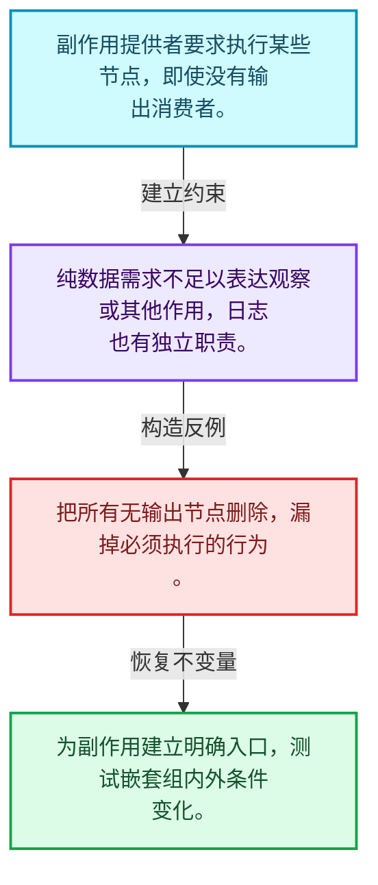
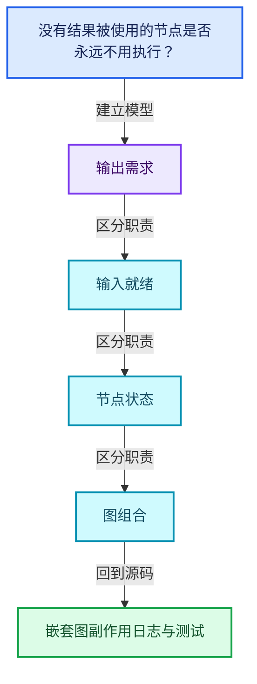
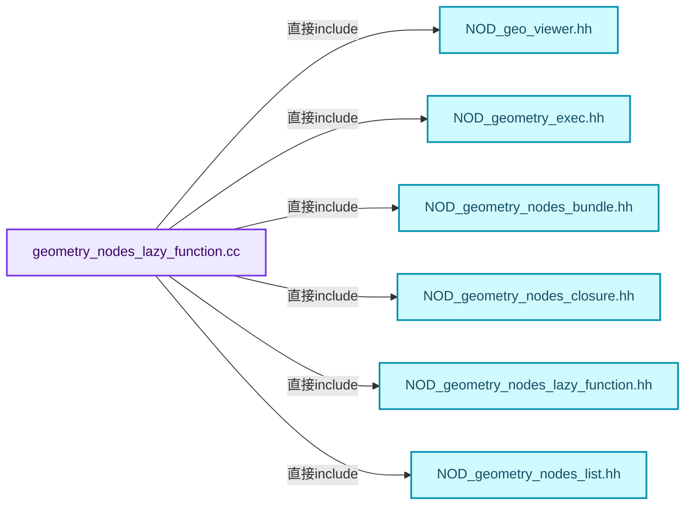
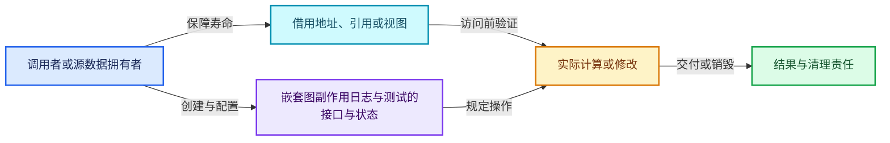
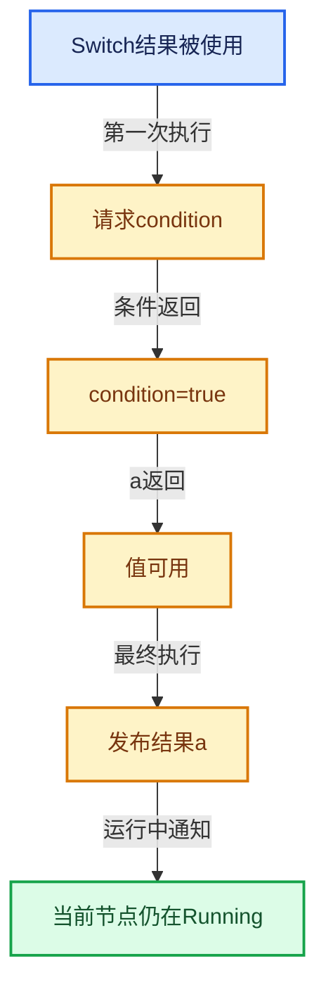

# 09-12 嵌套图副作用日志与测试

[方向导航](README.md) · [总目录](../README.md) · [覆盖索引](../%E6%BA%90%E7%A0%81%E7%89%88%E6%9C%AC%E4%B8%8E%E8%A6%86%E7%9B%96%E7%B4%A2%E5%BC%95.md)

> 阅读顺序：问题与数据模型 → 语法与类型 → 源码逐行 → 调用线索 → 历史与取舍 → 推演和练习。

- 基准 HEAD：`cbda6b96c26c0dee3c3b5cbb93960c4ac06a6b30`。
- 记录日期：2026-10-14。
- 教学示例状态：正文中的推演不是本机性能实测；已运行练习见验收报告。

## 一、从问题到设计

没有结果被使用的节点是否永远不用执行？

副作用节点可由提供者额外要求执行；日志观察执行过程，不能改变结果需求语义。

本篇把语法、数据语义和系统取舍连接起来。需求与就绪是不同维度；状态只在有证据时推进，不能把未确定当作无需求。

### 本篇独立模型与设计推理

副作用提供者要求执行某些节点，即使没有输出消费者。

设计取舍：纯数据需求不足以表达观察或其他作用，日志也有独立职责。

最小反例：把所有无输出节点删除，漏掉必须执行的行为。

推导与处理：为副作用建立明确入口，测试嵌套组内外条件变化。



### 源码范围与相邻篇章

| 文件 | 本篇逐行范围 | 基准SHA-256 |
|---|---|---|
| [source/blender/nodes/intern/geometry_nodes_lazy_function.cc](../../../../../source/blender/nodes/intern/geometry_nodes_lazy_function.cc) | L2903—L4411 | `28f744e665608be8d326853f759fed4c20816eaf2f8e64b605bc8a2a6594c746` |
| [source/blender/functions/tests/FN_lazy_function_test.cc](../../../../../source/blender/functions/tests/FN_lazy_function_test.cc) | L1—L185 | `009cebe68791c4309a3ab81ce5d225b786408982ff971b31d44f954a2bf40cee` |

同一主讲文件可能分多篇覆盖；超出本篇范围的符号通过覆盖索引定位。空行与纯注释保留在源码摘录中，逐行表解释有效语句与语法边界；许可证头统一保留。

前篇：[Switch与MenuSwitch](11-Switch%E4%B8%8EMenuSwitch.md).

## 二、类型、数据与阅读地图



这是概念依赖图，边表示阅读关系，不声称是运行时调用顺序。

### 直接编译依赖



箭头只表示头文件包含关系；完整调用线索见后面的符号定位表。

## 三、关键词、语法与类型角色

### 只读限定 const

const约束当前访问路径可做的修改。const指针、指向const的指针、const视图对象、const元素是不同位置的限定；其他别名可能仍可修改原对象。

具体检查：分别写T* const、const T*与const T* const，并画出不可修改的层次。

### 移动转换 std::move

std::move把表达式转换为可供移动重载选择的值类别，实际资源转移发生在被选中的构造或赋值中。对const对象move可能仍调用复制，对视图move也不会获得底层数据所有权。

具体检查：记录移动构造调用次数，不用变量名或std::move的出现次数替代测量。

### 异常边界 try与catch

try定义异常传播的局部边界。失败路径需要销毁已经成功构造的部分并释放相应存储；未构造的对象不能被析构。

具体检查：在第k次构造失败，列出已经存在的对象集合与待释放缓冲。

### 显式静态转换 static_cast

static_cast表达编译期允许的转换，不会自动验证运行时真实类型、指针寿命或索引边界。由void指针恢复T指针时，调用者仍须保证实际存储中确有合法T对象。

具体检查：标出转换前后的类型以及正确性依据来自哪里。

### 表示层转换 reinterpret_cast

reinterpret_cast不能自动开始任意对象的生命周期，也不能豁免对齐和别名规则。读这类代码需要追溯原始分配与实际构造操作。

具体检查：分别检查大小、对齐、生命周期和可访问类型，四项不能互相替代。

### 限定转换 const_cast

const_cast可以改变访问路径的限定，但不能让本来就是const的对象合法可写。常用于复用只读实现时，仍需检查底层对象是否实际可变。

具体检查：对非const对象的const引用与真正const对象分别分析修改是否合法。

### 覆写检查 override

override要求函数确实覆盖基类虚函数，可捕获参数类型和const限定不匹配。它不改变基类规定的生命周期或线程约束。

具体检查：故意改变一个参数或const，观察编译器如何拒绝误写的新函数。

### 可选值 optional

optional把不存在与存在的T区分开，T的构造和析构跟随engaged状态变化。访问前应由has_value或条件分支证明存在。

具体检查：把空Field状态与合法常量零区分，不能用某个普通值代替不存在。

### 构造与new表达式

普通new可能分配并构造；placement new在给定地址构造，存储由其他机制提供。失败回滚应区分两类责任。

具体检查：追踪地址来自哪里、构造何时成功、由谁析构、由谁释放。

### 内部断言 assert

断言表达开发者预期成立的内部契约，发布构建可能关闭。它不能替代对不可信输入的完整错误处理，也不保证后续操作被运行时保护。

具体检查：对每条断言构造违反条件的输入，区分调用者错误与应向用户报告的错误。

### 独占拥有 unique_ptr

unique_ptr通过移动转移拥有关系，默认删除策略必须与资源来源匹配。get返回借用指针，release交出责任而不销毁。

具体检查：区分move、get、release和reset后谁负责销毁。

### 共享拥有 shared_ptr

shared_ptr让控制块跟踪共享寿命，不自动使被指向对象的读写线程安全；循环拥有可能阻止销毁。

具体检查：画出强引用环并考虑是否应改变所有权方向或引入弱引用。

### 拥有型可调用包装 function

std::function保存可调用目标并提供统一调用接口，复制能力与目标要求有关；FunctionRef仅借用，二者不能无条件互换。

具体检查：比较同步回调与长期保存任务对拥有关系的不同要求。

## 四、真实源码与逐行讲解

源码块保持原行内容，原始行号由小节标题及逐行表给出。表中的调用定位是静态阅读辅助；重载、模板实例化、宏展开和虚调用需结合完整声明，不能仅凭词法出现证明动态调用。

### geometry_nodes_lazy_function.cc：L2903—L2993

<!-- source:source/blender/nodes/intern/geometry_nodes_lazy_function.cc:2903:2993 -->

```cpp

  void insert_node_in_graph(const bNode &bnode, BuildGraphParams &graph_params)
  {
    const bke::bNodeType *node_type = bnode.typeinfo;
    if (node_type == nullptr) {
      return;
    }
    if (bnode.is_muted()) {
      this->build_muted_node(bnode, graph_params);
      return;
    }
    if (bnode.is_group()) {
      /* Have special handling because `bnode.type_legacy` and `node_type.type_legacy` can be
       * different for custom node groups. In other cases they should be identical. */
      this->build_group_node(bnode, graph_params);
      return;
    }
    switch (node_type->type_legacy) {
      case NODE_FRAME: {
        /* Ignored. */
        break;
      }
      case NODE_REROUTE: {
        this->build_reroute_node(bnode, graph_params);
        break;
      }
      case NODE_GROUP_INPUT: {
        this->handle_group_input_node(bnode, graph_params);
        break;
      }
      case NODE_GROUP_OUTPUT: {
        this->build_group_output_node(bnode, graph_params);
        break;
      }
      case GEO_NODE_VIEWER: {
        this->build_viewer_node(bnode, graph_params);
        break;
      }
      case GEO_NODE_SWITCH: {
        this->build_switch_node(bnode, graph_params);
        break;
      }
      case GEO_NODE_INDEX_SWITCH: {
        this->build_index_switch_node(bnode, graph_params);
        break;
      }
      case GEO_NODE_WARNING: {
        this->build_warning_node(bnode, graph_params);
        break;
      }
      case GEO_NODE_GIZMO_LINEAR:
      case GEO_NODE_GIZMO_DIAL:
      case GEO_NODE_GIZMO_TRANSFORM: {
        this->build_gizmo_node(bnode, graph_params);
        break;
      }
      case GEO_NODE_BAKE: {
        this->build_bake_node(bnode, graph_params);
        break;
      }
      case GEO_NODE_MENU_SWITCH: {
        this->build_menu_switch_node(bnode, graph_params);
        break;
      }
      case NODE_EVALUATE_CLOSURE: {
        this->build_evaluate_closure_node(bnode, graph_params);
        break;
      }
      default: {
        if (node_type->geometry_node_execute) {
          this->build_geometry_node(bnode, graph_params);
          break;
        }
        const NodeMultiFunctions::Item &fn_item = node_multi_functions_.try_get(bnode);
        if (fn_item.fn != nullptr) {
          this->build_multi_function_node(bnode, fn_item, graph_params);
          break;
        }
        if (bnode.is_type("NodeEnableOutput"_ustr)) {
          this->build_enable_output_node(bnode, graph_params);
          break;
        }
        if (bnode.is_undefined()) {
          this->build_undefined_node(bnode, graph_params);
          break;
        }
        /* Nodes that don't match any of the criteria above are just ignored. */
        break;
      }
    }
  }
```

本段语义重点：

- 分支证据 `node_type == nullptr)`：分别推演条件成立与不成立，核对相同出口处的状态。
- 分支证据 `bnode.is_muted())`：分别推演条件成立与不成立，核对相同出口处的状态。

| 原始行 | 语义、约束与检查 |
|---|---|
| L2904 | 出现调用或函数声明 `insert_node_in_graph`，对应表达式为 `void insert_node_in_graph(const bNode &bnode, BuildGraphParams &graph_params)`。参数求值、返回类型与重载需结合前后完整语句；静态文本引用不能证明动态目标。 |
| L2905 | 连接上一行的声明或控制结构与其语句块；后续行在这个作用域中执行或声明。 |
| L2906 | 把右侧 `bnode.typeinfo` 用于初始化或更新左侧 `const bke::bNodeType *node_type`。声明初始化与已有对象赋值应按上下文区分；有资源的类型会调用相应特殊成员。 |
| L2907 | 判断 `node_type == nullptr`，成立时进入本分支，否则继续后续路径。这里区分空地址与可用地址，但非空本身仍不能证明对象存活。 |
| L2908 | 结束当前函数，本路径不再执行后续语句；局部对象按作用域规则清理。 |
| L2909 | 结束当前语法单元。局部自动对象在离开其作用域时按规则销毁；这不等于所有被引用的外部数据也被释放。 |
| L2910 | 判断 `bnode.is_muted()`，成立时进入本分支，否则继续后续路径。 |
| L2911 | 出现调用或函数声明 `build_muted_node`，对应表达式为 `this->build_muted_node(bnode, graph_params);`。参数求值、返回类型与重载需结合前后完整语句；静态文本引用不能证明动态目标。 |
| L2912 | 结束当前函数，本路径不再执行后续语句；局部对象按作用域规则清理。 |
| L2913 | 结束当前语法单元。局部自动对象在离开其作用域时按规则销毁；这不等于所有被引用的外部数据也被释放。 |
| L2914 | 判断 `bnode.is_group()`，成立时进入本分支，否则继续后续路径。 |
| L2917 | 出现调用或函数声明 `build_group_node`，对应表达式为 `this->build_group_node(bnode, graph_params);`。参数求值、返回类型与重载需结合前后完整语句；静态文本引用不能证明动态目标。 |
| L2918 | 结束当前函数，本路径不再执行后续语句；局部对象按作用域规则清理。 |
| L2919 | 结束当前语法单元。局部自动对象在离开其作用域时按规则销毁；这不等于所有被引用的外部数据也被释放。 |
| L2920 | 按 switch (node_type->type_legacy) 选择状态处理路径；每个case的break、return或贯穿行为决定下一步。 |
| L2921 | 进入枚举或判别值对应分支 case NODE_FRAME: {；结合状态定义和后续更新判断允许的转移。 |
| L2923 | 离开最近的循环或switch；不是离开整个函数，后续清理和提交代码可能仍会执行。 |
| L2924 | 结束当前语法单元。局部自动对象在离开其作用域时按规则销毁；这不等于所有被引用的外部数据也被释放。 |
| L2925 | 进入枚举或判别值对应分支 case NODE_REROUTE: {；结合状态定义和后续更新判断允许的转移。 |
| L2926 | 出现调用或函数声明 `build_reroute_node`，对应表达式为 `this->build_reroute_node(bnode, graph_params);`。参数求值、返回类型与重载需结合前后完整语句；静态文本引用不能证明动态目标。 |
| L2927 | 离开最近的循环或switch；不是离开整个函数，后续清理和提交代码可能仍会执行。 |
| L2928 | 结束当前语法单元。局部自动对象在离开其作用域时按规则销毁；这不等于所有被引用的外部数据也被释放。 |
| L2929 | 进入枚举或判别值对应分支 case NODE_GROUP_INPUT: {；结合状态定义和后续更新判断允许的转移。 |
| L2930 | 出现调用或函数声明 `handle_group_input_node`，对应表达式为 `this->handle_group_input_node(bnode, graph_params);`。参数求值、返回类型与重载需结合前后完整语句；静态文本引用不能证明动态目标。 |
| L2931 | 离开最近的循环或switch；不是离开整个函数，后续清理和提交代码可能仍会执行。 |
| L2932 | 结束当前语法单元。局部自动对象在离开其作用域时按规则销毁；这不等于所有被引用的外部数据也被释放。 |
| L2933 | 进入枚举或判别值对应分支 case NODE_GROUP_OUTPUT: {；结合状态定义和后续更新判断允许的转移。 |
| L2934 | 出现调用或函数声明 `build_group_output_node`，对应表达式为 `this->build_group_output_node(bnode, graph_params);`。参数求值、返回类型与重载需结合前后完整语句；静态文本引用不能证明动态目标。 |
| L2935 | 离开最近的循环或switch；不是离开整个函数，后续清理和提交代码可能仍会执行。 |
| L2936 | 结束当前语法单元。局部自动对象在离开其作用域时按规则销毁；这不等于所有被引用的外部数据也被释放。 |
| L2937 | 进入枚举或判别值对应分支 case GEO_NODE_VIEWER: {；结合状态定义和后续更新判断允许的转移。 |
| L2938 | 出现调用或函数声明 `build_viewer_node`，对应表达式为 `this->build_viewer_node(bnode, graph_params);`。参数求值、返回类型与重载需结合前后完整语句；静态文本引用不能证明动态目标。 |
| L2939 | 离开最近的循环或switch；不是离开整个函数，后续清理和提交代码可能仍会执行。 |
| L2940 | 结束当前语法单元。局部自动对象在离开其作用域时按规则销毁；这不等于所有被引用的外部数据也被释放。 |
| L2941 | 进入枚举或判别值对应分支 case GEO_NODE_SWITCH: {；结合状态定义和后续更新判断允许的转移。 |
| L2942 | 出现调用或函数声明 `build_switch_node`，对应表达式为 `this->build_switch_node(bnode, graph_params);`。参数求值、返回类型与重载需结合前后完整语句；静态文本引用不能证明动态目标。 |
| L2943 | 离开最近的循环或switch；不是离开整个函数，后续清理和提交代码可能仍会执行。 |
| L2944 | 结束当前语法单元。局部自动对象在离开其作用域时按规则销毁；这不等于所有被引用的外部数据也被释放。 |
| L2945 | 进入枚举或判别值对应分支 case GEO_NODE_INDEX_SWITCH: {；结合状态定义和后续更新判断允许的转移。 |
| L2946 | 出现调用或函数声明 `build_index_switch_node`，对应表达式为 `this->build_index_switch_node(bnode, graph_params);`。参数求值、返回类型与重载需结合前后完整语句；静态文本引用不能证明动态目标。 |
| L2947 | 离开最近的循环或switch；不是离开整个函数，后续清理和提交代码可能仍会执行。 |
| L2948 | 结束当前语法单元。局部自动对象在离开其作用域时按规则销毁；这不等于所有被引用的外部数据也被释放。 |
| L2949 | 进入枚举或判别值对应分支 case GEO_NODE_WARNING: {；结合状态定义和后续更新判断允许的转移。 |
| L2950 | 出现调用或函数声明 `build_warning_node`，对应表达式为 `this->build_warning_node(bnode, graph_params);`。参数求值、返回类型与重载需结合前后完整语句；静态文本引用不能证明动态目标。 |
| L2951 | 离开最近的循环或switch；不是离开整个函数，后续清理和提交代码可能仍会执行。 |
| L2952 | 结束当前语法单元。局部自动对象在离开其作用域时按规则销毁；这不等于所有被引用的外部数据也被释放。 |
| L2953 | 进入枚举或判别值对应分支 case GEO_NODE_GIZMO_LINEAR:；结合状态定义和后续更新判断允许的转移。 |
| L2954 | 进入枚举或判别值对应分支 case GEO_NODE_GIZMO_DIAL:；结合状态定义和后续更新判断允许的转移。 |
| L2955 | 进入枚举或判别值对应分支 case GEO_NODE_GIZMO_TRANSFORM: {；结合状态定义和后续更新判断允许的转移。 |
| L2956 | 出现调用或函数声明 `build_gizmo_node`，对应表达式为 `this->build_gizmo_node(bnode, graph_params);`。参数求值、返回类型与重载需结合前后完整语句；静态文本引用不能证明动态目标。 |
| L2957 | 离开最近的循环或switch；不是离开整个函数，后续清理和提交代码可能仍会执行。 |
| L2958 | 结束当前语法单元。局部自动对象在离开其作用域时按规则销毁；这不等于所有被引用的外部数据也被释放。 |
| L2959 | 进入枚举或判别值对应分支 case GEO_NODE_BAKE: {；结合状态定义和后续更新判断允许的转移。 |
| L2960 | 出现调用或函数声明 `build_bake_node`，对应表达式为 `this->build_bake_node(bnode, graph_params);`。参数求值、返回类型与重载需结合前后完整语句；静态文本引用不能证明动态目标。 |
| L2961 | 离开最近的循环或switch；不是离开整个函数，后续清理和提交代码可能仍会执行。 |
| L2962 | 结束当前语法单元。局部自动对象在离开其作用域时按规则销毁；这不等于所有被引用的外部数据也被释放。 |
| L2963 | 进入枚举或判别值对应分支 case GEO_NODE_MENU_SWITCH: {；结合状态定义和后续更新判断允许的转移。 |
| L2964 | 出现调用或函数声明 `build_menu_switch_node`，对应表达式为 `this->build_menu_switch_node(bnode, graph_params);`。参数求值、返回类型与重载需结合前后完整语句；静态文本引用不能证明动态目标。 |
| L2965 | 离开最近的循环或switch；不是离开整个函数，后续清理和提交代码可能仍会执行。 |
| L2966 | 结束当前语法单元。局部自动对象在离开其作用域时按规则销毁；这不等于所有被引用的外部数据也被释放。 |
| L2967 | 进入枚举或判别值对应分支 case NODE_EVALUATE_CLOSURE: {；结合状态定义和后续更新判断允许的转移。 |
| L2968 | 出现调用或函数声明 `build_evaluate_closure_node`，对应表达式为 `this->build_evaluate_closure_node(bnode, graph_params);`。参数求值、返回类型与重载需结合前后完整语句；静态文本引用不能证明动态目标。 |
| L2969 | 离开最近的循环或switch；不是离开整个函数，后续清理和提交代码可能仍会执行。 |
| L2970 | 结束当前语法单元。局部自动对象在离开其作用域时按规则销毁；这不等于所有被引用的外部数据也被释放。 |
| L2971 | 进入枚举或判别值对应分支 default: {；结合状态定义和后续更新判断允许的转移。 |
| L2972 | 判断 `node_type->geometry_node_execute`，成立时进入本分支，否则继续后续路径。 |
| L2973 | 出现调用或函数声明 `build_geometry_node`，对应表达式为 `this->build_geometry_node(bnode, graph_params);`。参数求值、返回类型与重载需结合前后完整语句；静态文本引用不能证明动态目标。 |
| L2974 | 离开最近的循环或switch；不是离开整个函数，后续清理和提交代码可能仍会执行。 |
| L2975 | 结束当前语法单元。局部自动对象在离开其作用域时按规则销毁；这不等于所有被引用的外部数据也被释放。 |
| L2976 | 把右侧 `node_multi_functions_.try_get(bnode)` 用于初始化或更新左侧 `const NodeMultiFunctions::Item &fn_item`。声明初始化与已有对象赋值应按上下文区分；有资源的类型会调用相应特殊成员。 |
| L2977 | 判断 `fn_item.fn != nullptr`，成立时进入本分支，否则继续后续路径。这里区分空地址与可用地址，但非空本身仍不能证明对象存活。 |
| L2978 | 出现调用或函数声明 `build_multi_function_node`，对应表达式为 `this->build_multi_function_node(bnode, fn_item, graph_params);`。参数求值、返回类型与重载需结合前后完整语句；静态文本引用不能证明动态目标。 |
| L2979 | 离开最近的循环或switch；不是离开整个函数，后续清理和提交代码可能仍会执行。 |
| L2980 | 结束当前语法单元。局部自动对象在离开其作用域时按规则销毁；这不等于所有被引用的外部数据也被释放。 |
| L2981 | 判断 `bnode.is_type("NodeEnableOutput"_ustr)`，成立时进入本分支，否则继续后续路径。 |
| L2982 | 出现调用或函数声明 `build_enable_output_node`，对应表达式为 `this->build_enable_output_node(bnode, graph_params);`。参数求值、返回类型与重载需结合前后完整语句；静态文本引用不能证明动态目标。 |
| L2983 | 离开最近的循环或switch；不是离开整个函数，后续清理和提交代码可能仍会执行。 |
| L2984 | 结束当前语法单元。局部自动对象在离开其作用域时按规则销毁；这不等于所有被引用的外部数据也被释放。 |
| L2985 | 判断 `bnode.is_undefined()`，成立时进入本分支，否则继续后续路径。 |
| L2986 | 出现调用或函数声明 `build_undefined_node`，对应表达式为 `this->build_undefined_node(bnode, graph_params);`。参数求值、返回类型与重载需结合前后完整语句；静态文本引用不能证明动态目标。 |
| L2987 | 离开最近的循环或switch；不是离开整个函数，后续清理和提交代码可能仍会执行。 |
| L2988 | 结束当前语法单元。局部自动对象在离开其作用域时按规则销毁；这不等于所有被引用的外部数据也被释放。 |
| L2990 | 离开最近的循环或switch；不是离开整个函数，后续清理和提交代码可能仍会执行。 |
| L2991 | 结束当前语法单元。局部自动对象在离开其作用域时按规则销毁；这不等于所有被引用的外部数据也被释放。 |
| L2992 | 结束当前语法单元。局部自动对象在离开其作用域时按规则销毁；这不等于所有被引用的外部数据也被释放。 |
| L2993 | 结束当前语法单元。局部自动对象在离开其作用域时按规则销毁；这不等于所有被引用的外部数据也被释放。 |

### geometry_nodes_lazy_function.cc：L2994—L3044

<!-- source:source/blender/nodes/intern/geometry_nodes_lazy_function.cc:2994:3044 -->

```cpp

  void build_muted_node(const bNode &bnode, BuildGraphParams &graph_params)
  {
    auto &lazy_function = scope_.construct<LazyFunctionForMutedNode>(
        bnode, mapping_->lf_index_by_bsocket);
    lf::Node &lf_node = graph_params.lf_graph.add_function(lazy_function);
    for (const bNodeSocket *bsocket : bnode.input_sockets()) {
      const int lf_index = mapping_->lf_index_by_bsocket[bsocket->index_in_tree()];
      if (lf_index == -1) {
        continue;
      }
      this->add_to_socket_map(graph_params, *bsocket, lf_node.input(lf_index));
    }
    for (const bNodeSocket *bsocket : bnode.output_sockets()) {
      const int lf_index = mapping_->lf_index_by_bsocket[bsocket->index_in_tree()];
      if (lf_index == -1) {
        continue;
      }
      this->add_to_socket_map(graph_params, *bsocket, lf_node.output(lf_index));
    }

    this->build_muted_node_usages(bnode, graph_params);
  }

  /**
   * An input of a muted node is used when any of its internally linked outputs is used.
   */
  void build_muted_node_usages(const bNode &bnode, BuildGraphParams &graph_params)
  {
    /* Find all outputs that use a specific input. */
    MultiValueMap<const bNodeSocket *, const bNodeSocket *> outputs_by_input;
    for (const bNodeInternalLink &blink : bnode.internal_links()) {
      outputs_by_input.add(blink.in, blink.out);
    }
    for (const auto item : outputs_by_input.items()) {
      const bNodeSocket &input_bsocket = *item.key;
      const Span<const bNodeSocket *> output_bsockets = item.value;

      /* The input is used if any of the internally linked outputs is used. */
      Vector<lf::OutputSocket *> lf_socket_usages;
      for (const bNodeSocket *output_bsocket : output_bsockets) {
        if (lf::OutputSocket *lf_socket = graph_params.usage_by_bsocket.lookup_default(
                output_bsocket, nullptr))
        {
          lf_socket_usages.append(lf_socket);
        }
      }
      graph_params.usage_by_bsocket.add(&input_bsocket,
                                        this->or_socket_usages(lf_socket_usages, graph_params));
    }
  }
```

本段语义重点：

- `scope_`：求值或资源作用域，负责相应临时存储及清理。

| 原始行 | 语义、约束与检查 |
|---|---|
| L2995 | 出现调用或函数声明 `build_muted_node`，对应表达式为 `void build_muted_node(const bNode &bnode, BuildGraphParams &graph_params)`。参数求值、返回类型与重载需结合前后完整语句；静态文本引用不能证明动态目标。 |
| L2996 | 连接上一行的声明或控制结构与其语句块；后续行在这个作用域中执行或声明。 |
| L2997 | 建立或更新 `scope_`：求值或资源作用域，负责相应临时存储及清理。本行的具体值关系为 `auto &lazy_function = scope_.construct<LazyFunctionForMutedNode>(`；对照更新前后相应范围或状态是否一致。 |
| L2998 | 声明成员、局部对象或完成语句 `bnode, mapping_->lf_index_by_bsocket)`。若为指针或引用，它本身不说明拥有；若为值对象，其构造析构由所在作用域或外层对象管理。 |
| L2999 | 把右侧 `graph_params.lf_graph.add_function(lazy_function)` 用于初始化或更新左侧 `lf::Node &lf_node`。声明初始化与已有对象赋值应按上下文区分；有资源的类型会调用相应特殊成员。 |
| L3000 | 按 `for (const bNodeSocket *bsocket : bnode.input_sockets())` 指定的范围或条件重复执行。对照循环变量与真实元素编号；循环内调用成本乘以实际迭代次数。 |
| L3001 | 把右侧 `mapping_->lf_index_by_bsocket[bsocket->index_in_tree()]` 用于初始化或更新左侧 `const int lf_index`。声明初始化与已有对象赋值应按上下文区分；有资源的类型会调用相应特殊成员。 |
| L3002 | 判断 `lf_index == -1`，成立时进入本分支，否则继续后续路径。 |
| L3003 | 结束本轮循环并进入下一轮；核对本轮已经取得的资源是否由作用域或显式代码清理。 |
| L3004 | 结束当前语法单元。局部自动对象在离开其作用域时按规则销毁；这不等于所有被引用的外部数据也被释放。 |
| L3005 | 出现调用或函数声明 `add_to_socket_map`，对应表达式为 `this->add_to_socket_map(graph_params, *bsocket, lf_node.input(lf_index));`。参数求值、返回类型与重载需结合前后完整语句；静态文本引用不能证明动态目标。 |
| L3006 | 结束当前语法单元。局部自动对象在离开其作用域时按规则销毁；这不等于所有被引用的外部数据也被释放。 |
| L3007 | 按 `for (const bNodeSocket *bsocket : bnode.output_sockets())` 指定的范围或条件重复执行。对照循环变量与真实元素编号；循环内调用成本乘以实际迭代次数。 |
| L3008 | 把右侧 `mapping_->lf_index_by_bsocket[bsocket->index_in_tree()]` 用于初始化或更新左侧 `const int lf_index`。声明初始化与已有对象赋值应按上下文区分；有资源的类型会调用相应特殊成员。 |
| L3009 | 判断 `lf_index == -1`，成立时进入本分支，否则继续后续路径。 |
| L3010 | 结束本轮循环并进入下一轮；核对本轮已经取得的资源是否由作用域或显式代码清理。 |
| L3011 | 结束当前语法单元。局部自动对象在离开其作用域时按规则销毁；这不等于所有被引用的外部数据也被释放。 |
| L3012 | 出现调用或函数声明 `add_to_socket_map`，对应表达式为 `this->add_to_socket_map(graph_params, *bsocket, lf_node.output(lf_index));`。参数求值、返回类型与重载需结合前后完整语句；静态文本引用不能证明动态目标。 |
| L3013 | 结束当前语法单元。局部自动对象在离开其作用域时按规则销毁；这不等于所有被引用的外部数据也被释放。 |
| L3015 | 出现调用或函数声明 `build_muted_node_usages`，对应表达式为 `this->build_muted_node_usages(bnode, graph_params);`。参数求值、返回类型与重载需结合前后完整语句；静态文本引用不能证明动态目标。 |
| L3016 | 结束当前语法单元。局部自动对象在离开其作用域时按规则销毁；这不等于所有被引用的外部数据也被释放。 |
| L3021 | 出现调用或函数声明 `build_muted_node_usages`，对应表达式为 `void build_muted_node_usages(const bNode &bnode, BuildGraphParams &graph_params)`。参数求值、返回类型与重载需结合前后完整语句；静态文本引用不能证明动态目标。 |
| L3022 | 连接上一行的声明或控制结构与其语句块；后续行在这个作用域中执行或声明。 |
| L3024 | 声明成员、局部对象或完成语句 `MultiValueMap<const bNodeSocket *, const bNodeSocket *> outputs_by_input`。若为指针或引用，它本身不说明拥有；若为值对象，其构造析构由所在作用域或外层对象管理。 |
| L3025 | 按 `for (const bNodeInternalLink &blink : bnode.internal_links())` 指定的范围或条件重复执行。对照循环变量与真实元素编号；循环内调用成本乘以实际迭代次数。 |
| L3026 | 出现调用或函数声明 `add`，对应表达式为 `outputs_by_input.add(blink.in, blink.out);`。参数求值、返回类型与重载需结合前后完整语句；静态文本引用不能证明动态目标。 |
| L3027 | 结束当前语法单元。局部自动对象在离开其作用域时按规则销毁；这不等于所有被引用的外部数据也被释放。 |
| L3028 | 按 `for (const auto item : outputs_by_input.items())` 指定的范围或条件重复执行。对照循环变量与真实元素编号；循环内调用成本乘以实际迭代次数。 |
| L3029 | 把右侧 `*item.key` 用于初始化或更新左侧 `const bNodeSocket &input_bsocket`。声明初始化与已有对象赋值应按上下文区分；有资源的类型会调用相应特殊成员。 |
| L3030 | 把右侧 `item.value` 用于初始化或更新左侧 `const Span<const bNodeSocket *> output_bsockets`。声明初始化与已有对象赋值应按上下文区分；有资源的类型会调用相应特殊成员。 |
| L3033 | 声明成员、局部对象或完成语句 `Vector<lf::OutputSocket *> lf_socket_usages`。若为指针或引用，它本身不说明拥有；若为值对象，其构造析构由所在作用域或外层对象管理。 |
| L3034 | 按 `for (const bNodeSocket *output_bsocket : output_bsockets)` 指定的范围或条件重复执行。对照循环变量与真实元素编号；循环内调用成本乘以实际迭代次数。 |
| L3035 | 判断 `lf::OutputSocket *lf_socket = graph_params.usage_by_bsocket.lookup_default(`，成立时进入本分支，否则继续后续路径。此处处理需求状态；不要把未知需求直接当作不需要。 |
| L3036 | 本行是连续声明或表达式的一部分：`output_bsocket, nullptr))`。与本段前后行合读；逗号、括号和限定符决定它属于参数、初始化列表还是实际计算。 |
| L3037 | 连接上一行的声明或控制结构与其语句块；后续行在这个作用域中执行或声明。 |
| L3038 | 出现调用或函数声明 `append`，对应表达式为 `lf_socket_usages.append(lf_socket);`。参数求值、返回类型与重载需结合前后完整语句；静态文本引用不能证明动态目标。 |
| L3039 | 结束当前语法单元。局部自动对象在离开其作用域时按规则销毁；这不等于所有被引用的外部数据也被释放。 |
| L3040 | 结束当前语法单元。局部自动对象在离开其作用域时按规则销毁；这不等于所有被引用的外部数据也被释放。 |
| L3041 | 出现调用或函数声明 `add`，对应表达式为 `graph_params.usage_by_bsocket.add(&input_bsocket,`。参数求值、返回类型与重载需结合前后完整语句；静态文本引用不能证明动态目标。 |
| L3042 | 出现调用或函数声明 `or_socket_usages`，对应表达式为 `this->or_socket_usages(lf_socket_usages, graph_params));`。参数求值、返回类型与重载需结合前后完整语句；静态文本引用不能证明动态目标。 |
| L3043 | 结束当前语法单元。局部自动对象在离开其作用域时按规则销毁；这不等于所有被引用的外部数据也被释放。 |
| L3044 | 结束当前语法单元。局部自动对象在离开其作用域时按规则销毁；这不等于所有被引用的外部数据也被释放。 |

### geometry_nodes_lazy_function.cc：L3045—L3093

<!-- source:source/blender/nodes/intern/geometry_nodes_lazy_function.cc:3045:3093 -->

```cpp

  void build_reroute_node(const bNode &bnode, BuildGraphParams &graph_params)
  {
    const bNodeSocket &input_bsocket = bnode.input_socket(0);
    const bNodeSocket &output_bsocket = bnode.output_socket(0);
    if (!input_bsocket.typeinfo->geometry_nodes_default_value) {
      return;
    }

    auto &lazy_function = scope_.construct<LazyFunctionForRerouteNode>();
    lf::Node &lf_node = graph_params.lf_graph.add_function(lazy_function);

    this->add_to_socket_map(graph_params, input_bsocket, lf_node.input(0));
    this->add_to_socket_map(graph_params, output_bsocket, lf_node.output(0));

    if (lf::OutputSocket *lf_usage = graph_params.usage_by_bsocket.lookup_default(
            &bnode.output_socket(0), nullptr))
    {
      graph_params.usage_by_bsocket.add(&bnode.input_socket(0), lf_usage);
    }
  }

  void handle_group_input_node(const bNode &bnode, BuildGraphParams &graph_params)
  {
    for (const int i : btree_.interface_inputs().index_range()) {
      const bNodeSocket &bsocket = bnode.output_socket(i);
      lf::GraphInputSocket &lf_socket = *const_cast<lf::GraphInputSocket *>(
          group_input_sockets_[i]);
      this->add_to_socket_map(graph_params, bsocket, lf_socket);
    }
  }

  void build_group_output_node(const bNode &bnode, BuildGraphParams &graph_params)
  {
    Vector<lf::GraphOutputSocket *> lf_graph_outputs;

    for (const int i : btree_.interface_outputs().index_range()) {
      const bNodeTreeInterfaceSocket &interface_output = *btree_.interface_outputs()[i];
      const bNodeSocket &bsocket = bnode.input_socket(i);
      lf::GraphOutputSocket &lf_socket = graph_params.lf_graph.add_output(
          CPPType::get<SocketValueVariant>(), interface_output.name());
      lf_graph_outputs.append(&lf_socket);
      this->add_to_socket_map(graph_params, bsocket, lf_socket);
    }

    if (&bnode == btree_.group_output_node()) {
      standard_group_output_sockets_ = lf_graph_outputs.as_span();
    }
  }
```

本段语义重点：

- `scope_`：求值或资源作用域，负责相应临时存储及清理。

| 原始行 | 语义、约束与检查 |
|---|---|
| L3046 | 出现调用或函数声明 `build_reroute_node`，对应表达式为 `void build_reroute_node(const bNode &bnode, BuildGraphParams &graph_params)`。参数求值、返回类型与重载需结合前后完整语句；静态文本引用不能证明动态目标。 |
| L3047 | 连接上一行的声明或控制结构与其语句块；后续行在这个作用域中执行或声明。 |
| L3048 | 把右侧 `bnode.input_socket(0)` 用于初始化或更新左侧 `const bNodeSocket &input_bsocket`。声明初始化与已有对象赋值应按上下文区分；有资源的类型会调用相应特殊成员。 |
| L3049 | 把右侧 `bnode.output_socket(0)` 用于初始化或更新左侧 `const bNodeSocket &output_bsocket`。声明初始化与已有对象赋值应按上下文区分；有资源的类型会调用相应特殊成员。 |
| L3050 | 判断 `!input_bsocket.typeinfo->geometry_nodes_default_value`，成立时进入本分支，否则继续后续路径。 |
| L3051 | 结束当前函数，本路径不再执行后续语句；局部对象按作用域规则清理。 |
| L3052 | 结束当前语法单元。局部自动对象在离开其作用域时按规则销毁；这不等于所有被引用的外部数据也被释放。 |
| L3054 | 建立或更新 `scope_`：求值或资源作用域，负责相应临时存储及清理。本行的具体值关系为 `auto &lazy_function = scope_.construct<LazyFunctionForRerouteNode>()`；对照更新前后相应范围或状态是否一致。 |
| L3055 | 把右侧 `graph_params.lf_graph.add_function(lazy_function)` 用于初始化或更新左侧 `lf::Node &lf_node`。声明初始化与已有对象赋值应按上下文区分；有资源的类型会调用相应特殊成员。 |
| L3057 | 出现调用或函数声明 `add_to_socket_map`，对应表达式为 `this->add_to_socket_map(graph_params, input_bsocket, lf_node.input(0));`。参数求值、返回类型与重载需结合前后完整语句；静态文本引用不能证明动态目标。 |
| L3058 | 出现调用或函数声明 `add_to_socket_map`，对应表达式为 `this->add_to_socket_map(graph_params, output_bsocket, lf_node.output(0));`。参数求值、返回类型与重载需结合前后完整语句；静态文本引用不能证明动态目标。 |
| L3060 | 判断 `lf::OutputSocket *lf_usage = graph_params.usage_by_bsocket.lookup_default(`，成立时进入本分支，否则继续后续路径。此处处理需求状态；不要把未知需求直接当作不需要。 |
| L3061 | 出现调用或函数声明 `output_socket`，对应表达式为 `&bnode.output_socket(0), nullptr))`。参数求值、返回类型与重载需结合前后完整语句；静态文本引用不能证明动态目标。 |
| L3062 | 连接上一行的声明或控制结构与其语句块；后续行在这个作用域中执行或声明。 |
| L3063 | 出现调用或函数声明 `add`，对应表达式为 `graph_params.usage_by_bsocket.add(&bnode.input_socket(0), lf_usage);`。参数求值、返回类型与重载需结合前后完整语句；静态文本引用不能证明动态目标。 |
| L3064 | 结束当前语法单元。局部自动对象在离开其作用域时按规则销毁；这不等于所有被引用的外部数据也被释放。 |
| L3065 | 结束当前语法单元。局部自动对象在离开其作用域时按规则销毁；这不等于所有被引用的外部数据也被释放。 |
| L3067 | 出现调用或函数声明 `handle_group_input_node`，对应表达式为 `void handle_group_input_node(const bNode &bnode, BuildGraphParams &graph_params)`。参数求值、返回类型与重载需结合前后完整语句；静态文本引用不能证明动态目标。 |
| L3068 | 连接上一行的声明或控制结构与其语句块；后续行在这个作用域中执行或声明。 |
| L3069 | 按 `for (const int i : btree_.interface_inputs().index_range())` 指定的范围或条件重复执行。对照循环变量与真实元素编号；循环内调用成本乘以实际迭代次数。 |
| L3070 | 把右侧 `bnode.output_socket(i)` 用于初始化或更新左侧 `const bNodeSocket &bsocket`。声明初始化与已有对象赋值应按上下文区分；有资源的类型会调用相应特殊成员。 |
| L3071 | 把右侧 `*const_cast<lf::GraphInputSocket *>(` 用于初始化或更新左侧 `lf::GraphInputSocket &lf_socket`。声明初始化与已有对象赋值应按上下文区分；有资源的类型会调用相应特殊成员。 |
| L3072 | 声明成员、局部对象或完成语句 `group_input_sockets_[i])`。若为指针或引用，它本身不说明拥有；若为值对象，其构造析构由所在作用域或外层对象管理。 |
| L3073 | 出现调用或函数声明 `add_to_socket_map`，对应表达式为 `this->add_to_socket_map(graph_params, bsocket, lf_socket);`。参数求值、返回类型与重载需结合前后完整语句；静态文本引用不能证明动态目标。 |
| L3074 | 结束当前语法单元。局部自动对象在离开其作用域时按规则销毁；这不等于所有被引用的外部数据也被释放。 |
| L3075 | 结束当前语法单元。局部自动对象在离开其作用域时按规则销毁；这不等于所有被引用的外部数据也被释放。 |
| L3077 | 出现调用或函数声明 `build_group_output_node`，对应表达式为 `void build_group_output_node(const bNode &bnode, BuildGraphParams &graph_params)`。参数求值、返回类型与重载需结合前后完整语句；静态文本引用不能证明动态目标。 |
| L3078 | 连接上一行的声明或控制结构与其语句块；后续行在这个作用域中执行或声明。 |
| L3079 | 声明成员、局部对象或完成语句 `Vector<lf::GraphOutputSocket *> lf_graph_outputs`。若为指针或引用，它本身不说明拥有；若为值对象，其构造析构由所在作用域或外层对象管理。 |
| L3081 | 按 `for (const int i : btree_.interface_outputs().index_range())` 指定的范围或条件重复执行。对照循环变量与真实元素编号；循环内调用成本乘以实际迭代次数。 |
| L3082 | 把右侧 `*btree_.interface_outputs()[i]` 用于初始化或更新左侧 `const bNodeTreeInterfaceSocket &interface_output`。声明初始化与已有对象赋值应按上下文区分；有资源的类型会调用相应特殊成员。 |
| L3083 | 把右侧 `bnode.input_socket(i)` 用于初始化或更新左侧 `const bNodeSocket &bsocket`。声明初始化与已有对象赋值应按上下文区分；有资源的类型会调用相应特殊成员。 |
| L3084 | 把右侧 `graph_params.lf_graph.add_output(` 用于初始化或更新左侧 `lf::GraphOutputSocket &lf_socket`。声明初始化与已有对象赋值应按上下文区分；有资源的类型会调用相应特殊成员。 |
| L3085 | 出现调用或函数声明 `CPPType::get`，对应表达式为 `CPPType::get<SocketValueVariant>(), interface_output.name());`。参数求值、返回类型与重载需结合前后完整语句；静态文本引用不能证明动态目标。 |
| L3086 | 出现调用或函数声明 `append`，对应表达式为 `lf_graph_outputs.append(&lf_socket);`。参数求值、返回类型与重载需结合前后完整语句；静态文本引用不能证明动态目标。 |
| L3087 | 出现调用或函数声明 `add_to_socket_map`，对应表达式为 `this->add_to_socket_map(graph_params, bsocket, lf_socket);`。参数求值、返回类型与重载需结合前后完整语句；静态文本引用不能证明动态目标。 |
| L3088 | 结束当前语法单元。局部自动对象在离开其作用域时按规则销毁；这不等于所有被引用的外部数据也被释放。 |
| L3090 | 判断 `&bnode == btree_.group_output_node()`，成立时进入本分支，否则继续后续路径。 |
| L3091 | 把右侧 `lf_graph_outputs.as_span()` 用于初始化或更新左侧 `standard_group_output_sockets_`。声明初始化与已有对象赋值应按上下文区分；有资源的类型会调用相应特殊成员。 |
| L3092 | 结束当前语法单元。局部自动对象在离开其作用域时按规则销毁；这不等于所有被引用的外部数据也被释放。 |
| L3093 | 结束当前语法单元。局部自动对象在离开其作用域时按规则销毁；这不等于所有被引用的外部数据也被释放。 |

### geometry_nodes_lazy_function.cc：L3094—L3150

<!-- source:source/blender/nodes/intern/geometry_nodes_lazy_function.cc:3094:3150 -->

```cpp

  void build_group_node(const bNode &bnode, BuildGraphParams &graph_params)
  {
    const bNodeTree *group_btree = reinterpret_cast<bNodeTree *>(bnode.id);
    if (group_btree == nullptr) {
      return;
    }
    const std::shared_ptr<const GeometryNodesLazyFunctionGraphInfo> &group_lf_graph_info =
        ensure_geometry_nodes_lazy_function_graph(*group_btree);
    if (!group_lf_graph_info) {
      return;
    }
    /* Take ownership of the nested group. */
    scope_.add(group_lf_graph_info);

    auto &lazy_function = scope_.construct<LazyFunctionForGroupNode>(
        bnode, *group_lf_graph_info, *lf_graph_info_);
    lf::FunctionNode &lf_node = graph_params.lf_graph.add_function(lazy_function);

    for (const int i : bnode.input_sockets().index_range()) {
      const bNodeSocket &bsocket = bnode.input_socket(i);
      BLI_assert(!bsocket.is_multi_input());
      lf::InputSocket &lf_socket = lf_node.input(group_lf_graph_info->function.inputs.main[i]);
      this->add_to_socket_map(graph_params, bsocket, lf_socket);
    }
    for (const int i : bnode.output_sockets().index_range()) {
      const bNodeSocket &bsocket = bnode.output_socket(i);
      lf::OutputSocket &lf_socket = lf_node.output(group_lf_graph_info->function.outputs.main[i]);
      this->add_to_socket_map(graph_params, bsocket, lf_socket);
    }
    mapping_->group_node_map.add(bnode.identifier, &lf_node);
    lf_graph_info_->num_inline_nodes_approximate +=
        group_lf_graph_info->num_inline_nodes_approximate;
    static const bool static_false = false;
    for (const bNodeSocket *bsocket : bnode.output_sockets()) {
      {
        const int lf_input_index =
            mapping_->lf_input_index_for_output_bsocket_usage[bsocket->index_in_all_outputs()];
        if (lf_input_index != -1) {
          lf::InputSocket &lf_input = lf_node.input(lf_input_index);
          lf_input.set_default_value(&static_false);
          graph_params.socket_usage_inputs.add(&lf_input);
        }
      }
      {
        /* Keep track of reference set inputs that need to be populated later. */
        const int lf_input_index =
            mapping_->lf_input_index_for_reference_set_for_output[bsocket->index_in_all_outputs()];
        if (lf_input_index != -1) {
          lf::InputSocket &lf_input = lf_node.input(lf_input_index);
          graph_params.lf_reference_set_input_by_output.add(bsocket, &lf_input);
        }
      }
    }

    this->build_group_node_socket_usage(bnode, lf_node, graph_params, *group_lf_graph_info);
  }
```

本段语义重点：

- `scope_`：求值或资源作用域，负责相应临时存储及清理。

| 原始行 | 语义、约束与检查 |
|---|---|
| L3095 | 出现调用或函数声明 `build_group_node`，对应表达式为 `void build_group_node(const bNode &bnode, BuildGraphParams &graph_params)`。参数求值、返回类型与重载需结合前后完整语句；静态文本引用不能证明动态目标。 |
| L3096 | 连接上一行的声明或控制结构与其语句块；后续行在这个作用域中执行或声明。 |
| L3097 | 把右侧 `reinterpret_cast<bNodeTree *>(bnode.id)` 用于初始化或更新左侧 `const bNodeTree *group_btree`。声明初始化与已有对象赋值应按上下文区分；有资源的类型会调用相应特殊成员。 |
| L3098 | 判断 `group_btree == nullptr`，成立时进入本分支，否则继续后续路径。这里区分空地址与可用地址，但非空本身仍不能证明对象存活。 |
| L3099 | 结束当前函数，本路径不再执行后续语句；局部对象按作用域规则清理。 |
| L3100 | 结束当前语法单元。局部自动对象在离开其作用域时按规则销毁；这不等于所有被引用的外部数据也被释放。 |
| L3101 | 把右侧 `` 用于初始化或更新左侧 `const std::shared_ptr<const GeometryNodesLazyFunctionGraphInfo> &group_lf_graph_info`。声明初始化与已有对象赋值应按上下文区分；有资源的类型会调用相应特殊成员。 |
| L3102 | 出现调用或函数声明 `ensure_geometry_nodes_lazy_function_graph`，对应表达式为 `ensure_geometry_nodes_lazy_function_graph(*group_btree);`。参数求值、返回类型与重载需结合前后完整语句；静态文本引用不能证明动态目标。 |
| L3103 | 判断 `!group_lf_graph_info`，成立时进入本分支，否则继续后续路径。 |
| L3104 | 结束当前函数，本路径不再执行后续语句；局部对象按作用域规则清理。 |
| L3105 | 结束当前语法单元。局部自动对象在离开其作用域时按规则销毁；这不等于所有被引用的外部数据也被释放。 |
| L3107 | 本行涉及 `scope_`：求值或资源作用域，负责相应临时存储及清理。按此语义解读 `scope_.add(group_lf_graph_info)`，不要把地址、数量或状态混用。 |
| L3109 | 建立或更新 `scope_`：求值或资源作用域，负责相应临时存储及清理。本行的具体值关系为 `auto &lazy_function = scope_.construct<LazyFunctionForGroupNode>(`；对照更新前后相应范围或状态是否一致。 |
| L3110 | 声明成员、局部对象或完成语句 `bnode, *group_lf_graph_info, *lf_graph_info_)`。若为指针或引用，它本身不说明拥有；若为值对象，其构造析构由所在作用域或外层对象管理。 |
| L3111 | 把右侧 `graph_params.lf_graph.add_function(lazy_function)` 用于初始化或更新左侧 `lf::FunctionNode &lf_node`。声明初始化与已有对象赋值应按上下文区分；有资源的类型会调用相应特殊成员。 |
| L3113 | 按 `for (const int i : bnode.input_sockets().index_range())` 指定的范围或条件重复执行。对照循环变量与真实元素编号；循环内调用成本乘以实际迭代次数。 |
| L3114 | 把右侧 `bnode.input_socket(i)` 用于初始化或更新左侧 `const bNodeSocket &bsocket`。声明初始化与已有对象赋值应按上下文区分；有资源的类型会调用相应特殊成员。 |
| L3115 | 断言约束 `BLI_assert(!bsocket.is_multi_input());`。条件是后续访问的内部前置条件；发布构建可能不执行，不能把断言当作输入修复。 |
| L3116 | 把右侧 `lf_node.input(group_lf_graph_info->function.inputs.main[i])` 用于初始化或更新左侧 `lf::InputSocket &lf_socket`。声明初始化与已有对象赋值应按上下文区分；有资源的类型会调用相应特殊成员。 |
| L3117 | 出现调用或函数声明 `add_to_socket_map`，对应表达式为 `this->add_to_socket_map(graph_params, bsocket, lf_socket);`。参数求值、返回类型与重载需结合前后完整语句；静态文本引用不能证明动态目标。 |
| L3118 | 结束当前语法单元。局部自动对象在离开其作用域时按规则销毁；这不等于所有被引用的外部数据也被释放。 |
| L3119 | 按 `for (const int i : bnode.output_sockets().index_range())` 指定的范围或条件重复执行。对照循环变量与真实元素编号；循环内调用成本乘以实际迭代次数。 |
| L3120 | 把右侧 `bnode.output_socket(i)` 用于初始化或更新左侧 `const bNodeSocket &bsocket`。声明初始化与已有对象赋值应按上下文区分；有资源的类型会调用相应特殊成员。 |
| L3121 | 把右侧 `lf_node.output(group_lf_graph_info->function.outputs.main[i])` 用于初始化或更新左侧 `lf::OutputSocket &lf_socket`。声明初始化与已有对象赋值应按上下文区分；有资源的类型会调用相应特殊成员。 |
| L3122 | 出现调用或函数声明 `add_to_socket_map`，对应表达式为 `this->add_to_socket_map(graph_params, bsocket, lf_socket);`。参数求值、返回类型与重载需结合前后完整语句；静态文本引用不能证明动态目标。 |
| L3123 | 结束当前语法单元。局部自动对象在离开其作用域时按规则销毁；这不等于所有被引用的外部数据也被释放。 |
| L3124 | 出现调用或函数声明 `add`，对应表达式为 `mapping_->group_node_map.add(bnode.identifier, &lf_node);`。参数求值、返回类型与重载需结合前后完整语句；静态文本引用不能证明动态目标。 |
| L3125 | 把右侧 `` 用于初始化或更新左侧 `lf_graph_info_->num_inline_nodes_approximate +`。声明初始化与已有对象赋值应按上下文区分；有资源的类型会调用相应特殊成员。 |
| L3126 | 声明成员、局部对象或完成语句 `group_lf_graph_info->num_inline_nodes_approximate`。若为指针或引用，它本身不说明拥有；若为值对象，其构造析构由所在作用域或外层对象管理。 |
| L3127 | 把右侧 `false` 用于初始化或更新左侧 `static const bool static_false`。声明初始化与已有对象赋值应按上下文区分；有资源的类型会调用相应特殊成员。 |
| L3128 | 按 `for (const bNodeSocket *bsocket : bnode.output_sockets())` 指定的范围或条件重复执行。对照循环变量与真实元素编号；循环内调用成本乘以实际迭代次数。 |
| L3129 | 连接上一行的声明或控制结构与其语句块；后续行在这个作用域中执行或声明。 |
| L3130 | 把右侧 `` 用于初始化或更新左侧 `const int lf_input_index`。声明初始化与已有对象赋值应按上下文区分；有资源的类型会调用相应特殊成员。 |
| L3131 | 出现调用或函数声明 `index_in_all_outputs`，对应表达式为 `mapping_->lf_input_index_for_output_bsocket_usage[bsocket->index_in_all_outputs()];`。参数求值、返回类型与重载需结合前后完整语句；静态文本引用不能证明动态目标。 |
| L3132 | 判断 `lf_input_index != -1`，成立时进入本分支，否则继续后续路径。 |
| L3133 | 把右侧 `lf_node.input(lf_input_index)` 用于初始化或更新左侧 `lf::InputSocket &lf_input`。声明初始化与已有对象赋值应按上下文区分；有资源的类型会调用相应特殊成员。 |
| L3134 | 出现调用或函数声明 `set_default_value`，对应表达式为 `lf_input.set_default_value(&static_false);`。参数求值、返回类型与重载需结合前后完整语句；静态文本引用不能证明动态目标。 |
| L3135 | 出现调用或函数声明 `add`，对应表达式为 `graph_params.socket_usage_inputs.add(&lf_input);`。参数求值、返回类型与重载需结合前后完整语句；静态文本引用不能证明动态目标。 |
| L3136 | 结束当前语法单元。局部自动对象在离开其作用域时按规则销毁；这不等于所有被引用的外部数据也被释放。 |
| L3137 | 结束当前语法单元。局部自动对象在离开其作用域时按规则销毁；这不等于所有被引用的外部数据也被释放。 |
| L3138 | 连接上一行的声明或控制结构与其语句块；后续行在这个作用域中执行或声明。 |
| L3140 | 把右侧 `` 用于初始化或更新左侧 `const int lf_input_index`。声明初始化与已有对象赋值应按上下文区分；有资源的类型会调用相应特殊成员。 |
| L3141 | 出现调用或函数声明 `index_in_all_outputs`，对应表达式为 `mapping_->lf_input_index_for_reference_set_for_output[bsocket->index_in_all_outputs()];`。参数求值、返回类型与重载需结合前后完整语句；静态文本引用不能证明动态目标。 |
| L3142 | 判断 `lf_input_index != -1`，成立时进入本分支，否则继续后续路径。 |
| L3143 | 把右侧 `lf_node.input(lf_input_index)` 用于初始化或更新左侧 `lf::InputSocket &lf_input`。声明初始化与已有对象赋值应按上下文区分；有资源的类型会调用相应特殊成员。 |
| L3144 | 出现调用或函数声明 `add`，对应表达式为 `graph_params.lf_reference_set_input_by_output.add(bsocket, &lf_input);`。参数求值、返回类型与重载需结合前后完整语句；静态文本引用不能证明动态目标。 |
| L3145 | 结束当前语法单元。局部自动对象在离开其作用域时按规则销毁；这不等于所有被引用的外部数据也被释放。 |
| L3146 | 结束当前语法单元。局部自动对象在离开其作用域时按规则销毁；这不等于所有被引用的外部数据也被释放。 |
| L3147 | 结束当前语法单元。局部自动对象在离开其作用域时按规则销毁；这不等于所有被引用的外部数据也被释放。 |
| L3149 | 出现调用或函数声明 `build_group_node_socket_usage`，对应表达式为 `this->build_group_node_socket_usage(bnode, lf_node, graph_params, *group_lf_graph_info);`。参数求值、返回类型与重载需结合前后完整语句；静态文本引用不能证明动态目标。 |
| L3150 | 结束当前语法单元。局部自动对象在离开其作用域时按规则销毁；这不等于所有被引用的外部数据也被释放。 |

### geometry_nodes_lazy_function.cc：L3151—L3205

<!-- source:source/blender/nodes/intern/geometry_nodes_lazy_function.cc:3151:3205 -->

```cpp

  void build_group_node_socket_usage(const bNode &bnode,
                                     lf::FunctionNode &lf_group_node,
                                     BuildGraphParams &graph_params,
                                     const GeometryNodesLazyFunctionGraphInfo &group_lf_graph_info)
  {
    for (const bNodeSocket *input_bsocket : bnode.input_sockets()) {
      const int input_index = input_bsocket->index();
      const InputUsageHint &input_usage_hint =
          group_lf_graph_info.mapping.group_input_usage_hints[input_index];
      switch (input_usage_hint.type) {
        case InputUsageHintType::Never: {
          /* Nothing to do. */
          break;
        }
        case InputUsageHintType::DependsOnOutput: {
          Vector<lf::OutputSocket *> output_usages;
          for (const int i : input_usage_hint.output_dependencies) {
            if (lf::OutputSocket *lf_socket = graph_params.usage_by_bsocket.lookup_default(
                    &bnode.output_socket(i), nullptr))
            {
              output_usages.append(lf_socket);
            }
          }
          graph_params.usage_by_bsocket.add(input_bsocket,
                                            this->or_socket_usages(output_usages, graph_params));
          break;
        }
        case InputUsageHintType::DynamicSocket: {
          graph_params.usage_by_bsocket.add(
              input_bsocket,
              &lf_group_node.output(
                  group_lf_graph_info.function.outputs.input_usages[input_index]));
          break;
        }
      }
    }

    for (const bNodeSocket *output_bsocket : bnode.output_sockets()) {
      const int lf_input_index =
          mapping_
              ->lf_input_index_for_output_bsocket_usage[output_bsocket->index_in_all_outputs()];
      BLI_assert(lf_input_index >= 0);
      lf::InputSocket &lf_socket = lf_group_node.input(lf_input_index);
      if (lf::OutputSocket *lf_output_is_used = graph_params.usage_by_bsocket.lookup_default(
              output_bsocket, nullptr))
      {
        graph_params.lf_graph.add_link(*lf_output_is_used, lf_socket);
      }
      else {
        static const bool static_false = false;
        lf_socket.set_default_value(&static_false);
      }
    }
  }
```

本段语义重点：

- 分支证据 `lf::OutputSocket *lf_socket = graph_params.usage_by_bsocket.lookup_default(`：分别推演条件成立与不成立，核对相同出口处的状态。
- 分支证据 `lf::OutputSocket *lf_output_is_used = graph_params.usage_by_bsocket.lookup_default(`：分别推演条件成立与不成立，核对相同出口处的状态。

| 原始行 | 语义、约束与检查 |
|---|---|
| L3152 | 出现调用或函数声明 `build_group_node_socket_usage`，对应表达式为 `void build_group_node_socket_usage(const bNode &bnode,`。参数求值、返回类型与重载需结合前后完整语句；静态文本引用不能证明动态目标。 |
| L3153 | 本行是连续声明或表达式的一部分：`lf::FunctionNode &lf_group_node,`。与本段前后行合读；逗号、括号和限定符决定它属于参数、初始化列表还是实际计算。 |
| L3154 | 本行是连续声明或表达式的一部分：`BuildGraphParams &graph_params,`。与本段前后行合读；逗号、括号和限定符决定它属于参数、初始化列表还是实际计算。 |
| L3155 | 本行是连续声明或表达式的一部分：`const GeometryNodesLazyFunctionGraphInfo &group_lf_graph_info)`。与本段前后行合读；逗号、括号和限定符决定它属于参数、初始化列表还是实际计算。 |
| L3156 | 连接上一行的声明或控制结构与其语句块；后续行在这个作用域中执行或声明。 |
| L3157 | 按 `for (const bNodeSocket *input_bsocket : bnode.input_sockets())` 指定的范围或条件重复执行。对照循环变量与真实元素编号；循环内调用成本乘以实际迭代次数。 |
| L3158 | 把右侧 `input_bsocket->index()` 用于初始化或更新左侧 `const int input_index`。声明初始化与已有对象赋值应按上下文区分；有资源的类型会调用相应特殊成员。 |
| L3159 | 把右侧 `` 用于初始化或更新左侧 `const InputUsageHint &input_usage_hint`。声明初始化与已有对象赋值应按上下文区分；有资源的类型会调用相应特殊成员。 |
| L3160 | 声明成员、局部对象或完成语句 `group_lf_graph_info.mapping.group_input_usage_hints[input_index]`。若为指针或引用，它本身不说明拥有；若为值对象，其构造析构由所在作用域或外层对象管理。 |
| L3161 | 按 switch (input_usage_hint.type) 选择状态处理路径；每个case的break、return或贯穿行为决定下一步。 |
| L3162 | 进入枚举或判别值对应分支 case InputUsageHintType::Never: {；结合状态定义和后续更新判断允许的转移。 |
| L3164 | 离开最近的循环或switch；不是离开整个函数，后续清理和提交代码可能仍会执行。 |
| L3165 | 结束当前语法单元。局部自动对象在离开其作用域时按规则销毁；这不等于所有被引用的外部数据也被释放。 |
| L3166 | 进入枚举或判别值对应分支 case InputUsageHintType::DependsOnOutput: {；结合状态定义和后续更新判断允许的转移。 |
| L3167 | 声明成员、局部对象或完成语句 `Vector<lf::OutputSocket *> output_usages`。若为指针或引用，它本身不说明拥有；若为值对象，其构造析构由所在作用域或外层对象管理。 |
| L3168 | 按 `for (const int i : input_usage_hint.output_dependencies)` 指定的范围或条件重复执行。对照循环变量与真实元素编号；循环内调用成本乘以实际迭代次数。 |
| L3169 | 判断 `lf::OutputSocket *lf_socket = graph_params.usage_by_bsocket.lookup_default(`，成立时进入本分支，否则继续后续路径。此处处理需求状态；不要把未知需求直接当作不需要。 |
| L3170 | 出现调用或函数声明 `output_socket`，对应表达式为 `&bnode.output_socket(i), nullptr))`。参数求值、返回类型与重载需结合前后完整语句；静态文本引用不能证明动态目标。 |
| L3171 | 连接上一行的声明或控制结构与其语句块；后续行在这个作用域中执行或声明。 |
| L3172 | 出现调用或函数声明 `append`，对应表达式为 `output_usages.append(lf_socket);`。参数求值、返回类型与重载需结合前后完整语句；静态文本引用不能证明动态目标。 |
| L3173 | 结束当前语法单元。局部自动对象在离开其作用域时按规则销毁；这不等于所有被引用的外部数据也被释放。 |
| L3174 | 结束当前语法单元。局部自动对象在离开其作用域时按规则销毁；这不等于所有被引用的外部数据也被释放。 |
| L3175 | 出现调用或函数声明 `add`，对应表达式为 `graph_params.usage_by_bsocket.add(input_bsocket,`。参数求值、返回类型与重载需结合前后完整语句；静态文本引用不能证明动态目标。 |
| L3176 | 出现调用或函数声明 `or_socket_usages`，对应表达式为 `this->or_socket_usages(output_usages, graph_params));`。参数求值、返回类型与重载需结合前后完整语句；静态文本引用不能证明动态目标。 |
| L3177 | 离开最近的循环或switch；不是离开整个函数，后续清理和提交代码可能仍会执行。 |
| L3178 | 结束当前语法单元。局部自动对象在离开其作用域时按规则销毁；这不等于所有被引用的外部数据也被释放。 |
| L3179 | 进入枚举或判别值对应分支 case InputUsageHintType::DynamicSocket: {；结合状态定义和后续更新判断允许的转移。 |
| L3180 | 出现调用或函数声明 `add`，对应表达式为 `graph_params.usage_by_bsocket.add(`。参数求值、返回类型与重载需结合前后完整语句；静态文本引用不能证明动态目标。 |
| L3181 | 本行是连续声明或表达式的一部分：`input_bsocket,`。与本段前后行合读；逗号、括号和限定符决定它属于参数、初始化列表还是实际计算。 |
| L3182 | 出现调用或函数声明 `output`，对应表达式为 `&lf_group_node.output(`。参数求值、返回类型与重载需结合前后完整语句；静态文本引用不能证明动态目标。 |
| L3183 | 声明成员、局部对象或完成语句 `group_lf_graph_info.function.outputs.input_usages[input_index]))`。若为指针或引用，它本身不说明拥有；若为值对象，其构造析构由所在作用域或外层对象管理。 |
| L3184 | 离开最近的循环或switch；不是离开整个函数，后续清理和提交代码可能仍会执行。 |
| L3185 | 结束当前语法单元。局部自动对象在离开其作用域时按规则销毁；这不等于所有被引用的外部数据也被释放。 |
| L3186 | 结束当前语法单元。局部自动对象在离开其作用域时按规则销毁；这不等于所有被引用的外部数据也被释放。 |
| L3187 | 结束当前语法单元。局部自动对象在离开其作用域时按规则销毁；这不等于所有被引用的外部数据也被释放。 |
| L3189 | 按 `for (const bNodeSocket *output_bsocket : bnode.output_sockets())` 指定的范围或条件重复执行。对照循环变量与真实元素编号；循环内调用成本乘以实际迭代次数。 |
| L3190 | 把右侧 `` 用于初始化或更新左侧 `const int lf_input_index`。声明初始化与已有对象赋值应按上下文区分；有资源的类型会调用相应特殊成员。 |
| L3191 | 本行是连续声明或表达式的一部分：`mapping_`。与本段前后行合读；逗号、括号和限定符决定它属于参数、初始化列表还是实际计算。 |
| L3192 | 出现调用或函数声明 `index_in_all_outputs`，对应表达式为 `->lf_input_index_for_output_bsocket_usage[output_bsocket->index_in_all_outputs()];`。参数求值、返回类型与重载需结合前后完整语句；静态文本引用不能证明动态目标。 |
| L3193 | 断言约束 `BLI_assert(lf_input_index >= 0);`。条件是后续访问的内部前置条件；发布构建可能不执行，不能把断言当作输入修复。 |
| L3194 | 把右侧 `lf_group_node.input(lf_input_index)` 用于初始化或更新左侧 `lf::InputSocket &lf_socket`。声明初始化与已有对象赋值应按上下文区分；有资源的类型会调用相应特殊成员。 |
| L3195 | 判断 `lf::OutputSocket *lf_output_is_used = graph_params.usage_by_bsocket.lookup_default(`，成立时进入本分支，否则继续后续路径。此处处理需求状态；不要把未知需求直接当作不需要。 |
| L3196 | 本行是连续声明或表达式的一部分：`output_bsocket, nullptr))`。与本段前后行合读；逗号、括号和限定符决定它属于参数、初始化列表还是实际计算。 |
| L3197 | 连接上一行的声明或控制结构与其语句块；后续行在这个作用域中执行或声明。 |
| L3198 | 出现调用或函数声明 `add_link`，对应表达式为 `graph_params.lf_graph.add_link(*lf_output_is_used, lf_socket);`。参数求值、返回类型与重载需结合前后完整语句；静态文本引用不能证明动态目标。 |
| L3199 | 结束当前语法单元。局部自动对象在离开其作用域时按规则销毁；这不等于所有被引用的外部数据也被释放。 |
| L3200 | 处理前一条件不成立的互补路径。比较两条路径最后是否恢复同一不变量，以及是否产生不同的资源责任。 |
| L3201 | 把右侧 `false` 用于初始化或更新左侧 `static const bool static_false`。声明初始化与已有对象赋值应按上下文区分；有资源的类型会调用相应特殊成员。 |
| L3202 | 出现调用或函数声明 `set_default_value`，对应表达式为 `lf_socket.set_default_value(&static_false);`。参数求值、返回类型与重载需结合前后完整语句；静态文本引用不能证明动态目标。 |
| L3203 | 结束当前语法单元。局部自动对象在离开其作用域时按规则销毁；这不等于所有被引用的外部数据也被释放。 |
| L3204 | 结束当前语法单元。局部自动对象在离开其作用域时按规则销毁；这不等于所有被引用的外部数据也被释放。 |
| L3205 | 结束当前语法单元。局部自动对象在离开其作用域时按规则销毁；这不等于所有被引用的外部数据也被释放。 |

### geometry_nodes_lazy_function.cc：L3206—L3275

<!-- source:source/blender/nodes/intern/geometry_nodes_lazy_function.cc:3206:3275 -->

```cpp

  void build_geometry_node(const bNode &bnode, BuildGraphParams &graph_params)
  {
    auto &lazy_function = scope_.construct<LazyFunctionForGeometryNode>(bnode, *lf_graph_info_);
    lf::Node &lf_node = graph_params.lf_graph.add_function(lazy_function);

    for (const bNodeSocket *bsocket : bnode.input_sockets()) {
      const int lf_index = mapping_->lf_index_by_bsocket[bsocket->index_in_tree()];
      if (lf_index == -1) {
        continue;
      }
      lf::InputSocket &lf_socket = lf_node.input(lf_index);

      if (bsocket->is_multi_input()) {
        auto &multi_input_lazy_function = scope_.construct<LazyFunctionForMultiInput>(*bsocket);
        lf::Node &lf_multi_input_node = graph_params.lf_graph.add_function(
            multi_input_lazy_function);
        graph_params.lf_graph.add_link(lf_multi_input_node.output(0), lf_socket);
        for (const int i : multi_input_lazy_function.links.index_range()) {
          lf::InputSocket &lf_multi_input_socket = lf_multi_input_node.input(i);
          const bNodeLink *link = multi_input_lazy_function.links[i];
          graph_params.lf_input_by_multi_input_link.add(link, &lf_multi_input_socket);
          mapping_->bsockets_by_lf_socket_map.add(&lf_multi_input_socket, bsocket);
          lf_multi_input_socket.set_default_value(bsocket->typeinfo->geometry_nodes_default_value);
        }
      }
      else {
        this->add_to_socket_map(graph_params, *bsocket, lf_socket);
      }
    }
    for (const bNodeSocket *bsocket : bnode.output_sockets()) {
      const int lf_index = mapping_->lf_index_by_bsocket[bsocket->index_in_tree()];
      if (lf_index == -1) {
        continue;
      }
      lf::OutputSocket &lf_socket = lf_node.output(lf_index);
      this->add_to_socket_map(graph_params, *bsocket, lf_socket);
    }

    for (const bNodeSocket *bsocket : bnode.output_sockets()) {
      {
        const int lf_input_index =
            mapping_->lf_input_index_for_output_bsocket_usage[bsocket->index_in_all_outputs()];
        if (lf_input_index != -1) {
          lf::InputSocket &lf_input_socket = lf_node.input(lf_input_index);
          if (lf::OutputSocket *lf_usage = graph_params.usage_by_bsocket.lookup_default(bsocket,
                                                                                        nullptr))
          {
            graph_params.lf_graph.add_link(*lf_usage, lf_input_socket);
          }
          else {
            static const bool static_false = false;
            lf_input_socket.set_default_value(&static_false);
          }
          graph_params.socket_usage_inputs.add_new(&lf_node.input(lf_input_index));
        }
      }
      {
        /* Keep track of reference inputs that need to be populated later. */
        const int lf_input_index =
            mapping_->lf_input_index_for_reference_set_for_output[bsocket->index_in_all_outputs()];
        if (lf_input_index != -1) {
          graph_params.lf_reference_set_input_by_output.add(bsocket,
                                                            &lf_node.input(lf_input_index));
        }
      }
    }

    this->build_standard_node_input_socket_usage(bnode, graph_params);
  }
```

本段语义重点：

- `scope_`：求值或资源作用域，负责相应临时存储及清理。

| 原始行 | 语义、约束与检查 |
|---|---|
| L3207 | 出现调用或函数声明 `build_geometry_node`，对应表达式为 `void build_geometry_node(const bNode &bnode, BuildGraphParams &graph_params)`。参数求值、返回类型与重载需结合前后完整语句；静态文本引用不能证明动态目标。 |
| L3208 | 连接上一行的声明或控制结构与其语句块；后续行在这个作用域中执行或声明。 |
| L3209 | 建立或更新 `scope_`：求值或资源作用域，负责相应临时存储及清理。本行的具体值关系为 `auto &lazy_function = scope_.construct<LazyFunctionForGeometryNode>(bnode, *lf_graph_info_)`；对照更新前后相应范围或状态是否一致。 |
| L3210 | 把右侧 `graph_params.lf_graph.add_function(lazy_function)` 用于初始化或更新左侧 `lf::Node &lf_node`。声明初始化与已有对象赋值应按上下文区分；有资源的类型会调用相应特殊成员。 |
| L3212 | 按 `for (const bNodeSocket *bsocket : bnode.input_sockets())` 指定的范围或条件重复执行。对照循环变量与真实元素编号；循环内调用成本乘以实际迭代次数。 |
| L3213 | 把右侧 `mapping_->lf_index_by_bsocket[bsocket->index_in_tree()]` 用于初始化或更新左侧 `const int lf_index`。声明初始化与已有对象赋值应按上下文区分；有资源的类型会调用相应特殊成员。 |
| L3214 | 判断 `lf_index == -1`，成立时进入本分支，否则继续后续路径。 |
| L3215 | 结束本轮循环并进入下一轮；核对本轮已经取得的资源是否由作用域或显式代码清理。 |
| L3216 | 结束当前语法单元。局部自动对象在离开其作用域时按规则销毁；这不等于所有被引用的外部数据也被释放。 |
| L3217 | 把右侧 `lf_node.input(lf_index)` 用于初始化或更新左侧 `lf::InputSocket &lf_socket`。声明初始化与已有对象赋值应按上下文区分；有资源的类型会调用相应特殊成员。 |
| L3219 | 判断 `bsocket->is_multi_input()`，成立时进入本分支，否则继续后续路径。 |
| L3220 | 建立或更新 `scope_`：求值或资源作用域，负责相应临时存储及清理。本行的具体值关系为 `auto &multi_input_lazy_function = scope_.construct<LazyFunctionForMultiInput>(*bsocket)`；对照更新前后相应范围或状态是否一致。 |
| L3221 | 把右侧 `graph_params.lf_graph.add_function(` 用于初始化或更新左侧 `lf::Node &lf_multi_input_node`。声明初始化与已有对象赋值应按上下文区分；有资源的类型会调用相应特殊成员。 |
| L3222 | 声明成员、局部对象或完成语句 `multi_input_lazy_function)`。若为指针或引用，它本身不说明拥有；若为值对象，其构造析构由所在作用域或外层对象管理。 |
| L3223 | 出现调用或函数声明 `add_link`，对应表达式为 `graph_params.lf_graph.add_link(lf_multi_input_node.output(0), lf_socket);`。参数求值、返回类型与重载需结合前后完整语句；静态文本引用不能证明动态目标。 |
| L3224 | 按 `for (const int i : multi_input_lazy_function.links.index_range())` 指定的范围或条件重复执行。对照循环变量与真实元素编号；循环内调用成本乘以实际迭代次数。 |
| L3225 | 把右侧 `lf_multi_input_node.input(i)` 用于初始化或更新左侧 `lf::InputSocket &lf_multi_input_socket`。声明初始化与已有对象赋值应按上下文区分；有资源的类型会调用相应特殊成员。 |
| L3226 | 把右侧 `multi_input_lazy_function.links[i]` 用于初始化或更新左侧 `const bNodeLink *link`。声明初始化与已有对象赋值应按上下文区分；有资源的类型会调用相应特殊成员。 |
| L3227 | 出现调用或函数声明 `add`，对应表达式为 `graph_params.lf_input_by_multi_input_link.add(link, &lf_multi_input_socket);`。参数求值、返回类型与重载需结合前后完整语句；静态文本引用不能证明动态目标。 |
| L3228 | 出现调用或函数声明 `add`，对应表达式为 `mapping_->bsockets_by_lf_socket_map.add(&lf_multi_input_socket, bsocket);`。参数求值、返回类型与重载需结合前后完整语句；静态文本引用不能证明动态目标。 |
| L3229 | 出现调用或函数声明 `set_default_value`，对应表达式为 `lf_multi_input_socket.set_default_value(bsocket->typeinfo->geometry_nodes_default_value);`。参数求值、返回类型与重载需结合前后完整语句；静态文本引用不能证明动态目标。 |
| L3230 | 结束当前语法单元。局部自动对象在离开其作用域时按规则销毁；这不等于所有被引用的外部数据也被释放。 |
| L3231 | 结束当前语法单元。局部自动对象在离开其作用域时按规则销毁；这不等于所有被引用的外部数据也被释放。 |
| L3232 | 处理前一条件不成立的互补路径。比较两条路径最后是否恢复同一不变量，以及是否产生不同的资源责任。 |
| L3233 | 出现调用或函数声明 `add_to_socket_map`，对应表达式为 `this->add_to_socket_map(graph_params, *bsocket, lf_socket);`。参数求值、返回类型与重载需结合前后完整语句；静态文本引用不能证明动态目标。 |
| L3234 | 结束当前语法单元。局部自动对象在离开其作用域时按规则销毁；这不等于所有被引用的外部数据也被释放。 |
| L3235 | 结束当前语法单元。局部自动对象在离开其作用域时按规则销毁；这不等于所有被引用的外部数据也被释放。 |
| L3236 | 按 `for (const bNodeSocket *bsocket : bnode.output_sockets())` 指定的范围或条件重复执行。对照循环变量与真实元素编号；循环内调用成本乘以实际迭代次数。 |
| L3237 | 把右侧 `mapping_->lf_index_by_bsocket[bsocket->index_in_tree()]` 用于初始化或更新左侧 `const int lf_index`。声明初始化与已有对象赋值应按上下文区分；有资源的类型会调用相应特殊成员。 |
| L3238 | 判断 `lf_index == -1`，成立时进入本分支，否则继续后续路径。 |
| L3239 | 结束本轮循环并进入下一轮；核对本轮已经取得的资源是否由作用域或显式代码清理。 |
| L3240 | 结束当前语法单元。局部自动对象在离开其作用域时按规则销毁；这不等于所有被引用的外部数据也被释放。 |
| L3241 | 把右侧 `lf_node.output(lf_index)` 用于初始化或更新左侧 `lf::OutputSocket &lf_socket`。声明初始化与已有对象赋值应按上下文区分；有资源的类型会调用相应特殊成员。 |
| L3242 | 出现调用或函数声明 `add_to_socket_map`，对应表达式为 `this->add_to_socket_map(graph_params, *bsocket, lf_socket);`。参数求值、返回类型与重载需结合前后完整语句；静态文本引用不能证明动态目标。 |
| L3243 | 结束当前语法单元。局部自动对象在离开其作用域时按规则销毁；这不等于所有被引用的外部数据也被释放。 |
| L3245 | 按 `for (const bNodeSocket *bsocket : bnode.output_sockets())` 指定的范围或条件重复执行。对照循环变量与真实元素编号；循环内调用成本乘以实际迭代次数。 |
| L3246 | 连接上一行的声明或控制结构与其语句块；后续行在这个作用域中执行或声明。 |
| L3247 | 把右侧 `` 用于初始化或更新左侧 `const int lf_input_index`。声明初始化与已有对象赋值应按上下文区分；有资源的类型会调用相应特殊成员。 |
| L3248 | 出现调用或函数声明 `index_in_all_outputs`，对应表达式为 `mapping_->lf_input_index_for_output_bsocket_usage[bsocket->index_in_all_outputs()];`。参数求值、返回类型与重载需结合前后完整语句；静态文本引用不能证明动态目标。 |
| L3249 | 判断 `lf_input_index != -1`，成立时进入本分支，否则继续后续路径。 |
| L3250 | 把右侧 `lf_node.input(lf_input_index)` 用于初始化或更新左侧 `lf::InputSocket &lf_input_socket`。声明初始化与已有对象赋值应按上下文区分；有资源的类型会调用相应特殊成员。 |
| L3251 | 判断 `lf::OutputSocket *lf_usage = graph_params.usage_by_bsocket.lookup_default(bsocket,`，成立时进入本分支，否则继续后续路径。此处处理需求状态；不要把未知需求直接当作不需要。 |
| L3252 | 本行是连续声明或表达式的一部分：`nullptr))`。与本段前后行合读；逗号、括号和限定符决定它属于参数、初始化列表还是实际计算。 |
| L3253 | 连接上一行的声明或控制结构与其语句块；后续行在这个作用域中执行或声明。 |
| L3254 | 出现调用或函数声明 `add_link`，对应表达式为 `graph_params.lf_graph.add_link(*lf_usage, lf_input_socket);`。参数求值、返回类型与重载需结合前后完整语句；静态文本引用不能证明动态目标。 |
| L3255 | 结束当前语法单元。局部自动对象在离开其作用域时按规则销毁；这不等于所有被引用的外部数据也被释放。 |
| L3256 | 处理前一条件不成立的互补路径。比较两条路径最后是否恢复同一不变量，以及是否产生不同的资源责任。 |
| L3257 | 把右侧 `false` 用于初始化或更新左侧 `static const bool static_false`。声明初始化与已有对象赋值应按上下文区分；有资源的类型会调用相应特殊成员。 |
| L3258 | 出现调用或函数声明 `set_default_value`，对应表达式为 `lf_input_socket.set_default_value(&static_false);`。参数求值、返回类型与重载需结合前后完整语句；静态文本引用不能证明动态目标。 |
| L3259 | 结束当前语法单元。局部自动对象在离开其作用域时按规则销毁；这不等于所有被引用的外部数据也被释放。 |
| L3260 | 出现调用或函数声明 `add_new`，对应表达式为 `graph_params.socket_usage_inputs.add_new(&lf_node.input(lf_input_index));`。参数求值、返回类型与重载需结合前后完整语句；静态文本引用不能证明动态目标。 |
| L3261 | 结束当前语法单元。局部自动对象在离开其作用域时按规则销毁；这不等于所有被引用的外部数据也被释放。 |
| L3262 | 结束当前语法单元。局部自动对象在离开其作用域时按规则销毁；这不等于所有被引用的外部数据也被释放。 |
| L3263 | 连接上一行的声明或控制结构与其语句块；后续行在这个作用域中执行或声明。 |
| L3265 | 把右侧 `` 用于初始化或更新左侧 `const int lf_input_index`。声明初始化与已有对象赋值应按上下文区分；有资源的类型会调用相应特殊成员。 |
| L3266 | 出现调用或函数声明 `index_in_all_outputs`，对应表达式为 `mapping_->lf_input_index_for_reference_set_for_output[bsocket->index_in_all_outputs()];`。参数求值、返回类型与重载需结合前后完整语句；静态文本引用不能证明动态目标。 |
| L3267 | 判断 `lf_input_index != -1`，成立时进入本分支，否则继续后续路径。 |
| L3268 | 出现调用或函数声明 `add`，对应表达式为 `graph_params.lf_reference_set_input_by_output.add(bsocket,`。参数求值、返回类型与重载需结合前后完整语句；静态文本引用不能证明动态目标。 |
| L3269 | 出现调用或函数声明 `input`，对应表达式为 `&lf_node.input(lf_input_index));`。参数求值、返回类型与重载需结合前后完整语句；静态文本引用不能证明动态目标。 |
| L3270 | 结束当前语法单元。局部自动对象在离开其作用域时按规则销毁；这不等于所有被引用的外部数据也被释放。 |
| L3271 | 结束当前语法单元。局部自动对象在离开其作用域时按规则销毁；这不等于所有被引用的外部数据也被释放。 |
| L3272 | 结束当前语法单元。局部自动对象在离开其作用域时按规则销毁；这不等于所有被引用的外部数据也被释放。 |
| L3274 | 出现调用或函数声明 `build_standard_node_input_socket_usage`，对应表达式为 `this->build_standard_node_input_socket_usage(bnode, graph_params);`。参数求值、返回类型与重载需结合前后完整语句；静态文本引用不能证明动态目标。 |
| L3275 | 结束当前语法单元。局部自动对象在离开其作用域时按规则销毁；这不等于所有被引用的外部数据也被释放。 |

### geometry_nodes_lazy_function.cc：L3276—L3333

<!-- source:source/blender/nodes/intern/geometry_nodes_lazy_function.cc:3276:3333 -->

```cpp

  void build_standard_node_input_socket_usage(const bNode &bnode, BuildGraphParams &graph_params)
  {
    if (bnode.input_sockets().is_empty()) {
      return;
    }

    Vector<lf::OutputSocket *> output_usages;
    for (const bNodeSocket *output_socket : bnode.output_sockets()) {
      if (!output_socket->is_available()) {
        continue;
      }
      if (lf::OutputSocket *is_used_socket = graph_params.usage_by_bsocket.lookup_default(
              output_socket, nullptr))
      {
        output_usages.append_non_duplicates(is_used_socket);
      }
    }

    /* Assume every input is used when any output is used. */
    lf::OutputSocket *lf_usage = this->or_socket_usages(output_usages, graph_params);
    if (lf_usage == nullptr) {
      return;
    }

    for (const bNodeSocket *input_socket : bnode.input_sockets()) {
      if (input_socket->is_available()) {
        graph_params.usage_by_bsocket.add(input_socket, lf_usage);
      }
    }
  }

  void build_multi_function_node(const bNode &bnode,
                                 const NodeMultiFunctions::Item &fn_item,
                                 BuildGraphParams &graph_params)
  {
    auto &lazy_function = scope_.construct<LazyFunctionForMultiFunctionNode>(
        bnode, fn_item, mapping_->lf_index_by_bsocket);
    lf::FunctionNode &lf_node = graph_params.lf_graph.add_function(lazy_function);

    for (const bNodeSocket *bsocket : bnode.input_sockets()) {
      const int lf_index = mapping_->lf_index_by_bsocket[bsocket->index_in_tree()];
      if (lf_index == -1) {
        continue;
      }
      BLI_assert(!bsocket->is_multi_input());
      this->add_to_socket_map(graph_params, *bsocket, lf_node.input(lf_index));
    }
    for (const bNodeSocket *bsocket : bnode.output_sockets()) {
      const int lf_index = mapping_->lf_index_by_bsocket[bsocket->index_in_tree()];
      if (lf_index == -1) {
        continue;
      }
      this->add_to_socket_map(graph_params, *bsocket, lf_node.output(lf_index));
    }

    this->build_standard_node_input_socket_usage(bnode, graph_params);
  }
```

本段语义重点：

- `scope_`：求值或资源作用域，负责相应临时存储及清理。

| 原始行 | 语义、约束与检查 |
|---|---|
| L3277 | 出现调用或函数声明 `build_standard_node_input_socket_usage`，对应表达式为 `void build_standard_node_input_socket_usage(const bNode &bnode, BuildGraphParams &graph_params)`。参数求值、返回类型与重载需结合前后完整语句；静态文本引用不能证明动态目标。 |
| L3278 | 连接上一行的声明或控制结构与其语句块；后续行在这个作用域中执行或声明。 |
| L3279 | 判断 `bnode.input_sockets().is_empty()`，成立时进入本分支，否则继续后续路径。 |
| L3280 | 结束当前函数，本路径不再执行后续语句；局部对象按作用域规则清理。 |
| L3281 | 结束当前语法单元。局部自动对象在离开其作用域时按规则销毁；这不等于所有被引用的外部数据也被释放。 |
| L3283 | 声明成员、局部对象或完成语句 `Vector<lf::OutputSocket *> output_usages`。若为指针或引用，它本身不说明拥有；若为值对象，其构造析构由所在作用域或外层对象管理。 |
| L3284 | 按 `for (const bNodeSocket *output_socket : bnode.output_sockets())` 指定的范围或条件重复执行。对照循环变量与真实元素编号；循环内调用成本乘以实际迭代次数。 |
| L3285 | 判断 `!output_socket->is_available()`，成立时进入本分支，否则继续后续路径。 |
| L3286 | 结束本轮循环并进入下一轮；核对本轮已经取得的资源是否由作用域或显式代码清理。 |
| L3287 | 结束当前语法单元。局部自动对象在离开其作用域时按规则销毁；这不等于所有被引用的外部数据也被释放。 |
| L3288 | 判断 `lf::OutputSocket *is_used_socket = graph_params.usage_by_bsocket.lookup_default(`，成立时进入本分支，否则继续后续路径。此处处理需求状态；不要把未知需求直接当作不需要。 |
| L3289 | 本行是连续声明或表达式的一部分：`output_socket, nullptr))`。与本段前后行合读；逗号、括号和限定符决定它属于参数、初始化列表还是实际计算。 |
| L3290 | 连接上一行的声明或控制结构与其语句块；后续行在这个作用域中执行或声明。 |
| L3291 | 出现调用或函数声明 `append_non_duplicates`，对应表达式为 `output_usages.append_non_duplicates(is_used_socket);`。参数求值、返回类型与重载需结合前后完整语句；静态文本引用不能证明动态目标。 |
| L3292 | 结束当前语法单元。局部自动对象在离开其作用域时按规则销毁；这不等于所有被引用的外部数据也被释放。 |
| L3293 | 结束当前语法单元。局部自动对象在离开其作用域时按规则销毁；这不等于所有被引用的外部数据也被释放。 |
| L3296 | 把右侧 `this->or_socket_usages(output_usages, graph_params)` 用于初始化或更新左侧 `lf::OutputSocket *lf_usage`。声明初始化与已有对象赋值应按上下文区分；有资源的类型会调用相应特殊成员。 |
| L3297 | 判断 `lf_usage == nullptr`，成立时进入本分支，否则继续后续路径。这里区分空地址与可用地址，但非空本身仍不能证明对象存活。 |
| L3298 | 结束当前函数，本路径不再执行后续语句；局部对象按作用域规则清理。 |
| L3299 | 结束当前语法单元。局部自动对象在离开其作用域时按规则销毁；这不等于所有被引用的外部数据也被释放。 |
| L3301 | 按 `for (const bNodeSocket *input_socket : bnode.input_sockets())` 指定的范围或条件重复执行。对照循环变量与真实元素编号；循环内调用成本乘以实际迭代次数。 |
| L3302 | 判断 `input_socket->is_available()`，成立时进入本分支，否则继续后续路径。 |
| L3303 | 出现调用或函数声明 `add`，对应表达式为 `graph_params.usage_by_bsocket.add(input_socket, lf_usage);`。参数求值、返回类型与重载需结合前后完整语句；静态文本引用不能证明动态目标。 |
| L3304 | 结束当前语法单元。局部自动对象在离开其作用域时按规则销毁；这不等于所有被引用的外部数据也被释放。 |
| L3305 | 结束当前语法单元。局部自动对象在离开其作用域时按规则销毁；这不等于所有被引用的外部数据也被释放。 |
| L3306 | 结束当前语法单元。局部自动对象在离开其作用域时按规则销毁；这不等于所有被引用的外部数据也被释放。 |
| L3308 | 出现调用或函数声明 `build_multi_function_node`，对应表达式为 `void build_multi_function_node(const bNode &bnode,`。参数求值、返回类型与重载需结合前后完整语句；静态文本引用不能证明动态目标。 |
| L3309 | 本行是连续声明或表达式的一部分：`const NodeMultiFunctions::Item &fn_item,`。与本段前后行合读；逗号、括号和限定符决定它属于参数、初始化列表还是实际计算。 |
| L3310 | 本行是连续声明或表达式的一部分：`BuildGraphParams &graph_params)`。与本段前后行合读；逗号、括号和限定符决定它属于参数、初始化列表还是实际计算。 |
| L3311 | 连接上一行的声明或控制结构与其语句块；后续行在这个作用域中执行或声明。 |
| L3312 | 建立或更新 `scope_`：求值或资源作用域，负责相应临时存储及清理。本行的具体值关系为 `auto &lazy_function = scope_.construct<LazyFunctionForMultiFunctionNode>(`；对照更新前后相应范围或状态是否一致。 |
| L3313 | 声明成员、局部对象或完成语句 `bnode, fn_item, mapping_->lf_index_by_bsocket)`。若为指针或引用，它本身不说明拥有；若为值对象，其构造析构由所在作用域或外层对象管理。 |
| L3314 | 把右侧 `graph_params.lf_graph.add_function(lazy_function)` 用于初始化或更新左侧 `lf::FunctionNode &lf_node`。声明初始化与已有对象赋值应按上下文区分；有资源的类型会调用相应特殊成员。 |
| L3316 | 按 `for (const bNodeSocket *bsocket : bnode.input_sockets())` 指定的范围或条件重复执行。对照循环变量与真实元素编号；循环内调用成本乘以实际迭代次数。 |
| L3317 | 把右侧 `mapping_->lf_index_by_bsocket[bsocket->index_in_tree()]` 用于初始化或更新左侧 `const int lf_index`。声明初始化与已有对象赋值应按上下文区分；有资源的类型会调用相应特殊成员。 |
| L3318 | 判断 `lf_index == -1`，成立时进入本分支，否则继续后续路径。 |
| L3319 | 结束本轮循环并进入下一轮；核对本轮已经取得的资源是否由作用域或显式代码清理。 |
| L3320 | 结束当前语法单元。局部自动对象在离开其作用域时按规则销毁；这不等于所有被引用的外部数据也被释放。 |
| L3321 | 断言约束 `BLI_assert(!bsocket->is_multi_input());`。条件是后续访问的内部前置条件；发布构建可能不执行，不能把断言当作输入修复。 |
| L3322 | 出现调用或函数声明 `add_to_socket_map`，对应表达式为 `this->add_to_socket_map(graph_params, *bsocket, lf_node.input(lf_index));`。参数求值、返回类型与重载需结合前后完整语句；静态文本引用不能证明动态目标。 |
| L3323 | 结束当前语法单元。局部自动对象在离开其作用域时按规则销毁；这不等于所有被引用的外部数据也被释放。 |
| L3324 | 按 `for (const bNodeSocket *bsocket : bnode.output_sockets())` 指定的范围或条件重复执行。对照循环变量与真实元素编号；循环内调用成本乘以实际迭代次数。 |
| L3325 | 把右侧 `mapping_->lf_index_by_bsocket[bsocket->index_in_tree()]` 用于初始化或更新左侧 `const int lf_index`。声明初始化与已有对象赋值应按上下文区分；有资源的类型会调用相应特殊成员。 |
| L3326 | 判断 `lf_index == -1`，成立时进入本分支，否则继续后续路径。 |
| L3327 | 结束本轮循环并进入下一轮；核对本轮已经取得的资源是否由作用域或显式代码清理。 |
| L3328 | 结束当前语法单元。局部自动对象在离开其作用域时按规则销毁；这不等于所有被引用的外部数据也被释放。 |
| L3329 | 出现调用或函数声明 `add_to_socket_map`，对应表达式为 `this->add_to_socket_map(graph_params, *bsocket, lf_node.output(lf_index));`。参数求值、返回类型与重载需结合前后完整语句；静态文本引用不能证明动态目标。 |
| L3330 | 结束当前语法单元。局部自动对象在离开其作用域时按规则销毁；这不等于所有被引用的外部数据也被释放。 |
| L3332 | 出现调用或函数声明 `build_standard_node_input_socket_usage`，对应表达式为 `this->build_standard_node_input_socket_usage(bnode, graph_params);`。参数求值、返回类型与重载需结合前后完整语句；静态文本引用不能证明动态目标。 |
| L3333 | 结束当前语法单元。局部自动对象在离开其作用域时按规则销毁；这不等于所有被引用的外部数据也被释放。 |

### geometry_nodes_lazy_function.cc：L3334—L3383

<!-- source:source/blender/nodes/intern/geometry_nodes_lazy_function.cc:3334:3383 -->

```cpp

  void build_viewer_node(const bNode &bnode, BuildGraphParams &graph_params)
  {
    auto &lazy_function = scope_.construct<LazyFunctionForViewerNode>(
        bnode, mapping_->lf_index_by_bsocket);
    lf::FunctionNode &lf_viewer_node = graph_params.lf_graph.add_function(lazy_function);

    for (const bNodeSocket *bsocket : bnode.input_sockets().drop_back(1)) {
      const int lf_index = mapping_->lf_index_by_bsocket[bsocket->index_in_tree()];
      this->add_to_socket_map(graph_params, *bsocket, lf_viewer_node.input(lf_index));
    }

    mapping_->possible_side_effect_node_map.add(bnode.identifier, &lf_viewer_node);

    {
      auto &usage_lazy_function = scope_.construct<LazyFunctionForViewerInputUsage>(
          lf_viewer_node);
      lf::FunctionNode &lf_usage_node = graph_params.lf_graph.add_function(usage_lazy_function);

      for (const bNodeSocket *bsocket : bnode.input_sockets().drop_back(1)) {
        graph_params.usage_by_bsocket.add(bsocket, &lf_usage_node.output(0));
      }
    }
  }

  void build_gizmo_node(const bNode &bnode, BuildGraphParams &graph_params)
  {
    auto &lazy_function = scope_.construct<LazyFunctionForGizmoNode>(
        bnode, mapping_->lf_index_by_bsocket);
    lf::FunctionNode &lf_gizmo_node = graph_params.lf_graph.add_function(lazy_function);
    lazy_function.self_node = &lf_gizmo_node;

    for (const int i : lazy_function.gizmo_links.index_range()) {
      const bNodeLink &link = *lazy_function.gizmo_links[i];
      lf::InputSocket &lf_socket = lf_gizmo_node.input(i);
      graph_params.lf_input_by_multi_input_link.add(&link, &lf_socket);
    }
    for (const int i : bnode.input_sockets().drop_front(1).index_range()) {
      this->add_to_socket_map(graph_params,
                              bnode.input_socket(i + 1),
                              lf_gizmo_node.input(i + lazy_function.gizmo_links.size()));
    }
    for (const int i : bnode.output_sockets().index_range()) {
      this->add_to_socket_map(graph_params, bnode.output_socket(i), lf_gizmo_node.output(i));
    }

    this->build_gizmo_node_socket_usage(bnode, graph_params, lf_gizmo_node);

    mapping_->possible_side_effect_node_map.add(bnode.identifier, &lf_gizmo_node);
  }
```

本段语义重点：

- `scope_`：求值或资源作用域，负责相应临时存储及清理。

| 原始行 | 语义、约束与检查 |
|---|---|
| L3335 | 出现调用或函数声明 `build_viewer_node`，对应表达式为 `void build_viewer_node(const bNode &bnode, BuildGraphParams &graph_params)`。参数求值、返回类型与重载需结合前后完整语句；静态文本引用不能证明动态目标。 |
| L3336 | 连接上一行的声明或控制结构与其语句块；后续行在这个作用域中执行或声明。 |
| L3337 | 建立或更新 `scope_`：求值或资源作用域，负责相应临时存储及清理。本行的具体值关系为 `auto &lazy_function = scope_.construct<LazyFunctionForViewerNode>(`；对照更新前后相应范围或状态是否一致。 |
| L3338 | 声明成员、局部对象或完成语句 `bnode, mapping_->lf_index_by_bsocket)`。若为指针或引用，它本身不说明拥有；若为值对象，其构造析构由所在作用域或外层对象管理。 |
| L3339 | 把右侧 `graph_params.lf_graph.add_function(lazy_function)` 用于初始化或更新左侧 `lf::FunctionNode &lf_viewer_node`。声明初始化与已有对象赋值应按上下文区分；有资源的类型会调用相应特殊成员。 |
| L3341 | 按 `for (const bNodeSocket *bsocket : bnode.input_sockets().drop_back(1))` 指定的范围或条件重复执行。对照循环变量与真实元素编号；循环内调用成本乘以实际迭代次数。 |
| L3342 | 把右侧 `mapping_->lf_index_by_bsocket[bsocket->index_in_tree()]` 用于初始化或更新左侧 `const int lf_index`。声明初始化与已有对象赋值应按上下文区分；有资源的类型会调用相应特殊成员。 |
| L3343 | 出现调用或函数声明 `add_to_socket_map`，对应表达式为 `this->add_to_socket_map(graph_params, *bsocket, lf_viewer_node.input(lf_index));`。参数求值、返回类型与重载需结合前后完整语句；静态文本引用不能证明动态目标。 |
| L3344 | 结束当前语法单元。局部自动对象在离开其作用域时按规则销毁；这不等于所有被引用的外部数据也被释放。 |
| L3346 | 出现调用或函数声明 `add`，对应表达式为 `mapping_->possible_side_effect_node_map.add(bnode.identifier, &lf_viewer_node);`。参数求值、返回类型与重载需结合前后完整语句；静态文本引用不能证明动态目标。 |
| L3348 | 连接上一行的声明或控制结构与其语句块；后续行在这个作用域中执行或声明。 |
| L3349 | 建立或更新 `scope_`：求值或资源作用域，负责相应临时存储及清理。本行的具体值关系为 `auto &usage_lazy_function = scope_.construct<LazyFunctionForViewerInputUsage>(`；对照更新前后相应范围或状态是否一致。 |
| L3350 | 声明成员、局部对象或完成语句 `lf_viewer_node)`。若为指针或引用，它本身不说明拥有；若为值对象，其构造析构由所在作用域或外层对象管理。 |
| L3351 | 把右侧 `graph_params.lf_graph.add_function(usage_lazy_function)` 用于初始化或更新左侧 `lf::FunctionNode &lf_usage_node`。声明初始化与已有对象赋值应按上下文区分；有资源的类型会调用相应特殊成员。 |
| L3353 | 按 `for (const bNodeSocket *bsocket : bnode.input_sockets().drop_back(1))` 指定的范围或条件重复执行。对照循环变量与真实元素编号；循环内调用成本乘以实际迭代次数。 |
| L3354 | 出现调用或函数声明 `add`，对应表达式为 `graph_params.usage_by_bsocket.add(bsocket, &lf_usage_node.output(0));`。参数求值、返回类型与重载需结合前后完整语句；静态文本引用不能证明动态目标。 |
| L3355 | 结束当前语法单元。局部自动对象在离开其作用域时按规则销毁；这不等于所有被引用的外部数据也被释放。 |
| L3356 | 结束当前语法单元。局部自动对象在离开其作用域时按规则销毁；这不等于所有被引用的外部数据也被释放。 |
| L3357 | 结束当前语法单元。局部自动对象在离开其作用域时按规则销毁；这不等于所有被引用的外部数据也被释放。 |
| L3359 | 出现调用或函数声明 `build_gizmo_node`，对应表达式为 `void build_gizmo_node(const bNode &bnode, BuildGraphParams &graph_params)`。参数求值、返回类型与重载需结合前后完整语句；静态文本引用不能证明动态目标。 |
| L3360 | 连接上一行的声明或控制结构与其语句块；后续行在这个作用域中执行或声明。 |
| L3361 | 建立或更新 `scope_`：求值或资源作用域，负责相应临时存储及清理。本行的具体值关系为 `auto &lazy_function = scope_.construct<LazyFunctionForGizmoNode>(`；对照更新前后相应范围或状态是否一致。 |
| L3362 | 声明成员、局部对象或完成语句 `bnode, mapping_->lf_index_by_bsocket)`。若为指针或引用，它本身不说明拥有；若为值对象，其构造析构由所在作用域或外层对象管理。 |
| L3363 | 把右侧 `graph_params.lf_graph.add_function(lazy_function)` 用于初始化或更新左侧 `lf::FunctionNode &lf_gizmo_node`。声明初始化与已有对象赋值应按上下文区分；有资源的类型会调用相应特殊成员。 |
| L3364 | 把右侧 `&lf_gizmo_node` 用于初始化或更新左侧 `lazy_function.self_node`。声明初始化与已有对象赋值应按上下文区分；有资源的类型会调用相应特殊成员。 |
| L3366 | 按 `for (const int i : lazy_function.gizmo_links.index_range())` 指定的范围或条件重复执行。对照循环变量与真实元素编号；循环内调用成本乘以实际迭代次数。 |
| L3367 | 把右侧 `*lazy_function.gizmo_links[i]` 用于初始化或更新左侧 `const bNodeLink &link`。声明初始化与已有对象赋值应按上下文区分；有资源的类型会调用相应特殊成员。 |
| L3368 | 把右侧 `lf_gizmo_node.input(i)` 用于初始化或更新左侧 `lf::InputSocket &lf_socket`。声明初始化与已有对象赋值应按上下文区分；有资源的类型会调用相应特殊成员。 |
| L3369 | 出现调用或函数声明 `add`，对应表达式为 `graph_params.lf_input_by_multi_input_link.add(&link, &lf_socket);`。参数求值、返回类型与重载需结合前后完整语句；静态文本引用不能证明动态目标。 |
| L3370 | 结束当前语法单元。局部自动对象在离开其作用域时按规则销毁；这不等于所有被引用的外部数据也被释放。 |
| L3371 | 按 `for (const int i : bnode.input_sockets().drop_front(1).index_range())` 指定的范围或条件重复执行。对照循环变量与真实元素编号；循环内调用成本乘以实际迭代次数。 |
| L3372 | 出现调用或函数声明 `add_to_socket_map`，对应表达式为 `this->add_to_socket_map(graph_params,`。参数求值、返回类型与重载需结合前后完整语句；静态文本引用不能证明动态目标。 |
| L3373 | 出现调用或函数声明 `input_socket`，对应表达式为 `bnode.input_socket(i + 1),`。参数求值、返回类型与重载需结合前后完整语句；静态文本引用不能证明动态目标。 |
| L3374 | 出现调用或函数声明 `input`，对应表达式为 `lf_gizmo_node.input(i + lazy_function.gizmo_links.size()));`。参数求值、返回类型与重载需结合前后完整语句；静态文本引用不能证明动态目标。 |
| L3375 | 结束当前语法单元。局部自动对象在离开其作用域时按规则销毁；这不等于所有被引用的外部数据也被释放。 |
| L3376 | 按 `for (const int i : bnode.output_sockets().index_range())` 指定的范围或条件重复执行。对照循环变量与真实元素编号；循环内调用成本乘以实际迭代次数。 |
| L3377 | 出现调用或函数声明 `add_to_socket_map`，对应表达式为 `this->add_to_socket_map(graph_params, bnode.output_socket(i), lf_gizmo_node.output(i));`。参数求值、返回类型与重载需结合前后完整语句；静态文本引用不能证明动态目标。 |
| L3378 | 结束当前语法单元。局部自动对象在离开其作用域时按规则销毁；这不等于所有被引用的外部数据也被释放。 |
| L3380 | 出现调用或函数声明 `build_gizmo_node_socket_usage`，对应表达式为 `this->build_gizmo_node_socket_usage(bnode, graph_params, lf_gizmo_node);`。参数求值、返回类型与重载需结合前后完整语句；静态文本引用不能证明动态目标。 |
| L3382 | 出现调用或函数声明 `add`，对应表达式为 `mapping_->possible_side_effect_node_map.add(bnode.identifier, &lf_gizmo_node);`。参数求值、返回类型与重载需结合前后完整语句；静态文本引用不能证明动态目标。 |
| L3383 | 结束当前语法单元。局部自动对象在离开其作用域时按规则销毁；这不等于所有被引用的外部数据也被释放。 |

### geometry_nodes_lazy_function.cc：L3384—L3426

<!-- source:source/blender/nodes/intern/geometry_nodes_lazy_function.cc:3384:3426 -->

```cpp

  void build_gizmo_node_socket_usage(const bNode &bnode,
                                     BuildGraphParams &graph_params,
                                     const lf::FunctionNode &lf_gizmo_node)
  {
    const auto &usage_fn = scope_.construct<LazyFunctionForGizmoInputsUsage>(bnode, lf_gizmo_node);
    lf::FunctionNode &lf_usage_node = graph_params.lf_graph.add_function(usage_fn);
    for (const bNodeSocket *bsocket : bnode.input_sockets()) {
      graph_params.usage_by_bsocket.add(bsocket, &lf_usage_node.output(0));
    }
  }

  lf::FunctionNode *insert_simulation_input_node(const bNodeTree &node_tree,
                                                 const bNode &bnode,
                                                 BuildGraphParams &graph_params)
  {
    const NodeGeometrySimulationInput *storage = static_cast<const NodeGeometrySimulationInput *>(
        bnode.storage);
    if (node_tree.node_by_id(storage->output_node_id) == nullptr) {
      return nullptr;
    }

    std::unique_ptr<LazyFunction> lazy_function = get_simulation_input_lazy_function(
        node_tree, bnode, *lf_graph_info_);
    lf::FunctionNode &lf_node = graph_params.lf_graph.add_function(*lazy_function);
    scope_.add(std::move(lazy_function));

    for (const int i : bnode.input_sockets().index_range().drop_back(1)) {
      const bNodeSocket &bsocket = bnode.input_socket(i);
      this->add_to_socket_map(
          graph_params,
          bsocket,
          lf_node.input(mapping_->lf_index_by_bsocket[bsocket.index_in_tree()]));
    }
    for (const int i : bnode.output_sockets().index_range().drop_back(1)) {
      const bNodeSocket &bsocket = bnode.output_socket(i);
      this->add_to_socket_map(
          graph_params,
          bsocket,
          lf_node.output(mapping_->lf_index_by_bsocket[bsocket.index_in_tree()]));
    }
    return &lf_node;
  }
```

本段语义重点：

- `scope_`：求值或资源作用域，负责相应临时存储及清理。

| 原始行 | 语义、约束与检查 |
|---|---|
| L3385 | 出现调用或函数声明 `build_gizmo_node_socket_usage`，对应表达式为 `void build_gizmo_node_socket_usage(const bNode &bnode,`。参数求值、返回类型与重载需结合前后完整语句；静态文本引用不能证明动态目标。 |
| L3386 | 本行是连续声明或表达式的一部分：`BuildGraphParams &graph_params,`。与本段前后行合读；逗号、括号和限定符决定它属于参数、初始化列表还是实际计算。 |
| L3387 | 本行是连续声明或表达式的一部分：`const lf::FunctionNode &lf_gizmo_node)`。与本段前后行合读；逗号、括号和限定符决定它属于参数、初始化列表还是实际计算。 |
| L3388 | 连接上一行的声明或控制结构与其语句块；后续行在这个作用域中执行或声明。 |
| L3389 | 建立或更新 `scope_`：求值或资源作用域，负责相应临时存储及清理。本行的具体值关系为 `const auto &usage_fn = scope_.construct<LazyFunctionForGizmoInputsUsage>(bnode, lf_gizmo_node)`；对照更新前后相应范围或状态是否一致。 |
| L3390 | 把右侧 `graph_params.lf_graph.add_function(usage_fn)` 用于初始化或更新左侧 `lf::FunctionNode &lf_usage_node`。声明初始化与已有对象赋值应按上下文区分；有资源的类型会调用相应特殊成员。 |
| L3391 | 按 `for (const bNodeSocket *bsocket : bnode.input_sockets())` 指定的范围或条件重复执行。对照循环变量与真实元素编号；循环内调用成本乘以实际迭代次数。 |
| L3392 | 出现调用或函数声明 `add`，对应表达式为 `graph_params.usage_by_bsocket.add(bsocket, &lf_usage_node.output(0));`。参数求值、返回类型与重载需结合前后完整语句；静态文本引用不能证明动态目标。 |
| L3393 | 结束当前语法单元。局部自动对象在离开其作用域时按规则销毁；这不等于所有被引用的外部数据也被释放。 |
| L3394 | 结束当前语法单元。局部自动对象在离开其作用域时按规则销毁；这不等于所有被引用的外部数据也被释放。 |
| L3396 | 出现调用或函数声明 `insert_simulation_input_node`，对应表达式为 `lf::FunctionNode *insert_simulation_input_node(const bNodeTree &node_tree,`。参数求值、返回类型与重载需结合前后完整语句；静态文本引用不能证明动态目标。 |
| L3397 | 本行是连续声明或表达式的一部分：`const bNode &bnode,`。与本段前后行合读；逗号、括号和限定符决定它属于参数、初始化列表还是实际计算。 |
| L3398 | 本行是连续声明或表达式的一部分：`BuildGraphParams &graph_params)`。与本段前后行合读；逗号、括号和限定符决定它属于参数、初始化列表还是实际计算。 |
| L3399 | 连接上一行的声明或控制结构与其语句块；后续行在这个作用域中执行或声明。 |
| L3400 | 把右侧 `static_cast<const NodeGeometrySimulationInput *>(` 用于初始化或更新左侧 `const NodeGeometrySimulationInput *storage`。声明初始化与已有对象赋值应按上下文区分；有资源的类型会调用相应特殊成员。 |
| L3401 | 声明成员、局部对象或完成语句 `bnode.storage)`。若为指针或引用，它本身不说明拥有；若为值对象，其构造析构由所在作用域或外层对象管理。 |
| L3402 | 判断 `node_tree.node_by_id(storage->output_node_id) == nullptr`，成立时进入本分支，否则继续后续路径。这里区分空地址与可用地址，但非空本身仍不能证明对象存活。 |
| L3403 | 返回表达式 `nullptr`。 |
| L3404 | 结束当前语法单元。局部自动对象在离开其作用域时按规则销毁；这不等于所有被引用的外部数据也被释放。 |
| L3406 | 把右侧 `get_simulation_input_lazy_function(` 用于初始化或更新左侧 `std::unique_ptr<LazyFunction> lazy_function`。声明初始化与已有对象赋值应按上下文区分；有资源的类型会调用相应特殊成员。 |
| L3407 | 声明成员、局部对象或完成语句 `node_tree, bnode, *lf_graph_info_)`。若为指针或引用，它本身不说明拥有；若为值对象，其构造析构由所在作用域或外层对象管理。 |
| L3408 | 把右侧 `graph_params.lf_graph.add_function(*lazy_function)` 用于初始化或更新左侧 `lf::FunctionNode &lf_node`。声明初始化与已有对象赋值应按上下文区分；有资源的类型会调用相应特殊成员。 |
| L3409 | 本行涉及 `scope_`：求值或资源作用域，负责相应临时存储及清理。按此语义解读 `scope_.add(std::move(lazy_function))`，不要把地址、数量或状态混用。 |
| L3411 | 按 `for (const int i : bnode.input_sockets().index_range().drop_back(1))` 指定的范围或条件重复执行。对照循环变量与真实元素编号；循环内调用成本乘以实际迭代次数。 |
| L3412 | 把右侧 `bnode.input_socket(i)` 用于初始化或更新左侧 `const bNodeSocket &bsocket`。声明初始化与已有对象赋值应按上下文区分；有资源的类型会调用相应特殊成员。 |
| L3413 | 出现调用或函数声明 `add_to_socket_map`，对应表达式为 `this->add_to_socket_map(`。参数求值、返回类型与重载需结合前后完整语句；静态文本引用不能证明动态目标。 |
| L3414 | 本行是连续声明或表达式的一部分：`graph_params,`。与本段前后行合读；逗号、括号和限定符决定它属于参数、初始化列表还是实际计算。 |
| L3415 | 本行是连续声明或表达式的一部分：`bsocket,`。与本段前后行合读；逗号、括号和限定符决定它属于参数、初始化列表还是实际计算。 |
| L3416 | 出现调用或函数声明 `input`，对应表达式为 `lf_node.input(mapping_->lf_index_by_bsocket[bsocket.index_in_tree()]));`。参数求值、返回类型与重载需结合前后完整语句；静态文本引用不能证明动态目标。 |
| L3417 | 结束当前语法单元。局部自动对象在离开其作用域时按规则销毁；这不等于所有被引用的外部数据也被释放。 |
| L3418 | 按 `for (const int i : bnode.output_sockets().index_range().drop_back(1))` 指定的范围或条件重复执行。对照循环变量与真实元素编号；循环内调用成本乘以实际迭代次数。 |
| L3419 | 把右侧 `bnode.output_socket(i)` 用于初始化或更新左侧 `const bNodeSocket &bsocket`。声明初始化与已有对象赋值应按上下文区分；有资源的类型会调用相应特殊成员。 |
| L3420 | 出现调用或函数声明 `add_to_socket_map`，对应表达式为 `this->add_to_socket_map(`。参数求值、返回类型与重载需结合前后完整语句；静态文本引用不能证明动态目标。 |
| L3421 | 本行是连续声明或表达式的一部分：`graph_params,`。与本段前后行合读；逗号、括号和限定符决定它属于参数、初始化列表还是实际计算。 |
| L3422 | 本行是连续声明或表达式的一部分：`bsocket,`。与本段前后行合读；逗号、括号和限定符决定它属于参数、初始化列表还是实际计算。 |
| L3423 | 出现调用或函数声明 `output`，对应表达式为 `lf_node.output(mapping_->lf_index_by_bsocket[bsocket.index_in_tree()]));`。参数求值、返回类型与重载需结合前后完整语句；静态文本引用不能证明动态目标。 |
| L3424 | 结束当前语法单元。局部自动对象在离开其作用域时按规则销毁；这不等于所有被引用的外部数据也被释放。 |
| L3425 | 返回表达式 `&lf_node`。 |
| L3426 | 结束当前语法单元。局部自动对象在离开其作用域时按规则销毁；这不等于所有被引用的外部数据也被释放。 |

### geometry_nodes_lazy_function.cc：L3427—L3480

<!-- source:source/blender/nodes/intern/geometry_nodes_lazy_function.cc:3427:3480 -->

```cpp

  lf::FunctionNode &insert_simulation_output_node(const bNode &bnode,
                                                  BuildGraphParams &graph_params)
  {
    std::unique_ptr<LazyFunction> lazy_function = get_simulation_output_lazy_function(
        bnode, *lf_graph_info_);
    lf::FunctionNode &lf_node = graph_params.lf_graph.add_function(*lazy_function);
    scope_.add(std::move(lazy_function));

    for (const int i : bnode.input_sockets().index_range().drop_back(1)) {
      const bNodeSocket &bsocket = bnode.input_socket(i);
      this->add_to_socket_map(
          graph_params,
          bsocket,
          lf_node.input(mapping_->lf_index_by_bsocket[bsocket.index_in_tree()]));
    }
    for (const int i : bnode.output_sockets().index_range().drop_back(1)) {
      const bNodeSocket &bsocket = bnode.output_socket(i);
      this->add_to_socket_map(
          graph_params,
          bsocket,
          lf_node.output(mapping_->lf_index_by_bsocket[bsocket.index_in_tree()]));
    }

    mapping_->possible_side_effect_node_map.add(bnode.identifier, &lf_node);

    return lf_node;
  }

  void build_bake_node(const bNode &bnode, BuildGraphParams &graph_params)
  {
    std::unique_ptr<LazyFunction> lazy_function = get_bake_lazy_function(bnode, *lf_graph_info_);
    lf::FunctionNode &lf_node = graph_params.lf_graph.add_function(*lazy_function);
    scope_.add(std::move(lazy_function));

    for (const int i : bnode.input_sockets().index_range().drop_back(1)) {
      const bNodeSocket &bsocket = bnode.input_socket(i);
      this->add_to_socket_map(
          graph_params,
          bsocket,
          lf_node.input(mapping_->lf_index_by_bsocket[bsocket.index_in_tree()]));
    }
    for (const int i : bnode.output_sockets().index_range().drop_back(1)) {
      const bNodeSocket &bsocket = bnode.output_socket(i);
      this->add_to_socket_map(
          graph_params,
          bsocket,
          lf_node.output(mapping_->lf_index_by_bsocket[bsocket.index_in_tree()]));
    }

    mapping_->possible_side_effect_node_map.add(bnode.identifier, &lf_node);

    this->build_bake_node_socket_usage(bnode, graph_params);
  }
```

本段语义重点：

- `scope_`：求值或资源作用域，负责相应临时存储及清理。

| 原始行 | 语义、约束与检查 |
|---|---|
| L3428 | 出现调用或函数声明 `insert_simulation_output_node`，对应表达式为 `lf::FunctionNode &insert_simulation_output_node(const bNode &bnode,`。参数求值、返回类型与重载需结合前后完整语句；静态文本引用不能证明动态目标。 |
| L3429 | 本行是连续声明或表达式的一部分：`BuildGraphParams &graph_params)`。与本段前后行合读；逗号、括号和限定符决定它属于参数、初始化列表还是实际计算。 |
| L3430 | 连接上一行的声明或控制结构与其语句块；后续行在这个作用域中执行或声明。 |
| L3431 | 把右侧 `get_simulation_output_lazy_function(` 用于初始化或更新左侧 `std::unique_ptr<LazyFunction> lazy_function`。声明初始化与已有对象赋值应按上下文区分；有资源的类型会调用相应特殊成员。 |
| L3432 | 声明成员、局部对象或完成语句 `bnode, *lf_graph_info_)`。若为指针或引用，它本身不说明拥有；若为值对象，其构造析构由所在作用域或外层对象管理。 |
| L3433 | 把右侧 `graph_params.lf_graph.add_function(*lazy_function)` 用于初始化或更新左侧 `lf::FunctionNode &lf_node`。声明初始化与已有对象赋值应按上下文区分；有资源的类型会调用相应特殊成员。 |
| L3434 | 本行涉及 `scope_`：求值或资源作用域，负责相应临时存储及清理。按此语义解读 `scope_.add(std::move(lazy_function))`，不要把地址、数量或状态混用。 |
| L3436 | 按 `for (const int i : bnode.input_sockets().index_range().drop_back(1))` 指定的范围或条件重复执行。对照循环变量与真实元素编号；循环内调用成本乘以实际迭代次数。 |
| L3437 | 把右侧 `bnode.input_socket(i)` 用于初始化或更新左侧 `const bNodeSocket &bsocket`。声明初始化与已有对象赋值应按上下文区分；有资源的类型会调用相应特殊成员。 |
| L3438 | 出现调用或函数声明 `add_to_socket_map`，对应表达式为 `this->add_to_socket_map(`。参数求值、返回类型与重载需结合前后完整语句；静态文本引用不能证明动态目标。 |
| L3439 | 本行是连续声明或表达式的一部分：`graph_params,`。与本段前后行合读；逗号、括号和限定符决定它属于参数、初始化列表还是实际计算。 |
| L3440 | 本行是连续声明或表达式的一部分：`bsocket,`。与本段前后行合读；逗号、括号和限定符决定它属于参数、初始化列表还是实际计算。 |
| L3441 | 出现调用或函数声明 `input`，对应表达式为 `lf_node.input(mapping_->lf_index_by_bsocket[bsocket.index_in_tree()]));`。参数求值、返回类型与重载需结合前后完整语句；静态文本引用不能证明动态目标。 |
| L3442 | 结束当前语法单元。局部自动对象在离开其作用域时按规则销毁；这不等于所有被引用的外部数据也被释放。 |
| L3443 | 按 `for (const int i : bnode.output_sockets().index_range().drop_back(1))` 指定的范围或条件重复执行。对照循环变量与真实元素编号；循环内调用成本乘以实际迭代次数。 |
| L3444 | 把右侧 `bnode.output_socket(i)` 用于初始化或更新左侧 `const bNodeSocket &bsocket`。声明初始化与已有对象赋值应按上下文区分；有资源的类型会调用相应特殊成员。 |
| L3445 | 出现调用或函数声明 `add_to_socket_map`，对应表达式为 `this->add_to_socket_map(`。参数求值、返回类型与重载需结合前后完整语句；静态文本引用不能证明动态目标。 |
| L3446 | 本行是连续声明或表达式的一部分：`graph_params,`。与本段前后行合读；逗号、括号和限定符决定它属于参数、初始化列表还是实际计算。 |
| L3447 | 本行是连续声明或表达式的一部分：`bsocket,`。与本段前后行合读；逗号、括号和限定符决定它属于参数、初始化列表还是实际计算。 |
| L3448 | 出现调用或函数声明 `output`，对应表达式为 `lf_node.output(mapping_->lf_index_by_bsocket[bsocket.index_in_tree()]));`。参数求值、返回类型与重载需结合前后完整语句；静态文本引用不能证明动态目标。 |
| L3449 | 结束当前语法单元。局部自动对象在离开其作用域时按规则销毁；这不等于所有被引用的外部数据也被释放。 |
| L3451 | 出现调用或函数声明 `add`，对应表达式为 `mapping_->possible_side_effect_node_map.add(bnode.identifier, &lf_node);`。参数求值、返回类型与重载需结合前后完整语句；静态文本引用不能证明动态目标。 |
| L3453 | 返回表达式 `lf_node`。 |
| L3454 | 结束当前语法单元。局部自动对象在离开其作用域时按规则销毁；这不等于所有被引用的外部数据也被释放。 |
| L3456 | 出现调用或函数声明 `build_bake_node`，对应表达式为 `void build_bake_node(const bNode &bnode, BuildGraphParams &graph_params)`。参数求值、返回类型与重载需结合前后完整语句；静态文本引用不能证明动态目标。 |
| L3457 | 连接上一行的声明或控制结构与其语句块；后续行在这个作用域中执行或声明。 |
| L3458 | 把右侧 `get_bake_lazy_function(bnode, *lf_graph_info_)` 用于初始化或更新左侧 `std::unique_ptr<LazyFunction> lazy_function`。声明初始化与已有对象赋值应按上下文区分；有资源的类型会调用相应特殊成员。 |
| L3459 | 把右侧 `graph_params.lf_graph.add_function(*lazy_function)` 用于初始化或更新左侧 `lf::FunctionNode &lf_node`。声明初始化与已有对象赋值应按上下文区分；有资源的类型会调用相应特殊成员。 |
| L3460 | 本行涉及 `scope_`：求值或资源作用域，负责相应临时存储及清理。按此语义解读 `scope_.add(std::move(lazy_function))`，不要把地址、数量或状态混用。 |
| L3462 | 按 `for (const int i : bnode.input_sockets().index_range().drop_back(1))` 指定的范围或条件重复执行。对照循环变量与真实元素编号；循环内调用成本乘以实际迭代次数。 |
| L3463 | 把右侧 `bnode.input_socket(i)` 用于初始化或更新左侧 `const bNodeSocket &bsocket`。声明初始化与已有对象赋值应按上下文区分；有资源的类型会调用相应特殊成员。 |
| L3464 | 出现调用或函数声明 `add_to_socket_map`，对应表达式为 `this->add_to_socket_map(`。参数求值、返回类型与重载需结合前后完整语句；静态文本引用不能证明动态目标。 |
| L3465 | 本行是连续声明或表达式的一部分：`graph_params,`。与本段前后行合读；逗号、括号和限定符决定它属于参数、初始化列表还是实际计算。 |
| L3466 | 本行是连续声明或表达式的一部分：`bsocket,`。与本段前后行合读；逗号、括号和限定符决定它属于参数、初始化列表还是实际计算。 |
| L3467 | 出现调用或函数声明 `input`，对应表达式为 `lf_node.input(mapping_->lf_index_by_bsocket[bsocket.index_in_tree()]));`。参数求值、返回类型与重载需结合前后完整语句；静态文本引用不能证明动态目标。 |
| L3468 | 结束当前语法单元。局部自动对象在离开其作用域时按规则销毁；这不等于所有被引用的外部数据也被释放。 |
| L3469 | 按 `for (const int i : bnode.output_sockets().index_range().drop_back(1))` 指定的范围或条件重复执行。对照循环变量与真实元素编号；循环内调用成本乘以实际迭代次数。 |
| L3470 | 把右侧 `bnode.output_socket(i)` 用于初始化或更新左侧 `const bNodeSocket &bsocket`。声明初始化与已有对象赋值应按上下文区分；有资源的类型会调用相应特殊成员。 |
| L3471 | 出现调用或函数声明 `add_to_socket_map`，对应表达式为 `this->add_to_socket_map(`。参数求值、返回类型与重载需结合前后完整语句；静态文本引用不能证明动态目标。 |
| L3472 | 本行是连续声明或表达式的一部分：`graph_params,`。与本段前后行合读；逗号、括号和限定符决定它属于参数、初始化列表还是实际计算。 |
| L3473 | 本行是连续声明或表达式的一部分：`bsocket,`。与本段前后行合读；逗号、括号和限定符决定它属于参数、初始化列表还是实际计算。 |
| L3474 | 出现调用或函数声明 `output`，对应表达式为 `lf_node.output(mapping_->lf_index_by_bsocket[bsocket.index_in_tree()]));`。参数求值、返回类型与重载需结合前后完整语句；静态文本引用不能证明动态目标。 |
| L3475 | 结束当前语法单元。局部自动对象在离开其作用域时按规则销毁；这不等于所有被引用的外部数据也被释放。 |
| L3477 | 出现调用或函数声明 `add`，对应表达式为 `mapping_->possible_side_effect_node_map.add(bnode.identifier, &lf_node);`。参数求值、返回类型与重载需结合前后完整语句；静态文本引用不能证明动态目标。 |
| L3479 | 出现调用或函数声明 `build_bake_node_socket_usage`，对应表达式为 `this->build_bake_node_socket_usage(bnode, graph_params);`。参数求值、返回类型与重载需结合前后完整语句；静态文本引用不能证明动态目标。 |
| L3480 | 结束当前语法单元。局部自动对象在离开其作用域时按规则销毁；这不等于所有被引用的外部数据也被释放。 |

### geometry_nodes_lazy_function.cc：L3481—L3534

<!-- source:source/blender/nodes/intern/geometry_nodes_lazy_function.cc:3481:3534 -->

```cpp

  void build_bake_node_socket_usage(const bNode &bnode, BuildGraphParams &graph_params)
  {
    const LazyFunction &usage_fn = scope_.construct<LazyFunctionForBakeInputsUsage>(bnode);
    lf::FunctionNode &lf_usage_node = graph_params.lf_graph.add_function(usage_fn);
    const int items_num = bnode.input_sockets().size() - 1;
    for (const int i : IndexRange(items_num)) {
      graph_params.usage_by_bsocket.add(&bnode.input_socket(i), &lf_usage_node.output(0));
    }
  }

  void build_switch_node(const bNode &bnode, BuildGraphParams &graph_params)
  {
    std::unique_ptr<LazyFunction> lazy_function = get_switch_node_lazy_function(bnode);
    lf::FunctionNode &lf_node = graph_params.lf_graph.add_function(*lazy_function);
    scope_.add(std::move(lazy_function));

    for (const int i : bnode.input_sockets().index_range()) {
      this->add_to_socket_map(graph_params, bnode.input_socket(i), lf_node.input(i));
    }
    this->add_to_socket_map(graph_params, bnode.output_socket(0), lf_node.output(0));

    this->build_switch_node_socket_usage(bnode, graph_params);
  }

  void build_switch_node_socket_usage(const bNode &bnode, BuildGraphParams &graph_params)
  {
    const bNodeSocket &switch_input_bsocket = bnode.input_socket(0);
    const bNodeSocket &false_input_bsocket = bnode.input_socket(1);
    const bNodeSocket &true_input_bsocket = bnode.input_socket(2);
    const bNodeSocket &output_bsocket = bnode.output_socket(0);
    lf::OutputSocket *output_is_used_socket = graph_params.usage_by_bsocket.lookup_default(
        &output_bsocket, nullptr);
    if (output_is_used_socket == nullptr) {
      return;
    }
    graph_params.usage_by_bsocket.add(&switch_input_bsocket, output_is_used_socket);
    if (switch_input_bsocket.is_directly_linked()) {
      /* The condition input is dynamic, so the usage of the other inputs is as well. */
      static const LazyFunctionForSwitchSocketUsage switch_socket_usage_fn;
      lf::Node &lf_node = graph_params.lf_graph.add_function(switch_socket_usage_fn);
      graph_params.lf_inputs_by_bsocket.add(&switch_input_bsocket, &lf_node.input(0));
      graph_params.usage_by_bsocket.add(&false_input_bsocket, &lf_node.output(0));
      graph_params.usage_by_bsocket.add(&true_input_bsocket, &lf_node.output(1));
    }
    else {
      if (switch_input_bsocket.default_value_typed<bNodeSocketValueBoolean>()->value) {
        graph_params.usage_by_bsocket.add(&true_input_bsocket, output_is_used_socket);
      }
      else {
        graph_params.usage_by_bsocket.add(&false_input_bsocket, output_is_used_socket);
      }
    }
  }
```

本段语义重点：

- `scope_`：求值或资源作用域，负责相应临时存储及清理。

| 原始行 | 语义、约束与检查 |
|---|---|
| L3482 | 出现调用或函数声明 `build_bake_node_socket_usage`，对应表达式为 `void build_bake_node_socket_usage(const bNode &bnode, BuildGraphParams &graph_params)`。参数求值、返回类型与重载需结合前后完整语句；静态文本引用不能证明动态目标。 |
| L3483 | 连接上一行的声明或控制结构与其语句块；后续行在这个作用域中执行或声明。 |
| L3484 | 建立或更新 `scope_`：求值或资源作用域，负责相应临时存储及清理。本行的具体值关系为 `const LazyFunction &usage_fn = scope_.construct<LazyFunctionForBakeInputsUsage>(bnode)`；对照更新前后相应范围或状态是否一致。 |
| L3485 | 把右侧 `graph_params.lf_graph.add_function(usage_fn)` 用于初始化或更新左侧 `lf::FunctionNode &lf_usage_node`。声明初始化与已有对象赋值应按上下文区分；有资源的类型会调用相应特殊成员。 |
| L3486 | 把右侧 `bnode.input_sockets().size() - 1` 用于初始化或更新左侧 `const int items_num`。声明初始化与已有对象赋值应按上下文区分；有资源的类型会调用相应特殊成员。 |
| L3487 | 按 `for (const int i : IndexRange(items_num))` 指定的范围或条件重复执行。对照循环变量与真实元素编号；循环内调用成本乘以实际迭代次数。 |
| L3488 | 出现调用或函数声明 `add`，对应表达式为 `graph_params.usage_by_bsocket.add(&bnode.input_socket(i), &lf_usage_node.output(0));`。参数求值、返回类型与重载需结合前后完整语句；静态文本引用不能证明动态目标。 |
| L3489 | 结束当前语法单元。局部自动对象在离开其作用域时按规则销毁；这不等于所有被引用的外部数据也被释放。 |
| L3490 | 结束当前语法单元。局部自动对象在离开其作用域时按规则销毁；这不等于所有被引用的外部数据也被释放。 |
| L3492 | 出现调用或函数声明 `build_switch_node`，对应表达式为 `void build_switch_node(const bNode &bnode, BuildGraphParams &graph_params)`。参数求值、返回类型与重载需结合前后完整语句；静态文本引用不能证明动态目标。 |
| L3493 | 连接上一行的声明或控制结构与其语句块；后续行在这个作用域中执行或声明。 |
| L3494 | 把右侧 `get_switch_node_lazy_function(bnode)` 用于初始化或更新左侧 `std::unique_ptr<LazyFunction> lazy_function`。声明初始化与已有对象赋值应按上下文区分；有资源的类型会调用相应特殊成员。 |
| L3495 | 把右侧 `graph_params.lf_graph.add_function(*lazy_function)` 用于初始化或更新左侧 `lf::FunctionNode &lf_node`。声明初始化与已有对象赋值应按上下文区分；有资源的类型会调用相应特殊成员。 |
| L3496 | 本行涉及 `scope_`：求值或资源作用域，负责相应临时存储及清理。按此语义解读 `scope_.add(std::move(lazy_function))`，不要把地址、数量或状态混用。 |
| L3498 | 按 `for (const int i : bnode.input_sockets().index_range())` 指定的范围或条件重复执行。对照循环变量与真实元素编号；循环内调用成本乘以实际迭代次数。 |
| L3499 | 出现调用或函数声明 `add_to_socket_map`，对应表达式为 `this->add_to_socket_map(graph_params, bnode.input_socket(i), lf_node.input(i));`。参数求值、返回类型与重载需结合前后完整语句；静态文本引用不能证明动态目标。 |
| L3500 | 结束当前语法单元。局部自动对象在离开其作用域时按规则销毁；这不等于所有被引用的外部数据也被释放。 |
| L3501 | 出现调用或函数声明 `add_to_socket_map`，对应表达式为 `this->add_to_socket_map(graph_params, bnode.output_socket(0), lf_node.output(0));`。参数求值、返回类型与重载需结合前后完整语句；静态文本引用不能证明动态目标。 |
| L3503 | 出现调用或函数声明 `build_switch_node_socket_usage`，对应表达式为 `this->build_switch_node_socket_usage(bnode, graph_params);`。参数求值、返回类型与重载需结合前后完整语句；静态文本引用不能证明动态目标。 |
| L3504 | 结束当前语法单元。局部自动对象在离开其作用域时按规则销毁；这不等于所有被引用的外部数据也被释放。 |
| L3506 | 出现调用或函数声明 `build_switch_node_socket_usage`，对应表达式为 `void build_switch_node_socket_usage(const bNode &bnode, BuildGraphParams &graph_params)`。参数求值、返回类型与重载需结合前后完整语句；静态文本引用不能证明动态目标。 |
| L3507 | 连接上一行的声明或控制结构与其语句块；后续行在这个作用域中执行或声明。 |
| L3508 | 把右侧 `bnode.input_socket(0)` 用于初始化或更新左侧 `const bNodeSocket &switch_input_bsocket`。声明初始化与已有对象赋值应按上下文区分；有资源的类型会调用相应特殊成员。 |
| L3509 | 把右侧 `bnode.input_socket(1)` 用于初始化或更新左侧 `const bNodeSocket &false_input_bsocket`。声明初始化与已有对象赋值应按上下文区分；有资源的类型会调用相应特殊成员。 |
| L3510 | 把右侧 `bnode.input_socket(2)` 用于初始化或更新左侧 `const bNodeSocket &true_input_bsocket`。声明初始化与已有对象赋值应按上下文区分；有资源的类型会调用相应特殊成员。 |
| L3511 | 把右侧 `bnode.output_socket(0)` 用于初始化或更新左侧 `const bNodeSocket &output_bsocket`。声明初始化与已有对象赋值应按上下文区分；有资源的类型会调用相应特殊成员。 |
| L3512 | 把右侧 `graph_params.usage_by_bsocket.lookup_default(` 用于初始化或更新左侧 `lf::OutputSocket *output_is_used_socket`。声明初始化与已有对象赋值应按上下文区分；有资源的类型会调用相应特殊成员。 |
| L3513 | 声明成员、局部对象或完成语句 `&output_bsocket, nullptr)`。若为指针或引用，它本身不说明拥有；若为值对象，其构造析构由所在作用域或外层对象管理。 |
| L3514 | 判断 `output_is_used_socket == nullptr`，成立时进入本分支，否则继续后续路径。这里区分空地址与可用地址，但非空本身仍不能证明对象存活。 |
| L3515 | 结束当前函数，本路径不再执行后续语句；局部对象按作用域规则清理。 |
| L3516 | 结束当前语法单元。局部自动对象在离开其作用域时按规则销毁；这不等于所有被引用的外部数据也被释放。 |
| L3517 | 出现调用或函数声明 `add`，对应表达式为 `graph_params.usage_by_bsocket.add(&switch_input_bsocket, output_is_used_socket);`。参数求值、返回类型与重载需结合前后完整语句；静态文本引用不能证明动态目标。 |
| L3518 | 判断 `switch_input_bsocket.is_directly_linked()`，成立时进入本分支，否则继续后续路径。 |
| L3520 | 声明成员、局部对象或完成语句 `static const LazyFunctionForSwitchSocketUsage switch_socket_usage_fn`。若为指针或引用，它本身不说明拥有；若为值对象，其构造析构由所在作用域或外层对象管理。 |
| L3521 | 把右侧 `graph_params.lf_graph.add_function(switch_socket_usage_fn)` 用于初始化或更新左侧 `lf::Node &lf_node`。声明初始化与已有对象赋值应按上下文区分；有资源的类型会调用相应特殊成员。 |
| L3522 | 出现调用或函数声明 `add`，对应表达式为 `graph_params.lf_inputs_by_bsocket.add(&switch_input_bsocket, &lf_node.input(0));`。参数求值、返回类型与重载需结合前后完整语句；静态文本引用不能证明动态目标。 |
| L3523 | 出现调用或函数声明 `add`，对应表达式为 `graph_params.usage_by_bsocket.add(&false_input_bsocket, &lf_node.output(0));`。参数求值、返回类型与重载需结合前后完整语句；静态文本引用不能证明动态目标。 |
| L3524 | 出现调用或函数声明 `add`，对应表达式为 `graph_params.usage_by_bsocket.add(&true_input_bsocket, &lf_node.output(1));`。参数求值、返回类型与重载需结合前后完整语句；静态文本引用不能证明动态目标。 |
| L3525 | 结束当前语法单元。局部自动对象在离开其作用域时按规则销毁；这不等于所有被引用的外部数据也被释放。 |
| L3526 | 处理前一条件不成立的互补路径。比较两条路径最后是否恢复同一不变量，以及是否产生不同的资源责任。 |
| L3527 | 判断 `switch_input_bsocket.default_value_typed<bNodeSocketValueBoolean>()->value`，成立时进入本分支，否则继续后续路径。 |
| L3528 | 出现调用或函数声明 `add`，对应表达式为 `graph_params.usage_by_bsocket.add(&true_input_bsocket, output_is_used_socket);`。参数求值、返回类型与重载需结合前后完整语句；静态文本引用不能证明动态目标。 |
| L3529 | 结束当前语法单元。局部自动对象在离开其作用域时按规则销毁；这不等于所有被引用的外部数据也被释放。 |
| L3530 | 处理前一条件不成立的互补路径。比较两条路径最后是否恢复同一不变量，以及是否产生不同的资源责任。 |
| L3531 | 出现调用或函数声明 `add`，对应表达式为 `graph_params.usage_by_bsocket.add(&false_input_bsocket, output_is_used_socket);`。参数求值、返回类型与重载需结合前后完整语句；静态文本引用不能证明动态目标。 |
| L3532 | 结束当前语法单元。局部自动对象在离开其作用域时按规则销毁；这不等于所有被引用的外部数据也被释放。 |
| L3533 | 结束当前语法单元。局部自动对象在离开其作用域时按规则销毁；这不等于所有被引用的外部数据也被释放。 |
| L3534 | 结束当前语法单元。局部自动对象在离开其作用域时按规则销毁；这不等于所有被引用的外部数据也被释放。 |

### geometry_nodes_lazy_function.cc：L3535—L3583

<!-- source:source/blender/nodes/intern/geometry_nodes_lazy_function.cc:3535:3583 -->

```cpp

  void build_enable_output_node(const bNode &bnode, BuildGraphParams &graph_params)
  {
    std::unique_ptr<LazyFunction> lazy_function = get_enable_output_node_lazy_function(
        bnode, *lf_graph_info_);
    lf::FunctionNode &lf_node = graph_params.lf_graph.add_function(*lazy_function);
    scope_.add(std::move(lazy_function));

    for (const int i : bnode.input_sockets().index_range()) {
      this->add_to_socket_map(graph_params, bnode.input_socket(i), lf_node.input(i));
    }
    for (const int i : bnode.output_sockets().index_range()) {
      this->add_to_socket_map(graph_params, bnode.output_socket(i), lf_node.output(i));
    }

    this->build_enable_output_node_socket_usage(bnode, graph_params);
  }

  void build_enable_output_node_socket_usage(const bNode &bnode, BuildGraphParams &graph_params)
  {
    const bNodeSocket &enable_bsocket = *bnode.input_by_identifier("Enable"_ustr);
    const bNodeSocket &value_input_bsocket = *bnode.input_by_identifier("Value"_ustr);
    const bNodeSocket &output_bsocket = bnode.output_socket(0);
    lf::OutputSocket *output_is_used_socket = graph_params.usage_by_bsocket.lookup_default(
        &output_bsocket, nullptr);
    if (!output_is_used_socket) {
      return;
    }
    static LazyFunctionForEnableOutputSocketUsage socket_usage_fn;
    lf::Node &lf_node = graph_params.lf_graph.add_function(socket_usage_fn);
    graph_params.lf_inputs_by_bsocket.add(&enable_bsocket, &lf_node.input(0));
    graph_params.usage_by_bsocket.add(&enable_bsocket, output_is_used_socket);
    graph_params.usage_by_bsocket.add(&value_input_bsocket, &lf_node.output(0));
  }

  void build_index_switch_node(const bNode &bnode, BuildGraphParams &graph_params)
  {
    std::unique_ptr<LazyFunction> lazy_function = get_index_switch_node_lazy_function(
        bnode, *lf_graph_info_);
    lf::FunctionNode &lf_node = graph_params.lf_graph.add_function(*lazy_function);
    scope_.add(std::move(lazy_function));

    for (const int i : bnode.input_sockets().drop_back(1).index_range()) {
      this->add_to_socket_map(graph_params, bnode.input_socket(i), lf_node.input(i));
    }
    this->add_to_socket_map(graph_params, bnode.output_socket(0), lf_node.output(0));

    this->build_index_switch_node_socket_usage(bnode, graph_params);
  }
```

本段语义重点：

- `scope_`：求值或资源作用域，负责相应临时存储及清理。

| 原始行 | 语义、约束与检查 |
|---|---|
| L3536 | 出现调用或函数声明 `build_enable_output_node`，对应表达式为 `void build_enable_output_node(const bNode &bnode, BuildGraphParams &graph_params)`。参数求值、返回类型与重载需结合前后完整语句；静态文本引用不能证明动态目标。 |
| L3537 | 连接上一行的声明或控制结构与其语句块；后续行在这个作用域中执行或声明。 |
| L3538 | 把右侧 `get_enable_output_node_lazy_function(` 用于初始化或更新左侧 `std::unique_ptr<LazyFunction> lazy_function`。声明初始化与已有对象赋值应按上下文区分；有资源的类型会调用相应特殊成员。 |
| L3539 | 声明成员、局部对象或完成语句 `bnode, *lf_graph_info_)`。若为指针或引用，它本身不说明拥有；若为值对象，其构造析构由所在作用域或外层对象管理。 |
| L3540 | 把右侧 `graph_params.lf_graph.add_function(*lazy_function)` 用于初始化或更新左侧 `lf::FunctionNode &lf_node`。声明初始化与已有对象赋值应按上下文区分；有资源的类型会调用相应特殊成员。 |
| L3541 | 本行涉及 `scope_`：求值或资源作用域，负责相应临时存储及清理。按此语义解读 `scope_.add(std::move(lazy_function))`，不要把地址、数量或状态混用。 |
| L3543 | 按 `for (const int i : bnode.input_sockets().index_range())` 指定的范围或条件重复执行。对照循环变量与真实元素编号；循环内调用成本乘以实际迭代次数。 |
| L3544 | 出现调用或函数声明 `add_to_socket_map`，对应表达式为 `this->add_to_socket_map(graph_params, bnode.input_socket(i), lf_node.input(i));`。参数求值、返回类型与重载需结合前后完整语句；静态文本引用不能证明动态目标。 |
| L3545 | 结束当前语法单元。局部自动对象在离开其作用域时按规则销毁；这不等于所有被引用的外部数据也被释放。 |
| L3546 | 按 `for (const int i : bnode.output_sockets().index_range())` 指定的范围或条件重复执行。对照循环变量与真实元素编号；循环内调用成本乘以实际迭代次数。 |
| L3547 | 出现调用或函数声明 `add_to_socket_map`，对应表达式为 `this->add_to_socket_map(graph_params, bnode.output_socket(i), lf_node.output(i));`。参数求值、返回类型与重载需结合前后完整语句；静态文本引用不能证明动态目标。 |
| L3548 | 结束当前语法单元。局部自动对象在离开其作用域时按规则销毁；这不等于所有被引用的外部数据也被释放。 |
| L3550 | 出现调用或函数声明 `build_enable_output_node_socket_usage`，对应表达式为 `this->build_enable_output_node_socket_usage(bnode, graph_params);`。参数求值、返回类型与重载需结合前后完整语句；静态文本引用不能证明动态目标。 |
| L3551 | 结束当前语法单元。局部自动对象在离开其作用域时按规则销毁；这不等于所有被引用的外部数据也被释放。 |
| L3553 | 出现调用或函数声明 `build_enable_output_node_socket_usage`，对应表达式为 `void build_enable_output_node_socket_usage(const bNode &bnode, BuildGraphParams &graph_params)`。参数求值、返回类型与重载需结合前后完整语句；静态文本引用不能证明动态目标。 |
| L3554 | 连接上一行的声明或控制结构与其语句块；后续行在这个作用域中执行或声明。 |
| L3555 | 把右侧 `*bnode.input_by_identifier("Enable"_ustr)` 用于初始化或更新左侧 `const bNodeSocket &enable_bsocket`。声明初始化与已有对象赋值应按上下文区分；有资源的类型会调用相应特殊成员。 |
| L3556 | 把右侧 `*bnode.input_by_identifier("Value"_ustr)` 用于初始化或更新左侧 `const bNodeSocket &value_input_bsocket`。声明初始化与已有对象赋值应按上下文区分；有资源的类型会调用相应特殊成员。 |
| L3557 | 把右侧 `bnode.output_socket(0)` 用于初始化或更新左侧 `const bNodeSocket &output_bsocket`。声明初始化与已有对象赋值应按上下文区分；有资源的类型会调用相应特殊成员。 |
| L3558 | 把右侧 `graph_params.usage_by_bsocket.lookup_default(` 用于初始化或更新左侧 `lf::OutputSocket *output_is_used_socket`。声明初始化与已有对象赋值应按上下文区分；有资源的类型会调用相应特殊成员。 |
| L3559 | 声明成员、局部对象或完成语句 `&output_bsocket, nullptr)`。若为指针或引用，它本身不说明拥有；若为值对象，其构造析构由所在作用域或外层对象管理。 |
| L3560 | 判断 `!output_is_used_socket`，成立时进入本分支，否则继续后续路径。 |
| L3561 | 结束当前函数，本路径不再执行后续语句；局部对象按作用域规则清理。 |
| L3562 | 结束当前语法单元。局部自动对象在离开其作用域时按规则销毁；这不等于所有被引用的外部数据也被释放。 |
| L3563 | 声明成员、局部对象或完成语句 `static LazyFunctionForEnableOutputSocketUsage socket_usage_fn`。若为指针或引用，它本身不说明拥有；若为值对象，其构造析构由所在作用域或外层对象管理。 |
| L3564 | 把右侧 `graph_params.lf_graph.add_function(socket_usage_fn)` 用于初始化或更新左侧 `lf::Node &lf_node`。声明初始化与已有对象赋值应按上下文区分；有资源的类型会调用相应特殊成员。 |
| L3565 | 出现调用或函数声明 `add`，对应表达式为 `graph_params.lf_inputs_by_bsocket.add(&enable_bsocket, &lf_node.input(0));`。参数求值、返回类型与重载需结合前后完整语句；静态文本引用不能证明动态目标。 |
| L3566 | 出现调用或函数声明 `add`，对应表达式为 `graph_params.usage_by_bsocket.add(&enable_bsocket, output_is_used_socket);`。参数求值、返回类型与重载需结合前后完整语句；静态文本引用不能证明动态目标。 |
| L3567 | 出现调用或函数声明 `add`，对应表达式为 `graph_params.usage_by_bsocket.add(&value_input_bsocket, &lf_node.output(0));`。参数求值、返回类型与重载需结合前后完整语句；静态文本引用不能证明动态目标。 |
| L3568 | 结束当前语法单元。局部自动对象在离开其作用域时按规则销毁；这不等于所有被引用的外部数据也被释放。 |
| L3570 | 出现调用或函数声明 `build_index_switch_node`，对应表达式为 `void build_index_switch_node(const bNode &bnode, BuildGraphParams &graph_params)`。参数求值、返回类型与重载需结合前后完整语句；静态文本引用不能证明动态目标。 |
| L3571 | 连接上一行的声明或控制结构与其语句块；后续行在这个作用域中执行或声明。 |
| L3572 | 把右侧 `get_index_switch_node_lazy_function(` 用于初始化或更新左侧 `std::unique_ptr<LazyFunction> lazy_function`。声明初始化与已有对象赋值应按上下文区分；有资源的类型会调用相应特殊成员。 |
| L3573 | 声明成员、局部对象或完成语句 `bnode, *lf_graph_info_)`。若为指针或引用，它本身不说明拥有；若为值对象，其构造析构由所在作用域或外层对象管理。 |
| L3574 | 把右侧 `graph_params.lf_graph.add_function(*lazy_function)` 用于初始化或更新左侧 `lf::FunctionNode &lf_node`。声明初始化与已有对象赋值应按上下文区分；有资源的类型会调用相应特殊成员。 |
| L3575 | 本行涉及 `scope_`：求值或资源作用域，负责相应临时存储及清理。按此语义解读 `scope_.add(std::move(lazy_function))`，不要把地址、数量或状态混用。 |
| L3577 | 按 `for (const int i : bnode.input_sockets().drop_back(1).index_range())` 指定的范围或条件重复执行。对照循环变量与真实元素编号；循环内调用成本乘以实际迭代次数。 |
| L3578 | 出现调用或函数声明 `add_to_socket_map`，对应表达式为 `this->add_to_socket_map(graph_params, bnode.input_socket(i), lf_node.input(i));`。参数求值、返回类型与重载需结合前后完整语句；静态文本引用不能证明动态目标。 |
| L3579 | 结束当前语法单元。局部自动对象在离开其作用域时按规则销毁；这不等于所有被引用的外部数据也被释放。 |
| L3580 | 出现调用或函数声明 `add_to_socket_map`，对应表达式为 `this->add_to_socket_map(graph_params, bnode.output_socket(0), lf_node.output(0));`。参数求值、返回类型与重载需结合前后完整语句；静态文本引用不能证明动态目标。 |
| L3582 | 出现调用或函数声明 `build_index_switch_node_socket_usage`，对应表达式为 `this->build_index_switch_node_socket_usage(bnode, graph_params);`。参数求值、返回类型与重载需结合前后完整语句；静态文本引用不能证明动态目标。 |
| L3583 | 结束当前语法单元。局部自动对象在离开其作用域时按规则销毁；这不等于所有被引用的外部数据也被释放。 |

### geometry_nodes_lazy_function.cc：L3584—L3646

<!-- source:source/blender/nodes/intern/geometry_nodes_lazy_function.cc:3584:3646 -->

```cpp

  void build_index_switch_node_socket_usage(const bNode &bnode, BuildGraphParams &graph_params)
  {
    const bNodeSocket &index_socket = bnode.input_socket(0);
    const int items_num = bnode.input_sockets().size() - 1;

    lf::OutputSocket *output_is_used = graph_params.usage_by_bsocket.lookup_default(
        &bnode.output_socket(0), nullptr);
    if (output_is_used == nullptr) {
      return;
    }
    graph_params.usage_by_bsocket.add(&index_socket, output_is_used);
    if (index_socket.is_directly_linked()) {
      /* The condition input is dynamic, so the usage of the other inputs is as well. */
      auto usage_fn = std::make_unique<LazyFunctionForIndexSwitchSocketUsage>(bnode);
      lf::Node &lf_node = graph_params.lf_graph.add_function(*usage_fn);
      scope_.add(std::move(usage_fn));

      graph_params.lf_inputs_by_bsocket.add(&index_socket, &lf_node.input(0));
      for (const int i : IndexRange(items_num)) {
        graph_params.usage_by_bsocket.add(&bnode.input_socket(i + 1), &lf_node.output(i));
      }
    }
    else {
      const int index = index_socket.default_value_typed<bNodeSocketValueInt>()->value;
      if (IndexRange(items_num).contains(index)) {
        graph_params.usage_by_bsocket.add(&bnode.input_socket(index + 1), output_is_used);
      }
    }
  }

  void build_warning_node(const bNode &bnode, BuildGraphParams &graph_params)
  {
    auto lazy_function_ptr = get_warning_node_lazy_function(bnode);
    LazyFunction &lazy_function = *lazy_function_ptr;
    scope_.add(std::move(lazy_function_ptr));

    lf::Node &lf_node = graph_params.lf_graph.add_function(lazy_function);

    for (const int i : bnode.input_sockets().index_range()) {
      this->add_to_socket_map(graph_params, bnode.input_socket(i), lf_node.input(i));
    }
    for (const int i : bnode.output_sockets().index_range()) {
      this->add_to_socket_map(graph_params, bnode.output_socket(i), lf_node.output(i));
    }

    const bNodeSocket &output_bsocket = bnode.output_socket(0);

    lf::OutputSocket *lf_usage = nullptr;
    if (output_bsocket.is_directly_linked()) {
      /* The warning node is only used if the output socket is used. */
      lf_usage = graph_params.usage_by_bsocket.lookup_default(&output_bsocket, nullptr);
    }
    else {
      /* The warning node is used if any of the output sockets is used. */
      lf_usage = this->or_socket_usages(group_output_used_sockets_, graph_params);
    }
    if (lf_usage) {
      for (const bNodeSocket *socket : bnode.input_sockets()) {
        graph_params.usage_by_bsocket.add(socket, lf_usage);
      }
    }
  }
```

本段语义重点：

- `scope_`：求值或资源作用域，负责相应临时存储及清理。

| 原始行 | 语义、约束与检查 |
|---|---|
| L3585 | 出现调用或函数声明 `build_index_switch_node_socket_usage`，对应表达式为 `void build_index_switch_node_socket_usage(const bNode &bnode, BuildGraphParams &graph_params)`。参数求值、返回类型与重载需结合前后完整语句；静态文本引用不能证明动态目标。 |
| L3586 | 连接上一行的声明或控制结构与其语句块；后续行在这个作用域中执行或声明。 |
| L3587 | 把右侧 `bnode.input_socket(0)` 用于初始化或更新左侧 `const bNodeSocket &index_socket`。声明初始化与已有对象赋值应按上下文区分；有资源的类型会调用相应特殊成员。 |
| L3588 | 把右侧 `bnode.input_sockets().size() - 1` 用于初始化或更新左侧 `const int items_num`。声明初始化与已有对象赋值应按上下文区分；有资源的类型会调用相应特殊成员。 |
| L3590 | 把右侧 `graph_params.usage_by_bsocket.lookup_default(` 用于初始化或更新左侧 `lf::OutputSocket *output_is_used`。声明初始化与已有对象赋值应按上下文区分；有资源的类型会调用相应特殊成员。 |
| L3591 | 出现调用或函数声明 `output_socket`，对应表达式为 `&bnode.output_socket(0), nullptr);`。参数求值、返回类型与重载需结合前后完整语句；静态文本引用不能证明动态目标。 |
| L3592 | 判断 `output_is_used == nullptr`，成立时进入本分支，否则继续后续路径。这里区分空地址与可用地址，但非空本身仍不能证明对象存活。 |
| L3593 | 结束当前函数，本路径不再执行后续语句；局部对象按作用域规则清理。 |
| L3594 | 结束当前语法单元。局部自动对象在离开其作用域时按规则销毁；这不等于所有被引用的外部数据也被释放。 |
| L3595 | 出现调用或函数声明 `add`，对应表达式为 `graph_params.usage_by_bsocket.add(&index_socket, output_is_used);`。参数求值、返回类型与重载需结合前后完整语句；静态文本引用不能证明动态目标。 |
| L3596 | 判断 `index_socket.is_directly_linked()`，成立时进入本分支，否则继续后续路径。 |
| L3598 | 把右侧 `std::make_unique<LazyFunctionForIndexSwitchSocketUsage>(bnode)` 用于初始化或更新左侧 `auto usage_fn`。声明初始化与已有对象赋值应按上下文区分；有资源的类型会调用相应特殊成员。 |
| L3599 | 把右侧 `graph_params.lf_graph.add_function(*usage_fn)` 用于初始化或更新左侧 `lf::Node &lf_node`。声明初始化与已有对象赋值应按上下文区分；有资源的类型会调用相应特殊成员。 |
| L3600 | 本行涉及 `scope_`：求值或资源作用域，负责相应临时存储及清理。按此语义解读 `scope_.add(std::move(usage_fn))`，不要把地址、数量或状态混用。 |
| L3602 | 出现调用或函数声明 `add`，对应表达式为 `graph_params.lf_inputs_by_bsocket.add(&index_socket, &lf_node.input(0));`。参数求值、返回类型与重载需结合前后完整语句；静态文本引用不能证明动态目标。 |
| L3603 | 按 `for (const int i : IndexRange(items_num))` 指定的范围或条件重复执行。对照循环变量与真实元素编号；循环内调用成本乘以实际迭代次数。 |
| L3604 | 出现调用或函数声明 `add`，对应表达式为 `graph_params.usage_by_bsocket.add(&bnode.input_socket(i + 1), &lf_node.output(i));`。参数求值、返回类型与重载需结合前后完整语句；静态文本引用不能证明动态目标。 |
| L3605 | 结束当前语法单元。局部自动对象在离开其作用域时按规则销毁；这不等于所有被引用的外部数据也被释放。 |
| L3606 | 结束当前语法单元。局部自动对象在离开其作用域时按规则销毁；这不等于所有被引用的外部数据也被释放。 |
| L3607 | 处理前一条件不成立的互补路径。比较两条路径最后是否恢复同一不变量，以及是否产生不同的资源责任。 |
| L3608 | 把右侧 `index_socket.default_value_typed<bNodeSocketValueInt>()->value` 用于初始化或更新左侧 `const int index`。声明初始化与已有对象赋值应按上下文区分；有资源的类型会调用相应特殊成员。 |
| L3609 | 判断 `IndexRange(items_num).contains(index)`，成立时进入本分支，否则继续后续路径。 |
| L3610 | 出现调用或函数声明 `add`，对应表达式为 `graph_params.usage_by_bsocket.add(&bnode.input_socket(index + 1), output_is_used);`。参数求值、返回类型与重载需结合前后完整语句；静态文本引用不能证明动态目标。 |
| L3611 | 结束当前语法单元。局部自动对象在离开其作用域时按规则销毁；这不等于所有被引用的外部数据也被释放。 |
| L3612 | 结束当前语法单元。局部自动对象在离开其作用域时按规则销毁；这不等于所有被引用的外部数据也被释放。 |
| L3613 | 结束当前语法单元。局部自动对象在离开其作用域时按规则销毁；这不等于所有被引用的外部数据也被释放。 |
| L3615 | 出现调用或函数声明 `build_warning_node`，对应表达式为 `void build_warning_node(const bNode &bnode, BuildGraphParams &graph_params)`。参数求值、返回类型与重载需结合前后完整语句；静态文本引用不能证明动态目标。 |
| L3616 | 连接上一行的声明或控制结构与其语句块；后续行在这个作用域中执行或声明。 |
| L3617 | 把右侧 `get_warning_node_lazy_function(bnode)` 用于初始化或更新左侧 `auto lazy_function_ptr`。声明初始化与已有对象赋值应按上下文区分；有资源的类型会调用相应特殊成员。 |
| L3618 | 把右侧 `*lazy_function_ptr` 用于初始化或更新左侧 `LazyFunction &lazy_function`。声明初始化与已有对象赋值应按上下文区分；有资源的类型会调用相应特殊成员。 |
| L3619 | 本行涉及 `scope_`：求值或资源作用域，负责相应临时存储及清理。按此语义解读 `scope_.add(std::move(lazy_function_ptr))`，不要把地址、数量或状态混用。 |
| L3621 | 把右侧 `graph_params.lf_graph.add_function(lazy_function)` 用于初始化或更新左侧 `lf::Node &lf_node`。声明初始化与已有对象赋值应按上下文区分；有资源的类型会调用相应特殊成员。 |
| L3623 | 按 `for (const int i : bnode.input_sockets().index_range())` 指定的范围或条件重复执行。对照循环变量与真实元素编号；循环内调用成本乘以实际迭代次数。 |
| L3624 | 出现调用或函数声明 `add_to_socket_map`，对应表达式为 `this->add_to_socket_map(graph_params, bnode.input_socket(i), lf_node.input(i));`。参数求值、返回类型与重载需结合前后完整语句；静态文本引用不能证明动态目标。 |
| L3625 | 结束当前语法单元。局部自动对象在离开其作用域时按规则销毁；这不等于所有被引用的外部数据也被释放。 |
| L3626 | 按 `for (const int i : bnode.output_sockets().index_range())` 指定的范围或条件重复执行。对照循环变量与真实元素编号；循环内调用成本乘以实际迭代次数。 |
| L3627 | 出现调用或函数声明 `add_to_socket_map`，对应表达式为 `this->add_to_socket_map(graph_params, bnode.output_socket(i), lf_node.output(i));`。参数求值、返回类型与重载需结合前后完整语句；静态文本引用不能证明动态目标。 |
| L3628 | 结束当前语法单元。局部自动对象在离开其作用域时按规则销毁；这不等于所有被引用的外部数据也被释放。 |
| L3630 | 把右侧 `bnode.output_socket(0)` 用于初始化或更新左侧 `const bNodeSocket &output_bsocket`。声明初始化与已有对象赋值应按上下文区分；有资源的类型会调用相应特殊成员。 |
| L3632 | 把右侧 `nullptr` 用于初始化或更新左侧 `lf::OutputSocket *lf_usage`。声明初始化与已有对象赋值应按上下文区分；有资源的类型会调用相应特殊成员。 |
| L3633 | 判断 `output_bsocket.is_directly_linked()`，成立时进入本分支，否则继续后续路径。 |
| L3635 | 把右侧 `graph_params.usage_by_bsocket.lookup_default(&output_bsocket, nullptr)` 用于初始化或更新左侧 `lf_usage`。声明初始化与已有对象赋值应按上下文区分；有资源的类型会调用相应特殊成员。 |
| L3636 | 结束当前语法单元。局部自动对象在离开其作用域时按规则销毁；这不等于所有被引用的外部数据也被释放。 |
| L3637 | 处理前一条件不成立的互补路径。比较两条路径最后是否恢复同一不变量，以及是否产生不同的资源责任。 |
| L3639 | 把右侧 `this->or_socket_usages(group_output_used_sockets_, graph_params)` 用于初始化或更新左侧 `lf_usage`。声明初始化与已有对象赋值应按上下文区分；有资源的类型会调用相应特殊成员。 |
| L3640 | 结束当前语法单元。局部自动对象在离开其作用域时按规则销毁；这不等于所有被引用的外部数据也被释放。 |
| L3641 | 判断 `lf_usage`，成立时进入本分支，否则继续后续路径。此处处理需求状态；不要把未知需求直接当作不需要。 |
| L3642 | 按 `for (const bNodeSocket *socket : bnode.input_sockets())` 指定的范围或条件重复执行。对照循环变量与真实元素编号；循环内调用成本乘以实际迭代次数。 |
| L3643 | 出现调用或函数声明 `add`，对应表达式为 `graph_params.usage_by_bsocket.add(socket, lf_usage);`。参数求值、返回类型与重载需结合前后完整语句；静态文本引用不能证明动态目标。 |
| L3644 | 结束当前语法单元。局部自动对象在离开其作用域时按规则销毁；这不等于所有被引用的外部数据也被释放。 |
| L3645 | 结束当前语法单元。局部自动对象在离开其作用域时按规则销毁；这不等于所有被引用的外部数据也被释放。 |
| L3646 | 结束当前语法单元。局部自动对象在离开其作用域时按规则销毁；这不等于所有被引用的外部数据也被释放。 |

### geometry_nodes_lazy_function.cc：L3647—L3679

<!-- source:source/blender/nodes/intern/geometry_nodes_lazy_function.cc:3647:3679 -->

```cpp

  void build_menu_switch_node(const bNode &bnode, BuildGraphParams &graph_params)
  {
    const NodeMenuSwitch &storage = *static_cast<NodeMenuSwitch *>(bnode.storage);

    /* The menu-switch node uses separate lazy-functions for the main output and all the boolean
     * outputs. This leads to better lazy evaluation in some cases because the boolean outputs more
     * obviously only depend on the menu input (and not on all the value inputs). */
    std::unique_ptr<LazyFunction> value_fn = get_menu_switch_node_lazy_function(bnode,
                                                                                *lf_graph_info_);
    std::unique_ptr<LazyFunction> bools_fn = get_menu_switch_node_boolean_outputs_lazy_function(
        bnode, *lf_graph_info_);

    lf::FunctionNode &lf_value_node = graph_params.lf_graph.add_function(*value_fn);
    lf::FunctionNode &lf_bools_node = graph_params.lf_graph.add_function(*bools_fn);
    scope_.add(std::move(value_fn));
    scope_.add(std::move(bools_fn));

    for (const int i : bnode.input_sockets().index_range().drop_back(1)) {
      const bNodeSocket &bsocket = bnode.input_socket(i);
      this->add_to_socket_map(graph_params, bsocket, lf_value_node.input(i));
    }
    this->add_to_socket_map(graph_params, bnode.input_socket(0), lf_bools_node.input(0));

    this->add_to_socket_map(graph_params, bnode.output_socket(0), lf_value_node.output(0));

    for (const int i : IndexRange(storage.enum_definition.items_num)) {
      const bNodeSocket &bsocket = bnode.output_socket(i + 1);
      this->add_to_socket_map(graph_params, bsocket, lf_bools_node.output(i));
    }

    this->build_menu_switch_node_socket_usage(bnode, graph_params);
  }
```

本段语义重点：

- `scope_`：求值或资源作用域，负责相应临时存储及清理。

| 原始行 | 语义、约束与检查 |
|---|---|
| L3648 | 出现调用或函数声明 `build_menu_switch_node`，对应表达式为 `void build_menu_switch_node(const bNode &bnode, BuildGraphParams &graph_params)`。参数求值、返回类型与重载需结合前后完整语句；静态文本引用不能证明动态目标。 |
| L3649 | 连接上一行的声明或控制结构与其语句块；后续行在这个作用域中执行或声明。 |
| L3650 | 把右侧 `*static_cast<NodeMenuSwitch *>(bnode.storage)` 用于初始化或更新左侧 `const NodeMenuSwitch &storage`。声明初始化与已有对象赋值应按上下文区分；有资源的类型会调用相应特殊成员。 |
| L3655 | 把右侧 `get_menu_switch_node_lazy_function(bnode,` 用于初始化或更新左侧 `std::unique_ptr<LazyFunction> value_fn`。声明初始化与已有对象赋值应按上下文区分；有资源的类型会调用相应特殊成员。 |
| L3656 | 声明成员、局部对象或完成语句 `*lf_graph_info_)`。若为指针或引用，它本身不说明拥有；若为值对象，其构造析构由所在作用域或外层对象管理。 |
| L3657 | 把右侧 `get_menu_switch_node_boolean_outputs_lazy_function(` 用于初始化或更新左侧 `std::unique_ptr<LazyFunction> bools_fn`。声明初始化与已有对象赋值应按上下文区分；有资源的类型会调用相应特殊成员。 |
| L3658 | 声明成员、局部对象或完成语句 `bnode, *lf_graph_info_)`。若为指针或引用，它本身不说明拥有；若为值对象，其构造析构由所在作用域或外层对象管理。 |
| L3660 | 把右侧 `graph_params.lf_graph.add_function(*value_fn)` 用于初始化或更新左侧 `lf::FunctionNode &lf_value_node`。声明初始化与已有对象赋值应按上下文区分；有资源的类型会调用相应特殊成员。 |
| L3661 | 把右侧 `graph_params.lf_graph.add_function(*bools_fn)` 用于初始化或更新左侧 `lf::FunctionNode &lf_bools_node`。声明初始化与已有对象赋值应按上下文区分；有资源的类型会调用相应特殊成员。 |
| L3662 | 本行涉及 `scope_`：求值或资源作用域，负责相应临时存储及清理。按此语义解读 `scope_.add(std::move(value_fn))`，不要把地址、数量或状态混用。 |
| L3663 | 本行涉及 `scope_`：求值或资源作用域，负责相应临时存储及清理。按此语义解读 `scope_.add(std::move(bools_fn))`，不要把地址、数量或状态混用。 |
| L3665 | 按 `for (const int i : bnode.input_sockets().index_range().drop_back(1))` 指定的范围或条件重复执行。对照循环变量与真实元素编号；循环内调用成本乘以实际迭代次数。 |
| L3666 | 把右侧 `bnode.input_socket(i)` 用于初始化或更新左侧 `const bNodeSocket &bsocket`。声明初始化与已有对象赋值应按上下文区分；有资源的类型会调用相应特殊成员。 |
| L3667 | 出现调用或函数声明 `add_to_socket_map`，对应表达式为 `this->add_to_socket_map(graph_params, bsocket, lf_value_node.input(i));`。参数求值、返回类型与重载需结合前后完整语句；静态文本引用不能证明动态目标。 |
| L3668 | 结束当前语法单元。局部自动对象在离开其作用域时按规则销毁；这不等于所有被引用的外部数据也被释放。 |
| L3669 | 出现调用或函数声明 `add_to_socket_map`，对应表达式为 `this->add_to_socket_map(graph_params, bnode.input_socket(0), lf_bools_node.input(0));`。参数求值、返回类型与重载需结合前后完整语句；静态文本引用不能证明动态目标。 |
| L3671 | 出现调用或函数声明 `add_to_socket_map`，对应表达式为 `this->add_to_socket_map(graph_params, bnode.output_socket(0), lf_value_node.output(0));`。参数求值、返回类型与重载需结合前后完整语句；静态文本引用不能证明动态目标。 |
| L3673 | 按 `for (const int i : IndexRange(storage.enum_definition.items_num))` 指定的范围或条件重复执行。对照循环变量与真实元素编号；循环内调用成本乘以实际迭代次数。 |
| L3674 | 把右侧 `bnode.output_socket(i + 1)` 用于初始化或更新左侧 `const bNodeSocket &bsocket`。声明初始化与已有对象赋值应按上下文区分；有资源的类型会调用相应特殊成员。 |
| L3675 | 出现调用或函数声明 `add_to_socket_map`，对应表达式为 `this->add_to_socket_map(graph_params, bsocket, lf_bools_node.output(i));`。参数求值、返回类型与重载需结合前后完整语句；静态文本引用不能证明动态目标。 |
| L3676 | 结束当前语法单元。局部自动对象在离开其作用域时按规则销毁；这不等于所有被引用的外部数据也被释放。 |
| L3678 | 出现调用或函数声明 `build_menu_switch_node_socket_usage`，对应表达式为 `this->build_menu_switch_node_socket_usage(bnode, graph_params);`。参数求值、返回类型与重载需结合前后完整语句；静态文本引用不能证明动态目标。 |
| L3679 | 结束当前语法单元。局部自动对象在离开其作用域时按规则销毁；这不等于所有被引用的外部数据也被释放。 |

### geometry_nodes_lazy_function.cc：L3680—L3722

<!-- source:source/blender/nodes/intern/geometry_nodes_lazy_function.cc:3680:3722 -->

```cpp

  void build_menu_switch_node_socket_usage(const bNode &bnode, BuildGraphParams &graph_params)
  {
    const NodeMenuSwitch &storage = *static_cast<NodeMenuSwitch *>(bnode.storage);
    const NodeEnumDefinition &enum_def = storage.enum_definition;

    const bNodeSocket *switch_input_bsocket = bnode.input_sockets()[0];
    Vector<const bNodeSocket *> input_bsockets(enum_def.items_num);
    for (const int i : IndexRange(enum_def.items_num)) {
      input_bsockets[i] = bnode.input_sockets()[i + 1];
    }
    const bNodeSocket *output_bsocket = bnode.output_sockets()[0];

    lf::OutputSocket *output_is_used_socket = graph_params.usage_by_bsocket.lookup_default(
        output_bsocket, nullptr);
    if (output_is_used_socket == nullptr) {
      return;
    }
    graph_params.usage_by_bsocket.add(switch_input_bsocket, output_is_used_socket);
    if (switch_input_bsocket->is_directly_linked()) {
      /* The condition input is dynamic, so the usage of the other inputs is as well. */
      std::unique_ptr<LazyFunction> lazy_function =
          get_menu_switch_node_socket_usage_lazy_function(bnode);
      lf::FunctionNode &lf_node = graph_params.lf_graph.add_function(*lazy_function);
      scope_.add(std::move(lazy_function));

      graph_params.lf_inputs_by_bsocket.add(switch_input_bsocket, &lf_node.input(0));
      for (const int i : IndexRange(enum_def.items_num)) {
        graph_params.usage_by_bsocket.add(input_bsockets[i], &lf_node.output(i));
      }
    }
    else {
      const int condition =
          switch_input_bsocket->default_value_typed<bNodeSocketValueMenu>()->value;
      for (const int i : IndexRange(enum_def.items_num)) {
        const NodeEnumItem &enum_item = enum_def.items()[i];
        if (enum_item.identifier == condition) {
          graph_params.usage_by_bsocket.add(input_bsockets[i], output_is_used_socket);
          break;
        }
      }
    }
  }
```

本段语义重点：

- `scope_`：求值或资源作用域，负责相应临时存储及清理。

| 原始行 | 语义、约束与检查 |
|---|---|
| L3681 | 出现调用或函数声明 `build_menu_switch_node_socket_usage`，对应表达式为 `void build_menu_switch_node_socket_usage(const bNode &bnode, BuildGraphParams &graph_params)`。参数求值、返回类型与重载需结合前后完整语句；静态文本引用不能证明动态目标。 |
| L3682 | 连接上一行的声明或控制结构与其语句块；后续行在这个作用域中执行或声明。 |
| L3683 | 把右侧 `*static_cast<NodeMenuSwitch *>(bnode.storage)` 用于初始化或更新左侧 `const NodeMenuSwitch &storage`。声明初始化与已有对象赋值应按上下文区分；有资源的类型会调用相应特殊成员。 |
| L3684 | 把右侧 `storage.enum_definition` 用于初始化或更新左侧 `const NodeEnumDefinition &enum_def`。声明初始化与已有对象赋值应按上下文区分；有资源的类型会调用相应特殊成员。 |
| L3686 | 把右侧 `bnode.input_sockets()[0]` 用于初始化或更新左侧 `const bNodeSocket *switch_input_bsocket`。声明初始化与已有对象赋值应按上下文区分；有资源的类型会调用相应特殊成员。 |
| L3687 | 出现调用或函数声明 `input_bsockets`，对应表达式为 `Vector<const bNodeSocket *> input_bsockets(enum_def.items_num);`。参数求值、返回类型与重载需结合前后完整语句；静态文本引用不能证明动态目标。 |
| L3688 | 按 `for (const int i : IndexRange(enum_def.items_num))` 指定的范围或条件重复执行。对照循环变量与真实元素编号；循环内调用成本乘以实际迭代次数。 |
| L3689 | 把右侧 `bnode.input_sockets()[i + 1]` 用于初始化或更新左侧 `input_bsockets[i]`。声明初始化与已有对象赋值应按上下文区分；有资源的类型会调用相应特殊成员。 |
| L3690 | 结束当前语法单元。局部自动对象在离开其作用域时按规则销毁；这不等于所有被引用的外部数据也被释放。 |
| L3691 | 把右侧 `bnode.output_sockets()[0]` 用于初始化或更新左侧 `const bNodeSocket *output_bsocket`。声明初始化与已有对象赋值应按上下文区分；有资源的类型会调用相应特殊成员。 |
| L3693 | 把右侧 `graph_params.usage_by_bsocket.lookup_default(` 用于初始化或更新左侧 `lf::OutputSocket *output_is_used_socket`。声明初始化与已有对象赋值应按上下文区分；有资源的类型会调用相应特殊成员。 |
| L3694 | 声明成员、局部对象或完成语句 `output_bsocket, nullptr)`。若为指针或引用，它本身不说明拥有；若为值对象，其构造析构由所在作用域或外层对象管理。 |
| L3695 | 判断 `output_is_used_socket == nullptr`，成立时进入本分支，否则继续后续路径。这里区分空地址与可用地址，但非空本身仍不能证明对象存活。 |
| L3696 | 结束当前函数，本路径不再执行后续语句；局部对象按作用域规则清理。 |
| L3697 | 结束当前语法单元。局部自动对象在离开其作用域时按规则销毁；这不等于所有被引用的外部数据也被释放。 |
| L3698 | 出现调用或函数声明 `add`，对应表达式为 `graph_params.usage_by_bsocket.add(switch_input_bsocket, output_is_used_socket);`。参数求值、返回类型与重载需结合前后完整语句；静态文本引用不能证明动态目标。 |
| L3699 | 判断 `switch_input_bsocket->is_directly_linked()`，成立时进入本分支，否则继续后续路径。 |
| L3701 | 把右侧 `` 用于初始化或更新左侧 `std::unique_ptr<LazyFunction> lazy_function`。声明初始化与已有对象赋值应按上下文区分；有资源的类型会调用相应特殊成员。 |
| L3702 | 出现调用或函数声明 `get_menu_switch_node_socket_usage_lazy_function`，对应表达式为 `get_menu_switch_node_socket_usage_lazy_function(bnode);`。参数求值、返回类型与重载需结合前后完整语句；静态文本引用不能证明动态目标。 |
| L3703 | 把右侧 `graph_params.lf_graph.add_function(*lazy_function)` 用于初始化或更新左侧 `lf::FunctionNode &lf_node`。声明初始化与已有对象赋值应按上下文区分；有资源的类型会调用相应特殊成员。 |
| L3704 | 本行涉及 `scope_`：求值或资源作用域，负责相应临时存储及清理。按此语义解读 `scope_.add(std::move(lazy_function))`，不要把地址、数量或状态混用。 |
| L3706 | 出现调用或函数声明 `add`，对应表达式为 `graph_params.lf_inputs_by_bsocket.add(switch_input_bsocket, &lf_node.input(0));`。参数求值、返回类型与重载需结合前后完整语句；静态文本引用不能证明动态目标。 |
| L3707 | 按 `for (const int i : IndexRange(enum_def.items_num))` 指定的范围或条件重复执行。对照循环变量与真实元素编号；循环内调用成本乘以实际迭代次数。 |
| L3708 | 出现调用或函数声明 `add`，对应表达式为 `graph_params.usage_by_bsocket.add(input_bsockets[i], &lf_node.output(i));`。参数求值、返回类型与重载需结合前后完整语句；静态文本引用不能证明动态目标。 |
| L3709 | 结束当前语法单元。局部自动对象在离开其作用域时按规则销毁；这不等于所有被引用的外部数据也被释放。 |
| L3710 | 结束当前语法单元。局部自动对象在离开其作用域时按规则销毁；这不等于所有被引用的外部数据也被释放。 |
| L3711 | 处理前一条件不成立的互补路径。比较两条路径最后是否恢复同一不变量，以及是否产生不同的资源责任。 |
| L3712 | 把右侧 `` 用于初始化或更新左侧 `const int condition`。声明初始化与已有对象赋值应按上下文区分；有资源的类型会调用相应特殊成员。 |
| L3713 | 出现调用或函数声明 `default_value_typed`，对应表达式为 `switch_input_bsocket->default_value_typed<bNodeSocketValueMenu>()->value;`。参数求值、返回类型与重载需结合前后完整语句；静态文本引用不能证明动态目标。 |
| L3714 | 按 `for (const int i : IndexRange(enum_def.items_num))` 指定的范围或条件重复执行。对照循环变量与真实元素编号；循环内调用成本乘以实际迭代次数。 |
| L3715 | 把右侧 `enum_def.items()[i]` 用于初始化或更新左侧 `const NodeEnumItem &enum_item`。声明初始化与已有对象赋值应按上下文区分；有资源的类型会调用相应特殊成员。 |
| L3716 | 判断 `enum_item.identifier == condition`，成立时进入本分支，否则继续后续路径。 |
| L3717 | 出现调用或函数声明 `add`，对应表达式为 `graph_params.usage_by_bsocket.add(input_bsockets[i], output_is_used_socket);`。参数求值、返回类型与重载需结合前后完整语句；静态文本引用不能证明动态目标。 |
| L3718 | 离开最近的循环或switch；不是离开整个函数，后续清理和提交代码可能仍会执行。 |
| L3719 | 结束当前语法单元。局部自动对象在离开其作用域时按规则销毁；这不等于所有被引用的外部数据也被释放。 |
| L3720 | 结束当前语法单元。局部自动对象在离开其作用域时按规则销毁；这不等于所有被引用的外部数据也被释放。 |
| L3721 | 结束当前语法单元。局部自动对象在离开其作用域时按规则销毁；这不等于所有被引用的外部数据也被释放。 |
| L3722 | 结束当前语法单元。局部自动对象在离开其作用域时按规则销毁；这不等于所有被引用的外部数据也被释放。 |

### geometry_nodes_lazy_function.cc：L3723—L3766

<!-- source:source/blender/nodes/intern/geometry_nodes_lazy_function.cc:3723:3766 -->

```cpp

  void build_evaluate_closure_node(const bNode &bnode, BuildGraphParams &graph_params)
  {
    const EvaluateClosureFunction function = build_evaluate_closure_node_lazy_function(scope_,
                                                                                       bnode);
    lf::FunctionNode &lf_node = graph_params.lf_graph.add_function(*function.lazy_function);
    const int inputs_num = bnode.input_sockets().size() - 1;
    const int outputs_num = bnode.output_sockets().size() - 1;
    BLI_assert(inputs_num == function.indices.inputs.main.size());
    BLI_assert(inputs_num == function.indices.outputs.input_usages.size());
    BLI_assert(outputs_num == function.indices.outputs.main.size());
    BLI_assert(outputs_num == function.indices.inputs.output_usages.size());

    mapping_->possible_side_effect_node_map.add(bnode.identifier, &lf_node);

    for (const int i : IndexRange(inputs_num)) {
      const bNodeSocket &bsocket = bnode.input_socket(i);
      lf::InputSocket &lf_socket = lf_node.input(function.indices.inputs.main[i]);
      this->add_to_socket_map(graph_params, bsocket, lf_socket);
      graph_params.usage_by_bsocket.add(&bsocket,
                                        &lf_node.output(function.indices.outputs.input_usages[i]));
    }
    for (const int i : IndexRange(outputs_num)) {
      const bNodeSocket &bsocket = bnode.output_socket(i);
      lf::OutputSocket &lf_socket = lf_node.output(function.indices.outputs.main[i]);
      this->add_to_socket_map(graph_params, bsocket, lf_socket);
      lf::InputSocket &lf_usage_socket = lf_node.input(function.indices.inputs.output_usages[i]);
      graph_params.socket_usage_inputs.add(&lf_usage_socket);
      if (lf::OutputSocket *output_is_used = graph_params.usage_by_bsocket.lookup(&bsocket)) {
        graph_params.lf_graph.add_link(*output_is_used, lf_usage_socket);
      }
      else {
        static const bool static_false = false;
        lf_usage_socket.set_default_value(&static_false);
      }
    }
    for (const auto item : function.indices.inputs.reference_set_by_output.items()) {
      const bNodeSocket &bsocket = bnode.output_socket(item.key);
      lf_graph_info_->mapping
          .lf_input_index_for_reference_set_for_output[bsocket.index_in_all_outputs()] =
          item.value;
      graph_params.lf_reference_set_input_by_output.add(&bsocket, &lf_node.input(item.value));
    }
  }
```

本段语义重点：

- `scope_`：求值或资源作用域，负责相应临时存储及清理。

| 原始行 | 语义、约束与检查 |
|---|---|
| L3724 | 出现调用或函数声明 `build_evaluate_closure_node`，对应表达式为 `void build_evaluate_closure_node(const bNode &bnode, BuildGraphParams &graph_params)`。参数求值、返回类型与重载需结合前后完整语句；静态文本引用不能证明动态目标。 |
| L3725 | 连接上一行的声明或控制结构与其语句块；后续行在这个作用域中执行或声明。 |
| L3726 | 建立或更新 `scope_`：求值或资源作用域，负责相应临时存储及清理。本行的具体值关系为 `const EvaluateClosureFunction function = build_evaluate_closure_node_lazy_function(scope_,`；对照更新前后相应范围或状态是否一致。 |
| L3727 | 声明成员、局部对象或完成语句 `bnode)`。若为指针或引用，它本身不说明拥有；若为值对象，其构造析构由所在作用域或外层对象管理。 |
| L3728 | 把右侧 `graph_params.lf_graph.add_function(*function.lazy_function)` 用于初始化或更新左侧 `lf::FunctionNode &lf_node`。声明初始化与已有对象赋值应按上下文区分；有资源的类型会调用相应特殊成员。 |
| L3729 | 把右侧 `bnode.input_sockets().size() - 1` 用于初始化或更新左侧 `const int inputs_num`。声明初始化与已有对象赋值应按上下文区分；有资源的类型会调用相应特殊成员。 |
| L3730 | 把右侧 `bnode.output_sockets().size() - 1` 用于初始化或更新左侧 `const int outputs_num`。声明初始化与已有对象赋值应按上下文区分；有资源的类型会调用相应特殊成员。 |
| L3731 | 断言约束 `BLI_assert(inputs_num == function.indices.inputs.main.size());`。条件是后续访问的内部前置条件；发布构建可能不执行，不能把断言当作输入修复。 |
| L3732 | 断言约束 `BLI_assert(inputs_num == function.indices.outputs.input_usages.size());`。条件是后续访问的内部前置条件；发布构建可能不执行，不能把断言当作输入修复。 |
| L3733 | 断言约束 `BLI_assert(outputs_num == function.indices.outputs.main.size());`。条件是后续访问的内部前置条件；发布构建可能不执行，不能把断言当作输入修复。 |
| L3734 | 断言约束 `BLI_assert(outputs_num == function.indices.inputs.output_usages.size());`。条件是后续访问的内部前置条件；发布构建可能不执行，不能把断言当作输入修复。 |
| L3736 | 出现调用或函数声明 `add`，对应表达式为 `mapping_->possible_side_effect_node_map.add(bnode.identifier, &lf_node);`。参数求值、返回类型与重载需结合前后完整语句；静态文本引用不能证明动态目标。 |
| L3738 | 按 `for (const int i : IndexRange(inputs_num))` 指定的范围或条件重复执行。对照循环变量与真实元素编号；循环内调用成本乘以实际迭代次数。 |
| L3739 | 把右侧 `bnode.input_socket(i)` 用于初始化或更新左侧 `const bNodeSocket &bsocket`。声明初始化与已有对象赋值应按上下文区分；有资源的类型会调用相应特殊成员。 |
| L3740 | 把右侧 `lf_node.input(function.indices.inputs.main[i])` 用于初始化或更新左侧 `lf::InputSocket &lf_socket`。声明初始化与已有对象赋值应按上下文区分；有资源的类型会调用相应特殊成员。 |
| L3741 | 出现调用或函数声明 `add_to_socket_map`，对应表达式为 `this->add_to_socket_map(graph_params, bsocket, lf_socket);`。参数求值、返回类型与重载需结合前后完整语句；静态文本引用不能证明动态目标。 |
| L3742 | 出现调用或函数声明 `add`，对应表达式为 `graph_params.usage_by_bsocket.add(&bsocket,`。参数求值、返回类型与重载需结合前后完整语句；静态文本引用不能证明动态目标。 |
| L3743 | 出现调用或函数声明 `output`，对应表达式为 `&lf_node.output(function.indices.outputs.input_usages[i]));`。参数求值、返回类型与重载需结合前后完整语句；静态文本引用不能证明动态目标。 |
| L3744 | 结束当前语法单元。局部自动对象在离开其作用域时按规则销毁；这不等于所有被引用的外部数据也被释放。 |
| L3745 | 按 `for (const int i : IndexRange(outputs_num))` 指定的范围或条件重复执行。对照循环变量与真实元素编号；循环内调用成本乘以实际迭代次数。 |
| L3746 | 把右侧 `bnode.output_socket(i)` 用于初始化或更新左侧 `const bNodeSocket &bsocket`。声明初始化与已有对象赋值应按上下文区分；有资源的类型会调用相应特殊成员。 |
| L3747 | 把右侧 `lf_node.output(function.indices.outputs.main[i])` 用于初始化或更新左侧 `lf::OutputSocket &lf_socket`。声明初始化与已有对象赋值应按上下文区分；有资源的类型会调用相应特殊成员。 |
| L3748 | 出现调用或函数声明 `add_to_socket_map`，对应表达式为 `this->add_to_socket_map(graph_params, bsocket, lf_socket);`。参数求值、返回类型与重载需结合前后完整语句；静态文本引用不能证明动态目标。 |
| L3749 | 把右侧 `lf_node.input(function.indices.inputs.output_usages[i])` 用于初始化或更新左侧 `lf::InputSocket &lf_usage_socket`。声明初始化与已有对象赋值应按上下文区分；有资源的类型会调用相应特殊成员。 |
| L3750 | 出现调用或函数声明 `add`，对应表达式为 `graph_params.socket_usage_inputs.add(&lf_usage_socket);`。参数求值、返回类型与重载需结合前后完整语句；静态文本引用不能证明动态目标。 |
| L3751 | 判断 `lf::OutputSocket *output_is_used = graph_params.usage_by_bsocket.lookup(&bsocket)`，成立时进入本分支，否则继续后续路径。此处处理需求状态；不要把未知需求直接当作不需要。 |
| L3752 | 出现调用或函数声明 `add_link`，对应表达式为 `graph_params.lf_graph.add_link(*output_is_used, lf_usage_socket);`。参数求值、返回类型与重载需结合前后完整语句；静态文本引用不能证明动态目标。 |
| L3753 | 结束当前语法单元。局部自动对象在离开其作用域时按规则销毁；这不等于所有被引用的外部数据也被释放。 |
| L3754 | 处理前一条件不成立的互补路径。比较两条路径最后是否恢复同一不变量，以及是否产生不同的资源责任。 |
| L3755 | 把右侧 `false` 用于初始化或更新左侧 `static const bool static_false`。声明初始化与已有对象赋值应按上下文区分；有资源的类型会调用相应特殊成员。 |
| L3756 | 出现调用或函数声明 `set_default_value`，对应表达式为 `lf_usage_socket.set_default_value(&static_false);`。参数求值、返回类型与重载需结合前后完整语句；静态文本引用不能证明动态目标。 |
| L3757 | 结束当前语法单元。局部自动对象在离开其作用域时按规则销毁；这不等于所有被引用的外部数据也被释放。 |
| L3758 | 结束当前语法单元。局部自动对象在离开其作用域时按规则销毁；这不等于所有被引用的外部数据也被释放。 |
| L3759 | 按 `for (const auto item : function.indices.inputs.reference_set_by_output.items())` 指定的范围或条件重复执行。对照循环变量与真实元素编号；循环内调用成本乘以实际迭代次数。 |
| L3760 | 把右侧 `bnode.output_socket(item.key)` 用于初始化或更新左侧 `const bNodeSocket &bsocket`。声明初始化与已有对象赋值应按上下文区分；有资源的类型会调用相应特殊成员。 |
| L3761 | 本行是连续声明或表达式的一部分：`lf_graph_info_->mapping`。与本段前后行合读；逗号、括号和限定符决定它属于参数、初始化列表还是实际计算。 |
| L3762 | 把右侧 `` 用于初始化或更新左侧 `.lf_input_index_for_reference_set_for_output[bsocket.index_in_all_outputs()]`。声明初始化与已有对象赋值应按上下文区分；有资源的类型会调用相应特殊成员。 |
| L3763 | 声明成员、局部对象或完成语句 `item.value`。若为指针或引用，它本身不说明拥有；若为值对象，其构造析构由所在作用域或外层对象管理。 |
| L3764 | 出现调用或函数声明 `add`，对应表达式为 `graph_params.lf_reference_set_input_by_output.add(&bsocket, &lf_node.input(item.value));`。参数求值、返回类型与重载需结合前后完整语句；静态文本引用不能证明动态目标。 |
| L3765 | 结束当前语法单元。局部自动对象在离开其作用域时按规则销毁；这不等于所有被引用的外部数据也被释放。 |
| L3766 | 结束当前语法单元。局部自动对象在离开其作用域时按规则销毁；这不等于所有被引用的外部数据也被释放。 |

### geometry_nodes_lazy_function.cc：L3767—L3802

<!-- source:source/blender/nodes/intern/geometry_nodes_lazy_function.cc:3767:3802 -->

```cpp

  void build_undefined_node(const bNode &bnode, BuildGraphParams &graph_params)
  {
    auto &lazy_function = scope_.construct<LazyFunctionForUndefinedNode>(
        bnode, mapping_->lf_index_by_bsocket);
    lf::FunctionNode &lf_node = graph_params.lf_graph.add_function(lazy_function);

    for (const bNodeSocket *bsocket : bnode.output_sockets()) {
      const int lf_index = mapping_->lf_index_by_bsocket[bsocket->index_in_tree()];
      if (lf_index == -1) {
        continue;
      }
      this->add_to_socket_map(graph_params, *bsocket, lf_node.output(lf_index));
    }
  }

  void add_to_socket_map(BuildGraphParams &graph_params,
                         const bNodeSocket &bsocket,
                         lf::InputSocket &lf_socket)
  {
    graph_params.lf_inputs_by_bsocket.add(&bsocket, &lf_socket);
    mapping_->bsockets_by_lf_socket_map.add(&lf_socket, &bsocket);
  }

  void add_to_socket_map(BuildGraphParams &graph_params,
                         const bNodeSocket &bsocket,
                         lf::OutputSocket &lf_socket)
  {
    graph_params.lf_output_by_bsocket.add(&bsocket, &lf_socket);
    mapping_->bsockets_by_lf_socket_map.add(&lf_socket, &bsocket);
  }

  struct TypeWithLinks {
    const bke::bNodeSocketType *typeinfo;
    Vector<const bNodeLink *> links;
  };
```

本段语义重点：

- `scope_`：求值或资源作用域，负责相应临时存储及清理。

| 原始行 | 语义、约束与检查 |
|---|---|
| L3768 | 出现调用或函数声明 `build_undefined_node`，对应表达式为 `void build_undefined_node(const bNode &bnode, BuildGraphParams &graph_params)`。参数求值、返回类型与重载需结合前后完整语句；静态文本引用不能证明动态目标。 |
| L3769 | 连接上一行的声明或控制结构与其语句块；后续行在这个作用域中执行或声明。 |
| L3770 | 建立或更新 `scope_`：求值或资源作用域，负责相应临时存储及清理。本行的具体值关系为 `auto &lazy_function = scope_.construct<LazyFunctionForUndefinedNode>(`；对照更新前后相应范围或状态是否一致。 |
| L3771 | 声明成员、局部对象或完成语句 `bnode, mapping_->lf_index_by_bsocket)`。若为指针或引用，它本身不说明拥有；若为值对象，其构造析构由所在作用域或外层对象管理。 |
| L3772 | 把右侧 `graph_params.lf_graph.add_function(lazy_function)` 用于初始化或更新左侧 `lf::FunctionNode &lf_node`。声明初始化与已有对象赋值应按上下文区分；有资源的类型会调用相应特殊成员。 |
| L3774 | 按 `for (const bNodeSocket *bsocket : bnode.output_sockets())` 指定的范围或条件重复执行。对照循环变量与真实元素编号；循环内调用成本乘以实际迭代次数。 |
| L3775 | 把右侧 `mapping_->lf_index_by_bsocket[bsocket->index_in_tree()]` 用于初始化或更新左侧 `const int lf_index`。声明初始化与已有对象赋值应按上下文区分；有资源的类型会调用相应特殊成员。 |
| L3776 | 判断 `lf_index == -1`，成立时进入本分支，否则继续后续路径。 |
| L3777 | 结束本轮循环并进入下一轮；核对本轮已经取得的资源是否由作用域或显式代码清理。 |
| L3778 | 结束当前语法单元。局部自动对象在离开其作用域时按规则销毁；这不等于所有被引用的外部数据也被释放。 |
| L3779 | 出现调用或函数声明 `add_to_socket_map`，对应表达式为 `this->add_to_socket_map(graph_params, *bsocket, lf_node.output(lf_index));`。参数求值、返回类型与重载需结合前后完整语句；静态文本引用不能证明动态目标。 |
| L3780 | 结束当前语法单元。局部自动对象在离开其作用域时按规则销毁；这不等于所有被引用的外部数据也被释放。 |
| L3781 | 结束当前语法单元。局部自动对象在离开其作用域时按规则销毁；这不等于所有被引用的外部数据也被释放。 |
| L3783 | 出现调用或函数声明 `add_to_socket_map`，对应表达式为 `void add_to_socket_map(BuildGraphParams &graph_params,`。参数求值、返回类型与重载需结合前后完整语句；静态文本引用不能证明动态目标。 |
| L3784 | 本行是连续声明或表达式的一部分：`const bNodeSocket &bsocket,`。与本段前后行合读；逗号、括号和限定符决定它属于参数、初始化列表还是实际计算。 |
| L3785 | 本行是连续声明或表达式的一部分：`lf::InputSocket &lf_socket)`。与本段前后行合读；逗号、括号和限定符决定它属于参数、初始化列表还是实际计算。 |
| L3786 | 连接上一行的声明或控制结构与其语句块；后续行在这个作用域中执行或声明。 |
| L3787 | 出现调用或函数声明 `add`，对应表达式为 `graph_params.lf_inputs_by_bsocket.add(&bsocket, &lf_socket);`。参数求值、返回类型与重载需结合前后完整语句；静态文本引用不能证明动态目标。 |
| L3788 | 出现调用或函数声明 `add`，对应表达式为 `mapping_->bsockets_by_lf_socket_map.add(&lf_socket, &bsocket);`。参数求值、返回类型与重载需结合前后完整语句；静态文本引用不能证明动态目标。 |
| L3789 | 结束当前语法单元。局部自动对象在离开其作用域时按规则销毁；这不等于所有被引用的外部数据也被释放。 |
| L3791 | 出现调用或函数声明 `add_to_socket_map`，对应表达式为 `void add_to_socket_map(BuildGraphParams &graph_params,`。参数求值、返回类型与重载需结合前后完整语句；静态文本引用不能证明动态目标。 |
| L3792 | 本行是连续声明或表达式的一部分：`const bNodeSocket &bsocket,`。与本段前后行合读；逗号、括号和限定符决定它属于参数、初始化列表还是实际计算。 |
| L3793 | 本行是连续声明或表达式的一部分：`lf::OutputSocket &lf_socket)`。与本段前后行合读；逗号、括号和限定符决定它属于参数、初始化列表还是实际计算。 |
| L3794 | 连接上一行的声明或控制结构与其语句块；后续行在这个作用域中执行或声明。 |
| L3795 | 出现调用或函数声明 `add`，对应表达式为 `graph_params.lf_output_by_bsocket.add(&bsocket, &lf_socket);`。参数求值、返回类型与重载需结合前后完整语句；静态文本引用不能证明动态目标。 |
| L3796 | 出现调用或函数声明 `add`，对应表达式为 `mapping_->bsockets_by_lf_socket_map.add(&lf_socket, &bsocket);`。参数求值、返回类型与重载需结合前后完整语句；静态文本引用不能证明动态目标。 |
| L3797 | 结束当前语法单元。局部自动对象在离开其作用域时按规则销毁；这不等于所有被引用的外部数据也被释放。 |
| L3799 | 声明或定义类型 `struct TypeWithLinks`。结合继承、访问权限和成员布局确认接口与拥有关系；前向声明本身没有完整对象布局。 |
| L3800 | 声明成员、局部对象或完成语句 `const bke::bNodeSocketType *typeinfo`。若为指针或引用，它本身不说明拥有；若为值对象，其构造析构由所在作用域或外层对象管理。 |
| L3801 | 声明成员、局部对象或完成语句 `Vector<const bNodeLink *> links`。若为指针或引用，它本身不说明拥有；若为值对象，其构造析构由所在作用域或外层对象管理。 |
| L3802 | 结束当前语法单元。局部自动对象在离开其作用域时按规则销毁；这不等于所有被引用的外部数据也被释放。 |

### geometry_nodes_lazy_function.cc：L3803—L3845

<!-- source:source/blender/nodes/intern/geometry_nodes_lazy_function.cc:3803:3845 -->

```cpp

  void insert_links_from_socket(const bNodeSocket &from_bsocket,
                                lf::OutputSocket &from_lf_socket,
                                BuildGraphParams &graph_params)
  {
    if (from_bsocket.owner_node().is_dangling_reroute()) {
      return;
    }

    const bke::bNodeSocketType &from_typeinfo = *from_bsocket.typeinfo;

    /* Group available target sockets by type so that they can be handled together. */
    const Vector<TypeWithLinks> types_with_links = this->group_link_targets_by_type(from_bsocket);

    for (const TypeWithLinks &type_with_links : types_with_links) {
      if (!type_with_links.typeinfo) {
        continue;
      }
      if (!type_with_links.typeinfo->geometry_nodes_default_value) {
        continue;
      }
      const bke::bNodeSocketType &to_typeinfo = *type_with_links.typeinfo;
      const Span<const bNodeLink *> links = type_with_links.links;

      lf::OutputSocket *converted_from_lf_socket = this->insert_type_conversion_if_necessary(
          from_lf_socket, from_typeinfo, to_typeinfo, graph_params.lf_graph);

      for (const bNodeLink *link : links) {
        const Vector<lf::InputSocket *> lf_link_targets = this->find_link_targets(*link,
                                                                                  graph_params);
        if (converted_from_lf_socket == nullptr) {
          for (lf::InputSocket *to_lf_socket : lf_link_targets) {
            to_lf_socket->set_default_value(to_typeinfo.geometry_nodes_default_value);
          }
        }
        else {
          for (lf::InputSocket *to_lf_socket : lf_link_targets) {
            graph_params.lf_graph.add_link(*converted_from_lf_socket, *to_lf_socket);
          }
        }
      }
    }
  }
```

本段语义重点：

- 分支证据 `from_bsocket.owner_node().is_dangling_reroute())`：分别推演条件成立与不成立，核对相同出口处的状态。
- 分支证据 `!type_with_links.typeinfo)`：分别推演条件成立与不成立，核对相同出口处的状态。

| 原始行 | 语义、约束与检查 |
|---|---|
| L3804 | 出现调用或函数声明 `insert_links_from_socket`，对应表达式为 `void insert_links_from_socket(const bNodeSocket &from_bsocket,`。参数求值、返回类型与重载需结合前后完整语句；静态文本引用不能证明动态目标。 |
| L3805 | 本行是连续声明或表达式的一部分：`lf::OutputSocket &from_lf_socket,`。与本段前后行合读；逗号、括号和限定符决定它属于参数、初始化列表还是实际计算。 |
| L3806 | 本行是连续声明或表达式的一部分：`BuildGraphParams &graph_params)`。与本段前后行合读；逗号、括号和限定符决定它属于参数、初始化列表还是实际计算。 |
| L3807 | 连接上一行的声明或控制结构与其语句块；后续行在这个作用域中执行或声明。 |
| L3808 | 判断 `from_bsocket.owner_node().is_dangling_reroute()`，成立时进入本分支，否则继续后续路径。 |
| L3809 | 结束当前函数，本路径不再执行后续语句；局部对象按作用域规则清理。 |
| L3810 | 结束当前语法单元。局部自动对象在离开其作用域时按规则销毁；这不等于所有被引用的外部数据也被释放。 |
| L3812 | 把右侧 `*from_bsocket.typeinfo` 用于初始化或更新左侧 `const bke::bNodeSocketType &from_typeinfo`。声明初始化与已有对象赋值应按上下文区分；有资源的类型会调用相应特殊成员。 |
| L3815 | 把右侧 `this->group_link_targets_by_type(from_bsocket)` 用于初始化或更新左侧 `const Vector<TypeWithLinks> types_with_links`。声明初始化与已有对象赋值应按上下文区分；有资源的类型会调用相应特殊成员。 |
| L3817 | 按 `for (const TypeWithLinks &type_with_links : types_with_links)` 指定的范围或条件重复执行。对照循环变量与真实元素编号；循环内调用成本乘以实际迭代次数。 |
| L3818 | 判断 `!type_with_links.typeinfo`，成立时进入本分支，否则继续后续路径。 |
| L3819 | 结束本轮循环并进入下一轮；核对本轮已经取得的资源是否由作用域或显式代码清理。 |
| L3820 | 结束当前语法单元。局部自动对象在离开其作用域时按规则销毁；这不等于所有被引用的外部数据也被释放。 |
| L3821 | 判断 `!type_with_links.typeinfo->geometry_nodes_default_value`，成立时进入本分支，否则继续后续路径。 |
| L3822 | 结束本轮循环并进入下一轮；核对本轮已经取得的资源是否由作用域或显式代码清理。 |
| L3823 | 结束当前语法单元。局部自动对象在离开其作用域时按规则销毁；这不等于所有被引用的外部数据也被释放。 |
| L3824 | 把右侧 `*type_with_links.typeinfo` 用于初始化或更新左侧 `const bke::bNodeSocketType &to_typeinfo`。声明初始化与已有对象赋值应按上下文区分；有资源的类型会调用相应特殊成员。 |
| L3825 | 把右侧 `type_with_links.links` 用于初始化或更新左侧 `const Span<const bNodeLink *> links`。声明初始化与已有对象赋值应按上下文区分；有资源的类型会调用相应特殊成员。 |
| L3827 | 把右侧 `this->insert_type_conversion_if_necessary(` 用于初始化或更新左侧 `lf::OutputSocket *converted_from_lf_socket`。声明初始化与已有对象赋值应按上下文区分；有资源的类型会调用相应特殊成员。 |
| L3828 | 声明成员、局部对象或完成语句 `from_lf_socket, from_typeinfo, to_typeinfo, graph_params.lf_graph)`。若为指针或引用，它本身不说明拥有；若为值对象，其构造析构由所在作用域或外层对象管理。 |
| L3830 | 按 `for (const bNodeLink *link : links)` 指定的范围或条件重复执行。对照循环变量与真实元素编号；循环内调用成本乘以实际迭代次数。 |
| L3831 | 把右侧 `this->find_link_targets(*link,` 用于初始化或更新左侧 `const Vector<lf::InputSocket *> lf_link_targets`。声明初始化与已有对象赋值应按上下文区分；有资源的类型会调用相应特殊成员。 |
| L3832 | 声明成员、局部对象或完成语句 `graph_params)`。若为指针或引用，它本身不说明拥有；若为值对象，其构造析构由所在作用域或外层对象管理。 |
| L3833 | 判断 `converted_from_lf_socket == nullptr`，成立时进入本分支，否则继续后续路径。这里区分空地址与可用地址，但非空本身仍不能证明对象存活。 |
| L3834 | 按 `for (lf::InputSocket *to_lf_socket : lf_link_targets)` 指定的范围或条件重复执行。对照循环变量与真实元素编号；循环内调用成本乘以实际迭代次数。 |
| L3835 | 出现调用或函数声明 `set_default_value`，对应表达式为 `to_lf_socket->set_default_value(to_typeinfo.geometry_nodes_default_value);`。参数求值、返回类型与重载需结合前后完整语句；静态文本引用不能证明动态目标。 |
| L3836 | 结束当前语法单元。局部自动对象在离开其作用域时按规则销毁；这不等于所有被引用的外部数据也被释放。 |
| L3837 | 结束当前语法单元。局部自动对象在离开其作用域时按规则销毁；这不等于所有被引用的外部数据也被释放。 |
| L3838 | 处理前一条件不成立的互补路径。比较两条路径最后是否恢复同一不变量，以及是否产生不同的资源责任。 |
| L3839 | 按 `for (lf::InputSocket *to_lf_socket : lf_link_targets)` 指定的范围或条件重复执行。对照循环变量与真实元素编号；循环内调用成本乘以实际迭代次数。 |
| L3840 | 出现调用或函数声明 `add_link`，对应表达式为 `graph_params.lf_graph.add_link(*converted_from_lf_socket, *to_lf_socket);`。参数求值、返回类型与重载需结合前后完整语句；静态文本引用不能证明动态目标。 |
| L3841 | 结束当前语法单元。局部自动对象在离开其作用域时按规则销毁；这不等于所有被引用的外部数据也被释放。 |
| L3842 | 结束当前语法单元。局部自动对象在离开其作用域时按规则销毁；这不等于所有被引用的外部数据也被释放。 |
| L3843 | 结束当前语法单元。局部自动对象在离开其作用域时按规则销毁；这不等于所有被引用的外部数据也被释放。 |
| L3844 | 结束当前语法单元。局部自动对象在离开其作用域时按规则销毁；这不等于所有被引用的外部数据也被释放。 |
| L3845 | 结束当前语法单元。局部自动对象在离开其作用域时按规则销毁；这不等于所有被引用的外部数据也被释放。 |

### geometry_nodes_lazy_function.cc：L3846—L3873

<!-- source:source/blender/nodes/intern/geometry_nodes_lazy_function.cc:3846:3873 -->

```cpp

  Vector<TypeWithLinks> group_link_targets_by_type(const bNodeSocket &from_bsocket)
  {
    const Span<const bNodeLink *> links_from_bsocket = from_bsocket.directly_linked_links();
    Vector<TypeWithLinks> types_with_links;
    for (const bNodeLink *link : links_from_bsocket) {
      if (link->is_muted()) {
        continue;
      }
      if (!link->is_available()) {
        continue;
      }
      const bNodeSocket &to_bsocket = *link->tosock;
      bool inserted = false;
      for (TypeWithLinks &types_with_links : types_with_links) {
        if (types_with_links.typeinfo == to_bsocket.typeinfo) {
          types_with_links.links.append(link);
          inserted = true;
          break;
        }
      }
      if (inserted) {
        continue;
      }
      types_with_links.append({to_bsocket.typeinfo, {link}});
    }
    return types_with_links;
  }
```

本段语义重点：

- 分支证据 `link->is_muted())`：分别推演条件成立与不成立，核对相同出口处的状态。
- 分支证据 `!link->is_available())`：分别推演条件成立与不成立，核对相同出口处的状态。

| 原始行 | 语义、约束与检查 |
|---|---|
| L3847 | 出现调用或函数声明 `group_link_targets_by_type`，对应表达式为 `Vector<TypeWithLinks> group_link_targets_by_type(const bNodeSocket &from_bsocket)`。参数求值、返回类型与重载需结合前后完整语句；静态文本引用不能证明动态目标。 |
| L3848 | 连接上一行的声明或控制结构与其语句块；后续行在这个作用域中执行或声明。 |
| L3849 | 把右侧 `from_bsocket.directly_linked_links()` 用于初始化或更新左侧 `const Span<const bNodeLink *> links_from_bsocket`。声明初始化与已有对象赋值应按上下文区分；有资源的类型会调用相应特殊成员。 |
| L3850 | 声明成员、局部对象或完成语句 `Vector<TypeWithLinks> types_with_links`。若为指针或引用，它本身不说明拥有；若为值对象，其构造析构由所在作用域或外层对象管理。 |
| L3851 | 按 `for (const bNodeLink *link : links_from_bsocket)` 指定的范围或条件重复执行。对照循环变量与真实元素编号；循环内调用成本乘以实际迭代次数。 |
| L3852 | 判断 `link->is_muted()`，成立时进入本分支，否则继续后续路径。 |
| L3853 | 结束本轮循环并进入下一轮；核对本轮已经取得的资源是否由作用域或显式代码清理。 |
| L3854 | 结束当前语法单元。局部自动对象在离开其作用域时按规则销毁；这不等于所有被引用的外部数据也被释放。 |
| L3855 | 判断 `!link->is_available()`，成立时进入本分支，否则继续后续路径。 |
| L3856 | 结束本轮循环并进入下一轮；核对本轮已经取得的资源是否由作用域或显式代码清理。 |
| L3857 | 结束当前语法单元。局部自动对象在离开其作用域时按规则销毁；这不等于所有被引用的外部数据也被释放。 |
| L3858 | 把右侧 `*link->tosock` 用于初始化或更新左侧 `const bNodeSocket &to_bsocket`。声明初始化与已有对象赋值应按上下文区分；有资源的类型会调用相应特殊成员。 |
| L3859 | 把右侧 `false` 用于初始化或更新左侧 `bool inserted`。声明初始化与已有对象赋值应按上下文区分；有资源的类型会调用相应特殊成员。 |
| L3860 | 按 `for (TypeWithLinks &types_with_links : types_with_links)` 指定的范围或条件重复执行。对照循环变量与真实元素编号；循环内调用成本乘以实际迭代次数。 |
| L3861 | 判断 `types_with_links.typeinfo == to_bsocket.typeinfo`，成立时进入本分支，否则继续后续路径。 |
| L3862 | 出现调用或函数声明 `append`，对应表达式为 `types_with_links.links.append(link);`。参数求值、返回类型与重载需结合前后完整语句；静态文本引用不能证明动态目标。 |
| L3863 | 把右侧 `true` 用于初始化或更新左侧 `inserted`。声明初始化与已有对象赋值应按上下文区分；有资源的类型会调用相应特殊成员。 |
| L3864 | 离开最近的循环或switch；不是离开整个函数，后续清理和提交代码可能仍会执行。 |
| L3865 | 结束当前语法单元。局部自动对象在离开其作用域时按规则销毁；这不等于所有被引用的外部数据也被释放。 |
| L3866 | 结束当前语法单元。局部自动对象在离开其作用域时按规则销毁；这不等于所有被引用的外部数据也被释放。 |
| L3867 | 判断 `inserted`，成立时进入本分支，否则继续后续路径。 |
| L3868 | 结束本轮循环并进入下一轮；核对本轮已经取得的资源是否由作用域或显式代码清理。 |
| L3869 | 结束当前语法单元。局部自动对象在离开其作用域时按规则销毁；这不等于所有被引用的外部数据也被释放。 |
| L3870 | 出现调用或函数声明 `append`，对应表达式为 `types_with_links.append({to_bsocket.typeinfo, {link}});`。参数求值、返回类型与重载需结合前后完整语句；静态文本引用不能证明动态目标。 |
| L3871 | 结束当前语法单元。局部自动对象在离开其作用域时按规则销毁；这不等于所有被引用的外部数据也被释放。 |
| L3872 | 返回表达式 `types_with_links`。 |
| L3873 | 结束当前语法单元。局部自动对象在离开其作用域时按规则销毁；这不等于所有被引用的外部数据也被释放。 |

### geometry_nodes_lazy_function.cc：L3874—L3917

<!-- source:source/blender/nodes/intern/geometry_nodes_lazy_function.cc:3874:3917 -->

```cpp

  Vector<lf::InputSocket *> find_link_targets(const bNodeLink &link,
                                              const BuildGraphParams &graph_params)
  {
    if (lf::InputSocket *lf_input_socket = graph_params.lf_input_by_border_link.lookup_default(
            &link, nullptr))
    {
      return {lf_input_socket};
    }

    const bNodeSocket &to_bsocket = *link.tosock;
    if (to_bsocket.is_multi_input()) {
      /* TODO: Cache this index on the link. */
      int link_index = 0;
      for (const bNodeLink *multi_input_link : to_bsocket.directly_linked_links()) {
        if (multi_input_link == &link) {
          break;
        }
        if (multi_input_link->is_muted() || !multi_input_link->fromsock->is_available() ||
            multi_input_link->fromnode->is_dangling_reroute())
        {
          continue;
        }
        link_index++;
      }
      if (to_bsocket.owner_node().is_muted()) {
        if (link_index == 0) {
          return Vector<lf::InputSocket *>(graph_params.lf_inputs_by_bsocket.lookup(&to_bsocket));
        }
      }
      else {
        lf::InputSocket *lf_multi_input_socket =
            graph_params.lf_input_by_multi_input_link.lookup_default(&link, nullptr);
        if (!lf_multi_input_socket) {
          return {};
        }
        return {lf_multi_input_socket};
      }
    }
    else {
      return Vector<lf::InputSocket *>(graph_params.lf_inputs_by_bsocket.lookup(&to_bsocket));
    }
    return {};
  }
```

本段语义重点：

- 分支证据 `lf::InputSocket *lf_input_socket = graph_params.lf_input_by_border_link.lookup_default(`：分别推演条件成立与不成立，核对相同出口处的状态。
- 分支证据 `to_bsocket.is_multi_input())`：分别推演条件成立与不成立，核对相同出口处的状态。

| 原始行 | 语义、约束与检查 |
|---|---|
| L3875 | 出现调用或函数声明 `find_link_targets`，对应表达式为 `Vector<lf::InputSocket *> find_link_targets(const bNodeLink &link,`。参数求值、返回类型与重载需结合前后完整语句；静态文本引用不能证明动态目标。 |
| L3876 | 本行是连续声明或表达式的一部分：`const BuildGraphParams &graph_params)`。与本段前后行合读；逗号、括号和限定符决定它属于参数、初始化列表还是实际计算。 |
| L3877 | 连接上一行的声明或控制结构与其语句块；后续行在这个作用域中执行或声明。 |
| L3878 | 判断 `lf::InputSocket *lf_input_socket = graph_params.lf_input_by_border_link.lookup_default(`，成立时进入本分支，否则继续后续路径。 |
| L3879 | 本行是连续声明或表达式的一部分：`&link, nullptr))`。与本段前后行合读；逗号、括号和限定符决定它属于参数、初始化列表还是实际计算。 |
| L3880 | 连接上一行的声明或控制结构与其语句块；后续行在这个作用域中执行或声明。 |
| L3881 | 返回表达式 `{lf_input_socket}`。 |
| L3882 | 结束当前语法单元。局部自动对象在离开其作用域时按规则销毁；这不等于所有被引用的外部数据也被释放。 |
| L3884 | 把右侧 `*link.tosock` 用于初始化或更新左侧 `const bNodeSocket &to_bsocket`。声明初始化与已有对象赋值应按上下文区分；有资源的类型会调用相应特殊成员。 |
| L3885 | 判断 `to_bsocket.is_multi_input()`，成立时进入本分支，否则继续后续路径。 |
| L3887 | 把右侧 `0` 用于初始化或更新左侧 `int link_index`。声明初始化与已有对象赋值应按上下文区分；有资源的类型会调用相应特殊成员。 |
| L3888 | 按 `for (const bNodeLink *multi_input_link : to_bsocket.directly_linked_links())` 指定的范围或条件重复执行。对照循环变量与真实元素编号；循环内调用成本乘以实际迭代次数。 |
| L3889 | 判断 `multi_input_link == &link`，成立时进入本分支，否则继续后续路径。 |
| L3890 | 离开最近的循环或switch；不是离开整个函数，后续清理和提交代码可能仍会执行。 |
| L3891 | 结束当前语法单元。局部自动对象在离开其作用域时按规则销毁；这不等于所有被引用的外部数据也被释放。 |
| L3892 | 判断 `multi_input_link->is_muted() &#124;&#124; !multi_input_link->fromsock->is_available(`，成立时进入本分支，否则继续后续路径。 |
| L3893 | 出现调用或函数声明 `is_dangling_reroute`，对应表达式为 `multi_input_link->fromnode->is_dangling_reroute())`。参数求值、返回类型与重载需结合前后完整语句；静态文本引用不能证明动态目标。 |
| L3894 | 连接上一行的声明或控制结构与其语句块；后续行在这个作用域中执行或声明。 |
| L3895 | 结束本轮循环并进入下一轮；核对本轮已经取得的资源是否由作用域或显式代码清理。 |
| L3896 | 结束当前语法单元。局部自动对象在离开其作用域时按规则销毁；这不等于所有被引用的外部数据也被释放。 |
| L3897 | 递增或递减现有状态：`link_index++;`。这改变计数或游标；检查边界、计数单位，以及并发访问是否有相应保护。 |
| L3898 | 结束当前语法单元。局部自动对象在离开其作用域时按规则销毁；这不等于所有被引用的外部数据也被释放。 |
| L3899 | 判断 `to_bsocket.owner_node().is_muted()`，成立时进入本分支，否则继续后续路径。 |
| L3900 | 判断 `link_index == 0`，成立时进入本分支，否则继续后续路径。 |
| L3901 | 返回表达式 `Vector<lf::InputSocket *>(graph_params.lf_inputs_by_bsocket.lookup(&to_bsocket))`。 |
| L3902 | 结束当前语法单元。局部自动对象在离开其作用域时按规则销毁；这不等于所有被引用的外部数据也被释放。 |
| L3903 | 结束当前语法单元。局部自动对象在离开其作用域时按规则销毁；这不等于所有被引用的外部数据也被释放。 |
| L3904 | 处理前一条件不成立的互补路径。比较两条路径最后是否恢复同一不变量，以及是否产生不同的资源责任。 |
| L3905 | 把右侧 `` 用于初始化或更新左侧 `lf::InputSocket *lf_multi_input_socket`。声明初始化与已有对象赋值应按上下文区分；有资源的类型会调用相应特殊成员。 |
| L3906 | 出现调用或函数声明 `lookup_default`，对应表达式为 `graph_params.lf_input_by_multi_input_link.lookup_default(&link, nullptr);`。参数求值、返回类型与重载需结合前后完整语句；静态文本引用不能证明动态目标。 |
| L3907 | 判断 `!lf_multi_input_socket`，成立时进入本分支，否则继续后续路径。 |
| L3908 | 返回表达式 `{}`。 |
| L3909 | 结束当前语法单元。局部自动对象在离开其作用域时按规则销毁；这不等于所有被引用的外部数据也被释放。 |
| L3910 | 返回表达式 `{lf_multi_input_socket}`。 |
| L3911 | 结束当前语法单元。局部自动对象在离开其作用域时按规则销毁；这不等于所有被引用的外部数据也被释放。 |
| L3912 | 结束当前语法单元。局部自动对象在离开其作用域时按规则销毁；这不等于所有被引用的外部数据也被释放。 |
| L3913 | 处理前一条件不成立的互补路径。比较两条路径最后是否恢复同一不变量，以及是否产生不同的资源责任。 |
| L3914 | 返回表达式 `Vector<lf::InputSocket *>(graph_params.lf_inputs_by_bsocket.lookup(&to_bsocket))`。 |
| L3915 | 结束当前语法单元。局部自动对象在离开其作用域时按规则销毁；这不等于所有被引用的外部数据也被释放。 |
| L3916 | 返回表达式 `{}`。 |
| L3917 | 结束当前语法单元。局部自动对象在离开其作用域时按规则销毁；这不等于所有被引用的外部数据也被释放。 |

### geometry_nodes_lazy_function.cc：L3918—L3961

<!-- source:source/blender/nodes/intern/geometry_nodes_lazy_function.cc:3918:3961 -->

```cpp

  lf::OutputSocket *insert_type_conversion_if_necessary(lf::OutputSocket &from_socket,
                                                        const bke::bNodeSocketType &from_typeinfo,
                                                        const bke::bNodeSocketType &to_typeinfo,
                                                        lf::Graph &lf_graph)
  {
    if (from_typeinfo.type == to_typeinfo.type) {
      return &from_socket;
    }
    if (const LazyFunction *conversion_fn = build_implicit_conversion_lazy_function(
            from_typeinfo, to_typeinfo, scope_))
    {
      lf::Node &conversion_node = lf_graph.add_function(*conversion_fn);
      lf_graph.add_link(from_socket, conversion_node.input(0));
      return &conversion_node.output(0);
    }
    return nullptr;
  }

  void add_default_inputs(BuildGraphParams &graph_params)
  {
    for (auto item : graph_params.lf_inputs_by_bsocket.items()) {
      const bNodeSocket &bsocket = *item.key;
      const Span<lf::InputSocket *> lf_sockets = item.value;
      for (lf::InputSocket *lf_socket : lf_sockets) {
        if (lf_socket->origin() != nullptr) {
          /* Is linked already. */
          continue;
        }
        this->add_default_input(bsocket, *lf_socket, graph_params);
      }
    }
  }

  void add_default_input(const bNodeSocket &input_bsocket,
                         lf::InputSocket &input_lf_socket,
                         BuildGraphParams &graph_params)
  {
    if (this->try_add_implicit_input(input_bsocket, input_lf_socket, graph_params)) {
      return;
    }
    input_lf_socket.set_default_value(&scope_.add_value(
        input_bsocket.typeinfo->get_geometry_nodes_cpp_value(input_bsocket.default_value)));
  }
```

本段语义重点：

- `scope_`：求值或资源作用域，负责相应临时存储及清理。

| 原始行 | 语义、约束与检查 |
|---|---|
| L3919 | 出现调用或函数声明 `insert_type_conversion_if_necessary`，对应表达式为 `lf::OutputSocket *insert_type_conversion_if_necessary(lf::OutputSocket &from_socket,`。参数求值、返回类型与重载需结合前后完整语句；静态文本引用不能证明动态目标。 |
| L3920 | 本行是连续声明或表达式的一部分：`const bke::bNodeSocketType &from_typeinfo,`。与本段前后行合读；逗号、括号和限定符决定它属于参数、初始化列表还是实际计算。 |
| L3921 | 本行是连续声明或表达式的一部分：`const bke::bNodeSocketType &to_typeinfo,`。与本段前后行合读；逗号、括号和限定符决定它属于参数、初始化列表还是实际计算。 |
| L3922 | 本行是连续声明或表达式的一部分：`lf::Graph &lf_graph)`。与本段前后行合读；逗号、括号和限定符决定它属于参数、初始化列表还是实际计算。 |
| L3923 | 连接上一行的声明或控制结构与其语句块；后续行在这个作用域中执行或声明。 |
| L3924 | 判断 `from_typeinfo.type == to_typeinfo.type`，成立时进入本分支，否则继续后续路径。 |
| L3925 | 返回表达式 `&from_socket`。 |
| L3926 | 结束当前语法单元。局部自动对象在离开其作用域时按规则销毁；这不等于所有被引用的外部数据也被释放。 |
| L3927 | 判断 `const LazyFunction *conversion_fn = build_implicit_conversion_lazy_function(`，成立时进入本分支，否则继续后续路径。 |
| L3928 | 本行涉及 `scope_`：求值或资源作用域，负责相应临时存储及清理。按此语义解读 `from_typeinfo, to_typeinfo, scope_))`，不要把地址、数量或状态混用。 |
| L3929 | 连接上一行的声明或控制结构与其语句块；后续行在这个作用域中执行或声明。 |
| L3930 | 把右侧 `lf_graph.add_function(*conversion_fn)` 用于初始化或更新左侧 `lf::Node &conversion_node`。声明初始化与已有对象赋值应按上下文区分；有资源的类型会调用相应特殊成员。 |
| L3931 | 出现调用或函数声明 `add_link`，对应表达式为 `lf_graph.add_link(from_socket, conversion_node.input(0));`。参数求值、返回类型与重载需结合前后完整语句；静态文本引用不能证明动态目标。 |
| L3932 | 返回表达式 `&conversion_node.output(0)`。 |
| L3933 | 结束当前语法单元。局部自动对象在离开其作用域时按规则销毁；这不等于所有被引用的外部数据也被释放。 |
| L3934 | 返回表达式 `nullptr`。 |
| L3935 | 结束当前语法单元。局部自动对象在离开其作用域时按规则销毁；这不等于所有被引用的外部数据也被释放。 |
| L3937 | 出现调用或函数声明 `add_default_inputs`，对应表达式为 `void add_default_inputs(BuildGraphParams &graph_params)`。参数求值、返回类型与重载需结合前后完整语句；静态文本引用不能证明动态目标。 |
| L3938 | 连接上一行的声明或控制结构与其语句块；后续行在这个作用域中执行或声明。 |
| L3939 | 按 `for (auto item : graph_params.lf_inputs_by_bsocket.items())` 指定的范围或条件重复执行。对照循环变量与真实元素编号；循环内调用成本乘以实际迭代次数。 |
| L3940 | 把右侧 `*item.key` 用于初始化或更新左侧 `const bNodeSocket &bsocket`。声明初始化与已有对象赋值应按上下文区分；有资源的类型会调用相应特殊成员。 |
| L3941 | 把右侧 `item.value` 用于初始化或更新左侧 `const Span<lf::InputSocket *> lf_sockets`。声明初始化与已有对象赋值应按上下文区分；有资源的类型会调用相应特殊成员。 |
| L3942 | 按 `for (lf::InputSocket *lf_socket : lf_sockets)` 指定的范围或条件重复执行。对照循环变量与真实元素编号；循环内调用成本乘以实际迭代次数。 |
| L3943 | 判断 `lf_socket->origin() != nullptr`，成立时进入本分支，否则继续后续路径。这里区分空地址与可用地址，但非空本身仍不能证明对象存活。 |
| L3945 | 结束本轮循环并进入下一轮；核对本轮已经取得的资源是否由作用域或显式代码清理。 |
| L3946 | 结束当前语法单元。局部自动对象在离开其作用域时按规则销毁；这不等于所有被引用的外部数据也被释放。 |
| L3947 | 出现调用或函数声明 `add_default_input`，对应表达式为 `this->add_default_input(bsocket, *lf_socket, graph_params);`。参数求值、返回类型与重载需结合前后完整语句；静态文本引用不能证明动态目标。 |
| L3948 | 结束当前语法单元。局部自动对象在离开其作用域时按规则销毁；这不等于所有被引用的外部数据也被释放。 |
| L3949 | 结束当前语法单元。局部自动对象在离开其作用域时按规则销毁；这不等于所有被引用的外部数据也被释放。 |
| L3950 | 结束当前语法单元。局部自动对象在离开其作用域时按规则销毁；这不等于所有被引用的外部数据也被释放。 |
| L3952 | 出现调用或函数声明 `add_default_input`，对应表达式为 `void add_default_input(const bNodeSocket &input_bsocket,`。参数求值、返回类型与重载需结合前后完整语句；静态文本引用不能证明动态目标。 |
| L3953 | 本行是连续声明或表达式的一部分：`lf::InputSocket &input_lf_socket,`。与本段前后行合读；逗号、括号和限定符决定它属于参数、初始化列表还是实际计算。 |
| L3954 | 本行是连续声明或表达式的一部分：`BuildGraphParams &graph_params)`。与本段前后行合读；逗号、括号和限定符决定它属于参数、初始化列表还是实际计算。 |
| L3955 | 连接上一行的声明或控制结构与其语句块；后续行在这个作用域中执行或声明。 |
| L3956 | 判断 `this->try_add_implicit_input(input_bsocket, input_lf_socket, graph_params)`，成立时进入本分支，否则继续后续路径。 |
| L3957 | 结束当前函数，本路径不再执行后续语句；局部对象按作用域规则清理。 |
| L3958 | 结束当前语法单元。局部自动对象在离开其作用域时按规则销毁；这不等于所有被引用的外部数据也被释放。 |
| L3959 | 本行涉及 `scope_`：求值或资源作用域，负责相应临时存储及清理。按此语义解读 `input_lf_socket.set_default_value(&scope_.add_value(`，不要把地址、数量或状态混用。 |
| L3960 | 出现调用或函数声明 `get_geometry_nodes_cpp_value`，对应表达式为 `input_bsocket.typeinfo->get_geometry_nodes_cpp_value(input_bsocket.default_value)));`。参数求值、返回类型与重载需结合前后完整语句；静态文本引用不能证明动态目标。 |
| L3961 | 结束当前语法单元。局部自动对象在离开其作用域时按规则销毁；这不等于所有被引用的外部数据也被释放。 |

### geometry_nodes_lazy_function.cc：L3962—L4007

<!-- source:source/blender/nodes/intern/geometry_nodes_lazy_function.cc:3962:4007 -->

```cpp

  bool try_add_implicit_input(const bNodeSocket &input_bsocket,
                              lf::InputSocket &input_lf_socket,
                              BuildGraphParams &graph_params)
  {
    const bNode &bnode = input_bsocket.owner_node();
    const SocketDeclaration *socket_decl = input_bsocket.runtime->declaration;
    if (socket_decl == nullptr) {
      return false;
    }
    if (socket_decl->default_input_type == NODE_DEFAULT_INPUT_VALUE) {
      return false;
    }
    lf::LazyFunction *lazy_function = nullptr;
    if (std::optional<ImplicitInputValueFn> implicit_input_fn = get_implicit_input_value_fn(
            socket_decl->default_input_type))
    {
      std::function<void(void *)> init_fn = [&bnode, implicit_input_fn](void *r_value) {
        (*implicit_input_fn)(bnode, r_value);
      };
      const CPPType &type = input_lf_socket.type();
      lazy_function = &scope_.construct<LazyFunctionForImplicitInput>(type, std::move(init_fn));
    }
    else if (socket_decl->default_input_type == NODE_DEFAULT_INPUT_SCENE_FRAME) {
      if (input_bsocket.type == SOCK_INT) {
        static LazyFunctionForImplicitSceneFrame<int> scene_frame_int;
        lazy_function = &scene_frame_int;
      }
      else if (input_bsocket.type == SOCK_FLOAT) {
        static LazyFunctionForImplicitSceneFrame<float> scene_frame_float;
        lazy_function = &scene_frame_float;
      }
    }
    else if (socket_decl->default_input_type == NODE_DEFAULT_INPUT_SELF_OBJECT) {
      if (input_bsocket.type == SOCK_OBJECT) {
        static LazyFunctionForImplicitSelfObject self_object;
        lazy_function = &self_object;
      }
    }
    if (!lazy_function) {
      return false;
    }
    lf::Node &lf_node = graph_params.lf_graph.add_function(*lazy_function);
    graph_params.lf_graph.add_link(lf_node.output(0), input_lf_socket);
    return true;
  }
```

本段语义重点：

- `scope_`：求值或资源作用域，负责相应临时存储及清理。

| 原始行 | 语义、约束与检查 |
|---|---|
| L3963 | 出现调用或函数声明 `try_add_implicit_input`，对应表达式为 `bool try_add_implicit_input(const bNodeSocket &input_bsocket,`。参数求值、返回类型与重载需结合前后完整语句；静态文本引用不能证明动态目标。 |
| L3964 | 本行是连续声明或表达式的一部分：`lf::InputSocket &input_lf_socket,`。与本段前后行合读；逗号、括号和限定符决定它属于参数、初始化列表还是实际计算。 |
| L3965 | 本行是连续声明或表达式的一部分：`BuildGraphParams &graph_params)`。与本段前后行合读；逗号、括号和限定符决定它属于参数、初始化列表还是实际计算。 |
| L3966 | 连接上一行的声明或控制结构与其语句块；后续行在这个作用域中执行或声明。 |
| L3967 | 把右侧 `input_bsocket.owner_node()` 用于初始化或更新左侧 `const bNode &bnode`。声明初始化与已有对象赋值应按上下文区分；有资源的类型会调用相应特殊成员。 |
| L3968 | 把右侧 `input_bsocket.runtime->declaration` 用于初始化或更新左侧 `const SocketDeclaration *socket_decl`。声明初始化与已有对象赋值应按上下文区分；有资源的类型会调用相应特殊成员。 |
| L3969 | 判断 `socket_decl == nullptr`，成立时进入本分支，否则继续后续路径。这里区分空地址与可用地址，但非空本身仍不能证明对象存活。 |
| L3970 | 返回表达式 `false`。这是本路径的布尔结果，具体成功、存在或状态含义由函数接口规定。 |
| L3971 | 结束当前语法单元。局部自动对象在离开其作用域时按规则销毁；这不等于所有被引用的外部数据也被释放。 |
| L3972 | 判断 `socket_decl->default_input_type == NODE_DEFAULT_INPUT_VALUE`，成立时进入本分支，否则继续后续路径。 |
| L3973 | 返回表达式 `false`。这是本路径的布尔结果，具体成功、存在或状态含义由函数接口规定。 |
| L3974 | 结束当前语法单元。局部自动对象在离开其作用域时按规则销毁；这不等于所有被引用的外部数据也被释放。 |
| L3975 | 把右侧 `nullptr` 用于初始化或更新左侧 `lf::LazyFunction *lazy_function`。声明初始化与已有对象赋值应按上下文区分；有资源的类型会调用相应特殊成员。 |
| L3976 | 判断 `std::optional<ImplicitInputValueFn> implicit_input_fn = get_implicit_input_value_fn(`，成立时进入本分支，否则继续后续路径。 |
| L3977 | 本行是连续声明或表达式的一部分：`socket_decl->default_input_type))`。与本段前后行合读；逗号、括号和限定符决定它属于参数、初始化列表还是实际计算。 |
| L3978 | 连接上一行的声明或控制结构与其语句块；后续行在这个作用域中执行或声明。 |
| L3979 | 把右侧 `[&bnode, implicit_input_fn](void *r_value) {` 用于初始化或更新左侧 `std::function<void(void *)> init_fn`。声明初始化与已有对象赋值应按上下文区分；有资源的类型会调用相应特殊成员。 |
| L3980 | 声明成员、局部对象或完成语句 `(*implicit_input_fn)(bnode, r_value)`。若为指针或引用，它本身不说明拥有；若为值对象，其构造析构由所在作用域或外层对象管理。 |
| L3981 | 结束当前语法单元。局部自动对象在离开其作用域时按规则销毁；这不等于所有被引用的外部数据也被释放。 |
| L3982 | 把右侧 `input_lf_socket.type()` 用于初始化或更新左侧 `const CPPType &type`。声明初始化与已有对象赋值应按上下文区分；有资源的类型会调用相应特殊成员。 |
| L3983 | 建立或更新 `scope_`：求值或资源作用域，负责相应临时存储及清理。本行的具体值关系为 `lazy_function = &scope_.construct<LazyFunctionForImplicitInput>(type, std::move(init_fn))`；对照更新前后相应范围或状态是否一致。 |
| L3984 | 结束当前语法单元。局部自动对象在离开其作用域时按规则销毁；这不等于所有被引用的外部数据也被释放。 |
| L3985 | 判断 `socket_decl->default_input_type == NODE_DEFAULT_INPUT_SCENE_FRAME`，成立时进入本分支，否则继续后续路径。 |
| L3986 | 判断 `input_bsocket.type == SOCK_INT`，成立时进入本分支，否则继续后续路径。 |
| L3987 | 声明成员、局部对象或完成语句 `static LazyFunctionForImplicitSceneFrame<int> scene_frame_int`。若为指针或引用，它本身不说明拥有；若为值对象，其构造析构由所在作用域或外层对象管理。 |
| L3988 | 把右侧 `&scene_frame_int` 用于初始化或更新左侧 `lazy_function`。声明初始化与已有对象赋值应按上下文区分；有资源的类型会调用相应特殊成员。 |
| L3989 | 结束当前语法单元。局部自动对象在离开其作用域时按规则销毁；这不等于所有被引用的外部数据也被释放。 |
| L3990 | 判断 `input_bsocket.type == SOCK_FLOAT`，成立时进入本分支，否则继续后续路径。 |
| L3991 | 声明成员、局部对象或完成语句 `static LazyFunctionForImplicitSceneFrame<float> scene_frame_float`。若为指针或引用，它本身不说明拥有；若为值对象，其构造析构由所在作用域或外层对象管理。 |
| L3992 | 把右侧 `&scene_frame_float` 用于初始化或更新左侧 `lazy_function`。声明初始化与已有对象赋值应按上下文区分；有资源的类型会调用相应特殊成员。 |
| L3993 | 结束当前语法单元。局部自动对象在离开其作用域时按规则销毁；这不等于所有被引用的外部数据也被释放。 |
| L3994 | 结束当前语法单元。局部自动对象在离开其作用域时按规则销毁；这不等于所有被引用的外部数据也被释放。 |
| L3995 | 判断 `socket_decl->default_input_type == NODE_DEFAULT_INPUT_SELF_OBJECT`，成立时进入本分支，否则继续后续路径。 |
| L3996 | 判断 `input_bsocket.type == SOCK_OBJECT`，成立时进入本分支，否则继续后续路径。 |
| L3997 | 声明成员、局部对象或完成语句 `static LazyFunctionForImplicitSelfObject self_object`。若为指针或引用，它本身不说明拥有；若为值对象，其构造析构由所在作用域或外层对象管理。 |
| L3998 | 把右侧 `&self_object` 用于初始化或更新左侧 `lazy_function`。声明初始化与已有对象赋值应按上下文区分；有资源的类型会调用相应特殊成员。 |
| L3999 | 结束当前语法单元。局部自动对象在离开其作用域时按规则销毁；这不等于所有被引用的外部数据也被释放。 |
| L4000 | 结束当前语法单元。局部自动对象在离开其作用域时按规则销毁；这不等于所有被引用的外部数据也被释放。 |
| L4001 | 判断 `!lazy_function`，成立时进入本分支，否则继续后续路径。 |
| L4002 | 返回表达式 `false`。这是本路径的布尔结果，具体成功、存在或状态含义由函数接口规定。 |
| L4003 | 结束当前语法单元。局部自动对象在离开其作用域时按规则销毁；这不等于所有被引用的外部数据也被释放。 |
| L4004 | 把右侧 `graph_params.lf_graph.add_function(*lazy_function)` 用于初始化或更新左侧 `lf::Node &lf_node`。声明初始化与已有对象赋值应按上下文区分；有资源的类型会调用相应特殊成员。 |
| L4005 | 出现调用或函数声明 `add_link`，对应表达式为 `graph_params.lf_graph.add_link(lf_node.output(0), input_lf_socket);`。参数求值、返回类型与重载需结合前后完整语句；静态文本引用不能证明动态目标。 |
| L4006 | 返回表达式 `true`。这是本路径的布尔结果，具体成功、存在或状态含义由函数接口规定。 |
| L4007 | 结束当前语法单元。局部自动对象在离开其作用域时按规则销毁；这不等于所有被引用的外部数据也被释放。 |

### geometry_nodes_lazy_function.cc：L4008—L4058

<!-- source:source/blender/nodes/intern/geometry_nodes_lazy_function.cc:4008:4058 -->

```cpp

  /**
   * Every output geometry socket that may propagate attributes has to know which attributes
   * should be propagated. Therefore, every one of these outputs gets a corresponding attribute
   * set input.
   */
  void build_root_reference_set_inputs(lf::Graph &lf_graph)
  {
    const rl::RelationsInNode &tree_relations = reference_lifetimes_.tree_relations;
    Vector<int> output_indices;
    for (const rl::DataPropagation &relation : tree_relations.data_propagations) {
      output_indices.append_non_duplicates(relation.to_output);
    }

    for (const int i : output_indices.index_range()) {
      const int output_index = output_indices[i];
      const StringRef name = btree_.interface_outputs()[output_index]->name();
      lf::GraphInputSocket &lf_socket = lf_graph.add_input(
          CPPType::get<GeometryNodesReferenceSet>(), "Propagate: " + name);
      reference_set_by_output_.add(output_index, &lf_socket);
    }
  }

  /**
   * Combine multiple socket usages with a logical or. Inserts a new node for that purpose if
   * necessary.
   */
  lf::OutputSocket *or_socket_usages(const Span<lf::OutputSocket *> usages,
                                     BuildGraphParams &graph_params)
  {
    if (usages.is_empty()) {
      return nullptr;
    }
    if (usages.size() == 1) {
      return usages[0];
    }

    /* Sort usages to produce a deterministic key for the same set of sockets. */
    Vector<lf::OutputSocket *> usages_sorted(usages);
    std::ranges::sort(usages_sorted);
    return graph_params.socket_usages_combination_cache.lookup_or_add_cb(
        std::move(usages_sorted), [&]() {
          auto &logical_or_fn = scope_.construct<LazyFunctionForLogicalOr>(usages.size());
          lf::Node &logical_or_node = graph_params.lf_graph.add_function(logical_or_fn);

          for (const int i : usages_sorted.index_range()) {
            graph_params.lf_graph.add_link(*usages_sorted[i], logical_or_node.input(i));
          }
          return &logical_or_node.output(0);
        });
  }
```

本段语义重点：

- `lookup_or_add_cb`：合并查找和延迟创建；键已存在时应检查回调是否跳过。
- `scope_`：求值或资源作用域，负责相应临时存储及清理。

| 原始行 | 语义、约束与检查 |
|---|---|
| L4014 | 出现调用或函数声明 `build_root_reference_set_inputs`，对应表达式为 `void build_root_reference_set_inputs(lf::Graph &lf_graph)`。参数求值、返回类型与重载需结合前后完整语句；静态文本引用不能证明动态目标。 |
| L4015 | 连接上一行的声明或控制结构与其语句块；后续行在这个作用域中执行或声明。 |
| L4016 | 把右侧 `reference_lifetimes_.tree_relations` 用于初始化或更新左侧 `const rl::RelationsInNode &tree_relations`。声明初始化与已有对象赋值应按上下文区分；有资源的类型会调用相应特殊成员。 |
| L4017 | 声明成员、局部对象或完成语句 `Vector<int> output_indices`。若为指针或引用，它本身不说明拥有；若为值对象，其构造析构由所在作用域或外层对象管理。 |
| L4018 | 按 `for (const rl::DataPropagation &relation : tree_relations.data_propagations)` 指定的范围或条件重复执行。对照循环变量与真实元素编号；循环内调用成本乘以实际迭代次数。 |
| L4019 | 出现调用或函数声明 `append_non_duplicates`，对应表达式为 `output_indices.append_non_duplicates(relation.to_output);`。参数求值、返回类型与重载需结合前后完整语句；静态文本引用不能证明动态目标。 |
| L4020 | 结束当前语法单元。局部自动对象在离开其作用域时按规则销毁；这不等于所有被引用的外部数据也被释放。 |
| L4022 | 按 `for (const int i : output_indices.index_range())` 指定的范围或条件重复执行。对照循环变量与真实元素编号；循环内调用成本乘以实际迭代次数。 |
| L4023 | 把右侧 `output_indices[i]` 用于初始化或更新左侧 `const int output_index`。声明初始化与已有对象赋值应按上下文区分；有资源的类型会调用相应特殊成员。 |
| L4024 | 把右侧 `btree_.interface_outputs()[output_index]->name()` 用于初始化或更新左侧 `const StringRef name`。声明初始化与已有对象赋值应按上下文区分；有资源的类型会调用相应特殊成员。 |
| L4025 | 把右侧 `lf_graph.add_input(` 用于初始化或更新左侧 `lf::GraphInputSocket &lf_socket`。声明初始化与已有对象赋值应按上下文区分；有资源的类型会调用相应特殊成员。 |
| L4026 | 出现调用或函数声明 `CPPType::get`，对应表达式为 `CPPType::get<GeometryNodesReferenceSet>(), "Propagate: " + name);`。参数求值、返回类型与重载需结合前后完整语句；静态文本引用不能证明动态目标。 |
| L4027 | 出现调用或函数声明 `add`，对应表达式为 `reference_set_by_output_.add(output_index, &lf_socket);`。参数求值、返回类型与重载需结合前后完整语句；静态文本引用不能证明动态目标。 |
| L4028 | 结束当前语法单元。局部自动对象在离开其作用域时按规则销毁；这不等于所有被引用的外部数据也被释放。 |
| L4029 | 结束当前语法单元。局部自动对象在离开其作用域时按规则销毁；这不等于所有被引用的外部数据也被释放。 |
| L4035 | 出现调用或函数声明 `or_socket_usages`，对应表达式为 `lf::OutputSocket *or_socket_usages(const Span<lf::OutputSocket *> usages,`。参数求值、返回类型与重载需结合前后完整语句；静态文本引用不能证明动态目标。 |
| L4036 | 本行是连续声明或表达式的一部分：`BuildGraphParams &graph_params)`。与本段前后行合读；逗号、括号和限定符决定它属于参数、初始化列表还是实际计算。 |
| L4037 | 连接上一行的声明或控制结构与其语句块；后续行在这个作用域中执行或声明。 |
| L4038 | 判断 `usages.is_empty()`，成立时进入本分支，否则继续后续路径。此处处理需求状态；不要把未知需求直接当作不需要。 |
| L4039 | 返回表达式 `nullptr`。 |
| L4040 | 结束当前语法单元。局部自动对象在离开其作用域时按规则销毁；这不等于所有被引用的外部数据也被释放。 |
| L4041 | 判断 `usages.size() == 1`，成立时进入本分支，否则继续后续路径。该边界影响可访问元素或可用容量，两者要按各变量的定义区分。 |
| L4042 | 返回表达式 `usages[0]`。 |
| L4043 | 结束当前语法单元。局部自动对象在离开其作用域时按规则销毁；这不等于所有被引用的外部数据也被释放。 |
| L4046 | 出现调用或函数声明 `usages_sorted`，对应表达式为 `Vector<lf::OutputSocket *> usages_sorted(usages);`。参数求值、返回类型与重载需结合前后完整语句；静态文本引用不能证明动态目标。 |
| L4047 | 出现调用或函数声明 `std::ranges::sort`，对应表达式为 `std::ranges::sort(usages_sorted);`。参数求值、返回类型与重载需结合前后完整语句；静态文本引用不能证明动态目标。 |
| L4048 | 本行使用 `lookup_or_add_cb`：合并查找和延迟创建；键已存在时应检查回调是否跳过。 |
| L4049 | 出现调用或函数声明 `std::move`，对应表达式为 `std::move(usages_sorted), [&]() {`。参数求值、返回类型与重载需结合前后完整语句；静态文本引用不能证明动态目标。 |
| L4050 | 建立或更新 `scope_`：求值或资源作用域，负责相应临时存储及清理。本行的具体值关系为 `auto &logical_or_fn = scope_.construct<LazyFunctionForLogicalOr>(usages.size())`；对照更新前后相应范围或状态是否一致。 |
| L4051 | 把右侧 `graph_params.lf_graph.add_function(logical_or_fn)` 用于初始化或更新左侧 `lf::Node &logical_or_node`。声明初始化与已有对象赋值应按上下文区分；有资源的类型会调用相应特殊成员。 |
| L4053 | 按 `for (const int i : usages_sorted.index_range())` 指定的范围或条件重复执行。对照循环变量与真实元素编号；循环内调用成本乘以实际迭代次数。 |
| L4054 | 出现调用或函数声明 `add_link`，对应表达式为 `graph_params.lf_graph.add_link(*usages_sorted[i], logical_or_node.input(i));`。参数求值、返回类型与重载需结合前后完整语句；静态文本引用不能证明动态目标。 |
| L4055 | 结束当前语法单元。局部自动对象在离开其作用域时按规则销毁；这不等于所有被引用的外部数据也被释放。 |
| L4056 | 返回表达式 `&logical_or_node.output(0)`。 |
| L4057 | 结束当前语法单元。局部自动对象在离开其作用域时按规则销毁；这不等于所有被引用的外部数据也被释放。 |
| L4058 | 结束当前语法单元。局部自动对象在离开其作用域时按规则销毁；这不等于所有被引用的外部数据也被释放。 |

### geometry_nodes_lazy_function.cc：L4059—L4123

<!-- source:source/blender/nodes/intern/geometry_nodes_lazy_function.cc:4059:4123 -->

```cpp

  void build_output_socket_usages(const bNode &bnode, BuildGraphParams &graph_params)
  {
    /* Output sockets are used when any of their linked inputs are used. */
    for (const bNodeSocket *socket : bnode.output_sockets()) {
      if (!socket->is_available()) {
        continue;
      }
      /* Determine when linked target sockets are used. */
      Vector<lf::OutputSocket *> target_usages;
      for (const bNodeLink *link : socket->directly_linked_links()) {
        if (!link->is_used()) {
          continue;
        }
        const bNodeSocket &target_socket = *link->tosock;
        if (lf::OutputSocket *is_used_socket = graph_params.usage_by_bsocket.lookup_default(
                &target_socket, nullptr))
        {
          target_usages.append_non_duplicates(is_used_socket);
        }
      }
      /* Combine target socket usages into the usage of the current socket. */
      graph_params.usage_by_bsocket.add(socket,
                                        this->or_socket_usages(target_usages, graph_params));
    }
  }

  void build_group_input_usages(BuildGraphParams &graph_params)
  {
    const Span<const bNode *> group_input_nodes = btree_.group_input_nodes();
    for (const int i : btree_.interface_inputs().index_range()) {
      Vector<lf::OutputSocket *> target_usages;
      for (const bNode *group_input_node : group_input_nodes) {
        if (lf::OutputSocket *lf_socket = graph_params.usage_by_bsocket.lookup_default(
                &group_input_node->output_socket(i), nullptr))
        {
          target_usages.append_non_duplicates(lf_socket);
        }
      }

      lf::OutputSocket *lf_socket = this->or_socket_usages(target_usages, graph_params);
      lf::InputSocket *lf_group_output = const_cast<lf::InputSocket *>(
          group_input_usage_sockets_[i]);
      InputUsageHint input_usage_hint;
      if (lf_socket == nullptr) {
        static const bool static_false = false;
        lf_group_output->set_default_value(&static_false);
        input_usage_hint.type = InputUsageHintType::Never;
      }
      else {
        graph_params.lf_graph.add_link(*lf_socket, *lf_group_output);
        if (lf_socket->node().is_interface()) {
          /* Can support slightly more complex cases where it depends on more than one output in
           * the future. */
          input_usage_hint.type = InputUsageHintType::DependsOnOutput;
          input_usage_hint.output_dependencies = {
              group_output_used_sockets_.first_index_of(lf_socket)};
        }
        else {
          input_usage_hint.type = InputUsageHintType::DynamicSocket;
        }
      }
      lf_graph_info_->mapping.group_input_usage_hints.append(std::move(input_usage_hint));
    }
  }
```

本段语义重点：

- 分支证据 `!socket->is_available())`：分别推演条件成立与不成立，核对相同出口处的状态。
- 分支证据 `!link->is_used())`：分别推演条件成立与不成立，核对相同出口处的状态。

| 原始行 | 语义、约束与检查 |
|---|---|
| L4060 | 出现调用或函数声明 `build_output_socket_usages`，对应表达式为 `void build_output_socket_usages(const bNode &bnode, BuildGraphParams &graph_params)`。参数求值、返回类型与重载需结合前后完整语句；静态文本引用不能证明动态目标。 |
| L4061 | 连接上一行的声明或控制结构与其语句块；后续行在这个作用域中执行或声明。 |
| L4063 | 按 `for (const bNodeSocket *socket : bnode.output_sockets())` 指定的范围或条件重复执行。对照循环变量与真实元素编号；循环内调用成本乘以实际迭代次数。 |
| L4064 | 判断 `!socket->is_available()`，成立时进入本分支，否则继续后续路径。 |
| L4065 | 结束本轮循环并进入下一轮；核对本轮已经取得的资源是否由作用域或显式代码清理。 |
| L4066 | 结束当前语法单元。局部自动对象在离开其作用域时按规则销毁；这不等于所有被引用的外部数据也被释放。 |
| L4068 | 声明成员、局部对象或完成语句 `Vector<lf::OutputSocket *> target_usages`。若为指针或引用，它本身不说明拥有；若为值对象，其构造析构由所在作用域或外层对象管理。 |
| L4069 | 按 `for (const bNodeLink *link : socket->directly_linked_links())` 指定的范围或条件重复执行。对照循环变量与真实元素编号；循环内调用成本乘以实际迭代次数。 |
| L4070 | 判断 `!link->is_used()`，成立时进入本分支，否则继续后续路径。 |
| L4071 | 结束本轮循环并进入下一轮；核对本轮已经取得的资源是否由作用域或显式代码清理。 |
| L4072 | 结束当前语法单元。局部自动对象在离开其作用域时按规则销毁；这不等于所有被引用的外部数据也被释放。 |
| L4073 | 把右侧 `*link->tosock` 用于初始化或更新左侧 `const bNodeSocket &target_socket`。声明初始化与已有对象赋值应按上下文区分；有资源的类型会调用相应特殊成员。 |
| L4074 | 判断 `lf::OutputSocket *is_used_socket = graph_params.usage_by_bsocket.lookup_default(`，成立时进入本分支，否则继续后续路径。此处处理需求状态；不要把未知需求直接当作不需要。 |
| L4075 | 本行是连续声明或表达式的一部分：`&target_socket, nullptr))`。与本段前后行合读；逗号、括号和限定符决定它属于参数、初始化列表还是实际计算。 |
| L4076 | 连接上一行的声明或控制结构与其语句块；后续行在这个作用域中执行或声明。 |
| L4077 | 出现调用或函数声明 `append_non_duplicates`，对应表达式为 `target_usages.append_non_duplicates(is_used_socket);`。参数求值、返回类型与重载需结合前后完整语句；静态文本引用不能证明动态目标。 |
| L4078 | 结束当前语法单元。局部自动对象在离开其作用域时按规则销毁；这不等于所有被引用的外部数据也被释放。 |
| L4079 | 结束当前语法单元。局部自动对象在离开其作用域时按规则销毁；这不等于所有被引用的外部数据也被释放。 |
| L4081 | 出现调用或函数声明 `add`，对应表达式为 `graph_params.usage_by_bsocket.add(socket,`。参数求值、返回类型与重载需结合前后完整语句；静态文本引用不能证明动态目标。 |
| L4082 | 出现调用或函数声明 `or_socket_usages`，对应表达式为 `this->or_socket_usages(target_usages, graph_params));`。参数求值、返回类型与重载需结合前后完整语句；静态文本引用不能证明动态目标。 |
| L4083 | 结束当前语法单元。局部自动对象在离开其作用域时按规则销毁；这不等于所有被引用的外部数据也被释放。 |
| L4084 | 结束当前语法单元。局部自动对象在离开其作用域时按规则销毁；这不等于所有被引用的外部数据也被释放。 |
| L4086 | 出现调用或函数声明 `build_group_input_usages`，对应表达式为 `void build_group_input_usages(BuildGraphParams &graph_params)`。参数求值、返回类型与重载需结合前后完整语句；静态文本引用不能证明动态目标。 |
| L4087 | 连接上一行的声明或控制结构与其语句块；后续行在这个作用域中执行或声明。 |
| L4088 | 把右侧 `btree_.group_input_nodes()` 用于初始化或更新左侧 `const Span<const bNode *> group_input_nodes`。声明初始化与已有对象赋值应按上下文区分；有资源的类型会调用相应特殊成员。 |
| L4089 | 按 `for (const int i : btree_.interface_inputs().index_range())` 指定的范围或条件重复执行。对照循环变量与真实元素编号；循环内调用成本乘以实际迭代次数。 |
| L4090 | 声明成员、局部对象或完成语句 `Vector<lf::OutputSocket *> target_usages`。若为指针或引用，它本身不说明拥有；若为值对象，其构造析构由所在作用域或外层对象管理。 |
| L4091 | 按 `for (const bNode *group_input_node : group_input_nodes)` 指定的范围或条件重复执行。对照循环变量与真实元素编号；循环内调用成本乘以实际迭代次数。 |
| L4092 | 判断 `lf::OutputSocket *lf_socket = graph_params.usage_by_bsocket.lookup_default(`，成立时进入本分支，否则继续后续路径。此处处理需求状态；不要把未知需求直接当作不需要。 |
| L4093 | 出现调用或函数声明 `output_socket`，对应表达式为 `&group_input_node->output_socket(i), nullptr))`。参数求值、返回类型与重载需结合前后完整语句；静态文本引用不能证明动态目标。 |
| L4094 | 连接上一行的声明或控制结构与其语句块；后续行在这个作用域中执行或声明。 |
| L4095 | 出现调用或函数声明 `append_non_duplicates`，对应表达式为 `target_usages.append_non_duplicates(lf_socket);`。参数求值、返回类型与重载需结合前后完整语句；静态文本引用不能证明动态目标。 |
| L4096 | 结束当前语法单元。局部自动对象在离开其作用域时按规则销毁；这不等于所有被引用的外部数据也被释放。 |
| L4097 | 结束当前语法单元。局部自动对象在离开其作用域时按规则销毁；这不等于所有被引用的外部数据也被释放。 |
| L4099 | 把右侧 `this->or_socket_usages(target_usages, graph_params)` 用于初始化或更新左侧 `lf::OutputSocket *lf_socket`。声明初始化与已有对象赋值应按上下文区分；有资源的类型会调用相应特殊成员。 |
| L4100 | 把右侧 `const_cast<lf::InputSocket *>(` 用于初始化或更新左侧 `lf::InputSocket *lf_group_output`。声明初始化与已有对象赋值应按上下文区分；有资源的类型会调用相应特殊成员。 |
| L4101 | 声明成员、局部对象或完成语句 `group_input_usage_sockets_[i])`。若为指针或引用，它本身不说明拥有；若为值对象，其构造析构由所在作用域或外层对象管理。 |
| L4102 | 声明成员、局部对象或完成语句 `InputUsageHint input_usage_hint`。若为指针或引用，它本身不说明拥有；若为值对象，其构造析构由所在作用域或外层对象管理。 |
| L4103 | 判断 `lf_socket == nullptr`，成立时进入本分支，否则继续后续路径。这里区分空地址与可用地址，但非空本身仍不能证明对象存活。 |
| L4104 | 把右侧 `false` 用于初始化或更新左侧 `static const bool static_false`。声明初始化与已有对象赋值应按上下文区分；有资源的类型会调用相应特殊成员。 |
| L4105 | 出现调用或函数声明 `set_default_value`，对应表达式为 `lf_group_output->set_default_value(&static_false);`。参数求值、返回类型与重载需结合前后完整语句；静态文本引用不能证明动态目标。 |
| L4106 | 把右侧 `InputUsageHintType::Never` 用于初始化或更新左侧 `input_usage_hint.type`。声明初始化与已有对象赋值应按上下文区分；有资源的类型会调用相应特殊成员。 |
| L4107 | 结束当前语法单元。局部自动对象在离开其作用域时按规则销毁；这不等于所有被引用的外部数据也被释放。 |
| L4108 | 处理前一条件不成立的互补路径。比较两条路径最后是否恢复同一不变量，以及是否产生不同的资源责任。 |
| L4109 | 出现调用或函数声明 `add_link`，对应表达式为 `graph_params.lf_graph.add_link(*lf_socket, *lf_group_output);`。参数求值、返回类型与重载需结合前后完整语句；静态文本引用不能证明动态目标。 |
| L4110 | 判断 `lf_socket->node().is_interface()`，成立时进入本分支，否则继续后续路径。 |
| L4113 | 把右侧 `InputUsageHintType::DependsOnOutput` 用于初始化或更新左侧 `input_usage_hint.type`。声明初始化与已有对象赋值应按上下文区分；有资源的类型会调用相应特殊成员。 |
| L4114 | 把右侧 `{` 用于初始化或更新左侧 `input_usage_hint.output_dependencies`。声明初始化与已有对象赋值应按上下文区分；有资源的类型会调用相应特殊成员。 |
| L4115 | 出现调用或函数声明 `first_index_of`，对应表达式为 `group_output_used_sockets_.first_index_of(lf_socket)};`。参数求值、返回类型与重载需结合前后完整语句；静态文本引用不能证明动态目标。 |
| L4116 | 结束当前语法单元。局部自动对象在离开其作用域时按规则销毁；这不等于所有被引用的外部数据也被释放。 |
| L4117 | 处理前一条件不成立的互补路径。比较两条路径最后是否恢复同一不变量，以及是否产生不同的资源责任。 |
| L4118 | 把右侧 `InputUsageHintType::DynamicSocket` 用于初始化或更新左侧 `input_usage_hint.type`。声明初始化与已有对象赋值应按上下文区分；有资源的类型会调用相应特殊成员。 |
| L4119 | 结束当前语法单元。局部自动对象在离开其作用域时按规则销毁；这不等于所有被引用的外部数据也被释放。 |
| L4120 | 结束当前语法单元。局部自动对象在离开其作用域时按规则销毁；这不等于所有被引用的外部数据也被释放。 |
| L4121 | 出现调用或函数声明 `append`，对应表达式为 `lf_graph_info_->mapping.group_input_usage_hints.append(std::move(input_usage_hint));`。参数求值、返回类型与重载需结合前后完整语句；静态文本引用不能证明动态目标。 |
| L4122 | 结束当前语法单元。局部自动对象在离开其作用域时按规则销毁；这不等于所有被引用的外部数据也被释放。 |
| L4123 | 结束当前语法单元。局部自动对象在离开其作用域时按规则销毁；这不等于所有被引用的外部数据也被释放。 |

### geometry_nodes_lazy_function.cc：L4124—L4257

<!-- source:source/blender/nodes/intern/geometry_nodes_lazy_function.cc:4124:4257 -->

```cpp

  /**
   * By depending on "the future" (whether a specific socket is used in the future), it is
   * possible to introduce cycles in the graph. This function finds those cycles and breaks them
   * by removing specific links.
   *
   * Example for a cycle: There is a `Distribute Points on Faces` node and its `Normal` output is
   * only used when the number of generated points is larger than 1000 because of some switch
   * node later in the tree. In this case, to know whether the `Normal` output is needed, one
   * first has to compute the points, but for that one has to know whether the normal information
   * has to be added to the points. The fix is to always add the normal information in this case.
   */
  void fix_link_cycles(lf::Graph &lf_graph, const Set<lf::InputSocket *> &socket_usage_inputs)
  {
    lf_graph.update_socket_indices();
    const int sockets_num = lf_graph.socket_num();

    struct SocketState {
      bool done = false;
      bool in_stack = false;
    };

    Array<SocketState> socket_states(sockets_num);

    Vector<lf::Socket *> lf_sockets_to_check;
    for (lf::Node *lf_node : lf_graph.nodes()) {
      if (lf_node->is_function()) {
        for (lf::OutputSocket *lf_socket : lf_node->outputs()) {
          if (lf_socket->targets().is_empty()) {
            lf_sockets_to_check.append(lf_socket);
          }
        }
      }
      if (lf_node->outputs().is_empty()) {
        for (lf::InputSocket *lf_socket : lf_node->inputs()) {
          lf_sockets_to_check.append(lf_socket);
        }
      }
    }
    Vector<lf::Socket *> lf_socket_stack;
    while (!lf_sockets_to_check.is_empty()) {
      lf::Socket *lf_inout_socket = lf_sockets_to_check.last();
      lf::Node &lf_node = lf_inout_socket->node();
      SocketState &state = socket_states[lf_inout_socket->index_in_graph()];

      if (!state.in_stack) {
        lf_socket_stack.append(lf_inout_socket);
        state.in_stack = true;
      }

      Vector<lf::Socket *, 16> lf_origin_sockets;
      if (lf_inout_socket->is_input()) {
        lf::InputSocket &lf_input_socket = lf_inout_socket->as_input();
        if (lf::OutputSocket *lf_origin_socket = lf_input_socket.origin()) {
          lf_origin_sockets.append(lf_origin_socket);
        }
      }
      else {
        lf::OutputSocket &lf_output_socket = lf_inout_socket->as_output();
        if (lf_node.is_function()) {
          lf::FunctionNode &lf_function_node = static_cast<lf::FunctionNode &>(lf_node);
          const lf::LazyFunction &fn = lf_function_node.function();
          fn.possible_output_dependencies(
              lf_output_socket.index(), [&](const Span<int> input_indices) {
                for (const int input_index : input_indices) {
                  lf_origin_sockets.append(&lf_node.input(input_index));
                }
              });
        }
      }

      bool pushed_socket = false;
      bool detected_cycle = false;
      for (lf::Socket *lf_origin_socket : lf_origin_sockets) {
        if (socket_states[lf_origin_socket->index_in_graph()].in_stack) {
          /* A cycle has been detected. The cycle is broken by removing a link and replacing it
           * with a constant "true" input. This can only affect inputs which determine whether a
           * specific value is used. Therefore, setting it to a constant true can result in more
           * computation later, but does not change correctness.
           *
           * After the cycle is broken, the cycle-detection is "rolled back" to the socket where
           * the first socket of the cycle was found. This is necessary in case another cycle
           * goes through this socket. */

          detected_cycle = true;
          const int index_in_socket_stack = lf_socket_stack.first_index_of(lf_origin_socket);
          const int index_in_sockets_to_check = lf_sockets_to_check.first_index_of(
              lf_origin_socket);
          const Span<lf::Socket *> cycle = lf_socket_stack.as_span().drop_front(
              index_in_socket_stack);

          bool broke_cycle = false;
          for (lf::Socket *lf_cycle_socket : cycle) {
            if (lf_cycle_socket->is_input() &&
                socket_usage_inputs.contains(&lf_cycle_socket->as_input()))
            {
              lf::InputSocket &lf_cycle_input_socket = lf_cycle_socket->as_input();
              lf_graph.clear_origin(lf_cycle_input_socket);
              static const bool static_true = true;
              lf_cycle_input_socket.set_default_value(&static_true);
              broke_cycle = true;
            }
            /* This is actually removed from the stack when it is resized below. */
            SocketState &lf_cycle_socket_state = socket_states[lf_cycle_socket->index_in_graph()];
            lf_cycle_socket_state.in_stack = false;
          }
          if (!broke_cycle) {
            BLI_assert_unreachable();
          }
          /* Roll back algorithm by removing the sockets that corresponded to the cycle from the
           * stacks. */
          lf_socket_stack.resize(index_in_socket_stack);
          /* The +1 is there so that the socket itself is not removed. */
          lf_sockets_to_check.resize(index_in_sockets_to_check + 1);
          break;
        }
        if (!socket_states[lf_origin_socket->index_in_graph()].done) {
          lf_sockets_to_check.append(lf_origin_socket);
          pushed_socket = true;
        }
      }
      if (detected_cycle) {
        continue;
      }
      if (pushed_socket) {
        continue;
      }

      state.done = true;
      state.in_stack = false;
      lf_sockets_to_check.pop_last();
      lf_socket_stack.pop_last();
    }
  }
```

本段语义重点：

- 分支证据 `lf_node->is_function())`：分别推演条件成立与不成立，核对相同出口处的状态。
- 分支证据 `lf_socket->targets().is_empty())`：分别推演条件成立与不成立，核对相同出口处的状态。

| 原始行 | 语义、约束与检查 |
|---|---|
| L4136 | 出现调用或函数声明 `fix_link_cycles`，对应表达式为 `void fix_link_cycles(lf::Graph &lf_graph, const Set<lf::InputSocket *> &socket_usage_inputs)`。参数求值、返回类型与重载需结合前后完整语句；静态文本引用不能证明动态目标。 |
| L4137 | 连接上一行的声明或控制结构与其语句块；后续行在这个作用域中执行或声明。 |
| L4138 | 出现调用或函数声明 `update_socket_indices`，对应表达式为 `lf_graph.update_socket_indices();`。参数求值、返回类型与重载需结合前后完整语句；静态文本引用不能证明动态目标。 |
| L4139 | 把右侧 `lf_graph.socket_num()` 用于初始化或更新左侧 `const int sockets_num`。声明初始化与已有对象赋值应按上下文区分；有资源的类型会调用相应特殊成员。 |
| L4141 | 声明或定义类型 `struct SocketState`。结合继承、访问权限和成员布局确认接口与拥有关系；前向声明本身没有完整对象布局。 |
| L4142 | 把右侧 `false` 用于初始化或更新左侧 `bool done`。声明初始化与已有对象赋值应按上下文区分；有资源的类型会调用相应特殊成员。 |
| L4143 | 把右侧 `false` 用于初始化或更新左侧 `bool in_stack`。声明初始化与已有对象赋值应按上下文区分；有资源的类型会调用相应特殊成员。 |
| L4144 | 结束当前语法单元。局部自动对象在离开其作用域时按规则销毁；这不等于所有被引用的外部数据也被释放。 |
| L4146 | 出现调用或函数声明 `socket_states`，对应表达式为 `Array<SocketState> socket_states(sockets_num);`。参数求值、返回类型与重载需结合前后完整语句；静态文本引用不能证明动态目标。 |
| L4148 | 声明成员、局部对象或完成语句 `Vector<lf::Socket *> lf_sockets_to_check`。若为指针或引用，它本身不说明拥有；若为值对象，其构造析构由所在作用域或外层对象管理。 |
| L4149 | 按 `for (lf::Node *lf_node : lf_graph.nodes())` 指定的范围或条件重复执行。对照循环变量与真实元素编号；循环内调用成本乘以实际迭代次数。 |
| L4150 | 判断 `lf_node->is_function()`，成立时进入本分支，否则继续后续路径。 |
| L4151 | 按 `for (lf::OutputSocket *lf_socket : lf_node->outputs())` 指定的范围或条件重复执行。对照循环变量与真实元素编号；循环内调用成本乘以实际迭代次数。 |
| L4152 | 判断 `lf_socket->targets().is_empty()`，成立时进入本分支，否则继续后续路径。 |
| L4153 | 出现调用或函数声明 `append`，对应表达式为 `lf_sockets_to_check.append(lf_socket);`。参数求值、返回类型与重载需结合前后完整语句；静态文本引用不能证明动态目标。 |
| L4154 | 结束当前语法单元。局部自动对象在离开其作用域时按规则销毁；这不等于所有被引用的外部数据也被释放。 |
| L4155 | 结束当前语法单元。局部自动对象在离开其作用域时按规则销毁；这不等于所有被引用的外部数据也被释放。 |
| L4156 | 结束当前语法单元。局部自动对象在离开其作用域时按规则销毁；这不等于所有被引用的外部数据也被释放。 |
| L4157 | 判断 `lf_node->outputs().is_empty()`，成立时进入本分支，否则继续后续路径。 |
| L4158 | 按 `for (lf::InputSocket *lf_socket : lf_node->inputs())` 指定的范围或条件重复执行。对照循环变量与真实元素编号；循环内调用成本乘以实际迭代次数。 |
| L4159 | 出现调用或函数声明 `append`，对应表达式为 `lf_sockets_to_check.append(lf_socket);`。参数求值、返回类型与重载需结合前后完整语句；静态文本引用不能证明动态目标。 |
| L4160 | 结束当前语法单元。局部自动对象在离开其作用域时按规则销毁；这不等于所有被引用的外部数据也被释放。 |
| L4161 | 结束当前语法单元。局部自动对象在离开其作用域时按规则销毁；这不等于所有被引用的外部数据也被释放。 |
| L4162 | 结束当前语法单元。局部自动对象在离开其作用域时按规则销毁；这不等于所有被引用的外部数据也被释放。 |
| L4163 | 声明成员、局部对象或完成语句 `Vector<lf::Socket *> lf_socket_stack`。若为指针或引用，它本身不说明拥有；若为值对象，其构造析构由所在作用域或外层对象管理。 |
| L4164 | 按 `while (!lf_sockets_to_check.is_empty())` 指定的范围或条件重复执行。对照循环变量与真实元素编号；循环内调用成本乘以实际迭代次数。 |
| L4165 | 把右侧 `lf_sockets_to_check.last()` 用于初始化或更新左侧 `lf::Socket *lf_inout_socket`。声明初始化与已有对象赋值应按上下文区分；有资源的类型会调用相应特殊成员。 |
| L4166 | 把右侧 `lf_inout_socket->node()` 用于初始化或更新左侧 `lf::Node &lf_node`。声明初始化与已有对象赋值应按上下文区分；有资源的类型会调用相应特殊成员。 |
| L4167 | 把右侧 `socket_states[lf_inout_socket->index_in_graph()]` 用于初始化或更新左侧 `SocketState &state`。声明初始化与已有对象赋值应按上下文区分；有资源的类型会调用相应特殊成员。 |
| L4169 | 判断 `!state.in_stack`，成立时进入本分支，否则继续后续路径。 |
| L4170 | 出现调用或函数声明 `append`，对应表达式为 `lf_socket_stack.append(lf_inout_socket);`。参数求值、返回类型与重载需结合前后完整语句；静态文本引用不能证明动态目标。 |
| L4171 | 把右侧 `true` 用于初始化或更新左侧 `state.in_stack`。声明初始化与已有对象赋值应按上下文区分；有资源的类型会调用相应特殊成员。 |
| L4172 | 结束当前语法单元。局部自动对象在离开其作用域时按规则销毁；这不等于所有被引用的外部数据也被释放。 |
| L4174 | 声明成员、局部对象或完成语句 `Vector<lf::Socket *, 16> lf_origin_sockets`。若为指针或引用，它本身不说明拥有；若为值对象，其构造析构由所在作用域或外层对象管理。 |
| L4175 | 判断 `lf_inout_socket->is_input()`，成立时进入本分支，否则继续后续路径。 |
| L4176 | 把右侧 `lf_inout_socket->as_input()` 用于初始化或更新左侧 `lf::InputSocket &lf_input_socket`。声明初始化与已有对象赋值应按上下文区分；有资源的类型会调用相应特殊成员。 |
| L4177 | 判断 `lf::OutputSocket *lf_origin_socket = lf_input_socket.origin()`，成立时进入本分支，否则继续后续路径。 |
| L4178 | 出现调用或函数声明 `append`，对应表达式为 `lf_origin_sockets.append(lf_origin_socket);`。参数求值、返回类型与重载需结合前后完整语句；静态文本引用不能证明动态目标。 |
| L4179 | 结束当前语法单元。局部自动对象在离开其作用域时按规则销毁；这不等于所有被引用的外部数据也被释放。 |
| L4180 | 结束当前语法单元。局部自动对象在离开其作用域时按规则销毁；这不等于所有被引用的外部数据也被释放。 |
| L4181 | 处理前一条件不成立的互补路径。比较两条路径最后是否恢复同一不变量，以及是否产生不同的资源责任。 |
| L4182 | 把右侧 `lf_inout_socket->as_output()` 用于初始化或更新左侧 `lf::OutputSocket &lf_output_socket`。声明初始化与已有对象赋值应按上下文区分；有资源的类型会调用相应特殊成员。 |
| L4183 | 判断 `lf_node.is_function()`，成立时进入本分支，否则继续后续路径。 |
| L4184 | 把右侧 `static_cast<lf::FunctionNode &>(lf_node)` 用于初始化或更新左侧 `lf::FunctionNode &lf_function_node`。声明初始化与已有对象赋值应按上下文区分；有资源的类型会调用相应特殊成员。 |
| L4185 | 把右侧 `lf_function_node.function()` 用于初始化或更新左侧 `const lf::LazyFunction &fn`。声明初始化与已有对象赋值应按上下文区分；有资源的类型会调用相应特殊成员。 |
| L4186 | 出现调用或函数声明 `possible_output_dependencies`，对应表达式为 `fn.possible_output_dependencies(`。参数求值、返回类型与重载需结合前后完整语句；静态文本引用不能证明动态目标。 |
| L4187 | 出现调用或函数声明 `index`，对应表达式为 `lf_output_socket.index(), [&](const Span<int> input_indices) {`。参数求值、返回类型与重载需结合前后完整语句；静态文本引用不能证明动态目标。 |
| L4188 | 按 `for (const int input_index : input_indices)` 指定的范围或条件重复执行。对照循环变量与真实元素编号；循环内调用成本乘以实际迭代次数。 |
| L4189 | 出现调用或函数声明 `append`，对应表达式为 `lf_origin_sockets.append(&lf_node.input(input_index));`。参数求值、返回类型与重载需结合前后完整语句；静态文本引用不能证明动态目标。 |
| L4190 | 结束当前语法单元。局部自动对象在离开其作用域时按规则销毁；这不等于所有被引用的外部数据也被释放。 |
| L4191 | 结束当前语法单元。局部自动对象在离开其作用域时按规则销毁；这不等于所有被引用的外部数据也被释放。 |
| L4192 | 结束当前语法单元。局部自动对象在离开其作用域时按规则销毁；这不等于所有被引用的外部数据也被释放。 |
| L4193 | 结束当前语法单元。局部自动对象在离开其作用域时按规则销毁；这不等于所有被引用的外部数据也被释放。 |
| L4195 | 把右侧 `false` 用于初始化或更新左侧 `bool pushed_socket`。声明初始化与已有对象赋值应按上下文区分；有资源的类型会调用相应特殊成员。 |
| L4196 | 把右侧 `false` 用于初始化或更新左侧 `bool detected_cycle`。声明初始化与已有对象赋值应按上下文区分；有资源的类型会调用相应特殊成员。 |
| L4197 | 按 `for (lf::Socket *lf_origin_socket : lf_origin_sockets)` 指定的范围或条件重复执行。对照循环变量与真实元素编号；循环内调用成本乘以实际迭代次数。 |
| L4198 | 判断 `socket_states[lf_origin_socket->index_in_graph()].in_stack`，成立时进入本分支，否则继续后续路径。 |
| L4208 | 把右侧 `true` 用于初始化或更新左侧 `detected_cycle`。声明初始化与已有对象赋值应按上下文区分；有资源的类型会调用相应特殊成员。 |
| L4209 | 把右侧 `lf_socket_stack.first_index_of(lf_origin_socket)` 用于初始化或更新左侧 `const int index_in_socket_stack`。声明初始化与已有对象赋值应按上下文区分；有资源的类型会调用相应特殊成员。 |
| L4210 | 把右侧 `lf_sockets_to_check.first_index_of(` 用于初始化或更新左侧 `const int index_in_sockets_to_check`。声明初始化与已有对象赋值应按上下文区分；有资源的类型会调用相应特殊成员。 |
| L4211 | 声明成员、局部对象或完成语句 `lf_origin_socket)`。若为指针或引用，它本身不说明拥有；若为值对象，其构造析构由所在作用域或外层对象管理。 |
| L4212 | 把右侧 `lf_socket_stack.as_span().drop_front(` 用于初始化或更新左侧 `const Span<lf::Socket *> cycle`。声明初始化与已有对象赋值应按上下文区分；有资源的类型会调用相应特殊成员。 |
| L4213 | 声明成员、局部对象或完成语句 `index_in_socket_stack)`。若为指针或引用，它本身不说明拥有；若为值对象，其构造析构由所在作用域或外层对象管理。 |
| L4215 | 把右侧 `false` 用于初始化或更新左侧 `bool broke_cycle`。声明初始化与已有对象赋值应按上下文区分；有资源的类型会调用相应特殊成员。 |
| L4216 | 按 `for (lf::Socket *lf_cycle_socket : cycle)` 指定的范围或条件重复执行。对照循环变量与真实元素编号；循环内调用成本乘以实际迭代次数。 |
| L4217 | 判断 `lf_cycle_socket->is_input(`，成立时进入本分支，否则继续后续路径。 |
| L4218 | 出现调用或函数声明 `contains`，对应表达式为 `socket_usage_inputs.contains(&lf_cycle_socket->as_input()))`。参数求值、返回类型与重载需结合前后完整语句；静态文本引用不能证明动态目标。 |
| L4219 | 连接上一行的声明或控制结构与其语句块；后续行在这个作用域中执行或声明。 |
| L4220 | 把右侧 `lf_cycle_socket->as_input()` 用于初始化或更新左侧 `lf::InputSocket &lf_cycle_input_socket`。声明初始化与已有对象赋值应按上下文区分；有资源的类型会调用相应特殊成员。 |
| L4221 | 出现调用或函数声明 `clear_origin`，对应表达式为 `lf_graph.clear_origin(lf_cycle_input_socket);`。参数求值、返回类型与重载需结合前后完整语句；静态文本引用不能证明动态目标。 |
| L4222 | 把右侧 `true` 用于初始化或更新左侧 `static const bool static_true`。声明初始化与已有对象赋值应按上下文区分；有资源的类型会调用相应特殊成员。 |
| L4223 | 出现调用或函数声明 `set_default_value`，对应表达式为 `lf_cycle_input_socket.set_default_value(&static_true);`。参数求值、返回类型与重载需结合前后完整语句；静态文本引用不能证明动态目标。 |
| L4224 | 把右侧 `true` 用于初始化或更新左侧 `broke_cycle`。声明初始化与已有对象赋值应按上下文区分；有资源的类型会调用相应特殊成员。 |
| L4225 | 结束当前语法单元。局部自动对象在离开其作用域时按规则销毁；这不等于所有被引用的外部数据也被释放。 |
| L4227 | 把右侧 `socket_states[lf_cycle_socket->index_in_graph()]` 用于初始化或更新左侧 `SocketState &lf_cycle_socket_state`。声明初始化与已有对象赋值应按上下文区分；有资源的类型会调用相应特殊成员。 |
| L4228 | 把右侧 `false` 用于初始化或更新左侧 `lf_cycle_socket_state.in_stack`。声明初始化与已有对象赋值应按上下文区分；有资源的类型会调用相应特殊成员。 |
| L4229 | 结束当前语法单元。局部自动对象在离开其作用域时按规则销毁；这不等于所有被引用的外部数据也被释放。 |
| L4230 | 判断 `!broke_cycle`，成立时进入本分支，否则继续后续路径。 |
| L4231 | 断言约束 `BLI_assert_unreachable();`。条件是后续访问的内部前置条件；发布构建可能不执行，不能把断言当作输入修复。 |
| L4232 | 结束当前语法单元。局部自动对象在离开其作用域时按规则销毁；这不等于所有被引用的外部数据也被释放。 |
| L4235 | 出现调用或函数声明 `resize`，对应表达式为 `lf_socket_stack.resize(index_in_socket_stack);`。参数求值、返回类型与重载需结合前后完整语句；静态文本引用不能证明动态目标。 |
| L4237 | 出现调用或函数声明 `resize`，对应表达式为 `lf_sockets_to_check.resize(index_in_sockets_to_check + 1);`。参数求值、返回类型与重载需结合前后完整语句；静态文本引用不能证明动态目标。 |
| L4238 | 离开最近的循环或switch；不是离开整个函数，后续清理和提交代码可能仍会执行。 |
| L4239 | 结束当前语法单元。局部自动对象在离开其作用域时按规则销毁；这不等于所有被引用的外部数据也被释放。 |
| L4240 | 判断 `!socket_states[lf_origin_socket->index_in_graph()].done`，成立时进入本分支，否则继续后续路径。 |
| L4241 | 出现调用或函数声明 `append`，对应表达式为 `lf_sockets_to_check.append(lf_origin_socket);`。参数求值、返回类型与重载需结合前后完整语句；静态文本引用不能证明动态目标。 |
| L4242 | 把右侧 `true` 用于初始化或更新左侧 `pushed_socket`。声明初始化与已有对象赋值应按上下文区分；有资源的类型会调用相应特殊成员。 |
| L4243 | 结束当前语法单元。局部自动对象在离开其作用域时按规则销毁；这不等于所有被引用的外部数据也被释放。 |
| L4244 | 结束当前语法单元。局部自动对象在离开其作用域时按规则销毁；这不等于所有被引用的外部数据也被释放。 |
| L4245 | 判断 `detected_cycle`，成立时进入本分支，否则继续后续路径。 |
| L4246 | 结束本轮循环并进入下一轮；核对本轮已经取得的资源是否由作用域或显式代码清理。 |
| L4247 | 结束当前语法单元。局部自动对象在离开其作用域时按规则销毁；这不等于所有被引用的外部数据也被释放。 |
| L4248 | 判断 `pushed_socket`，成立时进入本分支，否则继续后续路径。 |
| L4249 | 结束本轮循环并进入下一轮；核对本轮已经取得的资源是否由作用域或显式代码清理。 |
| L4250 | 结束当前语法单元。局部自动对象在离开其作用域时按规则销毁；这不等于所有被引用的外部数据也被释放。 |
| L4252 | 把右侧 `true` 用于初始化或更新左侧 `state.done`。声明初始化与已有对象赋值应按上下文区分；有资源的类型会调用相应特殊成员。 |
| L4253 | 把右侧 `false` 用于初始化或更新左侧 `state.in_stack`。声明初始化与已有对象赋值应按上下文区分；有资源的类型会调用相应特殊成员。 |
| L4254 | 出现调用或函数声明 `pop_last`，对应表达式为 `lf_sockets_to_check.pop_last();`。参数求值、返回类型与重载需结合前后完整语句；静态文本引用不能证明动态目标。 |
| L4255 | 出现调用或函数声明 `pop_last`，对应表达式为 `lf_socket_stack.pop_last();`。参数求值、返回类型与重载需结合前后完整语句；静态文本引用不能证明动态目标。 |
| L4256 | 结束当前语法单元。局部自动对象在离开其作用域时按规则销毁；这不等于所有被引用的外部数据也被释放。 |
| L4257 | 结束当前语法单元。局部自动对象在离开其作用域时按规则销毁；这不等于所有被引用的外部数据也被释放。 |

### geometry_nodes_lazy_function.cc：L4258—L4332

<!-- source:source/blender/nodes/intern/geometry_nodes_lazy_function.cc:4258:4332 -->

```cpp
};

GeometryNodesLazyFunctionGraphInfo::GeometryNodesLazyFunctionGraphInfo(const char *debug_name)
    : graph(debug_name)
{
}

static std::shared_ptr<GeometryNodesLazyFunctionGraphInfo>
ensure_geometry_nodes_lazy_function_graph_impl(const bNodeTree &btree)
{
  btree.ensure_topology_cache();
  btree.ensure_interface_cache();

  if (btree.has_available_link_cycle()) {
    return nullptr;
  }
  if (btree.type != NTREE_GEOMETRY) {
    /* It's possible to get into this situation when localizing a linked node group that is
     * missing (#133524). */
    return nullptr;
  }
  const bNodeTreeZones *tree_zones = btree.zones();
  if (tree_zones == nullptr) {
    return nullptr;
  }
  for (const bNodeTreeZone *zone : tree_zones->zones) {
    if (zone->input_node() == nullptr || zone->output_node() == nullptr) {
      /* Simulations and repeats need input and output nodes. */
      return nullptr;
    }
  }
  if (const ID *id_orig = DEG_get_original(&btree.id)) {
    if (id_orig->tag & ID_TAG_MISSING) {
      return nullptr;
    }
  }
  for (const bNodeTreeInterfaceSocket *interface_bsocket : btree.interface_inputs()) {
    const bke::bNodeSocketType *typeinfo = interface_bsocket->socket_typeinfo();
    if (!typeinfo || !typeinfo->geometry_nodes_default_value) {
      return nullptr;
    }
  }
  for (const bNodeTreeInterfaceSocket *interface_bsocket : btree.interface_outputs()) {
    const bke::bNodeSocketType *typeinfo = interface_bsocket->socket_typeinfo();
    if (!typeinfo || !typeinfo->geometry_nodes_default_value) {
      return nullptr;
    }
  }

  /* Make a copy of the node tree so that the execution graph can be independent of the original
   * tree. */
  std::shared_ptr<bNodeTree> btree_copy{
      bke::node_tree_copy_tree_ex(btree, nullptr, false),
      [](bNodeTree *btree) { BKE_id_free(nullptr, &btree->id); }};

  auto lf_graph_info = std::make_shared<GeometryNodesLazyFunctionGraphInfo>(
      BKE_id_name(btree_copy->id));
  lf_graph_info->tree = btree_copy;

  if (const bNodeTree *original_tree = DEG_get_original(&btree)) {
    lf_graph_info->original_tree_session_uid = original_tree->id.session_uid;
  }
  else {
    lf_graph_info->original_tree_session_uid = btree.id.session_uid;
  }

  btree_copy->ensure_topology_cache();
  BLI_assert(btree.all_sockets().size() == btree_copy->all_sockets().size());

  btree_copy->runtime->self_geometry_nodes_lazy_function_graph_info = lf_graph_info.get();

  GeometryNodesLazyFunctionBuilder builder{lf_graph_info};
  builder.build();
  return lf_graph_info;
}
```

本段语义重点：

- 分支证据 `btree.has_available_link_cycle())`：分别推演条件成立与不成立，核对相同出口处的状态。
- 分支证据 `btree.type != NTREE_GEOMETRY)`：分别推演条件成立与不成立，核对相同出口处的状态。

| 原始行 | 语义、约束与检查 |
|---|---|
| L4258 | 结束当前语法单元。局部自动对象在离开其作用域时按规则销毁；这不等于所有被引用的外部数据也被释放。 |
| L4260 | 出现调用或函数声明 `GeometryNodesLazyFunctionGraphInfo::GeometryNodesLazyFunctionGraphInfo`，对应表达式为 `GeometryNodesLazyFunctionGraphInfo::GeometryNodesLazyFunctionGraphInfo(const char *debug_name)`。参数求值、返回类型与重载需结合前后完整语句；静态文本引用不能证明动态目标。 |
| L4261 | 出现调用或函数声明 `graph`，对应表达式为 `: graph(debug_name)`。参数求值、返回类型与重载需结合前后完整语句；静态文本引用不能证明动态目标。 |
| L4262 | 连接上一行的声明或控制结构与其语句块；后续行在这个作用域中执行或声明。 |
| L4263 | 结束当前语法单元。局部自动对象在离开其作用域时按规则销毁；这不等于所有被引用的外部数据也被释放。 |
| L4265 | 本行是连续声明或表达式的一部分：`static std::shared_ptr<GeometryNodesLazyFunctionGraphInfo>`。与本段前后行合读；逗号、括号和限定符决定它属于参数、初始化列表还是实际计算。 |
| L4266 | 出现调用或函数声明 `ensure_geometry_nodes_lazy_function_graph_impl`，对应表达式为 `ensure_geometry_nodes_lazy_function_graph_impl(const bNodeTree &btree)`。参数求值、返回类型与重载需结合前后完整语句；静态文本引用不能证明动态目标。 |
| L4267 | 连接上一行的声明或控制结构与其语句块；后续行在这个作用域中执行或声明。 |
| L4268 | 出现调用或函数声明 `ensure_topology_cache`，对应表达式为 `btree.ensure_topology_cache();`。参数求值、返回类型与重载需结合前后完整语句；静态文本引用不能证明动态目标。 |
| L4269 | 出现调用或函数声明 `ensure_interface_cache`，对应表达式为 `btree.ensure_interface_cache();`。参数求值、返回类型与重载需结合前后完整语句；静态文本引用不能证明动态目标。 |
| L4271 | 判断 `btree.has_available_link_cycle()`，成立时进入本分支，否则继续后续路径。 |
| L4272 | 返回表达式 `nullptr`。 |
| L4273 | 结束当前语法单元。局部自动对象在离开其作用域时按规则销毁；这不等于所有被引用的外部数据也被释放。 |
| L4274 | 判断 `btree.type != NTREE_GEOMETRY`，成立时进入本分支，否则继续后续路径。 |
| L4277 | 返回表达式 `nullptr`。 |
| L4278 | 结束当前语法单元。局部自动对象在离开其作用域时按规则销毁；这不等于所有被引用的外部数据也被释放。 |
| L4279 | 把右侧 `btree.zones()` 用于初始化或更新左侧 `const bNodeTreeZones *tree_zones`。声明初始化与已有对象赋值应按上下文区分；有资源的类型会调用相应特殊成员。 |
| L4280 | 判断 `tree_zones == nullptr`，成立时进入本分支，否则继续后续路径。这里区分空地址与可用地址，但非空本身仍不能证明对象存活。 |
| L4281 | 返回表达式 `nullptr`。 |
| L4282 | 结束当前语法单元。局部自动对象在离开其作用域时按规则销毁；这不等于所有被引用的外部数据也被释放。 |
| L4283 | 按 `for (const bNodeTreeZone *zone : tree_zones->zones)` 指定的范围或条件重复执行。对照循环变量与真实元素编号；循环内调用成本乘以实际迭代次数。 |
| L4284 | 判断 `zone->input_node() == nullptr &#124;&#124; zone->output_node() == nullptr`，成立时进入本分支，否则继续后续路径。这里区分空地址与可用地址，但非空本身仍不能证明对象存活。 |
| L4286 | 返回表达式 `nullptr`。 |
| L4287 | 结束当前语法单元。局部自动对象在离开其作用域时按规则销毁；这不等于所有被引用的外部数据也被释放。 |
| L4288 | 结束当前语法单元。局部自动对象在离开其作用域时按规则销毁；这不等于所有被引用的外部数据也被释放。 |
| L4289 | 判断 `const ID *id_orig = DEG_get_original(&btree.id)`，成立时进入本分支，否则继续后续路径。 |
| L4290 | 判断 `id_orig->tag & ID_TAG_MISSING`，成立时进入本分支，否则继续后续路径。 |
| L4291 | 返回表达式 `nullptr`。结合函数声明检查返回值是否借用原存储，借用值不会自动延长其寿命。 |
| L4292 | 结束当前语法单元。局部自动对象在离开其作用域时按规则销毁；这不等于所有被引用的外部数据也被释放。 |
| L4293 | 结束当前语法单元。局部自动对象在离开其作用域时按规则销毁；这不等于所有被引用的外部数据也被释放。 |
| L4294 | 按 `for (const bNodeTreeInterfaceSocket *interface_bsocket : btree.interface_inputs())` 指定的范围或条件重复执行。对照循环变量与真实元素编号；循环内调用成本乘以实际迭代次数。 |
| L4295 | 把右侧 `interface_bsocket->socket_typeinfo()` 用于初始化或更新左侧 `const bke::bNodeSocketType *typeinfo`。声明初始化与已有对象赋值应按上下文区分；有资源的类型会调用相应特殊成员。 |
| L4296 | 判断 `!typeinfo &#124;&#124; !typeinfo->geometry_nodes_default_value`，成立时进入本分支，否则继续后续路径。 |
| L4297 | 返回表达式 `nullptr`。 |
| L4298 | 结束当前语法单元。局部自动对象在离开其作用域时按规则销毁；这不等于所有被引用的外部数据也被释放。 |
| L4299 | 结束当前语法单元。局部自动对象在离开其作用域时按规则销毁；这不等于所有被引用的外部数据也被释放。 |
| L4300 | 按 `for (const bNodeTreeInterfaceSocket *interface_bsocket : btree.interface_outputs())` 指定的范围或条件重复执行。对照循环变量与真实元素编号；循环内调用成本乘以实际迭代次数。 |
| L4301 | 把右侧 `interface_bsocket->socket_typeinfo()` 用于初始化或更新左侧 `const bke::bNodeSocketType *typeinfo`。声明初始化与已有对象赋值应按上下文区分；有资源的类型会调用相应特殊成员。 |
| L4302 | 判断 `!typeinfo &#124;&#124; !typeinfo->geometry_nodes_default_value`，成立时进入本分支，否则继续后续路径。 |
| L4303 | 返回表达式 `nullptr`。 |
| L4304 | 结束当前语法单元。局部自动对象在离开其作用域时按规则销毁；这不等于所有被引用的外部数据也被释放。 |
| L4305 | 结束当前语法单元。局部自动对象在离开其作用域时按规则销毁；这不等于所有被引用的外部数据也被释放。 |
| L4309 | 本行是连续声明或表达式的一部分：`std::shared_ptr<bNodeTree> btree_copy{`。与本段前后行合读；逗号、括号和限定符决定它属于参数、初始化列表还是实际计算。 |
| L4310 | 出现调用或函数声明 `bke::node_tree_copy_tree_ex`，对应表达式为 `bke::node_tree_copy_tree_ex(btree, nullptr, false),`。参数求值、返回类型与重载需结合前后完整语句；静态文本引用不能证明动态目标。 |
| L4311 | 出现调用或函数声明 `BKE_id_free`，对应表达式为 `[](bNodeTree *btree) { BKE_id_free(nullptr, &btree->id); }};`。参数求值、返回类型与重载需结合前后完整语句；静态文本引用不能证明动态目标。 |
| L4313 | 把右侧 `std::make_shared<GeometryNodesLazyFunctionGraphInfo>(` 用于初始化或更新左侧 `auto lf_graph_info`。声明初始化与已有对象赋值应按上下文区分；有资源的类型会调用相应特殊成员。 |
| L4314 | 出现调用或函数声明 `BKE_id_name`，对应表达式为 `BKE_id_name(btree_copy->id));`。参数求值、返回类型与重载需结合前后完整语句；静态文本引用不能证明动态目标。 |
| L4315 | 把右侧 `btree_copy` 用于初始化或更新左侧 `lf_graph_info->tree`。声明初始化与已有对象赋值应按上下文区分；有资源的类型会调用相应特殊成员。 |
| L4317 | 判断 `const bNodeTree *original_tree = DEG_get_original(&btree)`，成立时进入本分支，否则继续后续路径。 |
| L4318 | 把右侧 `original_tree->id.session_uid` 用于初始化或更新左侧 `lf_graph_info->original_tree_session_uid`。声明初始化与已有对象赋值应按上下文区分；有资源的类型会调用相应特殊成员。 |
| L4319 | 结束当前语法单元。局部自动对象在离开其作用域时按规则销毁；这不等于所有被引用的外部数据也被释放。 |
| L4320 | 处理前一条件不成立的互补路径。比较两条路径最后是否恢复同一不变量，以及是否产生不同的资源责任。 |
| L4321 | 把右侧 `btree.id.session_uid` 用于初始化或更新左侧 `lf_graph_info->original_tree_session_uid`。声明初始化与已有对象赋值应按上下文区分；有资源的类型会调用相应特殊成员。 |
| L4322 | 结束当前语法单元。局部自动对象在离开其作用域时按规则销毁；这不等于所有被引用的外部数据也被释放。 |
| L4324 | 出现调用或函数声明 `ensure_topology_cache`，对应表达式为 `btree_copy->ensure_topology_cache();`。参数求值、返回类型与重载需结合前后完整语句；静态文本引用不能证明动态目标。 |
| L4325 | 断言约束 `BLI_assert(btree.all_sockets().size() == btree_copy->all_sockets().size());`。条件是后续访问的内部前置条件；发布构建可能不执行，不能把断言当作输入修复。 |
| L4327 | 把右侧 `lf_graph_info.get()` 用于初始化或更新左侧 `btree_copy->runtime->self_geometry_nodes_lazy_function_graph_info`。声明初始化与已有对象赋值应按上下文区分；有资源的类型会调用相应特殊成员。 |
| L4329 | 声明成员、局部对象或完成语句 `GeometryNodesLazyFunctionBuilder builder{lf_graph_info}`。若为指针或引用，它本身不说明拥有；若为值对象，其构造析构由所在作用域或外层对象管理。 |
| L4330 | 出现调用或函数声明 `build`，对应表达式为 `builder.build();`。参数求值、返回类型与重载需结合前后完整语句；静态文本引用不能证明动态目标。 |
| L4331 | 返回表达式 `lf_graph_info`。 |
| L4332 | 结束当前语法单元。局部自动对象在离开其作用域时按规则销毁；这不等于所有被引用的外部数据也被释放。 |

### geometry_nodes_lazy_function.cc：L4333—L4379

<!-- source:source/blender/nodes/intern/geometry_nodes_lazy_function.cc:4333:4379 -->

```cpp

const std::shared_ptr<const GeometryNodesLazyFunctionGraphInfo> &
ensure_geometry_nodes_lazy_function_graph(const bNodeTree &btree)
{
  btree.runtime->geometry_nodes_lazy_function_graph_info_mutex.ensure([&]() {
    btree.runtime->geometry_nodes_lazy_function_graph_info =
        ensure_geometry_nodes_lazy_function_graph_impl(btree);
  });
  return btree.runtime->geometry_nodes_lazy_function_graph_info;
}

destruct_ptr<fn::LocalUserData> GeoNodesUserData::get_local(LinearAllocator<> &allocator)
{
  return allocator.construct<GeoNodesLocalUserData>(*this);
}

void GeoNodesLocalUserData::ensure_tree_logger(const GeoNodesUserData &user_data) const
{
  if (eval_log::NodesEvalLog *log = user_data.call_data->eval_log) {
    tree_logger_.emplace(&log->get_local_tree_logger(*user_data.compute_context));
    return;
  }
  this->tree_logger_.emplace(nullptr);
}

std::optional<FoundNestedNodeID> find_nested_node_id(const GeoNodesUserData &user_data,
                                                     const int node_id)
{
  return ed::space_node::find_nested_node_id_in_root(
      *user_data.call_data->root_ntree, user_data.compute_context, node_id);
}

GeoNodesOperatorDepsgraphs::~GeoNodesOperatorDepsgraphs()
{
  if (Depsgraph *graph = this->extra) {
    DEG_graph_free(graph);
  }
}

static const ID *get_only_evaluated_id(const Depsgraph &depsgraph, const ID &id_orig)
{
  const ID *id = DEG_get_evaluated(&depsgraph, &id_orig);
  if (id == &id_orig) {
    return nullptr;
  }
  return id;
}
```

本段语义重点：

- 分支证据 `eval_log::NodesEvalLog *log = user_data.call_data->eval_log)`：分别推演条件成立与不成立，核对相同出口处的状态。
- 分支证据 `Depsgraph *graph = this->extra)`：分别推演条件成立与不成立，核对相同出口处的状态。

| 原始行 | 语义、约束与检查 |
|---|---|
| L4334 | 本行是连续声明或表达式的一部分：`const std::shared_ptr<const GeometryNodesLazyFunctionGraphInfo> &`。与本段前后行合读；逗号、括号和限定符决定它属于参数、初始化列表还是实际计算。 |
| L4335 | 出现调用或函数声明 `ensure_geometry_nodes_lazy_function_graph`，对应表达式为 `ensure_geometry_nodes_lazy_function_graph(const bNodeTree &btree)`。参数求值、返回类型与重载需结合前后完整语句；静态文本引用不能证明动态目标。 |
| L4336 | 连接上一行的声明或控制结构与其语句块；后续行在这个作用域中执行或声明。 |
| L4337 | 出现调用或函数声明 `ensure`，对应表达式为 `btree.runtime->geometry_nodes_lazy_function_graph_info_mutex.ensure([&]() {`。参数求值、返回类型与重载需结合前后完整语句；静态文本引用不能证明动态目标。 |
| L4338 | 把右侧 `` 用于初始化或更新左侧 `btree.runtime->geometry_nodes_lazy_function_graph_info`。声明初始化与已有对象赋值应按上下文区分；有资源的类型会调用相应特殊成员。 |
| L4339 | 出现调用或函数声明 `ensure_geometry_nodes_lazy_function_graph_impl`，对应表达式为 `ensure_geometry_nodes_lazy_function_graph_impl(btree);`。参数求值、返回类型与重载需结合前后完整语句；静态文本引用不能证明动态目标。 |
| L4340 | 结束当前语法单元。局部自动对象在离开其作用域时按规则销毁；这不等于所有被引用的外部数据也被释放。 |
| L4341 | 返回表达式 `btree.runtime->geometry_nodes_lazy_function_graph_info`。 |
| L4342 | 结束当前语法单元。局部自动对象在离开其作用域时按规则销毁；这不等于所有被引用的外部数据也被释放。 |
| L4344 | 出现调用或函数声明 `GeoNodesUserData::get_local`，对应表达式为 `destruct_ptr<fn::LocalUserData> GeoNodesUserData::get_local(LinearAllocator<> &allocator)`。参数求值、返回类型与重载需结合前后完整语句；静态文本引用不能证明动态目标。 |
| L4345 | 连接上一行的声明或控制结构与其语句块；后续行在这个作用域中执行或声明。 |
| L4346 | 返回表达式 `allocator.construct<GeoNodesLocalUserData>(*this)`。 |
| L4347 | 结束当前语法单元。局部自动对象在离开其作用域时按规则销毁；这不等于所有被引用的外部数据也被释放。 |
| L4349 | 出现调用或函数声明 `GeoNodesLocalUserData::ensure_tree_logger`，对应表达式为 `void GeoNodesLocalUserData::ensure_tree_logger(const GeoNodesUserData &user_data) const`。参数求值、返回类型与重载需结合前后完整语句；静态文本引用不能证明动态目标。 |
| L4350 | 连接上一行的声明或控制结构与其语句块；后续行在这个作用域中执行或声明。 |
| L4351 | 判断 `eval_log::NodesEvalLog *log = user_data.call_data->eval_log`，成立时进入本分支，否则继续后续路径。 |
| L4352 | 出现调用或函数声明 `emplace`，对应表达式为 `tree_logger_.emplace(&log->get_local_tree_logger(*user_data.compute_context));`。参数求值、返回类型与重载需结合前后完整语句；静态文本引用不能证明动态目标。 |
| L4353 | 结束当前函数，本路径不再执行后续语句；局部对象按作用域规则清理。 |
| L4354 | 结束当前语法单元。局部自动对象在离开其作用域时按规则销毁；这不等于所有被引用的外部数据也被释放。 |
| L4355 | 出现调用或函数声明 `emplace`，对应表达式为 `this->tree_logger_.emplace(nullptr);`。参数求值、返回类型与重载需结合前后完整语句；静态文本引用不能证明动态目标。 |
| L4356 | 结束当前语法单元。局部自动对象在离开其作用域时按规则销毁；这不等于所有被引用的外部数据也被释放。 |
| L4358 | 出现调用或函数声明 `find_nested_node_id`，对应表达式为 `std::optional<FoundNestedNodeID> find_nested_node_id(const GeoNodesUserData &user_data,`。参数求值、返回类型与重载需结合前后完整语句；静态文本引用不能证明动态目标。 |
| L4359 | 本行是连续声明或表达式的一部分：`const int node_id)`。与本段前后行合读；逗号、括号和限定符决定它属于参数、初始化列表还是实际计算。 |
| L4360 | 连接上一行的声明或控制结构与其语句块；后续行在这个作用域中执行或声明。 |
| L4361 | 返回表达式 `ed::space_node::find_nested_node_id_in_root(`。 |
| L4362 | 声明成员、局部对象或完成语句 `*user_data.call_data->root_ntree, user_data.compute_context, node_id)`。若为指针或引用，它本身不说明拥有；若为值对象，其构造析构由所在作用域或外层对象管理。 |
| L4363 | 结束当前语法单元。局部自动对象在离开其作用域时按规则销毁；这不等于所有被引用的外部数据也被释放。 |
| L4365 | 涉及析构接口或显式析构：`GeoNodesOperatorDepsgraphs::~GeoNodesOperatorDepsgraphs()`。检查目标对象已成功构造，且资源不会在另一条清理路径再次销毁。 |
| L4366 | 连接上一行的声明或控制结构与其语句块；后续行在这个作用域中执行或声明。 |
| L4367 | 判断 `Depsgraph *graph = this->extra`，成立时进入本分支，否则继续后续路径。 |
| L4368 | 出现调用或函数声明 `DEG_graph_free`，对应表达式为 `DEG_graph_free(graph);`。参数求值、返回类型与重载需结合前后完整语句；静态文本引用不能证明动态目标。 |
| L4369 | 结束当前语法单元。局部自动对象在离开其作用域时按规则销毁；这不等于所有被引用的外部数据也被释放。 |
| L4370 | 结束当前语法单元。局部自动对象在离开其作用域时按规则销毁；这不等于所有被引用的外部数据也被释放。 |
| L4372 | 出现调用或函数声明 `get_only_evaluated_id`，对应表达式为 `static const ID *get_only_evaluated_id(const Depsgraph &depsgraph, const ID &id_orig)`。参数求值、返回类型与重载需结合前后完整语句；静态文本引用不能证明动态目标。 |
| L4373 | 连接上一行的声明或控制结构与其语句块；后续行在这个作用域中执行或声明。 |
| L4374 | 把右侧 `DEG_get_evaluated(&depsgraph, &id_orig)` 用于初始化或更新左侧 `const ID *id`。声明初始化与已有对象赋值应按上下文区分；有资源的类型会调用相应特殊成员。 |
| L4375 | 判断 `id == &id_orig`，成立时进入本分支，否则继续后续路径。 |
| L4376 | 返回表达式 `nullptr`。结合函数声明检查返回值是否借用原存储，借用值不会自动延长其寿命。 |
| L4377 | 结束当前语法单元。局部自动对象在离开其作用域时按规则销毁；这不等于所有被引用的外部数据也被释放。 |
| L4378 | 返回表达式 `id`。 |
| L4379 | 结束当前语法单元。局部自动对象在离开其作用域时按规则销毁；这不等于所有被引用的外部数据也被释放。 |

### geometry_nodes_lazy_function.cc：L4380—L4411

<!-- source:source/blender/nodes/intern/geometry_nodes_lazy_function.cc:4380:4411 -->

```cpp

const ID *GeoNodesOperatorDepsgraphs::get_evaluated_id(const ID &id_orig) const
{
  if (!ID_TYPE_USE_COPY_ON_EVAL(GS(id_orig.name))) {
    return &id_orig;
  }
  if (const Depsgraph *graph = this->active) {
    if (const ID *id = get_only_evaluated_id(*graph, id_orig)) {
      return id;
    }
  }
  if (const Depsgraph *graph = this->extra) {
    if (const ID *id = get_only_evaluated_id(*graph, id_orig)) {
      return id;
    }
  }
  return nullptr;
}

const Object *GeoNodesCallData::self_object() const
{
  if (this->modifier_data) {
    return this->modifier_data->self_object;
  }
  if (this->operator_data) {
    return DEG_get_evaluated(this->operator_data->depsgraphs->active,
                             const_cast<Object *>(this->operator_data->self_object_orig));
  }
  return nullptr;
}

}  // namespace blender::nodes
```

本段语义重点：

- 分支证据 `!ID_TYPE_USE_COPY_ON_EVAL(GS(id_orig.name)))`：分别推演条件成立与不成立，核对相同出口处的状态。
- 分支证据 `const Depsgraph *graph = this->active)`：分别推演条件成立与不成立，核对相同出口处的状态。

| 原始行 | 语义、约束与检查 |
|---|---|
| L4381 | 出现调用或函数声明 `GeoNodesOperatorDepsgraphs::get_evaluated_id`，对应表达式为 `const ID *GeoNodesOperatorDepsgraphs::get_evaluated_id(const ID &id_orig) const`。参数求值、返回类型与重载需结合前后完整语句；静态文本引用不能证明动态目标。 |
| L4382 | 连接上一行的声明或控制结构与其语句块；后续行在这个作用域中执行或声明。 |
| L4383 | 判断 `!ID_TYPE_USE_COPY_ON_EVAL(GS(id_orig.name))`，成立时进入本分支，否则继续后续路径。 |
| L4384 | 返回表达式 `&id_orig`。 |
| L4385 | 结束当前语法单元。局部自动对象在离开其作用域时按规则销毁；这不等于所有被引用的外部数据也被释放。 |
| L4386 | 判断 `const Depsgraph *graph = this->active`，成立时进入本分支，否则继续后续路径。 |
| L4387 | 判断 `const ID *id = get_only_evaluated_id(*graph, id_orig)`，成立时进入本分支，否则继续后续路径。 |
| L4388 | 返回表达式 `id`。结合函数声明检查返回值是否借用原存储，借用值不会自动延长其寿命。 |
| L4389 | 结束当前语法单元。局部自动对象在离开其作用域时按规则销毁；这不等于所有被引用的外部数据也被释放。 |
| L4390 | 结束当前语法单元。局部自动对象在离开其作用域时按规则销毁；这不等于所有被引用的外部数据也被释放。 |
| L4391 | 判断 `const Depsgraph *graph = this->extra`，成立时进入本分支，否则继续后续路径。 |
| L4392 | 判断 `const ID *id = get_only_evaluated_id(*graph, id_orig)`，成立时进入本分支，否则继续后续路径。 |
| L4393 | 返回表达式 `id`。结合函数声明检查返回值是否借用原存储，借用值不会自动延长其寿命。 |
| L4394 | 结束当前语法单元。局部自动对象在离开其作用域时按规则销毁；这不等于所有被引用的外部数据也被释放。 |
| L4395 | 结束当前语法单元。局部自动对象在离开其作用域时按规则销毁；这不等于所有被引用的外部数据也被释放。 |
| L4396 | 返回表达式 `nullptr`。 |
| L4397 | 结束当前语法单元。局部自动对象在离开其作用域时按规则销毁；这不等于所有被引用的外部数据也被释放。 |
| L4399 | 出现调用或函数声明 `GeoNodesCallData::self_object`，对应表达式为 `const Object *GeoNodesCallData::self_object() const`。参数求值、返回类型与重载需结合前后完整语句；静态文本引用不能证明动态目标。 |
| L4400 | 连接上一行的声明或控制结构与其语句块；后续行在这个作用域中执行或声明。 |
| L4401 | 判断 `this->modifier_data`，成立时进入本分支，否则继续后续路径。 |
| L4402 | 返回表达式 `this->modifier_data->self_object`。 |
| L4403 | 结束当前语法单元。局部自动对象在离开其作用域时按规则销毁；这不等于所有被引用的外部数据也被释放。 |
| L4404 | 判断 `this->operator_data`，成立时进入本分支，否则继续后续路径。 |
| L4405 | 返回表达式 `DEG_get_evaluated(this->operator_data->depsgraphs->active,`。 |
| L4406 | 出现调用或函数声明 `const_cast`，对应表达式为 `const_cast<Object *>(this->operator_data->self_object_orig));`。参数求值、返回类型与重载需结合前后完整语句；静态文本引用不能证明动态目标。 |
| L4407 | 结束当前语法单元。局部自动对象在离开其作用域时按规则销毁；这不等于所有被引用的外部数据也被释放。 |
| L4408 | 返回表达式 `nullptr`。 |
| L4409 | 结束当前语法单元。局部自动对象在离开其作用域时按规则销毁；这不等于所有被引用的外部数据也被释放。 |
| L4411 | 结束当前语法单元。局部自动对象在离开其作用域时按规则销毁；这不等于所有被引用的外部数据也被释放。 |

### FN_lazy_function_test.cc：L1—L48

<!-- source:source/blender/functions/tests/FN_lazy_function_test.cc:1:48 -->

```cpp
/* SPDX-FileCopyrightText: 2023 Blender Authors
 *
 * SPDX-License-Identifier: Apache-2.0 */

#include "testing/testing.h"

#include "FN_lazy_function_execute.hh"
#include "FN_lazy_function_graph.hh"
#include "FN_lazy_function_graph_executor.hh"

#include "BLI_task_c.hh"

#include "BKE_gtest_base.hh"

namespace blender::fn::lazy_function::tests {

class LazyFunctionTest : public bke::BlenderGTestBase {};

class AddLazyFunction : public LazyFunction {
 public:
  AddLazyFunction()
  {
    debug_name_ = "Add";
    inputs_.append({"A", CPPType::get<int>()});
    inputs_.append({"B", CPPType::get<int>()});
    outputs_.append({"Result", CPPType::get<int>()});
  }

  void execute_impl(Params &params, const Context & /*context*/) const override
  {
    const int a = params.get_input<int>(0);
    const int b = params.get_input<int>(1);
    params.set_output(0, a + b);
  }
};

class StoreValueFunction : public LazyFunction {
 private:
  int *dst1_;
  int *dst2_;

 public:
  StoreValueFunction(int *dst1, int *dst2) : dst1_(dst1), dst2_(dst2)
  {
    debug_name_ = "Store Value";
    inputs_.append({"A", CPPType::get<int>()});
    inputs_.append({"B", CPPType::get<int>(), ValueUsage::Maybe});
  }
```

本段语义重点：

- `set_output`：向输出位置发布值；输出是否已构造、是否已经设置由调用约定限制。

| 原始行 | 语义、约束与检查 |
|---|---|
| L5 | 引入编译依赖 "testing/testing.h"；这是声明可见性关系，不表示运行时一定调用该文件的所有接口。 |
| L7 | 引入编译依赖 "FN_lazy_function_execute.hh"；这是声明可见性关系，不表示运行时一定调用该文件的所有接口。 |
| L8 | 引入编译依赖 "FN_lazy_function_graph.hh"；这是声明可见性关系，不表示运行时一定调用该文件的所有接口。 |
| L9 | 引入编译依赖 "FN_lazy_function_graph_executor.hh"；这是声明可见性关系，不表示运行时一定调用该文件的所有接口。 |
| L11 | 引入编译依赖 "BLI_task_c.hh"；这是声明可见性关系，不表示运行时一定调用该文件的所有接口。 |
| L13 | 引入编译依赖 "BKE_gtest_base.hh"；这是声明可见性关系，不表示运行时一定调用该文件的所有接口。 |
| L15 | 把后续声明放入 blender::fn::lazy_function::tests 命名空间，影响名称查找和符号归属，不创建运行时对象。 |
| L17 | 声明或定义类型 `class LazyFunctionTest : public bke::BlenderGTestBase {}`。结合继承、访问权限和成员布局确认接口与拥有关系；前向声明本身没有完整对象布局。 |
| L19 | 声明或定义类型 `class AddLazyFunction : public LazyFunction`。结合继承、访问权限和成员布局确认接口与拥有关系；前向声明本身没有完整对象布局。 |
| L20 | 切换成员访问权限为 public；它是编译期接口边界，不是线程同步或内存保护。 |
| L21 | 出现调用或函数声明 `AddLazyFunction`，对应表达式为 `AddLazyFunction()`。参数求值、返回类型与重载需结合前后完整语句；静态文本引用不能证明动态目标。 |
| L22 | 连接上一行的声明或控制结构与其语句块；后续行在这个作用域中执行或声明。 |
| L23 | 把右侧 `"Add"` 用于初始化或更新左侧 `debug_name_`。声明初始化与已有对象赋值应按上下文区分；有资源的类型会调用相应特殊成员。 |
| L24 | 出现调用或函数声明 `append`，对应表达式为 `inputs_.append({"A", CPPType::get<int>()});`。参数求值、返回类型与重载需结合前后完整语句；静态文本引用不能证明动态目标。 |
| L25 | 出现调用或函数声明 `append`，对应表达式为 `inputs_.append({"B", CPPType::get<int>()});`。参数求值、返回类型与重载需结合前后完整语句；静态文本引用不能证明动态目标。 |
| L26 | 出现调用或函数声明 `append`，对应表达式为 `outputs_.append({"Result", CPPType::get<int>()});`。参数求值、返回类型与重载需结合前后完整语句；静态文本引用不能证明动态目标。 |
| L27 | 结束当前语法单元。局部自动对象在离开其作用域时按规则销毁；这不等于所有被引用的外部数据也被释放。 |
| L29 | 出现调用或函数声明 `execute_impl`，对应表达式为 `void execute_impl(Params &params, const Context & ) const override`。参数求值、返回类型与重载需结合前后完整语句；静态文本引用不能证明动态目标。 |
| L30 | 连接上一行的声明或控制结构与其语句块；后续行在这个作用域中执行或声明。 |
| L31 | 把右侧 `params.get_input<int>(0)` 用于初始化或更新左侧 `const int a`。声明初始化与已有对象赋值应按上下文区分；有资源的类型会调用相应特殊成员。 |
| L32 | 把右侧 `params.get_input<int>(1)` 用于初始化或更新左侧 `const int b`。声明初始化与已有对象赋值应按上下文区分；有资源的类型会调用相应特殊成员。 |
| L33 | 本行使用 `set_output`：向输出位置发布值；输出是否已构造、是否已经设置由调用约定限制。 |
| L34 | 结束当前语法单元。局部自动对象在离开其作用域时按规则销毁；这不等于所有被引用的外部数据也被释放。 |
| L35 | 结束当前语法单元。局部自动对象在离开其作用域时按规则销毁；这不等于所有被引用的外部数据也被释放。 |
| L37 | 声明或定义类型 `class StoreValueFunction : public LazyFunction`。结合继承、访问权限和成员布局确认接口与拥有关系；前向声明本身没有完整对象布局。 |
| L38 | 切换成员访问权限为 private；它是编译期接口边界，不是线程同步或内存保护。 |
| L39 | 声明成员、局部对象或完成语句 `int *dst1_`。若为指针或引用，它本身不说明拥有；若为值对象，其构造析构由所在作用域或外层对象管理。 |
| L40 | 声明成员、局部对象或完成语句 `int *dst2_`。若为指针或引用，它本身不说明拥有；若为值对象，其构造析构由所在作用域或外层对象管理。 |
| L42 | 切换成员访问权限为 public；它是编译期接口边界，不是线程同步或内存保护。 |
| L43 | 出现调用或函数声明 `StoreValueFunction`，对应表达式为 `StoreValueFunction(int *dst1, int *dst2) : dst1_(dst1), dst2_(dst2)`。参数求值、返回类型与重载需结合前后完整语句；静态文本引用不能证明动态目标。 |
| L44 | 连接上一行的声明或控制结构与其语句块；后续行在这个作用域中执行或声明。 |
| L45 | 把右侧 `"Store Value"` 用于初始化或更新左侧 `debug_name_`。声明初始化与已有对象赋值应按上下文区分；有资源的类型会调用相应特殊成员。 |
| L46 | 出现调用或函数声明 `append`，对应表达式为 `inputs_.append({"A", CPPType::get<int>()});`。参数求值、返回类型与重载需结合前后完整语句；静态文本引用不能证明动态目标。 |
| L47 | 出现调用或函数声明 `append`，对应表达式为 `inputs_.append({"B", CPPType::get<int>(), ValueUsage::Maybe});`。参数求值、返回类型与重载需结合前后完整语句；静态文本引用不能证明动态目标。 |
| L48 | 结束当前语法单元。局部自动对象在离开其作用域时按规则销毁；这不等于所有被引用的外部数据也被释放。 |

### FN_lazy_function_test.cc：L49—L83

<!-- source:source/blender/functions/tests/FN_lazy_function_test.cc:49:83 -->

```cpp

  void execute_impl(Params &params, const Context & /*context*/) const override
  {
    *dst1_ = params.get_input<int>(0);
    if (int *value = params.try_get_input_data_ptr_or_request<int>(1)) {
      *dst2_ = *value;
    }
  }
};

class SimpleSideEffectProvider : public GraphExecutor::SideEffectProvider {
 private:
  Vector<const FunctionNode *> side_effect_nodes_;

 public:
  SimpleSideEffectProvider(Span<const FunctionNode *> side_effect_nodes)
      : side_effect_nodes_(side_effect_nodes)
  {
  }

  Vector<const FunctionNode *> get_nodes_with_side_effects(
      const Context & /*context*/) const override
  {
    return side_effect_nodes_;
  }
};

TEST_F(LazyFunctionTest, SimpleAdd)
{
  const AddLazyFunction add_fn;
  int result = 0;
  execute_lazy_function_eagerly(
      add_fn, nullptr, nullptr, std::make_tuple(30, 5), std::make_tuple(&result));
  EXPECT_EQ(result, 35);
}
```

本段语义重点：

- `try_get_input`：尝试读取已可用输入；未就绪与合法空值应使用接口约定区分。

| 原始行 | 语义、约束与检查 |
|---|---|
| L50 | 出现调用或函数声明 `execute_impl`，对应表达式为 `void execute_impl(Params &params, const Context & ) const override`。参数求值、返回类型与重载需结合前后完整语句；静态文本引用不能证明动态目标。 |
| L51 | 连接上一行的声明或控制结构与其语句块；后续行在这个作用域中执行或声明。 |
| L52 | 把右侧 `params.get_input<int>(0)` 用于初始化或更新左侧 `*dst1_`。声明初始化与已有对象赋值应按上下文区分；有资源的类型会调用相应特殊成员。 |
| L53 | 判断 `int *value = params.try_get_input_data_ptr_or_request<int>(1)`，成立时进入本分支，否则继续后续路径。 |
| L54 | 把右侧 `*value` 用于初始化或更新左侧 `*dst2_`。声明初始化与已有对象赋值应按上下文区分；有资源的类型会调用相应特殊成员。 |
| L55 | 结束当前语法单元。局部自动对象在离开其作用域时按规则销毁；这不等于所有被引用的外部数据也被释放。 |
| L56 | 结束当前语法单元。局部自动对象在离开其作用域时按规则销毁；这不等于所有被引用的外部数据也被释放。 |
| L57 | 结束当前语法单元。局部自动对象在离开其作用域时按规则销毁；这不等于所有被引用的外部数据也被释放。 |
| L59 | 声明或定义类型 `class SimpleSideEffectProvider : public GraphExecutor::SideEffectProvider`。结合继承、访问权限和成员布局确认接口与拥有关系；前向声明本身没有完整对象布局。 |
| L60 | 切换成员访问权限为 private；它是编译期接口边界，不是线程同步或内存保护。 |
| L61 | 声明成员、局部对象或完成语句 `Vector<const FunctionNode *> side_effect_nodes_`。若为指针或引用，它本身不说明拥有；若为值对象，其构造析构由所在作用域或外层对象管理。 |
| L63 | 切换成员访问权限为 public；它是编译期接口边界，不是线程同步或内存保护。 |
| L64 | 出现调用或函数声明 `SimpleSideEffectProvider`，对应表达式为 `SimpleSideEffectProvider(Span<const FunctionNode *> side_effect_nodes)`。参数求值、返回类型与重载需结合前后完整语句；静态文本引用不能证明动态目标。 |
| L65 | 出现调用或函数声明 `side_effect_nodes_`，对应表达式为 `: side_effect_nodes_(side_effect_nodes)`。参数求值、返回类型与重载需结合前后完整语句；静态文本引用不能证明动态目标。 |
| L66 | 连接上一行的声明或控制结构与其语句块；后续行在这个作用域中执行或声明。 |
| L67 | 结束当前语法单元。局部自动对象在离开其作用域时按规则销毁；这不等于所有被引用的外部数据也被释放。 |
| L69 | 出现调用或函数声明 `get_nodes_with_side_effects`，对应表达式为 `Vector<const FunctionNode *> get_nodes_with_side_effects(`。参数求值、返回类型与重载需结合前后完整语句；静态文本引用不能证明动态目标。 |
| L70 | 本行是连续声明或表达式的一部分：`const Context & ) const override`。与本段前后行合读；逗号、括号和限定符决定它属于参数、初始化列表还是实际计算。 |
| L71 | 连接上一行的声明或控制结构与其语句块；后续行在这个作用域中执行或声明。 |
| L72 | 返回表达式 `side_effect_nodes_`。 |
| L73 | 结束当前语法单元。局部自动对象在离开其作用域时按规则销毁；这不等于所有被引用的外部数据也被释放。 |
| L74 | 结束当前语法单元。局部自动对象在离开其作用域时按规则销毁；这不等于所有被引用的外部数据也被释放。 |
| L76 | 出现调用或函数声明 `TEST_F`，对应表达式为 `TEST_F(LazyFunctionTest, SimpleAdd)`。参数求值、返回类型与重载需结合前后完整语句；静态文本引用不能证明动态目标。 |
| L77 | 连接上一行的声明或控制结构与其语句块；后续行在这个作用域中执行或声明。 |
| L78 | 声明成员、局部对象或完成语句 `const AddLazyFunction add_fn`。若为指针或引用，它本身不说明拥有；若为值对象，其构造析构由所在作用域或外层对象管理。 |
| L79 | 把右侧 `0` 用于初始化或更新左侧 `int result`。声明初始化与已有对象赋值应按上下文区分；有资源的类型会调用相应特殊成员。 |
| L80 | 出现调用或函数声明 `execute_lazy_function_eagerly`，对应表达式为 `execute_lazy_function_eagerly(`。参数求值、返回类型与重载需结合前后完整语句；静态文本引用不能证明动态目标。 |
| L81 | 出现调用或函数声明 `std::make_tuple`，对应表达式为 `add_fn, nullptr, nullptr, std::make_tuple(30, 5), std::make_tuple(&result));`。参数求值、返回类型与重载需结合前后完整语句；静态文本引用不能证明动态目标。 |
| L82 | 出现调用或函数声明 `EXPECT_EQ`，对应表达式为 `EXPECT_EQ(result, 35);`。参数求值、返回类型与重载需结合前后完整语句；静态文本引用不能证明动态目标。 |
| L83 | 结束当前语法单元。局部自动对象在离开其作用域时按规则销毁；这不等于所有被引用的外部数据也被释放。 |

### FN_lazy_function_test.cc：L84—L134

<!-- source:source/blender/functions/tests/FN_lazy_function_test.cc:84:134 -->

```cpp

TEST_F(LazyFunctionTest, SideEffects)
{
  BLI_task_scheduler_init();
  int dst1 = 0;
  int dst2 = 0;

  const AddLazyFunction add_fn;
  const StoreValueFunction store_fn{&dst1, &dst2};

  Graph graph;
  FunctionNode &add_node_1 = graph.add_function(add_fn);
  FunctionNode &add_node_2 = graph.add_function(add_fn);
  FunctionNode &store_node = graph.add_function(store_fn);
  GraphInputSocket &graph_input = graph.add_input(CPPType::get<int>());

  graph.add_link(graph_input, add_node_1.input(0));
  graph.add_link(graph_input, add_node_2.input(0));
  graph.add_link(add_node_1.output(0), store_node.input(0));
  graph.add_link(add_node_2.output(0), store_node.input(1));

  const int value_10 = 10;
  const int value_100 = 100;
  add_node_1.input(1).set_default_value(&value_10);
  add_node_2.input(1).set_default_value(&value_100);

  graph.update_node_indices();

  SimpleSideEffectProvider side_effect_provider{{&store_node}};

  GraphExecutor executor_fn{graph, {&graph_input}, {}, nullptr, &side_effect_provider, nullptr};
  execute_lazy_function_eagerly(
      executor_fn, nullptr, nullptr, std::make_tuple(5), std::make_tuple());

  EXPECT_EQ(dst1, 15);
  EXPECT_EQ(dst2, 105);
}

class PartialEvaluationTestFunction : public LazyFunction {
 public:
  PartialEvaluationTestFunction()
  {
    debug_name_ = "Partial Evaluation";
    allow_missing_requested_inputs_ = true;

    inputs_.append_as("A", CPPType::get<int>(), ValueUsage::Used);
    inputs_.append_as("B", CPPType::get<int>(), ValueUsage::Used);

    outputs_.append_as("A*2", CPPType::get<int>());
    outputs_.append_as("B*5", CPPType::get<int>());
  }
```

| 原始行 | 语义、约束与检查 |
|---|---|
| L85 | 出现调用或函数声明 `TEST_F`，对应表达式为 `TEST_F(LazyFunctionTest, SideEffects)`。参数求值、返回类型与重载需结合前后完整语句；静态文本引用不能证明动态目标。 |
| L86 | 连接上一行的声明或控制结构与其语句块；后续行在这个作用域中执行或声明。 |
| L87 | 出现调用或函数声明 `BLI_task_scheduler_init`，对应表达式为 `BLI_task_scheduler_init();`。参数求值、返回类型与重载需结合前后完整语句；静态文本引用不能证明动态目标。 |
| L88 | 把右侧 `0` 用于初始化或更新左侧 `int dst1`。声明初始化与已有对象赋值应按上下文区分；有资源的类型会调用相应特殊成员。 |
| L89 | 把右侧 `0` 用于初始化或更新左侧 `int dst2`。声明初始化与已有对象赋值应按上下文区分；有资源的类型会调用相应特殊成员。 |
| L91 | 声明成员、局部对象或完成语句 `const AddLazyFunction add_fn`。若为指针或引用，它本身不说明拥有；若为值对象，其构造析构由所在作用域或外层对象管理。 |
| L92 | 声明成员、局部对象或完成语句 `const StoreValueFunction store_fn{&dst1, &dst2}`。若为指针或引用，它本身不说明拥有；若为值对象，其构造析构由所在作用域或外层对象管理。 |
| L94 | 声明成员、局部对象或完成语句 `Graph graph`。若为指针或引用，它本身不说明拥有；若为值对象，其构造析构由所在作用域或外层对象管理。 |
| L95 | 把右侧 `graph.add_function(add_fn)` 用于初始化或更新左侧 `FunctionNode &add_node_1`。声明初始化与已有对象赋值应按上下文区分；有资源的类型会调用相应特殊成员。 |
| L96 | 把右侧 `graph.add_function(add_fn)` 用于初始化或更新左侧 `FunctionNode &add_node_2`。声明初始化与已有对象赋值应按上下文区分；有资源的类型会调用相应特殊成员。 |
| L97 | 把右侧 `graph.add_function(store_fn)` 用于初始化或更新左侧 `FunctionNode &store_node`。声明初始化与已有对象赋值应按上下文区分；有资源的类型会调用相应特殊成员。 |
| L98 | 把右侧 `graph.add_input(CPPType::get<int>())` 用于初始化或更新左侧 `GraphInputSocket &graph_input`。声明初始化与已有对象赋值应按上下文区分；有资源的类型会调用相应特殊成员。 |
| L100 | 出现调用或函数声明 `add_link`，对应表达式为 `graph.add_link(graph_input, add_node_1.input(0));`。参数求值、返回类型与重载需结合前后完整语句；静态文本引用不能证明动态目标。 |
| L101 | 出现调用或函数声明 `add_link`，对应表达式为 `graph.add_link(graph_input, add_node_2.input(0));`。参数求值、返回类型与重载需结合前后完整语句；静态文本引用不能证明动态目标。 |
| L102 | 出现调用或函数声明 `add_link`，对应表达式为 `graph.add_link(add_node_1.output(0), store_node.input(0));`。参数求值、返回类型与重载需结合前后完整语句；静态文本引用不能证明动态目标。 |
| L103 | 出现调用或函数声明 `add_link`，对应表达式为 `graph.add_link(add_node_2.output(0), store_node.input(1));`。参数求值、返回类型与重载需结合前后完整语句；静态文本引用不能证明动态目标。 |
| L105 | 把右侧 `10` 用于初始化或更新左侧 `const int value_10`。声明初始化与已有对象赋值应按上下文区分；有资源的类型会调用相应特殊成员。 |
| L106 | 把右侧 `100` 用于初始化或更新左侧 `const int value_100`。声明初始化与已有对象赋值应按上下文区分；有资源的类型会调用相应特殊成员。 |
| L107 | 出现调用或函数声明 `input`，对应表达式为 `add_node_1.input(1).set_default_value(&value_10);`。参数求值、返回类型与重载需结合前后完整语句；静态文本引用不能证明动态目标。 |
| L108 | 出现调用或函数声明 `input`，对应表达式为 `add_node_2.input(1).set_default_value(&value_100);`。参数求值、返回类型与重载需结合前后完整语句；静态文本引用不能证明动态目标。 |
| L110 | 出现调用或函数声明 `update_node_indices`，对应表达式为 `graph.update_node_indices();`。参数求值、返回类型与重载需结合前后完整语句；静态文本引用不能证明动态目标。 |
| L112 | 声明成员、局部对象或完成语句 `SimpleSideEffectProvider side_effect_provider{{&store_node}}`。若为指针或引用，它本身不说明拥有；若为值对象，其构造析构由所在作用域或外层对象管理。 |
| L114 | 声明成员、局部对象或完成语句 `GraphExecutor executor_fn{graph, {&graph_input}, {}, nullptr, &side_effect_provider, nullptr}`。若为指针或引用，它本身不说明拥有；若为值对象，其构造析构由所在作用域或外层对象管理。 |
| L115 | 出现调用或函数声明 `execute_lazy_function_eagerly`，对应表达式为 `execute_lazy_function_eagerly(`。参数求值、返回类型与重载需结合前后完整语句；静态文本引用不能证明动态目标。 |
| L116 | 出现调用或函数声明 `std::make_tuple`，对应表达式为 `executor_fn, nullptr, nullptr, std::make_tuple(5), std::make_tuple());`。参数求值、返回类型与重载需结合前后完整语句；静态文本引用不能证明动态目标。 |
| L118 | 出现调用或函数声明 `EXPECT_EQ`，对应表达式为 `EXPECT_EQ(dst1, 15);`。参数求值、返回类型与重载需结合前后完整语句；静态文本引用不能证明动态目标。 |
| L119 | 出现调用或函数声明 `EXPECT_EQ`，对应表达式为 `EXPECT_EQ(dst2, 105);`。参数求值、返回类型与重载需结合前后完整语句；静态文本引用不能证明动态目标。 |
| L120 | 结束当前语法单元。局部自动对象在离开其作用域时按规则销毁；这不等于所有被引用的外部数据也被释放。 |
| L122 | 声明或定义类型 `class PartialEvaluationTestFunction : public LazyFunction`。结合继承、访问权限和成员布局确认接口与拥有关系；前向声明本身没有完整对象布局。 |
| L123 | 切换成员访问权限为 public；它是编译期接口边界，不是线程同步或内存保护。 |
| L124 | 出现调用或函数声明 `PartialEvaluationTestFunction`，对应表达式为 `PartialEvaluationTestFunction()`。参数求值、返回类型与重载需结合前后完整语句；静态文本引用不能证明动态目标。 |
| L125 | 连接上一行的声明或控制结构与其语句块；后续行在这个作用域中执行或声明。 |
| L126 | 把右侧 `"Partial Evaluation"` 用于初始化或更新左侧 `debug_name_`。声明初始化与已有对象赋值应按上下文区分；有资源的类型会调用相应特殊成员。 |
| L127 | 把右侧 `true` 用于初始化或更新左侧 `allow_missing_requested_inputs_`。声明初始化与已有对象赋值应按上下文区分；有资源的类型会调用相应特殊成员。 |
| L129 | 出现调用或函数声明 `append_as`，对应表达式为 `inputs_.append_as("A", CPPType::get<int>(), ValueUsage::Used);`。参数求值、返回类型与重载需结合前后完整语句；静态文本引用不能证明动态目标。 |
| L130 | 出现调用或函数声明 `append_as`，对应表达式为 `inputs_.append_as("B", CPPType::get<int>(), ValueUsage::Used);`。参数求值、返回类型与重载需结合前后完整语句；静态文本引用不能证明动态目标。 |
| L132 | 出现调用或函数声明 `append_as`，对应表达式为 `outputs_.append_as("A*2", CPPType::get<int>());`。参数求值、返回类型与重载需结合前后完整语句；静态文本引用不能证明动态目标。 |
| L133 | 出现调用或函数声明 `append_as`，对应表达式为 `outputs_.append_as("B*5", CPPType::get<int>());`。参数求值、返回类型与重载需结合前后完整语句；静态文本引用不能证明动态目标。 |
| L134 | 结束当前语法单元。局部自动对象在离开其作用域时按规则销毁；这不等于所有被引用的外部数据也被释放。 |

### FN_lazy_function_test.cc：L135—L185

<!-- source:source/blender/functions/tests/FN_lazy_function_test.cc:135:185 -->

```cpp

  void execute_impl(Params &params, const Context & /*context*/) const override
  {
    if (!params.output_was_set(0)) {
      if (int *a = params.try_get_input_data_ptr<int>(0)) {
        params.set_output(0, *a * 2);
      }
    }
    if (!params.output_was_set(1)) {
      if (int *b = params.try_get_input_data_ptr<int>(1)) {
        params.set_output(1, *b * 5);
      }
    }
  }

  void possible_output_dependencies(const int output_index,
                                    FunctionRef<void(Span<int>)> fn) const override
  {
    /* Each output only depends on the input with the same index. */
    const int input_index = output_index;
    fn({input_index});
  }
};

TEST_F(LazyFunctionTest, GraphWithCycle)
{
  const PartialEvaluationTestFunction fn;

  Graph graph;
  FunctionNode &fn_node = graph.add_function(fn);

  GraphInputSocket &input_socket = graph.add_input(CPPType::get<int>());
  GraphOutputSocket &output_socket = graph.add_output(CPPType::get<int>());

  graph.add_link(input_socket, fn_node.input(0));
  /* NOTE: This creates a cycle in the graph. However, it should still be possible to evaluate it,
   * because there is no actual data dependency in the cycle. */
  graph.add_link(fn_node.output(0), fn_node.input(1));
  graph.add_link(fn_node.output(1), output_socket);

  graph.update_node_indices();

  GraphExecutor executor_fn{graph, {&input_socket}, {&output_socket}, nullptr, nullptr, nullptr};
  int result = 0;
  execute_lazy_function_eagerly(
      executor_fn, nullptr, nullptr, std::make_tuple(10), std::make_tuple(&result));

  EXPECT_EQ(result, 10 * 2 * 5);
}

}  // namespace blender::fn::lazy_function::tests
```

本段语义重点：

- `set_output`：向输出位置发布值；输出是否已构造、是否已经设置由调用约定限制。
- `try_get_input`：尝试读取已可用输入；未就绪与合法空值应使用接口约定区分。

| 原始行 | 语义、约束与检查 |
|---|---|
| L136 | 出现调用或函数声明 `execute_impl`，对应表达式为 `void execute_impl(Params &params, const Context & ) const override`。参数求值、返回类型与重载需结合前后完整语句；静态文本引用不能证明动态目标。 |
| L137 | 连接上一行的声明或控制结构与其语句块；后续行在这个作用域中执行或声明。 |
| L138 | 判断 `!params.output_was_set(0)`，成立时进入本分支，否则继续后续路径。 |
| L139 | 判断 `int *a = params.try_get_input_data_ptr<int>(0)`，成立时进入本分支，否则继续后续路径。 |
| L140 | 本行使用 `set_output`：向输出位置发布值；输出是否已构造、是否已经设置由调用约定限制。 |
| L141 | 结束当前语法单元。局部自动对象在离开其作用域时按规则销毁；这不等于所有被引用的外部数据也被释放。 |
| L142 | 结束当前语法单元。局部自动对象在离开其作用域时按规则销毁；这不等于所有被引用的外部数据也被释放。 |
| L143 | 判断 `!params.output_was_set(1)`，成立时进入本分支，否则继续后续路径。 |
| L144 | 判断 `int *b = params.try_get_input_data_ptr<int>(1)`，成立时进入本分支，否则继续后续路径。 |
| L145 | 本行使用 `set_output`：向输出位置发布值；输出是否已构造、是否已经设置由调用约定限制。 |
| L146 | 结束当前语法单元。局部自动对象在离开其作用域时按规则销毁；这不等于所有被引用的外部数据也被释放。 |
| L147 | 结束当前语法单元。局部自动对象在离开其作用域时按规则销毁；这不等于所有被引用的外部数据也被释放。 |
| L148 | 结束当前语法单元。局部自动对象在离开其作用域时按规则销毁；这不等于所有被引用的外部数据也被释放。 |
| L150 | 出现调用或函数声明 `possible_output_dependencies`，对应表达式为 `void possible_output_dependencies(const int output_index,`。参数求值、返回类型与重载需结合前后完整语句；静态文本引用不能证明动态目标。 |
| L151 | 出现调用或函数声明 `void`，对应表达式为 `FunctionRef<void(Span<int>)> fn) const override`。参数求值、返回类型与重载需结合前后完整语句；静态文本引用不能证明动态目标。 |
| L152 | 连接上一行的声明或控制结构与其语句块；后续行在这个作用域中执行或声明。 |
| L154 | 把右侧 `output_index` 用于初始化或更新左侧 `const int input_index`。声明初始化与已有对象赋值应按上下文区分；有资源的类型会调用相应特殊成员。 |
| L155 | 出现调用或函数声明 `fn`，对应表达式为 `fn({input_index});`。参数求值、返回类型与重载需结合前后完整语句；静态文本引用不能证明动态目标。 |
| L156 | 结束当前语法单元。局部自动对象在离开其作用域时按规则销毁；这不等于所有被引用的外部数据也被释放。 |
| L157 | 结束当前语法单元。局部自动对象在离开其作用域时按规则销毁；这不等于所有被引用的外部数据也被释放。 |
| L159 | 出现调用或函数声明 `TEST_F`，对应表达式为 `TEST_F(LazyFunctionTest, GraphWithCycle)`。参数求值、返回类型与重载需结合前后完整语句；静态文本引用不能证明动态目标。 |
| L160 | 连接上一行的声明或控制结构与其语句块；后续行在这个作用域中执行或声明。 |
| L161 | 声明成员、局部对象或完成语句 `const PartialEvaluationTestFunction fn`。若为指针或引用，它本身不说明拥有；若为值对象，其构造析构由所在作用域或外层对象管理。 |
| L163 | 声明成员、局部对象或完成语句 `Graph graph`。若为指针或引用，它本身不说明拥有；若为值对象，其构造析构由所在作用域或外层对象管理。 |
| L164 | 把右侧 `graph.add_function(fn)` 用于初始化或更新左侧 `FunctionNode &fn_node`。声明初始化与已有对象赋值应按上下文区分；有资源的类型会调用相应特殊成员。 |
| L166 | 把右侧 `graph.add_input(CPPType::get<int>())` 用于初始化或更新左侧 `GraphInputSocket &input_socket`。声明初始化与已有对象赋值应按上下文区分；有资源的类型会调用相应特殊成员。 |
| L167 | 把右侧 `graph.add_output(CPPType::get<int>())` 用于初始化或更新左侧 `GraphOutputSocket &output_socket`。声明初始化与已有对象赋值应按上下文区分；有资源的类型会调用相应特殊成员。 |
| L169 | 出现调用或函数声明 `add_link`，对应表达式为 `graph.add_link(input_socket, fn_node.input(0));`。参数求值、返回类型与重载需结合前后完整语句；静态文本引用不能证明动态目标。 |
| L172 | 出现调用或函数声明 `add_link`，对应表达式为 `graph.add_link(fn_node.output(0), fn_node.input(1));`。参数求值、返回类型与重载需结合前后完整语句；静态文本引用不能证明动态目标。 |
| L173 | 出现调用或函数声明 `add_link`，对应表达式为 `graph.add_link(fn_node.output(1), output_socket);`。参数求值、返回类型与重载需结合前后完整语句；静态文本引用不能证明动态目标。 |
| L175 | 出现调用或函数声明 `update_node_indices`，对应表达式为 `graph.update_node_indices();`。参数求值、返回类型与重载需结合前后完整语句；静态文本引用不能证明动态目标。 |
| L177 | 声明成员、局部对象或完成语句 `GraphExecutor executor_fn{graph, {&input_socket}, {&output_socket}, nullptr, nullptr, nullptr}`。若为指针或引用，它本身不说明拥有；若为值对象，其构造析构由所在作用域或外层对象管理。 |
| L178 | 把右侧 `0` 用于初始化或更新左侧 `int result`。声明初始化与已有对象赋值应按上下文区分；有资源的类型会调用相应特殊成员。 |
| L179 | 出现调用或函数声明 `execute_lazy_function_eagerly`，对应表达式为 `execute_lazy_function_eagerly(`。参数求值、返回类型与重载需结合前后完整语句；静态文本引用不能证明动态目标。 |
| L180 | 出现调用或函数声明 `std::make_tuple`，对应表达式为 `executor_fn, nullptr, nullptr, std::make_tuple(10), std::make_tuple(&result));`。参数求值、返回类型与重载需结合前后完整语句；静态文本引用不能证明动态目标。 |
| L182 | 出现调用或函数声明 `EXPECT_EQ`，对应表达式为 `EXPECT_EQ(result, 10 * 2 * 5);`。参数求值、返回类型与重载需结合前后完整语句；静态文本引用不能证明动态目标。 |
| L183 | 结束当前语法单元。局部自动对象在离开其作用域时按规则销毁；这不等于所有被引用的外部数据也被释放。 |
| L185 | 结束当前语法单元。局部自动对象在离开其作用域时按规则销毁；这不等于所有被引用的外部数据也被释放。 |

## 五、接口定位、调用线索与生命周期

### 本篇声明与实现入口

| 源码位置 | 实际声明片段 |
|---|---|
| [geometry_nodes_lazy_function.cc:L2904](../../../../../source/blender/nodes/intern/geometry_nodes_lazy_function.cc#L2904) | `void insert_node_in_graph(const bNode &bnode, BuildGraphParams &graph_params)` |
| [geometry_nodes_lazy_function.cc:L2995](../../../../../source/blender/nodes/intern/geometry_nodes_lazy_function.cc#L2995) | `void build_muted_node(const bNode &bnode, BuildGraphParams &graph_params)` |
| [geometry_nodes_lazy_function.cc:L3021](../../../../../source/blender/nodes/intern/geometry_nodes_lazy_function.cc#L3021) | `void build_muted_node_usages(const bNode &bnode, BuildGraphParams &graph_params)` |
| [geometry_nodes_lazy_function.cc:L3046](../../../../../source/blender/nodes/intern/geometry_nodes_lazy_function.cc#L3046) | `void build_reroute_node(const bNode &bnode, BuildGraphParams &graph_params)` |
| [geometry_nodes_lazy_function.cc:L3067](../../../../../source/blender/nodes/intern/geometry_nodes_lazy_function.cc#L3067) | `void handle_group_input_node(const bNode &bnode, BuildGraphParams &graph_params)` |
| [geometry_nodes_lazy_function.cc:L3077](../../../../../source/blender/nodes/intern/geometry_nodes_lazy_function.cc#L3077) | `void build_group_output_node(const bNode &bnode, BuildGraphParams &graph_params)` |
| [geometry_nodes_lazy_function.cc:L3095](../../../../../source/blender/nodes/intern/geometry_nodes_lazy_function.cc#L3095) | `void build_group_node(const bNode &bnode, BuildGraphParams &graph_params)` |
| [geometry_nodes_lazy_function.cc:L3152](../../../../../source/blender/nodes/intern/geometry_nodes_lazy_function.cc#L3152) | `void build_group_node_socket_usage(const bNode &bnode,` |
| [geometry_nodes_lazy_function.cc:L3207](../../../../../source/blender/nodes/intern/geometry_nodes_lazy_function.cc#L3207) | `void build_geometry_node(const bNode &bnode, BuildGraphParams &graph_params)` |
| [geometry_nodes_lazy_function.cc:L3277](../../../../../source/blender/nodes/intern/geometry_nodes_lazy_function.cc#L3277) | `void build_standard_node_input_socket_usage(const bNode &bnode, BuildGraphParams &graph_params)` |
| [geometry_nodes_lazy_function.cc:L3308](../../../../../source/blender/nodes/intern/geometry_nodes_lazy_function.cc#L3308) | `void build_multi_function_node(const bNode &bnode,` |
| [geometry_nodes_lazy_function.cc:L3335](../../../../../source/blender/nodes/intern/geometry_nodes_lazy_function.cc#L3335) | `void build_viewer_node(const bNode &bnode, BuildGraphParams &graph_params)` |
| [geometry_nodes_lazy_function.cc:L3359](../../../../../source/blender/nodes/intern/geometry_nodes_lazy_function.cc#L3359) | `void build_gizmo_node(const bNode &bnode, BuildGraphParams &graph_params)` |
| [geometry_nodes_lazy_function.cc:L3385](../../../../../source/blender/nodes/intern/geometry_nodes_lazy_function.cc#L3385) | `void build_gizmo_node_socket_usage(const bNode &bnode,` |
| [geometry_nodes_lazy_function.cc:L3396](../../../../../source/blender/nodes/intern/geometry_nodes_lazy_function.cc#L3396) | `lf::FunctionNode *insert_simulation_input_node(const bNodeTree &node_tree,` |
| [geometry_nodes_lazy_function.cc:L3428](../../../../../source/blender/nodes/intern/geometry_nodes_lazy_function.cc#L3428) | `lf::FunctionNode &insert_simulation_output_node(const bNode &bnode,` |
| [geometry_nodes_lazy_function.cc:L3456](../../../../../source/blender/nodes/intern/geometry_nodes_lazy_function.cc#L3456) | `void build_bake_node(const bNode &bnode, BuildGraphParams &graph_params)` |
| [geometry_nodes_lazy_function.cc:L3482](../../../../../source/blender/nodes/intern/geometry_nodes_lazy_function.cc#L3482) | `void build_bake_node_socket_usage(const bNode &bnode, BuildGraphParams &graph_params)` |
| [geometry_nodes_lazy_function.cc:L3492](../../../../../source/blender/nodes/intern/geometry_nodes_lazy_function.cc#L3492) | `void build_switch_node(const bNode &bnode, BuildGraphParams &graph_params)` |
| [geometry_nodes_lazy_function.cc:L3506](../../../../../source/blender/nodes/intern/geometry_nodes_lazy_function.cc#L3506) | `void build_switch_node_socket_usage(const bNode &bnode, BuildGraphParams &graph_params)` |
| [geometry_nodes_lazy_function.cc:L3536](../../../../../source/blender/nodes/intern/geometry_nodes_lazy_function.cc#L3536) | `void build_enable_output_node(const bNode &bnode, BuildGraphParams &graph_params)` |
| [geometry_nodes_lazy_function.cc:L3553](../../../../../source/blender/nodes/intern/geometry_nodes_lazy_function.cc#L3553) | `void build_enable_output_node_socket_usage(const bNode &bnode, BuildGraphParams &graph_params)` |
| [geometry_nodes_lazy_function.cc:L3570](../../../../../source/blender/nodes/intern/geometry_nodes_lazy_function.cc#L3570) | `void build_index_switch_node(const bNode &bnode, BuildGraphParams &graph_params)` |
| [geometry_nodes_lazy_function.cc:L3585](../../../../../source/blender/nodes/intern/geometry_nodes_lazy_function.cc#L3585) | `void build_index_switch_node_socket_usage(const bNode &bnode, BuildGraphParams &graph_params)` |
| [geometry_nodes_lazy_function.cc:L3615](../../../../../source/blender/nodes/intern/geometry_nodes_lazy_function.cc#L3615) | `void build_warning_node(const bNode &bnode, BuildGraphParams &graph_params)` |
| [geometry_nodes_lazy_function.cc:L3648](../../../../../source/blender/nodes/intern/geometry_nodes_lazy_function.cc#L3648) | `void build_menu_switch_node(const bNode &bnode, BuildGraphParams &graph_params)` |
| [geometry_nodes_lazy_function.cc:L3681](../../../../../source/blender/nodes/intern/geometry_nodes_lazy_function.cc#L3681) | `void build_menu_switch_node_socket_usage(const bNode &bnode, BuildGraphParams &graph_params)` |
| [geometry_nodes_lazy_function.cc:L3687](../../../../../source/blender/nodes/intern/geometry_nodes_lazy_function.cc#L3687) | `Vector<const bNodeSocket *> input_bsockets(enum_def.items_num);` |
| [geometry_nodes_lazy_function.cc:L3724](../../../../../source/blender/nodes/intern/geometry_nodes_lazy_function.cc#L3724) | `void build_evaluate_closure_node(const bNode &bnode, BuildGraphParams &graph_params)` |
| [geometry_nodes_lazy_function.cc:L3768](../../../../../source/blender/nodes/intern/geometry_nodes_lazy_function.cc#L3768) | `void build_undefined_node(const bNode &bnode, BuildGraphParams &graph_params)` |
| [geometry_nodes_lazy_function.cc:L3783](../../../../../source/blender/nodes/intern/geometry_nodes_lazy_function.cc#L3783) | `void add_to_socket_map(BuildGraphParams &graph_params,` |
| [geometry_nodes_lazy_function.cc:L3791](../../../../../source/blender/nodes/intern/geometry_nodes_lazy_function.cc#L3791) | `void add_to_socket_map(BuildGraphParams &graph_params,` |
| [geometry_nodes_lazy_function.cc:L3799](../../../../../source/blender/nodes/intern/geometry_nodes_lazy_function.cc#L3799) | `struct TypeWithLinks` |
| [geometry_nodes_lazy_function.cc:L3804](../../../../../source/blender/nodes/intern/geometry_nodes_lazy_function.cc#L3804) | `void insert_links_from_socket(const bNodeSocket &from_bsocket,` |
| [geometry_nodes_lazy_function.cc:L3847](../../../../../source/blender/nodes/intern/geometry_nodes_lazy_function.cc#L3847) | `Vector<TypeWithLinks> group_link_targets_by_type(const bNodeSocket &from_bsocket)` |
| [geometry_nodes_lazy_function.cc:L3875](../../../../../source/blender/nodes/intern/geometry_nodes_lazy_function.cc#L3875) | `Vector<lf::InputSocket *> find_link_targets(const bNodeLink &link,` |
| [geometry_nodes_lazy_function.cc:L3919](../../../../../source/blender/nodes/intern/geometry_nodes_lazy_function.cc#L3919) | `lf::OutputSocket *insert_type_conversion_if_necessary(lf::OutputSocket &from_socket,` |
| [geometry_nodes_lazy_function.cc:L3937](../../../../../source/blender/nodes/intern/geometry_nodes_lazy_function.cc#L3937) | `void add_default_inputs(BuildGraphParams &graph_params)` |
| [geometry_nodes_lazy_function.cc:L3952](../../../../../source/blender/nodes/intern/geometry_nodes_lazy_function.cc#L3952) | `void add_default_input(const bNodeSocket &input_bsocket,` |
| [geometry_nodes_lazy_function.cc:L3963](../../../../../source/blender/nodes/intern/geometry_nodes_lazy_function.cc#L3963) | `bool try_add_implicit_input(const bNodeSocket &input_bsocket,` |
| [geometry_nodes_lazy_function.cc:L3985](../../../../../source/blender/nodes/intern/geometry_nodes_lazy_function.cc#L3985) | `else if (socket_decl->default_input_type == NODE_DEFAULT_INPUT_SCENE_FRAME)` |
| [geometry_nodes_lazy_function.cc:L3990](../../../../../source/blender/nodes/intern/geometry_nodes_lazy_function.cc#L3990) | `else if (input_bsocket.type == SOCK_FLOAT)` |
| [geometry_nodes_lazy_function.cc:L3995](../../../../../source/blender/nodes/intern/geometry_nodes_lazy_function.cc#L3995) | `else if (socket_decl->default_input_type == NODE_DEFAULT_INPUT_SELF_OBJECT)` |
| [geometry_nodes_lazy_function.cc:L4014](../../../../../source/blender/nodes/intern/geometry_nodes_lazy_function.cc#L4014) | `void build_root_reference_set_inputs(lf::Graph &lf_graph)` |
| [geometry_nodes_lazy_function.cc:L4035](../../../../../source/blender/nodes/intern/geometry_nodes_lazy_function.cc#L4035) | `lf::OutputSocket *or_socket_usages(const Span<lf::OutputSocket *> usages,` |
| [geometry_nodes_lazy_function.cc:L4046](../../../../../source/blender/nodes/intern/geometry_nodes_lazy_function.cc#L4046) | `Vector<lf::OutputSocket *> usages_sorted(usages);` |
| [geometry_nodes_lazy_function.cc:L4060](../../../../../source/blender/nodes/intern/geometry_nodes_lazy_function.cc#L4060) | `void build_output_socket_usages(const bNode &bnode, BuildGraphParams &graph_params)` |
| [geometry_nodes_lazy_function.cc:L4086](../../../../../source/blender/nodes/intern/geometry_nodes_lazy_function.cc#L4086) | `void build_group_input_usages(BuildGraphParams &graph_params)` |
| [geometry_nodes_lazy_function.cc:L4136](../../../../../source/blender/nodes/intern/geometry_nodes_lazy_function.cc#L4136) | `void fix_link_cycles(lf::Graph &lf_graph, const Set<lf::InputSocket *> &socket_usage_inputs)` |
| [geometry_nodes_lazy_function.cc:L4141](../../../../../source/blender/nodes/intern/geometry_nodes_lazy_function.cc#L4141) | `struct SocketState` |
| [geometry_nodes_lazy_function.cc:L4146](../../../../../source/blender/nodes/intern/geometry_nodes_lazy_function.cc#L4146) | `Array<SocketState> socket_states(sockets_num);` |
| [geometry_nodes_lazy_function.cc:L4261](../../../../../source/blender/nodes/intern/geometry_nodes_lazy_function.cc#L4261) | `: graph(debug_name)` |
| [geometry_nodes_lazy_function.cc:L4314](../../../../../source/blender/nodes/intern/geometry_nodes_lazy_function.cc#L4314) | `BKE_id_name(btree_copy->id));` |
| [geometry_nodes_lazy_function.cc:L4344](../../../../../source/blender/nodes/intern/geometry_nodes_lazy_function.cc#L4344) | `destruct_ptr<fn::LocalUserData> GeoNodesUserData::get_local(LinearAllocator<> &allocator)` |
| [geometry_nodes_lazy_function.cc:L4349](../../../../../source/blender/nodes/intern/geometry_nodes_lazy_function.cc#L4349) | `void GeoNodesLocalUserData::ensure_tree_logger(const GeoNodesUserData &user_data) const` |
| [geometry_nodes_lazy_function.cc:L4358](../../../../../source/blender/nodes/intern/geometry_nodes_lazy_function.cc#L4358) | `std::optional<FoundNestedNodeID> find_nested_node_id(const GeoNodesUserData &user_data,` |
| [geometry_nodes_lazy_function.cc:L4368](../../../../../source/blender/nodes/intern/geometry_nodes_lazy_function.cc#L4368) | `DEG_graph_free(graph);` |
| [geometry_nodes_lazy_function.cc:L4372](../../../../../source/blender/nodes/intern/geometry_nodes_lazy_function.cc#L4372) | `static const ID *get_only_evaluated_id(const Depsgraph &depsgraph, const ID &id_orig)` |
| [geometry_nodes_lazy_function.cc:L4381](../../../../../source/blender/nodes/intern/geometry_nodes_lazy_function.cc#L4381) | `const ID *GeoNodesOperatorDepsgraphs::get_evaluated_id(const ID &id_orig) const` |
| [geometry_nodes_lazy_function.cc:L4399](../../../../../source/blender/nodes/intern/geometry_nodes_lazy_function.cc#L4399) | `const Object *GeoNodesCallData::self_object() const` |
| [FN_lazy_function_test.cc:L17](../../../../../source/blender/functions/tests/FN_lazy_function_test.cc#L17) | `class LazyFunctionTest : public bke::BlenderGTestBase {};` |
| [FN_lazy_function_test.cc:L19](../../../../../source/blender/functions/tests/FN_lazy_function_test.cc#L19) | `class AddLazyFunction : public LazyFunction` |
| [FN_lazy_function_test.cc:L21](../../../../../source/blender/functions/tests/FN_lazy_function_test.cc#L21) | `AddLazyFunction()` |
| [FN_lazy_function_test.cc:L29](../../../../../source/blender/functions/tests/FN_lazy_function_test.cc#L29) | `void execute_impl(Params &params, const Context & /*context*/) const override` |
| [FN_lazy_function_test.cc:L37](../../../../../source/blender/functions/tests/FN_lazy_function_test.cc#L37) | `class StoreValueFunction : public LazyFunction` |
| [FN_lazy_function_test.cc:L43](../../../../../source/blender/functions/tests/FN_lazy_function_test.cc#L43) | `StoreValueFunction(int *dst1, int *dst2) : dst1_(dst1), dst2_(dst2)` |
| [FN_lazy_function_test.cc:L50](../../../../../source/blender/functions/tests/FN_lazy_function_test.cc#L50) | `void execute_impl(Params &params, const Context & /*context*/) const override` |
| [FN_lazy_function_test.cc:L59](../../../../../source/blender/functions/tests/FN_lazy_function_test.cc#L59) | `class SimpleSideEffectProvider : public GraphExecutor::SideEffectProvider` |
| [FN_lazy_function_test.cc:L64](../../../../../source/blender/functions/tests/FN_lazy_function_test.cc#L64) | `SimpleSideEffectProvider(Span<const FunctionNode *> side_effect_nodes)` |
| [FN_lazy_function_test.cc:L65](../../../../../source/blender/functions/tests/FN_lazy_function_test.cc#L65) | `: side_effect_nodes_(side_effect_nodes)` |
| [FN_lazy_function_test.cc:L69](../../../../../source/blender/functions/tests/FN_lazy_function_test.cc#L69) | `Vector<const FunctionNode *> get_nodes_with_side_effects(` |
| [FN_lazy_function_test.cc:L76](../../../../../source/blender/functions/tests/FN_lazy_function_test.cc#L76) | `TEST_F(LazyFunctionTest, SimpleAdd)` |
| [FN_lazy_function_test.cc:L82](../../../../../source/blender/functions/tests/FN_lazy_function_test.cc#L82) | `EXPECT_EQ(result, 35);` |
| [FN_lazy_function_test.cc:L85](../../../../../source/blender/functions/tests/FN_lazy_function_test.cc#L85) | `TEST_F(LazyFunctionTest, SideEffects)` |
| [FN_lazy_function_test.cc:L87](../../../../../source/blender/functions/tests/FN_lazy_function_test.cc#L87) | `BLI_task_scheduler_init();` |
| [FN_lazy_function_test.cc:L118](../../../../../source/blender/functions/tests/FN_lazy_function_test.cc#L118) | `EXPECT_EQ(dst1, 15);` |
| [FN_lazy_function_test.cc:L119](../../../../../source/blender/functions/tests/FN_lazy_function_test.cc#L119) | `EXPECT_EQ(dst2, 105);` |
| [FN_lazy_function_test.cc:L122](../../../../../source/blender/functions/tests/FN_lazy_function_test.cc#L122) | `class PartialEvaluationTestFunction : public LazyFunction` |
| [FN_lazy_function_test.cc:L124](../../../../../source/blender/functions/tests/FN_lazy_function_test.cc#L124) | `PartialEvaluationTestFunction()` |
| [FN_lazy_function_test.cc:L136](../../../../../source/blender/functions/tests/FN_lazy_function_test.cc#L136) | `void execute_impl(Params &params, const Context & /*context*/) const override` |
| [FN_lazy_function_test.cc:L150](../../../../../source/blender/functions/tests/FN_lazy_function_test.cc#L150) | `void possible_output_dependencies(const int output_index,` |
| [FN_lazy_function_test.cc:L159](../../../../../source/blender/functions/tests/FN_lazy_function_test.cc#L159) | `TEST_F(LazyFunctionTest, GraphWithCycle)` |
| [FN_lazy_function_test.cc:L182](../../../../../source/blender/functions/tests/FN_lazy_function_test.cc#L182) | `EXPECT_EQ(result, 10 * 2 * 5);` |

### 同名符号出现位置

以下表提供跨文件阅读入口，包含声明、调用或测试使用；没有经过完整C++名称解析，不把它命名为已证明的运行时调用图。

| 符号 | 位置 | 文本证据 |
|---|---|---|
| `get_local` | [FN_user_data.hh:L39](../../../../../source/blender/functions/FN_user_data.hh#L39) | `virtual destruct_ptr<LocalUserData> get_local(LinearAllocator<> &allocator);` |
| `get_local` | [lazy_function_graph_executor_generic.hh:L1343](../../../../../source/blender/functions/intern/lazy_function_graph_executor_generic.hh#L1343) | `local_storage.local_user_data = context_->user_data->get_local(local_storage.allocator);` |
| `get_local` | [NOD_geometry_nodes_lazy_function.hh:L290](../../../../../source/blender/nodes/NOD_geometry_nodes_lazy_function.hh#L290) | `destruct_ptr<fn::LocalUserData> get_local(LinearAllocator<> &allocator) override;` |
| `ensure_tree_logger` | [NOD_geometry_nodes_lazy_function.hh:L316](../../../../../source/blender/nodes/NOD_geometry_nodes_lazy_function.hh#L316) | `this->ensure_tree_logger(user_data);` |
| `ensure_tree_logger` | [NOD_geometry_nodes_lazy_function.hh:L322](../../../../../source/blender/nodes/NOD_geometry_nodes_lazy_function.hh#L322) | `void ensure_tree_logger(const GeoNodesUserData &user_data) const;` |
| `find_nested_node_id` | [NOD_geometry_nodes_lazy_function.hh:L502](../../../../../source/blender/nodes/NOD_geometry_nodes_lazy_function.hh#L502) | `std::optional<FoundNestedNodeID> find_nested_node_id(const GeoNodesUserData &user_data,` |
| `get_evaluated_id` | [NOD_geometry_nodes_lazy_function.hh:L185](../../../../../source/blender/nodes/NOD_geometry_nodes_lazy_function.hh#L185) | `const ID *get_evaluated_id(const ID &id_orig) const;` |
| `self_object` | [NOD_geometry_nodes_lazy_function.hh:L265](../../../../../source/blender/nodes/NOD_geometry_nodes_lazy_function.hh#L265) | `const Object *self_object() const;` |
| `execute_impl` | [FN_lazy_function.hh:L324](../../../../../source/blender/functions/FN_lazy_function.hh#L324) | `virtual void execute_impl(Params &params, const Context &context) const = 0;` |
| `execute_impl` | [FN_lazy_function.hh:L346](../../../../../source/blender/functions/FN_lazy_function.hh#L346) | `this->execute_impl(params, context);` |
| `execute_impl` | [FN_lazy_function_graph_executor.hh:L152](../../../../../source/blender/functions/FN_lazy_function_graph_executor.hh#L152) | `void execute_impl(Params &params, const Context &context) const override;` |
| `get_nodes_with_side_effects` | [FN_lazy_function_graph_executor.hh:L70](../../../../../source/blender/functions/FN_lazy_function_graph_executor.hh#L70) | `virtual Vector<const FunctionNode *> get_nodes_with_side_effects(const Context &context) const;` |
| `get_nodes_with_side_effects` | [lazy_function_graph_executor.cc:L124](../../../../../source/blender/functions/intern/lazy_function_graph_executor.cc#L124) | `Vector<const FunctionNode *> GraphExecutorSideEffectProvider::get_nodes_with_side_effects(` |
| `get_nodes_with_side_effects` | [lazy_function_graph_executor_generic.hh:L417](../../../../../source/blender/functions/intern/lazy_function_graph_executor_generic.hh#L417) | `side_effect_nodes = self_.side_effect_provider_->get_nodes_with_side_effects(context);` |
| `EXPECT_EQ` | [BLI_kdtree_test.cc:L76](../../../../../source/blender/blenlib/tests/BLI_kdtree_test.cc#L76) | `EXPECT_EQ(tree.size(), 0);` |
| `EXPECT_EQ` | [BLI_kdtree_test.cc:L77](../../../../../source/blender/blenlib/tests/BLI_kdtree_test.cc#L77) | `EXPECT_EQ(tree.find_nearest(float3(0.0f)), -1);` |
| `EXPECT_EQ` | [BLI_kdtree_test.cc:L78](../../../../../source/blender/blenlib/tests/BLI_kdtree_test.cc#L78) | `EXPECT_EQ(tree.count_in_radius(float3(0.0f), 100.0f), 0);` |
| `BLI_task_scheduler_init` | [task_scheduler.cc:L70](../../../../../source/blender/blenlib/intern/task_scheduler.cc#L70) | `void BLI_task_scheduler_init(const bool use_flush_denormals_to_zero)` |
| `BLI_task_scheduler_init` | [BLI_kdtree_test.cc:L632](../../../../../source/blender/blenlib/tests/BLI_kdtree_test.cc#L632) | `BLI_task_scheduler_init();` |
| `BLI_task_scheduler_init` | [BLI_kdtree_performance_test.cc:L294](../../../../../source/blender/blenlib/tests/performance/BLI_kdtree_performance_test.cc#L294) | `BLI_task_scheduler_init();` |
| `possible_output_dependencies` | [FN_lazy_function.hh:L284](../../../../../source/blender/functions/FN_lazy_function.hh#L284) | `virtual void possible_output_dependencies(int output_index,` |
| `possible_output_dependencies` | [lazy_function.cc:L39](../../../../../source/blender/functions/intern/lazy_function.cc#L39) | `void LazyFunction::possible_output_dependencies(const int ,` |
| `possible_output_dependencies` | [geometry_nodes_lazy_function.cc:L4186](../../../../../source/blender/nodes/intern/geometry_nodes_lazy_function.cc#L4186) | `fn.possible_output_dependencies(` |

### 生命周期推理图



这是审查生命周期的通用模型。具体类是否拥有数据由本篇成员、构造、析构和调用者一起证明；任何箭头都不自动代表shared_ptr。

## 六、把代码放进具体数据中推演

本方向的共同数值模型如下。本篇的专门检查是：让父组Switch控制子组分支，同时保留明确要求执行的观察节点。

| 步骤 | 数据或状态 | 为什么需要这一步 |
|---|---|---|
| 请求输出 | Switch结果被使用 | 尚不知道取哪个数据分支 |
| 第一次执行 | 请求condition | 缺失输入时交回控制 |
| 条件返回 | condition=true | 只请求a |
| a返回 | 值可用 | b仍不需要执行 |
| 最终执行 | 发布结果a | 标记输出已计算 |
| 运行中通知 | 当前节点仍在Running | 转成需要再次调度而非并发重复执行 |



图是教学推演模型；精确分支与状态更新以本篇摘录及调用契约为准。

### 本篇独立练习与参考思路

让父组Switch控制子组分支，同时保留明确要求执行的观察节点。

参考思路：副作用节点可由提供者额外要求执行；日志观察执行过程，不能改变结果需求语义。

将输入、预期结果和资源责任分成三张清单。先用最直接的实现给出可核对的答案，再替换成对应源码使用的表示；比较结果不变的条件，而不是只比较接口名字。

验收依据：未选分支不执行；输出不会被非法重复构造；同一节点不同时运行两次；副作用有明确执行依据。

## 七、复杂度、设计取舍与其他基础库

与拓扑一次求值、future和数据流调度比较：惰性函数允许执行过程中继续请求输入，同一个计算单元可分多次推进。

本篇的具体取舍：副作用节点可由提供者额外要求执行；日志观察执行过程，不能改变结果需求语义。

| 观察维度 | 从源码取得证据的方法 | 本篇要避免的误判 |
|---|---|---|
| 时间 | 对循环次数、分派次数和重建频率分别计数 | 看到单次常数操作就断定整个操作序列是常数成本 |
| 内存 | 区分对象本体、容量存储、间接资源和共享控制块 | 用sizeof代替总内存 |
| 安全 | 沿构造、失败回滚、销毁与失效逐路径检查 | 把断言或非空指针当作完整安全证明 |
| 并发 | 逐字段确认锁、发布顺序和借用寿命 | 把引用计数线程安全等同数据读写线程安全 |

相关一手资料：

- [C++公开工作草案](https://eel.is/c++draft/)：持续更新的工作草案；语言与标准库语义以相应章节为准。
- [oneTBB官方文档](https://uxlfoundation.github.io/oneTBB/)：在线入口；实现细节以实际依赖版本为准。

资料用于核对契约和进一步阅读；这里没有声称外部库与Blender实现相同，也没有把上游性能数字当作本机实测。

## 八、历史提交与设计演化

### 2022-09-13 · Jacques Lucke

[Geometry Nodes: new evaluation system](https://projects.blender.org/blender/blender/commit/4130f1e674f83fc3d53979d3061469af34e1f873)

完整哈希：`4130f1e674f83fc3d53979d3061469af34e1f873`。提交标题与作者日期来自本地Git对象。

提交说明原文（历史证据，不能直接作为当前API说明）：

```text
Geometry Nodes: new evaluation system

This refactors the geometry nodes evaluation system. No changes for the
user are expected. At a high level the goals are:
* Support using geometry nodes outside of the geometry nodes modifier.
* Support using the evaluator infrastructure for other purposes like field evaluation.
* Support more nodes, especially when many of them are disabled behind switch nodes.
* Support doing preprocessing on node groups.

For more details see T98492.

There are fairly detailed comments in the code, but here is a high level overview
for how it works now:
* There is a new "lazy-function" system. It is similar in spirit to the multi-function
  system but with different goals. Instead of optimizing throughput for highly
  parallelizable work, this system is designed to compute only the data that is actually
  necessary. What data is necessary can be determined dynamically during evaluation.
  Many lazy-functions can be composed in a graph to form a new lazy-function, which can
  again be used in a graph etc.
* Each geometry node group is converted into a lazy-function graph prior to evaluation.
  To evaluate geometry nodes, one then just has to evaluate that graph. Node groups are
  no longer inlined into their parents.

Next steps for the evaluation system is to reduce the use of threads in some situations
to avoid overhead. Many small node groups don't benefit from multi-threading at all.
This is much easier to do now because not everything has to be inlined in one huge
node tree anymore.

Differential Revision: https://developer.blender.org/D15914
```

阅读任务：先根据说明复述旧问题，提出一个自己的修复方案，再对照diff。结合本篇重点“没有结果被使用的节点是否永远不用执行？”判断方案改变的是表示、接口、生命周期还是调度。

### 2023-03-14 · Jacques Lucke

[Geometry Nodes: use lazy-function directly for switch node](https://projects.blender.org/blender/blender/commit/258678916ff90379b998ddf150f9f8a3fb360eaf)

完整哈希：`258678916ff90379b998ddf150f9f8a3fb360eaf`。提交标题与作者日期来自本地Git对象。

提交说明原文（历史证据，不能直接作为当前API说明）：

```text
Geometry Nodes: use lazy-function directly for switch node

This changes the Switch node so that it is implemented directly as a lazy-function,
instead of as a normal geometry node which uses `GeoNodeExecParams`. This improves
the design of the layered execution api, where different nodes can be implemented
at a proper different abstraction level. The simplest kinds of nodes are implemented
as multi-function, then there is `GeoNodeExecParams` and more specialized nodes are
implemented as lazy-function. The switch node is special in the sense that it currently
needs extra behavior in the lazy-function graph generation anyway.

`GeoNodeExecParams` can be simplified as well, because the Switch node was the only
one that used the `lazy_` methods.

We could consider adding back lazy-input functionality to normal geometry nodes
as it becomes necessary. Ideally, that could be integrated with the node declaration.

Pull Request: https://projects.blender.org/blender/blender/pulls/105696
```

阅读任务：先根据说明复述旧问题，提出一个自己的修复方案，再对照diff。结合本篇重点“没有结果被使用的节点是否永远不用执行？”判断方案改变的是表示、接口、生命周期还是调度。

### 2026-06-02 · Jacques Lucke

[Fix: Geometry Nodes: unnecessary evaluation with specific usage of Menu Switch node](https://projects.blender.org/blender/blender/commit/0f87eef0ea914687fe31e6813df21aebd1dae8ac)

完整哈希：`0f87eef0ea914687fe31e6813df21aebd1dae8ac`。提交标题与作者日期来自本地Git对象。

提交说明原文（历史证据，不能直接作为当前API说明）：

```text
Fix: Geometry Nodes: unnecessary evaluation with specific usage of Menu Switch node

This fixes an issue where some nodes are evaluated even though their output is
not needed.

The issue is caused by a cyclic dependency when determining of which sockets the
referenced anonymous attributes should be gathered. Breaking the cyclic
dependency in `fix_link_cycles` has the fallback of assuming that the value is
used.

The fix is to split the Menu Switch node evaluation into two lazy-functions. One
that only computes the output value, and one that outputs all the booleans for
the individual cases. This works because the output booleans only depend on the
first input and not all the value inputs.

A regression test has been added that fails (by crash or timeout) when this
change is broken somehow.

Pull Request: https://projects.blender.org/blender/blender/pulls/159482
```

阅读任务：先根据说明复述旧问题，提出一个自己的修复方案，再对照diff。结合本篇重点“没有结果被使用的节点是否永远不用执行？”判断方案改变的是表示、接口、生命周期还是调度。

## 九、反例、测试入口与掌握标准

需要实际构造的反例：

- 空输入或没有结果需求：确认接口允许的空状态与不允许访问的操作。
- 边界位置和退化结构：把长度为1、末尾位置、重复值或深链代入真实分支。
- 生命周期结束或修改之后：检查保存的指针、引用、结果视图是否仍有效。
- 与本篇核心不变量相冲突的输入：让父组Switch控制子组分支，同时保留明确要求执行的观察节点。

### 可运行的教学参考程序

[reference_exercises.cc](../_tools/reference_exercises.cc)包含独立于Blender的C++20参考检查：视图、简化SmallVector、异常回滚、哈希碰撞与删除、偏移数组、拓扑映射、共享缓存、表达式、惰性分支、闭包和暴力最近邻。

参考程序有意省略生产实现的完整能力。例如SmallVector禁止复制移动容器，不支持只能移动的元素，并禁止append参数别名到自身元素；TinyMap固定8槽，不提供增长。程序通过不能替代Blender实现测试。实际运行结果、编译器与命令见验收报告。

掌握标准：离开源码解释“没有结果被使用的节点是否永远不用执行？”；独立完成上述练习；能指出一个会破坏输出需求相关约束的最小反例，并用具体代码行说明检查或修复应放在哪里。
