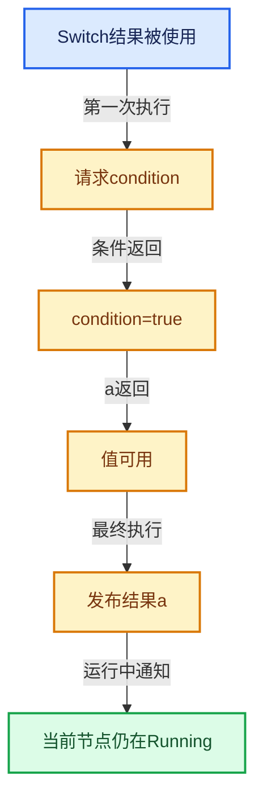

# 09-LazyFunction与节点执行架构

[总目录](../README.md)

需求与就绪是不同维度；状态只在有证据时推进，不能把未确定当作无需求。

## 前置知识与阅读层次

- [03-内存分配与运行时类型](../03-%E5%86%85%E5%AD%98%E5%88%86%E9%85%8D%E4%B8%8E%E8%BF%90%E8%A1%8C%E6%97%B6%E7%B1%BB%E5%9E%8B/README.md)
- [07-MultiFunction与批量执行](../07-MultiFunction%E4%B8%8E%E6%89%B9%E9%87%8F%E6%89%A7%E8%A1%8C/README.md)
- [08-Field表达式与求值](../08-Field%E8%A1%A8%E8%BE%BE%E5%BC%8F%E4%B8%8E%E6%B1%82%E5%80%BC/README.md)

初读抓住数据模型，复读逐行检查，再完成反例和独立实现。方向间允许按实际问题回查，不要求机械线性阅读。

## 正文与源码范围

| 顺序 | 文档 | 主讲文件与范围 |
|---|---|---|
| 09-01 | [按需执行模型](01-%E6%8C%89%E9%9C%80%E6%89%A7%E8%A1%8C%E6%A8%A1%E5%9E%8B.md) | FN_lazy_function.hh:L1—L240 |
| 09-02 | [LazyFunction接口](02-LazyFunction%E6%8E%A5%E5%8F%A3.md) | FN_lazy_function.hh:L241—L479；lazy_function.cc:L1—L71 |
| 09-03 | [Params与ValueUsage](03-Params%E4%B8%8EValueUsage.md) | FN_lazy_function_execute.hh:L1—L158；lazy_function_execute.cc:L1—L144 |
| 09-04 | [Context与执行状态](04-Context%E4%B8%8E%E6%89%A7%E8%A1%8C%E7%8A%B6%E6%80%81.md) | FN_user_data.hh:L1—L42；BLI_lazy_threading.hh:L1—L96 |
| 09-05 | [Graph与Socket](05-Graph%E4%B8%8ESocket.md) | FN_lazy_function_graph.hh:L1—L554；lazy_function_graph.cc:L1—L259 |
| 09-06 | [GraphExecutor对外接口](06-GraphExecutor%E5%AF%B9%E5%A4%96%E6%8E%A5%E5%8F%A3.md) | FN_lazy_function_graph_executor.hh:L1—L155；FN_lazy_function_graph_executor_generic.hh:L1—L29 |
| 09-07 | [执行器内部状态](07-%E6%89%A7%E8%A1%8C%E5%99%A8%E5%86%85%E9%83%A8%E7%8A%B6%E6%80%81.md) | lazy_function_graph_executor_generic.hh:L1—L744 |
| 09-08 | [输入请求与调度](08-%E8%BE%93%E5%85%A5%E8%AF%B7%E6%B1%82%E4%B8%8E%E8%B0%83%E5%BA%A6.md) | lazy_function_graph_executor_generic.hh:L745—L1503 |
| 09-09 | [几何节点图构建器](09-%E5%87%A0%E4%BD%95%E8%8A%82%E7%82%B9%E5%9B%BE%E6%9E%84%E5%BB%BA%E5%99%A8.md) | geometry_nodes_lazy_function.cc:L1—L1472 |
| 09-10 | [普通节点与函数适配](10-%E6%99%AE%E9%80%9A%E8%8A%82%E7%82%B9%E4%B8%8E%E5%87%BD%E6%95%B0%E9%80%82%E9%85%8D.md) | geometry_nodes_lazy_function.cc:L1473—L2902；lazy_function_graph_executor.cc:L1—L145 |
| 09-11 | [Switch与MenuSwitch](11-Switch%E4%B8%8EMenuSwitch.md) | node_geo_switch.cc:L1—L340；node_geo_menu_switch.cc:L1—L712 |
| 09-12 | [嵌套图副作用日志与测试](12-%E5%B5%8C%E5%A5%97%E5%9B%BE%E5%89%AF%E4%BD%9C%E7%94%A8%E6%97%A5%E5%BF%97%E4%B8%8E%E6%B5%8B%E8%AF%95.md) | geometry_nodes_lazy_function.cc:L2903—L4411；FN_lazy_function_test.cc:L1—L185 |

## 本方向的数据模型

## 状态推演

## 历史入口

- [Geometry Nodes: new evaluation system](https://projects.blender.org/blender/blender/commit/4130f1e674f83fc3d53979d3061469af34e1f873) · Jacques Lucke · 2022-09-13
- [Geometry Nodes: use lazy-function directly for switch node](https://projects.blender.org/blender/blender/commit/258678916ff90379b998ddf150f9f8a3fb360eaf) · Jacques Lucke · 2023-03-14
- [Fix: Geometry Nodes: unnecessary evaluation with specific usage of Menu Switch node](https://projects.blender.org/blender/blender/commit/0f87eef0ea914687fe31e6813df21aebd1dae8ac) · Jacques Lucke · 2026-06-02
- [Refactor: Functions: extract graph executor implementation into separate file](https://projects.blender.org/blender/blender/commit/74ce7d338cff0f6cae4190883ef3799c44c182ee) · Jacques Lucke · 2026-03-12

## 跨库比较与验收

与拓扑一次求值、future和数据流调度比较：惰性函数允许执行过程中继续请求输入，同一个计算单元可分多次推进。

未选分支不执行；输出不会被非法重复构造；同一节点不同时运行两次；副作用有明确执行依据。

正文和源码区间已建立；自动检查结果见根目录验收报告。阅读者的掌握程度以独立练习与反例推理为准。
