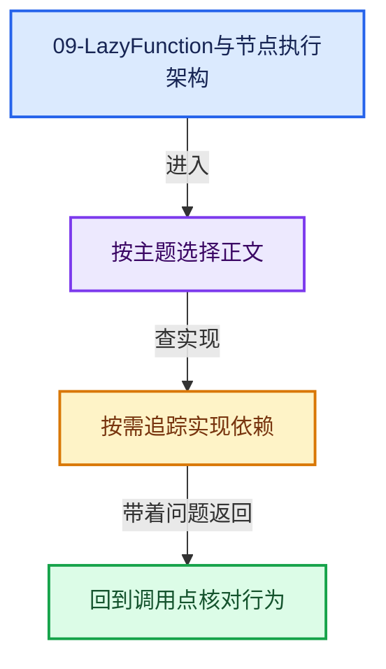
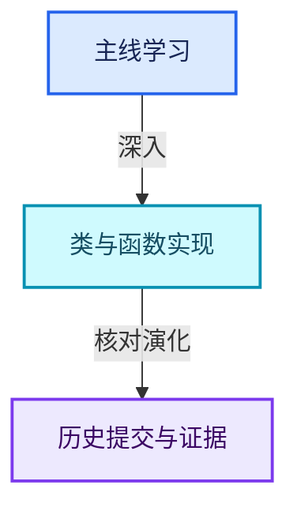

# 09-LazyFunction与节点执行架构

[总入口](../README.md) · [几何节点专题](../13-几何节点专题/README.md) · [实现依赖](../90-实现依赖专题/README.md)

## 阅读顺序

- [09-01 按需执行模型](01-按需执行模型.md)
- [09-02 LazyFunction接口](02-LazyFunction接口.md)
- [09-03 Params与ValueUsage](03-Params与ValueUsage.md)
- [09-04 Context与执行状态](04-Context与执行状态.md)
- [09-05 Graph与Socket](05-Graph与Socket.md)
- [09-06 GraphExecutor对外接口](06-GraphExecutor对外接口.md)
- [09-07 执行器内部状态](07-执行器内部状态.md)
- [09-08 输入请求与调度](08-输入请求与调度.md)
- [09-09 几何节点图构建器](09-几何节点图构建器.md)
- [09-10 普通节点与函数适配](10-普通节点与函数适配.md)
- [09-11 Switch与MenuSwitch](11-Switch与MenuSwitch.md)
- [09-12 嵌套图副作用日志与测试](12-嵌套图副作用日志与测试.md)

