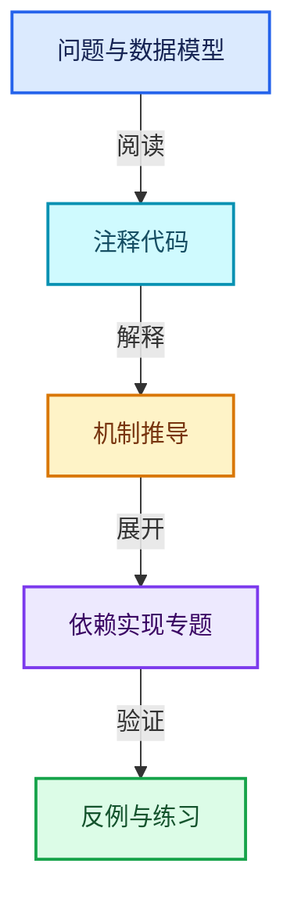
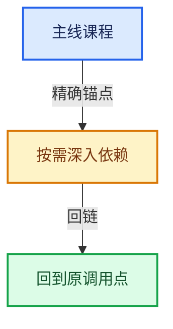

# 09-LazyFunction与节点执行架构

[总目录](../README.md) · [实现索引](../%E7%AC%A6%E5%8F%B7%E4%BE%9D%E8%B5%96%E4%B8%8E%E5%AE%9E%E7%8E%B0%E7%B4%A2%E5%BC%95.md)

## 主线课程

- [09-01 按需执行模型](01-%E6%8C%89%E9%9C%80%E6%89%A7%E8%A1%8C%E6%A8%A1%E5%9E%8B.md)
- [09-02 LazyFunction接口](02-LazyFunction%E6%8E%A5%E5%8F%A3.md)
- [09-03 Params与ValueUsage](03-Params%E4%B8%8EValueUsage.md)
- [09-04 Context与执行状态](04-Context%E4%B8%8E%E6%89%A7%E8%A1%8C%E7%8A%B6%E6%80%81.md)
- [09-05 Graph与Socket](05-Graph%E4%B8%8ESocket.md)
- [09-06 GraphExecutor对外接口](06-GraphExecutor%E5%AF%B9%E5%A4%96%E6%8E%A5%E5%8F%A3.md)
- [09-07 执行器内部状态](07-%E6%89%A7%E8%A1%8C%E5%99%A8%E5%86%85%E9%83%A8%E7%8A%B6%E6%80%81.md)
- [09-08 输入请求与调度](08-%E8%BE%93%E5%85%A5%E8%AF%B7%E6%B1%82%E4%B8%8E%E8%B0%83%E5%BA%A6.md)
- [09-09 几何节点图构建器](09-%E5%87%A0%E4%BD%95%E8%8A%82%E7%82%B9%E5%9B%BE%E6%9E%84%E5%BB%BA%E5%99%A8.md)
- [09-10 普通节点与函数适配](10-%E6%99%AE%E9%80%9A%E8%8A%82%E7%82%B9%E4%B8%8E%E5%87%BD%E6%95%B0%E9%80%82%E9%85%8D.md)
- [09-11 Switch与MenuSwitch](11-Switch%E4%B8%8EMenuSwitch.md)
- [09-12 嵌套图副作用日志与测试](12-%E5%B5%8C%E5%A5%97%E5%9B%BE%E5%89%AF%E4%BD%9C%E7%94%A8%E6%97%A5%E5%BF%97%E4%B8%8E%E6%B5%8B%E8%AF%95.md)

## 共享实现专题

- [source/blender/nodes/NOD_geometry_exec.hh](%E4%BE%9D%E8%B5%96-NOD_geometry_exec-680a5a.md)
- [source/blender/nodes/NOD_geometry_nodes_list.hh](%E4%BE%9D%E8%B5%96-NOD_geometry_nodes_list-56053f.md)
- [source/blender/nodes/NOD_geometry_nodes_srna.hh](%E4%BE%9D%E8%B5%96-NOD_geometry_nodes_srna-0df69b.md)
- [source/blender/nodes/NOD_geometry_nodes_values.hh](%E4%BE%9D%E8%B5%96-NOD_geometry_nodes_values-932df9.md)
- [source/blender/nodes/NOD_menu_value.hh](%E4%BE%9D%E8%B5%96-NOD_menu_value-6ddf35.md)
- [source/blender/nodes/NOD_multi_function.hh](%E4%BE%9D%E8%B5%96-NOD_multi_function-01ca0e.md)
- [source/blender/nodes/NOD_node_declaration.hh](%E4%BE%9D%E8%B5%96-NOD_node_declaration-9b193f.md)
- [source/blender/nodes/NOD_node_in_compute_context.hh](%E4%BE%9D%E8%B5%96-NOD_node_in_compute_context-6c33fe.md)
- [source/blender/nodes/NOD_socket_declarations.hh](%E4%BE%9D%E8%B5%96-NOD_socket_declarations-8d29c1.md)
- [source/blender/nodes/NOD_socket_items.hh](%E4%BE%9D%E8%B5%96-NOD_socket_items-d21cfb.md)
- [source/blender/nodes/NOD_socket_items_blend.hh](%E4%BE%9D%E8%B5%96-NOD_socket_items_blend-d6e617.md)
- [source/blender/nodes/NOD_socket_items_name_util.hh](%E4%BE%9D%E8%B5%96-NOD_socket_items_name_util-afe51c.md)
- [source/blender/nodes/NOD_socket_items_ops.hh](%E4%BE%9D%E8%B5%96-NOD_socket_items_ops-3d37d6.md)
- [source/blender/nodes/NOD_socket_items_ui.hh](%E4%BE%9D%E8%B5%96-NOD_socket_items_ui-2ab39c.md)
- [source/blender/nodes/NOD_socket_value_inference.hh](%E4%BE%9D%E8%B5%96-NOD_socket_value_inference-36fa06.md)
- [source/blender/nodes/NOD_texture.h](%E4%BE%9D%E8%B5%96-NOD_texture-9001b0.md)
- [source/blender/nodes/NOD_value_elem.hh](%E4%BE%9D%E8%B5%96-NOD_value_elem-9b7c97.md)
- [source/blender/nodes/composite/include/NOD_compositor_file_output.hh](%E4%BE%9D%E8%B5%96-NOD_compositor_file_output-1a6412.md)
- [source/blender/nodes/composite/node_composite_tree.cc](%E4%BE%9D%E8%B5%96-node_composite_tree-a763ff.md)
- [source/blender/nodes/composite/nodes/node_composite_file_output.cc](%E4%BE%9D%E8%B5%96-node_composite_file_output-f2c79a.md)
- [source/blender/nodes/function/include/NOD_fn_format_string.hh](%E4%BE%9D%E8%B5%96-NOD_fn_format_string-3a0967.md)
- [source/blender/nodes/function/nodes/node_fn_format_string.cc](%E4%BE%9D%E8%B5%96-node_fn_format_string-abf8ee.md)
- [source/blender/nodes/geometry/include/NOD_geo_bake.hh](%E4%BE%9D%E8%B5%96-NOD_geo_bake-b93fe8.md)
- [source/blender/nodes/geometry/include/NOD_geo_capture_attribute.hh](%E4%BE%9D%E8%B5%96-NOD_geo_capture_attribute-dcc154.md)
- [source/blender/nodes/geometry/include/NOD_geo_combine_list.hh](%E4%BE%9D%E8%B5%96-NOD_geo_combine_list-3d2b34.md)
- [source/blender/nodes/geometry/include/NOD_geo_field_to_grid.hh](%E4%BE%9D%E8%B5%96-NOD_geo_field_to_grid-29c9b5.md)
- [source/blender/nodes/geometry/include/NOD_geo_field_to_list.hh](%E4%BE%9D%E8%B5%96-NOD_geo_field_to_list-0cf412.md)
- [source/blender/nodes/geometry/include/NOD_geo_foreach_geometry_element.hh](%E4%BE%9D%E8%B5%96-NOD_geo_foreach_geometry_element-6f2314.md)
- [source/blender/nodes/geometry/include/NOD_geo_index_switch.hh](%E4%BE%9D%E8%B5%96-NOD_geo_index_switch-a23a72.md)
- [source/blender/nodes/geometry/include/NOD_geo_menu_switch.hh](%E4%BE%9D%E8%B5%96-NOD_geo_menu_switch-046336.md)
- [source/blender/nodes/geometry/include/NOD_geo_rasterize_points.hh](%E4%BE%9D%E8%B5%96-NOD_geo_rasterize_points-142fdb.md)
- [source/blender/nodes/geometry/include/NOD_geo_repeat.hh](%E4%BE%9D%E8%B5%96-NOD_geo_repeat-c78122.md)
- [source/blender/nodes/geometry/include/NOD_geo_simulation.hh](%E4%BE%9D%E8%B5%96-NOD_geo_simulation-1adb17.md)
- [source/blender/nodes/geometry/include/NOD_geo_viewer.hh](%E4%BE%9D%E8%B5%96-NOD_geo_viewer-4f7a30.md)
- [source/blender/nodes/geometry/node_geometry_util.cc](%E4%BE%9D%E8%B5%96-node_geometry_util-852ce1.md)
- [source/blender/nodes/geometry/nodes/node_geo_attribute_capture.cc](%E4%BE%9D%E8%B5%96-node_geo_attribute_capture-5a6a1c.md)
- [source/blender/nodes/geometry/nodes/node_geo_bake.cc](%E4%BE%9D%E8%B5%96-node_geo_bake-422d76.md)
- [source/blender/nodes/geometry/nodes/node_geo_combine_list.cc](%E4%BE%9D%E8%B5%96-node_geo_combine_list-033b72.md)
- [source/blender/nodes/geometry/nodes/node_geo_enable_output.cc](%E4%BE%9D%E8%B5%96-node_geo_enable_output-f3927a.md)
- [source/blender/nodes/geometry/nodes/node_geo_field_to_grid.cc](%E4%BE%9D%E8%B5%96-node_geo_field_to_grid-120814.md)
- [source/blender/nodes/geometry/nodes/node_geo_field_to_list.cc](%E4%BE%9D%E8%B5%96-node_geo_field_to_list-d4791e.md)
- [source/blender/nodes/geometry/nodes/node_geo_foreach_geometry_element.cc](%E4%BE%9D%E8%B5%96-node_geo_foreach_geometry_element-6e2887.md)
- [source/blender/nodes/geometry/nodes/node_geo_index_switch.cc](%E4%BE%9D%E8%B5%96-node_geo_index_switch-ec3a87.md)
- [source/blender/nodes/geometry/nodes/node_geo_rasterize_points.cc](%E4%BE%9D%E8%B5%96-node_geo_rasterize_points-59370c.md)
- [source/blender/nodes/geometry/nodes/node_geo_repeat.cc](%E4%BE%9D%E8%B5%96-node_geo_repeat-e7f690.md)
- [source/blender/nodes/geometry/nodes/node_geo_simulation.cc](%E4%BE%9D%E8%B5%96-node_geo_simulation-65049c.md)
- [source/blender/nodes/geometry/nodes/node_geo_viewer.cc](%E4%BE%9D%E8%B5%96-node_geo_viewer-f93ed9.md)
- [source/blender/nodes/geometry/nodes/node_geo_warning.cc](%E4%BE%9D%E8%B5%96-node_geo_warning-81bdec.md)
- [source/blender/nodes/intern/compositor_nodes_srna.cc](%E4%BE%9D%E8%B5%96-compositor_nodes_srna-a22628.md)
- [source/blender/nodes/intern/dependencies.cc](%E4%BE%9D%E8%B5%96-dependencies-e19599.md)
- [source/blender/nodes/intern/eval_log.cc](%E4%BE%9D%E8%B5%96-eval_log-ff9cdf.md)
- [source/blender/nodes/intern/geometry_nodes_caller_ui.cc](%E4%BE%9D%E8%B5%96-geometry_nodes_caller_ui-ccd1aa.md)
- [source/blender/nodes/intern/geometry_nodes_execute.cc](%E4%BE%9D%E8%B5%96-geometry_nodes_execute-40ac57.md)
- [source/blender/nodes/intern/geometry_nodes_foreach_geometry_element_zone.cc](%E4%BE%9D%E8%B5%96-geometry_nodes_foreach_geometry_element_zone-ee5ed6.md)
- [source/blender/nodes/intern/geometry_nodes_gizmos.cc](%E4%BE%9D%E8%B5%96-geometry_nodes_gizmos-be8478.md)
- [source/blender/nodes/intern/geometry_nodes_list.cc](%E4%BE%9D%E8%B5%96-geometry_nodes_list-6b7d73.md)
- [source/blender/nodes/intern/geometry_nodes_repeat_zone.cc](%E4%BE%9D%E8%B5%96-geometry_nodes_repeat_zone-f68468.md)
- [source/blender/nodes/intern/geometry_nodes_srna.cc](%E4%BE%9D%E8%B5%96-geometry_nodes_srna-f93c96.md)
- [source/blender/nodes/intern/inverse_eval.cc](%E4%BE%9D%E8%B5%96-inverse_eval-7fd15e.md)
- [source/blender/nodes/intern/list_function_eval.cc](%E4%BE%9D%E8%B5%96-list_function_eval-d4a4cc.md)
- [source/blender/nodes/intern/node_common.cc](%E4%BE%9D%E8%B5%96-node_common-9dec7c.md)
- [source/blender/nodes/intern/node_declaration.cc](%E4%BE%9D%E8%B5%96-node_declaration-250442.md)
- [source/blender/nodes/intern/node_exec.cc](%E4%BE%9D%E8%B5%96-node_exec-923fa6.md)
- [source/blender/nodes/intern/node_geometry_exec.cc](%E4%BE%9D%E8%B5%96-node_geometry_exec-581247.md)
- [source/blender/nodes/intern/node_rna_define.cc](%E4%BE%9D%E8%B5%96-node_rna_define-7c9678.md)
- [source/blender/nodes/intern/node_socket.cc](%E4%BE%9D%E8%B5%96-node_socket-0ca7fe.md)
- [source/blender/nodes/intern/node_socket_declarations.cc](%E4%BE%9D%E8%B5%96-node_socket_declarations-fb0eb9.md)
- [source/blender/nodes/intern/node_tree_defaults.cc](%E4%BE%9D%E8%B5%96-node_tree_defaults-4d032f.md)
- [source/blender/nodes/intern/node_util.cc](%E4%BE%9D%E8%B5%96-node_util-403176.md)
- [source/blender/nodes/intern/partial_eval.cc](%E4%BE%9D%E8%B5%96-partial_eval-ff8875.md)
- [source/blender/nodes/intern/scene_compositor_effect_inputs_srna.cc](%E4%BE%9D%E8%B5%96-scene_compositor_effect_inputs_srna-22b31e.md)
- [source/blender/nodes/intern/socket_items_name_util.cc](%E4%BE%9D%E8%B5%96-socket_items_name_util-4620f7.md)
- [source/blender/nodes/intern/socket_search_link.cc](%E4%BE%9D%E8%B5%96-socket_search_link-d6b6cb.md)
- [source/blender/nodes/intern/socket_usage_inference.cc](%E4%BE%9D%E8%B5%96-socket_usage_inference-cfeba4.md)
- [source/blender/nodes/intern/sync_sockets.cc](%E4%BE%9D%E8%B5%96-sync_sockets-2e3278.md)
- [source/blender/nodes/intern/trace_values.cc](%E4%BE%9D%E8%B5%96-trace_values-1ee732.md)
- [source/blender/nodes/intern/value_elem.cc](%E4%BE%9D%E8%B5%96-value_elem-7bfc90.md)
- [source/blender/nodes/intern/volume_grid_function_eval.cc](%E4%BE%9D%E8%B5%96-volume_grid_function_eval-0d385c.md)
- [source/blender/nodes/shader/include/NOD_shader_raycast.hh](%E4%BE%9D%E8%B5%96-NOD_shader_raycast-6f85b2.md)
- [source/blender/nodes/shader/materialx/node_graph.cc](%E4%BE%9D%E8%B5%96-node_graph-b0e0e0.md)
- [source/blender/nodes/shader/materialx/node_item.cc](%E4%BE%9D%E8%B5%96-node_item-023375.md)
- [source/blender/nodes/shader/materialx/node_item.h](%E4%BE%9D%E8%B5%96-node_item-b3dda6.md)
- [source/blender/nodes/shader/materialx/node_parser.cc](%E4%BE%9D%E8%B5%96-node_parser-2da10a.md)
- [source/blender/nodes/shader/node_shader_tree.cc](%E4%BE%9D%E8%B5%96-node_shader_tree-d4b0a3.md)
- [source/blender/nodes/shader/node_shader_util.cc](%E4%BE%9D%E8%B5%96-node_shader_util-6b7d04.md)
- [source/blender/nodes/shader/nodes/node_shader_raycast.cc](%E4%BE%9D%E8%B5%96-node_shader_raycast-d756ee.md)
- [source/blender/nodes/texture/node_texture_tree.cc](%E4%BE%9D%E8%B5%96-node_texture_tree-b9c111.md)
- [source/blender/nodes/texture/node_texture_util.cc](%E4%BE%9D%E8%B5%96-node_texture_util-0d1f2f.md)
- [source/blender/nodes/texture/nodes/node_texture_at.cc](%E4%BE%9D%E8%B5%96-node_texture_at-4eef79.md)
- [source/blender/nodes/texture/nodes/node_texture_bricks.cc](%E4%BE%9D%E8%B5%96-node_texture_bricks-53f1ab.md)
- [source/blender/nodes/texture/nodes/node_texture_checker.cc](%E4%BE%9D%E8%B5%96-node_texture_checker-aa8f0d.md)
- [source/blender/nodes/texture/nodes/node_texture_combine_color.cc](%E4%BE%9D%E8%B5%96-node_texture_combine_color-871e59.md)
- [source/blender/nodes/texture/nodes/node_texture_coord.cc](%E4%BE%9D%E8%B5%96-node_texture_coord-c67a70.md)
- [source/blender/nodes/texture/nodes/node_texture_distance.cc](%E4%BE%9D%E8%B5%96-node_texture_distance-80e161.md)
- [source/blender/nodes/texture/nodes/node_texture_hueSatVal.cc](%E4%BE%9D%E8%B5%96-node_texture_hueSatVal-b95607.md)
- [source/blender/nodes/texture/nodes/node_texture_image.cc](%E4%BE%9D%E8%B5%96-node_texture_image-1f2158.md)
- [source/blender/nodes/texture/nodes/node_texture_invert.cc](%E4%BE%9D%E8%B5%96-node_texture_invert-c82131.md)
- [source/blender/nodes/texture/nodes/node_texture_math.cc](%E4%BE%9D%E8%B5%96-node_texture_math-b73f97.md)
- [source/blender/nodes/texture/nodes/node_texture_mixRgb.cc](%E4%BE%9D%E8%B5%96-node_texture_mixRgb-0b13f4.md)
- [source/blender/nodes/texture/nodes/node_texture_output.cc](%E4%BE%9D%E8%B5%96-node_texture_output-72ffb1.md)
- [source/blender/nodes/texture/nodes/node_texture_proc.cc](%E4%BE%9D%E8%B5%96-node_texture_proc-e515a7.md)
- [source/blender/nodes/texture/nodes/node_texture_rotate.cc](%E4%BE%9D%E8%B5%96-node_texture_rotate-aaac02.md)
- [source/blender/nodes/texture/nodes/node_texture_scale.cc](%E4%BE%9D%E8%B5%96-node_texture_scale-c1ee05.md)
- [source/blender/nodes/texture/nodes/node_texture_separate_color.cc](%E4%BE%9D%E8%B5%96-node_texture_separate_color-ac4f58.md)
- [source/blender/nodes/texture/nodes/node_texture_texture.cc](%E4%BE%9D%E8%B5%96-node_texture_texture-50a6bf.md)
- [source/blender/nodes/texture/nodes/node_texture_translate.cc](%E4%BE%9D%E8%B5%96-node_texture_translate-81b3d2.md)
- [source/blender/nodes/texture/nodes/node_texture_valToNor.cc](%E4%BE%9D%E8%B5%96-node_texture_valToNor-bf2019.md)
- [source/blender/nodes/texture/nodes/node_texture_viewer.cc](%E4%BE%9D%E8%B5%96-node_texture_viewer-94e883.md)

## 几何节点扩展专题

- [GN-01 几何节点从编辑树到执行结果的全景](%E6%89%A9%E5%B1%9501-%E5%87%A0%E4%BD%95%E8%8A%82%E7%82%B9%E4%BB%8E%E7%BC%96%E8%BE%91%E6%A0%91%E5%88%B0%E6%89%A7%E8%A1%8C%E7%BB%93%E6%9E%9C%E7%9A%84%E5%85%A8%E6%99%AF.md)
- [GN-02 节点注册声明与引用关系契约](%E6%89%A9%E5%B1%9502-%E8%8A%82%E7%82%B9%E6%B3%A8%E5%86%8C%E5%A3%B0%E6%98%8E%E4%B8%8E%E5%BC%95%E7%94%A8%E5%85%B3%E7%B3%BB%E5%A5%91%E7%BA%A6.md)
- [GN-03 GeoNodeExecParams参数适配与移动语义](%E6%89%A9%E5%B1%9503-GeoNodeExecParams%E5%8F%82%E6%95%B0%E9%80%82%E9%85%8D%E4%B8%8E%E7%A7%BB%E5%8A%A8%E8%AF%AD%E4%B9%89.md)
- [GN-04 SocketValueVariant异构值与转换边界](%E6%89%A9%E5%B1%9504-SocketValueVariant%E5%BC%82%E6%9E%84%E5%80%BC%E4%B8%8E%E8%BD%AC%E6%8D%A2%E8%BE%B9%E7%95%8C.md)
- [GN-05 执行图构建缓存与树副本所有权](%E6%89%A9%E5%B1%9505-%E6%89%A7%E8%A1%8C%E5%9B%BE%E6%9E%84%E5%BB%BA%E7%BC%93%E5%AD%98%E4%B8%8E%E6%A0%91%E5%89%AF%E6%9C%AC%E6%89%80%E6%9C%89%E6%9D%83.md)
- [GN-06 按需执行匿名输出与Switch需求传播](%E6%89%A9%E5%B1%9506-%E6%8C%89%E9%9C%80%E6%89%A7%E8%A1%8C%E5%8C%BF%E5%90%8D%E8%BE%93%E5%87%BA%E4%B8%8ESwitch%E9%9C%80%E6%B1%82%E4%BC%A0%E6%92%AD.md)
- [GN-22 ComputeContext日志映射与副作用根](%E6%89%A9%E5%B1%9507-ComputeContext%E6%97%A5%E5%BF%97%E6%98%A0%E5%B0%84%E4%B8%8E%E5%89%AF%E4%BD%9C%E7%94%A8%E6%A0%B9.md)
- [GN-24 Jacques与Hans提交中的架构演化](%E6%89%A9%E5%B1%9508-Jacques%E4%B8%8EHans%E6%8F%90%E4%BA%A4%E4%B8%AD%E7%9A%84%E6%9E%B6%E6%9E%84%E6%BC%94%E5%8C%96.md)
