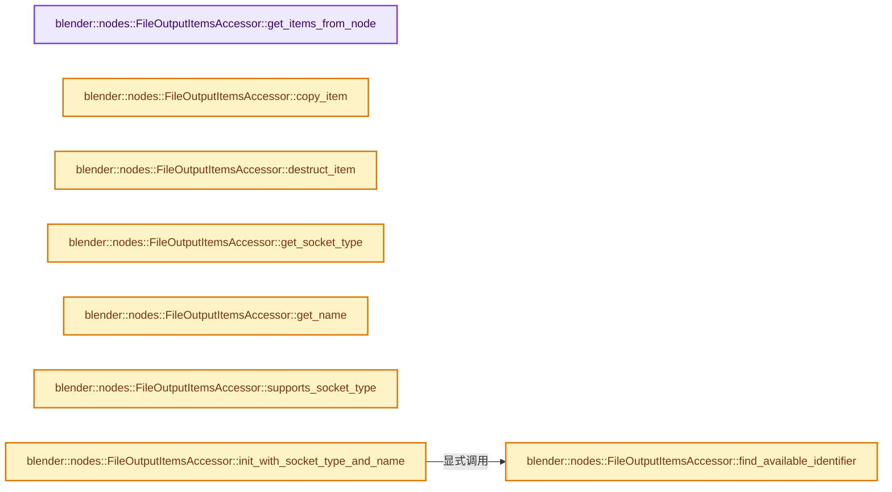
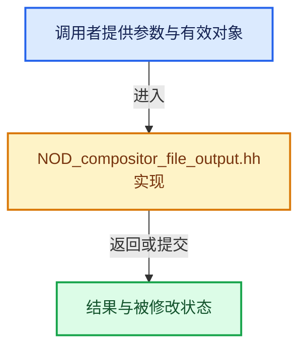

# 实现依赖专题：source/blender/nodes/composite/include/NOD_compositor_file_output.hh

[方向导航](README.md) · [符号索引](../%E7%AC%A6%E5%8F%B7%E4%BE%9D%E8%B5%96%E4%B8%8E%E5%AE%9E%E7%8E%B0%E7%B4%A2%E5%BC%95.md)

本专题从正文实际调用进入，集中保存共享实现。函数有稳定锚点，可从调用处直接跳到对应完整函数；递归与互相调用通过回链组织。

## 本文件的实现关系






## 完整成员与函数实现

<a id="f-bdac32a93a61751d"></a>

### `blender::nodes::FileOutputItemsAccessor::get_items_from_node`

实现位置：[source/blender/nodes/composite/include/NOD_compositor_file_output.hh](../../../../../source/blender/nodes/composite/include/NOD_compositor_file_output.hh) · L45—L50。

接口参数：

- `bNode &node`

**教学注释版**

<!-- annotated:2e980b579d1450 -->

```cpp
  static socket_items::SocketItemsRef<NodeCompositorFileOutputItem> get_items_from_node(
      bNode &node)
  {
    auto *storage = static_cast<NodeCompositorFileOutput *>(node.storage);
    return {&storage->items, &storage->items_count, &storage->active_item_index};
  }
```

<details>
<summary>核对原始源码：source/blender/nodes/composite/include/NOD_compositor_file_output.hh · L45—L50</summary>

<!-- original:2e980b579d1450:source/blender/nodes/composite/include/NOD_compositor_file_output.hh:45:50 -->

```cpp
  static socket_items::SocketItemsRef<NodeCompositorFileOutputItem> get_items_from_node(
      bNode &node)
  {
    auto *storage = static_cast<NodeCompositorFileOutput *>(node.storage);
    return {&storage->items, &storage->items_count, &storage->active_item_index};
  }
```

</details>

**结果出口**

- `return {&storage->items, &storage->items_count, &storage->active_item_index};`

**继续追踪实现**

本实现没有需要继续展开的显式调用；检查返回表达式、对象转换和调用者前置条件。

<a id="f-8b53465afa516a5d"></a>

### `blender::nodes::FileOutputItemsAccessor::copy_item`

实现位置：[source/blender/nodes/composite/include/NOD_compositor_file_output.hh](../../../../../source/blender/nodes/composite/include/NOD_compositor_file_output.hh) · L52—L58。

接口参数：

- `const NodeCompositorFileOutputItem &source`
- `NodeCompositorFileOutputItem &destination`

**教学注释版**

<!-- annotated:f1473068966578 -->

```cpp
  static void copy_item(const NodeCompositorFileOutputItem &source,
                        NodeCompositorFileOutputItem &destination)
  {
    destination = source;
    destination.name = BLI_strdup_null(destination.name);
    BKE_image_format_copy(&destination.format, &source.format);
  }
```

<details>
<summary>核对原始源码：source/blender/nodes/composite/include/NOD_compositor_file_output.hh · L52—L58</summary>

<!-- original:f1473068966578:source/blender/nodes/composite/include/NOD_compositor_file_output.hh:52:58 -->

```cpp
  static void copy_item(const NodeCompositorFileOutputItem &source,
                        NodeCompositorFileOutputItem &destination)
  {
    destination = source;
    destination.name = BLI_strdup_null(destination.name);
    BKE_image_format_copy(&destination.format, &source.format);
  }
```

</details>

**沿实际写入检查状态**

- `destination = source;`
- `destination.name = BLI_strdup_null(destination.name);`

**继续追踪实现**

- `BLI_strdup_null` → [blender::BLI_strdup_null · L48](../01-%E5%9F%BA%E7%A1%80%E5%AE%B9%E5%99%A8%E4%B8%8E%E7%8E%B0%E4%BB%A3CPP/%E4%BE%9D%E8%B5%96-string-1d986f.md#f-c1cd7c6336fe3fe0)。
- `BKE_image_format_copy` → [blender::BKE_image_format_copy · L45](../05-%E5%87%A0%E4%BD%95%E5%AD%98%E5%82%A8%E4%B8%8E%E6%8B%93%E6%89%91%E6%98%A0%E5%B0%84/%E4%BE%9D%E8%B5%96-image_format-a25a14.md#f-7f1a6e5f86fd6c3d)。

<a id="f-973efb2754cc1f50"></a>

### `blender::nodes::FileOutputItemsAccessor::destruct_item`

实现位置：[source/blender/nodes/composite/include/NOD_compositor_file_output.hh](../../../../../source/blender/nodes/composite/include/NOD_compositor_file_output.hh) · L60—L64。

接口参数：

- `NodeCompositorFileOutputItem *item`

**教学注释版**

<!-- annotated:ecc343a4df099e -->

```cpp
  static void destruct_item(NodeCompositorFileOutputItem *item)
  {
    MEM_SAFE_DELETE(item->name);
    BKE_image_format_free(&item->format);
  }
```

<details>
<summary>核对原始源码：source/blender/nodes/composite/include/NOD_compositor_file_output.hh · L60—L64</summary>

<!-- original:ecc343a4df099e:source/blender/nodes/composite/include/NOD_compositor_file_output.hh:60:64 -->

```cpp
  static void destruct_item(NodeCompositorFileOutputItem *item)
  {
    MEM_SAFE_DELETE(item->name);
    BKE_image_format_free(&item->format);
  }
```

</details>

**继续追踪实现**

- `MEM_SAFE_DELETE` → [MEM_SAFE_DELETE · L436](../03-%E5%86%85%E5%AD%98%E5%88%86%E9%85%8D%E4%B8%8E%E8%BF%90%E8%A1%8C%E6%97%B6%E7%B1%BB%E5%9E%8B/%E4%BE%9D%E8%B5%96-MEM_guardedalloc-b54eca.md#m-eadb3bc5b902)。宏定义由构建条件选择。
- `BKE_image_format_free` → [blender::BKE_image_format_free · L54](../05-%E5%87%A0%E4%BD%95%E5%AD%98%E5%82%A8%E4%B8%8E%E6%8B%93%E6%89%91%E6%98%A0%E5%B0%84/%E4%BE%9D%E8%B5%96-image_format-a25a14.md#f-b70df4629a7d6282)。

<a id="f-1e4bb21e5318a95c"></a>

### `blender::nodes::FileOutputItemsAccessor::get_socket_type`

实现位置：[source/blender/nodes/composite/include/NOD_compositor_file_output.hh](../../../../../source/blender/nodes/composite/include/NOD_compositor_file_output.hh) · L69—L72。

接口参数：

- `const NodeCompositorFileOutputItem &item`

**教学注释版**

<!-- annotated:63b4204a0a7129 -->

```cpp
  static eNodeSocketDatatype get_socket_type(const NodeCompositorFileOutputItem &item)
  {
    return item.socket_type;
  }
```

<details>
<summary>核对原始源码：source/blender/nodes/composite/include/NOD_compositor_file_output.hh · L69—L72</summary>

<!-- original:63b4204a0a7129:source/blender/nodes/composite/include/NOD_compositor_file_output.hh:69:72 -->

```cpp
  static eNodeSocketDatatype get_socket_type(const NodeCompositorFileOutputItem &item)
  {
    return item.socket_type;
  }
```

</details>

**结果出口**

- `return item.socket_type;`

**继续追踪实现**

本实现没有需要继续展开的显式调用；检查返回表达式、对象转换和调用者前置条件。

<a id="f-c7d3d5c8215ce84d"></a>

### `blender::nodes::FileOutputItemsAccessor::get_name`

实现位置：[source/blender/nodes/composite/include/NOD_compositor_file_output.hh](../../../../../source/blender/nodes/composite/include/NOD_compositor_file_output.hh) · L74—L77。

接口参数：

- `NodeCompositorFileOutputItem &item`

**教学注释版**

<!-- annotated:226af82ed2b01a -->

```cpp
  static char **get_name(NodeCompositorFileOutputItem &item)
  {
    return &item.name;
  }
```

<details>
<summary>核对原始源码：source/blender/nodes/composite/include/NOD_compositor_file_output.hh · L74—L77</summary>

<!-- original:226af82ed2b01a:source/blender/nodes/composite/include/NOD_compositor_file_output.hh:74:77 -->

```cpp
  static char **get_name(NodeCompositorFileOutputItem &item)
  {
    return &item.name;
  }
```

</details>

**结果出口**

- `return &item.name;`

**继续追踪实现**

本实现没有需要继续展开的显式调用；检查返回表达式、对象转换和调用者前置条件。

<a id="f-462679ae66fc9773"></a>

### `blender::nodes::FileOutputItemsAccessor::supports_socket_type`

实现位置：[source/blender/nodes/composite/include/NOD_compositor_file_output.hh](../../../../../source/blender/nodes/composite/include/NOD_compositor_file_output.hh) · L79—L82。

接口参数：

- `const eNodeSocketDatatype socket_type`
- `const int`

**教学注释版**

<!-- annotated:01855c8ecc7ffc -->

```cpp
  static bool supports_socket_type(const eNodeSocketDatatype socket_type, const int /*ntree_type*/)
  {
    return ELEM(socket_type, SOCK_FLOAT, SOCK_VECTOR, SOCK_RGBA);
  }
```

<details>
<summary>核对原始源码：source/blender/nodes/composite/include/NOD_compositor_file_output.hh · L79—L82</summary>

<!-- original:01855c8ecc7ffc:source/blender/nodes/composite/include/NOD_compositor_file_output.hh:79:82 -->

```cpp
  static bool supports_socket_type(const eNodeSocketDatatype socket_type, const int /*ntree_type*/)
  {
    return ELEM(socket_type, SOCK_FLOAT, SOCK_VECTOR, SOCK_RGBA);
  }
```

</details>

**结果出口**

- `return ELEM(socket_type, SOCK_FLOAT, SOCK_VECTOR, SOCK_RGBA);`

**继续追踪实现**

- `ELEM` → [ELEM · L88](../05-%E5%87%A0%E4%BD%95%E5%AD%98%E5%82%A8%E4%B8%8E%E6%8B%93%E6%89%91%E6%98%A0%E5%B0%84/%E4%BE%9D%E8%B5%96-GHOST_utildefines-34b996.md#m-d28724a15928)；[ELEM · L135](../01-%E5%9F%BA%E7%A1%80%E5%AE%B9%E5%99%A8%E4%B8%8E%E7%8E%B0%E4%BB%A3CPP/%E4%BE%9D%E8%B5%96-BLI_utildefines-293a0a.md#m-d6572de7cae0)。宏定义由构建条件选择。

<a id="f-e1b9bd7ec9bd6a13"></a>

### `blender::nodes::FileOutputItemsAccessor::find_available_identifier`

实现位置：[source/blender/nodes/composite/include/NOD_compositor_file_output.hh](../../../../../source/blender/nodes/composite/include/NOD_compositor_file_output.hh) · L84—L95。

接口参数：

- `const NodeCompositorFileOutputItem *items`
- `const int items_count`

**教学注释版**

<!-- annotated:c734c4678b8e24 -->

```cpp
  static int find_available_identifier(const NodeCompositorFileOutputItem *items,
                                       const int items_count)
  {
    if (items_count == 0) {
      return 0;
    }
    int max_identifier = items[0].identifier;
    for (int i = 0; i < items_count; i++) {
      max_identifier = math::max(items[i].identifier, max_identifier);
    }
    return max_identifier + 1;
  }
```

<details>
<summary>核对原始源码：source/blender/nodes/composite/include/NOD_compositor_file_output.hh · L84—L95</summary>

<!-- original:c734c4678b8e24:source/blender/nodes/composite/include/NOD_compositor_file_output.hh:84:95 -->

```cpp
  static int find_available_identifier(const NodeCompositorFileOutputItem *items,
                                       const int items_count)
  {
    if (items_count == 0) {
      return 0;
    }
    int max_identifier = items[0].identifier;
    for (int i = 0; i < items_count; i++) {
      max_identifier = math::max(items[i].identifier, max_identifier);
    }
    return max_identifier + 1;
  }
```

</details>

**沿实际写入检查状态**

- `max_identifier = math::max(items[i].identifier, max_identifier);`

**结果出口**

- `return 0;`
- `return max_identifier + 1;`

**继续追踪实现**

- `math::max` → [blender::math::max · L87](../12-%E7%A9%BA%E9%97%B4%E6%95%B0%E6%8D%AE%E7%BB%93%E6%9E%84%E4%B8%8E%E5%87%A0%E4%BD%95%E7%AE%97%E6%B3%95/%E4%BE%9D%E8%B5%96-BLI_math_vector-906a87.md#f-9be564a293777d6b)；[blender::math::max · L96](../12-%E7%A9%BA%E9%97%B4%E6%95%B0%E6%8D%AE%E7%BB%93%E6%9E%84%E4%B8%8E%E5%87%A0%E4%BD%95%E7%AE%97%E6%B3%95/%E4%BE%9D%E8%B5%96-BLI_math_vector-906a87.md#f-ce32dff37d0af3bc)；[blender::math::max · L112](../12-%E7%A9%BA%E9%97%B4%E6%95%B0%E6%8D%AE%E7%BB%93%E6%9E%84%E4%B8%8E%E5%87%A0%E4%BD%95%E7%AE%97%E6%B3%95/%E4%BE%9D%E8%B5%96-BLI_math_vector-906a87.md#f-668eb1fcf1fa8292)；[blender::math::max · L49](../12-%E7%A9%BA%E9%97%B4%E6%95%B0%E6%8D%AE%E7%BB%93%E6%9E%84%E4%B8%8E%E5%87%A0%E4%BD%95%E7%AE%97%E6%B3%95/%E4%BE%9D%E8%B5%96-BLI_math_base-0728eb.md#f-a6991ca3d12937e1)。同名重载需按实参类型选择。

<a id="f-784c1960b901db5b"></a>

### `blender::nodes::FileOutputItemsAccessor::init_with_socket_type_and_name`

实现位置：[source/blender/nodes/composite/include/NOD_compositor_file_output.hh](../../../../../source/blender/nodes/composite/include/NOD_compositor_file_output.hh) · L97—L114。

接口参数：

- `bNode &node`
- `NodeCompositorFileOutputItem &item`
- `const eNodeSocketDatatype socket_type`
- `const char *name`
- `std::optional<int> dimensions = std::nullopt`

**教学注释版**

<!-- annotated:7801795db3ba8b -->

```cpp
  static void init_with_socket_type_and_name(bNode &node,
                                             NodeCompositorFileOutputItem &item,
                                             const eNodeSocketDatatype socket_type,
                                             const char *name,
                                             std::optional<int> dimensions = std::nullopt)
  {
    auto *storage = static_cast<NodeCompositorFileOutput *>(node.storage);
    item.identifier = FileOutputItemsAccessor::find_available_identifier(storage->items,
                                                                         storage->items_count);

    item.socket_type = socket_type;
    item.vector_socket_dimensions = dimensions.value_or(3);
    socket_items::set_item_name_and_make_unique<FileOutputItemsAccessor>(node, item, name);

    item.save_as_render = true;
    BKE_image_format_init(&item.format);
    BKE_image_format_update_color_space_for_type(&item.format);
  }
```

<details>
<summary>核对原始源码：source/blender/nodes/composite/include/NOD_compositor_file_output.hh · L97—L114</summary>

<!-- original:7801795db3ba8b:source/blender/nodes/composite/include/NOD_compositor_file_output.hh:97:114 -->

```cpp
  static void init_with_socket_type_and_name(bNode &node,
                                             NodeCompositorFileOutputItem &item,
                                             const eNodeSocketDatatype socket_type,
                                             const char *name,
                                             std::optional<int> dimensions = std::nullopt)
  {
    auto *storage = static_cast<NodeCompositorFileOutput *>(node.storage);
    item.identifier = FileOutputItemsAccessor::find_available_identifier(storage->items,
                                                                         storage->items_count);

    item.socket_type = socket_type;
    item.vector_socket_dimensions = dimensions.value_or(3);
    socket_items::set_item_name_and_make_unique<FileOutputItemsAccessor>(node, item, name);

    item.save_as_render = true;
    BKE_image_format_init(&item.format);
    BKE_image_format_update_color_space_for_type(&item.format);
  }
```

</details>

**沿实际写入检查状态**

- `item.identifier = FileOutputItemsAccessor::find_available_identifier(storage->items,`
- `item.socket_type = socket_type;`
- `item.vector_socket_dimensions = dimensions.value_or(3);`
- `item.save_as_render = true;`

**继续追踪实现**

- `FileOutputItemsAccessor::find_available_identifier` → [blender::nodes::FileOutputItemsAccessor::find_available_identifier · L84](%E4%BE%9D%E8%B5%96-NOD_compositor_file_output-1a6412.md#f-e1b9bd7ec9bd6a13)。
- `dimensions.value_or` → [调用协议](../%E6%A8%A1%E6%9D%BF%E5%AE%8F%E4%B8%8E%E5%8A%A8%E6%80%81%E5%88%86%E6%B4%BE%E5%8D%8F%E8%AE%AE.md)：接收对象类型依赖auto、返回值或模板实例；不按同名猜测目标。调用位置L108。
- `socket_items::set_item_name_and_make_unique<FileOutputItemsAccessor>` → [blender::nodes::socket_items::set_item_name_and_make_unique · L148](%E4%BE%9D%E8%B5%96-NOD_socket_items-d21cfb.md#f-7e7af1c01522f9dc)。
- `BKE_image_format_init` → [blender::BKE_image_format_init · L34](../05-%E5%87%A0%E4%BD%95%E5%AD%98%E5%82%A8%E4%B8%8E%E6%8B%93%E6%89%91%E6%98%A0%E5%B0%84/%E4%BE%9D%E8%B5%96-image_format-a25a14.md#f-4473cbce67b78c6a)。
- `BKE_image_format_update_color_space_for_type` → [blender::BKE_image_format_update_color_space_for_type · L59](../05-%E5%87%A0%E4%BD%95%E5%AD%98%E5%82%A8%E4%B8%8E%E6%8B%93%E6%89%91%E6%98%A0%E5%B0%84/%E4%BE%9D%E8%B5%96-image_format-a25a14.md#f-d2fe00aa0f1c8f46)。

<a id="f-2dd627d5cc2999a7"></a>

### `blender::nodes::FileOutputItemsAccessor::socket_identifier_for_item`

实现位置：[source/blender/nodes/composite/include/NOD_compositor_file_output.hh](../../../../../source/blender/nodes/composite/include/NOD_compositor_file_output.hh) · L118—L121。

接口参数：

- `const NodeCompositorFileOutputItem &item`

**教学注释版**

<!-- annotated:3c39cd3dfda7e9 -->

```cpp
  static std::string socket_identifier_for_item(const NodeCompositorFileOutputItem &item)
  {
    return "Item_" + std::to_string(item.identifier);
  }
```

<details>
<summary>核对原始源码：source/blender/nodes/composite/include/NOD_compositor_file_output.hh · L118—L121</summary>

<!-- original:3c39cd3dfda7e9:source/blender/nodes/composite/include/NOD_compositor_file_output.hh:118:121 -->

```cpp
  static std::string socket_identifier_for_item(const NodeCompositorFileOutputItem &item)
  {
    return "Item_" + std::to_string(item.identifier);
  }
```

</details>

**结果出口**

- `return "Item_" + std::to_string(item.identifier);`

**继续追踪实现**

- `std::to_string` → [外部契约](https://eel.is/c++draft/)：这个边界按实际表达式及所属类型核对参数、返回值、寿命与失败行为。这里提供接口入口，不声称已解释该第三方版本的内部实现。
