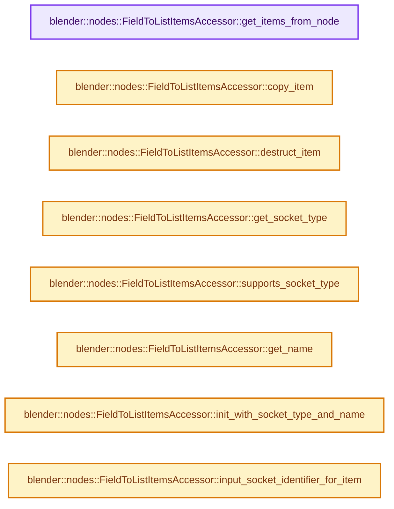
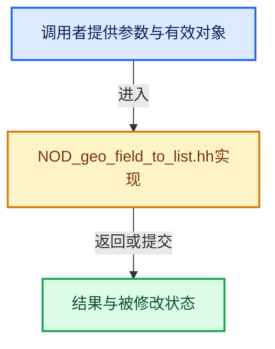

# 实现依赖专题：source/blender/nodes/geometry/include/NOD_geo_field_to_list.hh

[方向导航](README.md) · [符号索引](../%E7%AC%A6%E5%8F%B7%E4%BE%9D%E8%B5%96%E4%B8%8E%E5%AE%9E%E7%8E%B0%E7%B4%A2%E5%BC%95.md)

本专题从正文实际调用进入，集中保存共享实现。函数有稳定锚点，可从调用处直接跳到对应完整函数；递归与互相调用通过回链组织。

## 本文件的实现关系






## 完整成员与函数实现

<a id="f-b9622adfbf3850be"></a>

### `blender::nodes::FieldToListItemsAccessor::get_items_from_node`

实现位置：[source/blender/nodes/geometry/include/NOD_geo_field_to_list.hh](../../../../../source/blender/nodes/geometry/include/NOD_geo_field_to_list.hh) · L38—L42。

接口参数：

- `bNode &node`

**教学注释版**

<!-- annotated:133ff2ac6c9546 -->

```cpp
  static socket_items::SocketItemsRef<GeometryNodeFieldToListItem> get_items_from_node(bNode &node)
  {
    auto &storage = *static_cast<GeometryNodeFieldToList *>(node.storage);
    return {&storage.items, &storage.items_num, &storage.active_index};
  }
```

<details>
<summary>核对原始源码：source/blender/nodes/geometry/include/NOD_geo_field_to_list.hh · L38—L42</summary>

<!-- original:133ff2ac6c9546:source/blender/nodes/geometry/include/NOD_geo_field_to_list.hh:38:42 -->

```cpp
  static socket_items::SocketItemsRef<GeometryNodeFieldToListItem> get_items_from_node(bNode &node)
  {
    auto &storage = *static_cast<GeometryNodeFieldToList *>(node.storage);
    return {&storage.items, &storage.items_num, &storage.active_index};
  }
```

</details>

**结果出口**

- `return {&storage.items, &storage.items_num, &storage.active_index};`

**继续追踪实现**

本实现没有需要继续展开的显式调用；检查返回表达式、对象转换和调用者前置条件。

<a id="f-70e33a707e501b23"></a>

### `blender::nodes::FieldToListItemsAccessor::copy_item`

实现位置：[source/blender/nodes/geometry/include/NOD_geo_field_to_list.hh](../../../../../source/blender/nodes/geometry/include/NOD_geo_field_to_list.hh) · L44—L48。

接口参数：

- `const GeometryNodeFieldToListItem &src`
- `GeometryNodeFieldToListItem &dst`

**教学注释版**

<!-- annotated:2b1aee7619e0bd -->

```cpp
  static void copy_item(const GeometryNodeFieldToListItem &src, GeometryNodeFieldToListItem &dst)
  {
    dst = src;
    dst.name = BLI_strdup_null(dst.name);
  }
```

<details>
<summary>核对原始源码：source/blender/nodes/geometry/include/NOD_geo_field_to_list.hh · L44—L48</summary>

<!-- original:2b1aee7619e0bd:source/blender/nodes/geometry/include/NOD_geo_field_to_list.hh:44:48 -->

```cpp
  static void copy_item(const GeometryNodeFieldToListItem &src, GeometryNodeFieldToListItem &dst)
  {
    dst = src;
    dst.name = BLI_strdup_null(dst.name);
  }
```

</details>

**沿实际写入检查状态**

- `dst = src;`
- `dst.name = BLI_strdup_null(dst.name);`

**继续追踪实现**

- `BLI_strdup_null` → [blender::BLI_strdup_null · L48](../01-%E5%9F%BA%E7%A1%80%E5%AE%B9%E5%99%A8%E4%B8%8E%E7%8E%B0%E4%BB%A3CPP/%E4%BE%9D%E8%B5%96-string-1d986f.md#f-c1cd7c6336fe3fe0)。

<a id="f-ba09dbf68c5a8443"></a>

### `blender::nodes::FieldToListItemsAccessor::destruct_item`

实现位置：[source/blender/nodes/geometry/include/NOD_geo_field_to_list.hh](../../../../../source/blender/nodes/geometry/include/NOD_geo_field_to_list.hh) · L50—L53。

接口参数：

- `GeometryNodeFieldToListItem *item`

**教学注释版**

<!-- annotated:aca2e9fd457d11 -->

```cpp
  static void destruct_item(GeometryNodeFieldToListItem *item)
  {
    MEM_SAFE_DELETE(item->name);
  }
```

<details>
<summary>核对原始源码：source/blender/nodes/geometry/include/NOD_geo_field_to_list.hh · L50—L53</summary>

<!-- original:aca2e9fd457d11:source/blender/nodes/geometry/include/NOD_geo_field_to_list.hh:50:53 -->

```cpp
  static void destruct_item(GeometryNodeFieldToListItem *item)
  {
    MEM_SAFE_DELETE(item->name);
  }
```

</details>

**继续追踪实现**

- `MEM_SAFE_DELETE` → [MEM_SAFE_DELETE · L436](../03-%E5%86%85%E5%AD%98%E5%88%86%E9%85%8D%E4%B8%8E%E8%BF%90%E8%A1%8C%E6%97%B6%E7%B1%BB%E5%9E%8B/%E4%BE%9D%E8%B5%96-MEM_guardedalloc-b54eca.md#m-eadb3bc5b902)。宏定义由构建条件选择。

<a id="f-89297e7bffdc84b2"></a>

### `blender::nodes::FieldToListItemsAccessor::get_socket_type`

实现位置：[source/blender/nodes/geometry/include/NOD_geo_field_to_list.hh](../../../../../source/blender/nodes/geometry/include/NOD_geo_field_to_list.hh) · L58—L61。

接口参数：

- `const ItemT &item`

**教学注释版**

<!-- annotated:a579a156cb1d7d -->

```cpp
  static eNodeSocketDatatype get_socket_type(const ItemT &item)
  {
    return item.socket_type;
  }
```

<details>
<summary>核对原始源码：source/blender/nodes/geometry/include/NOD_geo_field_to_list.hh · L58—L61</summary>

<!-- original:a579a156cb1d7d:source/blender/nodes/geometry/include/NOD_geo_field_to_list.hh:58:61 -->

```cpp
  static eNodeSocketDatatype get_socket_type(const ItemT &item)
  {
    return item.socket_type;
  }
```

</details>

**结果出口**

- `return item.socket_type;`

**继续追踪实现**

本实现没有需要继续展开的显式调用；检查返回表达式、对象转换和调用者前置条件。

<a id="f-e63b47817b1b2608"></a>

### `blender::nodes::FieldToListItemsAccessor::supports_socket_type`

实现位置：[source/blender/nodes/geometry/include/NOD_geo_field_to_list.hh](../../../../../source/blender/nodes/geometry/include/NOD_geo_field_to_list.hh) · L63—L66。

接口参数：

- `const eNodeSocketDatatype socket_type`
- `const int`

**教学注释版**

<!-- annotated:657d89b6700c35 -->

```cpp
  static bool supports_socket_type(const eNodeSocketDatatype socket_type, const int /*ntree_type*/)
  {
    return socket_type_supports_fields(socket_type);
  }
```

<details>
<summary>核对原始源码：source/blender/nodes/geometry/include/NOD_geo_field_to_list.hh · L63—L66</summary>

<!-- original:657d89b6700c35:source/blender/nodes/geometry/include/NOD_geo_field_to_list.hh:63:66 -->

```cpp
  static bool supports_socket_type(const eNodeSocketDatatype socket_type, const int /*ntree_type*/)
  {
    return socket_type_supports_fields(socket_type);
  }
```

</details>

**结果出口**

- `return socket_type_supports_fields(socket_type);`

**继续追踪实现**

- `socket_type_supports_fields` → [blender::nodes::socket_type_supports_fields · L663](%E4%BE%9D%E8%B5%96-node_socket-0ca7fe.md#f-2d675fda05d0eec2)。

<a id="f-168da21e709ba57c"></a>

### `blender::nodes::FieldToListItemsAccessor::get_name`

实现位置：[source/blender/nodes/geometry/include/NOD_geo_field_to_list.hh](../../../../../source/blender/nodes/geometry/include/NOD_geo_field_to_list.hh) · L68—L71。

接口参数：

- `GeometryNodeFieldToListItem &item`

**教学注释版**

<!-- annotated:ba2b2aa8cf4deb -->

```cpp
  static char **get_name(GeometryNodeFieldToListItem &item)
  {
    return &item.name;
  }
```

<details>
<summary>核对原始源码：source/blender/nodes/geometry/include/NOD_geo_field_to_list.hh · L68—L71</summary>

<!-- original:ba2b2aa8cf4deb:source/blender/nodes/geometry/include/NOD_geo_field_to_list.hh:68:71 -->

```cpp
  static char **get_name(GeometryNodeFieldToListItem &item)
  {
    return &item.name;
  }
```

</details>

**结果出口**

- `return &item.name;`

**继续追踪实现**

本实现没有需要继续展开的显式调用；检查返回表达式、对象转换和调用者前置条件。

<a id="f-45b3dfcd6f9ddafc"></a>

### `blender::nodes::FieldToListItemsAccessor::init_with_socket_type_and_name`

实现位置：[source/blender/nodes/geometry/include/NOD_geo_field_to_list.hh](../../../../../source/blender/nodes/geometry/include/NOD_geo_field_to_list.hh) · L73—L82。

接口参数：

- `bNode &node`
- `GeometryNodeFieldToListItem &item`
- `const eNodeSocketDatatype socket_type`
- `const char *name`

**教学注释版**

<!-- annotated:1732d7e5042717 -->

```cpp
  static void init_with_socket_type_and_name(bNode &node,
                                             GeometryNodeFieldToListItem &item,
                                             const eNodeSocketDatatype socket_type,
                                             const char *name)
  {
    auto *storage = static_cast<GeometryNodeFieldToList *>(node.storage);
    item.socket_type = socket_type;
    item.identifier = storage->next_identifier++;
    socket_items::set_item_name_and_make_unique<FieldToListItemsAccessor>(node, item, name);
  }
```

<details>
<summary>核对原始源码：source/blender/nodes/geometry/include/NOD_geo_field_to_list.hh · L73—L82</summary>

<!-- original:1732d7e5042717:source/blender/nodes/geometry/include/NOD_geo_field_to_list.hh:73:82 -->

```cpp
  static void init_with_socket_type_and_name(bNode &node,
                                             GeometryNodeFieldToListItem &item,
                                             const eNodeSocketDatatype socket_type,
                                             const char *name)
  {
    auto *storage = static_cast<GeometryNodeFieldToList *>(node.storage);
    item.socket_type = socket_type;
    item.identifier = storage->next_identifier++;
    socket_items::set_item_name_and_make_unique<FieldToListItemsAccessor>(node, item, name);
  }
```

</details>

**沿实际写入检查状态**

- `item.socket_type = socket_type;`
- `item.identifier = storage->next_identifier++;`

**继续追踪实现**

- `socket_items::set_item_name_and_make_unique<FieldToListItemsAccessor>` → [blender::nodes::socket_items::set_item_name_and_make_unique · L148](%E4%BE%9D%E8%B5%96-NOD_socket_items-d21cfb.md#f-7e7af1c01522f9dc)。

<a id="f-10eca9629bb3bc85"></a>

### `blender::nodes::FieldToListItemsAccessor::input_socket_identifier_for_item`

实现位置：[source/blender/nodes/geometry/include/NOD_geo_field_to_list.hh](../../../../../source/blender/nodes/geometry/include/NOD_geo_field_to_list.hh) · L84—L87。

接口参数：

- `const GeometryNodeFieldToListItem &item`

**教学注释版**

<!-- annotated:e73497c302fb44 -->

```cpp
  static std::string input_socket_identifier_for_item(const GeometryNodeFieldToListItem &item)
  {
    return "Field_" + std::to_string(item.identifier);
  }
```

<details>
<summary>核对原始源码：source/blender/nodes/geometry/include/NOD_geo_field_to_list.hh · L84—L87</summary>

<!-- original:e73497c302fb44:source/blender/nodes/geometry/include/NOD_geo_field_to_list.hh:84:87 -->

```cpp
  static std::string input_socket_identifier_for_item(const GeometryNodeFieldToListItem &item)
  {
    return "Field_" + std::to_string(item.identifier);
  }
```

</details>

**结果出口**

- `return "Field_" + std::to_string(item.identifier);`

**继续追踪实现**

- `std::to_string` → [外部契约](https://eel.is/c++draft/)：这个边界按实际表达式及所属类型核对参数、返回值、寿命与失败行为。这里提供接口入口，不声称已解释该第三方版本的内部实现。

<a id="f-ba576184b159d59b"></a>

### `blender::nodes::FieldToListItemsAccessor::output_socket_identifier_for_item`

实现位置：[source/blender/nodes/geometry/include/NOD_geo_field_to_list.hh](../../../../../source/blender/nodes/geometry/include/NOD_geo_field_to_list.hh) · L89—L92。

接口参数：

- `const GeometryNodeFieldToListItem &item`

**教学注释版**

<!-- annotated:5f0c4e931c873e -->

```cpp
  static std::string output_socket_identifier_for_item(const GeometryNodeFieldToListItem &item)
  {
    return "List_" + std::to_string(item.identifier);
  }
```

<details>
<summary>核对原始源码：source/blender/nodes/geometry/include/NOD_geo_field_to_list.hh · L89—L92</summary>

<!-- original:5f0c4e931c873e:source/blender/nodes/geometry/include/NOD_geo_field_to_list.hh:89:92 -->

```cpp
  static std::string output_socket_identifier_for_item(const GeometryNodeFieldToListItem &item)
  {
    return "List_" + std::to_string(item.identifier);
  }
```

</details>

**结果出口**

- `return "List_" + std::to_string(item.identifier);`

**继续追踪实现**

- `std::to_string` → [外部契约](https://eel.is/c++draft/)：这个边界按实际表达式及所属类型核对参数、返回值、寿命与失败行为。这里提供接口入口，不声称已解释该第三方版本的内部实现。
