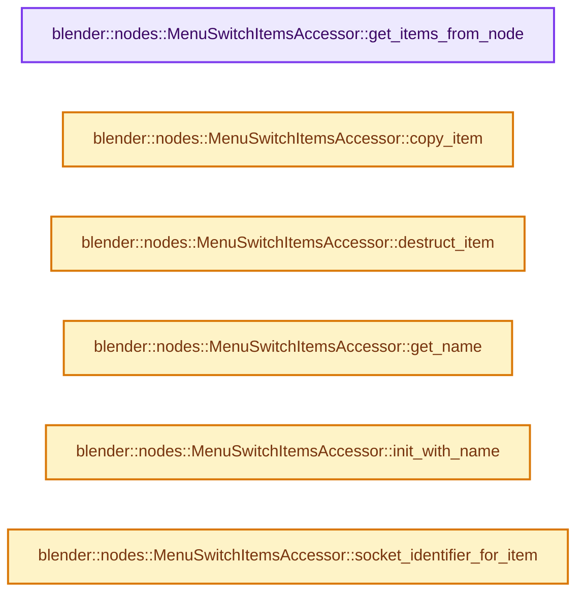
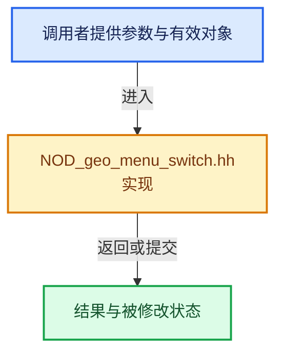

# 实现依赖专题：source/blender/nodes/geometry/include/NOD_geo_menu_switch.hh

[方向导航](README.md) · [符号索引](../%E7%AC%A6%E5%8F%B7%E4%BE%9D%E8%B5%96%E4%B8%8E%E5%AE%9E%E7%8E%B0%E7%B4%A2%E5%BC%95.md)

本专题从正文实际调用进入，集中保存共享实现。函数有稳定锚点，可从调用处直接跳到对应完整函数；递归与互相调用通过回链组织。

## 本文件的实现关系






## 完整成员与函数实现

<a id="f-ad24d3b15c5b59c3"></a>

### `blender::nodes::MenuSwitchItemsAccessor::get_items_from_node`

实现位置：[source/blender/nodes/geometry/include/NOD_geo_menu_switch.hh](../../../../../source/blender/nodes/geometry/include/NOD_geo_menu_switch.hh) · L38—L44。

接口参数：

- `bNode &node`

**教学注释版**

<!-- annotated:d20eda0db03fc2 -->

```cpp
  static socket_items::SocketItemsRef<NodeEnumItem> get_items_from_node(bNode &node)
  {
    auto *storage = static_cast<NodeMenuSwitch *>(node.storage);
    return {&storage->enum_definition.items_array,
            &storage->enum_definition.items_num,
            &storage->enum_definition.active_index};
  }
```

<details>
<summary>核对原始源码：source/blender/nodes/geometry/include/NOD_geo_menu_switch.hh · L38—L44</summary>

<!-- original:d20eda0db03fc2:source/blender/nodes/geometry/include/NOD_geo_menu_switch.hh:38:44 -->

```cpp
  static socket_items::SocketItemsRef<NodeEnumItem> get_items_from_node(bNode &node)
  {
    auto *storage = static_cast<NodeMenuSwitch *>(node.storage);
    return {&storage->enum_definition.items_array,
            &storage->enum_definition.items_num,
            &storage->enum_definition.active_index};
  }
```

</details>

**结果出口**

- `return {&storage->enum_definition.items_array,`

**继续追踪实现**

本实现没有需要继续展开的显式调用；检查返回表达式、对象转换和调用者前置条件。

<a id="f-6b05bf97465c76c8"></a>

### `blender::nodes::MenuSwitchItemsAccessor::copy_item`

实现位置：[source/blender/nodes/geometry/include/NOD_geo_menu_switch.hh](../../../../../source/blender/nodes/geometry/include/NOD_geo_menu_switch.hh) · L46—L51。

接口参数：

- `const NodeEnumItem &src`
- `NodeEnumItem &dst`

**教学注释版**

<!-- annotated:4b701bac517625 -->

```cpp
  static void copy_item(const NodeEnumItem &src, NodeEnumItem &dst)
  {
    dst = src;
    dst.name = BLI_strdup_null(dst.name);
    dst.description = BLI_strdup_null(dst.description);
  }
```

<details>
<summary>核对原始源码：source/blender/nodes/geometry/include/NOD_geo_menu_switch.hh · L46—L51</summary>

<!-- original:4b701bac517625:source/blender/nodes/geometry/include/NOD_geo_menu_switch.hh:46:51 -->

```cpp
  static void copy_item(const NodeEnumItem &src, NodeEnumItem &dst)
  {
    dst = src;
    dst.name = BLI_strdup_null(dst.name);
    dst.description = BLI_strdup_null(dst.description);
  }
```

</details>

**沿实际写入检查状态**

- `dst = src;`
- `dst.name = BLI_strdup_null(dst.name);`
- `dst.description = BLI_strdup_null(dst.description);`

**继续追踪实现**

- `BLI_strdup_null` → [blender::BLI_strdup_null · L48](../01-%E5%9F%BA%E7%A1%80%E5%AE%B9%E5%99%A8%E4%B8%8E%E7%8E%B0%E4%BB%A3CPP/%E4%BE%9D%E8%B5%96-string-1d986f.md#f-c1cd7c6336fe3fe0)。

<a id="f-d030667d2624ff88"></a>

### `blender::nodes::MenuSwitchItemsAccessor::destruct_item`

实现位置：[source/blender/nodes/geometry/include/NOD_geo_menu_switch.hh](../../../../../source/blender/nodes/geometry/include/NOD_geo_menu_switch.hh) · L53—L57。

接口参数：

- `NodeEnumItem *item`

**教学注释版**

<!-- annotated:26099c4b88d676 -->

```cpp
  static void destruct_item(NodeEnumItem *item)
  {
    MEM_SAFE_DELETE(item->name);
    MEM_SAFE_DELETE(item->description);
  }
```

<details>
<summary>核对原始源码：source/blender/nodes/geometry/include/NOD_geo_menu_switch.hh · L53—L57</summary>

<!-- original:26099c4b88d676:source/blender/nodes/geometry/include/NOD_geo_menu_switch.hh:53:57 -->

```cpp
  static void destruct_item(NodeEnumItem *item)
  {
    MEM_SAFE_DELETE(item->name);
    MEM_SAFE_DELETE(item->description);
  }
```

</details>

**继续追踪实现**

- `MEM_SAFE_DELETE` → [MEM_SAFE_DELETE · L436](../03-%E5%86%85%E5%AD%98%E5%88%86%E9%85%8D%E4%B8%8E%E8%BF%90%E8%A1%8C%E6%97%B6%E7%B1%BB%E5%9E%8B/%E4%BE%9D%E8%B5%96-MEM_guardedalloc-b54eca.md#m-eadb3bc5b902)。宏定义由构建条件选择。

<a id="f-8172bf3123f81512"></a>

### `blender::nodes::MenuSwitchItemsAccessor::get_name`

实现位置：[source/blender/nodes/geometry/include/NOD_geo_menu_switch.hh](../../../../../source/blender/nodes/geometry/include/NOD_geo_menu_switch.hh) · L62—L65。

接口参数：

- `NodeEnumItem &item`

**教学注释版**

<!-- annotated:5a5a31526fd427 -->

```cpp
  static char **get_name(NodeEnumItem &item)
  {
    return &item.name;
  }
```

<details>
<summary>核对原始源码：source/blender/nodes/geometry/include/NOD_geo_menu_switch.hh · L62—L65</summary>

<!-- original:5a5a31526fd427:source/blender/nodes/geometry/include/NOD_geo_menu_switch.hh:62:65 -->

```cpp
  static char **get_name(NodeEnumItem &item)
  {
    return &item.name;
  }
```

</details>

**结果出口**

- `return &item.name;`

**继续追踪实现**

本实现没有需要继续展开的显式调用；检查返回表达式、对象转换和调用者前置条件。

<a id="f-216efb7bc5f53206"></a>

### `blender::nodes::MenuSwitchItemsAccessor::init_with_name`

实现位置：[source/blender/nodes/geometry/include/NOD_geo_menu_switch.hh](../../../../../source/blender/nodes/geometry/include/NOD_geo_menu_switch.hh) · L67—L72。

接口参数：

- `bNode &node`
- `NodeEnumItem &item`
- `const char *name`

**教学注释版**

<!-- annotated:2e041e87b105cc -->

```cpp
  static void init_with_name(bNode &node, NodeEnumItem &item, const char *name)
  {
    auto *storage = static_cast<NodeMenuSwitch *>(node.storage);
    item.identifier = storage->enum_definition.next_identifier++;
    socket_items::set_item_name_and_make_unique<MenuSwitchItemsAccessor>(node, item, name);
  }
```

<details>
<summary>核对原始源码：source/blender/nodes/geometry/include/NOD_geo_menu_switch.hh · L67—L72</summary>

<!-- original:2e041e87b105cc:source/blender/nodes/geometry/include/NOD_geo_menu_switch.hh:67:72 -->

```cpp
  static void init_with_name(bNode &node, NodeEnumItem &item, const char *name)
  {
    auto *storage = static_cast<NodeMenuSwitch *>(node.storage);
    item.identifier = storage->enum_definition.next_identifier++;
    socket_items::set_item_name_and_make_unique<MenuSwitchItemsAccessor>(node, item, name);
  }
```

</details>

**沿实际写入检查状态**

- `item.identifier = storage->enum_definition.next_identifier++;`

**继续追踪实现**

- `socket_items::set_item_name_and_make_unique<MenuSwitchItemsAccessor>` → [blender::nodes::socket_items::set_item_name_and_make_unique · L148](%E4%BE%9D%E8%B5%96-NOD_socket_items-d21cfb.md#f-7e7af1c01522f9dc)。

<a id="f-d1b39d5572b04bed"></a>

### `blender::nodes::MenuSwitchItemsAccessor::socket_identifier_for_item`

实现位置：[source/blender/nodes/geometry/include/NOD_geo_menu_switch.hh](../../../../../source/blender/nodes/geometry/include/NOD_geo_menu_switch.hh) · L74—L77。

接口参数：

- `const NodeEnumItem &item`

**教学注释版**

<!-- annotated:d3850269bfa380 -->

```cpp
  static std::string socket_identifier_for_item(const NodeEnumItem &item)
  {
    return "Item_" + std::to_string(item.identifier);
  }
```

<details>
<summary>核对原始源码：source/blender/nodes/geometry/include/NOD_geo_menu_switch.hh · L74—L77</summary>

<!-- original:d3850269bfa380:source/blender/nodes/geometry/include/NOD_geo_menu_switch.hh:74:77 -->

```cpp
  static std::string socket_identifier_for_item(const NodeEnumItem &item)
  {
    return "Item_" + std::to_string(item.identifier);
  }
```

</details>

**结果出口**

- `return "Item_" + std::to_string(item.identifier);`

**继续追踪实现**

- `std::to_string` → [外部契约](https://eel.is/c++draft/)：这个边界按实际表达式及所属类型核对参数、返回值、寿命与失败行为。这里提供接口入口，不声称已解释该第三方版本的内部实现。
