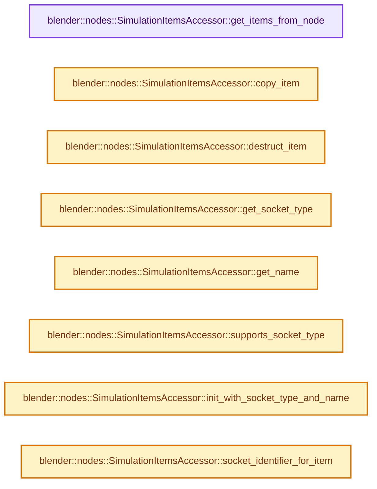
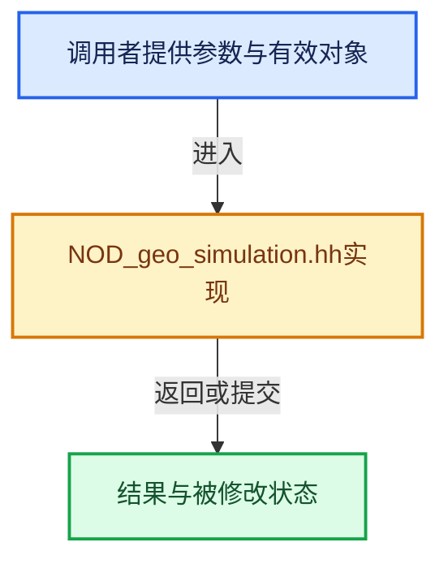

# 实现依赖专题：source/blender/nodes/geometry/include/NOD_geo_simulation.hh

[方向导航](README.md) · [符号索引](../%E7%AC%A6%E5%8F%B7%E4%BE%9D%E8%B5%96%E4%B8%8E%E5%AE%9E%E7%8E%B0%E7%B4%A2%E5%BC%95.md)

本专题从正文实际调用进入，集中保存共享实现。函数有稳定锚点，可从调用处直接跳到对应完整函数；递归与互相调用通过回链组织。

## 本文件的实现关系






## 完整成员与函数实现

<a id="f-898ff47dc220feed"></a>

### `blender::nodes::SimulationItemsAccessor::get_items_from_node`

实现位置：[source/blender/nodes/geometry/include/NOD_geo_simulation.hh](../../../../../source/blender/nodes/geometry/include/NOD_geo_simulation.hh) · L37—L41。

接口参数：

- `bNode &node`

**教学注释版**

<!-- annotated:06536d5e57cc9f -->

```cpp
  static socket_items::SocketItemsRef<NodeSimulationItem> get_items_from_node(bNode &node)
  {
    auto *storage = static_cast<NodeGeometrySimulationOutput *>(node.storage);
    return {&storage->items, &storage->items_num, &storage->active_index};
  }
```

<details>
<summary>核对原始源码：source/blender/nodes/geometry/include/NOD_geo_simulation.hh · L37—L41</summary>

<!-- original:06536d5e57cc9f:source/blender/nodes/geometry/include/NOD_geo_simulation.hh:37:41 -->

```cpp
  static socket_items::SocketItemsRef<NodeSimulationItem> get_items_from_node(bNode &node)
  {
    auto *storage = static_cast<NodeGeometrySimulationOutput *>(node.storage);
    return {&storage->items, &storage->items_num, &storage->active_index};
  }
```

</details>

**结果出口**

- `return {&storage->items, &storage->items_num, &storage->active_index};`

**继续追踪实现**

本实现没有需要继续展开的显式调用；检查返回表达式、对象转换和调用者前置条件。

<a id="f-e0b3b055550bff29"></a>

### `blender::nodes::SimulationItemsAccessor::copy_item`

实现位置：[source/blender/nodes/geometry/include/NOD_geo_simulation.hh](../../../../../source/blender/nodes/geometry/include/NOD_geo_simulation.hh) · L43—L47。

接口参数：

- `const NodeSimulationItem &src`
- `NodeSimulationItem &dst`

**教学注释版**

<!-- annotated:c7c345d96f252e -->

```cpp
  static void copy_item(const NodeSimulationItem &src, NodeSimulationItem &dst)
  {
    dst = src;
    dst.name = BLI_strdup_null(dst.name);
  }
```

<details>
<summary>核对原始源码：source/blender/nodes/geometry/include/NOD_geo_simulation.hh · L43—L47</summary>

<!-- original:c7c345d96f252e:source/blender/nodes/geometry/include/NOD_geo_simulation.hh:43:47 -->

```cpp
  static void copy_item(const NodeSimulationItem &src, NodeSimulationItem &dst)
  {
    dst = src;
    dst.name = BLI_strdup_null(dst.name);
  }
```

</details>

**沿实际写入检查状态**

- `dst = src;`
- `dst.name = BLI_strdup_null(dst.name);`

**继续追踪实现**

- `BLI_strdup_null` → [blender::BLI_strdup_null · L48](../01-%E5%9F%BA%E7%A1%80%E5%AE%B9%E5%99%A8%E4%B8%8E%E7%8E%B0%E4%BB%A3CPP/%E4%BE%9D%E8%B5%96-string-1d986f.md#f-c1cd7c6336fe3fe0)。

<a id="f-1c8b87046a11df38"></a>

### `blender::nodes::SimulationItemsAccessor::destruct_item`

实现位置：[source/blender/nodes/geometry/include/NOD_geo_simulation.hh](../../../../../source/blender/nodes/geometry/include/NOD_geo_simulation.hh) · L49—L52。

接口参数：

- `NodeSimulationItem *item`

**教学注释版**

<!-- annotated:af68683db7ca05 -->

```cpp
  static void destruct_item(NodeSimulationItem *item)
  {
    MEM_SAFE_DELETE(item->name);
  }
```

<details>
<summary>核对原始源码：source/blender/nodes/geometry/include/NOD_geo_simulation.hh · L49—L52</summary>

<!-- original:af68683db7ca05:source/blender/nodes/geometry/include/NOD_geo_simulation.hh:49:52 -->

```cpp
  static void destruct_item(NodeSimulationItem *item)
  {
    MEM_SAFE_DELETE(item->name);
  }
```

</details>

**继续追踪实现**

- `MEM_SAFE_DELETE` → [MEM_SAFE_DELETE · L436](../03-%E5%86%85%E5%AD%98%E5%88%86%E9%85%8D%E4%B8%8E%E8%BF%90%E8%A1%8C%E6%97%B6%E7%B1%BB%E5%9E%8B/%E4%BE%9D%E8%B5%96-MEM_guardedalloc-b54eca.md#m-eadb3bc5b902)。宏定义由构建条件选择。

<a id="f-90b7f463d4a560d5"></a>

### `blender::nodes::SimulationItemsAccessor::get_socket_type`

实现位置：[source/blender/nodes/geometry/include/NOD_geo_simulation.hh](../../../../../source/blender/nodes/geometry/include/NOD_geo_simulation.hh) · L57—L60。

接口参数：

- `const NodeSimulationItem &item`

**教学注释版**

<!-- annotated:038943f7e6a3c1 -->

```cpp
  static eNodeSocketDatatype get_socket_type(const NodeSimulationItem &item)
  {
    return item.socket_type;
  }
```

<details>
<summary>核对原始源码：source/blender/nodes/geometry/include/NOD_geo_simulation.hh · L57—L60</summary>

<!-- original:038943f7e6a3c1:source/blender/nodes/geometry/include/NOD_geo_simulation.hh:57:60 -->

```cpp
  static eNodeSocketDatatype get_socket_type(const NodeSimulationItem &item)
  {
    return item.socket_type;
  }
```

</details>

**结果出口**

- `return item.socket_type;`

**继续追踪实现**

本实现没有需要继续展开的显式调用；检查返回表达式、对象转换和调用者前置条件。

<a id="f-c19e211dd999e593"></a>

### `blender::nodes::SimulationItemsAccessor::get_name`

实现位置：[source/blender/nodes/geometry/include/NOD_geo_simulation.hh](../../../../../source/blender/nodes/geometry/include/NOD_geo_simulation.hh) · L62—L65。

接口参数：

- `NodeSimulationItem &item`

**教学注释版**

<!-- annotated:b65c152501c3fd -->

```cpp
  static char **get_name(NodeSimulationItem &item)
  {
    return &item.name;
  }
```

<details>
<summary>核对原始源码：source/blender/nodes/geometry/include/NOD_geo_simulation.hh · L62—L65</summary>

<!-- original:b65c152501c3fd:source/blender/nodes/geometry/include/NOD_geo_simulation.hh:62:65 -->

```cpp
  static char **get_name(NodeSimulationItem &item)
  {
    return &item.name;
  }
```

</details>

**结果出口**

- `return &item.name;`

**继续追踪实现**

本实现没有需要继续展开的显式调用；检查返回表达式、对象转换和调用者前置条件。

<a id="f-80790ad15dd8cfc0"></a>

### `blender::nodes::SimulationItemsAccessor::supports_socket_type`

实现位置：[source/blender/nodes/geometry/include/NOD_geo_simulation.hh](../../../../../source/blender/nodes/geometry/include/NOD_geo_simulation.hh) · L67—L81。

接口参数：

- `const eNodeSocketDatatype socket_type`
- `const int`

**教学注释版**

<!-- annotated:6b32f1018e7b5e -->

```cpp
  static bool supports_socket_type(const eNodeSocketDatatype socket_type, const int /*ntree_type*/)
  {
    /* Data-block types and closures are not supported. */
    return ELEM(socket_type,
                SOCK_FLOAT,
                SOCK_VECTOR,
                SOCK_RGBA,
                SOCK_BOOLEAN,
                SOCK_ROTATION,
                SOCK_MATRIX,
                SOCK_INT,
                SOCK_STRING,
                SOCK_GEOMETRY,
                SOCK_BUNDLE);
  }
```

<details>
<summary>核对原始源码：source/blender/nodes/geometry/include/NOD_geo_simulation.hh · L67—L81</summary>

<!-- original:6b32f1018e7b5e:source/blender/nodes/geometry/include/NOD_geo_simulation.hh:67:81 -->

```cpp
  static bool supports_socket_type(const eNodeSocketDatatype socket_type, const int /*ntree_type*/)
  {
    /* Data-block types and closures are not supported. */
    return ELEM(socket_type,
                SOCK_FLOAT,
                SOCK_VECTOR,
                SOCK_RGBA,
                SOCK_BOOLEAN,
                SOCK_ROTATION,
                SOCK_MATRIX,
                SOCK_INT,
                SOCK_STRING,
                SOCK_GEOMETRY,
                SOCK_BUNDLE);
  }
```

</details>

**结果出口**

- `return ELEM(socket_type,`

**继续追踪实现**

- `ELEM` → [ELEM · L88](../05-%E5%87%A0%E4%BD%95%E5%AD%98%E5%82%A8%E4%B8%8E%E6%8B%93%E6%89%91%E6%98%A0%E5%B0%84/%E4%BE%9D%E8%B5%96-GHOST_utildefines-34b996.md#m-d28724a15928)；[ELEM · L135](../01-%E5%9F%BA%E7%A1%80%E5%AE%B9%E5%99%A8%E4%B8%8E%E7%8E%B0%E4%BB%A3CPP/%E4%BE%9D%E8%B5%96-BLI_utildefines-293a0a.md#m-d6572de7cae0)。宏定义由构建条件选择。

<a id="f-2694999b149666b1"></a>

### `blender::nodes::SimulationItemsAccessor::init_with_socket_type_and_name`

实现位置：[source/blender/nodes/geometry/include/NOD_geo_simulation.hh](../../../../../source/blender/nodes/geometry/include/NOD_geo_simulation.hh) · L83—L92。

接口参数：

- `bNode &node`
- `NodeSimulationItem &item`
- `const eNodeSocketDatatype socket_type`
- `const char *name`

**教学注释版**

<!-- annotated:a93b60b0acf201 -->

```cpp
  static void init_with_socket_type_and_name(bNode &node,
                                             NodeSimulationItem &item,
                                             const eNodeSocketDatatype socket_type,
                                             const char *name)
  {
    auto *storage = static_cast<NodeGeometrySimulationOutput *>(node.storage);
    item.socket_type = socket_type;
    item.identifier = storage->next_identifier++;
    socket_items::set_item_name_and_make_unique<SimulationItemsAccessor>(node, item, name);
  }
```

<details>
<summary>核对原始源码：source/blender/nodes/geometry/include/NOD_geo_simulation.hh · L83—L92</summary>

<!-- original:a93b60b0acf201:source/blender/nodes/geometry/include/NOD_geo_simulation.hh:83:92 -->

```cpp
  static void init_with_socket_type_and_name(bNode &node,
                                             NodeSimulationItem &item,
                                             const eNodeSocketDatatype socket_type,
                                             const char *name)
  {
    auto *storage = static_cast<NodeGeometrySimulationOutput *>(node.storage);
    item.socket_type = socket_type;
    item.identifier = storage->next_identifier++;
    socket_items::set_item_name_and_make_unique<SimulationItemsAccessor>(node, item, name);
  }
```

</details>

**沿实际写入检查状态**

- `item.socket_type = socket_type;`
- `item.identifier = storage->next_identifier++;`

**继续追踪实现**

- `socket_items::set_item_name_and_make_unique<SimulationItemsAccessor>` → [blender::nodes::socket_items::set_item_name_and_make_unique · L148](%E4%BE%9D%E8%B5%96-NOD_socket_items-d21cfb.md#f-7e7af1c01522f9dc)。

<a id="f-5b0e70ef2ad7fc1a"></a>

### `blender::nodes::SimulationItemsAccessor::socket_identifier_for_item`

实现位置：[source/blender/nodes/geometry/include/NOD_geo_simulation.hh](../../../../../source/blender/nodes/geometry/include/NOD_geo_simulation.hh) · L94—L97。

接口参数：

- `const NodeSimulationItem &item`

**教学注释版**

<!-- annotated:7cfe21c533a84e -->

```cpp
  static std::string socket_identifier_for_item(const NodeSimulationItem &item)
  {
    return "Item_" + std::to_string(item.identifier);
  }
```

<details>
<summary>核对原始源码：source/blender/nodes/geometry/include/NOD_geo_simulation.hh · L94—L97</summary>

<!-- original:7cfe21c533a84e:source/blender/nodes/geometry/include/NOD_geo_simulation.hh:94:97 -->

```cpp
  static std::string socket_identifier_for_item(const NodeSimulationItem &item)
  {
    return "Item_" + std::to_string(item.identifier);
  }
```

</details>

**结果出口**

- `return "Item_" + std::to_string(item.identifier);`

**继续追踪实现**

- `std::to_string` → [外部契约](https://eel.is/c++draft/)：这个边界按实际表达式及所属类型核对参数、返回值、寿命与失败行为。这里提供接口入口，不声称已解释该第三方版本的内部实现。
