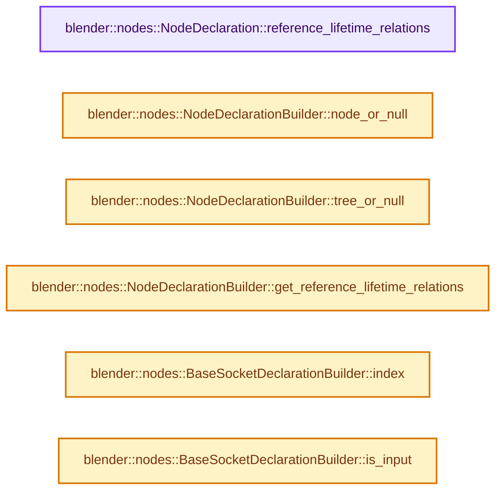
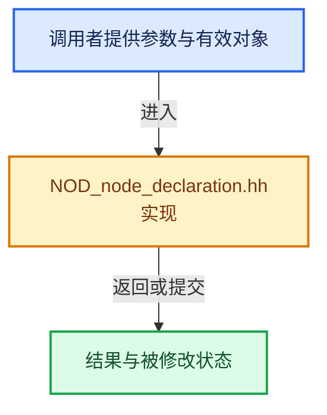

# 实现依赖专题：source/blender/nodes/NOD_node_declaration.hh

[方向导航](README.md) · [符号索引](../%E7%AC%A6%E5%8F%B7%E4%BE%9D%E8%B5%96%E4%B8%8E%E5%AE%9E%E7%8E%B0%E7%B4%A2%E5%BC%95.md)

本专题从正文实际调用进入，集中保存共享实现。函数有稳定锚点，可从调用处直接跳到对应完整函数；递归与互相调用通过回链组织。

## 本文件的实现关系






## 相关类型布局与成员入口

<a id="t-10f6dec077e2"></a>

### `blender::nodes::OutputStructureTypeDependency::None`

原始声明：[source/blender/nodes/NOD_node_declaration.hh](../../../../../source/blender/nodes/NOD_node_declaration.hh) · L164—L164。

以下保留类的数据声明与编译条件，成员函数实现通过后面的精确链接阅读。

<!-- annotated:a03e290ceccd7f -->

```cpp
  struct None {};
```

<details>
<summary>核对原始源码：source/blender/nodes/NOD_node_declaration.hh · L164—L164</summary>

<!-- original:a03e290ceccd7f:source/blender/nodes/NOD_node_declaration.hh:164:164 -->

```cpp
  struct None {};
```

</details>


## 完整成员与函数实现

<a id="f-bddefb65b2297e2f"></a>

### `blender::nodes::NodeDeclaration::reference_lifetime_relations`

实现位置：[source/blender/nodes/NOD_node_declaration.hh](../../../../../source/blender/nodes/NOD_node_declaration.hh) · L647—L650。

**教学注释版**

<!-- annotated:30265d5a31d64a -->

```cpp
  const rl::RelationsInNode *reference_lifetime_relations() const
  {
    return reference_lifetime_relations_.get();
  }
```

<details>
<summary>核对原始源码：source/blender/nodes/NOD_node_declaration.hh · L647—L650</summary>

<!-- original:30265d5a31d64a:source/blender/nodes/NOD_node_declaration.hh:647:650 -->

```cpp
  const rl::RelationsInNode *reference_lifetime_relations() const
  {
    return reference_lifetime_relations_.get();
  }
```

</details>

**结果出口**

- `return reference_lifetime_relations_.get();`

**继续追踪实现**

- `reference_lifetime_relations_.get` → [外部契约](https://eel.is/c++draft/)：这个边界按实际表达式及所属类型核对参数、返回值、寿命与失败行为。这里提供接口入口，不声称已解释该第三方版本的内部实现。

<a id="f-1dfd970e8f6b7b32"></a>

### `blender::nodes::NodeDeclarationBuilder::node_or_null`

实现位置：[source/blender/nodes/NOD_node_declaration.hh](../../../../../source/blender/nodes/NOD_node_declaration.hh) · L675—L679。

**教学注释版**

<!-- annotated:d464cb14d9bc45 -->

```cpp
  const bNode *node_or_null() const
  {
    declaration_.is_context_dependent = true;
    return node_;
  }
```

<details>
<summary>核对原始源码：source/blender/nodes/NOD_node_declaration.hh · L675—L679</summary>

<!-- original:d464cb14d9bc45:source/blender/nodes/NOD_node_declaration.hh:675:679 -->

```cpp
  const bNode *node_or_null() const
  {
    declaration_.is_context_dependent = true;
    return node_;
  }
```

</details>

**沿实际写入检查状态**

- `declaration_.is_context_dependent = true;`

**结果出口**

- `return node_;`

**继续追踪实现**

本实现没有需要继续展开的显式调用；检查返回表达式、对象转换和调用者前置条件。

<a id="f-f41371835832ba92"></a>

### `blender::nodes::NodeDeclarationBuilder::tree_or_null`

实现位置：[source/blender/nodes/NOD_node_declaration.hh](../../../../../source/blender/nodes/NOD_node_declaration.hh) · L681—L685。

**教学注释版**

<!-- annotated:ee5a57d76b3ec2 -->

```cpp
  const bNodeTree *tree_or_null() const
  {
    declaration_.is_context_dependent = true;
    return ntree_;
  }
```

<details>
<summary>核对原始源码：source/blender/nodes/NOD_node_declaration.hh · L681—L685</summary>

<!-- original:ee5a57d76b3ec2:source/blender/nodes/NOD_node_declaration.hh:681:685 -->

```cpp
  const bNodeTree *tree_or_null() const
  {
    declaration_.is_context_dependent = true;
    return ntree_;
  }
```

</details>

**沿实际写入检查状态**

- `declaration_.is_context_dependent = true;`

**结果出口**

- `return ntree_;`

**继续追踪实现**

本实现没有需要继续展开的显式调用；检查返回表达式、对象转换和调用者前置条件。

<a id="f-e8abdddd34637d0e"></a>

### `blender::nodes::NodeDeclarationBuilder::get_reference_lifetime_relations`

实现位置：[source/blender/nodes/NOD_node_declaration.hh](../../../../../source/blender/nodes/NOD_node_declaration.hh) · L701—L707。

**教学注释版**

<!-- annotated:03d45f0b1a6060 -->

```cpp
  rl::RelationsInNode &get_reference_lifetime_relations()
  {
    if (!declaration_.reference_lifetime_relations_) {
      // [讲解] std::make_unique<rl::RelationsInNode>：创建独占拥有的对象，拥有关系可移动，get返回的借用指针不自动延长寿命。
      declaration_.reference_lifetime_relations_ = std::make_unique<rl::RelationsInNode>();
    }
    return *declaration_.reference_lifetime_relations_;
  }
```

<details>
<summary>核对原始源码：source/blender/nodes/NOD_node_declaration.hh · L701—L707</summary>

<!-- original:03d45f0b1a6060:source/blender/nodes/NOD_node_declaration.hh:701:707 -->

```cpp
  rl::RelationsInNode &get_reference_lifetime_relations()
  {
    if (!declaration_.reference_lifetime_relations_) {
      declaration_.reference_lifetime_relations_ = std::make_unique<rl::RelationsInNode>();
    }
    return *declaration_.reference_lifetime_relations_;
  }
```

</details>

**沿实际写入检查状态**

- `declaration_.reference_lifetime_relations_ = std::make_unique<rl::RelationsInNode>();`

**结果出口**

- `return *declaration_.reference_lifetime_relations_;`

**继续追踪实现**

- `std::make_unique<rl::RelationsInNode>` → [外部契约](https://eel.is/c++draft/unique.ptr.create)：创建独占拥有的对象，拥有关系可移动，get返回的借用指针不自动延长寿命。

<a id="f-9efd4ec811162a6d"></a>

### `blender::nodes::BaseSocketDeclarationBuilder::index`

实现位置：[source/blender/nodes/NOD_node_declaration.hh](../../../../../source/blender/nodes/NOD_node_declaration.hh) · L808—L811。

**教学注释版**

<!-- annotated:8730a4d4d1a7ca -->

```cpp
inline int BaseSocketDeclarationBuilder::index() const
{
  return decl_base_->index;
}
```

<details>
<summary>核对原始源码：source/blender/nodes/NOD_node_declaration.hh · L808—L811</summary>

<!-- original:8730a4d4d1a7ca:source/blender/nodes/NOD_node_declaration.hh:808:811 -->

```cpp
inline int BaseSocketDeclarationBuilder::index() const
{
  return decl_base_->index;
}
```

</details>

**结果出口**

- `return decl_base_->index;`

**继续追踪实现**

本实现没有需要继续展开的显式调用；检查返回表达式、对象转换和调用者前置条件。

<a id="f-d008fee109e8b63e"></a>

### `blender::nodes::BaseSocketDeclarationBuilder::is_input`

实现位置：[source/blender/nodes/NOD_node_declaration.hh](../../../../../source/blender/nodes/NOD_node_declaration.hh) · L813—L816。

**教学注释版**

<!-- annotated:4826a662ee9d6e -->

```cpp
inline bool BaseSocketDeclarationBuilder::is_input() const
{
  return decl_base_->in_out == SOCK_IN;
}
```

<details>
<summary>核对原始源码：source/blender/nodes/NOD_node_declaration.hh · L813—L816</summary>

<!-- original:4826a662ee9d6e:source/blender/nodes/NOD_node_declaration.hh:813:816 -->

```cpp
inline bool BaseSocketDeclarationBuilder::is_input() const
{
  return decl_base_->in_out == SOCK_IN;
}
```

</details>

**结果出口**

- `return decl_base_->in_out == SOCK_IN;`

**继续追踪实现**

本实现没有需要继续展开的显式调用；检查返回表达式、对象转换和调用者前置条件。
