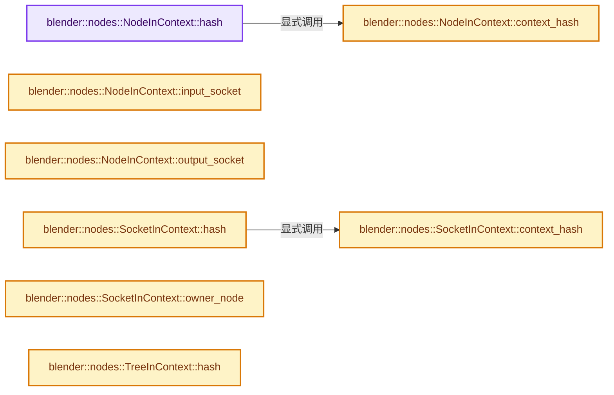
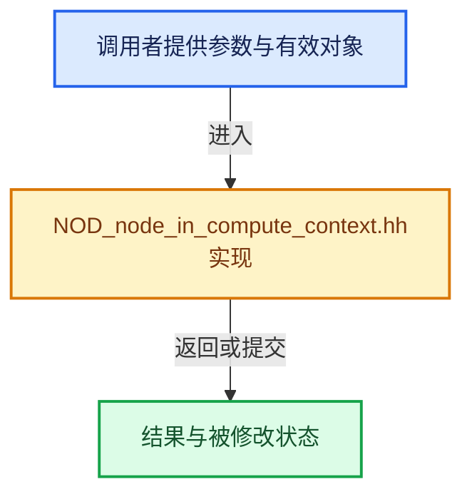

# 实现依赖专题：source/blender/nodes/NOD_node_in_compute_context.hh

[方向导航](README.md) · [符号索引](../%E7%AC%A6%E5%8F%B7%E4%BE%9D%E8%B5%96%E4%B8%8E%E5%AE%9E%E7%8E%B0%E7%B4%A2%E5%BC%95.md)

本专题从正文实际调用进入，集中保存共享实现。函数有稳定锚点，可从调用处直接跳到对应完整函数；递归与互相调用通过回链组织。

## 本文件的实现关系






## 完整成员与函数实现

<a id="f-df782e6a7ee828e5"></a>

### `blender::nodes::NodeInContext::hash`

实现位置：[source/blender/nodes/NOD_node_in_compute_context.hh](../../../../../source/blender/nodes/NOD_node_in_compute_context.hh) · L97—L100。

**教学注释版**

<!-- annotated:fd864809c02676 -->

```cpp
inline uint64_t NodeInContext::hash() const
{
  return get_default_hash(this->context_hash(), this->node);
}
```

<details>
<summary>核对原始源码：source/blender/nodes/NOD_node_in_compute_context.hh · L97—L100</summary>

<!-- original:fd864809c02676:source/blender/nodes/NOD_node_in_compute_context.hh:97:100 -->

```cpp
inline uint64_t NodeInContext::hash() const
{
  return get_default_hash(this->context_hash(), this->node);
}
```

</details>

**结果出口**

- `return get_default_hash(this->context_hash(), this->node);`

**继续追踪实现**

- `get_default_hash` → [blender::get_default_hash · L251](../02-%E5%93%88%E5%B8%8C%E8%A1%A8%E4%B8%8E%E5%85%B3%E8%81%94%E6%95%B0%E6%8D%AE%E7%BB%93%E6%9E%84/01-%E5%93%88%E5%B8%8C%E4%B8%8E%E7%9B%B8%E7%AD%89%E5%A5%91%E7%BA%A6.md#f-5f2c246aedf3dc0a)。
- `this->context_hash` → [blender::nodes::NodeInContext::context_hash · L102](%E4%BE%9D%E8%B5%96-NOD_node_in_compute_context-6c33fe.md#f-b4fc107c035d17ff)。

<a id="f-b4fc107c035d17ff"></a>

### `blender::nodes::NodeInContext::context_hash`

实现位置：[source/blender/nodes/NOD_node_in_compute_context.hh](../../../../../source/blender/nodes/NOD_node_in_compute_context.hh) · L102—L105。

**教学注释版**

<!-- annotated:dec7db17429428 -->

```cpp
inline ComputeContextHash NodeInContext::context_hash() const
{
  return context ? context->hash() : ComputeContextHash{};
}
```

<details>
<summary>核对原始源码：source/blender/nodes/NOD_node_in_compute_context.hh · L102—L105</summary>

<!-- original:dec7db17429428:source/blender/nodes/NOD_node_in_compute_context.hh:102:105 -->

```cpp
inline ComputeContextHash NodeInContext::context_hash() const
{
  return context ? context->hash() : ComputeContextHash{};
}
```

</details>

**结果出口**

- `return context ? context->hash() : ComputeContextHash{};`

**继续追踪实现**

- `context->hash` → [blender::ComputeContext::hash · L111](../01-%E5%9F%BA%E7%A1%80%E5%AE%B9%E5%99%A8%E4%B8%8E%E7%8E%B0%E4%BB%A3CPP/%E4%BE%9D%E8%B5%96-BLI_compute_context-ba44a7.md#f-12bb4fe289dd6f55)。

<a id="f-38126e4776369690"></a>

### `blender::nodes::NodeInContext::input_socket`

实现位置：[source/blender/nodes/NOD_node_in_compute_context.hh](../../../../../source/blender/nodes/NOD_node_in_compute_context.hh) · L122—L125。

接口参数：

- `const int index`

**教学注释版**

<!-- annotated:34cbfb9af47c2e -->

```cpp
inline SocketInContext NodeInContext::input_socket(const int index) const
{
  return {this->context, &this->node->input_socket(index)};
}
```

<details>
<summary>核对原始源码：source/blender/nodes/NOD_node_in_compute_context.hh · L122—L125</summary>

<!-- original:34cbfb9af47c2e:source/blender/nodes/NOD_node_in_compute_context.hh:122:125 -->

```cpp
inline SocketInContext NodeInContext::input_socket(const int index) const
{
  return {this->context, &this->node->input_socket(index)};
}
```

</details>

**结果出口**

- `return {this->context, &this->node->input_socket(index)};`

**继续追踪实现**

- `this->node->input_socket` → [调用协议](../%E6%A8%A1%E6%9D%BF%E5%AE%8F%E4%B8%8E%E5%8A%A8%E6%80%81%E5%88%86%E6%B4%BE%E5%8D%8F%E8%AE%AE.md)：接收对象类型依赖auto、返回值或模板实例；不按同名猜测目标。调用位置L124。

<a id="f-06522827bef7f52f"></a>

### `blender::nodes::NodeInContext::output_socket`

实现位置：[source/blender/nodes/NOD_node_in_compute_context.hh](../../../../../source/blender/nodes/NOD_node_in_compute_context.hh) · L127—L130。

接口参数：

- `const int index`

**教学注释版**

<!-- annotated:a278f88e4f4aa2 -->

```cpp
inline SocketInContext NodeInContext::output_socket(const int index) const
{
  return {this->context, &this->node->output_socket(index)};
}
```

<details>
<summary>核对原始源码：source/blender/nodes/NOD_node_in_compute_context.hh · L127—L130</summary>

<!-- original:a278f88e4f4aa2:source/blender/nodes/NOD_node_in_compute_context.hh:127:130 -->

```cpp
inline SocketInContext NodeInContext::output_socket(const int index) const
{
  return {this->context, &this->node->output_socket(index)};
}
```

</details>

**结果出口**

- `return {this->context, &this->node->output_socket(index)};`

**继续追踪实现**

- `this->node->output_socket` → [调用协议](../%E6%A8%A1%E6%9D%BF%E5%AE%8F%E4%B8%8E%E5%8A%A8%E6%80%81%E5%88%86%E6%B4%BE%E5%8D%8F%E8%AE%AE.md)：接收对象类型依赖auto、返回值或模板实例；不按同名猜测目标。调用位置L129。

<a id="f-02964a50b8e1abf3"></a>

### `blender::nodes::SocketInContext::hash`

实现位置：[source/blender/nodes/NOD_node_in_compute_context.hh](../../../../../source/blender/nodes/NOD_node_in_compute_context.hh) · L138—L141。

**教学注释版**

<!-- annotated:1a15a183be93be -->

```cpp
inline uint64_t SocketInContext::hash() const
{
  return get_default_hash(this->context_hash(), this->socket);
}
```

<details>
<summary>核对原始源码：source/blender/nodes/NOD_node_in_compute_context.hh · L138—L141</summary>

<!-- original:1a15a183be93be:source/blender/nodes/NOD_node_in_compute_context.hh:138:141 -->

```cpp
inline uint64_t SocketInContext::hash() const
{
  return get_default_hash(this->context_hash(), this->socket);
}
```

</details>

**结果出口**

- `return get_default_hash(this->context_hash(), this->socket);`

**继续追踪实现**

- `get_default_hash` → [blender::get_default_hash · L251](../02-%E5%93%88%E5%B8%8C%E8%A1%A8%E4%B8%8E%E5%85%B3%E8%81%94%E6%95%B0%E6%8D%AE%E7%BB%93%E6%9E%84/01-%E5%93%88%E5%B8%8C%E4%B8%8E%E7%9B%B8%E7%AD%89%E5%A5%91%E7%BA%A6.md#f-5f2c246aedf3dc0a)。
- `this->context_hash` → [blender::nodes::SocketInContext::context_hash · L143](%E4%BE%9D%E8%B5%96-NOD_node_in_compute_context-6c33fe.md#f-0372f0dd4003c0d2)。

<a id="f-0372f0dd4003c0d2"></a>

### `blender::nodes::SocketInContext::context_hash`

实现位置：[source/blender/nodes/NOD_node_in_compute_context.hh](../../../../../source/blender/nodes/NOD_node_in_compute_context.hh) · L143—L146。

**教学注释版**

<!-- annotated:eb9f2509e0887d -->

```cpp
inline ComputeContextHash SocketInContext::context_hash() const
{
  return context ? context->hash() : ComputeContextHash{};
}
```

<details>
<summary>核对原始源码：source/blender/nodes/NOD_node_in_compute_context.hh · L143—L146</summary>

<!-- original:eb9f2509e0887d:source/blender/nodes/NOD_node_in_compute_context.hh:143:146 -->

```cpp
inline ComputeContextHash SocketInContext::context_hash() const
{
  return context ? context->hash() : ComputeContextHash{};
}
```

</details>

**结果出口**

- `return context ? context->hash() : ComputeContextHash{};`

**继续追踪实现**

- `context->hash` → [blender::ComputeContext::hash · L111](../01-%E5%9F%BA%E7%A1%80%E5%AE%B9%E5%99%A8%E4%B8%8E%E7%8E%B0%E4%BB%A3CPP/%E4%BE%9D%E8%B5%96-BLI_compute_context-ba44a7.md#f-12bb4fe289dd6f55)。

<a id="f-221b42710e24bd0a"></a>

### `blender::nodes::SocketInContext::owner_node`

实现位置：[source/blender/nodes/NOD_node_in_compute_context.hh](../../../../../source/blender/nodes/NOD_node_in_compute_context.hh) · L163—L166。

**教学注释版**

<!-- annotated:6b73974d571143 -->

```cpp
inline NodeInContext SocketInContext::owner_node() const
{
  return {this->context, &this->socket->owner_node()};
}
```

<details>
<summary>核对原始源码：source/blender/nodes/NOD_node_in_compute_context.hh · L163—L166</summary>

<!-- original:6b73974d571143:source/blender/nodes/NOD_node_in_compute_context.hh:163:166 -->

```cpp
inline NodeInContext SocketInContext::owner_node() const
{
  return {this->context, &this->socket->owner_node()};
}
```

</details>

**结果出口**

- `return {this->context, &this->socket->owner_node()};`

**继续追踪实现**

- `this->socket->owner_node` → [调用协议](../%E6%A8%A1%E6%9D%BF%E5%AE%8F%E4%B8%8E%E5%8A%A8%E6%80%81%E5%88%86%E6%B4%BE%E5%8D%8F%E8%AE%AE.md)：接收对象类型依赖auto、返回值或模板实例；不按同名猜测目标。调用位置L165。

<a id="f-0b5da4b607b044e4"></a>

### `blender::nodes::TreeInContext::hash`

实现位置：[source/blender/nodes/NOD_node_in_compute_context.hh](../../../../../source/blender/nodes/NOD_node_in_compute_context.hh) · L174—L177。

**教学注释版**

<!-- annotated:27fd7b3f143869 -->

```cpp
inline uint64_t TreeInContext::hash() const
{
  return get_default_hash(this->context_hash(), this->tree);
}
```

<details>
<summary>核对原始源码：source/blender/nodes/NOD_node_in_compute_context.hh · L174—L177</summary>

<!-- original:27fd7b3f143869:source/blender/nodes/NOD_node_in_compute_context.hh:174:177 -->

```cpp
inline uint64_t TreeInContext::hash() const
{
  return get_default_hash(this->context_hash(), this->tree);
}
```

</details>

**结果出口**

- `return get_default_hash(this->context_hash(), this->tree);`

**继续追踪实现**

- `get_default_hash` → [blender::get_default_hash · L251](../02-%E5%93%88%E5%B8%8C%E8%A1%A8%E4%B8%8E%E5%85%B3%E8%81%94%E6%95%B0%E6%8D%AE%E7%BB%93%E6%9E%84/01-%E5%93%88%E5%B8%8C%E4%B8%8E%E7%9B%B8%E7%AD%89%E5%A5%91%E7%BA%A6.md#f-5f2c246aedf3dc0a)。
- `this->context_hash` → [blender::nodes::TreeInContext::context_hash · L179](%E4%BE%9D%E8%B5%96-NOD_node_in_compute_context-6c33fe.md#f-791cc9d382bc2e94)。

<a id="f-791cc9d382bc2e94"></a>

### `blender::nodes::TreeInContext::context_hash`

实现位置：[source/blender/nodes/NOD_node_in_compute_context.hh](../../../../../source/blender/nodes/NOD_node_in_compute_context.hh) · L179—L182。

**教学注释版**

<!-- annotated:5d691704eaf936 -->

```cpp
inline ComputeContextHash TreeInContext::context_hash() const
{
  return context ? context->hash() : ComputeContextHash{};
}
```

<details>
<summary>核对原始源码：source/blender/nodes/NOD_node_in_compute_context.hh · L179—L182</summary>

<!-- original:5d691704eaf936:source/blender/nodes/NOD_node_in_compute_context.hh:179:182 -->

```cpp
inline ComputeContextHash TreeInContext::context_hash() const
{
  return context ? context->hash() : ComputeContextHash{};
}
```

</details>

**结果出口**

- `return context ? context->hash() : ComputeContextHash{};`

**继续追踪实现**

- `context->hash` → [blender::ComputeContext::hash · L111](../01-%E5%9F%BA%E7%A1%80%E5%AE%B9%E5%99%A8%E4%B8%8E%E7%8E%B0%E4%BB%A3CPP/%E4%BE%9D%E8%B5%96-BLI_compute_context-ba44a7.md#f-12bb4fe289dd6f55)。
