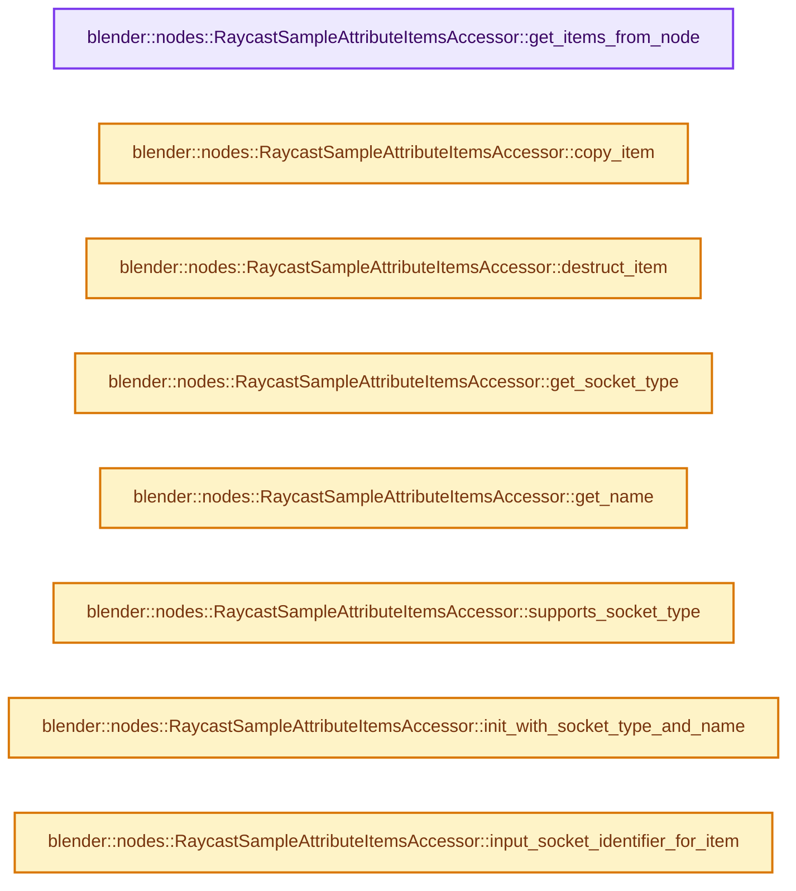
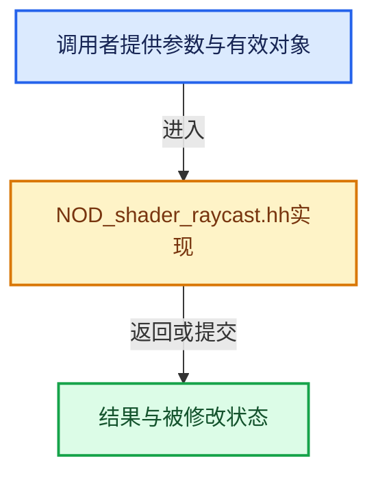

# 实现依赖专题：source/blender/nodes/shader/include/NOD_shader_raycast.hh

[方向导航](README.md) · [符号索引](../%E7%AC%A6%E5%8F%B7%E4%BE%9D%E8%B5%96%E4%B8%8E%E5%AE%9E%E7%8E%B0%E7%B4%A2%E5%BC%95.md)

本专题从正文实际调用进入，集中保存共享实现。函数有稳定锚点，可从调用处直接跳到对应完整函数；递归与互相调用通过回链组织。

## 本文件的实现关系






## 完整成员与函数实现

<a id="f-3a8b562628078095"></a>

### `blender::nodes::RaycastSampleAttributeItemsAccessor::get_items_from_node`

实现位置：[source/blender/nodes/shader/include/NOD_shader_raycast.hh](../../../../../source/blender/nodes/shader/include/NOD_shader_raycast.hh) · L38—L45。

接口参数：

- `bNode &node`

**教学注释版**

<!-- annotated:e856b537d53a81 -->

```cpp
  static socket_items::SocketItemsRef<NodeRaycastSampleAttributeItem> get_items_from_node(
      bNode &node)
  {
    auto *storage = static_cast<NodeShaderRaycast *>(node.storage);
    return {&storage->sample_attribute_items,
            &storage->sample_attribute_items_num,
            &storage->active_index};
  }
```

<details>
<summary>核对原始源码：source/blender/nodes/shader/include/NOD_shader_raycast.hh · L38—L45</summary>

<!-- original:e856b537d53a81:source/blender/nodes/shader/include/NOD_shader_raycast.hh:38:45 -->

```cpp
  static socket_items::SocketItemsRef<NodeRaycastSampleAttributeItem> get_items_from_node(
      bNode &node)
  {
    auto *storage = static_cast<NodeShaderRaycast *>(node.storage);
    return {&storage->sample_attribute_items,
            &storage->sample_attribute_items_num,
            &storage->active_index};
  }
```

</details>

**结果出口**

- `return {&storage->sample_attribute_items,`

**继续追踪实现**

本实现没有需要继续展开的显式调用；检查返回表达式、对象转换和调用者前置条件。

<a id="f-92dc87e46285c3e8"></a>

### `blender::nodes::RaycastSampleAttributeItemsAccessor::copy_item`

实现位置：[source/blender/nodes/shader/include/NOD_shader_raycast.hh](../../../../../source/blender/nodes/shader/include/NOD_shader_raycast.hh) · L47—L52。

接口参数：

- `const NodeRaycastSampleAttributeItem &src`
- `NodeRaycastSampleAttributeItem &dst`

**教学注释版**

<!-- annotated:085270512966ee -->

```cpp
  static void copy_item(const NodeRaycastSampleAttributeItem &src,
                        NodeRaycastSampleAttributeItem &dst)
  {
    dst = src;
    dst.name = BLI_strdup_null(dst.name);
  }
```

<details>
<summary>核对原始源码：source/blender/nodes/shader/include/NOD_shader_raycast.hh · L47—L52</summary>

<!-- original:085270512966ee:source/blender/nodes/shader/include/NOD_shader_raycast.hh:47:52 -->

```cpp
  static void copy_item(const NodeRaycastSampleAttributeItem &src,
                        NodeRaycastSampleAttributeItem &dst)
  {
    dst = src;
    dst.name = BLI_strdup_null(dst.name);
  }
```

</details>

**沿实际写入检查状态**

- `dst = src;`
- `dst.name = BLI_strdup_null(dst.name);`

**继续追踪实现**

- `BLI_strdup_null` → [blender::BLI_strdup_null · L48](../01-%E5%9F%BA%E7%A1%80%E5%AE%B9%E5%99%A8%E4%B8%8E%E7%8E%B0%E4%BB%A3CPP/%E4%BE%9D%E8%B5%96-string-1d986f.md#f-c1cd7c6336fe3fe0)。

<a id="f-6ddb12a3ea421d2e"></a>

### `blender::nodes::RaycastSampleAttributeItemsAccessor::destruct_item`

实现位置：[source/blender/nodes/shader/include/NOD_shader_raycast.hh](../../../../../source/blender/nodes/shader/include/NOD_shader_raycast.hh) · L54—L57。

接口参数：

- `NodeRaycastSampleAttributeItem *item`

**教学注释版**

<!-- annotated:d74ec236601fd4 -->

```cpp
  static void destruct_item(NodeRaycastSampleAttributeItem *item)
  {
    MEM_SAFE_DELETE(item->name);
  }
```

<details>
<summary>核对原始源码：source/blender/nodes/shader/include/NOD_shader_raycast.hh · L54—L57</summary>

<!-- original:d74ec236601fd4:source/blender/nodes/shader/include/NOD_shader_raycast.hh:54:57 -->

```cpp
  static void destruct_item(NodeRaycastSampleAttributeItem *item)
  {
    MEM_SAFE_DELETE(item->name);
  }
```

</details>

**继续追踪实现**

- `MEM_SAFE_DELETE` → [MEM_SAFE_DELETE · L436](../03-%E5%86%85%E5%AD%98%E5%88%86%E9%85%8D%E4%B8%8E%E8%BF%90%E8%A1%8C%E6%97%B6%E7%B1%BB%E5%9E%8B/%E4%BE%9D%E8%B5%96-MEM_guardedalloc-b54eca.md#m-eadb3bc5b902)。宏定义由构建条件选择。

<a id="f-1a8feadea10406b0"></a>

### `blender::nodes::RaycastSampleAttributeItemsAccessor::get_socket_type`

实现位置：[source/blender/nodes/shader/include/NOD_shader_raycast.hh](../../../../../source/blender/nodes/shader/include/NOD_shader_raycast.hh) · L62—L65。

接口参数：

- `const NodeRaycastSampleAttributeItem &item`

**教学注释版**

<!-- annotated:8b090bc1031b41 -->

```cpp
  static eNodeSocketDatatype get_socket_type(const NodeRaycastSampleAttributeItem &item)
  {
    return *bke::custom_data_type_to_socket_type(eCustomDataType(item.data_type));
  }
```

<details>
<summary>核对原始源码：source/blender/nodes/shader/include/NOD_shader_raycast.hh · L62—L65</summary>

<!-- original:8b090bc1031b41:source/blender/nodes/shader/include/NOD_shader_raycast.hh:62:65 -->

```cpp
  static eNodeSocketDatatype get_socket_type(const NodeRaycastSampleAttributeItem &item)
  {
    return *bke::custom_data_type_to_socket_type(eCustomDataType(item.data_type));
  }
```

</details>

**结果出口**

- `return *bke::custom_data_type_to_socket_type(eCustomDataType(item.data_type));`

**继续追踪实现**

- `bke::custom_data_type_to_socket_type` → [blender::bke::custom_data_type_to_socket_type · L5935](../05-%E5%87%A0%E4%BD%95%E5%AD%98%E5%82%A8%E4%B8%8E%E6%8B%93%E6%89%91%E6%98%A0%E5%B0%84/%E4%BE%9D%E8%B5%96-node-89d753.md#f-3ed3c094d6db6ba1)。
- `eCustomDataType` → [blender::eCustomDataType](../05-%E5%87%A0%E4%BD%95%E5%AD%98%E5%82%A8%E4%B8%8E%E6%8B%93%E6%89%91%E6%98%A0%E5%B0%84/%E4%BE%9D%E8%B5%96-DNA_customdata_types-f584e8.md#t-dfbf4a4ce0e1)。

<a id="f-3dbabf6482c7400d"></a>

### `blender::nodes::RaycastSampleAttributeItemsAccessor::get_name`

实现位置：[source/blender/nodes/shader/include/NOD_shader_raycast.hh](../../../../../source/blender/nodes/shader/include/NOD_shader_raycast.hh) · L67—L70。

接口参数：

- `NodeRaycastSampleAttributeItem &item`

**教学注释版**

<!-- annotated:b11171af3b5e3d -->

```cpp
  static char **get_name(NodeRaycastSampleAttributeItem &item)
  {
    return &item.name;
  }
```

<details>
<summary>核对原始源码：source/blender/nodes/shader/include/NOD_shader_raycast.hh · L67—L70</summary>

<!-- original:b11171af3b5e3d:source/blender/nodes/shader/include/NOD_shader_raycast.hh:67:70 -->

```cpp
  static char **get_name(NodeRaycastSampleAttributeItem &item)
  {
    return &item.name;
  }
```

</details>

**结果出口**

- `return &item.name;`

**继续追踪实现**

本实现没有需要继续展开的显式调用；检查返回表达式、对象转换和调用者前置条件。

<a id="f-842ff17195a8bf83"></a>

### `blender::nodes::RaycastSampleAttributeItemsAccessor::supports_socket_type`

实现位置：[source/blender/nodes/shader/include/NOD_shader_raycast.hh](../../../../../source/blender/nodes/shader/include/NOD_shader_raycast.hh) · L72—L75。

接口参数：

- `const eNodeSocketDatatype socket_type`
- `const int`

**教学注释版**

<!-- annotated:7a826b3e8caf77 -->

```cpp
  static bool supports_socket_type(const eNodeSocketDatatype socket_type, const int /*ntree_type*/)
  {
    return ELEM(socket_type, SOCK_FLOAT, SOCK_VECTOR, SOCK_RGBA);
  }
```

<details>
<summary>核对原始源码：source/blender/nodes/shader/include/NOD_shader_raycast.hh · L72—L75</summary>

<!-- original:7a826b3e8caf77:source/blender/nodes/shader/include/NOD_shader_raycast.hh:72:75 -->

```cpp
  static bool supports_socket_type(const eNodeSocketDatatype socket_type, const int /*ntree_type*/)
  {
    return ELEM(socket_type, SOCK_FLOAT, SOCK_VECTOR, SOCK_RGBA);
  }
```

</details>

**结果出口**

- `return ELEM(socket_type, SOCK_FLOAT, SOCK_VECTOR, SOCK_RGBA);`

**继续追踪实现**

- `ELEM` → [ELEM · L88](../05-%E5%87%A0%E4%BD%95%E5%AD%98%E5%82%A8%E4%B8%8E%E6%8B%93%E6%89%91%E6%98%A0%E5%B0%84/%E4%BE%9D%E8%B5%96-GHOST_utildefines-34b996.md#m-d28724a15928)；[ELEM · L135](../01-%E5%9F%BA%E7%A1%80%E5%AE%B9%E5%99%A8%E4%B8%8E%E7%8E%B0%E4%BB%A3CPP/%E4%BE%9D%E8%B5%96-BLI_utildefines-293a0a.md#m-d6572de7cae0)。宏定义由构建条件选择。

<a id="f-0f9795cab2eb8786"></a>

### `blender::nodes::RaycastSampleAttributeItemsAccessor::init_with_socket_type_and_name`

实现位置：[source/blender/nodes/shader/include/NOD_shader_raycast.hh](../../../../../source/blender/nodes/shader/include/NOD_shader_raycast.hh) · L77—L87。

接口参数：

- `bNode &node`
- `NodeRaycastSampleAttributeItem &item`
- `const eNodeSocketDatatype socket_type`
- `const char *name`

**教学注释版**

<!-- annotated:f0543218fd06e1 -->

```cpp
  static void init_with_socket_type_and_name(bNode &node,
                                             NodeRaycastSampleAttributeItem &item,
                                             const eNodeSocketDatatype socket_type,
                                             const char *name)
  {
    auto *storage = static_cast<NodeShaderRaycast *>(node.storage);
    item.data_type = *bke::socket_type_to_custom_data_type(socket_type);
    item.identifier = storage->next_identifier++;
    socket_items::set_item_name_and_make_unique<RaycastSampleAttributeItemsAccessor>(
        node, item, name);
  }
```

<details>
<summary>核对原始源码：source/blender/nodes/shader/include/NOD_shader_raycast.hh · L77—L87</summary>

<!-- original:f0543218fd06e1:source/blender/nodes/shader/include/NOD_shader_raycast.hh:77:87 -->

```cpp
  static void init_with_socket_type_and_name(bNode &node,
                                             NodeRaycastSampleAttributeItem &item,
                                             const eNodeSocketDatatype socket_type,
                                             const char *name)
  {
    auto *storage = static_cast<NodeShaderRaycast *>(node.storage);
    item.data_type = *bke::socket_type_to_custom_data_type(socket_type);
    item.identifier = storage->next_identifier++;
    socket_items::set_item_name_and_make_unique<RaycastSampleAttributeItemsAccessor>(
        node, item, name);
  }
```

</details>

**沿实际写入检查状态**

- `item.data_type = *bke::socket_type_to_custom_data_type(socket_type);`
- `item.identifier = storage->next_identifier++;`

**继续追踪实现**

- `bke::socket_type_to_custom_data_type` → [blender::bke::socket_type_to_custom_data_type · L5911](../05-%E5%87%A0%E4%BD%95%E5%AD%98%E5%82%A8%E4%B8%8E%E6%8B%93%E6%89%91%E6%98%A0%E5%B0%84/%E4%BE%9D%E8%B5%96-node-89d753.md#f-6039cfe576196271)。
- `socket_items::set_item_name_and_make_unique<RaycastSampleAttributeItemsAccessor>` → [blender::nodes::socket_items::set_item_name_and_make_unique · L148](%E4%BE%9D%E8%B5%96-NOD_socket_items-d21cfb.md#f-7e7af1c01522f9dc)。

<a id="f-7571c783b0af3b8b"></a>

### `blender::nodes::RaycastSampleAttributeItemsAccessor::input_socket_identifier_for_item`

实现位置：[source/blender/nodes/shader/include/NOD_shader_raycast.hh](../../../../../source/blender/nodes/shader/include/NOD_shader_raycast.hh) · L89—L92。

接口参数：

- `const NodeRaycastSampleAttributeItem &item`

**教学注释版**

<!-- annotated:221ccb69d6da30 -->

```cpp
  static std::string input_socket_identifier_for_item(const NodeRaycastSampleAttributeItem &item)
  {
    return "Value_" + std::to_string(item.identifier);
  }
```

<details>
<summary>核对原始源码：source/blender/nodes/shader/include/NOD_shader_raycast.hh · L89—L92</summary>

<!-- original:221ccb69d6da30:source/blender/nodes/shader/include/NOD_shader_raycast.hh:89:92 -->

```cpp
  static std::string input_socket_identifier_for_item(const NodeRaycastSampleAttributeItem &item)
  {
    return "Value_" + std::to_string(item.identifier);
  }
```

</details>

**结果出口**

- `return "Value_" + std::to_string(item.identifier);`

**继续追踪实现**

- `std::to_string` → [外部契约](https://eel.is/c++draft/)：这个边界按实际表达式及所属类型核对参数、返回值、寿命与失败行为。这里提供接口入口，不声称已解释该第三方版本的内部实现。

<a id="f-79770914d30ff822"></a>

### `blender::nodes::RaycastSampleAttributeItemsAccessor::output_socket_identifier_for_item`

实现位置：[source/blender/nodes/shader/include/NOD_shader_raycast.hh](../../../../../source/blender/nodes/shader/include/NOD_shader_raycast.hh) · L93—L96。

接口参数：

- `const NodeRaycastSampleAttributeItem &item`

**教学注释版**

<!-- annotated:691a573e625d6c -->

```cpp
  static std::string output_socket_identifier_for_item(const NodeRaycastSampleAttributeItem &item)
  {
    return "Attribute_" + std::to_string(item.identifier);
  }
```

<details>
<summary>核对原始源码：source/blender/nodes/shader/include/NOD_shader_raycast.hh · L93—L96</summary>

<!-- original:691a573e625d6c:source/blender/nodes/shader/include/NOD_shader_raycast.hh:93:96 -->

```cpp
  static std::string output_socket_identifier_for_item(const NodeRaycastSampleAttributeItem &item)
  {
    return "Attribute_" + std::to_string(item.identifier);
  }
```

</details>

**结果出口**

- `return "Attribute_" + std::to_string(item.identifier);`

**继续追踪实现**

- `std::to_string` → [外部契约](https://eel.is/c++draft/)：这个边界按实际表达式及所属类型核对参数、返回值、寿命与失败行为。这里提供接口入口，不声称已解释该第三方版本的内部实现。
