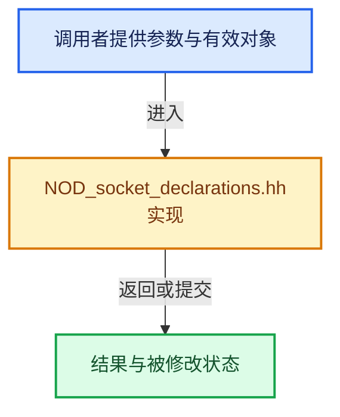

# 实现依赖专题：source/blender/nodes/NOD_socket_declarations.hh

[方向导航](README.md) · [符号索引](../%E7%AC%A6%E5%8F%B7%E4%BE%9D%E8%B5%96%E4%B8%8E%E5%AE%9E%E7%8E%B0%E7%B4%A2%E5%BC%95.md)

本专题从正文实际调用进入，集中保存共享实现。函数有稳定锚点，可从调用处直接跳到对应完整函数；递归与互相调用通过回链组织。

## 本文件的实现关系





## 相关类型布局与成员入口

<a id="t-244cfac6be12"></a>

### `blender::nodes::decl::Vector`

原始声明：[source/blender/nodes/NOD_socket_declarations.hh](../../../../../source/blender/nodes/NOD_socket_declarations.hh) · L94—L112。

成员布局：

- `eNodeSocketDatatype static_socket_type`
- `float4 default_value`
- `float soft_min_value`
- `float soft_max_value`
- `int dimensions`
- `PropertySubType subtype`
- `bNodeSocket build`
- `bool matches`
- `bNodeSocket update_or_build`
- `bool can_connect`

以下保留类的数据声明与编译条件，成员函数实现通过后面的精确链接阅读。

<!-- annotated:254592b0ffdd7a -->

```cpp
class Vector : public SocketDeclaration {
 public:
  static constexpr eNodeSocketDatatype static_socket_type = SOCK_VECTOR;

  float4 default_value = {0, 0, 0, 0};
  float soft_min_value = -FLT_MAX;
  float soft_max_value = FLT_MAX;
  int dimensions = 3;
  PropertySubType subtype = PROP_NONE;

  friend VectorBuilder;

  using Builder = VectorBuilder;

  bNodeSocket &build(bNodeTree &ntree, bNode &node) const override;
  bool matches(const bNodeSocket &socket) const override;
  bNodeSocket &update_or_build(bNodeTree &ntree, bNode &node, bNodeSocket &socket) const override;
  bool can_connect(const bNodeSocket &socket) const override;
};
```

<details>
<summary>核对原始源码：source/blender/nodes/NOD_socket_declarations.hh · L94—L112</summary>

<!-- original:254592b0ffdd7a:source/blender/nodes/NOD_socket_declarations.hh:94:112 -->

```cpp
class Vector : public SocketDeclaration {
 public:
  static constexpr eNodeSocketDatatype static_socket_type = SOCK_VECTOR;

  float4 default_value = {0, 0, 0, 0};
  float soft_min_value = -FLT_MAX;
  float soft_max_value = FLT_MAX;
  int dimensions = 3;
  PropertySubType subtype = PROP_NONE;

  friend VectorBuilder;

  using Builder = VectorBuilder;

  bNodeSocket &build(bNodeTree &ntree, bNode &node) const override;
  bool matches(const bNodeSocket &socket) const override;
  bNodeSocket &update_or_build(bNodeTree &ntree, bNode &node, bNodeSocket &socket) const override;
  bool can_connect(const bNodeSocket &socket) const override;
};
```

</details>


<a id="t-44e5dc0a269f"></a>

### `blender::nodes::decl::Color`

原始声明：[source/blender/nodes/NOD_socket_declarations.hh](../../../../../source/blender/nodes/NOD_socket_declarations.hh) · L185—L199。

成员布局：

- `eNodeSocketDatatype static_socket_type`
- `ColorGeometry4f default_value`
- `bNodeSocket build`
- `bool matches`
- `bNodeSocket update_or_build`
- `bool can_connect`

以下保留类的数据声明与编译条件，成员函数实现通过后面的精确链接阅读。

<!-- annotated:c65ea55f732726 -->

```cpp
class Color : public SocketDeclaration {
 public:
  static constexpr eNodeSocketDatatype static_socket_type = SOCK_RGBA;

  ColorGeometry4f default_value{0.8f, 0.8f, 0.8f, 1.0f};

  friend ColorBuilder;

  using Builder = ColorBuilder;

  bNodeSocket &build(bNodeTree &ntree, bNode &node) const override;
  bool matches(const bNodeSocket &socket) const override;
  bNodeSocket &update_or_build(bNodeTree &ntree, bNode &node, bNodeSocket &socket) const override;
  bool can_connect(const bNodeSocket &socket) const override;
};
```

<details>
<summary>核对原始源码：source/blender/nodes/NOD_socket_declarations.hh · L185—L199</summary>

<!-- original:c65ea55f732726:source/blender/nodes/NOD_socket_declarations.hh:185:199 -->

```cpp
class Color : public SocketDeclaration {
 public:
  static constexpr eNodeSocketDatatype static_socket_type = SOCK_RGBA;

  ColorGeometry4f default_value{0.8f, 0.8f, 0.8f, 1.0f};

  friend ColorBuilder;

  using Builder = ColorBuilder;

  bNodeSocket &build(bNodeTree &ntree, bNode &node) const override;
  bool matches(const bNodeSocket &socket) const override;
  bNodeSocket &update_or_build(bNodeTree &ntree, bNode &node, bNodeSocket &socket) const override;
  bool can_connect(const bNodeSocket &socket) const override;
};
```

</details>


## 完整成员与函数实现
