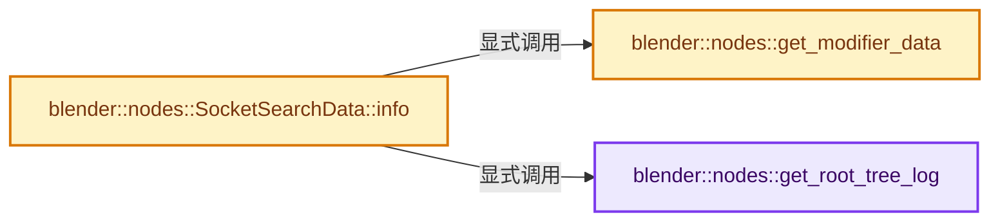
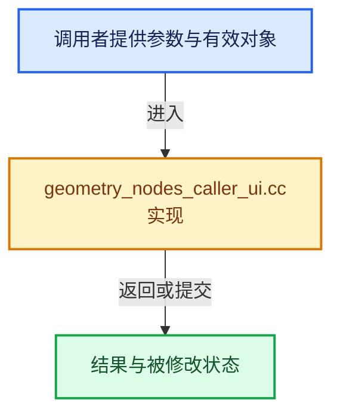

# 实现依赖专题：source/blender/nodes/intern/geometry_nodes_caller_ui.cc

[方向导航](README.md) · [符号索引](../%E7%AC%A6%E5%8F%B7%E4%BE%9D%E8%B5%96%E4%B8%8E%E5%AE%9E%E7%8E%B0%E7%B4%A2%E5%BC%95.md)

本专题从正文实际调用进入，集中保存共享实现。函数有稳定锚点，可从调用处直接跳到对应完整函数；递归与互相调用通过回链组织。

## 本文件的实现关系






## 完整成员与函数实现

<a id="f-db26f3e6e7852381"></a>

### `blender::nodes::get_root_tree_log`

实现位置：[source/blender/nodes/intern/geometry_nodes_caller_ui.cc](../../../../../source/blender/nodes/intern/geometry_nodes_caller_ui.cc) · L109—L117。

接口参数：

- `const Object &object`
- `const NodesModifierData &nmd`

**教学注释版**

<!-- annotated:26d65901ad9204 -->

```cpp
static eval_log::NodeTreeLog *get_root_tree_log(const Object &object, const NodesModifierData &nmd)
{
  if (!nmd.runtime->eval_log) {
    return nullptr;
  }
  bke::DataBlockComputeContext data_block_context{nullptr, object.id};
  bke::GeometryNodesModifierComputeContext modifier_context{&data_block_context, nmd};
  return &nmd.runtime->eval_log->get_tree_log(modifier_context.hash());
}
```

<details>
<summary>核对原始源码：source/blender/nodes/intern/geometry_nodes_caller_ui.cc · L109—L117</summary>

<!-- original:26d65901ad9204:source/blender/nodes/intern/geometry_nodes_caller_ui.cc:109:117 -->

```cpp
static eval_log::NodeTreeLog *get_root_tree_log(const Object &object, const NodesModifierData &nmd)
{
  if (!nmd.runtime->eval_log) {
    return nullptr;
  }
  bke::DataBlockComputeContext data_block_context{nullptr, object.id};
  bke::GeometryNodesModifierComputeContext modifier_context{&data_block_context, nmd};
  return &nmd.runtime->eval_log->get_tree_log(modifier_context.hash());
}
```

</details>

**结果出口**

- `return nullptr;`
- `return &nmd.runtime->eval_log->get_tree_log(modifier_context.hash());`

**继续追踪实现**

- `nmd.runtime->eval_log->get_tree_log` → [调用协议](../%E6%A8%A1%E6%9D%BF%E5%AE%8F%E4%B8%8E%E5%8A%A8%E6%80%81%E5%88%86%E6%B4%BE%E5%8D%8F%E8%AE%AE.md)：接收对象类型依赖auto、返回值或模板实例；不按同名猜测目标。调用位置L116。
- `modifier_context.hash` → [blender::nodes::NodeInContext::hash · L97](%E4%BE%9D%E8%B5%96-NOD_node_in_compute_context-6c33fe.md#f-df782e6a7ee828e5)；[blender::nodes::SocketInContext::hash · L138](%E4%BE%9D%E8%B5%96-NOD_node_in_compute_context-6c33fe.md#f-02964a50b8e1abf3)；[blender::nodes::TreeInContext::hash · L174](%E4%BE%9D%E8%B5%96-NOD_node_in_compute_context-6c33fe.md#f-0b5da4b607b044e4)；[blender::nodes::BundleKey::hash · L495](../10-%E5%BC%95%E7%94%A8%E7%94%9F%E5%91%BD%E5%91%A8%E6%9C%9F%E4%B8%8EClosure/%E4%BE%9D%E8%B5%96-NOD_geometry_nodes_bundle-f07f4e.md#f-6d85359b9187bc0f)；[blender::nodes::BundleType::hash · L163](../10-%E5%BC%95%E7%94%A8%E7%94%9F%E5%91%BD%E5%91%A8%E6%9C%9F%E4%B8%8EClosure/%E4%BE%9D%E8%B5%96-NOD_bundle_type-22e0c3.md#f-a631adaf4605c9c2)。同名重载需按实参类型选择。

<a id="f-fdadc8ab5649160d"></a>

### `blender::nodes::get_modifier_data`

实现位置：[source/blender/nodes/intern/geometry_nodes_caller_ui.cc](../../../../../source/blender/nodes/intern/geometry_nodes_caller_ui.cc) · L119—L140。

接口参数：

- `Main &bmain`
- `const wmWindowManager &wm`
- `const ModifierSearchData &data`

**教学注释版**

<!-- annotated:b0d45b344eefa1 -->

```cpp
static std::optional<ed::space_node::ObjectAndModifier> get_modifier_data(
    Main &bmain, const wmWindowManager &wm, const ModifierSearchData &data)
{
  if (ED_screen_animation_playing(&wm)) {
    /* Work around an issue where the attribute search exec function has stale pointers when data
     * is reallocated when evaluating the node tree, causing a crash. This would be solved by
     * allowing the UI search data to own arbitrary memory rather than just referencing it. */
    return std::nullopt;
  }

  const Object *object = id_cast<Object *>(
      BKE_libblock_find_session_uid(&bmain, ID_OB, data.object_session_uid));
  if (object == nullptr) {
    return std::nullopt;
  }
  ModifierData *md = BKE_modifiers_findby_name(object, data.modifier_name);
  if (md == nullptr) {
    return std::nullopt;
  }
  BLI_assert(md->type == eModifierType_Nodes);
  return ed::space_node::ObjectAndModifier{object, reinterpret_cast<NodesModifierData *>(md)};
}
```

<details>
<summary>核对原始源码：source/blender/nodes/intern/geometry_nodes_caller_ui.cc · L119—L140</summary>

<!-- original:b0d45b344eefa1:source/blender/nodes/intern/geometry_nodes_caller_ui.cc:119:140 -->

```cpp
static std::optional<ed::space_node::ObjectAndModifier> get_modifier_data(
    Main &bmain, const wmWindowManager &wm, const ModifierSearchData &data)
{
  if (ED_screen_animation_playing(&wm)) {
    /* Work around an issue where the attribute search exec function has stale pointers when data
     * is reallocated when evaluating the node tree, causing a crash. This would be solved by
     * allowing the UI search data to own arbitrary memory rather than just referencing it. */
    return std::nullopt;
  }

  const Object *object = id_cast<Object *>(
      BKE_libblock_find_session_uid(&bmain, ID_OB, data.object_session_uid));
  if (object == nullptr) {
    return std::nullopt;
  }
  ModifierData *md = BKE_modifiers_findby_name(object, data.modifier_name);
  if (md == nullptr) {
    return std::nullopt;
  }
  BLI_assert(md->type == eModifierType_Nodes);
  return ed::space_node::ObjectAndModifier{object, reinterpret_cast<NodesModifierData *>(md)};
}
```

</details>

**结果出口**

- `return std::nullopt;`
- `return ed::space_node::ObjectAndModifier{object, reinterpret_cast<NodesModifierData *>(md)};`

**继续追踪实现**

- `ED_screen_animation_playing` → [blender::ED_screen_animation_playing · L6860](../05-%E5%87%A0%E4%BD%95%E5%AD%98%E5%82%A8%E4%B8%8E%E6%8B%93%E6%89%91%E6%98%A0%E5%B0%84/%E4%BE%9D%E8%B5%96-screen_ops-22be7b.md#f-a214adf804d8afe6)。
- `id_cast<Object *>` → [blender::id_cast · L1417](../05-%E5%87%A0%E4%BD%95%E5%AD%98%E5%82%A8%E4%B8%8E%E6%8B%93%E6%89%91%E6%98%A0%E5%B0%84/%E4%BE%9D%E8%B5%96-DNA_ID-3eb091.md#f-6c8ac6412850ac5a)。
- `BKE_libblock_find_session_uid` → [blender::BKE_libblock_find_session_uid · L1826](../05-%E5%87%A0%E4%BD%95%E5%AD%98%E5%82%A8%E4%B8%8E%E6%8B%93%E6%89%91%E6%98%A0%E5%B0%84/%E4%BE%9D%E8%B5%96-lib_id-d4e6bd.md#f-72807eec4bc1dba5)；[blender::BKE_libblock_find_session_uid · L1838](../05-%E5%87%A0%E4%BD%95%E5%AD%98%E5%82%A8%E4%B8%8E%E6%8B%93%E6%89%91%E6%98%A0%E5%B0%84/%E4%BE%9D%E8%B5%96-lib_id-d4e6bd.md#f-378891263f858bc3)。同名重载需按实参类型选择。
- `BKE_modifiers_findby_name` → [blender::BKE_modifiers_findby_name · L266](../05-%E5%87%A0%E4%BD%95%E5%AD%98%E5%82%A8%E4%B8%8E%E6%8B%93%E6%89%91%E6%98%A0%E5%B0%84/%E4%BE%9D%E8%B5%96-modifier-ab0273.md#f-cf0acdc5b2818add)。
- `BLI_assert` → [BLI_assert · L48](../01-%E5%9F%BA%E7%A1%80%E5%AE%B9%E5%99%A8%E4%B8%8E%E7%8E%B0%E4%BB%A3CPP/%E4%BE%9D%E8%B5%96-BLI_assert-cc98e8.md#m-57a88495704d)；[BLI_assert · L63](../01-%E5%9F%BA%E7%A1%80%E5%AE%B9%E5%99%A8%E4%B8%8E%E7%8E%B0%E4%BB%A3CPP/%E4%BE%9D%E8%B5%96-BLI_assert-cc98e8.md#m-d07050020cb5)。宏定义由构建条件选择。

<a id="f-cff9f419020c1e90"></a>

### `blender::nodes::SocketSearchData::info`

实现位置：[source/blender/nodes/intern/geometry_nodes_caller_ui.cc](../../../../../source/blender/nodes/intern/geometry_nodes_caller_ui.cc) · L142—L176。

接口参数：

- `const bContext &C`

**教学注释版**

<!-- annotated:74f71aa9225d3d -->

```cpp
SearchInfo SocketSearchData::info(const bContext &C) const
{
  if (const auto *modifier_search_data = std::get_if<ModifierSearchData>(&this->search_data)) {
    const std::optional<ed::space_node::ObjectAndModifier> object_and_modifier = get_modifier_data(
        *CTX_data_main(&C), *CTX_wm_manager(&C), *modifier_search_data);
    if (!object_and_modifier) {
      return {};
    }
    const NodesModifierData *nmd = object_and_modifier->nmd;
    if (nmd->node_group == nullptr || ID_MISSING(nmd->node_group)) {
      return {};
    }
    eval_log::NodeTreeLog *tree_log = get_root_tree_log(*object_and_modifier->object, *nmd);
    PointerRNA nmd_ptr = RNA_pointer_create_discrete(
        &const_cast<Object *>(object_and_modifier->object)->id,
        RNA_NodesModifier,
        const_cast<NodesModifierData *>(nmd));
    PointerRNA properties_ptr = RNA_pointer_get(&nmd_ptr, "properties");
    const bNodeTree &node_group = *nmd->node_group;
    const bool is_output = bke::node_find_interface_output_by_identifier(node_group,
                                                                         this->socket_identifier);
    PointerRNA inputs_ptr = RNA_pointer_get(&properties_ptr, is_output ? "outputs" : "inputs");
    PointerRNA socket_props_ptr = RNA_pointer_get(&inputs_ptr, this->socket_identifier);
    return {tree_log, nmd->node_group, socket_props_ptr};
  }
  if (const auto *operator_search_data = std::get_if<OperatorSearchData>(&this->search_data)) {
    PointerRNA op_ptr = RNA_pointer_create_discrete(
        &CTX_wm_manager(&C)->id, RNA_Operator, operator_search_data->op);
    PointerRNA properties_ptr = RNA_pointer_get(&op_ptr, "properties");
    PointerRNA inputs_ptr = RNA_pointer_get(&properties_ptr, "inputs");
    PointerRNA socket_props_ptr = RNA_pointer_get(&inputs_ptr, this->socket_identifier);
    return {operator_search_data->tree_log, operator_search_data->tree, socket_props_ptr};
  }
  return {};
}
```

<details>
<summary>核对原始源码：source/blender/nodes/intern/geometry_nodes_caller_ui.cc · L142—L176</summary>

<!-- original:74f71aa9225d3d:source/blender/nodes/intern/geometry_nodes_caller_ui.cc:142:176 -->

```cpp
SearchInfo SocketSearchData::info(const bContext &C) const
{
  if (const auto *modifier_search_data = std::get_if<ModifierSearchData>(&this->search_data)) {
    const std::optional<ed::space_node::ObjectAndModifier> object_and_modifier = get_modifier_data(
        *CTX_data_main(&C), *CTX_wm_manager(&C), *modifier_search_data);
    if (!object_and_modifier) {
      return {};
    }
    const NodesModifierData *nmd = object_and_modifier->nmd;
    if (nmd->node_group == nullptr || ID_MISSING(nmd->node_group)) {
      return {};
    }
    eval_log::NodeTreeLog *tree_log = get_root_tree_log(*object_and_modifier->object, *nmd);
    PointerRNA nmd_ptr = RNA_pointer_create_discrete(
        &const_cast<Object *>(object_and_modifier->object)->id,
        RNA_NodesModifier,
        const_cast<NodesModifierData *>(nmd));
    PointerRNA properties_ptr = RNA_pointer_get(&nmd_ptr, "properties");
    const bNodeTree &node_group = *nmd->node_group;
    const bool is_output = bke::node_find_interface_output_by_identifier(node_group,
                                                                         this->socket_identifier);
    PointerRNA inputs_ptr = RNA_pointer_get(&properties_ptr, is_output ? "outputs" : "inputs");
    PointerRNA socket_props_ptr = RNA_pointer_get(&inputs_ptr, this->socket_identifier);
    return {tree_log, nmd->node_group, socket_props_ptr};
  }
  if (const auto *operator_search_data = std::get_if<OperatorSearchData>(&this->search_data)) {
    PointerRNA op_ptr = RNA_pointer_create_discrete(
        &CTX_wm_manager(&C)->id, RNA_Operator, operator_search_data->op);
    PointerRNA properties_ptr = RNA_pointer_get(&op_ptr, "properties");
    PointerRNA inputs_ptr = RNA_pointer_get(&properties_ptr, "inputs");
    PointerRNA socket_props_ptr = RNA_pointer_get(&inputs_ptr, this->socket_identifier);
    return {operator_search_data->tree_log, operator_search_data->tree, socket_props_ptr};
  }
  return {};
}
```

</details>

**结果出口**

- `return {};`
- `return {tree_log, nmd->node_group, socket_props_ptr};`
- `return {operator_search_data->tree_log, operator_search_data->tree, socket_props_ptr};`

**继续追踪实现**

- `std::get_if<ModifierSearchData>` → [外部契约](https://eel.is/c++draft/)：这个边界按实际表达式及所属类型核对参数、返回值、寿命与失败行为。这里提供接口入口，不声称已解释该第三方版本的内部实现。
- `get_modifier_data` → [blender::nodes::get_modifier_data · L119](%E4%BE%9D%E8%B5%96-geometry_nodes_caller_ui-ccd1aa.md#f-fdadc8ab5649160d)。
- `CTX_data_main` → [blender::CTX_data_main · L1313](../05-%E5%87%A0%E4%BD%95%E5%AD%98%E5%82%A8%E4%B8%8E%E6%8B%93%E6%89%91%E6%98%A0%E5%B0%84/%E4%BE%9D%E8%B5%96-context-a929d9.md#f-6d4ba24a62a80b94)。
- `CTX_wm_manager` → [blender::CTX_wm_manager · L928](../05-%E5%87%A0%E4%BD%95%E5%AD%98%E5%82%A8%E4%B8%8E%E6%8B%93%E6%89%91%E6%98%A0%E5%B0%84/%E4%BE%9D%E8%B5%96-context-a929d9.md#f-158f36db7379fbe8)。
- `ID_MISSING` → [ID_MISSING · L695](../05-%E5%87%A0%E4%BD%95%E5%AD%98%E5%82%A8%E4%B8%8E%E6%8B%93%E6%89%91%E6%98%A0%E5%B0%84/%E4%BE%9D%E8%B5%96-DNA_ID-3eb091.md#m-ab9a2a270fb3)。宏定义由构建条件选择。
- `get_root_tree_log` → [blender::nodes::get_root_tree_log · L109](%E4%BE%9D%E8%B5%96-geometry_nodes_caller_ui-ccd1aa.md#f-db26f3e6e7852381)。
- `RNA_pointer_create_discrete` → [blender::RNA_pointer_create_discrete · L181](../05-%E5%87%A0%E4%BD%95%E5%AD%98%E5%82%A8%E4%B8%8E%E6%8B%93%E6%89%91%E6%98%A0%E5%B0%84/%E4%BE%9D%E8%B5%96-rna_access-706bea.md#f-592a276e869c6d94)。
- `RNA_pointer_get` → [blender::RNA_pointer_get · L7040](../05-%E5%87%A0%E4%BD%95%E5%AD%98%E5%82%A8%E4%B8%8E%E6%8B%93%E6%89%91%E6%98%A0%E5%B0%84/%E4%BE%9D%E8%B5%96-rna_access-706bea.md#f-3ccd96658ac85256)。
- `bke::node_find_interface_output_by_identifier` → [blender::bke::node_find_interface_output_by_identifier · L4091](../05-%E5%87%A0%E4%BD%95%E5%AD%98%E5%82%A8%E4%B8%8E%E6%8B%93%E6%89%91%E6%98%A0%E5%B0%84/%E4%BE%9D%E8%B5%96-node-89d753.md#f-51c7fd7a69231f5e)。
- `std::get_if<OperatorSearchData>` → [外部契约](https://eel.is/c++draft/)：这个边界按实际表达式及所属类型核对参数、返回值、寿命与失败行为。这里提供接口入口，不声称已解释该第三方版本的内部实现。
