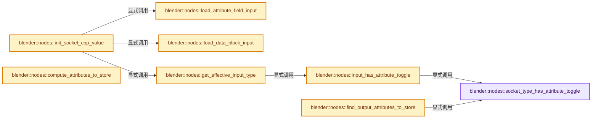
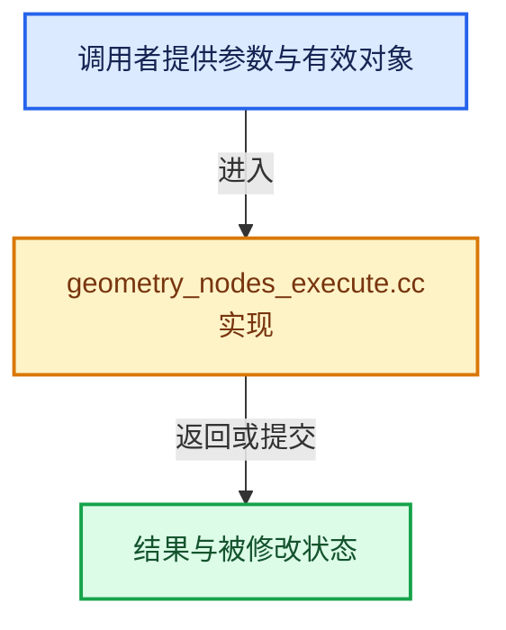

# 实现依赖专题：source/blender/nodes/intern/geometry_nodes_execute.cc

[方向导航](README.md) · [符号索引](../%E7%AC%A6%E5%8F%B7%E4%BE%9D%E8%B5%96%E4%B8%8E%E5%AE%9E%E7%8E%B0%E7%B4%A2%E5%BC%95.md)

本专题从正文实际调用进入，集中保存共享实现。函数有稳定锚点，可从调用处直接跳到对应完整函数；递归与互相调用通过回链组织。

## 本文件的实现关系






## 完整成员与函数实现

<a id="f-2fd86b3290dad00a"></a>

### `blender::nodes::socket_type_has_attribute_toggle`

实现位置：[source/blender/nodes/intern/geometry_nodes_execute.cc](../../../../../source/blender/nodes/intern/geometry_nodes_execute.cc) · L60—L63。

接口参数：

- `const eNodeSocketDatatype type`

**教学注释版**

<!-- annotated:becbb5be44961e -->

```cpp
bool socket_type_has_attribute_toggle(const eNodeSocketDatatype type)
{
  return socket_type_supports_attributes(type);
}
```

<details>
<summary>核对原始源码：source/blender/nodes/intern/geometry_nodes_execute.cc · L60—L63</summary>

<!-- original:becbb5be44961e:source/blender/nodes/intern/geometry_nodes_execute.cc:60:63 -->

```cpp
bool socket_type_has_attribute_toggle(const eNodeSocketDatatype type)
{
  return socket_type_supports_attributes(type);
}
```

</details>

**结果出口**

- `return socket_type_supports_attributes(type);`

**继续追踪实现**

- `socket_type_supports_attributes` → [blender::nodes::socket_type_supports_attributes · L677](%E4%BE%9D%E8%B5%96-node_socket-0ca7fe.md#f-ebab61bf582595c6)。

<a id="f-49b38754802ba0f6"></a>

### `blender::nodes::input_has_attribute_toggle`

实现位置：[source/blender/nodes/intern/geometry_nodes_execute.cc](../../../../../source/blender/nodes/intern/geometry_nodes_execute.cc) · L65—L77。

接口参数：

- `const bNodeTree &node_tree`
- `const int socket_index`

**教学注释版**

<!-- annotated:f9ec7b8ad9fccc -->

```cpp
bool input_has_attribute_toggle(const bNodeTree &node_tree, const int socket_index)
{
  node_tree.ensure_interface_cache();
  const bke::bNodeSocketType *typeinfo =
      node_tree.interface_inputs()[socket_index]->socket_typeinfo();
  if (!typeinfo || !socket_type_has_attribute_toggle(typeinfo->type)) {
    return false;
  }
  BLI_assert(node_tree.runtime->structure_type_interface);
  const StructureType structure_type =
      node_tree.runtime->structure_type_interface->inputs[socket_index];
  return ELEM(structure_type, StructureType::Field, StructureType::Dynamic);
}
```

<details>
<summary>核对原始源码：source/blender/nodes/intern/geometry_nodes_execute.cc · L65—L77</summary>

<!-- original:f9ec7b8ad9fccc:source/blender/nodes/intern/geometry_nodes_execute.cc:65:77 -->

```cpp
bool input_has_attribute_toggle(const bNodeTree &node_tree, const int socket_index)
{
  node_tree.ensure_interface_cache();
  const bke::bNodeSocketType *typeinfo =
      node_tree.interface_inputs()[socket_index]->socket_typeinfo();
  if (!typeinfo || !socket_type_has_attribute_toggle(typeinfo->type)) {
    return false;
  }
  BLI_assert(node_tree.runtime->structure_type_interface);
  const StructureType structure_type =
      node_tree.runtime->structure_type_interface->inputs[socket_index];
  return ELEM(structure_type, StructureType::Field, StructureType::Dynamic);
}
```

</details>

**结果出口**

- `return false;`
- `return ELEM(structure_type, StructureType::Field, StructureType::Dynamic);`

**继续追踪实现**

- `node_tree.ensure_interface_cache` → [blender::bNodeTree::ensure_interface_cache · L670](../05-%E5%87%A0%E4%BD%95%E5%AD%98%E5%82%A8%E4%B8%8E%E6%8B%93%E6%89%91%E6%98%A0%E5%B0%84/%E4%BE%9D%E8%B5%96-BKE_node_runtime-ee561b.md#f-73fea7b58035b1f9)。
- `node_tree.interface_inputs()[socket_index]->socket_typeinfo` → [调用协议](../%E6%A8%A1%E6%9D%BF%E5%AE%8F%E4%B8%8E%E5%8A%A8%E6%80%81%E5%88%86%E6%B4%BE%E5%8D%8F%E8%AE%AE.md)：接收对象类型依赖auto、返回值或模板实例；不按同名猜测目标。调用位置L69。
- `node_tree.interface_inputs` → [blender::bNodeTree::interface_inputs · L675](../05-%E5%87%A0%E4%BD%95%E5%AD%98%E5%82%A8%E4%B8%8E%E6%8B%93%E6%89%91%E6%98%A0%E5%B0%84/%E4%BE%9D%E8%B5%96-BKE_node_runtime-ee561b.md#f-b5decde7a09fbf57)；[blender::bNodeTree::interface_inputs · L681](../05-%E5%87%A0%E4%BD%95%E5%AD%98%E5%82%A8%E4%B8%8E%E6%8B%93%E6%89%91%E6%98%A0%E5%B0%84/%E4%BE%9D%E8%B5%96-BKE_node_runtime-ee561b.md#f-f999995c05009884)。同名重载需按实参类型选择。
- `socket_type_has_attribute_toggle` → [blender::nodes::socket_type_has_attribute_toggle · L60](%E4%BE%9D%E8%B5%96-geometry_nodes_execute-40ac57.md#f-2fd86b3290dad00a)。
- `BLI_assert` → [BLI_assert · L48](../01-%E5%9F%BA%E7%A1%80%E5%AE%B9%E5%99%A8%E4%B8%8E%E7%8E%B0%E4%BB%A3CPP/%E4%BE%9D%E8%B5%96-BLI_assert-cc98e8.md#m-57a88495704d)；[BLI_assert · L63](../01-%E5%9F%BA%E7%A1%80%E5%AE%B9%E5%99%A8%E4%B8%8E%E7%8E%B0%E4%BB%A3CPP/%E4%BE%9D%E8%B5%96-BLI_assert-cc98e8.md#m-d07050020cb5)。宏定义由构建条件选择。
- `ELEM` → [ELEM · L88](../05-%E5%87%A0%E4%BD%95%E5%AD%98%E5%82%A8%E4%B8%8E%E6%8B%93%E6%89%91%E6%98%A0%E5%B0%84/%E4%BE%9D%E8%B5%96-GHOST_utildefines-34b996.md#m-d28724a15928)；[ELEM · L135](../01-%E5%9F%BA%E7%A1%80%E5%AE%B9%E5%99%A8%E4%B8%8E%E7%8E%B0%E4%BB%A3CPP/%E4%BE%9D%E8%B5%96-BLI_utildefines-293a0a.md#m-d6572de7cae0)。宏定义由构建条件选择。

<a id="f-213dcc562ec3b6aa"></a>

### `blender::nodes::load_attribute_field_input`

实现位置：[source/blender/nodes/intern/geometry_nodes_execute.cc](../../../../../source/blender/nodes/intern/geometry_nodes_execute.cc) · L79—L88。

接口参数：

- `PointerRNA &input_props_ptr`

**教学注释版**

<!-- annotated:a59a5e1b3bca38 -->

```cpp
template<typename T>
[[nodiscard]] static std::optional<bke::SocketValueVariant> load_attribute_field_input(
    PointerRNA &input_props_ptr)
{
  const std::string attribute_name = RNA_string_get(&input_props_ptr, "attribute_name");
  if (!bke::allow_procedural_attribute_access(attribute_name)) {
    return std::nullopt;
  }
  return bke::SocketValueVariant::from(bke::AttributeFieldInput::from<T>(attribute_name));
}
```

<details>
<summary>核对原始源码：source/blender/nodes/intern/geometry_nodes_execute.cc · L79—L88</summary>

<!-- original:a59a5e1b3bca38:source/blender/nodes/intern/geometry_nodes_execute.cc:79:88 -->

```cpp
template<typename T>
[[nodiscard]] static std::optional<bke::SocketValueVariant> load_attribute_field_input(
    PointerRNA &input_props_ptr)
{
  const std::string attribute_name = RNA_string_get(&input_props_ptr, "attribute_name");
  if (!bke::allow_procedural_attribute_access(attribute_name)) {
    return std::nullopt;
  }
  return bke::SocketValueVariant::from(bke::AttributeFieldInput::from<T>(attribute_name));
}
```

</details>

**结果出口**

- `return std::nullopt;`
- `return bke::SocketValueVariant::from(bke::AttributeFieldInput::from<T>(attribute_name));`

**继续追踪实现**

- `RNA_string_get` → [blender::RNA_string_get · L6979](../05-%E5%87%A0%E4%BD%95%E5%AD%98%E5%82%A8%E4%B8%8E%E6%8B%93%E6%89%91%E6%98%A0%E5%B0%84/%E4%BE%9D%E8%B5%96-rna_access-706bea.md#f-57b87978a2dee00c)；[blender::RNA_string_get · L6989](../05-%E5%87%A0%E4%BD%95%E5%AD%98%E5%82%A8%E4%B8%8E%E6%8B%93%E6%89%91%E6%98%A0%E5%B0%84/%E4%BE%9D%E8%B5%96-rna_access-706bea.md#f-538049004840f914)。同名重载需按实参类型选择。
- `bke::allow_procedural_attribute_access` → [blender::bke::allow_procedural_attribute_access · L214](../05-%E5%87%A0%E4%BD%95%E5%AD%98%E5%82%A8%E4%B8%8E%E6%8B%93%E6%89%91%E6%98%A0%E5%B0%84/%E4%BE%9D%E8%B5%96-attribute_access-bceef3.md#f-ad250cc5467d3ea3)。
- `bke::SocketValueVariant::from` → [blender::bke::SocketValueVariant::from · L220](../05-%E5%87%A0%E4%BD%95%E5%AD%98%E5%82%A8%E4%B8%8E%E6%8B%93%E6%89%91%E6%98%A0%E5%B0%84/%E4%BE%9D%E8%B5%96-BKE_node_socket_value-24f0e5.md#f-fa3c16e83ef6de45)。
- `bke::AttributeFieldInput::from<T>` → [blender::bke::AttributeFieldInput::from · L324](../08-Field%E8%A1%A8%E8%BE%BE%E5%BC%8F%E4%B8%8E%E6%B1%82%E5%80%BC/10-%E5%87%A0%E4%BD%95%E4%B8%8A%E4%B8%8B%E6%96%87%E4%B8%8E%E5%B1%9E%E6%80%A7%E5%9F%9F.md#f-f6704d8eed37d4e0)；[blender::bke::AttributeFieldInput::from · L331](../08-Field%E8%A1%A8%E8%BE%BE%E5%BC%8F%E4%B8%8E%E6%B1%82%E5%80%BC/10-%E5%87%A0%E4%BD%95%E4%B8%8A%E4%B8%8B%E6%96%87%E4%B8%8E%E5%B1%9E%E6%80%A7%E5%9F%9F.md#f-f4484f9c40661b54)。同名重载需按实参类型选择。

<a id="f-903670a4dda47a71"></a>

### `blender::nodes::load_data_block_input`

实现位置：[source/blender/nodes/intern/geometry_nodes_execute.cc](../../../../../source/blender/nodes/intern/geometry_nodes_execute.cc) · L90—L112。

接口参数：

- `const GeoNodesCallData *call_data`
- `PointerRNA &input_props_ptr`

**教学注释版**

<!-- annotated:980e12aed3a493 -->

```cpp
template<typename T>
static bke::SocketValueVariant load_data_block_input(const GeoNodesCallData *call_data,
                                                     PointerRNA &input_props_ptr)
{
  PropertyRNA &prop = *RNA_struct_find_property(&input_props_ptr, "value");
  if (RNA_property_type(&prop) == PROP_STRING) {
    if (!call_data) {
      return bke::SocketValueVariant::from(static_cast<T *>(nullptr));
    }
    BLI_assert(call_data->operator_data);
    const std::string name = RNA_string_get(&input_props_ptr, "value");
    const ID *id_orig = call_data->operator_data->input_ids->lookup_default(name, nullptr);
    if (!id_orig) {
      return bke::SocketValueVariant::from(static_cast<T *>(nullptr));
    }
    const ID *id_eval = call_data->operator_data->depsgraphs->get_evaluated_id(*id_orig);
    return bke::SocketValueVariant::from(id_cast<T *>(const_cast<ID *>(id_eval)));
  }

  BLI_assert(RNA_property_type(&prop) == PROP_POINTER);
  T *data_block = id_cast<T *>(RNA_pointer_get(&input_props_ptr, "value").owner_id);
  return bke::SocketValueVariant::from(data_block);
}
```

<details>
<summary>核对原始源码：source/blender/nodes/intern/geometry_nodes_execute.cc · L90—L112</summary>

<!-- original:980e12aed3a493:source/blender/nodes/intern/geometry_nodes_execute.cc:90:112 -->

```cpp
template<typename T>
static bke::SocketValueVariant load_data_block_input(const GeoNodesCallData *call_data,
                                                     PointerRNA &input_props_ptr)
{
  PropertyRNA &prop = *RNA_struct_find_property(&input_props_ptr, "value");
  if (RNA_property_type(&prop) == PROP_STRING) {
    if (!call_data) {
      return bke::SocketValueVariant::from(static_cast<T *>(nullptr));
    }
    BLI_assert(call_data->operator_data);
    const std::string name = RNA_string_get(&input_props_ptr, "value");
    const ID *id_orig = call_data->operator_data->input_ids->lookup_default(name, nullptr);
    if (!id_orig) {
      return bke::SocketValueVariant::from(static_cast<T *>(nullptr));
    }
    const ID *id_eval = call_data->operator_data->depsgraphs->get_evaluated_id(*id_orig);
    return bke::SocketValueVariant::from(id_cast<T *>(const_cast<ID *>(id_eval)));
  }

  BLI_assert(RNA_property_type(&prop) == PROP_POINTER);
  T *data_block = id_cast<T *>(RNA_pointer_get(&input_props_ptr, "value").owner_id);
  return bke::SocketValueVariant::from(data_block);
}
```

</details>

**结果出口**

- `return bke::SocketValueVariant::from(static_cast<T *>(nullptr));`
- `return bke::SocketValueVariant::from(id_cast<T *>(const_cast<ID *>(id_eval)));`
- `return bke::SocketValueVariant::from(data_block);`

**继续追踪实现**

- `RNA_struct_find_property` → [blender::RNA_struct_find_property · L855](../05-%E5%87%A0%E4%BD%95%E5%AD%98%E5%82%A8%E4%B8%8E%E6%8B%93%E6%89%91%E6%98%A0%E5%B0%84/%E4%BE%9D%E8%B5%96-rna_access-706bea.md#f-75b0f3b3cc89dd4c)；[blender::RNA_struct_find_property · L874](../05-%E5%87%A0%E4%BD%95%E5%AD%98%E5%82%A8%E4%B8%8E%E6%8B%93%E6%89%91%E6%98%A0%E5%B0%84/%E4%BE%9D%E8%B5%96-rna_access-706bea.md#f-7fb7ab238d64680f)。同名重载需按实参类型选择。
- `RNA_property_type` → [blender::RNA_property_type · L1293](../05-%E5%87%A0%E4%BD%95%E5%AD%98%E5%82%A8%E4%B8%8E%E6%8B%93%E6%89%91%E6%98%A0%E5%B0%84/%E4%BE%9D%E8%B5%96-rna_access-706bea.md#f-4465a90d55f022df)。
- `bke::SocketValueVariant::from` → [blender::bke::SocketValueVariant::from · L220](../05-%E5%87%A0%E4%BD%95%E5%AD%98%E5%82%A8%E4%B8%8E%E6%8B%93%E6%89%91%E6%98%A0%E5%B0%84/%E4%BE%9D%E8%B5%96-BKE_node_socket_value-24f0e5.md#f-fa3c16e83ef6de45)。
- `BLI_assert` → [BLI_assert · L48](../01-%E5%9F%BA%E7%A1%80%E5%AE%B9%E5%99%A8%E4%B8%8E%E7%8E%B0%E4%BB%A3CPP/%E4%BE%9D%E8%B5%96-BLI_assert-cc98e8.md#m-57a88495704d)；[BLI_assert · L63](../01-%E5%9F%BA%E7%A1%80%E5%AE%B9%E5%99%A8%E4%B8%8E%E7%8E%B0%E4%BB%A3CPP/%E4%BE%9D%E8%B5%96-BLI_assert-cc98e8.md#m-d07050020cb5)。宏定义由构建条件选择。
- `RNA_string_get` → [blender::RNA_string_get · L6979](../05-%E5%87%A0%E4%BD%95%E5%AD%98%E5%82%A8%E4%B8%8E%E6%8B%93%E6%89%91%E6%98%A0%E5%B0%84/%E4%BE%9D%E8%B5%96-rna_access-706bea.md#f-57b87978a2dee00c)；[blender::RNA_string_get · L6989](../05-%E5%87%A0%E4%BD%95%E5%AD%98%E5%82%A8%E4%B8%8E%E6%8B%93%E6%89%91%E6%98%A0%E5%B0%84/%E4%BE%9D%E8%B5%96-rna_access-706bea.md#f-538049004840f914)。同名重载需按实参类型选择。
- `call_data->operator_data->input_ids->lookup_default` → [调用协议](../%E6%A8%A1%E6%9D%BF%E5%AE%8F%E4%B8%8E%E5%8A%A8%E6%80%81%E5%88%86%E6%B4%BE%E5%8D%8F%E8%AE%AE.md)：接收对象类型依赖auto、返回值或模板实例；不按同名猜测目标。调用位置L101。
- `call_data->operator_data->depsgraphs->get_evaluated_id` → [调用协议](../%E6%A8%A1%E6%9D%BF%E5%AE%8F%E4%B8%8E%E5%8A%A8%E6%80%81%E5%88%86%E6%B4%BE%E5%8D%8F%E8%AE%AE.md)：接收对象类型依赖auto、返回值或模板实例；不按同名猜测目标。调用位置L105。
- `id_cast<T *>` → [blender::id_cast · L1417](../05-%E5%87%A0%E4%BD%95%E5%AD%98%E5%82%A8%E4%B8%8E%E6%8B%93%E6%89%91%E6%98%A0%E5%B0%84/%E4%BE%9D%E8%B5%96-DNA_ID-3eb091.md#f-6c8ac6412850ac5a)。
- `RNA_pointer_get` → [blender::RNA_pointer_get · L7040](../05-%E5%87%A0%E4%BD%95%E5%AD%98%E5%82%A8%E4%B8%8E%E6%8B%93%E6%89%91%E6%98%A0%E5%B0%84/%E4%BE%9D%E8%B5%96-rna_access-706bea.md#f-3ccd96658ac85256)。

<a id="f-c1b72380763ed462"></a>

### `blender::nodes::get_effective_input_type`

实现位置：[source/blender/nodes/intern/geometry_nodes_execute.cc](../../../../../source/blender/nodes/intern/geometry_nodes_execute.cc) · L114—L131。

接口参数：

- `PointerRNA *input_props_ptr`
- `const bNodeTree &ntree`
- `const bNodeTreeInterfaceSocket &io_socket`

**教学注释版**

<!-- annotated:3c12e39a7f2fb1 -->

```cpp
static GeometryNodesInputType get_effective_input_type(PointerRNA *input_props_ptr,
                                                       const bNodeTree &ntree,
                                                       const bNodeTreeInterfaceSocket &io_socket)
{
  if (ntree.type == NTREE_COMPOSIT) {
    return GeometryNodesInputType::Value;
  }

  const int input_index = ntree.interface_input_index(io_socket);
  if (PropertyRNA *prop = RNA_struct_find_property(input_props_ptr, "type")) {
    if (nodes::input_has_attribute_toggle(ntree, input_index)) {
      return GeometryNodesInputType(RNA_property_enum_get(input_props_ptr, prop));
    }
    return GeometryNodesInputType::Value;
  }

  return GeometryNodesInputType::Fallback;
}
```

<details>
<summary>核对原始源码：source/blender/nodes/intern/geometry_nodes_execute.cc · L114—L131</summary>

<!-- original:3c12e39a7f2fb1:source/blender/nodes/intern/geometry_nodes_execute.cc:114:131 -->

```cpp
static GeometryNodesInputType get_effective_input_type(PointerRNA *input_props_ptr,
                                                       const bNodeTree &ntree,
                                                       const bNodeTreeInterfaceSocket &io_socket)
{
  if (ntree.type == NTREE_COMPOSIT) {
    return GeometryNodesInputType::Value;
  }

  const int input_index = ntree.interface_input_index(io_socket);
  if (PropertyRNA *prop = RNA_struct_find_property(input_props_ptr, "type")) {
    if (nodes::input_has_attribute_toggle(ntree, input_index)) {
      return GeometryNodesInputType(RNA_property_enum_get(input_props_ptr, prop));
    }
    return GeometryNodesInputType::Value;
  }

  return GeometryNodesInputType::Fallback;
}
```

</details>

**结果出口**

- `return GeometryNodesInputType::Value;`
- `return GeometryNodesInputType(RNA_property_enum_get(input_props_ptr, prop));`
- `return GeometryNodesInputType::Fallback;`

**继续追踪实现**

- `ntree.interface_input_index` → [blender::bNodeTree::interface_input_index · L711](../05-%E5%87%A0%E4%BD%95%E5%AD%98%E5%82%A8%E4%B8%8E%E6%8B%93%E6%89%91%E6%98%A0%E5%B0%84/%E4%BE%9D%E8%B5%96-BKE_node_runtime-ee561b.md#f-4a9be1c3d2b5c9f3)。
- `RNA_struct_find_property` → [blender::RNA_struct_find_property · L855](../05-%E5%87%A0%E4%BD%95%E5%AD%98%E5%82%A8%E4%B8%8E%E6%8B%93%E6%89%91%E6%98%A0%E5%B0%84/%E4%BE%9D%E8%B5%96-rna_access-706bea.md#f-75b0f3b3cc89dd4c)；[blender::RNA_struct_find_property · L874](../05-%E5%87%A0%E4%BD%95%E5%AD%98%E5%82%A8%E4%B8%8E%E6%8B%93%E6%89%91%E6%98%A0%E5%B0%84/%E4%BE%9D%E8%B5%96-rna_access-706bea.md#f-7fb7ab238d64680f)。同名重载需按实参类型选择。
- `nodes::input_has_attribute_toggle` → [blender::nodes::input_has_attribute_toggle · L65](%E4%BE%9D%E8%B5%96-geometry_nodes_execute-40ac57.md#f-49b38754802ba0f6)。
- `GeometryNodesInputType` → [blender::nodes::GeometryNodesInputType](%E4%BE%9D%E8%B5%96-NOD_geometry_nodes_srna-0df69b.md#t-be70ddc81fa7)。
- `RNA_property_enum_get` → [blender::RNA_property_enum_get · L4499](../05-%E5%87%A0%E4%BD%95%E5%AD%98%E5%82%A8%E4%B8%8E%E6%8B%93%E6%89%91%E6%98%A0%E5%B0%84/%E4%BE%9D%E8%B5%96-rna_access-706bea.md#f-7921c83822683274)。

<a id="f-6e881989c4eadbae"></a>

### `blender::nodes::init_socket_cpp_value`

实现位置：[source/blender/nodes/intern/geometry_nodes_execute.cc](../../../../../source/blender/nodes/intern/geometry_nodes_execute.cc) · L133—L357。

接口参数：

- `const GeoNodesCallData *call_data`
- `PointerRNA *input_props_ptr`
- `const bNodeTree &ntree`
- `const bNodeTreeInterfaceSocket &io_socket`

**教学注释版**

<!-- annotated:fe405600b27efd -->

```cpp
static bke::SocketValueVariant init_socket_cpp_value(const GeoNodesCallData *call_data,
                                                     PointerRNA *input_props_ptr,
                                                     const bNodeTree &ntree,
                                                     const bNodeTreeInterfaceSocket &io_socket)
{
  const bke::bNodeSocketType *stype = io_socket.socket_typeinfo();
  const eNodeSocketDatatype socket_type = stype->type;
  switch (socket_type) {
    case SOCK_FLOAT: {
      const GeometryNodesInputType type = get_effective_input_type(
          input_props_ptr, ntree, io_socket);
      if (type == GeometryNodesInputType::Value) {
        const float value = RNA_float_get(input_props_ptr, "value");
        return bke::SocketValueVariant(value);
      }
      if (type == GeometryNodesInputType::Attribute) {
        if (std::optional<bke::SocketValueVariant> value = load_attribute_field_input<float>(
                *input_props_ptr))
        {
          // [讲解] std::move：把表达式转换成可供移动重载选择的值类别；不保证真的移动，不结束源对象寿命，对const值可能选择复制。
          return std::move(*value);
        }
      }
      break;
    }
    case SOCK_VECTOR: {
      const GeometryNodesInputType type = get_effective_input_type(
          input_props_ptr, ntree, io_socket);
      if (type == GeometryNodesInputType::Value) {
        /* Vector can have variable length. Use a large enough value to read all components.
         * Zero initialize to in case length is below 3. */
        float4 value = float4(0.0f);
        RNA_float_get_array(input_props_ptr, "value", value);
        return bke::SocketValueVariant(float3(value));
      }
      if (type == GeometryNodesInputType::Attribute) {
        if (std::optional<bke::SocketValueVariant> value = load_attribute_field_input<float3>(
                *input_props_ptr))
        {
          return std::move(*value);
        }
      }
      break;
    }
    case SOCK_RGBA: {
      const GeometryNodesInputType type = get_effective_input_type(
          input_props_ptr, ntree, io_socket);
      if (type == GeometryNodesInputType::Value) {
        ColorGeometry4f value;
        RNA_float_get_array(input_props_ptr, "value", value);
        return bke::SocketValueVariant(value);
      }
      if (type == GeometryNodesInputType::Attribute) {
        if (std::optional<bke::SocketValueVariant> value =
                load_attribute_field_input<ColorGeometry4f>(*input_props_ptr))
        {
          return std::move(*value);
        }
      }
      break;
    }
    case SOCK_BOOLEAN: {
      const GeometryNodesInputType type = get_effective_input_type(
          input_props_ptr, ntree, io_socket);
      if (type == GeometryNodesInputType::Value) {
        const bool value = RNA_boolean_get(input_props_ptr, "value");
        return bke::SocketValueVariant(value);
      }
      if (type == GeometryNodesInputType::Attribute) {
        if (std::optional<bke::SocketValueVariant> value = load_attribute_field_input<bool>(
                *input_props_ptr))
        {
          return std::move(*value);
        }
      }
      if (type == GeometryNodesInputType::Layer) {
        const std::string layer_name = RNA_string_get(input_props_ptr, "layer_name");
        return bke::SocketValueVariant::from(
            fn::GField::from_input<bke::NamedLayerSelectionFieldInput>(layer_name));
      }
      break;
    }
    case SOCK_INT: {
      const GeometryNodesInputType type = get_effective_input_type(
          input_props_ptr, ntree, io_socket);
      if (type == GeometryNodesInputType::Value) {
        const int value = RNA_int_get(input_props_ptr, "value");
        return bke::SocketValueVariant(value);
      }
      if (type == GeometryNodesInputType::Attribute) {
        if (std::optional<bke::SocketValueVariant> value = load_attribute_field_input<int>(
                *input_props_ptr))
        {
          return std::move(*value);
        }
      }
      break;
    }
    case SOCK_ROTATION: {
      const GeometryNodesInputType type = get_effective_input_type(
          input_props_ptr, ntree, io_socket);
      if (type == GeometryNodesInputType::Value) {
        float3 value_euler;
        RNA_float_get_array(input_props_ptr, "value", value_euler);
        math::Quaternion value_rotation = math::to_quaternion(math::EulerXYZ(value_euler));
        return bke::SocketValueVariant(value_rotation);
      }
      if (type == GeometryNodesInputType::Attribute) {
        if (std::optional<bke::SocketValueVariant> value =
                load_attribute_field_input<math::Quaternion>(*input_props_ptr))
        {
          return std::move(*value);
        }
      }
      break;
    }
    case SOCK_MENU: {
      const GeometryNodesInputType type = get_effective_input_type(
          input_props_ptr, ntree, io_socket);
      if (type == GeometryNodesInputType::Value) {
        const int value = RNA_enum_get(input_props_ptr, "value");
        return bke::SocketValueVariant::from(MenuValue(value));
      }
      break;
    }
    case SOCK_STRING: {
      const GeometryNodesInputType type = get_effective_input_type(
          input_props_ptr, ntree, io_socket);
      if (type == GeometryNodesInputType::Value) {
        const std::string value = RNA_string_get(input_props_ptr, "value");
        return bke::SocketValueVariant(value);
      }
      break;
    }
    case SOCK_OBJECT: {
      const GeometryNodesInputType type = get_effective_input_type(
          input_props_ptr, ntree, io_socket);
      if (type == GeometryNodesInputType::Value) {
        return load_data_block_input<Object>(call_data, *input_props_ptr);
      }
      break;
    }
    case SOCK_IMAGE: {
      const GeometryNodesInputType type = get_effective_input_type(
          input_props_ptr, ntree, io_socket);
      if (type == GeometryNodesInputType::Value) {
        return load_data_block_input<Image>(call_data, *input_props_ptr);
      }
      break;
    }
    case SOCK_COLLECTION: {
      const GeometryNodesInputType type = get_effective_input_type(
          input_props_ptr, ntree, io_socket);
      if (type == GeometryNodesInputType::Value) {
        return load_data_block_input<Collection>(call_data, *input_props_ptr);
      }
      break;
    }
    case SOCK_TEXTURE: {
      const GeometryNodesInputType type = get_effective_input_type(
          input_props_ptr, ntree, io_socket);
      if (type == GeometryNodesInputType::Value) {
        return load_data_block_input<Tex>(call_data, *input_props_ptr);
      }
      break;
    }
    case SOCK_MATERIAL: {
      const GeometryNodesInputType type = get_effective_input_type(
          input_props_ptr, ntree, io_socket);
      if (type == GeometryNodesInputType::Value) {
        return load_data_block_input<Material>(call_data, *input_props_ptr);
      }
      break;
    }
    case SOCK_FONT: {
      const GeometryNodesInputType type = get_effective_input_type(
          input_props_ptr, ntree, io_socket);
      if (type == GeometryNodesInputType::Value) {
        return load_data_block_input<VFont>(call_data, *input_props_ptr);
      }
      break;
    }
    case SOCK_SCENE: {
      const GeometryNodesInputType type = get_effective_input_type(
          input_props_ptr, ntree, io_socket);
      if (type == GeometryNodesInputType::Value) {
        return load_data_block_input<Scene>(call_data, *input_props_ptr);
      }
      break;
    }
    case SOCK_TEXT_ID: {
      const GeometryNodesInputType type = get_effective_input_type(
          input_props_ptr, ntree, io_socket);
      if (type == GeometryNodesInputType::Value) {
        return load_data_block_input<Text>(call_data, *input_props_ptr);
      }
      break;
    }
    case SOCK_MASK: {
      const GeometryNodesInputType type = get_effective_input_type(
          input_props_ptr, ntree, io_socket);
      if (type == GeometryNodesInputType::Value) {
        return load_data_block_input<Mask>(call_data, *input_props_ptr);
      }
      break;
    }
    case SOCK_SOUND: {
      const GeometryNodesInputType type = get_effective_input_type(
          input_props_ptr, ntree, io_socket);
      if (type == GeometryNodesInputType::Value) {
        return load_data_block_input<bSound>(call_data, *input_props_ptr);
      }
      break;
    }
    case SOCK_GEOMETRY:
    case SOCK_MATRIX:
    case SOCK_BUNDLE:
    case SOCK_CLOSURE:
    case SOCK_SHADER:
    case SOCK_CUSTOM:
    case SOCK_INT_VECTOR:
      break;
  }

  return *stype->geometry_nodes_default_value;
}
```

<details>
<summary>核对原始源码：source/blender/nodes/intern/geometry_nodes_execute.cc · L133—L357</summary>

<!-- original:fe405600b27efd:source/blender/nodes/intern/geometry_nodes_execute.cc:133:357 -->

```cpp
static bke::SocketValueVariant init_socket_cpp_value(const GeoNodesCallData *call_data,
                                                     PointerRNA *input_props_ptr,
                                                     const bNodeTree &ntree,
                                                     const bNodeTreeInterfaceSocket &io_socket)
{
  const bke::bNodeSocketType *stype = io_socket.socket_typeinfo();
  const eNodeSocketDatatype socket_type = stype->type;
  switch (socket_type) {
    case SOCK_FLOAT: {
      const GeometryNodesInputType type = get_effective_input_type(
          input_props_ptr, ntree, io_socket);
      if (type == GeometryNodesInputType::Value) {
        const float value = RNA_float_get(input_props_ptr, "value");
        return bke::SocketValueVariant(value);
      }
      if (type == GeometryNodesInputType::Attribute) {
        if (std::optional<bke::SocketValueVariant> value = load_attribute_field_input<float>(
                *input_props_ptr))
        {
          return std::move(*value);
        }
      }
      break;
    }
    case SOCK_VECTOR: {
      const GeometryNodesInputType type = get_effective_input_type(
          input_props_ptr, ntree, io_socket);
      if (type == GeometryNodesInputType::Value) {
        /* Vector can have variable length. Use a large enough value to read all components.
         * Zero initialize to in case length is below 3. */
        float4 value = float4(0.0f);
        RNA_float_get_array(input_props_ptr, "value", value);
        return bke::SocketValueVariant(float3(value));
      }
      if (type == GeometryNodesInputType::Attribute) {
        if (std::optional<bke::SocketValueVariant> value = load_attribute_field_input<float3>(
                *input_props_ptr))
        {
          return std::move(*value);
        }
      }
      break;
    }
    case SOCK_RGBA: {
      const GeometryNodesInputType type = get_effective_input_type(
          input_props_ptr, ntree, io_socket);
      if (type == GeometryNodesInputType::Value) {
        ColorGeometry4f value;
        RNA_float_get_array(input_props_ptr, "value", value);
        return bke::SocketValueVariant(value);
      }
      if (type == GeometryNodesInputType::Attribute) {
        if (std::optional<bke::SocketValueVariant> value =
                load_attribute_field_input<ColorGeometry4f>(*input_props_ptr))
        {
          return std::move(*value);
        }
      }
      break;
    }
    case SOCK_BOOLEAN: {
      const GeometryNodesInputType type = get_effective_input_type(
          input_props_ptr, ntree, io_socket);
      if (type == GeometryNodesInputType::Value) {
        const bool value = RNA_boolean_get(input_props_ptr, "value");
        return bke::SocketValueVariant(value);
      }
      if (type == GeometryNodesInputType::Attribute) {
        if (std::optional<bke::SocketValueVariant> value = load_attribute_field_input<bool>(
                *input_props_ptr))
        {
          return std::move(*value);
        }
      }
      if (type == GeometryNodesInputType::Layer) {
        const std::string layer_name = RNA_string_get(input_props_ptr, "layer_name");
        return bke::SocketValueVariant::from(
            fn::GField::from_input<bke::NamedLayerSelectionFieldInput>(layer_name));
      }
      break;
    }
    case SOCK_INT: {
      const GeometryNodesInputType type = get_effective_input_type(
          input_props_ptr, ntree, io_socket);
      if (type == GeometryNodesInputType::Value) {
        const int value = RNA_int_get(input_props_ptr, "value");
        return bke::SocketValueVariant(value);
      }
      if (type == GeometryNodesInputType::Attribute) {
        if (std::optional<bke::SocketValueVariant> value = load_attribute_field_input<int>(
                *input_props_ptr))
        {
          return std::move(*value);
        }
      }
      break;
    }
    case SOCK_ROTATION: {
      const GeometryNodesInputType type = get_effective_input_type(
          input_props_ptr, ntree, io_socket);
      if (type == GeometryNodesInputType::Value) {
        float3 value_euler;
        RNA_float_get_array(input_props_ptr, "value", value_euler);
        math::Quaternion value_rotation = math::to_quaternion(math::EulerXYZ(value_euler));
        return bke::SocketValueVariant(value_rotation);
      }
      if (type == GeometryNodesInputType::Attribute) {
        if (std::optional<bke::SocketValueVariant> value =
                load_attribute_field_input<math::Quaternion>(*input_props_ptr))
        {
          return std::move(*value);
        }
      }
      break;
    }
    case SOCK_MENU: {
      const GeometryNodesInputType type = get_effective_input_type(
          input_props_ptr, ntree, io_socket);
      if (type == GeometryNodesInputType::Value) {
        const int value = RNA_enum_get(input_props_ptr, "value");
        return bke::SocketValueVariant::from(MenuValue(value));
      }
      break;
    }
    case SOCK_STRING: {
      const GeometryNodesInputType type = get_effective_input_type(
          input_props_ptr, ntree, io_socket);
      if (type == GeometryNodesInputType::Value) {
        const std::string value = RNA_string_get(input_props_ptr, "value");
        return bke::SocketValueVariant(value);
      }
      break;
    }
    case SOCK_OBJECT: {
      const GeometryNodesInputType type = get_effective_input_type(
          input_props_ptr, ntree, io_socket);
      if (type == GeometryNodesInputType::Value) {
        return load_data_block_input<Object>(call_data, *input_props_ptr);
      }
      break;
    }
    case SOCK_IMAGE: {
      const GeometryNodesInputType type = get_effective_input_type(
          input_props_ptr, ntree, io_socket);
      if (type == GeometryNodesInputType::Value) {
        return load_data_block_input<Image>(call_data, *input_props_ptr);
      }
      break;
    }
    case SOCK_COLLECTION: {
      const GeometryNodesInputType type = get_effective_input_type(
          input_props_ptr, ntree, io_socket);
      if (type == GeometryNodesInputType::Value) {
        return load_data_block_input<Collection>(call_data, *input_props_ptr);
      }
      break;
    }
    case SOCK_TEXTURE: {
      const GeometryNodesInputType type = get_effective_input_type(
          input_props_ptr, ntree, io_socket);
      if (type == GeometryNodesInputType::Value) {
        return load_data_block_input<Tex>(call_data, *input_props_ptr);
      }
      break;
    }
    case SOCK_MATERIAL: {
      const GeometryNodesInputType type = get_effective_input_type(
          input_props_ptr, ntree, io_socket);
      if (type == GeometryNodesInputType::Value) {
        return load_data_block_input<Material>(call_data, *input_props_ptr);
      }
      break;
    }
    case SOCK_FONT: {
      const GeometryNodesInputType type = get_effective_input_type(
          input_props_ptr, ntree, io_socket);
      if (type == GeometryNodesInputType::Value) {
        return load_data_block_input<VFont>(call_data, *input_props_ptr);
      }
      break;
    }
    case SOCK_SCENE: {
      const GeometryNodesInputType type = get_effective_input_type(
          input_props_ptr, ntree, io_socket);
      if (type == GeometryNodesInputType::Value) {
        return load_data_block_input<Scene>(call_data, *input_props_ptr);
      }
      break;
    }
    case SOCK_TEXT_ID: {
      const GeometryNodesInputType type = get_effective_input_type(
          input_props_ptr, ntree, io_socket);
      if (type == GeometryNodesInputType::Value) {
        return load_data_block_input<Text>(call_data, *input_props_ptr);
      }
      break;
    }
    case SOCK_MASK: {
      const GeometryNodesInputType type = get_effective_input_type(
          input_props_ptr, ntree, io_socket);
      if (type == GeometryNodesInputType::Value) {
        return load_data_block_input<Mask>(call_data, *input_props_ptr);
      }
      break;
    }
    case SOCK_SOUND: {
      const GeometryNodesInputType type = get_effective_input_type(
          input_props_ptr, ntree, io_socket);
      if (type == GeometryNodesInputType::Value) {
        return load_data_block_input<bSound>(call_data, *input_props_ptr);
      }
      break;
    }
    case SOCK_GEOMETRY:
    case SOCK_MATRIX:
    case SOCK_BUNDLE:
    case SOCK_CLOSURE:
    case SOCK_SHADER:
    case SOCK_CUSTOM:
    case SOCK_INT_VECTOR:
      break;
  }

  return *stype->geometry_nodes_default_value;
}
```

</details>

**结果出口**

- `return bke::SocketValueVariant(value);`
- `return std::move(*value);`
- `return bke::SocketValueVariant(float3(value));`
- `return bke::SocketValueVariant::from(`
- `return bke::SocketValueVariant(value_rotation);`
- `return bke::SocketValueVariant::from(MenuValue(value));`
- `return load_data_block_input<Object>(call_data, *input_props_ptr);`
- `return load_data_block_input<Image>(call_data, *input_props_ptr);`
- `return load_data_block_input<Collection>(call_data, *input_props_ptr);`
- `return load_data_block_input<Tex>(call_data, *input_props_ptr);`
- `return load_data_block_input<Material>(call_data, *input_props_ptr);`
- `return load_data_block_input<VFont>(call_data, *input_props_ptr);`
- `return load_data_block_input<Scene>(call_data, *input_props_ptr);`
- `return load_data_block_input<Text>(call_data, *input_props_ptr);`
- `return load_data_block_input<Mask>(call_data, *input_props_ptr);`
- `return load_data_block_input<bSound>(call_data, *input_props_ptr);`
- `return *stype->geometry_nodes_default_value;`

**继续追踪实现**

- `io_socket.socket_typeinfo` → [blender::bNodeTreeInterfaceSocket::socket_typeinfo · L770](../05-%E5%87%A0%E4%BD%95%E5%AD%98%E5%82%A8%E4%B8%8E%E6%8B%93%E6%89%91%E6%98%A0%E5%B0%84/%E4%BE%9D%E8%B5%96-node_tree_interface-893d31.md#f-f6d586e3bc159207)。
- `get_effective_input_type` → [blender::nodes::get_effective_input_type · L114](%E4%BE%9D%E8%B5%96-geometry_nodes_execute-40ac57.md#f-c1b72380763ed462)。
- `RNA_float_get` → [blender::RNA_float_get · L6818](../05-%E5%87%A0%E4%BD%95%E5%AD%98%E5%82%A8%E4%B8%8E%E6%8B%93%E6%89%91%E6%98%A0%E5%B0%84/%E4%BE%9D%E8%B5%96-rna_access-706bea.md#f-3d5f07d64f57d4f3)。
- `bke::SocketValueVariant` → [blender::bke::SocketValueVariant::SocketValueVariant · L100](../05-%E5%87%A0%E4%BD%95%E5%AD%98%E5%82%A8%E4%B8%8E%E6%8B%93%E6%89%91%E6%98%A0%E5%B0%84/%E4%BE%9D%E8%B5%96-BKE_node_socket_value-24f0e5.md#f-a12d4437125f15ca)；[blender::bke::SocketValueVariant::SocketValueVariant · L205](../05-%E5%87%A0%E4%BD%95%E5%AD%98%E5%82%A8%E4%B8%8E%E6%8B%93%E6%89%91%E6%98%A0%E5%B0%84/%E4%BE%9D%E8%B5%96-BKE_node_socket_value-24f0e5.md#f-ec020790ea374ce3)。同名重载需按实参类型选择。
- `load_attribute_field_input<float>` → [blender::nodes::load_attribute_field_input · L79](%E4%BE%9D%E8%B5%96-geometry_nodes_execute-40ac57.md#f-213dcc562ec3b6aa)。
- `std::move` → [外部契约](https://eel.is/c++draft/utility.forward)：把表达式转换成可供移动重载选择的值类别；不保证真的移动，不结束源对象寿命，对const值可能选择复制。
- `float4` → [float4 · L56](../05-%E5%87%A0%E4%BD%95%E5%AD%98%E5%82%A8%E4%B8%8E%E6%8B%93%E6%89%91%E6%98%A0%E5%B0%84/%E4%BE%9D%E8%B5%96-radial_tiling_shared-98abf9.md#m-f0908e385c5b)；[float4 · L60](../01-%E5%9F%BA%E7%A1%80%E5%AE%B9%E5%99%A8%E4%B8%8E%E7%8E%B0%E4%BB%A3CPP/%E4%BE%9D%E8%B5%96-radial_tiling_shared-7989a4.md#m-7962dcdc288b)；[float4 · L56](../05-%E5%87%A0%E4%BD%95%E5%AD%98%E5%82%A8%E4%B8%8E%E6%8B%93%E6%89%91%E6%98%A0%E5%B0%84/%E4%BE%9D%E8%B5%96-node_radial_tiling_shared-b14bc2.md#m-adb8e9e87775)；[float4 · L642](../05-%E5%87%A0%E4%BD%95%E5%AD%98%E5%82%A8%E4%B8%8E%E6%8B%93%E6%89%91%E6%98%A0%E5%B0%84/%E4%BE%9D%E8%B5%96-smaa-b67bc2.md#m-9362daaa821c)。宏定义由构建条件选择。
- `RNA_float_get_array` → [blender::RNA_float_get_array · L6841](../05-%E5%87%A0%E4%BD%95%E5%AD%98%E5%82%A8%E4%B8%8E%E6%8B%93%E6%89%91%E6%98%A0%E5%B0%84/%E4%BE%9D%E8%B5%96-rna_access-706bea.md#f-2000eb83eec9e0c7)。
- `float3` → [float3 · L641](../05-%E5%87%A0%E4%BD%95%E5%AD%98%E5%82%A8%E4%B8%8E%E6%8B%93%E6%89%91%E6%98%A0%E5%B0%84/%E4%BE%9D%E8%B5%96-smaa-b67bc2.md#m-0ea8254cfdb4)。宏定义由构建条件选择。
- `load_attribute_field_input<float3>` → [blender::nodes::load_attribute_field_input · L79](%E4%BE%9D%E8%B5%96-geometry_nodes_execute-40ac57.md#f-213dcc562ec3b6aa)。
- `load_attribute_field_input<ColorGeometry4f>` → [blender::nodes::load_attribute_field_input · L79](%E4%BE%9D%E8%B5%96-geometry_nodes_execute-40ac57.md#f-213dcc562ec3b6aa)。
- `RNA_boolean_get` → [blender::RNA_boolean_get · L6724](../05-%E5%87%A0%E4%BD%95%E5%AD%98%E5%82%A8%E4%B8%8E%E6%8B%93%E6%89%91%E6%98%A0%E5%B0%84/%E4%BE%9D%E8%B5%96-rna_access-706bea.md#f-13cc43133c6542de)。
- `load_attribute_field_input<bool>` → [blender::nodes::load_attribute_field_input · L79](%E4%BE%9D%E8%B5%96-geometry_nodes_execute-40ac57.md#f-213dcc562ec3b6aa)。
- `RNA_string_get` → [blender::RNA_string_get · L6979](../05-%E5%87%A0%E4%BD%95%E5%AD%98%E5%82%A8%E4%B8%8E%E6%8B%93%E6%89%91%E6%98%A0%E5%B0%84/%E4%BE%9D%E8%B5%96-rna_access-706bea.md#f-57b87978a2dee00c)；[blender::RNA_string_get · L6989](../05-%E5%87%A0%E4%BD%95%E5%AD%98%E5%82%A8%E4%B8%8E%E6%8B%93%E6%89%91%E6%98%A0%E5%B0%84/%E4%BE%9D%E8%B5%96-rna_access-706bea.md#f-538049004840f914)。同名重载需按实参类型选择。
- `bke::SocketValueVariant::from` → [blender::bke::SocketValueVariant::from · L220](../05-%E5%87%A0%E4%BD%95%E5%AD%98%E5%82%A8%E4%B8%8E%E6%8B%93%E6%89%91%E6%98%A0%E5%B0%84/%E4%BE%9D%E8%B5%96-BKE_node_socket_value-24f0e5.md#f-fa3c16e83ef6de45)。
- `fn::GField::from_input<bke::NamedLayerSelectionFieldInput>` → [blender::fn::GField::from_input · L482](../08-Field%E8%A1%A8%E8%BE%BE%E5%BC%8F%E4%B8%8E%E6%B1%82%E5%80%BC/05-FieldOperation%E8%BF%90%E7%AE%97%E8%8A%82%E7%82%B9.md#f-53eedc63fedfa749)。
- `RNA_int_get` → [blender::RNA_int_get · L6771](../05-%E5%87%A0%E4%BD%95%E5%AD%98%E5%82%A8%E4%B8%8E%E6%8B%93%E6%89%91%E6%98%A0%E5%B0%84/%E4%BE%9D%E8%B5%96-rna_access-706bea.md#f-22b00c34f0e656c9)。
- `load_attribute_field_input<int>` → [blender::nodes::load_attribute_field_input · L79](%E4%BE%9D%E8%B5%96-geometry_nodes_execute-40ac57.md#f-213dcc562ec3b6aa)。
- `math::to_quaternion` → [blender::math::to_quaternion · L400](../12-%E7%A9%BA%E9%97%B4%E6%95%B0%E6%8D%AE%E7%BB%93%E6%9E%84%E4%B8%8E%E5%87%A0%E4%BD%95%E7%AE%97%E6%B3%95/%E4%BE%9D%E8%B5%96-BLI_math_rotation-f8b98a.md#f-8368957aa016c3c4)；[blender::math::to_quaternion · L50](../12-%E7%A9%BA%E9%97%B4%E6%95%B0%E6%8D%AE%E7%BB%93%E6%9E%84%E4%B8%8E%E5%87%A0%E4%BD%95%E7%AE%97%E6%B3%95/%E4%BE%9D%E8%B5%96-BLI_math_euler-8ad87a.md#f-dfb9029b915ba7ec)；[blender::math::to_quaternion · L75](../12-%E7%A9%BA%E9%97%B4%E6%95%B0%E6%8D%AE%E7%BB%93%E6%9E%84%E4%B8%8E%E5%87%A0%E4%BD%95%E7%AE%97%E6%B3%95/%E4%BE%9D%E8%B5%96-BLI_math_euler-8ad87a.md#f-e3803542ea9383ea)；[blender::math::to_quaternion · L70](../12-%E7%A9%BA%E9%97%B4%E6%95%B0%E6%8D%AE%E7%BB%93%E6%9E%84%E4%B8%8E%E5%87%A0%E4%BD%95%E7%AE%97%E6%B3%95/%E4%BE%9D%E8%B5%96-BLI_math_axis_angle-623a67.md#f-a87213edc1fe438e)。同名重载需按实参类型选择。
- `math::EulerXYZ` → [EulerXYZ](../05-%E5%87%A0%E4%BD%95%E5%AD%98%E5%82%A8%E4%B8%8E%E6%8B%93%E6%89%91%E6%98%A0%E5%B0%84/%E4%BE%9D%E8%B5%96-gpu_shader_math_euler.bsl-2f868d.md#t-18b9d49e1054)。
- `load_attribute_field_input<math::Quaternion>` → [blender::nodes::load_attribute_field_input · L79](%E4%BE%9D%E8%B5%96-geometry_nodes_execute-40ac57.md#f-213dcc562ec3b6aa)。
- `RNA_enum_get` → [blender::RNA_enum_get · L6865](../05-%E5%87%A0%E4%BD%95%E5%AD%98%E5%82%A8%E4%B8%8E%E6%8B%93%E6%89%91%E6%98%A0%E5%B0%84/%E4%BE%9D%E8%B5%96-rna_access-706bea.md#f-8c7a6f3b7126ea73)。
- `MenuValue` → [blender::nodes::MenuValue::MenuValue · L23](%E4%BE%9D%E8%B5%96-NOD_menu_value-6ddf35.md#f-5b614ab1fafc8ef9)；[blender::nodes::MenuValue::MenuValue · L24](%E4%BE%9D%E8%B5%96-NOD_menu_value-6ddf35.md#f-20fc7efc74f2e570)；[blender::nodes::MenuValue::MenuValue · L26](%E4%BE%9D%E8%B5%96-NOD_menu_value-6ddf35.md#f-5a26f9bc3af837d0)。同名重载需按实参类型选择。
- `load_data_block_input<Object>` → [blender::nodes::load_data_block_input · L90](%E4%BE%9D%E8%B5%96-geometry_nodes_execute-40ac57.md#f-903670a4dda47a71)。
- `load_data_block_input<Image>` → [blender::nodes::load_data_block_input · L90](%E4%BE%9D%E8%B5%96-geometry_nodes_execute-40ac57.md#f-903670a4dda47a71)。
- `load_data_block_input<Collection>` → [blender::nodes::load_data_block_input · L90](%E4%BE%9D%E8%B5%96-geometry_nodes_execute-40ac57.md#f-903670a4dda47a71)。
- `load_data_block_input<Tex>` → [blender::nodes::load_data_block_input · L90](%E4%BE%9D%E8%B5%96-geometry_nodes_execute-40ac57.md#f-903670a4dda47a71)。
- `load_data_block_input<Material>` → [blender::nodes::load_data_block_input · L90](%E4%BE%9D%E8%B5%96-geometry_nodes_execute-40ac57.md#f-903670a4dda47a71)。
- `load_data_block_input<VFont>` → [blender::nodes::load_data_block_input · L90](%E4%BE%9D%E8%B5%96-geometry_nodes_execute-40ac57.md#f-903670a4dda47a71)。
- `load_data_block_input<Scene>` → [blender::nodes::load_data_block_input · L90](%E4%BE%9D%E8%B5%96-geometry_nodes_execute-40ac57.md#f-903670a4dda47a71)。
- `load_data_block_input<Text>` → [blender::nodes::load_data_block_input · L90](%E4%BE%9D%E8%B5%96-geometry_nodes_execute-40ac57.md#f-903670a4dda47a71)。
- `load_data_block_input<Mask>` → [blender::nodes::load_data_block_input · L90](%E4%BE%9D%E8%B5%96-geometry_nodes_execute-40ac57.md#f-903670a4dda47a71)。
- `load_data_block_input<bSound>` → [blender::nodes::load_data_block_input · L90](%E4%BE%9D%E8%B5%96-geometry_nodes_execute-40ac57.md#f-903670a4dda47a71)。

<a id="f-2d3f7db2ed2efcdf"></a>

### `blender::nodes::find_output_attributes_to_store`

实现位置：[source/blender/nodes/intern/geometry_nodes_execute.cc](../../../../../source/blender/nodes/intern/geometry_nodes_execute.cc) · L375—L411。

接口参数：

- `const bNodeTree &tree`
- `const PointerRNA &properties_ptr`
- `Span<GMutablePointer> output_values`

**教学注释版**

<!-- annotated:f1f656ed27061c -->

```cpp
static MultiValueMap<bke::AttrDomain, OutputAttributeInfo> find_output_attributes_to_store(
    const bNodeTree &tree, const PointerRNA &properties_ptr, Span<GMutablePointer> output_values)
{
  PropertyRNA *outputs_prop = RNA_struct_find_property(const_cast<PointerRNA *>(&properties_ptr),
                                                       "outputs");
  if (!outputs_prop) {
    return {};
  }
  PointerRNA outputs_ptr = RNA_property_pointer_get(const_cast<PointerRNA *>(&properties_ptr),
                                                    outputs_prop);

  const bNode &output_node = *tree.group_output_node();
  MultiValueMap<bke::AttrDomain, OutputAttributeInfo> outputs_by_domain;
  for (const bNodeSocket *socket : output_node.input_sockets().drop_front(1).drop_back(1)) {
    if (!socket_type_has_attribute_toggle(socket->type)) {
      continue;
    }
    PointerRNA output_props_ptr = RNA_pointer_get(&outputs_ptr, socket->identifier);
    const std::string attribute_name = RNA_string_get(&output_props_ptr, "attribute_name");
    if (attribute_name.empty()) {
      continue;
    }
    if (!bke::allow_procedural_attribute_access(attribute_name)) {
      continue;
    }

    const int index = socket->index();
    bke::SocketValueVariant &value_variant = *output_values[index].get<bke::SocketValueVariant>();
    const fn::GField &field = value_variant.ensure_type<fn::GField>();

    const bNodeTreeInterfaceSocket *interface_socket = tree.interface_outputs()[index];
    const bke::AttrDomain domain = bke::AttrDomain(interface_socket->attribute_domain);
    // [讲解] std::move：把表达式转换成可供移动重载选择的值类别；不保证真的移动，不结束源对象寿命，对const值可能选择复制。
    OutputAttributeInfo output_info{.field = std::move(field), .name = attribute_name};
    outputs_by_domain.add(domain, std::move(output_info));
  }
  return outputs_by_domain;
}
```

<details>
<summary>核对原始源码：source/blender/nodes/intern/geometry_nodes_execute.cc · L375—L411</summary>

<!-- original:f1f656ed27061c:source/blender/nodes/intern/geometry_nodes_execute.cc:375:411 -->

```cpp
static MultiValueMap<bke::AttrDomain, OutputAttributeInfo> find_output_attributes_to_store(
    const bNodeTree &tree, const PointerRNA &properties_ptr, Span<GMutablePointer> output_values)
{
  PropertyRNA *outputs_prop = RNA_struct_find_property(const_cast<PointerRNA *>(&properties_ptr),
                                                       "outputs");
  if (!outputs_prop) {
    return {};
  }
  PointerRNA outputs_ptr = RNA_property_pointer_get(const_cast<PointerRNA *>(&properties_ptr),
                                                    outputs_prop);

  const bNode &output_node = *tree.group_output_node();
  MultiValueMap<bke::AttrDomain, OutputAttributeInfo> outputs_by_domain;
  for (const bNodeSocket *socket : output_node.input_sockets().drop_front(1).drop_back(1)) {
    if (!socket_type_has_attribute_toggle(socket->type)) {
      continue;
    }
    PointerRNA output_props_ptr = RNA_pointer_get(&outputs_ptr, socket->identifier);
    const std::string attribute_name = RNA_string_get(&output_props_ptr, "attribute_name");
    if (attribute_name.empty()) {
      continue;
    }
    if (!bke::allow_procedural_attribute_access(attribute_name)) {
      continue;
    }

    const int index = socket->index();
    bke::SocketValueVariant &value_variant = *output_values[index].get<bke::SocketValueVariant>();
    const fn::GField &field = value_variant.ensure_type<fn::GField>();

    const bNodeTreeInterfaceSocket *interface_socket = tree.interface_outputs()[index];
    const bke::AttrDomain domain = bke::AttrDomain(interface_socket->attribute_domain);
    OutputAttributeInfo output_info{.field = std::move(field), .name = attribute_name};
    outputs_by_domain.add(domain, std::move(output_info));
  }
  return outputs_by_domain;
}
```

</details>

**结果出口**

- `return {};`
- `return outputs_by_domain;`

**继续追踪实现**

- `RNA_struct_find_property` → [blender::RNA_struct_find_property · L855](../05-%E5%87%A0%E4%BD%95%E5%AD%98%E5%82%A8%E4%B8%8E%E6%8B%93%E6%89%91%E6%98%A0%E5%B0%84/%E4%BE%9D%E8%B5%96-rna_access-706bea.md#f-75b0f3b3cc89dd4c)；[blender::RNA_struct_find_property · L874](../05-%E5%87%A0%E4%BD%95%E5%AD%98%E5%82%A8%E4%B8%8E%E6%8B%93%E6%89%91%E6%98%A0%E5%B0%84/%E4%BE%9D%E8%B5%96-rna_access-706bea.md#f-7fb7ab238d64680f)。同名重载需按实参类型选择。
- `RNA_property_pointer_get` → [blender::RNA_property_pointer_get · L4660](../05-%E5%87%A0%E4%BD%95%E5%AD%98%E5%82%A8%E4%B8%8E%E6%8B%93%E6%89%91%E6%98%A0%E5%B0%84/%E4%BE%9D%E8%B5%96-rna_access-706bea.md#f-bca774eb7a868daa)。
- `tree.group_output_node` → [blender::bNodeTree::group_output_node · L584](../05-%E5%87%A0%E4%BD%95%E5%AD%98%E5%82%A8%E4%B8%8E%E6%8B%93%E6%89%91%E6%98%A0%E5%B0%84/%E4%BE%9D%E8%B5%96-BKE_node_runtime-ee561b.md#f-a01078b19d92ff02)；[blender::bNodeTree::group_output_node · L590](../05-%E5%87%A0%E4%BD%95%E5%AD%98%E5%82%A8%E4%B8%8E%E6%8B%93%E6%89%91%E6%98%A0%E5%B0%84/%E4%BE%9D%E8%B5%96-BKE_node_runtime-ee561b.md#f-453bfee152775d3a)。同名重载需按实参类型选择。
- `output_node.input_sockets().drop_front(1).drop_back` → [调用协议](../%E6%A8%A1%E6%9D%BF%E5%AE%8F%E4%B8%8E%E5%8A%A8%E6%80%81%E5%88%86%E6%B4%BE%E5%8D%8F%E8%AE%AE.md)：接收对象类型依赖auto、返回值或模板实例；不按同名猜测目标。调用位置L388。
- `output_node.input_sockets().drop_front` → [调用协议](../%E6%A8%A1%E6%9D%BF%E5%AE%8F%E4%B8%8E%E5%8A%A8%E6%80%81%E5%88%86%E6%B4%BE%E5%8D%8F%E8%AE%AE.md)：接收对象类型依赖auto、返回值或模板实例；不按同名猜测目标。调用位置L388。
- `output_node.input_sockets` → [blender::bNode::input_sockets · L754](../05-%E5%87%A0%E4%BD%95%E5%AD%98%E5%82%A8%E4%B8%8E%E6%8B%93%E6%89%91%E6%98%A0%E5%B0%84/%E4%BE%9D%E8%B5%96-BKE_node_runtime-ee561b.md#f-82cd385c5c18b40d)；[blender::bNode::input_sockets · L766](../05-%E5%87%A0%E4%BD%95%E5%AD%98%E5%82%A8%E4%B8%8E%E6%8B%93%E6%89%91%E6%98%A0%E5%B0%84/%E4%BE%9D%E8%B5%96-BKE_node_runtime-ee561b.md#f-65ad84a029887502)。同名重载需按实参类型选择。
- `socket_type_has_attribute_toggle` → [blender::nodes::socket_type_has_attribute_toggle · L60](%E4%BE%9D%E8%B5%96-geometry_nodes_execute-40ac57.md#f-2fd86b3290dad00a)。
- `RNA_pointer_get` → [blender::RNA_pointer_get · L7040](../05-%E5%87%A0%E4%BD%95%E5%AD%98%E5%82%A8%E4%B8%8E%E6%8B%93%E6%89%91%E6%98%A0%E5%B0%84/%E4%BE%9D%E8%B5%96-rna_access-706bea.md#f-3ccd96658ac85256)。
- `RNA_string_get` → [blender::RNA_string_get · L6979](../05-%E5%87%A0%E4%BD%95%E5%AD%98%E5%82%A8%E4%B8%8E%E6%8B%93%E6%89%91%E6%98%A0%E5%B0%84/%E4%BE%9D%E8%B5%96-rna_access-706bea.md#f-57b87978a2dee00c)；[blender::RNA_string_get · L6989](../05-%E5%87%A0%E4%BD%95%E5%AD%98%E5%82%A8%E4%B8%8E%E6%8B%93%E6%89%91%E6%98%A0%E5%B0%84/%E4%BE%9D%E8%B5%96-rna_access-706bea.md#f-538049004840f914)。同名重载需按实参类型选择。
- `attribute_name.empty` → [外部契约](https://eel.is/c++draft/)：这个边界按实际表达式及所属类型核对参数、返回值、寿命与失败行为。这里提供接口入口，不声称已解释该第三方版本的内部实现。
- `bke::allow_procedural_attribute_access` → [blender::bke::allow_procedural_attribute_access · L214](../05-%E5%87%A0%E4%BD%95%E5%AD%98%E5%82%A8%E4%B8%8E%E6%8B%93%E6%89%91%E6%98%A0%E5%B0%84/%E4%BE%9D%E8%B5%96-attribute_access-bceef3.md#f-ad250cc5467d3ea3)。
- `socket->index` → [调用协议](../%E6%A8%A1%E6%9D%BF%E5%AE%8F%E4%B8%8E%E5%8A%A8%E6%80%81%E5%88%86%E6%B4%BE%E5%8D%8F%E8%AE%AE.md)：接收对象类型依赖auto、返回值或模板实例；不按同名猜测目标。调用位置L401。
- `output_values[index].get<bke::SocketValueVariant>` → [调用协议](../%E6%A8%A1%E6%9D%BF%E5%AE%8F%E4%B8%8E%E5%8A%A8%E6%80%81%E5%88%86%E6%B4%BE%E5%8D%8F%E8%AE%AE.md)：接收对象类型依赖auto、返回值或模板实例；不按同名猜测目标。调用位置L402。
- `value_variant.ensure_type<fn::GField>` → [blender::bke::SocketValueVariant::ensure_type · L271](../05-%E5%87%A0%E4%BD%95%E5%AD%98%E5%82%A8%E4%B8%8E%E6%8B%93%E6%89%91%E6%98%A0%E5%B0%84/%E4%BE%9D%E8%B5%96-BKE_node_socket_value-24f0e5.md#f-36be485d1fc40c00)；[blender::bke::SocketValueVariant::ensure_type · L279](../05-%E5%87%A0%E4%BD%95%E5%AD%98%E5%82%A8%E4%B8%8E%E6%8B%93%E6%89%91%E6%98%A0%E5%B0%84/%E4%BE%9D%E8%B5%96-BKE_node_socket_value-24f0e5.md#f-417f182997393297)。同名重载需按实参类型选择。
- `tree.interface_outputs` → [blender::bNodeTree::interface_outputs · L687](../05-%E5%87%A0%E4%BD%95%E5%AD%98%E5%82%A8%E4%B8%8E%E6%8B%93%E6%89%91%E6%98%A0%E5%B0%84/%E4%BE%9D%E8%B5%96-BKE_node_runtime-ee561b.md#f-6ce8b655d24a2365)；[blender::bNodeTree::interface_outputs · L693](../05-%E5%87%A0%E4%BD%95%E5%AD%98%E5%82%A8%E4%B8%8E%E6%8B%93%E6%89%91%E6%98%A0%E5%B0%84/%E4%BE%9D%E8%B5%96-BKE_node_runtime-ee561b.md#f-64e16fb2a089e741)。同名重载需按实参类型选择。
- `bke::AttrDomain` → [blender::bke::AttrDomain](../05-%E5%87%A0%E4%BD%95%E5%AD%98%E5%82%A8%E4%B8%8E%E6%8B%93%E6%89%91%E6%98%A0%E5%B0%84/%E4%BE%9D%E8%B5%96-BKE_paint-5c7185.md#t-ae92b13feae6)；[blender::bke::AttrDomain](../05-%E5%87%A0%E4%BD%95%E5%AD%98%E5%82%A8%E4%B8%8E%E6%8B%93%E6%89%91%E6%98%A0%E5%B0%84/%E4%BE%9D%E8%B5%96-BKE_mesh-aad89c.md#t-f30c01e5b4fb)；[blender::bke::AttrDomain](../06-%E9%9A%90%E5%BC%8F%E5%85%B1%E4%BA%AB%E4%B8%8E%E7%BC%93%E5%AD%98%E7%B3%BB%E7%BB%9F/%E4%BE%9D%E8%B5%96-BKE_geometry_set-0a0da4.md#t-d8c3d48d64fd)；[blender::bke::AttrDomain](../05-%E5%87%A0%E4%BD%95%E5%AD%98%E5%82%A8%E4%B8%8E%E6%8B%93%E6%89%91%E6%98%A0%E5%B0%84/%E4%BE%9D%E8%B5%96-BKE_customdata-f70cc3.md#t-8bae57d2e84e)；[blender::bke::AttrDomain](../05-%E5%87%A0%E4%BD%95%E5%AD%98%E5%82%A8%E4%B8%8E%E6%8B%93%E6%89%91%E6%98%A0%E5%B0%84/%E4%BE%9D%E8%B5%96-BKE_curves-a4dcb4.md#t-3430ce450ac1)；[blender::bke::AttrDomain](../05-%E5%87%A0%E4%BD%95%E5%AD%98%E5%82%A8%E4%B8%8E%E6%8B%93%E6%89%91%E6%98%A0%E5%B0%84/%E4%BE%9D%E8%B5%96-BKE_attribute_storage-58c142.md#t-8c716c3bc0e2)；[blender::bke::AttrDomain](../05-%E5%87%A0%E4%BD%95%E5%AD%98%E5%82%A8%E4%B8%8E%E6%8B%93%E6%89%91%E6%98%A0%E5%B0%84/%E4%BE%9D%E8%B5%96-BKE_attribute_enums-4912bd.md#t-ab5d7f0de9b9)；[blender::bke::AttrDomain](../05-%E5%87%A0%E4%BD%95%E5%AD%98%E5%82%A8%E4%B8%8E%E6%8B%93%E6%89%91%E6%98%A0%E5%B0%84/%E4%BE%9D%E8%B5%96-BKE_attribute-613f58.md#t-6f4684f2acc6)；[blender::bke::AttrDomain](../05-%E5%87%A0%E4%BD%95%E5%AD%98%E5%82%A8%E4%B8%8E%E6%8B%93%E6%89%91%E6%98%A0%E5%B0%84/%E4%BE%9D%E8%B5%96-ED_grease_pencil-f07330.md#t-192388c4f6ee)；[blender::bke::AttrDomain](../05-%E5%87%A0%E4%BD%95%E5%AD%98%E5%82%A8%E4%B8%8E%E6%8B%93%E6%89%91%E6%98%A0%E5%B0%84/%E4%BE%9D%E8%B5%96-ED_geometry-b8393d.md#t-c6a71de8e2bd)；[blender::bke::AttrDomain](../05-%E5%87%A0%E4%BD%95%E5%AD%98%E5%82%A8%E4%B8%8E%E6%8B%93%E6%89%91%E6%98%A0%E5%B0%84/%E4%BE%9D%E8%B5%96-ED_curves-2ef205.md#t-18711a84bdb6)；[blender::bke::AttrDomain](../05-%E5%87%A0%E4%BD%95%E5%AD%98%E5%82%A8%E4%B8%8E%E6%8B%93%E6%89%91%E6%98%A0%E5%B0%84/%E4%BE%9D%E8%B5%96-draw_attributes-60ec88.md#t-d19aef280967)；[blender::bke::AttrDomain](../05-%E5%87%A0%E4%BD%95%E5%AD%98%E5%82%A8%E4%B8%8E%E6%8B%93%E6%89%91%E6%98%A0%E5%B0%84/%E4%BE%9D%E8%B5%96-sculpt_smooth-3ee437.md#t-95875e915616)；[blender::bke::AttrDomain](../05-%E5%87%A0%E4%BD%95%E5%AD%98%E5%82%A8%E4%B8%8E%E6%8B%93%E6%89%91%E6%98%A0%E5%B0%84/%E4%BE%9D%E8%B5%96-sculpt_color-9e6258.md#t-cd61c67682d8)；[blender::bke::AttrDomain](../05-%E5%87%A0%E4%BD%95%E5%AD%98%E5%82%A8%E4%B8%8E%E6%8B%93%E6%89%91%E6%98%A0%E5%B0%84/%E4%BE%9D%E8%B5%96-GEO_mesh_copy_selection-318d03.md#t-a77e129d699e)；[blender::bke::AttrDomain](../05-%E5%87%A0%E4%BD%95%E5%AD%98%E5%82%A8%E4%B8%8E%E6%8B%93%E6%89%91%E6%98%A0%E5%B0%84/%E4%BE%9D%E8%B5%96-DRW_pbvh-bc1e20.md#t-a2ee59fc840b)；[blender::bke::AttrDomain](../05-%E5%87%A0%E4%BD%95%E5%AD%98%E5%82%A8%E4%B8%8E%E6%8B%93%E6%89%91%E6%98%A0%E5%B0%84/%E4%BE%9D%E8%B5%96-bmesh_interp-09ee27.md#t-43fd5574e936)。
- `std::move` → [外部契约](https://eel.is/c++draft/utility.forward)：把表达式转换成可供移动重载选择的值类别；不保证真的移动，不结束源对象寿命，对const值可能选择复制。
- `outputs_by_domain.add` → [blender::MultiValueMap::add · L41](../02-%E5%93%88%E5%B8%8C%E8%A1%A8%E4%B8%8E%E5%85%B3%E8%81%94%E6%95%B0%E6%8D%AE%E7%BB%93%E6%9E%84/09-MultiValueMap%E4%B8%80%E9%94%AE%E5%A4%9A%E5%80%BC.md#f-63372b49311db5a5)；[blender::MultiValueMap::add · L45](../02-%E5%93%88%E5%B8%8C%E8%A1%A8%E4%B8%8E%E5%85%B3%E8%81%94%E6%95%B0%E6%8D%AE%E7%BB%93%E6%9E%84/09-MultiValueMap%E4%B8%80%E9%94%AE%E5%A4%9A%E5%80%BC.md#f-05dd4addb1fcb0b0)；[blender::MultiValueMap::add · L49](../02-%E5%93%88%E5%B8%8C%E8%A1%A8%E4%B8%8E%E5%85%B3%E8%81%94%E6%95%B0%E6%8D%AE%E7%BB%93%E6%9E%84/09-MultiValueMap%E4%B8%80%E9%94%AE%E5%A4%9A%E5%80%BC.md#f-c897543def377b93)；[blender::MultiValueMap::add · L53](../02-%E5%93%88%E5%B8%8C%E8%A1%A8%E4%B8%8E%E5%85%B3%E8%81%94%E6%95%B0%E6%8D%AE%E7%BB%93%E6%9E%84/09-MultiValueMap%E4%B8%80%E9%94%AE%E5%A4%9A%E5%80%BC.md#f-3cf2c275172b7900)。同名重载需按实参类型选择。

<a id="f-5931a8d192971f63"></a>

### `blender::nodes::compute_attributes_to_store`

实现位置：[source/blender/nodes/intern/geometry_nodes_execute.cc](../../../../../source/blender/nodes/intern/geometry_nodes_execute.cc) · L417—L454。

接口参数：

- `const bke::GeometrySet &geometry`
- `const MultiValueMap<bke::AttrDomain, OutputAttributeInfo> &outputs_by_domain`
- `const Span<const bke::GeometryComponent::Type> component_types`

**教学注释版**

<!-- annotated:6e315941432f6f -->

```cpp
static Vector<OutputAttributeToStore> compute_attributes_to_store(
    const bke::GeometrySet &geometry,
    const MultiValueMap<bke::AttrDomain, OutputAttributeInfo> &outputs_by_domain,
    const Span<const bke::GeometryComponent::Type> component_types)
{
  Vector<OutputAttributeToStore> attributes_to_store;
  for (const auto component_type : component_types) {
    if (!geometry.has(component_type)) {
      continue;
    }
    const bke::GeometryComponent &component = *geometry.get_component(component_type);
    const bke::AttributeAccessor attributes = *component.attributes();
    for (const auto item : outputs_by_domain.items()) {
      const bke::AttrDomain domain = item.key;
      const Span<OutputAttributeInfo> outputs_info = item.value;
      if (!attributes.domain_supported(domain)) {
        continue;
      }
      const int domain_size = attributes.domain_size(domain);
      bke::GeometryFieldContext field_context{component, domain};
      fn::FieldEvaluator field_evaluator{field_context, domain_size};
      for (const OutputAttributeInfo &output_info : outputs_info) {
        const CPPType &type = output_info.field.cpp_type();
        const bke::AttributeValidator validator = attributes.lookup_validator(output_info.name);

        OutputAttributeToStore store{component_type,
                                     domain,
                                     output_info.name,
                                     GArray<>(type, domain_size, NoInitialization())};
        fn::GField field = validator.validate_field_if_necessary(output_info.field);
        // [讲解] field_evaluator.add_with_destination：登记表达式和可选的结果目标。
        field_evaluator.add_with_destination(std::move(field), store.data.as_mutable_span());
        // [讲解] attributes_to_store.append：在尾部建立新元素，必要时先扩大存储。
        attributes_to_store.append(std::move(store));
      }
      // [讲解] field_evaluator.evaluate：先确定selection，再求所有输出并回填调用者位置。
      field_evaluator.evaluate();
    }
  }
  return attributes_to_store;
}
```

<details>
<summary>核对原始源码：source/blender/nodes/intern/geometry_nodes_execute.cc · L417—L454</summary>

<!-- original:6e315941432f6f:source/blender/nodes/intern/geometry_nodes_execute.cc:417:454 -->

```cpp
static Vector<OutputAttributeToStore> compute_attributes_to_store(
    const bke::GeometrySet &geometry,
    const MultiValueMap<bke::AttrDomain, OutputAttributeInfo> &outputs_by_domain,
    const Span<const bke::GeometryComponent::Type> component_types)
{
  Vector<OutputAttributeToStore> attributes_to_store;
  for (const auto component_type : component_types) {
    if (!geometry.has(component_type)) {
      continue;
    }
    const bke::GeometryComponent &component = *geometry.get_component(component_type);
    const bke::AttributeAccessor attributes = *component.attributes();
    for (const auto item : outputs_by_domain.items()) {
      const bke::AttrDomain domain = item.key;
      const Span<OutputAttributeInfo> outputs_info = item.value;
      if (!attributes.domain_supported(domain)) {
        continue;
      }
      const int domain_size = attributes.domain_size(domain);
      bke::GeometryFieldContext field_context{component, domain};
      fn::FieldEvaluator field_evaluator{field_context, domain_size};
      for (const OutputAttributeInfo &output_info : outputs_info) {
        const CPPType &type = output_info.field.cpp_type();
        const bke::AttributeValidator validator = attributes.lookup_validator(output_info.name);

        OutputAttributeToStore store{component_type,
                                     domain,
                                     output_info.name,
                                     GArray<>(type, domain_size, NoInitialization())};
        fn::GField field = validator.validate_field_if_necessary(output_info.field);
        field_evaluator.add_with_destination(std::move(field), store.data.as_mutable_span());
        attributes_to_store.append(std::move(store));
      }
      field_evaluator.evaluate();
    }
  }
  return attributes_to_store;
}
```

</details>

**结果出口**

- `return attributes_to_store;`

**继续追踪实现**

- `geometry.has` → [blender::bke::GeometrySet::has · L142](../06-%E9%9A%90%E5%BC%8F%E5%85%B1%E4%BA%AB%E4%B8%8E%E7%BC%93%E5%AD%98%E7%B3%BB%E7%BB%9F/05-GeometrySet%E8%AF%BB%E5%86%99%E4%B8%8E%E5%A4%8D%E5%88%B6.md#f-5777be605a5451b6)；[blender::bke::GeometrySet::has · L202](../06-%E9%9A%90%E5%BC%8F%E5%85%B1%E4%BA%AB%E4%B8%8E%E7%BC%93%E5%AD%98%E7%B3%BB%E7%BB%9F/04-GeometryComponent%E5%85%B1%E4%BA%AB.md#f-5bb2e44dacf92a36)。同名重载需按实参类型选择。
- `geometry.get_component` → [blender::bke::GeometrySet::get_component · L137](../06-%E9%9A%90%E5%BC%8F%E5%85%B1%E4%BA%AB%E4%B8%8E%E7%BC%93%E5%AD%98%E7%B3%BB%E7%BB%9F/05-GeometrySet%E8%AF%BB%E5%86%99%E4%B8%8E%E5%A4%8D%E5%88%B6.md#f-26f915a73bb3d7e8)；[blender::bke::GeometrySet::get_component · L195](../06-%E9%9A%90%E5%BC%8F%E5%85%B1%E4%BA%AB%E4%B8%8E%E7%BC%93%E5%AD%98%E7%B3%BB%E7%BB%9F/04-GeometryComponent%E5%85%B1%E4%BA%AB.md#f-e0aa32e968527b27)。同名重载需按实参类型选择。
- `component.attributes` → [blender::bke::GeometryComponent::attributes · L75](../06-%E9%9A%90%E5%BC%8F%E5%85%B1%E4%BA%AB%E4%B8%8E%E7%BC%93%E5%AD%98%E7%B3%BB%E7%BB%9F/05-GeometrySet%E8%AF%BB%E5%86%99%E4%B8%8E%E5%A4%8D%E5%88%B6.md#f-d58a41ede5a46f2c)。
- `outputs_by_domain.items` → [blender::MultiValueMap::items · L139](../02-%E5%93%88%E5%B8%8C%E8%A1%A8%E4%B8%8E%E5%85%B3%E8%81%94%E6%95%B0%E6%8D%AE%E7%BB%93%E6%9E%84/09-MultiValueMap%E4%B8%80%E9%94%AE%E5%A4%9A%E5%80%BC.md#f-f01c75c50f161aa6)；[blender::MultiValueMap::items · L147](../02-%E5%93%88%E5%B8%8C%E8%A1%A8%E4%B8%8E%E5%85%B3%E8%81%94%E6%95%B0%E6%8D%AE%E7%BB%93%E6%9E%84/09-MultiValueMap%E4%B8%80%E9%94%AE%E5%A4%9A%E5%80%BC.md#f-9c4f2e06dc72246a)。同名重载需按实参类型选择。
- `attributes.domain_supported` → [blender::bke::AttributeAccessor::domain_supported · L541](../05-%E5%87%A0%E4%BD%95%E5%AD%98%E5%82%A8%E4%B8%8E%E6%8B%93%E6%89%91%E6%98%A0%E5%B0%84/08-AttributeAccessor%E6%8E%A5%E5%8F%A3.md#f-a8e8d81497065bbd)。
- `attributes.domain_size` → [blender::bke::AttributeAccessor::domain_size · L549](../05-%E5%87%A0%E4%BD%95%E5%AD%98%E5%82%A8%E4%B8%8E%E6%8B%93%E6%89%91%E6%98%A0%E5%B0%84/08-AttributeAccessor%E6%8E%A5%E5%8F%A3.md#f-ef6a71571070a259)。
- `output_info.field.cpp_type` → [调用协议](../%E6%A8%A1%E6%9D%BF%E5%AE%8F%E4%B8%8E%E5%8A%A8%E6%80%81%E5%88%86%E6%B4%BE%E5%8D%8F%E8%AE%AE.md)：接收对象类型依赖auto、返回值或模板实例；不按同名猜测目标。调用位置L439。
- `attributes.lookup_validator` → [blender::bke::AttributeAccessor::lookup_validator · L657](../05-%E5%87%A0%E4%BD%95%E5%AD%98%E5%82%A8%E4%B8%8E%E6%8B%93%E6%89%91%E6%98%A0%E5%B0%84/08-AttributeAccessor%E6%8E%A5%E5%8F%A3.md#f-157191d13b91c8be)。
- `GArray<>` → [blender::GArray::GArray · L48](../03-%E5%86%85%E5%AD%98%E5%88%86%E9%85%8D%E4%B8%8E%E8%BF%90%E8%A1%8C%E6%97%B6%E7%B1%BB%E5%9E%8B/11-GSpan%E4%B8%8EGArray.md#f-7183420bd41edea3)；[blender::GArray::GArray · L50](../03-%E5%86%85%E5%AD%98%E5%88%86%E9%85%8D%E4%B8%8E%E8%BF%90%E8%A1%8C%E6%97%B6%E7%B1%BB%E5%9E%8B/11-GSpan%E4%B8%8EGArray.md#f-54ba86a04812c90f)；[blender::GArray::GArray · L56](../03-%E5%86%85%E5%AD%98%E5%88%86%E9%85%8D%E4%B8%8E%E8%BF%90%E8%A1%8C%E6%97%B6%E7%B1%BB%E5%9E%8B/11-GSpan%E4%B8%8EGArray.md#f-18357249324c54dd)；[blender::GArray::GArray · L62](../03-%E5%86%85%E5%AD%98%E5%88%86%E9%85%8D%E4%B8%8E%E8%BF%90%E8%A1%8C%E6%97%B6%E7%B1%BB%E5%9E%8B/11-GSpan%E4%B8%8EGArray.md#f-33241c148b83a171)；[blender::GArray::GArray · L76](../03-%E5%86%85%E5%AD%98%E5%88%86%E9%85%8D%E4%B8%8E%E8%BF%90%E8%A1%8C%E6%97%B6%E7%B1%BB%E5%9E%8B/11-GSpan%E4%B8%8EGArray.md#f-0faafb1b26659ab4)；[blender::GArray::GArray · L85](../03-%E5%86%85%E5%AD%98%E5%88%86%E9%85%8D%E4%B8%8E%E8%BF%90%E8%A1%8C%E6%97%B6%E7%B1%BB%E5%9E%8B/11-GSpan%E4%B8%8EGArray.md#f-2a6391fbc5a71528)；[blender::GArray::GArray · L99](../03-%E5%86%85%E5%AD%98%E5%88%86%E9%85%8D%E4%B8%8E%E8%BF%90%E8%A1%8C%E6%97%B6%E7%B1%BB%E5%9E%8B/11-GSpan%E4%B8%8EGArray.md#f-15ff6ec174e95d5d)；[blender::GArray::GArray · L108](../03-%E5%86%85%E5%AD%98%E5%88%86%E9%85%8D%E4%B8%8E%E8%BF%90%E8%A1%8C%E6%97%B6%E7%B1%BB%E5%9E%8B/11-GSpan%E4%B8%8EGArray.md#f-7fcca6a7a5a969b2)；[blender::GArray::GArray · L113](../03-%E5%86%85%E5%AD%98%E5%88%86%E9%85%8D%E4%B8%8E%E8%BF%90%E8%A1%8C%E6%97%B6%E7%B1%BB%E5%9E%8B/11-GSpan%E4%B8%8EGArray.md#f-b4a6d6139574374a)。同名重载需按实参类型选择。
- `NoInitialization` → [blender::NoInitialization](../03-%E5%86%85%E5%AD%98%E5%88%86%E9%85%8D%E4%B8%8E%E8%BF%90%E8%A1%8C%E6%97%B6%E7%B1%BB%E5%9E%8B/%E4%BE%9D%E8%B5%96-BLI_memory_utils-e249c3.md#t-3502e11e3a54)。
- `validator.validate_field_if_necessary` → [blender::bke::AttributeValidator::validate_field_if_necessary · L647](../05-%E5%87%A0%E4%BD%95%E5%AD%98%E5%82%A8%E4%B8%8E%E6%8B%93%E6%89%91%E6%98%A0%E5%B0%84/%E4%BE%9D%E8%B5%96-attribute_access-bceef3.md#f-58eec9c30257f381)。
- `field_evaluator.add_with_destination` → [blender::fn::FieldEvaluator::add_with_destination · L548](../08-Field%E8%A1%A8%E8%BE%BE%E5%BC%8F%E4%B8%8E%E6%B1%82%E5%80%BC/09-%E7%94%9F%E6%88%90Procedure%E4%B8%8E%E6%89%A7%E8%A1%8C.md#f-165e23b00ea43ee4)；[blender::fn::FieldEvaluator::add_with_destination · L556](../08-Field%E8%A1%A8%E8%BE%BE%E5%BC%8F%E4%B8%8E%E6%B1%82%E5%80%BC/09-%E7%94%9F%E6%88%90Procedure%E4%B8%8E%E6%89%A7%E8%A1%8C.md#f-79ade07d74d08d73)；[blender::fn::FieldEvaluator::add_with_destination · L80](../08-Field%E8%A1%A8%E8%BE%BE%E5%BC%8F%E4%B8%8E%E6%B1%82%E5%80%BC/07-FieldEvaluator%E6%8E%A5%E5%8F%A3%E4%B8%8E%E4%BD%BF%E7%94%A8.md#f-3edfceb249cb5cad)；[blender::fn::FieldEvaluator::add_with_destination · L99](../08-Field%E8%A1%A8%E8%BE%BE%E5%BC%8F%E4%B8%8E%E6%B1%82%E5%80%BC/07-FieldEvaluator%E6%8E%A5%E5%8F%A3%E4%B8%8E%E4%BD%BF%E7%94%A8.md#f-03289f589afbd469)。同名重载需按实参类型选择。
- `std::move` → [外部契约](https://eel.is/c++draft/utility.forward)：把表达式转换成可供移动重载选择的值类别；不保证真的移动，不结束源对象寿命，对const值可能选择复制。
- `store.data.as_mutable_span` → [调用协议](../%E6%A8%A1%E6%9D%BF%E5%AE%8F%E4%B8%8E%E5%8A%A8%E6%80%81%E5%88%86%E6%B4%BE%E5%8D%8F%E8%AE%AE.md)：接收对象类型依赖auto、返回值或模板实例；不按同名猜测目标。调用位置L447。
- `attributes_to_store.append` → [blender::Vector::append · L498](../01-%E5%9F%BA%E7%A1%80%E5%AE%B9%E5%99%A8%E4%B8%8E%E7%8E%B0%E4%BB%A3CPP/11-Vector%E6%8F%92%E5%85%A5%E5%88%A0%E9%99%A4%E4%B8%8E%E9%87%8D%E6%8E%92.md#f-5bde268a69e443ec)；[blender::Vector::append · L502](../01-%E5%9F%BA%E7%A1%80%E5%AE%B9%E5%99%A8%E4%B8%8E%E7%8E%B0%E4%BB%A3CPP/11-Vector%E6%8F%92%E5%85%A5%E5%88%A0%E9%99%A4%E4%B8%8E%E9%87%8D%E6%8E%92.md#f-591e0b15e6308532)。同名重载需按实参类型选择。
- `field_evaluator.evaluate` → [blender::fn::FieldEvaluator::evaluate · L590](../08-Field%E8%A1%A8%E8%BE%BE%E5%BC%8F%E4%B8%8E%E6%B1%82%E5%80%BC/09-%E7%94%9F%E6%88%90Procedure%E4%B8%8E%E6%89%A7%E8%A1%8C.md#f-d2c4933d17ec204c)。

<a id="f-f4a052251ca8c6f8"></a>

### `blender::nodes::remove_anonymous_attributes`

实现位置：[source/blender/nodes/intern/geometry_nodes_execute.cc](../../../../../source/blender/nodes/intern/geometry_nodes_execute.cc) · L456—L470。

接口参数：

- `bke::GeometrySet &geometry`

**教学注释版**

<!-- annotated:9722852657ea90 -->

```cpp
static void remove_anonymous_attributes(bke::GeometrySet &geometry)
{
  using namespace bke::socket_value_visitor;
  auto has_anonymous_attributes = [&](const bke::AttributeAccessor &attributes) {
    return attributes.has_anonymous();
  };
  auto remove_anonymous_attributes = [&](bke::MutableAttributeAccessor &attributes) {
    attributes.remove_anonymous();
  };

  VisitParams params;
  params.check_AttributeAccessor = has_anonymous_attributes;
  params.edit_AttributeAccessor = remove_anonymous_attributes;
  edit_recursive(geometry, params);
}
```

<details>
<summary>核对原始源码：source/blender/nodes/intern/geometry_nodes_execute.cc · L456—L470</summary>

<!-- original:9722852657ea90:source/blender/nodes/intern/geometry_nodes_execute.cc:456:470 -->

```cpp
static void remove_anonymous_attributes(bke::GeometrySet &geometry)
{
  using namespace bke::socket_value_visitor;
  auto has_anonymous_attributes = [&](const bke::AttributeAccessor &attributes) {
    return attributes.has_anonymous();
  };
  auto remove_anonymous_attributes = [&](bke::MutableAttributeAccessor &attributes) {
    attributes.remove_anonymous();
  };

  VisitParams params;
  params.check_AttributeAccessor = has_anonymous_attributes;
  params.edit_AttributeAccessor = remove_anonymous_attributes;
  edit_recursive(geometry, params);
}
```

</details>

**沿实际写入检查状态**

- `params.check_AttributeAccessor = has_anonymous_attributes;`
- `params.edit_AttributeAccessor = remove_anonymous_attributes;`

**结果出口**

- `return attributes.has_anonymous();`

**继续追踪实现**

- `attributes.has_anonymous` → [blender::bke::AttributeAccessor::has_anonymous · L440](../05-%E5%87%A0%E4%BD%95%E5%AD%98%E5%82%A8%E4%B8%8E%E6%8B%93%E6%89%91%E6%98%A0%E5%B0%84/%E4%BE%9D%E8%B5%96-attribute_access-bceef3.md#f-8a4fc09163bd3be3)。
- `attributes.remove_anonymous` → [blender::bke::MutableAttributeAccessor::remove_anonymous · L452](../05-%E5%87%A0%E4%BD%95%E5%AD%98%E5%82%A8%E4%B8%8E%E6%8B%93%E6%89%91%E6%98%A0%E5%B0%84/%E4%BE%9D%E8%B5%96-attribute_access-bceef3.md#f-78e5b5003d988d41)。
- `edit_recursive` → [blender::bke::socket_value_visitor::edit_recursive · L421](../05-%E5%87%A0%E4%BD%95%E5%AD%98%E5%82%A8%E4%B8%8E%E6%8B%93%E6%89%91%E6%98%A0%E5%B0%84/%E4%BE%9D%E8%B5%96-node_socket_value_iter-8963c5.md#f-df3054acc1d289a1)；[blender::bke::socket_value_visitor::edit_recursive · L427](../05-%E5%87%A0%E4%BD%95%E5%AD%98%E5%82%A8%E4%B8%8E%E6%8B%93%E6%89%91%E6%98%A0%E5%B0%84/%E4%BE%9D%E8%B5%96-node_socket_value_iter-8963c5.md#f-5be0b8264b2bab39)。同名重载需按实参类型选择。

<a id="f-5603617a45eec475"></a>

### `blender::nodes::store_computed_output_attributes`

实现位置：[source/blender/nodes/intern/geometry_nodes_execute.cc](../../../../../source/blender/nodes/intern/geometry_nodes_execute.cc) · L472—L511。

接口参数：

- `bke::GeometrySet &geometry`
- `const MutableSpan<OutputAttributeToStore> attributes_to_store`

**教学注释版**

<!-- annotated:7c9e1318aaa38d -->

```cpp
static void store_computed_output_attributes(
    bke::GeometrySet &geometry, const MutableSpan<OutputAttributeToStore> attributes_to_store)
{
  for (OutputAttributeToStore &store : attributes_to_store) {
    bke::GeometryComponent &component = geometry.get_component_for_write(store.component_type);
    bke::MutableAttributeAccessor attributes = *component.attributes_for_write();

    const bke::AttrType data_type = bke::cpp_type_to_attribute_type(store.data.type());
    const std::optional<bke::AttributeMetaData> meta_data = attributes.lookup_meta_data(
        store.name);

    /* Attempt to remove the attribute if it already exists but the domain and type don't match.
     * Removing the attribute won't succeed if it is built in and non-removable. */
    if (meta_data.has_value() &&
        (meta_data->domain != store.domain || meta_data->data_type != data_type))
    {
      attributes.remove(store.name);
    }

    /* Try to create the attribute reusing the stored buffer. This will only succeed if the
     * attribute didn't exist before, or if it existed but was removed above. */
    const ImplicitSharingPtr sharing_info(
        // [讲解] std::move：把表达式转换成可供移动重载选择的值类别；不保证真的移动，不结束源对象寿命，对const值可能选择复制。
        new ImplicitSharedValue<GArray<>>(std::move(store.data)));
    const GArray<> &data = sharing_info->data;
    if (attributes.add(store.name,
                       store.domain,
                       bke::cpp_type_to_attribute_type(data.type()),
                       bke::AttributeInitShared(data.data(), *sharing_info)))
    {
      continue;
    }

    bke::GAttributeWriter attribute = attributes.lookup_or_add_for_write(
        store.name, store.domain, data_type);
    if (attribute) {
      attribute.varray.set_all(data.data());
      attribute.finish();
    }
  }
}
```

<details>
<summary>核对原始源码：source/blender/nodes/intern/geometry_nodes_execute.cc · L472—L511</summary>

<!-- original:7c9e1318aaa38d:source/blender/nodes/intern/geometry_nodes_execute.cc:472:511 -->

```cpp
static void store_computed_output_attributes(
    bke::GeometrySet &geometry, const MutableSpan<OutputAttributeToStore> attributes_to_store)
{
  for (OutputAttributeToStore &store : attributes_to_store) {
    bke::GeometryComponent &component = geometry.get_component_for_write(store.component_type);
    bke::MutableAttributeAccessor attributes = *component.attributes_for_write();

    const bke::AttrType data_type = bke::cpp_type_to_attribute_type(store.data.type());
    const std::optional<bke::AttributeMetaData> meta_data = attributes.lookup_meta_data(
        store.name);

    /* Attempt to remove the attribute if it already exists but the domain and type don't match.
     * Removing the attribute won't succeed if it is built in and non-removable. */
    if (meta_data.has_value() &&
        (meta_data->domain != store.domain || meta_data->data_type != data_type))
    {
      attributes.remove(store.name);
    }

    /* Try to create the attribute reusing the stored buffer. This will only succeed if the
     * attribute didn't exist before, or if it existed but was removed above. */
    const ImplicitSharingPtr sharing_info(
        new ImplicitSharedValue<GArray<>>(std::move(store.data)));
    const GArray<> &data = sharing_info->data;
    if (attributes.add(store.name,
                       store.domain,
                       bke::cpp_type_to_attribute_type(data.type()),
                       bke::AttributeInitShared(data.data(), *sharing_info)))
    {
      continue;
    }

    bke::GAttributeWriter attribute = attributes.lookup_or_add_for_write(
        store.name, store.domain, data_type);
    if (attribute) {
      attribute.varray.set_all(data.data());
      attribute.finish();
    }
  }
}
```

</details>

**继续追踪实现**

- `geometry.get_component_for_write` → [blender::bke::GeometrySet::get_component_for_write · L119](../06-%E9%9A%90%E5%BC%8F%E5%85%B1%E4%BA%AB%E4%B8%8E%E7%BC%93%E5%AD%98%E7%B3%BB%E7%BB%9F/05-GeometrySet%E8%AF%BB%E5%86%99%E4%B8%8E%E5%A4%8D%E5%88%B6.md#f-21eccb196f5b9a78)；[blender::bke::GeometrySet::get_component_for_write · L180](../06-%E9%9A%90%E5%BC%8F%E5%85%B1%E4%BA%AB%E4%B8%8E%E7%BC%93%E5%AD%98%E7%B3%BB%E7%BB%9F/04-GeometryComponent%E5%85%B1%E4%BA%AB.md#f-496855aef114a782)。同名重载需按实参类型选择。
- `component.attributes_for_write` → [blender::bke::GeometryComponent::attributes_for_write · L79](../06-%E9%9A%90%E5%BC%8F%E5%85%B1%E4%BA%AB%E4%B8%8E%E7%BC%93%E5%AD%98%E7%B3%BB%E7%BB%9F/05-GeometrySet%E8%AF%BB%E5%86%99%E4%B8%8E%E5%A4%8D%E5%88%B6.md#f-c68ee72f71fc3179)。
- `bke::cpp_type_to_attribute_type` → [blender::bke::cpp_type_to_attribute_type · L80](../05-%E5%87%A0%E4%BD%95%E5%AD%98%E5%82%A8%E4%B8%8E%E6%8B%93%E6%89%91%E6%98%A0%E5%B0%84/%E4%BE%9D%E8%B5%96-attribute_access-bceef3.md#f-6ce44c9d2f385cb5)。
- `store.data.type` → [调用协议](../%E6%A8%A1%E6%9D%BF%E5%AE%8F%E4%B8%8E%E5%8A%A8%E6%80%81%E5%88%86%E6%B4%BE%E5%8D%8F%E8%AE%AE.md)：接收对象类型依赖auto、返回值或模板实例；不按同名猜测目标。调用位置L479。
- `attributes.lookup_meta_data` → [调用协议](../%E6%A8%A1%E6%9D%BF%E5%AE%8F%E4%B8%8E%E5%8A%A8%E6%80%81%E5%88%86%E6%B4%BE%E5%8D%8F%E8%AE%AE.md)：由接收对象具体类型或运行时策略提供实现。调用位置L480。
- `meta_data.has_value` → [外部契约](https://eel.is/c++draft/)：这个边界按实际表达式及所属类型核对参数、返回值、寿命与失败行为。这里提供接口入口，不声称已解释该第三方版本的内部实现。
- `attributes.remove` → [blender::bke::MutableAttributeAccessor::remove · L1007](../05-%E5%87%A0%E4%BD%95%E5%AD%98%E5%82%A8%E4%B8%8E%E6%8B%93%E6%89%91%E6%98%A0%E5%B0%84/08-AttributeAccessor%E6%8E%A5%E5%8F%A3.md#f-70cc562b046f24be)。
- `std::move` → [外部契约](https://eel.is/c++draft/utility.forward)：把表达式转换成可供移动重载选择的值类别；不保证真的移动，不结束源对象寿命，对const值可能选择复制。
- `attributes.add` → [blender::bke::MutableAttributeAccessor::add · L769](../05-%E5%87%A0%E4%BD%95%E5%AD%98%E5%82%A8%E4%B8%8E%E6%8B%93%E6%89%91%E6%98%A0%E5%B0%84/08-AttributeAccessor%E6%8E%A5%E5%8F%A3.md#f-5fa7f06d7e22891a)；[blender::bke::MutableAttributeAccessor::add · L785](../05-%E5%87%A0%E4%BD%95%E5%AD%98%E5%82%A8%E4%B8%8E%E6%8B%93%E6%89%91%E6%98%A0%E5%B0%84/08-AttributeAccessor%E6%8E%A5%E5%8F%A3.md#f-42998ceb23ada8cc)。同名重载需按实参类型选择。
- `data.type` → [blender::GArray::type · L138](../03-%E5%86%85%E5%AD%98%E5%88%86%E9%85%8D%E4%B8%8E%E8%BF%90%E8%A1%8C%E6%97%B6%E7%B1%BB%E5%9E%8B/11-GSpan%E4%B8%8EGArray.md#f-3c4bebd424df52cc)。
- `bke::AttributeInitShared` → [blender::bke::AttributeInitShared::AttributeInitShared · L132](../05-%E5%87%A0%E4%BD%95%E5%AD%98%E5%82%A8%E4%B8%8E%E6%8B%93%E6%89%91%E6%98%A0%E5%B0%84/08-AttributeAccessor%E6%8E%A5%E5%8F%A3.md#f-d833f311804f775e)。
- `data.data` → [blender::GArray::data · L160](../03-%E5%86%85%E5%AD%98%E5%88%86%E9%85%8D%E4%B8%8E%E8%BF%90%E8%A1%8C%E6%97%B6%E7%B1%BB%E5%9E%8B/11-GSpan%E4%B8%8EGArray.md#f-fe965f44840f15ac)；[blender::GArray::data · L164](../03-%E5%86%85%E5%AD%98%E5%88%86%E9%85%8D%E4%B8%8E%E8%BF%90%E8%A1%8C%E6%97%B6%E7%B1%BB%E5%9E%8B/11-GSpan%E4%B8%8EGArray.md#f-831c5c3abf4c5711)。同名重载需按实参类型选择。
- `attributes.lookup_or_add_for_write` → [blender::bke::MutableAttributeAccessor::lookup_or_add_for_write · L514](../05-%E5%87%A0%E4%BD%95%E5%AD%98%E5%82%A8%E4%B8%8E%E6%8B%93%E6%89%91%E6%98%A0%E5%B0%84/%E4%BE%9D%E8%B5%96-attribute_access-bceef3.md#f-045e43dc4c223897)；[blender::bke::MutableAttributeAccessor::lookup_or_add_for_write · L847](../05-%E5%87%A0%E4%BD%95%E5%AD%98%E5%82%A8%E4%B8%8E%E6%8B%93%E6%89%91%E6%98%A0%E5%B0%84/08-AttributeAccessor%E6%8E%A5%E5%8F%A3.md#f-ef75b392eb6cc78b)。同名重载需按实参类型选择。
- `attribute.varray.set_all` → [调用协议](../%E6%A8%A1%E6%9D%BF%E5%AE%8F%E4%B8%8E%E5%8A%A8%E6%80%81%E5%88%86%E6%B4%BE%E5%8D%8F%E8%AE%AE.md)：接收对象类型依赖auto、返回值或模板实例；不按同名猜测目标。调用位置L507。
- `attribute.finish` → [blender::bke::GAttributeWriter::finish · L337](../05-%E5%87%A0%E4%BD%95%E5%AD%98%E5%82%A8%E4%B8%8E%E6%8B%93%E6%89%91%E6%98%A0%E5%B0%84/08-AttributeAccessor%E6%8E%A5%E5%8F%A3.md#f-4e0dccfd8696c6ac)。

<a id="f-5ba06bd7acabedfe"></a>

### `blender::nodes::store_output_attributes`

实现位置：[source/blender/nodes/intern/geometry_nodes_execute.cc](../../../../../source/blender/nodes/intern/geometry_nodes_execute.cc) · L513—L553。

接口参数：

- `bke::GeometrySet &geometry`
- `const bNodeTree &tree`
- `const PointerRNA &properties_ptr`
- `Span<GMutablePointer> output_values`

**教学注释版**

<!-- annotated:4b04498f560829 -->

```cpp
static void store_output_attributes(bke::GeometrySet &geometry,
                                    const bNodeTree &tree,
                                    const PointerRNA &properties_ptr,
                                    Span<GMutablePointer> output_values)
{
  /* All new attribute values have to be computed before the geometry is actually changed. This is
   * necessary because some fields might depend on attributes that are overwritten. */
  MultiValueMap<bke::AttrDomain, OutputAttributeInfo> outputs_by_domain =
      find_output_attributes_to_store(tree, properties_ptr, output_values);
  if (outputs_by_domain.size() == 0) {
    return;
  }

  {
    /* Handle top level instances separately first. */
    Vector<OutputAttributeToStore> attributes_to_store = compute_attributes_to_store(
        geometry, outputs_by_domain, {bke::GeometryComponent::Type::Instance});
    store_computed_output_attributes(geometry, attributes_to_store);
  }

  const bool only_instance_attributes = outputs_by_domain.size() == 1 &&
                                        *outputs_by_domain.keys().begin() ==
                                            bke::AttrDomain::Instance;
  if (only_instance_attributes) {
    /* No need to call #foreach_real_geometry when only adding attributes to top-level instances.
     * This avoids some unnecessary data copies currently if some sub-geometries are not yet owned
     * by the geometry set, i.e. they use #GeometryOwnershipType::Editable/ReadOnly. */
    return;
  }

  geometry::foreach_real_geometry(geometry, [&](bke::GeometrySet &instance_geometry) {
    /* Instance attributes should only be created for the top-level geometry. */
    Vector<OutputAttributeToStore> attributes_to_store = compute_attributes_to_store(
        instance_geometry,
        outputs_by_domain,
        {bke::GeometryComponent::Type::Mesh,
         bke::GeometryComponent::Type::PointCloud,
         bke::GeometryComponent::Type::Curve});
    store_computed_output_attributes(instance_geometry, attributes_to_store);
  });
}
```

<details>
<summary>核对原始源码：source/blender/nodes/intern/geometry_nodes_execute.cc · L513—L553</summary>

<!-- original:4b04498f560829:source/blender/nodes/intern/geometry_nodes_execute.cc:513:553 -->

```cpp
static void store_output_attributes(bke::GeometrySet &geometry,
                                    const bNodeTree &tree,
                                    const PointerRNA &properties_ptr,
                                    Span<GMutablePointer> output_values)
{
  /* All new attribute values have to be computed before the geometry is actually changed. This is
   * necessary because some fields might depend on attributes that are overwritten. */
  MultiValueMap<bke::AttrDomain, OutputAttributeInfo> outputs_by_domain =
      find_output_attributes_to_store(tree, properties_ptr, output_values);
  if (outputs_by_domain.size() == 0) {
    return;
  }

  {
    /* Handle top level instances separately first. */
    Vector<OutputAttributeToStore> attributes_to_store = compute_attributes_to_store(
        geometry, outputs_by_domain, {bke::GeometryComponent::Type::Instance});
    store_computed_output_attributes(geometry, attributes_to_store);
  }

  const bool only_instance_attributes = outputs_by_domain.size() == 1 &&
                                        *outputs_by_domain.keys().begin() ==
                                            bke::AttrDomain::Instance;
  if (only_instance_attributes) {
    /* No need to call #foreach_real_geometry when only adding attributes to top-level instances.
     * This avoids some unnecessary data copies currently if some sub-geometries are not yet owned
     * by the geometry set, i.e. they use #GeometryOwnershipType::Editable/ReadOnly. */
    return;
  }

  geometry::foreach_real_geometry(geometry, [&](bke::GeometrySet &instance_geometry) {
    /* Instance attributes should only be created for the top-level geometry. */
    Vector<OutputAttributeToStore> attributes_to_store = compute_attributes_to_store(
        instance_geometry,
        outputs_by_domain,
        {bke::GeometryComponent::Type::Mesh,
         bke::GeometryComponent::Type::PointCloud,
         bke::GeometryComponent::Type::Curve});
    store_computed_output_attributes(instance_geometry, attributes_to_store);
  });
}
```

</details>

**继续追踪实现**

- `find_output_attributes_to_store` → [blender::nodes::find_output_attributes_to_store · L375](%E4%BE%9D%E8%B5%96-geometry_nodes_execute-40ac57.md#f-2d3f7db2ed2efcdf)。
- `outputs_by_domain.size` → [blender::MultiValueMap::size · L122](../02-%E5%93%88%E5%B8%8C%E8%A1%A8%E4%B8%8E%E5%85%B3%E8%81%94%E6%95%B0%E6%8D%AE%E7%BB%93%E6%9E%84/09-MultiValueMap%E4%B8%80%E9%94%AE%E5%A4%9A%E5%80%BC.md#f-a847efd2a0e4c5c5)。
- `compute_attributes_to_store` → [blender::nodes::compute_attributes_to_store · L417](%E4%BE%9D%E8%B5%96-geometry_nodes_execute-40ac57.md#f-5931a8d192971f63)。
- `store_computed_output_attributes` → [blender::nodes::store_computed_output_attributes · L472](%E4%BE%9D%E8%B5%96-geometry_nodes_execute-40ac57.md#f-5603617a45eec475)。
- `outputs_by_domain.keys().begin` → [调用协议](../%E6%A8%A1%E6%9D%BF%E5%AE%8F%E4%B8%8E%E5%8A%A8%E6%80%81%E5%88%86%E6%B4%BE%E5%8D%8F%E8%AE%AE.md)：接收对象类型依赖auto、返回值或模板实例；不按同名猜测目标。调用位置L534。
- `outputs_by_domain.keys` → [blender::MultiValueMap::keys · L155](../02-%E5%93%88%E5%B8%8C%E8%A1%A8%E4%B8%8E%E5%85%B3%E8%81%94%E6%95%B0%E6%8D%AE%E7%BB%93%E6%9E%84/09-MultiValueMap%E4%B8%80%E9%94%AE%E5%A4%9A%E5%80%BC.md#f-18aa5e87c3129d25)。
- `geometry::foreach_real_geometry` → [blender::geometry::foreach_real_geometry · L74](../05-%E5%87%A0%E4%BD%95%E5%AD%98%E5%82%A8%E4%B8%8E%E6%8B%93%E6%89%91%E6%98%A0%E5%B0%84/%E4%BE%9D%E8%B5%96-foreach_geometry-2f2ea3.md#f-eb93f253185d269c)。

<a id="f-4bcc40f845ef0bc0"></a>

### `blender::nodes::execute_geometry_nodes_on_geometry`

实现位置：[source/blender/nodes/intern/geometry_nodes_execute.cc](../../../../../source/blender/nodes/intern/geometry_nodes_execute.cc) · L555—L673。

接口参数：

- `const bNodeTree &btree`
- `const PointerRNA &properties_ptr`
- `const ComputeContext &base_compute_context`
- `GeoNodesCallData &call_data`
- `bke::GeometrySet input_geometry`

**教学注释版**

<!-- annotated:93e61b563cf86a -->

```cpp
bke::GeometrySet execute_geometry_nodes_on_geometry(const bNodeTree &btree,
                                                    const PointerRNA &properties_ptr,
                                                    const ComputeContext &base_compute_context,
                                                    GeoNodesCallData &call_data,
                                                    bke::GeometrySet input_geometry)
{
  PRF_scope(ProfileCategory::Default);
  const GeometryNodesLazyFunctionGraphInfo &lf_graph_info =
      *ensure_geometry_nodes_lazy_function_graph(btree);
  const GeometryNodesGroupFunction &function = lf_graph_info.function;
  const lf::LazyFunction &lazy_function = *function.function;
  const int num_inputs = lazy_function.inputs().size();
  const int num_outputs = lazy_function.outputs().size();

  Array<GMutablePointer> param_inputs(num_inputs);
  Array<GMutablePointer> param_outputs(num_outputs);
  Array<std::optional<lf::ValueUsage>> param_input_usages(num_inputs);
  Array<lf::ValueUsage> param_output_usages(num_outputs);
  Array<bool> param_set_outputs(num_outputs, false);

  /* We want to evaluate the main outputs, but don't care about which inputs are used for now. */
  // [讲解] param_output_usages.as_mutable_span：提供数组的借用访问入口。
  param_output_usages.as_mutable_span().slice(function.outputs.main).fill(lf::ValueUsage::Used);
  param_output_usages.as_mutable_span()
      .slice(function.outputs.input_usages)
      .fill(lf::ValueUsage::Unused);

  call_data.call_depth_limit = U.nodes_stack_limit;

  GeoNodesUserData user_data;
  user_data.call_data = &call_data;
  call_data.root_ntree = &btree;

  user_data.compute_context = &base_compute_context;

  ResourceScope scope;
  LinearAllocator<> &allocator = scope.allocator();

  btree.ensure_interface_cache();

  PointerRNA inputs_ptr = RNA_pointer_get(const_cast<PointerRNA *>(&properties_ptr), "inputs");

  /* Prepare main inputs. */
  for (const int i : btree.interface_inputs().index_range()) {
    const bNodeTreeInterfaceSocket &interface_socket = *btree.interface_inputs()[i];
    const bke::bNodeSocketType *typeinfo = interface_socket.socket_typeinfo();
    const eNodeSocketDatatype socket_type = typeinfo ? typeinfo->type : SOCK_CUSTOM;
    if (socket_type == SOCK_GEOMETRY && i == 0) {
      bke::SocketValueVariant &value = scope.construct<bke::SocketValueVariant>(
          // [讲解] std::move：把表达式转换成可供移动重载选择的值类别；不保证真的移动，不结束源对象寿命，对const值可能选择复制。
          bke::SocketValueVariant::from(std::move(input_geometry)));
      param_inputs[function.inputs.main[0]] = &value;
      continue;
    }

    PointerRNA input_props_ptr = RNA_pointer_get(&inputs_ptr, interface_socket.identifier);
    bke::SocketValueVariant value = init_socket_cpp_value(
        &call_data, &input_props_ptr, btree, interface_socket);
    param_inputs[function.inputs.main[i]] = &scope.construct<bke::SocketValueVariant>(
        std::move(value));
  }

  /* Prepare used-outputs inputs. */
  Array<bool> output_used_inputs(btree.interface_outputs().size(), true);
  for (const int i : btree.interface_outputs().index_range()) {
    param_inputs[function.inputs.output_usages[i]] = &output_used_inputs[i];
  }

  /* No anonymous attributes have to be propagated. */
  Array<bke::GeometryNodesReferenceSet> references_to_propagate(
      function.inputs.references_to_propagate.geometry_outputs.size());
  // [讲解] references_to_propagate.index_range：查询固定有效长度及其索引范围。
  for (const int i : references_to_propagate.index_range()) {
    param_inputs[function.inputs.references_to_propagate.range[i]] = &references_to_propagate[i];
  }

  /* Prepare memory for output values. */
  for (const int i : IndexRange(num_outputs)) {
    const lf::Output &lf_output = lazy_function.outputs()[i];
    const CPPType &type = *lf_output.type;
    void *buffer = allocator.allocate(type);
    param_outputs[i] = {type, buffer};
  }

  GeoNodesLocalUserData local_user_data(user_data);

  // [讲解] lazy_function.init_storage：建立或清理一次执行所需状态。
  lf::Context lf_context(lazy_function.init_storage(allocator), &user_data, &local_user_data);
  lf::BasicParams lf_params{lazy_function,
                            param_inputs,
                            param_outputs,
                            param_input_usages,
                            param_output_usages,
                            param_set_outputs};
  {
    ScopedComputeContextTimer timer{lf_context};
    // [讲解] lazy_function.execute：按已有输入和所需输出推进执行。
    lazy_function.execute(lf_params, lf_context);
  }
  // [讲解] lazy_function.destruct_storage：建立或清理一次执行所需状态。
  lazy_function.destruct_storage(lf_context.storage);

  bke::GeometrySet output_geometry =
      param_outputs[0].get<bke::SocketValueVariant>()->extract<bke::GeometrySet>();
  store_output_attributes(output_geometry, btree, properties_ptr, param_outputs);

  for (const int i : IndexRange(num_outputs)) {
    if (param_set_outputs[i]) {
      GMutablePointer &ptr = param_outputs[i];
      ptr.destruct();
    }
  }

  if (output_geometry.has_bundle()) {
    /* Ensure that the bundle data is properly owned by the geometry. Do not call this in the
     * geometry itself because it may just be referenced during modifier evaluation and an
     * unnecessary copy can be avoided. See #GeometryOwnershipType::Editable. */
    output_geometry.bundle_for_write().ensure_owns_direct_data();
  }

  /* Remove anonymous attributes because their lifetimes can't be tracked reliably outside of
   * Geometry Nodes. */
  remove_anonymous_attributes(output_geometry);
  return output_geometry;
}
```

<details>
<summary>核对原始源码：source/blender/nodes/intern/geometry_nodes_execute.cc · L555—L673</summary>

<!-- original:93e61b563cf86a:source/blender/nodes/intern/geometry_nodes_execute.cc:555:673 -->

```cpp
bke::GeometrySet execute_geometry_nodes_on_geometry(const bNodeTree &btree,
                                                    const PointerRNA &properties_ptr,
                                                    const ComputeContext &base_compute_context,
                                                    GeoNodesCallData &call_data,
                                                    bke::GeometrySet input_geometry)
{
  PRF_scope(ProfileCategory::Default);
  const GeometryNodesLazyFunctionGraphInfo &lf_graph_info =
      *ensure_geometry_nodes_lazy_function_graph(btree);
  const GeometryNodesGroupFunction &function = lf_graph_info.function;
  const lf::LazyFunction &lazy_function = *function.function;
  const int num_inputs = lazy_function.inputs().size();
  const int num_outputs = lazy_function.outputs().size();

  Array<GMutablePointer> param_inputs(num_inputs);
  Array<GMutablePointer> param_outputs(num_outputs);
  Array<std::optional<lf::ValueUsage>> param_input_usages(num_inputs);
  Array<lf::ValueUsage> param_output_usages(num_outputs);
  Array<bool> param_set_outputs(num_outputs, false);

  /* We want to evaluate the main outputs, but don't care about which inputs are used for now. */
  param_output_usages.as_mutable_span().slice(function.outputs.main).fill(lf::ValueUsage::Used);
  param_output_usages.as_mutable_span()
      .slice(function.outputs.input_usages)
      .fill(lf::ValueUsage::Unused);

  call_data.call_depth_limit = U.nodes_stack_limit;

  GeoNodesUserData user_data;
  user_data.call_data = &call_data;
  call_data.root_ntree = &btree;

  user_data.compute_context = &base_compute_context;

  ResourceScope scope;
  LinearAllocator<> &allocator = scope.allocator();

  btree.ensure_interface_cache();

  PointerRNA inputs_ptr = RNA_pointer_get(const_cast<PointerRNA *>(&properties_ptr), "inputs");

  /* Prepare main inputs. */
  for (const int i : btree.interface_inputs().index_range()) {
    const bNodeTreeInterfaceSocket &interface_socket = *btree.interface_inputs()[i];
    const bke::bNodeSocketType *typeinfo = interface_socket.socket_typeinfo();
    const eNodeSocketDatatype socket_type = typeinfo ? typeinfo->type : SOCK_CUSTOM;
    if (socket_type == SOCK_GEOMETRY && i == 0) {
      bke::SocketValueVariant &value = scope.construct<bke::SocketValueVariant>(
          bke::SocketValueVariant::from(std::move(input_geometry)));
      param_inputs[function.inputs.main[0]] = &value;
      continue;
    }

    PointerRNA input_props_ptr = RNA_pointer_get(&inputs_ptr, interface_socket.identifier);
    bke::SocketValueVariant value = init_socket_cpp_value(
        &call_data, &input_props_ptr, btree, interface_socket);
    param_inputs[function.inputs.main[i]] = &scope.construct<bke::SocketValueVariant>(
        std::move(value));
  }

  /* Prepare used-outputs inputs. */
  Array<bool> output_used_inputs(btree.interface_outputs().size(), true);
  for (const int i : btree.interface_outputs().index_range()) {
    param_inputs[function.inputs.output_usages[i]] = &output_used_inputs[i];
  }

  /* No anonymous attributes have to be propagated. */
  Array<bke::GeometryNodesReferenceSet> references_to_propagate(
      function.inputs.references_to_propagate.geometry_outputs.size());
  for (const int i : references_to_propagate.index_range()) {
    param_inputs[function.inputs.references_to_propagate.range[i]] = &references_to_propagate[i];
  }

  /* Prepare memory for output values. */
  for (const int i : IndexRange(num_outputs)) {
    const lf::Output &lf_output = lazy_function.outputs()[i];
    const CPPType &type = *lf_output.type;
    void *buffer = allocator.allocate(type);
    param_outputs[i] = {type, buffer};
  }

  GeoNodesLocalUserData local_user_data(user_data);

  lf::Context lf_context(lazy_function.init_storage(allocator), &user_data, &local_user_data);
  lf::BasicParams lf_params{lazy_function,
                            param_inputs,
                            param_outputs,
                            param_input_usages,
                            param_output_usages,
                            param_set_outputs};
  {
    ScopedComputeContextTimer timer{lf_context};
    lazy_function.execute(lf_params, lf_context);
  }
  lazy_function.destruct_storage(lf_context.storage);

  bke::GeometrySet output_geometry =
      param_outputs[0].get<bke::SocketValueVariant>()->extract<bke::GeometrySet>();
  store_output_attributes(output_geometry, btree, properties_ptr, param_outputs);

  for (const int i : IndexRange(num_outputs)) {
    if (param_set_outputs[i]) {
      GMutablePointer &ptr = param_outputs[i];
      ptr.destruct();
    }
  }

  if (output_geometry.has_bundle()) {
    /* Ensure that the bundle data is properly owned by the geometry. Do not call this in the
     * geometry itself because it may just be referenced during modifier evaluation and an
     * unnecessary copy can be avoided. See #GeometryOwnershipType::Editable. */
    output_geometry.bundle_for_write().ensure_owns_direct_data();
  }

  /* Remove anonymous attributes because their lifetimes can't be tracked reliably outside of
   * Geometry Nodes. */
  remove_anonymous_attributes(output_geometry);
  return output_geometry;
}
```

</details>

**沿实际写入检查状态**

- `call_data.call_depth_limit = U.nodes_stack_limit;`
- `user_data.call_data = &call_data;`
- `call_data.root_ntree = &btree;`
- `user_data.compute_context = &base_compute_context;`
- `param_inputs[function.inputs.main[0]] = &value;`
- `param_inputs[function.inputs.main[i]] = &scope.construct<bke::SocketValueVariant>(`
- `param_inputs[function.inputs.output_usages[i]] = &output_used_inputs[i];`
- `param_inputs[function.inputs.references_to_propagate.range[i]] = &references_to_propagate[i];`
- `param_outputs[i] = {type, buffer};`

**结果出口**

- `return output_geometry;`

**继续追踪实现**

- `PRF_scope` → [PRF_scope · L51](../05-%E5%87%A0%E4%BD%95%E5%AD%98%E5%82%A8%E4%B8%8E%E6%8B%93%E6%89%91%E6%98%A0%E5%B0%84/%E4%BE%9D%E8%B5%96-PRF_profile-5a3577.md#m-9f5e4ea0487b)；[PRF_scope · L90](../05-%E5%87%A0%E4%BD%95%E5%AD%98%E5%82%A8%E4%B8%8E%E6%8B%93%E6%89%91%E6%98%A0%E5%B0%84/%E4%BE%9D%E8%B5%96-PRF_profile-5a3577.md#m-8fc74ae4419e)。宏定义由构建条件选择。
- `ensure_geometry_nodes_lazy_function_graph` → [blender::nodes::ensure_geometry_nodes_lazy_function_graph · L4334](12-%E5%B5%8C%E5%A5%97%E5%9B%BE%E5%89%AF%E4%BD%9C%E7%94%A8%E6%97%A5%E5%BF%97%E4%B8%8E%E6%B5%8B%E8%AF%95.md#f-52501f045c159f79)。
- `lazy_function.inputs().size` → [调用协议](../%E6%A8%A1%E6%9D%BF%E5%AE%8F%E4%B8%8E%E5%8A%A8%E6%80%81%E5%88%86%E6%B4%BE%E5%8D%8F%E8%AE%AE.md)：接收对象类型依赖auto、返回值或模板实例；不按同名猜测目标。调用位置L566。
- `lazy_function.inputs` → [blender::fn::lazy_function::LazyFunction::inputs · L331](02-LazyFunction%E6%8E%A5%E5%8F%A3.md#f-bdcd40e6f47d0ad9)。
- `lazy_function.outputs().size` → [调用协议](../%E6%A8%A1%E6%9D%BF%E5%AE%8F%E4%B8%8E%E5%8A%A8%E6%80%81%E5%88%86%E6%B4%BE%E5%8D%8F%E8%AE%AE.md)：接收对象类型依赖auto、返回值或模板实例；不按同名猜测目标。调用位置L567。
- `lazy_function.outputs` → [blender::fn::lazy_function::LazyFunction::outputs · L336](02-LazyFunction%E6%8E%A5%E5%8F%A3.md#f-8131802149321817)。
- `param_output_usages.as_mutable_span().slice(function.outputs.main).fill` → [调用协议](../%E6%A8%A1%E6%9D%BF%E5%AE%8F%E4%B8%8E%E5%8A%A8%E6%80%81%E5%88%86%E6%B4%BE%E5%8D%8F%E8%AE%AE.md)：接收对象类型依赖auto、返回值或模板实例；不按同名猜测目标。调用位置L576。
- `param_output_usages.as_mutable_span().slice` → [调用协议](../%E6%A8%A1%E6%9D%BF%E5%AE%8F%E4%B8%8E%E5%8A%A8%E6%80%81%E5%88%86%E6%B4%BE%E5%8D%8F%E8%AE%AE.md)：接收对象类型依赖auto、返回值或模板实例；不按同名猜测目标。调用位置L576。
- `param_output_usages.as_mutable_span` → [blender::Array::as_mutable_span · L259](../01-%E5%9F%BA%E7%A1%80%E5%AE%B9%E5%99%A8%E4%B8%8E%E7%8E%B0%E4%BB%A3CPP/08-Array%E5%A4%8D%E5%88%B6%E7%A7%BB%E5%8A%A8%E4%B8%8E%E9%94%80%E6%AF%81.md#f-4e91de9f1337c144)。
- `param_output_usages.as_mutable_span() .slice(function.outputs.input_usages) .fill` → [调用协议](../%E6%A8%A1%E6%9D%BF%E5%AE%8F%E4%B8%8E%E5%8A%A8%E6%80%81%E5%88%86%E6%B4%BE%E5%8D%8F%E8%AE%AE.md)：接收对象类型依赖auto、返回值或模板实例；不按同名猜测目标。调用位置L577。
- `param_output_usages.as_mutable_span() .slice` → [调用协议](../%E6%A8%A1%E6%9D%BF%E5%AE%8F%E4%B8%8E%E5%8A%A8%E6%80%81%E5%88%86%E6%B4%BE%E5%8D%8F%E8%AE%AE.md)：接收对象类型依赖auto、返回值或模板实例；不按同名猜测目标。调用位置L577。
- `scope.allocator` → [blender::ResourceScope::allocator · L236](../03-%E5%86%85%E5%AD%98%E5%88%86%E9%85%8D%E4%B8%8E%E8%BF%90%E8%A1%8C%E6%97%B6%E7%B1%BB%E5%9E%8B/05-ResourceScope%E9%94%80%E6%AF%81%E8%B4%A3%E4%BB%BB.md#f-7ccba69e393aa150)。
- `btree.ensure_interface_cache` → [blender::bNodeTree::ensure_interface_cache · L670](../05-%E5%87%A0%E4%BD%95%E5%AD%98%E5%82%A8%E4%B8%8E%E6%8B%93%E6%89%91%E6%98%A0%E5%B0%84/%E4%BE%9D%E8%B5%96-BKE_node_runtime-ee561b.md#f-73fea7b58035b1f9)。
- `RNA_pointer_get` → [blender::RNA_pointer_get · L7040](../05-%E5%87%A0%E4%BD%95%E5%AD%98%E5%82%A8%E4%B8%8E%E6%8B%93%E6%89%91%E6%98%A0%E5%B0%84/%E4%BE%9D%E8%B5%96-rna_access-706bea.md#f-3ccd96658ac85256)。
- `btree.interface_inputs().index_range` → [调用协议](../%E6%A8%A1%E6%9D%BF%E5%AE%8F%E4%B8%8E%E5%8A%A8%E6%80%81%E5%88%86%E6%B4%BE%E5%8D%8F%E8%AE%AE.md)：接收对象类型依赖auto、返回值或模板实例；不按同名猜测目标。调用位置L597。
- `btree.interface_inputs` → [blender::bNodeTree::interface_inputs · L675](../05-%E5%87%A0%E4%BD%95%E5%AD%98%E5%82%A8%E4%B8%8E%E6%8B%93%E6%89%91%E6%98%A0%E5%B0%84/%E4%BE%9D%E8%B5%96-BKE_node_runtime-ee561b.md#f-b5decde7a09fbf57)；[blender::bNodeTree::interface_inputs · L681](../05-%E5%87%A0%E4%BD%95%E5%AD%98%E5%82%A8%E4%B8%8E%E6%8B%93%E6%89%91%E6%98%A0%E5%B0%84/%E4%BE%9D%E8%B5%96-BKE_node_runtime-ee561b.md#f-f999995c05009884)。同名重载需按实参类型选择。
- `interface_socket.socket_typeinfo` → [blender::bNodeTreeInterfaceSocket::socket_typeinfo · L770](../05-%E5%87%A0%E4%BD%95%E5%AD%98%E5%82%A8%E4%B8%8E%E6%8B%93%E6%89%91%E6%98%A0%E5%B0%84/%E4%BE%9D%E8%B5%96-node_tree_interface-893d31.md#f-f6d586e3bc159207)。
- `scope.construct<bke::SocketValueVariant>` → [blender::ResourceScope::construct · L219](../03-%E5%86%85%E5%AD%98%E5%88%86%E9%85%8D%E4%B8%8E%E8%BF%90%E8%A1%8C%E6%97%B6%E7%B1%BB%E5%9E%8B/05-ResourceScope%E9%94%80%E6%AF%81%E8%B4%A3%E4%BB%BB.md#f-5b24624bb64539d5)。
- `bke::SocketValueVariant::from` → [blender::bke::SocketValueVariant::from · L220](../05-%E5%87%A0%E4%BD%95%E5%AD%98%E5%82%A8%E4%B8%8E%E6%8B%93%E6%89%91%E6%98%A0%E5%B0%84/%E4%BE%9D%E8%B5%96-BKE_node_socket_value-24f0e5.md#f-fa3c16e83ef6de45)。
- `std::move` → [外部契约](https://eel.is/c++draft/utility.forward)：把表达式转换成可供移动重载选择的值类别；不保证真的移动，不结束源对象寿命，对const值可能选择复制。
- `init_socket_cpp_value` → [blender::nodes::init_socket_cpp_value · L133](%E4%BE%9D%E8%B5%96-geometry_nodes_execute-40ac57.md#f-6e881989c4eadbae)。
- `btree.interface_outputs().size` → [调用协议](../%E6%A8%A1%E6%9D%BF%E5%AE%8F%E4%B8%8E%E5%8A%A8%E6%80%81%E5%88%86%E6%B4%BE%E5%8D%8F%E8%AE%AE.md)：接收对象类型依赖auto、返回值或模板实例；不按同名猜测目标。调用位置L616。
- `btree.interface_outputs` → [blender::bNodeTree::interface_outputs · L687](../05-%E5%87%A0%E4%BD%95%E5%AD%98%E5%82%A8%E4%B8%8E%E6%8B%93%E6%89%91%E6%98%A0%E5%B0%84/%E4%BE%9D%E8%B5%96-BKE_node_runtime-ee561b.md#f-6ce8b655d24a2365)；[blender::bNodeTree::interface_outputs · L693](../05-%E5%87%A0%E4%BD%95%E5%AD%98%E5%82%A8%E4%B8%8E%E6%8B%93%E6%89%91%E6%98%A0%E5%B0%84/%E4%BE%9D%E8%B5%96-BKE_node_runtime-ee561b.md#f-64e16fb2a089e741)。同名重载需按实参类型选择。
- `btree.interface_outputs().index_range` → [调用协议](../%E6%A8%A1%E6%9D%BF%E5%AE%8F%E4%B8%8E%E5%8A%A8%E6%80%81%E5%88%86%E6%B4%BE%E5%8D%8F%E8%AE%AE.md)：接收对象类型依赖auto、返回值或模板实例；不按同名猜测目标。调用位置L617。
- `function.inputs.references_to_propagate.geometry_outputs.size` → [调用协议](../%E6%A8%A1%E6%9D%BF%E5%AE%8F%E4%B8%8E%E5%8A%A8%E6%80%81%E5%88%86%E6%B4%BE%E5%8D%8F%E8%AE%AE.md)：接收对象类型依赖auto、返回值或模板实例；不按同名猜测目标。调用位置L623。
- `references_to_propagate.index_range` → [blender::Array::index_range · L371](../01-%E5%9F%BA%E7%A1%80%E5%AE%B9%E5%99%A8%E4%B8%8E%E7%8E%B0%E4%BB%A3CPP/08-Array%E5%A4%8D%E5%88%B6%E7%A7%BB%E5%8A%A8%E4%B8%8E%E9%94%80%E6%AF%81.md#f-50a09e14742887a0)。
- `IndexRange` → [blender::IndexRange](../01-%E5%9F%BA%E7%A1%80%E5%AE%B9%E5%99%A8%E4%B8%8E%E7%8E%B0%E4%BB%A3CPP/%E4%BE%9D%E8%B5%96-BLI_index_range-7d7cc5.md#t-caa3466d6776)；[blender::gpu::shader::parser::IndexRange](../05-%E5%87%A0%E4%BD%95%E5%AD%98%E5%82%A8%E4%B8%8E%E6%8B%93%E6%89%91%E6%98%A0%E5%B0%84/%E4%BE%9D%E8%B5%96-utils-06433d.md#t-82d2bd4ea71c)；[blender::IndexRange](../05-%E5%87%A0%E4%BD%95%E5%AD%98%E5%82%A8%E4%B8%8E%E6%8B%93%E6%89%91%E6%98%A0%E5%B0%84/%E4%BE%9D%E8%B5%96-DNA_node_types-6708b9.md#t-0448cc889d39)。
- `allocator.allocate` → [blender::LinearAllocator::allocate · L66](../03-%E5%86%85%E5%AD%98%E5%88%86%E9%85%8D%E4%B8%8E%E8%BF%90%E8%A1%8C%E6%97%B6%E7%B1%BB%E5%9E%8B/02-LinearAllocator%E5%B8%83%E5%B1%80.md#f-26209c6a21e04bc0)；[blender::LinearAllocator::allocate · L99](../03-%E5%86%85%E5%AD%98%E5%88%86%E9%85%8D%E4%B8%8E%E8%BF%90%E8%A1%8C%E6%97%B6%E7%B1%BB%E5%9E%8B/02-LinearAllocator%E5%B8%83%E5%B1%80.md#f-b34ac68f2e3d66f1)；[blender::LinearAllocator::allocate · L105](../03-%E5%86%85%E5%AD%98%E5%88%86%E9%85%8D%E4%B8%8E%E8%BF%90%E8%A1%8C%E6%97%B6%E7%B1%BB%E5%9E%8B/02-LinearAllocator%E5%B8%83%E5%B1%80.md#f-96480f78749ba1c7)。同名重载需按实参类型选择。
- `lazy_function.init_storage` → [blender::fn::lazy_function::LazyFunction::init_storage · L28](02-LazyFunction%E6%8E%A5%E5%8F%A3.md#f-bd7a0cc9756b5fb3)。
- `lazy_function.execute` → [blender::fn::lazy_function::LazyFunction::execute · L341](02-LazyFunction%E6%8E%A5%E5%8F%A3.md#f-1d443709054d33d8)。
- `lazy_function.destruct_storage` → [blender::fn::lazy_function::LazyFunction::destruct_storage · L33](02-LazyFunction%E6%8E%A5%E5%8F%A3.md#f-5cbebb5d2dfbeff5)。
- `param_outputs[0].get<bke::SocketValueVariant>()->extract<bke::GeometrySet>` → [调用协议](../%E6%A8%A1%E6%9D%BF%E5%AE%8F%E4%B8%8E%E5%8A%A8%E6%80%81%E5%88%86%E6%B4%BE%E5%8D%8F%E8%AE%AE.md)：接收对象类型依赖auto、返回值或模板实例；不按同名猜测目标。调用位置L652。
- `param_outputs[0].get<bke::SocketValueVariant>` → [调用协议](../%E6%A8%A1%E6%9D%BF%E5%AE%8F%E4%B8%8E%E5%8A%A8%E6%80%81%E5%88%86%E6%B4%BE%E5%8D%8F%E8%AE%AE.md)：接收对象类型依赖auto、返回值或模板实例；不按同名猜测目标。调用位置L652。
- `store_output_attributes` → [blender::nodes::store_output_attributes · L513](%E4%BE%9D%E8%B5%96-geometry_nodes_execute-40ac57.md#f-5ba06bd7acabedfe)。
- `ptr.destruct` → [blender::GMutablePointer::destruct · L77](../03-%E5%86%85%E5%AD%98%E5%88%86%E9%85%8D%E4%B8%8E%E8%BF%90%E8%A1%8C%E6%97%B6%E7%B1%BB%E5%9E%8B/12-%E5%BC%82%E6%9E%84%E5%80%BC%E5%AD%98%E5%82%A8%E5%AE%9E%E6%88%98.md#f-efdf3a1db12cc0a5)。
- `output_geometry.has_bundle` → [blender::bke::GeometrySet::has_bundle · L759](../06-%E9%9A%90%E5%BC%8F%E5%85%B1%E4%BA%AB%E4%B8%8E%E7%BC%93%E5%AD%98%E7%B3%BB%E7%BB%9F/05-GeometrySet%E8%AF%BB%E5%86%99%E4%B8%8E%E5%A4%8D%E5%88%B6.md#f-607ccecfa5f4141f)。
- `output_geometry.bundle_for_write().ensure_owns_direct_data` → [调用协议](../%E6%A8%A1%E6%9D%BF%E5%AE%8F%E4%B8%8E%E5%8A%A8%E6%80%81%E5%88%86%E6%B4%BE%E5%8D%8F%E8%AE%AE.md)：接收对象类型依赖auto、返回值或模板实例；不按同名猜测目标。调用位置L666。
- `output_geometry.bundle_for_write` → [blender::bke::GeometrySet::bundle_for_write · L779](../06-%E9%9A%90%E5%BC%8F%E5%85%B1%E4%BA%AB%E4%B8%8E%E7%BC%93%E5%AD%98%E7%B3%BB%E7%BB%9F/05-GeometrySet%E8%AF%BB%E5%86%99%E4%B8%8E%E5%A4%8D%E5%88%B6.md#f-9f3eaefe0279cab7)。
- `remove_anonymous_attributes` → [blender::nodes::remove_anonymous_attributes · L456](%E4%BE%9D%E8%B5%96-geometry_nodes_execute-40ac57.md#f-f4a052251ca8c6f8)。

<a id="f-6ce8e0e903122375"></a>

### `blender::nodes::get_geometry_nodes_input_inference_values`

实现位置：[source/blender/nodes/intern/geometry_nodes_execute.cc](../../../../../source/blender/nodes/intern/geometry_nodes_execute.cc) · L675—L712。

接口参数：

- `const bNodeTree &btree`
- `const PointerRNA &properties_ptr`
- `ResourceScope &scope`

**教学注释版**

<!-- annotated:7b44803da5f850 -->

```cpp
Vector<InferenceValue> get_geometry_nodes_input_inference_values(const bNodeTree &btree,
                                                                 const PointerRNA &properties_ptr,
                                                                 ResourceScope &scope)
{
  /* Assume that all inputs have unknown values by default. */
  Vector<InferenceValue> inference_values(btree.interface_inputs().size(),
                                          InferenceValue::Unknown());

  PointerRNA inputs_ptr = RNA_pointer_get(const_cast<PointerRNA *>(&properties_ptr), "inputs");

  btree.ensure_interface_cache();
  for (const int input_i : btree.interface_inputs().index_range()) {
    const bNodeTreeInterfaceSocket &io_input = *btree.interface_inputs()[input_i];
    const bke::bNodeSocketType *stype = io_input.socket_typeinfo();
    if (!stype) {
      continue;
    }
    if (!stype->base_cpp_type || !stype->geometry_nodes_default_value) {
      continue;
    }
    PointerRNA socket_props_ptr = RNA_pointer_get(&inputs_ptr, io_input.identifier);
    const GeometryNodesInputType input_type = get_effective_input_type(
        &socket_props_ptr, btree, io_input);
    if (input_type != GeometryNodesInputType::Value) {
      continue;
    }

    bke::SocketValueVariant &value = scope.add_value(
        init_socket_cpp_value(nullptr, &socket_props_ptr, btree, io_input));
    if (!value.is_single()) {
      continue;
    }
    const GPointer single_value = value.get();
    BLI_assert(single_value.type() == stype->base_cpp_type);
    inference_values[input_i] = InferenceValue::from_primitive(single_value.get());
  }
  return inference_values;
}
```

<details>
<summary>核对原始源码：source/blender/nodes/intern/geometry_nodes_execute.cc · L675—L712</summary>

<!-- original:7b44803da5f850:source/blender/nodes/intern/geometry_nodes_execute.cc:675:712 -->

```cpp
Vector<InferenceValue> get_geometry_nodes_input_inference_values(const bNodeTree &btree,
                                                                 const PointerRNA &properties_ptr,
                                                                 ResourceScope &scope)
{
  /* Assume that all inputs have unknown values by default. */
  Vector<InferenceValue> inference_values(btree.interface_inputs().size(),
                                          InferenceValue::Unknown());

  PointerRNA inputs_ptr = RNA_pointer_get(const_cast<PointerRNA *>(&properties_ptr), "inputs");

  btree.ensure_interface_cache();
  for (const int input_i : btree.interface_inputs().index_range()) {
    const bNodeTreeInterfaceSocket &io_input = *btree.interface_inputs()[input_i];
    const bke::bNodeSocketType *stype = io_input.socket_typeinfo();
    if (!stype) {
      continue;
    }
    if (!stype->base_cpp_type || !stype->geometry_nodes_default_value) {
      continue;
    }
    PointerRNA socket_props_ptr = RNA_pointer_get(&inputs_ptr, io_input.identifier);
    const GeometryNodesInputType input_type = get_effective_input_type(
        &socket_props_ptr, btree, io_input);
    if (input_type != GeometryNodesInputType::Value) {
      continue;
    }

    bke::SocketValueVariant &value = scope.add_value(
        init_socket_cpp_value(nullptr, &socket_props_ptr, btree, io_input));
    if (!value.is_single()) {
      continue;
    }
    const GPointer single_value = value.get();
    BLI_assert(single_value.type() == stype->base_cpp_type);
    inference_values[input_i] = InferenceValue::from_primitive(single_value.get());
  }
  return inference_values;
}
```

</details>

**沿实际写入检查状态**

- `inference_values[input_i] = InferenceValue::from_primitive(single_value.get());`

**结果出口**

- `return inference_values;`

**继续追踪实现**

- `btree.interface_inputs().size` → [调用协议](../%E6%A8%A1%E6%9D%BF%E5%AE%8F%E4%B8%8E%E5%8A%A8%E6%80%81%E5%88%86%E6%B4%BE%E5%8D%8F%E8%AE%AE.md)：接收对象类型依赖auto、返回值或模板实例；不按同名猜测目标。调用位置L680。
- `btree.interface_inputs` → [blender::bNodeTree::interface_inputs · L675](../05-%E5%87%A0%E4%BD%95%E5%AD%98%E5%82%A8%E4%B8%8E%E6%8B%93%E6%89%91%E6%98%A0%E5%B0%84/%E4%BE%9D%E8%B5%96-BKE_node_runtime-ee561b.md#f-b5decde7a09fbf57)；[blender::bNodeTree::interface_inputs · L681](../05-%E5%87%A0%E4%BD%95%E5%AD%98%E5%82%A8%E4%B8%8E%E6%8B%93%E6%89%91%E6%98%A0%E5%B0%84/%E4%BE%9D%E8%B5%96-BKE_node_runtime-ee561b.md#f-f999995c05009884)。同名重载需按实参类型选择。
- `InferenceValue::Unknown` → [blender::nodes::InferenceValue::Unknown · L48](%E4%BE%9D%E8%B5%96-NOD_socket_value_inference-36fa06.md#f-9e237401e6a655e9)。
- `RNA_pointer_get` → [blender::RNA_pointer_get · L7040](../05-%E5%87%A0%E4%BD%95%E5%AD%98%E5%82%A8%E4%B8%8E%E6%8B%93%E6%89%91%E6%98%A0%E5%B0%84/%E4%BE%9D%E8%B5%96-rna_access-706bea.md#f-3ccd96658ac85256)。
- `btree.ensure_interface_cache` → [blender::bNodeTree::ensure_interface_cache · L670](../05-%E5%87%A0%E4%BD%95%E5%AD%98%E5%82%A8%E4%B8%8E%E6%8B%93%E6%89%91%E6%98%A0%E5%B0%84/%E4%BE%9D%E8%B5%96-BKE_node_runtime-ee561b.md#f-73fea7b58035b1f9)。
- `btree.interface_inputs().index_range` → [调用协议](../%E6%A8%A1%E6%9D%BF%E5%AE%8F%E4%B8%8E%E5%8A%A8%E6%80%81%E5%88%86%E6%B4%BE%E5%8D%8F%E8%AE%AE.md)：接收对象类型依赖auto、返回值或模板实例；不按同名猜测目标。调用位置L686。
- `io_input.socket_typeinfo` → [blender::bNodeTreeInterfaceSocket::socket_typeinfo · L770](../05-%E5%87%A0%E4%BD%95%E5%AD%98%E5%82%A8%E4%B8%8E%E6%8B%93%E6%89%91%E6%98%A0%E5%B0%84/%E4%BE%9D%E8%B5%96-node_tree_interface-893d31.md#f-f6d586e3bc159207)。
- `get_effective_input_type` → [blender::nodes::get_effective_input_type · L114](%E4%BE%9D%E8%B5%96-geometry_nodes_execute-40ac57.md#f-c1b72380763ed462)。
- `scope.add_value` → [blender::ResourceScope::add_value · L207](../03-%E5%86%85%E5%AD%98%E5%88%86%E9%85%8D%E4%B8%8E%E8%BF%90%E8%A1%8C%E6%97%B6%E7%B1%BB%E5%9E%8B/05-ResourceScope%E9%94%80%E6%AF%81%E8%B4%A3%E4%BB%BB.md#f-7a41deec7f0a9e2f)。
- `init_socket_cpp_value` → [blender::nodes::init_socket_cpp_value · L133](%E4%BE%9D%E8%B5%96-geometry_nodes_execute-40ac57.md#f-6e881989c4eadbae)。
- `value.is_single` → [SocketValueVariant::is_single · L501](../05-%E5%87%A0%E4%BD%95%E5%AD%98%E5%82%A8%E4%B8%8E%E6%8B%93%E6%89%91%E6%98%A0%E5%B0%84/%E4%BE%9D%E8%B5%96-node_socket_value-841c72.md#f-305458280511ae60)。
- `value.get` → [blender::bke::SocketValueVariant::get · L340](../05-%E5%87%A0%E4%BD%95%E5%AD%98%E5%82%A8%E4%B8%8E%E6%8B%93%E6%89%91%E6%98%A0%E5%B0%84/%E4%BE%9D%E8%B5%96-BKE_node_socket_value-24f0e5.md#f-44fd803c51c13447)；[blender::bke::SocketValueVariant::get · L349](../05-%E5%87%A0%E4%BD%95%E5%AD%98%E5%82%A8%E4%B8%8E%E6%8B%93%E6%89%91%E6%98%A0%E5%B0%84/%E4%BE%9D%E8%B5%96-BKE_node_socket_value-24f0e5.md#f-c63e6331bfae49c4)。同名重载需按实参类型选择。
- `BLI_assert` → [BLI_assert · L48](../01-%E5%9F%BA%E7%A1%80%E5%AE%B9%E5%99%A8%E4%B8%8E%E7%8E%B0%E4%BB%A3CPP/%E4%BE%9D%E8%B5%96-BLI_assert-cc98e8.md#m-57a88495704d)；[BLI_assert · L63](../01-%E5%9F%BA%E7%A1%80%E5%AE%B9%E5%99%A8%E4%B8%8E%E7%8E%B0%E4%BB%A3CPP/%E4%BE%9D%E8%B5%96-BLI_assert-cc98e8.md#m-d07050020cb5)。宏定义由构建条件选择。
- `single_value.type` → [blender::GPointer::type · L122](../03-%E5%86%85%E5%AD%98%E5%88%86%E9%85%8D%E4%B8%8E%E8%BF%90%E8%A1%8C%E6%97%B6%E7%B1%BB%E5%9E%8B/12-%E5%BC%82%E6%9E%84%E5%80%BC%E5%AD%98%E5%82%A8%E5%AE%9E%E6%88%98.md#f-fab893bd990213d9)。
- `InferenceValue::from_primitive` → [blender::nodes::InferenceValue::from_primitive · L42](%E4%BE%9D%E8%B5%96-NOD_socket_value_inference-36fa06.md#f-0b033bc2516e8618)。
- `single_value.get` → [blender::GPointer::get · L117](../03-%E5%86%85%E5%AD%98%E5%88%86%E9%85%8D%E4%B8%8E%E8%BF%90%E8%A1%8C%E6%97%B6%E7%B1%BB%E5%9E%8B/12-%E5%BC%82%E6%9E%84%E5%80%BC%E5%AD%98%E5%82%A8%E5%AE%9E%E6%88%98.md#f-d98a4f1af4104afe)；[blender::GPointer::get · L127](../03-%E5%86%85%E5%AD%98%E5%88%86%E9%85%8D%E4%B8%8E%E8%BF%90%E8%A1%8C%E6%97%B6%E7%B1%BB%E5%9E%8B/12-%E5%BC%82%E6%9E%84%E5%80%BC%E5%AD%98%E5%82%A8%E5%AE%9E%E6%88%98.md#f-5cf9e563400cde6b)。同名重载需按实参类型选择。
