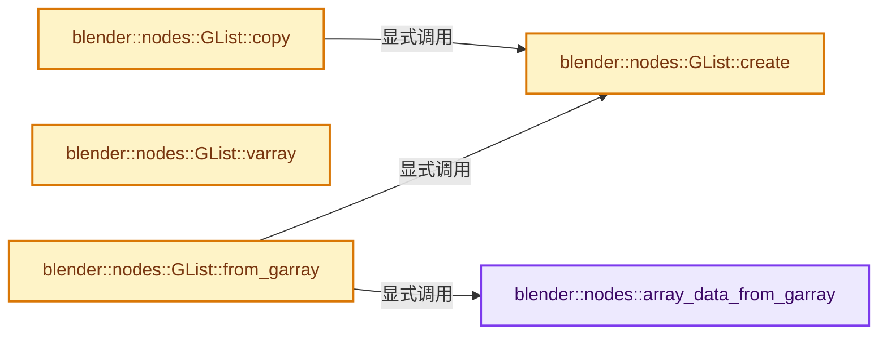
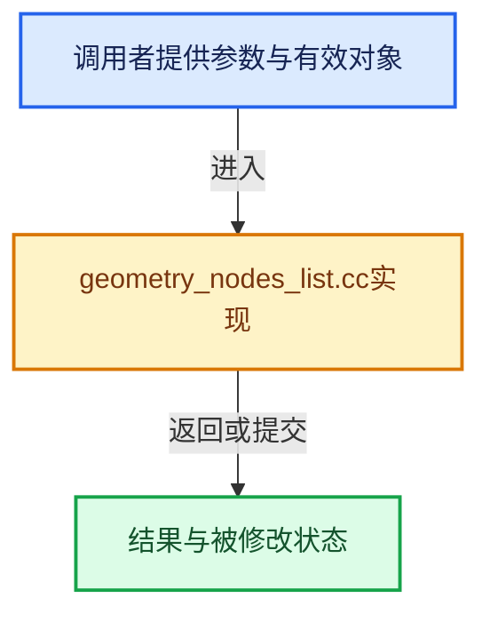

# 实现依赖专题：source/blender/nodes/intern/geometry_nodes_list.cc

[方向导航](README.md) · [符号索引](../%E7%AC%A6%E5%8F%B7%E4%BE%9D%E8%B5%96%E4%B8%8E%E5%AE%9E%E7%8E%B0%E7%B4%A2%E5%BC%95.md)

本专题从正文实际调用进入，集中保存共享实现。函数有稳定锚点，可从调用处直接跳到对应完整函数；递归与互相调用通过回链组织。

## 本文件的实现关系






## 完整成员与函数实现

<a id="f-a27232284cd4ce6b"></a>

### `blender::nodes::array_data_from_garray`

实现位置：[source/blender/nodes/intern/geometry_nodes_list.cc](../../../../../source/blender/nodes/intern/geometry_nodes_list.cc) · L18—L25。

接口参数：

- `GArray<> array`

**教学注释版**

<!-- annotated:74c19c9600071a -->

```cpp
static GList::ArrayData array_data_from_garray(GArray<> array)
{
  // [讲解] std::move：把表达式转换成可供移动重载选择的值类别；不保证真的移动，不结束源对象寿命，对const值可能选择复制。
  auto *sharing_info = new ImplicitSharedValue<GArray<>>(std::move(array));
  GList::ArrayData data;
  data.data = sharing_info->data.data();
  data.sharing_info = ImplicitSharingPtr<>(sharing_info);
  return data;
}
```

<details>
<summary>核对原始源码：source/blender/nodes/intern/geometry_nodes_list.cc · L18—L25</summary>

<!-- original:74c19c9600071a:source/blender/nodes/intern/geometry_nodes_list.cc:18:25 -->

```cpp
static GList::ArrayData array_data_from_garray(GArray<> array)
{
  auto *sharing_info = new ImplicitSharedValue<GArray<>>(std::move(array));
  GList::ArrayData data;
  data.data = sharing_info->data.data();
  data.sharing_info = ImplicitSharingPtr<>(sharing_info);
  return data;
}
```

</details>

**沿实际写入检查状态**

- `data.data = sharing_info->data.data();`
- `data.sharing_info = ImplicitSharingPtr<>(sharing_info);`

**结果出口**

- `return data;`

**继续追踪实现**

- `std::move` → [外部契约](https://eel.is/c++draft/utility.forward)：把表达式转换成可供移动重载选择的值类别；不保证真的移动，不结束源对象寿命，对const值可能选择复制。
- `sharing_info->data.data` → [调用协议](../%E6%A8%A1%E6%9D%BF%E5%AE%8F%E4%B8%8E%E5%8A%A8%E6%80%81%E5%88%86%E6%B4%BE%E5%8D%8F%E8%AE%AE.md)：接收对象类型依赖auto、返回值或模板实例；不按同名猜测目标。调用位置L22。
- `ImplicitSharingPtr<>` → [blender::ImplicitSharingPtr::ImplicitSharingPtr · L32](../06-%E9%9A%90%E5%BC%8F%E5%85%B1%E4%BA%AB%E4%B8%8E%E7%BC%93%E5%AD%98%E7%B3%BB%E7%BB%9F/03-Mixin%E4%B8%8E%E5%85%B1%E4%BA%AB%E6%8C%87%E9%92%88%E5%B0%81%E8%A3%85.md#f-d28a43dbb5ed8c05)；[blender::ImplicitSharingPtr::ImplicitSharingPtr · L34](../06-%E9%9A%90%E5%BC%8F%E5%85%B1%E4%BA%AB%E4%B8%8E%E7%BC%93%E5%AD%98%E7%B3%BB%E7%BB%9F/03-Mixin%E4%B8%8E%E5%85%B1%E4%BA%AB%E6%8C%87%E9%92%88%E5%B0%81%E8%A3%85.md#f-d27d5ebf676e244a)；[blender::ImplicitSharingPtr::ImplicitSharingPtr · L37](../06-%E9%9A%90%E5%BC%8F%E5%85%B1%E4%BA%AB%E4%B8%8E%E7%BC%93%E5%AD%98%E7%B3%BB%E7%BB%9F/03-Mixin%E4%B8%8E%E5%85%B1%E4%BA%AB%E6%8C%87%E9%92%88%E5%B0%81%E8%A3%85.md#f-17d0c5fe2b03a664)；[blender::ImplicitSharingPtr::ImplicitSharingPtr · L39](../06-%E9%9A%90%E5%BC%8F%E5%85%B1%E4%BA%AB%E4%B8%8E%E7%BC%93%E5%AD%98%E7%B3%BB%E7%BB%9F/03-Mixin%E4%B8%8E%E5%85%B1%E4%BA%AB%E6%8C%87%E9%92%88%E5%B0%81%E8%A3%85.md#f-1c8729ae57532370)；[blender::ImplicitSharingPtr::ImplicitSharingPtr · L44](../06-%E9%9A%90%E5%BC%8F%E5%85%B1%E4%BA%AB%E4%B8%8E%E7%BC%93%E5%AD%98%E7%B3%BB%E7%BB%9F/03-Mixin%E4%B8%8E%E5%85%B1%E4%BA%AB%E6%8C%87%E9%92%88%E5%B0%81%E8%A3%85.md#f-0b6be0142b98009e)；[blender::ImplicitSharingPtr::ImplicitSharingPtr · L49](../06-%E9%9A%90%E5%BC%8F%E5%85%B1%E4%BA%AB%E4%B8%8E%E7%BC%93%E5%AD%98%E7%B3%BB%E7%BB%9F/03-Mixin%E4%B8%8E%E5%85%B1%E4%BA%AB%E6%8C%87%E9%92%88%E5%B0%81%E8%A3%85.md#f-90c601ed9ed99045)；[blender::ImplicitSharingPtr::ImplicitSharingPtr · L57](../06-%E9%9A%90%E5%BC%8F%E5%85%B1%E4%BA%AB%E4%B8%8E%E7%BC%93%E5%AD%98%E7%B3%BB%E7%BB%9F/03-Mixin%E4%B8%8E%E5%85%B1%E4%BA%AB%E6%8C%87%E9%92%88%E5%B0%81%E8%A3%85.md#f-1625179ceae7a66d)。同名重载需按实参类型选择。

<a id="f-c576bfad57bf8958"></a>

### `blender::nodes::GList::copy`

实现位置：[source/blender/nodes/intern/geometry_nodes_list.cc](../../../../../source/blender/nodes/intern/geometry_nodes_list.cc) · L80—L83。

**教学注释版**

<!-- annotated:bc790c01270df6 -->

```cpp
GListPtr GList::copy() const
{
  return GList::create(cpp_type_, data_, size_);
}
```

<details>
<summary>核对原始源码：source/blender/nodes/intern/geometry_nodes_list.cc · L80—L83</summary>

<!-- original:bc790c01270df6:source/blender/nodes/intern/geometry_nodes_list.cc:80:83 -->

```cpp
GListPtr GList::copy() const
{
  return GList::create(cpp_type_, data_, size_);
}
```

</details>

**结果出口**

- `return GList::create(cpp_type_, data_, size_);`

**继续追踪实现**

- `GList::create` → [blender::nodes::GList::create · L263](%E4%BE%9D%E8%B5%96-geometry_nodes_list-6b7d73.md#f-d98f24446264b506)。

<a id="f-2abf90eb8a1543ac"></a>

### `blender::nodes::GList::varray`

实现位置：[source/blender/nodes/intern/geometry_nodes_list.cc](../../../../../source/blender/nodes/intern/geometry_nodes_list.cc) · L85—L95。

**教学注释版**

<!-- annotated:73050a9a58ce6b -->

```cpp
GVArray GList::varray() const
{
  if (const auto *array_data = std::get_if<ArrayData>(&data_)) {
    return GVArray::from_span(GSpan(cpp_type_, array_data->data, size_));
  }
  if (const auto *single_data = std::get_if<SingleData>(&data_)) {
    return GVArray::from_single_ref(cpp_type_, size_, single_data->value);
  }
  BLI_assert_unreachable();
  return {};
}
```

<details>
<summary>核对原始源码：source/blender/nodes/intern/geometry_nodes_list.cc · L85—L95</summary>

<!-- original:73050a9a58ce6b:source/blender/nodes/intern/geometry_nodes_list.cc:85:95 -->

```cpp
GVArray GList::varray() const
{
  if (const auto *array_data = std::get_if<ArrayData>(&data_)) {
    return GVArray::from_span(GSpan(cpp_type_, array_data->data, size_));
  }
  if (const auto *single_data = std::get_if<SingleData>(&data_)) {
    return GVArray::from_single_ref(cpp_type_, size_, single_data->value);
  }
  BLI_assert_unreachable();
  return {};
}
```

</details>

**结果出口**

- `return GVArray::from_span(GSpan(cpp_type_, array_data->data, size_));`
- `return GVArray::from_single_ref(cpp_type_, size_, single_data->value);`
- `return {};`

**继续追踪实现**

- `std::get_if<ArrayData>` → [外部契约](https://eel.is/c++draft/)：这个边界按实际表达式及所属类型核对参数、返回值、寿命与失败行为。这里提供接口入口，不声称已解释该第三方版本的内部实现。
- `GVArray::from_span` → [blender::GVArray::from_span · L895](../04-%E8%99%9A%E6%8B%9F%E6%95%B0%E7%BB%84%E4%B8%8E%E7%B4%A2%E5%BC%95%E9%80%89%E6%8B%A9/05-GVArray%E8%BF%90%E8%A1%8C%E6%97%B6%E7%B1%BB%E5%9E%8B.md#f-e8b978ca15febb67)。
- `GSpan` → [blender::GSpan::GSpan · L26](../03-%E5%86%85%E5%AD%98%E5%88%86%E9%85%8D%E4%B8%8E%E8%BF%90%E8%A1%8C%E6%97%B6%E7%B1%BB%E5%9E%8B/11-GSpan%E4%B8%8EGArray.md#f-9d0c95702007eea6)；[blender::GSpan::GSpan · L28](../03-%E5%86%85%E5%AD%98%E5%88%86%E9%85%8D%E4%B8%8E%E8%BF%90%E8%A1%8C%E6%97%B6%E7%B1%BB%E5%9E%8B/11-GSpan%E4%B8%8EGArray.md#f-6650bd08c7eecc66)；[blender::GSpan::GSpan · L37](../03-%E5%86%85%E5%AD%98%E5%88%86%E9%85%8D%E4%B8%8E%E8%BF%90%E8%A1%8C%E6%97%B6%E7%B1%BB%E5%9E%8B/11-GSpan%E4%B8%8EGArray.md#f-bf180950832673fb)；[blender::GSpan::GSpan · L39](../03-%E5%86%85%E5%AD%98%E5%88%86%E9%85%8D%E4%B8%8E%E8%BF%90%E8%A1%8C%E6%97%B6%E7%B1%BB%E5%9E%8B/11-GSpan%E4%B8%8EGArray.md#f-cf949d5590ea9ab6)；[blender::GSpan::GSpan · L41](../03-%E5%86%85%E5%AD%98%E5%88%86%E9%85%8D%E4%B8%8E%E8%BF%90%E8%A1%8C%E6%97%B6%E7%B1%BB%E5%9E%8B/11-GSpan%E4%B8%8EGArray.md#f-a66ab52ee0842aee)；[blender::GSpan::GSpan · L43](../03-%E5%86%85%E5%AD%98%E5%88%86%E9%85%8D%E4%B8%8E%E8%BF%90%E8%A1%8C%E6%97%B6%E7%B1%BB%E5%9E%8B/11-GSpan%E4%B8%8EGArray.md#f-d9084fa10964390f)；[blender::GSpan::GSpan · L49](../03-%E5%86%85%E5%AD%98%E5%88%86%E9%85%8D%E4%B8%8E%E8%BF%90%E8%A1%8C%E6%97%B6%E7%B1%BB%E5%9E%8B/11-GSpan%E4%B8%8EGArray.md#f-76e3de3cc3d65761)。同名重载需按实参类型选择。
- `std::get_if<SingleData>` → [外部契约](https://eel.is/c++draft/)：这个边界按实际表达式及所属类型核对参数、返回值、寿命与失败行为。这里提供接口入口，不声称已解释该第三方版本的内部实现。
- `GVArray::from_single_ref` → [blender::GVArray::from_single_ref · L885](../04-%E8%99%9A%E6%8B%9F%E6%95%B0%E7%BB%84%E4%B8%8E%E7%B4%A2%E5%BC%95%E9%80%89%E6%8B%A9/05-GVArray%E8%BF%90%E8%A1%8C%E6%97%B6%E7%B1%BB%E5%9E%8B.md#f-8208f854554701e4)。
- `BLI_assert_unreachable` → [BLI_assert_unreachable · L77](../01-%E5%9F%BA%E7%A1%80%E5%AE%B9%E5%99%A8%E4%B8%8E%E7%8E%B0%E4%BB%A3CPP/%E4%BE%9D%E8%B5%96-BLI_assert-cc98e8.md#m-7a2d91a67d8e)。宏定义由构建条件选择。

<a id="f-d98f24446264b506"></a>

### `blender::nodes::GList::create`

实现位置：[source/blender/nodes/intern/geometry_nodes_list.cc](../../../../../source/blender/nodes/intern/geometry_nodes_list.cc) · L263—L266。

接口参数：

- `const CPPType &type`
- `DataVariant data`
- `const int64_t size`

**教学注释版**

<!-- annotated:0177915e51ae9d -->

```cpp
GListPtr GList::create(const CPPType &type, DataVariant data, const int64_t size)
{
  // [讲解] std::move：把表达式转换成可供移动重载选择的值类别；不保证真的移动，不结束源对象寿命，对const值可能选择复制。
  return GListPtr(MEM_new<GList>(__func__, type, std::move(data), size));
}
```

<details>
<summary>核对原始源码：source/blender/nodes/intern/geometry_nodes_list.cc · L263—L266</summary>

<!-- original:0177915e51ae9d:source/blender/nodes/intern/geometry_nodes_list.cc:263:266 -->

```cpp
GListPtr GList::create(const CPPType &type, DataVariant data, const int64_t size)
{
  return GListPtr(MEM_new<GList>(__func__, type, std::move(data), size));
}
```

</details>

**结果出口**

- `return GListPtr(MEM_new<GList>(__func__, type, std::move(data), size));`

**继续追踪实现**

- `GListPtr` → [blender::nodes::GListPtr::GListPtr · L152](%E4%BE%9D%E8%B5%96-NOD_geometry_nodes_list-56053f.md#f-15788b095b6a3bf7)；[blender::nodes::GListPtr::GListPtr · L153](%E4%BE%9D%E8%B5%96-NOD_geometry_nodes_list-56053f.md#f-5bf0d6a7a8c28ef4)；[blender::nodes::GListPtr::GListPtr · L154](%E4%BE%9D%E8%B5%96-NOD_geometry_nodes_list-56053f.md#f-aba6a4f613490f6a)。同名重载需按实参类型选择。
- `MEM_new<GList>` → [MEM_new · L351](../03-%E5%86%85%E5%AD%98%E5%88%86%E9%85%8D%E4%B8%8E%E8%BF%90%E8%A1%8C%E6%97%B6%E7%B1%BB%E5%9E%8B/%E4%BE%9D%E8%B5%96-MEM_guardedalloc-b54eca.md#f-115f9b6784f89912)。
- `std::move` → [外部契约](https://eel.is/c++draft/utility.forward)：把表达式转换成可供移动重载选择的值类别；不保证真的移动，不结束源对象寿命，对const值可能选择复制。

<a id="f-441f4cfe3d661e9d"></a>

### `blender::nodes::GList::from_garray`

实现位置：[source/blender/nodes/intern/geometry_nodes_list.cc](../../../../../source/blender/nodes/intern/geometry_nodes_list.cc) · L268—L273。

接口参数：

- `GArray<> array`

**教学注释版**

<!-- annotated:7cdf7e68d6fa3c -->

```cpp
GListPtr GList::from_garray(GArray<> array)
{
  const CPPType &type = array.type();
  const int64_t size = array.size();
  // [讲解] std::move：把表达式转换成可供移动重载选择的值类别；不保证真的移动，不结束源对象寿命，对const值可能选择复制。
  return GList::create(type, array_data_from_garray(std::move(array)), size);
}
```

<details>
<summary>核对原始源码：source/blender/nodes/intern/geometry_nodes_list.cc · L268—L273</summary>

<!-- original:7cdf7e68d6fa3c:source/blender/nodes/intern/geometry_nodes_list.cc:268:273 -->

```cpp
GListPtr GList::from_garray(GArray<> array)
{
  const CPPType &type = array.type();
  const int64_t size = array.size();
  return GList::create(type, array_data_from_garray(std::move(array)), size);
}
```

</details>

**结果出口**

- `return GList::create(type, array_data_from_garray(std::move(array)), size);`

**继续追踪实现**

- `array.type` → [blender::GArray::type · L138](../03-%E5%86%85%E5%AD%98%E5%88%86%E9%85%8D%E4%B8%8E%E8%BF%90%E8%A1%8C%E6%97%B6%E7%B1%BB%E5%9E%8B/11-GSpan%E4%B8%8EGArray.md#f-3c4bebd424df52cc)。
- `array.size` → [blender::GArray::size · L152](../03-%E5%86%85%E5%AD%98%E5%88%86%E9%85%8D%E4%B8%8E%E8%BF%90%E8%A1%8C%E6%97%B6%E7%B1%BB%E5%9E%8B/11-GSpan%E4%B8%8EGArray.md#f-8897580a87dde189)。
- `GList::create` → [blender::nodes::GList::create · L263](%E4%BE%9D%E8%B5%96-geometry_nodes_list-6b7d73.md#f-d98f24446264b506)。
- `array_data_from_garray` → [blender::nodes::array_data_from_garray · L18](%E4%BE%9D%E8%B5%96-geometry_nodes_list-6b7d73.md#f-a27232284cd4ce6b)。
- `std::move` → [外部契约](https://eel.is/c++draft/utility.forward)：把表达式转换成可供移动重载选择的值类别；不保证真的移动，不结束源对象寿命，对const值可能选择复制。
