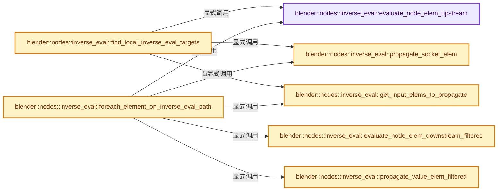
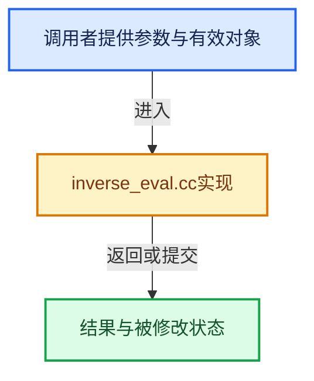

# 实现依赖专题：source/blender/nodes/intern/inverse_eval.cc

[方向导航](README.md) · [符号索引](../%E7%AC%A6%E5%8F%B7%E4%BE%9D%E8%B5%96%E4%B8%8E%E5%AE%9E%E7%8E%B0%E7%B4%A2%E5%BC%95.md)

本专题从正文实际调用进入，集中保存共享实现。函数有稳定锚点，可从调用处直接跳到对应完整函数；递归与互相调用通过回链组织。

## 本文件的实现关系






## 完整成员与函数实现

<a id="f-6ce55c5ce1ff6a9b"></a>

### `blender::nodes::inverse_eval::evaluate_node_elem_upstream`

实现位置：[source/blender/nodes/intern/inverse_eval.cc](../../../../../source/blender/nodes/intern/inverse_eval.cc) · L77—L104。

接口参数：

- `const NodeInContext &ctx_node`
- `Vector<const bNodeSocket *> &r_modified_inputs`
- `Map<SocketInContext, ElemVariant> &elem_by_socket`

**教学注释版**

<!-- annotated:616b99ff5c9435 -->

```cpp
static void evaluate_node_elem_upstream(const NodeInContext &ctx_node,
                                        Vector<const bNodeSocket *> &r_modified_inputs,
                                        Map<SocketInContext, ElemVariant> &elem_by_socket)
{
  const bNode &node = *ctx_node.node;
  const bke::bNodeType &ntype = *node.typeinfo;
  if (!ntype.eval_inverse_elem) {
    /* Node does not support inverse evaluation. */
    return;
  }
  /* Build temporary map to be used by node evaluation function. */
  Map<const bNodeSocket *, ElemVariant> elem_by_local_socket;
  for (const bNodeSocket *output_socket : node.output_sockets()) {
    // [讲解] elem_by_socket.lookup_ptr：按键查找对应项。
    if (const ElemVariant *elem = elem_by_socket.lookup_ptr({ctx_node.context, output_socket})) {
      // [讲解] elem_by_local_socket.add：按哈希与相等关系加入键或键值。
      elem_by_local_socket.add(output_socket, *elem);
    }
  }
  Vector<SocketElem> input_elems;
  InverseElemEvalParams params{node, elem_by_local_socket, input_elems};
  ntype.eval_inverse_elem(params);
  /* Write back changed socket values to the map. */
  for (const SocketElem &input_elem : input_elems) {
    if (input_elem.elem) {
      elem_by_socket.add({ctx_node.context, input_elem.socket}, input_elem.elem);
      // [讲解] r_modified_inputs.append：在尾部建立新元素，必要时先扩大存储。
      r_modified_inputs.append(input_elem.socket);
    }
  }
}
```

<details>
<summary>核对原始源码：source/blender/nodes/intern/inverse_eval.cc · L77—L104</summary>

<!-- original:616b99ff5c9435:source/blender/nodes/intern/inverse_eval.cc:77:104 -->

```cpp
static void evaluate_node_elem_upstream(const NodeInContext &ctx_node,
                                        Vector<const bNodeSocket *> &r_modified_inputs,
                                        Map<SocketInContext, ElemVariant> &elem_by_socket)
{
  const bNode &node = *ctx_node.node;
  const bke::bNodeType &ntype = *node.typeinfo;
  if (!ntype.eval_inverse_elem) {
    /* Node does not support inverse evaluation. */
    return;
  }
  /* Build temporary map to be used by node evaluation function. */
  Map<const bNodeSocket *, ElemVariant> elem_by_local_socket;
  for (const bNodeSocket *output_socket : node.output_sockets()) {
    if (const ElemVariant *elem = elem_by_socket.lookup_ptr({ctx_node.context, output_socket})) {
      elem_by_local_socket.add(output_socket, *elem);
    }
  }
  Vector<SocketElem> input_elems;
  InverseElemEvalParams params{node, elem_by_local_socket, input_elems};
  ntype.eval_inverse_elem(params);
  /* Write back changed socket values to the map. */
  for (const SocketElem &input_elem : input_elems) {
    if (input_elem.elem) {
      elem_by_socket.add({ctx_node.context, input_elem.socket}, input_elem.elem);
      r_modified_inputs.append(input_elem.socket);
    }
  }
}
```

</details>

**继续追踪实现**

- `node.output_sockets` → [blender::bNode::output_sockets · L760](../05-%E5%87%A0%E4%BD%95%E5%AD%98%E5%82%A8%E4%B8%8E%E6%8B%93%E6%89%91%E6%98%A0%E5%B0%84/%E4%BE%9D%E8%B5%96-BKE_node_runtime-ee561b.md#f-40ec6d6aed2ab6fb)；[blender::bNode::output_sockets · L772](../05-%E5%87%A0%E4%BD%95%E5%AD%98%E5%82%A8%E4%B8%8E%E6%8B%93%E6%89%91%E6%98%A0%E5%B0%84/%E4%BE%9D%E8%B5%96-BKE_node_runtime-ee561b.md#f-ddbd8f42409bdcd1)。同名重载需按实参类型选择。
- `elem_by_socket.lookup_ptr` → [blender::Map::lookup_ptr · L508](../02-%E5%93%88%E5%B8%8C%E8%A1%A8%E4%B8%8E%E5%85%B3%E8%81%94%E6%95%B0%E6%8D%AE%E7%BB%93%E6%9E%84/04-Map%E6%9F%A5%E6%89%BE%E4%B8%8E%E9%94%AE%E8%AE%BF%E9%97%AE.md#f-90844510a761dcb2)；[blender::Map::lookup_ptr · L512](../02-%E5%93%88%E5%B8%8C%E8%A1%A8%E4%B8%8E%E5%85%B3%E8%81%94%E6%95%B0%E6%8D%AE%E7%BB%93%E6%9E%84/04-Map%E6%9F%A5%E6%89%BE%E4%B8%8E%E9%94%AE%E8%AE%BF%E9%97%AE.md#f-ce017485b88f4b2c)。同名重载需按实参类型选择。
- `elem_by_local_socket.add` → [blender::Map::add · L295](../02-%E5%93%88%E5%B8%8C%E8%A1%A8%E4%B8%8E%E5%85%B3%E8%81%94%E6%95%B0%E6%8D%AE%E7%BB%93%E6%9E%84/04-Map%E6%9F%A5%E6%89%BE%E4%B8%8E%E9%94%AE%E8%AE%BF%E9%97%AE.md#f-8d38101abf162f88)；[blender::Map::add · L299](../02-%E5%93%88%E5%B8%8C%E8%A1%A8%E4%B8%8E%E5%85%B3%E8%81%94%E6%95%B0%E6%8D%AE%E7%BB%93%E6%9E%84/04-Map%E6%9F%A5%E6%89%BE%E4%B8%8E%E9%94%AE%E8%AE%BF%E9%97%AE.md#f-1f59510cdfbd9f87)；[blender::Map::add · L303](../02-%E5%93%88%E5%B8%8C%E8%A1%A8%E4%B8%8E%E5%85%B3%E8%81%94%E6%95%B0%E6%8D%AE%E7%BB%93%E6%9E%84/04-Map%E6%9F%A5%E6%89%BE%E4%B8%8E%E9%94%AE%E8%AE%BF%E9%97%AE.md#f-645e0522347aa018)；[blender::Map::add · L307](../02-%E5%93%88%E5%B8%8C%E8%A1%A8%E4%B8%8E%E5%85%B3%E8%81%94%E6%95%B0%E6%8D%AE%E7%BB%93%E6%9E%84/04-Map%E6%9F%A5%E6%89%BE%E4%B8%8E%E9%94%AE%E8%AE%BF%E9%97%AE.md#f-03405db0730cedc0)。同名重载需按实参类型选择。
- `ntype.eval_inverse_elem` → [调用协议](../%E6%A8%A1%E6%9D%BF%E5%AE%8F%E4%B8%8E%E5%8A%A8%E6%80%81%E5%88%86%E6%B4%BE%E5%8D%8F%E8%AE%AE.md)：由接收对象具体类型或运行时策略提供实现。调用位置L96。
- `elem_by_socket.add` → [blender::Map::add · L295](../02-%E5%93%88%E5%B8%8C%E8%A1%A8%E4%B8%8E%E5%85%B3%E8%81%94%E6%95%B0%E6%8D%AE%E7%BB%93%E6%9E%84/04-Map%E6%9F%A5%E6%89%BE%E4%B8%8E%E9%94%AE%E8%AE%BF%E9%97%AE.md#f-8d38101abf162f88)；[blender::Map::add · L299](../02-%E5%93%88%E5%B8%8C%E8%A1%A8%E4%B8%8E%E5%85%B3%E8%81%94%E6%95%B0%E6%8D%AE%E7%BB%93%E6%9E%84/04-Map%E6%9F%A5%E6%89%BE%E4%B8%8E%E9%94%AE%E8%AE%BF%E9%97%AE.md#f-1f59510cdfbd9f87)；[blender::Map::add · L303](../02-%E5%93%88%E5%B8%8C%E8%A1%A8%E4%B8%8E%E5%85%B3%E8%81%94%E6%95%B0%E6%8D%AE%E7%BB%93%E6%9E%84/04-Map%E6%9F%A5%E6%89%BE%E4%B8%8E%E9%94%AE%E8%AE%BF%E9%97%AE.md#f-645e0522347aa018)；[blender::Map::add · L307](../02-%E5%93%88%E5%B8%8C%E8%A1%A8%E4%B8%8E%E5%85%B3%E8%81%94%E6%95%B0%E6%8D%AE%E7%BB%93%E6%9E%84/04-Map%E6%9F%A5%E6%89%BE%E4%B8%8E%E9%94%AE%E8%AE%BF%E9%97%AE.md#f-03405db0730cedc0)。同名重载需按实参类型选择。
- `r_modified_inputs.append` → [blender::Vector::append · L498](../01-%E5%9F%BA%E7%A1%80%E5%AE%B9%E5%99%A8%E4%B8%8E%E7%8E%B0%E4%BB%A3CPP/11-Vector%E6%8F%92%E5%85%A5%E5%88%A0%E9%99%A4%E4%B8%8E%E9%87%8D%E6%8E%92.md#f-5bde268a69e443ec)；[blender::Vector::append · L502](../01-%E5%9F%BA%E7%A1%80%E5%AE%B9%E5%99%A8%E4%B8%8E%E7%8E%B0%E4%BB%A3CPP/11-Vector%E6%8F%92%E5%85%A5%E5%88%A0%E9%99%A4%E4%B8%8E%E9%87%8D%E6%8E%92.md#f-591e0b15e6308532)。同名重载需按实参类型选择。

<a id="f-f3790608c83ed0af"></a>

### `blender::nodes::inverse_eval::propagate_socket_elem`

实现位置：[source/blender/nodes/intern/inverse_eval.cc](../../../../../source/blender/nodes/intern/inverse_eval.cc) · L106—L122。

接口参数：

- `const SocketInContext &ctx_from`
- `const SocketInContext &ctx_to`
- `Map<SocketInContext, ElemVariant> &elem_by_socket`

**教学注释版**

<!-- annotated:f084fb2eb84109 -->

```cpp
static bool propagate_socket_elem(const SocketInContext &ctx_from,
                                  const SocketInContext &ctx_to,
                                  Map<SocketInContext, ElemVariant> &elem_by_socket)
{
  // [讲解] elem_by_socket.lookup_ptr：按键查找对应项。
  const ElemVariant *from_elem = elem_by_socket.lookup_ptr(ctx_from);
  if (!from_elem) {
    return false;
  }
  /* Perform implicit conversion if necessary. */
  const std::optional<ElemVariant> to_elem = convert_socket_elem(
      *ctx_from.socket, *ctx_to.socket, *from_elem);
  if (!to_elem || !*to_elem) {
    return false;
  }
  // [讲解] elem_by_socket.lookup_or_add：把查找与缺失时创建合成一次操作。
  elem_by_socket.lookup_or_add(ctx_to, *to_elem).merge(*to_elem);
  return true;
}
```

<details>
<summary>核对原始源码：source/blender/nodes/intern/inverse_eval.cc · L106—L122</summary>

<!-- original:f084fb2eb84109:source/blender/nodes/intern/inverse_eval.cc:106:122 -->

```cpp
static bool propagate_socket_elem(const SocketInContext &ctx_from,
                                  const SocketInContext &ctx_to,
                                  Map<SocketInContext, ElemVariant> &elem_by_socket)
{
  const ElemVariant *from_elem = elem_by_socket.lookup_ptr(ctx_from);
  if (!from_elem) {
    return false;
  }
  /* Perform implicit conversion if necessary. */
  const std::optional<ElemVariant> to_elem = convert_socket_elem(
      *ctx_from.socket, *ctx_to.socket, *from_elem);
  if (!to_elem || !*to_elem) {
    return false;
  }
  elem_by_socket.lookup_or_add(ctx_to, *to_elem).merge(*to_elem);
  return true;
}
```

</details>

**结果出口**

- `return false;`
- `return true;`

**继续追踪实现**

- `elem_by_socket.lookup_ptr` → [blender::Map::lookup_ptr · L508](../02-%E5%93%88%E5%B8%8C%E8%A1%A8%E4%B8%8E%E5%85%B3%E8%81%94%E6%95%B0%E6%8D%AE%E7%BB%93%E6%9E%84/04-Map%E6%9F%A5%E6%89%BE%E4%B8%8E%E9%94%AE%E8%AE%BF%E9%97%AE.md#f-90844510a761dcb2)；[blender::Map::lookup_ptr · L512](../02-%E5%93%88%E5%B8%8C%E8%A1%A8%E4%B8%8E%E5%85%B3%E8%81%94%E6%95%B0%E6%8D%AE%E7%BB%93%E6%9E%84/04-Map%E6%9F%A5%E6%89%BE%E4%B8%8E%E9%94%AE%E8%AE%BF%E9%97%AE.md#f-ce017485b88f4b2c)。同名重载需按实参类型选择。
- `convert_socket_elem` → [blender::nodes::value_elem::convert_socket_elem · L33](%E4%BE%9D%E8%B5%96-value_elem-7bfc90.md#f-1398f6d895df2961)。
- `elem_by_socket.lookup_or_add(ctx_to, *to_elem).merge` → [调用协议](../%E6%A8%A1%E6%9D%BF%E5%AE%8F%E4%B8%8E%E5%8A%A8%E6%80%81%E5%88%86%E6%B4%BE%E5%8D%8F%E8%AE%AE.md)：接收对象类型依赖auto、返回值或模板实例；不按同名猜测目标。调用位置L120。
- `elem_by_socket.lookup_or_add` → [blender::Map::lookup_or_add · L588](../02-%E5%93%88%E5%B8%8C%E8%A1%A8%E4%B8%8E%E5%85%B3%E8%81%94%E6%95%B0%E6%8D%AE%E7%BB%93%E6%9E%84/05-Map%E6%8F%92%E5%85%A5%E4%B8%8E%E5%9B%9E%E8%B0%83.md#f-c419897675e1c232)；[blender::Map::lookup_or_add · L592](../02-%E5%93%88%E5%B8%8C%E8%A1%A8%E4%B8%8E%E5%85%B3%E8%81%94%E6%95%B0%E6%8D%AE%E7%BB%93%E6%9E%84/05-Map%E6%8F%92%E5%85%A5%E4%B8%8E%E5%9B%9E%E8%B0%83.md#f-85b5fa3f7399794c)；[blender::Map::lookup_or_add · L596](../02-%E5%93%88%E5%B8%8C%E8%A1%A8%E4%B8%8E%E5%85%B3%E8%81%94%E6%95%B0%E6%8D%AE%E7%BB%93%E6%9E%84/05-Map%E6%8F%92%E5%85%A5%E4%B8%8E%E5%9B%9E%E8%B0%83.md#f-45a386e54e052059)；[blender::Map::lookup_or_add · L600](../02-%E5%93%88%E5%B8%8C%E8%A1%A8%E4%B8%8E%E5%85%B3%E8%81%94%E6%95%B0%E6%8D%AE%E7%BB%93%E6%9E%84/05-Map%E6%8F%92%E5%85%A5%E4%B8%8E%E5%9B%9E%E8%B0%83.md#f-fee760b21dfabceb)。同名重载需按实参类型选择。

<a id="f-5cc479ca2106946c"></a>

### `blender::nodes::inverse_eval::get_input_elems_to_propagate`

实现位置：[source/blender/nodes/intern/inverse_eval.cc](../../../../../source/blender/nodes/intern/inverse_eval.cc) · L124—L133。

接口参数：

- `const NodeInContext &ctx_node`
- `Vector<const bNodeSocket *> &r_sockets`
- `Map<SocketInContext, ElemVariant> &elem_by_socket`

**教学注释版**

<!-- annotated:3f2303ad0aca9c -->

```cpp
static void get_input_elems_to_propagate(const NodeInContext &ctx_node,
                                         Vector<const bNodeSocket *> &r_sockets,
                                         Map<SocketInContext, ElemVariant> &elem_by_socket)
{
  for (const bNodeSocket *socket : ctx_node.node->input_sockets()) {
    // [讲解] elem_by_socket.contains：查询活项数量或键是否存在。
    if (elem_by_socket.contains({ctx_node.context, socket})) {
      // [讲解] r_sockets.append：在尾部建立新元素，必要时先扩大存储。
      r_sockets.append(socket);
    }
  }
}
```

<details>
<summary>核对原始源码：source/blender/nodes/intern/inverse_eval.cc · L124—L133</summary>

<!-- original:3f2303ad0aca9c:source/blender/nodes/intern/inverse_eval.cc:124:133 -->

```cpp
static void get_input_elems_to_propagate(const NodeInContext &ctx_node,
                                         Vector<const bNodeSocket *> &r_sockets,
                                         Map<SocketInContext, ElemVariant> &elem_by_socket)
{
  for (const bNodeSocket *socket : ctx_node.node->input_sockets()) {
    if (elem_by_socket.contains({ctx_node.context, socket})) {
      r_sockets.append(socket);
    }
  }
}
```

</details>

**继续追踪实现**

- `ctx_node.node->input_sockets` → [调用协议](../%E6%A8%A1%E6%9D%BF%E5%AE%8F%E4%B8%8E%E5%8A%A8%E6%80%81%E5%88%86%E6%B4%BE%E5%8D%8F%E8%AE%AE.md)：接收对象类型依赖auto、返回值或模板实例；不按同名猜测目标。调用位置L128。
- `elem_by_socket.contains` → [blender::Map::contains · L353](../02-%E5%93%88%E5%B8%8C%E8%A1%A8%E4%B8%8E%E5%85%B3%E8%81%94%E6%95%B0%E6%8D%AE%E7%BB%93%E6%9E%84/04-Map%E6%9F%A5%E6%89%BE%E4%B8%8E%E9%94%AE%E8%AE%BF%E9%97%AE.md#f-70237c86261ee04d)。
- `r_sockets.append` → [blender::Vector::append · L498](../01-%E5%9F%BA%E7%A1%80%E5%AE%B9%E5%99%A8%E4%B8%8E%E7%8E%B0%E4%BB%A3CPP/11-Vector%E6%8F%92%E5%85%A5%E5%88%A0%E9%99%A4%E4%B8%8E%E9%87%8D%E6%8E%92.md#f-5bde268a69e443ec)；[blender::Vector::append · L502](../01-%E5%9F%BA%E7%A1%80%E5%AE%B9%E5%99%A8%E4%B8%8E%E7%8E%B0%E4%BB%A3CPP/11-Vector%E6%8F%92%E5%85%A5%E5%88%A0%E9%99%A4%E4%B8%8E%E9%87%8D%E6%8E%92.md#f-591e0b15e6308532)。同名重载需按实参类型选择。

<a id="f-75b3f12e4aab7775"></a>

### `blender::nodes::inverse_eval::find_local_inverse_eval_targets`

实现位置：[source/blender/nodes/intern/inverse_eval.cc](../../../../../source/blender/nodes/intern/inverse_eval.cc) · L135—L210。

接口参数：

- `const bNodeTree &tree`
- `const SocketElem &initial_socket_elem`

**教学注释版**

<!-- annotated:e650326c7ce6d5 -->

```cpp
LocalInverseEvalTargets find_local_inverse_eval_targets(const bNodeTree &tree,
                                                        const SocketElem &initial_socket_elem)
{
  BLI_assert(!tree.has_available_link_cycle());

  tree.ensure_topology_cache();

  bke::ComputeContextCache compute_context_cache;
  Map<SocketInContext, ElemVariant> elem_by_socket;
  // [讲解] elem_by_socket.add：按哈希与相等关系加入键或键值。
  elem_by_socket.add({nullptr, initial_socket_elem.socket}, initial_socket_elem.elem);

  const partial_eval::UpstreamEvalTargets upstream_eval_targets = partial_eval::eval_upstream(
      {{nullptr, initial_socket_elem.socket}},
      compute_context_cache,
      /* Evaluate node. */
      [&](const NodeInContext &ctx_node, Vector<const bNodeSocket *> &r_modified_inputs) {
        evaluate_node_elem_upstream(ctx_node, r_modified_inputs, elem_by_socket);
      },
      /* Propagate value. */
      [&](const SocketInContext &ctx_from, const SocketInContext &ctx_to) {
        return propagate_socket_elem(ctx_from, ctx_to, elem_by_socket);
      },
      /* Get input sockets to propagate. */
      [&](const NodeInContext &ctx_node, Vector<const bNodeSocket *> &r_sockets) {
        get_input_elems_to_propagate(ctx_node, r_sockets, elem_by_socket);
      });

  LocalInverseEvalTargets targets;

  for (const SocketInContext &ctx_socket : upstream_eval_targets.sockets) {
    if (ctx_socket.context) {
      /* Context should be empty because we only handle top-level sockets here. */
      continue;
    }
    // [讲解] elem_by_socket.lookup_ptr：按键查找对应项。
    const ElemVariant *elem = elem_by_socket.lookup_ptr(ctx_socket);
    if (!elem || !*elem) {
      continue;
    }
    targets.input_sockets.append({ctx_socket.socket, *elem});
  }

  for (const NodeInContext ctx_node : upstream_eval_targets.value_nodes) {
    if (ctx_node.context) {
      /* Context should be empty because we only handle top-level nodes here. */
      continue;
    }
    const bNodeSocket &socket = ctx_node.node->output_socket(0);
    const ElemVariant *elem = elem_by_socket.lookup_ptr({nullptr, &socket});
    if (!elem || !*elem) {
      continue;
    }
    targets.value_nodes.append({ctx_node.node, *elem});
  }

  for (const int group_input_index : tree.interface_inputs().index_range()) {
    const eNodeSocketDatatype type = eNodeSocketDatatype(
        tree.interface_inputs()[group_input_index]->socket_typeinfo()->type);
    std::optional<ElemVariant> elem = get_elem_variant_for_socket_type(type);
    if (!elem) {
      continue;
    }
    /* Combine the elems from each group input node. */
    for (const bNode *node : tree.group_input_nodes()) {
      const bNodeSocket &socket = node->output_socket(group_input_index);
      if (const ElemVariant *socket_elem = elem_by_socket.lookup_ptr({nullptr, &socket})) {
        elem->merge(*socket_elem);
      }
    }
    if (!*elem) {
      continue;
    }
    targets.group_inputs.append({group_input_index, *elem});
  }

  return targets;
}
```

<details>
<summary>核对原始源码：source/blender/nodes/intern/inverse_eval.cc · L135—L210</summary>

<!-- original:e650326c7ce6d5:source/blender/nodes/intern/inverse_eval.cc:135:210 -->

```cpp
LocalInverseEvalTargets find_local_inverse_eval_targets(const bNodeTree &tree,
                                                        const SocketElem &initial_socket_elem)
{
  BLI_assert(!tree.has_available_link_cycle());

  tree.ensure_topology_cache();

  bke::ComputeContextCache compute_context_cache;
  Map<SocketInContext, ElemVariant> elem_by_socket;
  elem_by_socket.add({nullptr, initial_socket_elem.socket}, initial_socket_elem.elem);

  const partial_eval::UpstreamEvalTargets upstream_eval_targets = partial_eval::eval_upstream(
      {{nullptr, initial_socket_elem.socket}},
      compute_context_cache,
      /* Evaluate node. */
      [&](const NodeInContext &ctx_node, Vector<const bNodeSocket *> &r_modified_inputs) {
        evaluate_node_elem_upstream(ctx_node, r_modified_inputs, elem_by_socket);
      },
      /* Propagate value. */
      [&](const SocketInContext &ctx_from, const SocketInContext &ctx_to) {
        return propagate_socket_elem(ctx_from, ctx_to, elem_by_socket);
      },
      /* Get input sockets to propagate. */
      [&](const NodeInContext &ctx_node, Vector<const bNodeSocket *> &r_sockets) {
        get_input_elems_to_propagate(ctx_node, r_sockets, elem_by_socket);
      });

  LocalInverseEvalTargets targets;

  for (const SocketInContext &ctx_socket : upstream_eval_targets.sockets) {
    if (ctx_socket.context) {
      /* Context should be empty because we only handle top-level sockets here. */
      continue;
    }
    const ElemVariant *elem = elem_by_socket.lookup_ptr(ctx_socket);
    if (!elem || !*elem) {
      continue;
    }
    targets.input_sockets.append({ctx_socket.socket, *elem});
  }

  for (const NodeInContext ctx_node : upstream_eval_targets.value_nodes) {
    if (ctx_node.context) {
      /* Context should be empty because we only handle top-level nodes here. */
      continue;
    }
    const bNodeSocket &socket = ctx_node.node->output_socket(0);
    const ElemVariant *elem = elem_by_socket.lookup_ptr({nullptr, &socket});
    if (!elem || !*elem) {
      continue;
    }
    targets.value_nodes.append({ctx_node.node, *elem});
  }

  for (const int group_input_index : tree.interface_inputs().index_range()) {
    const eNodeSocketDatatype type = eNodeSocketDatatype(
        tree.interface_inputs()[group_input_index]->socket_typeinfo()->type);
    std::optional<ElemVariant> elem = get_elem_variant_for_socket_type(type);
    if (!elem) {
      continue;
    }
    /* Combine the elems from each group input node. */
    for (const bNode *node : tree.group_input_nodes()) {
      const bNodeSocket &socket = node->output_socket(group_input_index);
      if (const ElemVariant *socket_elem = elem_by_socket.lookup_ptr({nullptr, &socket})) {
        elem->merge(*socket_elem);
      }
    }
    if (!*elem) {
      continue;
    }
    targets.group_inputs.append({group_input_index, *elem});
  }

  return targets;
}
```

</details>

**结果出口**

- `return propagate_socket_elem(ctx_from, ctx_to, elem_by_socket);`
- `return targets;`

**继续追踪实现**

- `BLI_assert` → [BLI_assert · L48](../01-%E5%9F%BA%E7%A1%80%E5%AE%B9%E5%99%A8%E4%B8%8E%E7%8E%B0%E4%BB%A3CPP/%E4%BE%9D%E8%B5%96-BLI_assert-cc98e8.md#m-57a88495704d)；[BLI_assert · L63](../01-%E5%9F%BA%E7%A1%80%E5%AE%B9%E5%99%A8%E4%B8%8E%E7%8E%B0%E4%BB%A3CPP/%E4%BE%9D%E8%B5%96-BLI_assert-cc98e8.md#m-d07050020cb5)。宏定义由构建条件选择。
- `tree.has_available_link_cycle` → [blender::bNodeTree::has_available_link_cycle · L572](../05-%E5%87%A0%E4%BD%95%E5%AD%98%E5%82%A8%E4%B8%8E%E6%8B%93%E6%89%91%E6%98%A0%E5%B0%84/%E4%BE%9D%E8%B5%96-BKE_node_runtime-ee561b.md#f-7bdcb85482e6bf35)。
- `tree.ensure_topology_cache` → [blender::bNodeTree::ensure_topology_cache · L621](../05-%E5%87%A0%E4%BD%95%E5%AD%98%E5%82%A8%E4%B8%8E%E6%8B%93%E6%89%91%E6%98%A0%E5%B0%84/%E4%BE%9D%E8%B5%96-node_runtime-ee7c39.md#f-566e97bdf0367424)。
- `elem_by_socket.add` → [blender::Map::add · L295](../02-%E5%93%88%E5%B8%8C%E8%A1%A8%E4%B8%8E%E5%85%B3%E8%81%94%E6%95%B0%E6%8D%AE%E7%BB%93%E6%9E%84/04-Map%E6%9F%A5%E6%89%BE%E4%B8%8E%E9%94%AE%E8%AE%BF%E9%97%AE.md#f-8d38101abf162f88)；[blender::Map::add · L299](../02-%E5%93%88%E5%B8%8C%E8%A1%A8%E4%B8%8E%E5%85%B3%E8%81%94%E6%95%B0%E6%8D%AE%E7%BB%93%E6%9E%84/04-Map%E6%9F%A5%E6%89%BE%E4%B8%8E%E9%94%AE%E8%AE%BF%E9%97%AE.md#f-1f59510cdfbd9f87)；[blender::Map::add · L303](../02-%E5%93%88%E5%B8%8C%E8%A1%A8%E4%B8%8E%E5%85%B3%E8%81%94%E6%95%B0%E6%8D%AE%E7%BB%93%E6%9E%84/04-Map%E6%9F%A5%E6%89%BE%E4%B8%8E%E9%94%AE%E8%AE%BF%E9%97%AE.md#f-645e0522347aa018)；[blender::Map::add · L307](../02-%E5%93%88%E5%B8%8C%E8%A1%A8%E4%B8%8E%E5%85%B3%E8%81%94%E6%95%B0%E6%8D%AE%E7%BB%93%E6%9E%84/04-Map%E6%9F%A5%E6%89%BE%E4%B8%8E%E9%94%AE%E8%AE%BF%E9%97%AE.md#f-03405db0730cedc0)。同名重载需按实参类型选择。
- `partial_eval::eval_upstream` → [blender::nodes::partial_eval::eval_upstream · L258](%E4%BE%9D%E8%B5%96-partial_eval-ff8875.md#f-1701115f4e1c40cc)。
- `evaluate_node_elem_upstream` → [blender::nodes::inverse_eval::evaluate_node_elem_upstream · L77](%E4%BE%9D%E8%B5%96-inverse_eval-7fd15e.md#f-6ce55c5ce1ff6a9b)。
- `propagate_socket_elem` → [blender::nodes::inverse_eval::propagate_socket_elem · L106](%E4%BE%9D%E8%B5%96-inverse_eval-7fd15e.md#f-f3790608c83ed0af)。
- `get_input_elems_to_propagate` → [blender::nodes::inverse_eval::get_input_elems_to_propagate · L124](%E4%BE%9D%E8%B5%96-inverse_eval-7fd15e.md#f-5cc479ca2106946c)。
- `elem_by_socket.lookup_ptr` → [blender::Map::lookup_ptr · L508](../02-%E5%93%88%E5%B8%8C%E8%A1%A8%E4%B8%8E%E5%85%B3%E8%81%94%E6%95%B0%E6%8D%AE%E7%BB%93%E6%9E%84/04-Map%E6%9F%A5%E6%89%BE%E4%B8%8E%E9%94%AE%E8%AE%BF%E9%97%AE.md#f-90844510a761dcb2)；[blender::Map::lookup_ptr · L512](../02-%E5%93%88%E5%B8%8C%E8%A1%A8%E4%B8%8E%E5%85%B3%E8%81%94%E6%95%B0%E6%8D%AE%E7%BB%93%E6%9E%84/04-Map%E6%9F%A5%E6%89%BE%E4%B8%8E%E9%94%AE%E8%AE%BF%E9%97%AE.md#f-ce017485b88f4b2c)。同名重载需按实参类型选择。
- `targets.input_sockets.append` → [调用协议](../%E6%A8%A1%E6%9D%BF%E5%AE%8F%E4%B8%8E%E5%8A%A8%E6%80%81%E5%88%86%E6%B4%BE%E5%8D%8F%E8%AE%AE.md)：接收对象类型依赖auto、返回值或模板实例；不按同名猜测目标。调用位置L173。
- `ctx_node.node->output_socket` → [调用协议](../%E6%A8%A1%E6%9D%BF%E5%AE%8F%E4%B8%8E%E5%8A%A8%E6%80%81%E5%88%86%E6%B4%BE%E5%8D%8F%E8%AE%AE.md)：接收对象类型依赖auto、返回值或模板实例；不按同名猜测目标。调用位置L181。
- `targets.value_nodes.append` → [调用协议](../%E6%A8%A1%E6%9D%BF%E5%AE%8F%E4%B8%8E%E5%8A%A8%E6%80%81%E5%88%86%E6%B4%BE%E5%8D%8F%E8%AE%AE.md)：接收对象类型依赖auto、返回值或模板实例；不按同名猜测目标。调用位置L186。
- `tree.interface_inputs().index_range` → [调用协议](../%E6%A8%A1%E6%9D%BF%E5%AE%8F%E4%B8%8E%E5%8A%A8%E6%80%81%E5%88%86%E6%B4%BE%E5%8D%8F%E8%AE%AE.md)：接收对象类型依赖auto、返回值或模板实例；不按同名猜测目标。调用位置L189。
- `tree.interface_inputs` → [blender::bNodeTree::interface_inputs · L675](../05-%E5%87%A0%E4%BD%95%E5%AD%98%E5%82%A8%E4%B8%8E%E6%8B%93%E6%89%91%E6%98%A0%E5%B0%84/%E4%BE%9D%E8%B5%96-BKE_node_runtime-ee561b.md#f-b5decde7a09fbf57)；[blender::bNodeTree::interface_inputs · L681](../05-%E5%87%A0%E4%BD%95%E5%AD%98%E5%82%A8%E4%B8%8E%E6%8B%93%E6%89%91%E6%98%A0%E5%B0%84/%E4%BE%9D%E8%B5%96-BKE_node_runtime-ee561b.md#f-f999995c05009884)。同名重载需按实参类型选择。
- `eNodeSocketDatatype` → [eNodeSocketDatatype](../05-%E5%87%A0%E4%BD%95%E5%AD%98%E5%82%A8%E4%B8%8E%E6%8B%93%E6%89%91%E6%98%A0%E5%B0%84/%E4%BE%9D%E8%B5%96-compositor-a4aa61.md#t-09b65f729b18)；[blender::eNodeSocketDatatype](../05-%E5%87%A0%E4%BD%95%E5%AD%98%E5%82%A8%E4%B8%8E%E6%8B%93%E6%89%91%E6%98%A0%E5%B0%84/%E4%BE%9D%E8%B5%96-DNA_node_types-6708b9.md#t-fdea02f95b31)。
- `tree.interface_inputs()[group_input_index]->socket_typeinfo` → [调用协议](../%E6%A8%A1%E6%9D%BF%E5%AE%8F%E4%B8%8E%E5%8A%A8%E6%80%81%E5%88%86%E6%B4%BE%E5%8D%8F%E8%AE%AE.md)：接收对象类型依赖auto、返回值或模板实例；不按同名猜测目标。调用位置L191。
- `get_elem_variant_for_socket_type` → [blender::nodes::value_elem::get_elem_variant_for_socket_type · L13](%E4%BE%9D%E8%B5%96-value_elem-7bfc90.md#f-2e1a93c9efead9c0)。
- `tree.group_input_nodes` → [blender::bNodeTree::group_input_nodes · L596](../05-%E5%87%A0%E4%BD%95%E5%AD%98%E5%82%A8%E4%B8%8E%E6%8B%93%E6%89%91%E6%98%A0%E5%B0%84/%E4%BE%9D%E8%B5%96-BKE_node_runtime-ee561b.md#f-f4d5daa939963761)；[blender::bNodeTree::group_input_nodes · L601](../05-%E5%87%A0%E4%BD%95%E5%AD%98%E5%82%A8%E4%B8%8E%E6%8B%93%E6%89%91%E6%98%A0%E5%B0%84/%E4%BE%9D%E8%B5%96-BKE_node_runtime-ee561b.md#f-b54e41a48ba6ce7a)。同名重载需按实参类型选择。
- `node->output_socket` → [调用协议](../%E6%A8%A1%E6%9D%BF%E5%AE%8F%E4%B8%8E%E5%8A%A8%E6%80%81%E5%88%86%E6%B4%BE%E5%8D%8F%E8%AE%AE.md)：接收对象类型依赖auto、返回值或模板实例；不按同名猜测目标。调用位置L198。
- `elem->merge` → [外部契约](https://eel.is/c++draft/)：这个边界按实际表达式及所属类型核对参数、返回值、寿命与失败行为。这里提供接口入口，不声称已解释该第三方版本的内部实现。
- `targets.group_inputs.append` → [调用协议](../%E6%A8%A1%E6%9D%BF%E5%AE%8F%E4%B8%8E%E5%8A%A8%E6%80%81%E5%88%86%E6%B4%BE%E5%8D%8F%E8%AE%AE.md)：接收对象类型依赖auto、返回值或模板实例；不按同名猜测目标。调用位置L206。

<a id="f-0b8c9ad2d9bf0bab"></a>

### `blender::nodes::inverse_eval::evaluate_node_elem_downstream_filtered`

实现位置：[source/blender/nodes/intern/inverse_eval.cc](../../../../../source/blender/nodes/intern/inverse_eval.cc) · L212—L248。

接口参数：

- `const NodeInContext &ctx_node`
- `const Map<SocketInContext, ElemVariant> &elem_by_socket_filter`
- `Map<SocketInContext, ElemVariant> &elem_by_socket`
- `Vector<const bNodeSocket *> &r_outputs_to_propagate`

**教学注释版**

<!-- annotated:780e67cc61fd96 -->

```cpp
static void evaluate_node_elem_downstream_filtered(
    const NodeInContext &ctx_node,
    const Map<SocketInContext, ElemVariant> &elem_by_socket_filter,
    Map<SocketInContext, ElemVariant> &elem_by_socket,
    Vector<const bNodeSocket *> &r_outputs_to_propagate)
{
  const bNode &node = *ctx_node.node;
  const bke::bNodeType &ntype = *node.typeinfo;
  if (!ntype.eval_elem) {
    return;
  }
  /* Build temporary map used by the node evaluation. */
  Map<const bNodeSocket *, ElemVariant> elem_by_local_socket;
  for (const bNodeSocket *input_socket : node.input_sockets()) {
    // [讲解] elem_by_socket.lookup_ptr：按键查找对应项。
    if (const ElemVariant *elem = elem_by_socket.lookup_ptr({ctx_node.context, input_socket})) {
      // [讲解] elem_by_local_socket.add：按哈希与相等关系加入键或键值。
      elem_by_local_socket.add(input_socket, *elem);
    }
  }
  Vector<SocketElem> output_elems;
  ElemEvalParams params{node, elem_by_local_socket, output_elems};
  ntype.eval_elem(params);
  /* Filter and store the outputs generated by the node evaluation. */
  for (const SocketElem &output_elem : output_elems) {
    if (output_elem.elem) {
      if (const ElemVariant *elem_filter = elem_by_socket_filter.lookup_ptr(
              {ctx_node.context, output_elem.socket}))
      {
        ElemVariant new_elem = *elem_filter;
        new_elem.intersect(output_elem.elem);
        elem_by_socket.add({ctx_node.context, output_elem.socket}, new_elem);
        if (new_elem) {
          // [讲解] r_outputs_to_propagate.append：在尾部建立新元素，必要时先扩大存储。
          r_outputs_to_propagate.append(output_elem.socket);
        }
      }
    }
  }
}
```

<details>
<summary>核对原始源码：source/blender/nodes/intern/inverse_eval.cc · L212—L248</summary>

<!-- original:780e67cc61fd96:source/blender/nodes/intern/inverse_eval.cc:212:248 -->

```cpp
static void evaluate_node_elem_downstream_filtered(
    const NodeInContext &ctx_node,
    const Map<SocketInContext, ElemVariant> &elem_by_socket_filter,
    Map<SocketInContext, ElemVariant> &elem_by_socket,
    Vector<const bNodeSocket *> &r_outputs_to_propagate)
{
  const bNode &node = *ctx_node.node;
  const bke::bNodeType &ntype = *node.typeinfo;
  if (!ntype.eval_elem) {
    return;
  }
  /* Build temporary map used by the node evaluation. */
  Map<const bNodeSocket *, ElemVariant> elem_by_local_socket;
  for (const bNodeSocket *input_socket : node.input_sockets()) {
    if (const ElemVariant *elem = elem_by_socket.lookup_ptr({ctx_node.context, input_socket})) {
      elem_by_local_socket.add(input_socket, *elem);
    }
  }
  Vector<SocketElem> output_elems;
  ElemEvalParams params{node, elem_by_local_socket, output_elems};
  ntype.eval_elem(params);
  /* Filter and store the outputs generated by the node evaluation. */
  for (const SocketElem &output_elem : output_elems) {
    if (output_elem.elem) {
      if (const ElemVariant *elem_filter = elem_by_socket_filter.lookup_ptr(
              {ctx_node.context, output_elem.socket}))
      {
        ElemVariant new_elem = *elem_filter;
        new_elem.intersect(output_elem.elem);
        elem_by_socket.add({ctx_node.context, output_elem.socket}, new_elem);
        if (new_elem) {
          r_outputs_to_propagate.append(output_elem.socket);
        }
      }
    }
  }
}
```

</details>

**继续追踪实现**

- `node.input_sockets` → [blender::bNode::input_sockets · L754](../05-%E5%87%A0%E4%BD%95%E5%AD%98%E5%82%A8%E4%B8%8E%E6%8B%93%E6%89%91%E6%98%A0%E5%B0%84/%E4%BE%9D%E8%B5%96-BKE_node_runtime-ee561b.md#f-82cd385c5c18b40d)；[blender::bNode::input_sockets · L766](../05-%E5%87%A0%E4%BD%95%E5%AD%98%E5%82%A8%E4%B8%8E%E6%8B%93%E6%89%91%E6%98%A0%E5%B0%84/%E4%BE%9D%E8%B5%96-BKE_node_runtime-ee561b.md#f-65ad84a029887502)。同名重载需按实参类型选择。
- `elem_by_socket.lookup_ptr` → [blender::Map::lookup_ptr · L508](../02-%E5%93%88%E5%B8%8C%E8%A1%A8%E4%B8%8E%E5%85%B3%E8%81%94%E6%95%B0%E6%8D%AE%E7%BB%93%E6%9E%84/04-Map%E6%9F%A5%E6%89%BE%E4%B8%8E%E9%94%AE%E8%AE%BF%E9%97%AE.md#f-90844510a761dcb2)；[blender::Map::lookup_ptr · L512](../02-%E5%93%88%E5%B8%8C%E8%A1%A8%E4%B8%8E%E5%85%B3%E8%81%94%E6%95%B0%E6%8D%AE%E7%BB%93%E6%9E%84/04-Map%E6%9F%A5%E6%89%BE%E4%B8%8E%E9%94%AE%E8%AE%BF%E9%97%AE.md#f-ce017485b88f4b2c)。同名重载需按实参类型选择。
- `elem_by_local_socket.add` → [blender::Map::add · L295](../02-%E5%93%88%E5%B8%8C%E8%A1%A8%E4%B8%8E%E5%85%B3%E8%81%94%E6%95%B0%E6%8D%AE%E7%BB%93%E6%9E%84/04-Map%E6%9F%A5%E6%89%BE%E4%B8%8E%E9%94%AE%E8%AE%BF%E9%97%AE.md#f-8d38101abf162f88)；[blender::Map::add · L299](../02-%E5%93%88%E5%B8%8C%E8%A1%A8%E4%B8%8E%E5%85%B3%E8%81%94%E6%95%B0%E6%8D%AE%E7%BB%93%E6%9E%84/04-Map%E6%9F%A5%E6%89%BE%E4%B8%8E%E9%94%AE%E8%AE%BF%E9%97%AE.md#f-1f59510cdfbd9f87)；[blender::Map::add · L303](../02-%E5%93%88%E5%B8%8C%E8%A1%A8%E4%B8%8E%E5%85%B3%E8%81%94%E6%95%B0%E6%8D%AE%E7%BB%93%E6%9E%84/04-Map%E6%9F%A5%E6%89%BE%E4%B8%8E%E9%94%AE%E8%AE%BF%E9%97%AE.md#f-645e0522347aa018)；[blender::Map::add · L307](../02-%E5%93%88%E5%B8%8C%E8%A1%A8%E4%B8%8E%E5%85%B3%E8%81%94%E6%95%B0%E6%8D%AE%E7%BB%93%E6%9E%84/04-Map%E6%9F%A5%E6%89%BE%E4%B8%8E%E9%94%AE%E8%AE%BF%E9%97%AE.md#f-03405db0730cedc0)。同名重载需按实参类型选择。
- `ntype.eval_elem` → [调用协议](../%E6%A8%A1%E6%9D%BF%E5%AE%8F%E4%B8%8E%E5%8A%A8%E6%80%81%E5%88%86%E6%B4%BE%E5%8D%8F%E8%AE%AE.md)：由接收对象具体类型或运行时策略提供实现。调用位置L232。
- `elem_by_socket_filter.lookup_ptr` → [blender::Map::lookup_ptr · L508](../02-%E5%93%88%E5%B8%8C%E8%A1%A8%E4%B8%8E%E5%85%B3%E8%81%94%E6%95%B0%E6%8D%AE%E7%BB%93%E6%9E%84/04-Map%E6%9F%A5%E6%89%BE%E4%B8%8E%E9%94%AE%E8%AE%BF%E9%97%AE.md#f-90844510a761dcb2)；[blender::Map::lookup_ptr · L512](../02-%E5%93%88%E5%B8%8C%E8%A1%A8%E4%B8%8E%E5%85%B3%E8%81%94%E6%95%B0%E6%8D%AE%E7%BB%93%E6%9E%84/04-Map%E6%9F%A5%E6%89%BE%E4%B8%8E%E9%94%AE%E8%AE%BF%E9%97%AE.md#f-ce017485b88f4b2c)。同名重载需按实参类型选择。
- `new_elem.intersect` → [blender::nodes::value_elem::ElemVariant::intersect · L232](%E4%BE%9D%E8%B5%96-NOD_value_elem-9b7c97.md#f-e15f423ee0a561e5)。
- `elem_by_socket.add` → [blender::Map::add · L295](../02-%E5%93%88%E5%B8%8C%E8%A1%A8%E4%B8%8E%E5%85%B3%E8%81%94%E6%95%B0%E6%8D%AE%E7%BB%93%E6%9E%84/04-Map%E6%9F%A5%E6%89%BE%E4%B8%8E%E9%94%AE%E8%AE%BF%E9%97%AE.md#f-8d38101abf162f88)；[blender::Map::add · L299](../02-%E5%93%88%E5%B8%8C%E8%A1%A8%E4%B8%8E%E5%85%B3%E8%81%94%E6%95%B0%E6%8D%AE%E7%BB%93%E6%9E%84/04-Map%E6%9F%A5%E6%89%BE%E4%B8%8E%E9%94%AE%E8%AE%BF%E9%97%AE.md#f-1f59510cdfbd9f87)；[blender::Map::add · L303](../02-%E5%93%88%E5%B8%8C%E8%A1%A8%E4%B8%8E%E5%85%B3%E8%81%94%E6%95%B0%E6%8D%AE%E7%BB%93%E6%9E%84/04-Map%E6%9F%A5%E6%89%BE%E4%B8%8E%E9%94%AE%E8%AE%BF%E9%97%AE.md#f-645e0522347aa018)；[blender::Map::add · L307](../02-%E5%93%88%E5%B8%8C%E8%A1%A8%E4%B8%8E%E5%85%B3%E8%81%94%E6%95%B0%E6%8D%AE%E7%BB%93%E6%9E%84/04-Map%E6%9F%A5%E6%89%BE%E4%B8%8E%E9%94%AE%E8%AE%BF%E9%97%AE.md#f-03405db0730cedc0)。同名重载需按实参类型选择。
- `r_outputs_to_propagate.append` → [blender::Vector::append · L498](../01-%E5%9F%BA%E7%A1%80%E5%AE%B9%E5%99%A8%E4%B8%8E%E7%8E%B0%E4%BB%A3CPP/11-Vector%E6%8F%92%E5%85%A5%E5%88%A0%E9%99%A4%E4%B8%8E%E9%87%8D%E6%8E%92.md#f-5bde268a69e443ec)；[blender::Vector::append · L502](../01-%E5%9F%BA%E7%A1%80%E5%AE%B9%E5%99%A8%E4%B8%8E%E7%8E%B0%E4%BB%A3CPP/11-Vector%E6%8F%92%E5%85%A5%E5%88%A0%E9%99%A4%E4%B8%8E%E9%87%8D%E6%8E%92.md#f-591e0b15e6308532)。同名重载需按实参类型选择。

<a id="f-89233691d86b66d4"></a>

### `blender::nodes::inverse_eval::propagate_value_elem_filtered`

实现位置：[source/blender/nodes/intern/inverse_eval.cc](../../../../../source/blender/nodes/intern/inverse_eval.cc) · L250—L279。

接口参数：

- `const SocketInContext &ctx_from`
- `const SocketInContext &ctx_to`
- `const Map<SocketInContext, ElemVariant> &elem_by_socket_filter`
- `Map<SocketInContext, ElemVariant> &elem_by_socket`

**教学注释版**

<!-- annotated:6d78cc8ffc60c8 -->

```cpp
static bool propagate_value_elem_filtered(
    const SocketInContext &ctx_from,
    const SocketInContext &ctx_to,
    const Map<SocketInContext, ElemVariant> &elem_by_socket_filter,
    Map<SocketInContext, ElemVariant> &elem_by_socket)
{
  // [讲解] elem_by_socket.lookup_ptr：按键查找对应项。
  const ElemVariant *from_elem = elem_by_socket.lookup_ptr(ctx_from);
  if (!from_elem) {
    return false;
  }
  const ElemVariant *to_elem_filter = elem_by_socket_filter.lookup_ptr(ctx_to);
  if (!to_elem_filter) {
    return false;
  }
  const std::optional<ElemVariant> converted_elem = convert_socket_elem(
      *ctx_from.socket, *ctx_to.socket, *from_elem);
  if (!converted_elem) {
    return false;
  }
  if (ctx_to.socket->is_multi_input()) {
    ElemVariant added_elem = *converted_elem;
    added_elem.intersect(*to_elem_filter);
    // [讲解] elem_by_socket.lookup_or_add：把查找与缺失时创建合成一次操作。
    elem_by_socket.lookup_or_add(ctx_to, added_elem).merge(added_elem);
    return true;
  }
  ElemVariant to_elem = *to_elem_filter;
  to_elem.intersect(*converted_elem);
  // [讲解] elem_by_socket.add：按哈希与相等关系加入键或键值。
  elem_by_socket.add(ctx_to, to_elem);
  return true;
}
```

<details>
<summary>核对原始源码：source/blender/nodes/intern/inverse_eval.cc · L250—L279</summary>

<!-- original:6d78cc8ffc60c8:source/blender/nodes/intern/inverse_eval.cc:250:279 -->

```cpp
static bool propagate_value_elem_filtered(
    const SocketInContext &ctx_from,
    const SocketInContext &ctx_to,
    const Map<SocketInContext, ElemVariant> &elem_by_socket_filter,
    Map<SocketInContext, ElemVariant> &elem_by_socket)
{
  const ElemVariant *from_elem = elem_by_socket.lookup_ptr(ctx_from);
  if (!from_elem) {
    return false;
  }
  const ElemVariant *to_elem_filter = elem_by_socket_filter.lookup_ptr(ctx_to);
  if (!to_elem_filter) {
    return false;
  }
  const std::optional<ElemVariant> converted_elem = convert_socket_elem(
      *ctx_from.socket, *ctx_to.socket, *from_elem);
  if (!converted_elem) {
    return false;
  }
  if (ctx_to.socket->is_multi_input()) {
    ElemVariant added_elem = *converted_elem;
    added_elem.intersect(*to_elem_filter);
    elem_by_socket.lookup_or_add(ctx_to, added_elem).merge(added_elem);
    return true;
  }
  ElemVariant to_elem = *to_elem_filter;
  to_elem.intersect(*converted_elem);
  elem_by_socket.add(ctx_to, to_elem);
  return true;
}
```

</details>

**结果出口**

- `return false;`
- `return true;`

**继续追踪实现**

- `elem_by_socket.lookup_ptr` → [blender::Map::lookup_ptr · L508](../02-%E5%93%88%E5%B8%8C%E8%A1%A8%E4%B8%8E%E5%85%B3%E8%81%94%E6%95%B0%E6%8D%AE%E7%BB%93%E6%9E%84/04-Map%E6%9F%A5%E6%89%BE%E4%B8%8E%E9%94%AE%E8%AE%BF%E9%97%AE.md#f-90844510a761dcb2)；[blender::Map::lookup_ptr · L512](../02-%E5%93%88%E5%B8%8C%E8%A1%A8%E4%B8%8E%E5%85%B3%E8%81%94%E6%95%B0%E6%8D%AE%E7%BB%93%E6%9E%84/04-Map%E6%9F%A5%E6%89%BE%E4%B8%8E%E9%94%AE%E8%AE%BF%E9%97%AE.md#f-ce017485b88f4b2c)。同名重载需按实参类型选择。
- `elem_by_socket_filter.lookup_ptr` → [blender::Map::lookup_ptr · L508](../02-%E5%93%88%E5%B8%8C%E8%A1%A8%E4%B8%8E%E5%85%B3%E8%81%94%E6%95%B0%E6%8D%AE%E7%BB%93%E6%9E%84/04-Map%E6%9F%A5%E6%89%BE%E4%B8%8E%E9%94%AE%E8%AE%BF%E9%97%AE.md#f-90844510a761dcb2)；[blender::Map::lookup_ptr · L512](../02-%E5%93%88%E5%B8%8C%E8%A1%A8%E4%B8%8E%E5%85%B3%E8%81%94%E6%95%B0%E6%8D%AE%E7%BB%93%E6%9E%84/04-Map%E6%9F%A5%E6%89%BE%E4%B8%8E%E9%94%AE%E8%AE%BF%E9%97%AE.md#f-ce017485b88f4b2c)。同名重载需按实参类型选择。
- `convert_socket_elem` → [blender::nodes::value_elem::convert_socket_elem · L33](%E4%BE%9D%E8%B5%96-value_elem-7bfc90.md#f-1398f6d895df2961)。
- `ctx_to.socket->is_multi_input` → [调用协议](../%E6%A8%A1%E6%9D%BF%E5%AE%8F%E4%B8%8E%E5%8A%A8%E6%80%81%E5%88%86%E6%B4%BE%E5%8D%8F%E8%AE%AE.md)：接收对象类型依赖auto、返回值或模板实例；不按同名猜测目标。调用位置L269。
- `added_elem.intersect` → [blender::nodes::value_elem::ElemVariant::intersect · L232](%E4%BE%9D%E8%B5%96-NOD_value_elem-9b7c97.md#f-e15f423ee0a561e5)。
- `elem_by_socket.lookup_or_add(ctx_to, added_elem).merge` → [调用协议](../%E6%A8%A1%E6%9D%BF%E5%AE%8F%E4%B8%8E%E5%8A%A8%E6%80%81%E5%88%86%E6%B4%BE%E5%8D%8F%E8%AE%AE.md)：接收对象类型依赖auto、返回值或模板实例；不按同名猜测目标。调用位置L272。
- `elem_by_socket.lookup_or_add` → [blender::Map::lookup_or_add · L588](../02-%E5%93%88%E5%B8%8C%E8%A1%A8%E4%B8%8E%E5%85%B3%E8%81%94%E6%95%B0%E6%8D%AE%E7%BB%93%E6%9E%84/05-Map%E6%8F%92%E5%85%A5%E4%B8%8E%E5%9B%9E%E8%B0%83.md#f-c419897675e1c232)；[blender::Map::lookup_or_add · L592](../02-%E5%93%88%E5%B8%8C%E8%A1%A8%E4%B8%8E%E5%85%B3%E8%81%94%E6%95%B0%E6%8D%AE%E7%BB%93%E6%9E%84/05-Map%E6%8F%92%E5%85%A5%E4%B8%8E%E5%9B%9E%E8%B0%83.md#f-85b5fa3f7399794c)；[blender::Map::lookup_or_add · L596](../02-%E5%93%88%E5%B8%8C%E8%A1%A8%E4%B8%8E%E5%85%B3%E8%81%94%E6%95%B0%E6%8D%AE%E7%BB%93%E6%9E%84/05-Map%E6%8F%92%E5%85%A5%E4%B8%8E%E5%9B%9E%E8%B0%83.md#f-45a386e54e052059)；[blender::Map::lookup_or_add · L600](../02-%E5%93%88%E5%B8%8C%E8%A1%A8%E4%B8%8E%E5%85%B3%E8%81%94%E6%95%B0%E6%8D%AE%E7%BB%93%E6%9E%84/05-Map%E6%8F%92%E5%85%A5%E4%B8%8E%E5%9B%9E%E8%B0%83.md#f-fee760b21dfabceb)。同名重载需按实参类型选择。
- `to_elem.intersect` → [blender::nodes::value_elem::ElemVariant::intersect · L232](%E4%BE%9D%E8%B5%96-NOD_value_elem-9b7c97.md#f-e15f423ee0a561e5)。
- `elem_by_socket.add` → [blender::Map::add · L295](../02-%E5%93%88%E5%B8%8C%E8%A1%A8%E4%B8%8E%E5%85%B3%E8%81%94%E6%95%B0%E6%8D%AE%E7%BB%93%E6%9E%84/04-Map%E6%9F%A5%E6%89%BE%E4%B8%8E%E9%94%AE%E8%AE%BF%E9%97%AE.md#f-8d38101abf162f88)；[blender::Map::add · L299](../02-%E5%93%88%E5%B8%8C%E8%A1%A8%E4%B8%8E%E5%85%B3%E8%81%94%E6%95%B0%E6%8D%AE%E7%BB%93%E6%9E%84/04-Map%E6%9F%A5%E6%89%BE%E4%B8%8E%E9%94%AE%E8%AE%BF%E9%97%AE.md#f-1f59510cdfbd9f87)；[blender::Map::add · L303](../02-%E5%93%88%E5%B8%8C%E8%A1%A8%E4%B8%8E%E5%85%B3%E8%81%94%E6%95%B0%E6%8D%AE%E7%BB%93%E6%9E%84/04-Map%E6%9F%A5%E6%89%BE%E4%B8%8E%E9%94%AE%E8%AE%BF%E9%97%AE.md#f-645e0522347aa018)；[blender::Map::add · L307](../02-%E5%93%88%E5%B8%8C%E8%A1%A8%E4%B8%8E%E5%85%B3%E8%81%94%E6%95%B0%E6%8D%AE%E7%BB%93%E6%9E%84/04-Map%E6%9F%A5%E6%89%BE%E4%B8%8E%E9%94%AE%E8%AE%BF%E9%97%AE.md#f-03405db0730cedc0)。同名重载需按实参类型选择。

<a id="f-33f119dffc2c863a"></a>

### `blender::nodes::inverse_eval::foreach_element_on_inverse_eval_path`

实现位置：[source/blender/nodes/intern/inverse_eval.cc](../../../../../source/blender/nodes/intern/inverse_eval.cc) · L281—L365。

接口参数：

- `const ComputeContext &initial_context`
- `const SocketElem &initial_socket_elem`
- `FunctionRef<void(const ComputeContext &context)> foreach_context_fn`
- `const ComputeContext &context`
- `FunctionRef<void(const ComputeContext &context,
                      const bNodeSocket &socket,
                      const ElemVariant &elem)> foreach_socket_fn`
- `const ComputeContext &context`
- `const bNodeSocket &socket`
- `const ElemVariant &elem`

**教学注释版**

<!-- annotated:a723a7a17a568e -->

```cpp
void foreach_element_on_inverse_eval_path(
    const ComputeContext &initial_context,
    const SocketElem &initial_socket_elem,
    FunctionRef<void(const ComputeContext &context)> foreach_context_fn,
    FunctionRef<void(const ComputeContext &context,
                     const bNodeSocket &socket,
                     const ElemVariant &elem)> foreach_socket_fn)
{
  BLI_assert(initial_socket_elem.socket->is_input());
  if (!initial_socket_elem.elem) {
    return;
  }
  bke::ComputeContextCache compute_context_cache;
  Map<SocketInContext, ElemVariant> upstream_elem_by_socket;
  // [讲解] upstream_elem_by_socket.add：按哈希与相等关系加入键或键值。
  upstream_elem_by_socket.add({&initial_context, initial_socket_elem.socket},
                              initial_socket_elem.elem);

  /* In a first pass, propagate upstream to find the upstream targets. */
  const partial_eval::UpstreamEvalTargets upstream_eval_targets = partial_eval::eval_upstream(
      {{&initial_context, initial_socket_elem.socket}},
      compute_context_cache,
      /* Evaluate node. */
      [&](const NodeInContext &ctx_node, Vector<const bNodeSocket *> &r_modified_inputs) {
        evaluate_node_elem_upstream(ctx_node, r_modified_inputs, upstream_elem_by_socket);
      },
      /* Propagate value. */
      [&](const SocketInContext &ctx_from, const SocketInContext &ctx_to) {
        return propagate_socket_elem(ctx_from, ctx_to, upstream_elem_by_socket);
      },
      /* Get input sockets to propagate. */
      [&](const NodeInContext &ctx_node, Vector<const bNodeSocket *> &r_sockets) {
        get_input_elems_to_propagate(ctx_node, r_sockets, upstream_elem_by_socket);
      });

  /* The upstream propagation may also follow node paths that don't end up in upstream targets.
   * That can happen if there is a node on the path that does not support inverse evaluation. In
   * this case, parts of the evaluation path has to be discarded again. This is done using a second
   * pass. Now we start the evaluation at the discovered upstream targets and propagate the changed
   * socket elements downstream. We only care about the sockets that have already been used by
   * upstream evaluation, therefore the downstream evaluation is filtered. */

  /* Gather all upstream evaluation targets to start downstream evaluation there. */
  Vector<SocketInContext> initial_downstream_evaluation_sockets;
  // [讲解] initial_downstream_evaluation_sockets.extend：将一段来源元素加入尾部。
  initial_downstream_evaluation_sockets.extend(upstream_eval_targets.sockets.begin(),
                                               upstream_eval_targets.sockets.end());
  initial_downstream_evaluation_sockets.extend(upstream_eval_targets.group_inputs.begin(),
                                               upstream_eval_targets.group_inputs.end());
  for (const NodeInContext &ctx_node : upstream_eval_targets.value_nodes) {
    // [讲解] initial_downstream_evaluation_sockets.append：在尾部建立新元素，必要时先扩大存储。
    initial_downstream_evaluation_sockets.append(
        {ctx_node.context, &ctx_node.node->output_socket(0)});
  }

  Map<SocketInContext, ElemVariant> final_elem_by_socket;
  for (const SocketInContext &ctx_socket : initial_downstream_evaluation_sockets) {
    // [讲解] upstream_elem_by_socket.lookup：按键查找对应项。
    final_elem_by_socket.add(ctx_socket, upstream_elem_by_socket.lookup(ctx_socket));
  }

  partial_eval::eval_downstream(
      initial_downstream_evaluation_sockets,
      compute_context_cache,
      /* Evaluate node. */
      [&](const NodeInContext &ctx_node, Vector<const bNodeSocket *> &r_outputs_to_propagate) {
        evaluate_node_elem_downstream_filtered(
            ctx_node, upstream_elem_by_socket, final_elem_by_socket, r_outputs_to_propagate);
      },
      /* Propagate value. */
      [&](const SocketInContext &ctx_from, const SocketInContext &ctx_to) {
        return propagate_value_elem_filtered(
            ctx_from, ctx_to, upstream_elem_by_socket, final_elem_by_socket);
      });

  if (foreach_context_fn) {
    Set<ComputeContextHash> handled_hashes;
    for (const SocketInContext &ctx_socket : final_elem_by_socket.keys()) {
      if (handled_hashes.add(ctx_socket.context->hash())) {
        foreach_context_fn(*ctx_socket.context);
      }
    }
  }
  if (foreach_socket_fn) {
    for (auto &&item : final_elem_by_socket.items()) {
      foreach_socket_fn(*item.key.context, *item.key.socket, item.value);
    }
  }
}
```

<details>
<summary>核对原始源码：source/blender/nodes/intern/inverse_eval.cc · L281—L365</summary>

<!-- original:a723a7a17a568e:source/blender/nodes/intern/inverse_eval.cc:281:365 -->

```cpp
void foreach_element_on_inverse_eval_path(
    const ComputeContext &initial_context,
    const SocketElem &initial_socket_elem,
    FunctionRef<void(const ComputeContext &context)> foreach_context_fn,
    FunctionRef<void(const ComputeContext &context,
                     const bNodeSocket &socket,
                     const ElemVariant &elem)> foreach_socket_fn)
{
  BLI_assert(initial_socket_elem.socket->is_input());
  if (!initial_socket_elem.elem) {
    return;
  }
  bke::ComputeContextCache compute_context_cache;
  Map<SocketInContext, ElemVariant> upstream_elem_by_socket;
  upstream_elem_by_socket.add({&initial_context, initial_socket_elem.socket},
                              initial_socket_elem.elem);

  /* In a first pass, propagate upstream to find the upstream targets. */
  const partial_eval::UpstreamEvalTargets upstream_eval_targets = partial_eval::eval_upstream(
      {{&initial_context, initial_socket_elem.socket}},
      compute_context_cache,
      /* Evaluate node. */
      [&](const NodeInContext &ctx_node, Vector<const bNodeSocket *> &r_modified_inputs) {
        evaluate_node_elem_upstream(ctx_node, r_modified_inputs, upstream_elem_by_socket);
      },
      /* Propagate value. */
      [&](const SocketInContext &ctx_from, const SocketInContext &ctx_to) {
        return propagate_socket_elem(ctx_from, ctx_to, upstream_elem_by_socket);
      },
      /* Get input sockets to propagate. */
      [&](const NodeInContext &ctx_node, Vector<const bNodeSocket *> &r_sockets) {
        get_input_elems_to_propagate(ctx_node, r_sockets, upstream_elem_by_socket);
      });

  /* The upstream propagation may also follow node paths that don't end up in upstream targets.
   * That can happen if there is a node on the path that does not support inverse evaluation. In
   * this case, parts of the evaluation path has to be discarded again. This is done using a second
   * pass. Now we start the evaluation at the discovered upstream targets and propagate the changed
   * socket elements downstream. We only care about the sockets that have already been used by
   * upstream evaluation, therefore the downstream evaluation is filtered. */

  /* Gather all upstream evaluation targets to start downstream evaluation there. */
  Vector<SocketInContext> initial_downstream_evaluation_sockets;
  initial_downstream_evaluation_sockets.extend(upstream_eval_targets.sockets.begin(),
                                               upstream_eval_targets.sockets.end());
  initial_downstream_evaluation_sockets.extend(upstream_eval_targets.group_inputs.begin(),
                                               upstream_eval_targets.group_inputs.end());
  for (const NodeInContext &ctx_node : upstream_eval_targets.value_nodes) {
    initial_downstream_evaluation_sockets.append(
        {ctx_node.context, &ctx_node.node->output_socket(0)});
  }

  Map<SocketInContext, ElemVariant> final_elem_by_socket;
  for (const SocketInContext &ctx_socket : initial_downstream_evaluation_sockets) {
    final_elem_by_socket.add(ctx_socket, upstream_elem_by_socket.lookup(ctx_socket));
  }

  partial_eval::eval_downstream(
      initial_downstream_evaluation_sockets,
      compute_context_cache,
      /* Evaluate node. */
      [&](const NodeInContext &ctx_node, Vector<const bNodeSocket *> &r_outputs_to_propagate) {
        evaluate_node_elem_downstream_filtered(
            ctx_node, upstream_elem_by_socket, final_elem_by_socket, r_outputs_to_propagate);
      },
      /* Propagate value. */
      [&](const SocketInContext &ctx_from, const SocketInContext &ctx_to) {
        return propagate_value_elem_filtered(
            ctx_from, ctx_to, upstream_elem_by_socket, final_elem_by_socket);
      });

  if (foreach_context_fn) {
    Set<ComputeContextHash> handled_hashes;
    for (const SocketInContext &ctx_socket : final_elem_by_socket.keys()) {
      if (handled_hashes.add(ctx_socket.context->hash())) {
        foreach_context_fn(*ctx_socket.context);
      }
    }
  }
  if (foreach_socket_fn) {
    for (auto &&item : final_elem_by_socket.items()) {
      foreach_socket_fn(*item.key.context, *item.key.socket, item.value);
    }
  }
}
```

</details>

**结果出口**

- `return propagate_socket_elem(ctx_from, ctx_to, upstream_elem_by_socket);`
- `return propagate_value_elem_filtered(`

**继续追踪实现**

- `BLI_assert` → [BLI_assert · L48](../01-%E5%9F%BA%E7%A1%80%E5%AE%B9%E5%99%A8%E4%B8%8E%E7%8E%B0%E4%BB%A3CPP/%E4%BE%9D%E8%B5%96-BLI_assert-cc98e8.md#m-57a88495704d)；[BLI_assert · L63](../01-%E5%9F%BA%E7%A1%80%E5%AE%B9%E5%99%A8%E4%B8%8E%E7%8E%B0%E4%BB%A3CPP/%E4%BE%9D%E8%B5%96-BLI_assert-cc98e8.md#m-d07050020cb5)。宏定义由构建条件选择。
- `initial_socket_elem.socket->is_input` → [调用协议](../%E6%A8%A1%E6%9D%BF%E5%AE%8F%E4%B8%8E%E5%8A%A8%E6%80%81%E5%88%86%E6%B4%BE%E5%8D%8F%E8%AE%AE.md)：接收对象类型依赖auto、返回值或模板实例；不按同名猜测目标。调用位置L289。
- `upstream_elem_by_socket.add` → [blender::Map::add · L295](../02-%E5%93%88%E5%B8%8C%E8%A1%A8%E4%B8%8E%E5%85%B3%E8%81%94%E6%95%B0%E6%8D%AE%E7%BB%93%E6%9E%84/04-Map%E6%9F%A5%E6%89%BE%E4%B8%8E%E9%94%AE%E8%AE%BF%E9%97%AE.md#f-8d38101abf162f88)；[blender::Map::add · L299](../02-%E5%93%88%E5%B8%8C%E8%A1%A8%E4%B8%8E%E5%85%B3%E8%81%94%E6%95%B0%E6%8D%AE%E7%BB%93%E6%9E%84/04-Map%E6%9F%A5%E6%89%BE%E4%B8%8E%E9%94%AE%E8%AE%BF%E9%97%AE.md#f-1f59510cdfbd9f87)；[blender::Map::add · L303](../02-%E5%93%88%E5%B8%8C%E8%A1%A8%E4%B8%8E%E5%85%B3%E8%81%94%E6%95%B0%E6%8D%AE%E7%BB%93%E6%9E%84/04-Map%E6%9F%A5%E6%89%BE%E4%B8%8E%E9%94%AE%E8%AE%BF%E9%97%AE.md#f-645e0522347aa018)；[blender::Map::add · L307](../02-%E5%93%88%E5%B8%8C%E8%A1%A8%E4%B8%8E%E5%85%B3%E8%81%94%E6%95%B0%E6%8D%AE%E7%BB%93%E6%9E%84/04-Map%E6%9F%A5%E6%89%BE%E4%B8%8E%E9%94%AE%E8%AE%BF%E9%97%AE.md#f-03405db0730cedc0)。同名重载需按实参类型选择。
- `partial_eval::eval_upstream` → [blender::nodes::partial_eval::eval_upstream · L258](%E4%BE%9D%E8%B5%96-partial_eval-ff8875.md#f-1701115f4e1c40cc)。
- `evaluate_node_elem_upstream` → [blender::nodes::inverse_eval::evaluate_node_elem_upstream · L77](%E4%BE%9D%E8%B5%96-inverse_eval-7fd15e.md#f-6ce55c5ce1ff6a9b)。
- `propagate_socket_elem` → [blender::nodes::inverse_eval::propagate_socket_elem · L106](%E4%BE%9D%E8%B5%96-inverse_eval-7fd15e.md#f-f3790608c83ed0af)。
- `get_input_elems_to_propagate` → [blender::nodes::inverse_eval::get_input_elems_to_propagate · L124](%E4%BE%9D%E8%B5%96-inverse_eval-7fd15e.md#f-5cc479ca2106946c)。
- `initial_downstream_evaluation_sockets.extend` → [blender::Vector::extend · L595](../01-%E5%9F%BA%E7%A1%80%E5%AE%B9%E5%99%A8%E4%B8%8E%E7%8E%B0%E4%BB%A3CPP/11-Vector%E6%8F%92%E5%85%A5%E5%88%A0%E9%99%A4%E4%B8%8E%E9%87%8D%E6%8E%92.md#f-fe6fcb7d09beded9)；[blender::Vector::extend · L599](../01-%E5%9F%BA%E7%A1%80%E5%AE%B9%E5%99%A8%E4%B8%8E%E7%8E%B0%E4%BB%A3CPP/11-Vector%E6%8F%92%E5%85%A5%E5%88%A0%E9%99%A4%E4%B8%8E%E9%87%8D%E6%8E%92.md#f-40095c219019e2f9)；[blender::Vector::extend · L613](../01-%E5%9F%BA%E7%A1%80%E5%AE%B9%E5%99%A8%E4%B8%8E%E7%8E%B0%E4%BB%A3CPP/11-Vector%E6%8F%92%E5%85%A5%E5%88%A0%E9%99%A4%E4%B8%8E%E9%87%8D%E6%8E%92.md#f-4d2e556cd7412fe4)；[blender::Vector::extend · L650](../01-%E5%9F%BA%E7%A1%80%E5%AE%B9%E5%99%A8%E4%B8%8E%E7%8E%B0%E4%BB%A3CPP/11-Vector%E6%8F%92%E5%85%A5%E5%88%A0%E9%99%A4%E4%B8%8E%E9%87%8D%E6%8E%92.md#f-ae44ad8b3f05b082)。同名重载需按实参类型选择。
- `upstream_eval_targets.sockets.begin` → [调用协议](../%E6%A8%A1%E6%9D%BF%E5%AE%8F%E4%B8%8E%E5%8A%A8%E6%80%81%E5%88%86%E6%B4%BE%E5%8D%8F%E8%AE%AE.md)：接收对象类型依赖auto、返回值或模板实例；不按同名猜测目标。调用位置L324。
- `upstream_eval_targets.sockets.end` → [调用协议](../%E6%A8%A1%E6%9D%BF%E5%AE%8F%E4%B8%8E%E5%8A%A8%E6%80%81%E5%88%86%E6%B4%BE%E5%8D%8F%E8%AE%AE.md)：接收对象类型依赖auto、返回值或模板实例；不按同名猜测目标。调用位置L325。
- `upstream_eval_targets.group_inputs.begin` → [调用协议](../%E6%A8%A1%E6%9D%BF%E5%AE%8F%E4%B8%8E%E5%8A%A8%E6%80%81%E5%88%86%E6%B4%BE%E5%8D%8F%E8%AE%AE.md)：接收对象类型依赖auto、返回值或模板实例；不按同名猜测目标。调用位置L326。
- `upstream_eval_targets.group_inputs.end` → [调用协议](../%E6%A8%A1%E6%9D%BF%E5%AE%8F%E4%B8%8E%E5%8A%A8%E6%80%81%E5%88%86%E6%B4%BE%E5%8D%8F%E8%AE%AE.md)：接收对象类型依赖auto、返回值或模板实例；不按同名猜测目标。调用位置L327。
- `initial_downstream_evaluation_sockets.append` → [blender::Vector::append · L498](../01-%E5%9F%BA%E7%A1%80%E5%AE%B9%E5%99%A8%E4%B8%8E%E7%8E%B0%E4%BB%A3CPP/11-Vector%E6%8F%92%E5%85%A5%E5%88%A0%E9%99%A4%E4%B8%8E%E9%87%8D%E6%8E%92.md#f-5bde268a69e443ec)；[blender::Vector::append · L502](../01-%E5%9F%BA%E7%A1%80%E5%AE%B9%E5%99%A8%E4%B8%8E%E7%8E%B0%E4%BB%A3CPP/11-Vector%E6%8F%92%E5%85%A5%E5%88%A0%E9%99%A4%E4%B8%8E%E9%87%8D%E6%8E%92.md#f-591e0b15e6308532)。同名重载需按实参类型选择。
- `ctx_node.node->output_socket` → [调用协议](../%E6%A8%A1%E6%9D%BF%E5%AE%8F%E4%B8%8E%E5%8A%A8%E6%80%81%E5%88%86%E6%B4%BE%E5%8D%8F%E8%AE%AE.md)：接收对象类型依赖auto、返回值或模板实例；不按同名猜测目标。调用位置L330。
- `final_elem_by_socket.add` → [blender::Map::add · L295](../02-%E5%93%88%E5%B8%8C%E8%A1%A8%E4%B8%8E%E5%85%B3%E8%81%94%E6%95%B0%E6%8D%AE%E7%BB%93%E6%9E%84/04-Map%E6%9F%A5%E6%89%BE%E4%B8%8E%E9%94%AE%E8%AE%BF%E9%97%AE.md#f-8d38101abf162f88)；[blender::Map::add · L299](../02-%E5%93%88%E5%B8%8C%E8%A1%A8%E4%B8%8E%E5%85%B3%E8%81%94%E6%95%B0%E6%8D%AE%E7%BB%93%E6%9E%84/04-Map%E6%9F%A5%E6%89%BE%E4%B8%8E%E9%94%AE%E8%AE%BF%E9%97%AE.md#f-1f59510cdfbd9f87)；[blender::Map::add · L303](../02-%E5%93%88%E5%B8%8C%E8%A1%A8%E4%B8%8E%E5%85%B3%E8%81%94%E6%95%B0%E6%8D%AE%E7%BB%93%E6%9E%84/04-Map%E6%9F%A5%E6%89%BE%E4%B8%8E%E9%94%AE%E8%AE%BF%E9%97%AE.md#f-645e0522347aa018)；[blender::Map::add · L307](../02-%E5%93%88%E5%B8%8C%E8%A1%A8%E4%B8%8E%E5%85%B3%E8%81%94%E6%95%B0%E6%8D%AE%E7%BB%93%E6%9E%84/04-Map%E6%9F%A5%E6%89%BE%E4%B8%8E%E9%94%AE%E8%AE%BF%E9%97%AE.md#f-03405db0730cedc0)。同名重载需按实参类型选择。
- `upstream_elem_by_socket.lookup` → [blender::Map::lookup · L545](../02-%E5%93%88%E5%B8%8C%E8%A1%A8%E4%B8%8E%E5%85%B3%E8%81%94%E6%95%B0%E6%8D%AE%E7%BB%93%E6%9E%84/04-Map%E6%9F%A5%E6%89%BE%E4%B8%8E%E9%94%AE%E8%AE%BF%E9%97%AE.md#f-f25ef95f1454656d)；[blender::Map::lookup · L549](../02-%E5%93%88%E5%B8%8C%E8%A1%A8%E4%B8%8E%E5%85%B3%E8%81%94%E6%95%B0%E6%8D%AE%E7%BB%93%E6%9E%84/04-Map%E6%9F%A5%E6%89%BE%E4%B8%8E%E9%94%AE%E8%AE%BF%E9%97%AE.md#f-742f9454fa7ea4b9)。同名重载需按实参类型选择。
- `partial_eval::eval_downstream` → [blender::nodes::partial_eval::eval_downstream · L110](%E4%BE%9D%E8%B5%96-partial_eval-ff8875.md#f-bb671bb869d04e61)。
- `evaluate_node_elem_downstream_filtered` → [blender::nodes::inverse_eval::evaluate_node_elem_downstream_filtered · L212](%E4%BE%9D%E8%B5%96-inverse_eval-7fd15e.md#f-0b8c9ad2d9bf0bab)。
- `propagate_value_elem_filtered` → [blender::nodes::inverse_eval::propagate_value_elem_filtered · L250](%E4%BE%9D%E8%B5%96-inverse_eval-7fd15e.md#f-89233691d86b66d4)。
- `final_elem_by_socket.keys` → [blender::Map::keys · L875](../02-%E5%93%88%E5%B8%8C%E8%A1%A8%E4%B8%8E%E5%85%B3%E8%81%94%E6%95%B0%E6%8D%AE%E7%BB%93%E6%9E%84/06-%E5%88%A0%E9%99%A4%E5%A2%93%E7%A2%91%E4%B8%8E%E5%80%BC%E9%94%80%E6%AF%81.md#f-03712192091336cc)；[blender::Map::keys · L923](../02-%E5%93%88%E5%B8%8C%E8%A1%A8%E4%B8%8E%E5%85%B3%E8%81%94%E6%95%B0%E6%8D%AE%E7%BB%93%E6%9E%84/06-%E5%88%A0%E9%99%A4%E5%A2%93%E7%A2%91%E4%B8%8E%E5%80%BC%E9%94%80%E6%AF%81.md#f-94cdd669fbc1a03d)。同名重载需按实参类型选择。
- `handled_hashes.add` → [blender::Set::add · L248](../02-%E5%93%88%E5%B8%8C%E8%A1%A8%E4%B8%8E%E5%85%B3%E8%81%94%E6%95%B0%E6%8D%AE%E7%BB%93%E6%9E%84/08-Set%E4%B8%8E%E9%9B%86%E5%90%88%E8%AF%AD%E4%B9%89.md#f-c7498809c2327fba)；[blender::Set::add · L252](../02-%E5%93%88%E5%B8%8C%E8%A1%A8%E4%B8%8E%E5%85%B3%E8%81%94%E6%95%B0%E6%8D%AE%E7%BB%93%E6%9E%84/08-Set%E4%B8%8E%E9%9B%86%E5%90%88%E8%AF%AD%E4%B9%89.md#f-e3ac8d1c52c03c2b)。同名重载需按实参类型选择。
- `ctx_socket.context->hash` → [调用协议](../%E6%A8%A1%E6%9D%BF%E5%AE%8F%E4%B8%8E%E5%8A%A8%E6%80%81%E5%88%86%E6%B4%BE%E5%8D%8F%E8%AE%AE.md)：接收对象类型依赖auto、返回值或模板实例；不按同名猜测目标。调用位置L355。
- `foreach_context_fn` → [调用协议](../%E6%A8%A1%E6%9D%BF%E5%AE%8F%E4%B8%8E%E5%8A%A8%E6%80%81%E5%88%86%E6%B4%BE%E5%8D%8F%E8%AE%AE.md)：局部可调用对象，须结合其初始化与捕获环境。调用位置L356。
- `final_elem_by_socket.items` → [blender::Map::items · L902](../02-%E5%93%88%E5%B8%8C%E8%A1%A8%E4%B8%8E%E5%85%B3%E8%81%94%E6%95%B0%E6%8D%AE%E7%BB%93%E6%9E%84/06-%E5%88%A0%E9%99%A4%E5%A2%93%E7%A2%91%E4%B8%8E%E5%80%BC%E9%94%80%E6%AF%81.md#f-9ef4f6f70cba8f81)；[blender::Map::items · L913](../02-%E5%93%88%E5%B8%8C%E8%A1%A8%E4%B8%8E%E5%85%B3%E8%81%94%E6%95%B0%E6%8D%AE%E7%BB%93%E6%9E%84/06-%E5%88%A0%E9%99%A4%E5%A2%93%E7%A2%91%E4%B8%8E%E5%80%BC%E9%94%80%E6%AF%81.md#f-0a69f4e73db8973e)；[blender::Map::items · L926](../02-%E5%93%88%E5%B8%8C%E8%A1%A8%E4%B8%8E%E5%85%B3%E8%81%94%E6%95%B0%E6%8D%AE%E7%BB%93%E6%9E%84/06-%E5%88%A0%E9%99%A4%E5%A2%93%E7%A2%91%E4%B8%8E%E5%80%BC%E9%94%80%E6%AF%81.md#f-092add737130dcfb)；[blender::Map::items · L927](../02-%E5%93%88%E5%B8%8C%E8%A1%A8%E4%B8%8E%E5%85%B3%E8%81%94%E6%95%B0%E6%8D%AE%E7%BB%93%E6%9E%84/06-%E5%88%A0%E9%99%A4%E5%A2%93%E7%A2%91%E4%B8%8E%E5%80%BC%E9%94%80%E6%AF%81.md#f-4bfc999f60cdede4)。同名重载需按实参类型选择。
- `foreach_socket_fn` → [调用协议](../%E6%A8%A1%E6%9D%BF%E5%AE%8F%E4%B8%8E%E5%8A%A8%E6%80%81%E5%88%86%E6%B4%BE%E5%8D%8F%E8%AE%AE.md)：局部可调用对象，须结合其初始化与捕获环境。调用位置L362。
