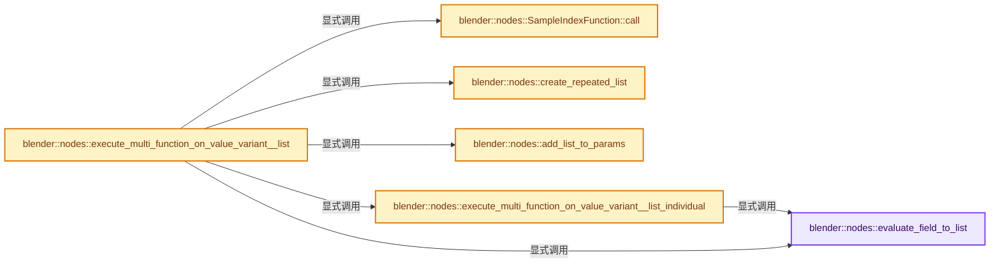

# 实现依赖专题：source/blender/nodes/intern/list_function_eval.cc

[方向导航](README.md) · [符号索引](../%E7%AC%A6%E5%8F%B7%E4%BE%9D%E8%B5%96%E4%B8%8E%E5%AE%9E%E7%8E%B0%E7%B4%A2%E5%BC%95.md)

本专题从正文实际调用进入，集中保存共享实现。函数有稳定锚点，可从调用处直接跳到对应完整函数；递归与互相调用通过回链组织。

## 本文件的实现关系




## 完整成员与函数实现

<a id="f-d3019c5b4e9a3557"></a>

### `blender::nodes::evaluate_field_to_list`

实现位置：[source/blender/nodes/intern/list_function_eval.cc](../../../../../source/blender/nodes/intern/list_function_eval.cc) · L34—L45。

接口参数：

- `GField field`
- `const int64_t count`

**教学注释版**

<!-- annotated:033da8806e4d28 -->

```cpp
GListPtr evaluate_field_to_list(GField field, const int64_t count)
{
  // [讲解] field.cpp_type：取得表达式结果的类型信息。
  const CPPType &cpp_type = field.cpp_type();
  GArray array(cpp_type, count);

  ListFieldContext context{};
  fn::FieldEvaluator evaluator{context, count};
  // [讲解] evaluator.add_with_destination：登记表达式和可选的结果目标。
  evaluator.add_with_destination(std::move(field), array);
  // [讲解] evaluator.evaluate：先确定selection，再求所有输出并回填调用者位置。
  evaluator.evaluate();

  // [讲解] std::move：把表达式转换成可供移动重载选择的值类别；不保证真的移动，不结束源对象寿命，对const值可能选择复制。
  return GList::from_garray(std::move(array));
}
```

<details>
<summary>核对原始源码：source/blender/nodes/intern/list_function_eval.cc · L34—L45</summary>

<!-- original:033da8806e4d28:source/blender/nodes/intern/list_function_eval.cc:34:45 -->

```cpp
GListPtr evaluate_field_to_list(GField field, const int64_t count)
{
  const CPPType &cpp_type = field.cpp_type();
  GArray array(cpp_type, count);

  ListFieldContext context{};
  fn::FieldEvaluator evaluator{context, count};
  evaluator.add_with_destination(std::move(field), array);
  evaluator.evaluate();

  return GList::from_garray(std::move(array));
}
```

</details>

**结果出口**

- `return GList::from_garray(std::move(array));`

**继续追踪实现**

- `field.cpp_type` → [blender::fn::GField::cpp_type · L518](../08-Field%E8%A1%A8%E8%BE%BE%E5%BC%8F%E4%B8%8E%E6%B1%82%E5%80%BC/05-FieldOperation%E8%BF%90%E7%AE%97%E8%8A%82%E7%82%B9.md#f-284e6a7a85c0110e)。
- `evaluator.add_with_destination` → [blender::fn::FieldEvaluator::add_with_destination · L548](../08-Field%E8%A1%A8%E8%BE%BE%E5%BC%8F%E4%B8%8E%E6%B1%82%E5%80%BC/09-%E7%94%9F%E6%88%90Procedure%E4%B8%8E%E6%89%A7%E8%A1%8C.md#f-165e23b00ea43ee4)；[blender::fn::FieldEvaluator::add_with_destination · L556](../08-Field%E8%A1%A8%E8%BE%BE%E5%BC%8F%E4%B8%8E%E6%B1%82%E5%80%BC/09-%E7%94%9F%E6%88%90Procedure%E4%B8%8E%E6%89%A7%E8%A1%8C.md#f-79ade07d74d08d73)；[blender::fn::FieldEvaluator::add_with_destination · L80](../08-Field%E8%A1%A8%E8%BE%BE%E5%BC%8F%E4%B8%8E%E6%B1%82%E5%80%BC/07-FieldEvaluator%E6%8E%A5%E5%8F%A3%E4%B8%8E%E4%BD%BF%E7%94%A8.md#f-3edfceb249cb5cad)；[blender::fn::FieldEvaluator::add_with_destination · L99](../08-Field%E8%A1%A8%E8%BE%BE%E5%BC%8F%E4%B8%8E%E6%B1%82%E5%80%BC/07-FieldEvaluator%E6%8E%A5%E5%8F%A3%E4%B8%8E%E4%BD%BF%E7%94%A8.md#f-03289f589afbd469)。同名重载需按实参类型选择。
- `std::move` → [外部契约](https://eel.is/c++draft/utility.forward)：把表达式转换成可供移动重载选择的值类别；不保证真的移动，不结束源对象寿命，对const值可能选择复制。
- `evaluator.evaluate` → [blender::fn::FieldEvaluator::evaluate · L590](../08-Field%E8%A1%A8%E8%BE%BE%E5%BC%8F%E4%B8%8E%E6%B1%82%E5%80%BC/09-%E7%94%9F%E6%88%90Procedure%E4%B8%8E%E6%89%A7%E8%A1%8C.md#f-d2c4933d17ec204c)。
- `GList::from_garray` → [blender::nodes::GList::from_garray · L268](%E4%BE%9D%E8%B5%96-geometry_nodes_list-6b7d73.md#f-441f4cfe3d661e9d)。

<a id="f-5ccea9fe5283e9cf"></a>

### `blender::nodes::SampleIndexFunction::call`

实现位置：[source/blender/nodes/intern/list_function_eval.cc](../../../../../source/blender/nodes/intern/list_function_eval.cc) · L55—L81。

接口参数：

- `const IndexMask &mask`
- `mf::Params params`
- `mf::Context`

**教学注释版**

<!-- annotated:7632e605654164 -->

```cpp
void SampleIndexFunction::call(const IndexMask &mask,
                               mf::Params params,
                               mf::Context /*context*/) const
{
  const VArraySpan<int> indices = params.readonly_single_input<int>(0, "Index");
  GMutableSpan dst = params.uninitialized_single_output(1, "Value");

  IndexMaskMemory memory;
  const IndexMask valid_indices = array_utils::indices_in_range(
      mask, indices, IndexRange(list_->size()), memory);

  if (valid_indices.size() != mask.size()) {
    const IndexMask invalid_indices = valid_indices.complement(mask, memory);
    list_->cpp_type().fill_construct_indices(
        list_->cpp_type().default_value(), dst.data(), invalid_indices);
  }

  const GList::DataVariant &data = list_->data();
  if (const auto *array_data = std::get_if<nodes::GList::ArrayData>(&data)) {
    const GSpan src(list_->cpp_type(), array_data->data, list_->size());
    valid_indices.foreach_index(
        [&](const int i) { list_->cpp_type().copy_construct(src[indices[i]], dst[i]); });
  }
  else if (const auto *single_data = std::get_if<nodes::GList::SingleData>(&data)) {
    list_->cpp_type().fill_construct_indices(single_data->value, dst.data(), valid_indices);
  }
}
```

<details>
<summary>核对原始源码：source/blender/nodes/intern/list_function_eval.cc · L55—L81</summary>

<!-- original:7632e605654164:source/blender/nodes/intern/list_function_eval.cc:55:81 -->

```cpp
void SampleIndexFunction::call(const IndexMask &mask,
                               mf::Params params,
                               mf::Context /*context*/) const
{
  const VArraySpan<int> indices = params.readonly_single_input<int>(0, "Index");
  GMutableSpan dst = params.uninitialized_single_output(1, "Value");

  IndexMaskMemory memory;
  const IndexMask valid_indices = array_utils::indices_in_range(
      mask, indices, IndexRange(list_->size()), memory);

  if (valid_indices.size() != mask.size()) {
    const IndexMask invalid_indices = valid_indices.complement(mask, memory);
    list_->cpp_type().fill_construct_indices(
        list_->cpp_type().default_value(), dst.data(), invalid_indices);
  }

  const GList::DataVariant &data = list_->data();
  if (const auto *array_data = std::get_if<nodes::GList::ArrayData>(&data)) {
    const GSpan src(list_->cpp_type(), array_data->data, list_->size());
    valid_indices.foreach_index(
        [&](const int i) { list_->cpp_type().copy_construct(src[indices[i]], dst[i]); });
  }
  else if (const auto *single_data = std::get_if<nodes::GList::SingleData>(&data)) {
    list_->cpp_type().fill_construct_indices(single_data->value, dst.data(), valid_indices);
  }
}
```

</details>

**继续追踪实现**

- `params.readonly_single_input<int>` → [blender::fn::multi_function::Params::readonly_single_input · L333](../07-MultiFunction%E4%B8%8E%E6%89%B9%E9%87%8F%E6%89%A7%E8%A1%8C/04-%E5%8F%82%E6%95%B0%E8%AE%BF%E9%97%AE%E4%B8%8E%E8%BE%93%E5%87%BA%E6%9E%84%E9%80%A0.md#f-bf8962325f032689)；[blender::fn::multi_function::Params::readonly_single_input · L340](../07-MultiFunction%E4%B8%8E%E6%89%B9%E9%87%8F%E6%89%A7%E8%A1%8C/04-%E5%8F%82%E6%95%B0%E8%AE%BF%E9%97%AE%E4%B8%8E%E8%BE%93%E5%87%BA%E6%9E%84%E9%80%A0.md#f-fb1c312ddfea5e55)。同名重载需按实参类型选择。
- `params.uninitialized_single_output` → [blender::fn::multi_function::Params::uninitialized_single_output · L352](../07-MultiFunction%E4%B8%8E%E6%89%B9%E9%87%8F%E6%89%A7%E8%A1%8C/04-%E5%8F%82%E6%95%B0%E8%AE%BF%E9%97%AE%E4%B8%8E%E8%BE%93%E5%87%BA%E6%9E%84%E9%80%A0.md#f-80ab080c634045bd)；[blender::fn::multi_function::Params::uninitialized_single_output · L358](../07-MultiFunction%E4%B8%8E%E6%89%B9%E9%87%8F%E6%89%A7%E8%A1%8C/04-%E5%8F%82%E6%95%B0%E8%AE%BF%E9%97%AE%E4%B8%8E%E8%BE%93%E5%87%BA%E6%9E%84%E9%80%A0.md#f-86ca5af9f5eee7ba)。同名重载需按实参类型选择。
- `array_utils::indices_in_range` → [blender::array_utils::indices_in_range · L464](../01-%E5%9F%BA%E7%A1%80%E5%AE%B9%E5%99%A8%E4%B8%8E%E7%8E%B0%E4%BB%A3CPP/%E4%BE%9D%E8%B5%96-array_utils-cbb70f.md#f-007e526f3e906ed1)。
- `IndexRange` → [blender::IndexRange](../01-%E5%9F%BA%E7%A1%80%E5%AE%B9%E5%99%A8%E4%B8%8E%E7%8E%B0%E4%BB%A3CPP/%E4%BE%9D%E8%B5%96-BLI_index_range-7d7cc5.md#t-caa3466d6776)；[blender::gpu::shader::parser::IndexRange](../05-%E5%87%A0%E4%BD%95%E5%AD%98%E5%82%A8%E4%B8%8E%E6%8B%93%E6%89%91%E6%98%A0%E5%B0%84/%E4%BE%9D%E8%B5%96-utils-06433d.md#t-82d2bd4ea71c)；[blender::IndexRange](../05-%E5%87%A0%E4%BD%95%E5%AD%98%E5%82%A8%E4%B8%8E%E6%8B%93%E6%89%91%E6%98%A0%E5%B0%84/%E4%BE%9D%E8%B5%96-DNA_node_types-6708b9.md#t-0448cc889d39)。
- `list_->size` → [调用协议](../%E6%A8%A1%E6%9D%BF%E5%AE%8F%E4%B8%8E%E5%8A%A8%E6%80%81%E5%88%86%E6%B4%BE%E5%8D%8F%E8%AE%AE.md)：接收对象类型依赖auto、返回值或模板实例；不按同名猜测目标。调用位置L64。
- `valid_indices.size` → [blender::index_mask::IndexMask::size · L743](../04-%E8%99%9A%E6%8B%9F%E6%95%B0%E7%BB%84%E4%B8%8E%E7%B4%A2%E5%BC%95%E9%80%89%E6%8B%A9/09-%E5%88%86%E6%AE%B5%E5%AD%98%E5%82%A8%E4%B8%8E%E9%81%8D%E5%8E%86.md#f-0163b32abc9a0d9c)。
- `mask.size` → [blender::index_mask::IndexMask::size · L743](../04-%E8%99%9A%E6%8B%9F%E6%95%B0%E7%BB%84%E4%B8%8E%E7%B4%A2%E5%BC%95%E9%80%89%E6%8B%A9/09-%E5%88%86%E6%AE%B5%E5%AD%98%E5%82%A8%E4%B8%8E%E9%81%8D%E5%8E%86.md#f-0163b32abc9a0d9c)。
- `valid_indices.complement` → [blender::index_mask::IndexMask::complement · L407](../04-%E8%99%9A%E6%8B%9F%E6%95%B0%E7%BB%84%E4%B8%8E%E7%B4%A2%E5%BC%95%E9%80%89%E6%8B%A9/10-IndexMask%E6%9E%84%E5%BB%BA%E4%B8%8E%E5%B9%B6%E8%A1%8C.md#f-1e9932d5baa6f719)。
- `list_->cpp_type().fill_construct_indices` → [调用协议](../%E6%A8%A1%E6%9D%BF%E5%AE%8F%E4%B8%8E%E5%8A%A8%E6%80%81%E5%88%86%E6%B4%BE%E5%8D%8F%E8%AE%AE.md)：接收对象类型依赖auto、返回值或模板实例；不按同名猜测目标。调用位置L68。
- `list_->cpp_type` → [调用协议](../%E6%A8%A1%E6%9D%BF%E5%AE%8F%E4%B8%8E%E5%8A%A8%E6%80%81%E5%88%86%E6%B4%BE%E5%8D%8F%E8%AE%AE.md)：接收对象类型依赖auto、返回值或模板实例；不按同名猜测目标。调用位置L68。
- `list_->cpp_type().default_value` → [调用协议](../%E6%A8%A1%E6%9D%BF%E5%AE%8F%E4%B8%8E%E5%8A%A8%E6%80%81%E5%88%86%E6%B4%BE%E5%8D%8F%E8%AE%AE.md)：接收对象类型依赖auto、返回值或模板实例；不按同名猜测目标。调用位置L69。
- `dst.data` → [blender::GMutableSpan::data · L208](../03-%E5%86%85%E5%AD%98%E5%88%86%E9%85%8D%E4%B8%8E%E8%BF%90%E8%A1%8C%E6%97%B6%E7%B1%BB%E5%9E%8B/11-GSpan%E4%B8%8EGArray.md#f-f951536a0bdbb159)。
- `list_->data` → [调用协议](../%E6%A8%A1%E6%9D%BF%E5%AE%8F%E4%B8%8E%E5%8A%A8%E6%80%81%E5%88%86%E6%B4%BE%E5%8D%8F%E8%AE%AE.md)：接收对象类型依赖auto、返回值或模板实例；不按同名猜测目标。调用位置L72。
- `std::get_if<nodes::GList::ArrayData>` → [外部契约](https://eel.is/c++draft/)：这个边界按实际表达式及所属类型核对参数、返回值、寿命与失败行为。这里提供接口入口，不声称已解释该第三方版本的内部实现。
- `valid_indices.foreach_index` → [blender::index_mask::IndexMask::foreach_index · L855](../04-%E8%99%9A%E6%8B%9F%E6%95%B0%E7%BB%84%E4%B8%8E%E7%B4%A2%E5%BC%95%E9%80%89%E6%8B%A9/09-%E5%88%86%E6%AE%B5%E5%AD%98%E5%82%A8%E4%B8%8E%E9%81%8D%E5%8E%86.md#f-cd6cd317e2e2812c)。
- `list_->cpp_type().copy_construct` → [调用协议](../%E6%A8%A1%E6%9D%BF%E5%AE%8F%E4%B8%8E%E5%8A%A8%E6%80%81%E5%88%86%E6%B4%BE%E5%8D%8F%E8%AE%AE.md)：接收对象类型依赖auto、返回值或模板实例；不按同名猜测目标。调用位置L76。
- `std::get_if<nodes::GList::SingleData>` → [外部契约](https://eel.is/c++draft/)：这个边界按实际表达式及所属类型核对参数、返回值、寿命与失败行为。这里提供接口入口，不声称已解释该第三方版本的内部实现。

<a id="f-42c4d18deefe4730"></a>

### `blender::nodes::create_repeated_list`

实现位置：[source/blender/nodes/intern/list_function_eval.cc](../../../../../source/blender/nodes/intern/list_function_eval.cc) · L90—L117。

接口参数：

- `GListPtr list`
- `const int64_t dst_size`

**教学注释版**

<!-- annotated:ea8198255a666b -->

```cpp
static GListPtr create_repeated_list(GListPtr list, const int64_t dst_size)
{
  if (list->size() >= dst_size) {
    return list;
  }
  if (const auto *data = std::get_if<nodes::GList::ArrayData>(&list->data())) {
    const int64_t size = list->size();
    BLI_assert(size > 0);
    const CPPType &cpp_type = list->cpp_type();
    GArray new_data(cpp_type, dst_size, NoInitialization{});
    const int64_t chunks = dst_size / size;
    for (const int64_t i : IndexRange(chunks)) {
      cpp_type.copy_construct_n(data->data, new_data[i * size], size);
    }
    const int64_t last_chunk_size = dst_size % size;
    if (last_chunk_size > 0) {
      cpp_type.copy_construct_n(data->data, new_data[chunks * size], last_chunk_size);
    }

    // [讲解] std::move：把表达式转换成可供移动重载选择的值类别；不保证真的移动，不结束源对象寿命，对const值可能选择复制。
    return GList::from_garray(std::move(new_data));
  }
  if (const auto *data = std::get_if<nodes::GList::SingleData>(&list->data())) {
    const CPPType &cpp_type = list->cpp_type();
    return GList::create(cpp_type, *data, dst_size);
  }
  BLI_assert_unreachable();
  return {};
}
```

<details>
<summary>核对原始源码：source/blender/nodes/intern/list_function_eval.cc · L90—L117</summary>

<!-- original:ea8198255a666b:source/blender/nodes/intern/list_function_eval.cc:90:117 -->

```cpp
static GListPtr create_repeated_list(GListPtr list, const int64_t dst_size)
{
  if (list->size() >= dst_size) {
    return list;
  }
  if (const auto *data = std::get_if<nodes::GList::ArrayData>(&list->data())) {
    const int64_t size = list->size();
    BLI_assert(size > 0);
    const CPPType &cpp_type = list->cpp_type();
    GArray new_data(cpp_type, dst_size, NoInitialization{});
    const int64_t chunks = dst_size / size;
    for (const int64_t i : IndexRange(chunks)) {
      cpp_type.copy_construct_n(data->data, new_data[i * size], size);
    }
    const int64_t last_chunk_size = dst_size % size;
    if (last_chunk_size > 0) {
      cpp_type.copy_construct_n(data->data, new_data[chunks * size], last_chunk_size);
    }

    return GList::from_garray(std::move(new_data));
  }
  if (const auto *data = std::get_if<nodes::GList::SingleData>(&list->data())) {
    const CPPType &cpp_type = list->cpp_type();
    return GList::create(cpp_type, *data, dst_size);
  }
  BLI_assert_unreachable();
  return {};
}
```

</details>

**结果出口**

- `return list;`
- `return GList::from_garray(std::move(new_data));`
- `return GList::create(cpp_type, *data, dst_size);`
- `return {};`

**继续追踪实现**

- `list->size` → [blender::nodes::GList::size · L223](%E4%BE%9D%E8%B5%96-NOD_geometry_nodes_list-56053f.md#f-e73c9da1d1adc0c8)；[blender::nodes::List<T>::size · L259](%E4%BE%9D%E8%B5%96-NOD_geometry_nodes_list-56053f.md#f-57458be18579d279)；[blender::nodes::Bundle::size · L488](../10-%E5%BC%95%E7%94%A8%E7%94%9F%E5%91%BD%E5%91%A8%E6%9C%9F%E4%B8%8EClosure/%E4%BE%9D%E8%B5%96-NOD_geometry_nodes_bundle-f07f4e.md#f-d8f85104493fc814)。同名重载需按实参类型选择。
- `std::get_if<nodes::GList::ArrayData>` → [外部契约](https://eel.is/c++draft/)：这个边界按实际表达式及所属类型核对参数、返回值、寿命与失败行为。这里提供接口入口，不声称已解释该第三方版本的内部实现。
- `list->data` → [blender::nodes::GList::data · L208](%E4%BE%9D%E8%B5%96-NOD_geometry_nodes_list-56053f.md#f-79596d2a726abf7a)；[blender::nodes::GList::data · L213](%E4%BE%9D%E8%B5%96-NOD_geometry_nodes_list-56053f.md#f-a1564e477ed8318a)；[blender::nodes::List<T>::data · L249](%E4%BE%9D%E8%B5%96-NOD_geometry_nodes_list-56053f.md#f-f05d4d7a5007c920)；[blender::nodes::List<T>::data · L254](%E4%BE%9D%E8%B5%96-NOD_geometry_nodes_list-56053f.md#f-9685f4b6239433b9)。同名重载需按实参类型选择。
- `BLI_assert` → [BLI_assert · L48](../01-%E5%9F%BA%E7%A1%80%E5%AE%B9%E5%99%A8%E4%B8%8E%E7%8E%B0%E4%BB%A3CPP/%E4%BE%9D%E8%B5%96-BLI_assert-cc98e8.md#m-57a88495704d)；[BLI_assert · L63](../01-%E5%9F%BA%E7%A1%80%E5%AE%B9%E5%99%A8%E4%B8%8E%E7%8E%B0%E4%BB%A3CPP/%E4%BE%9D%E8%B5%96-BLI_assert-cc98e8.md#m-d07050020cb5)。宏定义由构建条件选择。
- `list->cpp_type` → [blender::nodes::GList::cpp_type · L218](%E4%BE%9D%E8%B5%96-NOD_geometry_nodes_list-56053f.md#f-c8f69b2e40d6c43b)。
- `IndexRange` → [blender::IndexRange](../01-%E5%9F%BA%E7%A1%80%E5%AE%B9%E5%99%A8%E4%B8%8E%E7%8E%B0%E4%BB%A3CPP/%E4%BE%9D%E8%B5%96-BLI_index_range-7d7cc5.md#t-caa3466d6776)；[blender::gpu::shader::parser::IndexRange](../05-%E5%87%A0%E4%BD%95%E5%AD%98%E5%82%A8%E4%B8%8E%E6%8B%93%E6%89%91%E6%98%A0%E5%B0%84/%E4%BE%9D%E8%B5%96-utils-06433d.md#t-82d2bd4ea71c)；[blender::IndexRange](../05-%E5%87%A0%E4%BD%95%E5%AD%98%E5%82%A8%E4%B8%8E%E6%8B%93%E6%89%91%E6%98%A0%E5%B0%84/%E4%BE%9D%E8%B5%96-DNA_node_types-6708b9.md#t-0448cc889d39)。
- `cpp_type.copy_construct_n` → [blender::CPPType::copy_construct_n · L599](../03-%E5%86%85%E5%AD%98%E5%88%86%E9%85%8D%E4%B8%8E%E8%BF%90%E8%A1%8C%E6%97%B6%E7%B1%BB%E5%9E%8B/09-CPPType%E5%A4%8D%E5%88%B6%E7%A7%BB%E5%8A%A8%E9%87%8D%E5%AE%9A%E4%BD%8D.md#f-3676f00cc2bda6e3)。
- `GList::from_garray` → [blender::nodes::GList::from_garray · L268](%E4%BE%9D%E8%B5%96-geometry_nodes_list-6b7d73.md#f-441f4cfe3d661e9d)。
- `std::move` → [外部契约](https://eel.is/c++draft/utility.forward)：把表达式转换成可供移动重载选择的值类别；不保证真的移动，不结束源对象寿命，对const值可能选择复制。
- `std::get_if<nodes::GList::SingleData>` → [外部契约](https://eel.is/c++draft/)：这个边界按实际表达式及所属类型核对参数、返回值、寿命与失败行为。这里提供接口入口，不声称已解释该第三方版本的内部实现。
- `GList::create` → [blender::nodes::GList::create · L263](%E4%BE%9D%E8%B5%96-geometry_nodes_list-6b7d73.md#f-d98f24446264b506)。
- `BLI_assert_unreachable` → [BLI_assert_unreachable · L77](../01-%E5%9F%BA%E7%A1%80%E5%AE%B9%E5%99%A8%E4%B8%8E%E7%8E%B0%E4%BB%A3CPP/%E4%BE%9D%E8%B5%96-BLI_assert-cc98e8.md#m-7a2d91a67d8e)。宏定义由构建条件选择。

<a id="f-0cdc0e4c35a279b3"></a>

### `blender::nodes::add_list_to_params`

实现位置：[source/blender/nodes/intern/list_function_eval.cc](../../../../../source/blender/nodes/intern/list_function_eval.cc) · L119—L131。

接口参数：

- `mf::ParamsBuilder &params`
- `const mf::ParamType &param_type`
- `const GList &list`

**教学注释版**

<!-- annotated:e0b7a6eed93b82 -->

```cpp
static void add_list_to_params(mf::ParamsBuilder &params,
                               const mf::ParamType &param_type,
                               const GList &list)
{
  const CPPType &cpp_type = param_type.data_type().single_type();
  BLI_assert(cpp_type == list.cpp_type());
  if (const auto *array_data = std::get_if<nodes::GList::ArrayData>(&list.data())) {
    params.add_readonly_single_input(GSpan(cpp_type, array_data->data, list.size()));
  }
  else if (const auto *single_data = std::get_if<nodes::GList::SingleData>(&list.data())) {
    params.add_readonly_single_input(GPointer(cpp_type, single_data->value));
  }
}
```

<details>
<summary>核对原始源码：source/blender/nodes/intern/list_function_eval.cc · L119—L131</summary>

<!-- original:e0b7a6eed93b82:source/blender/nodes/intern/list_function_eval.cc:119:131 -->

```cpp
static void add_list_to_params(mf::ParamsBuilder &params,
                               const mf::ParamType &param_type,
                               const GList &list)
{
  const CPPType &cpp_type = param_type.data_type().single_type();
  BLI_assert(cpp_type == list.cpp_type());
  if (const auto *array_data = std::get_if<nodes::GList::ArrayData>(&list.data())) {
    params.add_readonly_single_input(GSpan(cpp_type, array_data->data, list.size()));
  }
  else if (const auto *single_data = std::get_if<nodes::GList::SingleData>(&list.data())) {
    params.add_readonly_single_input(GPointer(cpp_type, single_data->value));
  }
}
```

</details>

**继续追踪实现**

- `param_type.data_type().single_type` → [调用协议](../%E6%A8%A1%E6%9D%BF%E5%AE%8F%E4%B8%8E%E5%8A%A8%E6%80%81%E5%88%86%E6%B4%BE%E5%8D%8F%E8%AE%AE.md)：接收对象类型依赖auto、返回值或模板实例；不按同名猜测目标。调用位置L123。
- `param_type.data_type` → [blender::fn::multi_function::ParamType::data_type · L113](../07-MultiFunction%E4%B8%8E%E6%89%B9%E9%87%8F%E6%89%A7%E8%A1%8C/03-%E5%8F%82%E6%95%B0%E7%B1%BB%E5%9E%8B%E4%B8%8E%E8%A7%92%E8%89%B2.md#f-b29743877463338d)。
- `BLI_assert` → [BLI_assert · L48](../01-%E5%9F%BA%E7%A1%80%E5%AE%B9%E5%99%A8%E4%B8%8E%E7%8E%B0%E4%BB%A3CPP/%E4%BE%9D%E8%B5%96-BLI_assert-cc98e8.md#m-57a88495704d)；[BLI_assert · L63](../01-%E5%9F%BA%E7%A1%80%E5%AE%B9%E5%99%A8%E4%B8%8E%E7%8E%B0%E4%BB%A3CPP/%E4%BE%9D%E8%B5%96-BLI_assert-cc98e8.md#m-d07050020cb5)。宏定义由构建条件选择。
- `list.cpp_type` → [blender::nodes::GList::cpp_type · L218](%E4%BE%9D%E8%B5%96-NOD_geometry_nodes_list-56053f.md#f-c8f69b2e40d6c43b)。
- `std::get_if<nodes::GList::ArrayData>` → [外部契约](https://eel.is/c++draft/)：这个边界按实际表达式及所属类型核对参数、返回值、寿命与失败行为。这里提供接口入口，不声称已解释该第三方版本的内部实现。
- `list.data` → [blender::nodes::GList::data · L208](%E4%BE%9D%E8%B5%96-NOD_geometry_nodes_list-56053f.md#f-79596d2a726abf7a)；[blender::nodes::GList::data · L213](%E4%BE%9D%E8%B5%96-NOD_geometry_nodes_list-56053f.md#f-a1564e477ed8318a)。同名重载需按实参类型选择。
- `params.add_readonly_single_input` → [blender::fn::multi_function::ParamsBuilder::add_readonly_single_input · L156](../07-MultiFunction%E4%B8%8E%E6%89%B9%E9%87%8F%E6%89%A7%E8%A1%8C/04-%E5%8F%82%E6%95%B0%E8%AE%BF%E9%97%AE%E4%B8%8E%E8%BE%93%E5%87%BA%E6%9E%84%E9%80%A0.md#f-5ef65d99e991c3f8)；[blender::fn::multi_function::ParamsBuilder::add_readonly_single_input · L167](../07-MultiFunction%E4%B8%8E%E6%89%B9%E9%87%8F%E6%89%A7%E8%A1%8C/04-%E5%8F%82%E6%95%B0%E8%AE%BF%E9%97%AE%E4%B8%8E%E8%BE%93%E5%87%BA%E6%9E%84%E9%80%A0.md#f-39d85bcf8f1eb606)；[blender::fn::multi_function::ParamsBuilder::add_readonly_single_input · L174](../07-MultiFunction%E4%B8%8E%E6%89%B9%E9%87%8F%E6%89%A7%E8%A1%8C/04-%E5%8F%82%E6%95%B0%E8%AE%BF%E9%97%AE%E4%B8%8E%E8%BE%93%E5%87%BA%E6%9E%84%E9%80%A0.md#f-b4224f26d95311ed)；[blender::fn::multi_function::ParamsBuilder::add_readonly_single_input · L184](../07-MultiFunction%E4%B8%8E%E6%89%B9%E9%87%8F%E6%89%A7%E8%A1%8C/04-%E5%8F%82%E6%95%B0%E8%AE%BF%E9%97%AE%E4%B8%8E%E8%BE%93%E5%87%BA%E6%9E%84%E9%80%A0.md#f-c9ee081fd1fae167)。同名重载需按实参类型选择。
- `GSpan` → [blender::GSpan::GSpan · L26](../03-%E5%86%85%E5%AD%98%E5%88%86%E9%85%8D%E4%B8%8E%E8%BF%90%E8%A1%8C%E6%97%B6%E7%B1%BB%E5%9E%8B/11-GSpan%E4%B8%8EGArray.md#f-9d0c95702007eea6)；[blender::GSpan::GSpan · L28](../03-%E5%86%85%E5%AD%98%E5%88%86%E9%85%8D%E4%B8%8E%E8%BF%90%E8%A1%8C%E6%97%B6%E7%B1%BB%E5%9E%8B/11-GSpan%E4%B8%8EGArray.md#f-6650bd08c7eecc66)；[blender::GSpan::GSpan · L37](../03-%E5%86%85%E5%AD%98%E5%88%86%E9%85%8D%E4%B8%8E%E8%BF%90%E8%A1%8C%E6%97%B6%E7%B1%BB%E5%9E%8B/11-GSpan%E4%B8%8EGArray.md#f-bf180950832673fb)；[blender::GSpan::GSpan · L39](../03-%E5%86%85%E5%AD%98%E5%88%86%E9%85%8D%E4%B8%8E%E8%BF%90%E8%A1%8C%E6%97%B6%E7%B1%BB%E5%9E%8B/11-GSpan%E4%B8%8EGArray.md#f-cf949d5590ea9ab6)；[blender::GSpan::GSpan · L41](../03-%E5%86%85%E5%AD%98%E5%88%86%E9%85%8D%E4%B8%8E%E8%BF%90%E8%A1%8C%E6%97%B6%E7%B1%BB%E5%9E%8B/11-GSpan%E4%B8%8EGArray.md#f-a66ab52ee0842aee)；[blender::GSpan::GSpan · L43](../03-%E5%86%85%E5%AD%98%E5%88%86%E9%85%8D%E4%B8%8E%E8%BF%90%E8%A1%8C%E6%97%B6%E7%B1%BB%E5%9E%8B/11-GSpan%E4%B8%8EGArray.md#f-d9084fa10964390f)；[blender::GSpan::GSpan · L49](../03-%E5%86%85%E5%AD%98%E5%88%86%E9%85%8D%E4%B8%8E%E8%BF%90%E8%A1%8C%E6%97%B6%E7%B1%BB%E5%9E%8B/11-GSpan%E4%B8%8EGArray.md#f-76e3de3cc3d65761)。同名重载需按实参类型选择。
- `list.size` → [blender::nodes::GList::size · L223](%E4%BE%9D%E8%B5%96-NOD_geometry_nodes_list-56053f.md#f-e73c9da1d1adc0c8)。
- `std::get_if<nodes::GList::SingleData>` → [外部契约](https://eel.is/c++draft/)：这个边界按实际表达式及所属类型核对参数、返回值、寿命与失败行为。这里提供接口入口，不声称已解释该第三方版本的内部实现。
- `GPointer` → [blender::GPointer::GPointer · L93](../03-%E5%86%85%E5%AD%98%E5%88%86%E9%85%8D%E4%B8%8E%E8%BF%90%E8%A1%8C%E6%97%B6%E7%B1%BB%E5%9E%8B/12-%E5%BC%82%E6%9E%84%E5%80%BC%E5%AD%98%E5%82%A8%E5%AE%9E%E6%88%98.md#f-40f7a024c1e541df)；[blender::GPointer::GPointer · L95](../03-%E5%86%85%E5%AD%98%E5%88%86%E9%85%8D%E4%B8%8E%E8%BF%90%E8%A1%8C%E6%97%B6%E7%B1%BB%E5%9E%8B/12-%E5%BC%82%E6%9E%84%E5%80%BC%E5%AD%98%E5%82%A8%E5%AE%9E%E6%88%98.md#f-e981128b9c36f9ef)；[blender::GPointer::GPointer · L97](../03-%E5%86%85%E5%AD%98%E5%88%86%E9%85%8D%E4%B8%8E%E8%BF%90%E8%A1%8C%E6%97%B6%E7%B1%BB%E5%9E%8B/12-%E5%BC%82%E6%9E%84%E5%80%BC%E5%AD%98%E5%82%A8%E5%AE%9E%E6%88%98.md#f-5d3066175455aed0)；[blender::GPointer::GPointer · L103](../03-%E5%86%85%E5%AD%98%E5%88%86%E9%85%8D%E4%B8%8E%E8%BF%90%E8%A1%8C%E6%97%B6%E7%B1%BB%E5%9E%8B/12-%E5%BC%82%E6%9E%84%E5%80%BC%E5%AD%98%E5%82%A8%E5%AE%9E%E6%88%98.md#f-9194d11793ea4a06)；[blender::GPointer::GPointer · L105](../03-%E5%86%85%E5%AD%98%E5%88%86%E9%85%8D%E4%B8%8E%E8%BF%90%E8%A1%8C%E6%97%B6%E7%B1%BB%E5%9E%8B/12-%E5%BC%82%E6%9E%84%E5%80%BC%E5%AD%98%E5%82%A8%E5%AE%9E%E6%88%98.md#f-1a9887b65d37a9ca)。同名重载需按实参类型选择。

<a id="f-f6b4d8308ea3a381"></a>

### `blender::nodes::execute_multi_function_on_value_variant__list_individual`

实现位置：[source/blender/nodes/intern/list_function_eval.cc](../../../../../source/blender/nodes/intern/list_function_eval.cc) · L133—L249。

接口参数：

- `const int64_t output_size`
- `const MultiFunction &fn`
- `const std::shared_ptr<MultiFunction> &owned_fn`
- `const Span<SocketValueVariant *> input_values`
- `const Span<SocketValueVariant *> output_values`
- `GeoNodesUserData *user_data`
- `std::string &r_error_message`

**教学注释版**

<!-- annotated:ef0ad5d4c7efaa -->

```cpp
[[nodiscard]] static bool execute_multi_function_on_value_variant__list_individual(
    const int64_t output_size,
    const MultiFunction &fn,
    const std::shared_ptr<MultiFunction> &owned_fn,
    const Span<SocketValueVariant *> input_values,
    const Span<SocketValueVariant *> output_values,
    GeoNodesUserData *user_data,
    std::string &r_error_message)
{
  /* Prepare output arrays. */
  // [讲解] output_values.size：查询视图长度或生成对应有效索引区间。
  Array<Array<SocketValueVariant>, 8> output_lists(output_values.size());
  // [讲解] output_values.index_range：查询视图长度或生成对应有效索引区间。
  for (const int output_i : output_values.index_range()) {
    output_lists[output_i].reinitialize(output_size);
  }
  /* Evaluate field inputs. */
  Array<GListPtr, 8> fields_as_lists(input_values.size());
  for (const int input_i : input_values.index_range()) {
    const SocketValueVariant &input_variant = *input_values[input_i];
    if (input_variant.is_context_dependent_field()) {
      fields_as_lists[input_i] = evaluate_field_to_list(input_variant.copy_as<fn::GField>(),
                                                        output_size);
    }
  }

  std::atomic<bool> error_occurred = false;
  Mutex error_mutex;

  /* Evaluate each list index individually, potentially in parallel. */
  threading::parallel_for(IndexRange(output_size), 64, [&](const IndexRange range) {
    Array<SocketValueVariant, 8> inputs(input_values.size());
    Array<SocketValueVariant *, 8> input_ptrs(input_values.size());
    for (const int input_i : input_values.index_range()) {
      input_ptrs[input_i] = &inputs[input_i];
    }
    for (const int iter_i : range) {
      if (error_occurred.load()) {
        return;
      }
      /* Prepare inputs. */
      for (const int input_i : input_values.index_range()) {
        const mf::ParamType param_type = fn.param_type(input_i);
        const CPPType &cpp_type = param_type.data_type().single_type();
        const SocketValueVariant &input_variant = *input_values[input_i];
        SocketValueVariant &elem_input = inputs[input_i];

        auto store_default_single = [&]() {
          void *ptr = elem_input.allocate_single(cpp_type);
          cpp_type.copy_construct(cpp_type.default_value(), ptr);
        };

        auto handle_input_list = [&](const GListPtr &list) {
          if (list) {
            if (list->size() == 0) {
              store_default_single();
            }
            else if (list->cpp_type().is<SocketValueVariant>()) {
              elem_input = list->typed<SocketValueVariant>().varray()[iter_i % list->size()];
            }
            else if (list->cpp_type() == cpp_type) {
              void *ptr = elem_input.allocate_single(cpp_type);
              list->varray().get_to_uninitialized(iter_i % list->size(), ptr);
            }
            else {
              store_default_single();
              BLI_assert_unreachable();
            }
          }
          else {
            store_default_single();
          }
        };

        if (input_variant.is_list()) {
          handle_input_list(*input_variant.get_if<GListPtr>());
        }
        else if (input_variant.is_context_dependent_field()) {
          handle_input_list(fields_as_lists[input_i]);
        }
        else if (input_variant.is_single()) {
          elem_input = input_variant;
        }
        else {
          BLI_assert_unreachable();
        }
      }
      Array<SocketValueVariant *, 8> output_ptrs(output_values.size());
      for (const int output_i : output_values.index_range()) {
        if (output_values[output_i]) {
          output_ptrs[output_i] = &output_lists[output_i][iter_i];
        }
        else {
          /* This output is ignored. */
          output_ptrs[output_i] = nullptr;
        }
      }
      std::string sub_error_message;
      if (!execute_multi_function_on_value_variant(
              fn, owned_fn, input_ptrs, output_ptrs, user_data, sub_error_message))
      {
        std::lock_guard lock{error_mutex};
        error_occurred.store(true);
        r_error_message = sub_error_message;
        return;
      }
    }
  });
  if (error_occurred.load()) {
    return false;
  }
  for (const int output_i : output_values.index_range()) {
    if (output_values[output_i]) {
      output_values[output_i]->emplace<GListPtr>(
          // [讲解] std::move：把表达式转换成可供移动重载选择的值类别；不保证真的移动，不结束源对象寿命，对const值可能选择复制。
          GList::from_container(std::move(output_lists[output_i])));
    }
  }
  return true;
}
```

<details>
<summary>核对原始源码：source/blender/nodes/intern/list_function_eval.cc · L133—L249</summary>

<!-- original:ef0ad5d4c7efaa:source/blender/nodes/intern/list_function_eval.cc:133:249 -->

```cpp
[[nodiscard]] static bool execute_multi_function_on_value_variant__list_individual(
    const int64_t output_size,
    const MultiFunction &fn,
    const std::shared_ptr<MultiFunction> &owned_fn,
    const Span<SocketValueVariant *> input_values,
    const Span<SocketValueVariant *> output_values,
    GeoNodesUserData *user_data,
    std::string &r_error_message)
{
  /* Prepare output arrays. */
  Array<Array<SocketValueVariant>, 8> output_lists(output_values.size());
  for (const int output_i : output_values.index_range()) {
    output_lists[output_i].reinitialize(output_size);
  }
  /* Evaluate field inputs. */
  Array<GListPtr, 8> fields_as_lists(input_values.size());
  for (const int input_i : input_values.index_range()) {
    const SocketValueVariant &input_variant = *input_values[input_i];
    if (input_variant.is_context_dependent_field()) {
      fields_as_lists[input_i] = evaluate_field_to_list(input_variant.copy_as<fn::GField>(),
                                                        output_size);
    }
  }

  std::atomic<bool> error_occurred = false;
  Mutex error_mutex;

  /* Evaluate each list index individually, potentially in parallel. */
  threading::parallel_for(IndexRange(output_size), 64, [&](const IndexRange range) {
    Array<SocketValueVariant, 8> inputs(input_values.size());
    Array<SocketValueVariant *, 8> input_ptrs(input_values.size());
    for (const int input_i : input_values.index_range()) {
      input_ptrs[input_i] = &inputs[input_i];
    }
    for (const int iter_i : range) {
      if (error_occurred.load()) {
        return;
      }
      /* Prepare inputs. */
      for (const int input_i : input_values.index_range()) {
        const mf::ParamType param_type = fn.param_type(input_i);
        const CPPType &cpp_type = param_type.data_type().single_type();
        const SocketValueVariant &input_variant = *input_values[input_i];
        SocketValueVariant &elem_input = inputs[input_i];

        auto store_default_single = [&]() {
          void *ptr = elem_input.allocate_single(cpp_type);
          cpp_type.copy_construct(cpp_type.default_value(), ptr);
        };

        auto handle_input_list = [&](const GListPtr &list) {
          if (list) {
            if (list->size() == 0) {
              store_default_single();
            }
            else if (list->cpp_type().is<SocketValueVariant>()) {
              elem_input = list->typed<SocketValueVariant>().varray()[iter_i % list->size()];
            }
            else if (list->cpp_type() == cpp_type) {
              void *ptr = elem_input.allocate_single(cpp_type);
              list->varray().get_to_uninitialized(iter_i % list->size(), ptr);
            }
            else {
              store_default_single();
              BLI_assert_unreachable();
            }
          }
          else {
            store_default_single();
          }
        };

        if (input_variant.is_list()) {
          handle_input_list(*input_variant.get_if<GListPtr>());
        }
        else if (input_variant.is_context_dependent_field()) {
          handle_input_list(fields_as_lists[input_i]);
        }
        else if (input_variant.is_single()) {
          elem_input = input_variant;
        }
        else {
          BLI_assert_unreachable();
        }
      }
      Array<SocketValueVariant *, 8> output_ptrs(output_values.size());
      for (const int output_i : output_values.index_range()) {
        if (output_values[output_i]) {
          output_ptrs[output_i] = &output_lists[output_i][iter_i];
        }
        else {
          /* This output is ignored. */
          output_ptrs[output_i] = nullptr;
        }
      }
      std::string sub_error_message;
      if (!execute_multi_function_on_value_variant(
              fn, owned_fn, input_ptrs, output_ptrs, user_data, sub_error_message))
      {
        std::lock_guard lock{error_mutex};
        error_occurred.store(true);
        r_error_message = sub_error_message;
        return;
      }
    }
  });
  if (error_occurred.load()) {
    return false;
  }
  for (const int output_i : output_values.index_range()) {
    if (output_values[output_i]) {
      output_values[output_i]->emplace<GListPtr>(
          GList::from_container(std::move(output_lists[output_i])));
    }
  }
  return true;
}
```

</details>

**沿实际写入检查状态**

- `fields_as_lists[input_i] = evaluate_field_to_list(input_variant.copy_as<fn::GField>(),`
- `input_ptrs[input_i] = &inputs[input_i];`
- `elem_input = list->typed<SocketValueVariant>().varray()[iter_i % list->size()];`
- `elem_input = input_variant;`
- `output_ptrs[output_i] = &output_lists[output_i][iter_i];`
- `output_ptrs[output_i] = nullptr;`
- `r_error_message = sub_error_message;`

**结果出口**

- `return false;`
- `return true;`

**继续追踪实现**

- `output_values.size` → [blender::Span::size · L256](../01-%E5%9F%BA%E7%A1%80%E5%AE%B9%E5%99%A8%E4%B8%8E%E7%8E%B0%E4%BB%A3CPP/05-Span%E5%8F%AA%E8%AF%BB%E8%BF%9E%E7%BB%AD%E8%A7%86%E5%9B%BE.md#f-5f80fa006089c998)。
- `output_values.index_range` → [blender::Span::index_range · L405](../01-%E5%9F%BA%E7%A1%80%E5%AE%B9%E5%99%A8%E4%B8%8E%E7%8E%B0%E4%BB%A3CPP/05-Span%E5%8F%AA%E8%AF%BB%E8%BF%9E%E7%BB%AD%E8%A7%86%E5%9B%BE.md#f-caaa9b06e13e53e0)。
- `output_lists[output_i].reinitialize` → [调用协议](../%E6%A8%A1%E6%9D%BF%E5%AE%8F%E4%B8%8E%E5%8A%A8%E6%80%81%E5%88%86%E6%B4%BE%E5%8D%8F%E8%AE%AE.md)：接收对象类型依赖auto、返回值或模板实例；不按同名猜测目标。调用位置L145。
- `input_values.size` → [blender::Span::size · L256](../01-%E5%9F%BA%E7%A1%80%E5%AE%B9%E5%99%A8%E4%B8%8E%E7%8E%B0%E4%BB%A3CPP/05-Span%E5%8F%AA%E8%AF%BB%E8%BF%9E%E7%BB%AD%E8%A7%86%E5%9B%BE.md#f-5f80fa006089c998)。
- `input_values.index_range` → [blender::Span::index_range · L405](../01-%E5%9F%BA%E7%A1%80%E5%AE%B9%E5%99%A8%E4%B8%8E%E7%8E%B0%E4%BB%A3CPP/05-Span%E5%8F%AA%E8%AF%BB%E8%BF%9E%E7%BB%AD%E8%A7%86%E5%9B%BE.md#f-caaa9b06e13e53e0)。
- `input_variant.is_context_dependent_field` → [SocketValueVariant::is_context_dependent_field · L534](../05-%E5%87%A0%E4%BD%95%E5%AD%98%E5%82%A8%E4%B8%8E%E6%8B%93%E6%89%91%E6%98%A0%E5%B0%84/%E4%BE%9D%E8%B5%96-node_socket_value-841c72.md#f-55e5e1818d077c80)。
- `evaluate_field_to_list` → [blender::nodes::evaluate_field_to_list · L34](%E4%BE%9D%E8%B5%96-list_function_eval-d4a4cc.md#f-d3019c5b4e9a3557)。
- `input_variant.copy_as<fn::GField>` → [blender::bke::SocketValueVariant::copy_as · L287](../05-%E5%87%A0%E4%BD%95%E5%AD%98%E5%82%A8%E4%B8%8E%E6%8B%93%E6%89%91%E6%98%A0%E5%B0%84/%E4%BE%9D%E8%B5%96-BKE_node_socket_value-24f0e5.md#f-81cc327789815ca1)。
- `threading::parallel_for` → [blender::threading::parallel_for · L68](../11-Depsgraph%E4%B8%8E%E5%B9%B6%E8%A1%8C%E4%BB%BB%E5%8A%A1%E7%B3%BB%E7%BB%9F/07-%E4%BB%BB%E5%8A%A1%E6%B1%A0%E4%B8%8ETBB%E6%8E%A5%E5%85%A5.md#f-838294754c24426c)。
- `IndexRange` → [blender::IndexRange](../01-%E5%9F%BA%E7%A1%80%E5%AE%B9%E5%99%A8%E4%B8%8E%E7%8E%B0%E4%BB%A3CPP/%E4%BE%9D%E8%B5%96-BLI_index_range-7d7cc5.md#t-caa3466d6776)；[blender::gpu::shader::parser::IndexRange](../05-%E5%87%A0%E4%BD%95%E5%AD%98%E5%82%A8%E4%B8%8E%E6%8B%93%E6%89%91%E6%98%A0%E5%B0%84/%E4%BE%9D%E8%B5%96-utils-06433d.md#t-82d2bd4ea71c)；[blender::IndexRange](../05-%E5%87%A0%E4%BD%95%E5%AD%98%E5%82%A8%E4%B8%8E%E6%8B%93%E6%89%91%E6%98%A0%E5%B0%84/%E4%BE%9D%E8%B5%96-DNA_node_types-6708b9.md#t-0448cc889d39)。
- `error_occurred.load` → [外部契约](https://eel.is/c++draft/)：这个边界按实际表达式及所属类型核对参数、返回值、寿命与失败行为。这里提供接口入口，不声称已解释该第三方版本的内部实现。
- `fn.param_type` → [blender::fn::multi_function::MultiFunction::param_type · L72](../07-MultiFunction%E4%B8%8E%E6%89%B9%E9%87%8F%E6%89%A7%E8%A1%8C/01-%E6%89%B9%E9%87%8F%E8%AE%A1%E7%AE%97%E6%A8%A1%E5%9E%8B.md#f-b713a5aeabff53fa)。
- `param_type.data_type().single_type` → [调用协议](../%E6%A8%A1%E6%9D%BF%E5%AE%8F%E4%B8%8E%E5%8A%A8%E6%80%81%E5%88%86%E6%B4%BE%E5%8D%8F%E8%AE%AE.md)：接收对象类型依赖auto、返回值或模板实例；不按同名猜测目标。调用位置L174。
- `param_type.data_type` → [blender::fn::multi_function::ParamType::data_type · L113](../07-MultiFunction%E4%B8%8E%E6%89%B9%E9%87%8F%E6%89%A7%E8%A1%8C/03-%E5%8F%82%E6%95%B0%E7%B1%BB%E5%9E%8B%E4%B8%8E%E8%A7%92%E8%89%B2.md#f-b29743877463338d)。
- `elem_input.allocate_single` → [SocketValueVariant::allocate_single · L496](../05-%E5%87%A0%E4%BD%95%E5%AD%98%E5%82%A8%E4%B8%8E%E6%8B%93%E6%89%91%E6%98%A0%E5%B0%84/%E4%BE%9D%E8%B5%96-node_socket_value-841c72.md#f-937aba1f0ff2c1db)。
- `cpp_type.copy_construct` → [blender::CPPType::copy_construct · L594](../03-%E5%86%85%E5%AD%98%E5%88%86%E9%85%8D%E4%B8%8E%E8%BF%90%E8%A1%8C%E6%97%B6%E7%B1%BB%E5%9E%8B/09-CPPType%E5%A4%8D%E5%88%B6%E7%A7%BB%E5%8A%A8%E9%87%8D%E5%AE%9A%E4%BD%8D.md#f-cfda413a9784073e)。
- `cpp_type.default_value` → [blender::CPPType::default_value · L743](../03-%E5%86%85%E5%AD%98%E5%88%86%E9%85%8D%E4%B8%8E%E8%BF%90%E8%A1%8C%E6%97%B6%E7%B1%BB%E5%9E%8B/09-CPPType%E5%A4%8D%E5%88%B6%E7%A7%BB%E5%8A%A8%E9%87%8D%E5%AE%9A%E4%BD%8D.md#f-95e76cbe74b383e8)。
- `list->size` → [blender::nodes::GList::size · L223](%E4%BE%9D%E8%B5%96-NOD_geometry_nodes_list-56053f.md#f-e73c9da1d1adc0c8)；[blender::nodes::List<T>::size · L259](%E4%BE%9D%E8%B5%96-NOD_geometry_nodes_list-56053f.md#f-57458be18579d279)；[blender::nodes::Bundle::size · L488](../10-%E5%BC%95%E7%94%A8%E7%94%9F%E5%91%BD%E5%91%A8%E6%9C%9F%E4%B8%8EClosure/%E4%BE%9D%E8%B5%96-NOD_geometry_nodes_bundle-f07f4e.md#f-d8f85104493fc814)。同名重载需按实参类型选择。
- `store_default_single` → [调用协议](../%E6%A8%A1%E6%9D%BF%E5%AE%8F%E4%B8%8E%E5%8A%A8%E6%80%81%E5%88%86%E6%B4%BE%E5%8D%8F%E8%AE%AE.md)：局部可调用对象，须结合其初始化与捕获环境。调用位置L186。
- `list->cpp_type().is<SocketValueVariant>` → [调用协议](../%E6%A8%A1%E6%9D%BF%E5%AE%8F%E4%B8%8E%E5%8A%A8%E6%80%81%E5%88%86%E6%B4%BE%E5%8D%8F%E8%AE%AE.md)：接收对象类型依赖auto、返回值或模板实例；不按同名猜测目标。调用位置L188。
- `list->cpp_type` → [blender::nodes::GList::cpp_type · L218](%E4%BE%9D%E8%B5%96-NOD_geometry_nodes_list-56053f.md#f-c8f69b2e40d6c43b)。
- `list->typed<SocketValueVariant>().varray` → [调用协议](../%E6%A8%A1%E6%9D%BF%E5%AE%8F%E4%B8%8E%E5%8A%A8%E6%80%81%E5%88%86%E6%B4%BE%E5%8D%8F%E8%AE%AE.md)：接收对象类型依赖auto、返回值或模板实例；不按同名猜测目标。调用位置L189。
- `list->typed<SocketValueVariant>` → [blender::nodes::GListPtr::typed · L358](%E4%BE%9D%E8%B5%96-NOD_geometry_nodes_list-56053f.md#f-ab9701a956c5f1a3)；[blender::nodes::GListPtr::typed · L365](%E4%BE%9D%E8%B5%96-NOD_geometry_nodes_list-56053f.md#f-405c02d1f7283305)。同名重载需按实参类型选择。
- `list->varray().get_to_uninitialized` → [调用协议](../%E6%A8%A1%E6%9D%BF%E5%AE%8F%E4%B8%8E%E5%8A%A8%E6%80%81%E5%88%86%E6%B4%BE%E5%8D%8F%E8%AE%AE.md)：接收对象类型依赖auto、返回值或模板实例；不按同名猜测目标。调用位置L193。
- `list->varray` → [blender::nodes::GList::varray · L85](%E4%BE%9D%E8%B5%96-geometry_nodes_list-6b7d73.md#f-2abf90eb8a1543ac)。
- `BLI_assert_unreachable` → [BLI_assert_unreachable · L77](../01-%E5%9F%BA%E7%A1%80%E5%AE%B9%E5%99%A8%E4%B8%8E%E7%8E%B0%E4%BB%A3CPP/%E4%BE%9D%E8%B5%96-BLI_assert-cc98e8.md#m-7a2d91a67d8e)。宏定义由构建条件选择。
- `input_variant.is_list` → [SocketValueVariant::is_list · L521](../05-%E5%87%A0%E4%BD%95%E5%AD%98%E5%82%A8%E4%B8%8E%E6%8B%93%E6%89%91%E6%98%A0%E5%B0%84/%E4%BE%9D%E8%B5%96-node_socket_value-841c72.md#f-8ca466804cfc0dfe)。
- `handle_input_list` → [调用协议](../%E6%A8%A1%E6%9D%BF%E5%AE%8F%E4%B8%8E%E5%8A%A8%E6%80%81%E5%88%86%E6%B4%BE%E5%8D%8F%E8%AE%AE.md)：局部可调用对象，须结合其初始化与捕获环境。调用位置L206。
- `input_variant.get_if<GListPtr>` → [blender::bke::SocketValueVariant::get_if · L293](../05-%E5%87%A0%E4%BD%95%E5%AD%98%E5%82%A8%E4%B8%8E%E6%8B%93%E6%89%91%E6%98%A0%E5%B0%84/%E4%BE%9D%E8%B5%96-BKE_node_socket_value-24f0e5.md#f-5744f0088e078efb)；[blender::bke::SocketValueVariant::get_if · L315](../05-%E5%87%A0%E4%BD%95%E5%AD%98%E5%82%A8%E4%B8%8E%E6%8B%93%E6%89%91%E6%98%A0%E5%B0%84/%E4%BE%9D%E8%B5%96-BKE_node_socket_value-24f0e5.md#f-0ee4db24be0746a2)；[blender::bke::SocketValueVariant::get_if · L320](../05-%E5%87%A0%E4%BD%95%E5%AD%98%E5%82%A8%E4%B8%8E%E6%8B%93%E6%89%91%E6%98%A0%E5%B0%84/%E4%BE%9D%E8%B5%96-BKE_node_socket_value-24f0e5.md#f-1e9674022bd220af)；[blender::bke::SocketValueVariant::get_if · L335](../05-%E5%87%A0%E4%BD%95%E5%AD%98%E5%82%A8%E4%B8%8E%E6%8B%93%E6%89%91%E6%98%A0%E5%B0%84/%E4%BE%9D%E8%B5%96-BKE_node_socket_value-24f0e5.md#f-95510bddaf248ec5)。同名重载需按实参类型选择。
- `input_variant.is_single` → [SocketValueVariant::is_single · L501](../05-%E5%87%A0%E4%BD%95%E5%AD%98%E5%82%A8%E4%B8%8E%E6%8B%93%E6%89%91%E6%98%A0%E5%B0%84/%E4%BE%9D%E8%B5%96-node_socket_value-841c72.md#f-305458280511ae60)。
- `execute_multi_function_on_value_variant` → [blender::nodes::execute_multi_function_on_value_variant · L500](09-%E5%87%A0%E4%BD%95%E8%8A%82%E7%82%B9%E5%9B%BE%E6%9E%84%E5%BB%BA%E5%99%A8.md#f-b3bbb9da34c5cb4c)。
- `error_occurred.store` → [外部契约](https://eel.is/c++draft/)：这个边界按实际表达式及所属类型核对参数、返回值、寿命与失败行为。这里提供接口入口，不声称已解释该第三方版本的内部实现。
- `output_values[output_i]->emplace<GListPtr>` → [调用协议](../%E6%A8%A1%E6%9D%BF%E5%AE%8F%E4%B8%8E%E5%8A%A8%E6%80%81%E5%88%86%E6%B4%BE%E5%8D%8F%E8%AE%AE.md)：接收对象类型依赖auto、返回值或模板实例；不按同名猜测目标。调用位置L244。
- `GList::from_container` → [blender::nodes::GList::from_container · L188](%E4%BE%9D%E8%B5%96-NOD_geometry_nodes_list-56053f.md#f-4feea7b3af1d4512)。
- `std::move` → [外部契约](https://eel.is/c++draft/utility.forward)：把表达式转换成可供移动重载选择的值类别；不保证真的移动，不结束源对象寿命，对const值可能选择复制。

<a id="f-023b413e63f13be9"></a>

### `blender::nodes::execute_multi_function_on_value_variant__list`

实现位置：[source/blender/nodes/intern/list_function_eval.cc](../../../../../source/blender/nodes/intern/list_function_eval.cc) · L251—L330。

接口参数：

- `const MultiFunction &fn`
- `const std::shared_ptr<MultiFunction> &owned_fn`
- `const Span<SocketValueVariant *> input_values`
- `const Span<SocketValueVariant *> output_values`
- `GeoNodesUserData *user_data`
- `std::string &r_error_message`

**教学注释版**

<!-- annotated:5421ebd315ef26 -->

```cpp
[[nodiscard]] bool execute_multi_function_on_value_variant__list(
    const MultiFunction &fn,
    const std::shared_ptr<MultiFunction> &owned_fn,
    const Span<SocketValueVariant *> input_values,
    const Span<SocketValueVariant *> output_values,
    GeoNodesUserData *user_data,
    std::string &r_error_message)
{
  int64_t max_size = 0;
  bool evaluate_individual = false;
  // [讲解] input_values.index_range：查询视图长度或生成对应有效索引区间。
  for (const int i : input_values.index_range()) {
    SocketValueVariant &input_variant = *input_values[i];
    const mf::ParamType param_type = fn.param_type(i);
    const CPPType &cpp_type = param_type.data_type().single_type();
    if (input_variant.is_list()) {
      if (GListPtr list = *input_variant.get_if<nodes::GListPtr>()) {
        // [讲解] std::max：按比较关系选取较大值。本讲解中的增长公式同时满足最低请求和几何增长；若保存返回引用，还需注意实参寿命。
        max_size = std::max(max_size, list->size());
        if (list->cpp_type() != cpp_type) {
          evaluate_individual = true;
        }
      }
    }
  }

  if (evaluate_individual) {
    /* Can't use a single MultiFunction evaluation, because a list contains more complex types. */
    return execute_multi_function_on_value_variant__list_individual(
        max_size, fn, owned_fn, input_values, output_values, user_data, r_error_message);
  }

  const IndexMask mask(max_size);
  mf::ParamsBuilder params{fn, &mask};
  mf::ContextBuilder context;
  context.user_data(user_data);

  // [讲解] input_values.size：查询视图长度或生成对应有效索引区间。
  Array<GListPtr, 8> input_lists(input_values.size());
  for (const int i : input_values.index_range()) {
    const mf::ParamType param_type = fn.param_type(params.next_param_index());
    const CPPType &cpp_type = param_type.data_type().single_type();
    SocketValueVariant &input_variant = *input_values[i];
    if (input_variant.is_single()) {
      const void *value = input_variant.get().get();
      params.add_readonly_single_input(GPointer(cpp_type, value));
    }
    else if (input_variant.is_list()) {
      // [讲解] std::move：把表达式转换成可供移动重载选择的值类别；不保证真的移动，不结束源对象寿命，对const值可能选择复制。
      GListPtr list_ptr = std::move(*input_variant.get_if<GListPtr>());
      if (!list_ptr || list_ptr->size() == 0) {
        params.add_readonly_single_input(GPointer(cpp_type, cpp_type.default_value()));
        continue;
      }
      input_lists[i] = create_repeated_list(std::move(list_ptr), max_size);
      add_list_to_params(params, param_type, *input_lists[i]);
    }
    else if (input_variant.is_context_dependent_field()) {
      fn::GField field = std::move(*input_variant.get_if<fn::GField>());
      input_lists[i] = evaluate_field_to_list(std::move(field), max_size);
      add_list_to_params(params, param_type, *input_lists[i]);
    }
    else {
      /* This function should not be called when there are other types like grids in the inputs. */
      BLI_assert_unreachable();
      params.add_readonly_single_input(GPointer(cpp_type, cpp_type.default_value()));
    }
  }
  for (const int i : output_values.index_range()) {
    if (output_values[i] == nullptr) {
      params.add_ignored_single_output("");
      continue;
    }
    SocketValueVariant &output_variant = *output_values[i];
    const mf::ParamType param_type = fn.param_type(params.next_param_index());
    const CPPType &cpp_type = param_type.data_type().single_type();
    GArray array(cpp_type, max_size, NoInitialization{});

    params.add_uninitialized_single_output(GMutableSpan(cpp_type, array.data(), max_size));
    output_variant.emplace<GListPtr>(GList::from_garray(std::move(array)));
  }
  fn.call(mask, params, context);
  return true;
}
```

<details>
<summary>核对原始源码：source/blender/nodes/intern/list_function_eval.cc · L251—L330</summary>

<!-- original:5421ebd315ef26:source/blender/nodes/intern/list_function_eval.cc:251:330 -->

```cpp
[[nodiscard]] bool execute_multi_function_on_value_variant__list(
    const MultiFunction &fn,
    const std::shared_ptr<MultiFunction> &owned_fn,
    const Span<SocketValueVariant *> input_values,
    const Span<SocketValueVariant *> output_values,
    GeoNodesUserData *user_data,
    std::string &r_error_message)
{
  int64_t max_size = 0;
  bool evaluate_individual = false;
  for (const int i : input_values.index_range()) {
    SocketValueVariant &input_variant = *input_values[i];
    const mf::ParamType param_type = fn.param_type(i);
    const CPPType &cpp_type = param_type.data_type().single_type();
    if (input_variant.is_list()) {
      if (GListPtr list = *input_variant.get_if<nodes::GListPtr>()) {
        max_size = std::max(max_size, list->size());
        if (list->cpp_type() != cpp_type) {
          evaluate_individual = true;
        }
      }
    }
  }

  if (evaluate_individual) {
    /* Can't use a single MultiFunction evaluation, because a list contains more complex types. */
    return execute_multi_function_on_value_variant__list_individual(
        max_size, fn, owned_fn, input_values, output_values, user_data, r_error_message);
  }

  const IndexMask mask(max_size);
  mf::ParamsBuilder params{fn, &mask};
  mf::ContextBuilder context;
  context.user_data(user_data);

  Array<GListPtr, 8> input_lists(input_values.size());
  for (const int i : input_values.index_range()) {
    const mf::ParamType param_type = fn.param_type(params.next_param_index());
    const CPPType &cpp_type = param_type.data_type().single_type();
    SocketValueVariant &input_variant = *input_values[i];
    if (input_variant.is_single()) {
      const void *value = input_variant.get().get();
      params.add_readonly_single_input(GPointer(cpp_type, value));
    }
    else if (input_variant.is_list()) {
      GListPtr list_ptr = std::move(*input_variant.get_if<GListPtr>());
      if (!list_ptr || list_ptr->size() == 0) {
        params.add_readonly_single_input(GPointer(cpp_type, cpp_type.default_value()));
        continue;
      }
      input_lists[i] = create_repeated_list(std::move(list_ptr), max_size);
      add_list_to_params(params, param_type, *input_lists[i]);
    }
    else if (input_variant.is_context_dependent_field()) {
      fn::GField field = std::move(*input_variant.get_if<fn::GField>());
      input_lists[i] = evaluate_field_to_list(std::move(field), max_size);
      add_list_to_params(params, param_type, *input_lists[i]);
    }
    else {
      /* This function should not be called when there are other types like grids in the inputs. */
      BLI_assert_unreachable();
      params.add_readonly_single_input(GPointer(cpp_type, cpp_type.default_value()));
    }
  }
  for (const int i : output_values.index_range()) {
    if (output_values[i] == nullptr) {
      params.add_ignored_single_output("");
      continue;
    }
    SocketValueVariant &output_variant = *output_values[i];
    const mf::ParamType param_type = fn.param_type(params.next_param_index());
    const CPPType &cpp_type = param_type.data_type().single_type();
    GArray array(cpp_type, max_size, NoInitialization{});

    params.add_uninitialized_single_output(GMutableSpan(cpp_type, array.data(), max_size));
    output_variant.emplace<GListPtr>(GList::from_garray(std::move(array)));
  }
  fn.call(mask, params, context);
  return true;
}
```

</details>

**沿实际写入检查状态**

- `max_size = std::max(max_size, list->size());`
- `evaluate_individual = true;`
- `input_lists[i] = create_repeated_list(std::move(list_ptr), max_size);`
- `input_lists[i] = evaluate_field_to_list(std::move(field), max_size);`

**结果出口**

- `return execute_multi_function_on_value_variant__list_individual(`
- `return true;`

**继续追踪实现**

- `input_values.index_range` → [blender::Span::index_range · L405](../01-%E5%9F%BA%E7%A1%80%E5%AE%B9%E5%99%A8%E4%B8%8E%E7%8E%B0%E4%BB%A3CPP/05-Span%E5%8F%AA%E8%AF%BB%E8%BF%9E%E7%BB%AD%E8%A7%86%E5%9B%BE.md#f-caaa9b06e13e53e0)。
- `fn.param_type` → [blender::fn::multi_function::MultiFunction::param_type · L72](../07-MultiFunction%E4%B8%8E%E6%89%B9%E9%87%8F%E6%89%A7%E8%A1%8C/01-%E6%89%B9%E9%87%8F%E8%AE%A1%E7%AE%97%E6%A8%A1%E5%9E%8B.md#f-b713a5aeabff53fa)。
- `param_type.data_type().single_type` → [调用协议](../%E6%A8%A1%E6%9D%BF%E5%AE%8F%E4%B8%8E%E5%8A%A8%E6%80%81%E5%88%86%E6%B4%BE%E5%8D%8F%E8%AE%AE.md)：接收对象类型依赖auto、返回值或模板实例；不按同名猜测目标。调用位置L264。
- `param_type.data_type` → [blender::fn::multi_function::ParamType::data_type · L113](../07-MultiFunction%E4%B8%8E%E6%89%B9%E9%87%8F%E6%89%A7%E8%A1%8C/03-%E5%8F%82%E6%95%B0%E7%B1%BB%E5%9E%8B%E4%B8%8E%E8%A7%92%E8%89%B2.md#f-b29743877463338d)。
- `input_variant.is_list` → [SocketValueVariant::is_list · L521](../05-%E5%87%A0%E4%BD%95%E5%AD%98%E5%82%A8%E4%B8%8E%E6%8B%93%E6%89%91%E6%98%A0%E5%B0%84/%E4%BE%9D%E8%B5%96-node_socket_value-841c72.md#f-8ca466804cfc0dfe)。
- `input_variant.get_if<nodes::GListPtr>` → [blender::bke::SocketValueVariant::get_if · L293](../05-%E5%87%A0%E4%BD%95%E5%AD%98%E5%82%A8%E4%B8%8E%E6%8B%93%E6%89%91%E6%98%A0%E5%B0%84/%E4%BE%9D%E8%B5%96-BKE_node_socket_value-24f0e5.md#f-5744f0088e078efb)；[blender::bke::SocketValueVariant::get_if · L315](../05-%E5%87%A0%E4%BD%95%E5%AD%98%E5%82%A8%E4%B8%8E%E6%8B%93%E6%89%91%E6%98%A0%E5%B0%84/%E4%BE%9D%E8%B5%96-BKE_node_socket_value-24f0e5.md#f-0ee4db24be0746a2)；[blender::bke::SocketValueVariant::get_if · L320](../05-%E5%87%A0%E4%BD%95%E5%AD%98%E5%82%A8%E4%B8%8E%E6%8B%93%E6%89%91%E6%98%A0%E5%B0%84/%E4%BE%9D%E8%B5%96-BKE_node_socket_value-24f0e5.md#f-1e9674022bd220af)；[blender::bke::SocketValueVariant::get_if · L335](../05-%E5%87%A0%E4%BD%95%E5%AD%98%E5%82%A8%E4%B8%8E%E6%8B%93%E6%89%91%E6%98%A0%E5%B0%84/%E4%BE%9D%E8%B5%96-BKE_node_socket_value-24f0e5.md#f-95510bddaf248ec5)。同名重载需按实参类型选择。
- `std::max` → [外部契约](https://eel.is/c++draft/alg.min.max)：按比较关系选取较大值。本讲解中的增长公式同时满足最低请求和几何增长；若保存返回引用，还需注意实参寿命。
- `list->size` → [blender::nodes::GList::size · L223](%E4%BE%9D%E8%B5%96-NOD_geometry_nodes_list-56053f.md#f-e73c9da1d1adc0c8)；[blender::nodes::List<T>::size · L259](%E4%BE%9D%E8%B5%96-NOD_geometry_nodes_list-56053f.md#f-57458be18579d279)；[blender::nodes::Bundle::size · L488](../10-%E5%BC%95%E7%94%A8%E7%94%9F%E5%91%BD%E5%91%A8%E6%9C%9F%E4%B8%8EClosure/%E4%BE%9D%E8%B5%96-NOD_geometry_nodes_bundle-f07f4e.md#f-d8f85104493fc814)。同名重载需按实参类型选择。
- `list->cpp_type` → [blender::nodes::GList::cpp_type · L218](%E4%BE%9D%E8%B5%96-NOD_geometry_nodes_list-56053f.md#f-c8f69b2e40d6c43b)。
- `execute_multi_function_on_value_variant__list_individual` → [blender::nodes::execute_multi_function_on_value_variant__list_individual · L133](%E4%BE%9D%E8%B5%96-list_function_eval-d4a4cc.md#f-f6b4d8308ea3a381)。
- `context.user_data` → [blender::fn::multi_function::ContextBuilder::user_data · L47](../07-MultiFunction%E4%B8%8E%E6%89%B9%E9%87%8F%E6%89%A7%E8%A1%8C/05-Context%E4%B8%8E%E4%B8%B4%E6%97%B6%E8%B5%84%E6%BA%90.md#f-7723407b01c60bdb)。
- `input_values.size` → [blender::Span::size · L256](../01-%E5%9F%BA%E7%A1%80%E5%AE%B9%E5%99%A8%E4%B8%8E%E7%8E%B0%E4%BB%A3CPP/05-Span%E5%8F%AA%E8%AF%BB%E8%BF%9E%E7%BB%AD%E8%A7%86%E5%9B%BE.md#f-5f80fa006089c998)。
- `params.next_param_index` → [blender::fn::multi_function::ParamsBuilder::next_param_index · L269](../07-MultiFunction%E4%B8%8E%E6%89%B9%E9%87%8F%E6%89%A7%E8%A1%8C/04-%E5%8F%82%E6%95%B0%E8%AE%BF%E9%97%AE%E4%B8%8E%E8%BE%93%E5%87%BA%E6%9E%84%E9%80%A0.md#f-0dab30db67991fa9)。
- `input_variant.is_single` → [SocketValueVariant::is_single · L501](../05-%E5%87%A0%E4%BD%95%E5%AD%98%E5%82%A8%E4%B8%8E%E6%8B%93%E6%89%91%E6%98%A0%E5%B0%84/%E4%BE%9D%E8%B5%96-node_socket_value-841c72.md#f-305458280511ae60)。
- `input_variant.get().get` → [调用协议](../%E6%A8%A1%E6%9D%BF%E5%AE%8F%E4%B8%8E%E5%8A%A8%E6%80%81%E5%88%86%E6%B4%BE%E5%8D%8F%E8%AE%AE.md)：接收对象类型依赖auto、返回值或模板实例；不按同名猜测目标。调用位置L292。
- `input_variant.get` → [blender::bke::SocketValueVariant::get · L340](../05-%E5%87%A0%E4%BD%95%E5%AD%98%E5%82%A8%E4%B8%8E%E6%8B%93%E6%89%91%E6%98%A0%E5%B0%84/%E4%BE%9D%E8%B5%96-BKE_node_socket_value-24f0e5.md#f-44fd803c51c13447)；[blender::bke::SocketValueVariant::get · L349](../05-%E5%87%A0%E4%BD%95%E5%AD%98%E5%82%A8%E4%B8%8E%E6%8B%93%E6%89%91%E6%98%A0%E5%B0%84/%E4%BE%9D%E8%B5%96-BKE_node_socket_value-24f0e5.md#f-c63e6331bfae49c4)。同名重载需按实参类型选择。
- `params.add_readonly_single_input` → [blender::fn::multi_function::ParamsBuilder::add_readonly_single_input · L156](../07-MultiFunction%E4%B8%8E%E6%89%B9%E9%87%8F%E6%89%A7%E8%A1%8C/04-%E5%8F%82%E6%95%B0%E8%AE%BF%E9%97%AE%E4%B8%8E%E8%BE%93%E5%87%BA%E6%9E%84%E9%80%A0.md#f-5ef65d99e991c3f8)；[blender::fn::multi_function::ParamsBuilder::add_readonly_single_input · L167](../07-MultiFunction%E4%B8%8E%E6%89%B9%E9%87%8F%E6%89%A7%E8%A1%8C/04-%E5%8F%82%E6%95%B0%E8%AE%BF%E9%97%AE%E4%B8%8E%E8%BE%93%E5%87%BA%E6%9E%84%E9%80%A0.md#f-39d85bcf8f1eb606)；[blender::fn::multi_function::ParamsBuilder::add_readonly_single_input · L174](../07-MultiFunction%E4%B8%8E%E6%89%B9%E9%87%8F%E6%89%A7%E8%A1%8C/04-%E5%8F%82%E6%95%B0%E8%AE%BF%E9%97%AE%E4%B8%8E%E8%BE%93%E5%87%BA%E6%9E%84%E9%80%A0.md#f-b4224f26d95311ed)；[blender::fn::multi_function::ParamsBuilder::add_readonly_single_input · L184](../07-MultiFunction%E4%B8%8E%E6%89%B9%E9%87%8F%E6%89%A7%E8%A1%8C/04-%E5%8F%82%E6%95%B0%E8%AE%BF%E9%97%AE%E4%B8%8E%E8%BE%93%E5%87%BA%E6%9E%84%E9%80%A0.md#f-c9ee081fd1fae167)。同名重载需按实参类型选择。
- `GPointer` → [blender::GPointer::GPointer · L93](../03-%E5%86%85%E5%AD%98%E5%88%86%E9%85%8D%E4%B8%8E%E8%BF%90%E8%A1%8C%E6%97%B6%E7%B1%BB%E5%9E%8B/12-%E5%BC%82%E6%9E%84%E5%80%BC%E5%AD%98%E5%82%A8%E5%AE%9E%E6%88%98.md#f-40f7a024c1e541df)；[blender::GPointer::GPointer · L95](../03-%E5%86%85%E5%AD%98%E5%88%86%E9%85%8D%E4%B8%8E%E8%BF%90%E8%A1%8C%E6%97%B6%E7%B1%BB%E5%9E%8B/12-%E5%BC%82%E6%9E%84%E5%80%BC%E5%AD%98%E5%82%A8%E5%AE%9E%E6%88%98.md#f-e981128b9c36f9ef)；[blender::GPointer::GPointer · L97](../03-%E5%86%85%E5%AD%98%E5%88%86%E9%85%8D%E4%B8%8E%E8%BF%90%E8%A1%8C%E6%97%B6%E7%B1%BB%E5%9E%8B/12-%E5%BC%82%E6%9E%84%E5%80%BC%E5%AD%98%E5%82%A8%E5%AE%9E%E6%88%98.md#f-5d3066175455aed0)；[blender::GPointer::GPointer · L103](../03-%E5%86%85%E5%AD%98%E5%88%86%E9%85%8D%E4%B8%8E%E8%BF%90%E8%A1%8C%E6%97%B6%E7%B1%BB%E5%9E%8B/12-%E5%BC%82%E6%9E%84%E5%80%BC%E5%AD%98%E5%82%A8%E5%AE%9E%E6%88%98.md#f-9194d11793ea4a06)；[blender::GPointer::GPointer · L105](../03-%E5%86%85%E5%AD%98%E5%88%86%E9%85%8D%E4%B8%8E%E8%BF%90%E8%A1%8C%E6%97%B6%E7%B1%BB%E5%9E%8B/12-%E5%BC%82%E6%9E%84%E5%80%BC%E5%AD%98%E5%82%A8%E5%AE%9E%E6%88%98.md#f-1a9887b65d37a9ca)。同名重载需按实参类型选择。
- `std::move` → [外部契约](https://eel.is/c++draft/utility.forward)：把表达式转换成可供移动重载选择的值类别；不保证真的移动，不结束源对象寿命，对const值可能选择复制。
- `input_variant.get_if<GListPtr>` → [blender::bke::SocketValueVariant::get_if · L293](../05-%E5%87%A0%E4%BD%95%E5%AD%98%E5%82%A8%E4%B8%8E%E6%8B%93%E6%89%91%E6%98%A0%E5%B0%84/%E4%BE%9D%E8%B5%96-BKE_node_socket_value-24f0e5.md#f-5744f0088e078efb)；[blender::bke::SocketValueVariant::get_if · L315](../05-%E5%87%A0%E4%BD%95%E5%AD%98%E5%82%A8%E4%B8%8E%E6%8B%93%E6%89%91%E6%98%A0%E5%B0%84/%E4%BE%9D%E8%B5%96-BKE_node_socket_value-24f0e5.md#f-0ee4db24be0746a2)；[blender::bke::SocketValueVariant::get_if · L320](../05-%E5%87%A0%E4%BD%95%E5%AD%98%E5%82%A8%E4%B8%8E%E6%8B%93%E6%89%91%E6%98%A0%E5%B0%84/%E4%BE%9D%E8%B5%96-BKE_node_socket_value-24f0e5.md#f-1e9674022bd220af)；[blender::bke::SocketValueVariant::get_if · L335](../05-%E5%87%A0%E4%BD%95%E5%AD%98%E5%82%A8%E4%B8%8E%E6%8B%93%E6%89%91%E6%98%A0%E5%B0%84/%E4%BE%9D%E8%B5%96-BKE_node_socket_value-24f0e5.md#f-95510bddaf248ec5)。同名重载需按实参类型选择。
- `list_ptr->size` → [blender::nodes::GList::size · L223](%E4%BE%9D%E8%B5%96-NOD_geometry_nodes_list-56053f.md#f-e73c9da1d1adc0c8)；[blender::nodes::List<T>::size · L259](%E4%BE%9D%E8%B5%96-NOD_geometry_nodes_list-56053f.md#f-57458be18579d279)；[blender::nodes::Bundle::size · L488](../10-%E5%BC%95%E7%94%A8%E7%94%9F%E5%91%BD%E5%91%A8%E6%9C%9F%E4%B8%8EClosure/%E4%BE%9D%E8%B5%96-NOD_geometry_nodes_bundle-f07f4e.md#f-d8f85104493fc814)。同名重载需按实参类型选择。
- `cpp_type.default_value` → [blender::CPPType::default_value · L743](../03-%E5%86%85%E5%AD%98%E5%88%86%E9%85%8D%E4%B8%8E%E8%BF%90%E8%A1%8C%E6%97%B6%E7%B1%BB%E5%9E%8B/09-CPPType%E5%A4%8D%E5%88%B6%E7%A7%BB%E5%8A%A8%E9%87%8D%E5%AE%9A%E4%BD%8D.md#f-95e76cbe74b383e8)。
- `create_repeated_list` → [blender::nodes::create_repeated_list · L90](%E4%BE%9D%E8%B5%96-list_function_eval-d4a4cc.md#f-42c4d18deefe4730)。
- `add_list_to_params` → [blender::nodes::add_list_to_params · L119](%E4%BE%9D%E8%B5%96-list_function_eval-d4a4cc.md#f-0cdc0e4c35a279b3)。
- `input_variant.is_context_dependent_field` → [SocketValueVariant::is_context_dependent_field · L534](../05-%E5%87%A0%E4%BD%95%E5%AD%98%E5%82%A8%E4%B8%8E%E6%8B%93%E6%89%91%E6%98%A0%E5%B0%84/%E4%BE%9D%E8%B5%96-node_socket_value-841c72.md#f-55e5e1818d077c80)。
- `input_variant.get_if<fn::GField>` → [blender::bke::SocketValueVariant::get_if · L293](../05-%E5%87%A0%E4%BD%95%E5%AD%98%E5%82%A8%E4%B8%8E%E6%8B%93%E6%89%91%E6%98%A0%E5%B0%84/%E4%BE%9D%E8%B5%96-BKE_node_socket_value-24f0e5.md#f-5744f0088e078efb)；[blender::bke::SocketValueVariant::get_if · L315](../05-%E5%87%A0%E4%BD%95%E5%AD%98%E5%82%A8%E4%B8%8E%E6%8B%93%E6%89%91%E6%98%A0%E5%B0%84/%E4%BE%9D%E8%B5%96-BKE_node_socket_value-24f0e5.md#f-0ee4db24be0746a2)；[blender::bke::SocketValueVariant::get_if · L320](../05-%E5%87%A0%E4%BD%95%E5%AD%98%E5%82%A8%E4%B8%8E%E6%8B%93%E6%89%91%E6%98%A0%E5%B0%84/%E4%BE%9D%E8%B5%96-BKE_node_socket_value-24f0e5.md#f-1e9674022bd220af)；[blender::bke::SocketValueVariant::get_if · L335](../05-%E5%87%A0%E4%BD%95%E5%AD%98%E5%82%A8%E4%B8%8E%E6%8B%93%E6%89%91%E6%98%A0%E5%B0%84/%E4%BE%9D%E8%B5%96-BKE_node_socket_value-24f0e5.md#f-95510bddaf248ec5)。同名重载需按实参类型选择。
- `evaluate_field_to_list` → [blender::nodes::evaluate_field_to_list · L34](%E4%BE%9D%E8%B5%96-list_function_eval-d4a4cc.md#f-d3019c5b4e9a3557)。
- `BLI_assert_unreachable` → [BLI_assert_unreachable · L77](../01-%E5%9F%BA%E7%A1%80%E5%AE%B9%E5%99%A8%E4%B8%8E%E7%8E%B0%E4%BB%A3CPP/%E4%BE%9D%E8%B5%96-BLI_assert-cc98e8.md#m-7a2d91a67d8e)。宏定义由构建条件选择。
- `output_values.index_range` → [blender::Span::index_range · L405](../01-%E5%9F%BA%E7%A1%80%E5%AE%B9%E5%99%A8%E4%B8%8E%E7%8E%B0%E4%BB%A3CPP/05-Span%E5%8F%AA%E8%AF%BB%E8%BF%9E%E7%BB%AD%E8%A7%86%E5%9B%BE.md#f-caaa9b06e13e53e0)。
- `params.add_ignored_single_output` → [blender::fn::multi_function::ParamsBuilder::add_ignored_single_output · L229](../07-MultiFunction%E4%B8%8E%E6%89%B9%E9%87%8F%E6%89%A7%E8%A1%8C/04-%E5%8F%82%E6%95%B0%E8%AE%BF%E9%97%AE%E4%B8%8E%E8%BE%93%E5%87%BA%E6%9E%84%E9%80%A0.md#f-1c7fc6f769a09e79)。
- `params.add_uninitialized_single_output` → [blender::fn::multi_function::ParamsBuilder::add_uninitialized_single_output · L215](../07-MultiFunction%E4%B8%8E%E6%89%B9%E9%87%8F%E6%89%A7%E8%A1%8C/04-%E5%8F%82%E6%95%B0%E8%AE%BF%E9%97%AE%E4%B8%8E%E8%BE%93%E5%87%BA%E6%9E%84%E9%80%A0.md#f-1faa1a496d7da36b)；[blender::fn::multi_function::ParamsBuilder::add_uninitialized_single_output · L221](../07-MultiFunction%E4%B8%8E%E6%89%B9%E9%87%8F%E6%89%A7%E8%A1%8C/04-%E5%8F%82%E6%95%B0%E8%AE%BF%E9%97%AE%E4%B8%8E%E8%BE%93%E5%87%BA%E6%9E%84%E9%80%A0.md#f-1466d69a4fff0159)。同名重载需按实参类型选择。
- `GMutableSpan` → [blender::GMutableSpan::GMutableSpan · L152](../03-%E5%86%85%E5%AD%98%E5%88%86%E9%85%8D%E4%B8%8E%E8%BF%90%E8%A1%8C%E6%97%B6%E7%B1%BB%E5%9E%8B/11-GSpan%E4%B8%8EGArray.md#f-b4ef5399177eeedd)；[blender::GMutableSpan::GMutableSpan · L154](../03-%E5%86%85%E5%AD%98%E5%88%86%E9%85%8D%E4%B8%8E%E8%BF%90%E8%A1%8C%E6%97%B6%E7%B1%BB%E5%9E%8B/11-GSpan%E4%B8%8EGArray.md#f-6439a40f33c7a2e5)；[blender::GMutableSpan::GMutableSpan · L163](../03-%E5%86%85%E5%AD%98%E5%88%86%E9%85%8D%E4%B8%8E%E8%BF%90%E8%A1%8C%E6%97%B6%E7%B1%BB%E5%9E%8B/11-GSpan%E4%B8%8EGArray.md#f-6054339faadc1405)；[blender::GMutableSpan::GMutableSpan · L167](../03-%E5%86%85%E5%AD%98%E5%88%86%E9%85%8D%E4%B8%8E%E8%BF%90%E8%A1%8C%E6%97%B6%E7%B1%BB%E5%9E%8B/11-GSpan%E4%B8%8EGArray.md#f-d1333b42c7982310)；[blender::GMutableSpan::GMutableSpan · L169](../03-%E5%86%85%E5%AD%98%E5%88%86%E9%85%8D%E4%B8%8E%E8%BF%90%E8%A1%8C%E6%97%B6%E7%B1%BB%E5%9E%8B/11-GSpan%E4%B8%8EGArray.md#f-3584f997d0fe9a96)；[blender::GMutableSpan::GMutableSpan · L171](../03-%E5%86%85%E5%AD%98%E5%88%86%E9%85%8D%E4%B8%8E%E8%BF%90%E8%A1%8C%E6%97%B6%E7%B1%BB%E5%9E%8B/11-GSpan%E4%B8%8EGArray.md#f-3074afdbe5232417)。同名重载需按实参类型选择。
- `array.data` → [blender::GArray::data · L160](../03-%E5%86%85%E5%AD%98%E5%88%86%E9%85%8D%E4%B8%8E%E8%BF%90%E8%A1%8C%E6%97%B6%E7%B1%BB%E5%9E%8B/11-GSpan%E4%B8%8EGArray.md#f-fe965f44840f15ac)；[blender::GArray::data · L164](../03-%E5%86%85%E5%AD%98%E5%88%86%E9%85%8D%E4%B8%8E%E8%BF%90%E8%A1%8C%E6%97%B6%E7%B1%BB%E5%9E%8B/11-GSpan%E4%B8%8EGArray.md#f-831c5c3abf4c5711)。同名重载需按实参类型选择。
- `output_variant.emplace<GListPtr>` → [blender::bke::SocketValueVariant::emplace · L227](../05-%E5%87%A0%E4%BD%95%E5%AD%98%E5%82%A8%E4%B8%8E%E6%8B%93%E6%89%91%E6%98%A0%E5%B0%84/%E4%BE%9D%E8%B5%96-BKE_node_socket_value-24f0e5.md#f-b1c23f5500ae1b73)。
- `GList::from_garray` → [blender::nodes::GList::from_garray · L268](%E4%BE%9D%E8%B5%96-geometry_nodes_list-6b7d73.md#f-441f4cfe3d661e9d)。
- `fn.call` → [blender::nodes::SampleIndexFunction::call · L55](%E4%BE%9D%E8%B5%96-list_function_eval-d4a4cc.md#f-5ccea9fe5283e9cf)。
