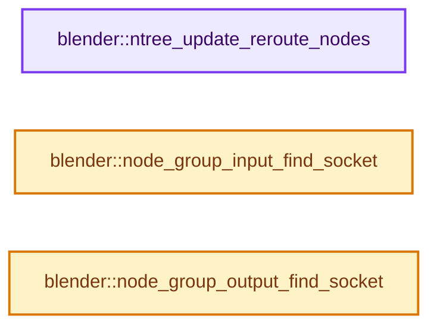

# 实现依赖专题：source/blender/nodes/intern/node_common.cc

[方向导航](README.md) · [符号索引](../%E7%AC%A6%E5%8F%B7%E4%BE%9D%E8%B5%96%E4%B8%8E%E5%AE%9E%E7%8E%B0%E7%B4%A2%E5%BC%95.md)

本专题从正文实际调用进入，集中保存共享实现。函数有稳定锚点，可从调用处直接跳到对应完整函数；递归与互相调用通过回链组织。

## 本文件的实现关系




## 完整成员与函数实现

<a id="f-ba6be3d156feb4a5"></a>

### `blender::ntree_update_reroute_nodes`

实现位置：[source/blender/nodes/intern/node_common.cc](../../../../../source/blender/nodes/intern/node_common.cc) · L685—L799。

接口参数：

- `bNodeTree *ntree`

**教学注释版**

<!-- annotated:20bd76bf857ede -->

```cpp
void ntree_update_reroute_nodes(bNodeTree *ntree)
{
  ntree->ensure_topology_cache();

  const Span<bNode *> all_reroute_nodes = ntree->nodes_by_type("NodeReroute"_ustr);

  VectorSet<int> reroute_nodes;
  for (const bNode *reroute : all_reroute_nodes) {
    // [讲解] reroute_nodes.add：按哈希与相等关系加入键或键值。
    reroute_nodes.add(reroute->index());
  }

  /* Any reroute can be connected only to one source, or can be not connected at all.
   * So reroute forms a trees. It is possible that there will be cycle, but such cycle
   * can be only one in strongly connected set of reroutes. To propagate a types from
   * some certain target to all the reroutes in such a tree we need to know all such
   * a trees and all possible targets for each tree. */
  // [讲解] reroute_nodes.size：查询活项数量或键是否存在。
  DisjointSet reroutes_groups(reroute_nodes.size());

  for (const bNode *src_reroute : all_reroute_nodes) {
    const int src_reroute_i = reroute_nodes.index_of(src_reroute->index());
    for (const bNodeSocket *dst_socket :
         src_reroute->output_sockets().first()->directly_linked_sockets())
    {
      const bNode &dst_node = dst_socket->owner_node();
      if (!dst_node.is_reroute()) {
        continue;
      }
      const int dst_reroute_i = reroute_nodes.index_of(dst_node.index());
      reroutes_groups.join(src_reroute_i, dst_reroute_i);
    }
  }

  VectorSet<int> reroute_groups;
  for (const int reroute_i : reroute_nodes.index_range()) {
    const int root_reroute_i = reroutes_groups.find_root(reroute_i);
    reroute_groups.add(root_reroute_i);
  }

  /* Any reroute can have only one source and many destination targets. Type propagation considers
   * source as target with highest priority. */
  Array<const bke::bNodeSocketType *> dst_type_by_reroute_group(reroute_groups.size(), nullptr);
  Array<const bke::bNodeSocketType *> src_type_by_reroute_group(reroute_groups.size(), nullptr);

  /* Reroute type priority based on the indices of target sockets in the node and the nodes in the
   * tree. */
  Array<RerouteTargetPriority> reroute_group_dst_type_priority(reroute_groups.size(),
                                                               RerouteTargetPriority{});

  for (const bNodeLink *link : ntree->all_links()) {
    const bNode *src_node = link->fromnode;
    const bNode *dst_node = link->tonode;

    if (src_node->is_reroute() == dst_node->is_reroute()) {
      continue;
    }

    if (!dst_node->is_reroute()) {
      const int src_reroute_i = reroute_nodes.index_of(src_node->index());
      const int src_reroute_root_i = reroutes_groups.find_root(src_reroute_i);
      const int src_reroute_group_i = reroute_groups.index_of(src_reroute_root_i);

      const RerouteTargetPriority type_priority(*link->tosock);
      if (reroute_group_dst_type_priority[src_reroute_group_i] > type_priority) {
        continue;
      }

      reroute_group_dst_type_priority[src_reroute_group_i] = type_priority;

      const bNodeSocket *dst_socket = link->tosock;
      /* There could be a function which will choose best from
       * #dst_type_by_reroute_group and #dst_socket, but right now this match behavior as-is. */
      dst_type_by_reroute_group[src_reroute_group_i] = dst_socket->typeinfo;
      continue;
    }

    BLI_assert(!src_node->is_reroute());
    const int dst_reroute_i = reroute_nodes.index_of(dst_node->index());
    const int dst_reroute_root_i = reroutes_groups.find_root(dst_reroute_i);
    const int dst_reroute_group_i = reroute_groups.index_of(dst_reroute_root_i);

    const bNodeSocket *src_socket = link->fromsock;
    /* There could be a function which will choose best from
     * #src_type_by_reroute_group and #src_socket, but right now this match behavior as-is. */
    src_type_by_reroute_group[dst_reroute_group_i] = src_socket->typeinfo;
  }

  const Span<bNode *> all_nodes = ntree->all_nodes();
  for (const int reroute_i : reroute_nodes.index_range()) {
    const int reroute_root_i = reroutes_groups.find_root(reroute_i);
    const int reroute_group_i = reroute_groups.index_of(reroute_root_i);

    const bke::bNodeSocketType *reroute_type = nullptr;
    if (dst_type_by_reroute_group[reroute_group_i] != nullptr) {
      reroute_type = dst_type_by_reroute_group[reroute_group_i];
    }
    if (src_type_by_reroute_group[reroute_group_i] != nullptr) {
      reroute_type = src_type_by_reroute_group[reroute_group_i];
    }

    if (reroute_type == nullptr) {
      const int root_node_index = reroute_nodes[reroute_root_i];
      const bNode &root_reroute = *all_nodes[root_node_index];
      const bNodeSocket *root_socket = root_reroute.inputs.first();
      reroute_type = root_socket->typeinfo;
    }

    const int reroute_index = reroute_nodes[reroute_i];
    bNode &reroute_node = *all_nodes[reroute_index];
    NodeReroute *storage = static_cast<NodeReroute *>(reroute_node.storage);
    if (reroute_type->idname != storage->type_idname) {
      reroute_type->idname.ref().copy_utf8_truncated(storage->type_idname);
      nodes::update_node_declaration_and_sockets(*ntree, reroute_node);
    }
  }
}
```

<details>
<summary>核对原始源码：source/blender/nodes/intern/node_common.cc · L685—L799</summary>

<!-- original:20bd76bf857ede:source/blender/nodes/intern/node_common.cc:685:799 -->

```cpp
void ntree_update_reroute_nodes(bNodeTree *ntree)
{
  ntree->ensure_topology_cache();

  const Span<bNode *> all_reroute_nodes = ntree->nodes_by_type("NodeReroute"_ustr);

  VectorSet<int> reroute_nodes;
  for (const bNode *reroute : all_reroute_nodes) {
    reroute_nodes.add(reroute->index());
  }

  /* Any reroute can be connected only to one source, or can be not connected at all.
   * So reroute forms a trees. It is possible that there will be cycle, but such cycle
   * can be only one in strongly connected set of reroutes. To propagate a types from
   * some certain target to all the reroutes in such a tree we need to know all such
   * a trees and all possible targets for each tree. */
  DisjointSet reroutes_groups(reroute_nodes.size());

  for (const bNode *src_reroute : all_reroute_nodes) {
    const int src_reroute_i = reroute_nodes.index_of(src_reroute->index());
    for (const bNodeSocket *dst_socket :
         src_reroute->output_sockets().first()->directly_linked_sockets())
    {
      const bNode &dst_node = dst_socket->owner_node();
      if (!dst_node.is_reroute()) {
        continue;
      }
      const int dst_reroute_i = reroute_nodes.index_of(dst_node.index());
      reroutes_groups.join(src_reroute_i, dst_reroute_i);
    }
  }

  VectorSet<int> reroute_groups;
  for (const int reroute_i : reroute_nodes.index_range()) {
    const int root_reroute_i = reroutes_groups.find_root(reroute_i);
    reroute_groups.add(root_reroute_i);
  }

  /* Any reroute can have only one source and many destination targets. Type propagation considers
   * source as target with highest priority. */
  Array<const bke::bNodeSocketType *> dst_type_by_reroute_group(reroute_groups.size(), nullptr);
  Array<const bke::bNodeSocketType *> src_type_by_reroute_group(reroute_groups.size(), nullptr);

  /* Reroute type priority based on the indices of target sockets in the node and the nodes in the
   * tree. */
  Array<RerouteTargetPriority> reroute_group_dst_type_priority(reroute_groups.size(),
                                                               RerouteTargetPriority{});

  for (const bNodeLink *link : ntree->all_links()) {
    const bNode *src_node = link->fromnode;
    const bNode *dst_node = link->tonode;

    if (src_node->is_reroute() == dst_node->is_reroute()) {
      continue;
    }

    if (!dst_node->is_reroute()) {
      const int src_reroute_i = reroute_nodes.index_of(src_node->index());
      const int src_reroute_root_i = reroutes_groups.find_root(src_reroute_i);
      const int src_reroute_group_i = reroute_groups.index_of(src_reroute_root_i);

      const RerouteTargetPriority type_priority(*link->tosock);
      if (reroute_group_dst_type_priority[src_reroute_group_i] > type_priority) {
        continue;
      }

      reroute_group_dst_type_priority[src_reroute_group_i] = type_priority;

      const bNodeSocket *dst_socket = link->tosock;
      /* There could be a function which will choose best from
       * #dst_type_by_reroute_group and #dst_socket, but right now this match behavior as-is. */
      dst_type_by_reroute_group[src_reroute_group_i] = dst_socket->typeinfo;
      continue;
    }

    BLI_assert(!src_node->is_reroute());
    const int dst_reroute_i = reroute_nodes.index_of(dst_node->index());
    const int dst_reroute_root_i = reroutes_groups.find_root(dst_reroute_i);
    const int dst_reroute_group_i = reroute_groups.index_of(dst_reroute_root_i);

    const bNodeSocket *src_socket = link->fromsock;
    /* There could be a function which will choose best from
     * #src_type_by_reroute_group and #src_socket, but right now this match behavior as-is. */
    src_type_by_reroute_group[dst_reroute_group_i] = src_socket->typeinfo;
  }

  const Span<bNode *> all_nodes = ntree->all_nodes();
  for (const int reroute_i : reroute_nodes.index_range()) {
    const int reroute_root_i = reroutes_groups.find_root(reroute_i);
    const int reroute_group_i = reroute_groups.index_of(reroute_root_i);

    const bke::bNodeSocketType *reroute_type = nullptr;
    if (dst_type_by_reroute_group[reroute_group_i] != nullptr) {
      reroute_type = dst_type_by_reroute_group[reroute_group_i];
    }
    if (src_type_by_reroute_group[reroute_group_i] != nullptr) {
      reroute_type = src_type_by_reroute_group[reroute_group_i];
    }

    if (reroute_type == nullptr) {
      const int root_node_index = reroute_nodes[reroute_root_i];
      const bNode &root_reroute = *all_nodes[root_node_index];
      const bNodeSocket *root_socket = root_reroute.inputs.first();
      reroute_type = root_socket->typeinfo;
    }

    const int reroute_index = reroute_nodes[reroute_i];
    bNode &reroute_node = *all_nodes[reroute_index];
    NodeReroute *storage = static_cast<NodeReroute *>(reroute_node.storage);
    if (reroute_type->idname != storage->type_idname) {
      reroute_type->idname.ref().copy_utf8_truncated(storage->type_idname);
      nodes::update_node_declaration_and_sockets(*ntree, reroute_node);
    }
  }
}
```

</details>

**沿实际写入检查状态**

- `reroute_group_dst_type_priority[src_reroute_group_i] = type_priority;`
- `dst_type_by_reroute_group[src_reroute_group_i] = dst_socket->typeinfo;`
- `src_type_by_reroute_group[dst_reroute_group_i] = src_socket->typeinfo;`
- `reroute_type = dst_type_by_reroute_group[reroute_group_i];`
- `reroute_type = src_type_by_reroute_group[reroute_group_i];`
- `reroute_type = root_socket->typeinfo;`

**继续追踪实现**

- `ntree->ensure_topology_cache` → [blender::bNodeTree::ensure_topology_cache · L621](../05-%E5%87%A0%E4%BD%95%E5%AD%98%E5%82%A8%E4%B8%8E%E6%8B%93%E6%89%91%E6%98%A0%E5%B0%84/%E4%BE%9D%E8%B5%96-node_runtime-ee7c39.md#f-566e97bdf0367424)。
- `ntree->nodes_by_type` → [blender::bNodeTree::nodes_by_type · L524](../05-%E5%87%A0%E4%BD%95%E5%AD%98%E5%82%A8%E4%B8%8E%E6%8B%93%E6%89%91%E6%98%A0%E5%B0%84/%E4%BE%9D%E8%B5%96-BKE_node_runtime-ee561b.md#f-dbf5b02db7697f8c)；[blender::bNodeTree::nodes_by_type · L530](../05-%E5%87%A0%E4%BD%95%E5%AD%98%E5%82%A8%E4%B8%8E%E6%8B%93%E6%89%91%E6%98%A0%E5%B0%84/%E4%BE%9D%E8%B5%96-BKE_node_runtime-ee561b.md#f-1316cfee8b291699)。同名重载需按实参类型选择。
- `reroute_nodes.add` → [blender::VectorSet::add · L351](../01-%E5%9F%BA%E7%A1%80%E5%AE%B9%E5%99%A8%E4%B8%8E%E7%8E%B0%E4%BB%A3CPP/14-VectorSet%E7%A8%B3%E5%AE%9A%E7%B4%A2%E5%BC%95%E4%B8%8E%E5%8E%BB%E9%87%8D.md#f-96bfe2bf376d6298)；[blender::VectorSet::add · L355](../01-%E5%9F%BA%E7%A1%80%E5%AE%B9%E5%99%A8%E4%B8%8E%E7%8E%B0%E4%BB%A3CPP/14-VectorSet%E7%A8%B3%E5%AE%9A%E7%B4%A2%E5%BC%95%E4%B8%8E%E5%8E%BB%E9%87%8D.md#f-c0474f6a0568033b)。同名重载需按实参类型选择。
- `reroute->index` → [调用协议](../%E6%A8%A1%E6%9D%BF%E5%AE%8F%E4%B8%8E%E5%8A%A8%E6%80%81%E5%88%86%E6%B4%BE%E5%8D%8F%E8%AE%AE.md)：接收对象类型依赖auto、返回值或模板实例；不按同名猜测目标。调用位置L693。
- `reroute_nodes.size` → [blender::VectorSet::size · L611](../01-%E5%9F%BA%E7%A1%80%E5%AE%B9%E5%99%A8%E4%B8%8E%E7%8E%B0%E4%BB%A3CPP/14-VectorSet%E7%A8%B3%E5%AE%9A%E7%B4%A2%E5%BC%95%E4%B8%8E%E5%8E%BB%E9%87%8D.md#f-f42667f4f31e3349)。
- `reroute_nodes.index_of` → [blender::VectorSet::index_of · L479](../01-%E5%9F%BA%E7%A1%80%E5%AE%B9%E5%99%A8%E4%B8%8E%E7%8E%B0%E4%BB%A3CPP/14-VectorSet%E7%A8%B3%E5%AE%9A%E7%B4%A2%E5%BC%95%E4%B8%8E%E5%8E%BB%E9%87%8D.md#f-cdcdb1260c0182b5)。
- `src_reroute->index` → [调用协议](../%E6%A8%A1%E6%9D%BF%E5%AE%8F%E4%B8%8E%E5%8A%A8%E6%80%81%E5%88%86%E6%B4%BE%E5%8D%8F%E8%AE%AE.md)：接收对象类型依赖auto、返回值或模板实例；不按同名猜测目标。调用位置L704。
- `src_reroute->output_sockets().first()->directly_linked_sockets` → [调用协议](../%E6%A8%A1%E6%9D%BF%E5%AE%8F%E4%B8%8E%E5%8A%A8%E6%80%81%E5%88%86%E6%B4%BE%E5%8D%8F%E8%AE%AE.md)：接收对象类型依赖auto、返回值或模板实例；不按同名猜测目标。调用位置L706。
- `src_reroute->output_sockets().first` → [调用协议](../%E6%A8%A1%E6%9D%BF%E5%AE%8F%E4%B8%8E%E5%8A%A8%E6%80%81%E5%88%86%E6%B4%BE%E5%8D%8F%E8%AE%AE.md)：接收对象类型依赖auto、返回值或模板实例；不按同名猜测目标。调用位置L706。
- `src_reroute->output_sockets` → [调用协议](../%E6%A8%A1%E6%9D%BF%E5%AE%8F%E4%B8%8E%E5%8A%A8%E6%80%81%E5%88%86%E6%B4%BE%E5%8D%8F%E8%AE%AE.md)：接收对象类型依赖auto、返回值或模板实例；不按同名猜测目标。调用位置L706。
- `dst_socket->owner_node` → [blender::bNodeSocket::owner_node · L1069](../05-%E5%87%A0%E4%BD%95%E5%AD%98%E5%82%A8%E4%B8%8E%E6%8B%93%E6%89%91%E6%98%A0%E5%B0%84/%E4%BE%9D%E8%B5%96-BKE_node_runtime-ee561b.md#f-e92f9934c26a08ec)；[blender::bNodeSocket::owner_node · L1159](../05-%E5%87%A0%E4%BD%95%E5%AD%98%E5%82%A8%E4%B8%8E%E6%8B%93%E6%89%91%E6%98%A0%E5%B0%84/%E4%BE%9D%E8%B5%96-BKE_node_runtime-ee561b.md#f-88477f32cb5dce90)。同名重载需按实参类型选择。
- `dst_node.is_reroute` → [blender::bNode::is_reroute · L896](../05-%E5%87%A0%E4%BD%95%E5%AD%98%E5%82%A8%E4%B8%8E%E6%8B%93%E6%89%91%E6%98%A0%E5%B0%84/%E4%BE%9D%E8%B5%96-BKE_node_runtime-ee561b.md#f-d97a49597e48e8ea)。
- `dst_node.index` → [blender::bNode::index · L745](../05-%E5%87%A0%E4%BD%95%E5%AD%98%E5%82%A8%E4%B8%8E%E6%8B%93%E6%89%91%E6%98%A0%E5%B0%84/%E4%BE%9D%E8%B5%96-BKE_node_runtime-ee561b.md#f-0b206fb814a0e6da)。
- `reroutes_groups.join` → [blender::DisjointSet::join · L39](../02-%E5%93%88%E5%B8%8C%E8%A1%A8%E4%B8%8E%E5%85%B3%E8%81%94%E6%95%B0%E6%8D%AE%E7%BB%93%E6%9E%84/%E4%BE%9D%E8%B5%96-BLI_disjoint_set-9f0869.md#f-f2d8d8020d7e147e)。
- `reroute_nodes.index_range` → [blender::VectorSet::index_range · L589](../01-%E5%9F%BA%E7%A1%80%E5%AE%B9%E5%99%A8%E4%B8%8E%E7%8E%B0%E4%BB%A3CPP/14-VectorSet%E7%A8%B3%E5%AE%9A%E7%B4%A2%E5%BC%95%E4%B8%8E%E5%8E%BB%E9%87%8D.md#f-da5115bdc28bb390)。
- `reroutes_groups.find_root` → [blender::DisjointSet::find_root · L75](../02-%E5%93%88%E5%B8%8C%E8%A1%A8%E4%B8%8E%E5%85%B3%E8%81%94%E6%95%B0%E6%8D%AE%E7%BB%93%E6%9E%84/%E4%BE%9D%E8%B5%96-BLI_disjoint_set-9f0869.md#f-b2db4b94d1f37228)；[blender::DisjointSet::find_root · L98](../02-%E5%93%88%E5%B8%8C%E8%A1%A8%E4%B8%8E%E5%85%B3%E8%81%94%E6%95%B0%E6%8D%AE%E7%BB%93%E6%9E%84/%E4%BE%9D%E8%B5%96-BLI_disjoint_set-9f0869.md#f-e3e7d5849d67bf64)。同名重载需按实参类型选择。
- `reroute_groups.add` → [blender::VectorSet::add · L351](../01-%E5%9F%BA%E7%A1%80%E5%AE%B9%E5%99%A8%E4%B8%8E%E7%8E%B0%E4%BB%A3CPP/14-VectorSet%E7%A8%B3%E5%AE%9A%E7%B4%A2%E5%BC%95%E4%B8%8E%E5%8E%BB%E9%87%8D.md#f-96bfe2bf376d6298)；[blender::VectorSet::add · L355](../01-%E5%9F%BA%E7%A1%80%E5%AE%B9%E5%99%A8%E4%B8%8E%E7%8E%B0%E4%BB%A3CPP/14-VectorSet%E7%A8%B3%E5%AE%9A%E7%B4%A2%E5%BC%95%E4%B8%8E%E5%8E%BB%E9%87%8D.md#f-c0474f6a0568033b)。同名重载需按实参类型选择。
- `reroute_groups.size` → [blender::VectorSet::size · L611](../01-%E5%9F%BA%E7%A1%80%E5%AE%B9%E5%99%A8%E4%B8%8E%E7%8E%B0%E4%BB%A3CPP/14-VectorSet%E7%A8%B3%E5%AE%9A%E7%B4%A2%E5%BC%95%E4%B8%8E%E5%8E%BB%E9%87%8D.md#f-f42667f4f31e3349)。
- `ntree->all_links` → [blender::bNodeTree::all_links · L648](../05-%E5%87%A0%E4%BD%95%E5%AD%98%E5%82%A8%E4%B8%8E%E6%8B%93%E6%89%91%E6%98%A0%E5%B0%84/%E4%BE%9D%E8%B5%96-BKE_node_runtime-ee561b.md#f-cfcf7bf984de76d5)；[blender::bNodeTree::all_links · L654](../05-%E5%87%A0%E4%BD%95%E5%AD%98%E5%82%A8%E4%B8%8E%E6%8B%93%E6%89%91%E6%98%A0%E5%B0%84/%E4%BE%9D%E8%B5%96-BKE_node_runtime-ee561b.md#f-ef41559be796ba97)。同名重载需按实参类型选择。
- `src_node->is_reroute` → [blender::bNode::is_reroute · L896](../05-%E5%87%A0%E4%BD%95%E5%AD%98%E5%82%A8%E4%B8%8E%E6%8B%93%E6%89%91%E6%98%A0%E5%B0%84/%E4%BE%9D%E8%B5%96-BKE_node_runtime-ee561b.md#f-d97a49597e48e8ea)。
- `dst_node->is_reroute` → [blender::bNode::is_reroute · L896](../05-%E5%87%A0%E4%BD%95%E5%AD%98%E5%82%A8%E4%B8%8E%E6%8B%93%E6%89%91%E6%98%A0%E5%B0%84/%E4%BE%9D%E8%B5%96-BKE_node_runtime-ee561b.md#f-d97a49597e48e8ea)。
- `src_node->index` → [blender::bNode::index · L745](../05-%E5%87%A0%E4%BD%95%E5%AD%98%E5%82%A8%E4%B8%8E%E6%8B%93%E6%89%91%E6%98%A0%E5%B0%84/%E4%BE%9D%E8%B5%96-BKE_node_runtime-ee561b.md#f-0b206fb814a0e6da)。
- `reroute_groups.index_of` → [blender::VectorSet::index_of · L479](../01-%E5%9F%BA%E7%A1%80%E5%AE%B9%E5%99%A8%E4%B8%8E%E7%8E%B0%E4%BB%A3CPP/14-VectorSet%E7%A8%B3%E5%AE%9A%E7%B4%A2%E5%BC%95%E4%B8%8E%E5%8E%BB%E9%87%8D.md#f-cdcdb1260c0182b5)。
- `BLI_assert` → [BLI_assert · L48](../01-%E5%9F%BA%E7%A1%80%E5%AE%B9%E5%99%A8%E4%B8%8E%E7%8E%B0%E4%BB%A3CPP/%E4%BE%9D%E8%B5%96-BLI_assert-cc98e8.md#m-57a88495704d)；[BLI_assert · L63](../01-%E5%9F%BA%E7%A1%80%E5%AE%B9%E5%99%A8%E4%B8%8E%E7%8E%B0%E4%BB%A3CPP/%E4%BE%9D%E8%B5%96-BLI_assert-cc98e8.md#m-d07050020cb5)。宏定义由构建条件选择。
- `dst_node->index` → [blender::bNode::index · L745](../05-%E5%87%A0%E4%BD%95%E5%AD%98%E5%82%A8%E4%B8%8E%E6%8B%93%E6%89%91%E6%98%A0%E5%B0%84/%E4%BE%9D%E8%B5%96-BKE_node_runtime-ee561b.md#f-0b206fb814a0e6da)。
- `ntree->all_nodes` → [blender::bNodeTree::all_nodes · L500](../05-%E5%87%A0%E4%BD%95%E5%AD%98%E5%82%A8%E4%B8%8E%E6%8B%93%E6%89%91%E6%98%A0%E5%B0%84/%E4%BE%9D%E8%B5%96-BKE_node_runtime-ee561b.md#f-cda455cbcc6c7f36)；[blender::bNodeTree::all_nodes · L505](../05-%E5%87%A0%E4%BD%95%E5%AD%98%E5%82%A8%E4%B8%8E%E6%8B%93%E6%89%91%E6%98%A0%E5%B0%84/%E4%BE%9D%E8%B5%96-BKE_node_runtime-ee561b.md#f-358b65e5678f8a32)。同名重载需按实参类型选择。
- `root_reroute.inputs.first` → [调用协议](../%E6%A8%A1%E6%9D%BF%E5%AE%8F%E4%B8%8E%E5%8A%A8%E6%80%81%E5%88%86%E6%B4%BE%E5%8D%8F%E8%AE%AE.md)：接收对象类型依赖auto、返回值或模板实例；不按同名猜测目标。调用位置L787。
- `reroute_type->idname.ref().copy_utf8_truncated` → [调用协议](../%E6%A8%A1%E6%9D%BF%E5%AE%8F%E4%B8%8E%E5%8A%A8%E6%80%81%E5%88%86%E6%B4%BE%E5%8D%8F%E8%AE%AE.md)：接收对象类型依赖auto、返回值或模板实例；不按同名猜测目标。调用位置L795。
- `reroute_type->idname.ref` → [调用协议](../%E6%A8%A1%E6%9D%BF%E5%AE%8F%E4%B8%8E%E5%8A%A8%E6%80%81%E5%88%86%E6%B4%BE%E5%8D%8F%E8%AE%AE.md)：接收对象类型依赖auto、返回值或模板实例；不按同名猜测目标。调用位置L795。
- `nodes::update_node_declaration_and_sockets` → [blender::nodes::update_node_declaration_and_sockets · L650](%E4%BE%9D%E8%B5%96-node_socket-0ca7fe.md#f-dba42bb7e7048b99)。

<a id="f-50aa1f1f4e6d5b49"></a>

### `blender::node_group_input_find_socket`

实现位置：[source/blender/nodes/intern/node_common.cc](../../../../../source/blender/nodes/intern/node_common.cc) · L968—L976。

接口参数：

- `bNode *node`
- `const StringRef identifier`

**教学注释版**

<!-- annotated:b1f73a21429feb -->

```cpp
bNodeSocket *node_group_input_find_socket(bNode *node, const StringRef identifier)
{
  for (bNodeSocket &sock : node->outputs) {
    if (sock.identifier == identifier) {
      return &sock;
    }
  }
  return nullptr;
}
```

<details>
<summary>核对原始源码：source/blender/nodes/intern/node_common.cc · L968—L976</summary>

<!-- original:b1f73a21429feb:source/blender/nodes/intern/node_common.cc:968:976 -->

```cpp
bNodeSocket *node_group_input_find_socket(bNode *node, const StringRef identifier)
{
  for (bNodeSocket &sock : node->outputs) {
    if (sock.identifier == identifier) {
      return &sock;
    }
  }
  return nullptr;
}
```

</details>

**结果出口**

- `return &sock;`
- `return nullptr;`

**继续追踪实现**

本实现没有需要继续展开的显式调用；检查返回表达式、对象转换和调用者前置条件。

<a id="f-d58f808e019910e0"></a>

### `blender::node_group_output_find_socket`

实现位置：[source/blender/nodes/intern/node_common.cc](../../../../../source/blender/nodes/intern/node_common.cc) · L1125—L1133。

接口参数：

- `bNode *node`
- `const StringRef identifier`

**教学注释版**

<!-- annotated:32adfc10062346 -->

```cpp
bNodeSocket *node_group_output_find_socket(bNode *node, const StringRef identifier)
{
  for (bNodeSocket &sock : node->inputs) {
    if (sock.identifier == identifier) {
      return &sock;
    }
  }
  return nullptr;
}
```

<details>
<summary>核对原始源码：source/blender/nodes/intern/node_common.cc · L1125—L1133</summary>

<!-- original:32adfc10062346:source/blender/nodes/intern/node_common.cc:1125:1133 -->

```cpp
bNodeSocket *node_group_output_find_socket(bNode *node, const StringRef identifier)
{
  for (bNodeSocket &sock : node->inputs) {
    if (sock.identifier == identifier) {
      return &sock;
    }
  }
  return nullptr;
}
```

</details>

**结果出口**

- `return &sock;`
- `return nullptr;`

**继续追踪实现**

本实现没有需要继续展开的显式调用；检查返回表达式、对象转换和调用者前置条件。
