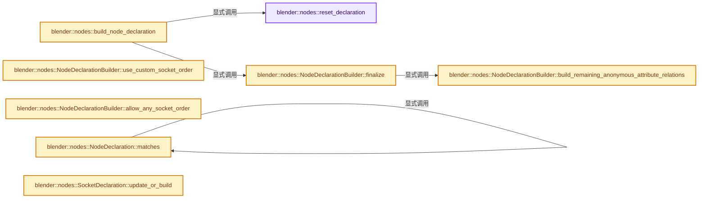

# 实现依赖专题：source/blender/nodes/intern/node_declaration.cc

[方向导航](README.md) · [符号索引](../%E7%AC%A6%E5%8F%B7%E4%BE%9D%E8%B5%96%E4%B8%8E%E5%AE%9E%E7%8E%B0%E7%B4%A2%E5%BC%95.md)

本专题从正文实际调用进入，集中保存共享实现。函数有稳定锚点，可从调用处直接跳到对应完整函数；递归与互相调用通过回链组织。

## 本文件的实现关系




## 完整成员与函数实现

<a id="f-a66e5d5ed6c8075a"></a>

### `blender::nodes::reset_declaration`

实现位置：[source/blender/nodes/intern/node_declaration.cc](../../../../../source/blender/nodes/intern/node_declaration.cc) · L29—L33。

接口参数：

- `NodeDeclaration &declaration`

**教学注释版**

<!-- annotated:9a871073c5f49e -->

```cpp
static void reset_declaration(NodeDeclaration &declaration)
{
  std::destroy_at(&declaration);
  new (&declaration) NodeDeclaration();
}
```

<details>
<summary>核对原始源码：source/blender/nodes/intern/node_declaration.cc · L29—L33</summary>

<!-- original:9a871073c5f49e:source/blender/nodes/intern/node_declaration.cc:29:33 -->

```cpp
static void reset_declaration(NodeDeclaration &declaration)
{
  std::destroy_at(&declaration);
  new (&declaration) NodeDeclaration();
}
```

</details>

**继续追踪实现**

- `std::destroy_at` → [外部契约](https://eel.is/c++draft/)：这个边界按实际表达式及所属类型核对参数、返回值、寿命与失败行为。这里提供接口入口，不声称已解释该第三方版本的内部实现。

<a id="f-648fedda72052819"></a>

### `blender::nodes::build_node_declaration`

实现位置：[source/blender/nodes/intern/node_declaration.cc](../../../../../source/blender/nodes/intern/node_declaration.cc) · L35—L44。

接口参数：

- `const bke::bNodeType &typeinfo`
- `NodeDeclaration &r_declaration`
- `const bNodeTree *ntree`
- `const bNode *node`

**教学注释版**

<!-- annotated:7930a3e4ca09c6 -->

```cpp
void build_node_declaration(const bke::bNodeType &typeinfo,
                            NodeDeclaration &r_declaration,
                            const bNodeTree *ntree,
                            const bNode *node)
{
  reset_declaration(r_declaration);
  NodeDeclarationBuilder node_decl_builder{typeinfo, r_declaration, ntree, node};
  typeinfo.declare(node_decl_builder);
  node_decl_builder.finalize();
}
```

<details>
<summary>核对原始源码：source/blender/nodes/intern/node_declaration.cc · L35—L44</summary>

<!-- original:7930a3e4ca09c6:source/blender/nodes/intern/node_declaration.cc:35:44 -->

```cpp
void build_node_declaration(const bke::bNodeType &typeinfo,
                            NodeDeclaration &r_declaration,
                            const bNodeTree *ntree,
                            const bNode *node)
{
  reset_declaration(r_declaration);
  NodeDeclarationBuilder node_decl_builder{typeinfo, r_declaration, ntree, node};
  typeinfo.declare(node_decl_builder);
  node_decl_builder.finalize();
}
```

</details>

**继续追踪实现**

- `reset_declaration` → [blender::nodes::reset_declaration · L29](%E4%BE%9D%E8%B5%96-node_declaration-250442.md#f-a66e5d5ed6c8075a)。
- `typeinfo.declare` → [调用协议](../%E6%A8%A1%E6%9D%BF%E5%AE%8F%E4%B8%8E%E5%8A%A8%E6%80%81%E5%88%86%E6%B4%BE%E5%8D%8F%E8%AE%AE.md)：由接收对象具体类型或运行时策略提供实现。调用位置L42。
- `node_decl_builder.finalize` → [blender::nodes::NodeDeclarationBuilder::finalize · L113](%E4%BE%9D%E8%B5%96-node_declaration-250442.md#f-b79863b072001b35)。

<a id="f-621b70e4e6fd8654"></a>

### `blender::nodes::NodeDeclarationBuilder::build_remaining_anonymous_attribute_relations`

实现位置：[source/blender/nodes/intern/node_declaration.cc](../../../../../source/blender/nodes/intern/node_declaration.cc) · L46—L111。

**教学注释版**

<!-- annotated:e2a80030d59a84 -->

```cpp
void NodeDeclarationBuilder::build_remaining_anonymous_attribute_relations()
{
  using bke::node_tree_reference_lifetimes::can_contain_referenced_data;

  Vector<int> data_inputs;
  for (const int i : declaration_.inputs.index_range()) {
    if (can_contain_referenced_data(declaration_.inputs[i]->socket_type)) {
      // [讲解] data_inputs.append：在尾部建立新元素，必要时先扩大存储。
      data_inputs.append(i);
    }
  }
  Vector<int> data_outputs;
  for (const int i : declaration_.outputs.index_range()) {
    if (can_contain_referenced_data(declaration_.outputs[i]->socket_type)) {
      data_outputs.append(i);
    }
  }

  for (BaseSocketDeclarationBuilder *socket_builder : input_socket_builders_) {
    if (socket_builder->input_reference_used_on_all_data_) {
      rl::RelationsInNode &relations = this->get_reference_lifetime_relations();
      const int reference_input = socket_builder->decl_base_->index;
      for (const int data_input : data_inputs) {
        relations.use_relations.append({reference_input, data_input});
      }
    }
  }
  for (BaseSocketDeclarationBuilder *socket_builder : output_socket_builders_) {
    if (socket_builder->output_reference_available_on_all_data_) {
      rl::RelationsInNode &relations = this->get_reference_lifetime_relations();
      const int reference_output = socket_builder->decl_base_->index;
      for (const int data_output : data_outputs) {
        relations.available_relations.append({reference_output, data_output});
      }
    }
    if (socket_builder->propagate_all_input_references_) {
      rl::RelationsInNode &relations = this->get_reference_lifetime_relations();
      const int reference_output = socket_builder->decl_base_->index;
      for (const int input_i : declaration_.inputs.index_range()) {
        SocketDeclaration &input_socket_decl = *declaration_.inputs[input_i];
        if (ELEM(input_socket_decl.structure_type, StructureType::Field, StructureType::Dynamic) ||
            ELEM(input_socket_decl.socket_type, SOCK_GEOMETRY, SOCK_BUNDLE, SOCK_CLOSURE))
        {
          relations.reference_propagations.append({input_i, reference_output});
        }
      }
    }
    if (socket_builder->propagate_all_input_data_) {
      rl::RelationsInNode &relations = this->get_reference_lifetime_relations();
      const int data_output = socket_builder->decl_base_->index;
      for (const int data_input : data_inputs) {
        relations.data_propagations.append({data_input, data_output});
        relations.reference_propagations.append({data_input, data_output});
      }
    }
    if (socket_builder->propagate_all_input_data_from_geometry_) {
      rl::RelationsInNode &relations = this->get_reference_lifetime_relations();
      const int data_output = socket_builder->decl_base_->index;
      for (const int i : declaration_.inputs.index_range()) {
        if (declaration_.inputs[i]->socket_type == SOCK_GEOMETRY) {
          relations.data_propagations.append({i, data_output});
          relations.reference_propagations.append({i, data_output});
        }
      }
    }
  }
}
```

<details>
<summary>核对原始源码：source/blender/nodes/intern/node_declaration.cc · L46—L111</summary>

<!-- original:e2a80030d59a84:source/blender/nodes/intern/node_declaration.cc:46:111 -->

```cpp
void NodeDeclarationBuilder::build_remaining_anonymous_attribute_relations()
{
  using bke::node_tree_reference_lifetimes::can_contain_referenced_data;

  Vector<int> data_inputs;
  for (const int i : declaration_.inputs.index_range()) {
    if (can_contain_referenced_data(declaration_.inputs[i]->socket_type)) {
      data_inputs.append(i);
    }
  }
  Vector<int> data_outputs;
  for (const int i : declaration_.outputs.index_range()) {
    if (can_contain_referenced_data(declaration_.outputs[i]->socket_type)) {
      data_outputs.append(i);
    }
  }

  for (BaseSocketDeclarationBuilder *socket_builder : input_socket_builders_) {
    if (socket_builder->input_reference_used_on_all_data_) {
      rl::RelationsInNode &relations = this->get_reference_lifetime_relations();
      const int reference_input = socket_builder->decl_base_->index;
      for (const int data_input : data_inputs) {
        relations.use_relations.append({reference_input, data_input});
      }
    }
  }
  for (BaseSocketDeclarationBuilder *socket_builder : output_socket_builders_) {
    if (socket_builder->output_reference_available_on_all_data_) {
      rl::RelationsInNode &relations = this->get_reference_lifetime_relations();
      const int reference_output = socket_builder->decl_base_->index;
      for (const int data_output : data_outputs) {
        relations.available_relations.append({reference_output, data_output});
      }
    }
    if (socket_builder->propagate_all_input_references_) {
      rl::RelationsInNode &relations = this->get_reference_lifetime_relations();
      const int reference_output = socket_builder->decl_base_->index;
      for (const int input_i : declaration_.inputs.index_range()) {
        SocketDeclaration &input_socket_decl = *declaration_.inputs[input_i];
        if (ELEM(input_socket_decl.structure_type, StructureType::Field, StructureType::Dynamic) ||
            ELEM(input_socket_decl.socket_type, SOCK_GEOMETRY, SOCK_BUNDLE, SOCK_CLOSURE))
        {
          relations.reference_propagations.append({input_i, reference_output});
        }
      }
    }
    if (socket_builder->propagate_all_input_data_) {
      rl::RelationsInNode &relations = this->get_reference_lifetime_relations();
      const int data_output = socket_builder->decl_base_->index;
      for (const int data_input : data_inputs) {
        relations.data_propagations.append({data_input, data_output});
        relations.reference_propagations.append({data_input, data_output});
      }
    }
    if (socket_builder->propagate_all_input_data_from_geometry_) {
      rl::RelationsInNode &relations = this->get_reference_lifetime_relations();
      const int data_output = socket_builder->decl_base_->index;
      for (const int i : declaration_.inputs.index_range()) {
        if (declaration_.inputs[i]->socket_type == SOCK_GEOMETRY) {
          relations.data_propagations.append({i, data_output});
          relations.reference_propagations.append({i, data_output});
        }
      }
    }
  }
}
```

</details>

**继续追踪实现**

- `declaration_.inputs.index_range` → [调用协议](../%E6%A8%A1%E6%9D%BF%E5%AE%8F%E4%B8%8E%E5%8A%A8%E6%80%81%E5%88%86%E6%B4%BE%E5%8D%8F%E8%AE%AE.md)：接收对象类型依赖auto、返回值或模板实例；不按同名猜测目标。调用位置L51。
- `can_contain_referenced_data` → [blender::bke::node_tree_reference_lifetimes::can_contain_referenced_data · L94](../10-%E5%BC%95%E7%94%A8%E7%94%9F%E5%91%BD%E5%91%A8%E6%9C%9F%E4%B8%8EClosure/03-%E8%8A%82%E7%82%B9%E6%A0%91%E7%94%9F%E5%91%BD%E5%91%A8%E6%9C%9F%E5%88%86%E6%9E%90.md#f-53b4d34364082dc9)。
- `data_inputs.append` → [blender::Vector::append · L498](../01-%E5%9F%BA%E7%A1%80%E5%AE%B9%E5%99%A8%E4%B8%8E%E7%8E%B0%E4%BB%A3CPP/11-Vector%E6%8F%92%E5%85%A5%E5%88%A0%E9%99%A4%E4%B8%8E%E9%87%8D%E6%8E%92.md#f-5bde268a69e443ec)；[blender::Vector::append · L502](../01-%E5%9F%BA%E7%A1%80%E5%AE%B9%E5%99%A8%E4%B8%8E%E7%8E%B0%E4%BB%A3CPP/11-Vector%E6%8F%92%E5%85%A5%E5%88%A0%E9%99%A4%E4%B8%8E%E9%87%8D%E6%8E%92.md#f-591e0b15e6308532)。同名重载需按实参类型选择。
- `declaration_.outputs.index_range` → [调用协议](../%E6%A8%A1%E6%9D%BF%E5%AE%8F%E4%B8%8E%E5%8A%A8%E6%80%81%E5%88%86%E6%B4%BE%E5%8D%8F%E8%AE%AE.md)：接收对象类型依赖auto、返回值或模板实例；不按同名猜测目标。调用位置L57。
- `data_outputs.append` → [blender::Vector::append · L498](../01-%E5%9F%BA%E7%A1%80%E5%AE%B9%E5%99%A8%E4%B8%8E%E7%8E%B0%E4%BB%A3CPP/11-Vector%E6%8F%92%E5%85%A5%E5%88%A0%E9%99%A4%E4%B8%8E%E9%87%8D%E6%8E%92.md#f-5bde268a69e443ec)；[blender::Vector::append · L502](../01-%E5%9F%BA%E7%A1%80%E5%AE%B9%E5%99%A8%E4%B8%8E%E7%8E%B0%E4%BB%A3CPP/11-Vector%E6%8F%92%E5%85%A5%E5%88%A0%E9%99%A4%E4%B8%8E%E9%87%8D%E6%8E%92.md#f-591e0b15e6308532)。同名重载需按实参类型选择。
- `this->get_reference_lifetime_relations` → [blender::nodes::NodeDeclarationBuilder::get_reference_lifetime_relations · L701](%E4%BE%9D%E8%B5%96-NOD_node_declaration-9b193f.md#f-e8abdddd34637d0e)。
- `relations.use_relations.append` → [调用协议](../%E6%A8%A1%E6%9D%BF%E5%AE%8F%E4%B8%8E%E5%8A%A8%E6%80%81%E5%88%86%E6%B4%BE%E5%8D%8F%E8%AE%AE.md)：接收对象类型依赖auto、返回值或模板实例；不按同名猜测目标。调用位置L68。
- `relations.available_relations.append` → [调用协议](../%E6%A8%A1%E6%9D%BF%E5%AE%8F%E4%B8%8E%E5%8A%A8%E6%80%81%E5%88%86%E6%B4%BE%E5%8D%8F%E8%AE%AE.md)：接收对象类型依赖auto、返回值或模板实例；不按同名猜测目标。调用位置L77。
- `ELEM` → [ELEM · L88](../05-%E5%87%A0%E4%BD%95%E5%AD%98%E5%82%A8%E4%B8%8E%E6%8B%93%E6%89%91%E6%98%A0%E5%B0%84/%E4%BE%9D%E8%B5%96-GHOST_utildefines-34b996.md#m-d28724a15928)；[ELEM · L135](../01-%E5%9F%BA%E7%A1%80%E5%AE%B9%E5%99%A8%E4%B8%8E%E7%8E%B0%E4%BB%A3CPP/%E4%BE%9D%E8%B5%96-BLI_utildefines-293a0a.md#m-d6572de7cae0)。宏定义由构建条件选择。
- `relations.reference_propagations.append` → [调用协议](../%E6%A8%A1%E6%9D%BF%E5%AE%8F%E4%B8%8E%E5%8A%A8%E6%80%81%E5%88%86%E6%B4%BE%E5%8D%8F%E8%AE%AE.md)：接收对象类型依赖auto、返回值或模板实例；不按同名猜测目标。调用位置L88。
- `relations.data_propagations.append` → [调用协议](../%E6%A8%A1%E6%9D%BF%E5%AE%8F%E4%B8%8E%E5%8A%A8%E6%80%81%E5%88%86%E6%B4%BE%E5%8D%8F%E8%AE%AE.md)：接收对象类型依赖auto、返回值或模板实例；不按同名猜测目标。调用位置L96。

<a id="f-b79863b072001b35"></a>

### `blender::nodes::NodeDeclarationBuilder::finalize`

实现位置：[source/blender/nodes/intern/node_declaration.cc](../../../../../source/blender/nodes/intern/node_declaration.cc) · L113—L119。

**教学注释版**

<!-- annotated:ea6355d1705e6f -->

```cpp
void NodeDeclarationBuilder::finalize()
{
  this->build_remaining_anonymous_attribute_relations();
#ifndef NDEBUG
  declaration_.assert_valid();
#endif
}
```

<details>
<summary>核对原始源码：source/blender/nodes/intern/node_declaration.cc · L113—L119</summary>

<!-- original:ea6355d1705e6f:source/blender/nodes/intern/node_declaration.cc:113:119 -->

```cpp
void NodeDeclarationBuilder::finalize()
{
  this->build_remaining_anonymous_attribute_relations();
#ifndef NDEBUG
  declaration_.assert_valid();
#endif
}
```

</details>

**继续追踪实现**

- `this->build_remaining_anonymous_attribute_relations` → [blender::nodes::NodeDeclarationBuilder::build_remaining_anonymous_attribute_relations · L46](%E4%BE%9D%E8%B5%96-node_declaration-250442.md#f-621b70e4e6fd8654)。
- `declaration_.assert_valid` → [调用协议](../%E6%A8%A1%E6%9D%BF%E5%AE%8F%E4%B8%8E%E5%8A%A8%E6%80%81%E5%88%86%E6%B4%BE%E5%8D%8F%E8%AE%AE.md)：接收对象类型依赖auto、返回值或模板实例；不按同名猜测目标。调用位置L117。

<a id="f-7a3e20373b6f44d0"></a>

### `blender::nodes::NodeDeclarationBuilder::use_custom_socket_order`

实现位置：[source/blender/nodes/intern/node_declaration.cc](../../../../../source/blender/nodes/intern/node_declaration.cc) · L135—L138。

接口参数：

- `bool enable`

**教学注释版**

<!-- annotated:bf9a4fa9706938 -->

```cpp
void NodeDeclarationBuilder::use_custom_socket_order(bool enable)
{
  declaration_.use_custom_socket_order = enable;
}
```

<details>
<summary>核对原始源码：source/blender/nodes/intern/node_declaration.cc · L135—L138</summary>

<!-- original:bf9a4fa9706938:source/blender/nodes/intern/node_declaration.cc:135:138 -->

```cpp
void NodeDeclarationBuilder::use_custom_socket_order(bool enable)
{
  declaration_.use_custom_socket_order = enable;
}
```

</details>

**沿实际写入检查状态**

- `declaration_.use_custom_socket_order = enable;`

**继续追踪实现**

本实现没有需要继续展开的显式调用；检查返回表达式、对象转换和调用者前置条件。

<a id="f-5440adf750141e49"></a>

### `blender::nodes::NodeDeclarationBuilder::allow_any_socket_order`

实现位置：[source/blender/nodes/intern/node_declaration.cc](../../../../../source/blender/nodes/intern/node_declaration.cc) · L140—L144。

接口参数：

- `bool enable`

**教学注释版**

<!-- annotated:7b45e2bc7a0ea0 -->

```cpp
void NodeDeclarationBuilder::allow_any_socket_order(bool enable)
{
  BLI_assert(declaration_.use_custom_socket_order);
  declaration_.allow_any_socket_order = enable;
}
```

<details>
<summary>核对原始源码：source/blender/nodes/intern/node_declaration.cc · L140—L144</summary>

<!-- original:7b45e2bc7a0ea0:source/blender/nodes/intern/node_declaration.cc:140:144 -->

```cpp
void NodeDeclarationBuilder::allow_any_socket_order(bool enable)
{
  BLI_assert(declaration_.use_custom_socket_order);
  declaration_.allow_any_socket_order = enable;
}
```

</details>

**沿实际写入检查状态**

- `declaration_.allow_any_socket_order = enable;`

**继续追踪实现**

- `BLI_assert` → [BLI_assert · L48](../01-%E5%9F%BA%E7%A1%80%E5%AE%B9%E5%99%A8%E4%B8%8E%E7%8E%B0%E4%BB%A3CPP/%E4%BE%9D%E8%B5%96-BLI_assert-cc98e8.md#m-57a88495704d)；[BLI_assert · L63](../01-%E5%9F%BA%E7%A1%80%E5%AE%B9%E5%99%A8%E4%B8%8E%E7%8E%B0%E4%BB%A3CPP/%E4%BE%9D%E8%B5%96-BLI_assert-cc98e8.md#m-d07050020cb5)。宏定义由构建条件选择。

<a id="f-d262c0c20e240689"></a>

### `blender::nodes::NodeDeclaration::matches`

实现位置：[source/blender/nodes/intern/node_declaration.cc](../../../../../source/blender/nodes/intern/node_declaration.cc) · L231—L281。

接口参数：

- `const bNode &node`

**教学注释版**

<!-- annotated:2572058bf4eb4a -->

```cpp
bool NodeDeclaration::matches(const bNode &node) const
{
  const bNodeSocket *current_input = node.inputs.first();
  const bNodeSocket *current_output = node.outputs.first();
  const bNodePanelState *current_panel = node.panel_states_array;
  for (const ItemDeclarationPtr &item_decl : this->all_items) {
    if (const SocketDeclaration *socket_decl = dynamic_cast<const SocketDeclaration *>(
            item_decl.get()))
    {
      switch (socket_decl->in_out) {
        case SOCK_IN:
          if (current_input == nullptr || !socket_decl->matches(*current_input)) {
            return false;
          }
          current_input = current_input->next;
          break;
        case SOCK_OUT:
          if (current_output == nullptr || !socket_decl->matches(*current_output)) {
            return false;
          }
          current_output = current_output->next;
          break;
      }
    }
    else if (const PanelDeclaration *panel_decl = dynamic_cast<const PanelDeclaration *>(
                 item_decl.get()))
    {
      if (!node.panel_states().contains_ptr(current_panel) || !panel_decl->matches(*current_panel))
      {
        return false;
      }
      ++current_panel;
    }
    else if (dynamic_cast<const SeparatorDeclaration *>(item_decl.get()) ||
             dynamic_cast<const LayoutDeclaration *>(item_decl.get()))
    {
      /* Ignored because they don't have corresponding data in DNA. */
    }
    else {
      /* Unknown item type. */
      BLI_assert_unreachable();
    }
  }
  /* If items are left over, some were removed from the declaration. */
  if (current_input != nullptr || current_output != nullptr ||
      node.panel_states().contains_ptr(current_panel))
  {
    return false;
  }
  return true;
}
```

<details>
<summary>核对原始源码：source/blender/nodes/intern/node_declaration.cc · L231—L281</summary>

<!-- original:2572058bf4eb4a:source/blender/nodes/intern/node_declaration.cc:231:281 -->

```cpp
bool NodeDeclaration::matches(const bNode &node) const
{
  const bNodeSocket *current_input = node.inputs.first();
  const bNodeSocket *current_output = node.outputs.first();
  const bNodePanelState *current_panel = node.panel_states_array;
  for (const ItemDeclarationPtr &item_decl : this->all_items) {
    if (const SocketDeclaration *socket_decl = dynamic_cast<const SocketDeclaration *>(
            item_decl.get()))
    {
      switch (socket_decl->in_out) {
        case SOCK_IN:
          if (current_input == nullptr || !socket_decl->matches(*current_input)) {
            return false;
          }
          current_input = current_input->next;
          break;
        case SOCK_OUT:
          if (current_output == nullptr || !socket_decl->matches(*current_output)) {
            return false;
          }
          current_output = current_output->next;
          break;
      }
    }
    else if (const PanelDeclaration *panel_decl = dynamic_cast<const PanelDeclaration *>(
                 item_decl.get()))
    {
      if (!node.panel_states().contains_ptr(current_panel) || !panel_decl->matches(*current_panel))
      {
        return false;
      }
      ++current_panel;
    }
    else if (dynamic_cast<const SeparatorDeclaration *>(item_decl.get()) ||
             dynamic_cast<const LayoutDeclaration *>(item_decl.get()))
    {
      /* Ignored because they don't have corresponding data in DNA. */
    }
    else {
      /* Unknown item type. */
      BLI_assert_unreachable();
    }
  }
  /* If items are left over, some were removed from the declaration. */
  if (current_input != nullptr || current_output != nullptr ||
      node.panel_states().contains_ptr(current_panel))
  {
    return false;
  }
  return true;
}
```

</details>

**沿实际写入检查状态**

- `current_input = current_input->next;`
- `current_output = current_output->next;`

**结果出口**

- `return false;`
- `return true;`

**继续追踪实现**

- `node.inputs.first` → [调用协议](../%E6%A8%A1%E6%9D%BF%E5%AE%8F%E4%B8%8E%E5%8A%A8%E6%80%81%E5%88%86%E6%B4%BE%E5%8D%8F%E8%AE%AE.md)：接收对象类型依赖auto、返回值或模板实例；不按同名猜测目标。调用位置L233。
- `node.outputs.first` → [调用协议](../%E6%A8%A1%E6%9D%BF%E5%AE%8F%E4%B8%8E%E5%8A%A8%E6%80%81%E5%88%86%E6%B4%BE%E5%8D%8F%E8%AE%AE.md)：接收对象类型依赖auto、返回值或模板实例；不按同名猜测目标。调用位置L234。
- `item_decl.get` → [调用协议](../%E6%A8%A1%E6%9D%BF%E5%AE%8F%E4%B8%8E%E5%8A%A8%E6%80%81%E5%88%86%E6%B4%BE%E5%8D%8F%E8%AE%AE.md)：接收对象类型依赖auto、返回值或模板实例；不按同名猜测目标。调用位置L238。
- `socket_decl->matches` → [blender::nodes::NodeDeclaration::matches · L231](%E4%BE%9D%E8%B5%96-node_declaration-250442.md#f-d262c0c20e240689)；[blender::nodes::PanelDeclaration::matches · L509](%E4%BE%9D%E8%B5%96-node_declaration-250442.md#f-0264dc5b60d87f95)。同名重载需按实参类型选择。
- `node.panel_states().contains_ptr` → [调用协议](../%E6%A8%A1%E6%9D%BF%E5%AE%8F%E4%B8%8E%E5%8A%A8%E6%80%81%E5%88%86%E6%B4%BE%E5%8D%8F%E8%AE%AE.md)：接收对象类型依赖auto、返回值或模板实例；不按同名猜测目标。调用位置L258。
- `node.panel_states` → [blender::bNode::panel_states · L959](../05-%E5%87%A0%E4%BD%95%E5%AD%98%E5%82%A8%E4%B8%8E%E6%8B%93%E6%89%91%E6%98%A0%E5%B0%84/%E4%BE%9D%E8%B5%96-BKE_node_runtime-ee561b.md#f-7d0d7d579323ae86)；[blender::bNode::panel_states · L964](../05-%E5%87%A0%E4%BD%95%E5%AD%98%E5%82%A8%E4%B8%8E%E6%8B%93%E6%89%91%E6%98%A0%E5%B0%84/%E4%BE%9D%E8%B5%96-BKE_node_runtime-ee561b.md#f-f978465c0f3684a3)。同名重载需按实参类型选择。
- `panel_decl->matches` → [blender::nodes::PanelDeclaration::matches · L509](%E4%BE%9D%E8%B5%96-node_declaration-250442.md#f-0264dc5b60d87f95)。
- `BLI_assert_unreachable` → [BLI_assert_unreachable · L77](../01-%E5%9F%BA%E7%A1%80%E5%AE%B9%E5%99%A8%E4%B8%8E%E7%8E%B0%E4%BB%A3CPP/%E4%BE%9D%E8%B5%96-BLI_assert-cc98e8.md#m-7a2d91a67d8e)。宏定义由构建条件选择。

<a id="f-ccef67164352462a"></a>

### `blender::nodes::SocketDeclaration::update_or_build`

实现位置：[source/blender/nodes/intern/node_declaration.cc](../../../../../source/blender/nodes/intern/node_declaration.cc) · L283—L291。

接口参数：

- `bNodeTree &ntree`
- `bNode &node`
- `bNodeSocket &socket`

**教学注释版**

<!-- annotated:89d8cf21117101 -->

```cpp
bNodeSocket &SocketDeclaration::update_or_build(bNodeTree &ntree,
                                                bNode &node,
                                                bNodeSocket &socket) const
{
  /* By default just rebuild. */
  BLI_assert(socket.in_out == this->in_out);
  UNUSED_VARS_NDEBUG(socket);
  return this->build(ntree, node);
}
```

<details>
<summary>核对原始源码：source/blender/nodes/intern/node_declaration.cc · L283—L291</summary>

<!-- original:89d8cf21117101:source/blender/nodes/intern/node_declaration.cc:283:291 -->

```cpp
bNodeSocket &SocketDeclaration::update_or_build(bNodeTree &ntree,
                                                bNode &node,
                                                bNodeSocket &socket) const
{
  /* By default just rebuild. */
  BLI_assert(socket.in_out == this->in_out);
  UNUSED_VARS_NDEBUG(socket);
  return this->build(ntree, node);
}
```

</details>

**结果出口**

- `return this->build(ntree, node);`

**继续追踪实现**

- `BLI_assert` → [BLI_assert · L48](../01-%E5%9F%BA%E7%A1%80%E5%AE%B9%E5%99%A8%E4%B8%8E%E7%8E%B0%E4%BB%A3CPP/%E4%BE%9D%E8%B5%96-BLI_assert-cc98e8.md#m-57a88495704d)；[BLI_assert · L63](../01-%E5%9F%BA%E7%A1%80%E5%AE%B9%E5%99%A8%E4%B8%8E%E7%8E%B0%E4%BB%A3CPP/%E4%BE%9D%E8%B5%96-BLI_assert-cc98e8.md#m-d07050020cb5)。宏定义由构建条件选择。
- `UNUSED_VARS_NDEBUG` → [UNUSED_VARS_NDEBUG · L526](../01-%E5%9F%BA%E7%A1%80%E5%AE%B9%E5%99%A8%E4%B8%8E%E7%8E%B0%E4%BB%A3CPP/%E4%BE%9D%E8%B5%96-BLI_utildefines-293a0a.md#m-fea439f7d366)；[UNUSED_VARS_NDEBUG · L528](../01-%E5%9F%BA%E7%A1%80%E5%AE%B9%E5%99%A8%E4%B8%8E%E7%8E%B0%E4%BB%A3CPP/%E4%BE%9D%E8%B5%96-BLI_utildefines-293a0a.md#m-a8f8cfac06c0)。宏定义由构建条件选择。
- `this->build` → [blender::nodes::PanelDeclaration::build · L502](%E4%BE%9D%E8%B5%96-node_declaration-250442.md#f-da1c73456178e4a0)。

<a id="f-6245704e5ac02c69"></a>

### `blender::nodes::DeclarationListBuilder::add_default_layout`

实现位置：[source/blender/nodes/intern/node_declaration.cc](../../../../../source/blender/nodes/intern/node_declaration.cc) · L458—L466。

**教学注释版**

<!-- annotated:9fa97a54deaeaf -->

```cpp
void DeclarationListBuilder::add_default_layout()
{
  BLI_assert(this->node_decl_builder.typeinfo_.draw_buttons);
  this->add_layout([](ui::Layout &layout, bContext *C, PointerRNA *ptr) {
    const bNode &node = *static_cast<bNode *>(ptr->data);
    node.typeinfo->draw_buttons(layout, C, ptr);
  });
  static_cast<LayoutDeclaration &>(*this->items.last()).is_default = true;
}
```

<details>
<summary>核对原始源码：source/blender/nodes/intern/node_declaration.cc · L458—L466</summary>

<!-- original:9fa97a54deaeaf:source/blender/nodes/intern/node_declaration.cc:458:466 -->

```cpp
void DeclarationListBuilder::add_default_layout()
{
  BLI_assert(this->node_decl_builder.typeinfo_.draw_buttons);
  this->add_layout([](ui::Layout &layout, bContext *C, PointerRNA *ptr) {
    const bNode &node = *static_cast<bNode *>(ptr->data);
    node.typeinfo->draw_buttons(layout, C, ptr);
  });
  static_cast<LayoutDeclaration &>(*this->items.last()).is_default = true;
}
```

</details>

**继续追踪实现**

- `BLI_assert` → [BLI_assert · L48](../01-%E5%9F%BA%E7%A1%80%E5%AE%B9%E5%99%A8%E4%B8%8E%E7%8E%B0%E4%BB%A3CPP/%E4%BE%9D%E8%B5%96-BLI_assert-cc98e8.md#m-57a88495704d)；[BLI_assert · L63](../01-%E5%9F%BA%E7%A1%80%E5%AE%B9%E5%99%A8%E4%B8%8E%E7%8E%B0%E4%BB%A3CPP/%E4%BE%9D%E8%B5%96-BLI_assert-cc98e8.md#m-d07050020cb5)。宏定义由构建条件选择。
- `this->add_layout` → [blender::nodes::DeclarationListBuilder::add_layout · L468](%E4%BE%9D%E8%B5%96-node_declaration-250442.md#f-3e9275a71b4b80ce)。
- `node.typeinfo->draw_buttons` → [调用协议](../%E6%A8%A1%E6%9D%BF%E5%AE%8F%E4%B8%8E%E5%8A%A8%E6%80%81%E5%88%86%E6%B4%BE%E5%8D%8F%E8%AE%AE.md)：接收对象类型依赖auto、返回值或模板实例；不按同名猜测目标。调用位置L463。
- `this->items.last` → [调用协议](../%E6%A8%A1%E6%9D%BF%E5%AE%8F%E4%B8%8E%E5%8A%A8%E6%80%81%E5%88%86%E6%B4%BE%E5%8D%8F%E8%AE%AE.md)：接收对象类型依赖auto、返回值或模板实例；不按同名猜测目标。调用位置L465。

<a id="f-3e9275a71b4b80ce"></a>

### `blender::nodes::DeclarationListBuilder::add_layout`

实现位置：[source/blender/nodes/intern/node_declaration.cc](../../../../../source/blender/nodes/intern/node_declaration.cc) · L468—L476。

接口参数：

- `std::function<void(ui::Layout &, bContext *, PointerRNA *)> draw`
- `ui::Layout &`
- `bContext *`
- `PointerRNA *`

**教学注释版**

<!-- annotated:07f14f49fcac92 -->

```cpp
void DeclarationListBuilder::add_layout(
    std::function<void(ui::Layout &, bContext *, PointerRNA *)> draw)
{
  // [讲解] std::make_unique<LayoutDeclaration>：创建独占拥有的对象，拥有关系可移动，get返回的借用指针不自动延长寿命。
  auto decl_ptr = std::make_unique<LayoutDeclaration>();
  LayoutDeclaration &decl = *decl_ptr;
  // [讲解] std::move：把表达式转换成可供移动重载选择的值类别；不保证真的移动，不结束源对象寿命，对const值可能选择复制。
  decl.draw = std::move(draw);
  this->node_decl_builder.declaration_.all_items.append(std::move(decl_ptr));
  this->items.append(&decl);
}
```

<details>
<summary>核对原始源码：source/blender/nodes/intern/node_declaration.cc · L468—L476</summary>

<!-- original:07f14f49fcac92:source/blender/nodes/intern/node_declaration.cc:468:476 -->

```cpp
void DeclarationListBuilder::add_layout(
    std::function<void(ui::Layout &, bContext *, PointerRNA *)> draw)
{
  auto decl_ptr = std::make_unique<LayoutDeclaration>();
  LayoutDeclaration &decl = *decl_ptr;
  decl.draw = std::move(draw);
  this->node_decl_builder.declaration_.all_items.append(std::move(decl_ptr));
  this->items.append(&decl);
}
```

</details>

**沿实际写入检查状态**

- `decl.draw = std::move(draw);`

**继续追踪实现**

- `std::make_unique<LayoutDeclaration>` → [外部契约](https://eel.is/c++draft/unique.ptr.create)：创建独占拥有的对象，拥有关系可移动，get返回的借用指针不自动延长寿命。
- `std::move` → [外部契约](https://eel.is/c++draft/utility.forward)：把表达式转换成可供移动重载选择的值类别；不保证真的移动，不结束源对象寿命，对const值可能选择复制。
- `this->node_decl_builder.declaration_.all_items.append` → [调用协议](../%E6%A8%A1%E6%9D%BF%E5%AE%8F%E4%B8%8E%E5%8A%A8%E6%80%81%E5%88%86%E6%B4%BE%E5%8D%8F%E8%AE%AE.md)：接收对象类型依赖auto、返回值或模板实例；不按同名猜测目标。调用位置L474。
- `this->items.append` → [调用协议](../%E6%A8%A1%E6%9D%BF%E5%AE%8F%E4%B8%8E%E5%8A%A8%E6%80%81%E5%88%86%E6%B4%BE%E5%8D%8F%E8%AE%AE.md)：接收对象类型依赖auto、返回值或模板实例；不按同名猜测目标。调用位置L475。

<a id="f-da1c73456178e4a0"></a>

### `blender::nodes::PanelDeclaration::build`

实现位置：[source/blender/nodes/intern/node_declaration.cc](../../../../../source/blender/nodes/intern/node_declaration.cc) · L502—L507。

接口参数：

- `bNodePanelState &panel`

**教学注释版**

<!-- annotated:3e017d47a441de -->

```cpp
void PanelDeclaration::build(bNodePanelState &panel) const
{
  panel = {0};
  panel.identifier = this->identifier;
  SET_FLAG_FROM_TEST(panel.flag, this->default_collapsed, NODE_PANEL_COLLAPSED);
}
```

<details>
<summary>核对原始源码：source/blender/nodes/intern/node_declaration.cc · L502—L507</summary>

<!-- original:3e017d47a441de:source/blender/nodes/intern/node_declaration.cc:502:507 -->

```cpp
void PanelDeclaration::build(bNodePanelState &panel) const
{
  panel = {0};
  panel.identifier = this->identifier;
  SET_FLAG_FROM_TEST(panel.flag, this->default_collapsed, NODE_PANEL_COLLAPSED);
}
```

</details>

**沿实际写入检查状态**

- `panel = {0};`
- `panel.identifier = this->identifier;`

**继续追踪实现**

- `SET_FLAG_FROM_TEST` → [SET_FLAG_FROM_TEST · L557](../01-%E5%9F%BA%E7%A1%80%E5%AE%B9%E5%99%A8%E4%B8%8E%E7%8E%B0%E4%BB%A3CPP/%E4%BE%9D%E8%B5%96-BLI_utildefines-293a0a.md#m-8e0dc83e01a8)。宏定义由构建条件选择。

<a id="f-0264dc5b60d87f95"></a>

### `blender::nodes::PanelDeclaration::matches`

实现位置：[source/blender/nodes/intern/node_declaration.cc](../../../../../source/blender/nodes/intern/node_declaration.cc) · L509—L512。

接口参数：

- `const bNodePanelState &panel`

**教学注释版**

<!-- annotated:e87143ac6403b3 -->

```cpp
bool PanelDeclaration::matches(const bNodePanelState &panel) const
{
  return panel.identifier == this->identifier;
}
```

<details>
<summary>核对原始源码：source/blender/nodes/intern/node_declaration.cc · L509—L512</summary>

<!-- original:e87143ac6403b3:source/blender/nodes/intern/node_declaration.cc:509:512 -->

```cpp
bool PanelDeclaration::matches(const bNodePanelState &panel) const
{
  return panel.identifier == this->identifier;
}
```

</details>

**结果出口**

- `return panel.identifier == this->identifier;`

**继续追踪实现**

本实现没有需要继续展开的显式调用；检查返回表达式、对象转换和调用者前置条件。

<a id="f-092531b74f027eea"></a>

### `blender::nodes::PanelDeclaration::update_or_build`

实现位置：[source/blender/nodes/intern/node_declaration.cc](../../../../../source/blender/nodes/intern/node_declaration.cc) · L514—L520。

接口参数：

- `const bNodePanelState &old_panel`
- `bNodePanelState &new_panel`

**教学注释版**

<!-- annotated:bbaad2a8736c79 -->

```cpp
void PanelDeclaration::update_or_build(const bNodePanelState &old_panel,
                                       bNodePanelState &new_panel) const
{
  build(new_panel);
  /* Copy existing state to the new panel */
  SET_FLAG_FROM_TEST(new_panel.flag, old_panel.is_collapsed(), NODE_PANEL_COLLAPSED);
}
```

<details>
<summary>核对原始源码：source/blender/nodes/intern/node_declaration.cc · L514—L520</summary>

<!-- original:bbaad2a8736c79:source/blender/nodes/intern/node_declaration.cc:514:520 -->

```cpp
void PanelDeclaration::update_or_build(const bNodePanelState &old_panel,
                                       bNodePanelState &new_panel) const
{
  build(new_panel);
  /* Copy existing state to the new panel */
  SET_FLAG_FROM_TEST(new_panel.flag, old_panel.is_collapsed(), NODE_PANEL_COLLAPSED);
}
```

</details>

**继续追踪实现**

- `build` → [blender::nodes::PanelDeclaration::build · L502](%E4%BE%9D%E8%B5%96-node_declaration-250442.md#f-da1c73456178e4a0)。
- `SET_FLAG_FROM_TEST` → [SET_FLAG_FROM_TEST · L557](../01-%E5%9F%BA%E7%A1%80%E5%AE%B9%E5%99%A8%E4%B8%8E%E7%8E%B0%E4%BB%A3CPP/%E4%BE%9D%E8%B5%96-BLI_utildefines-293a0a.md#m-8e0dc83e01a8)。宏定义由构建条件选择。
- `old_panel.is_collapsed` → [blender::bNodePanelState::is_collapsed · L1171](../05-%E5%87%A0%E4%BD%95%E5%AD%98%E5%82%A8%E4%B8%8E%E6%8B%93%E6%89%91%E6%98%A0%E5%B0%84/%E4%BE%9D%E8%B5%96-BKE_node_runtime-ee561b.md#f-58d2003cddbcb646)。

<a id="f-e858d14252661bf3"></a>

### `blender::nodes::BaseSocketDeclarationBuilder::label_fn`

实现位置：[source/blender/nodes/intern/node_declaration.cc](../../../../../source/blender/nodes/intern/node_declaration.cc) · L651—L655。

接口参数：

- `CustomSocketLabelFn fn`

**教学注释版**

<!-- annotated:2ca6c8062ca50d -->

```cpp
BaseSocketDeclarationBuilder &BaseSocketDeclarationBuilder::label_fn(CustomSocketLabelFn fn)
{
  // [讲解] std::make_unique<CustomSocketLabelFn>：创建独占拥有的对象，拥有关系可移动，get返回的借用指针不自动延长寿命。
  decl_base_->label_fn = std::make_unique<CustomSocketLabelFn>(std::move(fn));
  return *this;
}
```

<details>
<summary>核对原始源码：source/blender/nodes/intern/node_declaration.cc · L651—L655</summary>

<!-- original:2ca6c8062ca50d:source/blender/nodes/intern/node_declaration.cc:651:655 -->

```cpp
BaseSocketDeclarationBuilder &BaseSocketDeclarationBuilder::label_fn(CustomSocketLabelFn fn)
{
  decl_base_->label_fn = std::make_unique<CustomSocketLabelFn>(std::move(fn));
  return *this;
}
```

</details>

**沿实际写入检查状态**

- `decl_base_->label_fn = std::make_unique<CustomSocketLabelFn>(std::move(fn));`

**结果出口**

- `return *this;`

**继续追踪实现**

- `std::make_unique<CustomSocketLabelFn>` → [外部契约](https://eel.is/c++draft/unique.ptr.create)：创建独占拥有的对象，拥有关系可移动，get返回的借用指针不自动延长寿命。
- `std::move` → [外部契约](https://eel.is/c++draft/utility.forward)：把表达式转换成可供移动重载选择的值类别；不保证真的移动，不结束源对象寿命，对const值可能选择复制。

<a id="f-17f426c3a2b40bf0"></a>

### `blender::nodes::get_implicit_input_value_fn`

实现位置：[source/blender/nodes/intern/node_declaration.cc](../../../../../source/blender/nodes/intern/node_declaration.cc) · L1120—L1147。

接口参数：

- `const NodeDefaultInputType type`

**教学注释版**

<!-- annotated:1176a61e379adc -->

```cpp
std::optional<ImplicitInputValueFn> get_implicit_input_value_fn(const NodeDefaultInputType type)
{
  switch (type) {
    case NODE_DEFAULT_INPUT_VALUE:
      return std::nullopt;
    case NODE_DEFAULT_INPUT_INDEX_FIELD:
      return std::make_optional(implicit_field_inputs::index);
    case NODE_DEFAULT_INPUT_ID_INDEX_FIELD:
      return std::make_optional(implicit_field_inputs::id_or_index);
    case NODE_DEFAULT_INPUT_NORMAL_FIELD:
      return std::make_optional(implicit_field_inputs::normal);
    case NODE_DEFAULT_INPUT_POSITION_FIELD:
      return std::make_optional(implicit_field_inputs::position);
    case NODE_DEFAULT_INPUT_INSTANCE_TRANSFORM_FIELD:
      return std::make_optional(implicit_field_inputs::instance_transform);
    case NODE_DEFAULT_INPUT_HANDLE_LEFT_FIELD:
      return std::make_optional(implicit_field_inputs::handle_left);
    case NODE_DEFAULT_INPUT_HANDLE_RIGHT_FIELD:
      return std::make_optional(implicit_field_inputs::handle_right);
    case NODE_DEFAULT_INPUT_SCENE_FRAME:
      return std::nullopt;
    case NODE_DEFAULT_INPUT_UNIFORM_IMAGE_COORDINATES:
      return std::nullopt;
    case NODE_DEFAULT_INPUT_SELF_OBJECT:
      return std::nullopt;
  }
  return std::nullopt;
}
```

<details>
<summary>核对原始源码：source/blender/nodes/intern/node_declaration.cc · L1120—L1147</summary>

<!-- original:1176a61e379adc:source/blender/nodes/intern/node_declaration.cc:1120:1147 -->

```cpp
std::optional<ImplicitInputValueFn> get_implicit_input_value_fn(const NodeDefaultInputType type)
{
  switch (type) {
    case NODE_DEFAULT_INPUT_VALUE:
      return std::nullopt;
    case NODE_DEFAULT_INPUT_INDEX_FIELD:
      return std::make_optional(implicit_field_inputs::index);
    case NODE_DEFAULT_INPUT_ID_INDEX_FIELD:
      return std::make_optional(implicit_field_inputs::id_or_index);
    case NODE_DEFAULT_INPUT_NORMAL_FIELD:
      return std::make_optional(implicit_field_inputs::normal);
    case NODE_DEFAULT_INPUT_POSITION_FIELD:
      return std::make_optional(implicit_field_inputs::position);
    case NODE_DEFAULT_INPUT_INSTANCE_TRANSFORM_FIELD:
      return std::make_optional(implicit_field_inputs::instance_transform);
    case NODE_DEFAULT_INPUT_HANDLE_LEFT_FIELD:
      return std::make_optional(implicit_field_inputs::handle_left);
    case NODE_DEFAULT_INPUT_HANDLE_RIGHT_FIELD:
      return std::make_optional(implicit_field_inputs::handle_right);
    case NODE_DEFAULT_INPUT_SCENE_FRAME:
      return std::nullopt;
    case NODE_DEFAULT_INPUT_UNIFORM_IMAGE_COORDINATES:
      return std::nullopt;
    case NODE_DEFAULT_INPUT_SELF_OBJECT:
      return std::nullopt;
  }
  return std::nullopt;
}
```

</details>

**结果出口**

- `return std::nullopt;`
- `return std::make_optional(implicit_field_inputs::index);`
- `return std::make_optional(implicit_field_inputs::id_or_index);`
- `return std::make_optional(implicit_field_inputs::normal);`
- `return std::make_optional(implicit_field_inputs::position);`
- `return std::make_optional(implicit_field_inputs::instance_transform);`
- `return std::make_optional(implicit_field_inputs::handle_left);`
- `return std::make_optional(implicit_field_inputs::handle_right);`

**继续追踪实现**

- `std::make_optional` → [外部契约](https://eel.is/c++draft/)：这个边界按实际表达式及所属类型核对参数、返回值、寿命与失败行为。这里提供接口入口，不声称已解释该第三方版本的内部实现。

<a id="f-0a46d99b5b59a0d2"></a>

### `blender::nodes::default_input_type_is_field`

实现位置：[source/blender/nodes/intern/node_declaration.cc](../../../../../source/blender/nodes/intern/node_declaration.cc) · L1199—L1209。

接口参数：

- `const NodeDefaultInputType input_type`

**教学注释版**

<!-- annotated:b34a2eb5682553 -->

```cpp
bool default_input_type_is_field(const NodeDefaultInputType input_type)
{
  return ELEM(input_type,
              NODE_DEFAULT_INPUT_INDEX_FIELD,
              NODE_DEFAULT_INPUT_ID_INDEX_FIELD,
              NODE_DEFAULT_INPUT_NORMAL_FIELD,
              NODE_DEFAULT_INPUT_POSITION_FIELD,
              NODE_DEFAULT_INPUT_INSTANCE_TRANSFORM_FIELD,
              NODE_DEFAULT_INPUT_HANDLE_LEFT_FIELD,
              NODE_DEFAULT_INPUT_HANDLE_RIGHT_FIELD);
}
```

<details>
<summary>核对原始源码：source/blender/nodes/intern/node_declaration.cc · L1199—L1209</summary>

<!-- original:b34a2eb5682553:source/blender/nodes/intern/node_declaration.cc:1199:1209 -->

```cpp
bool default_input_type_is_field(const NodeDefaultInputType input_type)
{
  return ELEM(input_type,
              NODE_DEFAULT_INPUT_INDEX_FIELD,
              NODE_DEFAULT_INPUT_ID_INDEX_FIELD,
              NODE_DEFAULT_INPUT_NORMAL_FIELD,
              NODE_DEFAULT_INPUT_POSITION_FIELD,
              NODE_DEFAULT_INPUT_INSTANCE_TRANSFORM_FIELD,
              NODE_DEFAULT_INPUT_HANDLE_LEFT_FIELD,
              NODE_DEFAULT_INPUT_HANDLE_RIGHT_FIELD);
}
```

</details>

**结果出口**

- `return ELEM(input_type,`

**继续追踪实现**

- `ELEM` → [ELEM · L88](../05-%E5%87%A0%E4%BD%95%E5%AD%98%E5%82%A8%E4%B8%8E%E6%8B%93%E6%89%91%E6%98%A0%E5%B0%84/%E4%BE%9D%E8%B5%96-GHOST_utildefines-34b996.md#m-d28724a15928)；[ELEM · L135](../01-%E5%9F%BA%E7%A1%80%E5%AE%B9%E5%99%A8%E4%B8%8E%E7%8E%B0%E4%BB%A3CPP/%E4%BE%9D%E8%B5%96-BLI_utildefines-293a0a.md#m-d6572de7cae0)。宏定义由构建条件选择。
