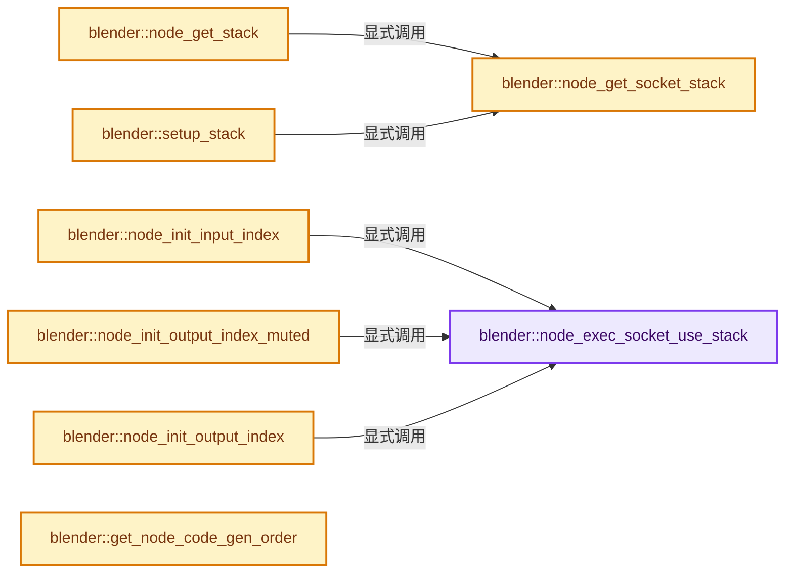
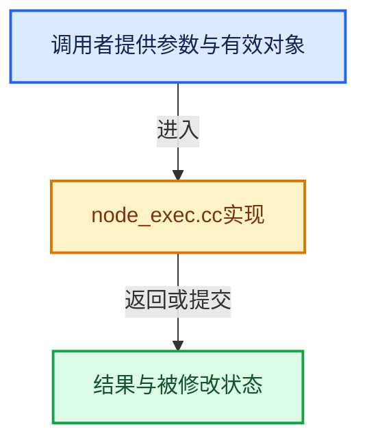

# 实现依赖专题：source/blender/nodes/intern/node_exec.cc

[方向导航](README.md) · [符号索引](../%E7%AC%A6%E5%8F%B7%E4%BE%9D%E8%B5%96%E4%B8%8E%E5%AE%9E%E7%8E%B0%E7%B4%A2%E5%BC%95.md)

本专题从正文实际调用进入，集中保存共享实现。函数有稳定锚点，可从调用处直接跳到对应完整函数；递归与互相调用通过回链组织。

## 本文件的实现关系






## 完整成员与函数实现

<a id="f-4e8f7789a02dd0ea"></a>

### `blender::node_exec_socket_use_stack`

实现位置：[source/blender/nodes/intern/node_exec.cc](../../../../../source/blender/nodes/intern/node_exec.cc) · L26—L37。

接口参数：

- `bNodeSocket *sock`

**教学注释版**

<!-- annotated:314dc1aabc4681 -->

```cpp
static int node_exec_socket_use_stack(bNodeSocket *sock)
{
  /* NOTE: INT and BOOL supported as FLOAT. Only for EEVEE. */
  return ELEM(sock->type,
              SOCK_INT,
              SOCK_BOOLEAN,
              SOCK_FLOAT,
              SOCK_VECTOR,
              SOCK_RGBA,
              SOCK_SHADER,
              SOCK_ROTATION);
}
```

<details>
<summary>核对原始源码：source/blender/nodes/intern/node_exec.cc · L26—L37</summary>

<!-- original:314dc1aabc4681:source/blender/nodes/intern/node_exec.cc:26:37 -->

```cpp
static int node_exec_socket_use_stack(bNodeSocket *sock)
{
  /* NOTE: INT and BOOL supported as FLOAT. Only for EEVEE. */
  return ELEM(sock->type,
              SOCK_INT,
              SOCK_BOOLEAN,
              SOCK_FLOAT,
              SOCK_VECTOR,
              SOCK_RGBA,
              SOCK_SHADER,
              SOCK_ROTATION);
}
```

</details>

**结果出口**

- `return ELEM(sock->type,`

**继续追踪实现**

- `ELEM` → [ELEM · L88](../05-%E5%87%A0%E4%BD%95%E5%AD%98%E5%82%A8%E4%B8%8E%E6%8B%93%E6%89%91%E6%98%A0%E5%B0%84/%E4%BE%9D%E8%B5%96-GHOST_utildefines-34b996.md#m-d28724a15928)；[ELEM · L135](../01-%E5%9F%BA%E7%A1%80%E5%AE%B9%E5%99%A8%E4%B8%8E%E7%8E%B0%E4%BB%A3CPP/%E4%BE%9D%E8%B5%96-BLI_utildefines-293a0a.md#m-d6572de7cae0)。宏定义由构建条件选择。

<a id="f-4a10557612e9f9f1"></a>

### `blender::node_get_socket_stack`

实现位置：[source/blender/nodes/intern/node_exec.cc](../../../../../source/blender/nodes/intern/node_exec.cc) · L39—L45。

接口参数：

- `bNodeStack *stack`
- `bNodeSocket *sock`

**教学注释版**

<!-- annotated:572754eff56323 -->

```cpp
bNodeStack *node_get_socket_stack(bNodeStack *stack, bNodeSocket *sock)
{
  if (stack && sock && sock->stack_index >= 0) {
    return stack + sock->stack_index;
  }
  return nullptr;
}
```

<details>
<summary>核对原始源码：source/blender/nodes/intern/node_exec.cc · L39—L45</summary>

<!-- original:572754eff56323:source/blender/nodes/intern/node_exec.cc:39:45 -->

```cpp
bNodeStack *node_get_socket_stack(bNodeStack *stack, bNodeSocket *sock)
{
  if (stack && sock && sock->stack_index >= 0) {
    return stack + sock->stack_index;
  }
  return nullptr;
}
```

</details>

**结果出口**

- `return stack + sock->stack_index;`
- `return nullptr;`

**继续追踪实现**

本实现没有需要继续展开的显式调用；检查返回表达式、对象转换和调用者前置条件。

<a id="f-3ef1b159d1b42140"></a>

### `blender::node_get_stack`

实现位置：[source/blender/nodes/intern/node_exec.cc](../../../../../source/blender/nodes/intern/node_exec.cc) · L47—L61。

接口参数：

- `bNode *node`
- `bNodeStack *stack`
- `bNodeStack **in`
- `bNodeStack **out`

**教学注释版**

<!-- annotated:d9bae9edad9741 -->

```cpp
void node_get_stack(bNode *node, bNodeStack *stack, bNodeStack **in, bNodeStack **out)
{
  /* build pointer stack */
  if (in) {
    for (bNodeSocket &sock : node->inputs) {
      *(in++) = node_get_socket_stack(stack, &sock);
    }
  }

  if (out) {
    for (bNodeSocket &sock : node->outputs) {
      *(out++) = node_get_socket_stack(stack, &sock);
    }
  }
}
```

<details>
<summary>核对原始源码：source/blender/nodes/intern/node_exec.cc · L47—L61</summary>

<!-- original:d9bae9edad9741:source/blender/nodes/intern/node_exec.cc:47:61 -->

```cpp
void node_get_stack(bNode *node, bNodeStack *stack, bNodeStack **in, bNodeStack **out)
{
  /* build pointer stack */
  if (in) {
    for (bNodeSocket &sock : node->inputs) {
      *(in++) = node_get_socket_stack(stack, &sock);
    }
  }

  if (out) {
    for (bNodeSocket &sock : node->outputs) {
      *(out++) = node_get_socket_stack(stack, &sock);
    }
  }
}
```

</details>

**继续追踪实现**

- `node_get_socket_stack` → [blender::node_get_socket_stack · L39](%E4%BE%9D%E8%B5%96-node_exec-923fa6.md#f-4a10557612e9f9f1)。

<a id="f-907e0b204b5777af"></a>

### `blender::node_init_input_index`

实现位置：[source/blender/nodes/intern/node_exec.cc](../../../../../source/blender/nodes/intern/node_exec.cc) · L63—L79。

接口参数：

- `bNodeSocket *sock`
- `int *index`

**教学注释版**

<!-- annotated:459a67d4e76335 -->

```cpp
static void node_init_input_index(bNodeSocket *sock, int *index)
{
  /* Only consider existing link when the `from` socket is valid! */
  if (sock->link && !(sock->link->flag & NODE_LINK_MUTED) && sock->link->fromsock &&
      sock->link->fromsock->stack_index >= 0)
  {
    sock->stack_index = sock->link->fromsock->stack_index;
  }
  else {
    if (node_exec_socket_use_stack(sock)) {
      sock->stack_index = (*index)++;
    }
    else {
      sock->stack_index = -1;
    }
  }
}
```

<details>
<summary>核对原始源码：source/blender/nodes/intern/node_exec.cc · L63—L79</summary>

<!-- original:459a67d4e76335:source/blender/nodes/intern/node_exec.cc:63:79 -->

```cpp
static void node_init_input_index(bNodeSocket *sock, int *index)
{
  /* Only consider existing link when the `from` socket is valid! */
  if (sock->link && !(sock->link->flag & NODE_LINK_MUTED) && sock->link->fromsock &&
      sock->link->fromsock->stack_index >= 0)
  {
    sock->stack_index = sock->link->fromsock->stack_index;
  }
  else {
    if (node_exec_socket_use_stack(sock)) {
      sock->stack_index = (*index)++;
    }
    else {
      sock->stack_index = -1;
    }
  }
}
```

</details>

**沿实际写入检查状态**

- `sock->stack_index = sock->link->fromsock->stack_index;`
- `sock->stack_index = (*index)++;`
- `sock->stack_index = -1;`

**继续追踪实现**

- `node_exec_socket_use_stack` → [blender::node_exec_socket_use_stack · L26](%E4%BE%9D%E8%B5%96-node_exec-923fa6.md#f-4e8f7789a02dd0ea)。

<a id="f-4e120a80ed0d92ec"></a>

### `blender::node_init_output_index_muted`

实现位置：[source/blender/nodes/intern/node_exec.cc](../../../../../source/blender/nodes/intern/node_exec.cc) · L81—L95。

接口参数：

- `bNodeSocket *sock`
- `int *index`

**教学注释版**

<!-- annotated:fcd66c6974c43b -->

```cpp
static void node_init_output_index_muted(bNodeSocket *sock, int *index)
{
  /* Copy the stack index from the internally connected input to skip the node. */
  if (const bNodeSocket *internal_input = sock->runtime->internal_link_input) {
    sock->stack_index = internal_input->stack_index;
    return;
  }
  /* If not internally connected, assign a new stack index anyway to avoid bad stack access. */
  if (node_exec_socket_use_stack(sock)) {
    sock->stack_index = (*index)++;
  }
  else {
    sock->stack_index = -1;
  }
}
```

<details>
<summary>核对原始源码：source/blender/nodes/intern/node_exec.cc · L81—L95</summary>

<!-- original:fcd66c6974c43b:source/blender/nodes/intern/node_exec.cc:81:95 -->

```cpp
static void node_init_output_index_muted(bNodeSocket *sock, int *index)
{
  /* Copy the stack index from the internally connected input to skip the node. */
  if (const bNodeSocket *internal_input = sock->runtime->internal_link_input) {
    sock->stack_index = internal_input->stack_index;
    return;
  }
  /* If not internally connected, assign a new stack index anyway to avoid bad stack access. */
  if (node_exec_socket_use_stack(sock)) {
    sock->stack_index = (*index)++;
  }
  else {
    sock->stack_index = -1;
  }
}
```

</details>

**沿实际写入检查状态**

- `sock->stack_index = internal_input->stack_index;`
- `sock->stack_index = (*index)++;`
- `sock->stack_index = -1;`

**继续追踪实现**

- `node_exec_socket_use_stack` → [blender::node_exec_socket_use_stack · L26](%E4%BE%9D%E8%B5%96-node_exec-923fa6.md#f-4e8f7789a02dd0ea)。

<a id="f-3bf7b6923cf6b961"></a>

### `blender::node_init_output_index`

实现位置：[source/blender/nodes/intern/node_exec.cc](../../../../../source/blender/nodes/intern/node_exec.cc) · L97—L105。

接口参数：

- `bNodeSocket *sock`
- `int *index`

**教学注释版**

<!-- annotated:80c5332f1c2e1c -->

```cpp
static void node_init_output_index(bNodeSocket *sock, int *index)
{
  if (node_exec_socket_use_stack(sock)) {
    sock->stack_index = (*index)++;
  }
  else {
    sock->stack_index = -1;
  }
}
```

<details>
<summary>核对原始源码：source/blender/nodes/intern/node_exec.cc · L97—L105</summary>

<!-- original:80c5332f1c2e1c:source/blender/nodes/intern/node_exec.cc:97:105 -->

```cpp
static void node_init_output_index(bNodeSocket *sock, int *index)
{
  if (node_exec_socket_use_stack(sock)) {
    sock->stack_index = (*index)++;
  }
  else {
    sock->stack_index = -1;
  }
}
```

</details>

**沿实际写入检查状态**

- `sock->stack_index = (*index)++;`
- `sock->stack_index = -1;`

**继续追踪实现**

- `node_exec_socket_use_stack` → [blender::node_exec_socket_use_stack · L26](%E4%BE%9D%E8%B5%96-node_exec-923fa6.md#f-4e8f7789a02dd0ea)。

<a id="f-742b42f1785b78ab"></a>

### `blender::setup_stack`

实现位置：[source/blender/nodes/intern/node_exec.cc](../../../../../source/blender/nodes/intern/node_exec.cc) · L108—L153。

接口参数：

- `bNodeStack *stack`
- `bNodeTree *ntree`
- `bNode *node`
- `bNodeSocket *sock`

**教学注释版**

<!-- annotated:d0650dc494a4ba -->

```cpp
static bNodeStack *setup_stack(bNodeStack *stack, bNodeTree *ntree, bNode *node, bNodeSocket *sock)
{
  bNodeStack *ns = node_get_socket_stack(stack, sock);
  if (!ns) {
    return nullptr;
  }

  /* don't mess with remote socket stacks, these are initialized by other nodes! */
  if (sock->link && !(sock->link->flag & NODE_LINK_MUTED)) {
    return ns;
  }
  /* Outputs of muted nodes forward the internally linked input's stack value. */
  if (node->is_muted() && sock->runtime->internal_link_input != nullptr) {
    return ns;
  }
  if (sock->is_output() && node->is_reroute()) {
    return ns;
  }

  ns->sockettype = sock->type;

  switch (sock->type) {
    case SOCK_INT:
      ns->vec[0] = node_socket_get_int(ntree, node, sock);
      break;
    case SOCK_BOOLEAN:
      ns->vec[0] = node_socket_get_bool(ntree, node, sock);
      break;
    case SOCK_FLOAT:
      ns->vec[0] = node_socket_get_float(ntree, node, sock);
      break;
    case SOCK_VECTOR:
      node_socket_get_vector(ntree, node, sock, ns->vec);
      break;
    case SOCK_RGBA:
      node_socket_get_color(ntree, node, sock, ns->vec);
      break;
    case SOCK_ROTATION:
      node_socket_get_rotation(ntree, node, sock, ns->vec);
      break;
    default:
      break;
  }

  return ns;
}
```

<details>
<summary>核对原始源码：source/blender/nodes/intern/node_exec.cc · L108—L153</summary>

<!-- original:d0650dc494a4ba:source/blender/nodes/intern/node_exec.cc:108:153 -->

```cpp
static bNodeStack *setup_stack(bNodeStack *stack, bNodeTree *ntree, bNode *node, bNodeSocket *sock)
{
  bNodeStack *ns = node_get_socket_stack(stack, sock);
  if (!ns) {
    return nullptr;
  }

  /* don't mess with remote socket stacks, these are initialized by other nodes! */
  if (sock->link && !(sock->link->flag & NODE_LINK_MUTED)) {
    return ns;
  }
  /* Outputs of muted nodes forward the internally linked input's stack value. */
  if (node->is_muted() && sock->runtime->internal_link_input != nullptr) {
    return ns;
  }
  if (sock->is_output() && node->is_reroute()) {
    return ns;
  }

  ns->sockettype = sock->type;

  switch (sock->type) {
    case SOCK_INT:
      ns->vec[0] = node_socket_get_int(ntree, node, sock);
      break;
    case SOCK_BOOLEAN:
      ns->vec[0] = node_socket_get_bool(ntree, node, sock);
      break;
    case SOCK_FLOAT:
      ns->vec[0] = node_socket_get_float(ntree, node, sock);
      break;
    case SOCK_VECTOR:
      node_socket_get_vector(ntree, node, sock, ns->vec);
      break;
    case SOCK_RGBA:
      node_socket_get_color(ntree, node, sock, ns->vec);
      break;
    case SOCK_ROTATION:
      node_socket_get_rotation(ntree, node, sock, ns->vec);
      break;
    default:
      break;
  }

  return ns;
}
```

</details>

**沿实际写入检查状态**

- `ns->sockettype = sock->type;`
- `ns->vec[0] = node_socket_get_int(ntree, node, sock);`
- `ns->vec[0] = node_socket_get_bool(ntree, node, sock);`
- `ns->vec[0] = node_socket_get_float(ntree, node, sock);`

**结果出口**

- `return nullptr;`
- `return ns;`

**继续追踪实现**

- `node_get_socket_stack` → [blender::node_get_socket_stack · L39](%E4%BE%9D%E8%B5%96-node_exec-923fa6.md#f-4a10557612e9f9f1)。
- `node->is_muted` → [blender::bNode::is_muted · L886](../05-%E5%87%A0%E4%BD%95%E5%AD%98%E5%82%A8%E4%B8%8E%E6%8B%93%E6%89%91%E6%98%A0%E5%B0%84/%E4%BE%9D%E8%B5%96-BKE_node_runtime-ee561b.md#f-4d91efc4cc87d00d)。
- `sock->is_output` → [blender::bNodeSocket::is_output · L1149](../05-%E5%87%A0%E4%BD%95%E5%AD%98%E5%82%A8%E4%B8%8E%E6%8B%93%E6%89%91%E6%98%A0%E5%B0%84/%E4%BE%9D%E8%B5%96-BKE_node_runtime-ee561b.md#f-50a6549b2d3958ca)。
- `node->is_reroute` → [blender::bNode::is_reroute · L896](../05-%E5%87%A0%E4%BD%95%E5%AD%98%E5%82%A8%E4%B8%8E%E6%8B%93%E6%89%91%E6%98%A0%E5%B0%84/%E4%BE%9D%E8%B5%96-BKE_node_runtime-ee561b.md#f-d97a49597e48e8ea)。
- `node_socket_get_int` → [blender::node_socket_get_int · L234](%E4%BE%9D%E8%B5%96-node_util-403176.md#f-7cfcb48f4cc2608a)。
- `node_socket_get_bool` → [blender::node_socket_get_bool · L246](%E4%BE%9D%E8%B5%96-node_util-403176.md#f-893d03b1e2c26ef6)。
- `node_socket_get_float` → [blender::node_socket_get_float · L258](%E4%BE%9D%E8%B5%96-node_util-403176.md#f-c8ae0b3352126564)。
- `node_socket_get_vector` → [blender::node_socket_get_vector · L285](%E4%BE%9D%E8%B5%96-node_util-403176.md#f-539baf0b8fc92735)。
- `node_socket_get_color` → [blender::node_socket_get_color · L270](%E4%BE%9D%E8%B5%96-node_util-403176.md#f-8b30dfd79ba782c2)。
- `node_socket_get_rotation` → [blender::node_socket_get_rotation · L300](%E4%BE%9D%E8%B5%96-node_util-403176.md#f-f4661b070504a692)。

<a id="f-2406d82ba6c4b867"></a>

### `blender::get_node_code_gen_order`

实现位置：[source/blender/nodes/intern/node_exec.cc](../../../../../source/blender/nodes/intern/node_exec.cc) · L155—L189。

接口参数：

- `bNodeTree &ntree`

**教学注释版**

<!-- annotated:2f2ee8dced8c28 -->

```cpp
static Vector<bNode *> get_node_code_gen_order(bNodeTree &ntree)
{
  ntree.ensure_topology_cache();
  Vector<bNode *> nodes = ntree.toposort_left_to_right();
  const bke::bNodeTreeZones *zones = ntree.zones();
  if (!zones) {
    return nodes;
  }
  /* Insertion sort to make sure that all nodes in a zone are packed together right before the zone
   * output. */
  // [讲解] nodes.size：用end_减begin_得到活元素数量。
  for (int old_i = nodes.size() - 1; old_i >= 0; old_i--) {
    bNode *node = nodes[old_i];
    const bke::bNodeTreeZone *zone = zones->get_zone_by_node(node->identifier);
    if (!zone) {
      /* None outside of any zone can stay where they are. */
      continue;
    }
    if (zone->output_node_id == node->identifier) {
      /* The output of a zone should not be moved. */
      continue;
    }
    for (int new_i = old_i + 1; new_i < nodes.size(); new_i++) {
      bNode *next_node = nodes[new_i];
      const bke::bNodeTreeZone *zone_to_check = zones->get_zone_by_node(next_node->identifier);
      if (zone_to_check &&
          (zone == zone_to_check || zone->contains_zone_recursively(*zone_to_check)))
      {
        /* Don't move the node further than the next node in the zone. */
        break;
      }
      std::swap(nodes[new_i - 1], nodes[new_i]);
    }
  }
  return nodes;
}
```

<details>
<summary>核对原始源码：source/blender/nodes/intern/node_exec.cc · L155—L189</summary>

<!-- original:2f2ee8dced8c28:source/blender/nodes/intern/node_exec.cc:155:189 -->

```cpp
static Vector<bNode *> get_node_code_gen_order(bNodeTree &ntree)
{
  ntree.ensure_topology_cache();
  Vector<bNode *> nodes = ntree.toposort_left_to_right();
  const bke::bNodeTreeZones *zones = ntree.zones();
  if (!zones) {
    return nodes;
  }
  /* Insertion sort to make sure that all nodes in a zone are packed together right before the zone
   * output. */
  for (int old_i = nodes.size() - 1; old_i >= 0; old_i--) {
    bNode *node = nodes[old_i];
    const bke::bNodeTreeZone *zone = zones->get_zone_by_node(node->identifier);
    if (!zone) {
      /* None outside of any zone can stay where they are. */
      continue;
    }
    if (zone->output_node_id == node->identifier) {
      /* The output of a zone should not be moved. */
      continue;
    }
    for (int new_i = old_i + 1; new_i < nodes.size(); new_i++) {
      bNode *next_node = nodes[new_i];
      const bke::bNodeTreeZone *zone_to_check = zones->get_zone_by_node(next_node->identifier);
      if (zone_to_check &&
          (zone == zone_to_check || zone->contains_zone_recursively(*zone_to_check)))
      {
        /* Don't move the node further than the next node in the zone. */
        break;
      }
      std::swap(nodes[new_i - 1], nodes[new_i]);
    }
  }
  return nodes;
}
```

</details>

**结果出口**

- `return nodes;`

**继续追踪实现**

- `ntree.ensure_topology_cache` → [blender::bNodeTree::ensure_topology_cache · L621](../05-%E5%87%A0%E4%BD%95%E5%AD%98%E5%82%A8%E4%B8%8E%E6%8B%93%E6%89%91%E6%98%A0%E5%B0%84/%E4%BE%9D%E8%B5%96-node_runtime-ee7c39.md#f-566e97bdf0367424)。
- `ntree.toposort_left_to_right` → [blender::bNodeTree::toposort_left_to_right · L536](../05-%E5%87%A0%E4%BD%95%E5%AD%98%E5%82%A8%E4%B8%8E%E6%8B%93%E6%89%91%E6%98%A0%E5%B0%84/%E4%BE%9D%E8%B5%96-BKE_node_runtime-ee561b.md#f-78989f1063f73ab2)；[blender::bNodeTree::toposort_left_to_right · L548](../05-%E5%87%A0%E4%BD%95%E5%AD%98%E5%82%A8%E4%B8%8E%E6%8B%93%E6%89%91%E6%98%A0%E5%B0%84/%E4%BE%9D%E8%B5%96-BKE_node_runtime-ee561b.md#f-f08564985dc90c11)。同名重载需按实参类型选择。
- `ntree.zones` → [blender::bNodeTree::zones · L117](../05-%E5%87%A0%E4%BD%95%E5%AD%98%E5%82%A8%E4%B8%8E%E6%8B%93%E6%89%91%E6%98%A0%E5%B0%84/%E4%BE%9D%E8%B5%96-BKE_node_tree_zones-856b67.md#f-892779c41416b689)。
- `nodes.size` → [blender::Vector::size · L780](../01-%E5%9F%BA%E7%A1%80%E5%AE%B9%E5%99%A8%E4%B8%8E%E7%8E%B0%E4%BB%A3CPP/11-Vector%E6%8F%92%E5%85%A5%E5%88%A0%E9%99%A4%E4%B8%8E%E9%87%8D%E6%8E%92.md#f-714773731767349c)。
- `zones->get_zone_by_node` → [blender::bke::bNodeTreeZones::get_zone_by_node · L437](../05-%E5%87%A0%E4%BD%95%E5%AD%98%E5%82%A8%E4%B8%8E%E6%8B%93%E6%89%91%E6%98%A0%E5%B0%84/%E4%BE%9D%E8%B5%96-node_tree_zones-eecd0c.md#f-dcc4746d65b4807a)。
- `zone->contains_zone_recursively` → [blender::bke::bNodeTreeZone::contains_zone_recursively · L407](../05-%E5%87%A0%E4%BD%95%E5%AD%98%E5%82%A8%E4%B8%8E%E6%8B%93%E6%89%91%E6%98%A0%E5%B0%84/%E4%BE%9D%E8%B5%96-node_tree_zones-eecd0c.md#f-21693947f7630897)。
- `std::swap` → [外部契约](https://eel.is/c++draft/)：这个边界按实际表达式及所属类型核对参数、返回值、寿命与失败行为。这里提供接口入口，不声称已解释该第三方版本的内部实现。

<a id="f-e6591118615c9d6d"></a>

### `blender::ntree_exec_begin`

实现位置：[source/blender/nodes/intern/node_exec.cc](../../../../../source/blender/nodes/intern/node_exec.cc) · L191—L282。

接口参数：

- `bNodeExecContext *context`
- `bNodeTree *ntree`
- `bNodeInstanceKey parent_key`

**教学注释版**

<!-- annotated:41701c9cf9c113 -->

```cpp
bNodeTreeExec *ntree_exec_begin(bNodeExecContext *context,
                                bNodeTree *ntree,
                                bNodeInstanceKey parent_key)
{
  bNodeTreeExec *exec;
  bNode *node;
  bNodeExec *nodeexec;
  bNodeInstanceKey nodekey;
  bNodeStack *ns;
  int index;
  /* XXX: texture-nodes have threading issues with muting, have to disable it there. */

  /* ensure all sock->link pointers and node levels are correct */
  /* Using global main here is likely totally wrong, not sure what to do about that one though...
   * We cannot even check ntree is in global main,
   * since most of the time it won't be (thanks to ntree design)!!! */
  BKE_ntree_update_after_single_tree_change(*G.main, *ntree);

  ntree->ensure_topology_cache();
  Vector<bNode *> nodelist = get_node_code_gen_order(*ntree);

  /* XXX could let callbacks do this for specialized data */
  exec = MEM_new_zeroed<bNodeTreeExec>("node tree execution data");
  /* Back-pointer to node tree. */
  exec->nodetree = ntree;

  /* set stack indices */
  index = 0;
  for (const int n : nodelist.index_range()) {
    node = nodelist[n];

    /* init node socket stack indexes */
    for (bNodeSocket &sock : node->inputs) {
      node_init_input_index(&sock, &index);
    }

    if (node->is_muted() || node->is_reroute()) {
      for (bNodeSocket &sock : node->outputs) {
        node_init_output_index_muted(&sock, &index);
      }
    }
    else {
      for (bNodeSocket &sock : node->outputs) {
        node_init_output_index(&sock, &index);
      }
    }
  }

  /* allocated exec data pointers for nodes */
  // [讲解] nodelist.size：用end_减begin_得到活元素数量。
  exec->totnodes = nodelist.size();
  exec->nodeexec = MEM_new_array_zeroed<bNodeExec>(exec->totnodes, "node execution data");
  /* allocate data pointer for node stack */
  exec->stacksize = index;
  exec->stack = MEM_new_array<bNodeStack>(exec->stacksize, "bNodeStack");

  /* all non-const results are considered inputs */
  int n;
  for (n = 0; n < exec->stacksize; n++) {
    exec->stack[n].hasinput = 1;
  }

  /* prepare all nodes for execution */
  for (n = 0, nodeexec = exec->nodeexec; n < nodelist.size(); n++, nodeexec++) {
    node = nodeexec->node = nodelist[n];
    nodeexec->free_exec_fn = node->typeinfo->free_exec_fn;

    /* tag inputs */
    for (bNodeSocket &sock : node->inputs) {
      /* disable the node if an input link is invalid */
      if (sock.link && !(sock.link->flag & NODE_LINK_VALID)) {
        node->runtime->need_exec = 0;
      }

      ns = setup_stack(exec->stack, ntree, node, &sock);
      if (ns) {
        ns->hasoutput = 1;
      }
    }

    /* tag all outputs */
    for (bNodeSocket &sock : node->outputs) {
      /* ns = */ setup_stack(exec->stack, ntree, node, &sock);
    }

    nodekey = bke::node_instance_key(parent_key, ntree, node);
    if (node->typeinfo->init_exec_fn) {
      nodeexec->data.data = node->typeinfo->init_exec_fn(context, node, nodekey);
    }
  }

  return exec;
}
```

<details>
<summary>核对原始源码：source/blender/nodes/intern/node_exec.cc · L191—L282</summary>

<!-- original:41701c9cf9c113:source/blender/nodes/intern/node_exec.cc:191:282 -->

```cpp
bNodeTreeExec *ntree_exec_begin(bNodeExecContext *context,
                                bNodeTree *ntree,
                                bNodeInstanceKey parent_key)
{
  bNodeTreeExec *exec;
  bNode *node;
  bNodeExec *nodeexec;
  bNodeInstanceKey nodekey;
  bNodeStack *ns;
  int index;
  /* XXX: texture-nodes have threading issues with muting, have to disable it there. */

  /* ensure all sock->link pointers and node levels are correct */
  /* Using global main here is likely totally wrong, not sure what to do about that one though...
   * We cannot even check ntree is in global main,
   * since most of the time it won't be (thanks to ntree design)!!! */
  BKE_ntree_update_after_single_tree_change(*G.main, *ntree);

  ntree->ensure_topology_cache();
  Vector<bNode *> nodelist = get_node_code_gen_order(*ntree);

  /* XXX could let callbacks do this for specialized data */
  exec = MEM_new_zeroed<bNodeTreeExec>("node tree execution data");
  /* Back-pointer to node tree. */
  exec->nodetree = ntree;

  /* set stack indices */
  index = 0;
  for (const int n : nodelist.index_range()) {
    node = nodelist[n];

    /* init node socket stack indexes */
    for (bNodeSocket &sock : node->inputs) {
      node_init_input_index(&sock, &index);
    }

    if (node->is_muted() || node->is_reroute()) {
      for (bNodeSocket &sock : node->outputs) {
        node_init_output_index_muted(&sock, &index);
      }
    }
    else {
      for (bNodeSocket &sock : node->outputs) {
        node_init_output_index(&sock, &index);
      }
    }
  }

  /* allocated exec data pointers for nodes */
  exec->totnodes = nodelist.size();
  exec->nodeexec = MEM_new_array_zeroed<bNodeExec>(exec->totnodes, "node execution data");
  /* allocate data pointer for node stack */
  exec->stacksize = index;
  exec->stack = MEM_new_array<bNodeStack>(exec->stacksize, "bNodeStack");

  /* all non-const results are considered inputs */
  int n;
  for (n = 0; n < exec->stacksize; n++) {
    exec->stack[n].hasinput = 1;
  }

  /* prepare all nodes for execution */
  for (n = 0, nodeexec = exec->nodeexec; n < nodelist.size(); n++, nodeexec++) {
    node = nodeexec->node = nodelist[n];
    nodeexec->free_exec_fn = node->typeinfo->free_exec_fn;

    /* tag inputs */
    for (bNodeSocket &sock : node->inputs) {
      /* disable the node if an input link is invalid */
      if (sock.link && !(sock.link->flag & NODE_LINK_VALID)) {
        node->runtime->need_exec = 0;
      }

      ns = setup_stack(exec->stack, ntree, node, &sock);
      if (ns) {
        ns->hasoutput = 1;
      }
    }

    /* tag all outputs */
    for (bNodeSocket &sock : node->outputs) {
      /* ns = */ setup_stack(exec->stack, ntree, node, &sock);
    }

    nodekey = bke::node_instance_key(parent_key, ntree, node);
    if (node->typeinfo->init_exec_fn) {
      nodeexec->data.data = node->typeinfo->init_exec_fn(context, node, nodekey);
    }
  }

  return exec;
}
```

</details>

**沿实际写入检查状态**

- `exec = MEM_new_zeroed<bNodeTreeExec>("node tree execution data");`
- `exec->nodetree = ntree;`
- `index = 0;`
- `node = nodelist[n];`
- `exec->totnodes = nodelist.size();`
- `exec->nodeexec = MEM_new_array_zeroed<bNodeExec>(exec->totnodes, "node execution data");`
- `exec->stacksize = index;`
- `exec->stack = MEM_new_array<bNodeStack>(exec->stacksize, "bNodeStack");`
- `exec->stack[n].hasinput = 1;`
- `node = nodeexec->node = nodelist[n];`
- `nodeexec->free_exec_fn = node->typeinfo->free_exec_fn;`
- `node->runtime->need_exec = 0;`
- `ns = setup_stack(exec->stack, ntree, node, &sock);`
- `ns->hasoutput = 1;`
- `nodekey = bke::node_instance_key(parent_key, ntree, node);`
- `nodeexec->data.data = node->typeinfo->init_exec_fn(context, node, nodekey);`

**结果出口**

- `return exec;`

**继续追踪实现**

- `BKE_ntree_update_after_single_tree_change` → [blender::BKE_ntree_update_after_single_tree_change · L2421](../05-%E5%87%A0%E4%BD%95%E5%AD%98%E5%82%A8%E4%B8%8E%E6%8B%93%E6%89%91%E6%98%A0%E5%B0%84/%E4%BE%9D%E8%B5%96-node_tree_update-60230f.md#f-60cd3f41995f06e2)。
- `ntree->ensure_topology_cache` → [blender::bNodeTree::ensure_topology_cache · L621](../05-%E5%87%A0%E4%BD%95%E5%AD%98%E5%82%A8%E4%B8%8E%E6%8B%93%E6%89%91%E6%98%A0%E5%B0%84/%E4%BE%9D%E8%B5%96-node_runtime-ee7c39.md#f-566e97bdf0367424)。
- `get_node_code_gen_order` → [blender::get_node_code_gen_order · L155](%E4%BE%9D%E8%B5%96-node_exec-923fa6.md#f-2406d82ba6c4b867)。
- `MEM_new_zeroed<bNodeTreeExec>` → [MEM_new_zeroed · L550](../03-%E5%86%85%E5%AD%98%E5%88%86%E9%85%8D%E4%B8%8E%E8%BF%90%E8%A1%8C%E6%97%B6%E7%B1%BB%E5%9E%8B/%E4%BE%9D%E8%B5%96-MEM_guardedalloc-b54eca.md#f-eeb1e2a7f57dd231)；[MEM_new_zeroed · L114](../03-%E5%86%85%E5%AD%98%E5%88%86%E9%85%8D%E4%B8%8E%E8%BF%90%E8%A1%8C%E6%97%B6%E7%B1%BB%E5%9E%8B/%E4%BE%9D%E8%B5%96-mallocn-afdcd4.md#f-e04cf01c64c8b180)。同名重载需按实参类型选择。
- `nodelist.index_range` → [blender::Vector::index_range · L1026](../01-%E5%9F%BA%E7%A1%80%E5%AE%B9%E5%99%A8%E4%B8%8E%E7%8E%B0%E4%BB%A3CPP/12-Vector%E5%BC%82%E5%B8%B8%E5%AE%89%E5%85%A8%E4%B8%8E%E8%BE%B9%E7%95%8C.md#f-ac29cf36ef185ab9)。
- `node_init_input_index` → [blender::node_init_input_index · L63](%E4%BE%9D%E8%B5%96-node_exec-923fa6.md#f-907e0b204b5777af)。
- `node->is_muted` → [blender::bNode::is_muted · L886](../05-%E5%87%A0%E4%BD%95%E5%AD%98%E5%82%A8%E4%B8%8E%E6%8B%93%E6%89%91%E6%98%A0%E5%B0%84/%E4%BE%9D%E8%B5%96-BKE_node_runtime-ee561b.md#f-4d91efc4cc87d00d)。
- `node->is_reroute` → [blender::bNode::is_reroute · L896](../05-%E5%87%A0%E4%BD%95%E5%AD%98%E5%82%A8%E4%B8%8E%E6%8B%93%E6%89%91%E6%98%A0%E5%B0%84/%E4%BE%9D%E8%B5%96-BKE_node_runtime-ee561b.md#f-d97a49597e48e8ea)。
- `node_init_output_index_muted` → [blender::node_init_output_index_muted · L81](%E4%BE%9D%E8%B5%96-node_exec-923fa6.md#f-4e120a80ed0d92ec)。
- `node_init_output_index` → [blender::node_init_output_index · L97](%E4%BE%9D%E8%B5%96-node_exec-923fa6.md#f-3bf7b6923cf6b961)。
- `nodelist.size` → [blender::Vector::size · L780](../01-%E5%9F%BA%E7%A1%80%E5%AE%B9%E5%99%A8%E4%B8%8E%E7%8E%B0%E4%BB%A3CPP/11-Vector%E6%8F%92%E5%85%A5%E5%88%A0%E9%99%A4%E4%B8%8E%E9%87%8D%E6%8E%92.md#f-714773731767349c)。
- `MEM_new_array_zeroed<bNodeExec>` → [MEM_new_array_zeroed · L566](../03-%E5%86%85%E5%AD%98%E5%88%86%E9%85%8D%E4%B8%8E%E8%BF%90%E8%A1%8C%E6%97%B6%E7%B1%BB%E5%9E%8B/%E4%BE%9D%E8%B5%96-MEM_guardedalloc-b54eca.md#f-3a0cf63fb5216500)；[MEM_new_array_zeroed · L119](../03-%E5%86%85%E5%AD%98%E5%88%86%E9%85%8D%E4%B8%8E%E8%BF%90%E8%A1%8C%E6%97%B6%E7%B1%BB%E5%9E%8B/%E4%BE%9D%E8%B5%96-mallocn-afdcd4.md#f-6825557da566fdbe)。同名重载需按实参类型选择。
- `MEM_new_array<bNodeStack>` → [MEM_new_array · L372](../03-%E5%86%85%E5%AD%98%E5%88%86%E9%85%8D%E4%B8%8E%E8%BF%90%E8%A1%8C%E6%97%B6%E7%B1%BB%E5%9E%8B/%E4%BE%9D%E8%B5%96-MEM_guardedalloc-b54eca.md#f-56b8fe3d391af460)。
- `setup_stack` → [blender::setup_stack · L108](%E4%BE%9D%E8%B5%96-node_exec-923fa6.md#f-742b42f1785b78ab)。
- `bke::node_instance_key` → [blender::bke::node_instance_key · L5621](../05-%E5%87%A0%E4%BD%95%E5%AD%98%E5%82%A8%E4%B8%8E%E6%8B%93%E6%89%91%E6%98%A0%E5%B0%84/%E4%BE%9D%E8%B5%96-node-89d753.md#f-2a3b39e87c00d2cd)。
- `node->typeinfo->init_exec_fn` → [调用协议](../%E6%A8%A1%E6%9D%BF%E5%AE%8F%E4%B8%8E%E5%8A%A8%E6%80%81%E5%88%86%E6%B4%BE%E5%8D%8F%E8%AE%AE.md)：接收对象类型依赖auto、返回值或模板实例；不按同名猜测目标。调用位置L277。

<a id="f-2d3e765beff71d62"></a>

### `blender::ntree_exec_end`

实现位置：[source/blender/nodes/intern/node_exec.cc](../../../../../source/blender/nodes/intern/node_exec.cc) · L284—L304。

接口参数：

- `bNodeTreeExec *exec`

**教学注释版**

<!-- annotated:756dac4f0d246f -->

```cpp
void ntree_exec_end(bNodeTreeExec *exec)
{
  bNodeExec *nodeexec;
  int n;

  if (exec->stack) {
    MEM_delete(exec->stack);
  }

  for (n = 0, nodeexec = exec->nodeexec; n < exec->totnodes; n++, nodeexec++) {
    if (nodeexec->free_exec_fn) {
      nodeexec->free_exec_fn(nodeexec->data.data);
    }
  }

  if (exec->nodeexec) {
    MEM_delete(exec->nodeexec);
  }

  MEM_delete(exec);
}
```

<details>
<summary>核对原始源码：source/blender/nodes/intern/node_exec.cc · L284—L304</summary>

<!-- original:756dac4f0d246f:source/blender/nodes/intern/node_exec.cc:284:304 -->

```cpp
void ntree_exec_end(bNodeTreeExec *exec)
{
  bNodeExec *nodeexec;
  int n;

  if (exec->stack) {
    MEM_delete(exec->stack);
  }

  for (n = 0, nodeexec = exec->nodeexec; n < exec->totnodes; n++, nodeexec++) {
    if (nodeexec->free_exec_fn) {
      nodeexec->free_exec_fn(nodeexec->data.data);
    }
  }

  if (exec->nodeexec) {
    MEM_delete(exec->nodeexec);
  }

  MEM_delete(exec);
}
```

</details>

**继续追踪实现**

- `MEM_delete` → [MEM_delete · L400](../03-%E5%86%85%E5%AD%98%E5%88%86%E9%85%8D%E4%B8%8E%E8%BF%90%E8%A1%8C%E6%97%B6%E7%B1%BB%E5%9E%8B/%E4%BE%9D%E8%B5%96-MEM_guardedalloc-b54eca.md#f-9049ffdd1682887c)。
- `nodeexec->free_exec_fn` → [调用协议](../%E6%A8%A1%E6%9D%BF%E5%AE%8F%E4%B8%8E%E5%8A%A8%E6%80%81%E5%88%86%E6%B4%BE%E5%8D%8F%E8%AE%AE.md)：由接收对象具体类型或运行时策略提供实现。调用位置L295。
