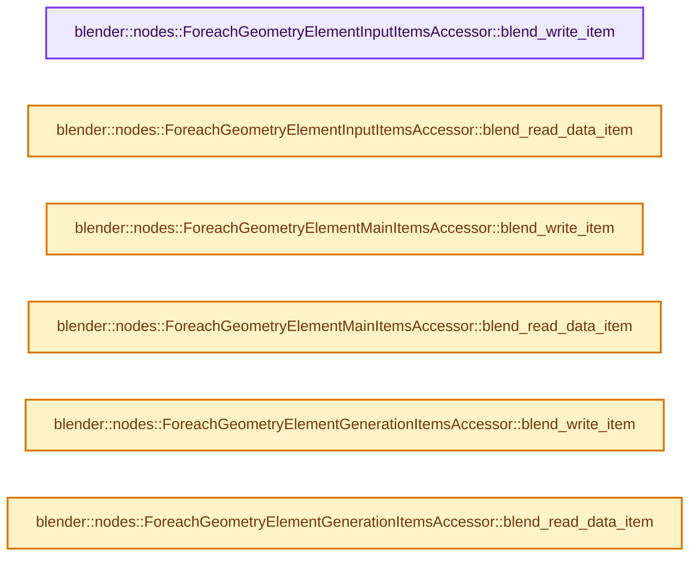
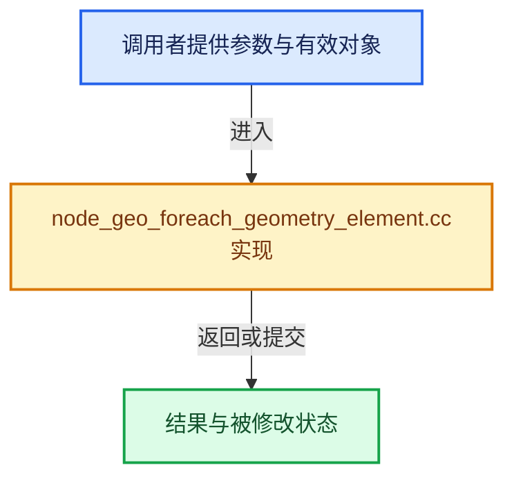

# 实现依赖专题：source/blender/nodes/geometry/nodes/node_geo_foreach_geometry_element.cc

[方向导航](README.md) · [符号索引](../%E7%AC%A6%E5%8F%B7%E4%BE%9D%E8%B5%96%E4%B8%8E%E5%AE%9E%E7%8E%B0%E7%B4%A2%E5%BC%95.md)

本专题从正文实际调用进入，集中保存共享实现。函数有稳定锚点，可从调用处直接跳到对应完整函数；递归与互相调用通过回链组织。

## 本文件的实现关系






## 完整成员与函数实现

<a id="f-5ed7f9d65a90852d"></a>

### `blender::nodes::ForeachGeometryElementInputItemsAccessor::blend_write_item`

实现位置：[source/blender/nodes/geometry/nodes/node_geo_foreach_geometry_element.cc](../../../../../source/blender/nodes/geometry/nodes/node_geo_foreach_geometry_element.cc) · L495—L499。

接口参数：

- `BlendWriter *writer`
- `const ItemT &item`

**教学注释版**

<!-- annotated:6a0f8f88a54f83 -->

```cpp
void ForeachGeometryElementInputItemsAccessor::blend_write_item(BlendWriter *writer,
                                                                const ItemT &item)
{
  writer->write_string(item.name);
}
```

<details>
<summary>核对原始源码：source/blender/nodes/geometry/nodes/node_geo_foreach_geometry_element.cc · L495—L499</summary>

<!-- original:6a0f8f88a54f83:source/blender/nodes/geometry/nodes/node_geo_foreach_geometry_element.cc:495:499 -->

```cpp
void ForeachGeometryElementInputItemsAccessor::blend_write_item(BlendWriter *writer,
                                                                const ItemT &item)
{
  writer->write_string(item.name);
}
```

</details>

**继续追踪实现**

- `writer->write_string` → [blender::BlendWriter::write_string · L2357](../05-%E5%87%A0%E4%BD%95%E5%AD%98%E5%82%A8%E4%B8%8E%E6%8B%93%E6%89%91%E6%98%A0%E5%B0%84/%E4%BE%9D%E8%B5%96-writefile-3eb36f.md#f-3fd83db72afbdcbe)。

<a id="f-7979e2b1c12ec694"></a>

### `blender::nodes::ForeachGeometryElementInputItemsAccessor::blend_read_data_item`

实现位置：[source/blender/nodes/geometry/nodes/node_geo_foreach_geometry_element.cc](../../../../../source/blender/nodes/geometry/nodes/node_geo_foreach_geometry_element.cc) · L501—L505。

接口参数：

- `BlendDataReader *reader`
- `ItemT &item`

**教学注释版**

<!-- annotated:0ddad6db6575ce -->

```cpp
void ForeachGeometryElementInputItemsAccessor::blend_read_data_item(BlendDataReader *reader,
                                                                    ItemT &item)
{
  BLO_read_string(reader, &item.name);
}
```

<details>
<summary>核对原始源码：source/blender/nodes/geometry/nodes/node_geo_foreach_geometry_element.cc · L501—L505</summary>

<!-- original:0ddad6db6575ce:source/blender/nodes/geometry/nodes/node_geo_foreach_geometry_element.cc:501:505 -->

```cpp
void ForeachGeometryElementInputItemsAccessor::blend_read_data_item(BlendDataReader *reader,
                                                                    ItemT &item)
{
  BLO_read_string(reader, &item.name);
}
```

</details>

**继续追踪实现**

- `BLO_read_string` → [BLO_read_string · L6348](../05-%E5%87%A0%E4%BD%95%E5%AD%98%E5%82%A8%E4%B8%8E%E6%8B%93%E6%89%91%E6%98%A0%E5%B0%84/%E4%BE%9D%E8%B5%96-readfile-05cc37.md#f-b9cb42e390941235)；[BLO_read_string · L6370](../05-%E5%87%A0%E4%BD%95%E5%AD%98%E5%82%A8%E4%B8%8E%E6%8B%93%E6%89%91%E6%98%A0%E5%B0%84/%E4%BE%9D%E8%B5%96-readfile-05cc37.md#f-1bb75b8661d718d2)；[BLO_read_string · L6375](../05-%E5%87%A0%E4%BD%95%E5%AD%98%E5%82%A8%E4%B8%8E%E6%8B%93%E6%89%91%E6%98%A0%E5%B0%84/%E4%BE%9D%E8%B5%96-readfile-05cc37.md#f-5714da923b3ad83d)。同名重载需按实参类型选择。

<a id="f-2818baf968b1d8fa"></a>

### `blender::nodes::ForeachGeometryElementMainItemsAccessor::blend_write_item`

实现位置：[source/blender/nodes/geometry/nodes/node_geo_foreach_geometry_element.cc](../../../../../source/blender/nodes/geometry/nodes/node_geo_foreach_geometry_element.cc) · L510—L514。

接口参数：

- `BlendWriter *writer`
- `const ItemT &item`

**教学注释版**

<!-- annotated:017a5a952d000e -->

```cpp
void ForeachGeometryElementMainItemsAccessor::blend_write_item(BlendWriter *writer,
                                                               const ItemT &item)
{
  writer->write_string(item.name);
}
```

<details>
<summary>核对原始源码：source/blender/nodes/geometry/nodes/node_geo_foreach_geometry_element.cc · L510—L514</summary>

<!-- original:017a5a952d000e:source/blender/nodes/geometry/nodes/node_geo_foreach_geometry_element.cc:510:514 -->

```cpp
void ForeachGeometryElementMainItemsAccessor::blend_write_item(BlendWriter *writer,
                                                               const ItemT &item)
{
  writer->write_string(item.name);
}
```

</details>

**继续追踪实现**

- `writer->write_string` → [blender::BlendWriter::write_string · L2357](../05-%E5%87%A0%E4%BD%95%E5%AD%98%E5%82%A8%E4%B8%8E%E6%8B%93%E6%89%91%E6%98%A0%E5%B0%84/%E4%BE%9D%E8%B5%96-writefile-3eb36f.md#f-3fd83db72afbdcbe)。

<a id="f-17e2c8d7504140ae"></a>

### `blender::nodes::ForeachGeometryElementMainItemsAccessor::blend_read_data_item`

实现位置：[source/blender/nodes/geometry/nodes/node_geo_foreach_geometry_element.cc](../../../../../source/blender/nodes/geometry/nodes/node_geo_foreach_geometry_element.cc) · L516—L520。

接口参数：

- `BlendDataReader *reader`
- `ItemT &item`

**教学注释版**

<!-- annotated:5d5126a7eede61 -->

```cpp
void ForeachGeometryElementMainItemsAccessor::blend_read_data_item(BlendDataReader *reader,
                                                                   ItemT &item)
{
  BLO_read_string(reader, &item.name);
}
```

<details>
<summary>核对原始源码：source/blender/nodes/geometry/nodes/node_geo_foreach_geometry_element.cc · L516—L520</summary>

<!-- original:5d5126a7eede61:source/blender/nodes/geometry/nodes/node_geo_foreach_geometry_element.cc:516:520 -->

```cpp
void ForeachGeometryElementMainItemsAccessor::blend_read_data_item(BlendDataReader *reader,
                                                                   ItemT &item)
{
  BLO_read_string(reader, &item.name);
}
```

</details>

**继续追踪实现**

- `BLO_read_string` → [BLO_read_string · L6348](../05-%E5%87%A0%E4%BD%95%E5%AD%98%E5%82%A8%E4%B8%8E%E6%8B%93%E6%89%91%E6%98%A0%E5%B0%84/%E4%BE%9D%E8%B5%96-readfile-05cc37.md#f-b9cb42e390941235)；[BLO_read_string · L6370](../05-%E5%87%A0%E4%BD%95%E5%AD%98%E5%82%A8%E4%B8%8E%E6%8B%93%E6%89%91%E6%98%A0%E5%B0%84/%E4%BE%9D%E8%B5%96-readfile-05cc37.md#f-1bb75b8661d718d2)；[BLO_read_string · L6375](../05-%E5%87%A0%E4%BD%95%E5%AD%98%E5%82%A8%E4%B8%8E%E6%8B%93%E6%89%91%E6%98%A0%E5%B0%84/%E4%BE%9D%E8%B5%96-readfile-05cc37.md#f-5714da923b3ad83d)。同名重载需按实参类型选择。

<a id="f-5bfcd7f0c79b06c5"></a>

### `blender::nodes::ForeachGeometryElementGenerationItemsAccessor::blend_write_item`

实现位置：[source/blender/nodes/geometry/nodes/node_geo_foreach_geometry_element.cc](../../../../../source/blender/nodes/geometry/nodes/node_geo_foreach_geometry_element.cc) · L525—L529。

接口参数：

- `BlendWriter *writer`
- `const ItemT &item`

**教学注释版**

<!-- annotated:b3b26fbddb6bf9 -->

```cpp
void ForeachGeometryElementGenerationItemsAccessor::blend_write_item(BlendWriter *writer,
                                                                     const ItemT &item)
{
  writer->write_string(item.name);
}
```

<details>
<summary>核对原始源码：source/blender/nodes/geometry/nodes/node_geo_foreach_geometry_element.cc · L525—L529</summary>

<!-- original:b3b26fbddb6bf9:source/blender/nodes/geometry/nodes/node_geo_foreach_geometry_element.cc:525:529 -->

```cpp
void ForeachGeometryElementGenerationItemsAccessor::blend_write_item(BlendWriter *writer,
                                                                     const ItemT &item)
{
  writer->write_string(item.name);
}
```

</details>

**继续追踪实现**

- `writer->write_string` → [blender::BlendWriter::write_string · L2357](../05-%E5%87%A0%E4%BD%95%E5%AD%98%E5%82%A8%E4%B8%8E%E6%8B%93%E6%89%91%E6%98%A0%E5%B0%84/%E4%BE%9D%E8%B5%96-writefile-3eb36f.md#f-3fd83db72afbdcbe)。

<a id="f-9546687d00bdd53a"></a>

### `blender::nodes::ForeachGeometryElementGenerationItemsAccessor::blend_read_data_item`

实现位置：[source/blender/nodes/geometry/nodes/node_geo_foreach_geometry_element.cc](../../../../../source/blender/nodes/geometry/nodes/node_geo_foreach_geometry_element.cc) · L531—L535。

接口参数：

- `BlendDataReader *reader`
- `ItemT &item`

**教学注释版**

<!-- annotated:883c9ce3ff5d1e -->

```cpp
void ForeachGeometryElementGenerationItemsAccessor::blend_read_data_item(BlendDataReader *reader,
                                                                         ItemT &item)
{
  BLO_read_string(reader, &item.name);
}
```

<details>
<summary>核对原始源码：source/blender/nodes/geometry/nodes/node_geo_foreach_geometry_element.cc · L531—L535</summary>

<!-- original:883c9ce3ff5d1e:source/blender/nodes/geometry/nodes/node_geo_foreach_geometry_element.cc:531:535 -->

```cpp
void ForeachGeometryElementGenerationItemsAccessor::blend_read_data_item(BlendDataReader *reader,
                                                                         ItemT &item)
{
  BLO_read_string(reader, &item.name);
}
```

</details>

**继续追踪实现**

- `BLO_read_string` → [BLO_read_string · L6348](../05-%E5%87%A0%E4%BD%95%E5%AD%98%E5%82%A8%E4%B8%8E%E6%8B%93%E6%89%91%E6%98%A0%E5%B0%84/%E4%BE%9D%E8%B5%96-readfile-05cc37.md#f-b9cb42e390941235)；[BLO_read_string · L6370](../05-%E5%87%A0%E4%BD%95%E5%AD%98%E5%82%A8%E4%B8%8E%E6%8B%93%E6%89%91%E6%98%A0%E5%B0%84/%E4%BE%9D%E8%B5%96-readfile-05cc37.md#f-1bb75b8661d718d2)；[BLO_read_string · L6375](../05-%E5%87%A0%E4%BD%95%E5%AD%98%E5%82%A8%E4%B8%8E%E6%8B%93%E6%89%91%E6%98%A0%E5%B0%84/%E4%BE%9D%E8%B5%96-readfile-05cc37.md#f-5714da923b3ad83d)。同名重载需按实参类型选择。
