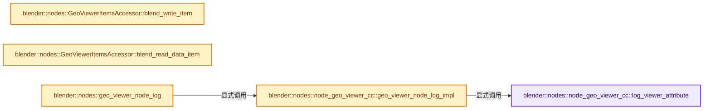

# 实现依赖专题：source/blender/nodes/geometry/nodes/node_geo_viewer.cc

[方向导航](README.md) · [符号索引](../%E7%AC%A6%E5%8F%B7%E4%BE%9D%E8%B5%96%E4%B8%8E%E5%AE%9E%E7%8E%B0%E7%B4%A2%E5%BC%95.md)

本专题从正文实际调用进入，集中保存共享实现。函数有稳定锚点，可从调用处直接跳到对应完整函数；递归与互相调用通过回链组织。

## 本文件的实现关系




## 完整成员与函数实现

<a id="f-8cae0844a4653d6e"></a>

### `blender::nodes::node_geo_viewer_cc::log_viewer_attribute`

实现位置：[source/blender/nodes/geometry/nodes/node_geo_viewer.cc](../../../../../source/blender/nodes/geometry/nodes/node_geo_viewer.cc) · L354—L426。

接口参数：

- `const bNode &node`
- `eval_log::ViewerNodeLog &r_log`

**教学注释版**

<!-- annotated:30f212650a01ec -->

```cpp
static void log_viewer_attribute(const bNode &node, eval_log::ViewerNodeLog &r_log)
{
  const auto &storage = *static_cast<NodeGeometryViewer *>(node.storage);
  const StringRef viewer_attribute_name = ".viewer";
  std::optional<int> last_geometry_identifier;
  for (const int i : IndexRange(storage.items_num)) {
    const bNodeSocket &bsocket = node.input_socket(i);
    const NodeGeometryViewerItem &item = storage.items[i];
    const bke::bNodeSocketType &type = *bsocket.typeinfo;
    const bke::SocketValueVariant &value = r_log.items.lookup_key_as(item.identifier).value;

    if (type.type == SOCK_GEOMETRY && value.is_single()) {
      last_geometry_identifier = item.identifier;
      continue;
    }
    if (!last_geometry_identifier) {
      continue;
    }
    if (!socket_type_supports_attributes(type.type)) {
      continue;
    }
    /* Changing the `value` field doesn't change the hash or equality of the item. */
    GMutablePointer geometry_ptr = const_cast<bke::SocketValueVariant &>(
                                       r_log.items.lookup_key_as(*last_geometry_identifier).value)
                                       .get();
    GeometrySet &geometry = *geometry_ptr.get<GeometrySet>();
    if (!(value.is_single() || value.is_field())) {
      continue;
    }
    const GField field = value.copy_as<GField>();
    const auto domain_or_auto = bke::AttrDomainSelection(storage.domain);
    if (domain_or_auto == bke::AttrDomainSelection::Instance) {
      if (geometry.has_instances()) {
        bke::GeometryComponent &component =
            geometry.get_component_for_write<bke::InstancesComponent>();
        bke::try_capture_field_on_geometry(
            component, viewer_attribute_name, AttrDomain::Instance, field);
      }
    }
    else {
      geometry::foreach_real_geometry(geometry, [&](GeometrySet &geometry) {
        for (const bke::GeometryComponent::Type type :
             {bke::GeometryComponent::Type::Mesh,
              bke::GeometryComponent::Type::PointCloud,
              bke::GeometryComponent::Type::Curve,
              bke::GeometryComponent::Type::GreasePencil})
        {
          if (!geometry.has(type)) {
            continue;
          }
          bke::GeometryComponent &component = geometry.get_component_for_write(type);
          AttrDomain used_domain;
          if (domain_or_auto == bke::AttrDomainSelection::Auto) {
            if (const std::optional<AttrDomain> domain = bke::try_detect_field_domain(component,
                                                                                      field))
            {
              used_domain = *domain;
            }
            else {
              used_domain = AttrDomain::Point;
            }
          }
          else {
            used_domain = bke::AttrDomain(domain_or_auto);
          }
          bke::try_capture_field_on_geometry(component, viewer_attribute_name, used_domain, field);
        }
      });
    }
    /* Avoid overriding the viewer attribute with other fields. */
    last_geometry_identifier.reset();
  }
}
```

<details>
<summary>核对原始源码：source/blender/nodes/geometry/nodes/node_geo_viewer.cc · L354—L426</summary>

<!-- original:30f212650a01ec:source/blender/nodes/geometry/nodes/node_geo_viewer.cc:354:426 -->

```cpp
static void log_viewer_attribute(const bNode &node, eval_log::ViewerNodeLog &r_log)
{
  const auto &storage = *static_cast<NodeGeometryViewer *>(node.storage);
  const StringRef viewer_attribute_name = ".viewer";
  std::optional<int> last_geometry_identifier;
  for (const int i : IndexRange(storage.items_num)) {
    const bNodeSocket &bsocket = node.input_socket(i);
    const NodeGeometryViewerItem &item = storage.items[i];
    const bke::bNodeSocketType &type = *bsocket.typeinfo;
    const bke::SocketValueVariant &value = r_log.items.lookup_key_as(item.identifier).value;

    if (type.type == SOCK_GEOMETRY && value.is_single()) {
      last_geometry_identifier = item.identifier;
      continue;
    }
    if (!last_geometry_identifier) {
      continue;
    }
    if (!socket_type_supports_attributes(type.type)) {
      continue;
    }
    /* Changing the `value` field doesn't change the hash or equality of the item. */
    GMutablePointer geometry_ptr = const_cast<bke::SocketValueVariant &>(
                                       r_log.items.lookup_key_as(*last_geometry_identifier).value)
                                       .get();
    GeometrySet &geometry = *geometry_ptr.get<GeometrySet>();
    if (!(value.is_single() || value.is_field())) {
      continue;
    }
    const GField field = value.copy_as<GField>();
    const auto domain_or_auto = bke::AttrDomainSelection(storage.domain);
    if (domain_or_auto == bke::AttrDomainSelection::Instance) {
      if (geometry.has_instances()) {
        bke::GeometryComponent &component =
            geometry.get_component_for_write<bke::InstancesComponent>();
        bke::try_capture_field_on_geometry(
            component, viewer_attribute_name, AttrDomain::Instance, field);
      }
    }
    else {
      geometry::foreach_real_geometry(geometry, [&](GeometrySet &geometry) {
        for (const bke::GeometryComponent::Type type :
             {bke::GeometryComponent::Type::Mesh,
              bke::GeometryComponent::Type::PointCloud,
              bke::GeometryComponent::Type::Curve,
              bke::GeometryComponent::Type::GreasePencil})
        {
          if (!geometry.has(type)) {
            continue;
          }
          bke::GeometryComponent &component = geometry.get_component_for_write(type);
          AttrDomain used_domain;
          if (domain_or_auto == bke::AttrDomainSelection::Auto) {
            if (const std::optional<AttrDomain> domain = bke::try_detect_field_domain(component,
                                                                                      field))
            {
              used_domain = *domain;
            }
            else {
              used_domain = AttrDomain::Point;
            }
          }
          else {
            used_domain = bke::AttrDomain(domain_or_auto);
          }
          bke::try_capture_field_on_geometry(component, viewer_attribute_name, used_domain, field);
        }
      });
    }
    /* Avoid overriding the viewer attribute with other fields. */
    last_geometry_identifier.reset();
  }
}
```

</details>

**沿实际写入检查状态**

- `last_geometry_identifier = item.identifier;`
- `used_domain = *domain;`
- `used_domain = AttrDomain::Point;`
- `used_domain = bke::AttrDomain(domain_or_auto);`

**继续追踪实现**

- `IndexRange` → [blender::IndexRange](../01-%E5%9F%BA%E7%A1%80%E5%AE%B9%E5%99%A8%E4%B8%8E%E7%8E%B0%E4%BB%A3CPP/%E4%BE%9D%E8%B5%96-BLI_index_range-7d7cc5.md#t-caa3466d6776)；[blender::gpu::shader::parser::IndexRange](../05-%E5%87%A0%E4%BD%95%E5%AD%98%E5%82%A8%E4%B8%8E%E6%8B%93%E6%89%91%E6%98%A0%E5%B0%84/%E4%BE%9D%E8%B5%96-utils-06433d.md#t-82d2bd4ea71c)；[blender::IndexRange](../05-%E5%87%A0%E4%BD%95%E5%AD%98%E5%82%A8%E4%B8%8E%E6%8B%93%E6%89%91%E6%98%A0%E5%B0%84/%E4%BE%9D%E8%B5%96-DNA_node_types-6708b9.md#t-0448cc889d39)。
- `node.input_socket` → [blender::bNode::input_socket · L818](../05-%E5%87%A0%E4%BD%95%E5%AD%98%E5%82%A8%E4%B8%8E%E6%8B%93%E6%89%91%E6%98%A0%E5%B0%84/%E4%BE%9D%E8%B5%96-BKE_node_runtime-ee561b.md#f-00274c021929d3dc)；[blender::bNode::input_socket · L830](../05-%E5%87%A0%E4%BD%95%E5%AD%98%E5%82%A8%E4%B8%8E%E6%8B%93%E6%89%91%E6%98%A0%E5%B0%84/%E4%BE%9D%E8%B5%96-BKE_node_runtime-ee561b.md#f-e9c8cccac4999eb8)。同名重载需按实参类型选择。
- `r_log.items.lookup_key_as` → [调用协议](../%E6%A8%A1%E6%9D%BF%E5%AE%8F%E4%B8%8E%E5%8A%A8%E6%80%81%E5%88%86%E6%B4%BE%E5%8D%8F%E8%AE%AE.md)：接收对象类型依赖auto、返回值或模板实例；不按同名猜测目标。调用位置L363。
- `value.is_single` → [SocketValueVariant::is_single · L501](../05-%E5%87%A0%E4%BD%95%E5%AD%98%E5%82%A8%E4%B8%8E%E6%8B%93%E6%89%91%E6%98%A0%E5%B0%84/%E4%BE%9D%E8%B5%96-node_socket_value-841c72.md#f-305458280511ae60)。
- `socket_type_supports_attributes` → [blender::nodes::socket_type_supports_attributes · L677](%E4%BE%9D%E8%B5%96-node_socket-0ca7fe.md#f-ebab61bf582595c6)。
- `const_cast<bke::SocketValueVariant &>( r_log.items.lookup_key_as(*last_geometry_identifier).value) .get` → [调用协议](../%E6%A8%A1%E6%9D%BF%E5%AE%8F%E4%B8%8E%E5%8A%A8%E6%80%81%E5%88%86%E6%B4%BE%E5%8D%8F%E8%AE%AE.md)：接收对象类型依赖auto、返回值或模板实例；不按同名猜测目标。调用位置L376。
- `geometry_ptr.get<GeometrySet>` → [blender::GMutablePointer::get · L41](../03-%E5%86%85%E5%AD%98%E5%88%86%E9%85%8D%E4%B8%8E%E8%BF%90%E8%A1%8C%E6%97%B6%E7%B1%BB%E5%9E%8B/12-%E5%BC%82%E6%9E%84%E5%80%BC%E5%AD%98%E5%82%A8%E5%AE%9E%E6%88%98.md#f-212d33f800c0316e)；[blender::GMutablePointer::get · L56](../03-%E5%86%85%E5%AD%98%E5%88%86%E9%85%8D%E4%B8%8E%E8%BF%90%E8%A1%8C%E6%97%B6%E7%B1%BB%E5%9E%8B/12-%E5%BC%82%E6%9E%84%E5%80%BC%E5%AD%98%E5%82%A8%E5%AE%9E%E6%88%98.md#f-f00e2816067f0feb)。同名重载需按实参类型选择。
- `value.is_field` → [SocketValueVariant::is_field · L516](../05-%E5%87%A0%E4%BD%95%E5%AD%98%E5%82%A8%E4%B8%8E%E6%8B%93%E6%89%91%E6%98%A0%E5%B0%84/%E4%BE%9D%E8%B5%96-node_socket_value-841c72.md#f-a047c02c1d9894fc)。
- `value.copy_as<GField>` → [blender::bke::SocketValueVariant::copy_as · L287](../05-%E5%87%A0%E4%BD%95%E5%AD%98%E5%82%A8%E4%B8%8E%E6%8B%93%E6%89%91%E6%98%A0%E5%B0%84/%E4%BE%9D%E8%B5%96-BKE_node_socket_value-24f0e5.md#f-81cc327789815ca1)。
- `bke::AttrDomainSelection` → [blender::bke::AttrDomainSelection](../05-%E5%87%A0%E4%BD%95%E5%AD%98%E5%82%A8%E4%B8%8E%E6%8B%93%E6%89%91%E6%98%A0%E5%B0%84/%E4%BE%9D%E8%B5%96-BKE_attribute_enums-4912bd.md#t-11e6e65d6c5c)。
- `geometry.has_instances` → [blender::bke::GeometrySet::has_instances · L381](../06-%E9%9A%90%E5%BC%8F%E5%85%B1%E4%BA%AB%E4%B8%8E%E7%BC%93%E5%AD%98%E7%B3%BB%E7%BB%9F/05-GeometrySet%E8%AF%BB%E5%86%99%E4%B8%8E%E5%A4%8D%E5%88%B6.md#f-96f474fc46f602f1)。
- `geometry.get_component_for_write<bke::InstancesComponent>` → [blender::bke::GeometrySet::get_component_for_write · L119](../06-%E9%9A%90%E5%BC%8F%E5%85%B1%E4%BA%AB%E4%B8%8E%E7%BC%93%E5%AD%98%E7%B3%BB%E7%BB%9F/05-GeometrySet%E8%AF%BB%E5%86%99%E4%B8%8E%E5%A4%8D%E5%88%B6.md#f-21eccb196f5b9a78)；[blender::bke::GeometrySet::get_component_for_write · L180](../06-%E9%9A%90%E5%BC%8F%E5%85%B1%E4%BA%AB%E4%B8%8E%E7%BC%93%E5%AD%98%E7%B3%BB%E7%BB%9F/04-GeometryComponent%E5%85%B1%E4%BA%AB.md#f-496855aef114a782)。同名重载需按实参类型选择。
- `bke::try_capture_field_on_geometry` → [blender::bke::try_capture_field_on_geometry · L527](../08-Field%E8%A1%A8%E8%BE%BE%E5%BC%8F%E4%B8%8E%E6%B1%82%E5%80%BC/10-%E5%87%A0%E4%BD%95%E4%B8%8A%E4%B8%8B%E6%96%87%E4%B8%8E%E5%B1%9E%E6%80%A7%E5%9F%9F.md#f-72eacdaeb9630253)；[blender::bke::try_capture_field_on_geometry · L543](../08-Field%E8%A1%A8%E8%BE%BE%E5%BC%8F%E4%B8%8E%E6%B1%82%E5%80%BC/10-%E5%87%A0%E4%BD%95%E4%B8%8A%E4%B8%8B%E6%96%87%E4%B8%8E%E5%B1%9E%E6%80%A7%E5%9F%9F.md#f-4232bd6552082375)；[blender::bke::try_capture_field_on_geometry · L557](../08-Field%E8%A1%A8%E8%BE%BE%E5%BC%8F%E4%B8%8E%E6%B1%82%E5%80%BC/10-%E5%87%A0%E4%BD%95%E4%B8%8A%E4%B8%8B%E6%96%87%E4%B8%8E%E5%B1%9E%E6%80%A7%E5%9F%9F.md#f-e9f28624aa26ddc4)。同名重载需按实参类型选择。
- `geometry::foreach_real_geometry` → [blender::geometry::foreach_real_geometry · L74](../05-%E5%87%A0%E4%BD%95%E5%AD%98%E5%82%A8%E4%B8%8E%E6%8B%93%E6%89%91%E6%98%A0%E5%B0%84/%E4%BE%9D%E8%B5%96-foreach_geometry-2f2ea3.md#f-eb93f253185d269c)。
- `geometry.has` → [blender::bke::GeometrySet::has · L142](../06-%E9%9A%90%E5%BC%8F%E5%85%B1%E4%BA%AB%E4%B8%8E%E7%BC%93%E5%AD%98%E7%B3%BB%E7%BB%9F/05-GeometrySet%E8%AF%BB%E5%86%99%E4%B8%8E%E5%A4%8D%E5%88%B6.md#f-5777be605a5451b6)；[blender::bke::GeometrySet::has · L202](../06-%E9%9A%90%E5%BC%8F%E5%85%B1%E4%BA%AB%E4%B8%8E%E7%BC%93%E5%AD%98%E7%B3%BB%E7%BB%9F/04-GeometryComponent%E5%85%B1%E4%BA%AB.md#f-5bb2e44dacf92a36)。同名重载需按实参类型选择。
- `geometry.get_component_for_write` → [blender::bke::GeometrySet::get_component_for_write · L119](../06-%E9%9A%90%E5%BC%8F%E5%85%B1%E4%BA%AB%E4%B8%8E%E7%BC%93%E5%AD%98%E7%B3%BB%E7%BB%9F/05-GeometrySet%E8%AF%BB%E5%86%99%E4%B8%8E%E5%A4%8D%E5%88%B6.md#f-21eccb196f5b9a78)；[blender::bke::GeometrySet::get_component_for_write · L180](../06-%E9%9A%90%E5%BC%8F%E5%85%B1%E4%BA%AB%E4%B8%8E%E7%BC%93%E5%AD%98%E7%B3%BB%E7%BB%9F/04-GeometryComponent%E5%85%B1%E4%BA%AB.md#f-496855aef114a782)。同名重载需按实参类型选择。
- `bke::try_detect_field_domain` → [blender::bke::try_detect_field_domain · L1242](../05-%E5%87%A0%E4%BD%95%E5%AD%98%E5%82%A8%E4%B8%8E%E6%8B%93%E6%89%91%E6%98%A0%E5%B0%84/09-%E5%B1%9E%E6%80%A7%E5%9F%9F%E4%B8%8E%E8%BD%AC%E6%8D%A2.md#f-cc6ad2248ff4ee63)。
- `bke::AttrDomain` → [blender::bke::AttrDomain](../05-%E5%87%A0%E4%BD%95%E5%AD%98%E5%82%A8%E4%B8%8E%E6%8B%93%E6%89%91%E6%98%A0%E5%B0%84/%E4%BE%9D%E8%B5%96-BKE_paint-5c7185.md#t-ae92b13feae6)；[blender::bke::AttrDomain](../05-%E5%87%A0%E4%BD%95%E5%AD%98%E5%82%A8%E4%B8%8E%E6%8B%93%E6%89%91%E6%98%A0%E5%B0%84/%E4%BE%9D%E8%B5%96-BKE_mesh-aad89c.md#t-f30c01e5b4fb)；[blender::bke::AttrDomain](../06-%E9%9A%90%E5%BC%8F%E5%85%B1%E4%BA%AB%E4%B8%8E%E7%BC%93%E5%AD%98%E7%B3%BB%E7%BB%9F/%E4%BE%9D%E8%B5%96-BKE_geometry_set-0a0da4.md#t-d8c3d48d64fd)；[blender::bke::AttrDomain](../05-%E5%87%A0%E4%BD%95%E5%AD%98%E5%82%A8%E4%B8%8E%E6%8B%93%E6%89%91%E6%98%A0%E5%B0%84/%E4%BE%9D%E8%B5%96-BKE_customdata-f70cc3.md#t-8bae57d2e84e)；[blender::bke::AttrDomain](../05-%E5%87%A0%E4%BD%95%E5%AD%98%E5%82%A8%E4%B8%8E%E6%8B%93%E6%89%91%E6%98%A0%E5%B0%84/%E4%BE%9D%E8%B5%96-BKE_curves-a4dcb4.md#t-3430ce450ac1)；[blender::bke::AttrDomain](../05-%E5%87%A0%E4%BD%95%E5%AD%98%E5%82%A8%E4%B8%8E%E6%8B%93%E6%89%91%E6%98%A0%E5%B0%84/%E4%BE%9D%E8%B5%96-BKE_attribute_storage-58c142.md#t-8c716c3bc0e2)；[blender::bke::AttrDomain](../05-%E5%87%A0%E4%BD%95%E5%AD%98%E5%82%A8%E4%B8%8E%E6%8B%93%E6%89%91%E6%98%A0%E5%B0%84/%E4%BE%9D%E8%B5%96-BKE_attribute_enums-4912bd.md#t-ab5d7f0de9b9)；[blender::bke::AttrDomain](../05-%E5%87%A0%E4%BD%95%E5%AD%98%E5%82%A8%E4%B8%8E%E6%8B%93%E6%89%91%E6%98%A0%E5%B0%84/%E4%BE%9D%E8%B5%96-BKE_attribute-613f58.md#t-6f4684f2acc6)；[blender::bke::AttrDomain](../05-%E5%87%A0%E4%BD%95%E5%AD%98%E5%82%A8%E4%B8%8E%E6%8B%93%E6%89%91%E6%98%A0%E5%B0%84/%E4%BE%9D%E8%B5%96-ED_grease_pencil-f07330.md#t-192388c4f6ee)；[blender::bke::AttrDomain](../05-%E5%87%A0%E4%BD%95%E5%AD%98%E5%82%A8%E4%B8%8E%E6%8B%93%E6%89%91%E6%98%A0%E5%B0%84/%E4%BE%9D%E8%B5%96-ED_geometry-b8393d.md#t-c6a71de8e2bd)；[blender::bke::AttrDomain](../05-%E5%87%A0%E4%BD%95%E5%AD%98%E5%82%A8%E4%B8%8E%E6%8B%93%E6%89%91%E6%98%A0%E5%B0%84/%E4%BE%9D%E8%B5%96-ED_curves-2ef205.md#t-18711a84bdb6)；[blender::bke::AttrDomain](../05-%E5%87%A0%E4%BD%95%E5%AD%98%E5%82%A8%E4%B8%8E%E6%8B%93%E6%89%91%E6%98%A0%E5%B0%84/%E4%BE%9D%E8%B5%96-draw_attributes-60ec88.md#t-d19aef280967)；[blender::bke::AttrDomain](../05-%E5%87%A0%E4%BD%95%E5%AD%98%E5%82%A8%E4%B8%8E%E6%8B%93%E6%89%91%E6%98%A0%E5%B0%84/%E4%BE%9D%E8%B5%96-sculpt_smooth-3ee437.md#t-95875e915616)；[blender::bke::AttrDomain](../05-%E5%87%A0%E4%BD%95%E5%AD%98%E5%82%A8%E4%B8%8E%E6%8B%93%E6%89%91%E6%98%A0%E5%B0%84/%E4%BE%9D%E8%B5%96-sculpt_color-9e6258.md#t-cd61c67682d8)；[blender::bke::AttrDomain](../05-%E5%87%A0%E4%BD%95%E5%AD%98%E5%82%A8%E4%B8%8E%E6%8B%93%E6%89%91%E6%98%A0%E5%B0%84/%E4%BE%9D%E8%B5%96-GEO_mesh_copy_selection-318d03.md#t-a77e129d699e)；[blender::bke::AttrDomain](../05-%E5%87%A0%E4%BD%95%E5%AD%98%E5%82%A8%E4%B8%8E%E6%8B%93%E6%89%91%E6%98%A0%E5%B0%84/%E4%BE%9D%E8%B5%96-DRW_pbvh-bc1e20.md#t-a2ee59fc840b)；[blender::bke::AttrDomain](../05-%E5%87%A0%E4%BD%95%E5%AD%98%E5%82%A8%E4%B8%8E%E6%8B%93%E6%89%91%E6%98%A0%E5%B0%84/%E4%BE%9D%E8%B5%96-bmesh_interp-09ee27.md#t-43fd5574e936)。
- `last_geometry_identifier.reset` → [外部契约](https://eel.is/c++draft/)：这个边界按实际表达式及所属类型核对参数、返回值、寿命与失败行为。这里提供接口入口，不声称已解释该第三方版本的内部实现。

<a id="f-904ea5bcf9c55136"></a>

### `blender::nodes::node_geo_viewer_cc::geo_viewer_node_log_impl`

实现位置：[source/blender/nodes/geometry/nodes/node_geo_viewer.cc](../../../../../source/blender/nodes/geometry/nodes/node_geo_viewer.cc) · L428—L445。

接口参数：

- `const bNode &node`
- `const Span<bke::SocketValueVariant *> input_values`
- `eval_log::ViewerNodeLog &r_log`

**教学注释版**

<!-- annotated:755100dca46f37 -->

```cpp
static void geo_viewer_node_log_impl(const bNode &node,
                                     const Span<bke::SocketValueVariant *> input_values,
                                     eval_log::ViewerNodeLog &r_log)
{
  const auto &storage = *static_cast<NodeGeometryViewer *>(node.storage);
  for (const int i : IndexRange(storage.items_num)) {
    void *src_value = input_values[i];
    if (!src_value) {
      continue;
    }
    const NodeGeometryViewerItem &item = storage.items[i];

    bke::SocketValueVariant &value = *input_values[i];
    value.ensure_owns_direct_data();
    // [讲解] std::move：把表达式转换成可供移动重载选择的值类别；不保证真的移动，不结束源对象寿命，对const值可能选择复制。
    r_log.items.add_new({item.identifier, item.name, std::move(value)});
  }
  log_viewer_attribute(node, r_log);
}
```

<details>
<summary>核对原始源码：source/blender/nodes/geometry/nodes/node_geo_viewer.cc · L428—L445</summary>

<!-- original:755100dca46f37:source/blender/nodes/geometry/nodes/node_geo_viewer.cc:428:445 -->

```cpp
static void geo_viewer_node_log_impl(const bNode &node,
                                     const Span<bke::SocketValueVariant *> input_values,
                                     eval_log::ViewerNodeLog &r_log)
{
  const auto &storage = *static_cast<NodeGeometryViewer *>(node.storage);
  for (const int i : IndexRange(storage.items_num)) {
    void *src_value = input_values[i];
    if (!src_value) {
      continue;
    }
    const NodeGeometryViewerItem &item = storage.items[i];

    bke::SocketValueVariant &value = *input_values[i];
    value.ensure_owns_direct_data();
    r_log.items.add_new({item.identifier, item.name, std::move(value)});
  }
  log_viewer_attribute(node, r_log);
}
```

</details>

**继续追踪实现**

- `IndexRange` → [blender::IndexRange](../01-%E5%9F%BA%E7%A1%80%E5%AE%B9%E5%99%A8%E4%B8%8E%E7%8E%B0%E4%BB%A3CPP/%E4%BE%9D%E8%B5%96-BLI_index_range-7d7cc5.md#t-caa3466d6776)；[blender::gpu::shader::parser::IndexRange](../05-%E5%87%A0%E4%BD%95%E5%AD%98%E5%82%A8%E4%B8%8E%E6%8B%93%E6%89%91%E6%98%A0%E5%B0%84/%E4%BE%9D%E8%B5%96-utils-06433d.md#t-82d2bd4ea71c)；[blender::IndexRange](../05-%E5%87%A0%E4%BD%95%E5%AD%98%E5%82%A8%E4%B8%8E%E6%8B%93%E6%89%91%E6%98%A0%E5%B0%84/%E4%BE%9D%E8%B5%96-DNA_node_types-6708b9.md#t-0448cc889d39)。
- `value.ensure_owns_direct_data` → [SocketValueVariant::ensure_owns_direct_data · L543](../05-%E5%87%A0%E4%BD%95%E5%AD%98%E5%82%A8%E4%B8%8E%E6%8B%93%E6%89%91%E6%98%A0%E5%B0%84/%E4%BE%9D%E8%B5%96-node_socket_value-841c72.md#f-2bfd70198d975fdc)。
- `r_log.items.add_new` → [调用协议](../%E6%A8%A1%E6%9D%BF%E5%AE%8F%E4%B8%8E%E5%8A%A8%E6%80%81%E5%88%86%E6%B4%BE%E5%8D%8F%E8%AE%AE.md)：接收对象类型依赖auto、返回值或模板实例；不按同名猜测目标。调用位置L442。
- `std::move` → [外部契约](https://eel.is/c++draft/utility.forward)：把表达式转换成可供移动重载选择的值类别；不保证真的移动，不结束源对象寿命，对const值可能选择复制。
- `log_viewer_attribute` → [blender::nodes::node_geo_viewer_cc::log_viewer_attribute · L354](%E4%BE%9D%E8%B5%96-node_geo_viewer-f93ed9.md#f-8cae0844a4653d6e)。

<a id="f-a3e3bffe0f7f7321"></a>

### `blender::nodes::GeoViewerItemsAccessor::blend_write_item`

实现位置：[source/blender/nodes/geometry/nodes/node_geo_viewer.cc](../../../../../source/blender/nodes/geometry/nodes/node_geo_viewer.cc) · L554—L558。

接口参数：

- `BlendWriter *writer`
- `const NodeGeometryViewerItem &item`

**教学注释版**

<!-- annotated:d3a4af5acbe1c8 -->

```cpp
void GeoViewerItemsAccessor::blend_write_item(BlendWriter *writer,
                                              const NodeGeometryViewerItem &item)
{
  writer->write_string(item.name);
}
```

<details>
<summary>核对原始源码：source/blender/nodes/geometry/nodes/node_geo_viewer.cc · L554—L558</summary>

<!-- original:d3a4af5acbe1c8:source/blender/nodes/geometry/nodes/node_geo_viewer.cc:554:558 -->

```cpp
void GeoViewerItemsAccessor::blend_write_item(BlendWriter *writer,
                                              const NodeGeometryViewerItem &item)
{
  writer->write_string(item.name);
}
```

</details>

**继续追踪实现**

- `writer->write_string` → [blender::BlendWriter::write_string · L2357](../05-%E5%87%A0%E4%BD%95%E5%AD%98%E5%82%A8%E4%B8%8E%E6%8B%93%E6%89%91%E6%98%A0%E5%B0%84/%E4%BE%9D%E8%B5%96-writefile-3eb36f.md#f-3fd83db72afbdcbe)。

<a id="f-245b1eccba5ceb44"></a>

### `blender::nodes::GeoViewerItemsAccessor::blend_read_data_item`

实现位置：[source/blender/nodes/geometry/nodes/node_geo_viewer.cc](../../../../../source/blender/nodes/geometry/nodes/node_geo_viewer.cc) · L560—L564。

接口参数：

- `BlendDataReader *reader`
- `NodeGeometryViewerItem &item`

**教学注释版**

<!-- annotated:1dd3b40e0e1067 -->

```cpp
void GeoViewerItemsAccessor::blend_read_data_item(BlendDataReader *reader,
                                                  NodeGeometryViewerItem &item)
{
  BLO_read_string(reader, &item.name);
}
```

<details>
<summary>核对原始源码：source/blender/nodes/geometry/nodes/node_geo_viewer.cc · L560—L564</summary>

<!-- original:1dd3b40e0e1067:source/blender/nodes/geometry/nodes/node_geo_viewer.cc:560:564 -->

```cpp
void GeoViewerItemsAccessor::blend_read_data_item(BlendDataReader *reader,
                                                  NodeGeometryViewerItem &item)
{
  BLO_read_string(reader, &item.name);
}
```

</details>

**继续追踪实现**

- `BLO_read_string` → [BLO_read_string · L6348](../05-%E5%87%A0%E4%BD%95%E5%AD%98%E5%82%A8%E4%B8%8E%E6%8B%93%E6%89%91%E6%98%A0%E5%B0%84/%E4%BE%9D%E8%B5%96-readfile-05cc37.md#f-b9cb42e390941235)；[BLO_read_string · L6370](../05-%E5%87%A0%E4%BD%95%E5%AD%98%E5%82%A8%E4%B8%8E%E6%8B%93%E6%89%91%E6%98%A0%E5%B0%84/%E4%BE%9D%E8%B5%96-readfile-05cc37.md#f-1bb75b8661d718d2)；[BLO_read_string · L6375](../05-%E5%87%A0%E4%BD%95%E5%AD%98%E5%82%A8%E4%B8%8E%E6%8B%93%E6%89%91%E6%98%A0%E5%B0%84/%E4%BE%9D%E8%B5%96-readfile-05cc37.md#f-5714da923b3ad83d)。同名重载需按实参类型选择。

<a id="f-6403d92fd5815ea9"></a>

### `blender::nodes::geo_viewer_node_log`

实现位置：[source/blender/nodes/geometry/nodes/node_geo_viewer.cc](../../../../../source/blender/nodes/geometry/nodes/node_geo_viewer.cc) · L566—L571。

接口参数：

- `const bNode &node`
- `const Span<bke::SocketValueVariant *> input_values`
- `eval_log::ViewerNodeLog &r_log`

**教学注释版**

<!-- annotated:58eab2f4ac053b -->

```cpp
void geo_viewer_node_log(const bNode &node,
                         const Span<bke::SocketValueVariant *> input_values,
                         eval_log::ViewerNodeLog &r_log)
{
  node_geo_viewer_cc::geo_viewer_node_log_impl(node, input_values, r_log);
}
```

<details>
<summary>核对原始源码：source/blender/nodes/geometry/nodes/node_geo_viewer.cc · L566—L571</summary>

<!-- original:58eab2f4ac053b:source/blender/nodes/geometry/nodes/node_geo_viewer.cc:566:571 -->

```cpp
void geo_viewer_node_log(const bNode &node,
                         const Span<bke::SocketValueVariant *> input_values,
                         eval_log::ViewerNodeLog &r_log)
{
  node_geo_viewer_cc::geo_viewer_node_log_impl(node, input_values, r_log);
}
```

</details>

**继续追踪实现**

- `node_geo_viewer_cc::geo_viewer_node_log_impl` → [blender::nodes::node_geo_viewer_cc::geo_viewer_node_log_impl · L428](%E4%BE%9D%E8%B5%96-node_geo_viewer-f93ed9.md#f-904ea5bcf9c55136)。
