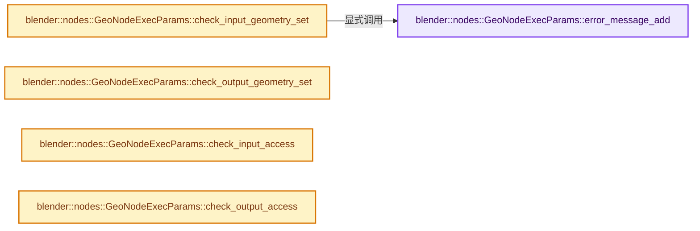
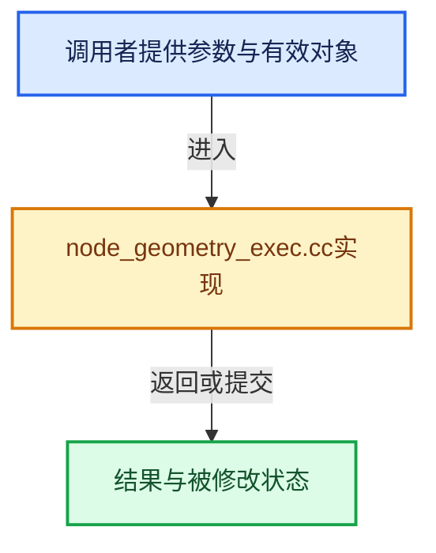

# 实现依赖专题：source/blender/nodes/intern/node_geometry_exec.cc

[方向导航](README.md) · [符号索引](../%E7%AC%A6%E5%8F%B7%E4%BE%9D%E8%B5%96%E4%B8%8E%E5%AE%9E%E7%8E%B0%E7%B4%A2%E5%BC%95.md)

本专题从正文实际调用进入，集中保存共享实现。函数有稳定锚点，可从调用处直接跳到对应完整函数；递归与互相调用通过回链组织。

## 本文件的实现关系






## 完整成员与函数实现

<a id="f-0ce956e2dc74715c"></a>

### `blender::nodes::GeoNodeExecParams::error_message_add`

实现位置：[source/blender/nodes/intern/node_geometry_exec.cc](../../../../../source/blender/nodes/intern/node_geometry_exec.cc) · L39—L47。

接口参数：

- `const NodeWarningType type`
- `const StringRef message`

**教学注释版**

<!-- annotated:6e87d5b5b87119 -->

```cpp
void GeoNodeExecParams::error_message_add(const NodeWarningType type,
                                          const StringRef message) const
{
  if (eval_log::NodeTreeLogger *tree_logger = this->get_local_tree_logger()) {
    tree_logger->node_warnings.append(
        *tree_logger->allocator,
        {node_.identifier, {type, tree_logger->allocator->copy_string(message)}});
  }
}
```

<details>
<summary>核对原始源码：source/blender/nodes/intern/node_geometry_exec.cc · L39—L47</summary>

<!-- original:6e87d5b5b87119:source/blender/nodes/intern/node_geometry_exec.cc:39:47 -->

```cpp
void GeoNodeExecParams::error_message_add(const NodeWarningType type,
                                          const StringRef message) const
{
  if (eval_log::NodeTreeLogger *tree_logger = this->get_local_tree_logger()) {
    tree_logger->node_warnings.append(
        *tree_logger->allocator,
        {node_.identifier, {type, tree_logger->allocator->copy_string(message)}});
  }
}
```

</details>

**继续追踪实现**

- `this->get_local_tree_logger` → [blender::nodes::GeoNodeExecParams::get_local_tree_logger · L228](%E4%BE%9D%E8%B5%96-NOD_geometry_exec-680a5a.md#f-d4151dabae1da5a2)。
- `tree_logger->node_warnings.append` → [调用协议](../%E6%A8%A1%E6%9D%BF%E5%AE%8F%E4%B8%8E%E5%8A%A8%E6%80%81%E5%88%86%E6%B4%BE%E5%8D%8F%E8%AE%AE.md)：接收对象类型依赖auto、返回值或模板实例；不按同名猜测目标。调用位置L43。
- `tree_logger->allocator->copy_string` → [调用协议](../%E6%A8%A1%E6%9D%BF%E5%AE%8F%E4%B8%8E%E5%8A%A8%E6%80%81%E5%88%86%E6%B4%BE%E5%8D%8F%E8%AE%AE.md)：接收对象类型依赖auto、返回值或模板实例；不按同名猜测目标。调用位置L45。

<a id="f-3a305c5390bc6662"></a>

### `blender::nodes::GeoNodeExecParams::check_input_geometry_set`

实现位置：[source/blender/nodes/intern/node_geometry_exec.cc](../../../../../source/blender/nodes/intern/node_geometry_exec.cc) · L59—L149。

接口参数：

- `UString identifier`
- `const GeometrySet &geometry_set`

**教学注释版**

<!-- annotated:d451e5dec50766 -->

```cpp
void GeoNodeExecParams::check_input_geometry_set(UString identifier,
                                                 const GeometrySet &geometry_set) const
{
  const SocketDeclaration &decl = *node_.input_by_identifier(identifier)->runtime->declaration;
  const decl::Geometry *geo_decl = dynamic_cast<const decl::Geometry *>(&decl);
  if (geo_decl == nullptr) {
    return;
  }

  const bool only_realized_data = geo_decl->only_realized_data();
  const bool only_instances = geo_decl->only_instances();
  const Span<GeometryComponent::Type> supported_types = geo_decl->supported_types();

  if (only_realized_data) {
    if (geometry_set.has_instances()) {
      this->error_message_add(NodeWarningType::Info,
                              TIP_("Instances in input geometry are ignored"));
    }
  }
  if (only_instances) {
    if (geometry_set.has_realized_data()) {
      this->error_message_add(NodeWarningType::Info,
                              TIP_("Realized data in input geometry is ignored"));
    }
  }
  // [讲解] supported_types.is_empty：查询视图长度或生成对应有效索引区间。
  if (supported_types.is_empty()) {
    /* Assume all types are supported. */
    return;
  }
  const Vector<GeometryComponent::Type> types_in_geometry = geometry_set.gather_component_types(
      true, true);
  for (const GeometryComponent::Type type : types_in_geometry) {
    if (type == GeometryComponent::Type::Instance) {
      continue;
    }
    if (supported_types.contains(type)) {
      continue;
    }
    std::string message = RPT_("Input geometry has unsupported type: ");
    switch (type) {
      case GeometryComponent::Type::Mesh: {
        if (const Mesh *mesh = geometry_set.get_mesh()) {
          if (mesh->verts_num == 0) {
            continue;
          }
        }
        message += RPT_("Mesh");
        break;
      }
      case GeometryComponent::Type::PointCloud: {
        if (const PointCloud *pointcloud = geometry_set.get_pointcloud()) {
          if (pointcloud->totpoint == 0) {
            continue;
          }
        }
        message += RPT_("Point Cloud");
        break;
      }
      case GeometryComponent::Type::Instance: {
        BLI_assert_unreachable();
        break;
      }
      case GeometryComponent::Type::Volume: {
        message += CTX_RPT_(BLT_I18NCONTEXT_ID_ID, "Volume");
        break;
      }
      case GeometryComponent::Type::Curve: {
        if (const Curves *curves = geometry_set.get_curves()) {
          if (curves->geometry.point_num == 0) {
            continue;
          }
        }
        message += RPT_("Curve");
        break;
      }
      case GeometryComponent::Type::Edit: {
        continue;
      }
      case GeometryComponent::Type::GreasePencil: {
        if (const GreasePencil *grease_pencil = geometry_set.get_grease_pencil()) {
          if (grease_pencil->drawing_array_num == 0) {
            continue;
          }
        }
        message += RPT_("Grease Pencil");
        break;
      }
    }
    // [讲解] std::move：把表达式转换成可供移动重载选择的值类别；不保证真的移动，不结束源对象寿命，对const值可能选择复制。
    this->error_message_add(NodeWarningType::Info, std::move(message));
  }
}
```

<details>
<summary>核对原始源码：source/blender/nodes/intern/node_geometry_exec.cc · L59—L149</summary>

<!-- original:d451e5dec50766:source/blender/nodes/intern/node_geometry_exec.cc:59:149 -->

```cpp
void GeoNodeExecParams::check_input_geometry_set(UString identifier,
                                                 const GeometrySet &geometry_set) const
{
  const SocketDeclaration &decl = *node_.input_by_identifier(identifier)->runtime->declaration;
  const decl::Geometry *geo_decl = dynamic_cast<const decl::Geometry *>(&decl);
  if (geo_decl == nullptr) {
    return;
  }

  const bool only_realized_data = geo_decl->only_realized_data();
  const bool only_instances = geo_decl->only_instances();
  const Span<GeometryComponent::Type> supported_types = geo_decl->supported_types();

  if (only_realized_data) {
    if (geometry_set.has_instances()) {
      this->error_message_add(NodeWarningType::Info,
                              TIP_("Instances in input geometry are ignored"));
    }
  }
  if (only_instances) {
    if (geometry_set.has_realized_data()) {
      this->error_message_add(NodeWarningType::Info,
                              TIP_("Realized data in input geometry is ignored"));
    }
  }
  if (supported_types.is_empty()) {
    /* Assume all types are supported. */
    return;
  }
  const Vector<GeometryComponent::Type> types_in_geometry = geometry_set.gather_component_types(
      true, true);
  for (const GeometryComponent::Type type : types_in_geometry) {
    if (type == GeometryComponent::Type::Instance) {
      continue;
    }
    if (supported_types.contains(type)) {
      continue;
    }
    std::string message = RPT_("Input geometry has unsupported type: ");
    switch (type) {
      case GeometryComponent::Type::Mesh: {
        if (const Mesh *mesh = geometry_set.get_mesh()) {
          if (mesh->verts_num == 0) {
            continue;
          }
        }
        message += RPT_("Mesh");
        break;
      }
      case GeometryComponent::Type::PointCloud: {
        if (const PointCloud *pointcloud = geometry_set.get_pointcloud()) {
          if (pointcloud->totpoint == 0) {
            continue;
          }
        }
        message += RPT_("Point Cloud");
        break;
      }
      case GeometryComponent::Type::Instance: {
        BLI_assert_unreachable();
        break;
      }
      case GeometryComponent::Type::Volume: {
        message += CTX_RPT_(BLT_I18NCONTEXT_ID_ID, "Volume");
        break;
      }
      case GeometryComponent::Type::Curve: {
        if (const Curves *curves = geometry_set.get_curves()) {
          if (curves->geometry.point_num == 0) {
            continue;
          }
        }
        message += RPT_("Curve");
        break;
      }
      case GeometryComponent::Type::Edit: {
        continue;
      }
      case GeometryComponent::Type::GreasePencil: {
        if (const GreasePencil *grease_pencil = geometry_set.get_grease_pencil()) {
          if (grease_pencil->drawing_array_num == 0) {
            continue;
          }
        }
        message += RPT_("Grease Pencil");
        break;
      }
    }
    this->error_message_add(NodeWarningType::Info, std::move(message));
  }
}
```

</details>

**沿实际写入检查状态**

- `message += RPT_("Mesh");`
- `message += RPT_("Point Cloud");`
- `message += CTX_RPT_(BLT_I18NCONTEXT_ID_ID, "Volume");`
- `message += RPT_("Curve");`
- `message += RPT_("Grease Pencil");`

**继续追踪实现**

- `node_.input_by_identifier` → [调用协议](../%E6%A8%A1%E6%9D%BF%E5%AE%8F%E4%B8%8E%E5%8A%A8%E6%80%81%E5%88%86%E6%B4%BE%E5%8D%8F%E8%AE%AE.md)：接收对象类型依赖auto、返回值或模板实例；不按同名猜测目标。调用位置L62。
- `geo_decl->only_realized_data` → [blender::nodes::decl::Geometry::only_realized_data · L984](%E4%BE%9D%E8%B5%96-node_socket_declarations-fb0eb9.md#f-4e6ec77196258b2f)。
- `geo_decl->only_instances` → [blender::nodes::decl::Geometry::only_instances · L989](%E4%BE%9D%E8%B5%96-node_socket_declarations-fb0eb9.md#f-0a874a242fc45af5)。
- `geo_decl->supported_types` → [blender::nodes::decl::Geometry::supported_types · L979](%E4%BE%9D%E8%B5%96-node_socket_declarations-fb0eb9.md#f-8d91e1f0a37e645d)。
- `geometry_set.has_instances` → [blender::bke::GeometrySet::has_instances · L381](../06-%E9%9A%90%E5%BC%8F%E5%85%B1%E4%BA%AB%E4%B8%8E%E7%BC%93%E5%AD%98%E7%B3%BB%E7%BB%9F/05-GeometrySet%E8%AF%BB%E5%86%99%E4%B8%8E%E5%A4%8D%E5%88%B6.md#f-96f474fc46f602f1)。
- `this->error_message_add` → [blender::nodes::GeoNodeExecParams::error_message_add · L39](%E4%BE%9D%E8%B5%96-node_geometry_exec-581247.md#f-0ce956e2dc74715c)。
- `TIP_` → [TIP_ · L50](../05-%E5%87%A0%E4%BD%95%E5%AD%98%E5%82%A8%E4%B8%8E%E6%8B%93%E6%89%91%E6%98%A0%E5%B0%84/%E4%BE%9D%E8%B5%96-BLT_translation-c89e58.md#m-42b98cfb3af1)。宏定义由构建条件选择。
- `geometry_set.has_realized_data` → [blender::bke::GeometrySet::has_realized_data · L400](../06-%E9%9A%90%E5%BC%8F%E5%85%B1%E4%BA%AB%E4%B8%8E%E7%BC%93%E5%AD%98%E7%B3%BB%E7%BB%9F/05-GeometrySet%E8%AF%BB%E5%86%99%E4%B8%8E%E5%A4%8D%E5%88%B6.md#f-3fef05062f1b2a03)。
- `supported_types.is_empty` → [blender::Span::is_empty · L264](../01-%E5%9F%BA%E7%A1%80%E5%AE%B9%E5%99%A8%E4%B8%8E%E7%8E%B0%E4%BB%A3CPP/05-Span%E5%8F%AA%E8%AF%BB%E8%BF%9E%E7%BB%AD%E8%A7%86%E5%9B%BE.md#f-8cc1d7ba8feb50e6)。
- `geometry_set.gather_component_types` → [blender::bke::GeometrySet::gather_component_types · L751](../06-%E9%9A%90%E5%BC%8F%E5%85%B1%E4%BA%AB%E4%B8%8E%E7%BC%93%E5%AD%98%E7%B3%BB%E7%BB%9F/05-GeometrySet%E8%AF%BB%E5%86%99%E4%B8%8E%E5%A4%8D%E5%88%B6.md#f-4e435cce666ede4e)。
- `supported_types.contains` → [blender::Span::contains · L281](../01-%E5%9F%BA%E7%A1%80%E5%AE%B9%E5%99%A8%E4%B8%8E%E7%8E%B0%E4%BB%A3CPP/05-Span%E5%8F%AA%E8%AF%BB%E8%BF%9E%E7%BB%AD%E8%A7%86%E5%9B%BE.md#f-7caee498c984f2c0)。
- `RPT_` → [RPT_ · L51](../05-%E5%87%A0%E4%BD%95%E5%AD%98%E5%82%A8%E4%B8%8E%E6%8B%93%E6%89%91%E6%98%A0%E5%B0%84/%E4%BE%9D%E8%B5%96-BLT_translation-c89e58.md#m-c13f94a1a934)。宏定义由构建条件选择。
- `geometry_set.get_mesh` → [blender::bke::GeometrySet::get_mesh · L315](../06-%E9%9A%90%E5%BC%8F%E5%85%B1%E4%BA%AB%E4%B8%8E%E7%BC%93%E5%AD%98%E7%B3%BB%E7%BB%9F/05-GeometrySet%E8%AF%BB%E5%86%99%E4%B8%8E%E5%A4%8D%E5%88%B6.md#f-25151145065d998b)。
- `geometry_set.get_pointcloud` → [blender::bke::GeometrySet::get_pointcloud · L327](../06-%E9%9A%90%E5%BC%8F%E5%85%B1%E4%BA%AB%E4%B8%8E%E7%BC%93%E5%AD%98%E7%B3%BB%E7%BB%9F/05-GeometrySet%E8%AF%BB%E5%86%99%E4%B8%8E%E5%A4%8D%E5%88%B6.md#f-e9c60234d315f635)。
- `BLI_assert_unreachable` → [BLI_assert_unreachable · L77](../01-%E5%9F%BA%E7%A1%80%E5%AE%B9%E5%99%A8%E4%B8%8E%E7%8E%B0%E4%BB%A3CPP/%E4%BE%9D%E8%B5%96-BLI_assert-cc98e8.md#m-7a2d91a67d8e)。宏定义由构建条件选择。
- `CTX_RPT_` → [CTX_RPT_ · L55](../05-%E5%87%A0%E4%BD%95%E5%AD%98%E5%82%A8%E4%B8%8E%E6%8B%93%E6%89%91%E6%98%A0%E5%B0%84/%E4%BE%9D%E8%B5%96-BLT_translation-c89e58.md#m-12a0431162d5)。宏定义由构建条件选择。
- `geometry_set.get_curves` → [blender::bke::GeometrySet::get_curves · L339](../06-%E9%9A%90%E5%BC%8F%E5%85%B1%E4%BA%AB%E4%B8%8E%E7%BC%93%E5%AD%98%E7%B3%BB%E7%BB%9F/05-GeometrySet%E8%AF%BB%E5%86%99%E4%B8%8E%E5%A4%8D%E5%88%B6.md#f-1d7b3a3ddbc6c57b)。
- `geometry_set.get_grease_pencil` → [blender::bke::GeometrySet::get_grease_pencil · L369](../06-%E9%9A%90%E5%BC%8F%E5%85%B1%E4%BA%AB%E4%B8%8E%E7%BC%93%E5%AD%98%E7%B3%BB%E7%BB%9F/05-GeometrySet%E8%AF%BB%E5%86%99%E4%B8%8E%E5%A4%8D%E5%88%B6.md#f-4c73d7995c66f8bf)。
- `std::move` → [外部契约](https://eel.is/c++draft/utility.forward)：把表达式转换成可供移动重载选择的值类别；不保证真的移动，不结束源对象寿命，对const值可能选择复制。

<a id="f-fcdedcc227a09a05"></a>

### `blender::nodes::GeoNodeExecParams::check_output_geometry_set`

实现位置：[source/blender/nodes/intern/node_geometry_exec.cc](../../../../../source/blender/nodes/intern/node_geometry_exec.cc) · L151—L161。

接口参数：

- `const GeometrySet &geometry_set`

**教学注释版**

<!-- annotated:4a3fbaebad1cfa -->

```cpp
void GeoNodeExecParams::check_output_geometry_set(const GeometrySet &geometry_set) const
{
  UNUSED_VARS_NDEBUG(geometry_set);
#ifndef NDEBUG
  if (const bke::CurvesEditHints *curve_edit_hints = geometry_set.get_curve_edit_hints()) {
    /* If this is not valid, it's likely that the number of stored deformed points does not match
     * the number of points in the original data. */
    BLI_assert(curve_edit_hints->is_valid());
  }
#endif
}
```

<details>
<summary>核对原始源码：source/blender/nodes/intern/node_geometry_exec.cc · L151—L161</summary>

<!-- original:4a3fbaebad1cfa:source/blender/nodes/intern/node_geometry_exec.cc:151:161 -->

```cpp
void GeoNodeExecParams::check_output_geometry_set(const GeometrySet &geometry_set) const
{
  UNUSED_VARS_NDEBUG(geometry_set);
#ifndef NDEBUG
  if (const bke::CurvesEditHints *curve_edit_hints = geometry_set.get_curve_edit_hints()) {
    /* If this is not valid, it's likely that the number of stored deformed points does not match
     * the number of points in the original data. */
    BLI_assert(curve_edit_hints->is_valid());
  }
#endif
}
```

</details>

**继续追踪实现**

- `UNUSED_VARS_NDEBUG` → [UNUSED_VARS_NDEBUG · L526](../01-%E5%9F%BA%E7%A1%80%E5%AE%B9%E5%99%A8%E4%B8%8E%E7%8E%B0%E4%BB%A3CPP/%E4%BE%9D%E8%B5%96-BLI_utildefines-293a0a.md#m-fea439f7d366)；[UNUSED_VARS_NDEBUG · L528](../01-%E5%9F%BA%E7%A1%80%E5%AE%B9%E5%99%A8%E4%B8%8E%E7%8E%B0%E4%BB%A3CPP/%E4%BE%9D%E8%B5%96-BLI_utildefines-293a0a.md#m-a8f8cfac06c0)。宏定义由构建条件选择。
- `geometry_set.get_curve_edit_hints` → [blender::bke::GeometrySet::get_curve_edit_hints · L351](../06-%E9%9A%90%E5%BC%8F%E5%85%B1%E4%BA%AB%E4%B8%8E%E7%BC%93%E5%AD%98%E7%B3%BB%E7%BB%9F/05-GeometrySet%E8%AF%BB%E5%86%99%E4%B8%8E%E5%A4%8D%E5%88%B6.md#f-0f0a70818546603c)。
- `BLI_assert` → [BLI_assert · L48](../01-%E5%9F%BA%E7%A1%80%E5%AE%B9%E5%99%A8%E4%B8%8E%E7%8E%B0%E4%BB%A3CPP/%E4%BE%9D%E8%B5%96-BLI_assert-cc98e8.md#m-57a88495704d)；[BLI_assert · L63](../01-%E5%9F%BA%E7%A1%80%E5%AE%B9%E5%99%A8%E4%B8%8E%E7%8E%B0%E4%BB%A3CPP/%E4%BE%9D%E8%B5%96-BLI_assert-cc98e8.md#m-d07050020cb5)。宏定义由构建条件选择。
- `curve_edit_hints->is_valid` → [blender::bke::CurvesEditHints::is_valid · L367](../05-%E5%87%A0%E4%BD%95%E5%AD%98%E5%82%A8%E4%B8%8E%E6%8B%93%E6%89%91%E6%98%A0%E5%B0%84/%E4%BE%9D%E8%B5%96-curves-fcb14d.md#f-47e07c8e18ad1b57)。

<a id="f-f7fbf25862b785db"></a>

### `blender::nodes::GeoNodeExecParams::check_input_access`

实现位置：[source/blender/nodes/intern/node_geometry_exec.cc](../../../../../source/blender/nodes/intern/node_geometry_exec.cc) · L168—L195。

接口参数：

- `const UString identifier`

**教学注释版**

<!-- annotated:7d4398a0765741 -->

```cpp
void GeoNodeExecParams::check_input_access(const UString identifier) const
{
  const bNodeSocket *found_socket = nullptr;
  for (const bNodeSocket *socket : node_.input_sockets()) {
    if (socket->identifier_ustr() == identifier) {
      found_socket = socket;
      break;
    }
  }

  if (found_socket == nullptr) {
    std::cout << "Did not find an input socket with the identifier '" << identifier.ref()
              << "'.\n";
    std::cout << "Possible identifiers are: ";
    for (const bNodeSocket *socket : node_.input_sockets()) {
      if (socket->is_available()) {
        std::cout << "'" << socket->identifier << "', ";
      }
    }
    std::cout << "\n";
    BLI_assert_unreachable();
  }
  else if (found_socket->flag & SOCK_UNAVAIL) {
    std::cout << "The socket corresponding to the identifier '" << identifier.ref()
              << "' is disabled.\n";
    BLI_assert_unreachable();
  }
}
```

<details>
<summary>核对原始源码：source/blender/nodes/intern/node_geometry_exec.cc · L168—L195</summary>

<!-- original:7d4398a0765741:source/blender/nodes/intern/node_geometry_exec.cc:168:195 -->

```cpp
void GeoNodeExecParams::check_input_access(const UString identifier) const
{
  const bNodeSocket *found_socket = nullptr;
  for (const bNodeSocket *socket : node_.input_sockets()) {
    if (socket->identifier_ustr() == identifier) {
      found_socket = socket;
      break;
    }
  }

  if (found_socket == nullptr) {
    std::cout << "Did not find an input socket with the identifier '" << identifier.ref()
              << "'.\n";
    std::cout << "Possible identifiers are: ";
    for (const bNodeSocket *socket : node_.input_sockets()) {
      if (socket->is_available()) {
        std::cout << "'" << socket->identifier << "', ";
      }
    }
    std::cout << "\n";
    BLI_assert_unreachable();
  }
  else if (found_socket->flag & SOCK_UNAVAIL) {
    std::cout << "The socket corresponding to the identifier '" << identifier.ref()
              << "' is disabled.\n";
    BLI_assert_unreachable();
  }
}
```

</details>

**沿实际写入检查状态**

- `found_socket = socket;`

**继续追踪实现**

- `node_.input_sockets` → [调用协议](../%E6%A8%A1%E6%9D%BF%E5%AE%8F%E4%B8%8E%E5%8A%A8%E6%80%81%E5%88%86%E6%B4%BE%E5%8D%8F%E8%AE%AE.md)：接收对象类型依赖auto、返回值或模板实例；不按同名猜测目标。调用位置L171。
- `socket->identifier_ustr` → [调用协议](../%E6%A8%A1%E6%9D%BF%E5%AE%8F%E4%B8%8E%E5%8A%A8%E6%80%81%E5%88%86%E6%B4%BE%E5%8D%8F%E8%AE%AE.md)：接收对象类型依赖auto、返回值或模板实例；不按同名猜测目标。调用位置L172。
- `identifier.ref` → [blender::UString::ref · L78](../01-%E5%9F%BA%E7%A1%80%E5%AE%B9%E5%99%A8%E4%B8%8E%E7%8E%B0%E4%BB%A3CPP/%E4%BE%9D%E8%B5%96-BLI_ustring-e50d0d.md#f-737f25fd4ae3f840)。
- `socket->is_available` → [调用协议](../%E6%A8%A1%E6%9D%BF%E5%AE%8F%E4%B8%8E%E5%8A%A8%E6%80%81%E5%88%86%E6%B4%BE%E5%8D%8F%E8%AE%AE.md)：接收对象类型依赖auto、返回值或模板实例；不按同名猜测目标。调用位置L183。
- `BLI_assert_unreachable` → [BLI_assert_unreachable · L77](../01-%E5%9F%BA%E7%A1%80%E5%AE%B9%E5%99%A8%E4%B8%8E%E7%8E%B0%E4%BB%A3CPP/%E4%BE%9D%E8%B5%96-BLI_assert-cc98e8.md#m-7a2d91a67d8e)。宏定义由构建条件选择。

<a id="f-758f61efaf9bd08c"></a>

### `blender::nodes::GeoNodeExecParams::check_output_access`

实现位置：[source/blender/nodes/intern/node_geometry_exec.cc](../../../../../source/blender/nodes/intern/node_geometry_exec.cc) · L197—L228。

接口参数：

- `const UString identifier`

**教学注释版**

<!-- annotated:dd9220538c3f77 -->

```cpp
void GeoNodeExecParams::check_output_access(const UString identifier) const
{
  const bNodeSocket *found_socket = nullptr;
  for (const bNodeSocket *socket : node_.output_sockets()) {
    if (socket->identifier == identifier) {
      found_socket = socket;
      break;
    }
  }

  if (found_socket == nullptr) {
    std::cout << "Did not find an output socket with the identifier '" << identifier.ref()
              << "'.\n";
    std::cout << "Possible identifiers are: ";
    for (const bNodeSocket *socket : node_.output_sockets()) {
      if (socket->is_available()) {
        std::cout << "'" << socket->identifier << "', ";
      }
    }
    std::cout << "\n";
    BLI_assert_unreachable();
  }
  else if (found_socket->flag & SOCK_UNAVAIL) {
    std::cout << "The socket corresponding to the identifier '" << identifier.ref()
              << "' is disabled.\n";
    BLI_assert_unreachable();
  }
  else if (params_.output_was_set(this->get_output_index(identifier))) {
    std::cout << "The identifier '" << identifier.ref() << "' has been set already.\n";
    BLI_assert_unreachable();
  }
}
```

<details>
<summary>核对原始源码：source/blender/nodes/intern/node_geometry_exec.cc · L197—L228</summary>

<!-- original:dd9220538c3f77:source/blender/nodes/intern/node_geometry_exec.cc:197:228 -->

```cpp
void GeoNodeExecParams::check_output_access(const UString identifier) const
{
  const bNodeSocket *found_socket = nullptr;
  for (const bNodeSocket *socket : node_.output_sockets()) {
    if (socket->identifier == identifier) {
      found_socket = socket;
      break;
    }
  }

  if (found_socket == nullptr) {
    std::cout << "Did not find an output socket with the identifier '" << identifier.ref()
              << "'.\n";
    std::cout << "Possible identifiers are: ";
    for (const bNodeSocket *socket : node_.output_sockets()) {
      if (socket->is_available()) {
        std::cout << "'" << socket->identifier << "', ";
      }
    }
    std::cout << "\n";
    BLI_assert_unreachable();
  }
  else if (found_socket->flag & SOCK_UNAVAIL) {
    std::cout << "The socket corresponding to the identifier '" << identifier.ref()
              << "' is disabled.\n";
    BLI_assert_unreachable();
  }
  else if (params_.output_was_set(this->get_output_index(identifier))) {
    std::cout << "The identifier '" << identifier.ref() << "' has been set already.\n";
    BLI_assert_unreachable();
  }
}
```

</details>

**沿实际写入检查状态**

- `found_socket = socket;`

**继续追踪实现**

- `node_.output_sockets` → [调用协议](../%E6%A8%A1%E6%9D%BF%E5%AE%8F%E4%B8%8E%E5%8A%A8%E6%80%81%E5%88%86%E6%B4%BE%E5%8D%8F%E8%AE%AE.md)：接收对象类型依赖auto、返回值或模板实例；不按同名猜测目标。调用位置L200。
- `identifier.ref` → [blender::UString::ref · L78](../01-%E5%9F%BA%E7%A1%80%E5%AE%B9%E5%99%A8%E4%B8%8E%E7%8E%B0%E4%BB%A3CPP/%E4%BE%9D%E8%B5%96-BLI_ustring-e50d0d.md#f-737f25fd4ae3f840)。
- `socket->is_available` → [调用协议](../%E6%A8%A1%E6%9D%BF%E5%AE%8F%E4%B8%8E%E5%8A%A8%E6%80%81%E5%88%86%E6%B4%BE%E5%8D%8F%E8%AE%AE.md)：接收对象类型依赖auto、返回值或模板实例；不按同名猜测目标。调用位置L212。
- `BLI_assert_unreachable` → [BLI_assert_unreachable · L77](../01-%E5%9F%BA%E7%A1%80%E5%AE%B9%E5%99%A8%E4%B8%8E%E7%8E%B0%E4%BB%A3CPP/%E4%BE%9D%E8%B5%96-BLI_assert-cc98e8.md#m-7a2d91a67d8e)。宏定义由构建条件选择。
- `params_.output_was_set` → [调用协议](../%E6%A8%A1%E6%9D%BF%E5%AE%8F%E4%B8%8E%E5%8A%A8%E6%80%81%E5%88%86%E6%B4%BE%E5%8D%8F%E8%AE%AE.md)：接收对象类型依赖auto、返回值或模板实例；不按同名猜测目标。调用位置L224。
- `this->get_output_index` → [blender::nodes::GeoNodeExecParams::get_output_index · L365](%E4%BE%9D%E8%B5%96-NOD_geometry_exec-680a5a.md#f-fc0a954571e75dbf)。
