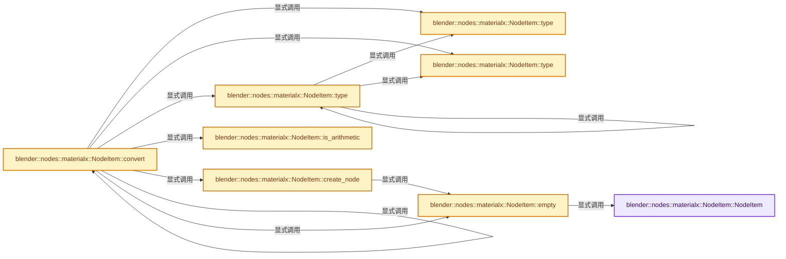
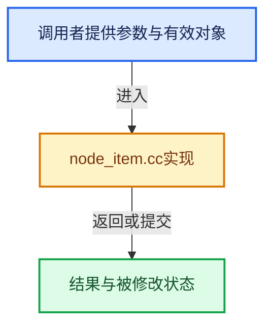

# 实现依赖专题：source/blender/nodes/shader/materialx/node_item.cc

[方向导航](README.md) · [符号索引](../%E7%AC%A6%E5%8F%B7%E4%BE%9D%E8%B5%96%E4%B8%8E%E5%AE%9E%E7%8E%B0%E7%B4%A2%E5%BC%95.md)

本专题从正文实际调用进入，集中保存共享实现。函数有稳定锚点，可从调用处直接跳到对应完整函数；递归与互相调用通过回链组织。

## 本文件的实现关系






## 完整成员与函数实现

<a id="f-79d43f1ad7fa59bb"></a>

### `blender::nodes::materialx::NodeItem::NodeItem`

实现位置：[source/blender/nodes/shader/materialx/node_item.cc](../../../../../source/blender/nodes/shader/materialx/node_item.cc) · L14—L14。

接口参数：

- `MaterialX::GraphElement *graph`

**教学注释版**

<!-- annotated:e24cd7b23faeb2 -->

```cpp
NodeItem::NodeItem(MaterialX::GraphElement *graph) : graph_(graph) {}
```

<details>
<summary>核对原始源码：source/blender/nodes/shader/materialx/node_item.cc · L14—L14</summary>

<!-- original:e24cd7b23faeb2:source/blender/nodes/shader/materialx/node_item.cc:14:14 -->

```cpp
NodeItem::NodeItem(MaterialX::GraphElement *graph) : graph_(graph) {}
```

</details>

**继续追踪实现**

本实现没有需要继续展开的显式调用；检查返回表达式、对象转换和调用者前置条件。

<a id="f-dc8e84b62be7909e"></a>

### `blender::nodes::materialx::NodeItem::type`

实现位置：[source/blender/nodes/shader/materialx/node_item.cc](../../../../../source/blender/nodes/shader/materialx/node_item.cc) · L16—L69。

接口参数：

- `const std::string &type_str`

**教学注释版**

<!-- annotated:e1b6433d8f5b46 -->

```cpp
NodeItem::Type NodeItem::type(const std::string &type_str)
{
  /* Converting only MaterialX supported types */
  if (type_str == "multioutput") {
    return Type::Multioutput;
  }
  if (type_str == "string") {
    return Type::String;
  }
  if (type_str == "filename") {
    return Type::Filename;
  }
  if (type_str == "boolean") {
    return Type::Boolean;
  }
  if (type_str == "integer") {
    return Type::Integer;
  }
  if (type_str == "float") {
    return Type::Float;
  }
  if (type_str == "vector2") {
    return Type::Vector2;
  }
  if (type_str == "vector3") {
    return Type::Vector3;
  }
  if (type_str == "vector4") {
    return Type::Vector4;
  }
  if (type_str == "color3") {
    return Type::Color3;
  }
  if (type_str == "color4") {
    return Type::Color4;
  }
  if (type_str == "BSDF") {
    return Type::BSDF;
  }
  if (type_str == "EDF") {
    return Type::EDF;
  }
  if (type_str == "displacementshader") {
    return Type::DisplacementShader;
  }
  if (type_str == "surfaceshader") {
    return Type::SurfaceShader;
  }
  if (type_str == "material") {
    return Type::Material;
  }
  BLI_assert_unreachable();
  return Type::Empty;
}
```

<details>
<summary>核对原始源码：source/blender/nodes/shader/materialx/node_item.cc · L16—L69</summary>

<!-- original:e1b6433d8f5b46:source/blender/nodes/shader/materialx/node_item.cc:16:69 -->

```cpp
NodeItem::Type NodeItem::type(const std::string &type_str)
{
  /* Converting only MaterialX supported types */
  if (type_str == "multioutput") {
    return Type::Multioutput;
  }
  if (type_str == "string") {
    return Type::String;
  }
  if (type_str == "filename") {
    return Type::Filename;
  }
  if (type_str == "boolean") {
    return Type::Boolean;
  }
  if (type_str == "integer") {
    return Type::Integer;
  }
  if (type_str == "float") {
    return Type::Float;
  }
  if (type_str == "vector2") {
    return Type::Vector2;
  }
  if (type_str == "vector3") {
    return Type::Vector3;
  }
  if (type_str == "vector4") {
    return Type::Vector4;
  }
  if (type_str == "color3") {
    return Type::Color3;
  }
  if (type_str == "color4") {
    return Type::Color4;
  }
  if (type_str == "BSDF") {
    return Type::BSDF;
  }
  if (type_str == "EDF") {
    return Type::EDF;
  }
  if (type_str == "displacementshader") {
    return Type::DisplacementShader;
  }
  if (type_str == "surfaceshader") {
    return Type::SurfaceShader;
  }
  if (type_str == "material") {
    return Type::Material;
  }
  BLI_assert_unreachable();
  return Type::Empty;
}
```

</details>

**结果出口**

- `return Type::Multioutput;`
- `return Type::String;`
- `return Type::Filename;`
- `return Type::Boolean;`
- `return Type::Integer;`
- `return Type::Float;`
- `return Type::Vector2;`
- `return Type::Vector3;`
- `return Type::Vector4;`
- `return Type::Color3;`
- `return Type::Color4;`
- `return Type::BSDF;`
- `return Type::EDF;`
- `return Type::DisplacementShader;`
- `return Type::SurfaceShader;`
- `return Type::Material;`
- `return Type::Empty;`

**继续追踪实现**

- `BLI_assert_unreachable` → [BLI_assert_unreachable · L77](../01-%E5%9F%BA%E7%A1%80%E5%AE%B9%E5%99%A8%E4%B8%8E%E7%8E%B0%E4%BB%A3CPP/%E4%BE%9D%E8%B5%96-BLI_assert-cc98e8.md#m-7a2d91a67d8e)。宏定义由构建条件选择。

<a id="f-e2a59375ffba815e"></a>

### `blender::nodes::materialx::NodeItem::type`

实现位置：[source/blender/nodes/shader/materialx/node_item.cc](../../../../../source/blender/nodes/shader/materialx/node_item.cc) · L71—L114。

接口参数：

- `Type type`

**教学注释版**

<!-- annotated:ebaae125233f75 -->

```cpp
std::string NodeItem::type(Type type)
{
  switch (type) {
    case Type::Any:
      return "any";
    case Type::Multioutput:
      return "multioutput";
    case Type::String:
      return "string";
    case Type::Filename:
      return "filename";
    case Type::Boolean:
      return "boolean";
    case Type::Integer:
      return "integer";
    case Type::Float:
      return "float";
    case Type::Vector2:
      return "vector2";
    case Type::Vector3:
      return "vector3";
    case Type::Vector4:
      return "vector4";
    case Type::Color3:
      return "color3";
    case Type::Color4:
      return "color4";
    case Type::BSDF:
      return "BSDF";
    case Type::EDF:
      return "EDF";
    case Type::DisplacementShader:
      return "displacementshader";
    case Type::SurfaceShader:
      return "surfaceshader";
    case Type::Material:
      return "material";
    case Type::SurfaceOpacity:
      return "opacity";
    default:
      BLI_assert_unreachable();
  }
  return "";
}
```

<details>
<summary>核对原始源码：source/blender/nodes/shader/materialx/node_item.cc · L71—L114</summary>

<!-- original:ebaae125233f75:source/blender/nodes/shader/materialx/node_item.cc:71:114 -->

```cpp
std::string NodeItem::type(Type type)
{
  switch (type) {
    case Type::Any:
      return "any";
    case Type::Multioutput:
      return "multioutput";
    case Type::String:
      return "string";
    case Type::Filename:
      return "filename";
    case Type::Boolean:
      return "boolean";
    case Type::Integer:
      return "integer";
    case Type::Float:
      return "float";
    case Type::Vector2:
      return "vector2";
    case Type::Vector3:
      return "vector3";
    case Type::Vector4:
      return "vector4";
    case Type::Color3:
      return "color3";
    case Type::Color4:
      return "color4";
    case Type::BSDF:
      return "BSDF";
    case Type::EDF:
      return "EDF";
    case Type::DisplacementShader:
      return "displacementshader";
    case Type::SurfaceShader:
      return "surfaceshader";
    case Type::Material:
      return "material";
    case Type::SurfaceOpacity:
      return "opacity";
    default:
      BLI_assert_unreachable();
  }
  return "";
}
```

</details>

**结果出口**

- `return "any";`
- `return "multioutput";`
- `return "string";`
- `return "filename";`
- `return "boolean";`
- `return "integer";`
- `return "float";`
- `return "vector2";`
- `return "vector3";`
- `return "vector4";`
- `return "color3";`
- `return "color4";`
- `return "BSDF";`
- `return "EDF";`
- `return "displacementshader";`
- `return "surfaceshader";`
- `return "material";`
- `return "opacity";`
- `return "";`

**继续追踪实现**

- `BLI_assert_unreachable` → [BLI_assert_unreachable · L77](../01-%E5%9F%BA%E7%A1%80%E5%AE%B9%E5%99%A8%E4%B8%8E%E7%8E%B0%E4%BB%A3CPP/%E4%BE%9D%E8%B5%96-BLI_assert-cc98e8.md#m-7a2d91a67d8e)。宏定义由构建条件选择。

<a id="f-33f2d7899dee6673"></a>

### `blender::nodes::materialx::NodeItem::is_arithmetic`

实现位置：[source/blender/nodes/shader/materialx/node_item.cc](../../../../../source/blender/nodes/shader/materialx/node_item.cc) · L116—L119。

接口参数：

- `Type type`

**教学注释版**

<!-- annotated:7531206eb528fe -->

```cpp
bool NodeItem::is_arithmetic(Type type)
{
  return type >= Type::Boolean && type <= Type::Color4;
}
```

<details>
<summary>核对原始源码：source/blender/nodes/shader/materialx/node_item.cc · L116—L119</summary>

<!-- original:7531206eb528fe:source/blender/nodes/shader/materialx/node_item.cc:116:119 -->

```cpp
bool NodeItem::is_arithmetic(Type type)
{
  return type >= Type::Boolean && type <= Type::Color4;
}
```

</details>

**结果出口**

- `return type >= Type::Boolean && type <= Type::Color4;`

**继续追踪实现**

本实现没有需要继续展开的显式调用；检查返回表达式、对象转换和调用者前置条件。

<a id="f-9ce0268f1331262f"></a>

### `blender::nodes::materialx::NodeItem::convert`

实现位置：[source/blender/nodes/shader/materialx/node_item.cc](../../../../../source/blender/nodes/shader/materialx/node_item.cc) · L523—L761。

接口参数：

- `Type to_type`

**教学注释版**

<!-- annotated:dc057430601d58 -->

```cpp
NodeItem NodeItem::convert(Type to_type) const
{
  Type from_type = type();
  if (from_type == Type::Empty || from_type == to_type || to_type == Type::Any) {
    return *this;
  }

  switch (to_type) {
    /* Link arithmetic types to shader as EDF. */
    case Type::EDF:
      if (is_arithmetic(from_type)) {
        return create_node("uniform_edf", NodeItem::Type::EDF, {{"color", convert(Type::Color3)}});
      }
      return empty();
    /* Displacement shader from arithmetic types, when not using (Vector) Displacement node. */
    case Type::DisplacementShader:
      if (is_arithmetic(from_type)) {
        return create_node("displacement",
                           NodeItem::Type::DisplacementShader,
                           {{"displacement", convert(Type::Vector3)}});
      }
      return empty();
    /* Surface opacity is just a float. */
    case Type::SurfaceOpacity:
      to_type = Type::Float;
      if (from_type == to_type || to_type == Type::Any) {
        return *this;
      }
      break;
    /* Material output will evaluate graph multiple times for different components,
     * when linking arithmetic types we want to leave those empty. */
    case Type::BSDF:
    case Type::SurfaceShader:
    case Type::Material:
      return empty();
    default:
      break;
  }

  if (!is_arithmetic(from_type) || !is_arithmetic(to_type)) {
    CLOG_WARN(LOG_IO_MATERIALX,
              "Cannot convert: %s -> %s",
              type(from_type).c_str(),
              type(to_type).c_str());
    return empty();
  }

  if (to_type == Type::Float) {
    return (*this)[0];
  }

  /* Converting types which requires > 1 iteration */
  switch (from_type) {
    case Type::Boolean:
    case Type::Integer:
      switch (to_type) {
        case Type::Vector2:
          return convert(Type::Float).convert(Type::Vector2);
        case Type::Vector3:
          return convert(Type::Float).convert(Type::Vector3);
        case Type::Vector4:
          return convert(Type::Float).convert(Type::Vector4);
        case Type::Color3:
          return convert(Type::Float).convert(Type::Color3);
        case Type::Color4:
          return convert(Type::Float).convert(Type::Color4);
        default:
          break;
      }
      break;
    case Type::Vector2:
      switch (to_type) {
        case Type::Vector4:
          return convert(Type::Vector3).convert(Type::Vector4);
        case Type::Color3:
          return convert(Type::Vector3).convert(Type::Color3);
        case Type::Color4:
          return convert(Type::Vector3).convert(Type::Color3).convert(Type::Color4);
        default:
          break;
      }
      break;
    case Type::Vector3:
      switch (to_type) {
        case Type::Color4:
          return convert(Type::Color3).convert(Type::Color4);
        default:
          break;
      }
      break;
    case Type::Vector4:
      switch (to_type) {
        case Type::Vector2:
          return convert(Type::Vector3).convert(Type::Vector2);
        case Type::Color3:
          return convert(Type::Vector3).convert(Type::Color3);
        default:
          break;
      }
      break;
    case Type::Color3:
      switch (to_type) {
        case Type::Vector2:
          return convert(Type::Vector3).convert(Type::Vector2);
        case Type::Vector4:
          return convert(Type::Vector3).convert(Type::Vector4);
        default:
          break;
      }
      break;
    case Type::Color4:
      switch (to_type) {
        case Type::Vector2:
          return convert(Type::Vector4).convert(Type::Vector3).convert(Type::Vector2);
        case Type::Vector3:
          return convert(Type::Vector4).convert(Type::Vector3);
        default:
          break;
      }
      break;
    default:
      break;
  }

  /* Converting 1 iteration types */
  NodeItem res = empty();
  if (value) {
    switch (from_type) {
      case Type::Boolean: {
        if (to_type == Type::Integer) {
          int v = value->asA<bool>();
          res.value = MaterialX::Value::createValue<int>(v);
        }
        break;
      }
      case Type::Float: {
        float v = value->asA<float>();
        switch (to_type) {
          case Type::Vector2:
            res.value = MaterialX::Value::createValue<MaterialX::Vector2>({v, v});
            break;
          case Type::Vector3:
            res.value = MaterialX::Value::createValue<MaterialX::Vector3>({v, v, v});
            break;
          case Type::Vector4:
            res.value = MaterialX::Value::createValue<MaterialX::Vector4>({v, v, v, 1.0f});
            break;
          case Type::Color3:
            res.value = MaterialX::Value::createValue<MaterialX::Color3>({v, v, v});
            break;
          case Type::Color4:
            res.value = MaterialX::Value::createValue<MaterialX::Color4>({v, v, v, 1.0f});
            break;
          default:
            BLI_assert_unreachable();
        }
        break;
      }
      case Type::Vector2: {
        auto v = value->asA<MaterialX::Vector2>();
        switch (to_type) {
          case Type::Vector3:
            res.value = MaterialX::Value::createValue<MaterialX::Vector3>({v[0], v[1], 0.0f});
            break;
          default:
            BLI_assert_unreachable();
        }
        break;
      }
      case Type::Vector3: {
        auto v = value->asA<MaterialX::Vector3>();
        switch (to_type) {
          case Type::Vector2:
            res.value = MaterialX::Value::createValue<MaterialX::Vector2>({v[0], v[1]});
            break;
          case Type::Vector4:
            res.value = MaterialX::Value::createValue<MaterialX::Vector4>(
                {v[0], v[1], v[2], 0.0f});
            break;
          case Type::Color3:
            res.value = MaterialX::Value::createValue<MaterialX::Color3>({v[0], v[1], v[2]});
            break;
          default:
            BLI_assert_unreachable();
        }
        break;
      }
      case Type::Vector4: {
        auto v = value->asA<MaterialX::Vector4>();
        switch (to_type) {
          case Type::Vector3:
            res.value = MaterialX::Value::createValue<MaterialX::Vector3>({v[0], v[1], v[2]});
            break;
          case Type::Color4:
            res.value = MaterialX::Value::createValue<MaterialX::Color4>({v[0], v[1], v[2], v[3]});
            break;
          default:
            BLI_assert_unreachable();
        }
        break;
      }
      case Type::Color3: {
        auto v = value->asA<MaterialX::Color3>();
        switch (to_type) {
          case Type::Vector3:
            res.value = MaterialX::Value::createValue<MaterialX::Vector3>({v[0], v[1], v[2]});
            break;
          case Type::Color4:
            res.value = MaterialX::Value::createValue<MaterialX::Color4>({v[0], v[1], v[2], 1.0f});
            break;
          default:
            BLI_assert_unreachable();
        }
        break;
      }
      case Type::Color4: {
        auto v = value->asA<MaterialX::Color4>();
        switch (to_type) {
          case Type::Vector4:
            res.value = MaterialX::Value::createValue<MaterialX::Vector4>(
                {v[0], v[1], v[2], v[3]});
            break;
          case Type::Color3:
            res.value = MaterialX::Value::createValue<MaterialX::Color3>({v[0], v[1], v[2]});
            break;
          default:
            BLI_assert_unreachable();
        }
        break;
      }
      default:
        BLI_assert_unreachable();
    }
  }
  else {
    res = create_node("convert", to_type, {{"in", *this}});
  }
  return res;
}
```

<details>
<summary>核对原始源码：source/blender/nodes/shader/materialx/node_item.cc · L523—L761</summary>

<!-- original:dc057430601d58:source/blender/nodes/shader/materialx/node_item.cc:523:761 -->

```cpp
NodeItem NodeItem::convert(Type to_type) const
{
  Type from_type = type();
  if (from_type == Type::Empty || from_type == to_type || to_type == Type::Any) {
    return *this;
  }

  switch (to_type) {
    /* Link arithmetic types to shader as EDF. */
    case Type::EDF:
      if (is_arithmetic(from_type)) {
        return create_node("uniform_edf", NodeItem::Type::EDF, {{"color", convert(Type::Color3)}});
      }
      return empty();
    /* Displacement shader from arithmetic types, when not using (Vector) Displacement node. */
    case Type::DisplacementShader:
      if (is_arithmetic(from_type)) {
        return create_node("displacement",
                           NodeItem::Type::DisplacementShader,
                           {{"displacement", convert(Type::Vector3)}});
      }
      return empty();
    /* Surface opacity is just a float. */
    case Type::SurfaceOpacity:
      to_type = Type::Float;
      if (from_type == to_type || to_type == Type::Any) {
        return *this;
      }
      break;
    /* Material output will evaluate graph multiple times for different components,
     * when linking arithmetic types we want to leave those empty. */
    case Type::BSDF:
    case Type::SurfaceShader:
    case Type::Material:
      return empty();
    default:
      break;
  }

  if (!is_arithmetic(from_type) || !is_arithmetic(to_type)) {
    CLOG_WARN(LOG_IO_MATERIALX,
              "Cannot convert: %s -> %s",
              type(from_type).c_str(),
              type(to_type).c_str());
    return empty();
  }

  if (to_type == Type::Float) {
    return (*this)[0];
  }

  /* Converting types which requires > 1 iteration */
  switch (from_type) {
    case Type::Boolean:
    case Type::Integer:
      switch (to_type) {
        case Type::Vector2:
          return convert(Type::Float).convert(Type::Vector2);
        case Type::Vector3:
          return convert(Type::Float).convert(Type::Vector3);
        case Type::Vector4:
          return convert(Type::Float).convert(Type::Vector4);
        case Type::Color3:
          return convert(Type::Float).convert(Type::Color3);
        case Type::Color4:
          return convert(Type::Float).convert(Type::Color4);
        default:
          break;
      }
      break;
    case Type::Vector2:
      switch (to_type) {
        case Type::Vector4:
          return convert(Type::Vector3).convert(Type::Vector4);
        case Type::Color3:
          return convert(Type::Vector3).convert(Type::Color3);
        case Type::Color4:
          return convert(Type::Vector3).convert(Type::Color3).convert(Type::Color4);
        default:
          break;
      }
      break;
    case Type::Vector3:
      switch (to_type) {
        case Type::Color4:
          return convert(Type::Color3).convert(Type::Color4);
        default:
          break;
      }
      break;
    case Type::Vector4:
      switch (to_type) {
        case Type::Vector2:
          return convert(Type::Vector3).convert(Type::Vector2);
        case Type::Color3:
          return convert(Type::Vector3).convert(Type::Color3);
        default:
          break;
      }
      break;
    case Type::Color3:
      switch (to_type) {
        case Type::Vector2:
          return convert(Type::Vector3).convert(Type::Vector2);
        case Type::Vector4:
          return convert(Type::Vector3).convert(Type::Vector4);
        default:
          break;
      }
      break;
    case Type::Color4:
      switch (to_type) {
        case Type::Vector2:
          return convert(Type::Vector4).convert(Type::Vector3).convert(Type::Vector2);
        case Type::Vector3:
          return convert(Type::Vector4).convert(Type::Vector3);
        default:
          break;
      }
      break;
    default:
      break;
  }

  /* Converting 1 iteration types */
  NodeItem res = empty();
  if (value) {
    switch (from_type) {
      case Type::Boolean: {
        if (to_type == Type::Integer) {
          int v = value->asA<bool>();
          res.value = MaterialX::Value::createValue<int>(v);
        }
        break;
      }
      case Type::Float: {
        float v = value->asA<float>();
        switch (to_type) {
          case Type::Vector2:
            res.value = MaterialX::Value::createValue<MaterialX::Vector2>({v, v});
            break;
          case Type::Vector3:
            res.value = MaterialX::Value::createValue<MaterialX::Vector3>({v, v, v});
            break;
          case Type::Vector4:
            res.value = MaterialX::Value::createValue<MaterialX::Vector4>({v, v, v, 1.0f});
            break;
          case Type::Color3:
            res.value = MaterialX::Value::createValue<MaterialX::Color3>({v, v, v});
            break;
          case Type::Color4:
            res.value = MaterialX::Value::createValue<MaterialX::Color4>({v, v, v, 1.0f});
            break;
          default:
            BLI_assert_unreachable();
        }
        break;
      }
      case Type::Vector2: {
        auto v = value->asA<MaterialX::Vector2>();
        switch (to_type) {
          case Type::Vector3:
            res.value = MaterialX::Value::createValue<MaterialX::Vector3>({v[0], v[1], 0.0f});
            break;
          default:
            BLI_assert_unreachable();
        }
        break;
      }
      case Type::Vector3: {
        auto v = value->asA<MaterialX::Vector3>();
        switch (to_type) {
          case Type::Vector2:
            res.value = MaterialX::Value::createValue<MaterialX::Vector2>({v[0], v[1]});
            break;
          case Type::Vector4:
            res.value = MaterialX::Value::createValue<MaterialX::Vector4>(
                {v[0], v[1], v[2], 0.0f});
            break;
          case Type::Color3:
            res.value = MaterialX::Value::createValue<MaterialX::Color3>({v[0], v[1], v[2]});
            break;
          default:
            BLI_assert_unreachable();
        }
        break;
      }
      case Type::Vector4: {
        auto v = value->asA<MaterialX::Vector4>();
        switch (to_type) {
          case Type::Vector3:
            res.value = MaterialX::Value::createValue<MaterialX::Vector3>({v[0], v[1], v[2]});
            break;
          case Type::Color4:
            res.value = MaterialX::Value::createValue<MaterialX::Color4>({v[0], v[1], v[2], v[3]});
            break;
          default:
            BLI_assert_unreachable();
        }
        break;
      }
      case Type::Color3: {
        auto v = value->asA<MaterialX::Color3>();
        switch (to_type) {
          case Type::Vector3:
            res.value = MaterialX::Value::createValue<MaterialX::Vector3>({v[0], v[1], v[2]});
            break;
          case Type::Color4:
            res.value = MaterialX::Value::createValue<MaterialX::Color4>({v[0], v[1], v[2], 1.0f});
            break;
          default:
            BLI_assert_unreachable();
        }
        break;
      }
      case Type::Color4: {
        auto v = value->asA<MaterialX::Color4>();
        switch (to_type) {
          case Type::Vector4:
            res.value = MaterialX::Value::createValue<MaterialX::Vector4>(
                {v[0], v[1], v[2], v[3]});
            break;
          case Type::Color3:
            res.value = MaterialX::Value::createValue<MaterialX::Color3>({v[0], v[1], v[2]});
            break;
          default:
            BLI_assert_unreachable();
        }
        break;
      }
      default:
        BLI_assert_unreachable();
    }
  }
  else {
    res = create_node("convert", to_type, {{"in", *this}});
  }
  return res;
}
```

</details>

**沿实际写入检查状态**

- `to_type = Type::Float;`
- `res.value = MaterialX::Value::createValue<int>(v);`
- `res.value = MaterialX::Value::createValue<MaterialX::Vector2>({v, v});`
- `res.value = MaterialX::Value::createValue<MaterialX::Vector3>({v, v, v});`
- `res.value = MaterialX::Value::createValue<MaterialX::Vector4>({v, v, v, 1.0f});`
- `res.value = MaterialX::Value::createValue<MaterialX::Color3>({v, v, v});`
- `res.value = MaterialX::Value::createValue<MaterialX::Color4>({v, v, v, 1.0f});`
- `res.value = MaterialX::Value::createValue<MaterialX::Vector3>({v[0], v[1], 0.0f});`
- `res.value = MaterialX::Value::createValue<MaterialX::Vector2>({v[0], v[1]});`
- `res.value = MaterialX::Value::createValue<MaterialX::Vector4>(`
- `res.value = MaterialX::Value::createValue<MaterialX::Color3>({v[0], v[1], v[2]});`
- `res.value = MaterialX::Value::createValue<MaterialX::Vector3>({v[0], v[1], v[2]});`
- `res.value = MaterialX::Value::createValue<MaterialX::Color4>({v[0], v[1], v[2], v[3]});`
- `res.value = MaterialX::Value::createValue<MaterialX::Color4>({v[0], v[1], v[2], 1.0f});`
- `res = create_node("convert", to_type, {{"in", *this}});`

**结果出口**

- `return *this;`
- `return create_node("uniform_edf", NodeItem::Type::EDF, {{"color", convert(Type::Color3)}});`
- `return empty();`
- `return create_node("displacement",`
- `return (*this)[0];`
- `return convert(Type::Float).convert(Type::Vector2);`
- `return convert(Type::Float).convert(Type::Vector3);`
- `return convert(Type::Float).convert(Type::Vector4);`
- `return convert(Type::Float).convert(Type::Color3);`
- `return convert(Type::Float).convert(Type::Color4);`
- `return convert(Type::Vector3).convert(Type::Vector4);`
- `return convert(Type::Vector3).convert(Type::Color3);`
- `return convert(Type::Vector3).convert(Type::Color3).convert(Type::Color4);`
- `return convert(Type::Color3).convert(Type::Color4);`
- `return convert(Type::Vector3).convert(Type::Vector2);`
- `return convert(Type::Vector4).convert(Type::Vector3).convert(Type::Vector2);`
- `return convert(Type::Vector4).convert(Type::Vector3);`
- `return res;`

**继续追踪实现**

- `type` → [blender::nodes::materialx::NodeItem::type · L16](%E4%BE%9D%E8%B5%96-node_item-023375.md#f-dc8e84b62be7909e)；[blender::nodes::materialx::NodeItem::type · L71](%E4%BE%9D%E8%B5%96-node_item-023375.md#f-e2a59375ffba815e)；[blender::nodes::materialx::NodeItem::type · L847](%E4%BE%9D%E8%B5%96-node_item-023375.md#f-3ae188447959c76c)。同名重载需按实参类型选择。
- `is_arithmetic` → [blender::nodes::materialx::NodeItem::is_arithmetic · L116](%E4%BE%9D%E8%B5%96-node_item-023375.md#f-33f2d7899dee6673)；[blender::nodes::materialx::NodeItem::is_arithmetic · L1016](%E4%BE%9D%E8%B5%96-node_item-023375.md#f-4fb5959316451fe4)。同名重载需按实参类型选择。
- `create_node` → [blender::nodes::materialx::NodeItem::create_node · L861](%E4%BE%9D%E8%B5%96-node_item-023375.md#f-b887e581acd682e8)；[blender::nodes::materialx::NodeItem::create_node · L878](%E4%BE%9D%E8%B5%96-node_item-023375.md#f-9d10f725988e335a)。同名重载需按实参类型选择。
- `convert` → [blender::nodes::materialx::NodeItem::convert · L523](%E4%BE%9D%E8%B5%96-node_item-023375.md#f-9ce0268f1331262f)。
- `empty` → [blender::nodes::materialx::NodeItem::empty · L842](%E4%BE%9D%E8%B5%96-node_item-023375.md#f-5c7c3a79f034a3fa)。
- `CLOG_WARN` → [CLOG_WARN · L189](../05-%E5%87%A0%E4%BD%95%E5%AD%98%E5%82%A8%E4%B8%8E%E6%8B%93%E6%89%91%E6%98%A0%E5%B0%84/%E4%BE%9D%E8%B5%96-CLG_log-e9051b.md#m-9da21a06cdbe)。宏定义由构建条件选择。
- `type(from_type).c_str` → [调用协议](../%E6%A8%A1%E6%9D%BF%E5%AE%8F%E4%B8%8E%E5%8A%A8%E6%80%81%E5%88%86%E6%B4%BE%E5%8D%8F%E8%AE%AE.md)：接收对象类型依赖auto、返回值或模板实例；不按同名猜测目标。调用位置L565。
- `type(to_type).c_str` → [调用协议](../%E6%A8%A1%E6%9D%BF%E5%AE%8F%E4%B8%8E%E5%8A%A8%E6%80%81%E5%88%86%E6%B4%BE%E5%8D%8F%E8%AE%AE.md)：接收对象类型依赖auto、返回值或模板实例；不按同名猜测目标。调用位置L566。
- `convert(Type::Float).convert` → [调用协议](../%E6%A8%A1%E6%9D%BF%E5%AE%8F%E4%B8%8E%E5%8A%A8%E6%80%81%E5%88%86%E6%B4%BE%E5%8D%8F%E8%AE%AE.md)：接收对象类型依赖auto、返回值或模板实例；不按同名猜测目标。调用位置L580。
- `convert(Type::Vector3).convert` → [调用协议](../%E6%A8%A1%E6%9D%BF%E5%AE%8F%E4%B8%8E%E5%8A%A8%E6%80%81%E5%88%86%E6%B4%BE%E5%8D%8F%E8%AE%AE.md)：接收对象类型依赖auto、返回值或模板实例；不按同名猜测目标。调用位置L596。
- `convert(Type::Vector3).convert(Type::Color3).convert` → [调用协议](../%E6%A8%A1%E6%9D%BF%E5%AE%8F%E4%B8%8E%E5%8A%A8%E6%80%81%E5%88%86%E6%B4%BE%E5%8D%8F%E8%AE%AE.md)：接收对象类型依赖auto、返回值或模板实例；不按同名猜测目标。调用位置L600。
- `convert(Type::Color3).convert` → [调用协议](../%E6%A8%A1%E6%9D%BF%E5%AE%8F%E4%B8%8E%E5%8A%A8%E6%80%81%E5%88%86%E6%B4%BE%E5%8D%8F%E8%AE%AE.md)：接收对象类型依赖auto、返回值或模板实例；不按同名猜测目标。调用位置L608。
- `convert(Type::Vector4).convert(Type::Vector3).convert` → [调用协议](../%E6%A8%A1%E6%9D%BF%E5%AE%8F%E4%B8%8E%E5%8A%A8%E6%80%81%E5%88%86%E6%B4%BE%E5%8D%8F%E8%AE%AE.md)：接收对象类型依赖auto、返回值或模板实例；不按同名猜测目标。调用位置L636。
- `convert(Type::Vector4).convert` → [调用协议](../%E6%A8%A1%E6%9D%BF%E5%AE%8F%E4%B8%8E%E5%8A%A8%E6%80%81%E5%88%86%E6%B4%BE%E5%8D%8F%E8%AE%AE.md)：接收对象类型依赖auto、返回值或模板实例；不按同名猜测目标。调用位置L636。
- `value->asA<bool>` → [调用协议](../%E6%A8%A1%E6%9D%BF%E5%AE%8F%E4%B8%8E%E5%8A%A8%E6%80%81%E5%88%86%E6%B4%BE%E5%8D%8F%E8%AE%AE.md)：接收对象类型依赖auto、返回值或模板实例；不按同名猜测目标。调用位置L653。
- `MaterialX::Value::createValue<int>` → [调用协议](../%E6%A8%A1%E6%9D%BF%E5%AE%8F%E4%B8%8E%E5%8A%A8%E6%80%81%E5%88%86%E6%B4%BE%E5%8D%8F%E8%AE%AE.md)：函数指针、局部可调用对象或未展开的宏；必须结合调用者环境。调用位置L654。
- `value->asA<float>` → [调用协议](../%E6%A8%A1%E6%9D%BF%E5%AE%8F%E4%B8%8E%E5%8A%A8%E6%80%81%E5%88%86%E6%B4%BE%E5%8D%8F%E8%AE%AE.md)：接收对象类型依赖auto、返回值或模板实例；不按同名猜测目标。调用位置L659。
- `MaterialX::Value::createValue<MaterialX::Vector2>` → [调用协议](../%E6%A8%A1%E6%9D%BF%E5%AE%8F%E4%B8%8E%E5%8A%A8%E6%80%81%E5%88%86%E6%B4%BE%E5%8D%8F%E8%AE%AE.md)：函数指针、局部可调用对象或未展开的宏；必须结合调用者环境。调用位置L662。
- `MaterialX::Value::createValue<MaterialX::Vector3>` → [调用协议](../%E6%A8%A1%E6%9D%BF%E5%AE%8F%E4%B8%8E%E5%8A%A8%E6%80%81%E5%88%86%E6%B4%BE%E5%8D%8F%E8%AE%AE.md)：函数指针、局部可调用对象或未展开的宏；必须结合调用者环境。调用位置L665。
- `MaterialX::Value::createValue<MaterialX::Vector4>` → [调用协议](../%E6%A8%A1%E6%9D%BF%E5%AE%8F%E4%B8%8E%E5%8A%A8%E6%80%81%E5%88%86%E6%B4%BE%E5%8D%8F%E8%AE%AE.md)：函数指针、局部可调用对象或未展开的宏；必须结合调用者环境。调用位置L668。
- `MaterialX::Value::createValue<MaterialX::Color3>` → [调用协议](../%E6%A8%A1%E6%9D%BF%E5%AE%8F%E4%B8%8E%E5%8A%A8%E6%80%81%E5%88%86%E6%B4%BE%E5%8D%8F%E8%AE%AE.md)：函数指针、局部可调用对象或未展开的宏；必须结合调用者环境。调用位置L671。
- `MaterialX::Value::createValue<MaterialX::Color4>` → [调用协议](../%E6%A8%A1%E6%9D%BF%E5%AE%8F%E4%B8%8E%E5%8A%A8%E6%80%81%E5%88%86%E6%B4%BE%E5%8D%8F%E8%AE%AE.md)：函数指针、局部可调用对象或未展开的宏；必须结合调用者环境。调用位置L674。
- `BLI_assert_unreachable` → [BLI_assert_unreachable · L77](../01-%E5%9F%BA%E7%A1%80%E5%AE%B9%E5%99%A8%E4%B8%8E%E7%8E%B0%E4%BB%A3CPP/%E4%BE%9D%E8%B5%96-BLI_assert-cc98e8.md#m-7a2d91a67d8e)。宏定义由构建条件选择。
- `value->asA<MaterialX::Vector2>` → [调用协议](../%E6%A8%A1%E6%9D%BF%E5%AE%8F%E4%B8%8E%E5%8A%A8%E6%80%81%E5%88%86%E6%B4%BE%E5%8D%8F%E8%AE%AE.md)：接收对象类型依赖auto、返回值或模板实例；不按同名猜测目标。调用位置L682。
- `value->asA<MaterialX::Vector3>` → [调用协议](../%E6%A8%A1%E6%9D%BF%E5%AE%8F%E4%B8%8E%E5%8A%A8%E6%80%81%E5%88%86%E6%B4%BE%E5%8D%8F%E8%AE%AE.md)：接收对象类型依赖auto、返回值或模板实例；不按同名猜测目标。调用位置L693。
- `value->asA<MaterialX::Vector4>` → [调用协议](../%E6%A8%A1%E6%9D%BF%E5%AE%8F%E4%B8%8E%E5%8A%A8%E6%80%81%E5%88%86%E6%B4%BE%E5%8D%8F%E8%AE%AE.md)：接收对象类型依赖auto、返回值或模板实例；不按同名猜测目标。调用位置L711。
- `value->asA<MaterialX::Color3>` → [调用协议](../%E6%A8%A1%E6%9D%BF%E5%AE%8F%E4%B8%8E%E5%8A%A8%E6%80%81%E5%88%86%E6%B4%BE%E5%8D%8F%E8%AE%AE.md)：接收对象类型依赖auto、返回值或模板实例；不按同名猜测目标。调用位置L725。
- `value->asA<MaterialX::Color4>` → [调用协议](../%E6%A8%A1%E6%9D%BF%E5%AE%8F%E4%B8%8E%E5%8A%A8%E6%80%81%E5%88%86%E6%B4%BE%E5%8D%8F%E8%AE%AE.md)：接收对象类型依赖auto、返回值或模板实例；不按同名猜测目标。调用位置L739。

<a id="f-5c7c3a79f034a3fa"></a>

### `blender::nodes::materialx::NodeItem::empty`

实现位置：[source/blender/nodes/shader/materialx/node_item.cc](../../../../../source/blender/nodes/shader/materialx/node_item.cc) · L842—L845。

**教学注释版**

<!-- annotated:941ce1d3f12b94 -->

```cpp
NodeItem NodeItem::empty() const
{
  return NodeItem(graph_);
}
```

<details>
<summary>核对原始源码：source/blender/nodes/shader/materialx/node_item.cc · L842—L845</summary>

<!-- original:941ce1d3f12b94:source/blender/nodes/shader/materialx/node_item.cc:842:845 -->

```cpp
NodeItem NodeItem::empty() const
{
  return NodeItem(graph_);
}
```

</details>

**结果出口**

- `return NodeItem(graph_);`

**继续追踪实现**

- `NodeItem` → [blender::nodes::materialx::NodeItem::NodeItem · L14](%E4%BE%9D%E8%B5%96-node_item-023375.md#f-79d43f1ad7fa59bb)。

<a id="f-3ae188447959c76c"></a>

### `blender::nodes::materialx::NodeItem::type`

实现位置：[source/blender/nodes/shader/materialx/node_item.cc](../../../../../source/blender/nodes/shader/materialx/node_item.cc) · L847—L859。

**教学注释版**

<!-- annotated:7e49a6d582da45 -->

```cpp
NodeItem::Type NodeItem::type() const
{
  if (value) {
    return type(value->getTypeString());
  }
  if (node) {
    return type(node->getType());
  }
  if (output) {
    return type(output->getType());
  }
  return Type::Empty;
}
```

<details>
<summary>核对原始源码：source/blender/nodes/shader/materialx/node_item.cc · L847—L859</summary>

<!-- original:7e49a6d582da45:source/blender/nodes/shader/materialx/node_item.cc:847:859 -->

```cpp
NodeItem::Type NodeItem::type() const
{
  if (value) {
    return type(value->getTypeString());
  }
  if (node) {
    return type(node->getType());
  }
  if (output) {
    return type(output->getType());
  }
  return Type::Empty;
}
```

</details>

**结果出口**

- `return type(value->getTypeString());`
- `return type(node->getType());`
- `return type(output->getType());`
- `return Type::Empty;`

**继续追踪实现**

- `type` → [blender::nodes::materialx::NodeItem::type · L16](%E4%BE%9D%E8%B5%96-node_item-023375.md#f-dc8e84b62be7909e)；[blender::nodes::materialx::NodeItem::type · L71](%E4%BE%9D%E8%B5%96-node_item-023375.md#f-e2a59375ffba815e)；[blender::nodes::materialx::NodeItem::type · L847](%E4%BE%9D%E8%B5%96-node_item-023375.md#f-3ae188447959c76c)。同名重载需按实参类型选择。
- `value->getTypeString` → [调用协议](../%E6%A8%A1%E6%9D%BF%E5%AE%8F%E4%B8%8E%E5%8A%A8%E6%80%81%E5%88%86%E6%B4%BE%E5%8D%8F%E8%AE%AE.md)：接收对象类型依赖auto、返回值或模板实例；不按同名猜测目标。调用位置L850。
- `node->getType` → [调用协议](../%E6%A8%A1%E6%9D%BF%E5%AE%8F%E4%B8%8E%E5%8A%A8%E6%80%81%E5%88%86%E6%B4%BE%E5%8D%8F%E8%AE%AE.md)：接收对象类型依赖auto、返回值或模板实例；不按同名猜测目标。调用位置L853。
- `output->getType` → [调用协议](../%E6%A8%A1%E6%9D%BF%E5%AE%8F%E4%B8%8E%E5%8A%A8%E6%80%81%E5%88%86%E6%B4%BE%E5%8D%8F%E8%AE%AE.md)：接收对象类型依赖auto、返回值或模板实例；不按同名猜测目标。调用位置L856。

<a id="f-b887e581acd682e8"></a>

### `blender::nodes::materialx::NodeItem::create_node`

实现位置：[source/blender/nodes/shader/materialx/node_item.cc](../../../../../source/blender/nodes/shader/materialx/node_item.cc) · L861—L876。

接口参数：

- `const std::string &category`
- `Type type`

**教学注释版**

<!-- annotated:92990f60b56ebb -->

```cpp
NodeItem NodeItem::create_node(const std::string &category, Type type) const
{
  const std::string name = NodeGraph::unique_anonymous_node_name(graph_);
  const std::string type_str = NodeItem::type(type);
  CLOG_DEBUG(LOG_IO_MATERIALX, "<%s type=%s>", category.c_str(), type_str.c_str());
  NodeItem res = empty();
  /* Surface-shader nodes and materials are added directly to the document,
   * otherwise to the node-graph. */
  if (ELEM(type, Type::SurfaceShader, Type::Material)) {
    res.node = graph_->getDocument()->addNode(category, name, type_str);
  }
  else {
    res.node = graph_->addNode(category, name, type_str);
  }
  return res;
}
```

<details>
<summary>核对原始源码：source/blender/nodes/shader/materialx/node_item.cc · L861—L876</summary>

<!-- original:92990f60b56ebb:source/blender/nodes/shader/materialx/node_item.cc:861:876 -->

```cpp
NodeItem NodeItem::create_node(const std::string &category, Type type) const
{
  const std::string name = NodeGraph::unique_anonymous_node_name(graph_);
  const std::string type_str = NodeItem::type(type);
  CLOG_DEBUG(LOG_IO_MATERIALX, "<%s type=%s>", category.c_str(), type_str.c_str());
  NodeItem res = empty();
  /* Surface-shader nodes and materials are added directly to the document,
   * otherwise to the node-graph. */
  if (ELEM(type, Type::SurfaceShader, Type::Material)) {
    res.node = graph_->getDocument()->addNode(category, name, type_str);
  }
  else {
    res.node = graph_->addNode(category, name, type_str);
  }
  return res;
}
```

</details>

**沿实际写入检查状态**

- `res.node = graph_->getDocument()->addNode(category, name, type_str);`
- `res.node = graph_->addNode(category, name, type_str);`

**结果出口**

- `return res;`

**继续追踪实现**

- `NodeGraph::unique_anonymous_node_name` → [blender::nodes::materialx::NodeGraph::unique_anonymous_node_name · L168](%E4%BE%9D%E8%B5%96-node_graph-b0e0e0.md#f-55d4e384bdc5c875)。
- `NodeItem::type` → [调用协议](../%E6%A8%A1%E6%9D%BF%E5%AE%8F%E4%B8%8E%E5%8A%A8%E6%80%81%E5%88%86%E6%B4%BE%E5%8D%8F%E8%AE%AE.md)：局部可调用对象，须结合其初始化与捕获环境。调用位置L864。
- `CLOG_DEBUG` → [CLOG_DEBUG · L191](../05-%E5%87%A0%E4%BD%95%E5%AD%98%E5%82%A8%E4%B8%8E%E6%8B%93%E6%89%91%E6%98%A0%E5%B0%84/%E4%BE%9D%E8%B5%96-CLG_log-e9051b.md#m-e062f5f17675)。宏定义由构建条件选择。
- `category.c_str` → [外部契约](https://eel.is/c++draft/)：这个边界按实际表达式及所属类型核对参数、返回值、寿命与失败行为。这里提供接口入口，不声称已解释该第三方版本的内部实现。
- `type_str.c_str` → [外部契约](https://eel.is/c++draft/)：这个边界按实际表达式及所属类型核对参数、返回值、寿命与失败行为。这里提供接口入口，不声称已解释该第三方版本的内部实现。
- `empty` → [blender::nodes::materialx::NodeItem::empty · L842](%E4%BE%9D%E8%B5%96-node_item-023375.md#f-5c7c3a79f034a3fa)。
- `ELEM` → [ELEM · L88](../05-%E5%87%A0%E4%BD%95%E5%AD%98%E5%82%A8%E4%B8%8E%E6%8B%93%E6%89%91%E6%98%A0%E5%B0%84/%E4%BE%9D%E8%B5%96-GHOST_utildefines-34b996.md#m-d28724a15928)；[ELEM · L135](../01-%E5%9F%BA%E7%A1%80%E5%AE%B9%E5%99%A8%E4%B8%8E%E7%8E%B0%E4%BB%A3CPP/%E4%BE%9D%E8%B5%96-BLI_utildefines-293a0a.md#m-d6572de7cae0)。宏定义由构建条件选择。
- `graph_->getDocument()->addNode` → [调用协议](../%E6%A8%A1%E6%9D%BF%E5%AE%8F%E4%B8%8E%E5%8A%A8%E6%80%81%E5%88%86%E6%B4%BE%E5%8D%8F%E8%AE%AE.md)：接收对象类型依赖auto、返回值或模板实例；不按同名猜测目标。调用位置L870。
- `graph_->getDocument` → [调用协议](../%E6%A8%A1%E6%9D%BF%E5%AE%8F%E4%B8%8E%E5%8A%A8%E6%80%81%E5%88%86%E6%B4%BE%E5%8D%8F%E8%AE%AE.md)：接收对象类型依赖auto、返回值或模板实例；不按同名猜测目标。调用位置L870。
- `graph_->addNode` → [调用协议](../%E6%A8%A1%E6%9D%BF%E5%AE%8F%E4%B8%8E%E5%8A%A8%E6%80%81%E5%88%86%E6%B4%BE%E5%8D%8F%E8%AE%AE.md)：接收对象类型依赖auto、返回值或模板实例；不按同名猜测目标。调用位置L873。

<a id="f-9d10f725988e335a"></a>

### `blender::nodes::materialx::NodeItem::create_node`

实现位置：[source/blender/nodes/shader/materialx/node_item.cc](../../../../../source/blender/nodes/shader/materialx/node_item.cc) · L878—L887。

接口参数：

- `const std::string &category`
- `Type type`
- `const Inputs &inputs`

**教学注释版**

<!-- annotated:1705be8ed8b40b -->

```cpp
NodeItem NodeItem::create_node(const std::string &category, Type type, const Inputs &inputs) const
{
  NodeItem res = create_node(category, type);
  for (const auto &it : inputs) {
    if (it.second) {
      res.set_input(it.first, it.second);
    }
  }
  return res;
}
```

<details>
<summary>核对原始源码：source/blender/nodes/shader/materialx/node_item.cc · L878—L887</summary>

<!-- original:1705be8ed8b40b:source/blender/nodes/shader/materialx/node_item.cc:878:887 -->

```cpp
NodeItem NodeItem::create_node(const std::string &category, Type type, const Inputs &inputs) const
{
  NodeItem res = create_node(category, type);
  for (const auto &it : inputs) {
    if (it.second) {
      res.set_input(it.first, it.second);
    }
  }
  return res;
}
```

</details>

**结果出口**

- `return res;`

**继续追踪实现**

- `create_node` → [blender::nodes::materialx::NodeItem::create_node · L861](%E4%BE%9D%E8%B5%96-node_item-023375.md#f-b887e581acd682e8)；[blender::nodes::materialx::NodeItem::create_node · L878](%E4%BE%9D%E8%B5%96-node_item-023375.md#f-9d10f725988e335a)。同名重载需按实参类型选择。
- `res.set_input` → [blender::nodes::materialx::NodeItem::set_input · L889](%E4%BE%9D%E8%B5%96-node_item-023375.md#f-87f1c86ca3d0af77)。

<a id="f-87f1c86ca3d0af77"></a>

### `blender::nodes::materialx::NodeItem::set_input`

实现位置：[source/blender/nodes/shader/materialx/node_item.cc](../../../../../source/blender/nodes/shader/materialx/node_item.cc) · L889—L950。

接口参数：

- `const std::string &in_name`
- `const NodeItem &item`

**教学注释版**

<!-- annotated:ab2489adf44ad7 -->

```cpp
void NodeItem::set_input(const std::string &in_name, const NodeItem &item)
{
  if (item.value) {
    Type item_type = item.type();
    switch (item_type) {
      case Type::String:
        set_input(in_name, item.value->asA<std::string>(), item_type);
        break;
      case Type::Boolean:
        set_input(in_name, item.value->asA<bool>(), item_type);
        break;
      case Type::Integer:
        set_input(in_name, item.value->asA<int>(), item_type);
        break;
      case Type::Float:
        set_input(in_name, item.value->asA<float>(), item_type);
        break;
      case Type::Vector2:
        set_input(in_name, item.value->asA<MaterialX::Vector2>(), item_type);
        break;
      case Type::Vector3:
        set_input(in_name, item.value->asA<MaterialX::Vector3>(), item_type);
        break;
      case Type::Vector4:
        set_input(in_name, item.value->asA<MaterialX::Vector4>(), item_type);
        break;
      case Type::Color3:
        set_input(in_name, item.value->asA<MaterialX::Color3>(), item_type);
        break;
      case Type::Color4:
        set_input(in_name, item.value->asA<MaterialX::Color4>(), item_type);
        break;
      default:
        BLI_assert_unreachable();
    }
  }
  else if (item.node) {
    if (type() == Type::SurfaceShader) {
      auto output_name = item.node->getName() + "_out";

      auto output = graph_->getOutput(output_name);
      if (!output) {
        output = graph_->addOutput(output_name, item.node->getType());
      }

      output->setConnectedNode(item.node);
      node->setConnectedOutput(in_name, output);
    }
    else {
      node->setConnectedNode(in_name, item.node);
    }
  }
  else if (item.input) {
    node->setAttribute("interfacename", item.input->getName());
  }
  else if (item.output) {
    node->setConnectedOutput(in_name, item.output);
  }
  else {
    CLOG_WARN(LOG_IO_MATERIALX, "Empty item to input: %s", in_name.c_str());
  }
}
```

<details>
<summary>核对原始源码：source/blender/nodes/shader/materialx/node_item.cc · L889—L950</summary>

<!-- original:ab2489adf44ad7:source/blender/nodes/shader/materialx/node_item.cc:889:950 -->

```cpp
void NodeItem::set_input(const std::string &in_name, const NodeItem &item)
{
  if (item.value) {
    Type item_type = item.type();
    switch (item_type) {
      case Type::String:
        set_input(in_name, item.value->asA<std::string>(), item_type);
        break;
      case Type::Boolean:
        set_input(in_name, item.value->asA<bool>(), item_type);
        break;
      case Type::Integer:
        set_input(in_name, item.value->asA<int>(), item_type);
        break;
      case Type::Float:
        set_input(in_name, item.value->asA<float>(), item_type);
        break;
      case Type::Vector2:
        set_input(in_name, item.value->asA<MaterialX::Vector2>(), item_type);
        break;
      case Type::Vector3:
        set_input(in_name, item.value->asA<MaterialX::Vector3>(), item_type);
        break;
      case Type::Vector4:
        set_input(in_name, item.value->asA<MaterialX::Vector4>(), item_type);
        break;
      case Type::Color3:
        set_input(in_name, item.value->asA<MaterialX::Color3>(), item_type);
        break;
      case Type::Color4:
        set_input(in_name, item.value->asA<MaterialX::Color4>(), item_type);
        break;
      default:
        BLI_assert_unreachable();
    }
  }
  else if (item.node) {
    if (type() == Type::SurfaceShader) {
      auto output_name = item.node->getName() + "_out";

      auto output = graph_->getOutput(output_name);
      if (!output) {
        output = graph_->addOutput(output_name, item.node->getType());
      }

      output->setConnectedNode(item.node);
      node->setConnectedOutput(in_name, output);
    }
    else {
      node->setConnectedNode(in_name, item.node);
    }
  }
  else if (item.input) {
    node->setAttribute("interfacename", item.input->getName());
  }
  else if (item.output) {
    node->setConnectedOutput(in_name, item.output);
  }
  else {
    CLOG_WARN(LOG_IO_MATERIALX, "Empty item to input: %s", in_name.c_str());
  }
}
```

</details>

**沿实际写入检查状态**

- `output = graph_->addOutput(output_name, item.node->getType());`

**继续追踪实现**

- `item.type` → [blender::nodes::materialx::NodeItem::type · L16](%E4%BE%9D%E8%B5%96-node_item-023375.md#f-dc8e84b62be7909e)；[blender::nodes::materialx::NodeItem::type · L71](%E4%BE%9D%E8%B5%96-node_item-023375.md#f-e2a59375ffba815e)；[blender::nodes::materialx::NodeItem::type · L847](%E4%BE%9D%E8%B5%96-node_item-023375.md#f-3ae188447959c76c)。同名重载需按实参类型选择。
- `set_input` → [blender::nodes::materialx::NodeItem::set_input · L889](%E4%BE%9D%E8%B5%96-node_item-023375.md#f-87f1c86ca3d0af77)。
- `item.value->asA<std::string>` → [调用协议](../%E6%A8%A1%E6%9D%BF%E5%AE%8F%E4%B8%8E%E5%8A%A8%E6%80%81%E5%88%86%E6%B4%BE%E5%8D%8F%E8%AE%AE.md)：接收对象类型依赖auto、返回值或模板实例；不按同名猜测目标。调用位置L895。
- `item.value->asA<bool>` → [调用协议](../%E6%A8%A1%E6%9D%BF%E5%AE%8F%E4%B8%8E%E5%8A%A8%E6%80%81%E5%88%86%E6%B4%BE%E5%8D%8F%E8%AE%AE.md)：接收对象类型依赖auto、返回值或模板实例；不按同名猜测目标。调用位置L898。
- `item.value->asA<int>` → [调用协议](../%E6%A8%A1%E6%9D%BF%E5%AE%8F%E4%B8%8E%E5%8A%A8%E6%80%81%E5%88%86%E6%B4%BE%E5%8D%8F%E8%AE%AE.md)：接收对象类型依赖auto、返回值或模板实例；不按同名猜测目标。调用位置L901。
- `item.value->asA<float>` → [调用协议](../%E6%A8%A1%E6%9D%BF%E5%AE%8F%E4%B8%8E%E5%8A%A8%E6%80%81%E5%88%86%E6%B4%BE%E5%8D%8F%E8%AE%AE.md)：接收对象类型依赖auto、返回值或模板实例；不按同名猜测目标。调用位置L904。
- `item.value->asA<MaterialX::Vector2>` → [调用协议](../%E6%A8%A1%E6%9D%BF%E5%AE%8F%E4%B8%8E%E5%8A%A8%E6%80%81%E5%88%86%E6%B4%BE%E5%8D%8F%E8%AE%AE.md)：接收对象类型依赖auto、返回值或模板实例；不按同名猜测目标。调用位置L907。
- `item.value->asA<MaterialX::Vector3>` → [调用协议](../%E6%A8%A1%E6%9D%BF%E5%AE%8F%E4%B8%8E%E5%8A%A8%E6%80%81%E5%88%86%E6%B4%BE%E5%8D%8F%E8%AE%AE.md)：接收对象类型依赖auto、返回值或模板实例；不按同名猜测目标。调用位置L910。
- `item.value->asA<MaterialX::Vector4>` → [调用协议](../%E6%A8%A1%E6%9D%BF%E5%AE%8F%E4%B8%8E%E5%8A%A8%E6%80%81%E5%88%86%E6%B4%BE%E5%8D%8F%E8%AE%AE.md)：接收对象类型依赖auto、返回值或模板实例；不按同名猜测目标。调用位置L913。
- `item.value->asA<MaterialX::Color3>` → [调用协议](../%E6%A8%A1%E6%9D%BF%E5%AE%8F%E4%B8%8E%E5%8A%A8%E6%80%81%E5%88%86%E6%B4%BE%E5%8D%8F%E8%AE%AE.md)：接收对象类型依赖auto、返回值或模板实例；不按同名猜测目标。调用位置L916。
- `item.value->asA<MaterialX::Color4>` → [调用协议](../%E6%A8%A1%E6%9D%BF%E5%AE%8F%E4%B8%8E%E5%8A%A8%E6%80%81%E5%88%86%E6%B4%BE%E5%8D%8F%E8%AE%AE.md)：接收对象类型依赖auto、返回值或模板实例；不按同名猜测目标。调用位置L919。
- `BLI_assert_unreachable` → [BLI_assert_unreachable · L77](../01-%E5%9F%BA%E7%A1%80%E5%AE%B9%E5%99%A8%E4%B8%8E%E7%8E%B0%E4%BB%A3CPP/%E4%BE%9D%E8%B5%96-BLI_assert-cc98e8.md#m-7a2d91a67d8e)。宏定义由构建条件选择。
- `type` → [blender::nodes::materialx::NodeItem::type · L16](%E4%BE%9D%E8%B5%96-node_item-023375.md#f-dc8e84b62be7909e)；[blender::nodes::materialx::NodeItem::type · L71](%E4%BE%9D%E8%B5%96-node_item-023375.md#f-e2a59375ffba815e)；[blender::nodes::materialx::NodeItem::type · L847](%E4%BE%9D%E8%B5%96-node_item-023375.md#f-3ae188447959c76c)。同名重载需按实参类型选择。
- `item.node->getName` → [调用协议](../%E6%A8%A1%E6%9D%BF%E5%AE%8F%E4%B8%8E%E5%8A%A8%E6%80%81%E5%88%86%E6%B4%BE%E5%8D%8F%E8%AE%AE.md)：接收对象类型依赖auto、返回值或模板实例；不按同名猜测目标。调用位置L927。
- `graph_->getOutput` → [调用协议](../%E6%A8%A1%E6%9D%BF%E5%AE%8F%E4%B8%8E%E5%8A%A8%E6%80%81%E5%88%86%E6%B4%BE%E5%8D%8F%E8%AE%AE.md)：接收对象类型依赖auto、返回值或模板实例；不按同名猜测目标。调用位置L929。
- `graph_->addOutput` → [调用协议](../%E6%A8%A1%E6%9D%BF%E5%AE%8F%E4%B8%8E%E5%8A%A8%E6%80%81%E5%88%86%E6%B4%BE%E5%8D%8F%E8%AE%AE.md)：接收对象类型依赖auto、返回值或模板实例；不按同名猜测目标。调用位置L931。
- `item.node->getType` → [调用协议](../%E6%A8%A1%E6%9D%BF%E5%AE%8F%E4%B8%8E%E5%8A%A8%E6%80%81%E5%88%86%E6%B4%BE%E5%8D%8F%E8%AE%AE.md)：接收对象类型依赖auto、返回值或模板实例；不按同名猜测目标。调用位置L931。
- `output->setConnectedNode` → [调用协议](../%E6%A8%A1%E6%9D%BF%E5%AE%8F%E4%B8%8E%E5%8A%A8%E6%80%81%E5%88%86%E6%B4%BE%E5%8D%8F%E8%AE%AE.md)：接收对象类型依赖auto、返回值或模板实例；不按同名猜测目标。调用位置L934。
- `node->setConnectedOutput` → [调用协议](../%E6%A8%A1%E6%9D%BF%E5%AE%8F%E4%B8%8E%E5%8A%A8%E6%80%81%E5%88%86%E6%B4%BE%E5%8D%8F%E8%AE%AE.md)：接收对象类型依赖auto、返回值或模板实例；不按同名猜测目标。调用位置L935。
- `node->setConnectedNode` → [调用协议](../%E6%A8%A1%E6%9D%BF%E5%AE%8F%E4%B8%8E%E5%8A%A8%E6%80%81%E5%88%86%E6%B4%BE%E5%8D%8F%E8%AE%AE.md)：接收对象类型依赖auto、返回值或模板实例；不按同名猜测目标。调用位置L938。
- `node->setAttribute` → [调用协议](../%E6%A8%A1%E6%9D%BF%E5%AE%8F%E4%B8%8E%E5%8A%A8%E6%80%81%E5%88%86%E6%B4%BE%E5%8D%8F%E8%AE%AE.md)：接收对象类型依赖auto、返回值或模板实例；不按同名猜测目标。调用位置L942。
- `item.input->getName` → [调用协议](../%E6%A8%A1%E6%9D%BF%E5%AE%8F%E4%B8%8E%E5%8A%A8%E6%80%81%E5%88%86%E6%B4%BE%E5%8D%8F%E8%AE%AE.md)：接收对象类型依赖auto、返回值或模板实例；不按同名猜测目标。调用位置L942。
- `CLOG_WARN` → [CLOG_WARN · L189](../05-%E5%87%A0%E4%BD%95%E5%AD%98%E5%82%A8%E4%B8%8E%E6%8B%93%E6%89%91%E6%98%A0%E5%B0%84/%E4%BE%9D%E8%B5%96-CLG_log-e9051b.md#m-9da21a06cdbe)。宏定义由构建条件选择。
- `in_name.c_str` → [外部契约](https://eel.is/c++draft/)：这个边界按实际表达式及所属类型核对参数、返回值、寿命与失败行为。这里提供接口入口，不声称已解释该第三方版本的内部实现。

<a id="f-4fb5959316451fe4"></a>

### `blender::nodes::materialx::NodeItem::is_arithmetic`

实现位置：[source/blender/nodes/shader/materialx/node_item.cc](../../../../../source/blender/nodes/shader/materialx/node_item.cc) · L1016—L1019。

**教学注释版**

<!-- annotated:a69fdc1a4913b8 -->

```cpp
bool NodeItem::is_arithmetic() const
{
  return is_arithmetic(type());
}
```

<details>
<summary>核对原始源码：source/blender/nodes/shader/materialx/node_item.cc · L1016—L1019</summary>

<!-- original:a69fdc1a4913b8:source/blender/nodes/shader/materialx/node_item.cc:1016:1019 -->

```cpp
bool NodeItem::is_arithmetic() const
{
  return is_arithmetic(type());
}
```

</details>

**结果出口**

- `return is_arithmetic(type());`

**继续追踪实现**

- `is_arithmetic` → [blender::nodes::materialx::NodeItem::is_arithmetic · L116](%E4%BE%9D%E8%B5%96-node_item-023375.md#f-33f2d7899dee6673)；[blender::nodes::materialx::NodeItem::is_arithmetic · L1016](%E4%BE%9D%E8%B5%96-node_item-023375.md#f-4fb5959316451fe4)。同名重载需按实参类型选择。
- `type` → [blender::nodes::materialx::NodeItem::type · L16](%E4%BE%9D%E8%B5%96-node_item-023375.md#f-dc8e84b62be7909e)；[blender::nodes::materialx::NodeItem::type · L71](%E4%BE%9D%E8%B5%96-node_item-023375.md#f-e2a59375ffba815e)；[blender::nodes::materialx::NodeItem::type · L847](%E4%BE%9D%E8%B5%96-node_item-023375.md#f-3ae188447959c76c)。同名重载需按实参类型选择。
