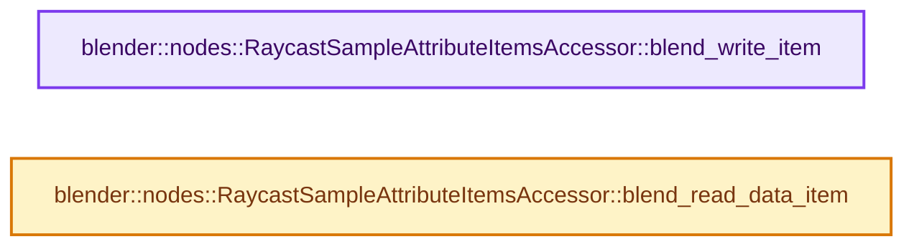
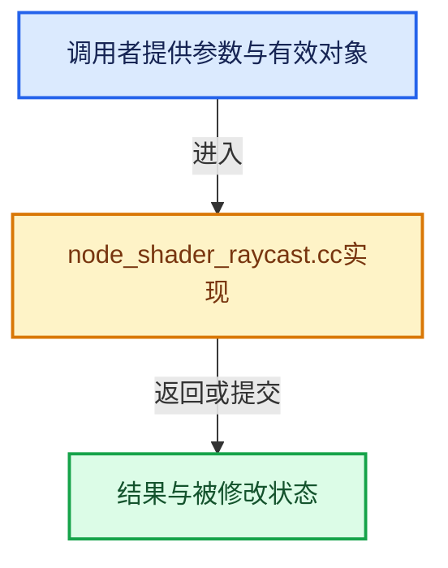

# 实现依赖专题：source/blender/nodes/shader/nodes/node_shader_raycast.cc

[方向导航](README.md) · [符号索引](../%E7%AC%A6%E5%8F%B7%E4%BE%9D%E8%B5%96%E4%B8%8E%E5%AE%9E%E7%8E%B0%E7%B4%A2%E5%BC%95.md)

本专题从正文实际调用进入，集中保存共享实现。函数有稳定锚点，可从调用处直接跳到对应完整函数；递归与互相调用通过回链组织。

## 本文件的实现关系






## 完整成员与函数实现

<a id="f-877171f69c6e4ae5"></a>

### `blender::nodes::RaycastSampleAttributeItemsAccessor::blend_write_item`

实现位置：[source/blender/nodes/shader/nodes/node_shader_raycast.cc](../../../../../source/blender/nodes/shader/nodes/node_shader_raycast.cc) · L277—L280。

接口参数：

- `BlendWriter *writer`
- `const ItemT &item`

**教学注释版**

<!-- annotated:eec983dc3250d0 -->

```cpp
void RaycastSampleAttributeItemsAccessor::blend_write_item(BlendWriter *writer, const ItemT &item)
{
  writer->write_string(item.name);
}
```

<details>
<summary>核对原始源码：source/blender/nodes/shader/nodes/node_shader_raycast.cc · L277—L280</summary>

<!-- original:eec983dc3250d0:source/blender/nodes/shader/nodes/node_shader_raycast.cc:277:280 -->

```cpp
void RaycastSampleAttributeItemsAccessor::blend_write_item(BlendWriter *writer, const ItemT &item)
{
  writer->write_string(item.name);
}
```

</details>

**继续追踪实现**

- `writer->write_string` → [blender::BlendWriter::write_string · L2357](../05-%E5%87%A0%E4%BD%95%E5%AD%98%E5%82%A8%E4%B8%8E%E6%8B%93%E6%89%91%E6%98%A0%E5%B0%84/%E4%BE%9D%E8%B5%96-writefile-3eb36f.md#f-3fd83db72afbdcbe)。

<a id="f-705b3505638a9ad1"></a>

### `blender::nodes::RaycastSampleAttributeItemsAccessor::blend_read_data_item`

实现位置：[source/blender/nodes/shader/nodes/node_shader_raycast.cc](../../../../../source/blender/nodes/shader/nodes/node_shader_raycast.cc) · L282—L286。

接口参数：

- `BlendDataReader *reader`
- `ItemT &item`

**教学注释版**

<!-- annotated:3dbe2cac74b137 -->

```cpp
void RaycastSampleAttributeItemsAccessor::blend_read_data_item(BlendDataReader *reader,
                                                               ItemT &item)
{
  BLO_read_string(reader, &item.name);
}
```

<details>
<summary>核对原始源码：source/blender/nodes/shader/nodes/node_shader_raycast.cc · L282—L286</summary>

<!-- original:3dbe2cac74b137:source/blender/nodes/shader/nodes/node_shader_raycast.cc:282:286 -->

```cpp
void RaycastSampleAttributeItemsAccessor::blend_read_data_item(BlendDataReader *reader,
                                                               ItemT &item)
{
  BLO_read_string(reader, &item.name);
}
```

</details>

**继续追踪实现**

- `BLO_read_string` → [BLO_read_string · L6348](../05-%E5%87%A0%E4%BD%95%E5%AD%98%E5%82%A8%E4%B8%8E%E6%8B%93%E6%89%91%E6%98%A0%E5%B0%84/%E4%BE%9D%E8%B5%96-readfile-05cc37.md#f-b9cb42e390941235)；[BLO_read_string · L6370](../05-%E5%87%A0%E4%BD%95%E5%AD%98%E5%82%A8%E4%B8%8E%E6%8B%93%E6%89%91%E6%98%A0%E5%B0%84/%E4%BE%9D%E8%B5%96-readfile-05cc37.md#f-1bb75b8661d718d2)；[BLO_read_string · L6375](../05-%E5%87%A0%E4%BD%95%E5%AD%98%E5%82%A8%E4%B8%8E%E6%8B%93%E6%89%91%E6%98%A0%E5%B0%84/%E4%BE%9D%E8%B5%96-readfile-05cc37.md#f-5714da923b3ad83d)。同名重载需按实参类型选择。
