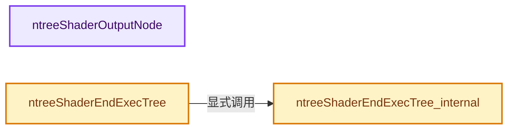
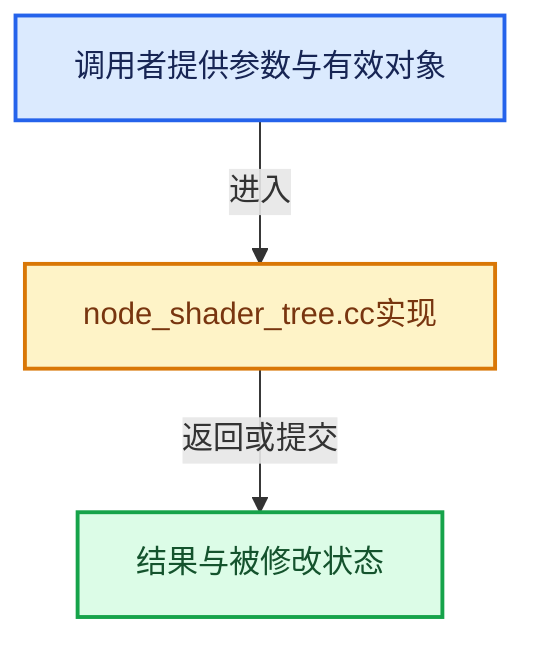

# 实现依赖专题：source/blender/nodes/shader/node_shader_tree.cc

[方向导航](README.md) · [符号索引](../%E7%AC%A6%E5%8F%B7%E4%BE%9D%E8%B5%96%E4%B8%8E%E5%AE%9E%E7%8E%B0%E7%B4%A2%E5%BC%95.md)

本专题从正文实际调用进入，集中保存共享实现。函数有稳定锚点，可从调用处直接跳到对应完整函数；递归与互相调用通过回链组织。

## 本文件的实现关系






## 完整成员与函数实现

<a id="f-b8a16259d59b1716"></a>

### `ntreeShaderOutputNode`

实现位置：[source/blender/nodes/shader/node_shader_tree.cc](../../../../../source/blender/nodes/shader/node_shader_tree.cc) · L215—L255。

接口参数：

- `bNodeTree *ntree`
- `int target`

**教学注释版**

<!-- annotated:ee9f5030d1ee04 -->

```cpp
bNode *ntreeShaderOutputNode(bNodeTree *ntree, int target)
{
  /* Make sure we only have single node tagged as output. */
  bke::node_tree_set_output(*ntree);

  /* Find output node that matches type and target. If there are
   * multiple, we prefer exact target match and active nodes. */
  bNode *output_node = nullptr;

  for (bNode &node : ntree->nodes) {
    if (!ELEM(
            node.type_legacy, SH_NODE_OUTPUT_MATERIAL, SH_NODE_OUTPUT_WORLD, SH_NODE_OUTPUT_LIGHT))
    {
      continue;
    }

    if (node.custom1 == SHD_OUTPUT_ALL) {
      if (output_node == nullptr) {
        output_node = &node;
      }
      else if (output_node->custom1 == SHD_OUTPUT_ALL) {
        if ((node.flag & NODE_DO_OUTPUT) && !(output_node->flag & NODE_DO_OUTPUT)) {
          output_node = &node;
        }
      }
    }
    else if (node.custom1 == target) {
      if (output_node == nullptr) {
        output_node = &node;
      }
      else if (output_node->custom1 == SHD_OUTPUT_ALL) {
        output_node = &node;
      }
      else if ((node.flag & NODE_DO_OUTPUT) && !(output_node->flag & NODE_DO_OUTPUT)) {
        output_node = &node;
      }
    }
  }

  return output_node;
}
```

<details>
<summary>核对原始源码：source/blender/nodes/shader/node_shader_tree.cc · L215—L255</summary>

<!-- original:ee9f5030d1ee04:source/blender/nodes/shader/node_shader_tree.cc:215:255 -->

```cpp
bNode *ntreeShaderOutputNode(bNodeTree *ntree, int target)
{
  /* Make sure we only have single node tagged as output. */
  bke::node_tree_set_output(*ntree);

  /* Find output node that matches type and target. If there are
   * multiple, we prefer exact target match and active nodes. */
  bNode *output_node = nullptr;

  for (bNode &node : ntree->nodes) {
    if (!ELEM(
            node.type_legacy, SH_NODE_OUTPUT_MATERIAL, SH_NODE_OUTPUT_WORLD, SH_NODE_OUTPUT_LIGHT))
    {
      continue;
    }

    if (node.custom1 == SHD_OUTPUT_ALL) {
      if (output_node == nullptr) {
        output_node = &node;
      }
      else if (output_node->custom1 == SHD_OUTPUT_ALL) {
        if ((node.flag & NODE_DO_OUTPUT) && !(output_node->flag & NODE_DO_OUTPUT)) {
          output_node = &node;
        }
      }
    }
    else if (node.custom1 == target) {
      if (output_node == nullptr) {
        output_node = &node;
      }
      else if (output_node->custom1 == SHD_OUTPUT_ALL) {
        output_node = &node;
      }
      else if ((node.flag & NODE_DO_OUTPUT) && !(output_node->flag & NODE_DO_OUTPUT)) {
        output_node = &node;
      }
    }
  }

  return output_node;
}
```

</details>

**沿实际写入检查状态**

- `output_node = &node;`

**结果出口**

- `return output_node;`

**继续追踪实现**

- `bke::node_tree_set_output` → [blender::bke::node_tree_set_output · L5238](../05-%E5%87%A0%E4%BD%95%E5%AD%98%E5%82%A8%E4%B8%8E%E6%8B%93%E6%89%91%E6%98%A0%E5%B0%84/%E4%BE%9D%E8%B5%96-node-89d753.md#f-c27c9a3470a4650d)。
- `ELEM` → [ELEM · L88](../05-%E5%87%A0%E4%BD%95%E5%AD%98%E5%82%A8%E4%B8%8E%E6%8B%93%E6%89%91%E6%98%A0%E5%B0%84/%E4%BE%9D%E8%B5%96-GHOST_utildefines-34b996.md#m-d28724a15928)；[ELEM · L135](../01-%E5%9F%BA%E7%A1%80%E5%AE%B9%E5%99%A8%E4%B8%8E%E7%8E%B0%E4%BB%A3CPP/%E4%BE%9D%E8%B5%96-BLI_utildefines-293a0a.md#m-d6572de7cae0)。宏定义由构建条件选择。

<a id="f-f53e55e4762a4173"></a>

### `ntreeShaderEndExecTree_internal`

实现位置：[source/blender/nodes/shader/node_shader_tree.cc](../../../../../source/blender/nodes/shader/node_shader_tree.cc) · L1159—L1176。

接口参数：

- `bNodeTreeExec *exec`

**教学注释版**

<!-- annotated:d1dbebda8096cd -->

```cpp
void ntreeShaderEndExecTree_internal(bNodeTreeExec *exec)
{
  if (exec->threadstack) {
    for (int a = 0; a < BLENDER_MAX_THREADS; a++) {
      for (bNodeThreadStack &nts : exec->threadstack[a]) {
        if (nts.stack) {
          MEM_delete(nts.stack);
        }
      }
      BLI_freelistN(&exec->threadstack[a]);
    }

    MEM_delete(exec->threadstack);
    exec->threadstack = nullptr;
  }

  ntree_exec_end(exec);
}
```

<details>
<summary>核对原始源码：source/blender/nodes/shader/node_shader_tree.cc · L1159—L1176</summary>

<!-- original:d1dbebda8096cd:source/blender/nodes/shader/node_shader_tree.cc:1159:1176 -->

```cpp
void ntreeShaderEndExecTree_internal(bNodeTreeExec *exec)
{
  if (exec->threadstack) {
    for (int a = 0; a < BLENDER_MAX_THREADS; a++) {
      for (bNodeThreadStack &nts : exec->threadstack[a]) {
        if (nts.stack) {
          MEM_delete(nts.stack);
        }
      }
      BLI_freelistN(&exec->threadstack[a]);
    }

    MEM_delete(exec->threadstack);
    exec->threadstack = nullptr;
  }

  ntree_exec_end(exec);
}
```

</details>

**沿实际写入检查状态**

- `exec->threadstack = nullptr;`

**继续追踪实现**

- `MEM_delete` → [MEM_delete · L400](../03-%E5%86%85%E5%AD%98%E5%88%86%E9%85%8D%E4%B8%8E%E8%BF%90%E8%A1%8C%E6%97%B6%E7%B1%BB%E5%9E%8B/%E4%BE%9D%E8%B5%96-MEM_guardedalloc-b54eca.md#f-9049ffdd1682887c)。
- `BLI_freelistN` → [blender::BLI_freelistN · L504](../01-%E5%9F%BA%E7%A1%80%E5%AE%B9%E5%99%A8%E4%B8%8E%E7%8E%B0%E4%BB%A3CPP/%E4%BE%9D%E8%B5%96-listbase-2816d9.md#f-c250f5cf55fbcbe4)。
- `ntree_exec_end` → [blender::ntree_exec_end · L284](%E4%BE%9D%E8%B5%96-node_exec-923fa6.md#f-2d3e765beff71d62)。

<a id="f-f1d2dce22315b98a"></a>

### `ntreeShaderEndExecTree`

实现位置：[source/blender/nodes/shader/node_shader_tree.cc](../../../../../source/blender/nodes/shader/node_shader_tree.cc) · L1178—L1189。

接口参数：

- `bNodeTreeExec *exec`

**教学注释版**

<!-- annotated:f5de8df10eaf14 -->

```cpp
void ntreeShaderEndExecTree(bNodeTreeExec *exec)
{
  if (exec) {
    /* exec may get freed, so assign ntree */
    bNodeTree *ntree = exec->nodetree;
    ntreeShaderEndExecTree_internal(exec);

    /* XXX: clear node-tree back-pointer to exec data,
     * same problem as noted in #ntreeBeginExecTree. */
    ntree->runtime->execdata = nullptr;
  }
}
```

<details>
<summary>核对原始源码：source/blender/nodes/shader/node_shader_tree.cc · L1178—L1189</summary>

<!-- original:f5de8df10eaf14:source/blender/nodes/shader/node_shader_tree.cc:1178:1189 -->

```cpp
void ntreeShaderEndExecTree(bNodeTreeExec *exec)
{
  if (exec) {
    /* exec may get freed, so assign ntree */
    bNodeTree *ntree = exec->nodetree;
    ntreeShaderEndExecTree_internal(exec);

    /* XXX: clear node-tree back-pointer to exec data,
     * same problem as noted in #ntreeBeginExecTree. */
    ntree->runtime->execdata = nullptr;
  }
}
```

</details>

**沿实际写入检查状态**

- `ntree->runtime->execdata = nullptr;`

**继续追踪实现**

- `ntreeShaderEndExecTree_internal` → [ntreeShaderEndExecTree_internal · L1159](%E4%BE%9D%E8%B5%96-node_shader_tree-d4b0a3.md#f-f53e55e4762a4173)。
