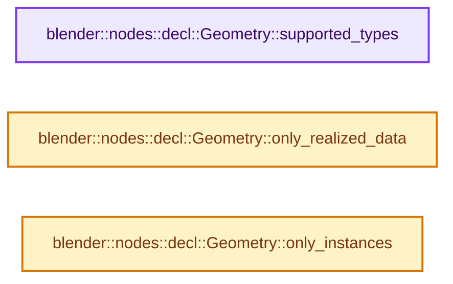
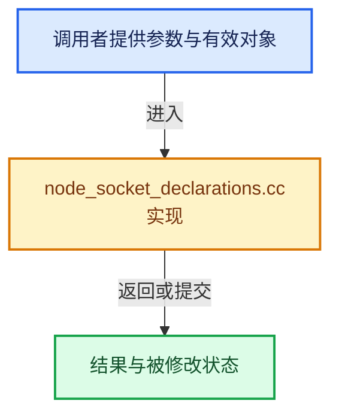

# 实现依赖专题：source/blender/nodes/intern/node_socket_declarations.cc

[方向导航](README.md) · [符号索引](../%E7%AC%A6%E5%8F%B7%E4%BE%9D%E8%B5%96%E4%B8%8E%E5%AE%9E%E7%8E%B0%E7%B4%A2%E5%BC%95.md)

本专题从正文实际调用进入，集中保存共享实现。函数有稳定锚点，可从调用处直接跳到对应完整函数；递归与互相调用通过回链组织。

## 本文件的实现关系






## 完整成员与函数实现

<a id="f-8d91e1f0a37e645d"></a>

### `blender::nodes::decl::Geometry::supported_types`

实现位置：[source/blender/nodes/intern/node_socket_declarations.cc](../../../../../source/blender/nodes/intern/node_socket_declarations.cc) · L979—L982。

**教学注释版**

<!-- annotated:d8d54268643036 -->

```cpp
Span<bke::GeometryComponent::Type> Geometry::supported_types() const
{
  return supported_types_;
}
```

<details>
<summary>核对原始源码：source/blender/nodes/intern/node_socket_declarations.cc · L979—L982</summary>

<!-- original:d8d54268643036:source/blender/nodes/intern/node_socket_declarations.cc:979:982 -->

```cpp
Span<bke::GeometryComponent::Type> Geometry::supported_types() const
{
  return supported_types_;
}
```

</details>

**结果出口**

- `return supported_types_;`

**继续追踪实现**

本实现没有需要继续展开的显式调用；检查返回表达式、对象转换和调用者前置条件。

<a id="f-4e6ec77196258b2f"></a>

### `blender::nodes::decl::Geometry::only_realized_data`

实现位置：[source/blender/nodes/intern/node_socket_declarations.cc](../../../../../source/blender/nodes/intern/node_socket_declarations.cc) · L984—L987。

**教学注释版**

<!-- annotated:bb25bcf4d08133 -->

```cpp
bool Geometry::only_realized_data() const
{
  return only_realized_data_;
}
```

<details>
<summary>核对原始源码：source/blender/nodes/intern/node_socket_declarations.cc · L984—L987</summary>

<!-- original:bb25bcf4d08133:source/blender/nodes/intern/node_socket_declarations.cc:984:987 -->

```cpp
bool Geometry::only_realized_data() const
{
  return only_realized_data_;
}
```

</details>

**结果出口**

- `return only_realized_data_;`

**继续追踪实现**

本实现没有需要继续展开的显式调用；检查返回表达式、对象转换和调用者前置条件。

<a id="f-0a874a242fc45af5"></a>

### `blender::nodes::decl::Geometry::only_instances`

实现位置：[source/blender/nodes/intern/node_socket_declarations.cc](../../../../../source/blender/nodes/intern/node_socket_declarations.cc) · L989—L992。

**教学注释版**

<!-- annotated:32a5895c9f4ded -->

```cpp
bool Geometry::only_instances() const
{
  return only_instances_;
}
```

<details>
<summary>核对原始源码：source/blender/nodes/intern/node_socket_declarations.cc · L989—L992</summary>

<!-- original:32a5895c9f4ded:source/blender/nodes/intern/node_socket_declarations.cc:989:992 -->

```cpp
bool Geometry::only_instances() const
{
  return only_instances_;
}
```

</details>

**结果出口**

- `return only_instances_;`

**继续追踪实现**

本实现没有需要继续展开的显式调用；检查返回表达式、对象转换和调用者前置条件。
