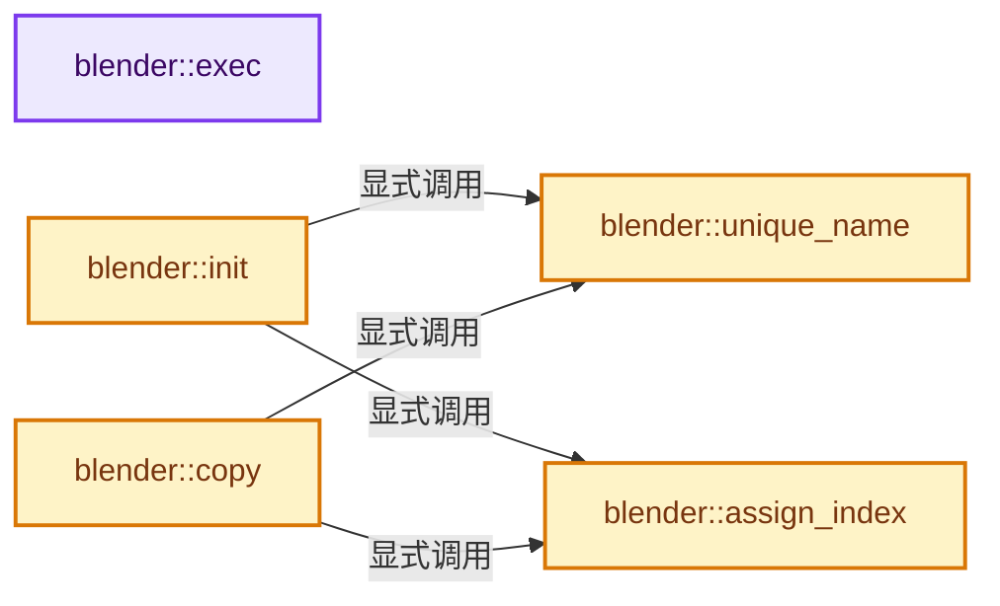
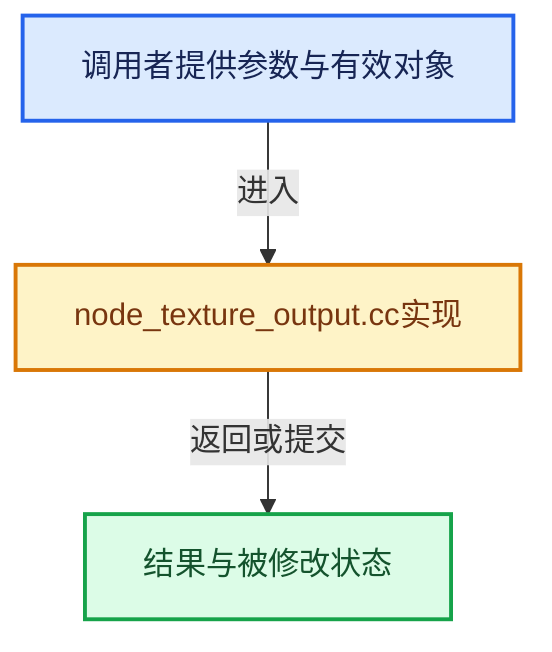

# 实现依赖专题：source/blender/nodes/texture/nodes/node_texture_output.cc

[方向导航](README.md) · [符号索引](../%E7%AC%A6%E5%8F%B7%E4%BE%9D%E8%B5%96%E4%B8%8E%E5%AE%9E%E7%8E%B0%E7%B4%A2%E5%BC%95.md)

本专题从正文实际调用进入，集中保存共享实现。函数有稳定锚点，可从调用处直接跳到对应完整函数；递归与互相调用通过回链组织。

## 本文件的实现关系






## 完整成员与函数实现

<a id="f-3fe17be3f6c19ca5"></a>

### `blender::exec`

实现位置：[source/blender/nodes/texture/nodes/node_texture_output.cc](../../../../../source/blender/nodes/texture/nodes/node_texture_output.cc) · L25—L53。

接口参数：

- `void *data`
- `int`
- `bNode *node`
- `bNodeExecData *`
- `bNodeStack **in`
- `bNodeStack **`

**教学注释版**

<!-- annotated:4c1d17bbb25233 -->

```cpp
static void exec(void *data,
                 int /*thread*/,
                 bNode *node,
                 bNodeExecData * /*execdata*/,
                 bNodeStack **in,
                 bNodeStack ** /*out*/)
{
  TexCallData *cdata = static_cast<TexCallData *>(data);
  TexResult *target = cdata->target;

  if (cdata->do_preview) {
    TexParams params;
    params_from_cdata(&params, cdata);

    tex_input_rgba(target->trgba, in[0], &params, cdata->thread);
  }
  else {
    /* 0 means don't care, so just use first */
    if (cdata->which_output == node->custom1 || (cdata->which_output == 0 && node->custom1 == 1)) {
      TexParams params;
      params_from_cdata(&params, cdata);

      tex_input_rgba(target->trgba, in[0], &params, cdata->thread);

      target->tin = (target->trgba[0] + target->trgba[1] + target->trgba[2]) / 3.0f;
      target->talpha = true;
    }
  }
}
```

<details>
<summary>核对原始源码：source/blender/nodes/texture/nodes/node_texture_output.cc · L25—L53</summary>

<!-- original:4c1d17bbb25233:source/blender/nodes/texture/nodes/node_texture_output.cc:25:53 -->

```cpp
static void exec(void *data,
                 int /*thread*/,
                 bNode *node,
                 bNodeExecData * /*execdata*/,
                 bNodeStack **in,
                 bNodeStack ** /*out*/)
{
  TexCallData *cdata = static_cast<TexCallData *>(data);
  TexResult *target = cdata->target;

  if (cdata->do_preview) {
    TexParams params;
    params_from_cdata(&params, cdata);

    tex_input_rgba(target->trgba, in[0], &params, cdata->thread);
  }
  else {
    /* 0 means don't care, so just use first */
    if (cdata->which_output == node->custom1 || (cdata->which_output == 0 && node->custom1 == 1)) {
      TexParams params;
      params_from_cdata(&params, cdata);

      tex_input_rgba(target->trgba, in[0], &params, cdata->thread);

      target->tin = (target->trgba[0] + target->trgba[1] + target->trgba[2]) / 3.0f;
      target->talpha = true;
    }
  }
}
```

</details>

**沿实际写入检查状态**

- `target->tin = (target->trgba[0] + target->trgba[1] + target->trgba[2]) / 3.0f;`
- `target->talpha = true;`

**继续追踪实现**

- `params_from_cdata` → [blender::params_from_cdata · L107](%E4%BE%9D%E8%B5%96-node_texture_util-0d1f2f.md#f-a3f2bcab6a2c00cd)。
- `tex_input_rgba` → [blender::tex_input_rgba · L83](%E4%BE%9D%E8%B5%96-node_texture_util-0d1f2f.md#f-eb06e809e2a307a4)。

<a id="f-cf6c7b71f8af1bb1"></a>

### `blender::unique_name`

实现位置：[source/blender/nodes/texture/nodes/node_texture_output.cc](../../../../../source/blender/nodes/texture/nodes/node_texture_output.cc) · L55—L97。

接口参数：

- `bNode *node`

**教学注释版**

<!-- annotated:2a754daec910d6 -->

```cpp
static void unique_name(bNode *node)
{
  TexNodeOutput *tno = static_cast<TexNodeOutput *>(node->storage);
  char new_name[sizeof(tno->name)];
  int new_len = 0;
  int suffix;
  bNode *i;
  const char *name = tno->name;

  new_name[0] = '\0';
  i = node;
  while (i->prev) {
    i = i->prev;
  }
  for (; i; i = i->next) {
    if (i == node || i->type_legacy != TEX_NODE_OUTPUT ||
        !STREQ(name, ((TexNodeOutput *)(i->storage))->name))
    {
      continue;
    }

    if (new_name[0] == '\0') {
      int len = strlen(name);
      if (len >= 4 && sscanf(name + len - 4, ".%03d", &suffix) == 1) {
        new_len = len;
      }
      else {
        suffix = 0;
        new_len = len + 4;
        // [讲解] std::min<ulong>：按比较关系选取较小值；截断范围时还需先满足非负和可表示范围，min本身不会证明边界安全。
        new_len = std::min<ulong>(new_len, sizeof(tno->name) - 1);
      }

      STRNCPY(new_name, name);
      name = new_name;
    }
    int name_ofs = new_len - 4;
    BLI_snprintf(new_name + name_ofs, sizeof(new_name) - name_ofs, ".%03d", ++suffix);
  }

  if (new_name[0] != '\0') {
    STRNCPY(tno->name, new_name);
  }
}
```

<details>
<summary>核对原始源码：source/blender/nodes/texture/nodes/node_texture_output.cc · L55—L97</summary>

<!-- original:2a754daec910d6:source/blender/nodes/texture/nodes/node_texture_output.cc:55:97 -->

```cpp
static void unique_name(bNode *node)
{
  TexNodeOutput *tno = static_cast<TexNodeOutput *>(node->storage);
  char new_name[sizeof(tno->name)];
  int new_len = 0;
  int suffix;
  bNode *i;
  const char *name = tno->name;

  new_name[0] = '\0';
  i = node;
  while (i->prev) {
    i = i->prev;
  }
  for (; i; i = i->next) {
    if (i == node || i->type_legacy != TEX_NODE_OUTPUT ||
        !STREQ(name, ((TexNodeOutput *)(i->storage))->name))
    {
      continue;
    }

    if (new_name[0] == '\0') {
      int len = strlen(name);
      if (len >= 4 && sscanf(name + len - 4, ".%03d", &suffix) == 1) {
        new_len = len;
      }
      else {
        suffix = 0;
        new_len = len + 4;
        new_len = std::min<ulong>(new_len, sizeof(tno->name) - 1);
      }

      STRNCPY(new_name, name);
      name = new_name;
    }
    int name_ofs = new_len - 4;
    BLI_snprintf(new_name + name_ofs, sizeof(new_name) - name_ofs, ".%03d", ++suffix);
  }

  if (new_name[0] != '\0') {
    STRNCPY(tno->name, new_name);
  }
}
```

</details>

**沿实际写入检查状态**

- `new_name[0] = '\0';`
- `i = node;`
- `i = i->prev;`
- `new_len = len;`
- `suffix = 0;`
- `new_len = len + 4;`
- `new_len = std::min<ulong>(new_len, sizeof(tno->name) - 1);`
- `name = new_name;`

**继续追踪实现**

- `STREQ` → [STREQ · L112](../05-%E5%87%A0%E4%BD%95%E5%AD%98%E5%82%A8%E4%B8%8E%E6%8B%93%E6%89%91%E6%98%A0%E5%B0%84/%E4%BE%9D%E8%B5%96-GHOST_utildefines-34b996.md#m-9549fb6aafd2)；[STREQ · L451](../01-%E5%9F%BA%E7%A1%80%E5%AE%B9%E5%99%A8%E4%B8%8E%E7%8E%B0%E4%BB%A3CPP/%E4%BE%9D%E8%B5%96-BLI_utildefines-293a0a.md#m-c7b745bcfad2)；[STREQ · L55](../05-%E5%87%A0%E4%BD%95%E5%AD%98%E5%82%A8%E4%B8%8E%E6%8B%93%E6%89%91%E6%98%A0%E5%B0%84/%E4%BE%9D%E8%B5%96-clog-a0bec8.md#m-96e78f386894)。宏定义由构建条件选择。
- `strlen` → [外部契约](https://eel.is/c++draft/)：这个边界按实际表达式及所属类型核对参数、返回值、寿命与失败行为。这里提供接口入口，不声称已解释该第三方版本的内部实现。
- `sscanf` → [调用协议](../%E6%A8%A1%E6%9D%BF%E5%AE%8F%E4%B8%8E%E5%8A%A8%E6%80%81%E5%88%86%E6%B4%BE%E5%8D%8F%E8%AE%AE.md)：函数指针、局部可调用对象或未展开的宏；必须结合调用者环境。调用位置L78。
- `std::min<ulong>` → [外部契约](https://eel.is/c++draft/alg.min.max)：按比较关系选取较小值；截断范围时还需先满足非负和可表示范围，min本身不会证明边界安全。
- `STRNCPY` → [blender::STRNCPY · L690](../01-%E5%9F%BA%E7%A1%80%E5%AE%B9%E5%99%A8%E4%B8%8E%E7%8E%B0%E4%BB%A3CPP/%E4%BE%9D%E8%B5%96-BLI_string-b43058.md#f-6b2d861724026be6)。
- `BLI_snprintf` → [blender::BLI_snprintf · L201](../01-%E5%9F%BA%E7%A1%80%E5%AE%B9%E5%99%A8%E4%B8%8E%E7%8E%B0%E4%BB%A3CPP/%E4%BE%9D%E8%B5%96-string-1d986f.md#f-c4de2f0e81459332)。

<a id="f-95813e6ce0a87534"></a>

### `blender::assign_index`

实现位置：[source/blender/nodes/texture/nodes/node_texture_output.cc](../../../../../source/blender/nodes/texture/nodes/node_texture_output.cc) · L99—L120。

接口参数：

- `bNode *node`

**教学注释版**

<!-- annotated:e46f2ef452498b -->

```cpp
static void assign_index(bNode *node)
{
  bNode *tnode;
  int index = 1;

  tnode = node;
  while (tnode->prev) {
    tnode = tnode->prev;
  }

check_index:
  for (; tnode; tnode = tnode->next) {
    if (tnode->type_legacy == TEX_NODE_OUTPUT && tnode != node) {
      if (tnode->custom1 == index) {
        index++;
        goto check_index;
      }
    }
  }

  node->custom1 = index;
}
```

<details>
<summary>核对原始源码：source/blender/nodes/texture/nodes/node_texture_output.cc · L99—L120</summary>

<!-- original:e46f2ef452498b:source/blender/nodes/texture/nodes/node_texture_output.cc:99:120 -->

```cpp
static void assign_index(bNode *node)
{
  bNode *tnode;
  int index = 1;

  tnode = node;
  while (tnode->prev) {
    tnode = tnode->prev;
  }

check_index:
  for (; tnode; tnode = tnode->next) {
    if (tnode->type_legacy == TEX_NODE_OUTPUT && tnode != node) {
      if (tnode->custom1 == index) {
        index++;
        goto check_index;
      }
    }
  }

  node->custom1 = index;
}
```

</details>

**沿实际写入检查状态**

- `tnode = node;`
- `tnode = tnode->prev;`
- `node->custom1 = index;`

**继续追踪实现**

本实现没有需要继续展开的显式调用；检查返回表达式、对象转换和调用者前置条件。

<a id="f-79e1501970a26a50"></a>

### `blender::init`

实现位置：[source/blender/nodes/texture/nodes/node_texture_output.cc](../../../../../source/blender/nodes/texture/nodes/node_texture_output.cc) · L122—L130。

接口参数：

- `bNodeTree *`
- `bNode *node`

**教学注释版**

<!-- annotated:50b18466a61f70 -->

```cpp
static void init(bNodeTree * /*ntree*/, bNode *node)
{
  TexNodeOutput *tno = MEM_new<TexNodeOutput>("TEX_output");
  node->storage = tno;

  STRNCPY(tno->name, "Default");
  unique_name(node);
  assign_index(node);
}
```

<details>
<summary>核对原始源码：source/blender/nodes/texture/nodes/node_texture_output.cc · L122—L130</summary>

<!-- original:50b18466a61f70:source/blender/nodes/texture/nodes/node_texture_output.cc:122:130 -->

```cpp
static void init(bNodeTree * /*ntree*/, bNode *node)
{
  TexNodeOutput *tno = MEM_new<TexNodeOutput>("TEX_output");
  node->storage = tno;

  STRNCPY(tno->name, "Default");
  unique_name(node);
  assign_index(node);
}
```

</details>

**沿实际写入检查状态**

- `node->storage = tno;`

**继续追踪实现**

- `MEM_new<TexNodeOutput>` → [MEM_new · L351](../03-%E5%86%85%E5%AD%98%E5%88%86%E9%85%8D%E4%B8%8E%E8%BF%90%E8%A1%8C%E6%97%B6%E7%B1%BB%E5%9E%8B/%E4%BE%9D%E8%B5%96-MEM_guardedalloc-b54eca.md#f-115f9b6784f89912)。
- `STRNCPY` → [blender::STRNCPY · L690](../01-%E5%9F%BA%E7%A1%80%E5%AE%B9%E5%99%A8%E4%B8%8E%E7%8E%B0%E4%BB%A3CPP/%E4%BE%9D%E8%B5%96-BLI_string-b43058.md#f-6b2d861724026be6)。
- `unique_name` → [blender::unique_name · L55](%E4%BE%9D%E8%B5%96-node_texture_output-72ffb1.md#f-cf6c7b71f8af1bb1)。
- `assign_index` → [blender::assign_index · L99](%E4%BE%9D%E8%B5%96-node_texture_output-72ffb1.md#f-95813e6ce0a87534)。

<a id="f-714039a6a87b6542"></a>

### `blender::copy`

实现位置：[source/blender/nodes/texture/nodes/node_texture_output.cc](../../../../../source/blender/nodes/texture/nodes/node_texture_output.cc) · L132—L137。

接口参数：

- `bNodeTree *dest_ntree`
- `bNode *dest_node`
- `const bNode *src_node`

**教学注释版**

<!-- annotated:c39c978a8a1b5a -->

```cpp
static void copy(bNodeTree *dest_ntree, bNode *dest_node, const bNode *src_node)
{
  node_copy_standard_storage(dest_ntree, dest_node, src_node);
  unique_name(dest_node);
  assign_index(dest_node);
}
```

<details>
<summary>核对原始源码：source/blender/nodes/texture/nodes/node_texture_output.cc · L132—L137</summary>

<!-- original:c39c978a8a1b5a:source/blender/nodes/texture/nodes/node_texture_output.cc:132:137 -->

```cpp
static void copy(bNodeTree *dest_ntree, bNode *dest_node, const bNode *src_node)
{
  node_copy_standard_storage(dest_ntree, dest_node, src_node);
  unique_name(dest_node);
  assign_index(dest_node);
}
```

</details>

**继续追踪实现**

- `node_copy_standard_storage` → [blender::node_copy_standard_storage · L57](%E4%BE%9D%E8%B5%96-node_util-403176.md#f-bd1d0d8cd036e339)。
- `unique_name` → [blender::unique_name · L55](%E4%BE%9D%E8%B5%96-node_texture_output-72ffb1.md#f-cf6c7b71f8af1bb1)。
- `assign_index` → [blender::assign_index · L99](%E4%BE%9D%E8%B5%96-node_texture_output-72ffb1.md#f-95813e6ce0a87534)。
