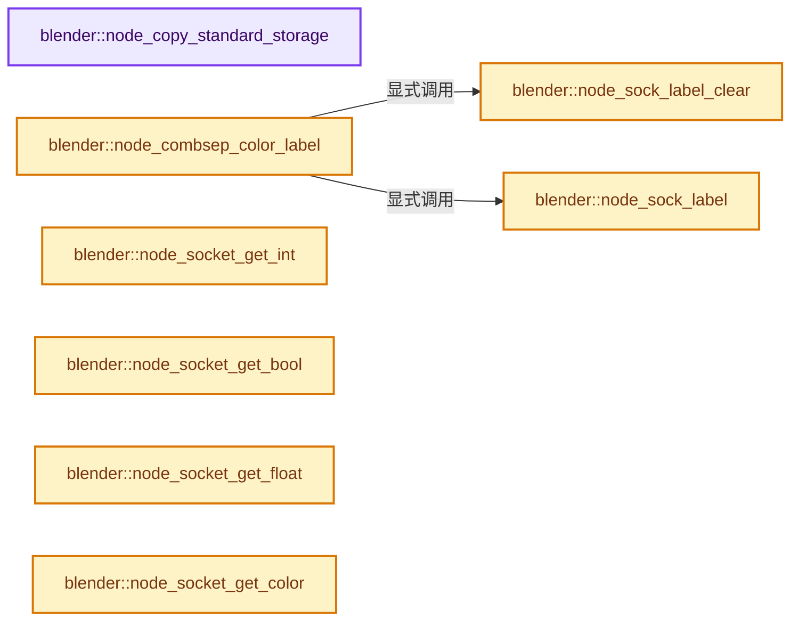
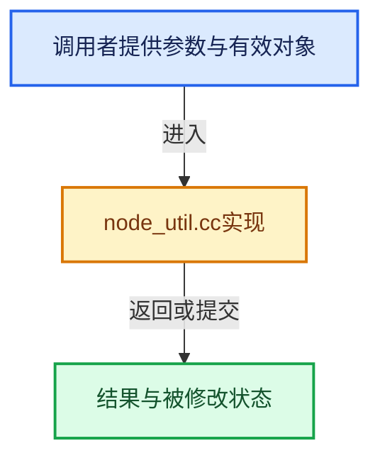

# 实现依赖专题：source/blender/nodes/intern/node_util.cc

[方向导航](README.md) · [符号索引](../%E7%AC%A6%E5%8F%B7%E4%BE%9D%E8%B5%96%E4%B8%8E%E5%AE%9E%E7%8E%B0%E7%B4%A2%E5%BC%95.md)

本专题从正文实际调用进入，集中保存共享实现。函数有稳定锚点，可从调用处直接跳到对应完整函数；递归与互相调用通过回链组织。

## 本文件的实现关系






## 完整成员与函数实现

<a id="f-bd1d0d8cd036e339"></a>

### `blender::node_copy_standard_storage`

实现位置：[source/blender/nodes/intern/node_util.cc](../../../../../source/blender/nodes/intern/node_util.cc) · L57—L62。

接口参数：

- `bNodeTree *`
- `bNode *dest_node`
- `const bNode *src_node`

**教学注释版**

<!-- annotated:c2c4700d631c90 -->

```cpp
void node_copy_standard_storage(bNodeTree * /*dest_ntree*/,
                                bNode *dest_node,
                                const bNode *src_node)
{
  dest_node->storage = MEM_dupalloc_void(src_node->storage);
}
```

<details>
<summary>核对原始源码：source/blender/nodes/intern/node_util.cc · L57—L62</summary>

<!-- original:c2c4700d631c90:source/blender/nodes/intern/node_util.cc:57:62 -->

```cpp
void node_copy_standard_storage(bNodeTree * /*dest_ntree*/,
                                bNode *dest_node,
                                const bNode *src_node)
{
  dest_node->storage = MEM_dupalloc_void(src_node->storage);
}
```

</details>

**沿实际写入检查状态**

- `dest_node->storage = MEM_dupalloc_void(src_node->storage);`

**继续追踪实现**

- `MEM_dupalloc_void` → [MEM_dupalloc_void · L139](../03-%E5%86%85%E5%AD%98%E5%88%86%E9%85%8D%E4%B8%8E%E8%BF%90%E8%A1%8C%E6%97%B6%E7%B1%BB%E5%9E%8B/%E4%BE%9D%E8%B5%96-mallocn-afdcd4.md#f-7a16d9233cb67bd0)。

<a id="f-9443bcca49d2e71e"></a>

### `blender::node_sock_label`

实现位置：[source/blender/nodes/intern/node_util.cc](../../../../../source/blender/nodes/intern/node_util.cc) · L76—L79。

接口参数：

- `bNodeSocket *sock`
- `const char *name`

**教学注释版**

<!-- annotated:dd9ea20abe5311 -->

```cpp
void node_sock_label(bNodeSocket *sock, const char *name)
{
  STRNCPY_UTF8(sock->label, name);
}
```

<details>
<summary>核对原始源码：source/blender/nodes/intern/node_util.cc · L76—L79</summary>

<!-- original:dd9ea20abe5311:source/blender/nodes/intern/node_util.cc:76:79 -->

```cpp
void node_sock_label(bNodeSocket *sock, const char *name)
{
  STRNCPY_UTF8(sock->label, name);
}
```

</details>

**继续追踪实现**

- `STRNCPY_UTF8` → [STRNCPY_UTF8 · L335](../01-%E5%9F%BA%E7%A1%80%E5%AE%B9%E5%99%A8%E4%B8%8E%E7%8E%B0%E4%BB%A3CPP/%E4%BE%9D%E8%B5%96-BLI_string_utf8-bcc961.md#m-222967f0ab6a)。宏定义由构建条件选择。

<a id="f-d5f90190fc7bd983"></a>

### `blender::node_sock_label_clear`

实现位置：[source/blender/nodes/intern/node_util.cc](../../../../../source/blender/nodes/intern/node_util.cc) · L81—L86。

接口参数：

- `bNodeSocket *sock`

**教学注释版**

<!-- annotated:37b45b76009bf3 -->

```cpp
void node_sock_label_clear(bNodeSocket *sock)
{
  if (sock->label[0] != '\0') {
    sock->label[0] = '\0';
  }
}
```

<details>
<summary>核对原始源码：source/blender/nodes/intern/node_util.cc · L81—L86</summary>

<!-- original:37b45b76009bf3:source/blender/nodes/intern/node_util.cc:81:86 -->

```cpp
void node_sock_label_clear(bNodeSocket *sock)
{
  if (sock->label[0] != '\0') {
    sock->label[0] = '\0';
  }
}
```

</details>

**沿实际写入检查状态**

- `sock->label[0] = '\0';`

**继续追踪实现**

本实现没有需要继续展开的显式调用；检查返回表达式、对象转换和调用者前置条件。

<a id="f-3aedf36fb65bb544"></a>

### `blender::node_combsep_color_label`

实现位置：[source/blender/nodes/intern/node_util.cc](../../../../../source/blender/nodes/intern/node_util.cc) · L184—L215。

接口参数：

- `const ListBaseT<bNodeSocket> *sockets`
- `NodeCombSepColorMode mode`

**教学注释版**

<!-- annotated:6ab911ed55e240 -->

```cpp
void node_combsep_color_label(const ListBaseT<bNodeSocket> *sockets, NodeCombSepColorMode mode)
{
  bNodeSocket *sock1 = sockets->first();
  bNodeSocket *sock2 = sock1->next;
  bNodeSocket *sock3 = sock2->next;

  node_sock_label_clear(sock1);
  node_sock_label_clear(sock2);
  node_sock_label_clear(sock3);

  switch (mode) {
    case NODE_COMBSEP_COLOR_RGB:
      node_sock_label(sock1, "Red");
      node_sock_label(sock2, "Green");
      node_sock_label(sock3, "Blue");
      break;
    case NODE_COMBSEP_COLOR_HSL:
      node_sock_label(sock1, "Hue");
      node_sock_label(sock2, "Saturation");
      node_sock_label(sock3, "Lightness");
      break;
    case NODE_COMBSEP_COLOR_HSV:
      node_sock_label(sock1, "Hue");
      node_sock_label(sock2, "Saturation");
      node_sock_label(sock3, "Value");
      break;
    default: {
      BLI_assert_unreachable();
      break;
    }
  }
}
```

<details>
<summary>核对原始源码：source/blender/nodes/intern/node_util.cc · L184—L215</summary>

<!-- original:6ab911ed55e240:source/blender/nodes/intern/node_util.cc:184:215 -->

```cpp
void node_combsep_color_label(const ListBaseT<bNodeSocket> *sockets, NodeCombSepColorMode mode)
{
  bNodeSocket *sock1 = sockets->first();
  bNodeSocket *sock2 = sock1->next;
  bNodeSocket *sock3 = sock2->next;

  node_sock_label_clear(sock1);
  node_sock_label_clear(sock2);
  node_sock_label_clear(sock3);

  switch (mode) {
    case NODE_COMBSEP_COLOR_RGB:
      node_sock_label(sock1, "Red");
      node_sock_label(sock2, "Green");
      node_sock_label(sock3, "Blue");
      break;
    case NODE_COMBSEP_COLOR_HSL:
      node_sock_label(sock1, "Hue");
      node_sock_label(sock2, "Saturation");
      node_sock_label(sock3, "Lightness");
      break;
    case NODE_COMBSEP_COLOR_HSV:
      node_sock_label(sock1, "Hue");
      node_sock_label(sock2, "Saturation");
      node_sock_label(sock3, "Value");
      break;
    default: {
      BLI_assert_unreachable();
      break;
    }
  }
}
```

</details>

**继续追踪实现**

- `sockets->first` → [blender::ListBaseT::first · L102](../05-%E5%87%A0%E4%BD%95%E5%AD%98%E5%82%A8%E4%B8%8E%E6%8B%93%E6%89%91%E6%98%A0%E5%B0%84/%E4%BE%9D%E8%B5%96-DNA_listBase-48dbc9.md#f-3d12ff35da057c9e)；[blender::ListBaseT::first · L106](../05-%E5%87%A0%E4%BD%95%E5%AD%98%E5%82%A8%E4%B8%8E%E6%8B%93%E6%89%91%E6%98%A0%E5%B0%84/%E4%BE%9D%E8%B5%96-DNA_listBase-48dbc9.md#f-0df87c3480e059f9)。同名重载需按实参类型选择。
- `node_sock_label_clear` → [blender::node_sock_label_clear · L81](%E4%BE%9D%E8%B5%96-node_util-403176.md#f-d5f90190fc7bd983)。
- `node_sock_label` → [blender::node_sock_label · L76](%E4%BE%9D%E8%B5%96-node_util-403176.md#f-9443bcca49d2e71e)。
- `BLI_assert_unreachable` → [BLI_assert_unreachable · L77](../01-%E5%9F%BA%E7%A1%80%E5%AE%B9%E5%99%A8%E4%B8%8E%E7%8E%B0%E4%BB%A3CPP/%E4%BE%9D%E8%B5%96-BLI_assert-cc98e8.md#m-7a2d91a67d8e)。宏定义由构建条件选择。

<a id="f-7cfcb48f4cc2608a"></a>

### `blender::node_socket_get_int`

实现位置：[source/blender/nodes/intern/node_util.cc](../../../../../source/blender/nodes/intern/node_util.cc) · L234—L238。

接口参数：

- `bNodeTree *ntree`
- `bNode *`
- `bNodeSocket *sock`

**教学注释版**

<!-- annotated:6ba788fc212ebb -->

```cpp
int node_socket_get_int(bNodeTree *ntree, bNode * /*node*/, bNodeSocket *sock)
{
  PointerRNA ptr = RNA_pointer_create_discrete(id_cast<ID *>(ntree), RNA_NodeSocket, sock);
  return RNA_int_get(&ptr, "default_value");
}
```

<details>
<summary>核对原始源码：source/blender/nodes/intern/node_util.cc · L234—L238</summary>

<!-- original:6ba788fc212ebb:source/blender/nodes/intern/node_util.cc:234:238 -->

```cpp
int node_socket_get_int(bNodeTree *ntree, bNode * /*node*/, bNodeSocket *sock)
{
  PointerRNA ptr = RNA_pointer_create_discrete(id_cast<ID *>(ntree), RNA_NodeSocket, sock);
  return RNA_int_get(&ptr, "default_value");
}
```

</details>

**结果出口**

- `return RNA_int_get(&ptr, "default_value");`

**继续追踪实现**

- `RNA_pointer_create_discrete` → [blender::RNA_pointer_create_discrete · L181](../05-%E5%87%A0%E4%BD%95%E5%AD%98%E5%82%A8%E4%B8%8E%E6%8B%93%E6%89%91%E6%98%A0%E5%B0%84/%E4%BE%9D%E8%B5%96-rna_access-706bea.md#f-592a276e869c6d94)。
- `id_cast<ID *>` → [blender::id_cast · L1417](../05-%E5%87%A0%E4%BD%95%E5%AD%98%E5%82%A8%E4%B8%8E%E6%8B%93%E6%89%91%E6%98%A0%E5%B0%84/%E4%BE%9D%E8%B5%96-DNA_ID-3eb091.md#f-6c8ac6412850ac5a)。
- `RNA_int_get` → [blender::RNA_int_get · L6771](../05-%E5%87%A0%E4%BD%95%E5%AD%98%E5%82%A8%E4%B8%8E%E6%8B%93%E6%89%91%E6%98%A0%E5%B0%84/%E4%BE%9D%E8%B5%96-rna_access-706bea.md#f-22b00c34f0e656c9)。

<a id="f-893d03b1e2c26ef6"></a>

### `blender::node_socket_get_bool`

实现位置：[source/blender/nodes/intern/node_util.cc](../../../../../source/blender/nodes/intern/node_util.cc) · L246—L250。

接口参数：

- `bNodeTree *ntree`
- `bNode *`
- `bNodeSocket *sock`

**教学注释版**

<!-- annotated:9e3a41c127ab2b -->

```cpp
bool node_socket_get_bool(bNodeTree *ntree, bNode * /*node*/, bNodeSocket *sock)
{
  PointerRNA ptr = RNA_pointer_create_discrete(id_cast<ID *>(ntree), RNA_NodeSocket, sock);
  return RNA_boolean_get(&ptr, "default_value");
}
```

<details>
<summary>核对原始源码：source/blender/nodes/intern/node_util.cc · L246—L250</summary>

<!-- original:9e3a41c127ab2b:source/blender/nodes/intern/node_util.cc:246:250 -->

```cpp
bool node_socket_get_bool(bNodeTree *ntree, bNode * /*node*/, bNodeSocket *sock)
{
  PointerRNA ptr = RNA_pointer_create_discrete(id_cast<ID *>(ntree), RNA_NodeSocket, sock);
  return RNA_boolean_get(&ptr, "default_value");
}
```

</details>

**结果出口**

- `return RNA_boolean_get(&ptr, "default_value");`

**继续追踪实现**

- `RNA_pointer_create_discrete` → [blender::RNA_pointer_create_discrete · L181](../05-%E5%87%A0%E4%BD%95%E5%AD%98%E5%82%A8%E4%B8%8E%E6%8B%93%E6%89%91%E6%98%A0%E5%B0%84/%E4%BE%9D%E8%B5%96-rna_access-706bea.md#f-592a276e869c6d94)。
- `id_cast<ID *>` → [blender::id_cast · L1417](../05-%E5%87%A0%E4%BD%95%E5%AD%98%E5%82%A8%E4%B8%8E%E6%8B%93%E6%89%91%E6%98%A0%E5%B0%84/%E4%BE%9D%E8%B5%96-DNA_ID-3eb091.md#f-6c8ac6412850ac5a)。
- `RNA_boolean_get` → [blender::RNA_boolean_get · L6724](../05-%E5%87%A0%E4%BD%95%E5%AD%98%E5%82%A8%E4%B8%8E%E6%8B%93%E6%89%91%E6%98%A0%E5%B0%84/%E4%BE%9D%E8%B5%96-rna_access-706bea.md#f-13cc43133c6542de)。

<a id="f-c8ae0b3352126564"></a>

### `blender::node_socket_get_float`

实现位置：[source/blender/nodes/intern/node_util.cc](../../../../../source/blender/nodes/intern/node_util.cc) · L258—L262。

接口参数：

- `bNodeTree *ntree`
- `bNode *`
- `bNodeSocket *sock`

**教学注释版**

<!-- annotated:0a51e812c99042 -->

```cpp
float node_socket_get_float(bNodeTree *ntree, bNode * /*node*/, bNodeSocket *sock)
{
  PointerRNA ptr = RNA_pointer_create_discrete(id_cast<ID *>(ntree), RNA_NodeSocket, sock);
  return RNA_float_get(&ptr, "default_value");
}
```

<details>
<summary>核对原始源码：source/blender/nodes/intern/node_util.cc · L258—L262</summary>

<!-- original:0a51e812c99042:source/blender/nodes/intern/node_util.cc:258:262 -->

```cpp
float node_socket_get_float(bNodeTree *ntree, bNode * /*node*/, bNodeSocket *sock)
{
  PointerRNA ptr = RNA_pointer_create_discrete(id_cast<ID *>(ntree), RNA_NodeSocket, sock);
  return RNA_float_get(&ptr, "default_value");
}
```

</details>

**结果出口**

- `return RNA_float_get(&ptr, "default_value");`

**继续追踪实现**

- `RNA_pointer_create_discrete` → [blender::RNA_pointer_create_discrete · L181](../05-%E5%87%A0%E4%BD%95%E5%AD%98%E5%82%A8%E4%B8%8E%E6%8B%93%E6%89%91%E6%98%A0%E5%B0%84/%E4%BE%9D%E8%B5%96-rna_access-706bea.md#f-592a276e869c6d94)。
- `id_cast<ID *>` → [blender::id_cast · L1417](../05-%E5%87%A0%E4%BD%95%E5%AD%98%E5%82%A8%E4%B8%8E%E6%8B%93%E6%89%91%E6%98%A0%E5%B0%84/%E4%BE%9D%E8%B5%96-DNA_ID-3eb091.md#f-6c8ac6412850ac5a)。
- `RNA_float_get` → [blender::RNA_float_get · L6818](../05-%E5%87%A0%E4%BD%95%E5%AD%98%E5%82%A8%E4%B8%8E%E6%8B%93%E6%89%91%E6%98%A0%E5%B0%84/%E4%BE%9D%E8%B5%96-rna_access-706bea.md#f-3d5f07d64f57d4f3)。

<a id="f-8b30dfd79ba782c2"></a>

### `blender::node_socket_get_color`

实现位置：[source/blender/nodes/intern/node_util.cc](../../../../../source/blender/nodes/intern/node_util.cc) · L270—L274。

接口参数：

- `bNodeTree *ntree`
- `bNode *`
- `bNodeSocket *sock`
- `float *value`

**教学注释版**

<!-- annotated:79ecf604b1d226 -->

```cpp
void node_socket_get_color(bNodeTree *ntree, bNode * /*node*/, bNodeSocket *sock, float *value)
{
  PointerRNA ptr = RNA_pointer_create_discrete(id_cast<ID *>(ntree), RNA_NodeSocket, sock);
  RNA_float_get_array(&ptr, "default_value", value);
}
```

<details>
<summary>核对原始源码：source/blender/nodes/intern/node_util.cc · L270—L274</summary>

<!-- original:79ecf604b1d226:source/blender/nodes/intern/node_util.cc:270:274 -->

```cpp
void node_socket_get_color(bNodeTree *ntree, bNode * /*node*/, bNodeSocket *sock, float *value)
{
  PointerRNA ptr = RNA_pointer_create_discrete(id_cast<ID *>(ntree), RNA_NodeSocket, sock);
  RNA_float_get_array(&ptr, "default_value", value);
}
```

</details>

**继续追踪实现**

- `RNA_pointer_create_discrete` → [blender::RNA_pointer_create_discrete · L181](../05-%E5%87%A0%E4%BD%95%E5%AD%98%E5%82%A8%E4%B8%8E%E6%8B%93%E6%89%91%E6%98%A0%E5%B0%84/%E4%BE%9D%E8%B5%96-rna_access-706bea.md#f-592a276e869c6d94)。
- `id_cast<ID *>` → [blender::id_cast · L1417](../05-%E5%87%A0%E4%BD%95%E5%AD%98%E5%82%A8%E4%B8%8E%E6%8B%93%E6%89%91%E6%98%A0%E5%B0%84/%E4%BE%9D%E8%B5%96-DNA_ID-3eb091.md#f-6c8ac6412850ac5a)。
- `RNA_float_get_array` → [blender::RNA_float_get_array · L6841](../05-%E5%87%A0%E4%BD%95%E5%AD%98%E5%82%A8%E4%B8%8E%E6%8B%93%E6%89%91%E6%98%A0%E5%B0%84/%E4%BE%9D%E8%B5%96-rna_access-706bea.md#f-2000eb83eec9e0c7)。

<a id="f-539baf0b8fc92735"></a>

### `blender::node_socket_get_vector`

实现位置：[source/blender/nodes/intern/node_util.cc](../../../../../source/blender/nodes/intern/node_util.cc) · L285—L289。

接口参数：

- `bNodeTree *ntree`
- `bNode *`
- `bNodeSocket *sock`
- `float *value`

**教学注释版**

<!-- annotated:f645213ca11069 -->

```cpp
void node_socket_get_vector(bNodeTree *ntree, bNode * /*node*/, bNodeSocket *sock, float *value)
{
  PointerRNA ptr = RNA_pointer_create_discrete(id_cast<ID *>(ntree), RNA_NodeSocket, sock);
  RNA_float_get_array(&ptr, "default_value", value);
}
```

<details>
<summary>核对原始源码：source/blender/nodes/intern/node_util.cc · L285—L289</summary>

<!-- original:f645213ca11069:source/blender/nodes/intern/node_util.cc:285:289 -->

```cpp
void node_socket_get_vector(bNodeTree *ntree, bNode * /*node*/, bNodeSocket *sock, float *value)
{
  PointerRNA ptr = RNA_pointer_create_discrete(id_cast<ID *>(ntree), RNA_NodeSocket, sock);
  RNA_float_get_array(&ptr, "default_value", value);
}
```

</details>

**继续追踪实现**

- `RNA_pointer_create_discrete` → [blender::RNA_pointer_create_discrete · L181](../05-%E5%87%A0%E4%BD%95%E5%AD%98%E5%82%A8%E4%B8%8E%E6%8B%93%E6%89%91%E6%98%A0%E5%B0%84/%E4%BE%9D%E8%B5%96-rna_access-706bea.md#f-592a276e869c6d94)。
- `id_cast<ID *>` → [blender::id_cast · L1417](../05-%E5%87%A0%E4%BD%95%E5%AD%98%E5%82%A8%E4%B8%8E%E6%8B%93%E6%89%91%E6%98%A0%E5%B0%84/%E4%BE%9D%E8%B5%96-DNA_ID-3eb091.md#f-6c8ac6412850ac5a)。
- `RNA_float_get_array` → [blender::RNA_float_get_array · L6841](../05-%E5%87%A0%E4%BD%95%E5%AD%98%E5%82%A8%E4%B8%8E%E6%8B%93%E6%89%91%E6%98%A0%E5%B0%84/%E4%BE%9D%E8%B5%96-rna_access-706bea.md#f-2000eb83eec9e0c7)。

<a id="f-f4661b070504a692"></a>

### `blender::node_socket_get_rotation`

实现位置：[source/blender/nodes/intern/node_util.cc](../../../../../source/blender/nodes/intern/node_util.cc) · L300—L306。

接口参数：

- `bNodeTree *ntree`
- `bNode *`
- `bNodeSocket *sock`
- `float *value`

**教学注释版**

<!-- annotated:cdd6e45c14d6cb -->

```cpp
void node_socket_get_rotation(bNodeTree *ntree, bNode * /*node*/, bNodeSocket *sock, float *value)
{
  PointerRNA ptr = RNA_pointer_create_discrete(id_cast<ID *>(ntree), RNA_NodeSocket, sock);
  float euler[3];
  RNA_float_get_array(&ptr, "default_value", euler);
  eul_to_quat(value, euler);
}
```

<details>
<summary>核对原始源码：source/blender/nodes/intern/node_util.cc · L300—L306</summary>

<!-- original:cdd6e45c14d6cb:source/blender/nodes/intern/node_util.cc:300:306 -->

```cpp
void node_socket_get_rotation(bNodeTree *ntree, bNode * /*node*/, bNodeSocket *sock, float *value)
{
  PointerRNA ptr = RNA_pointer_create_discrete(id_cast<ID *>(ntree), RNA_NodeSocket, sock);
  float euler[3];
  RNA_float_get_array(&ptr, "default_value", euler);
  eul_to_quat(value, euler);
}
```

</details>

**继续追踪实现**

- `RNA_pointer_create_discrete` → [blender::RNA_pointer_create_discrete · L181](../05-%E5%87%A0%E4%BD%95%E5%AD%98%E5%82%A8%E4%B8%8E%E6%8B%93%E6%89%91%E6%98%A0%E5%B0%84/%E4%BE%9D%E8%B5%96-rna_access-706bea.md#f-592a276e869c6d94)。
- `id_cast<ID *>` → [blender::id_cast · L1417](../05-%E5%87%A0%E4%BD%95%E5%AD%98%E5%82%A8%E4%B8%8E%E6%8B%93%E6%89%91%E6%98%A0%E5%B0%84/%E4%BE%9D%E8%B5%96-DNA_ID-3eb091.md#f-6c8ac6412850ac5a)。
- `RNA_float_get_array` → [blender::RNA_float_get_array · L6841](../05-%E5%87%A0%E4%BD%95%E5%AD%98%E5%82%A8%E4%B8%8E%E6%8B%93%E6%89%91%E6%98%A0%E5%B0%84/%E4%BE%9D%E8%B5%96-rna_access-706bea.md#f-2000eb83eec9e0c7)。
- `eul_to_quat` → [blender::eul_to_quat · L1487](../12-%E7%A9%BA%E9%97%B4%E6%95%B0%E6%8D%AE%E7%BB%93%E6%9E%84%E4%B8%8E%E5%87%A0%E4%BD%95%E7%AE%97%E6%B3%95/%E4%BE%9D%E8%B5%96-math_rotation_c-8e57f4.md#f-13853c0fd671c3e9)。
