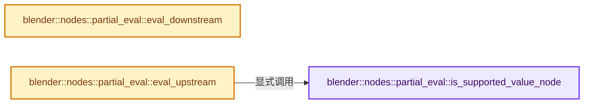
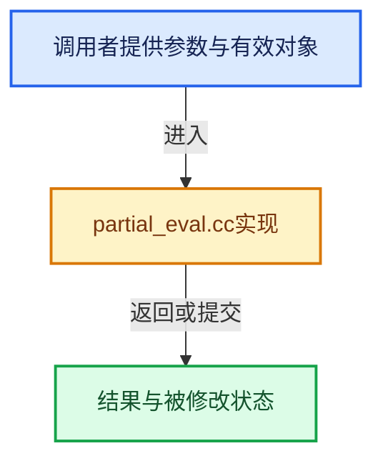

# 实现依赖专题：source/blender/nodes/intern/partial_eval.cc

[方向导航](README.md) · [符号索引](../%E7%AC%A6%E5%8F%B7%E4%BE%9D%E8%B5%96%E4%B8%8E%E5%AE%9E%E7%8E%B0%E7%B4%A2%E5%BC%95.md)

本专题从正文实际调用进入，集中保存共享实现。函数有稳定锚点，可从调用处直接跳到对应完整函数；递归与互相调用通过回链组织。

## 本文件的实现关系






## 完整成员与函数实现

<a id="f-b1bb5f94a35c6786"></a>

### `blender::nodes::partial_eval::is_supported_value_node`

实现位置：[source/blender/nodes/intern/partial_eval.cc](../../../../../source/blender/nodes/intern/partial_eval.cc) · L19—L27。

接口参数：

- `const bNode &node`

**教学注释版**

<!-- annotated:f4dfa64aab2bf2 -->

```cpp
bool is_supported_value_node(const bNode &node)
{
  return ELEM(node.type_legacy,
              SH_NODE_VALUE,
              FN_NODE_INPUT_VECTOR,
              FN_NODE_INPUT_BOOL,
              FN_NODE_INPUT_INT,
              FN_NODE_INPUT_ROTATION);
}
```

<details>
<summary>核对原始源码：source/blender/nodes/intern/partial_eval.cc · L19—L27</summary>

<!-- original:f4dfa64aab2bf2:source/blender/nodes/intern/partial_eval.cc:19:27 -->

```cpp
bool is_supported_value_node(const bNode &node)
{
  return ELEM(node.type_legacy,
              SH_NODE_VALUE,
              FN_NODE_INPUT_VECTOR,
              FN_NODE_INPUT_BOOL,
              FN_NODE_INPUT_INT,
              FN_NODE_INPUT_ROTATION);
}
```

</details>

**结果出口**

- `return ELEM(node.type_legacy,`

**继续追踪实现**

- `ELEM` → [ELEM · L88](../05-%E5%87%A0%E4%BD%95%E5%AD%98%E5%82%A8%E4%B8%8E%E6%8B%93%E6%89%91%E6%98%A0%E5%B0%84/%E4%BE%9D%E8%B5%96-GHOST_utildefines-34b996.md#m-d28724a15928)；[ELEM · L135](../01-%E5%9F%BA%E7%A1%80%E5%AE%B9%E5%99%A8%E4%B8%8E%E7%8E%B0%E4%BB%A3CPP/%E4%BE%9D%E8%B5%96-BLI_utildefines-293a0a.md#m-d6572de7cae0)。宏定义由构建条件选择。

<a id="f-bb671bb869d04e61"></a>

### `blender::nodes::partial_eval::eval_downstream`

实现位置：[source/blender/nodes/intern/partial_eval.cc](../../../../../source/blender/nodes/intern/partial_eval.cc) · L110—L256。

接口参数：

- `const Span<SocketInContext> initial_sockets`
- `bke::ComputeContextCache &compute_context_cache`
- `FunctionRef<void(const NodeInContext &ctx_node,
                      Vector<const bNodeSocket *> &r_outputs_to_propagate)> evaluate_node_fn`
- `const NodeInContext &ctx_node`
- `Vector<const bNodeSocket *> &r_outputs_to_propagate`
- `FunctionRef<bool(const SocketInContext &ctx_from, const SocketInContext &ctx_to)>
         propagate_value_fn`
- `const SocketInContext &ctx_from`
- `const SocketInContext &ctx_to`

**教学注释版**

<!-- annotated:67697789f511b3 -->

```cpp
void eval_downstream(
    const Span<SocketInContext> initial_sockets,
    bke::ComputeContextCache &compute_context_cache,
    FunctionRef<void(const NodeInContext &ctx_node,
                     Vector<const bNodeSocket *> &r_outputs_to_propagate)> evaluate_node_fn,
    FunctionRef<bool(const SocketInContext &ctx_from, const SocketInContext &ctx_to)>
        propagate_value_fn)
{
  /* Priority queue that makes sure that nodes are evaluated in the right order. */
  std::priority_queue<NodeInContext, std::vector<NodeInContext>, NodeInContextDownstreamComparator>
      scheduled_nodes_queue;
  /* Used to make sure that the same node is not scheduled more than once. */
  Set<NodeInContext> scheduled_nodes_set;

  const auto schedule_node = [&](const NodeInContext &ctx_node) {
    // [讲解] scheduled_nodes_set.add：按哈希与相等关系加入键或键值。
    if (scheduled_nodes_set.add(ctx_node)) {
      scheduled_nodes_queue.push(ctx_node);
    }
  };

  const auto forward_group_node_input_into_group =
      [&](const SocketInContext &ctx_group_node_input) {
        const bNode &node = ctx_group_node_input.socket->owner_node();
        BLI_assert(node.is_group());
        const bNodeTree *group_tree = reinterpret_cast<const bNodeTree *>(node.id);
        if (!group_tree) {
          return;
        }
        group_tree->ensure_topology_cache();
        if (group_tree->has_available_link_cycle()) {
          return;
        }
        const auto &group_context = compute_context_cache.for_group_node(
            ctx_group_node_input.context, node.identifier, &node.owner_tree());
        const int socket_index = ctx_group_node_input.socket->index();
        /* Forward the value to every group input node. */
        for (const bNode *group_input_node : group_tree->group_input_nodes()) {
          if (propagate_value_fn(ctx_group_node_input,
                                 {&group_context, &group_input_node->output_socket(socket_index)}))
          {
            schedule_node({&group_context, group_input_node});
          }
        }
      };

  const auto forward_output = [&](const SocketInContext &ctx_output_socket) {
    const ComputeContext *context = ctx_output_socket.context;
    for (const bNodeLink *link : ctx_output_socket.socket->directly_linked_links()) {
      if (!link->is_used()) {
        continue;
      }
      const bNode &target_node = *link->tonode;
      const bNodeSocket &target_socket = *link->tosock;
      if (!propagate_value_fn(ctx_output_socket, {context, &target_socket})) {
        continue;
      }
      schedule_node({context, &target_node});
      if (target_node.is_group()) {
        forward_group_node_input_into_group({context, &target_socket});
      }
    }
  };

  /* Do initial scheduling based on initial sockets. */
  for (const SocketInContext &ctx_socket : initial_sockets) {
    if (ctx_socket.socket->is_input()) {
      const bNode &node = ctx_socket.socket->owner_node();
      if (node.is_group()) {
        forward_group_node_input_into_group(ctx_socket);
      }
      schedule_node({ctx_socket.context, &node});
    }
    else {
      forward_output(ctx_socket);
    }
  }

  /* Reused in multiple places to avoid allocating it multiple times. Should be cleared before
   * using it. */
  Vector<const bNodeSocket *> sockets_vec;

  /* Handle all scheduled nodes in the right order until no more nodes are scheduled. */
  while (!scheduled_nodes_queue.empty()) {
    const NodeInContext ctx_node = scheduled_nodes_queue.top();
    scheduled_nodes_queue.pop();

    const bNode &node = *ctx_node.node;
    const ComputeContext *context = ctx_node.context;

    if (node.is_reroute()) {
      if (propagate_value_fn({context, &node.input_socket(0)}, {context, &node.output_socket(0)}))
      {
        forward_output({context, &node.output_socket(0)});
      }
    }
    if (node.is_type("NodeImplicitConversion"_ustr)) {
      if (propagate_value_fn({context, &node.input_socket(0)}, {context, &node.output_socket(0)}))
      {
        forward_output({context, &node.output_socket(0)});
      }
    }
    else if (node.is_muted()) {
      for (const bNodeInternalLink &link : node.internal_links()) {
        if (propagate_value_fn({context, link.in}, {context, link.out})) {
          forward_output({context, link.out});
        }
      }
    }
    else if (node.is_group()) {
      const bNodeTree *group = reinterpret_cast<const bNodeTree *>(node.id);
      if (!group) {
        continue;
      }
      group->ensure_topology_cache();
      if (group->has_available_link_cycle()) {
        continue;
      }
      const bNode *group_output = group->group_output_node();
      if (!group_output) {
        continue;
      }
      const ComputeContext &group_context = compute_context_cache.for_group_node(
          context, node.identifier, &node.owner_tree());
      /* Propagate the values from the group output node to the outputs of the group node and
       * continue forwarding them from there. */
      for (const int index : group->interface_outputs().index_range()) {
        if (propagate_value_fn({&group_context, &group_output->input_socket(index)},
                               {context, &node.output_socket(index)}))
        {
          forward_output({context, &node.output_socket(index)});
        }
      }
    }
    else if (node.is_group_input()) {
      for (const bNodeSocket *output_socket : node.output_sockets()) {
        forward_output({context, output_socket});
      }
    }
    else {
      // [讲解] sockets_vec.clear：销毁所有有效元素，把size变为0，但保留原分配或内嵌容量。
      sockets_vec.clear();
      evaluate_node_fn(ctx_node, sockets_vec);
      for (const bNodeSocket *socket : sockets_vec) {
        forward_output({context, socket});
      }
    }
  }
}
```

<details>
<summary>核对原始源码：source/blender/nodes/intern/partial_eval.cc · L110—L256</summary>

<!-- original:67697789f511b3:source/blender/nodes/intern/partial_eval.cc:110:256 -->

```cpp
void eval_downstream(
    const Span<SocketInContext> initial_sockets,
    bke::ComputeContextCache &compute_context_cache,
    FunctionRef<void(const NodeInContext &ctx_node,
                     Vector<const bNodeSocket *> &r_outputs_to_propagate)> evaluate_node_fn,
    FunctionRef<bool(const SocketInContext &ctx_from, const SocketInContext &ctx_to)>
        propagate_value_fn)
{
  /* Priority queue that makes sure that nodes are evaluated in the right order. */
  std::priority_queue<NodeInContext, std::vector<NodeInContext>, NodeInContextDownstreamComparator>
      scheduled_nodes_queue;
  /* Used to make sure that the same node is not scheduled more than once. */
  Set<NodeInContext> scheduled_nodes_set;

  const auto schedule_node = [&](const NodeInContext &ctx_node) {
    if (scheduled_nodes_set.add(ctx_node)) {
      scheduled_nodes_queue.push(ctx_node);
    }
  };

  const auto forward_group_node_input_into_group =
      [&](const SocketInContext &ctx_group_node_input) {
        const bNode &node = ctx_group_node_input.socket->owner_node();
        BLI_assert(node.is_group());
        const bNodeTree *group_tree = reinterpret_cast<const bNodeTree *>(node.id);
        if (!group_tree) {
          return;
        }
        group_tree->ensure_topology_cache();
        if (group_tree->has_available_link_cycle()) {
          return;
        }
        const auto &group_context = compute_context_cache.for_group_node(
            ctx_group_node_input.context, node.identifier, &node.owner_tree());
        const int socket_index = ctx_group_node_input.socket->index();
        /* Forward the value to every group input node. */
        for (const bNode *group_input_node : group_tree->group_input_nodes()) {
          if (propagate_value_fn(ctx_group_node_input,
                                 {&group_context, &group_input_node->output_socket(socket_index)}))
          {
            schedule_node({&group_context, group_input_node});
          }
        }
      };

  const auto forward_output = [&](const SocketInContext &ctx_output_socket) {
    const ComputeContext *context = ctx_output_socket.context;
    for (const bNodeLink *link : ctx_output_socket.socket->directly_linked_links()) {
      if (!link->is_used()) {
        continue;
      }
      const bNode &target_node = *link->tonode;
      const bNodeSocket &target_socket = *link->tosock;
      if (!propagate_value_fn(ctx_output_socket, {context, &target_socket})) {
        continue;
      }
      schedule_node({context, &target_node});
      if (target_node.is_group()) {
        forward_group_node_input_into_group({context, &target_socket});
      }
    }
  };

  /* Do initial scheduling based on initial sockets. */
  for (const SocketInContext &ctx_socket : initial_sockets) {
    if (ctx_socket.socket->is_input()) {
      const bNode &node = ctx_socket.socket->owner_node();
      if (node.is_group()) {
        forward_group_node_input_into_group(ctx_socket);
      }
      schedule_node({ctx_socket.context, &node});
    }
    else {
      forward_output(ctx_socket);
    }
  }

  /* Reused in multiple places to avoid allocating it multiple times. Should be cleared before
   * using it. */
  Vector<const bNodeSocket *> sockets_vec;

  /* Handle all scheduled nodes in the right order until no more nodes are scheduled. */
  while (!scheduled_nodes_queue.empty()) {
    const NodeInContext ctx_node = scheduled_nodes_queue.top();
    scheduled_nodes_queue.pop();

    const bNode &node = *ctx_node.node;
    const ComputeContext *context = ctx_node.context;

    if (node.is_reroute()) {
      if (propagate_value_fn({context, &node.input_socket(0)}, {context, &node.output_socket(0)}))
      {
        forward_output({context, &node.output_socket(0)});
      }
    }
    if (node.is_type("NodeImplicitConversion"_ustr)) {
      if (propagate_value_fn({context, &node.input_socket(0)}, {context, &node.output_socket(0)}))
      {
        forward_output({context, &node.output_socket(0)});
      }
    }
    else if (node.is_muted()) {
      for (const bNodeInternalLink &link : node.internal_links()) {
        if (propagate_value_fn({context, link.in}, {context, link.out})) {
          forward_output({context, link.out});
        }
      }
    }
    else if (node.is_group()) {
      const bNodeTree *group = reinterpret_cast<const bNodeTree *>(node.id);
      if (!group) {
        continue;
      }
      group->ensure_topology_cache();
      if (group->has_available_link_cycle()) {
        continue;
      }
      const bNode *group_output = group->group_output_node();
      if (!group_output) {
        continue;
      }
      const ComputeContext &group_context = compute_context_cache.for_group_node(
          context, node.identifier, &node.owner_tree());
      /* Propagate the values from the group output node to the outputs of the group node and
       * continue forwarding them from there. */
      for (const int index : group->interface_outputs().index_range()) {
        if (propagate_value_fn({&group_context, &group_output->input_socket(index)},
                               {context, &node.output_socket(index)}))
        {
          forward_output({context, &node.output_socket(index)});
        }
      }
    }
    else if (node.is_group_input()) {
      for (const bNodeSocket *output_socket : node.output_sockets()) {
        forward_output({context, output_socket});
      }
    }
    else {
      sockets_vec.clear();
      evaluate_node_fn(ctx_node, sockets_vec);
      for (const bNodeSocket *socket : sockets_vec) {
        forward_output({context, socket});
      }
    }
  }
}
```

</details>

**继续追踪实现**

- `scheduled_nodes_set.add` → [blender::Set::add · L248](../02-%E5%93%88%E5%B8%8C%E8%A1%A8%E4%B8%8E%E5%85%B3%E8%81%94%E6%95%B0%E6%8D%AE%E7%BB%93%E6%9E%84/08-Set%E4%B8%8E%E9%9B%86%E5%90%88%E8%AF%AD%E4%B9%89.md#f-c7498809c2327fba)；[blender::Set::add · L252](../02-%E5%93%88%E5%B8%8C%E8%A1%A8%E4%B8%8E%E5%85%B3%E8%81%94%E6%95%B0%E6%8D%AE%E7%BB%93%E6%9E%84/08-Set%E4%B8%8E%E9%9B%86%E5%90%88%E8%AF%AD%E4%B9%89.md#f-e3ac8d1c52c03c2b)。同名重载需按实参类型选择。
- `scheduled_nodes_queue.push` → [外部契约](https://eel.is/c++draft/)：这个边界按实际表达式及所属类型核对参数、返回值、寿命与失败行为。这里提供接口入口，不声称已解释该第三方版本的内部实现。
- `ctx_group_node_input.socket->owner_node` → [调用协议](../%E6%A8%A1%E6%9D%BF%E5%AE%8F%E4%B8%8E%E5%8A%A8%E6%80%81%E5%88%86%E6%B4%BE%E5%8D%8F%E8%AE%AE.md)：接收对象类型依赖auto、返回值或模板实例；不按同名猜测目标。调用位置L132。
- `BLI_assert` → [BLI_assert · L48](../01-%E5%9F%BA%E7%A1%80%E5%AE%B9%E5%99%A8%E4%B8%8E%E7%8E%B0%E4%BB%A3CPP/%E4%BE%9D%E8%B5%96-BLI_assert-cc98e8.md#m-57a88495704d)；[BLI_assert · L63](../01-%E5%9F%BA%E7%A1%80%E5%AE%B9%E5%99%A8%E4%B8%8E%E7%8E%B0%E4%BB%A3CPP/%E4%BE%9D%E8%B5%96-BLI_assert-cc98e8.md#m-d07050020cb5)。宏定义由构建条件选择。
- `node.is_group` → [blender::bNode::is_group · L906](../05-%E5%87%A0%E4%BD%95%E5%AD%98%E5%82%A8%E4%B8%8E%E6%8B%93%E6%89%91%E6%98%A0%E5%B0%84/%E4%BE%9D%E8%B5%96-BKE_node_runtime-ee561b.md#f-0685281392963ec9)。
- `group_tree->ensure_topology_cache` → [blender::bNodeTree::ensure_topology_cache · L621](../05-%E5%87%A0%E4%BD%95%E5%AD%98%E5%82%A8%E4%B8%8E%E6%8B%93%E6%89%91%E6%98%A0%E5%B0%84/%E4%BE%9D%E8%B5%96-node_runtime-ee7c39.md#f-566e97bdf0367424)。
- `group_tree->has_available_link_cycle` → [blender::bNodeTree::has_available_link_cycle · L572](../05-%E5%87%A0%E4%BD%95%E5%AD%98%E5%82%A8%E4%B8%8E%E6%8B%93%E6%89%91%E6%98%A0%E5%B0%84/%E4%BE%9D%E8%B5%96-BKE_node_runtime-ee561b.md#f-7bdcb85482e6bf35)。
- `compute_context_cache.for_group_node` → [blender::bke::ComputeContextCache::for_group_node · L360](../05-%E5%87%A0%E4%BD%95%E5%AD%98%E5%82%A8%E4%B8%8E%E6%8B%93%E6%89%91%E6%98%A0%E5%B0%84/%E4%BE%9D%E8%B5%96-compute_contexts-daf7f5.md#f-e682e12ad78f58a0)。
- `node.owner_tree` → [blender::bNode::owner_tree · L866](../05-%E5%87%A0%E4%BD%95%E5%AD%98%E5%82%A8%E4%B8%8E%E6%8B%93%E6%89%91%E6%98%A0%E5%B0%84/%E4%BE%9D%E8%B5%96-BKE_node_runtime-ee561b.md#f-7e471005a1325135)；[blender::bNode::owner_tree · L872](../05-%E5%87%A0%E4%BD%95%E5%AD%98%E5%82%A8%E4%B8%8E%E6%8B%93%E6%89%91%E6%98%A0%E5%B0%84/%E4%BE%9D%E8%B5%96-BKE_node_runtime-ee561b.md#f-641a1000c92d9a52)。同名重载需按实参类型选择。
- `ctx_group_node_input.socket->index` → [调用协议](../%E6%A8%A1%E6%9D%BF%E5%AE%8F%E4%B8%8E%E5%8A%A8%E6%80%81%E5%88%86%E6%B4%BE%E5%8D%8F%E8%AE%AE.md)：接收对象类型依赖auto、返回值或模板实例；不按同名猜测目标。调用位置L144。
- `group_tree->group_input_nodes` → [blender::bNodeTree::group_input_nodes · L596](../05-%E5%87%A0%E4%BD%95%E5%AD%98%E5%82%A8%E4%B8%8E%E6%8B%93%E6%89%91%E6%98%A0%E5%B0%84/%E4%BE%9D%E8%B5%96-BKE_node_runtime-ee561b.md#f-f4d5daa939963761)；[blender::bNodeTree::group_input_nodes · L601](../05-%E5%87%A0%E4%BD%95%E5%AD%98%E5%82%A8%E4%B8%8E%E6%8B%93%E6%89%91%E6%98%A0%E5%B0%84/%E4%BE%9D%E8%B5%96-BKE_node_runtime-ee561b.md#f-b54e41a48ba6ce7a)。同名重载需按实参类型选择。
- `propagate_value_fn` → [调用协议](../%E6%A8%A1%E6%9D%BF%E5%AE%8F%E4%B8%8E%E5%8A%A8%E6%80%81%E5%88%86%E6%B4%BE%E5%8D%8F%E8%AE%AE.md)：局部可调用对象，须结合其初始化与捕获环境。调用位置L147。
- `group_input_node->output_socket` → [调用协议](../%E6%A8%A1%E6%9D%BF%E5%AE%8F%E4%B8%8E%E5%8A%A8%E6%80%81%E5%88%86%E6%B4%BE%E5%8D%8F%E8%AE%AE.md)：接收对象类型依赖auto、返回值或模板实例；不按同名猜测目标。调用位置L148。
- `schedule_node` → [调用协议](../%E6%A8%A1%E6%9D%BF%E5%AE%8F%E4%B8%8E%E5%8A%A8%E6%80%81%E5%88%86%E6%B4%BE%E5%8D%8F%E8%AE%AE.md)：局部可调用对象，须结合其初始化与捕获环境。调用位置L150。
- `ctx_output_socket.socket->directly_linked_links` → [调用协议](../%E6%A8%A1%E6%9D%BF%E5%AE%8F%E4%B8%8E%E5%8A%A8%E6%80%81%E5%88%86%E6%B4%BE%E5%8D%8F%E8%AE%AE.md)：接收对象类型依赖auto、返回值或模板实例；不按同名猜测目标。调用位置L157。
- `link->is_used` → [调用协议](../%E6%A8%A1%E6%9D%BF%E5%AE%8F%E4%B8%8E%E5%8A%A8%E6%80%81%E5%88%86%E6%B4%BE%E5%8D%8F%E8%AE%AE.md)：接收对象类型依赖auto、返回值或模板实例；不按同名猜测目标。调用位置L158。
- `target_node.is_group` → [blender::bNode::is_group · L906](../05-%E5%87%A0%E4%BD%95%E5%AD%98%E5%82%A8%E4%B8%8E%E6%8B%93%E6%89%91%E6%98%A0%E5%B0%84/%E4%BE%9D%E8%B5%96-BKE_node_runtime-ee561b.md#f-0685281392963ec9)。
- `forward_group_node_input_into_group` → [调用协议](../%E6%A8%A1%E6%9D%BF%E5%AE%8F%E4%B8%8E%E5%8A%A8%E6%80%81%E5%88%86%E6%B4%BE%E5%8D%8F%E8%AE%AE.md)：局部可调用对象，须结合其初始化与捕获环境。调用位置L168。
- `ctx_socket.socket->is_input` → [调用协议](../%E6%A8%A1%E6%9D%BF%E5%AE%8F%E4%B8%8E%E5%8A%A8%E6%80%81%E5%88%86%E6%B4%BE%E5%8D%8F%E8%AE%AE.md)：接收对象类型依赖auto、返回值或模板实例；不按同名猜测目标。调用位置L175。
- `ctx_socket.socket->owner_node` → [调用协议](../%E6%A8%A1%E6%9D%BF%E5%AE%8F%E4%B8%8E%E5%8A%A8%E6%80%81%E5%88%86%E6%B4%BE%E5%8D%8F%E8%AE%AE.md)：接收对象类型依赖auto、返回值或模板实例；不按同名猜测目标。调用位置L176。
- `forward_output` → [调用协议](../%E6%A8%A1%E6%9D%BF%E5%AE%8F%E4%B8%8E%E5%8A%A8%E6%80%81%E5%88%86%E6%B4%BE%E5%8D%8F%E8%AE%AE.md)：局部可调用对象，须结合其初始化与捕获环境。调用位置L183。
- `scheduled_nodes_queue.empty` → [外部契约](https://eel.is/c++draft/)：这个边界按实际表达式及所属类型核对参数、返回值、寿命与失败行为。这里提供接口入口，不声称已解释该第三方版本的内部实现。
- `scheduled_nodes_queue.top` → [外部契约](https://eel.is/c++draft/)：这个边界按实际表达式及所属类型核对参数、返回值、寿命与失败行为。这里提供接口入口，不声称已解释该第三方版本的内部实现。
- `scheduled_nodes_queue.pop` → [外部契约](https://eel.is/c++draft/)：这个边界按实际表达式及所属类型核对参数、返回值、寿命与失败行为。这里提供接口入口，不声称已解释该第三方版本的内部实现。
- `node.is_reroute` → [blender::bNode::is_reroute · L896](../05-%E5%87%A0%E4%BD%95%E5%AD%98%E5%82%A8%E4%B8%8E%E6%8B%93%E6%89%91%E6%98%A0%E5%B0%84/%E4%BE%9D%E8%B5%96-BKE_node_runtime-ee561b.md#f-d97a49597e48e8ea)。
- `node.input_socket` → [blender::bNode::input_socket · L818](../05-%E5%87%A0%E4%BD%95%E5%AD%98%E5%82%A8%E4%B8%8E%E6%8B%93%E6%89%91%E6%98%A0%E5%B0%84/%E4%BE%9D%E8%B5%96-BKE_node_runtime-ee561b.md#f-00274c021929d3dc)；[blender::bNode::input_socket · L830](../05-%E5%87%A0%E4%BD%95%E5%AD%98%E5%82%A8%E4%B8%8E%E6%8B%93%E6%89%91%E6%98%A0%E5%B0%84/%E4%BE%9D%E8%B5%96-BKE_node_runtime-ee561b.md#f-e9c8cccac4999eb8)。同名重载需按实参类型选择。
- `node.output_socket` → [blender::bNode::output_socket · L824](../05-%E5%87%A0%E4%BD%95%E5%AD%98%E5%82%A8%E4%B8%8E%E6%8B%93%E6%89%91%E6%98%A0%E5%B0%84/%E4%BE%9D%E8%B5%96-BKE_node_runtime-ee561b.md#f-9e46f3a437215eb5)；[blender::bNode::output_socket · L836](../05-%E5%87%A0%E4%BD%95%E5%AD%98%E5%82%A8%E4%B8%8E%E6%8B%93%E6%89%91%E6%98%A0%E5%B0%84/%E4%BE%9D%E8%B5%96-BKE_node_runtime-ee561b.md#f-39021ff32ee7c409)。同名重载需按实参类型选择。
- `node.is_type` → [blender::bNode::is_type · L931](../05-%E5%87%A0%E4%BD%95%E5%AD%98%E5%82%A8%E4%B8%8E%E6%8B%93%E6%89%91%E6%98%A0%E5%B0%84/%E4%BE%9D%E8%B5%96-BKE_node_runtime-ee561b.md#f-828d5e91e96da197)。
- `node.is_muted` → [blender::bNode::is_muted · L886](../05-%E5%87%A0%E4%BD%95%E5%AD%98%E5%82%A8%E4%B8%8E%E6%8B%93%E6%89%91%E6%98%A0%E5%B0%84/%E4%BE%9D%E8%B5%96-BKE_node_runtime-ee561b.md#f-4d91efc4cc87d00d)。
- `node.internal_links` → [blender::bNode::internal_links · L936](../05-%E5%87%A0%E4%BD%95%E5%AD%98%E5%82%A8%E4%B8%8E%E6%8B%93%E6%89%91%E6%98%A0%E5%B0%84/%E4%BE%9D%E8%B5%96-BKE_node_runtime-ee561b.md#f-333e5379d38629d0)。
- `group->ensure_topology_cache` → [blender::bNodeTree::ensure_topology_cache · L621](../05-%E5%87%A0%E4%BD%95%E5%AD%98%E5%82%A8%E4%B8%8E%E6%8B%93%E6%89%91%E6%98%A0%E5%B0%84/%E4%BE%9D%E8%B5%96-node_runtime-ee7c39.md#f-566e97bdf0367424)。
- `group->has_available_link_cycle` → [blender::bNodeTree::has_available_link_cycle · L572](../05-%E5%87%A0%E4%BD%95%E5%AD%98%E5%82%A8%E4%B8%8E%E6%8B%93%E6%89%91%E6%98%A0%E5%B0%84/%E4%BE%9D%E8%B5%96-BKE_node_runtime-ee561b.md#f-7bdcb85482e6bf35)。
- `group->group_output_node` → [blender::bNodeTree::group_output_node · L584](../05-%E5%87%A0%E4%BD%95%E5%AD%98%E5%82%A8%E4%B8%8E%E6%8B%93%E6%89%91%E6%98%A0%E5%B0%84/%E4%BE%9D%E8%B5%96-BKE_node_runtime-ee561b.md#f-a01078b19d92ff02)；[blender::bNodeTree::group_output_node · L590](../05-%E5%87%A0%E4%BD%95%E5%AD%98%E5%82%A8%E4%B8%8E%E6%8B%93%E6%89%91%E6%98%A0%E5%B0%84/%E4%BE%9D%E8%B5%96-BKE_node_runtime-ee561b.md#f-453bfee152775d3a)。同名重载需按实参类型选择。
- `group->interface_outputs().index_range` → [调用协议](../%E6%A8%A1%E6%9D%BF%E5%AE%8F%E4%B8%8E%E5%8A%A8%E6%80%81%E5%88%86%E6%B4%BE%E5%8D%8F%E8%AE%AE.md)：接收对象类型依赖auto、返回值或模板实例；不按同名猜测目标。调用位置L235。
- `group->interface_outputs` → [blender::bNodeTree::interface_outputs · L687](../05-%E5%87%A0%E4%BD%95%E5%AD%98%E5%82%A8%E4%B8%8E%E6%8B%93%E6%89%91%E6%98%A0%E5%B0%84/%E4%BE%9D%E8%B5%96-BKE_node_runtime-ee561b.md#f-6ce8b655d24a2365)；[blender::bNodeTree::interface_outputs · L693](../05-%E5%87%A0%E4%BD%95%E5%AD%98%E5%82%A8%E4%B8%8E%E6%8B%93%E6%89%91%E6%98%A0%E5%B0%84/%E4%BE%9D%E8%B5%96-BKE_node_runtime-ee561b.md#f-64e16fb2a089e741)。同名重载需按实参类型选择。
- `group_output->input_socket` → [blender::bNode::input_socket · L818](../05-%E5%87%A0%E4%BD%95%E5%AD%98%E5%82%A8%E4%B8%8E%E6%8B%93%E6%89%91%E6%98%A0%E5%B0%84/%E4%BE%9D%E8%B5%96-BKE_node_runtime-ee561b.md#f-00274c021929d3dc)；[blender::bNode::input_socket · L830](../05-%E5%87%A0%E4%BD%95%E5%AD%98%E5%82%A8%E4%B8%8E%E6%8B%93%E6%89%91%E6%98%A0%E5%B0%84/%E4%BE%9D%E8%B5%96-BKE_node_runtime-ee561b.md#f-e9c8cccac4999eb8)。同名重载需按实参类型选择。
- `node.is_group_input` → [blender::bNode::is_group_input · L916](../05-%E5%87%A0%E4%BD%95%E5%AD%98%E5%82%A8%E4%B8%8E%E6%8B%93%E6%89%91%E6%98%A0%E5%B0%84/%E4%BE%9D%E8%B5%96-BKE_node_runtime-ee561b.md#f-eb0154c1b06d331c)。
- `node.output_sockets` → [blender::bNode::output_sockets · L760](../05-%E5%87%A0%E4%BD%95%E5%AD%98%E5%82%A8%E4%B8%8E%E6%8B%93%E6%89%91%E6%98%A0%E5%B0%84/%E4%BE%9D%E8%B5%96-BKE_node_runtime-ee561b.md#f-40ec6d6aed2ab6fb)；[blender::bNode::output_sockets · L772](../05-%E5%87%A0%E4%BD%95%E5%AD%98%E5%82%A8%E4%B8%8E%E6%8B%93%E6%89%91%E6%98%A0%E5%B0%84/%E4%BE%9D%E8%B5%96-BKE_node_runtime-ee561b.md#f-ddbd8f42409bdcd1)。同名重载需按实参类型选择。
- `sockets_vec.clear` → [blender::Vector::clear · L468](../01-%E5%9F%BA%E7%A1%80%E5%AE%B9%E5%99%A8%E4%B8%8E%E7%8E%B0%E4%BB%A3CPP/10-Vector%E6%89%A9%E5%AE%B9%E4%B8%8E%E5%A2%9E%E9%95%BF.md#f-d051bebff5275a43)。
- `evaluate_node_fn` → [调用协议](../%E6%A8%A1%E6%9D%BF%E5%AE%8F%E4%B8%8E%E5%8A%A8%E6%80%81%E5%88%86%E6%B4%BE%E5%8D%8F%E8%AE%AE.md)：局部可调用对象，须结合其初始化与捕获环境。调用位置L250。

<a id="f-1701115f4e1c40cc"></a>

### `blender::nodes::partial_eval::eval_upstream`

实现位置：[source/blender/nodes/intern/partial_eval.cc](../../../../../source/blender/nodes/intern/partial_eval.cc) · L258—L430。

接口参数：

- `const Span<SocketInContext> initial_sockets`
- `bke::ComputeContextCache &compute_context_cache`
- `FunctionRef<void(const NodeInContext &ctx_node,
                      Vector<const bNodeSocket *> &r_modified_inputs)> evaluate_node_fn`
- `const NodeInContext &ctx_node`
- `Vector<const bNodeSocket *> &r_modified_inputs`
- `FunctionRef<bool(const SocketInContext &ctx_from, const SocketInContext &ctx_to)>
         propagate_value_fn`
- `const SocketInContext &ctx_from`
- `const SocketInContext &ctx_to`
- `FunctionRef<void(const NodeInContext &ctx_node, Vector<const bNodeSocket *> &r_sockets)>
         get_inputs_to_propagate_fn`
- `const NodeInContext &ctx_node`
- `Vector<const bNodeSocket *> &r_sockets`

**教学注释版**

<!-- annotated:3e0358e31bfeb9 -->

```cpp
UpstreamEvalTargets eval_upstream(
    const Span<SocketInContext> initial_sockets,
    bke::ComputeContextCache &compute_context_cache,
    FunctionRef<void(const NodeInContext &ctx_node,
                     Vector<const bNodeSocket *> &r_modified_inputs)> evaluate_node_fn,
    FunctionRef<bool(const SocketInContext &ctx_from, const SocketInContext &ctx_to)>
        propagate_value_fn,
    FunctionRef<void(const NodeInContext &ctx_node, Vector<const bNodeSocket *> &r_sockets)>
        get_inputs_to_propagate_fn)
{
  /* Priority queue that makes sure that nodes are evaluated in the right order. */
  std::priority_queue<NodeInContext, std::vector<NodeInContext>, NodeInContextUpstreamComparator>
      scheduled_nodes_queue;
  /* Used to make sure that the same node is not scheduled more than once. */
  Set<NodeInContext> scheduled_nodes_set;

  UpstreamEvalTargets eval_targets;

  const auto schedule_node = [&](const NodeInContext &ctx_node) {
    // [讲解] scheduled_nodes_set.add：按哈希与相等关系加入键或键值。
    if (scheduled_nodes_set.add(ctx_node)) {
      scheduled_nodes_queue.push(ctx_node);
    }
  };

  const auto forward_group_node_output_into_group = [&](const SocketInContext &ctx_output_socket) {
    const ComputeContext *context = ctx_output_socket.context;
    const bNode &group_node = ctx_output_socket.socket->owner_node();
    const bNodeTree *group = reinterpret_cast<const bNodeTree *>(group_node.id);
    if (!group) {
      return;
    }
    group->ensure_topology_cache();
    if (group->has_available_link_cycle()) {
      return;
    }
    const bNode *group_output = group->group_output_node();
    if (!group_output) {
      return;
    }
    const ComputeContext &group_context = compute_context_cache.for_group_node(
        context, group_node.identifier, &group_node.owner_tree());
    propagate_value_fn(
        ctx_output_socket,
        {&group_context, &group_output->input_socket(ctx_output_socket.socket->index())});
    schedule_node({&group_context, group_output});
  };

  const auto forward_group_input_to_parent = [&](const SocketInContext &ctx_output_socket) {
    const auto *group_context = dynamic_cast<const bke::GroupNodeComputeContext *>(
        ctx_output_socket.context);
    if (!group_context) {
      eval_targets.group_inputs.add(ctx_output_socket);
      return;
    }
    const bNodeTree &caller_tree = *group_context->tree();
    caller_tree.ensure_topology_cache();
    if (caller_tree.has_available_link_cycle()) {
      return;
    }
    const bNode &caller_node = *group_context->node();
    const bNodeSocket &caller_input_socket = caller_node.input_socket(
        ctx_output_socket.socket->index());
    const ComputeContext *parent_context = ctx_output_socket.context->parent();
    /* Note that we might propagate multiple values to the same input of the group node. The
     * callback has to handle that case gracefully. */
    propagate_value_fn(ctx_output_socket, {parent_context, &caller_input_socket});
    schedule_node({parent_context, &caller_node});
  };

  const auto forward_input = [&](const SocketInContext &ctx_input_socket) {
    const ComputeContext *context = ctx_input_socket.context;
    if (!ctx_input_socket.socket->is_logically_linked()) {
      eval_targets.sockets.add(ctx_input_socket);
      return;
    }
    for (const bNodeLink *link : ctx_input_socket.socket->directly_linked_links()) {
      if (!link->is_used()) {
        continue;
      }
      const bNode &origin_node = *link->fromnode;
      const bNodeSocket &origin_socket = *link->fromsock;
      if (!propagate_value_fn(ctx_input_socket, {context, &origin_socket})) {
        continue;
      }
      schedule_node({context, &origin_node});
      if (origin_node.is_group()) {
        forward_group_node_output_into_group({context, &origin_socket});
        continue;
      }
      if (origin_node.is_group_input()) {
        forward_group_input_to_parent({context, &origin_socket});
        continue;
      }
    }
  };

  /* Do initial scheduling based on initial sockets. */
  for (const SocketInContext &ctx_socket : initial_sockets) {
    if (ctx_socket.socket->is_input()) {
      forward_input(ctx_socket);
    }
    else {
      const bNode &node = ctx_socket.socket->owner_node();
      if (node.is_group()) {
        forward_group_node_output_into_group(ctx_socket);
      }
      else if (node.is_group_input()) {
        forward_group_input_to_parent(ctx_socket);
      }
      else {
        schedule_node({ctx_socket.context, &node});
      }
    }
  }

  /* Reused in multiple places to avoid allocating it multiple times. Should be cleared before
   * using it. */
  Vector<const bNodeSocket *> sockets_vec;

  /* Handle all nodes in the right order until there are no more nodes to evaluate. */
  while (!scheduled_nodes_queue.empty()) {
    const NodeInContext ctx_node = scheduled_nodes_queue.top();
    scheduled_nodes_queue.pop();

    const bNode &node = *ctx_node.node;
    const ComputeContext *context = ctx_node.context;

    if (is_supported_value_node(node)) {
      /* Can't go back further from here, but remember that we reached a value node. */
      eval_targets.value_nodes.add(ctx_node);
    }
    else if (node.is_reroute()) {
      propagate_value_fn({context, &node.output_socket(0)}, {context, &node.input_socket(0)});
      forward_input({context, &node.input_socket(0)});
    }
    else if (node.is_type("NodeImplicitConversion"_ustr)) {
      propagate_value_fn({context, &node.output_socket(0)}, {context, &node.input_socket(0)});
      forward_input({context, &node.input_socket(0)});
    }
    else if (node.is_muted()) {
      for (const bNodeInternalLink &link : node.internal_links()) {
        if (propagate_value_fn({context, link.out}, {context, link.in})) {
          forward_input({context, link.in});
        }
      }
    }
    else if (node.is_group()) {
      /* Once we get here, the nodes within the group have all been evaluated already and the
       * inputs of the group node are already set properly by #forward_group_input_to_parent. */
      // [讲解] sockets_vec.clear：销毁所有有效元素，把size变为0，但保留原分配或内嵌容量。
      sockets_vec.clear();
      get_inputs_to_propagate_fn(ctx_node, sockets_vec);
      for (const bNodeSocket *socket : sockets_vec) {
        forward_input({context, socket});
      }
    }
    else if (node.is_group_output()) {
      sockets_vec.clear();
      get_inputs_to_propagate_fn(ctx_node, sockets_vec);
      for (const bNodeSocket *socket : sockets_vec) {
        forward_input({context, socket});
      }
    }
    else {
      sockets_vec.clear();
      evaluate_node_fn(ctx_node, sockets_vec);
      for (const bNodeSocket *input_socket : sockets_vec) {
        forward_input({context, input_socket});
      }
    }
  }

  return eval_targets;
}
```

<details>
<summary>核对原始源码：source/blender/nodes/intern/partial_eval.cc · L258—L430</summary>

<!-- original:3e0358e31bfeb9:source/blender/nodes/intern/partial_eval.cc:258:430 -->

```cpp
UpstreamEvalTargets eval_upstream(
    const Span<SocketInContext> initial_sockets,
    bke::ComputeContextCache &compute_context_cache,
    FunctionRef<void(const NodeInContext &ctx_node,
                     Vector<const bNodeSocket *> &r_modified_inputs)> evaluate_node_fn,
    FunctionRef<bool(const SocketInContext &ctx_from, const SocketInContext &ctx_to)>
        propagate_value_fn,
    FunctionRef<void(const NodeInContext &ctx_node, Vector<const bNodeSocket *> &r_sockets)>
        get_inputs_to_propagate_fn)
{
  /* Priority queue that makes sure that nodes are evaluated in the right order. */
  std::priority_queue<NodeInContext, std::vector<NodeInContext>, NodeInContextUpstreamComparator>
      scheduled_nodes_queue;
  /* Used to make sure that the same node is not scheduled more than once. */
  Set<NodeInContext> scheduled_nodes_set;

  UpstreamEvalTargets eval_targets;

  const auto schedule_node = [&](const NodeInContext &ctx_node) {
    if (scheduled_nodes_set.add(ctx_node)) {
      scheduled_nodes_queue.push(ctx_node);
    }
  };

  const auto forward_group_node_output_into_group = [&](const SocketInContext &ctx_output_socket) {
    const ComputeContext *context = ctx_output_socket.context;
    const bNode &group_node = ctx_output_socket.socket->owner_node();
    const bNodeTree *group = reinterpret_cast<const bNodeTree *>(group_node.id);
    if (!group) {
      return;
    }
    group->ensure_topology_cache();
    if (group->has_available_link_cycle()) {
      return;
    }
    const bNode *group_output = group->group_output_node();
    if (!group_output) {
      return;
    }
    const ComputeContext &group_context = compute_context_cache.for_group_node(
        context, group_node.identifier, &group_node.owner_tree());
    propagate_value_fn(
        ctx_output_socket,
        {&group_context, &group_output->input_socket(ctx_output_socket.socket->index())});
    schedule_node({&group_context, group_output});
  };

  const auto forward_group_input_to_parent = [&](const SocketInContext &ctx_output_socket) {
    const auto *group_context = dynamic_cast<const bke::GroupNodeComputeContext *>(
        ctx_output_socket.context);
    if (!group_context) {
      eval_targets.group_inputs.add(ctx_output_socket);
      return;
    }
    const bNodeTree &caller_tree = *group_context->tree();
    caller_tree.ensure_topology_cache();
    if (caller_tree.has_available_link_cycle()) {
      return;
    }
    const bNode &caller_node = *group_context->node();
    const bNodeSocket &caller_input_socket = caller_node.input_socket(
        ctx_output_socket.socket->index());
    const ComputeContext *parent_context = ctx_output_socket.context->parent();
    /* Note that we might propagate multiple values to the same input of the group node. The
     * callback has to handle that case gracefully. */
    propagate_value_fn(ctx_output_socket, {parent_context, &caller_input_socket});
    schedule_node({parent_context, &caller_node});
  };

  const auto forward_input = [&](const SocketInContext &ctx_input_socket) {
    const ComputeContext *context = ctx_input_socket.context;
    if (!ctx_input_socket.socket->is_logically_linked()) {
      eval_targets.sockets.add(ctx_input_socket);
      return;
    }
    for (const bNodeLink *link : ctx_input_socket.socket->directly_linked_links()) {
      if (!link->is_used()) {
        continue;
      }
      const bNode &origin_node = *link->fromnode;
      const bNodeSocket &origin_socket = *link->fromsock;
      if (!propagate_value_fn(ctx_input_socket, {context, &origin_socket})) {
        continue;
      }
      schedule_node({context, &origin_node});
      if (origin_node.is_group()) {
        forward_group_node_output_into_group({context, &origin_socket});
        continue;
      }
      if (origin_node.is_group_input()) {
        forward_group_input_to_parent({context, &origin_socket});
        continue;
      }
    }
  };

  /* Do initial scheduling based on initial sockets. */
  for (const SocketInContext &ctx_socket : initial_sockets) {
    if (ctx_socket.socket->is_input()) {
      forward_input(ctx_socket);
    }
    else {
      const bNode &node = ctx_socket.socket->owner_node();
      if (node.is_group()) {
        forward_group_node_output_into_group(ctx_socket);
      }
      else if (node.is_group_input()) {
        forward_group_input_to_parent(ctx_socket);
      }
      else {
        schedule_node({ctx_socket.context, &node});
      }
    }
  }

  /* Reused in multiple places to avoid allocating it multiple times. Should be cleared before
   * using it. */
  Vector<const bNodeSocket *> sockets_vec;

  /* Handle all nodes in the right order until there are no more nodes to evaluate. */
  while (!scheduled_nodes_queue.empty()) {
    const NodeInContext ctx_node = scheduled_nodes_queue.top();
    scheduled_nodes_queue.pop();

    const bNode &node = *ctx_node.node;
    const ComputeContext *context = ctx_node.context;

    if (is_supported_value_node(node)) {
      /* Can't go back further from here, but remember that we reached a value node. */
      eval_targets.value_nodes.add(ctx_node);
    }
    else if (node.is_reroute()) {
      propagate_value_fn({context, &node.output_socket(0)}, {context, &node.input_socket(0)});
      forward_input({context, &node.input_socket(0)});
    }
    else if (node.is_type("NodeImplicitConversion"_ustr)) {
      propagate_value_fn({context, &node.output_socket(0)}, {context, &node.input_socket(0)});
      forward_input({context, &node.input_socket(0)});
    }
    else if (node.is_muted()) {
      for (const bNodeInternalLink &link : node.internal_links()) {
        if (propagate_value_fn({context, link.out}, {context, link.in})) {
          forward_input({context, link.in});
        }
      }
    }
    else if (node.is_group()) {
      /* Once we get here, the nodes within the group have all been evaluated already and the
       * inputs of the group node are already set properly by #forward_group_input_to_parent. */
      sockets_vec.clear();
      get_inputs_to_propagate_fn(ctx_node, sockets_vec);
      for (const bNodeSocket *socket : sockets_vec) {
        forward_input({context, socket});
      }
    }
    else if (node.is_group_output()) {
      sockets_vec.clear();
      get_inputs_to_propagate_fn(ctx_node, sockets_vec);
      for (const bNodeSocket *socket : sockets_vec) {
        forward_input({context, socket});
      }
    }
    else {
      sockets_vec.clear();
      evaluate_node_fn(ctx_node, sockets_vec);
      for (const bNodeSocket *input_socket : sockets_vec) {
        forward_input({context, input_socket});
      }
    }
  }

  return eval_targets;
}
```

</details>

**结果出口**

- `return eval_targets;`

**继续追踪实现**

- `scheduled_nodes_set.add` → [blender::Set::add · L248](../02-%E5%93%88%E5%B8%8C%E8%A1%A8%E4%B8%8E%E5%85%B3%E8%81%94%E6%95%B0%E6%8D%AE%E7%BB%93%E6%9E%84/08-Set%E4%B8%8E%E9%9B%86%E5%90%88%E8%AF%AD%E4%B9%89.md#f-c7498809c2327fba)；[blender::Set::add · L252](../02-%E5%93%88%E5%B8%8C%E8%A1%A8%E4%B8%8E%E5%85%B3%E8%81%94%E6%95%B0%E6%8D%AE%E7%BB%93%E6%9E%84/08-Set%E4%B8%8E%E9%9B%86%E5%90%88%E8%AF%AD%E4%B9%89.md#f-e3ac8d1c52c03c2b)。同名重载需按实参类型选择。
- `scheduled_nodes_queue.push` → [外部契约](https://eel.is/c++draft/)：这个边界按实际表达式及所属类型核对参数、返回值、寿命与失败行为。这里提供接口入口，不声称已解释该第三方版本的内部实现。
- `ctx_output_socket.socket->owner_node` → [调用协议](../%E6%A8%A1%E6%9D%BF%E5%AE%8F%E4%B8%8E%E5%8A%A8%E6%80%81%E5%88%86%E6%B4%BE%E5%8D%8F%E8%AE%AE.md)：接收对象类型依赖auto、返回值或模板实例；不按同名猜测目标。调用位置L284。
- `group->ensure_topology_cache` → [blender::bNodeTree::ensure_topology_cache · L621](../05-%E5%87%A0%E4%BD%95%E5%AD%98%E5%82%A8%E4%B8%8E%E6%8B%93%E6%89%91%E6%98%A0%E5%B0%84/%E4%BE%9D%E8%B5%96-node_runtime-ee7c39.md#f-566e97bdf0367424)。
- `group->has_available_link_cycle` → [blender::bNodeTree::has_available_link_cycle · L572](../05-%E5%87%A0%E4%BD%95%E5%AD%98%E5%82%A8%E4%B8%8E%E6%8B%93%E6%89%91%E6%98%A0%E5%B0%84/%E4%BE%9D%E8%B5%96-BKE_node_runtime-ee561b.md#f-7bdcb85482e6bf35)。
- `group->group_output_node` → [blender::bNodeTree::group_output_node · L584](../05-%E5%87%A0%E4%BD%95%E5%AD%98%E5%82%A8%E4%B8%8E%E6%8B%93%E6%89%91%E6%98%A0%E5%B0%84/%E4%BE%9D%E8%B5%96-BKE_node_runtime-ee561b.md#f-a01078b19d92ff02)；[blender::bNodeTree::group_output_node · L590](../05-%E5%87%A0%E4%BD%95%E5%AD%98%E5%82%A8%E4%B8%8E%E6%8B%93%E6%89%91%E6%98%A0%E5%B0%84/%E4%BE%9D%E8%B5%96-BKE_node_runtime-ee561b.md#f-453bfee152775d3a)。同名重载需按实参类型选择。
- `compute_context_cache.for_group_node` → [blender::bke::ComputeContextCache::for_group_node · L360](../05-%E5%87%A0%E4%BD%95%E5%AD%98%E5%82%A8%E4%B8%8E%E6%8B%93%E6%89%91%E6%98%A0%E5%B0%84/%E4%BE%9D%E8%B5%96-compute_contexts-daf7f5.md#f-e682e12ad78f58a0)。
- `group_node.owner_tree` → [blender::bNode::owner_tree · L866](../05-%E5%87%A0%E4%BD%95%E5%AD%98%E5%82%A8%E4%B8%8E%E6%8B%93%E6%89%91%E6%98%A0%E5%B0%84/%E4%BE%9D%E8%B5%96-BKE_node_runtime-ee561b.md#f-7e471005a1325135)；[blender::bNode::owner_tree · L872](../05-%E5%87%A0%E4%BD%95%E5%AD%98%E5%82%A8%E4%B8%8E%E6%8B%93%E6%89%91%E6%98%A0%E5%B0%84/%E4%BE%9D%E8%B5%96-BKE_node_runtime-ee561b.md#f-641a1000c92d9a52)。同名重载需按实参类型选择。
- `propagate_value_fn` → [调用协议](../%E6%A8%A1%E6%9D%BF%E5%AE%8F%E4%B8%8E%E5%8A%A8%E6%80%81%E5%88%86%E6%B4%BE%E5%8D%8F%E8%AE%AE.md)：局部可调用对象，须结合其初始化与捕获环境。调用位置L299。
- `group_output->input_socket` → [blender::bNode::input_socket · L818](../05-%E5%87%A0%E4%BD%95%E5%AD%98%E5%82%A8%E4%B8%8E%E6%8B%93%E6%89%91%E6%98%A0%E5%B0%84/%E4%BE%9D%E8%B5%96-BKE_node_runtime-ee561b.md#f-00274c021929d3dc)；[blender::bNode::input_socket · L830](../05-%E5%87%A0%E4%BD%95%E5%AD%98%E5%82%A8%E4%B8%8E%E6%8B%93%E6%89%91%E6%98%A0%E5%B0%84/%E4%BE%9D%E8%B5%96-BKE_node_runtime-ee561b.md#f-e9c8cccac4999eb8)。同名重载需按实参类型选择。
- `ctx_output_socket.socket->index` → [调用协议](../%E6%A8%A1%E6%9D%BF%E5%AE%8F%E4%B8%8E%E5%8A%A8%E6%80%81%E5%88%86%E6%B4%BE%E5%8D%8F%E8%AE%AE.md)：接收对象类型依赖auto、返回值或模板实例；不按同名猜测目标。调用位置L301。
- `schedule_node` → [调用协议](../%E6%A8%A1%E6%9D%BF%E5%AE%8F%E4%B8%8E%E5%8A%A8%E6%80%81%E5%88%86%E6%B4%BE%E5%8D%8F%E8%AE%AE.md)：局部可调用对象，须结合其初始化与捕获环境。调用位置L302。
- `eval_targets.group_inputs.add` → [调用协议](../%E6%A8%A1%E6%9D%BF%E5%AE%8F%E4%B8%8E%E5%8A%A8%E6%80%81%E5%88%86%E6%B4%BE%E5%8D%8F%E8%AE%AE.md)：接收对象类型依赖auto、返回值或模板实例；不按同名猜测目标。调用位置L309。
- `group_context->tree` → [调用协议](../%E6%A8%A1%E6%9D%BF%E5%AE%8F%E4%B8%8E%E5%8A%A8%E6%80%81%E5%88%86%E6%B4%BE%E5%8D%8F%E8%AE%AE.md)：接收对象类型依赖auto、返回值或模板实例；不按同名猜测目标。调用位置L312。
- `caller_tree.ensure_topology_cache` → [blender::bNodeTree::ensure_topology_cache · L621](../05-%E5%87%A0%E4%BD%95%E5%AD%98%E5%82%A8%E4%B8%8E%E6%8B%93%E6%89%91%E6%98%A0%E5%B0%84/%E4%BE%9D%E8%B5%96-node_runtime-ee7c39.md#f-566e97bdf0367424)。
- `caller_tree.has_available_link_cycle` → [blender::bNodeTree::has_available_link_cycle · L572](../05-%E5%87%A0%E4%BD%95%E5%AD%98%E5%82%A8%E4%B8%8E%E6%8B%93%E6%89%91%E6%98%A0%E5%B0%84/%E4%BE%9D%E8%B5%96-BKE_node_runtime-ee561b.md#f-7bdcb85482e6bf35)。
- `group_context->node` → [调用协议](../%E6%A8%A1%E6%9D%BF%E5%AE%8F%E4%B8%8E%E5%8A%A8%E6%80%81%E5%88%86%E6%B4%BE%E5%8D%8F%E8%AE%AE.md)：接收对象类型依赖auto、返回值或模板实例；不按同名猜测目标。调用位置L317。
- `caller_node.input_socket` → [blender::bNode::input_socket · L818](../05-%E5%87%A0%E4%BD%95%E5%AD%98%E5%82%A8%E4%B8%8E%E6%8B%93%E6%89%91%E6%98%A0%E5%B0%84/%E4%BE%9D%E8%B5%96-BKE_node_runtime-ee561b.md#f-00274c021929d3dc)；[blender::bNode::input_socket · L830](../05-%E5%87%A0%E4%BD%95%E5%AD%98%E5%82%A8%E4%B8%8E%E6%8B%93%E6%89%91%E6%98%A0%E5%B0%84/%E4%BE%9D%E8%B5%96-BKE_node_runtime-ee561b.md#f-e9c8cccac4999eb8)。同名重载需按实参类型选择。
- `ctx_output_socket.context->parent` → [调用协议](../%E6%A8%A1%E6%9D%BF%E5%AE%8F%E4%B8%8E%E5%8A%A8%E6%80%81%E5%88%86%E6%B4%BE%E5%8D%8F%E8%AE%AE.md)：接收对象类型依赖auto、返回值或模板实例；不按同名猜测目标。调用位置L320。
- `ctx_input_socket.socket->is_logically_linked` → [调用协议](../%E6%A8%A1%E6%9D%BF%E5%AE%8F%E4%B8%8E%E5%8A%A8%E6%80%81%E5%88%86%E6%B4%BE%E5%8D%8F%E8%AE%AE.md)：接收对象类型依赖auto、返回值或模板实例；不按同名猜测目标。调用位置L329。
- `eval_targets.sockets.add` → [调用协议](../%E6%A8%A1%E6%9D%BF%E5%AE%8F%E4%B8%8E%E5%8A%A8%E6%80%81%E5%88%86%E6%B4%BE%E5%8D%8F%E8%AE%AE.md)：接收对象类型依赖auto、返回值或模板实例；不按同名猜测目标。调用位置L330。
- `ctx_input_socket.socket->directly_linked_links` → [调用协议](../%E6%A8%A1%E6%9D%BF%E5%AE%8F%E4%B8%8E%E5%8A%A8%E6%80%81%E5%88%86%E6%B4%BE%E5%8D%8F%E8%AE%AE.md)：接收对象类型依赖auto、返回值或模板实例；不按同名猜测目标。调用位置L333。
- `link->is_used` → [调用协议](../%E6%A8%A1%E6%9D%BF%E5%AE%8F%E4%B8%8E%E5%8A%A8%E6%80%81%E5%88%86%E6%B4%BE%E5%8D%8F%E8%AE%AE.md)：接收对象类型依赖auto、返回值或模板实例；不按同名猜测目标。调用位置L334。
- `origin_node.is_group` → [blender::bNode::is_group · L906](../05-%E5%87%A0%E4%BD%95%E5%AD%98%E5%82%A8%E4%B8%8E%E6%8B%93%E6%89%91%E6%98%A0%E5%B0%84/%E4%BE%9D%E8%B5%96-BKE_node_runtime-ee561b.md#f-0685281392963ec9)。
- `forward_group_node_output_into_group` → [调用协议](../%E6%A8%A1%E6%9D%BF%E5%AE%8F%E4%B8%8E%E5%8A%A8%E6%80%81%E5%88%86%E6%B4%BE%E5%8D%8F%E8%AE%AE.md)：局部可调用对象，须结合其初始化与捕获环境。调用位置L344。
- `origin_node.is_group_input` → [blender::bNode::is_group_input · L916](../05-%E5%87%A0%E4%BD%95%E5%AD%98%E5%82%A8%E4%B8%8E%E6%8B%93%E6%89%91%E6%98%A0%E5%B0%84/%E4%BE%9D%E8%B5%96-BKE_node_runtime-ee561b.md#f-eb0154c1b06d331c)。
- `forward_group_input_to_parent` → [调用协议](../%E6%A8%A1%E6%9D%BF%E5%AE%8F%E4%B8%8E%E5%8A%A8%E6%80%81%E5%88%86%E6%B4%BE%E5%8D%8F%E8%AE%AE.md)：局部可调用对象，须结合其初始化与捕获环境。调用位置L348。
- `ctx_socket.socket->is_input` → [调用协议](../%E6%A8%A1%E6%9D%BF%E5%AE%8F%E4%B8%8E%E5%8A%A8%E6%80%81%E5%88%86%E6%B4%BE%E5%8D%8F%E8%AE%AE.md)：接收对象类型依赖auto、返回值或模板实例；不按同名猜测目标。调用位置L356。
- `forward_input` → [调用协议](../%E6%A8%A1%E6%9D%BF%E5%AE%8F%E4%B8%8E%E5%8A%A8%E6%80%81%E5%88%86%E6%B4%BE%E5%8D%8F%E8%AE%AE.md)：局部可调用对象，须结合其初始化与捕获环境。调用位置L357。
- `ctx_socket.socket->owner_node` → [调用协议](../%E6%A8%A1%E6%9D%BF%E5%AE%8F%E4%B8%8E%E5%8A%A8%E6%80%81%E5%88%86%E6%B4%BE%E5%8D%8F%E8%AE%AE.md)：接收对象类型依赖auto、返回值或模板实例；不按同名猜测目标。调用位置L360。
- `node.is_group` → [blender::bNode::is_group · L906](../05-%E5%87%A0%E4%BD%95%E5%AD%98%E5%82%A8%E4%B8%8E%E6%8B%93%E6%89%91%E6%98%A0%E5%B0%84/%E4%BE%9D%E8%B5%96-BKE_node_runtime-ee561b.md#f-0685281392963ec9)。
- `node.is_group_input` → [blender::bNode::is_group_input · L916](../05-%E5%87%A0%E4%BD%95%E5%AD%98%E5%82%A8%E4%B8%8E%E6%8B%93%E6%89%91%E6%98%A0%E5%B0%84/%E4%BE%9D%E8%B5%96-BKE_node_runtime-ee561b.md#f-eb0154c1b06d331c)。
- `scheduled_nodes_queue.empty` → [外部契约](https://eel.is/c++draft/)：这个边界按实际表达式及所属类型核对参数、返回值、寿命与失败行为。这里提供接口入口，不声称已解释该第三方版本的内部实现。
- `scheduled_nodes_queue.top` → [外部契约](https://eel.is/c++draft/)：这个边界按实际表达式及所属类型核对参数、返回值、寿命与失败行为。这里提供接口入口，不声称已解释该第三方版本的内部实现。
- `scheduled_nodes_queue.pop` → [外部契约](https://eel.is/c++draft/)：这个边界按实际表达式及所属类型核对参数、返回值、寿命与失败行为。这里提供接口入口，不声称已解释该第三方版本的内部实现。
- `is_supported_value_node` → [blender::nodes::partial_eval::is_supported_value_node · L19](%E4%BE%9D%E8%B5%96-partial_eval-ff8875.md#f-b1bb5f94a35c6786)。
- `eval_targets.value_nodes.add` → [调用协议](../%E6%A8%A1%E6%9D%BF%E5%AE%8F%E4%B8%8E%E5%8A%A8%E6%80%81%E5%88%86%E6%B4%BE%E5%8D%8F%E8%AE%AE.md)：接收对象类型依赖auto、返回值或模板实例；不按同名猜测目标。调用位置L387。
- `node.is_reroute` → [blender::bNode::is_reroute · L896](../05-%E5%87%A0%E4%BD%95%E5%AD%98%E5%82%A8%E4%B8%8E%E6%8B%93%E6%89%91%E6%98%A0%E5%B0%84/%E4%BE%9D%E8%B5%96-BKE_node_runtime-ee561b.md#f-d97a49597e48e8ea)。
- `node.output_socket` → [blender::bNode::output_socket · L824](../05-%E5%87%A0%E4%BD%95%E5%AD%98%E5%82%A8%E4%B8%8E%E6%8B%93%E6%89%91%E6%98%A0%E5%B0%84/%E4%BE%9D%E8%B5%96-BKE_node_runtime-ee561b.md#f-9e46f3a437215eb5)；[blender::bNode::output_socket · L836](../05-%E5%87%A0%E4%BD%95%E5%AD%98%E5%82%A8%E4%B8%8E%E6%8B%93%E6%89%91%E6%98%A0%E5%B0%84/%E4%BE%9D%E8%B5%96-BKE_node_runtime-ee561b.md#f-39021ff32ee7c409)。同名重载需按实参类型选择。
- `node.input_socket` → [blender::bNode::input_socket · L818](../05-%E5%87%A0%E4%BD%95%E5%AD%98%E5%82%A8%E4%B8%8E%E6%8B%93%E6%89%91%E6%98%A0%E5%B0%84/%E4%BE%9D%E8%B5%96-BKE_node_runtime-ee561b.md#f-00274c021929d3dc)；[blender::bNode::input_socket · L830](../05-%E5%87%A0%E4%BD%95%E5%AD%98%E5%82%A8%E4%B8%8E%E6%8B%93%E6%89%91%E6%98%A0%E5%B0%84/%E4%BE%9D%E8%B5%96-BKE_node_runtime-ee561b.md#f-e9c8cccac4999eb8)。同名重载需按实参类型选择。
- `node.is_type` → [blender::bNode::is_type · L931](../05-%E5%87%A0%E4%BD%95%E5%AD%98%E5%82%A8%E4%B8%8E%E6%8B%93%E6%89%91%E6%98%A0%E5%B0%84/%E4%BE%9D%E8%B5%96-BKE_node_runtime-ee561b.md#f-828d5e91e96da197)。
- `node.is_muted` → [blender::bNode::is_muted · L886](../05-%E5%87%A0%E4%BD%95%E5%AD%98%E5%82%A8%E4%B8%8E%E6%8B%93%E6%89%91%E6%98%A0%E5%B0%84/%E4%BE%9D%E8%B5%96-BKE_node_runtime-ee561b.md#f-4d91efc4cc87d00d)。
- `node.internal_links` → [blender::bNode::internal_links · L936](../05-%E5%87%A0%E4%BD%95%E5%AD%98%E5%82%A8%E4%B8%8E%E6%8B%93%E6%89%91%E6%98%A0%E5%B0%84/%E4%BE%9D%E8%B5%96-BKE_node_runtime-ee561b.md#f-333e5379d38629d0)。
- `sockets_vec.clear` → [blender::Vector::clear · L468](../01-%E5%9F%BA%E7%A1%80%E5%AE%B9%E5%99%A8%E4%B8%8E%E7%8E%B0%E4%BB%A3CPP/10-Vector%E6%89%A9%E5%AE%B9%E4%B8%8E%E5%A2%9E%E9%95%BF.md#f-d051bebff5275a43)。
- `get_inputs_to_propagate_fn` → [调用协议](../%E6%A8%A1%E6%9D%BF%E5%AE%8F%E4%B8%8E%E5%8A%A8%E6%80%81%E5%88%86%E6%B4%BE%E5%8D%8F%E8%AE%AE.md)：局部可调用对象，须结合其初始化与捕获环境。调用位置L408。
- `node.is_group_output` → [blender::bNode::is_group_output · L921](../05-%E5%87%A0%E4%BD%95%E5%AD%98%E5%82%A8%E4%B8%8E%E6%8B%93%E6%89%91%E6%98%A0%E5%B0%84/%E4%BE%9D%E8%B5%96-BKE_node_runtime-ee561b.md#f-5e0dcfe5880af674)。
- `evaluate_node_fn` → [调用协议](../%E6%A8%A1%E6%9D%BF%E5%AE%8F%E4%B8%8E%E5%8A%A8%E6%80%81%E5%88%86%E6%B4%BE%E5%8D%8F%E8%AE%AE.md)：局部可调用对象，须结合其初始化与捕获环境。调用位置L422。
