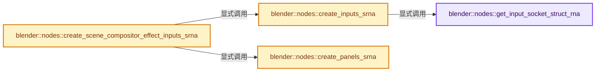
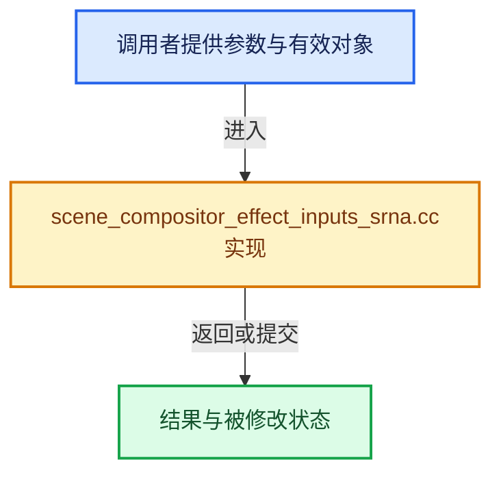

# 实现依赖专题：source/blender/nodes/intern/scene_compositor_effect_inputs_srna.cc

[方向导航](README.md) · [符号索引](../%E7%AC%A6%E5%8F%B7%E4%BE%9D%E8%B5%96%E4%B8%8E%E5%AE%9E%E7%8E%B0%E7%B4%A2%E5%BC%95.md)

本专题从正文实际调用进入，集中保存共享实现。函数有稳定锚点，可从调用处直接跳到对应完整函数；递归与互相调用通过回链组织。

## 本文件的实现关系






## 完整成员与函数实现

<a id="f-516c1db6ceb169b2"></a>

### `blender::nodes::get_input_socket_struct_rna`

实现位置：[source/blender/nodes/intern/scene_compositor_effect_inputs_srna.cc](../../../../../source/blender/nodes/intern/scene_compositor_effect_inputs_srna.cc) · L38—L57。

接口参数：

- `const bNodeTree &node_group`
- `const bNodeTreeInterfaceSocket &socket`
- `GeneratedTreeSrnaData &r_generated`

**教学注释版**

<!-- annotated:8ef2aaf9eddd1d -->

```cpp
static StructRNA *get_input_socket_struct_rna(const bNodeTree &node_group,
                                              const bNodeTreeInterfaceSocket &socket,
                                              GeneratedTreeSrnaData &r_generated)
{
  const bke::bNodeSocketType *stype = socket.socket_typeinfo();
  if (!stype) {
    return nullptr;
  }
  const StringRefNull srna_identifier = r_generated.scope.allocator().copy_string(
      socket.identifier);

  StructRNA *srna = RNA_def_struct_ptr(
      r_generated.generated_rna, srna_identifier.c_str(), RNA_PropertyGroup);
  RNA_def_struct_path_func_runtime(srna, rna_SceneCompositorEffectInputProperty_path);
  if (stype->make_scene_compositor_effect_input_srna) {
    stype->make_scene_compositor_effect_input_srna(node_group, *srna, socket, r_generated);
  }

  return srna;
}
```

<details>
<summary>核对原始源码：source/blender/nodes/intern/scene_compositor_effect_inputs_srna.cc · L38—L57</summary>

<!-- original:8ef2aaf9eddd1d:source/blender/nodes/intern/scene_compositor_effect_inputs_srna.cc:38:57 -->

```cpp
static StructRNA *get_input_socket_struct_rna(const bNodeTree &node_group,
                                              const bNodeTreeInterfaceSocket &socket,
                                              GeneratedTreeSrnaData &r_generated)
{
  const bke::bNodeSocketType *stype = socket.socket_typeinfo();
  if (!stype) {
    return nullptr;
  }
  const StringRefNull srna_identifier = r_generated.scope.allocator().copy_string(
      socket.identifier);

  StructRNA *srna = RNA_def_struct_ptr(
      r_generated.generated_rna, srna_identifier.c_str(), RNA_PropertyGroup);
  RNA_def_struct_path_func_runtime(srna, rna_SceneCompositorEffectInputProperty_path);
  if (stype->make_scene_compositor_effect_input_srna) {
    stype->make_scene_compositor_effect_input_srna(node_group, *srna, socket, r_generated);
  }

  return srna;
}
```

</details>

**结果出口**

- `return nullptr;`
- `return srna;`

**继续追踪实现**

- `socket.socket_typeinfo` → [blender::bNodeTreeInterfaceSocket::socket_typeinfo · L770](../05-%E5%87%A0%E4%BD%95%E5%AD%98%E5%82%A8%E4%B8%8E%E6%8B%93%E6%89%91%E6%98%A0%E5%B0%84/%E4%BE%9D%E8%B5%96-node_tree_interface-893d31.md#f-f6d586e3bc159207)。
- `r_generated.scope.allocator().copy_string` → [调用协议](../%E6%A8%A1%E6%9D%BF%E5%AE%8F%E4%B8%8E%E5%8A%A8%E6%80%81%E5%88%86%E6%B4%BE%E5%8D%8F%E8%AE%AE.md)：接收对象类型依赖auto、返回值或模板实例；不按同名猜测目标。调用位置L46。
- `r_generated.scope.allocator` → [调用协议](../%E6%A8%A1%E6%9D%BF%E5%AE%8F%E4%B8%8E%E5%8A%A8%E6%80%81%E5%88%86%E6%B4%BE%E5%8D%8F%E8%AE%AE.md)：接收对象类型依赖auto、返回值或模板实例；不按同名猜测目标。调用位置L46。
- `RNA_def_struct_ptr` → [blender::RNA_def_struct_ptr · L805](../05-%E5%87%A0%E4%BD%95%E5%AD%98%E5%82%A8%E4%B8%8E%E6%8B%93%E6%89%91%E6%98%A0%E5%B0%84/%E4%BE%9D%E8%B5%96-rna_define-0e9991.md#f-37cc235892d0094b)。
- `srna_identifier.c_str` → [blender::StringRefNull::c_str · L544](../01-%E5%9F%BA%E7%A1%80%E5%AE%B9%E5%99%A8%E4%B8%8E%E7%8E%B0%E4%BB%A3CPP/15-StringRef%E5%AD%97%E7%AC%A6%E4%B8%B2%E8%A7%86%E5%9B%BE.md#f-4a8bbfe1e6d00757)。
- `RNA_def_struct_path_func_runtime` → [blender::RNA_def_struct_path_func_runtime · L1129](../05-%E5%87%A0%E4%BD%95%E5%AD%98%E5%82%A8%E4%B8%8E%E6%8B%93%E6%89%91%E6%98%A0%E5%B0%84/%E4%BE%9D%E8%B5%96-rna_define-0e9991.md#f-e8faada524c15119)。
- `stype->make_scene_compositor_effect_input_srna` → [调用协议](../%E6%A8%A1%E6%9D%BF%E5%AE%8F%E4%B8%8E%E5%8A%A8%E6%80%81%E5%88%86%E6%B4%BE%E5%8D%8F%E8%AE%AE.md)：由接收对象具体类型或运行时策略提供实现。调用位置L53。

<a id="f-728997db6f30b426"></a>

### `blender::nodes::create_inputs_srna`

实现位置：[source/blender/nodes/intern/scene_compositor_effect_inputs_srna.cc](../../../../../source/blender/nodes/intern/scene_compositor_effect_inputs_srna.cc) · L59—L78。

接口参数：

- `const bNodeTree &node_group`
- `GeneratedTreeSrnaData &r_generated`

**教学注释版**

<!-- annotated:f7b28f0ec78eca -->

```cpp
static StructRNA *create_inputs_srna(const bNodeTree &node_group,
                                     GeneratedTreeSrnaData &r_generated)
{
  StructRNA *srna = RNA_def_struct_ptr(
      r_generated.generated_rna, "SceneCompositorEffectInterfaceInputs", RNA_PropertyGroup);

  node_group.ensure_interface_cache();
  for (const bNodeTreeInterfaceSocket *socket : node_group.interface_inputs()) {
    StructRNA *socket_srna = get_input_socket_struct_rna(node_group, *socket, r_generated);
    if (!socket_srna) {
      continue;
    }
    const StringRefNull identifier = r_generated.scope.allocator().copy_string(socket->identifier);
    PropertyRNA *property = RNA_def_pointer_runtime(
        srna, identifier.c_str(), socket_srna, socket->name().c_str(), "");
    RNA_def_property_override_flag(property, PROPOVERRIDE_OVERRIDABLE_LIBRARY);
  }

  return srna;
}
```

<details>
<summary>核对原始源码：source/blender/nodes/intern/scene_compositor_effect_inputs_srna.cc · L59—L78</summary>

<!-- original:f7b28f0ec78eca:source/blender/nodes/intern/scene_compositor_effect_inputs_srna.cc:59:78 -->

```cpp
static StructRNA *create_inputs_srna(const bNodeTree &node_group,
                                     GeneratedTreeSrnaData &r_generated)
{
  StructRNA *srna = RNA_def_struct_ptr(
      r_generated.generated_rna, "SceneCompositorEffectInterfaceInputs", RNA_PropertyGroup);

  node_group.ensure_interface_cache();
  for (const bNodeTreeInterfaceSocket *socket : node_group.interface_inputs()) {
    StructRNA *socket_srna = get_input_socket_struct_rna(node_group, *socket, r_generated);
    if (!socket_srna) {
      continue;
    }
    const StringRefNull identifier = r_generated.scope.allocator().copy_string(socket->identifier);
    PropertyRNA *property = RNA_def_pointer_runtime(
        srna, identifier.c_str(), socket_srna, socket->name().c_str(), "");
    RNA_def_property_override_flag(property, PROPOVERRIDE_OVERRIDABLE_LIBRARY);
  }

  return srna;
}
```

</details>

**结果出口**

- `return srna;`

**继续追踪实现**

- `RNA_def_struct_ptr` → [blender::RNA_def_struct_ptr · L805](../05-%E5%87%A0%E4%BD%95%E5%AD%98%E5%82%A8%E4%B8%8E%E6%8B%93%E6%89%91%E6%98%A0%E5%B0%84/%E4%BE%9D%E8%B5%96-rna_define-0e9991.md#f-37cc235892d0094b)。
- `node_group.ensure_interface_cache` → [blender::bNodeTree::ensure_interface_cache · L670](../05-%E5%87%A0%E4%BD%95%E5%AD%98%E5%82%A8%E4%B8%8E%E6%8B%93%E6%89%91%E6%98%A0%E5%B0%84/%E4%BE%9D%E8%B5%96-BKE_node_runtime-ee561b.md#f-73fea7b58035b1f9)。
- `node_group.interface_inputs` → [blender::bNodeTree::interface_inputs · L675](../05-%E5%87%A0%E4%BD%95%E5%AD%98%E5%82%A8%E4%B8%8E%E6%8B%93%E6%89%91%E6%98%A0%E5%B0%84/%E4%BE%9D%E8%B5%96-BKE_node_runtime-ee561b.md#f-b5decde7a09fbf57)；[blender::bNodeTree::interface_inputs · L681](../05-%E5%87%A0%E4%BD%95%E5%AD%98%E5%82%A8%E4%B8%8E%E6%8B%93%E6%89%91%E6%98%A0%E5%B0%84/%E4%BE%9D%E8%B5%96-BKE_node_runtime-ee561b.md#f-f999995c05009884)。同名重载需按实参类型选择。
- `get_input_socket_struct_rna` → [blender::nodes::get_input_socket_struct_rna · L38](%E4%BE%9D%E8%B5%96-scene_compositor_effect_inputs_srna-22b31e.md#f-516c1db6ceb169b2)。
- `r_generated.scope.allocator().copy_string` → [调用协议](../%E6%A8%A1%E6%9D%BF%E5%AE%8F%E4%B8%8E%E5%8A%A8%E6%80%81%E5%88%86%E6%B4%BE%E5%8D%8F%E8%AE%AE.md)：接收对象类型依赖auto、返回值或模板实例；不按同名猜测目标。调用位置L71。
- `r_generated.scope.allocator` → [调用协议](../%E6%A8%A1%E6%9D%BF%E5%AE%8F%E4%B8%8E%E5%8A%A8%E6%80%81%E5%88%86%E6%B4%BE%E5%8D%8F%E8%AE%AE.md)：接收对象类型依赖auto、返回值或模板实例；不按同名猜测目标。调用位置L71。
- `RNA_def_pointer_runtime` → [blender::RNA_def_pointer_runtime · L4608](../05-%E5%87%A0%E4%BD%95%E5%AD%98%E5%82%A8%E4%B8%8E%E6%8B%93%E6%89%91%E6%98%A0%E5%B0%84/%E4%BE%9D%E8%B5%96-rna_define-0e9991.md#f-69b55a92fad49c1b)。
- `identifier.c_str` → [blender::StringRefNull::c_str · L544](../01-%E5%9F%BA%E7%A1%80%E5%AE%B9%E5%99%A8%E4%B8%8E%E7%8E%B0%E4%BB%A3CPP/15-StringRef%E5%AD%97%E7%AC%A6%E4%B8%B2%E8%A7%86%E5%9B%BE.md#f-4a8bbfe1e6d00757)。
- `socket->name().c_str` → [调用协议](../%E6%A8%A1%E6%9D%BF%E5%AE%8F%E4%B8%8E%E5%8A%A8%E6%80%81%E5%88%86%E6%B4%BE%E5%8D%8F%E8%AE%AE.md)：接收对象类型依赖auto、返回值或模板实例；不按同名猜测目标。调用位置L73。
- `socket->name` → [调用协议](../%E6%A8%A1%E6%9D%BF%E5%AE%8F%E4%B8%8E%E5%8A%A8%E6%80%81%E5%88%86%E6%B4%BE%E5%8D%8F%E8%AE%AE.md)：接收对象类型依赖auto、返回值或模板实例；不按同名猜测目标。调用位置L73。
- `RNA_def_property_override_flag` → [blender::RNA_def_property_override_flag · L1452](../05-%E5%87%A0%E4%BD%95%E5%AD%98%E5%82%A8%E4%B8%8E%E6%8B%93%E6%89%91%E6%98%A0%E5%B0%84/%E4%BE%9D%E8%B5%96-rna_define-0e9991.md#f-50543b30d1114f2f)。

<a id="f-d4d900d4a205a50a"></a>

### `blender::nodes::create_panels_srna`

实现位置：[source/blender/nodes/intern/scene_compositor_effect_inputs_srna.cc](../../../../../source/blender/nodes/intern/scene_compositor_effect_inputs_srna.cc) · L80—L105。

接口参数：

- `const bNodeTree &node_group`
- `GeneratedTreeSrnaData &r_generated`

**教学注释版**

<!-- annotated:b69c927da944fe -->

```cpp
static StructRNA *create_panels_srna(const bNodeTree &node_group,
                                     GeneratedTreeSrnaData &r_generated)
{
  StructRNA *srna = RNA_def_struct_ptr(
      r_generated.generated_rna, "SceneCompositorEffectInterfacePanels", RNA_PropertyGroup);

  LinearAllocator<> &allocator = r_generated.scope.allocator();

  node_group.ensure_interface_cache();
  for (const bNodeTreeInterfaceItem *item : node_group.interface_items()) {
    if (item->item_type != NodeTreeInterfaceItemType::Panel) {
      continue;
    }
    const auto &panel = *reinterpret_cast<const bNodeTreeInterfacePanel *>(item);
    const StringRefNull identifier = allocator.copy_string(
        fmt::format("open_{}", panel.identifier));
    PropertyRNA *prop = RNA_def_boolean(srna,
                                        identifier.c_str(),
                                        !(panel.flag & NODE_INTERFACE_PANEL_DEFAULT_CLOSED),
                                        "Is Open",
                                        "");
    RNA_def_property_flag(prop, PROP_NO_DEG_UPDATE);
  }

  return srna;
}
```

<details>
<summary>核对原始源码：source/blender/nodes/intern/scene_compositor_effect_inputs_srna.cc · L80—L105</summary>

<!-- original:b69c927da944fe:source/blender/nodes/intern/scene_compositor_effect_inputs_srna.cc:80:105 -->

```cpp
static StructRNA *create_panels_srna(const bNodeTree &node_group,
                                     GeneratedTreeSrnaData &r_generated)
{
  StructRNA *srna = RNA_def_struct_ptr(
      r_generated.generated_rna, "SceneCompositorEffectInterfacePanels", RNA_PropertyGroup);

  LinearAllocator<> &allocator = r_generated.scope.allocator();

  node_group.ensure_interface_cache();
  for (const bNodeTreeInterfaceItem *item : node_group.interface_items()) {
    if (item->item_type != NodeTreeInterfaceItemType::Panel) {
      continue;
    }
    const auto &panel = *reinterpret_cast<const bNodeTreeInterfacePanel *>(item);
    const StringRefNull identifier = allocator.copy_string(
        fmt::format("open_{}", panel.identifier));
    PropertyRNA *prop = RNA_def_boolean(srna,
                                        identifier.c_str(),
                                        !(panel.flag & NODE_INTERFACE_PANEL_DEFAULT_CLOSED),
                                        "Is Open",
                                        "");
    RNA_def_property_flag(prop, PROP_NO_DEG_UPDATE);
  }

  return srna;
}
```

</details>

**结果出口**

- `return srna;`

**继续追踪实现**

- `RNA_def_struct_ptr` → [blender::RNA_def_struct_ptr · L805](../05-%E5%87%A0%E4%BD%95%E5%AD%98%E5%82%A8%E4%B8%8E%E6%8B%93%E6%89%91%E6%98%A0%E5%B0%84/%E4%BE%9D%E8%B5%96-rna_define-0e9991.md#f-37cc235892d0094b)。
- `r_generated.scope.allocator` → [调用协议](../%E6%A8%A1%E6%9D%BF%E5%AE%8F%E4%B8%8E%E5%8A%A8%E6%80%81%E5%88%86%E6%B4%BE%E5%8D%8F%E8%AE%AE.md)：接收对象类型依赖auto、返回值或模板实例；不按同名猜测目标。调用位置L86。
- `node_group.ensure_interface_cache` → [blender::bNodeTree::ensure_interface_cache · L670](../05-%E5%87%A0%E4%BD%95%E5%AD%98%E5%82%A8%E4%B8%8E%E6%8B%93%E6%89%91%E6%98%A0%E5%B0%84/%E4%BE%9D%E8%B5%96-BKE_node_runtime-ee561b.md#f-73fea7b58035b1f9)。
- `node_group.interface_items` → [blender::bNodeTree::interface_items · L699](../05-%E5%87%A0%E4%BD%95%E5%AD%98%E5%82%A8%E4%B8%8E%E6%8B%93%E6%89%91%E6%98%A0%E5%B0%84/%E4%BE%9D%E8%B5%96-BKE_node_runtime-ee561b.md#f-a4378b71bb958204)；[blender::bNodeTree::interface_items · L705](../05-%E5%87%A0%E4%BD%95%E5%AD%98%E5%82%A8%E4%B8%8E%E6%8B%93%E6%89%91%E6%98%A0%E5%B0%84/%E4%BE%9D%E8%B5%96-BKE_node_runtime-ee561b.md#f-12f77272cc5b4792)。同名重载需按实参类型选择。
- `allocator.copy_string` → [blender::LinearAllocator::copy_string · L174](../03-%E5%86%85%E5%AD%98%E5%88%86%E9%85%8D%E4%B8%8E%E8%BF%90%E8%A1%8C%E6%97%B6%E7%B1%BB%E5%9E%8B/03-LinearAllocator%E5%88%86%E9%85%8D%E4%B8%8E%E6%89%A9%E5%B1%95.md#f-78f19108ed967ade)。
- `fmt::format` → [外部契约](https://fmt.dev/latest/api/)：按fmt接口的格式字符串与参数类型契约使用，格式化不改变被格式化对象的拥有关系。
- `RNA_def_boolean` → [blender::RNA_def_boolean · L3914](../05-%E5%87%A0%E4%BD%95%E5%AD%98%E5%82%A8%E4%B8%8E%E6%8B%93%E6%89%91%E6%98%A0%E5%B0%84/%E4%BE%9D%E8%B5%96-rna_define-0e9991.md#f-405e176adda90717)。
- `identifier.c_str` → [blender::StringRefNull::c_str · L544](../01-%E5%9F%BA%E7%A1%80%E5%AE%B9%E5%99%A8%E4%B8%8E%E7%8E%B0%E4%BB%A3CPP/15-StringRef%E5%AD%97%E7%AC%A6%E4%B8%B2%E8%A7%86%E5%9B%BE.md#f-4a8bbfe1e6d00757)。
- `RNA_def_property_flag` → [blender::RNA_def_property_flag · L1407](../05-%E5%87%A0%E4%BD%95%E5%AD%98%E5%82%A8%E4%B8%8E%E6%8B%93%E6%89%91%E6%98%A0%E5%B0%84/%E4%BE%9D%E8%B5%96-rna_define-0e9991.md#f-5cf166a170a67318)。

<a id="f-062fa79f622708ef"></a>

### `blender::nodes::create_scene_compositor_effect_inputs_srna`

实现位置：[source/blender/nodes/intern/scene_compositor_effect_inputs_srna.cc](../../../../../source/blender/nodes/intern/scene_compositor_effect_inputs_srna.cc) · L107—L128。

接口参数：

- `const bNodeTree &node_group`

**教学注释版**

<!-- annotated:12b29e6047389f -->

```cpp
std::shared_ptr<GeneratedTreeSrnaData> create_scene_compositor_effect_inputs_srna(
    const bNodeTree &node_group)
{
  // [讲解] std::make_unique<GeneratedTreeSrnaData>：创建独占拥有的对象，拥有关系可移动，get返回的借用指针不自动延长寿命。
  std::unique_ptr<GeneratedTreeSrnaData> generated = std::make_unique<GeneratedTreeSrnaData>();

  StructRNA *srna = RNA_def_struct_ptr(generated->generated_rna,
                                       "SceneCompositorEffectInterface",
                                       RNA_SceneCompositorEffectProperties);
  generated->properties_struct = srna;

  StructRNA *inputs_srna = create_inputs_srna(node_group, *generated);
  StructRNA *panels_srna = create_panels_srna(node_group, *generated);

  PropertyRNA *prop;
  prop = RNA_def_pointer_runtime(
      srna, "inputs", inputs_srna, "Inputs", "Settings for input sockets");
  RNA_def_property_override_flag(prop, PROPOVERRIDE_OVERRIDABLE_LIBRARY);
  prop = RNA_def_pointer_runtime(srna, "panels", panels_srna, "Panels", "Settings for panels");
  RNA_def_property_override_flag(prop, PROPOVERRIDE_OVERRIDABLE_LIBRARY);

  return generated;
}
```

<details>
<summary>核对原始源码：source/blender/nodes/intern/scene_compositor_effect_inputs_srna.cc · L107—L128</summary>

<!-- original:12b29e6047389f:source/blender/nodes/intern/scene_compositor_effect_inputs_srna.cc:107:128 -->

```cpp
std::shared_ptr<GeneratedTreeSrnaData> create_scene_compositor_effect_inputs_srna(
    const bNodeTree &node_group)
{
  std::unique_ptr<GeneratedTreeSrnaData> generated = std::make_unique<GeneratedTreeSrnaData>();

  StructRNA *srna = RNA_def_struct_ptr(generated->generated_rna,
                                       "SceneCompositorEffectInterface",
                                       RNA_SceneCompositorEffectProperties);
  generated->properties_struct = srna;

  StructRNA *inputs_srna = create_inputs_srna(node_group, *generated);
  StructRNA *panels_srna = create_panels_srna(node_group, *generated);

  PropertyRNA *prop;
  prop = RNA_def_pointer_runtime(
      srna, "inputs", inputs_srna, "Inputs", "Settings for input sockets");
  RNA_def_property_override_flag(prop, PROPOVERRIDE_OVERRIDABLE_LIBRARY);
  prop = RNA_def_pointer_runtime(srna, "panels", panels_srna, "Panels", "Settings for panels");
  RNA_def_property_override_flag(prop, PROPOVERRIDE_OVERRIDABLE_LIBRARY);

  return generated;
}
```

</details>

**沿实际写入检查状态**

- `generated->properties_struct = srna;`
- `prop = RNA_def_pointer_runtime(`
- `prop = RNA_def_pointer_runtime(srna, "panels", panels_srna, "Panels", "Settings for panels");`

**结果出口**

- `return generated;`

**继续追踪实现**

- `std::make_unique<GeneratedTreeSrnaData>` → [外部契约](https://eel.is/c++draft/unique.ptr.create)：创建独占拥有的对象，拥有关系可移动，get返回的借用指针不自动延长寿命。
- `RNA_def_struct_ptr` → [blender::RNA_def_struct_ptr · L805](../05-%E5%87%A0%E4%BD%95%E5%AD%98%E5%82%A8%E4%B8%8E%E6%8B%93%E6%89%91%E6%98%A0%E5%B0%84/%E4%BE%9D%E8%B5%96-rna_define-0e9991.md#f-37cc235892d0094b)。
- `create_inputs_srna` → [blender::nodes::create_inputs_srna · L59](%E4%BE%9D%E8%B5%96-scene_compositor_effect_inputs_srna-22b31e.md#f-728997db6f30b426)。
- `create_panels_srna` → [blender::nodes::create_panels_srna · L80](%E4%BE%9D%E8%B5%96-scene_compositor_effect_inputs_srna-22b31e.md#f-d4d900d4a205a50a)。
- `RNA_def_pointer_runtime` → [blender::RNA_def_pointer_runtime · L4608](../05-%E5%87%A0%E4%BD%95%E5%AD%98%E5%82%A8%E4%B8%8E%E6%8B%93%E6%89%91%E6%98%A0%E5%B0%84/%E4%BE%9D%E8%B5%96-rna_define-0e9991.md#f-69b55a92fad49c1b)。
- `RNA_def_property_override_flag` → [blender::RNA_def_property_override_flag · L1452](../05-%E5%87%A0%E4%BD%95%E5%AD%98%E5%82%A8%E4%B8%8E%E6%8B%93%E6%89%91%E6%98%A0%E5%B0%84/%E4%BE%9D%E8%B5%96-rna_define-0e9991.md#f-50543b30d1114f2f)。
