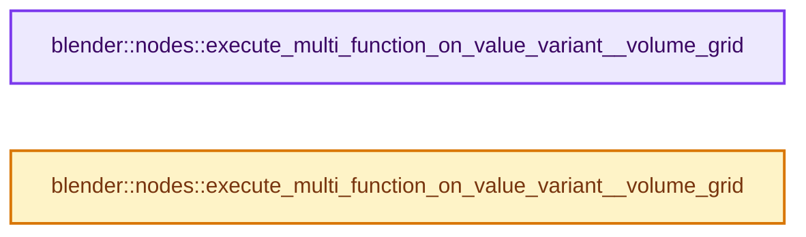
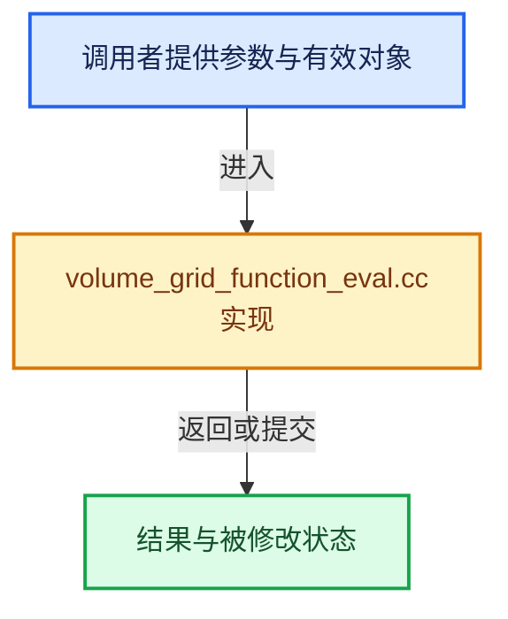

# 实现依赖专题：source/blender/nodes/intern/volume_grid_function_eval.cc

[方向导航](README.md) · [符号索引](../%E7%AC%A6%E5%8F%B7%E4%BE%9D%E8%B5%96%E4%B8%8E%E5%AE%9E%E7%8E%B0%E7%B4%A2%E5%BC%95.md)

本专题从正文实际调用进入，集中保存共享实现。函数有稳定锚点，可从调用处直接跳到对应完整函数；递归与互相调用通过回链组织。

## 本文件的实现关系






## 完整成员与函数实现

<a id="f-6abe69dd207c7004"></a>

### `blender::nodes::execute_multi_function_on_value_variant__volume_grid`

实现位置：[source/blender/nodes/intern/volume_grid_function_eval.cc](../../../../../source/blender/nodes/intern/volume_grid_function_eval.cc) · L25—L77。

接口参数：

- `const mf::MultiFunction &fn`
- `const Span<bke::SocketValueVariant *> input_values`
- `const Span<bke::SocketValueVariant *> output_values`
- `std::string &r_error_message`

**教学注释版**

<!-- annotated:3763f5b687ca16 -->

```cpp
bool execute_multi_function_on_value_variant__volume_grid(
    const mf::MultiFunction &fn,
    const Span<bke::SocketValueVariant *> input_values,
    const Span<bke::SocketValueVariant *> output_values,
    std::string &r_error_message)
{
  using namespace bke::volume_grid::multi_function_eval;

  // [讲解] input_values.size：查询视图长度或生成对应有效索引区间。
  const int inputs_num = input_values.size();

  Vector<bke::volume_grid::multi_function_eval::InputVariant> inputs(inputs_num);
  Array<bke::volume_grid::GVolumeGrid> input_grids(inputs_num);
  Array<std::optional<GField>> input_fields(inputs_num);
  Array<bke::VolumeTreeAccessToken> input_tree_tokens(inputs_num);

  // [讲解] input_values.index_range：查询视图长度或生成对应有效索引区间。
  for (const int i : input_values.index_range()) {
    const CPPType &type = fn.param_type(i).data_type().single_type();
    bke::SocketValueVariant &input_value = *input_values[i];
    if (input_value.is_volume_grid()) {
      input_grids[i] = input_value.extract<bke::volume_grid::GVolumeGrid>();
      inputs[i] = &input_grids[i]->grid(input_tree_tokens[i]);
    }
    else if (input_value.is_context_dependent_field()) {
      input_fields[i] = input_value.extract<GField>();
      inputs[i] = &*input_fields[i];
    }
    else {
      input_value.ensure_type(type);
      inputs[i] = input_value.get();
    }
  }

  Array<bool> output_usages(output_values.size());
  for (const int i : output_values.index_range()) {
    output_usages[i] = output_values[i] != nullptr;
  }

  EvalResult result = evaluate_multi_function_on_grid(fn, inputs, output_usages);

  if (const auto *failure = std::get_if<EvalResult::Failure>(&result.result)) {
    r_error_message = failure->error_message;
    return false;
  }
  auto &success = std::get<EvalResult::Success>(result.result);
  for (const int i : output_values.index_range()) {
    if (output_usages[i]) {
      output_values[i]->emplace<bke::GVolumeGrid>(
          // [讲解] std::move：把表达式转换成可供移动重载选择的值类别；不保证真的移动，不结束源对象寿命，对const值可能选择复制。
          bke::GVolumeGrid(std::move(success.output_grids[i])));
    }
  }

  return true;
}
```

<details>
<summary>核对原始源码：source/blender/nodes/intern/volume_grid_function_eval.cc · L25—L77</summary>

<!-- original:3763f5b687ca16:source/blender/nodes/intern/volume_grid_function_eval.cc:25:77 -->

```cpp
bool execute_multi_function_on_value_variant__volume_grid(
    const mf::MultiFunction &fn,
    const Span<bke::SocketValueVariant *> input_values,
    const Span<bke::SocketValueVariant *> output_values,
    std::string &r_error_message)
{
  using namespace bke::volume_grid::multi_function_eval;

  const int inputs_num = input_values.size();

  Vector<bke::volume_grid::multi_function_eval::InputVariant> inputs(inputs_num);
  Array<bke::volume_grid::GVolumeGrid> input_grids(inputs_num);
  Array<std::optional<GField>> input_fields(inputs_num);
  Array<bke::VolumeTreeAccessToken> input_tree_tokens(inputs_num);

  for (const int i : input_values.index_range()) {
    const CPPType &type = fn.param_type(i).data_type().single_type();
    bke::SocketValueVariant &input_value = *input_values[i];
    if (input_value.is_volume_grid()) {
      input_grids[i] = input_value.extract<bke::volume_grid::GVolumeGrid>();
      inputs[i] = &input_grids[i]->grid(input_tree_tokens[i]);
    }
    else if (input_value.is_context_dependent_field()) {
      input_fields[i] = input_value.extract<GField>();
      inputs[i] = &*input_fields[i];
    }
    else {
      input_value.ensure_type(type);
      inputs[i] = input_value.get();
    }
  }

  Array<bool> output_usages(output_values.size());
  for (const int i : output_values.index_range()) {
    output_usages[i] = output_values[i] != nullptr;
  }

  EvalResult result = evaluate_multi_function_on_grid(fn, inputs, output_usages);

  if (const auto *failure = std::get_if<EvalResult::Failure>(&result.result)) {
    r_error_message = failure->error_message;
    return false;
  }
  auto &success = std::get<EvalResult::Success>(result.result);
  for (const int i : output_values.index_range()) {
    if (output_usages[i]) {
      output_values[i]->emplace<bke::GVolumeGrid>(
          bke::GVolumeGrid(std::move(success.output_grids[i])));
    }
  }

  return true;
}
```

</details>

**沿实际写入检查状态**

- `input_grids[i] = input_value.extract<bke::volume_grid::GVolumeGrid>();`
- `inputs[i] = &input_grids[i]->grid(input_tree_tokens[i]);`
- `input_fields[i] = input_value.extract<GField>();`
- `inputs[i] = &*input_fields[i];`
- `inputs[i] = input_value.get();`
- `output_usages[i] = output_values[i] != nullptr;`
- `r_error_message = failure->error_message;`

**结果出口**

- `return false;`
- `return true;`

**继续追踪实现**

- `input_values.size` → [blender::Span::size · L256](../01-%E5%9F%BA%E7%A1%80%E5%AE%B9%E5%99%A8%E4%B8%8E%E7%8E%B0%E4%BB%A3CPP/05-Span%E5%8F%AA%E8%AF%BB%E8%BF%9E%E7%BB%AD%E8%A7%86%E5%9B%BE.md#f-5f80fa006089c998)。
- `input_values.index_range` → [blender::Span::index_range · L405](../01-%E5%9F%BA%E7%A1%80%E5%AE%B9%E5%99%A8%E4%B8%8E%E7%8E%B0%E4%BB%A3CPP/05-Span%E5%8F%AA%E8%AF%BB%E8%BF%9E%E7%BB%AD%E8%A7%86%E5%9B%BE.md#f-caaa9b06e13e53e0)。
- `fn.param_type(i).data_type().single_type` → [调用协议](../%E6%A8%A1%E6%9D%BF%E5%AE%8F%E4%B8%8E%E5%8A%A8%E6%80%81%E5%88%86%E6%B4%BE%E5%8D%8F%E8%AE%AE.md)：接收对象类型依赖auto、返回值或模板实例；不按同名猜测目标。调用位置L41。
- `fn.param_type(i).data_type` → [调用协议](../%E6%A8%A1%E6%9D%BF%E5%AE%8F%E4%B8%8E%E5%8A%A8%E6%80%81%E5%88%86%E6%B4%BE%E5%8D%8F%E8%AE%AE.md)：接收对象类型依赖auto、返回值或模板实例；不按同名猜测目标。调用位置L41。
- `fn.param_type` → [blender::fn::multi_function::MultiFunction::param_type · L72](../07-MultiFunction%E4%B8%8E%E6%89%B9%E9%87%8F%E6%89%A7%E8%A1%8C/01-%E6%89%B9%E9%87%8F%E8%AE%A1%E7%AE%97%E6%A8%A1%E5%9E%8B.md#f-b713a5aeabff53fa)。
- `input_value.is_volume_grid` → [SocketValueVariant::is_volume_grid · L525](../05-%E5%87%A0%E4%BD%95%E5%AD%98%E5%82%A8%E4%B8%8E%E6%8B%93%E6%89%91%E6%98%A0%E5%B0%84/%E4%BE%9D%E8%B5%96-node_socket_value-841c72.md#f-e53b8ae8600b40db)。
- `input_value.extract<bke::volume_grid::GVolumeGrid>` → [blender::bke::SocketValueVariant::extract · L368](../05-%E5%87%A0%E4%BD%95%E5%AD%98%E5%82%A8%E4%B8%8E%E6%8B%93%E6%89%91%E6%98%A0%E5%B0%84/%E4%BE%9D%E8%B5%96-BKE_node_socket_value-24f0e5.md#f-a81e32a03fee5871)。
- `input_grids[i]->grid` → [调用协议](../%E6%A8%A1%E6%9D%BF%E5%AE%8F%E4%B8%8E%E5%8A%A8%E6%80%81%E5%88%86%E6%B4%BE%E5%8D%8F%E8%AE%AE.md)：接收对象类型依赖auto、返回值或模板实例；不按同名猜测目标。调用位置L45。
- `input_value.is_context_dependent_field` → [SocketValueVariant::is_context_dependent_field · L534](../05-%E5%87%A0%E4%BD%95%E5%AD%98%E5%82%A8%E4%B8%8E%E6%8B%93%E6%89%91%E6%98%A0%E5%B0%84/%E4%BE%9D%E8%B5%96-node_socket_value-841c72.md#f-55e5e1818d077c80)。
- `input_value.extract<GField>` → [blender::bke::SocketValueVariant::extract · L368](../05-%E5%87%A0%E4%BD%95%E5%AD%98%E5%82%A8%E4%B8%8E%E6%8B%93%E6%89%91%E6%98%A0%E5%B0%84/%E4%BE%9D%E8%B5%96-BKE_node_socket_value-24f0e5.md#f-a81e32a03fee5871)。
- `input_value.ensure_type` → [blender::bke::SocketValueVariant::ensure_type · L271](../05-%E5%87%A0%E4%BD%95%E5%AD%98%E5%82%A8%E4%B8%8E%E6%8B%93%E6%89%91%E6%98%A0%E5%B0%84/%E4%BE%9D%E8%B5%96-BKE_node_socket_value-24f0e5.md#f-36be485d1fc40c00)；[blender::bke::SocketValueVariant::ensure_type · L279](../05-%E5%87%A0%E4%BD%95%E5%AD%98%E5%82%A8%E4%B8%8E%E6%8B%93%E6%89%91%E6%98%A0%E5%B0%84/%E4%BE%9D%E8%B5%96-BKE_node_socket_value-24f0e5.md#f-417f182997393297)。同名重载需按实参类型选择。
- `input_value.get` → [blender::bke::SocketValueVariant::get · L340](../05-%E5%87%A0%E4%BD%95%E5%AD%98%E5%82%A8%E4%B8%8E%E6%8B%93%E6%89%91%E6%98%A0%E5%B0%84/%E4%BE%9D%E8%B5%96-BKE_node_socket_value-24f0e5.md#f-44fd803c51c13447)；[blender::bke::SocketValueVariant::get · L349](../05-%E5%87%A0%E4%BD%95%E5%AD%98%E5%82%A8%E4%B8%8E%E6%8B%93%E6%89%91%E6%98%A0%E5%B0%84/%E4%BE%9D%E8%B5%96-BKE_node_socket_value-24f0e5.md#f-c63e6331bfae49c4)。同名重载需按实参类型选择。
- `output_values.size` → [blender::Span::size · L256](../01-%E5%9F%BA%E7%A1%80%E5%AE%B9%E5%99%A8%E4%B8%8E%E7%8E%B0%E4%BB%A3CPP/05-Span%E5%8F%AA%E8%AF%BB%E8%BF%9E%E7%BB%AD%E8%A7%86%E5%9B%BE.md#f-5f80fa006089c998)。
- `output_values.index_range` → [blender::Span::index_range · L405](../01-%E5%9F%BA%E7%A1%80%E5%AE%B9%E5%99%A8%E4%B8%8E%E7%8E%B0%E4%BB%A3CPP/05-Span%E5%8F%AA%E8%AF%BB%E8%BF%9E%E7%BB%AD%E8%A7%86%E5%9B%BE.md#f-caaa9b06e13e53e0)。
- `evaluate_multi_function_on_grid` → [blender::bke::volume_grid::multi_function_eval::evaluate_multi_function_on_grid · L462](../05-%E5%87%A0%E4%BD%95%E5%AD%98%E5%82%A8%E4%B8%8E%E6%8B%93%E6%89%91%E6%98%A0%E5%B0%84/%E4%BE%9D%E8%B5%96-volume_grid_multi_function_eval-b6ec92.md#f-a5db9b0b27897af5)。
- `std::get_if<EvalResult::Failure>` → [外部契约](https://eel.is/c++draft/)：这个边界按实际表达式及所属类型核对参数、返回值、寿命与失败行为。这里提供接口入口，不声称已解释该第三方版本的内部实现。
- `std::get<EvalResult::Success>` → [外部契约](https://eel.is/c++draft/)：这个边界按实际表达式及所属类型核对参数、返回值、寿命与失败行为。这里提供接口入口，不声称已解释该第三方版本的内部实现。
- `output_values[i]->emplace<bke::GVolumeGrid>` → [调用协议](../%E6%A8%A1%E6%9D%BF%E5%AE%8F%E4%B8%8E%E5%8A%A8%E6%80%81%E5%88%86%E6%B4%BE%E5%8D%8F%E8%AE%AE.md)：接收对象类型依赖auto、返回值或模板实例；不按同名猜测目标。调用位置L71。
- `bke::GVolumeGrid` → [blender::bke::volume_grid::GVolumeGrid::GVolumeGrid · L394](../05-%E5%87%A0%E4%BD%95%E5%AD%98%E5%82%A8%E4%B8%8E%E6%8B%93%E6%89%91%E6%98%A0%E5%B0%84/%E4%BE%9D%E8%B5%96-volume_grid-a7c9da.md#f-c6814ec651f2d5ea)；[blender::bke::volume_grid::GVolumeGrid::GVolumeGrid · L399](../05-%E5%87%A0%E4%BD%95%E5%AD%98%E5%82%A8%E4%B8%8E%E6%8B%93%E6%89%91%E6%98%A0%E5%B0%84/%E4%BE%9D%E8%B5%96-volume_grid-a7c9da.md#f-9584c1218cce92a3)；[blender::bke::volume_grid::GVolumeGrid::GVolumeGrid · L334](../05-%E5%87%A0%E4%BD%95%E5%AD%98%E5%82%A8%E4%B8%8E%E6%8B%93%E6%89%91%E6%98%A0%E5%B0%84/%E4%BE%9D%E8%B5%96-BKE_volume_grid-cde05a.md#f-29b9417b7950cbfc)；[blender::bke::volume_grid::GVolumeGrid::GVolumeGrid · L425](../05-%E5%87%A0%E4%BD%95%E5%AD%98%E5%82%A8%E4%B8%8E%E6%8B%93%E6%89%91%E6%98%A0%E5%B0%84/%E4%BE%9D%E8%B5%96-BKE_volume_grid-cde05a.md#f-5ff515752ee253f3)。同名重载需按实参类型选择。
- `std::move` → [外部契约](https://eel.is/c++draft/utility.forward)：把表达式转换成可供移动重载选择的值类别；不保证真的移动，不结束源对象寿命，对const值可能选择复制。

<a id="f-e63ded3fa1414b64"></a>

### `blender::nodes::execute_multi_function_on_value_variant__volume_grid`

实现位置：[source/blender/nodes/intern/volume_grid_function_eval.cc](../../../../../source/blender/nodes/intern/volume_grid_function_eval.cc) · L81—L89。

接口参数：

- `const mf::MultiFunction &`
- `const Span<bke::SocketValueVariant *>`
- `const Span<bke::SocketValueVariant *>`
- `std::string &r_error_message`

**教学注释版**

<!-- annotated:ccff9edd7017f9 -->

```cpp
bool execute_multi_function_on_value_variant__volume_grid(
    const mf::MultiFunction & /*fn*/,
    const Span<bke::SocketValueVariant *> /*input_values*/,
    const Span<bke::SocketValueVariant *> /*output_values*/,
    std::string &r_error_message)
{
  r_error_message = TIP_("Compiled without OpenVDB");
  return false;
}
```

<details>
<summary>核对原始源码：source/blender/nodes/intern/volume_grid_function_eval.cc · L81—L89</summary>

<!-- original:ccff9edd7017f9:source/blender/nodes/intern/volume_grid_function_eval.cc:81:89 -->

```cpp
bool execute_multi_function_on_value_variant__volume_grid(
    const mf::MultiFunction & /*fn*/,
    const Span<bke::SocketValueVariant *> /*input_values*/,
    const Span<bke::SocketValueVariant *> /*output_values*/,
    std::string &r_error_message)
{
  r_error_message = TIP_("Compiled without OpenVDB");
  return false;
}
```

</details>

**沿实际写入检查状态**

- `r_error_message = TIP_("Compiled without OpenVDB");`

**结果出口**

- `return false;`

**继续追踪实现**

- `TIP_` → [TIP_ · L50](../05-%E5%87%A0%E4%BD%95%E5%AD%98%E5%82%A8%E4%B8%8E%E6%8B%93%E6%89%91%E6%98%A0%E5%B0%84/%E4%BE%9D%E8%B5%96-BLT_translation-c89e58.md#m-42b98cfb3af1)。宏定义由构建条件选择。
