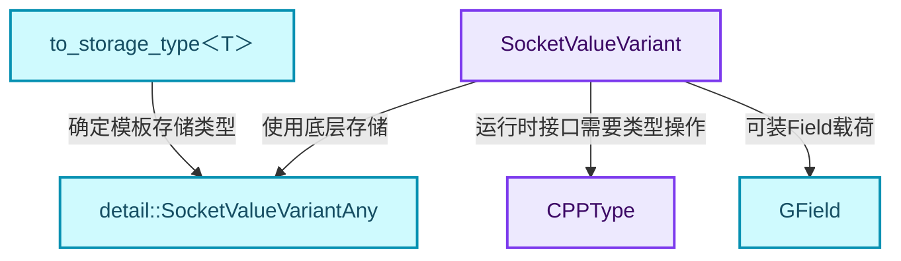
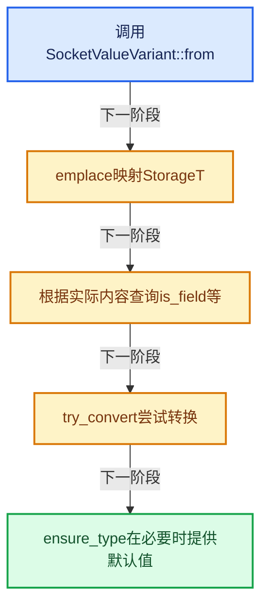
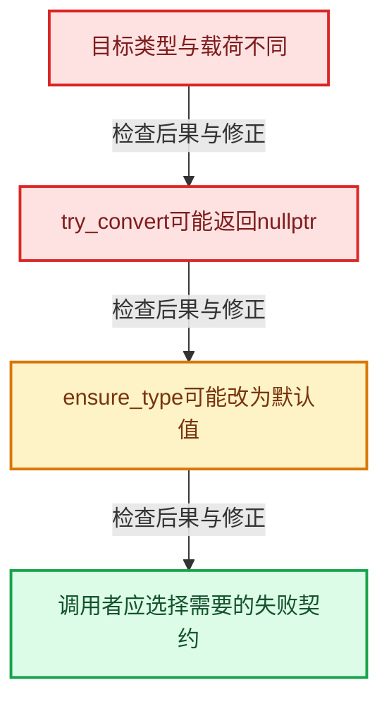

# GN-04 SocketValueVariant异构值与转换边界

[几何节点学习地图](../%E5%87%A0%E4%BD%95%E8%8A%82%E7%82%B9%E6%89%A9%E5%B1%95%E5%AD%A6%E4%B9%A0%E5%9C%B0%E5%9B%BE.md) · [方向导航](README.md) · [全局实现索引](../%E7%AC%A6%E5%8F%B7%E4%BE%9D%E8%B5%96%E4%B8%8E%E5%AE%9E%E7%8E%B0%E7%B4%A2%E5%BC%95.md)

基准：`cbda6b96c26c0dee3c3b5cbb93960c4ac06a6b30`；文件哈希及连续摘录区间记录在[新增专题证据](../_evidence/geometry-extension.json)。本篇围绕所选函数解释核心机制，辅助依赖明确列出已定位实现与尚需类型确认的边界，不宣称相关整个文件已全文复核。

## 先回答一个具体问题

同一个浮点插槽为什么有时装一个float，有时装一个Field？类型擦除怎样和模板接口连接？

## 相关类与数据的职责

- **`SocketValueVariant`**：封装可在几何节点插槽上传递的实际值。 定义入口：[source/blender/blenkernel/BKE_node_socket_value.hh · L83](../../../../../source/blender/blenkernel/BKE_node_socket_value.hh)。
- **`detail::SocketValueVariantAny`**：底层异构存储，定义实际可容纳的存储类型。 定义入口：[source/blender/blenkernel/BKE_node_socket_value.hh · L24](../../../../../source/blender/blenkernel/BKE_node_socket_value.hh)。
- **`CPPType`**：提供运行时尺寸、对齐及类型操作。 定义入口：[source/blender/blenlib/BLI_cpp_type.hh · L106](../../../../../source/blender/blenlib/BLI_cpp_type.hh)。
- **`GField`**：类型擦除后的延迟表达式。 定义入口：[source/blender/functions/FN_field.hh · L55](../../../../../source/blender/functions/FN_field.hh)。
- **`to_storage_type<T>`**：将接口类型映射到Variant实际存储类型。



上图箭头文字区分拥有、借用、调用和数据依赖。连线不表示这些类型存在同名继承关系；只有源码明确声明的继承才按继承理解。

## 设计推导与扩展知识

### 推导1

编辑器插槽的显示类型、SocketValueVariant本身的C++类型、内部载荷的运行时类型必须分开。例如显示为Float的连接可以携带依赖Position的Field，而不是单个浮点数。

### 推导2

from建立新包装值，emplace使用to_storage_type映射T，并通过底层Any构造实际载荷。源码中的sizeof断言说明接口类型与存储类型之间有明确布局假设，不能推广为任意两个同尺寸类型都可互换。

### 推导3

try_convert与ensure_type失败契约不同：前者可以返回空指针，后者必要时创建目标类型的默认值。使用ensure_type会改变载荷，因此不能把它当作无副作用的类型检查。

### 推导4

is_context_dependent_field比is_field更接近“能否在没有几何上下文时当单值处理”的问题。常量Field与依赖属性的Field都属于表达式包装，但执行选择可以不同。

### 推导5

设计异构系统时，要把允许的转换表、默认值策略与拥有关系作为一组协议。只写一个variant或void*容器并不能自动得到这些行为。

## 实际处理阶段



这张图概括本篇所讨论的主路径；等待输入、构建失败与不同策略的分支以下方完整代码为准，不能把概括图当作每次都会执行的无条件顺序。

## 教学注释代码与分段机制

<a id="f-fa3c16e83ef6de45"></a>

### `blender::bke::from` · L220—L225

创建包装后emplace，返回值可移动。T的推导与decay决定引用是否会成为实际存储类型。

实现位置：[source/blender/blenkernel/BKE_node_socket_value.hh](../../../../../source/blender/blenkernel/BKE_node_socket_value.hh)。

**教学注释版**

<!-- annotated:f361bbaed26179 -->

```cpp
template<typename T> inline SocketValueVariant SocketValueVariant::from(T &&value)
{
  SocketValueVariant value_variant;
  value_variant.emplace<std::decay_t<T>>(std::forward<T>(value));
  return value_variant;
}
```

<details>
<summary>核对原始源码：source/blender/blenkernel/BKE_node_socket_value.hh · L220—L225</summary>

<!-- original:f361bbaed26179:source/blender/blenkernel/BKE_node_socket_value.hh:220:225 -->

```cpp
template<typename T> inline SocketValueVariant SocketValueVariant::from(T &&value)
{
  SocketValueVariant value_variant;
  value_variant.emplace<std::decay_t<T>>(std::forward<T>(value));
  return value_variant;
}
```

</details>

<details>
<summary>实现依赖入口与尚需类型确认的调用</summary>

- `value_variant.emplace<std::decay_t<T>>` → [blender::bke::emplace · L227](%E6%89%A9%E5%B1%9504-SocketValueVariant%E5%BC%82%E6%9E%84%E5%80%BC%E4%B8%8E%E8%BD%AC%E6%8D%A2%E8%BE%B9%E7%95%8C.md#f-b1c23f5500ae1b73)。
- `std::forward<T>`：在转发引用中恢复调用者传入的值类别；依赖推导类型，不能与无条件move互换。 [接口资料](https://eel.is/c++draft/utility.forward)。

</details>

<a id="f-b1c23f5500ae1b73"></a>

### `blender::bke::emplace` · L227—L233

关注StorageT、构造过程与sizeof断言，不把底层转换写成通用类型双关技巧。

实现位置：[source/blender/blenkernel/BKE_node_socket_value.hh](../../../../../source/blender/blenkernel/BKE_node_socket_value.hh)。

**教学注释版**

<!-- annotated:cb5a0223302275 -->

```cpp
template<typename T, typename... Args> inline T &SocketValueVariant::emplace(Args &&...args)
{
  // [讲解] 接口类型与底层Any存储类型通过显式映射连接。
  using StorageT = to_storage_type<T>;
  StorageT &value = value_.emplace<StorageT>(T(std::forward<Args>(args)...));
  static_assert(sizeof(T) == sizeof(StorageT));
  return reinterpret_cast<T &>(value);
}
```

<details>
<summary>核对原始源码：source/blender/blenkernel/BKE_node_socket_value.hh · L227—L233</summary>

<!-- original:cb5a0223302275:source/blender/blenkernel/BKE_node_socket_value.hh:227:233 -->

```cpp
template<typename T, typename... Args> inline T &SocketValueVariant::emplace(Args &&...args)
{
  using StorageT = to_storage_type<T>;
  StorageT &value = value_.emplace<StorageT>(T(std::forward<Args>(args)...));
  static_assert(sizeof(T) == sizeof(StorageT));
  return reinterpret_cast<T &>(value);
}
```

</details>

<details>
<summary>实现依赖入口与尚需类型确认的调用</summary>

- `value_.emplace<StorageT>` → [blender::bke::emplace · L227](%E6%89%A9%E5%B1%9504-SocketValueVariant%E5%BC%82%E6%9E%84%E5%80%BC%E4%B8%8E%E8%BD%AC%E6%8D%A2%E8%BE%B9%E7%95%8C.md#f-b1c23f5500ae1b73)。
- `T` → [T · L96](../05-%E5%87%A0%E4%BD%95%E5%AD%98%E5%82%A8%E4%B8%8E%E6%8B%93%E6%89%91%E6%98%A0%E5%B0%84/%E4%BE%9D%E8%B5%96-split-5f5804.md#f-d5d0885c790cc4e4)。
- `std::forward<Args>`：在转发引用中恢复调用者传入的值类别；依赖推导类型，不能与无条件move互换。 [接口资料](https://eel.is/c++draft/utility.forward)。

</details>

<a id="f-dc6b18e59a681c72"></a>

### `blender::bke::try_convert` · L235—L254

先检查是否有值，再检查是否可按目标类型解释；必要时通过Info转换。失败返回空指针，不与ensure_type的默认值策略混用。

实现位置：[source/blender/blenkernel/BKE_node_socket_value.hh](../../../../../source/blender/blenkernel/BKE_node_socket_value.hh)。

**教学注释版**

<!-- annotated:864d480b36f790 -->

```cpp
template<typename T> T *SocketValueVariant::try_convert()
{
  // [讲解] 接口类型与底层Any存储类型通过显式映射连接。
  using StorageT = to_storage_type<T>;
  if (!value_.has_value()) {
    return nullptr;
  }
  const Info &info = value_.extra_info();
  const CPPType &requested_type = CPPType::get<T>();
  if (info.type == requested_type) {
    return &reinterpret_cast<T &>(value_.get<StorageT>());
  }
  if (info.is_interpretable_as(requested_type, value_)) {
    return &reinterpret_cast<T &>(value_.get<StorageT>());
  }
  if (!info.convert_to(requested_type, value_)) {
    return nullptr;
  }
  BLI_assert(value_.extra_info().is_interpretable_as(requested_type, value_));
  return &reinterpret_cast<T &>(value_.get<StorageT>());
}
```

<details>
<summary>核对原始源码：source/blender/blenkernel/BKE_node_socket_value.hh · L235—L254</summary>

<!-- original:864d480b36f790:source/blender/blenkernel/BKE_node_socket_value.hh:235:254 -->

```cpp
template<typename T> T *SocketValueVariant::try_convert()
{
  using StorageT = to_storage_type<T>;
  if (!value_.has_value()) {
    return nullptr;
  }
  const Info &info = value_.extra_info();
  const CPPType &requested_type = CPPType::get<T>();
  if (info.type == requested_type) {
    return &reinterpret_cast<T &>(value_.get<StorageT>());
  }
  if (info.is_interpretable_as(requested_type, value_)) {
    return &reinterpret_cast<T &>(value_.get<StorageT>());
  }
  if (!info.convert_to(requested_type, value_)) {
    return nullptr;
  }
  BLI_assert(value_.extra_info().is_interpretable_as(requested_type, value_));
  return &reinterpret_cast<T &>(value_.get<StorageT>());
}
```

</details>

<details>
<summary>实现依赖入口与尚需类型确认的调用</summary>

- `value_.has_value`：L238的类型或分派协议；由接收对象具体类型或运行时策略提供实现。
- `value_.extra_info` → [blender::Any::extra_info · L390](../01-%E5%9F%BA%E7%A1%80%E5%AE%B9%E5%99%A8%E4%B8%8E%E7%8E%B0%E4%BB%A3CPP/17-Any%E7%B1%BB%E5%9E%8B%E6%93%A6%E9%99%A4%E5%AD%98%E5%82%A8.md#f-7a560ad93b9c62eb)。
- `CPPType::get<T>` → [blender::bke::get · L340](../05-%E5%87%A0%E4%BD%95%E5%AD%98%E5%82%A8%E4%B8%8E%E6%8B%93%E6%89%91%E6%98%A0%E5%B0%84/%E4%BE%9D%E8%B5%96-BKE_node_socket_value-24f0e5.md#f-44fd803c51c13447)；[blender::bke::get · L349](../05-%E5%87%A0%E4%BD%95%E5%AD%98%E5%82%A8%E4%B8%8E%E6%8B%93%E6%89%91%E6%98%A0%E5%B0%84/%E4%BE%9D%E8%B5%96-BKE_node_socket_value-24f0e5.md#f-c63e6331bfae49c4)。多候选需按实参和重载规则确认。
- `value_.get<StorageT>` → [blender::bke::get · L340](../05-%E5%87%A0%E4%BD%95%E5%AD%98%E5%82%A8%E4%B8%8E%E6%8B%93%E6%89%91%E6%98%A0%E5%B0%84/%E4%BE%9D%E8%B5%96-BKE_node_socket_value-24f0e5.md#f-44fd803c51c13447)；[blender::bke::get · L349](../05-%E5%87%A0%E4%BD%95%E5%AD%98%E5%82%A8%E4%B8%8E%E6%8B%93%E6%89%91%E6%98%A0%E5%B0%84/%E4%BE%9D%E8%B5%96-BKE_node_socket_value-24f0e5.md#f-c63e6331bfae49c4)。多候选需按实参和重载规则确认。
- `info.is_interpretable_as`：L246的类型或分派协议；由接收对象具体类型或运行时策略提供实现。
- `info.convert_to`：L249的类型或分派协议；由接收对象具体类型或运行时策略提供实现。
- `BLI_assert`：宏定义见[source/blender/blenlib/BLI_assert.hh](../../../../../source/blender/blenlib/BLI_assert.hh), L48；按当前编译条件选择。
- `BLI_assert`：宏定义见[source/blender/blenlib/BLI_assert.hh](../../../../../source/blender/blenlib/BLI_assert.hh), L63；按当前编译条件选择。
- `value_.extra_info().is_interpretable_as`：L252的类型或分派协议；接收对象类型依赖auto、返回值或模板实例；不按同名猜测目标。

</details>

<a id="f-8b47ae436faf6028"></a>

### `blender::bke::try_convert` · L256—L269

先检查是否有值，再检查是否可按目标类型解释；必要时通过Info转换。失败返回空指针，不与ensure_type的默认值策略混用。

实现位置：[source/blender/blenkernel/BKE_node_socket_value.hh](../../../../../source/blender/blenkernel/BKE_node_socket_value.hh)。

**教学注释版**

<!-- annotated:81205230eb3d27 -->

```cpp
inline void *SocketValueVariant::try_convert(const CPPType &type)
{
  if (!value_.has_value()) {
    return nullptr;
  }
  const Info &info = value_.extra_info();
  if (info.type == type) {
    return value_.get();
  }
  if (!info.convert_to(type, value_)) {
    return nullptr;
  }
  return value_.get();
}
```

<details>
<summary>核对原始源码：source/blender/blenkernel/BKE_node_socket_value.hh · L256—L269</summary>

<!-- original:81205230eb3d27:source/blender/blenkernel/BKE_node_socket_value.hh:256:269 -->

```cpp
inline void *SocketValueVariant::try_convert(const CPPType &type)
{
  if (!value_.has_value()) {
    return nullptr;
  }
  const Info &info = value_.extra_info();
  if (info.type == type) {
    return value_.get();
  }
  if (!info.convert_to(type, value_)) {
    return nullptr;
  }
  return value_.get();
}
```

</details>

<details>
<summary>实现依赖入口与尚需类型确认的调用</summary>

- `value_.has_value`：L258的类型或分派协议；由接收对象具体类型或运行时策略提供实现。
- `value_.extra_info` → [blender::Any::extra_info · L390](../01-%E5%9F%BA%E7%A1%80%E5%AE%B9%E5%99%A8%E4%B8%8E%E7%8E%B0%E4%BB%A3CPP/17-Any%E7%B1%BB%E5%9E%8B%E6%93%A6%E9%99%A4%E5%AD%98%E5%82%A8.md#f-7a560ad93b9c62eb)。
- `value_.get` → [blender::bke::get · L340](../05-%E5%87%A0%E4%BD%95%E5%AD%98%E5%82%A8%E4%B8%8E%E6%8B%93%E6%89%91%E6%98%A0%E5%B0%84/%E4%BE%9D%E8%B5%96-BKE_node_socket_value-24f0e5.md#f-44fd803c51c13447)；[blender::bke::get · L349](../05-%E5%87%A0%E4%BD%95%E5%AD%98%E5%82%A8%E4%B8%8E%E6%8B%93%E6%89%91%E6%98%A0%E5%B0%84/%E4%BE%9D%E8%B5%96-BKE_node_socket_value-24f0e5.md#f-c63e6331bfae49c4)。多候选需按实参和重载规则确认。
- `info.convert_to`：L265的类型或分派协议；由接收对象具体类型或运行时策略提供实现。

</details>

<a id="f-36be485d1fc40c00"></a>

### `blender::bke::ensure_type` · L271—L277

尝试转换失败后init_default；这是有状态的接口。

实现位置：[source/blender/blenkernel/BKE_node_socket_value.hh](../../../../../source/blender/blenkernel/BKE_node_socket_value.hh)。

**教学注释版**

<!-- annotated:672ffb5807ccd0 -->

```cpp
template<typename T> inline T &SocketValueVariant::ensure_type()
{
  if (!this->try_convert<T>()) {
    // [讲解] 转换失败后建立目标类型默认值；ensure_type不是只读检查。
    return this->init_default<T>();
  }
  return *this->get_if<T>();
}
```

<details>
<summary>核对原始源码：source/blender/blenkernel/BKE_node_socket_value.hh · L271—L277</summary>

<!-- original:672ffb5807ccd0:source/blender/blenkernel/BKE_node_socket_value.hh:271:277 -->

```cpp
template<typename T> inline T &SocketValueVariant::ensure_type()
{
  if (!this->try_convert<T>()) {
    return this->init_default<T>();
  }
  return *this->get_if<T>();
}
```

</details>

<details>
<summary>实现依赖入口与尚需类型确认的调用</summary>

- `this->try_convert<T>` → [blender::bke::try_convert · L235](%E6%89%A9%E5%B1%9504-SocketValueVariant%E5%BC%82%E6%9E%84%E5%80%BC%E4%B8%8E%E8%BD%AC%E6%8D%A2%E8%BE%B9%E7%95%8C.md#f-dc6b18e59a681c72)；[blender::bke::try_convert · L256](%E6%89%A9%E5%B1%9504-SocketValueVariant%E5%BC%82%E6%9E%84%E5%80%BC%E4%B8%8E%E8%BD%AC%E6%8D%A2%E8%BE%B9%E7%95%8C.md#f-8b47ae436faf6028)。多候选需按实参和重载规则确认。
- `this->init_default<T>` → [blender::bke::init_default · L358](../05-%E5%87%A0%E4%BD%95%E5%AD%98%E5%82%A8%E4%B8%8E%E6%8B%93%E6%89%91%E6%98%A0%E5%B0%84/%E4%BE%9D%E8%B5%96-BKE_node_socket_value-24f0e5.md#f-fbb5e4b001990c29)；[blender::bke::init_default · L363](../05-%E5%87%A0%E4%BD%95%E5%AD%98%E5%82%A8%E4%B8%8E%E6%8B%93%E6%89%91%E6%98%A0%E5%B0%84/%E4%BE%9D%E8%B5%96-BKE_node_socket_value-24f0e5.md#f-b23d972a3955fa05)。多候选需按实参和重载规则确认。
- `this->get_if<T>` → [blender::bke::get_if · L293](../05-%E5%87%A0%E4%BD%95%E5%AD%98%E5%82%A8%E4%B8%8E%E6%8B%93%E6%89%91%E6%98%A0%E5%B0%84/%E4%BE%9D%E8%B5%96-BKE_node_socket_value-24f0e5.md#f-5744f0088e078efb)；[blender::bke::get_if · L315](../05-%E5%87%A0%E4%BD%95%E5%AD%98%E5%82%A8%E4%B8%8E%E6%8B%93%E6%89%91%E6%98%A0%E5%B0%84/%E4%BE%9D%E8%B5%96-BKE_node_socket_value-24f0e5.md#f-0ee4db24be0746a2)；[blender::bke::get_if · L320](../05-%E5%87%A0%E4%BD%95%E5%AD%98%E5%82%A8%E4%B8%8E%E6%8B%93%E6%89%91%E6%98%A0%E5%B0%84/%E4%BE%9D%E8%B5%96-BKE_node_socket_value-24f0e5.md#f-1e9674022bd220af)；[blender::bke::get_if · L335](../05-%E5%87%A0%E4%BD%95%E5%AD%98%E5%82%A8%E4%B8%8E%E6%8B%93%E6%89%91%E6%98%A0%E5%B0%84/%E4%BE%9D%E8%B5%96-BKE_node_socket_value-24f0e5.md#f-95510bddaf248ec5)。多候选需按实参和重载规则确认。

</details>

<a id="f-417f182997393297"></a>

### `blender::bke::ensure_type` · L279—L285

尝试转换失败后init_default；这是有状态的接口。

实现位置：[source/blender/blenkernel/BKE_node_socket_value.hh](../../../../../source/blender/blenkernel/BKE_node_socket_value.hh)。

**教学注释版**

<!-- annotated:3f5ed7f2d3acb3 -->

```cpp
inline void *SocketValueVariant::ensure_type(const CPPType &type)
{
  if (!this->try_convert(type)) {
    // [讲解] 运行时类型重载同样有默认值回退语义。
    return this->init_default(type);
  }
  return value_.get();
}
```

<details>
<summary>核对原始源码：source/blender/blenkernel/BKE_node_socket_value.hh · L279—L285</summary>

<!-- original:3f5ed7f2d3acb3:source/blender/blenkernel/BKE_node_socket_value.hh:279:285 -->

```cpp
inline void *SocketValueVariant::ensure_type(const CPPType &type)
{
  if (!this->try_convert(type)) {
    return this->init_default(type);
  }
  return value_.get();
}
```

</details>

<details>
<summary>实现依赖入口与尚需类型确认的调用</summary>

- `this->try_convert` → [blender::bke::try_convert · L235](%E6%89%A9%E5%B1%9504-SocketValueVariant%E5%BC%82%E6%9E%84%E5%80%BC%E4%B8%8E%E8%BD%AC%E6%8D%A2%E8%BE%B9%E7%95%8C.md#f-dc6b18e59a681c72)；[blender::bke::try_convert · L256](%E6%89%A9%E5%B1%9504-SocketValueVariant%E5%BC%82%E6%9E%84%E5%80%BC%E4%B8%8E%E8%BD%AC%E6%8D%A2%E8%BE%B9%E7%95%8C.md#f-8b47ae436faf6028)。多候选需按实参和重载规则确认。
- `this->init_default` → [blender::bke::init_default · L358](../05-%E5%87%A0%E4%BD%95%E5%AD%98%E5%82%A8%E4%B8%8E%E6%8B%93%E6%89%91%E6%98%A0%E5%B0%84/%E4%BE%9D%E8%B5%96-BKE_node_socket_value-24f0e5.md#f-fbb5e4b001990c29)；[blender::bke::init_default · L363](../05-%E5%87%A0%E4%BD%95%E5%AD%98%E5%82%A8%E4%B8%8E%E6%8B%93%E6%89%91%E6%98%A0%E5%B0%84/%E4%BE%9D%E8%B5%96-BKE_node_socket_value-24f0e5.md#f-b23d972a3955fa05)。多候选需按实参和重载规则确认。
- `value_.get` → [blender::bke::get · L340](../05-%E5%87%A0%E4%BD%95%E5%AD%98%E5%82%A8%E4%B8%8E%E6%8B%93%E6%89%91%E6%98%A0%E5%B0%84/%E4%BE%9D%E8%B5%96-BKE_node_socket_value-24f0e5.md#f-44fd803c51c13447)；[blender::bke::get · L349](../05-%E5%87%A0%E4%BD%95%E5%AD%98%E5%82%A8%E4%B8%8E%E6%8B%93%E6%89%91%E6%98%A0%E5%B0%84/%E4%BE%9D%E8%B5%96-BKE_node_socket_value-24f0e5.md#f-c63e6331bfae49c4)。多候选需按实参和重载规则确认。

</details>

## 用小数据走一遍

1. Float插槽收到常量2。
2. 可按单值路径计算。
3. Float插槽收到Position.x。
4. 必须保留Field等待几何上下文。


这是明确输入条件下的教学推演，不是本地性能实测。对源码的验证应同时检查数值、对象寿命、输出需求和数据是否存在。

## 反例与边界

- 目标类型与载荷不同。
- try_convert可能返回nullptr。
- ensure_type可能改为默认值。
- 调用者应选择需要的失败契约。



## 历史提交阅读

本地历史阅读样本：**Jacques Lucke**，2026-09-03T22:24:57+02:00。

`f05d3fbf34f7052f9abba1be5169a12f44ac1371`

提交标题：Refactor: Geometry Nodes: generalize SocketValueVariant

[所选文件的真实diff](../_evidence/geometry-history/GN-04.patch)。这是本地历史中匹配作者的近期样本，不冒称该系统的最初引入提交。阅读时先找变更前后的不变量，再检查新增分支与测试；本篇当前源码说明不混用历史签名。

## 独立实现与验收

给一个小型节点系统设计Value包装，分别写出查询、尝试转换与保证目标类型三个接口。

<details>
<summary>参考思路</summary>

查询不改变载荷；try_convert显式失败；ensure_type明确默认值或错误策略。测试三者不会悄悄共用同一个失败行为。

</details>

验收时保留一个能击穿错误设计的反例，再对照实际符号重走调用链。教学练习未在完整Blender中运行；本轮独立运行的模型验证另见新增专题验收报告。

## 继续阅读

- [GN-01 几何节点从编辑树到执行结果的全景](%E6%89%A9%E5%B1%9501-%E5%87%A0%E4%BD%95%E8%8A%82%E7%82%B9%E4%BB%8E%E7%BC%96%E8%BE%91%E6%A0%91%E5%88%B0%E6%89%A7%E8%A1%8C%E7%BB%93%E6%9E%9C%E7%9A%84%E5%85%A8%E6%99%AF.md)
- [GN-02 节点注册声明与引用关系契约](%E6%89%A9%E5%B1%9502-%E8%8A%82%E7%82%B9%E6%B3%A8%E5%86%8C%E5%A3%B0%E6%98%8E%E4%B8%8E%E5%BC%95%E7%94%A8%E5%85%B3%E7%B3%BB%E5%A5%91%E7%BA%A6.md)
- [GN-03 GeoNodeExecParams参数适配与移动语义](%E6%89%A9%E5%B1%9503-GeoNodeExecParams%E5%8F%82%E6%95%B0%E9%80%82%E9%85%8D%E4%B8%8E%E7%A7%BB%E5%8A%A8%E8%AF%AD%E4%B9%89.md)
- [GN-05 执行图构建缓存与树副本所有权](%E6%89%A9%E5%B1%9505-%E6%89%A7%E8%A1%8C%E5%9B%BE%E6%9E%84%E5%BB%BA%E7%BC%93%E5%AD%98%E4%B8%8E%E6%A0%91%E5%89%AF%E6%9C%AC%E6%89%80%E6%9C%89%E6%9D%83.md)
- [GN-06 按需执行匿名输出与Switch需求传播](%E6%89%A9%E5%B1%9506-%E6%8C%89%E9%9C%80%E6%89%A7%E8%A1%8C%E5%8C%BF%E5%90%8D%E8%BE%93%E5%87%BA%E4%B8%8ESwitch%E9%9C%80%E6%B1%82%E4%BC%A0%E6%92%AD.md)
- [GN-22 ComputeContext日志映射与副作用根](%E6%89%A9%E5%B1%9507-ComputeContext%E6%97%A5%E5%BF%97%E6%98%A0%E5%B0%84%E4%B8%8E%E5%89%AF%E4%BD%9C%E7%94%A8%E6%A0%B9.md)
- [GN-24 Jacques与Hans提交中的架构演化](%E6%89%A9%E5%B1%9508-Jacques%E4%B8%8EHans%E6%8F%90%E4%BA%A4%E4%B8%AD%E7%9A%84%E6%9E%B6%E6%9E%84%E6%BC%94%E5%8C%96.md)
