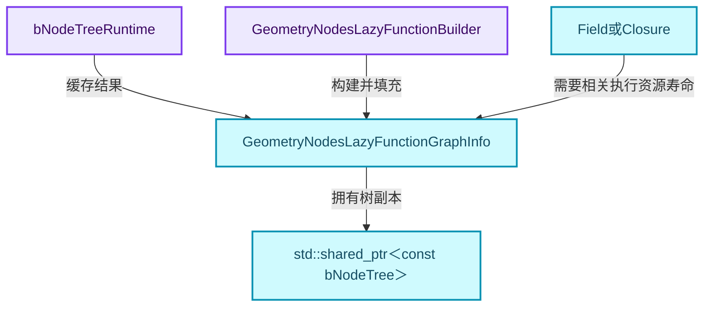
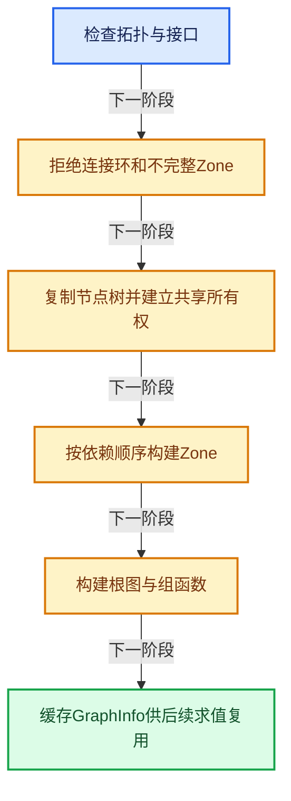
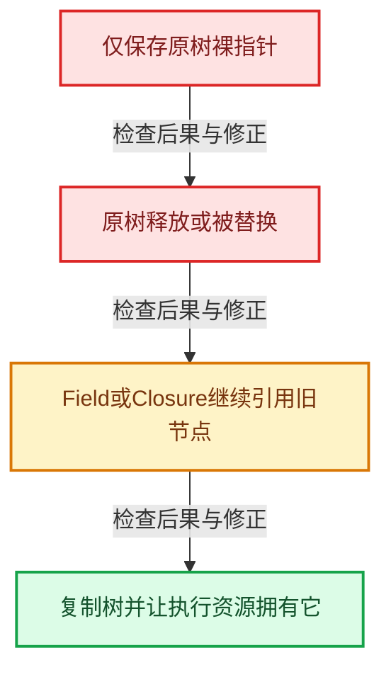

# GN-05 执行图构建缓存与树副本所有权

[几何节点学习地图](../%E5%87%A0%E4%BD%95%E8%8A%82%E7%82%B9%E6%89%A9%E5%B1%95%E5%AD%A6%E4%B9%A0%E5%9C%B0%E5%9B%BE.md) · [方向导航](README.md) · [全局实现索引](../%E7%AC%A6%E5%8F%B7%E4%BE%9D%E8%B5%96%E4%B8%8E%E5%AE%9E%E7%8E%B0%E7%B4%A2%E5%BC%95.md)

基准：`cbda6b96c26c0dee3c3b5cbb93960c4ac06a6b30`；文件哈希及连续摘录区间记录在[新增专题证据](../_evidence/geometry-extension.json)。本篇围绕所选函数解释核心机制，辅助依赖明确列出已定位实现与尚需类型确认的边界，不宣称相关整个文件已全文复核。

## 先回答一个具体问题

节点树更新以后，已经输出的Field或Closure为什么还能需要旧执行图？

## 相关类与数据的职责

- **`bNodeTreeRuntime`**：保存执行图缓存与构建互斥状态。 定义入口：[source/blender/blenkernel/BKE_node_runtime.hh · L127](../../../../../source/blender/blenkernel/BKE_node_runtime.hh)。
- **`GeometryNodesLazyFunctionGraphInfo`**：持有共享树副本、Graph、mapping和ResourceScope。 定义入口：[source/blender/nodes/NOD_geometry_nodes_lazy_function.hh · L427](../../../../../source/blender/nodes/NOD_geometry_nodes_lazy_function.hh)。
- **`GeometryNodesLazyFunctionBuilder`**：把拓扑、Zone、隐式转换等编译到执行图。 定义入口：[source/blender/nodes/intern/geometry_nodes_lazy_function.cc · L1974](../../../../../source/blender/nodes/intern/geometry_nodes_lazy_function.cc)。
- **`std::shared_ptr<const bNodeTree>`**：让运行时产物继续持有对应的树数据。
- **`Field或Closure`**：可能在原编辑树更新后继续存活的值。



上图箭头文字区分拥有、借用、调用和数据依赖。连线不表示这些类型存在同名继承关系；只有源码明确声明的继承才按继承理解。

## 设计推导与扩展知识

### 推导1

ensure_geometry_nodes_lazy_function_graph负责通过运行时互斥机制确保缓存，而_impl执行实际验证和构建。缓存有值不代表当前任意编辑树都可以无条件复用；失效由节点树更新体系配合处理。

### 推导2

_impl会拒绝available link cycle、非几何树、缺失Zone端点和不支持默认值的接口。nullptr是构建失败结果，不能忽略调用边界对有效图的要求。

### 推导3

构建前复制树，GraphInfo保存共享副本。源码明确指出，这用于避免依赖图复制更新或原树释放后输出Field、Closure悬空；“节点还在编辑器里可见”不是充分的寿命证明。

### 推导4

Builder先准备mapping和隐式转换表，再建Zone函数、根图和组接口。若先连接引用一个尚未生成的Zone函数，所有权与接口都可能不完整。

### 推导5

GraphInfo中的ResourceScope、Graph和mapping各有职责：资源寿命、执行拓扑、编辑树与运行图的对应关系。把三者压成一个巨型Graph类会使缓存、诊断和构建责任难以审阅。

## 实际处理阶段



这张图概括本篇所讨论的主路径；等待输入、构建失败与不同策略的分支以下方完整代码为准，不能把概括图当作每次都会执行的无条件顺序。

## 教学注释代码与分段机制

<a id="f-f6e0aacd05eb7a34"></a>

### `blender::nodes::ensure_geometry_nodes_lazy_function_graph_impl` · L4265—L4332

按所有早返回分支、共享树副本和Builder启动三组逻辑读。自定义shared_ptr删除器最终调用Blender的ID释放机制。

实现位置：[source/blender/nodes/intern/geometry_nodes_lazy_function.cc](../../../../../source/blender/nodes/intern/geometry_nodes_lazy_function.cc)。

**教学注释版**

<!-- annotated:a4b3de8df72a51 -->

```cpp
static std::shared_ptr<GeometryNodesLazyFunctionGraphInfo>
ensure_geometry_nodes_lazy_function_graph_impl(const bNodeTree &btree)
{
  btree.ensure_topology_cache();
  btree.ensure_interface_cache();

  // [讲解] 普通可用连接存在环时拒绝构建；Zone循环不是靠任意连接环实现。
  if (btree.has_available_link_cycle()) {
    return nullptr;
  }
  if (btree.type != NTREE_GEOMETRY) {
    /* It's possible to get into this situation when localizing a linked node group that is
     * missing (#133524). */
    return nullptr;
  }
  const bNodeTreeZones *tree_zones = btree.zones();
  if (tree_zones == nullptr) {
    return nullptr;
  }
  for (const bNodeTreeZone *zone : tree_zones->zones) {
    if (zone->input_node() == nullptr || zone->output_node() == nullptr) {
      /* Simulations and repeats need input and output nodes. */
      return nullptr;
    }
  }
  if (const ID *id_orig = DEG_get_original(&btree.id)) {
    if (id_orig->tag & ID_TAG_MISSING) {
      return nullptr;
    }
  }
  for (const bNodeTreeInterfaceSocket *interface_bsocket : btree.interface_inputs()) {
    const bke::bNodeSocketType *typeinfo = interface_bsocket->socket_typeinfo();
    if (!typeinfo || !typeinfo->geometry_nodes_default_value) {
      return nullptr;
    }
  }
  for (const bNodeTreeInterfaceSocket *interface_bsocket : btree.interface_outputs()) {
    const bke::bNodeSocketType *typeinfo = interface_bsocket->socket_typeinfo();
    if (!typeinfo || !typeinfo->geometry_nodes_default_value) {
      return nullptr;
    }
  }

  /* Make a copy of the node tree so that the execution graph can be independent of the original
   * tree. */
  std::shared_ptr<bNodeTree> btree_copy{
      bke::node_tree_copy_tree_ex(btree, nullptr, false),
      [](bNodeTree *btree) { BKE_id_free(nullptr, &btree->id); }};

  auto lf_graph_info = std::make_shared<GeometryNodesLazyFunctionGraphInfo>(
      BKE_id_name(btree_copy->id));
  // [讲解] 执行图保有独立树副本，避免原树释放使运行时产物悬空。
  lf_graph_info->tree = btree_copy;

  if (const bNodeTree *original_tree = DEG_get_original(&btree)) {
    lf_graph_info->original_tree_session_uid = original_tree->id.session_uid;
  }
  else {
    lf_graph_info->original_tree_session_uid = btree.id.session_uid;
  }

  btree_copy->ensure_topology_cache();
  BLI_assert(btree.all_sockets().size() == btree_copy->all_sockets().size());

  btree_copy->runtime->self_geometry_nodes_lazy_function_graph_info = lf_graph_info.get();

  GeometryNodesLazyFunctionBuilder builder{lf_graph_info};
  builder.build();
  return lf_graph_info;
}
```

<details>
<summary>核对原始源码：source/blender/nodes/intern/geometry_nodes_lazy_function.cc · L4265—L4332</summary>

<!-- original:a4b3de8df72a51:source/blender/nodes/intern/geometry_nodes_lazy_function.cc:4265:4332 -->

```cpp
static std::shared_ptr<GeometryNodesLazyFunctionGraphInfo>
ensure_geometry_nodes_lazy_function_graph_impl(const bNodeTree &btree)
{
  btree.ensure_topology_cache();
  btree.ensure_interface_cache();

  if (btree.has_available_link_cycle()) {
    return nullptr;
  }
  if (btree.type != NTREE_GEOMETRY) {
    /* It's possible to get into this situation when localizing a linked node group that is
     * missing (#133524). */
    return nullptr;
  }
  const bNodeTreeZones *tree_zones = btree.zones();
  if (tree_zones == nullptr) {
    return nullptr;
  }
  for (const bNodeTreeZone *zone : tree_zones->zones) {
    if (zone->input_node() == nullptr || zone->output_node() == nullptr) {
      /* Simulations and repeats need input and output nodes. */
      return nullptr;
    }
  }
  if (const ID *id_orig = DEG_get_original(&btree.id)) {
    if (id_orig->tag & ID_TAG_MISSING) {
      return nullptr;
    }
  }
  for (const bNodeTreeInterfaceSocket *interface_bsocket : btree.interface_inputs()) {
    const bke::bNodeSocketType *typeinfo = interface_bsocket->socket_typeinfo();
    if (!typeinfo || !typeinfo->geometry_nodes_default_value) {
      return nullptr;
    }
  }
  for (const bNodeTreeInterfaceSocket *interface_bsocket : btree.interface_outputs()) {
    const bke::bNodeSocketType *typeinfo = interface_bsocket->socket_typeinfo();
    if (!typeinfo || !typeinfo->geometry_nodes_default_value) {
      return nullptr;
    }
  }

  /* Make a copy of the node tree so that the execution graph can be independent of the original
   * tree. */
  std::shared_ptr<bNodeTree> btree_copy{
      bke::node_tree_copy_tree_ex(btree, nullptr, false),
      [](bNodeTree *btree) { BKE_id_free(nullptr, &btree->id); }};

  auto lf_graph_info = std::make_shared<GeometryNodesLazyFunctionGraphInfo>(
      BKE_id_name(btree_copy->id));
  lf_graph_info->tree = btree_copy;

  if (const bNodeTree *original_tree = DEG_get_original(&btree)) {
    lf_graph_info->original_tree_session_uid = original_tree->id.session_uid;
  }
  else {
    lf_graph_info->original_tree_session_uid = btree.id.session_uid;
  }

  btree_copy->ensure_topology_cache();
  BLI_assert(btree.all_sockets().size() == btree_copy->all_sockets().size());

  btree_copy->runtime->self_geometry_nodes_lazy_function_graph_info = lf_graph_info.get();

  GeometryNodesLazyFunctionBuilder builder{lf_graph_info};
  builder.build();
  return lf_graph_info;
}
```

</details>

<details>
<summary>实现依赖入口与尚需类型确认的调用</summary>

- `btree.ensure_topology_cache` → [blender::ensure_topology_cache · L621](../05-%E5%87%A0%E4%BD%95%E5%AD%98%E5%82%A8%E4%B8%8E%E6%8B%93%E6%89%91%E6%98%A0%E5%B0%84/%E4%BE%9D%E8%B5%96-node_runtime-ee7c39.md#f-566e97bdf0367424)。
- `btree.ensure_interface_cache` → [blender::ensure_interface_cache · L670](../05-%E5%87%A0%E4%BD%95%E5%AD%98%E5%82%A8%E4%B8%8E%E6%8B%93%E6%89%91%E6%98%A0%E5%B0%84/%E4%BE%9D%E8%B5%96-BKE_node_runtime-ee561b.md#f-73fea7b58035b1f9)。
- `btree.has_available_link_cycle` → [blender::has_available_link_cycle · L572](../05-%E5%87%A0%E4%BD%95%E5%AD%98%E5%82%A8%E4%B8%8E%E6%8B%93%E6%89%91%E6%98%A0%E5%B0%84/%E4%BE%9D%E8%B5%96-BKE_node_runtime-ee561b.md#f-7bdcb85482e6bf35)。
- `btree.zones` → [blender::zones · L117](../05-%E5%87%A0%E4%BD%95%E5%AD%98%E5%82%A8%E4%B8%8E%E6%8B%93%E6%89%91%E6%98%A0%E5%B0%84/%E4%BE%9D%E8%B5%96-BKE_node_tree_zones-856b67.md#f-892779c41416b689)。
- `zone->input_node`：L4284的类型或分派协议；接收对象类型依赖auto、返回值或模板实例；不按同名猜测目标。
- `zone->output_node`：L4284的类型或分派协议；接收对象类型依赖auto、返回值或模板实例；不按同名猜测目标。
- `DEG_get_original` → [blender::DEG_get_original · L128](../11-Depsgraph%E4%B8%8E%E5%B9%B6%E8%A1%8C%E4%BB%BB%E5%8A%A1%E7%B3%BB%E7%BB%9F/%E4%BE%9D%E8%B5%96-DEG_depsgraph_query-db0d31.md#f-79782eab82a92d86)；[blender::DEG_get_original · L134](../11-Depsgraph%E4%B8%8E%E5%B9%B6%E8%A1%8C%E4%BB%BB%E5%8A%A1%E7%B3%BB%E7%BB%9F/%E4%BE%9D%E8%B5%96-DEG_depsgraph_query-db0d31.md#f-c032f06e9ef8f0cb)。多候选需按实参和重载规则确认。
- `btree.interface_inputs` → [blender::interface_inputs · L675](../05-%E5%87%A0%E4%BD%95%E5%AD%98%E5%82%A8%E4%B8%8E%E6%8B%93%E6%89%91%E6%98%A0%E5%B0%84/%E4%BE%9D%E8%B5%96-BKE_node_runtime-ee561b.md#f-b5decde7a09fbf57)；[blender::interface_inputs · L681](../05-%E5%87%A0%E4%BD%95%E5%AD%98%E5%82%A8%E4%B8%8E%E6%8B%93%E6%89%91%E6%98%A0%E5%B0%84/%E4%BE%9D%E8%B5%96-BKE_node_runtime-ee561b.md#f-f999995c05009884)。多候选需按实参和重载规则确认。
- `interface_bsocket->socket_typeinfo`：L4295的类型或分派协议；接收对象类型依赖auto、返回值或模板实例；不按同名猜测目标。
- `btree.interface_outputs` → [blender::interface_outputs · L687](../05-%E5%87%A0%E4%BD%95%E5%AD%98%E5%82%A8%E4%B8%8E%E6%8B%93%E6%89%91%E6%98%A0%E5%B0%84/%E4%BE%9D%E8%B5%96-BKE_node_runtime-ee561b.md#f-6ce8b655d24a2365)；[blender::interface_outputs · L693](../05-%E5%87%A0%E4%BD%95%E5%AD%98%E5%82%A8%E4%B8%8E%E6%8B%93%E6%89%91%E6%98%A0%E5%B0%84/%E4%BE%9D%E8%B5%96-BKE_node_runtime-ee561b.md#f-64e16fb2a089e741)。多候选需按实参和重载规则确认。
- `bke::node_tree_copy_tree_ex` → [blender::bke::node_tree_copy_tree_ex · L5013](../05-%E5%87%A0%E4%BD%95%E5%AD%98%E5%82%A8%E4%B8%8E%E6%8B%93%E6%89%91%E6%98%A0%E5%B0%84/%E4%BE%9D%E8%B5%96-node-89d753.md#f-0a66decdce5b0b6f)。
- `BKE_id_free` → [blender::BKE_id_free · L224](../05-%E5%87%A0%E4%BD%95%E5%AD%98%E5%82%A8%E4%B8%8E%E6%8B%93%E6%89%91%E6%98%A0%E5%B0%84/%E4%BE%9D%E8%B5%96-lib_id_delete-0cb33f.md#f-28ed02c41d0f2d5b)。
- `std::make_shared<GeometryNodesLazyFunctionGraphInfo>`：构造由共享控制块管理的对象；共享寿命不自动使被指对象读写线程安全，强引用环需单独处理。 [接口资料](https://eel.is/c++draft/util.smartptr.shared.create)。
- `BKE_id_name` → [blender::BKE_id_name · L1001](../05-%E5%87%A0%E4%BD%95%E5%AD%98%E5%82%A8%E4%B8%8E%E6%8B%93%E6%89%91%E6%98%A0%E5%B0%84/%E4%BE%9D%E8%B5%96-BKE_lib_id-3c6ccd.md#f-b9397f1fe1fcc017)；[blender::BKE_id_name · L1005](../05-%E5%87%A0%E4%BD%95%E5%AD%98%E5%82%A8%E4%B8%8E%E6%8B%93%E6%89%91%E6%98%A0%E5%B0%84/%E4%BE%9D%E8%B5%96-BKE_lib_id-3c6ccd.md#f-c026427d13979145)。多候选需按实参和重载规则确认。
- `btree_copy->ensure_topology_cache`：这个边界按实际表达式及所属类型核对参数、返回值、寿命与失败行为。这里提供接口入口，不声称已解释该第三方版本的内部实现。 [接口资料](https://eel.is/c++draft/)。
- `BLI_assert`：宏定义见[source/blender/blenlib/BLI_assert.hh](../../../../../source/blender/blenlib/BLI_assert.hh), L48；按当前编译条件选择。
- `BLI_assert`：宏定义见[source/blender/blenlib/BLI_assert.hh](../../../../../source/blender/blenlib/BLI_assert.hh), L63；按当前编译条件选择。
- `btree.all_sockets().size`：L4325的类型或分派协议；接收对象类型依赖auto、返回值或模板实例；不按同名猜测目标。
- `btree.all_sockets` → [blender::all_sockets · L630](../05-%E5%87%A0%E4%BD%95%E5%AD%98%E5%82%A8%E4%B8%8E%E6%8B%93%E6%89%91%E6%98%A0%E5%B0%84/%E4%BE%9D%E8%B5%96-BKE_node_runtime-ee561b.md#f-ba7946d064c035f9)；[blender::all_sockets · L636](../05-%E5%87%A0%E4%BD%95%E5%AD%98%E5%82%A8%E4%B8%8E%E6%8B%93%E6%89%91%E6%98%A0%E5%B0%84/%E4%BE%9D%E8%B5%96-BKE_node_runtime-ee561b.md#f-e6c5064300cb4f69)。多候选需按实参和重载规则确认。
- `btree_copy->all_sockets().size`：L4325的类型或分派协议；接收对象类型依赖auto、返回值或模板实例；不按同名猜测目标。
- `btree_copy->all_sockets`：这个边界按实际表达式及所属类型核对参数、返回值、寿命与失败行为。这里提供接口入口，不声称已解释该第三方版本的内部实现。 [接口资料](https://eel.is/c++draft/)。
- `lf_graph_info.get`：L4327的类型或分派协议；接收对象类型依赖auto、返回值或模板实例；不按同名猜测目标。
- `builder.build` → [blender::nodes::GeometryNodesLazyFunctionBuilder::build · L2034](%E6%89%A9%E5%B1%9505-%E6%89%A7%E8%A1%8C%E5%9B%BE%E6%9E%84%E5%BB%BA%E7%BC%93%E5%AD%98%E4%B8%8E%E6%A0%91%E5%89%AF%E6%9C%AC%E6%89%80%E6%9C%89%E6%9D%83.md#f-0d63d7278e10c732)。

</details>

<a id="f-0d63d7278e10c732"></a>

### `blender::nodes::GeometryNodesLazyFunctionBuilder::build` · L2034—L2047

这段短函数呈现构建阶段顺序，进一步构建函数从实现依赖入口进入。

实现位置：[source/blender/nodes/intern/geometry_nodes_lazy_function.cc](../../../../../source/blender/nodes/intern/geometry_nodes_lazy_function.cc)。

**教学注释版**

<!-- annotated:cb916800ae8e80 -->

```cpp
  void build()
  {
    // [讲解] 构图依赖有效的节点与连接拓扑缓存。
    btree_.ensure_topology_cache();
    btree_.ensure_interface_cache();

    mapping_ = &lf_graph_info_->mapping;
    conversions_ = &bke::get_implicit_type_conversions();
    tree_zones_ = btree_.zones();

    this->initialize_mapping_arrays();
    // [讲解] 先准备Zone子程序，根图才能引用其接口与函数。
    this->build_zone_functions();
    // [讲解] 把根区域节点、连接、默认值与辅助需求通道接入执行图。
    this->build_root_graph();
    // [讲解] 包装对外组函数及主输入输出、使用信息和引用集合索引。
    this->build_geometry_nodes_group_function();
  }
```

<details>
<summary>核对原始源码：source/blender/nodes/intern/geometry_nodes_lazy_function.cc · L2034—L2047</summary>

<!-- original:cb916800ae8e80:source/blender/nodes/intern/geometry_nodes_lazy_function.cc:2034:2047 -->

```cpp
  void build()
  {
    btree_.ensure_topology_cache();
    btree_.ensure_interface_cache();

    mapping_ = &lf_graph_info_->mapping;
    conversions_ = &bke::get_implicit_type_conversions();
    tree_zones_ = btree_.zones();

    this->initialize_mapping_arrays();
    this->build_zone_functions();
    this->build_root_graph();
    this->build_geometry_nodes_group_function();
  }
```

</details>

<details>
<summary>实现依赖入口与尚需类型确认的调用</summary>

- `btree_.ensure_topology_cache` → [blender::ensure_topology_cache · L621](../05-%E5%87%A0%E4%BD%95%E5%AD%98%E5%82%A8%E4%B8%8E%E6%8B%93%E6%89%91%E6%98%A0%E5%B0%84/%E4%BE%9D%E8%B5%96-node_runtime-ee7c39.md#f-566e97bdf0367424)。
- `btree_.ensure_interface_cache` → [blender::ensure_interface_cache · L670](../05-%E5%87%A0%E4%BD%95%E5%AD%98%E5%82%A8%E4%B8%8E%E6%8B%93%E6%89%91%E6%98%A0%E5%B0%84/%E4%BE%9D%E8%B5%96-BKE_node_runtime-ee561b.md#f-73fea7b58035b1f9)。
- `bke::get_implicit_type_conversions` → [blender::bke::get_implicit_type_conversions · L792](../05-%E5%87%A0%E4%BD%95%E5%AD%98%E5%82%A8%E4%B8%8E%E6%8B%93%E6%89%91%E6%98%A0%E5%B0%84/%E4%BE%9D%E8%B5%96-type_conversions-3b750b.md#f-d51bbc626389d24e)。
- `btree_.zones` → [blender::zones · L117](../05-%E5%87%A0%E4%BD%95%E5%AD%98%E5%82%A8%E4%B8%8E%E6%8B%93%E6%89%91%E6%98%A0%E5%B0%84/%E4%BE%9D%E8%B5%96-BKE_node_tree_zones-856b67.md#f-892779c41416b689)。
- `this->initialize_mapping_arrays` → [blender::nodes::GeometryNodesLazyFunctionBuilder::initialize_mapping_arrays · L2050](10-%E6%99%AE%E9%80%9A%E8%8A%82%E7%82%B9%E4%B8%8E%E5%87%BD%E6%95%B0%E9%80%82%E9%85%8D.md#f-043493ca70267732)。
- `this->build_zone_functions` → [blender::nodes::GeometryNodesLazyFunctionBuilder::build_zone_functions · L2065](10-%E6%99%AE%E9%80%9A%E8%8A%82%E7%82%B9%E4%B8%8E%E5%87%BD%E6%95%B0%E9%80%82%E9%85%8D.md#f-9a96565e315364f1)。
- `this->build_root_graph` → [blender::nodes::GeometryNodesLazyFunctionBuilder::build_root_graph · L2467](10-%E6%99%AE%E9%80%9A%E8%8A%82%E7%82%B9%E4%B8%8E%E5%87%BD%E6%95%B0%E9%80%82%E9%85%8D.md#f-78da6f6861fe18b7)。
- `this->build_geometry_nodes_group_function` → [blender::nodes::GeometryNodesLazyFunctionBuilder::build_geometry_nodes_group_function · L2524](10-%E6%99%AE%E9%80%9A%E8%8A%82%E7%82%B9%E4%B8%8E%E5%87%BD%E6%95%B0%E9%80%82%E9%85%8D.md#f-1a14b2c4cb3bb111)。

</details>

<a id="f-52501f045c159f79"></a>

### `blender::nodes::ensure_geometry_nodes_lazy_function_graph` · L4334—L4342

互斥ensure包围缓存赋值；此处不直接在每次求值重新build。

实现位置：[source/blender/nodes/intern/geometry_nodes_lazy_function.cc](../../../../../source/blender/nodes/intern/geometry_nodes_lazy_function.cc)。

**教学注释版**

<!-- annotated:0ca6b9b3b3f1f8 -->

```cpp
const std::shared_ptr<const GeometryNodesLazyFunctionGraphInfo> &
ensure_geometry_nodes_lazy_function_graph(const bNodeTree &btree)
{
  btree.runtime->geometry_nodes_lazy_function_graph_info_mutex.ensure([&]() {
    btree.runtime->geometry_nodes_lazy_function_graph_info =
        ensure_geometry_nodes_lazy_function_graph_impl(btree);
  });
  return btree.runtime->geometry_nodes_lazy_function_graph_info;
}
```

<details>
<summary>核对原始源码：source/blender/nodes/intern/geometry_nodes_lazy_function.cc · L4334—L4342</summary>

<!-- original:0ca6b9b3b3f1f8:source/blender/nodes/intern/geometry_nodes_lazy_function.cc:4334:4342 -->

```cpp
const std::shared_ptr<const GeometryNodesLazyFunctionGraphInfo> &
ensure_geometry_nodes_lazy_function_graph(const bNodeTree &btree)
{
  btree.runtime->geometry_nodes_lazy_function_graph_info_mutex.ensure([&]() {
    btree.runtime->geometry_nodes_lazy_function_graph_info =
        ensure_geometry_nodes_lazy_function_graph_impl(btree);
  });
  return btree.runtime->geometry_nodes_lazy_function_graph_info;
}
```

</details>

<details>
<summary>实现依赖入口与尚需类型确认的调用</summary>

- `btree.runtime->geometry_nodes_lazy_function_graph_info_mutex.ensure`：L4337的类型或分派协议；接收对象类型依赖auto、返回值或模板实例；不按同名猜测目标。
- `ensure_geometry_nodes_lazy_function_graph_impl` → [blender::nodes::ensure_geometry_nodes_lazy_function_graph_impl · L4265](%E6%89%A9%E5%B1%9505-%E6%89%A7%E8%A1%8C%E5%9B%BE%E6%9E%84%E5%BB%BA%E7%BC%93%E5%AD%98%E4%B8%8E%E6%A0%91%E5%89%AF%E6%9C%AC%E6%89%80%E6%9C%89%E6%9D%83.md#f-f6e0aacd05eb7a34)。

</details>

## 支撑类型的完整声明

### `GeometryNodesLazyFunctionGraphInfo`

对照上方职责阅读成员：哪些成员拥有资源，哪些只是索引、引用或指针。成员声明体现布局；其中函数仍应按实际调用进入相应实现。

<!-- annotated:9a8e384c178002 -->

```cpp
struct GeometryNodesLazyFunctionGraphInfo {
  /**
   * Contains resources that need to be freed when the graph is not needed anymore.
   */
  ResourceScope scope;
  /**
   * Owned copy of the tree to evaluate. This allows the original tree to be freed without making
   * the execution graph invalid. This is very common because many changes to a node tree trigger a
   * new depsgraph-copy but not a new evaluation (since the output has not changed).
   *
   * Without an extra copy, one could not output fields/closures to other objects without having
   * those become dangling on trivial tree changes.
   */
  std::shared_ptr<const bNodeTree> tree;
  /**
   * Session UID of the original tree in Main that this is based on. Used to map evaluated data
   * back to the original tree later on.
   */
  uint32_t original_tree_session_uid;

  GeometryNodesGroupFunction function;
  /**
   * The actual lazy-function graph.
   */
  lf::Graph graph;
  Map<int, const lf::Graph *> debug_zone_body_graphs;
  /**
   * Mappings between the lazy-function graph and the #bNodeTree.
   */
  GeometryNodeLazyFunctionGraphMapping mapping;
  /**
   * Approximate number of nodes in the graph if all sub-graphs were inlined.
   * This can be used as a simple heuristic for the complexity of the node group.
   */
  int num_inline_nodes_approximate = 0;

  GeometryNodesLazyFunctionGraphInfo(const char *debug_name);
};
```

<details>
<summary>核对原始源码：source/blender/nodes/NOD_geometry_nodes_lazy_function.hh · L427—L464</summary>

<!-- original:9a8e384c178002:source/blender/nodes/NOD_geometry_nodes_lazy_function.hh:427:464 -->

```cpp
struct GeometryNodesLazyFunctionGraphInfo {
  /**
   * Contains resources that need to be freed when the graph is not needed anymore.
   */
  ResourceScope scope;
  /**
   * Owned copy of the tree to evaluate. This allows the original tree to be freed without making
   * the execution graph invalid. This is very common because many changes to a node tree trigger a
   * new depsgraph-copy but not a new evaluation (since the output has not changed).
   *
   * Without an extra copy, one could not output fields/closures to other objects without having
   * those become dangling on trivial tree changes.
   */
  std::shared_ptr<const bNodeTree> tree;
  /**
   * Session UID of the original tree in Main that this is based on. Used to map evaluated data
   * back to the original tree later on.
   */
  uint32_t original_tree_session_uid;

  GeometryNodesGroupFunction function;
  /**
   * The actual lazy-function graph.
   */
  lf::Graph graph;
  Map<int, const lf::Graph *> debug_zone_body_graphs;
  /**
   * Mappings between the lazy-function graph and the #bNodeTree.
   */
  GeometryNodeLazyFunctionGraphMapping mapping;
  /**
   * Approximate number of nodes in the graph if all sub-graphs were inlined.
   * This can be used as a simple heuristic for the complexity of the node group.
   */
  int num_inline_nodes_approximate = 0;

  GeometryNodesLazyFunctionGraphInfo(const char *debug_name);
};
```

</details>

## 用小数据走一遍

1. 旧树A生成执行图GA。
2. GA输出Field F。
3. 编辑操作产生树B。
4. F需要的A相关数据由GA的树副本保活。


这是明确输入条件下的教学推演，不是本地性能实测。对源码的验证应同时检查数值、对象寿命、输出需求和数据是否存在。

## 反例与边界

- 仅保存原树裸指针。
- 原树释放或被替换。
- Field或Closure继续引用旧节点。
- 复制树并让执行资源拥有它。



## 历史提交阅读

本地历史阅读样本：**Jacques Lucke**，2026-09-13T00:12:00+02:00。

`954a62b3420b287de83ca92ab80b3ddaf5208aa0`

提交标题：Refactor: Nodes: use separate type for internal links

[所选文件的真实diff](../_evidence/geometry-history/GN-05.patch)。这是本地历史中匹配作者的近期样本，不冒称该系统的最初引入提交。阅读时先找变更前后的不变量，再检查新增分支与测试；本篇当前源码说明不混用历史签名。

## 独立实现与验收

画出原树、树副本、GraphInfo和输出Field的寿命，找出裸指针方案失效时刻。

<details>
<summary>参考思路</summary>

失效发生于原树寿命结束而输出产物仍存活时；共享树副本保护数据寿命，具体产物还必须保有相应执行资源，不能仅复制指针。

</details>

验收时保留一个能击穿错误设计的反例，再对照实际符号重走调用链。教学练习未在完整Blender中运行；本轮独立运行的模型验证另见新增专题验收报告。

## 继续阅读

- [GN-01 几何节点从编辑树到执行结果的全景](%E6%89%A9%E5%B1%9501-%E5%87%A0%E4%BD%95%E8%8A%82%E7%82%B9%E4%BB%8E%E7%BC%96%E8%BE%91%E6%A0%91%E5%88%B0%E6%89%A7%E8%A1%8C%E7%BB%93%E6%9E%9C%E7%9A%84%E5%85%A8%E6%99%AF.md)
- [GN-02 节点注册声明与引用关系契约](%E6%89%A9%E5%B1%9502-%E8%8A%82%E7%82%B9%E6%B3%A8%E5%86%8C%E5%A3%B0%E6%98%8E%E4%B8%8E%E5%BC%95%E7%94%A8%E5%85%B3%E7%B3%BB%E5%A5%91%E7%BA%A6.md)
- [GN-03 GeoNodeExecParams参数适配与移动语义](%E6%89%A9%E5%B1%9503-GeoNodeExecParams%E5%8F%82%E6%95%B0%E9%80%82%E9%85%8D%E4%B8%8E%E7%A7%BB%E5%8A%A8%E8%AF%AD%E4%B9%89.md)
- [GN-04 SocketValueVariant异构值与转换边界](%E6%89%A9%E5%B1%9504-SocketValueVariant%E5%BC%82%E6%9E%84%E5%80%BC%E4%B8%8E%E8%BD%AC%E6%8D%A2%E8%BE%B9%E7%95%8C.md)
- [GN-06 按需执行匿名输出与Switch需求传播](%E6%89%A9%E5%B1%9506-%E6%8C%89%E9%9C%80%E6%89%A7%E8%A1%8C%E5%8C%BF%E5%90%8D%E8%BE%93%E5%87%BA%E4%B8%8ESwitch%E9%9C%80%E6%B1%82%E4%BC%A0%E6%92%AD.md)
- [GN-22 ComputeContext日志映射与副作用根](%E6%89%A9%E5%B1%9507-ComputeContext%E6%97%A5%E5%BF%97%E6%98%A0%E5%B0%84%E4%B8%8E%E5%89%AF%E4%BD%9C%E7%94%A8%E6%A0%B9.md)
- [GN-24 Jacques与Hans提交中的架构演化](%E6%89%A9%E5%B1%9508-Jacques%E4%B8%8EHans%E6%8F%90%E4%BA%A4%E4%B8%AD%E7%9A%84%E6%9E%B6%E6%9E%84%E6%BC%94%E5%8C%96.md)
