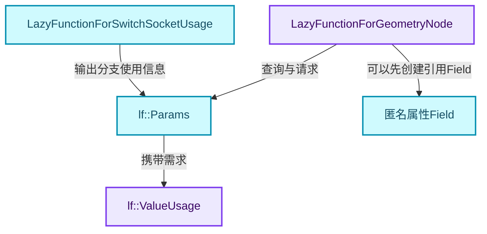
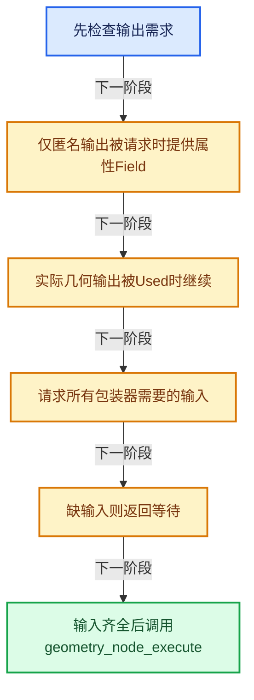
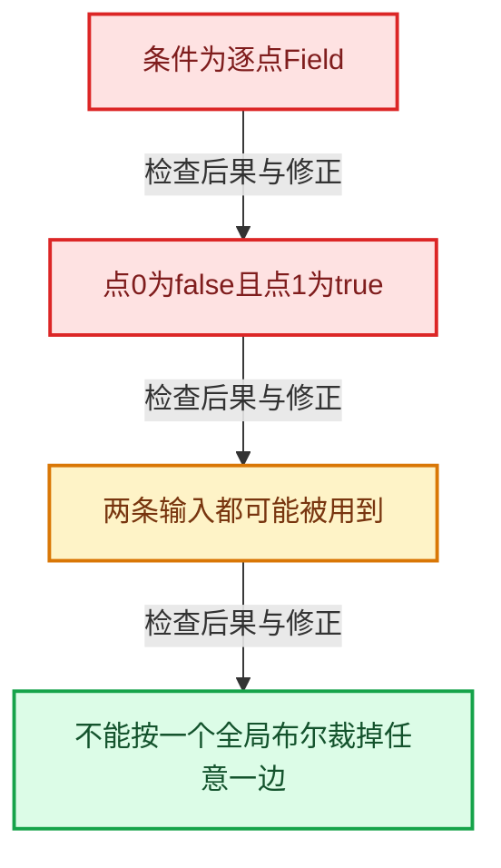

# GN-06 按需执行匿名输出与Switch需求传播

[几何节点学习地图](../%E5%87%A0%E4%BD%95%E8%8A%82%E7%82%B9%E6%89%A9%E5%B1%95%E5%AD%A6%E4%B9%A0%E5%9C%B0%E5%9B%BE.md) · [方向导航](README.md) · [全局实现索引](../%E7%AC%A6%E5%8F%B7%E4%BE%9D%E8%B5%96%E4%B8%8E%E5%AE%9E%E7%8E%B0%E7%B4%A2%E5%BC%95.md)

基准：`cbda6b96c26c0dee3c3b5cbb93960c4ac06a6b30`；文件哈希及连续摘录区间记录在[新增专题证据](../_evidence/geometry-extension.json)。本篇围绕所选函数解释核心机制，辅助依赖明确列出已定位实现与尚需类型确认的边界，不宣称相关整个文件已全文复核。

## 先回答一个具体问题

为什么普通几何节点execute_impl可以返回多次？为什么Field条件的Switch可能需要两边？

## 相关类与数据的职责

- **`LazyFunctionForGeometryNode`**：将普通几何节点回调包装成惰性函数。 定义入口：[source/blender/nodes/intern/geometry_nodes_lazy_function.cc · L125](../../../../../source/blender/nodes/intern/geometry_nodes_lazy_function.cc)。
- **`lf::Params`**：报告输出需求并请求尚缺输入。 定义入口：[source/blender/functions/FN_lazy_function.hh · L109](../../../../../source/blender/functions/FN_lazy_function.hh)。
- **`lf::ValueUsage`**：表达Used、Unused等需求状态。 定义入口：[source/blender/functions/FN_lazy_function.hh · L61](../../../../../source/blender/functions/FN_lazy_function.hh)。
- **`LazyFunctionForSwitchSocketUsage`**：根据条件推断两个输入是否会被用到。 定义入口：[source/blender/nodes/intern/geometry_nodes_lazy_function.cc · L1316](../../../../../source/blender/nodes/intern/geometry_nodes_lazy_function.cc)。
- **`匿名属性Field`**：可先输出属性读取引用，随后才按需生成几何数据。



上图箭头文字区分拥有、借用、调用和数据依赖。连线不表示这些类型存在同名继承关系；只有源码明确声明的继承才按继承理解。

## 设计推导与扩展知识

### 推导1

惰性函数的return不一定表示节点最终完成。输入尚未到达时，try_get_input_data_ptr_or_request会登记请求，包装器返回，让调度器先推进上游；后续可再次调用同一节点。

### 推导2

匿名属性输出可以先构造Field引用，而不用立即计算几何。这将“引用属性的表达式”与“实际承载属性的数据”分离；引用寿命分析负责让真正需要的数据路径保留下来。

### 推导3

used_non_attribute_output_exists只在普通输出被明确Used时变真。它不把所有非Unused状态一概当成确定需求，所以应逐分支对照ValueUsage，而不是只用一个布尔猜测全部调度行为。

### 推导4

Switch条件是上下文相关Field时，不同元素可能分别选择两边，使用信息节点保守地把两边都设为true。单值条件才能确定整条分支不用。

### 推导5

这一使用分析不等于GPU式分支预测，也不是逐元素只读取被选数组的完整证明。节点级需求与Field内部按mask执行是两个粒度的机制。

## 实际处理阶段



这张图概括本篇所讨论的主路径；等待输入、构建失败与不同策略的分支以下方完整代码为准，不能把概括图当作每次都会执行的无条件顺序。

## 教学注释代码与分段机制

<a id="f-0749b0b0f9abb432"></a>

### `blender::nodes::LazyFunctionForGeometryNode::execute_impl` · L187—L249

输出需求、匿名引用、缺输入等待、回调执行四部分必须按顺序理解。

实现位置：[source/blender/nodes/intern/geometry_nodes_lazy_function.cc](../../../../../source/blender/nodes/intern/geometry_nodes_lazy_function.cc)。

**教学注释版**

<!-- annotated:c3a1d2d8b9fd85 -->

```cpp
  void execute_impl(lf::Params &params, const lf::Context &context) const override
  {
    const ScopedNodeTimer node_timer{context, node_};

    GeoNodesUserData *user_data = dynamic_cast<GeoNodesUserData *>(context.user_data);
    BLI_assert(user_data != nullptr);

    bool used_non_attribute_output_exists = false;
    for (const int output_bsocket_index : node_.output_sockets().index_range()) {
      const bNodeSocket &output_bsocket = node_.output_socket(output_bsocket_index);
      const int lf_index =
          own_lf_graph_info_.mapping.lf_index_by_bsocket[output_bsocket.index_in_tree()];
      if (lf_index == -1) {
        continue;
      }
      const lf::ValueUsage output_usage = params.get_output_usage(lf_index);
      if (output_usage == lf::ValueUsage::Unused) {
        continue;
      }
      if (is_attribute_output_bsocket_[output_bsocket_index]) {
        if (params.output_was_set(lf_index)) {
          continue;
        }
        this->output_anonymous_attribute_field(params, *user_data, lf_index, output_bsocket);
      }
      else {
        if (output_usage == lf::ValueUsage::Used) {
          used_non_attribute_output_exists = true;
        }
      }
    }

    // [讲解] 当前只有属性引用输出被需要时，不必立刻计算全部几何输入。
    if (!used_non_attribute_output_exists) {
      /* Only attribute outputs are used currently, no need to evaluate the full node and its
       * inputs. */
      return;
    }

    bool missing_input = false;
    for (const int lf_index : inputs_.index_range()) {
      // [讲解] 取不到输入就登记请求；return后调度器可先计算上游。
      if (params.try_get_input_data_ptr_or_request(lf_index) == nullptr) {
        missing_input = true;
      }
    }
    if (missing_input) {
      /* Wait until all inputs are available. */
      return;
    }

    auto get_anonymous_attribute_name = [&](const int i) {
      return this->anonymous_attribute_name_for_output(*user_data, i);
    };

    GeoNodeExecParams geo_params{
        node_,
        params,
        context,
        own_lf_graph_info_.mapping.lf_input_index_for_output_bsocket_usage,
        own_lf_graph_info_.mapping.lf_input_index_for_reference_set_for_output,
        get_anonymous_attribute_name};

    // [讲解] 通过bNodeType登记的函数指针进入具体节点回调。
    node_.typeinfo->geometry_node_execute(geo_params);
  }
```

<details>
<summary>核对原始源码：source/blender/nodes/intern/geometry_nodes_lazy_function.cc · L187—L249</summary>

<!-- original:c3a1d2d8b9fd85:source/blender/nodes/intern/geometry_nodes_lazy_function.cc:187:249 -->

```cpp
  void execute_impl(lf::Params &params, const lf::Context &context) const override
  {
    const ScopedNodeTimer node_timer{context, node_};

    GeoNodesUserData *user_data = dynamic_cast<GeoNodesUserData *>(context.user_data);
    BLI_assert(user_data != nullptr);

    bool used_non_attribute_output_exists = false;
    for (const int output_bsocket_index : node_.output_sockets().index_range()) {
      const bNodeSocket &output_bsocket = node_.output_socket(output_bsocket_index);
      const int lf_index =
          own_lf_graph_info_.mapping.lf_index_by_bsocket[output_bsocket.index_in_tree()];
      if (lf_index == -1) {
        continue;
      }
      const lf::ValueUsage output_usage = params.get_output_usage(lf_index);
      if (output_usage == lf::ValueUsage::Unused) {
        continue;
      }
      if (is_attribute_output_bsocket_[output_bsocket_index]) {
        if (params.output_was_set(lf_index)) {
          continue;
        }
        this->output_anonymous_attribute_field(params, *user_data, lf_index, output_bsocket);
      }
      else {
        if (output_usage == lf::ValueUsage::Used) {
          used_non_attribute_output_exists = true;
        }
      }
    }

    if (!used_non_attribute_output_exists) {
      /* Only attribute outputs are used currently, no need to evaluate the full node and its
       * inputs. */
      return;
    }

    bool missing_input = false;
    for (const int lf_index : inputs_.index_range()) {
      if (params.try_get_input_data_ptr_or_request(lf_index) == nullptr) {
        missing_input = true;
      }
    }
    if (missing_input) {
      /* Wait until all inputs are available. */
      return;
    }

    auto get_anonymous_attribute_name = [&](const int i) {
      return this->anonymous_attribute_name_for_output(*user_data, i);
    };

    GeoNodeExecParams geo_params{
        node_,
        params,
        context,
        own_lf_graph_info_.mapping.lf_input_index_for_output_bsocket_usage,
        own_lf_graph_info_.mapping.lf_input_index_for_reference_set_for_output,
        get_anonymous_attribute_name};

    node_.typeinfo->geometry_node_execute(geo_params);
  }
```

</details>

<details>
<summary>实现依赖入口与尚需类型确认的调用</summary>

- `BLI_assert`：宏定义见[source/blender/blenlib/BLI_assert.hh](../../../../../source/blender/blenlib/BLI_assert.hh), L48；按当前编译条件选择。
- `BLI_assert`：宏定义见[source/blender/blenlib/BLI_assert.hh](../../../../../source/blender/blenlib/BLI_assert.hh), L63；按当前编译条件选择。
- `node_.output_sockets().index_range`：L195的类型或分派协议；接收对象类型依赖auto、返回值或模板实例；不按同名猜测目标。
- `node_.output_sockets` → [blender::output_sockets · L760](../05-%E5%87%A0%E4%BD%95%E5%AD%98%E5%82%A8%E4%B8%8E%E6%8B%93%E6%89%91%E6%98%A0%E5%B0%84/%E4%BE%9D%E8%B5%96-BKE_node_runtime-ee561b.md#f-40ec6d6aed2ab6fb)；[blender::output_sockets · L772](../05-%E5%87%A0%E4%BD%95%E5%AD%98%E5%82%A8%E4%B8%8E%E6%8B%93%E6%89%91%E6%98%A0%E5%B0%84/%E4%BE%9D%E8%B5%96-BKE_node_runtime-ee561b.md#f-ddbd8f42409bdcd1)。多候选需按实参和重载规则确认。
- `node_.output_socket` → [blender::output_socket · L824](../05-%E5%87%A0%E4%BD%95%E5%AD%98%E5%82%A8%E4%B8%8E%E6%8B%93%E6%89%91%E6%98%A0%E5%B0%84/%E4%BE%9D%E8%B5%96-BKE_node_runtime-ee561b.md#f-9e46f3a437215eb5)；[blender::output_socket · L836](../05-%E5%87%A0%E4%BD%95%E5%AD%98%E5%82%A8%E4%B8%8E%E6%8B%93%E6%89%91%E6%98%A0%E5%B0%84/%E4%BE%9D%E8%B5%96-BKE_node_runtime-ee561b.md#f-39021ff32ee7c409)。多候选需按实参和重载规则确认。
- `output_bsocket.index_in_tree` → [blender::index_in_tree · L1002](../05-%E5%87%A0%E4%BD%95%E5%AD%98%E5%82%A8%E4%B8%8E%E6%8B%93%E6%89%91%E6%98%A0%E5%B0%84/%E4%BE%9D%E8%B5%96-BKE_node_runtime-ee561b.md#f-84ec49d8e3ae0cdb)。
- `params.get_output_usage` → [blender::fn::lazy_function::get_output_usage · L399](02-LazyFunction%E6%8E%A5%E5%8F%A3.md#f-bd2d3063532e6360)。
- `params.output_was_set` → [blender::fn::lazy_function::output_was_set · L393](02-LazyFunction%E6%8E%A5%E5%8F%A3.md#f-aecdc506c9bbff3b)。
- `this->output_anonymous_attribute_field` → [blender::nodes::LazyFunctionForGeometryNode::output_anonymous_attribute_field · L279](09-%E5%87%A0%E4%BD%95%E8%8A%82%E7%82%B9%E5%9B%BE%E6%9E%84%E5%BB%BA%E5%99%A8.md#f-3e07bf3e457a3d7d)。
- `inputs_.index_range`：L226的类型或分派协议；接收对象类型依赖auto、返回值或模板实例；不按同名猜测目标。
- `params.try_get_input_data_ptr_or_request` → [blender::fn::lazy_function::try_get_input_data_ptr_or_request · L372](02-LazyFunction%E6%8E%A5%E5%8F%A3.md#f-89de2295f5baa94f)；[blender::fn::lazy_function::try_get_input_data_ptr_or_request · L434](02-LazyFunction%E6%8E%A5%E5%8F%A3.md#f-97ba143c63061e47)。多候选需按实参和重载规则确认。
- `this->anonymous_attribute_name_for_output` → [blender::nodes::LazyFunctionForGeometryNode::anonymous_attribute_name_for_output · L297](09-%E5%87%A0%E4%BD%95%E8%8A%82%E7%82%B9%E5%9B%BE%E6%9E%84%E5%BB%BA%E5%99%A8.md#f-c263eec240aee887)。
- `node_.typeinfo->geometry_node_execute`：L248的类型或分派协议；接收对象类型依赖auto、返回值或模板实例；不按同名猜测目标。

</details>

<a id="f-56eeafa46687d7bb"></a>

### `blender::nodes::LazyFunctionForSwitchSocketUsage::execute_impl` · L1326—L1338

is_context_dependent_field决定保守需求还是单值二选一；输出两个bool属于需求元数据。

实现位置：[source/blender/nodes/intern/geometry_nodes_lazy_function.cc](../../../../../source/blender/nodes/intern/geometry_nodes_lazy_function.cc)。

**教学注释版**

<!-- annotated:9147ee47e426a3 -->

```cpp
  void execute_impl(lf::Params &params, const lf::Context & /*context*/) const override
  {
    const SocketValueVariant &condition_variant = params.get_input<SocketValueVariant>(0);
    // [讲解] 逐元素条件可能在不同元素上选两边，所以两条输入都可能需要。
    if (condition_variant.is_context_dependent_field()) {
      params.set_output(0, true);
      params.set_output(1, true);
    }
    else {
      // [讲解] 只有非上下文相关条件才可以作为单个bool决定整个分支需求。
      const bool value = condition_variant.copy_as<bool>();
      params.set_output(0, !value);
      params.set_output(1, value);
    }
  }
```

<details>
<summary>核对原始源码：source/blender/nodes/intern/geometry_nodes_lazy_function.cc · L1326—L1338</summary>

<!-- original:9147ee47e426a3:source/blender/nodes/intern/geometry_nodes_lazy_function.cc:1326:1338 -->

```cpp
  void execute_impl(lf::Params &params, const lf::Context & /*context*/) const override
  {
    const SocketValueVariant &condition_variant = params.get_input<SocketValueVariant>(0);
    if (condition_variant.is_context_dependent_field()) {
      params.set_output(0, true);
      params.set_output(1, true);
    }
    else {
      const bool value = condition_variant.copy_as<bool>();
      params.set_output(0, !value);
      params.set_output(1, value);
    }
  }
```

</details>

<details>
<summary>实现依赖入口与尚需类型确认的调用</summary>

- `params.get_input<SocketValueVariant>` → [blender::fn::lazy_function::get_input · L421](02-LazyFunction%E6%8E%A5%E5%8F%A3.md#f-167a9263f8e9f932)。
- `condition_variant.is_context_dependent_field` → [is_context_dependent_field · L534](../05-%E5%87%A0%E4%BD%95%E5%AD%98%E5%82%A8%E4%B8%8E%E6%8B%93%E6%89%91%E6%98%A0%E5%B0%84/%E4%BE%9D%E8%B5%96-node_socket_value-841c72.md#f-55e5e1818d077c80)。
- `params.set_output` → [blender::fn::lazy_function::set_output · L440](02-LazyFunction%E6%8E%A5%E5%8F%A3.md#f-993589d688de575d)。
- `condition_variant.copy_as<bool>` → [blender::bke::copy_as · L287](../05-%E5%87%A0%E4%BD%95%E5%AD%98%E5%82%A8%E4%B8%8E%E6%8B%93%E6%89%91%E6%98%A0%E5%B0%84/%E4%BE%9D%E8%B5%96-BKE_node_socket_value-24f0e5.md#f-81cc327789815ca1)。

</details>

## 用小数据走一遍

1. 条件为单值true。
2. False输入使用信息=false。
3. True输入使用信息=true。
4. 昂贵False分支可以不被请求。


这是明确输入条件下的教学推演，不是本地性能实测。对源码的验证应同时检查数值、对象寿命、输出需求和数据是否存在。

## 反例与边界

- 条件为逐点Field。
- 点0为false且点1为true。
- 两条输入都可能被用到。
- 不能按一个全局布尔裁掉任意一边。



## 历史提交阅读

本地历史阅读样本：**Jacques Lucke**，2026-09-13T00:12:00+02:00。

`954a62b3420b287de83ca92ab80b3ddaf5208aa0`

提交标题：Refactor: Nodes: use separate type for internal links

[所选文件的真实diff](../_evidence/geometry-history/GN-06.patch)。这是本地历史中匹配作者的近期样本，不冒称该系统的最初引入提交。阅读时先找变更前后的不变量，再检查新增分支与测试；本篇当前源码说明不混用历史签名。

## 独立实现与验收

为输入缺失、仅匿名输出需求、单值Switch和Field Switch各设计一个调度测试。

<details>
<summary>参考思路</summary>

分别检查是否登记请求、是否提前生成引用、是否仅需一边、是否保守需要两边；不要只比较最后数值。

</details>

验收时保留一个能击穿错误设计的反例，再对照实际符号重走调用链。教学练习未在完整Blender中运行；本轮独立运行的模型验证另见新增专题验收报告。

## 继续阅读

- [GN-01 几何节点从编辑树到执行结果的全景](%E6%89%A9%E5%B1%9501-%E5%87%A0%E4%BD%95%E8%8A%82%E7%82%B9%E4%BB%8E%E7%BC%96%E8%BE%91%E6%A0%91%E5%88%B0%E6%89%A7%E8%A1%8C%E7%BB%93%E6%9E%9C%E7%9A%84%E5%85%A8%E6%99%AF.md)
- [GN-02 节点注册声明与引用关系契约](%E6%89%A9%E5%B1%9502-%E8%8A%82%E7%82%B9%E6%B3%A8%E5%86%8C%E5%A3%B0%E6%98%8E%E4%B8%8E%E5%BC%95%E7%94%A8%E5%85%B3%E7%B3%BB%E5%A5%91%E7%BA%A6.md)
- [GN-03 GeoNodeExecParams参数适配与移动语义](%E6%89%A9%E5%B1%9503-GeoNodeExecParams%E5%8F%82%E6%95%B0%E9%80%82%E9%85%8D%E4%B8%8E%E7%A7%BB%E5%8A%A8%E8%AF%AD%E4%B9%89.md)
- [GN-04 SocketValueVariant异构值与转换边界](%E6%89%A9%E5%B1%9504-SocketValueVariant%E5%BC%82%E6%9E%84%E5%80%BC%E4%B8%8E%E8%BD%AC%E6%8D%A2%E8%BE%B9%E7%95%8C.md)
- [GN-05 执行图构建缓存与树副本所有权](%E6%89%A9%E5%B1%9505-%E6%89%A7%E8%A1%8C%E5%9B%BE%E6%9E%84%E5%BB%BA%E7%BC%93%E5%AD%98%E4%B8%8E%E6%A0%91%E5%89%AF%E6%9C%AC%E6%89%80%E6%9C%89%E6%9D%83.md)
- [GN-07 数学节点从MultiFunction到FieldOperation](../07-MultiFunction%E4%B8%8E%E6%89%B9%E9%87%8F%E6%89%A7%E8%A1%8C/%E6%89%A9%E5%B1%9501-%E6%95%B0%E5%AD%A6%E8%8A%82%E7%82%B9%E4%BB%8EMultiFunction%E5%88%B0FieldOperation.md)
- [GN-22 ComputeContext日志映射与副作用根](%E6%89%A9%E5%B1%9507-ComputeContext%E6%97%A5%E5%BF%97%E6%98%A0%E5%B0%84%E4%B8%8E%E5%89%AF%E4%BD%9C%E7%94%A8%E6%A0%B9.md)
- [GN-24 Jacques与Hans提交中的架构演化](%E6%89%A9%E5%B1%9508-Jacques%E4%B8%8EHans%E6%8F%90%E4%BA%A4%E4%B8%AD%E7%9A%84%E6%9E%B6%E6%9E%84%E6%BC%94%E5%8C%96.md)
