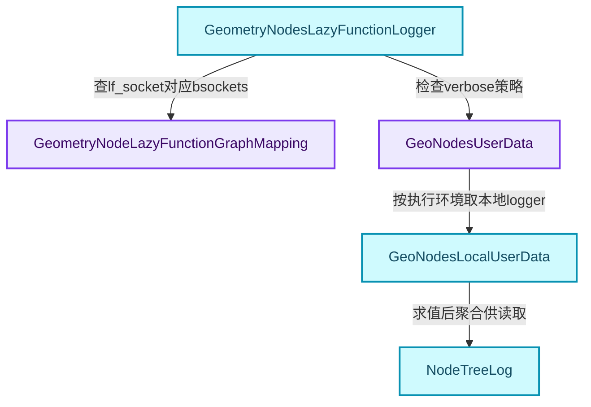
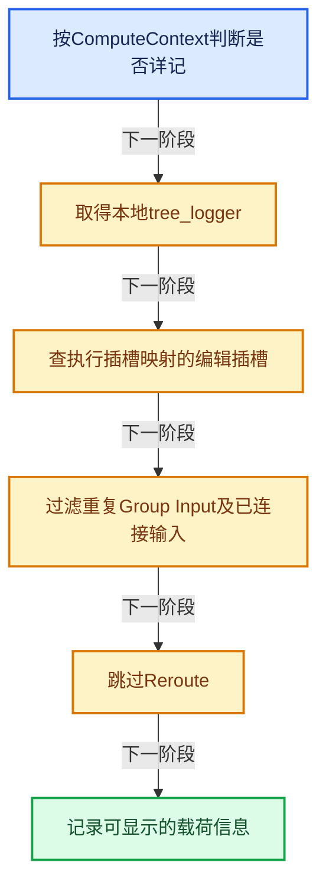
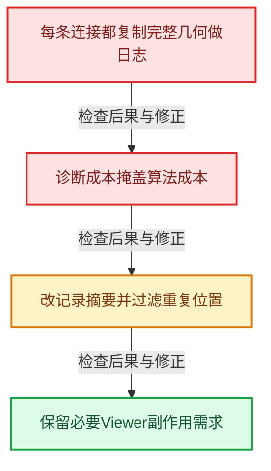

# GN-22 ComputeContext日志映射与副作用根

[几何节点学习地图](../%E5%87%A0%E4%BD%95%E8%8A%82%E7%82%B9%E6%89%A9%E5%B1%95%E5%AD%A6%E4%B9%A0%E5%9C%B0%E5%9B%BE.md) · [方向导航](README.md) · [全局实现索引](../%E7%AC%A6%E5%8F%B7%E4%BE%9D%E8%B5%96%E4%B8%8E%E5%AE%9E%E7%8E%B0%E7%B4%A2%E5%BC%95.md)

基准：`cbda6b96c26c0dee3c3b5cbb93960c4ac06a6b30`；文件哈希及连续摘录区间记录在[新增专题证据](../_evidence/geometry-extension.json)。本篇围绕所选函数解释核心机制，辅助依赖明确列出已定位实现与尚需类型确认的边界，不宣称相关整个文件已全文复核。

## 先回答一个具体问题

执行图经过转换后，界面怎么知道某个值来自哪个插槽、哪次循环、哪个组调用？

## 相关类与数据的职责

- **`GeometryNodeLazyFunctionGraphMapping`**：运行插槽与编辑插槽的映射。 定义入口：[source/blender/nodes/NOD_geometry_nodes_lazy_function.hh · L351](../../../../../source/blender/nodes/NOD_geometry_nodes_lazy_function.hh)。
- **`GeometryNodesLazyFunctionLogger`**：GraphExecutor日志回调适配。 定义入口：[source/blender/nodes/intern/geometry_nodes_lazy_function.cc · L1804](../../../../../source/blender/nodes/intern/geometry_nodes_lazy_function.cc)。
- **`GeoNodesUserData`**：保存ComputeContext与日志策略。 定义入口：[source/blender/nodes/NOD_geometry_nodes_lazy_function.hh · L271](../../../../../source/blender/nodes/NOD_geometry_nodes_lazy_function.hh)。
- **`GeoNodesLocalUserData`**：获取线程局部NodeTreeLogger。 定义入口：[source/blender/nodes/NOD_geometry_nodes_lazy_function.hh · L298](../../../../../source/blender/nodes/NOD_geometry_nodes_lazy_function.hh)。
- **`NodeTreeLog`**：为界面聚合执行期间日志。



上图箭头文字区分拥有、借用、调用和数据依赖。连线不表示这些类型存在同名继承关系；只有源码明确声明的继承才按继承理解。

## 设计推导与扩展知识

### 推导1

编译后的lf::Socket与界面bNodeSocket是多对多或一对多关系，不能用相同数组下标硬配。mapping保存连接关系，logger据此把执行值定位到编辑器插槽。

### 推导2

verbose_log未启用、无logger或无对应bsocket时直接返回。日志不是每次必须产生的语义输出，否则诊断开销会强迫所有值都物化。

### 推导3

Group Input只记录一次，已连接输入与Reroute也跳过部分记录，避免同一个值沿连接被重复存入日志。减少重复日志不等于丢掉计算结果。

### 推导4

ComputeContext区分组调用、Repeat迭代和Closure求值位置。只用node.identifier会把同一节点组不同调用位置的记录混在一起。

### 推导5

线程局部日志降低频繁记录时的竞争，但需要后续聚合。共享UserData与LocalUserData的拆分提示我们按“调用环境”和“线程或任务局部记录”区分状态责任。

### 推导6

Viewer等观察用途可能通过SideEffectProvider成为执行根。界面想观察中间结果时，调度器需要明确这条需求，而不是偷偷强制所有节点执行。

## 实际处理阶段



这张图概括本篇所讨论的主路径；等待输入、构建失败与不同策略的分支以下方完整代码为准，不能把概括图当作每次都会执行的无条件顺序。

## 教学注释代码与分段机制

<a id="f-5d8bdac4663cc45c"></a>

### `blender::nodes::GeometryNodesLazyFunctionLogger::log_socket_value` · L1820—L1856

所有早返回与去重条件都服务日志策略；最后调用tree_logger->log_value记录。

实现位置：[source/blender/nodes/intern/geometry_nodes_lazy_function.cc](../../../../../source/blender/nodes/intern/geometry_nodes_lazy_function.cc)。

**教学注释版**

<!-- annotated:e037ac84237eeb -->

```cpp
  void log_socket_value(const lf::Socket &lf_socket,
                        const GPointer value,
                        const lf::Context &context) const override
  {
    auto &user_data = *static_cast<GeoNodesUserData *>(context.user_data);
    // [讲解] 未启用详细日志时立即返回，避免诊断强迫全部载荷被记录。
    if (!user_data.verbose_log) {
      return;
    }
    auto &local_user_data = *static_cast<GeoNodesLocalUserData *>(context.local_user_data);
    eval_log::NodeTreeLogger *tree_logger = local_user_data.try_get_tree_logger(user_data);
    if (tree_logger == nullptr) {
      return;
    }

    Span<const bNodeSocket *> bsockets = lf_graph_info_.mapping.bsockets_by_lf_socket_map.lookup(
        &lf_socket);
    if (bsockets.is_empty()) {
      return;
    }
    if (bsockets[0]->owner_node().is_group_input()) {
      /* Only log a group input once instead of for every group input node separately. */
      // [讲解] Group Input的相同输入值只记录一次，减少重复。
      bsockets = bsockets.take_front(1);
    }

    for (const bNodeSocket *bsocket : bsockets) {
      /* Avoid logging to some sockets when the same value will also be logged to a linked socket.
       * This reduces the number of logged values without losing information. */
      // [讲解] 已连接输入的值还会在连接来源处记录，跳过重复日志。
      if (bsocket->is_input() && bsocket->is_directly_linked()) {
        continue;
      }
      const bNode &bnode = bsocket->owner_node();
      if (bnode.is_reroute()) {
        continue;
      }
      tree_logger->log_value(bsocket->owner_node(), *bsocket, value);
    }
  }
```

<details>
<summary>核对原始源码：source/blender/nodes/intern/geometry_nodes_lazy_function.cc · L1820—L1856</summary>

<!-- original:e037ac84237eeb:source/blender/nodes/intern/geometry_nodes_lazy_function.cc:1820:1856 -->

```cpp
  void log_socket_value(const lf::Socket &lf_socket,
                        const GPointer value,
                        const lf::Context &context) const override
  {
    auto &user_data = *static_cast<GeoNodesUserData *>(context.user_data);
    if (!user_data.verbose_log) {
      return;
    }
    auto &local_user_data = *static_cast<GeoNodesLocalUserData *>(context.local_user_data);
    eval_log::NodeTreeLogger *tree_logger = local_user_data.try_get_tree_logger(user_data);
    if (tree_logger == nullptr) {
      return;
    }

    Span<const bNodeSocket *> bsockets = lf_graph_info_.mapping.bsockets_by_lf_socket_map.lookup(
        &lf_socket);
    if (bsockets.is_empty()) {
      return;
    }
    if (bsockets[0]->owner_node().is_group_input()) {
      /* Only log a group input once instead of for every group input node separately. */
      bsockets = bsockets.take_front(1);
    }

    for (const bNodeSocket *bsocket : bsockets) {
      /* Avoid logging to some sockets when the same value will also be logged to a linked socket.
       * This reduces the number of logged values without losing information. */
      if (bsocket->is_input() && bsocket->is_directly_linked()) {
        continue;
      }
      const bNode &bnode = bsocket->owner_node();
      if (bnode.is_reroute()) {
        continue;
      }
      tree_logger->log_value(bsocket->owner_node(), *bsocket, value);
    }
  }
```

</details>

<details>
<summary>实现依赖入口与尚需类型确认的调用</summary>

- `local_user_data.try_get_tree_logger`：L1829的类型或分派协议；接收对象类型依赖auto、返回值或模板实例；不按同名猜测目标。
- `lf_graph_info_.mapping.bsockets_by_lf_socket_map.lookup`：L1834的类型或分派协议；接收对象类型依赖auto、返回值或模板实例；不按同名猜测目标。
- `bsockets.is_empty` → [blender::Span::is_empty · L264](../01-%E5%9F%BA%E7%A1%80%E5%AE%B9%E5%99%A8%E4%B8%8E%E7%8E%B0%E4%BB%A3CPP/05-Span%E5%8F%AA%E8%AF%BB%E8%BF%9E%E7%BB%AD%E8%A7%86%E5%9B%BE.md#f-8cc1d7ba8feb50e6)。
- `bsockets[0]->owner_node().is_group_input`：L1839的类型或分派协议；接收对象类型依赖auto、返回值或模板实例；不按同名猜测目标。
- `bsockets[0]->owner_node`：L1839的类型或分派协议；接收对象类型依赖auto、返回值或模板实例；不按同名猜测目标。
- `bsockets.take_front` → [blender::Span::take_front · L197](../01-%E5%9F%BA%E7%A1%80%E5%AE%B9%E5%99%A8%E4%B8%8E%E7%8E%B0%E4%BB%A3CPP/05-Span%E5%8F%AA%E8%AF%BB%E8%BF%9E%E7%BB%AD%E8%A7%86%E5%9B%BE.md#f-1556b8b4aac9d42f)。
- `bsocket->is_input`：L1847的类型或分派协议；接收对象类型依赖auto、返回值或模板实例；不按同名猜测目标。
- `bsocket->is_directly_linked`：L1847的类型或分派协议；接收对象类型依赖auto、返回值或模板实例；不按同名猜测目标。
- `bsocket->owner_node`：L1850的类型或分派协议；接收对象类型依赖auto、返回值或模板实例；不按同名猜测目标。
- `bnode.is_reroute` → [blender::is_reroute · L896](../05-%E5%87%A0%E4%BD%95%E5%AD%98%E5%82%A8%E4%B8%8E%E6%8B%93%E6%89%91%E6%98%A0%E5%B0%84/%E4%BE%9D%E8%B5%96-BKE_node_runtime-ee561b.md#f-d97a49597e48e8ea)。
- `tree_logger->log_value` → [blender::nodes::eval_log::log_value · L319](%E4%BE%9D%E8%B5%96-eval_log-ff9cdf.md#f-90b0f9fcc1258675)。

</details>

<a id="f-b67997d4333450ad"></a>

### `blender::nodes::GeometryNodesLazyFunctionSideEffectProvider::get_nodes_with_side_effects` · L1952—L1966

查看副作用根怎样从本次CallData中取得，而不是把全部节点设为Used。

实现位置：[source/blender/nodes/intern/geometry_nodes_lazy_function.cc](../../../../../source/blender/nodes/intern/geometry_nodes_lazy_function.cc)。

**教学注释版**

<!-- annotated:dc804590cdbf27 -->

```cpp
  Vector<const lf::FunctionNode *> get_nodes_with_side_effects(
      const lf::Context &context) const override
  {
    GeoNodesUserData *user_data = dynamic_cast<GeoNodesUserData *>(context.user_data);
    BLI_assert(user_data != nullptr);
    const GeoNodesCallData &call_data = *user_data->call_data;
    if (!call_data.side_effect_nodes) {
      return {};
    }
    const ComputeContextHash &context_hash = user_data->compute_context->hash();
    Vector<const lf::FunctionNode *> side_effect_nodes =
        call_data.side_effect_nodes->nodes_by_context.lookup(context_hash);
    side_effect_nodes.extend(local_side_effect_nodes_);
    return side_effect_nodes;
  }
```

<details>
<summary>核对原始源码：source/blender/nodes/intern/geometry_nodes_lazy_function.cc · L1952—L1966</summary>

<!-- original:dc804590cdbf27:source/blender/nodes/intern/geometry_nodes_lazy_function.cc:1952:1966 -->

```cpp
  Vector<const lf::FunctionNode *> get_nodes_with_side_effects(
      const lf::Context &context) const override
  {
    GeoNodesUserData *user_data = dynamic_cast<GeoNodesUserData *>(context.user_data);
    BLI_assert(user_data != nullptr);
    const GeoNodesCallData &call_data = *user_data->call_data;
    if (!call_data.side_effect_nodes) {
      return {};
    }
    const ComputeContextHash &context_hash = user_data->compute_context->hash();
    Vector<const lf::FunctionNode *> side_effect_nodes =
        call_data.side_effect_nodes->nodes_by_context.lookup(context_hash);
    side_effect_nodes.extend(local_side_effect_nodes_);
    return side_effect_nodes;
  }
```

</details>

<details>
<summary>实现依赖入口与尚需类型确认的调用</summary>

- `BLI_assert`：宏定义见[source/blender/blenlib/BLI_assert.hh](../../../../../source/blender/blenlib/BLI_assert.hh), L48；按当前编译条件选择。
- `BLI_assert`：宏定义见[source/blender/blenlib/BLI_assert.hh](../../../../../source/blender/blenlib/BLI_assert.hh), L63；按当前编译条件选择。
- `user_data->compute_context->hash`：L1961的类型或分派协议；接收对象类型依赖auto、返回值或模板实例；不按同名猜测目标。
- `call_data.side_effect_nodes->nodes_by_context.lookup`：L1963的类型或分派协议；接收对象类型依赖auto、返回值或模板实例；不按同名猜测目标。
- `side_effect_nodes.extend` → [blender::Vector::extend · L595](../01-%E5%9F%BA%E7%A1%80%E5%AE%B9%E5%99%A8%E4%B8%8E%E7%8E%B0%E4%BB%A3CPP/11-Vector%E6%8F%92%E5%85%A5%E5%88%A0%E9%99%A4%E4%B8%8E%E9%87%8D%E6%8E%92.md#f-fe6fcb7d09beded9)；[blender::Vector::extend · L599](../01-%E5%9F%BA%E7%A1%80%E5%AE%B9%E5%99%A8%E4%B8%8E%E7%8E%B0%E4%BB%A3CPP/11-Vector%E6%8F%92%E5%85%A5%E5%88%A0%E9%99%A4%E4%B8%8E%E9%87%8D%E6%8E%92.md#f-40095c219019e2f9)；[blender::Vector::extend · L613](../01-%E5%9F%BA%E7%A1%80%E5%AE%B9%E5%99%A8%E4%B8%8E%E7%8E%B0%E4%BB%A3CPP/11-Vector%E6%8F%92%E5%85%A5%E5%88%A0%E9%99%A4%E4%B8%8E%E9%87%8D%E6%8E%92.md#f-4d2e556cd7412fe4)；[blender::Vector::extend · L650](../01-%E5%9F%BA%E7%A1%80%E5%AE%B9%E5%99%A8%E4%B8%8E%E7%8E%B0%E4%BB%A3CPP/11-Vector%E6%8F%92%E5%85%A5%E5%88%A0%E9%99%A4%E4%B8%8E%E9%87%8D%E6%8E%92.md#f-ae44ad8b3f05b082)。多候选需按实参和重载规则确认。

</details>

## 用小数据走一遍

1. 一个组在A和B两处调用。
2. 相同内部node.identifier。
3. ComputeContextHash不同。
4. 界面按调用上下文选择相应日志。


这是明确输入条件下的教学推演，不是本地性能实测。对源码的验证应同时检查数值、对象寿命、输出需求和数据是否存在。

## 反例与边界

- 每条连接都复制完整几何做日志。
- 诊断成本掩盖算法成本。
- 改记录摘要并过滤重复位置。
- 保留必要Viewer副作用需求。



## 历史提交阅读

本地历史阅读样本：**Jacques Lucke**，2026-09-13T00:12:00+02:00。

`954a62b3420b287de83ca92ab80b3ddaf5208aa0`

提交标题：Refactor: Nodes: use separate type for internal links

[所选文件的真实diff](../_evidence/geometry-history/GN-22.patch)。这是本地历史中匹配作者的近期样本，不冒称该系统的最初引入提交。阅读时先找变更前后的不变量，再检查新增分支与测试；本篇当前源码说明不混用历史签名。

## 独立实现与验收

为同一组的两次调用与Repeat的两轮调用设计日志键。

<details>
<summary>参考思路</summary>

键要包含计算上下文身份与节点或插槽身份；测试不同路径不会覆盖，同一路径的重复别名又可去重。

</details>

验收时保留一个能击穿错误设计的反例，再对照实际符号重走调用链。教学练习未在完整Blender中运行；本轮独立运行的模型验证另见新增专题验收报告。

## 继续阅读

- [GN-01 几何节点从编辑树到执行结果的全景](%E6%89%A9%E5%B1%9501-%E5%87%A0%E4%BD%95%E8%8A%82%E7%82%B9%E4%BB%8E%E7%BC%96%E8%BE%91%E6%A0%91%E5%88%B0%E6%89%A7%E8%A1%8C%E7%BB%93%E6%9E%9C%E7%9A%84%E5%85%A8%E6%99%AF.md)
- [GN-02 节点注册声明与引用关系契约](%E6%89%A9%E5%B1%9502-%E8%8A%82%E7%82%B9%E6%B3%A8%E5%86%8C%E5%A3%B0%E6%98%8E%E4%B8%8E%E5%BC%95%E7%94%A8%E5%85%B3%E7%B3%BB%E5%A5%91%E7%BA%A6.md)
- [GN-03 GeoNodeExecParams参数适配与移动语义](%E6%89%A9%E5%B1%9503-GeoNodeExecParams%E5%8F%82%E6%95%B0%E9%80%82%E9%85%8D%E4%B8%8E%E7%A7%BB%E5%8A%A8%E8%AF%AD%E4%B9%89.md)
- [GN-04 SocketValueVariant异构值与转换边界](%E6%89%A9%E5%B1%9504-SocketValueVariant%E5%BC%82%E6%9E%84%E5%80%BC%E4%B8%8E%E8%BD%AC%E6%8D%A2%E8%BE%B9%E7%95%8C.md)
- [GN-05 执行图构建缓存与树副本所有权](%E6%89%A9%E5%B1%9505-%E6%89%A7%E8%A1%8C%E5%9B%BE%E6%9E%84%E5%BB%BA%E7%BC%93%E5%AD%98%E4%B8%8E%E6%A0%91%E5%89%AF%E6%9C%AC%E6%89%80%E6%9C%89%E6%9D%83.md)
- [GN-06 按需执行匿名输出与Switch需求传播](%E6%89%A9%E5%B1%9506-%E6%8C%89%E9%9C%80%E6%89%A7%E8%A1%8C%E5%8C%BF%E5%90%8D%E8%BE%93%E5%87%BA%E4%B8%8ESwitch%E9%9C%80%E6%B1%82%E4%BC%A0%E6%92%AD.md)
- [GN-21 Bundle嵌套值路径查找与写时复制](../10-%E5%BC%95%E7%94%A8%E7%94%9F%E5%91%BD%E5%91%A8%E6%9C%9F%E4%B8%8EClosure/%E6%89%A9%E5%B1%9505-Bundle%E5%B5%8C%E5%A5%97%E5%80%BC%E8%B7%AF%E5%BE%84%E6%9F%A5%E6%89%BE%E4%B8%8E%E5%86%99%E6%97%B6%E5%A4%8D%E5%88%B6.md)
- [GN-23 几何节点性能诊断与架构训练](../06-%E9%9A%90%E5%BC%8F%E5%85%B1%E4%BA%AB%E4%B8%8E%E7%BC%93%E5%AD%98%E7%B3%BB%E7%BB%9F/%E6%89%A9%E5%B1%9501-%E5%87%A0%E4%BD%95%E8%8A%82%E7%82%B9%E6%80%A7%E8%83%BD%E8%AF%8A%E6%96%AD%E4%B8%8E%E6%9E%B6%E6%9E%84%E8%AE%AD%E7%BB%83.md)
- [GN-24 Jacques与Hans提交中的架构演化](%E6%89%A9%E5%B1%9508-Jacques%E4%B8%8EHans%E6%8F%90%E4%BA%A4%E4%B8%AD%E7%9A%84%E6%9E%B6%E6%9E%84%E6%BC%94%E5%8C%96.md)
