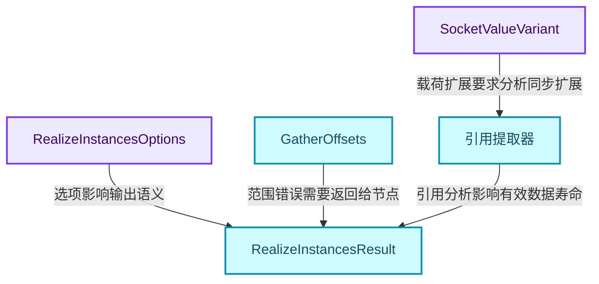
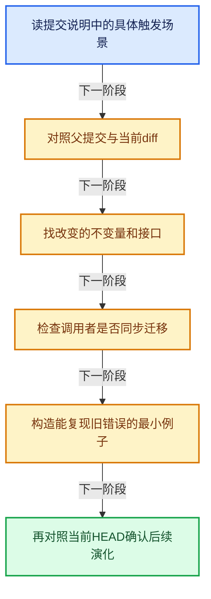
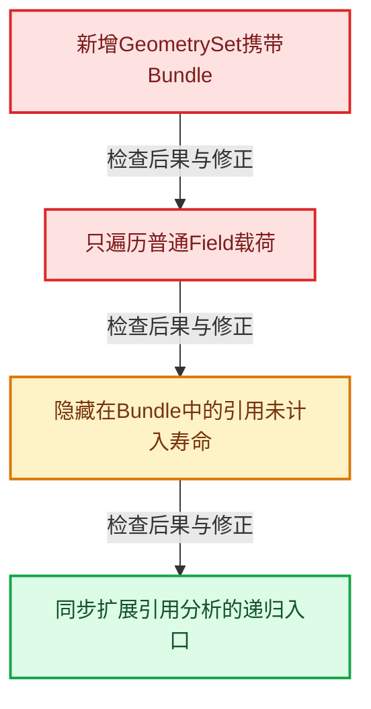

# GN-24 Jacques与Hans提交中的架构演化

[几何节点学习地图](../%E5%87%A0%E4%BD%95%E8%8A%82%E7%82%B9%E6%89%A9%E5%B1%95%E5%AD%A6%E4%B9%A0%E5%9C%B0%E5%9B%BE.md) · [方向导航](README.md) · [全局实现索引](../%E7%AC%A6%E5%8F%B7%E4%BE%9D%E8%B5%96%E4%B8%8E%E5%AE%9E%E7%8E%B0%E7%B4%A2%E5%BC%95.md)

基准：`cbda6b96c26c0dee3c3b5cbb93960c4ac06a6b30`；文件哈希及连续摘录区间记录在[新增专题证据](../_evidence/geometry-extension.json)。本篇围绕所选函数解释核心机制，辅助依赖明确列出已定位实现与尚需类型确认的边界，不宣称相关整个文件已全文复核。

## 先回答一个具体问题

怎样从真实重构与修复提交里学习开发者的判断，而不是只记住最终代码长什么样？

## 相关类与数据的职责

- **`SocketValueVariant`**：从插槽枚举绑定转向CPPType与转换协议。 定义入口：[source/blender/blenkernel/BKE_node_socket_value.hh · L83](../../../../../source/blender/blenkernel/BKE_node_socket_value.hh)。
- **`引用提取器`**：必须看见几何Bundle及嵌套引用中的Field。
- **`RealizeInstancesOptions`**：把新属性域策略与兼容选项显式传入内核。 定义入口：[source/blender/geometry/GEO_realize_instances.hh · L18](../../../../../source/blender/geometry/GEO_realize_instances.hh)。
- **`GatherOffsets`**：用更宽计数积累输出规模。 定义入口：[source/blender/geometry/intern/realize_instances.cc · L309](../../../../../source/blender/geometry/intern/realize_instances.cc)。
- **`RealizeInstancesResult`**：把几何结果与错误报告一起跨层返回。 定义入口：[source/blender/geometry/GEO_realize_instances.hh · L60](../../../../../source/blender/geometry/GEO_realize_instances.hh)。



上图箭头文字区分拥有、借用、调用和数据依赖。连线不表示这些类型存在同名继承关系；只有源码明确声明的继承才按继承理解。

## 设计推导与扩展知识

### 推导1

f05d3fbf34f7052f9abba1be5169a12f44ac1371由Jacques编写并标有Hans共同作者。提交说明目标是把SocketValueVariant与插槽类型选择分离，使用CPPType支持更多载荷和隐式转换。Params调用点由extract/get转向ensure_type，显示基础抽象变更必须同步迁移边界适配器。

### 推导2

同一提交中get_input的局部Variant从const引用变为值，因为ensure_type可能修改包装值。这个细节说明学习重构不能只看新增类，还要分析旧调用者依赖了哪些只读假设。

### 推导3

604f65a60886de212c885637398364e7544f6f41由Jacques修复几何Bundle中的匿名属性引用收集。diff增加GeometrySet分支并递归访问其Bundle和实例引用，说明值系统新增可嵌套结构后，寿命分析必须遍历新的承载路径。

### 推导4

0599cfd8ab7294859eb80c0e3afb7ed4cced3b52由Hans修改Realize后实例属性的曲线域行为。提交说明指出点域带来额外内存和后续混合工作，并通过versioning和新选项保留旧行为。默认内核选项与新建节点传入值必须分别读，不能只找到一个bool默认值就断言界面默认行为。

### 推导5

3628cf2780a69182442b31cb9a03de9db0050fdf由Jacques处理Realize尺寸溢出。diff将累积offset改为int64_t，在关键输出分配前检查可表示范围，并引入包含errors的结果类型，让节点层能显示错误。单独把局部int换成int64_t不足以解决跨层错误表达。

### 推导6

四个案例共同展示一种训练方法：为新增能力列出所有受影响协议，再从旧失败输入验证接口、拥有关系、分析遍历、兼容迁移和用户诊断是否闭合。提交中的性能原因与实际速度数字应分开；这里没有自行测出加速比。

## 实际处理阶段



这张图概括本篇所讨论的主路径；等待输入、构建失败与不同策略的分支以下方完整代码为准，不能把概括图当作每次都会执行的无条件顺序。

## 教学注释代码与分段机制

<a id="f-9a15db80fbc64a8a"></a>

### `blender::nodes::LazyFunctionForExtractingReferenceSet::gather_references_from_field` · L1438—L1464

当前HEAD用FieldInput的引用收集接口遍历输入；与2026-05历史diff分开阅读，不能把当时gather__geometry的旧函数名冒充当前实现。

实现位置：[source/blender/nodes/intern/geometry_nodes_lazy_function.cc](../../../../../source/blender/nodes/intern/geometry_nodes_lazy_function.cc)。

**教学注释版**

<!-- annotated:d9c6fbbdb785b2 -->

```cpp
  void gather_references_from_field(const GField &field,
                                    GeometryNodesReferenceSet &r_references) const
  {
    Stack<fn::GFieldRef> fields_to_check;
    fields_to_check.push(field);
    while (!fields_to_check.is_empty()) {
      const fn::GFieldRef &field_to_check = fields_to_check.pop();
      const fn::FieldInputsPtr &field_inputs = field_to_check.field_inputs();
      if (field_inputs) {
        for (const fn::FieldInput &field_input : field_inputs->inputs) {
          field_input.foreach_recursive_field(
              [&](const GField &recursive_field) { fields_to_check.push(recursive_field); });
          if (const auto *attr_field_input = dynamic_cast<const AttributeFieldInput *>(
                  &field_input))
          {
            const StringRef name = attr_field_input->attribute_name();
            if (bke::attribute_name_is_anonymous(name)) {
              if (!r_references.names) {
                r_references.names = std::make_shared<Set<std::string>>();
              }
              r_references.names->add_as(name);
            }
          }
        }
      }
    }
  }
```

<details>
<summary>核对原始源码：source/blender/nodes/intern/geometry_nodes_lazy_function.cc · L1438—L1464</summary>

<!-- original:d9c6fbbdb785b2:source/blender/nodes/intern/geometry_nodes_lazy_function.cc:1438:1464 -->

```cpp
  void gather_references_from_field(const GField &field,
                                    GeometryNodesReferenceSet &r_references) const
  {
    Stack<fn::GFieldRef> fields_to_check;
    fields_to_check.push(field);
    while (!fields_to_check.is_empty()) {
      const fn::GFieldRef &field_to_check = fields_to_check.pop();
      const fn::FieldInputsPtr &field_inputs = field_to_check.field_inputs();
      if (field_inputs) {
        for (const fn::FieldInput &field_input : field_inputs->inputs) {
          field_input.foreach_recursive_field(
              [&](const GField &recursive_field) { fields_to_check.push(recursive_field); });
          if (const auto *attr_field_input = dynamic_cast<const AttributeFieldInput *>(
                  &field_input))
          {
            const StringRef name = attr_field_input->attribute_name();
            if (bke::attribute_name_is_anonymous(name)) {
              if (!r_references.names) {
                r_references.names = std::make_shared<Set<std::string>>();
              }
              r_references.names->add_as(name);
            }
          }
        }
      }
    }
  }
```

</details>

<details>
<summary>实现依赖入口与尚需类型确认的调用</summary>

- `fields_to_check.push` → [blender::Stack::push · L215](../01-%E5%9F%BA%E7%A1%80%E5%AE%B9%E5%99%A8%E4%B8%8E%E7%8E%B0%E4%BB%A3CPP/13-Stack%E4%B8%8E%E6%A0%88%E6%8E%A5%E5%8F%A3.md#f-4e2f52822df4658e)；[blender::Stack::push · L219](../01-%E5%9F%BA%E7%A1%80%E5%AE%B9%E5%99%A8%E4%B8%8E%E7%8E%B0%E4%BB%A3CPP/13-Stack%E4%B8%8E%E6%A0%88%E6%8E%A5%E5%8F%A3.md#f-6eb0d6a78e38b4e8)。多候选需按实参和重载规则确认。
- `fields_to_check.is_empty` → [blender::Stack::is_empty · L310](../01-%E5%9F%BA%E7%A1%80%E5%AE%B9%E5%99%A8%E4%B8%8E%E7%8E%B0%E4%BB%A3CPP/13-Stack%E4%B8%8E%E6%A0%88%E6%8E%A5%E5%8F%A3.md#f-0dbc636232316093)。
- `fields_to_check.pop` → [blender::Stack::pop · L244](../01-%E5%9F%BA%E7%A1%80%E5%AE%B9%E5%99%A8%E4%B8%8E%E7%8E%B0%E4%BB%A3CPP/13-Stack%E4%B8%8E%E6%A0%88%E6%8E%A5%E5%8F%A3.md#f-6ef6c36a2a0aa986)。
- `field_to_check.field_inputs` → [blender::fn::field_inputs · L398](../08-Field%E8%A1%A8%E8%BE%BE%E5%BC%8F%E4%B8%8E%E6%B1%82%E5%80%BC/12-Field%E9%87%8D%E6%9E%84%E4%B8%8E%E6%B7%B1%E9%93%BE%E9%94%80%E6%AF%81.md#f-c3fc23bad9cfc7fe)。
- `field_input.foreach_recursive_field`：L1448的类型或分派协议；接收对象类型依赖auto、返回值或模板实例；不按同名猜测目标。
- `attr_field_input->attribute_name`：L1453的类型或分派协议；接收对象类型依赖auto、返回值或模板实例；不按同名猜测目标。
- `bke::attribute_name_is_anonymous` → [blender::bke::attribute_name_is_anonymous · L24](../10-%E5%BC%95%E7%94%A8%E7%94%9F%E5%91%BD%E5%91%A8%E6%9C%9F%E4%B8%8EClosure/01-%E5%8C%BF%E5%90%8D%E5%B1%9E%E6%80%A7%E4%B8%8E%E5%BC%95%E7%94%A8%E9%97%AE%E9%A2%98.md#f-ce0c92720483f1bc)。
- `std::make_shared<Set<std::string>>`：构造由共享控制块管理的对象；共享寿命不自动使被指对象读写线程安全，强引用环需单独处理。 [接口资料](https://eel.is/c++draft/util.smartptr.shared.create)。
- `r_references.names->add_as`：L1458的类型或分派协议；接收对象类型依赖auto、返回值或模板实例；不按同名猜测目标。

</details>

<a id="f-aca1707bc15ecdb9"></a>

### `blender::geometry::valid_int_num` · L385—L388

验证当前输出计数的非负与INT32_MAX上限；完整保护还要看调用它的分配路径。

实现位置：[source/blender/geometry/intern/realize_instances.cc](../../../../../source/blender/geometry/intern/realize_instances.cc)。

**教学注释版**

<!-- annotated:5a2a5f1a792596 -->

```cpp
static bool valid_int_num(const int64_t num)
{
  return num >= 0 && num <= INT32_MAX;
}
```

<details>
<summary>核对原始源码：source/blender/geometry/intern/realize_instances.cc · L385—L388</summary>

<!-- original:5a2a5f1a792596:source/blender/geometry/intern/realize_instances.cc:385:388 -->

```cpp
static bool valid_int_num(const int64_t num)
{
  return num >= 0 && num <= INT32_MAX;
}
```

</details>

<details>
<summary>实现依赖入口与尚需类型确认的调用</summary>

本函数未纳入旧结构调用闭包；以上源码保留实际调用表达式，相关成员须按接收者类型继续定位。下方类关系入口提供对应定义。

</details>

## 用小数据走一遍

1. 源Mesh规模很大并被多次实例化。
2. 用int64_t累计总量。
3. 输出目标仍要求32位元素计数。
4. 先检查再分配并把错误带回节点。


这是明确输入条件下的教学推演，不是本地性能实测。对源码的验证应同时检查数值、对象寿命、输出需求和数据是否存在。

## 反例与边界

- 新增GeometrySet携带Bundle。
- 只遍历普通Field载荷。
- 隐藏在Bundle中的引用未计入寿命。
- 同步扩展引用分析的递归入口。



## 历史提交阅读

以下四个历史diff已与本篇设计分析逐项对照；代码年代与当前HEAD分别标明。

### 案例1：类型容器通用化与调用者迁移

Jacques Lucke · 2026-09-03T22:24:57+02:00

`f05d3fbf34f7052f9abba1be5169a12f44ac1371`

Refactor: Geometry Nodes: generalize SocketValueVariant

[完整提交diff](../_evidence/geometry-history/GN-24-case-1.patch)。分析见本篇设计推导，历史签名不作为当前API示例。

### 案例2：几何Bundle中隐藏引用的递归收集

Jacques Lucke · 2026-05-16T18:41:54+02:00

`604f65a60886de212c885637398364e7544f6f41`

Fix: Geometry Nodes: gather anonymous attribute references from geometry bundles

[完整提交diff](../_evidence/geometry-history/GN-24-case-2.patch)。分析见本篇设计推导，历史签名不作为当前API示例。

### 案例3：曲线属性域与旧文件兼容

Hans Goudey · 2025-11-15T19:21:34+01:00

`0599cfd8ab7294859eb80c0e3afb7ed4cced3b52`

Fix #148196: Realize instance attributes to curve domain

[完整提交diff](../_evidence/geometry-history/GN-24-case-3.patch)。分析见本篇设计推导，历史签名不作为当前API示例。

### 案例4：规模溢出检查与跨层错误返回

Jacques Lucke · 2025-10-23T19:21:56+02:00

`3628cf2780a69182442b31cb9a03de9db0050fdf`

Fix #148538: catch size overflow when realizing instances

[完整提交diff](../_evidence/geometry-history/GN-24-case-4.patch)。分析见本篇设计推导，历史签名不作为当前API示例。


## 独立实现与验收

为四个提交各写一个“旧不变量→触发输入→新协议→回归测试”记录。

<details>
<summary>参考思路</summary>

不要把提交标题改写成泛泛优点；明确Variant可转换性、Bundle递归可达性、域兼容与计数可表示范围各自的反例。

</details>

验收时保留一个能击穿错误设计的反例，再对照实际符号重走调用链。教学练习未在完整Blender中运行；本轮独立运行的模型验证另见新增专题验收报告。

## 继续阅读

- [GN-01 几何节点从编辑树到执行结果的全景](%E6%89%A9%E5%B1%9501-%E5%87%A0%E4%BD%95%E8%8A%82%E7%82%B9%E4%BB%8E%E7%BC%96%E8%BE%91%E6%A0%91%E5%88%B0%E6%89%A7%E8%A1%8C%E7%BB%93%E6%9E%9C%E7%9A%84%E5%85%A8%E6%99%AF.md)
- [GN-02 节点注册声明与引用关系契约](%E6%89%A9%E5%B1%9502-%E8%8A%82%E7%82%B9%E6%B3%A8%E5%86%8C%E5%A3%B0%E6%98%8E%E4%B8%8E%E5%BC%95%E7%94%A8%E5%85%B3%E7%B3%BB%E5%A5%91%E7%BA%A6.md)
- [GN-03 GeoNodeExecParams参数适配与移动语义](%E6%89%A9%E5%B1%9503-GeoNodeExecParams%E5%8F%82%E6%95%B0%E9%80%82%E9%85%8D%E4%B8%8E%E7%A7%BB%E5%8A%A8%E8%AF%AD%E4%B9%89.md)
- [GN-04 SocketValueVariant异构值与转换边界](%E6%89%A9%E5%B1%9504-SocketValueVariant%E5%BC%82%E6%9E%84%E5%80%BC%E4%B8%8E%E8%BD%AC%E6%8D%A2%E8%BE%B9%E7%95%8C.md)
- [GN-05 执行图构建缓存与树副本所有权](%E6%89%A9%E5%B1%9505-%E6%89%A7%E8%A1%8C%E5%9B%BE%E6%9E%84%E5%BB%BA%E7%BC%93%E5%AD%98%E4%B8%8E%E6%A0%91%E5%89%AF%E6%9C%AC%E6%89%80%E6%9C%89%E6%9D%83.md)
- [GN-06 按需执行匿名输出与Switch需求传播](%E6%89%A9%E5%B1%9506-%E6%8C%89%E9%9C%80%E6%89%A7%E8%A1%8C%E5%8C%BF%E5%90%8D%E8%BE%93%E5%87%BA%E4%B8%8ESwitch%E9%9C%80%E6%B1%82%E4%BC%A0%E6%92%AD.md)
- [GN-22 ComputeContext日志映射与副作用根](%E6%89%A9%E5%B1%9507-ComputeContext%E6%97%A5%E5%BF%97%E6%98%A0%E5%B0%84%E4%B8%8E%E5%89%AF%E4%BD%9C%E7%94%A8%E6%A0%B9.md)
- [GN-23 几何节点性能诊断与架构训练](../06-%E9%9A%90%E5%BC%8F%E5%85%B1%E4%BA%AB%E4%B8%8E%E7%BC%93%E5%AD%98%E7%B3%BB%E7%BB%9F/%E6%89%A9%E5%B1%9501-%E5%87%A0%E4%BD%95%E8%8A%82%E7%82%B9%E6%80%A7%E8%83%BD%E8%AF%8A%E6%96%AD%E4%B8%8E%E6%9E%B6%E6%9E%84%E8%AE%AD%E7%BB%83.md)
