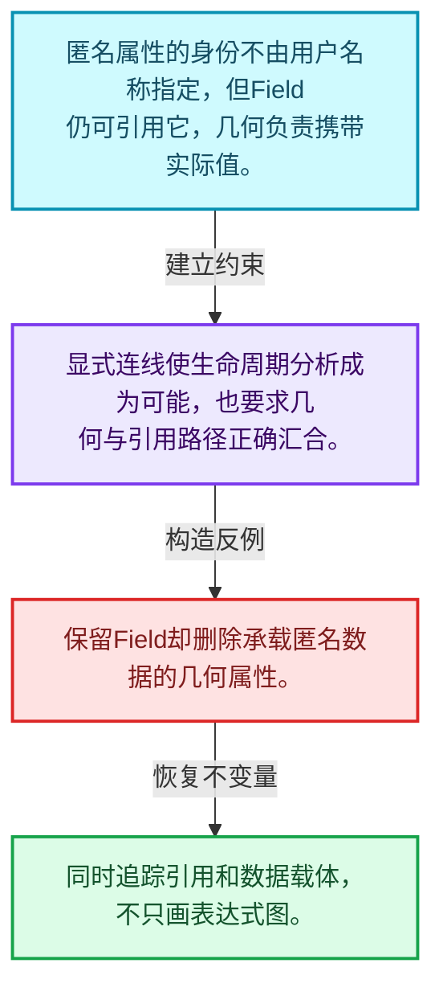
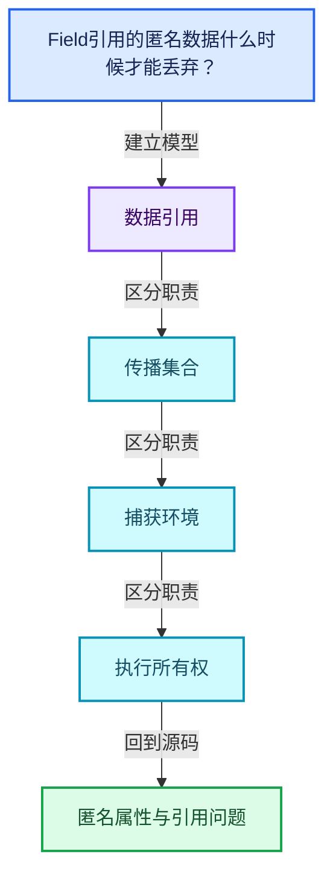
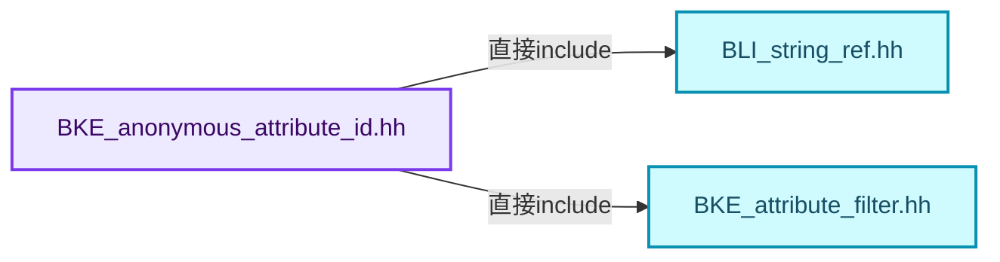
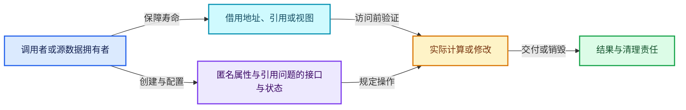
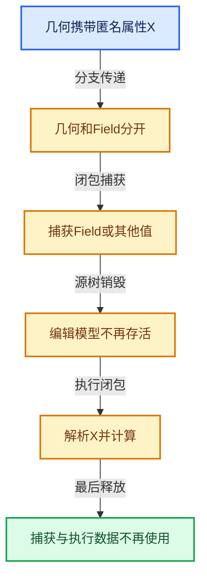

# 10-01 匿名属性与引用问题

[方向导航](README.md) · [总目录](../README.md) · [覆盖索引](../%E6%BA%90%E7%A0%81%E7%89%88%E6%9C%AC%E4%B8%8E%E8%A6%86%E7%9B%96%E7%B4%A2%E5%BC%95.md)

> 阅读顺序：问题与数据模型 → 语法与类型 → 源码逐行 → 调用线索 → 历史与取舍 → 推演和练习。

- 基准 HEAD：`cbda6b96c26c0dee3c3b5cbb93960c4ac06a6b30`。
- 记录日期：2026-10-14。
- 教学示例状态：正文中的推演不是本机性能实测；已运行练习见验收报告。

## 一、从问题到设计

Field引用的匿名数据什么时候才能丢弃？

几何携带数据与Field引用数据共同决定生命周期；看不到名称不代表数据没有引用者。

本篇把语法、数据语义和系统取舍连接起来。表达式引用、承载数据与执行环境必须一起追踪，跨区域组合不能丢掉生命周期信息。

### 本篇独立模型与设计推理

匿名属性的身份不由用户名称指定，但Field仍可引用它，几何负责携带实际值。

设计取舍：显式连线使生命周期分析成为可能，也要求几何与引用路径正确汇合。

最小反例：保留Field却删除承载匿名数据的几何属性。

推导与处理：同时追踪引用和数据载体，不只画表达式图。



### 源码范围与相邻篇章

| 文件 | 本篇逐行范围 | 基准SHA-256 |
|---|---|---|
| [source/blender/blenkernel/BKE_anonymous_attribute_id.hh](../../../../../source/blender/blenkernel/BKE_anonymous_attribute_id.hh) | L1—L40 | `aa2f120f2ea99df659cc64b69d09a61e35a64a3a45c8bfbe7e6f666efcfbbdf8` |

同一主讲文件可能分多篇覆盖；超出本篇范围的符号通过覆盖索引定位。空行与纯注释保留在源码摘录中，逐行表解释有效语句与语法边界；许可证头统一保留。

后篇：[GeometryNodesReferenceSet](02-GeometryNodesReferenceSet.md).

## 二、类型、数据与阅读地图



这是概念依赖图，边表示阅读关系，不声称是运行时调用顺序。

### 直接编译依赖



箭头只表示头文件包含关系；完整调用线索见后面的符号定位表。

## 三、关键词、语法与类型角色

### 只读限定 const

const约束当前访问路径可做的修改。const指针、指向const的指针、const视图对象、const元素是不同位置的限定；其他别名可能仍可修改原对象。

具体检查：分别写T* const、const T*与const T* const，并画出不可修改的层次。

### 覆写检查 override

override要求函数确实覆盖基类虚函数，可捕获参数类型和const限定不匹配。它不改变基类规定的生命周期或线程约束。

具体检查：故意改变一个参数或const，观察编译器如何拒绝误写的新函数。

## 四、真实源码与逐行讲解

源码块保持原行内容，原始行号由小节标题及逐行表给出。表中的调用定位是静态阅读辅助；重载、模板实例化、宏展开和虚调用需结合完整声明，不能仅凭词法出现证明动态调用。

### BKE_anonymous_attribute_id.hh：L1—L40

<!-- source:source/blender/blenkernel/BKE_anonymous_attribute_id.hh:1:40 -->

```cpp
/* SPDX-FileCopyrightText: 2023 Blender Authors
 *
 * SPDX-License-Identifier: GPL-2.0-or-later */

/** \file
 * \ingroup bke
 */

#pragma once

#include "BLI_string_ref.hh"

#include "BKE_attribute_filter.hh"

namespace blender::bke {

/**
 * Checks if the attribute name has the `.a_` prefix which indicates that it is an anonymous
 * attribute. I.e. it is just internally used by Blender and the name should not be exposed to the
 * user.
 *
 * Use #hash_to_anonymous_attribute_name to generate names for anonymous attributes.
 */
inline bool attribute_name_is_anonymous(const StringRef name)
{
  return name.startswith(".a_");
}

class ProcessAllAttributeExceptAnonymous : public AttributeFilter {
 public:
  Result filter(const StringRef name) const override
  {
    if (attribute_name_is_anonymous(name)) {
      return AttributeFilter::Result::AllowSkip;
    }
    return AttributeFilter::Result::Process;
  }
};

}  // namespace blender::bke
```

本段语义重点：

- 分支证据 `attribute_name_is_anonymous(name))`：分别推演条件成立与不成立，核对相同出口处的状态。

| 原始行 | 语义、约束与检查 |
|---|---|
| L9 | 防止同一头文件在一个翻译单元中重复展开；不控制多个源文件之间的链接或对象寿命。 |
| L11 | 引入编译依赖 "BLI_string_ref.hh"；这是声明可见性关系，不表示运行时一定调用该文件的所有接口。 |
| L13 | 引入编译依赖 "BKE_attribute_filter.hh"；这是声明可见性关系，不表示运行时一定调用该文件的所有接口。 |
| L15 | 把后续声明放入 blender::bke 命名空间，影响名称查找和符号归属，不创建运行时对象。 |
| L24 | 出现调用或函数声明 `attribute_name_is_anonymous`，对应表达式为 `inline bool attribute_name_is_anonymous(const StringRef name)`。参数求值、返回类型与重载需结合前后完整语句；静态文本引用不能证明动态目标。 |
| L25 | 连接上一行的声明或控制结构与其语句块；后续行在这个作用域中执行或声明。 |
| L26 | 返回表达式 `name.startswith(".a_")`。 |
| L27 | 结束当前语法单元。局部自动对象在离开其作用域时按规则销毁；这不等于所有被引用的外部数据也被释放。 |
| L29 | 声明或定义类型 `class ProcessAllAttributeExceptAnonymous : public AttributeFilter`。结合继承、访问权限和成员布局确认接口与拥有关系；前向声明本身没有完整对象布局。 |
| L30 | 切换成员访问权限为 public；它是编译期接口边界，不是线程同步或内存保护。 |
| L31 | 出现调用或函数声明 `filter`，对应表达式为 `Result filter(const StringRef name) const override`。参数求值、返回类型与重载需结合前后完整语句；静态文本引用不能证明动态目标。 |
| L32 | 连接上一行的声明或控制结构与其语句块；后续行在这个作用域中执行或声明。 |
| L33 | 判断 `attribute_name_is_anonymous(name)`，成立时进入本分支，否则继续后续路径。 |
| L34 | 返回表达式 `AttributeFilter::Result::AllowSkip`。 |
| L35 | 结束当前语法单元。局部自动对象在离开其作用域时按规则销毁；这不等于所有被引用的外部数据也被释放。 |
| L36 | 返回表达式 `AttributeFilter::Result::Process`。 |
| L37 | 结束当前语法单元。局部自动对象在离开其作用域时按规则销毁；这不等于所有被引用的外部数据也被释放。 |
| L38 | 结束当前语法单元。局部自动对象在离开其作用域时按规则销毁；这不等于所有被引用的外部数据也被释放。 |
| L40 | 结束当前语法单元。局部自动对象在离开其作用域时按规则销毁；这不等于所有被引用的外部数据也被释放。 |

## 五、接口定位、调用线索与生命周期

### 本篇声明与实现入口

| 源码位置 | 实际声明片段 |
|---|---|
| [BKE_anonymous_attribute_id.hh:L24](../../../../../source/blender/blenkernel/BKE_anonymous_attribute_id.hh#L24) | `inline bool attribute_name_is_anonymous(const StringRef name)` |
| [BKE_anonymous_attribute_id.hh:L29](../../../../../source/blender/blenkernel/BKE_anonymous_attribute_id.hh#L29) | `class ProcessAllAttributeExceptAnonymous : public AttributeFilter` |
| [BKE_anonymous_attribute_id.hh:L31](../../../../../source/blender/blenkernel/BKE_anonymous_attribute_id.hh#L31) | `Result filter(const StringRef name) const override` |

### 同名符号出现位置

以下表提供跨文件阅读入口，包含声明、调用或测试使用；没有经过完整C++名称解析，不把它命名为已证明的运行时调用图。

| 符号 | 位置 | 文本证据 |
|---|---|---|
| `attribute_name_is_anonymous` | [mesh.cc:L604](../../../../../source/blender/blenkernel/intern/mesh.cc#L604) | `if (bke::attribute_name_is_anonymous(name)) {` |
| `attribute_name_is_anonymous` | [mesh.cc:L621](../../../../../source/blender/blenkernel/intern/mesh.cc#L621) | `if (bke::attribute_name_is_anonymous(name)) {` |
| `attribute_name_is_anonymous` | [geometry_nodes_lazy_function.cc:L1454](../../../../../source/blender/nodes/intern/geometry_nodes_lazy_function.cc#L1454) | `if (bke::attribute_name_is_anonymous(name)) {` |
| `filter` | [BKE_attribute_filter.hh:L41](../../../../../source/blender/blenkernel/BKE_attribute_filter.hh#L41) | `virtual Result filter(const StringRef ) const` |
| `filter` | [BKE_attribute_filter.hh:L51](../../../../../source/blender/blenkernel/BKE_attribute_filter.hh#L51) | `return this->filter(name) == Result::AllowSkip;` |
| `filter` | [BKE_attribute_filters.hh:L29](../../../../../source/blender/blenkernel/BKE_attribute_filters.hh#L29) | `Result filter(const StringRef name) const override` |

### 生命周期推理图



这是审查生命周期的通用模型。具体类是否拥有数据由本篇成员、构造、析构和调用者一起证明；任何箭头都不自动代表shared_ptr。

## 六、把代码放进具体数据中推演

本方向的共同数值模型如下。本篇的专门检查是：画出Capture输出几何和Field在两条路径汇合的关系。

| 步骤 | 数据或状态 | 为什么需要这一步 |
|---|---|---|
| Capture | 几何携带匿名属性X | Field持有访问X的需求 |
| 分支传递 | 几何和Field分开 | 仍需在汇合处对应 |
| 闭包捕获 | 捕获Field或其他值 | 环境寿命延长到调用结束 |
| 源树销毁 | 编辑模型不再存活 | 执行所需信息仍须有拥有者 |
| 执行闭包 | 解析X并计算 | 缺失几何数据不能凭Field补回 |
| 最后释放 | 捕获与执行数据不再使用 | 避免环状共享导致泄漏 |



图是教学推演模型；精确分支与状态更新以本篇摘录及调用契约为准。

### 本篇独立练习与参考思路

画出Capture输出几何和Field在两条路径汇合的关系。

参考思路：几何携带数据与Field引用数据共同决定生命周期；看不到名称不代表数据没有引用者。

将输入、预期结果和资源责任分成三张清单。先用最直接的实现给出可核对的答案，再替换成对应源码使用的表示；比较结果不变的条件，而不是只比较接口名字。

验收依据：所有被读取的引用仍有对应数据；源树结束后执行对象所需信息存活；强引用图无不必要循环。

## 七、复杂度、设计取舍与其他基础库

与C++ lambda、shared_ptr图和编译器活跃性分析比较：捕获环境保障寿命，引用集合保障所需数据传播，二者承担不同责任。

本篇的具体取舍：几何携带数据与Field引用数据共同决定生命周期；看不到名称不代表数据没有引用者。

| 观察维度 | 从源码取得证据的方法 | 本篇要避免的误判 |
|---|---|---|
| 时间 | 对循环次数、分派次数和重建频率分别计数 | 看到单次常数操作就断定整个操作序列是常数成本 |
| 内存 | 区分对象本体、容量存储、间接资源和共享控制块 | 用sizeof代替总内存 |
| 安全 | 沿构造、失败回滚、销毁与失效逐路径检查 | 把断言或非空指针当作完整安全证明 |
| 并发 | 逐字段确认锁、发布顺序和借用寿命 | 把引用计数线程安全等同数据读写线程安全 |

相关一手资料：

- [C++公开工作草案](https://eel.is/c++draft/)：持续更新的工作草案；语言与标准库语义以相应章节为准。
- [Blender依赖图设计](https://developer.blender.org/docs/features/core/depsgraph/)：包含历史设计背景，当前行为以本地源码为准。

资料用于核对契约和进一步阅读；这里没有声称外部库与Blender实现相同，也没有把上游性能数字当作本机实测。

## 八、历史提交与设计演化

### 2024-10-07 · Jacques Lucke

[Refactor: Geometry Nodes: improve lifetime analysis for anonymous attributes](https://projects.blender.org/blender/blender/commit/67c7485bfd95a60caa8d0c12edaaadb55d3519c0)

完整哈希：`67c7485bfd95a60caa8d0c12edaaadb55d3519c0`。提交标题与作者日期来自本地Git对象。

提交说明原文（历史证据，不能直接作为当前API说明）：

```text
Refactor: Geometry Nodes: improve lifetime analysis for anonymous attributes

This refactors the lifetime analysis of anonymous attributes in geometry nodes.
The refactor has a couple of goals:
* Use a better and simpler abstraction that can be used when building the
  lazy-function graph. We currently have a bunch of duplicate code to handle
  "field source" and "caller propagation" attributes. This is now unified so
  that one only has to worry about one kind of "reference sets".
* Make the abstraction compatible with handling bundles and closures in case we
  want to support them in the future. Both types can contain geometries and
  fields so they need to be taken into account when determining lifetimes.
* Make more parts independent of the concept of "anonymous attributes". In
  theory, there could be more kinds of referenced data whose lifetimes need to
  be managed. I don't have any concrete plans for adding any though.

At its core, deterministic anonymous attributes still work the same they have
been since they became deterministic [0]. Even the generated lazy-function graph
is still pretty much or even exactly the same as before.

The patch renames `AnonymousAttributeSet` to the more general
`GeometryNodesReferenceSet` which is more. This also makes more places
independent of the concept of anonymous attributes. Functionally, this still the
same though. It's only used in the internals of geometry nodes nowadays. Most
code just gets an `AttributeFilter` that is based on it.

[0]: https://archive.blender.org/developer/D16858

Pull Request: https://projects.blender.org/blender/blender/pulls/128667
```

阅读任务：先根据说明复述旧问题，提出一个自己的修复方案，再对照diff。结合本篇重点“Field引用的匿名数据什么时候才能丢弃？”判断方案改变的是表示、接口、生命周期还是调度。

## 九、反例、测试入口与掌握标准

需要实际构造的反例：

- 空输入或没有结果需求：确认接口允许的空状态与不允许访问的操作。
- 边界位置和退化结构：把长度为1、末尾位置、重复值或深链代入真实分支。
- 生命周期结束或修改之后：检查保存的指针、引用、结果视图是否仍有效。
- 与本篇核心不变量相冲突的输入：画出Capture输出几何和Field在两条路径汇合的关系。

### 可运行的教学参考程序

[reference_exercises.cc](../_tools/reference_exercises.cc)包含独立于Blender的C++20参考检查：视图、简化SmallVector、异常回滚、哈希碰撞与删除、偏移数组、拓扑映射、共享缓存、表达式、惰性分支、闭包和暴力最近邻。

参考程序有意省略生产实现的完整能力。例如SmallVector禁止复制移动容器，不支持只能移动的元素，并禁止append参数别名到自身元素；TinyMap固定8槽，不提供增长。程序通过不能替代Blender实现测试。实际运行结果、编译器与命令见验收报告。

掌握标准：离开源码解释“Field引用的匿名数据什么时候才能丢弃？”；独立完成上述练习；能指出一个会破坏数据引用相关约束的最小反例，并用具体代码行说明检查或修复应放在哪里。
