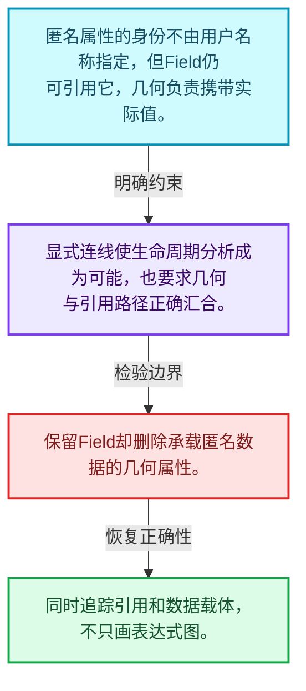
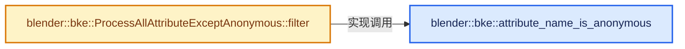
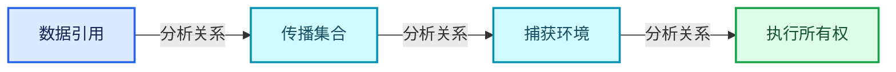
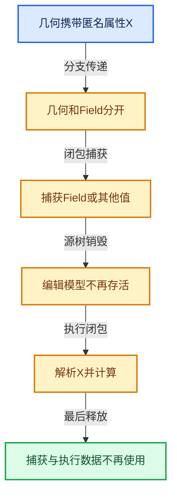

# 10-01 匿名属性与引用问题

[方向导航](README.md) · [总目录](../README.md) · [实现索引](../%E7%AC%A6%E5%8F%B7%E4%BE%9D%E8%B5%96%E4%B8%8E%E5%AE%9E%E7%8E%B0%E7%B4%A2%E5%BC%95.md)

## 从问题到实现

Field引用的匿名数据什么时候才能丢弃？

几何携带数据与Field引用数据共同决定生命周期；看不到名称不代表数据没有引用者。

**数据模型**

匿名属性的身份不由用户名称指定，但Field仍可引用它，几何负责携带实际值。

**设计取舍**

显式连线使生命周期分析成为可能，也要求几何与引用路径正确汇合。

**最小反例**

保留Field却删除承载匿名数据的几何属性。

**推导**

同时追踪引用和数据载体，不只画表达式图。

## 阅读地图与执行推演









图中的数值推演是本方向的教学模型；实际函数之间的调用边与概念分析边分别标注，不能把概念关系当作运行时调度顺序。

## 完整源码单元与就地讲解

中文讲解直接放在相关代码旁，复杂机制在代码下展开。原文折叠区保留基准行号；不需要在行号表和函数之间来回查找。类布局可分段展示，函数实现不按固定行数切开。

### 类型布局、声明与编译条件 · BKE_anonymous_attribute_id.hh L1—L23

<!-- annotated:65d62931e59f1f -->

```cpp
/* SPDX-FileCopyrightText: 2023 Blender Authors
 *
 * SPDX-License-Identifier: GPL-2.0-or-later */

/** \file
 * \ingroup bke
 */

#pragma once

#include "BLI_string_ref.hh"

#include "BKE_attribute_filter.hh"

namespace blender::bke {

/**
 * Checks if the attribute name has the `.a_` prefix which indicates that it is an anonymous
 * attribute. I.e. it is just internally used by Blender and the name should not be exposed to the
 * user.
 *
 * Use #hash_to_anonymous_attribute_name to generate names for anonymous attributes.
 */
```

<details>
<summary>核对原始源码：source/blender/blenkernel/BKE_anonymous_attribute_id.hh · L1—L23</summary>

<!-- original:65d62931e59f1f:source/blender/blenkernel/BKE_anonymous_attribute_id.hh:1:23 -->

```cpp
/* SPDX-FileCopyrightText: 2023 Blender Authors
 *
 * SPDX-License-Identifier: GPL-2.0-or-later */

/** \file
 * \ingroup bke
 */

#pragma once

#include "BLI_string_ref.hh"

#include "BKE_attribute_filter.hh"

namespace blender::bke {

/**
 * Checks if the attribute name has the `.a_` prefix which indicates that it is an anonymous
 * attribute. I.e. it is just internally used by Blender and the name should not be exposed to the
 * user.
 *
 * Use #hash_to_anonymous_attribute_name to generate names for anonymous attributes.
 */
```

</details>

<a id="f-ce0c92720483f1bc"></a>

### `blender::bke::attribute_name_is_anonymous`

实现位置：[source/blender/blenkernel/BKE_anonymous_attribute_id.hh](../../../../../source/blender/blenkernel/BKE_anonymous_attribute_id.hh) · L24—L27。

接口参数：

- `const StringRef name`

**教学注释版**

<!-- annotated:840db9a43ea729 -->

```cpp
inline bool attribute_name_is_anonymous(const StringRef name)
{
  return name.startswith(".a_");
}
```

<details>
<summary>核对原始源码：source/blender/blenkernel/BKE_anonymous_attribute_id.hh · L24—L27</summary>

<!-- original:840db9a43ea729:source/blender/blenkernel/BKE_anonymous_attribute_id.hh:24:27 -->

```cpp
inline bool attribute_name_is_anonymous(const StringRef name)
{
  return name.startswith(".a_");
}
```

</details>

**结果出口**

- `return name.startswith(".a_");`

**继续追踪实现**

- `name.startswith` → [blender::StringRefBase::startswith · L269](../01-%E5%9F%BA%E7%A1%80%E5%AE%B9%E5%99%A8%E4%B8%8E%E7%8E%B0%E4%BB%A3CPP/15-StringRef%E5%AD%97%E7%AC%A6%E4%B8%B2%E8%A7%86%E5%9B%BE.md#f-78237ccfe249bfa5)。

### 类型布局、声明与编译条件 · BKE_anonymous_attribute_id.hh L28—L30

<a id="t-dd49723aeaac"></a>

<!-- annotated:845b8481911935 -->

```cpp

class ProcessAllAttributeExceptAnonymous : public AttributeFilter {
 public:
```

<details>
<summary>核对原始源码：source/blender/blenkernel/BKE_anonymous_attribute_id.hh · L28—L30</summary>

<!-- original:845b8481911935:source/blender/blenkernel/BKE_anonymous_attribute_id.hh:28:30 -->

```cpp

class ProcessAllAttributeExceptAnonymous : public AttributeFilter {
 public:
```

</details>

<a id="f-72706cc666e50f3e"></a>

### `blender::bke::ProcessAllAttributeExceptAnonymous::filter`

实现位置：[source/blender/blenkernel/BKE_anonymous_attribute_id.hh](../../../../../source/blender/blenkernel/BKE_anonymous_attribute_id.hh) · L31—L37。

接口参数：

- `const StringRef name`

**教学注释版**

<!-- annotated:7151e3e4215444 -->

```cpp
  Result filter(const StringRef name) const override
  {
    if (attribute_name_is_anonymous(name)) {
      return AttributeFilter::Result::AllowSkip;
    }
    return AttributeFilter::Result::Process;
  }
```

<details>
<summary>核对原始源码：source/blender/blenkernel/BKE_anonymous_attribute_id.hh · L31—L37</summary>

<!-- original:7151e3e4215444:source/blender/blenkernel/BKE_anonymous_attribute_id.hh:31:37 -->

```cpp
  Result filter(const StringRef name) const override
  {
    if (attribute_name_is_anonymous(name)) {
      return AttributeFilter::Result::AllowSkip;
    }
    return AttributeFilter::Result::Process;
  }
```

</details>

**结果出口**

- `return AttributeFilter::Result::AllowSkip;`
- `return AttributeFilter::Result::Process;`

**继续追踪实现**

- `attribute_name_is_anonymous` → [blender::bke::attribute_name_is_anonymous · L24](01-%E5%8C%BF%E5%90%8D%E5%B1%9E%E6%80%A7%E4%B8%8E%E5%BC%95%E7%94%A8%E9%97%AE%E9%A2%98.md#f-ce0c92720483f1bc)。

### 类型布局、声明与编译条件 · BKE_anonymous_attribute_id.hh L38—L40

<!-- annotated:8b79ef96c5bc28 -->

```cpp
};

}  // namespace blender::bke
```

<details>
<summary>核对原始源码：source/blender/blenkernel/BKE_anonymous_attribute_id.hh · L38—L40</summary>

<!-- original:8b79ef96c5bc28:source/blender/blenkernel/BKE_anonymous_attribute_id.hh:38:40 -->

```cpp
};

}  // namespace blender::bke
```

</details>

## 语法与相关类型

### 只读限定 const

const约束当前访问路径可做的修改。const指针、指向const的指针、const视图对象、const元素是不同位置的限定；其他别名可能仍可修改原对象。

分别写T* const、const T*与const T* const，并画出不可修改的层次。

### 覆写检查 override

override要求函数确实覆盖基类虚函数，可捕获参数类型和const限定不匹配。它不改变基类规定的生命周期或线程约束。

故意改变一个参数或const，观察编译器如何拒绝误写的新函数。

## 实现练习与验证

画出Capture输出几何和Field在两条路径汇合的关系。

参考推理：同时追踪引用和数据载体，不只画表达式图。

所有被读取的引用仍有对应数据；源树结束后执行对象所需信息存活；强引用图无不必要循环。

## 历史、跨库比较与证据

与C++ lambda、shared_ptr图和编译器活跃性分析比较：捕获环境保障寿命，引用集合保障所需数据传播，二者承担不同责任。

[历史提交索引](../%E5%8E%86%E5%8F%B2%E6%8F%90%E4%BA%A4%E4%B8%8E%E8%AE%BE%E8%AE%A1%E6%BC%94%E5%8C%96%E7%B4%A2%E5%BC%95.md) · [源码基准](../%E6%BA%90%E7%A0%81%E7%89%88%E6%9C%AC%E4%B8%8E%E8%A6%86%E7%9B%96%E7%B4%A2%E5%BC%95.md) · [验收报告](../%E9%AA%8C%E6%94%B6%E6%8A%A5%E5%91%8A.md)
