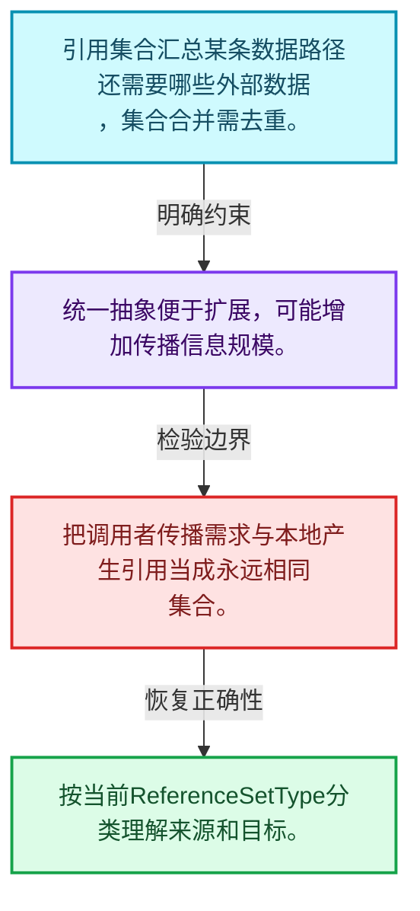
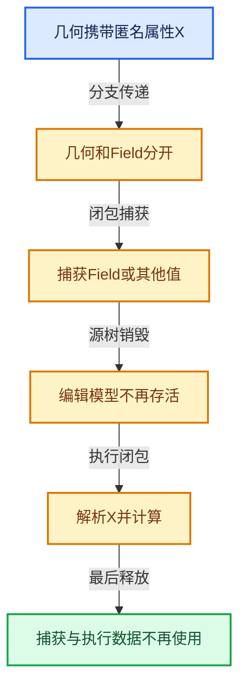

# 10-02 GeometryNodesReferenceSet

[方向导航](README.md) · [总目录](../README.md) · [实现索引](../%E7%AC%A6%E5%8F%B7%E4%BE%9D%E8%B5%96%E4%B8%8E%E5%AE%9E%E7%8E%B0%E7%B4%A2%E5%BC%95.md)

## 从问题到实现

怎样统一表示仍被下游需要的引用？

引用集合将具体匿名属性需求抽象成传播信息，为嵌套组合保留一致表达。

**数据模型**

引用集合汇总某条数据路径还需要哪些外部数据，集合合并需去重。

**设计取舍**

统一抽象便于扩展，可能增加传播信息规模。

**最小反例**

把调用者传播需求与本地产生引用当成永远相同集合。

**推导**

按当前ReferenceSetType分类理解来源和目标。

## 阅读地图与执行推演






图中的数值推演是本方向的教学模型；实际函数之间的调用边与概念分析边分别标注，不能把概念关系当作运行时调度顺序。

## 完整源码单元与就地讲解

中文讲解直接放在相关代码旁，复杂机制在代码下展开。原文折叠区保留基准行号；不需要在行号表和函数之间来回查找。类布局可分段展示，函数实现不按固定行数切开。

### 类型布局、声明与编译条件 · BKE_geometry_nodes_reference_set.hh L1—L31

<a id="t-6c83ae4a1aa2"></a>

`GeometryNodesReferenceSet`在这里声明的数据成员：

- `std::shared_ptr<Set<std::string>> names`

<!-- annotated:80cbc9468ddd4b -->

```cpp
/* SPDX-FileCopyrightText: 2024 Blender Authors
 *
 * SPDX-License-Identifier: GPL-2.0-or-later */

/** \file
 * \ingroup bke
 */

#pragma once

#include <memory>
#include <string>

#include "BLI_set.hh"

namespace blender::bke {

/**
 * A set of anonymous attribute names that is passed around in geometry nodes.
 */
class GeometryNodesReferenceSet {
 public:
  /**
   * This uses `std::shared_ptr` because attributes sets are passed around by value during geometry
   * nodes evaluation, and this makes it very small if there is no name. Also it makes copying very
   * cheap.
   */
  std::shared_ptr<Set<std::string>> names;
};

}  // namespace blender::bke
```

<details>
<summary>核对原始源码：source/blender/blenkernel/BKE_geometry_nodes_reference_set.hh · L1—L31</summary>

<!-- original:80cbc9468ddd4b:source/blender/blenkernel/BKE_geometry_nodes_reference_set.hh:1:31 -->

```cpp
/* SPDX-FileCopyrightText: 2024 Blender Authors
 *
 * SPDX-License-Identifier: GPL-2.0-or-later */

/** \file
 * \ingroup bke
 */

#pragma once

#include <memory>
#include <string>

#include "BLI_set.hh"

namespace blender::bke {

/**
 * A set of anonymous attribute names that is passed around in geometry nodes.
 */
class GeometryNodesReferenceSet {
 public:
  /**
   * This uses `std::shared_ptr` because attributes sets are passed around by value during geometry
   * nodes evaluation, and this makes it very small if there is no name. Also it makes copying very
   * cheap.
   */
  std::shared_ptr<Set<std::string>> names;
};

}  // namespace blender::bke
```

</details>

## 语法与相关类型

### 异常边界 try与catch

try定义异常传播的局部边界。失败路径需要销毁已经成功构造的部分并释放相应存储；未构造的对象不能被析构。

在第k次构造失败，列出已经存在的对象集合与待释放缓冲。

### 共享拥有 shared_ptr

shared_ptr让控制块跟踪共享寿命，不自动使被指向对象的读写线程安全；循环拥有可能阻止销毁。

画出强引用环并考虑是否应改变所有权方向或引入弱引用。

## 实现练习与验证

合并两个输出所需集合并检查重复引用。

参考推理：按当前ReferenceSetType分类理解来源和目标。

所有被读取的引用仍有对应数据；源树结束后执行对象所需信息存活；强引用图无不必要循环。

## 历史、跨库比较与证据

与C++ lambda、shared_ptr图和编译器活跃性分析比较：捕获环境保障寿命，引用集合保障所需数据传播，二者承担不同责任。

[历史提交索引](../%E5%8E%86%E5%8F%B2%E6%8F%90%E4%BA%A4%E4%B8%8E%E8%AE%BE%E8%AE%A1%E6%BC%94%E5%8C%96%E7%B4%A2%E5%BC%95.md) · [源码基准](../%E6%BA%90%E7%A0%81%E7%89%88%E6%9C%AC%E4%B8%8E%E8%A6%86%E7%9B%96%E7%B4%A2%E5%BC%95.md) · [验收报告](../%E9%AA%8C%E6%94%B6%E6%8A%A5%E5%91%8A.md)
